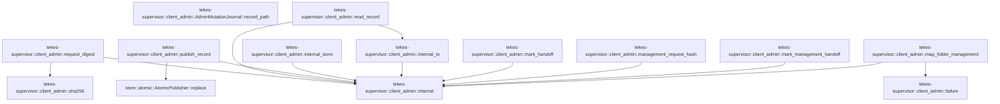

```mermaid
flowchart TD
  n0["schema::ijson::IJsonValue::parse"]
  n1["schema::ijson::IJsonValue::parse_str"]
  n2["store::atomic::AtomicPublisher::replace"]
  n3["store::management_root::retire_legacy_name"]
  n4["store::platform::NamedLock::exclusive"]
  n5["tekes-supervisor::client_admin::ClientAdminRoutes::execute"]
  n6["tekes-supervisor::client_admin::parse"]
  n7["tekes-supervisor::client_admin::to_ijson"]
  n8["tekes-supervisor::client_admin::failure"]
  n9["tekes-supervisor::client_admin::internal"]
  n10["tekes-supervisor::client_admin::internal_profile"]
  n11["tekes-supervisor::client_admin::internal_daemon"]
  n12["tekes-supervisor::client_admin::stale"]
  n13["tekes-supervisor::client_admin::next_revision"]
  n14["tekes-supervisor::client_admin::map_workspace"]
  n15["tekes-supervisor::client_admin::map_policy"]
  n16["tekes-supervisor::client_admin::policy_result"]
  n17["tekes-supervisor::client_admin::AdminMutationJournal::open"]
  n18["tekes-supervisor::client_admin::AdminMutationJournal::begin"]
  n19["tekes-supervisor::client_admin::AdminMutationJournal::recover"]
  n20["tekes-supervisor::client_admin::AdminMutationJournal::commit"]
  n21["tekes-supervisor::client_admin::AdminMutationJournal::records"]
  n22["tekes-supervisor::client_admin::AdminMutationJournal::commit_record"]
  n23["tekes-supervisor::client_admin::AdminMutationJournal::abort"]
  n24["tekes-supervisor::client_admin::AdminMutationJournal::authority_digest"]
  n25["tekes-supervisor::client_admin::AdminMutationJournal::record_path"]
  n26["tekes-supervisor::client_admin::request_digest"]
  n27["tekes-supervisor::client_admin::sha256"]
  n28["tekes-supervisor::client_admin::read_record"]
  n29["tekes-supervisor::client_admin::publish_record"]
  n30["tekes-supervisor::client_admin::internal_io"]
  n31["tekes-supervisor::endpoint_host::ProductionRouteFailure::new"]
  n5 --> n6
  n5 --> n8
  n6 --> n8
  n7 --> n0
  n7 --> n9
  n8 --> n1
  n8 --> n7
  n8 --> n31
  n9 --> n8
  n10 --> n9
  n11 --> n9
  n12 --> n8
  n13 --> n8
  n14 --> n8
  n14 --> n10
  n15 --> n8
  n15 --> n12
  n16 --> n7
  n17 --> n2
  n17 --> n3
  n18 --> n4
  n18 --> n8
  n18 --> n24
  n18 --> n25
  n18 --> n26
  n18 --> n27
  n18 --> n28
  n18 --> n29
  n19 --> n4
  n19 --> n8
  n19 --> n24
  n19 --> n25
  n19 --> n26
  n19 --> n28
  n19 --> n29
  n20 --> n4
  n20 --> n8
  n20 --> n9
  n20 --> n24
  n20 --> n25
  n20 --> n26
  n20 --> n28
  n20 --> n29
  n21 --> n4
  n21 --> n9
  n21 --> n28
  n22 --> n4
  n22 --> n9
  n22 --> n24
  n22 --> n25
  n22 --> n28
  n22 --> n29
  n23 --> n4
  n23 --> n9
  n23 --> n24
  n23 --> n25
  n23 --> n28
  n24 --> n9
  n24 --> n27
  n24 --> n30
```

# tekes-supervisor::client_admin

[Package atlas](index.md) · [Source](../../src/client_admin.rs)

## Declarations

Visibility is the declaration spelling; trait members and reexports require their enclosing interface. `cfg` is not evaluated.

| Symbol | Kind | Visibility | Test / cfg |
|---|---|---|---|
| [tekes-supervisor::client_admin::WORKSPACE_POLICY_METHODS](../../src/client_admin.rs#L20) | const_item | `pub` |  |
| [tekes-supervisor::client_admin::WORKSPACE_FOLDER_METHODS](../../src/client_admin.rs#L25) | const_item | `pub` |  |
| [tekes-supervisor::client_admin::ClientAdminRoutes](../../src/client_admin.rs#L31) | struct_item | `pub` |  |
| [tekes-supervisor::client_admin::ClientAdminRoutes::new](../../src/client_admin.rs#L40) | function_item | `pub` |  |
| [tekes-supervisor::client_admin::ClientAdminRoutes::routes](../../src/client_admin.rs#L58) | function_item | `pub` |  |
| [tekes-supervisor::client_admin::ClientAdminRoutes::recover_pending_intents](../../src/client_admin.rs#L73) | function_item | `private` |  |
| [tekes-supervisor::client_admin::ClientAdminRoutes::get_policy](../../src/client_admin.rs#L136) | function_item | `private` |  |
| [tekes-supervisor::client_admin::ClientAdminRoutes::set_policy](../../src/client_admin.rs#L145) | function_item | `private` |  |
| [tekes-supervisor::client_admin::ClientAdminRoutes::list_folders](../../src/client_admin.rs#L227) | function_item | `private` |  |
| [tekes-supervisor::client_admin::ClientAdminRoutes::change_folders](../../src/client_admin.rs#L245) | function_item | `private` |  |
| [tekes-supervisor::client_admin::ClientAdminRoutes::lock_management](../../src/client_admin.rs#L310) | function_item | `private` |  |
| [tekes-supervisor::client_admin::ClientAdminRoutes::management](../../src/client_admin.rs#L315) | function_item | `private` |  |
| [tekes-supervisor::client_admin::AdminCapabilityRoutes](../../src/client_admin.rs#L321) | struct_item | `private` |  |
| [tekes-supervisor::client_admin::AdminCapabilityRoutes::new](../../src/client_admin.rs#L328) | function_item | `private` |  |
| [tekes-supervisor::client_admin::AdminCapabilityRoutes::class](../../src/client_admin.rs#L340) | function_item | `private` |  |
| [tekes-supervisor::client_admin::AdminCapabilityRoutes::capabilities](../../src/client_admin.rs#L348) | function_item | `private` |  |
| [tekes-supervisor::client_admin::AdminCapabilityRoutes::extension_method_class](../../src/client_admin.rs#L355) | function_item | `private` |  |
| [tekes-supervisor::client_admin::AdminCapabilityRoutes::validate_extension_payload](../../src/client_admin.rs#L359) | function_item | `private` |  |
| [tekes-supervisor::client_admin::AdminCapabilityRoutes::extension_failure_is_exact](../../src/client_admin.rs#L375) | function_item | `private` |  |
| [tekes-supervisor::client_admin::AdminCapabilityRoutes::execute](../../src/client_admin.rs#L386) | function_item | `private` |  |
| [tekes-supervisor::client_admin::ClientAdminRoutes::capabilities](../../src/client_admin.rs#L404) | function_item | `private` |  |
| [tekes-supervisor::client_admin::ClientAdminRoutes::extension_method_class](../../src/client_admin.rs#L412) | function_item | `private` |  |
| [tekes-supervisor::client_admin::ClientAdminRoutes::validate_extension_payload](../../src/client_admin.rs#L419) | function_item | `private` |  |
| [tekes-supervisor::client_admin::ClientAdminRoutes::extension_failure_is_exact](../../src/client_admin.rs#L439) | function_item | `private` |  |
| [tekes-supervisor::client_admin::ClientAdminRoutes::execute](../../src/client_admin.rs#L463) | function_item | `private` |  |
| [tekes-supervisor::client_admin::PolicyGetRequest](../../src/client_admin.rs#L486) | struct_item | `private` |  |
| [tekes-supervisor::client_admin::FoldersGetRequest](../../src/client_admin.rs#L491) | struct_item | `private` |  |
| [tekes-supervisor::client_admin::FolderChangeRequest](../../src/client_admin.rs#L496) | struct_item | `private` |  |
| [tekes-supervisor::client_admin::PolicySetRequest](../../src/client_admin.rs#L502) | struct_item | `private` |  |
| [tekes-supervisor::client_admin::parse](../../src/client_admin.rs#L508) | function_item | `private` |  |
| [tekes-supervisor::client_admin::to_ijson](../../src/client_admin.rs#L517) | function_item | `private` |  |
| [tekes-supervisor::client_admin::failure](../../src/client_admin.rs#L523) | function_item | `private` |  |
| [tekes-supervisor::client_admin::internal](../../src/client_admin.rs#L530) | function_item | `private` |  |
| [tekes-supervisor::client_admin::internal_profile](../../src/client_admin.rs#L537) | function_item | `private` |  |
| [tekes-supervisor::client_admin::internal_daemon](../../src/client_admin.rs#L540) | function_item | `private` |  |
| [tekes-supervisor::client_admin::stale](../../src/client_admin.rs#L543) | function_item | `private` |  |
| [tekes-supervisor::client_admin::next_revision](../../src/client_admin.rs#L550) | function_item | `private` |  |
| [tekes-supervisor::client_admin::map_workspace](../../src/client_admin.rs#L562) | function_item | `private` |  |
| [tekes-supervisor::client_admin::map_policy](../../src/client_admin.rs#L570) | function_item | `private` |  |
| [tekes-supervisor::client_admin::policy_result](../../src/client_admin.rs#L588) | function_item | `private` |  |
| [tekes-supervisor::client_admin::AdminPhase](../../src/client_admin.rs#L597) | enum_item | `private` |  |
| [tekes-supervisor::client_admin::AdminRecord](../../src/client_admin.rs#L604) | struct_item | `private` |  |
| [tekes-supervisor::client_admin::AdminBegin](../../src/client_admin.rs#L618) | enum_item | `private` |  |
| [tekes-supervisor::client_admin::CONFIG_ADMIN_DIR](../../src/client_admin.rs#L624) | const_item | `private` |  |
| [tekes-supervisor::client_admin::LEGACY_CONFIG_ADMIN_DIR](../../src/client_admin.rs#L626) | const_item | `private` |  |
| [tekes-supervisor::client_admin::AdminMutationJournal](../../src/client_admin.rs#L628) | struct_item | `private` |  |
| [tekes-supervisor::client_admin::AdminMutationJournal::open](../../src/client_admin.rs#L635) | function_item | `private` |  |
| [tekes-supervisor::client_admin::AdminMutationJournal::begin](../../src/client_admin.rs#L651) | function_item | `private` |  |
| [tekes-supervisor::client_admin::AdminMutationJournal::recover](../../src/client_admin.rs#L716) | function_item | `private` |  |
| [tekes-supervisor::client_admin::AdminMutationJournal::commit](../../src/client_admin.rs#L744) | function_item | `private` |  |
| [tekes-supervisor::client_admin::AdminMutationJournal::records](../../src/client_admin.rs#L768) | function_item | `private` |  |
| [tekes-supervisor::client_admin::AdminMutationJournal::commit_record](../../src/client_admin.rs#L783) | function_item | `private` |  |
| [tekes-supervisor::client_admin::AdminMutationJournal::abort](../../src/client_admin.rs#L797) | function_item | `private` |  |
| [tekes-supervisor::client_admin::AdminMutationJournal::authority_digest](../../src/client_admin.rs#L814) | function_item | `private` |  |
| [tekes-supervisor::client_admin::AdminMutationJournal::record_path](../../src/client_admin.rs#L830) | function_item | `private` |  |
| [tekes-supervisor::client_admin::request_digest](../../src/client_admin.rs#L836) | function_item | `private` |  |
| [tekes-supervisor::client_admin::sha256](../../src/client_admin.rs#L843) | function_item | `private` |  |
| [tekes-supervisor::client_admin::read_record](../../src/client_admin.rs#L846) | function_item | `private` |  |
| [tekes-supervisor::client_admin::publish_record](../../src/client_admin.rs#L866) | function_item | `private` |  |
| [tekes-supervisor::client_admin::internal_store](../../src/client_admin.rs#L872) | function_item | `private` |  |
| [tekes-supervisor::client_admin::internal_io](../../src/client_admin.rs#L875) | function_item | `private` |  |
| [tekes-supervisor::client_admin::mark_handoff](../../src/client_admin.rs#L878) | function_item | `private` |  |
| [tekes-supervisor::client_admin::management_request_hash](../../src/client_admin.rs#L892) | function_item | `private` |  |
| [tekes-supervisor::client_admin::mark_management_handoff](../../src/client_admin.rs#L912) | function_item | `private` |  |
| [tekes-supervisor::client_admin::map_folder_management](../../src/client_admin.rs#L926) | function_item | `private` |  |
| [tekes-supervisor::client_admin::tests::fixture](../../src/client_admin.rs#L982) | function_item | `private` | test; #[cfg(test)] |
| [tekes-supervisor::client_admin::tests::call](../../src/client_admin.rs#L1007) | function_item | `private` | test; #[cfg(test)] |
| [tekes-supervisor::client_admin::tests::policy_replacement_can_relax_local_default_below_ceiling](../../src/client_admin.rs#L1018) | function_item | `private` | test; #[cfg(test)] |
| [tekes-supervisor::client_admin::tests::journal_rejects_wrong_bytes_for_the_same_rpc_id](../../src/client_admin.rs#L1039) | function_item | `private` | test; #[cfg(test)] |
| [tekes-supervisor::client_admin::tests::crash_before_publish_is_completed_before_an_unrelated_rpc](../../src/client_admin.rs#L1069) | function_item | `private` | test; #[cfg(test)] |
| [tekes-supervisor::client_admin::tests::startup_closes_policy_crashes_on_both_sides_of_the_side_effect](../../src/client_admin.rs#L1128) | function_item | `private` | test; #[cfg(test)] |
| [tekes-supervisor::client_admin::tests::k1_management_race::folder_fixture](../../src/client_admin.rs#L1203) | function_item | `private` | test; #[cfg(test)] |
| [tekes-supervisor::client_admin::tests::k1_management_race::policy_call](../../src/client_admin.rs#L1234) | function_item | `private` | test; #[cfg(test)] |
| [tekes-supervisor::client_admin::tests::k1_management_race::revision](../../src/client_admin.rs#L1244) | function_item | `private` | test; #[cfg(test)] |
| [tekes-supervisor::client_admin::tests::k1_management_race::policy_set_publishes_only_under_the_management_lock](../../src/client_admin.rs#L1255) | function_item | `private` | test; #[cfg(test)] |
| [tekes-supervisor::client_admin::tests::k1_management_race::recovered_policy_intent_publishes_only_under_the_management_lock](../../src/client_admin.rs#L1287) | function_item | `private` | test; #[cfg(test)] |
| [tekes-supervisor::client_admin::tests::k1_management_race::policy_set_racing_the_recovery_tick_never_corrupts_management](../../src/client_admin.rs#L1341) | function_item | `private` | test; #[cfg(test)] |
| [tekes-supervisor::client_admin::tests::k1_management_race::policy_set_racing_relocate_never_corrupts_management](../../src/client_admin.rs#L1387) | function_item | `private` | test; #[cfg(test)] |

## Imports / reexports

| Local name | Source path | Visibility |
|---|---|---|
| `BTreeSet` | `std::collections::BTreeSet` | `private` |
| `fs` | `std::fs` | `private` |
| `Path` | `std::path::Path` | `private` |
| `PathBuf` | `std::path::PathBuf` | `private` |
| `Arc` | `std::sync::Arc` | `private` |
| `Mutex` | `std::sync::Mutex` | `private` |
| `DurableHandoffProof` | `endpoint::DurableHandoffProof` | `private` |
| `EndpointHostCall` | `endpoint::EndpointHostCall` | `private` |
| `MethodClass` | `endpoint::MethodClass` | `private` |
| `RpcDurableIdentity` | `endpoint::RpcDurableIdentity` | `private` |
| `ConfigRepository` | `profile::ConfigRepository` | `private` |
| `WorkspacePolicy` | `profile::WorkspacePolicy` | `private` |
| `IJsonValue` | `schema::IJsonValue` | `private` |
| `Deserialize` | `serde::Deserialize` | `private` |
| `Serialize` | `serde::Serialize` | `private` |
| `Value` | `serde_json::Value` | `private` |
| `json` | `serde_json::json` | `private` |
| `Digest` | `sha2::Digest` | `private` |
| `Sha256` | `sha2::Sha256` | `private` |
| `AtomicPublisher` | `store::AtomicPublisher` | `private` |
| `NamedLock` | `store::NamedLock` | `private` |
| `ProductionEndpointRoutes` | `crate::endpoint_host::ProductionEndpointRoutes` | `private` |
| `ProductionRouteFailure` | `crate::endpoint_host::ProductionRouteFailure` | `private` |
| `ProductionProcessHost` | `crate::process_host::ProductionProcessHost` | `private` |
| `*` | `super::*` | `private` |
| `DurableHandoffSignal` | `endpoint::DurableHandoffSignal` | `private` |
| `WorkspaceConfig` | `profile::WorkspaceConfig` | `private` |
| `TempDir` | `tempfile::TempDir` | `private` |
| `*` | `super::*` | `private` |
| `RecvTimeoutError` | `std::sync::mpsc::RecvTimeoutError` | `private` |
| `channel` | `std::sync::mpsc::channel` | `private` |
| `Duration` | `std::time::Duration` | `private` |

## Module declarations

| Module | Visibility | Attributes |
|---|---|---|
| `tekes-supervisor::client_admin::tests` | `private` | #[cfg(test)] |
| `tekes-supervisor::client_admin::tests::k1_management_race` | `private` |  |

## Function call graphs

Edges below are syntactically resolved calls only, including private functions. Graphs partition callers into groups of 20; they are not execution order. All unresolved sites are listed below and in the JSON inventory.

```mermaid
flowchart TD
  n0["endpoint::management::ManagementStore::open_light"]
  n1["endpoint::management::ManagementStore::lock_exclusive"]
  n2["profile::config::ConfigRepository::open"]
  n3["store::platform::NamedLock::try_exclusive"]
  n4["tekes-supervisor::client_admin::ClientAdminRoutes::get_policy"]
  n5["tekes-supervisor::client_admin::ClientAdminRoutes::set_policy"]
  n6["tekes-supervisor::client_admin::ClientAdminRoutes::list_folders"]
  n7["tekes-supervisor::client_admin::ClientAdminRoutes::change_folders"]
  n8["tekes-supervisor::client_admin::ClientAdminRoutes::lock_management"]
  n9["tekes-supervisor::client_admin::ClientAdminRoutes::management"]
  n10["tekes-supervisor::client_admin::AdminCapabilityRoutes::new"]
  n11["tekes-supervisor::client_admin::AdminCapabilityRoutes::class"]
  n12["tekes-supervisor::client_admin::AdminCapabilityRoutes::capabilities"]
  n13["tekes-supervisor::client_admin::AdminCapabilityRoutes::extension_method_class"]
  n14["tekes-supervisor::client_admin::AdminCapabilityRoutes::validate_extension_payload"]
  n15["tekes-supervisor::client_admin::AdminCapabilityRoutes::extension_failure_is_exact"]
  n16["tekes-supervisor::client_admin::AdminCapabilityRoutes::execute"]
  n17["tekes-supervisor::client_admin::ClientAdminRoutes::capabilities"]
  n18["tekes-supervisor::client_admin::ClientAdminRoutes::new"]
  n19["tekes-supervisor::client_admin::ClientAdminRoutes::extension_method_class"]
  n20["tekes-supervisor::client_admin::ClientAdminRoutes::validate_extension_payload"]
  n21["tekes-supervisor::client_admin::ClientAdminRoutes::extension_failure_is_exact"]
  n22["tekes-supervisor::client_admin::parse"]
  n23["tekes-supervisor::client_admin::to_ijson"]
  n24["tekes-supervisor::client_admin::failure"]
  n25["tekes-supervisor::client_admin::internal"]
  n26["tekes-supervisor::client_admin::stale"]
  n27["tekes-supervisor::client_admin::next_revision"]
  n28["tekes-supervisor::client_admin::map_policy"]
  n29["tekes-supervisor::client_admin::policy_result"]
  n30["tekes-supervisor::client_admin::ClientAdminRoutes::routes"]
  n31["tekes-supervisor::client_admin::AdminMutationJournal::open"]
  n32["tekes-supervisor::client_admin::ClientAdminRoutes::recover_pending_intents"]
  n33["tekes-supervisor::client_admin::internal_store"]
  n34["tekes-supervisor::client_admin::mark_handoff"]
  n35["tekes-supervisor::client_admin::management_request_hash"]
  n36["tekes-supervisor::client_admin::mark_management_handoff"]
  n37["tekes-supervisor::process_host::workspace_quiescence_lock_path"]
  n4 --> n23
  n5 --> n8
  n5 --> n24
  n5 --> n25
  n5 --> n26
  n5 --> n27
  n5 --> n28
  n5 --> n29
  n5 --> n32
  n5 --> n34
  n6 --> n9
  n6 --> n23
  n7 --> n3
  n7 --> n9
  n7 --> n23
  n7 --> n24
  n7 --> n25
  n7 --> n32
  n7 --> n33
  n7 --> n35
  n7 --> n36
  n7 --> n37
  n8 --> n1
  n8 --> n25
  n9 --> n0
  n9 --> n25
  n14 --> n24
  n16 --> n24
  n18 --> n2
  n18 --> n31
  n20 --> n22
  n20 --> n24
  n32 --> n8
  n32 --> n25
```

Functions 1–20: 34 direct edges

Functions 21–40: 60 direct edges

Functions 41–51: 13 direct edges

## Call sites

Includes test functions (marked in declarations). Receiver-type-required sites need type analysis/manual tracing. Calls in closures are attributed to their enclosing function; their occurrence here does not mean the closure executes immediately.

| Caller | Callee expression | Source lines | Target / classification |
|---|---|---|---|
| `new` | `root.as_ref` | [44](../../src/client_admin.rs#L44) | receiver-type-required |
| `new` | `root.to_path_buf` | [46](../../src/client_admin.rs#L46) | receiver-type-required |
| `new` | `ConfigRepository::open(root).map_err` | [47](../../src/client_admin.rs#L47) | receiver-type-required |
| `new` | `ConfigRepository::open` | [47](../../src/client_admin.rs#L47) | [profile::config::ConfigRepository::open](../../../profile/src/config.rs#L684) |
| `new` | `Mutex::new` | [49](../../src/client_admin.rs#L49) | external-constructor-callback-or-unresolved |
| `new` | `AdminMutationJournal::open(root).map_err` | [50](../../src/client_admin.rs#L50) | receiver-type-required |
| `new` | `AdminMutationJournal::open` | [50](../../src/client_admin.rs#L50) | [tekes-supervisor::client_admin::AdminMutationJournal::open](../../src/client_admin.rs#L635) |
| `new` | `routes.recover_pending_intents` | [52](../../src/client_admin.rs#L52) | receiver-type-required |
| `new` | `Ok` | [53](../../src/client_admin.rs#L53) | external-constructor-callback-or-unresolved |
| `recover_pending_intents` | `self.journal.records` | [74](../../src/client_admin.rs#L74) | receiver-type-required |
| `recover_pending_intents` | `self.journal.authority_digest(&record.authority)?.as_deref` | [86](../../src/client_admin.rs#L86) | receiver-type-required |
| `recover_pending_intents` | `self.journal.authority_digest` | [86](../../src/client_admin.rs#L86) | receiver-type-required |
| `recover_pending_intents` | `Some` | [87](../../src/client_admin.rs#L87) | external-constructor-callback-or-unresolved |
| `recover_pending_intents` | `record.authority.as_str` | [89](../../src/client_admin.rs#L89) | receiver-type-required |
| `recover_pending_intents` | `authority.starts_with` | [91](../../src/client_admin.rs#L91) | receiver-type-required |
| `recover_pending_intents` | `authority.ends_with` | [91](../../src/client_admin.rs#L91) | receiver-type-required |
| `recover_pending_intents` | `profile::WorkspaceConfig::decode(&record.desired)                             .map_err` | [93](../../src/client_admin.rs#L93) | receiver-type-required |
| `recover_pending_intents` | `profile::WorkspaceConfig::decode` | [93](../../src/client_admin.rs#L93), [128](../../src/client_admin.rs#L128) | external-constructor-callback-or-unresolved |
| `recover_pending_intents` | `self                             .repository                             .resolve(&desired.id)                             .map_err` | [95](../../src/client_admin.rs#L95) | receiver-type-required |
| `recover_pending_intents` | `self                             .repository                             .resolve` | [95](../../src/client_admin.rs#L95) | receiver-type-required |
| `recover_pending_intents` | `desired.policy.clone().unwrap_or_default` | [99](../../src/client_admin.rs#L99) | receiver-type-required |
| `recover_pending_intents` | `desired.policy.clone` | [99](../../src/client_admin.rs#L99) | receiver-type-required |
| `recover_pending_intents` | `self.lock_management` | [101](../../src/client_admin.rs#L101) | [tekes-supervisor::client_admin::ClientAdminRoutes::lock_management](../../src/client_admin.rs#L310) |
| `recover_pending_intents` | `self.repository                                 .publish_workspace_policy(                                     &desired.id,                                     record.expected_revision,                                     policy,                                 )                                 .map_err` | [102](../../src/client_admin.rs#L102) | receiver-type-required |
| `recover_pending_intents` | `self.repository                                 .publish_workspace_policy` | [102](../../src/client_admin.rs#L102) | receiver-type-required |
| `recover_pending_intents` | `published.canonical_bytes().map_err` | [110](../../src/client_admin.rs#L110) | receiver-type-required |
| `recover_pending_intents` | `published.canonical_bytes` | [110](../../src/client_admin.rs#L110) | receiver-type-required |
| `recover_pending_intents` | `Err` | [111](../../src/client_admin.rs#L111), [120](../../src/client_admin.rs#L120) | external-constructor-callback-or-unresolved |
| `recover_pending_intents` | `internal` | [111](../../src/client_admin.rs#L111), [120](../../src/client_admin.rs#L120) | [tekes-supervisor::client_admin::internal](../../src/client_admin.rs#L530) |
| `recover_pending_intents` | `self.process_host                             .workspace_policy_published(&desired.id, &previous)                             .map_err` | [115](../../src/client_admin.rs#L115) | receiver-type-required |
| `recover_pending_intents` | `self.process_host                             .workspace_policy_published` | [115](../../src/client_admin.rs#L115) | receiver-type-required |
| `recover_pending_intents` | `record.authority.starts_with` | [126](../../src/client_admin.rs#L126) | receiver-type-required |
| `recover_pending_intents` | `profile::WorkspaceConfig::decode(&record.desired).map_err` | [128](../../src/client_admin.rs#L128) | receiver-type-required |
| `recover_pending_intents` | `self.process_host.workspace_policy_recovered` | [129](../../src/client_admin.rs#L129) | receiver-type-required |
| `recover_pending_intents` | `self.journal.commit_record` | [131](../../src/client_admin.rs#L131) | receiver-type-required |
| `recover_pending_intents` | `Ok` | [133](../../src/client_admin.rs#L133) | external-constructor-callback-or-unresolved |
| `get_policy` | `self             .repository             .workspace(&input.workspace_id)             .map_err` | [137](../../src/client_admin.rs#L137) | receiver-type-required |
| `get_policy` | `self             .repository             .workspace` | [137](../../src/client_admin.rs#L137) | receiver-type-required |
| `get_policy` | `to_ijson` | [141](../../src/client_admin.rs#L141) | [tekes-supervisor::client_admin::to_ijson](../../src/client_admin.rs#L517) |
| `set_policy` | `self             .mutation_gate             .lock()             .map_err` | [150](../../src/client_admin.rs#L150) | receiver-type-required |
| `set_policy` | `self             .mutation_gate             .lock` | [150](../../src/client_admin.rs#L150) | receiver-type-required |
| `set_policy` | `internal` | [153](../../src/client_admin.rs#L153), [216](../../src/client_admin.rs#L216) | [tekes-supervisor::client_admin::internal](../../src/client_admin.rs#L530) |
| `set_policy` | `self.recover_pending_intents` | [154](../../src/client_admin.rs#L154) | [tekes-supervisor::client_admin::ClientAdminRoutes::recover_pending_intents](../../src/client_admin.rs#L73) |
| `set_policy` | `self.journal.recover` | [155](../../src/client_admin.rs#L155) | receiver-type-required |
| `set_policy` | `mark_handoff` | [156](../../src/client_admin.rs#L156), [221](../../src/client_admin.rs#L221) | [tekes-supervisor::client_admin::mark_handoff](../../src/client_admin.rs#L878) |
| `set_policy` | `Ok` | [157](../../src/client_admin.rs#L157), [222](../../src/client_admin.rs#L222) | external-constructor-callback-or-unresolved |
| `set_policy` | `self             .repository             .workspace(&input.workspace_id)             .map_err` | [159](../../src/client_admin.rs#L159) | receiver-type-required |
| `set_policy` | `self             .repository             .workspace` | [159](../../src/client_admin.rs#L159) | receiver-type-required |
| `set_policy` | `Err` | [164](../../src/client_admin.rs#L164), [209](../../src/client_admin.rs#L209), [216](../../src/client_admin.rs#L216) | external-constructor-callback-or-unresolved |
| `set_policy` | `stale` | [164](../../src/client_admin.rs#L164) | [tekes-supervisor::client_admin::stale](../../src/client_admin.rs#L543) |
| `set_policy` | `self.process_host             .validate_workspace_policy_candidate(&input.workspace_id, &input.policy)             .map_err` | [166](../../src/client_admin.rs#L166) | receiver-type-required |
| `set_policy` | `self.process_host             .validate_workspace_policy_candidate` | [166](../../src/client_admin.rs#L166) | receiver-type-required |
| `set_policy` | `failure` | [169](../../src/client_admin.rs#L169) | [tekes-supervisor::client_admin::failure](../../src/client_admin.rs#L523) |
| `set_policy` | `self             .repository             .resolve(&input.workspace_id)             .map_err` | [175](../../src/client_admin.rs#L175) | receiver-type-required |
| `set_policy` | `self             .repository             .resolve` | [175](../../src/client_admin.rs#L175) | receiver-type-required |
| `set_policy` | `workspace.clone` | [179](../../src/client_admin.rs#L179) | receiver-type-required |
| `set_policy` | `next_revision` | [180](../../src/client_admin.rs#L180) | [tekes-supervisor::client_admin::next_revision](../../src/client_admin.rs#L550) |
| `set_policy` | `Some` | [181](../../src/client_admin.rs#L181) | external-constructor-callback-or-unresolved |
| `set_policy` | `input.policy.clone` | [181](../../src/client_admin.rs#L181), [202](../../src/client_admin.rs#L202) | receiver-type-required |
| `set_policy` | `desired_workspace.canonical_bytes().map_err` | [182](../../src/client_admin.rs#L182) | receiver-type-required |
| `set_policy` | `desired_workspace.canonical_bytes` | [182](../../src/client_admin.rs#L182) | receiver-type-required |
| `set_policy` | `policy_result` | [183](../../src/client_admin.rs#L183) | [tekes-supervisor::client_admin::policy_result](../../src/client_admin.rs#L588) |
| `set_policy` | `self.journal.begin` | [184](../../src/client_admin.rs#L184) | receiver-type-required |
| `set_policy` | `self.lock_management` | [198](../../src/client_admin.rs#L198) | [tekes-supervisor::client_admin::ClientAdminRoutes::lock_management](../../src/client_admin.rs#L310) |
| `set_policy` | `self.repository.publish_workspace_policy` | [199](../../src/client_admin.rs#L199) | receiver-type-required |
| `set_policy` | `self.journal.abort` | [208](../../src/client_admin.rs#L208) | receiver-type-required |
| `set_policy` | `map_policy` | [209](../../src/client_admin.rs#L209) | [tekes-supervisor::client_admin::map_policy](../../src/client_admin.rs#L570) |
| `set_policy` | `self.process_host             .workspace_policy_published(&input.workspace_id, &previous)             .map_err` | [212](../../src/client_admin.rs#L212) | receiver-type-required |
| `set_policy` | `self.process_host             .workspace_policy_published` | [212](../../src/client_admin.rs#L212) | receiver-type-required |
| `set_policy` | `self.journal.commit` | [220](../../src/client_admin.rs#L220) | receiver-type-required |
| `list_folders` | `self             .management()?             .workspace_folders(&input.workspace_id)             .map_err` | [228](../../src/client_admin.rs#L228) | receiver-type-required |
| `list_folders` | `self             .management()?             .workspace_folders` | [228](../../src/client_admin.rs#L228) | receiver-type-required |
| `list_folders` | `self             .management` | [228](../../src/client_admin.rs#L228) | [tekes-supervisor::client_admin::ClientAdminRoutes::management](../../src/client_admin.rs#L315) |
| `list_folders` | `to_ijson` | [232](../../src/client_admin.rs#L232) | [tekes-supervisor::client_admin::to_ijson](../../src/client_admin.rs#L517) |
| `change_folders` | `self             .mutation_gate             .lock()             .map_err` | [251](../../src/client_admin.rs#L251) | receiver-type-required |
| `change_folders` | `self             .mutation_gate             .lock` | [251](../../src/client_admin.rs#L251) | receiver-type-required |
| `change_folders` | `internal` | [254](../../src/client_admin.rs#L254) | [tekes-supervisor::client_admin::internal](../../src/client_admin.rs#L530) |
| `change_folders` | `self.recover_pending_intents` | [255](../../src/client_admin.rs#L255) | [tekes-supervisor::client_admin::ClientAdminRoutes::recover_pending_intents](../../src/client_admin.rs#L73) |
| `change_folders` | `Some` | [261](../../src/client_admin.rs#L261) | external-constructor-callback-or-unresolved |
| `change_folders` | `NamedLock::try_exclusive(crate::process_host::workspace_quiescence_lock_path(                     &self.root,                     &input.workspace_id,                 ))                 .map_err` | [262](../../src/client_admin.rs#L262) | receiver-type-required |
| `change_folders` | `NamedLock::try_exclusive` | [262](../../src/client_admin.rs#L262) | [store::platform::NamedLock::try_exclusive](../../../store/src/platform.rs#L107) |
| `change_folders` | `crate::process_host::workspace_quiescence_lock_path` | [262](../../src/client_admin.rs#L262) | [tekes-supervisor::process_host::workspace_quiescence_lock_path](../../src/process_host.rs#L6175) |
| `change_folders` | `failure` | [267](../../src/client_admin.rs#L267) | [tekes-supervisor::client_admin::failure](../../src/client_admin.rs#L523) |
| `change_folders` | `internal_store` | [272](../../src/client_admin.rs#L272) | [tekes-supervisor::client_admin::internal_store](../../src/client_admin.rs#L872) |
| `change_folders` | `management_request_hash` | [276](../../src/client_admin.rs#L276) | [tekes-supervisor::client_admin::management_request_hash](../../src/client_admin.rs#L892) |
| `change_folders` | `chrono::Utc::now().to_rfc3339_opts` | [277](../../src/client_admin.rs#L277) | receiver-type-required |
| `change_folders` | `chrono::Utc::now` | [277](../../src/client_admin.rs#L277) | external-constructor-callback-or-unresolved |
| `change_folders` | `self.management` | [278](../../src/client_admin.rs#L278) | [tekes-supervisor::client_admin::ClientAdminRoutes::management](../../src/client_admin.rs#L315) |
| `change_folders` | `if add {             management.add_workspace_folder(                 &request.rpc_id,                 &hash,                 &input.workspace_id,                 &input.path,                 &started_at,             )         } else {             management.remove_workspace_folder(                 &request.rpc_id,                 &hash,                 &input.workspace_id,                 &input.path,                 &started_at,             )         }         .map_err` | [279](../../src/client_admin.rs#L279) | receiver-type-required |
| `change_folders` | `management.add_workspace_folder` | [280](../../src/client_admin.rs#L280) | receiver-type-required |
| `change_folders` | `management.remove_workspace_folder` | [288](../../src/client_admin.rs#L288) | receiver-type-required |
| `change_folders` | `mark_management_handoff` | [297](../../src/client_admin.rs#L297) | [tekes-supervisor::client_admin::mark_management_handoff](../../src/client_admin.rs#L912) |
| `change_folders` | `to_ijson` | [298](../../src/client_admin.rs#L298) | [tekes-supervisor::client_admin::to_ijson](../../src/client_admin.rs#L517) |
| `lock_management` | `endpoint::ManagementStore::lock_exclusive(&self.root)             .map_err` | [311](../../src/client_admin.rs#L311) | receiver-type-required |
| `lock_management` | `endpoint::ManagementStore::lock_exclusive` | [311](../../src/client_admin.rs#L311) | [endpoint::management::ManagementStore::lock_exclusive](../../../endpoint/src/management.rs#L494) |
| `lock_management` | `internal` | [312](../../src/client_admin.rs#L312) | [tekes-supervisor::client_admin::internal](../../src/client_admin.rs#L530) |
| `lock_management` | `error.to_string` | [312](../../src/client_admin.rs#L312) | receiver-type-required |
| `management` | `endpoint::ManagementStore::open_light(&self.root)             .map_err` | [316](../../src/client_admin.rs#L316) | receiver-type-required |
| `management` | `endpoint::ManagementStore::open_light` | [316](../../src/client_admin.rs#L316) | [endpoint::management::ManagementStore::open_light](../../../endpoint/src/management.rs#L422) |
| `management` | `internal` | [317](../../src/client_admin.rs#L317) | [tekes-supervisor::client_admin::internal](../../src/client_admin.rs#L530) |
| `management` | `error.to_string` | [317](../../src/client_admin.rs#L317) | receiver-type-required |
| `class` | `self.methods             .iter()             .find_map` | [341](../../src/client_admin.rs#L341) | receiver-type-required |
| `class` | `self.methods             .iter` | [341](../../src/client_admin.rs#L341) | receiver-type-required |
| `class` | `(*name == method).then_some` | [343](../../src/client_admin.rs#L343) | receiver-type-required |
| `capabilities` | `self.methods             .iter()             .map(&#124;(name, _)&#124; (*name).to_owned())             .collect` | [349](../../src/client_admin.rs#L349) | receiver-type-required |
| `capabilities` | `self.methods             .iter()             .map` | [349](../../src/client_admin.rs#L349) | receiver-type-required |
| `capabilities` | `self.methods             .iter` | [349](../../src/client_admin.rs#L349) | receiver-type-required |
| `capabilities` | `(*name).to_owned` | [351](../../src/client_admin.rs#L351) | receiver-type-required |
| `extension_method_class` | `self.class` | [356](../../src/client_admin.rs#L356) | receiver-type-required |
| `validate_extension_payload` | `self.class(operation).is_none` | [364](../../src/client_admin.rs#L364) | receiver-type-required |
| `validate_extension_payload` | `self.class` | [364](../../src/client_admin.rs#L364) | receiver-type-required |
| `validate_extension_payload` | `Err` | [365](../../src/client_admin.rs#L365) | external-constructor-callback-or-unresolved |
| `validate_extension_payload` | `failure` | [365](../../src/client_admin.rs#L365) | [tekes-supervisor::client_admin::failure](../../src/client_admin.rs#L523) |
| `validate_extension_payload` | `self.authority             .validate_extension_payload` | [371](../../src/client_admin.rs#L371) | receiver-type-required |
| `extension_failure_is_exact` | `self.class(operation).is_some` | [380](../../src/client_admin.rs#L380) | receiver-type-required |
| `extension_failure_is_exact` | `self.class` | [380](../../src/client_admin.rs#L380) | receiver-type-required |
| `extension_failure_is_exact` | `self                 .authority                 .extension_failure_is_exact` | [381](../../src/client_admin.rs#L381) | receiver-type-required |
| `execute` | `self.class(&request.operation).is_none` | [392](../../src/client_admin.rs#L392) | receiver-type-required |
| `execute` | `self.class` | [392](../../src/client_admin.rs#L392) | receiver-type-required |
| `execute` | `Err` | [393](../../src/client_admin.rs#L393) | external-constructor-callback-or-unresolved |
| `execute` | `failure` | [393](../../src/client_admin.rs#L393) | [tekes-supervisor::client_admin::failure](../../src/client_admin.rs#L523) |
| `execute` | `self.authority.execute` | [399](../../src/client_admin.rs#L399) | receiver-type-required |
| `capabilities` | `WORKSPACE_POLICY_METHODS             .into_iter()             .chain(WORKSPACE_FOLDER_METHODS)             .map(&#124;(name, _)&#124; name.to_owned())             .collect` | [405](../../src/client_admin.rs#L405) | receiver-type-required |
| `capabilities` | `WORKSPACE_POLICY_METHODS             .into_iter()             .chain(WORKSPACE_FOLDER_METHODS)             .map` | [405](../../src/client_admin.rs#L405) | receiver-type-required |
| `capabilities` | `WORKSPACE_POLICY_METHODS             .into_iter()             .chain` | [405](../../src/client_admin.rs#L405) | receiver-type-required |
| `capabilities` | `WORKSPACE_POLICY_METHODS             .into_iter` | [405](../../src/client_admin.rs#L405) | receiver-type-required |
| `capabilities` | `name.to_owned` | [408](../../src/client_admin.rs#L408) | receiver-type-required |
| `extension_method_class` | `WORKSPACE_POLICY_METHODS             .into_iter()             .chain(WORKSPACE_FOLDER_METHODS)             .find_map` | [413](../../src/client_admin.rs#L413) | receiver-type-required |
| `extension_method_class` | `WORKSPACE_POLICY_METHODS             .into_iter()             .chain` | [413](../../src/client_admin.rs#L413) | receiver-type-required |
| `extension_method_class` | `WORKSPACE_POLICY_METHODS             .into_iter` | [413](../../src/client_admin.rs#L413) | receiver-type-required |
| `extension_method_class` | `(name == method).then_some` | [416](../../src/client_admin.rs#L416) | receiver-type-required |
| `validate_extension_payload` | `parse::<PolicyGetRequest>(payload).map` | [425](../../src/client_admin.rs#L425) | receiver-type-required |
| `validate_extension_payload` | `parse::<PolicyGetRequest>` | [425](../../src/client_admin.rs#L425) | [tekes-supervisor::client_admin::parse](../../src/client_admin.rs#L508) |
| `validate_extension_payload` | `parse::<PolicySetRequest>(payload).map` | [426](../../src/client_admin.rs#L426) | receiver-type-required |
| `validate_extension_payload` | `parse::<PolicySetRequest>` | [426](../../src/client_admin.rs#L426) | [tekes-supervisor::client_admin::parse](../../src/client_admin.rs#L508) |
| `validate_extension_payload` | `parse::<FoldersGetRequest>(payload).map` | [427](../../src/client_admin.rs#L427) | receiver-type-required |
| `validate_extension_payload` | `parse::<FoldersGetRequest>` | [427](../../src/client_admin.rs#L427) | [tekes-supervisor::client_admin::parse](../../src/client_admin.rs#L508) |
| `validate_extension_payload` | `parse::<FolderChangeRequest>(payload).map` | [429](../../src/client_admin.rs#L429) | receiver-type-required |
| `validate_extension_payload` | `parse::<FolderChangeRequest>` | [429](../../src/client_admin.rs#L429) | [tekes-supervisor::client_admin::parse](../../src/client_admin.rs#L508) |
| `validate_extension_payload` | `Err` | [431](../../src/client_admin.rs#L431) | external-constructor-callback-or-unresolved |
| `validate_extension_payload` | `failure` | [431](../../src/client_admin.rs#L431) | [tekes-supervisor::client_admin::failure](../../src/client_admin.rs#L523) |
| `execute` | `request.operation.as_str` | [469](../../src/client_admin.rs#L469) | receiver-type-required |
| `execute` | `self.get_policy` | [470](../../src/client_admin.rs#L470) | receiver-type-required |
| `execute` | `parse` | [470](../../src/client_admin.rs#L470), [471](../../src/client_admin.rs#L471), [472](../../src/client_admin.rs#L472), [473](../../src/client_admin.rs#L473), [474](../../src/client_admin.rs#L474) | [tekes-supervisor::client_admin::parse](../../src/client_admin.rs#L508) |
| `execute` | `self.set_policy` | [471](../../src/client_admin.rs#L471) | receiver-type-required |
| `execute` | `self.list_folders` | [472](../../src/client_admin.rs#L472) | receiver-type-required |
| `execute` | `self.change_folders` | [473](../../src/client_admin.rs#L473), [474](../../src/client_admin.rs#L474) | receiver-type-required |
| `execute` | `Err` | [475](../../src/client_admin.rs#L475) | external-constructor-callback-or-unresolved |
| `execute` | `failure` | [475](../../src/client_admin.rs#L475) | [tekes-supervisor::client_admin::failure](../../src/client_admin.rs#L523) |
| `parse` | `serde_json::from_value(payload.clone()).map_err` | [509](../../src/client_admin.rs#L509) | receiver-type-required |
| `parse` | `serde_json::from_value` | [509](../../src/client_admin.rs#L509) | external-constructor-callback-or-unresolved |
| `parse` | `payload.clone` | [509](../../src/client_admin.rs#L509) | receiver-type-required |
| `parse` | `failure` | [510](../../src/client_admin.rs#L510) | [tekes-supervisor::client_admin::failure](../../src/client_admin.rs#L523) |
| `to_ijson` | `IJsonValue::parse(         &serde_json_canonicalizer::to_vec(value).map_err(&#124;error&#124; internal(error.to_string()))?,     )     .map_err` | [518](../../src/client_admin.rs#L518) | receiver-type-required |
| `to_ijson` | `IJsonValue::parse` | [518](../../src/client_admin.rs#L518) | [schema::ijson::IJsonValue::parse](../../../schema/src/ijson.rs#L16) |
| `to_ijson` | `serde_json_canonicalizer::to_vec(value).map_err` | [519](../../src/client_admin.rs#L519) | receiver-type-required |
| `to_ijson` | `serde_json_canonicalizer::to_vec` | [519](../../src/client_admin.rs#L519) | external-constructor-callback-or-unresolved |
| `to_ijson` | `internal` | [519](../../src/client_admin.rs#L519), [521](../../src/client_admin.rs#L521) | [tekes-supervisor::client_admin::internal](../../src/client_admin.rs#L530) |
| `to_ijson` | `error.to_string` | [519](../../src/client_admin.rs#L519), [521](../../src/client_admin.rs#L521) | receiver-type-required |
| `failure` | `ProductionRouteFailure::new` | [524](../../src/client_admin.rs#L524) | [tekes-supervisor::endpoint_host::ProductionRouteFailure::new](../../src/endpoint_host.rs#L513) |
| `failure` | `to_ijson(&details).unwrap_or_else` | [527](../../src/client_admin.rs#L527) | receiver-type-required |
| `failure` | `to_ijson` | [527](../../src/client_admin.rs#L527) | [tekes-supervisor::client_admin::to_ijson](../../src/client_admin.rs#L517) |
| `failure` | `IJsonValue::parse_str("{}").expect` | [527](../../src/client_admin.rs#L527) | receiver-type-required |
| `failure` | `IJsonValue::parse_str` | [527](../../src/client_admin.rs#L527) | [schema::ijson::IJsonValue::parse_str](../../../schema/src/ijson.rs#L23) |
| `internal` | `failure` | [531](../../src/client_admin.rs#L531) | [tekes-supervisor::client_admin::failure](../../src/client_admin.rs#L523) |
| `internal_profile` | `internal` | [538](../../src/client_admin.rs#L538) | [tekes-supervisor::client_admin::internal](../../src/client_admin.rs#L530) |
| `internal_daemon` | `internal` | [541](../../src/client_admin.rs#L541) | [tekes-supervisor::client_admin::internal](../../src/client_admin.rs#L530) |
| `stale` | `failure` | [544](../../src/client_admin.rs#L544) | [tekes-supervisor::client_admin::failure](../../src/client_admin.rs#L523) |
| `next_revision` | `value         .checked_add(1)         .filter(&#124;value&#124; *value <= 9_007_199_254_740_991)         .ok_or_else` | [551](../../src/client_admin.rs#L551) | receiver-type-required |
| `next_revision` | `value         .checked_add(1)         .filter` | [551](../../src/client_admin.rs#L551) | receiver-type-required |
| `next_revision` | `value         .checked_add` | [551](../../src/client_admin.rs#L551) | receiver-type-required |
| `next_revision` | `failure` | [555](../../src/client_admin.rs#L555) | [tekes-supervisor::client_admin::failure](../../src/client_admin.rs#L523) |
| `map_workspace` | `io.kind` | [564](../../src/client_admin.rs#L564) | receiver-type-required |
| `map_workspace` | `failure` | [565](../../src/client_admin.rs#L565) | [tekes-supervisor::client_admin::failure](../../src/client_admin.rs#L523) |
| `map_workspace` | `internal_profile` | [567](../../src/client_admin.rs#L567) | [tekes-supervisor::client_admin::internal_profile](../../src/client_admin.rs#L537) |
| `map_policy` | `stale` | [572](../../src/client_admin.rs#L572) | [tekes-supervisor::client_admin::stale](../../src/client_admin.rs#L543) |
| `map_policy` | `io.kind` | [573](../../src/client_admin.rs#L573) | receiver-type-required |
| `map_policy` | `failure` | [574](../../src/client_admin.rs#L574), [576](../../src/client_admin.rs#L576), [581](../../src/client_admin.rs#L581) | [tekes-supervisor::client_admin::failure](../../src/client_admin.rs#L523) |
| `policy_result` | `to_ijson` | [592](../../src/client_admin.rs#L592) | [tekes-supervisor::client_admin::to_ijson](../../src/client_admin.rs#L517) |
| `open` | `store::retire_legacy_name` | [637](../../src/client_admin.rs#L637) | [store::management_root::retire_legacy_name](../../../store/src/management_root.rs#L21) |
| `open` | `admin_root.join` | [638](../../src/client_admin.rs#L638), [640](../../src/client_admin.rs#L640) | receiver-type-required |
| `open` | `fs::create_dir_all` | [639](../../src/client_admin.rs#L639) | external-constructor-callback-or-unresolved |
| `open` | `lock.exists` | [641](../../src/client_admin.rs#L641) | receiver-type-required |
| `open` | `AtomicPublisher::replace` | [642](../../src/client_admin.rs#L642) | [store::atomic::AtomicPublisher::replace](../../../store/src/atomic.rs#L16) |
| `open` | `Ok` | [644](../../src/client_admin.rs#L644) | external-constructor-callback-or-unresolved |
| `open` | `authority_root.to_path_buf` | [645](../../src/client_admin.rs#L645) | receiver-type-required |
| `begin` | `NamedLock::exclusive(&self.lock).map_err` | [660](../../src/client_admin.rs#L660) | receiver-type-required |
| `begin` | `NamedLock::exclusive` | [660](../../src/client_admin.rs#L660) | [store::platform::NamedLock::exclusive](../../../store/src/platform.rs#L103) |
| `begin` | `request_digest` | [661](../../src/client_admin.rs#L661) | [tekes-supervisor::client_admin::request_digest](../../src/client_admin.rs#L836) |
| `begin` | `self.record_path` | [662](../../src/client_admin.rs#L662) | [tekes-supervisor::client_admin::AdminMutationJournal::record_path](../../src/client_admin.rs#L830) |
| `begin` | `read_record` | [663](../../src/client_admin.rs#L663) | [tekes-supervisor::client_admin::read_record](../../src/client_admin.rs#L846) |
| `begin` | `Err` | [668](../../src/client_admin.rs#L668), [681](../../src/client_admin.rs#L681) | external-constructor-callback-or-unresolved |
| `begin` | `failure` | [668](../../src/client_admin.rs#L668), [681](../../src/client_admin.rs#L681) | [tekes-supervisor::client_admin::failure](../../src/client_admin.rs#L523) |
| `begin` | `sha256` | [677](../../src/client_admin.rs#L677), [707](../../src/client_admin.rs#L707) | [tekes-supervisor::client_admin::sha256](../../src/client_admin.rs#L843) |
| `begin` | `self.authority_digest(&old.authority)?.as_deref` | [688](../../src/client_admin.rs#L688) | receiver-type-required |
| `begin` | `self.authority_digest` | [688](../../src/client_admin.rs#L688) | [tekes-supervisor::client_admin::AdminMutationJournal::authority_digest](../../src/client_admin.rs#L814) |
| `begin` | `Some` | [688](../../src/client_admin.rs#L688) | external-constructor-callback-or-unresolved |
| `begin` | `publish_record` | [691](../../src/client_admin.rs#L691), [712](../../src/client_admin.rs#L712) | [tekes-supervisor::client_admin::publish_record](../../src/client_admin.rs#L866) |
| `begin` | `Ok` | [693](../../src/client_admin.rs#L693), [713](../../src/client_admin.rs#L713) | external-constructor-callback-or-unresolved |
| `begin` | `request.rpc_id.clone` | [701](../../src/client_admin.rs#L701) | receiver-type-required |
| `begin` | `request.operation.clone` | [702](../../src/client_admin.rs#L702) | receiver-type-required |
| `begin` | `authority.to_owned` | [704](../../src/client_admin.rs#L704) | receiver-type-required |
| `begin` | `desired_bytes.to_vec` | [708](../../src/client_admin.rs#L708) | receiver-type-required |
| `begin` | `result.clone` | [710](../../src/client_admin.rs#L710) | receiver-type-required |
| `recover` | `NamedLock::exclusive(&self.lock).map_err` | [720](../../src/client_admin.rs#L720) | receiver-type-required |
| `recover` | `NamedLock::exclusive` | [720](../../src/client_admin.rs#L720) | [store::platform::NamedLock::exclusive](../../../store/src/platform.rs#L103) |
| `recover` | `self.record_path` | [721](../../src/client_admin.rs#L721) | [tekes-supervisor::client_admin::AdminMutationJournal::record_path](../../src/client_admin.rs#L830) |
| `recover` | `read_record` | [722](../../src/client_admin.rs#L722) | [tekes-supervisor::client_admin::read_record](../../src/client_admin.rs#L846) |
| `recover` | `Ok` | [723](../../src/client_admin.rs#L723), [741](../../src/client_admin.rs#L741) | external-constructor-callback-or-unresolved |
| `recover` | `request_digest` | [727](../../src/client_admin.rs#L727) | [tekes-supervisor::client_admin::request_digest](../../src/client_admin.rs#L836) |
| `recover` | `Err` | [729](../../src/client_admin.rs#L729) | external-constructor-callback-or-unresolved |
| `recover` | `failure` | [729](../../src/client_admin.rs#L729) | [tekes-supervisor::client_admin::failure](../../src/client_admin.rs#L523) |
| `recover` | `self.authority_digest(&record.authority)?.as_deref` | [736](../../src/client_admin.rs#L736) | receiver-type-required |
| `recover` | `self.authority_digest` | [736](../../src/client_admin.rs#L736) | [tekes-supervisor::client_admin::AdminMutationJournal::authority_digest](../../src/client_admin.rs#L814) |
| `recover` | `Some` | [736](../../src/client_admin.rs#L736) | external-constructor-callback-or-unresolved |
| `recover` | `publish_record` | [739](../../src/client_admin.rs#L739) | [tekes-supervisor::client_admin::publish_record](../../src/client_admin.rs#L866) |
| `recover` | `(record.phase == AdminPhase::Committed).then_some` | [741](../../src/client_admin.rs#L741) | receiver-type-required |
| `commit` | `NamedLock::exclusive(&self.lock).map_err` | [745](../../src/client_admin.rs#L745) | receiver-type-required |
| `commit` | `NamedLock::exclusive` | [745](../../src/client_admin.rs#L745) | [store::platform::NamedLock::exclusive](../../../store/src/platform.rs#L103) |
| `commit` | `self.record_path` | [746](../../src/client_admin.rs#L746) | [tekes-supervisor::client_admin::AdminMutationJournal::record_path](../../src/client_admin.rs#L830) |
| `commit` | `read_record(&path)?.ok_or_else` | [748](../../src/client_admin.rs#L748) | receiver-type-required |
| `commit` | `read_record` | [748](../../src/client_admin.rs#L748) | [tekes-supervisor::client_admin::read_record](../../src/client_admin.rs#L846) |
| `commit` | `internal` | [748](../../src/client_admin.rs#L748), [759](../../src/client_admin.rs#L759) | [tekes-supervisor::client_admin::internal](../../src/client_admin.rs#L530) |
| `commit` | `request_digest` | [749](../../src/client_admin.rs#L749) | [tekes-supervisor::client_admin::request_digest](../../src/client_admin.rs#L836) |
| `commit` | `Err` | [752](../../src/client_admin.rs#L752), [759](../../src/client_admin.rs#L759) | external-constructor-callback-or-unresolved |
| `commit` | `failure` | [752](../../src/client_admin.rs#L752) | [tekes-supervisor::client_admin::failure](../../src/client_admin.rs#L523) |
| `commit` | `self.authority_digest(&record.authority)?.as_deref` | [758](../../src/client_admin.rs#L758) | receiver-type-required |
| `commit` | `self.authority_digest` | [758](../../src/client_admin.rs#L758) | [tekes-supervisor::client_admin::AdminMutationJournal::authority_digest](../../src/client_admin.rs#L814) |
| `commit` | `Some` | [758](../../src/client_admin.rs#L758) | external-constructor-callback-or-unresolved |
| `commit` | `publish_record` | [764](../../src/client_admin.rs#L764) | [tekes-supervisor::client_admin::publish_record](../../src/client_admin.rs#L866) |
| `commit` | `Ok` | [765](../../src/client_admin.rs#L765) | external-constructor-callback-or-unresolved |
| `records` | `NamedLock::exclusive(&self.lock).map_err` | [769](../../src/client_admin.rs#L769) | receiver-type-required |
| `records` | `NamedLock::exclusive` | [769](../../src/client_admin.rs#L769) | [store::platform::NamedLock::exclusive](../../../store/src/platform.rs#L103) |
| `records` | `fs::read_dir(&self.root)             .map_err(internal_io)?             .collect::<Result<Vec<_>, _>>()             .map_err` | [770](../../src/client_admin.rs#L770) | receiver-type-required |
| `records` | `fs::read_dir(&self.root)             .map_err(internal_io)?             .collect::<Result<Vec<_>, _>>` | [770](../../src/client_admin.rs#L770) | receiver-type-required |
| `records` | `fs::read_dir(&self.root)             .map_err` | [770](../../src/client_admin.rs#L770) | receiver-type-required |
| `records` | `fs::read_dir` | [770](../../src/client_admin.rs#L770) | external-constructor-callback-or-unresolved |
| `records` | `entries.sort_by_key` | [774](../../src/client_admin.rs#L774) | receiver-type-required |
| `records` | `entries             .into_iter()             .map(&#124;entry&#124; {                 read_record(&entry.path())?.ok_or_else(&#124;&#124; internal("config journal entry vanished"))             })             .collect` | [775](../../src/client_admin.rs#L775) | receiver-type-required |
| `records` | `entries             .into_iter()             .map` | [775](../../src/client_admin.rs#L775) | receiver-type-required |
| `records` | `entries             .into_iter` | [775](../../src/client_admin.rs#L775) | receiver-type-required |
| `records` | `read_record(&entry.path())?.ok_or_else` | [778](../../src/client_admin.rs#L778) | receiver-type-required |
| `records` | `read_record` | [778](../../src/client_admin.rs#L778) | [tekes-supervisor::client_admin::read_record](../../src/client_admin.rs#L846) |
| `records` | `entry.path` | [778](../../src/client_admin.rs#L778) | receiver-type-required |
| `records` | `internal` | [778](../../src/client_admin.rs#L778) | [tekes-supervisor::client_admin::internal](../../src/client_admin.rs#L530) |
| `commit_record` | `NamedLock::exclusive(&self.lock).map_err` | [784](../../src/client_admin.rs#L784) | receiver-type-required |
| `commit_record` | `NamedLock::exclusive` | [784](../../src/client_admin.rs#L784) | [store::platform::NamedLock::exclusive](../../../store/src/platform.rs#L103) |
| `commit_record` | `self.record_path` | [785](../../src/client_admin.rs#L785) | [tekes-supervisor::client_admin::AdminMutationJournal::record_path](../../src/client_admin.rs#L830) |
| `commit_record` | `read_record(&path)?.ok_or_else` | [787](../../src/client_admin.rs#L787) | receiver-type-required |
| `commit_record` | `read_record` | [787](../../src/client_admin.rs#L787) | [tekes-supervisor::client_admin::read_record](../../src/client_admin.rs#L846) |
| `commit_record` | `internal` | [787](../../src/client_admin.rs#L787), [789](../../src/client_admin.rs#L789) | [tekes-supervisor::client_admin::internal](../../src/client_admin.rs#L530) |
| `commit_record` | `self.authority_digest(&record.authority)?.as_deref` | [788](../../src/client_admin.rs#L788) | receiver-type-required |
| `commit_record` | `self.authority_digest` | [788](../../src/client_admin.rs#L788) | [tekes-supervisor::client_admin::AdminMutationJournal::authority_digest](../../src/client_admin.rs#L814) |
| `commit_record` | `Some` | [788](../../src/client_admin.rs#L788) | external-constructor-callback-or-unresolved |
| `commit_record` | `Err` | [789](../../src/client_admin.rs#L789) | external-constructor-callback-or-unresolved |
| `commit_record` | `publish_record` | [794](../../src/client_admin.rs#L794) | [tekes-supervisor::client_admin::publish_record](../../src/client_admin.rs#L866) |
| `abort` | `NamedLock::exclusive(&self.lock).map_err` | [798](../../src/client_admin.rs#L798) | receiver-type-required |
| `abort` | `NamedLock::exclusive` | [798](../../src/client_admin.rs#L798) | [store::platform::NamedLock::exclusive](../../../store/src/platform.rs#L103) |
| `abort` | `self.record_path` | [799](../../src/client_admin.rs#L799) | [tekes-supervisor::client_admin::AdminMutationJournal::record_path](../../src/client_admin.rs#L830) |
| `abort` | `read_record` | [800](../../src/client_admin.rs#L800) | [tekes-supervisor::client_admin::read_record](../../src/client_admin.rs#L846) |
| `abort` | `Ok` | [801](../../src/client_admin.rs#L801) | external-constructor-callback-or-unresolved |
| `abort` | `self.authority_digest(&record.authority)?.as_deref` | [804](../../src/client_admin.rs#L804) | receiver-type-required |
| `abort` | `self.authority_digest` | [804](../../src/client_admin.rs#L804) | [tekes-supervisor::client_admin::AdminMutationJournal::authority_digest](../../src/client_admin.rs#L814) |
| `abort` | `Some` | [804](../../src/client_admin.rs#L804) | external-constructor-callback-or-unresolved |
| `abort` | `Err` | [806](../../src/client_admin.rs#L806) | external-constructor-callback-or-unresolved |
| `abort` | `internal` | [806](../../src/client_admin.rs#L806) | [tekes-supervisor::client_admin::internal](../../src/client_admin.rs#L530) |
| `abort` | `fs::remove_file(&path).map_err` | [808](../../src/client_admin.rs#L808) | receiver-type-required |
| `abort` | `fs::remove_file` | [808](../../src/client_admin.rs#L808) | external-constructor-callback-or-unresolved |
| `abort` | `fs::File::open(&self.root)             .and_then(&#124;directory&#124; directory.sync_all())             .map_err` | [809](../../src/client_admin.rs#L809) | receiver-type-required |
| `abort` | `fs::File::open(&self.root)             .and_then` | [809](../../src/client_admin.rs#L809) | receiver-type-required |
| `abort` | `fs::File::open` | [809](../../src/client_admin.rs#L809) | external-constructor-callback-or-unresolved |
| `abort` | `directory.sync_all` | [810](../../src/client_admin.rs#L810) | receiver-type-required |
| `authority_digest` | `authority.starts_with` | [815](../../src/client_admin.rs#L815) | receiver-type-required |
| `authority_digest` | `authority                 .split('/')                 .any` | [816](../../src/client_admin.rs#L816) | receiver-type-required |
| `authority_digest` | `authority                 .split` | [816](../../src/client_admin.rs#L816) | receiver-type-required |
| `authority_digest` | `Err` | [820](../../src/client_admin.rs#L820), [826](../../src/client_admin.rs#L826) | external-constructor-callback-or-unresolved |
| `authority_digest` | `internal` | [820](../../src/client_admin.rs#L820) | [tekes-supervisor::client_admin::internal](../../src/client_admin.rs#L530) |
| `authority_digest` | `self.authority_root.join` | [822](../../src/client_admin.rs#L822) | receiver-type-required |
| `authority_digest` | `fs::read` | [823](../../src/client_admin.rs#L823) | external-constructor-callback-or-unresolved |
| `authority_digest` | `Ok` | [824](../../src/client_admin.rs#L824), [825](../../src/client_admin.rs#L825) | external-constructor-callback-or-unresolved |
| `authority_digest` | `Some` | [824](../../src/client_admin.rs#L824) | external-constructor-callback-or-unresolved |
| `authority_digest` | `sha256` | [824](../../src/client_admin.rs#L824) | [tekes-supervisor::client_admin::sha256](../../src/client_admin.rs#L843) |
| `authority_digest` | `error.kind` | [825](../../src/client_admin.rs#L825) | receiver-type-required |
| `authority_digest` | `internal_io` | [826](../../src/client_admin.rs#L826) | [tekes-supervisor::client_admin::internal_io](../../src/client_admin.rs#L875) |
| `record_path` | `self.root             .join` | [831](../../src/client_admin.rs#L831) | receiver-type-required |
| `request_digest` | `serde_json_canonicalizer::to_vec(         &json!({"method":request.operation,"payload":request.payload}),     )     .map_err` | [837](../../src/client_admin.rs#L837) | receiver-type-required |
| `request_digest` | `serde_json_canonicalizer::to_vec` | [837](../../src/client_admin.rs#L837) | external-constructor-callback-or-unresolved |
| `request_digest` | `internal` | [840](../../src/client_admin.rs#L840) | [tekes-supervisor::client_admin::internal](../../src/client_admin.rs#L530) |
| `request_digest` | `error.to_string` | [840](../../src/client_admin.rs#L840) | receiver-type-required |
| `request_digest` | `Ok` | [841](../../src/client_admin.rs#L841) | external-constructor-callback-or-unresolved |
| `request_digest` | `sha256` | [841](../../src/client_admin.rs#L841) | [tekes-supervisor::client_admin::sha256](../../src/client_admin.rs#L843) |
| `read_record` | `fs::read` | [847](../../src/client_admin.rs#L847) | external-constructor-callback-or-unresolved |
| `read_record` | `bytes.ends_with` | [849](../../src/client_admin.rs#L849) | receiver-type-required |
| `read_record` | `bytes[..bytes.len().saturating_sub(1)].contains` | [849](../../src/client_admin.rs#L849) | receiver-type-required |
| `read_record` | `bytes.len().saturating_sub` | [849](../../src/client_admin.rs#L849) | receiver-type-required |
| `read_record` | `bytes.len` | [849](../../src/client_admin.rs#L849) | receiver-type-required |
| `read_record` | `Err` | [850](../../src/client_admin.rs#L850), [858](../../src/client_admin.rs#L858), [863](../../src/client_admin.rs#L863) | external-constructor-callback-or-unresolved |
| `read_record` | `internal` | [850](../../src/client_admin.rs#L850), [853](../../src/client_admin.rs#L853), [855](../../src/client_admin.rs#L855), [858](../../src/client_admin.rs#L858) | [tekes-supervisor::client_admin::internal](../../src/client_admin.rs#L530) |
| `read_record` | `serde_json::from_slice(&bytes).map_err` | [853](../../src/client_admin.rs#L853) | receiver-type-required |
| `read_record` | `serde_json::from_slice` | [853](../../src/client_admin.rs#L853) | external-constructor-callback-or-unresolved |
| `read_record` | `error.to_string` | [853](../../src/client_admin.rs#L853), [855](../../src/client_admin.rs#L855) | receiver-type-required |
| `read_record` | `serde_json_canonicalizer::to_vec(&value)                 .map_err` | [854](../../src/client_admin.rs#L854) | receiver-type-required |
| `read_record` | `serde_json_canonicalizer::to_vec` | [854](../../src/client_admin.rs#L854) | external-constructor-callback-or-unresolved |
| `read_record` | `canonical.push` | [856](../../src/client_admin.rs#L856) | receiver-type-required |
| `read_record` | `Ok` | [860](../../src/client_admin.rs#L860), [862](../../src/client_admin.rs#L862) | external-constructor-callback-or-unresolved |
| `read_record` | `Some` | [860](../../src/client_admin.rs#L860) | external-constructor-callback-or-unresolved |
| `read_record` | `error.kind` | [862](../../src/client_admin.rs#L862) | receiver-type-required |
| `read_record` | `internal_io` | [863](../../src/client_admin.rs#L863) | [tekes-supervisor::client_admin::internal_io](../../src/client_admin.rs#L875) |
| `publish_record` | `serde_json_canonicalizer::to_vec(record).map_err` | [868](../../src/client_admin.rs#L868) | receiver-type-required |
| `publish_record` | `serde_json_canonicalizer::to_vec` | [868](../../src/client_admin.rs#L868) | external-constructor-callback-or-unresolved |
| `publish_record` | `internal` | [868](../../src/client_admin.rs#L868) | [tekes-supervisor::client_admin::internal](../../src/client_admin.rs#L530) |
| `publish_record` | `error.to_string` | [868](../../src/client_admin.rs#L868) | receiver-type-required |
| `publish_record` | `bytes.push` | [869](../../src/client_admin.rs#L869) | receiver-type-required |
| `publish_record` | `AtomicPublisher::replace(path, &bytes).map_err` | [870](../../src/client_admin.rs#L870) | receiver-type-required |
| `publish_record` | `AtomicPublisher::replace` | [870](../../src/client_admin.rs#L870) | [store::atomic::AtomicPublisher::replace](../../../store/src/atomic.rs#L16) |
| `internal_store` | `internal` | [873](../../src/client_admin.rs#L873) | [tekes-supervisor::client_admin::internal](../../src/client_admin.rs#L530) |
| `internal_io` | `internal` | [876](../../src/client_admin.rs#L876) | [tekes-supervisor::client_admin::internal](../../src/client_admin.rs#L530) |
| `mark_handoff` | `request         .handoff         .mark_handed_off(DurableHandoffProof {             delivery: request.rpc_id.clone(),             durable_identity: Some(RpcDurableIdentity {                 kind: CONFIG_ADMIN_DIR.to_owned(),                 id: request.rpc_id.clone(),                 seq: None,             }),         })         .map_err` | [879](../../src/client_admin.rs#L879) | receiver-type-required |
| `mark_handoff` | `request         .handoff         .mark_handed_off` | [879](../../src/client_admin.rs#L879) | receiver-type-required |
| `mark_handoff` | `request.rpc_id.clone` | [882](../../src/client_admin.rs#L882), [885](../../src/client_admin.rs#L885) | receiver-type-required |
| `mark_handoff` | `Some` | [883](../../src/client_admin.rs#L883) | external-constructor-callback-or-unresolved |
| `mark_handoff` | `CONFIG_ADMIN_DIR.to_owned` | [884](../../src/client_admin.rs#L884) | receiver-type-required |
| `mark_handoff` | `internal` | [889](../../src/client_admin.rs#L889) | [tekes-supervisor::client_admin::internal](../../src/client_admin.rs#L530) |
| `mark_handoff` | `error.to_string` | [889](../../src/client_admin.rs#L889) | receiver-type-required |
| `management_request_hash` | `serde_json::from_slice(         &request             .payload             .canonical_bytes()             .map_err(&#124;error&#124; internal(error.to_string()))?,     )     .map_err` | [893](../../src/client_admin.rs#L893) | receiver-type-required |
| `management_request_hash` | `serde_json::from_slice` | [893](../../src/client_admin.rs#L893) | external-constructor-callback-or-unresolved |
| `management_request_hash` | `request             .payload             .canonical_bytes()             .map_err` | [894](../../src/client_admin.rs#L894) | receiver-type-required |
| `management_request_hash` | `request             .payload             .canonical_bytes` | [894](../../src/client_admin.rs#L894) | receiver-type-required |
| `management_request_hash` | `internal` | [897](../../src/client_admin.rs#L897), [899](../../src/client_admin.rs#L899), [906](../../src/client_admin.rs#L906) | [tekes-supervisor::client_admin::internal](../../src/client_admin.rs#L530) |
| `management_request_hash` | `error.to_string` | [897](../../src/client_admin.rs#L897), [899](../../src/client_admin.rs#L899), [906](../../src/client_admin.rs#L906) | receiver-type-required |
| `management_request_hash` | `serde_json_canonicalizer::to_vec(&json!({         "type":"client-request",         "rpcId":request.rpc_id,         "method":request.operation,         "payload":payload,     }))     .map_err` | [900](../../src/client_admin.rs#L900) | receiver-type-required |
| `management_request_hash` | `serde_json_canonicalizer::to_vec` | [900](../../src/client_admin.rs#L900) | external-constructor-callback-or-unresolved |
| `management_request_hash` | `Ok` | [907](../../src/client_admin.rs#L907) | external-constructor-callback-or-unresolved |
| `mark_management_handoff` | `request         .handoff         .mark_handed_off(DurableHandoffProof {             delivery: "management".to_owned(),             durable_identity: Some(RpcDurableIdentity {                 kind: "management-operation".to_owned(),                 id: request.rpc_id.clone(),                 seq: None,             }),         })         .map_err` | [913](../../src/client_admin.rs#L913) | receiver-type-required |
| `mark_management_handoff` | `request         .handoff         .mark_handed_off` | [913](../../src/client_admin.rs#L913) | receiver-type-required |
| `mark_management_handoff` | `"management".to_owned` | [916](../../src/client_admin.rs#L916) | receiver-type-required |
| `mark_management_handoff` | `Some` | [917](../../src/client_admin.rs#L917) | external-constructor-callback-or-unresolved |
| `mark_management_handoff` | `"management-operation".to_owned` | [918](../../src/client_admin.rs#L918) | receiver-type-required |
| `mark_management_handoff` | `request.rpc_id.clone` | [919](../../src/client_admin.rs#L919) | receiver-type-required |
| `mark_management_handoff` | `internal` | [923](../../src/client_admin.rs#L923) | [tekes-supervisor::client_admin::internal](../../src/client_admin.rs#L530) |
| `mark_management_handoff` | `error.to_string` | [923](../../src/client_admin.rs#L923) | receiver-type-required |
| `map_folder_management` | `failure` | [929](../../src/client_admin.rs#L929), [934](../../src/client_admin.rs#L934), [939](../../src/client_admin.rs#L939), [944](../../src/client_admin.rs#L944), [953](../../src/client_admin.rs#L953), [961](../../src/client_admin.rs#L961), [966](../../src/client_admin.rs#L966) | [tekes-supervisor::client_admin::failure](../../src/client_admin.rs#L523) |
| `map_folder_management` | `internal` | [971](../../src/client_admin.rs#L971) | [tekes-supervisor::client_admin::internal](../../src/client_admin.rs#L530) |
| `map_folder_management` | `other.to_string` | [971](../../src/client_admin.rs#L971) | receiver-type-required |
| `fixture` | `TempDir::new().expect` | [983](../../src/client_admin.rs#L983) | receiver-type-required |
| `fixture` | `TempDir::new` | [983](../../src/client_admin.rs#L983) | external-constructor-callback-or-unresolved |
| `fixture` | `root.path().join` | [984](../../src/client_admin.rs#L984) | receiver-type-required |
| `fixture` | `root.path` | [984](../../src/client_admin.rs#L984), [986](../../src/client_admin.rs#L986), [988](../../src/client_admin.rs#L988), [1003](../../src/client_admin.rs#L1003) | receiver-type-required |
| `fixture` | `fs::create_dir_all(&agent).expect` | [985](../../src/client_admin.rs#L985) | receiver-type-required |
| `fixture` | `fs::create_dir_all` | [985](../../src/client_admin.rs#L985) | external-constructor-callback-or-unresolved |
| `fixture` | `ProductionProcessHost::open(root.path(), "/usr/bin/true", "test-build", &agent)             .expect` | [986](../../src/client_admin.rs#L986) | receiver-type-required |
| `fixture` | `ProductionProcessHost::open` | [986](../../src/client_admin.rs#L986) | external-constructor-callback-or-unresolved |
| `fixture` | `ConfigRepository::open(root.path()).expect` | [988](../../src/client_admin.rs#L988) | receiver-type-required |
| `fixture` | `ConfigRepository::open` | [988](../../src/client_admin.rs#L988) | external-constructor-callback-or-unresolved |
| `fixture` | `repository             .publish_workspace(                 0,                 &WorkspaceConfig {                     format: 1,                     revision: 1,                     id: "workspace-1".to_owned(),                     name: "Workspace".to_owned(),                     cwd: vec![root.path().to_string_lossy().into_owned()],                     folders: Vec::new(),                     policy: Some(WorkspacePolicy::default()),                 },             )             .expect` | [989](../../src/client_admin.rs#L989) | receiver-type-required |
| `fixture` | `repository             .publish_workspace` | [989](../../src/client_admin.rs#L989) | receiver-type-required |
| `fixture` | `"workspace-1".to_owned` | [995](../../src/client_admin.rs#L995) | receiver-type-required |
| `fixture` | `"Workspace".to_owned` | [996](../../src/client_admin.rs#L996) | receiver-type-required |
| `fixture` | `Vec::new` | [998](../../src/client_admin.rs#L998) | external-constructor-callback-or-unresolved |
| `fixture` | `Some` | [999](../../src/client_admin.rs#L999) | external-constructor-callback-or-unresolved |
| `fixture` | `WorkspacePolicy::default` | [999](../../src/client_admin.rs#L999) | external-constructor-callback-or-unresolved |
| `fixture` | `ClientAdminRoutes::new(root.path(), Arc::clone(&host)).expect` | [1003](../../src/client_admin.rs#L1003) | receiver-type-required |
| `fixture` | `ClientAdminRoutes::new` | [1003](../../src/client_admin.rs#L1003) | external-constructor-callback-or-unresolved |
| `fixture` | `Arc::clone` | [1003](../../src/client_admin.rs#L1003) | external-constructor-callback-or-unresolved |
| `call` | `rpc_id.to_owned` | [1009](../../src/client_admin.rs#L1009) | receiver-type-required |
| `call` | `operation.to_owned` | [1010](../../src/client_admin.rs#L1010) | receiver-type-required |
| `call` | `to_ijson(&payload).expect` | [1011](../../src/client_admin.rs#L1011) | receiver-type-required |
| `call` | `to_ijson` | [1011](../../src/client_admin.rs#L1011) | external-constructor-callback-or-unresolved |
| `call` | `DurableHandoffSignal::new` | [1013](../../src/client_admin.rs#L1013) | [endpoint::host::DurableHandoffSignal::new](../../../endpoint/src/host.rs#L202) |
| `policy_replacement_can_relax_local_default_below_ceiling` | `fixture` | [1019](../../src/client_admin.rs#L1019) | [tekes-supervisor::client_admin::tests::fixture](../../src/client_admin.rs#L982) |
| `policy_replacement_can_relax_local_default_below_ceiling` | `call` | [1020](../../src/client_admin.rs#L1020) | [tekes-supervisor::client_admin::tests::call](../../src/client_admin.rs#L1007) |
| `policy_replacement_can_relax_local_default_below_ceiling` | `serde_json::to_value(&request.payload).expect` | [1028](../../src/client_admin.rs#L1028) | receiver-type-required |
| `policy_replacement_can_relax_local_default_below_ceiling` | `serde_json::to_value` | [1028](../../src/client_admin.rs#L1028), [1032](../../src/client_admin.rs#L1032) | external-constructor-callback-or-unresolved |
| `policy_replacement_can_relax_local_default_below_ceiling` | `routes             .execute(&request, &payload, "uid:1")             .expect` | [1029](../../src/client_admin.rs#L1029) | receiver-type-required |
| `policy_replacement_can_relax_local_default_below_ceiling` | `routes             .execute` | [1029](../../src/client_admin.rs#L1029) | receiver-type-required |
| `policy_replacement_can_relax_local_default_below_ceiling` | `serde_json::to_value(result).expect` | [1032](../../src/client_admin.rs#L1032) | receiver-type-required |
| `journal_rejects_wrong_bytes_for_the_same_rpc_id` | `fixture` | [1040](../../src/client_admin.rs#L1040) | [tekes-supervisor::client_admin::tests::fixture](../../src/client_admin.rs#L982) |
| `journal_rejects_wrong_bytes_for_the_same_rpc_id` | `call` | [1041](../../src/client_admin.rs#L1041), [1060](../../src/client_admin.rs#L1060) | [tekes-supervisor::client_admin::tests::call](../../src/client_admin.rs#L1007) |
| `journal_rejects_wrong_bytes_for_the_same_rpc_id` | `to_ijson(&json!({"format":1})).expect` | [1048](../../src/client_admin.rs#L1048) | receiver-type-required |
| `journal_rejects_wrong_bytes_for_the_same_rpc_id` | `to_ijson` | [1048](../../src/client_admin.rs#L1048) | external-constructor-callback-or-unresolved |
| `journal_rejects_wrong_bytes_for_the_same_rpc_id` | `routes             .journal             .recover(&changed)             .expect_err` | [1061](../../src/client_admin.rs#L1061) | receiver-type-required |
| `journal_rejects_wrong_bytes_for_the_same_rpc_id` | `routes             .journal             .recover` | [1061](../../src/client_admin.rs#L1061) | receiver-type-required |
| `crash_before_publish_is_completed_before_an_unrelated_rpc` | `fixture` | [1070](../../src/client_admin.rs#L1070) | [tekes-supervisor::client_admin::tests::fixture](../../src/client_admin.rs#L982) |
| `crash_before_publish_is_completed_before_an_unrelated_rpc` | `routes             .repository             .workspace("workspace-1")             .expect` | [1071](../../src/client_admin.rs#L1071) | receiver-type-required |
| `crash_before_publish_is_completed_before_an_unrelated_rpc` | `routes             .repository             .workspace` | [1071](../../src/client_admin.rs#L1071) | receiver-type-required |
| `crash_before_publish_is_completed_before_an_unrelated_rpc` | `Some` | [1076](../../src/client_admin.rs#L1076) | external-constructor-callback-or-unresolved |
| `crash_before_publish_is_completed_before_an_unrelated_rpc` | `WorkspacePolicy::default` | [1078](../../src/client_admin.rs#L1078) | external-constructor-callback-or-unresolved |
| `crash_before_publish_is_completed_before_an_unrelated_rpc` | `call` | [1080](../../src/client_admin.rs#L1080), [1101](../../src/client_admin.rs#L1101) | [tekes-supervisor::client_admin::tests::call](../../src/client_admin.rs#L1007) |
| `crash_before_publish_is_completed_before_an_unrelated_rpc` | `policy_result(2, desired.policy.as_ref().expect("policy")).expect` | [1088](../../src/client_admin.rs#L1088) | receiver-type-required |
| `crash_before_publish_is_completed_before_an_unrelated_rpc` | `policy_result` | [1088](../../src/client_admin.rs#L1088) | external-constructor-callback-or-unresolved |
| `crash_before_publish_is_completed_before_an_unrelated_rpc` | `desired.policy.as_ref().expect` | [1088](../../src/client_admin.rs#L1088) | receiver-type-required |
| `crash_before_publish_is_completed_before_an_unrelated_rpc` | `desired.policy.as_ref` | [1088](../../src/client_admin.rs#L1088) | receiver-type-required |
| `crash_before_publish_is_completed_before_an_unrelated_rpc` | `serde_json::to_value(&unrelated.payload).expect` | [1109](../../src/client_admin.rs#L1109) | receiver-type-required |
| `crash_before_publish_is_completed_before_an_unrelated_rpc` | `serde_json::to_value` | [1109](../../src/client_admin.rs#L1109) | external-constructor-callback-or-unresolved |
| `crash_before_publish_is_completed_before_an_unrelated_rpc` | `routes             .execute(&unrelated, &payload, "uid:1")             .expect` | [1110](../../src/client_admin.rs#L1110) | receiver-type-required |
| `crash_before_publish_is_completed_before_an_unrelated_rpc` | `routes             .execute` | [1110](../../src/client_admin.rs#L1110) | receiver-type-required |
| `crash_before_publish_is_completed_before_an_unrelated_rpc` | `routes             .journal             .records()             .expect("records")             .into_iter()             .find(&#124;record&#124; record.rpc_id == "rpc-interrupted-policy")             .expect` | [1117](../../src/client_admin.rs#L1117) | receiver-type-required |
| `crash_before_publish_is_completed_before_an_unrelated_rpc` | `routes             .journal             .records()             .expect("records")             .into_iter()             .find` | [1117](../../src/client_admin.rs#L1117) | receiver-type-required |
| `crash_before_publish_is_completed_before_an_unrelated_rpc` | `routes             .journal             .records()             .expect("records")             .into_iter` | [1117](../../src/client_admin.rs#L1117) | receiver-type-required |
| `crash_before_publish_is_completed_before_an_unrelated_rpc` | `routes             .journal             .records()             .expect` | [1117](../../src/client_admin.rs#L1117) | receiver-type-required |
| `crash_before_publish_is_completed_before_an_unrelated_rpc` | `routes             .journal             .records` | [1117](../../src/client_admin.rs#L1117) | receiver-type-required |
| `startup_closes_policy_crashes_on_both_sides_of_the_side_effect` | `fixture` | [1130](../../src/client_admin.rs#L1130) | [tekes-supervisor::client_admin::tests::fixture](../../src/client_admin.rs#L982) |
| `startup_closes_policy_crashes_on_both_sides_of_the_side_effect` | `call` | [1131](../../src/client_admin.rs#L1131) | [tekes-supervisor::client_admin::tests::call](../../src/client_admin.rs#L1007) |
| `startup_closes_policy_crashes_on_both_sides_of_the_side_effect` | `routes                 .repository                 .workspace("workspace-1")                 .expect` | [1143](../../src/client_admin.rs#L1143) | receiver-type-required |
| `startup_closes_policy_crashes_on_both_sides_of_the_side_effect` | `routes                 .repository                 .workspace` | [1143](../../src/client_admin.rs#L1143) | receiver-type-required |
| `startup_closes_policy_crashes_on_both_sides_of_the_side_effect` | `routes.repository.resolve("workspace-1").expect` | [1147](../../src/client_admin.rs#L1147) | receiver-type-required |
| `startup_closes_policy_crashes_on_both_sides_of_the_side_effect` | `routes.repository.resolve` | [1147](../../src/client_admin.rs#L1147) | receiver-type-required |
| `startup_closes_policy_crashes_on_both_sides_of_the_side_effect` | `Some` | [1149](../../src/client_admin.rs#L1149) | external-constructor-callback-or-unresolved |
| `startup_closes_policy_crashes_on_both_sides_of_the_side_effect` | `WorkspacePolicy::default` | [1151](../../src/client_admin.rs#L1151) | external-constructor-callback-or-unresolved |
| `startup_closes_policy_crashes_on_both_sides_of_the_side_effect` | `policy_result(2, desired.policy.as_ref().expect("policy")).expect` | [1154](../../src/client_admin.rs#L1154) | receiver-type-required |
| `startup_closes_policy_crashes_on_both_sides_of_the_side_effect` | `policy_result` | [1154](../../src/client_admin.rs#L1154) | external-constructor-callback-or-unresolved |
| `startup_closes_policy_crashes_on_both_sides_of_the_side_effect` | `desired.policy.as_ref().expect` | [1154](../../src/client_admin.rs#L1154) | receiver-type-required |
| `startup_closes_policy_crashes_on_both_sides_of_the_side_effect` | `desired.policy.as_ref` | [1154](../../src/client_admin.rs#L1154) | receiver-type-required |
| `startup_closes_policy_crashes_on_both_sides_of_the_side_effect` | `routes                 .journal                 .begin(                     &request,                     "workspaces/workspace-1/workspace.json",                     1,                     2,                     &desired.canonical_bytes().expect("desired"),                     &result,                 )                 .expect` | [1155](../../src/client_admin.rs#L1155) | receiver-type-required |
| `startup_closes_policy_crashes_on_both_sides_of_the_side_effect` | `routes                 .journal                 .begin` | [1155](../../src/client_admin.rs#L1155) | receiver-type-required |
| `startup_closes_policy_crashes_on_both_sides_of_the_side_effect` | `desired.canonical_bytes().expect` | [1162](../../src/client_admin.rs#L1162) | receiver-type-required |
| `startup_closes_policy_crashes_on_both_sides_of_the_side_effect` | `desired.canonical_bytes` | [1162](../../src/client_admin.rs#L1162) | receiver-type-required |
| `startup_closes_policy_crashes_on_both_sides_of_the_side_effect` | `routes                 .repository                 .publish_workspace_policy("workspace-1", 1, desired.policy.clone().expect("policy"))                 .expect` | [1166](../../src/client_admin.rs#L1166) | receiver-type-required |
| `startup_closes_policy_crashes_on_both_sides_of_the_side_effect` | `routes                 .repository                 .publish_workspace_policy` | [1166](../../src/client_admin.rs#L1166) | receiver-type-required |
| `startup_closes_policy_crashes_on_both_sides_of_the_side_effect` | `desired.policy.clone().expect` | [1168](../../src/client_admin.rs#L1168) | receiver-type-required |
| `startup_closes_policy_crashes_on_both_sides_of_the_side_effect` | `desired.policy.clone` | [1168](../../src/client_admin.rs#L1168) | receiver-type-required |
| `startup_closes_policy_crashes_on_both_sides_of_the_side_effect` | `host.workspace_policy_published("workspace-1", &previous)                     .expect` | [1171](../../src/client_admin.rs#L1171) | receiver-type-required |
| `startup_closes_policy_crashes_on_both_sides_of_the_side_effect` | `host.workspace_policy_published` | [1171](../../src/client_admin.rs#L1171) | receiver-type-required |
| `startup_closes_policy_crashes_on_both_sides_of_the_side_effect` | `drop` | [1174](../../src/client_admin.rs#L1174) | external-constructor-callback-or-unresolved |
| `startup_closes_policy_crashes_on_both_sides_of_the_side_effect` | `ClientAdminRoutes::new(root.path(), Arc::clone(&host)).expect` | [1176](../../src/client_admin.rs#L1176) | receiver-type-required |
| `startup_closes_policy_crashes_on_both_sides_of_the_side_effect` | `ClientAdminRoutes::new` | [1176](../../src/client_admin.rs#L1176) | external-constructor-callback-or-unresolved |
| `startup_closes_policy_crashes_on_both_sides_of_the_side_effect` | `root.path` | [1176](../../src/client_admin.rs#L1176) | receiver-type-required |
| `startup_closes_policy_crashes_on_both_sides_of_the_side_effect` | `Arc::clone` | [1176](../../src/client_admin.rs#L1176) | external-constructor-callback-or-unresolved |
| `startup_closes_policy_crashes_on_both_sides_of_the_side_effect` | `recovered                 .journal                 .records()                 .expect("records")                 .into_iter()                 .find(&#124;record&#124; record.rpc_id == request.rpc_id)                 .expect` | [1177](../../src/client_admin.rs#L1177) | receiver-type-required |
| `startup_closes_policy_crashes_on_both_sides_of_the_side_effect` | `recovered                 .journal                 .records()                 .expect("records")                 .into_iter()                 .find` | [1177](../../src/client_admin.rs#L1177) | receiver-type-required |
| `startup_closes_policy_crashes_on_both_sides_of_the_side_effect` | `recovered                 .journal                 .records()                 .expect("records")                 .into_iter` | [1177](../../src/client_admin.rs#L1177) | receiver-type-required |
| `startup_closes_policy_crashes_on_both_sides_of_the_side_effect` | `recovered                 .journal                 .records()                 .expect` | [1177](../../src/client_admin.rs#L1177) | receiver-type-required |
| `startup_closes_policy_crashes_on_both_sides_of_the_side_effect` | `recovered                 .journal                 .records` | [1177](../../src/client_admin.rs#L1177) | receiver-type-required |
| `folder_fixture` | `fixture` | [1209](../../src/client_admin.rs#L1209) | external-constructor-callback-or-unresolved |
| `folder_fixture` | `root.path().join` | [1210](../../src/client_admin.rs#L1210) | receiver-type-required |
| `folder_fixture` | `root.path` | [1210](../../src/client_admin.rs#L1210) | receiver-type-required |
| `folder_fixture` | `fs::create_dir(&project).expect` | [1211](../../src/client_admin.rs#L1211) | receiver-type-required |
| `folder_fixture` | `fs::create_dir` | [1211](../../src/client_admin.rs#L1211) | external-constructor-callback-or-unresolved |
| `folder_fixture` | `project.to_string_lossy().into_owned` | [1212](../../src/client_admin.rs#L1212) | receiver-type-required |
| `folder_fixture` | `project.to_string_lossy` | [1212](../../src/client_admin.rs#L1212) | receiver-type-required |
| `folder_fixture` | `routes                 .repository                 .publish_workspace(                     1,                     &WorkspaceConfig {                         format: 1,                         revision: 2,                         id: "workspace-1".to_owned(),                         name: "Workspace".to_owned(),                         cwd: Vec::new(),                         folders: vec![profile::WorkspaceFolder {                             id: "folder-0001".to_owned(),                             path: folder,                         }],                         policy: Some(WorkspacePolicy::default()),                     },                 )                 .expect` | [1213](../../src/client_admin.rs#L1213) | receiver-type-required |
| `folder_fixture` | `routes                 .repository                 .publish_workspace` | [1213](../../src/client_admin.rs#L1213) | receiver-type-required |
| `folder_fixture` | `"workspace-1".to_owned` | [1220](../../src/client_admin.rs#L1220) | receiver-type-required |
| `folder_fixture` | `"Workspace".to_owned` | [1221](../../src/client_admin.rs#L1221) | receiver-type-required |
| `folder_fixture` | `Vec::new` | [1222](../../src/client_admin.rs#L1222) | external-constructor-callback-or-unresolved |
| `folder_fixture` | `Some` | [1227](../../src/client_admin.rs#L1227) | external-constructor-callback-or-unresolved |
| `folder_fixture` | `WorkspacePolicy::default` | [1227](../../src/client_admin.rs#L1227) | external-constructor-callback-or-unresolved |
| `policy_call` | `call` | [1235](../../src/client_admin.rs#L1235) | external-constructor-callback-or-unresolved |
| `revision` | `routes                 .repository                 .workspace("workspace-1")                 .expect` | [1245](../../src/client_admin.rs#L1245) | receiver-type-required |
| `revision` | `routes                 .repository                 .workspace` | [1245](../../src/client_admin.rs#L1245) | receiver-type-required |
| `policy_set_publishes_only_under_the_management_lock` | `folder_fixture` | [1256](../../src/client_admin.rs#L1256) | [tekes-supervisor::client_admin::tests::k1_management_race::folder_fixture](../../src/client_admin.rs#L1203) |
| `policy_set_publishes_only_under_the_management_lock` | `revision` | [1257](../../src/client_admin.rs#L1257) | [tekes-supervisor::client_admin::tests::k1_management_race::revision](../../src/client_admin.rs#L1244) |
| `policy_set_publishes_only_under_the_management_lock` | `endpoint::ManagementStore::lock_exclusive(root.path()).expect` | [1258](../../src/client_admin.rs#L1258) | receiver-type-required |
| `policy_set_publishes_only_under_the_management_lock` | `endpoint::ManagementStore::lock_exclusive` | [1258](../../src/client_admin.rs#L1258) | [endpoint::management::ManagementStore::lock_exclusive](../../../endpoint/src/management.rs#L494) |
| `policy_set_publishes_only_under_the_management_lock` | `root.path` | [1258](../../src/client_admin.rs#L1258) | receiver-type-required |
| `policy_set_publishes_only_under_the_management_lock` | `channel` | [1259](../../src/client_admin.rs#L1259) | external-constructor-callback-or-unresolved |
| `policy_set_publishes_only_under_the_management_lock` | `std::thread::scope` | [1260](../../src/client_admin.rs#L1260) | external-constructor-callback-or-unresolved |
| `policy_set_publishes_only_under_the_management_lock` | `scope.spawn` | [1261](../../src/client_admin.rs#L1261) | receiver-type-required |
| `policy_set_publishes_only_under_the_management_lock` | `policy_call` | [1262](../../src/client_admin.rs#L1262) | [tekes-supervisor::client_admin::tests::k1_management_race::policy_call](../../src/client_admin.rs#L1234) |
| `policy_set_publishes_only_under_the_management_lock` | `serde_json::to_value(&request.payload).expect` | [1263](../../src/client_admin.rs#L1263) | receiver-type-required |
| `policy_set_publishes_only_under_the_management_lock` | `serde_json::to_value` | [1263](../../src/client_admin.rs#L1263) | external-constructor-callback-or-unresolved |
| `policy_set_publishes_only_under_the_management_lock` | `routes.execute` | [1264](../../src/client_admin.rs#L1264) | receiver-type-required |
| `policy_set_publishes_only_under_the_management_lock` | `sender.send(result.is_ok()).expect` | [1265](../../src/client_admin.rs#L1265) | receiver-type-required |
| `policy_set_publishes_only_under_the_management_lock` | `sender.send` | [1265](../../src/client_admin.rs#L1265) | receiver-type-required |
| `policy_set_publishes_only_under_the_management_lock` | `result.is_ok` | [1265](../../src/client_admin.rs#L1265) | receiver-type-required |
| `policy_set_publishes_only_under_the_management_lock` | `drop` | [1275](../../src/client_admin.rs#L1275) | external-constructor-callback-or-unresolved |
| `recovered_policy_intent_publishes_only_under_the_management_lock` | `folder_fixture` | [1288](../../src/client_admin.rs#L1288) | [tekes-supervisor::client_admin::tests::k1_management_race::folder_fixture](../../src/client_admin.rs#L1203) |
| `recovered_policy_intent_publishes_only_under_the_management_lock` | `revision` | [1289](../../src/client_admin.rs#L1289) | [tekes-supervisor::client_admin::tests::k1_management_race::revision](../../src/client_admin.rs#L1244) |
| `recovered_policy_intent_publishes_only_under_the_management_lock` | `policy_call` | [1290](../../src/client_admin.rs#L1290) | [tekes-supervisor::client_admin::tests::k1_management_race::policy_call](../../src/client_admin.rs#L1234) |
| `recovered_policy_intent_publishes_only_under_the_management_lock` | `routes                 .repository                 .workspace("workspace-1")                 .expect` | [1291](../../src/client_admin.rs#L1291) | receiver-type-required |
| `recovered_policy_intent_publishes_only_under_the_management_lock` | `routes                 .repository                 .workspace` | [1291](../../src/client_admin.rs#L1291) | receiver-type-required |
| `recovered_policy_intent_publishes_only_under_the_management_lock` | `Some` | [1296](../../src/client_admin.rs#L1296) | external-constructor-callback-or-unresolved |
| `recovered_policy_intent_publishes_only_under_the_management_lock` | `WorkspacePolicy::default` | [1298](../../src/client_admin.rs#L1298) | external-constructor-callback-or-unresolved |
| `recovered_policy_intent_publishes_only_under_the_management_lock` | `policy_result(desired.revision, desired.policy.as_ref().expect("policy"))                 .expect` | [1300](../../src/client_admin.rs#L1300) | receiver-type-required |
| `recovered_policy_intent_publishes_only_under_the_management_lock` | `policy_result` | [1300](../../src/client_admin.rs#L1300) | external-constructor-callback-or-unresolved |
| `recovered_policy_intent_publishes_only_under_the_management_lock` | `desired.policy.as_ref().expect` | [1300](../../src/client_admin.rs#L1300) | receiver-type-required |
| `recovered_policy_intent_publishes_only_under_the_management_lock` | `desired.policy.as_ref` | [1300](../../src/client_admin.rs#L1300) | receiver-type-required |
| `recovered_policy_intent_publishes_only_under_the_management_lock` | `routes                 .journal                 .begin(                     &request,                     "workspaces/workspace-1/workspace.json",                     before,                     desired.revision,                     &desired.canonical_bytes().expect("desired"),                     &result,                 )                 .expect` | [1302](../../src/client_admin.rs#L1302) | receiver-type-required |
| `recovered_policy_intent_publishes_only_under_the_management_lock` | `routes                 .journal                 .begin` | [1302](../../src/client_admin.rs#L1302) | receiver-type-required |
| `recovered_policy_intent_publishes_only_under_the_management_lock` | `desired.canonical_bytes().expect` | [1309](../../src/client_admin.rs#L1309) | receiver-type-required |
| `recovered_policy_intent_publishes_only_under_the_management_lock` | `desired.canonical_bytes` | [1309](../../src/client_admin.rs#L1309) | receiver-type-required |
| `recovered_policy_intent_publishes_only_under_the_management_lock` | `endpoint::ManagementStore::lock_exclusive(root.path()).expect` | [1313](../../src/client_admin.rs#L1313) | receiver-type-required |
| `recovered_policy_intent_publishes_only_under_the_management_lock` | `endpoint::ManagementStore::lock_exclusive` | [1313](../../src/client_admin.rs#L1313) | [endpoint::management::ManagementStore::lock_exclusive](../../../endpoint/src/management.rs#L494) |
| `recovered_policy_intent_publishes_only_under_the_management_lock` | `root.path` | [1313](../../src/client_admin.rs#L1313) | receiver-type-required |
| `recovered_policy_intent_publishes_only_under_the_management_lock` | `channel` | [1314](../../src/client_admin.rs#L1314) | external-constructor-callback-or-unresolved |
| `recovered_policy_intent_publishes_only_under_the_management_lock` | `std::thread::scope` | [1315](../../src/client_admin.rs#L1315) | external-constructor-callback-or-unresolved |
| `recovered_policy_intent_publishes_only_under_the_management_lock` | `scope.spawn` | [1316](../../src/client_admin.rs#L1316) | receiver-type-required |
| `recovered_policy_intent_publishes_only_under_the_management_lock` | `sender                         .send(routes.recover_pending_intents().is_ok())                         .expect` | [1317](../../src/client_admin.rs#L1317) | receiver-type-required |
| `recovered_policy_intent_publishes_only_under_the_management_lock` | `sender                         .send` | [1317](../../src/client_admin.rs#L1317) | receiver-type-required |
| `recovered_policy_intent_publishes_only_under_the_management_lock` | `routes.recover_pending_intents().is_ok` | [1318](../../src/client_admin.rs#L1318) | receiver-type-required |
| `recovered_policy_intent_publishes_only_under_the_management_lock` | `routes.recover_pending_intents` | [1318](../../src/client_admin.rs#L1318) | receiver-type-required |
| `recovered_policy_intent_publishes_only_under_the_management_lock` | `drop` | [1329](../../src/client_admin.rs#L1329) | external-constructor-callback-or-unresolved |
| `policy_set_racing_the_recovery_tick_never_corrupts_management` | `folder_fixture` | [1342](../../src/client_admin.rs#L1342) | [tekes-supervisor::client_admin::tests::k1_management_race::folder_fixture](../../src/client_admin.rs#L1203) |
| `policy_set_racing_the_recovery_tick_never_corrupts_management` | `std::sync::atomic::AtomicBool::new` | [1343](../../src/client_admin.rs#L1343) | external-constructor-callback-or-unresolved |
| `policy_set_racing_the_recovery_tick_never_corrupts_management` | `std::thread::scope` | [1344](../../src/client_admin.rs#L1344) | external-constructor-callback-or-unresolved |
| `policy_set_racing_the_recovery_tick_never_corrupts_management` | `scope.spawn` | [1345](../../src/client_admin.rs#L1345) | receiver-type-required |
| `policy_set_racing_the_recovery_tick_never_corrupts_management` | `endpoint::CompleteOperations::default` | [1346](../../src/client_admin.rs#L1346) | external-constructor-callback-or-unresolved |
| `policy_set_racing_the_recovery_tick_never_corrupts_management` | `done.load` | [1348](../../src/client_admin.rs#L1348) | receiver-type-required |
| `policy_set_racing_the_recovery_tick_never_corrupts_management` | `crate::endpoint_host::recover_pending_management(                             root.path(),                             &*host,                             &mut validated,                         )                         .is_err` | [1349](../../src/client_admin.rs#L1349) | receiver-type-required |
| `policy_set_racing_the_recovery_tick_never_corrupts_management` | `crate::endpoint_host::recover_pending_management` | [1349](../../src/client_admin.rs#L1349) | [tekes-supervisor::endpoint_host::recover_pending_management](../../src/endpoint_host.rs#L197) |
| `policy_set_racing_the_recovery_tick_never_corrupts_management` | `root.path` | [1350](../../src/client_admin.rs#L1350), [1377](../../src/client_admin.rs#L1377) | receiver-type-required |
| `policy_set_racing_the_recovery_tick_never_corrupts_management` | `policy_call` | [1365](../../src/client_admin.rs#L1365) | [tekes-supervisor::client_admin::tests::k1_management_race::policy_call](../../src/client_admin.rs#L1234) |
| `policy_set_racing_the_recovery_tick_never_corrupts_management` | `revision` | [1365](../../src/client_admin.rs#L1365) | [tekes-supervisor::client_admin::tests::k1_management_race::revision](../../src/client_admin.rs#L1244) |
| `policy_set_racing_the_recovery_tick_never_corrupts_management` | `serde_json::to_value(&request.payload).expect` | [1366](../../src/client_admin.rs#L1366) | receiver-type-required |
| `policy_set_racing_the_recovery_tick_never_corrupts_management` | `serde_json::to_value` | [1366](../../src/client_admin.rs#L1366) | external-constructor-callback-or-unresolved |
| `policy_set_racing_the_recovery_tick_never_corrupts_management` | `routes.execute(&request, &payload, "uid:1").is_ok` | [1367](../../src/client_admin.rs#L1367) | receiver-type-required |
| `policy_set_racing_the_recovery_tick_never_corrupts_management` | `routes.execute` | [1367](../../src/client_admin.rs#L1367) | receiver-type-required |
| `policy_set_racing_the_recovery_tick_never_corrupts_management` | `done.store` | [1371](../../src/client_admin.rs#L1371) | receiver-type-required |
| `policy_set_racing_the_recovery_tick_never_corrupts_management` | `ticker.join().expect` | [1372](../../src/client_admin.rs#L1372) | receiver-type-required |
| `policy_set_racing_the_recovery_tick_never_corrupts_management` | `ticker.join` | [1372](../../src/client_admin.rs#L1372) | receiver-type-required |
| `policy_set_racing_the_recovery_tick_never_corrupts_management` | `endpoint::ManagementStore::open_at_with_queue_driver(                 root.path(),                 "2026-10-13T06:00:06.000Z",                 None,             )             .expect` | [1376](../../src/client_admin.rs#L1376) | receiver-type-required |
| `policy_set_racing_the_recovery_tick_never_corrupts_management` | `endpoint::ManagementStore::open_at_with_queue_driver` | [1376](../../src/client_admin.rs#L1376) | [endpoint::management::ManagementStore::open_at_with_queue_driver](../../../endpoint/src/management.rs#L362) |
| `policy_set_racing_relocate_never_corrupts_management` | `folder_fixture` | [1388](../../src/client_admin.rs#L1388) | [tekes-supervisor::client_admin::tests::k1_management_race::folder_fixture](../../src/client_admin.rs#L1203) |
| `policy_set_racing_relocate_never_corrupts_management` | `root.path().join` | [1389](../../src/client_admin.rs#L1389) | receiver-type-required |
| `policy_set_racing_relocate_never_corrupts_management` | `root.path` | [1389](../../src/client_admin.rs#L1389), [1425](../../src/client_admin.rs#L1425), [1455](../../src/client_admin.rs#L1455) | receiver-type-required |
| `policy_set_racing_relocate_never_corrupts_management` | `fs::create_dir(&other).expect` | [1390](../../src/client_admin.rs#L1390) | receiver-type-required |
| `policy_set_racing_relocate_never_corrupts_management` | `fs::create_dir` | [1390](../../src/client_admin.rs#L1390) | external-constructor-callback-or-unresolved |
| `policy_set_racing_relocate_never_corrupts_management` | `fs::canonicalize(&project)                 .expect("first")                 .to_string_lossy()                 .into_owned` | [1391](../../src/client_admin.rs#L1391) | receiver-type-required |
| `policy_set_racing_relocate_never_corrupts_management` | `fs::canonicalize(&project)                 .expect("first")                 .to_string_lossy` | [1391](../../src/client_admin.rs#L1391) | receiver-type-required |
| `policy_set_racing_relocate_never_corrupts_management` | `fs::canonicalize(&project)                 .expect` | [1391](../../src/client_admin.rs#L1391) | receiver-type-required |
| `policy_set_racing_relocate_never_corrupts_management` | `fs::canonicalize` | [1391](../../src/client_admin.rs#L1391), [1395](../../src/client_admin.rs#L1395) | external-constructor-callback-or-unresolved |
| `policy_set_racing_relocate_never_corrupts_management` | `fs::canonicalize(&other)                 .expect("second")                 .to_string_lossy()                 .into_owned` | [1395](../../src/client_admin.rs#L1395) | receiver-type-required |
| `policy_set_racing_relocate_never_corrupts_management` | `fs::canonicalize(&other)                 .expect("second")                 .to_string_lossy` | [1395](../../src/client_admin.rs#L1395) | receiver-type-required |
| `policy_set_racing_relocate_never_corrupts_management` | `fs::canonicalize(&other)                 .expect` | [1395](../../src/client_admin.rs#L1395) | receiver-type-required |
| `policy_set_racing_relocate_never_corrupts_management` | `std::sync::atomic::AtomicBool::new` | [1399](../../src/client_admin.rs#L1399) | external-constructor-callback-or-unresolved |
| `policy_set_racing_relocate_never_corrupts_management` | `std::thread::scope` | [1400](../../src/client_admin.rs#L1400) | external-constructor-callback-or-unresolved |
| `policy_set_racing_relocate_never_corrupts_management` | `scope.spawn` | [1401](../../src/client_admin.rs#L1401) | receiver-type-required |
| `policy_set_racing_relocate_never_corrupts_management` | `done.load` | [1404](../../src/client_admin.rs#L1404) | receiver-type-required |
| `policy_set_racing_relocate_never_corrupts_management` | `policy_call` | [1406](../../src/client_admin.rs#L1406) | [tekes-supervisor::client_admin::tests::k1_management_race::policy_call](../../src/client_admin.rs#L1234) |
| `policy_set_racing_relocate_never_corrupts_management` | `revision` | [1408](../../src/client_admin.rs#L1408) | [tekes-supervisor::client_admin::tests::k1_management_race::revision](../../src/client_admin.rs#L1244) |
| `policy_set_racing_relocate_never_corrupts_management` | `serde_json::to_value(&request.payload).expect` | [1411](../../src/client_admin.rs#L1411) | receiver-type-required |
| `policy_set_racing_relocate_never_corrupts_management` | `serde_json::to_value` | [1411](../../src/client_admin.rs#L1411) | external-constructor-callback-or-unresolved |
| `policy_set_racing_relocate_never_corrupts_management` | `routes.execute` | [1412](../../src/client_admin.rs#L1412) | receiver-type-required |
| `policy_set_racing_relocate_never_corrupts_management` | `project.to_string_lossy().into_owned` | [1421](../../src/client_admin.rs#L1421) | receiver-type-required |
| `policy_set_racing_relocate_never_corrupts_management` | `project.to_string_lossy` | [1421](../../src/client_admin.rs#L1421) | receiver-type-required |
| `policy_set_racing_relocate_never_corrupts_management` | `second.clone` | [1422](../../src/client_admin.rs#L1422), [1439](../../src/client_admin.rs#L1439) | receiver-type-required |
| `policy_set_racing_relocate_never_corrupts_management` | `endpoint::ManagementStore::open_light(root.path()).expect` | [1425](../../src/client_admin.rs#L1425) | receiver-type-required |
| `policy_set_racing_relocate_never_corrupts_management` | `endpoint::ManagementStore::open_light` | [1425](../../src/client_admin.rs#L1425) | [endpoint::management::ManagementStore::open_light](../../../endpoint/src/management.rs#L422) |
| `policy_set_racing_relocate_never_corrupts_management` | `store.relocate_workspace` | [1426](../../src/client_admin.rs#L1426) | receiver-type-required |
| `policy_set_racing_relocate_never_corrupts_management` | `"0".repeat` | [1428](../../src/client_admin.rs#L1428) | receiver-type-required |
| `policy_set_racing_relocate_never_corrupts_management` | `to.clone` | [1435](../../src/client_admin.rs#L1435) | receiver-type-required |
| `policy_set_racing_relocate_never_corrupts_management` | `first.clone` | [1437](../../src/client_admin.rs#L1437) | receiver-type-required |
| `policy_set_racing_relocate_never_corrupts_management` | `done.store` | [1446](../../src/client_admin.rs#L1446) | receiver-type-required |
| `policy_set_racing_relocate_never_corrupts_management` | `writer.join().expect` | [1447](../../src/client_admin.rs#L1447) | receiver-type-required |
| `policy_set_racing_relocate_never_corrupts_management` | `writer.join` | [1447](../../src/client_admin.rs#L1447) | receiver-type-required |
| `policy_set_racing_relocate_never_corrupts_management` | `endpoint::ManagementStore::open_at_with_queue_driver(                 root.path(),                 "2026-10-13T06:00:06.000Z",                 None,             )             .expect` | [1454](../../src/client_admin.rs#L1454) | receiver-type-required |
| `policy_set_racing_relocate_never_corrupts_management` | `endpoint::ManagementStore::open_at_with_queue_driver` | [1454](../../src/client_admin.rs#L1454) | [endpoint::management::ManagementStore::open_at_with_queue_driver](../../../endpoint/src/management.rs#L362) |
