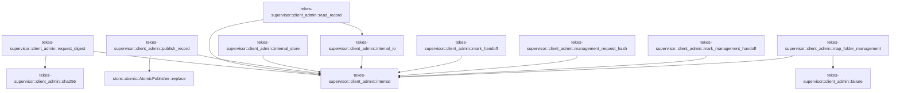

```mermaid
flowchart TD
  n0["schema::ijson::IJsonValue::parse"]
  n1["schema::ijson::IJsonValue::parse_str"]
  n2["store::atomic::AtomicPublisher::replace"]
  n3["store::management_root::retire_legacy_name"]
  n4["store::platform::NamedLock::exclusive"]
  n5["tekes-supervisor::client_admin::parse"]
  n6["tekes-supervisor::client_admin::to_ijson"]
  n7["tekes-supervisor::client_admin::failure"]
  n8["tekes-supervisor::client_admin::internal"]
  n9["tekes-supervisor::client_admin::internal_profile"]
  n10["tekes-supervisor::client_admin::internal_daemon"]
  n11["tekes-supervisor::client_admin::stale"]
  n12["tekes-supervisor::client_admin::next_revision"]
  n13["tekes-supervisor::client_admin::map_workspace"]
  n14["tekes-supervisor::client_admin::map_policy"]
  n15["tekes-supervisor::client_admin::policy_result"]
  n16["tekes-supervisor::client_admin::AdminMutationJournal::open"]
  n17["tekes-supervisor::client_admin::AdminMutationJournal::begin"]
  n18["tekes-supervisor::client_admin::AdminMutationJournal::recover"]
  n19["tekes-supervisor::client_admin::AdminMutationJournal::commit"]
  n20["tekes-supervisor::client_admin::AdminMutationJournal::records"]
  n21["tekes-supervisor::client_admin::AdminMutationJournal::commit_record"]
  n22["tekes-supervisor::client_admin::AdminMutationJournal::abort"]
  n23["tekes-supervisor::client_admin::AdminMutationJournal::authority_digest"]
  n24["tekes-supervisor::client_admin::AdminMutationJournal::record_path"]
  n25["tekes-supervisor::client_admin::request_digest"]
  n26["tekes-supervisor::client_admin::sha256"]
  n27["tekes-supervisor::client_admin::read_record"]
  n28["tekes-supervisor::client_admin::publish_record"]
  n29["tekes-supervisor::client_admin::internal_io"]
  n30["tekes-supervisor::endpoint_host::ProductionRouteFailure::new"]
  n5 --> n7
  n6 --> n0
  n6 --> n8
  n7 --> n1
  n7 --> n6
  n7 --> n30
  n8 --> n7
  n9 --> n8
  n10 --> n8
  n11 --> n7
  n12 --> n7
  n13 --> n7
  n13 --> n9
  n14 --> n7
  n14 --> n11
  n15 --> n6
  n16 --> n2
  n16 --> n3
  n17 --> n4
  n17 --> n7
  n17 --> n23
  n17 --> n24
  n17 --> n25
  n17 --> n26
  n17 --> n27
  n17 --> n28
  n18 --> n4
  n18 --> n7
  n18 --> n23
  n18 --> n24
  n18 --> n25
  n18 --> n27
  n18 --> n28
  n19 --> n4
  n19 --> n7
  n19 --> n8
  n19 --> n23
  n19 --> n24
  n19 --> n25
  n19 --> n27
  n19 --> n28
  n20 --> n4
  n20 --> n8
  n20 --> n27
  n21 --> n4
  n21 --> n8
  n21 --> n23
  n21 --> n24
  n21 --> n27
  n21 --> n28
  n22 --> n4
  n22 --> n8
  n22 --> n23
  n22 --> n24
  n22 --> n27
  n23 --> n8
  n23 --> n26
  n23 --> n29
```

# tekes-supervisor::client_admin

[Package atlas](index.md) · [Source](../../src/client_admin.rs)

## Declarations

Visibility is the declaration spelling; trait members and reexports require their enclosing interface. `cfg` is not evaluated.

| Symbol | Kind | Visibility | Test / cfg |
|---|---|---|---|
| [tekes-supervisor::client_admin::WORKSPACE_POLICY_METHODS](../../src/client_admin.rs#L20) | const_item | `pub` |  |
| [tekes-supervisor::client_admin::WORKSPACE_FOLDER_METHODS](../../src/client_admin.rs#L25) | const_item | `pub` |  |
| [tekes-supervisor::client_admin::ClientAdminRoutes](../../src/client_admin.rs#L31) | struct_item | `pub` |  |
| [tekes-supervisor::client_admin::ClientAdminRoutes::new](../../src/client_admin.rs#L40) | function_item | `pub` |  |
| [tekes-supervisor::client_admin::ClientAdminRoutes::routes](../../src/client_admin.rs#L58) | function_item | `pub` |  |
| [tekes-supervisor::client_admin::ClientAdminRoutes::recover_pending_intents](../../src/client_admin.rs#L73) | function_item | `private` |  |
| [tekes-supervisor::client_admin::ClientAdminRoutes::get_policy](../../src/client_admin.rs#L130) | function_item | `private` |  |
| [tekes-supervisor::client_admin::ClientAdminRoutes::set_policy](../../src/client_admin.rs#L139) | function_item | `private` |  |
| [tekes-supervisor::client_admin::ClientAdminRoutes::list_folders](../../src/client_admin.rs#L212) | function_item | `private` |  |
| [tekes-supervisor::client_admin::ClientAdminRoutes::change_folders](../../src/client_admin.rs#L229) | function_item | `private` |  |
| [tekes-supervisor::client_admin::ClientAdminRoutes::management](../../src/client_admin.rs#L293) | function_item | `private` |  |
| [tekes-supervisor::client_admin::AdminCapabilityRoutes](../../src/client_admin.rs#L299) | struct_item | `private` |  |
| [tekes-supervisor::client_admin::AdminCapabilityRoutes::new](../../src/client_admin.rs#L306) | function_item | `private` |  |
| [tekes-supervisor::client_admin::AdminCapabilityRoutes::class](../../src/client_admin.rs#L318) | function_item | `private` |  |
| [tekes-supervisor::client_admin::AdminCapabilityRoutes::capabilities](../../src/client_admin.rs#L326) | function_item | `private` |  |
| [tekes-supervisor::client_admin::AdminCapabilityRoutes::extension_method_class](../../src/client_admin.rs#L333) | function_item | `private` |  |
| [tekes-supervisor::client_admin::AdminCapabilityRoutes::validate_extension_payload](../../src/client_admin.rs#L337) | function_item | `private` |  |
| [tekes-supervisor::client_admin::AdminCapabilityRoutes::extension_failure_is_exact](../../src/client_admin.rs#L353) | function_item | `private` |  |
| [tekes-supervisor::client_admin::AdminCapabilityRoutes::execute](../../src/client_admin.rs#L364) | function_item | `private` |  |
| [tekes-supervisor::client_admin::ClientAdminRoutes::capabilities](../../src/client_admin.rs#L382) | function_item | `private` |  |
| [tekes-supervisor::client_admin::ClientAdminRoutes::extension_method_class](../../src/client_admin.rs#L390) | function_item | `private` |  |
| [tekes-supervisor::client_admin::ClientAdminRoutes::validate_extension_payload](../../src/client_admin.rs#L397) | function_item | `private` |  |
| [tekes-supervisor::client_admin::ClientAdminRoutes::extension_failure_is_exact](../../src/client_admin.rs#L417) | function_item | `private` |  |
| [tekes-supervisor::client_admin::ClientAdminRoutes::execute](../../src/client_admin.rs#L441) | function_item | `private` |  |
| [tekes-supervisor::client_admin::PolicyGetRequest](../../src/client_admin.rs#L464) | struct_item | `private` |  |
| [tekes-supervisor::client_admin::FoldersGetRequest](../../src/client_admin.rs#L469) | struct_item | `private` |  |
| [tekes-supervisor::client_admin::FolderChangeRequest](../../src/client_admin.rs#L474) | struct_item | `private` |  |
| [tekes-supervisor::client_admin::PolicySetRequest](../../src/client_admin.rs#L480) | struct_item | `private` |  |
| [tekes-supervisor::client_admin::parse](../../src/client_admin.rs#L486) | function_item | `private` |  |
| [tekes-supervisor::client_admin::to_ijson](../../src/client_admin.rs#L495) | function_item | `private` |  |
| [tekes-supervisor::client_admin::failure](../../src/client_admin.rs#L501) | function_item | `private` |  |
| [tekes-supervisor::client_admin::internal](../../src/client_admin.rs#L508) | function_item | `private` |  |
| [tekes-supervisor::client_admin::internal_profile](../../src/client_admin.rs#L515) | function_item | `private` |  |
| [tekes-supervisor::client_admin::internal_daemon](../../src/client_admin.rs#L518) | function_item | `private` |  |
| [tekes-supervisor::client_admin::stale](../../src/client_admin.rs#L521) | function_item | `private` |  |
| [tekes-supervisor::client_admin::next_revision](../../src/client_admin.rs#L528) | function_item | `private` |  |
| [tekes-supervisor::client_admin::map_workspace](../../src/client_admin.rs#L540) | function_item | `private` |  |
| [tekes-supervisor::client_admin::map_policy](../../src/client_admin.rs#L548) | function_item | `private` |  |
| [tekes-supervisor::client_admin::policy_result](../../src/client_admin.rs#L566) | function_item | `private` |  |
| [tekes-supervisor::client_admin::AdminPhase](../../src/client_admin.rs#L575) | enum_item | `private` |  |
| [tekes-supervisor::client_admin::AdminRecord](../../src/client_admin.rs#L582) | struct_item | `private` |  |
| [tekes-supervisor::client_admin::AdminBegin](../../src/client_admin.rs#L596) | enum_item | `private` |  |
| [tekes-supervisor::client_admin::CONFIG_ADMIN_DIR](../../src/client_admin.rs#L602) | const_item | `private` |  |
| [tekes-supervisor::client_admin::LEGACY_CONFIG_ADMIN_DIR](../../src/client_admin.rs#L604) | const_item | `private` |  |
| [tekes-supervisor::client_admin::AdminMutationJournal](../../src/client_admin.rs#L606) | struct_item | `private` |  |
| [tekes-supervisor::client_admin::AdminMutationJournal::open](../../src/client_admin.rs#L613) | function_item | `private` |  |
| [tekes-supervisor::client_admin::AdminMutationJournal::begin](../../src/client_admin.rs#L629) | function_item | `private` |  |
| [tekes-supervisor::client_admin::AdminMutationJournal::recover](../../src/client_admin.rs#L694) | function_item | `private` |  |
| [tekes-supervisor::client_admin::AdminMutationJournal::commit](../../src/client_admin.rs#L722) | function_item | `private` |  |
| [tekes-supervisor::client_admin::AdminMutationJournal::records](../../src/client_admin.rs#L746) | function_item | `private` |  |
| [tekes-supervisor::client_admin::AdminMutationJournal::commit_record](../../src/client_admin.rs#L761) | function_item | `private` |  |
| [tekes-supervisor::client_admin::AdminMutationJournal::abort](../../src/client_admin.rs#L775) | function_item | `private` |  |
| [tekes-supervisor::client_admin::AdminMutationJournal::authority_digest](../../src/client_admin.rs#L792) | function_item | `private` |  |
| [tekes-supervisor::client_admin::AdminMutationJournal::record_path](../../src/client_admin.rs#L808) | function_item | `private` |  |
| [tekes-supervisor::client_admin::request_digest](../../src/client_admin.rs#L814) | function_item | `private` |  |
| [tekes-supervisor::client_admin::sha256](../../src/client_admin.rs#L821) | function_item | `private` |  |
| [tekes-supervisor::client_admin::read_record](../../src/client_admin.rs#L824) | function_item | `private` |  |
| [tekes-supervisor::client_admin::publish_record](../../src/client_admin.rs#L844) | function_item | `private` |  |
| [tekes-supervisor::client_admin::internal_store](../../src/client_admin.rs#L850) | function_item | `private` |  |
| [tekes-supervisor::client_admin::internal_io](../../src/client_admin.rs#L853) | function_item | `private` |  |
| [tekes-supervisor::client_admin::mark_handoff](../../src/client_admin.rs#L856) | function_item | `private` |  |
| [tekes-supervisor::client_admin::management_request_hash](../../src/client_admin.rs#L870) | function_item | `private` |  |
| [tekes-supervisor::client_admin::mark_management_handoff](../../src/client_admin.rs#L890) | function_item | `private` |  |
| [tekes-supervisor::client_admin::map_folder_management](../../src/client_admin.rs#L904) | function_item | `private` |  |
| [tekes-supervisor::client_admin::tests::fixture](../../src/client_admin.rs#L960) | function_item | `private` | test; #[cfg(test)] |
| [tekes-supervisor::client_admin::tests::call](../../src/client_admin.rs#L985) | function_item | `private` | test; #[cfg(test)] |
| [tekes-supervisor::client_admin::tests::policy_replacement_can_relax_local_default_below_ceiling](../../src/client_admin.rs#L996) | function_item | `private` | test; #[cfg(test)] |
| [tekes-supervisor::client_admin::tests::journal_rejects_wrong_bytes_for_the_same_rpc_id](../../src/client_admin.rs#L1017) | function_item | `private` | test; #[cfg(test)] |
| [tekes-supervisor::client_admin::tests::crash_before_publish_is_completed_before_an_unrelated_rpc](../../src/client_admin.rs#L1047) | function_item | `private` | test; #[cfg(test)] |
| [tekes-supervisor::client_admin::tests::startup_closes_policy_crashes_on_both_sides_of_the_side_effect](../../src/client_admin.rs#L1106) | function_item | `private` | test; #[cfg(test)] |

## Imports / reexports

| Local name | Source path | Visibility |
|---|---|---|
| `BTreeSet` | `std::collections::BTreeSet` | `private` |
| `fs` | `std::fs` | `private` |
| `Path` | `std::path::Path` | `private` |
| `PathBuf` | `std::path::PathBuf` | `private` |
| `Arc` | `std::sync::Arc` | `private` |
| `Mutex` | `std::sync::Mutex` | `private` |
| `DurableHandoffProof` | `endpoint::DurableHandoffProof` | `private` |
| `EndpointHostCall` | `endpoint::EndpointHostCall` | `private` |
| `MethodClass` | `endpoint::MethodClass` | `private` |
| `RpcDurableIdentity` | `endpoint::RpcDurableIdentity` | `private` |
| `ConfigRepository` | `profile::ConfigRepository` | `private` |
| `WorkspacePolicy` | `profile::WorkspacePolicy` | `private` |
| `IJsonValue` | `schema::IJsonValue` | `private` |
| `Deserialize` | `serde::Deserialize` | `private` |
| `Serialize` | `serde::Serialize` | `private` |
| `Value` | `serde_json::Value` | `private` |
| `json` | `serde_json::json` | `private` |
| `Digest` | `sha2::Digest` | `private` |
| `Sha256` | `sha2::Sha256` | `private` |
| `AtomicPublisher` | `store::AtomicPublisher` | `private` |
| `NamedLock` | `store::NamedLock` | `private` |
| `ProductionEndpointRoutes` | `crate::endpoint_host::ProductionEndpointRoutes` | `private` |
| `ProductionRouteFailure` | `crate::endpoint_host::ProductionRouteFailure` | `private` |
| `ProductionProcessHost` | `crate::process_host::ProductionProcessHost` | `private` |
| `*` | `super::*` | `private` |
| `DurableHandoffSignal` | `endpoint::DurableHandoffSignal` | `private` |
| `WorkspaceConfig` | `profile::WorkspaceConfig` | `private` |
| `TempDir` | `tempfile::TempDir` | `private` |

## Module declarations

| Module | Visibility | Attributes |
|---|---|---|
| `tekes-supervisor::client_admin::tests` | `private` | #[cfg(test)] |

## Function call graphs

Edges below are syntactically resolved calls only, including private functions. Graphs partition callers into groups of 20; they are not execution order. All unresolved sites are listed below and in the JSON inventory.

Functions 1–20: 32 direct edges

Functions 21–40: 58 direct edges

Functions 41–50: 13 direct edges

## Call sites

Includes test functions (marked in declarations). Receiver-type-required sites need type analysis/manual tracing. Calls in closures are attributed to their enclosing function; their occurrence here does not mean the closure executes immediately.

| Caller | Callee expression | Source lines | Target / classification |
|---|---|---|---|
| `new` | `root.as_ref` | [44](../../src/client_admin.rs#L44) | receiver-type-required |
| `new` | `root.to_path_buf` | [46](../../src/client_admin.rs#L46) | receiver-type-required |
| `new` | `ConfigRepository::open(root).map_err` | [47](../../src/client_admin.rs#L47) | receiver-type-required |
| `new` | `ConfigRepository::open` | [47](../../src/client_admin.rs#L47) | [profile::config::ConfigRepository::open](../../../profile/src/config.rs#L684) |
| `new` | `Mutex::new` | [49](../../src/client_admin.rs#L49) | external-constructor-callback-or-unresolved |
| `new` | `AdminMutationJournal::open(root).map_err` | [50](../../src/client_admin.rs#L50) | receiver-type-required |
| `new` | `AdminMutationJournal::open` | [50](../../src/client_admin.rs#L50) | [tekes-supervisor::client_admin::AdminMutationJournal::open](../../src/client_admin.rs#L613) |
| `new` | `routes.recover_pending_intents` | [52](../../src/client_admin.rs#L52) | receiver-type-required |
| `new` | `Ok` | [53](../../src/client_admin.rs#L53) | external-constructor-callback-or-unresolved |
| `recover_pending_intents` | `self.journal.records` | [74](../../src/client_admin.rs#L74) | receiver-type-required |
| `recover_pending_intents` | `self.journal.authority_digest(&record.authority)?.as_deref` | [86](../../src/client_admin.rs#L86) | receiver-type-required |
| `recover_pending_intents` | `self.journal.authority_digest` | [86](../../src/client_admin.rs#L86) | receiver-type-required |
| `recover_pending_intents` | `Some` | [87](../../src/client_admin.rs#L87) | external-constructor-callback-or-unresolved |
| `recover_pending_intents` | `record.authority.as_str` | [89](../../src/client_admin.rs#L89) | receiver-type-required |
| `recover_pending_intents` | `authority.starts_with` | [91](../../src/client_admin.rs#L91) | receiver-type-required |
| `recover_pending_intents` | `authority.ends_with` | [91](../../src/client_admin.rs#L91) | receiver-type-required |
| `recover_pending_intents` | `profile::WorkspaceConfig::decode(&record.desired)                             .map_err` | [93](../../src/client_admin.rs#L93) | receiver-type-required |
| `recover_pending_intents` | `profile::WorkspaceConfig::decode` | [93](../../src/client_admin.rs#L93), [122](../../src/client_admin.rs#L122) | external-constructor-callback-or-unresolved |
| `recover_pending_intents` | `self                             .repository                             .resolve(&desired.id)                             .map_err` | [95](../../src/client_admin.rs#L95) | receiver-type-required |
| `recover_pending_intents` | `self                             .repository                             .resolve` | [95](../../src/client_admin.rs#L95) | receiver-type-required |
| `recover_pending_intents` | `desired.policy.clone().unwrap_or_default` | [99](../../src/client_admin.rs#L99) | receiver-type-required |
| `recover_pending_intents` | `desired.policy.clone` | [99](../../src/client_admin.rs#L99) | receiver-type-required |
| `recover_pending_intents` | `self                             .repository                             .publish_workspace_policy(&desired.id, record.expected_revision, policy)                             .map_err` | [100](../../src/client_admin.rs#L100) | receiver-type-required |
| `recover_pending_intents` | `self                             .repository                             .publish_workspace_policy` | [100](../../src/client_admin.rs#L100) | receiver-type-required |
| `recover_pending_intents` | `published.canonical_bytes().map_err` | [104](../../src/client_admin.rs#L104) | receiver-type-required |
| `recover_pending_intents` | `published.canonical_bytes` | [104](../../src/client_admin.rs#L104) | receiver-type-required |
| `recover_pending_intents` | `Err` | [105](../../src/client_admin.rs#L105), [114](../../src/client_admin.rs#L114) | external-constructor-callback-or-unresolved |
| `recover_pending_intents` | `internal` | [105](../../src/client_admin.rs#L105), [114](../../src/client_admin.rs#L114) | [tekes-supervisor::client_admin::internal](../../src/client_admin.rs#L508) |
| `recover_pending_intents` | `self.process_host                             .workspace_policy_published(&desired.id, &previous)                             .map_err` | [109](../../src/client_admin.rs#L109) | receiver-type-required |
| `recover_pending_intents` | `self.process_host                             .workspace_policy_published` | [109](../../src/client_admin.rs#L109) | receiver-type-required |
| `recover_pending_intents` | `record.authority.starts_with` | [120](../../src/client_admin.rs#L120) | receiver-type-required |
| `recover_pending_intents` | `profile::WorkspaceConfig::decode(&record.desired).map_err` | [122](../../src/client_admin.rs#L122) | receiver-type-required |
| `recover_pending_intents` | `self.process_host.workspace_policy_recovered` | [123](../../src/client_admin.rs#L123) | receiver-type-required |
| `recover_pending_intents` | `self.journal.commit_record` | [125](../../src/client_admin.rs#L125) | receiver-type-required |
| `recover_pending_intents` | `Ok` | [127](../../src/client_admin.rs#L127) | external-constructor-callback-or-unresolved |
| `get_policy` | `self             .repository             .workspace(&input.workspace_id)             .map_err` | [131](../../src/client_admin.rs#L131) | receiver-type-required |
| `get_policy` | `self             .repository             .workspace` | [131](../../src/client_admin.rs#L131) | receiver-type-required |
| `get_policy` | `to_ijson` | [135](../../src/client_admin.rs#L135) | [tekes-supervisor::client_admin::to_ijson](../../src/client_admin.rs#L495) |
| `set_policy` | `self             .mutation_gate             .lock()             .map_err` | [144](../../src/client_admin.rs#L144) | receiver-type-required |
| `set_policy` | `self             .mutation_gate             .lock` | [144](../../src/client_admin.rs#L144) | receiver-type-required |
| `set_policy` | `internal` | [147](../../src/client_admin.rs#L147), [201](../../src/client_admin.rs#L201) | [tekes-supervisor::client_admin::internal](../../src/client_admin.rs#L508) |
| `set_policy` | `self.recover_pending_intents` | [148](../../src/client_admin.rs#L148) | [tekes-supervisor::client_admin::ClientAdminRoutes::recover_pending_intents](../../src/client_admin.rs#L73) |
| `set_policy` | `self.journal.recover` | [149](../../src/client_admin.rs#L149) | receiver-type-required |
| `set_policy` | `mark_handoff` | [150](../../src/client_admin.rs#L150), [206](../../src/client_admin.rs#L206) | [tekes-supervisor::client_admin::mark_handoff](../../src/client_admin.rs#L856) |
| `set_policy` | `Ok` | [151](../../src/client_admin.rs#L151), [207](../../src/client_admin.rs#L207) | external-constructor-callback-or-unresolved |
| `set_policy` | `self             .repository             .workspace(&input.workspace_id)             .map_err` | [153](../../src/client_admin.rs#L153) | receiver-type-required |
| `set_policy` | `self             .repository             .workspace` | [153](../../src/client_admin.rs#L153) | receiver-type-required |
| `set_policy` | `Err` | [158](../../src/client_admin.rs#L158), [194](../../src/client_admin.rs#L194), [201](../../src/client_admin.rs#L201) | external-constructor-callback-or-unresolved |
| `set_policy` | `stale` | [158](../../src/client_admin.rs#L158) | [tekes-supervisor::client_admin::stale](../../src/client_admin.rs#L521) |
| `set_policy` | `self.process_host             .validate_workspace_policy_candidate(&input.workspace_id, &input.policy)             .map_err` | [160](../../src/client_admin.rs#L160) | receiver-type-required |
| `set_policy` | `self.process_host             .validate_workspace_policy_candidate` | [160](../../src/client_admin.rs#L160) | receiver-type-required |
| `set_policy` | `failure` | [163](../../src/client_admin.rs#L163) | [tekes-supervisor::client_admin::failure](../../src/client_admin.rs#L501) |
| `set_policy` | `self             .repository             .resolve(&input.workspace_id)             .map_err` | [169](../../src/client_admin.rs#L169) | receiver-type-required |
| `set_policy` | `self             .repository             .resolve` | [169](../../src/client_admin.rs#L169) | receiver-type-required |
| `set_policy` | `workspace.clone` | [173](../../src/client_admin.rs#L173) | receiver-type-required |
| `set_policy` | `next_revision` | [174](../../src/client_admin.rs#L174) | [tekes-supervisor::client_admin::next_revision](../../src/client_admin.rs#L528) |
| `set_policy` | `Some` | [175](../../src/client_admin.rs#L175) | external-constructor-callback-or-unresolved |
| `set_policy` | `input.policy.clone` | [175](../../src/client_admin.rs#L175), [189](../../src/client_admin.rs#L189) | receiver-type-required |
| `set_policy` | `desired_workspace.canonical_bytes().map_err` | [176](../../src/client_admin.rs#L176) | receiver-type-required |
| `set_policy` | `desired_workspace.canonical_bytes` | [176](../../src/client_admin.rs#L176) | receiver-type-required |
| `set_policy` | `policy_result` | [177](../../src/client_admin.rs#L177) | [tekes-supervisor::client_admin::policy_result](../../src/client_admin.rs#L566) |
| `set_policy` | `self.journal.begin` | [178](../../src/client_admin.rs#L178) | receiver-type-required |
| `set_policy` | `self.repository.publish_workspace_policy` | [186](../../src/client_admin.rs#L186) | receiver-type-required |
| `set_policy` | `self.journal.abort` | [193](../../src/client_admin.rs#L193) | receiver-type-required |
| `set_policy` | `map_policy` | [194](../../src/client_admin.rs#L194) | [tekes-supervisor::client_admin::map_policy](../../src/client_admin.rs#L548) |
| `set_policy` | `self.process_host             .workspace_policy_published(&input.workspace_id, &previous)             .map_err` | [197](../../src/client_admin.rs#L197) | receiver-type-required |
| `set_policy` | `self.process_host             .workspace_policy_published` | [197](../../src/client_admin.rs#L197) | receiver-type-required |
| `set_policy` | `self.journal.commit` | [205](../../src/client_admin.rs#L205) | receiver-type-required |
| `list_folders` | `self             .management()?             .workspace_folders(&input.workspace_id)             .map_err` | [213](../../src/client_admin.rs#L213) | receiver-type-required |
| `list_folders` | `self             .management()?             .workspace_folders` | [213](../../src/client_admin.rs#L213) | receiver-type-required |
| `list_folders` | `self             .management` | [213](../../src/client_admin.rs#L213) | [tekes-supervisor::client_admin::ClientAdminRoutes::management](../../src/client_admin.rs#L293) |
| `list_folders` | `to_ijson` | [217](../../src/client_admin.rs#L217) | [tekes-supervisor::client_admin::to_ijson](../../src/client_admin.rs#L495) |
| `change_folders` | `self             .mutation_gate             .lock()             .map_err` | [235](../../src/client_admin.rs#L235) | receiver-type-required |
| `change_folders` | `self             .mutation_gate             .lock` | [235](../../src/client_admin.rs#L235) | receiver-type-required |
| `change_folders` | `internal` | [238](../../src/client_admin.rs#L238) | [tekes-supervisor::client_admin::internal](../../src/client_admin.rs#L508) |
| `change_folders` | `self.recover_pending_intents` | [239](../../src/client_admin.rs#L239) | [tekes-supervisor::client_admin::ClientAdminRoutes::recover_pending_intents](../../src/client_admin.rs#L73) |
| `change_folders` | `Some` | [245](../../src/client_admin.rs#L245) | external-constructor-callback-or-unresolved |
| `change_folders` | `NamedLock::try_exclusive(crate::process_host::workspace_quiescence_lock_path(                     &self.root,                     &input.workspace_id,                 ))                 .map_err` | [246](../../src/client_admin.rs#L246) | receiver-type-required |
| `change_folders` | `NamedLock::try_exclusive` | [246](../../src/client_admin.rs#L246) | [store::platform::NamedLock::try_exclusive](../../../store/src/platform.rs#L107) |
| `change_folders` | `crate::process_host::workspace_quiescence_lock_path` | [246](../../src/client_admin.rs#L246) | [tekes-supervisor::process_host::workspace_quiescence_lock_path](../../src/process_host.rs#L6175) |
| `change_folders` | `failure` | [251](../../src/client_admin.rs#L251) | [tekes-supervisor::client_admin::failure](../../src/client_admin.rs#L501) |
| `change_folders` | `internal_store` | [256](../../src/client_admin.rs#L256) | [tekes-supervisor::client_admin::internal_store](../../src/client_admin.rs#L850) |
| `change_folders` | `management_request_hash` | [260](../../src/client_admin.rs#L260) | [tekes-supervisor::client_admin::management_request_hash](../../src/client_admin.rs#L870) |
| `change_folders` | `chrono::Utc::now().to_rfc3339_opts` | [261](../../src/client_admin.rs#L261) | receiver-type-required |
| `change_folders` | `chrono::Utc::now` | [261](../../src/client_admin.rs#L261) | external-constructor-callback-or-unresolved |
| `change_folders` | `self.management` | [262](../../src/client_admin.rs#L262) | [tekes-supervisor::client_admin::ClientAdminRoutes::management](../../src/client_admin.rs#L293) |
| `change_folders` | `if add {             management.add_workspace_folder(                 &request.rpc_id,                 &hash,                 &input.workspace_id,                 &input.path,                 &started_at,             )         } else {             management.remove_workspace_folder(                 &request.rpc_id,                 &hash,                 &input.workspace_id,                 &input.path,                 &started_at,             )         }         .map_err` | [263](../../src/client_admin.rs#L263) | receiver-type-required |
| `change_folders` | `management.add_workspace_folder` | [264](../../src/client_admin.rs#L264) | receiver-type-required |
| `change_folders` | `management.remove_workspace_folder` | [272](../../src/client_admin.rs#L272) | receiver-type-required |
| `change_folders` | `mark_management_handoff` | [281](../../src/client_admin.rs#L281) | [tekes-supervisor::client_admin::mark_management_handoff](../../src/client_admin.rs#L890) |
| `change_folders` | `to_ijson` | [282](../../src/client_admin.rs#L282) | [tekes-supervisor::client_admin::to_ijson](../../src/client_admin.rs#L495) |
| `management` | `endpoint::ManagementStore::open_light(&self.root)             .map_err` | [294](../../src/client_admin.rs#L294) | receiver-type-required |
| `management` | `endpoint::ManagementStore::open_light` | [294](../../src/client_admin.rs#L294) | [endpoint::management::ManagementStore::open_light](../../../endpoint/src/management.rs#L422) |
| `management` | `internal` | [295](../../src/client_admin.rs#L295) | [tekes-supervisor::client_admin::internal](../../src/client_admin.rs#L508) |
| `management` | `error.to_string` | [295](../../src/client_admin.rs#L295) | receiver-type-required |
| `class` | `self.methods             .iter()             .find_map` | [319](../../src/client_admin.rs#L319) | receiver-type-required |
| `class` | `self.methods             .iter` | [319](../../src/client_admin.rs#L319) | receiver-type-required |
| `class` | `(*name == method).then_some` | [321](../../src/client_admin.rs#L321) | receiver-type-required |
| `capabilities` | `self.methods             .iter()             .map(&#124;(name, _)&#124; (*name).to_owned())             .collect` | [327](../../src/client_admin.rs#L327) | receiver-type-required |
| `capabilities` | `self.methods             .iter()             .map` | [327](../../src/client_admin.rs#L327) | receiver-type-required |
| `capabilities` | `self.methods             .iter` | [327](../../src/client_admin.rs#L327) | receiver-type-required |
| `capabilities` | `(*name).to_owned` | [329](../../src/client_admin.rs#L329) | receiver-type-required |
| `extension_method_class` | `self.class` | [334](../../src/client_admin.rs#L334) | receiver-type-required |
| `validate_extension_payload` | `self.class(operation).is_none` | [342](../../src/client_admin.rs#L342) | receiver-type-required |
| `validate_extension_payload` | `self.class` | [342](../../src/client_admin.rs#L342) | receiver-type-required |
| `validate_extension_payload` | `Err` | [343](../../src/client_admin.rs#L343) | external-constructor-callback-or-unresolved |
| `validate_extension_payload` | `failure` | [343](../../src/client_admin.rs#L343) | [tekes-supervisor::client_admin::failure](../../src/client_admin.rs#L501) |
| `validate_extension_payload` | `self.authority             .validate_extension_payload` | [349](../../src/client_admin.rs#L349) | receiver-type-required |
| `extension_failure_is_exact` | `self.class(operation).is_some` | [358](../../src/client_admin.rs#L358) | receiver-type-required |
| `extension_failure_is_exact` | `self.class` | [358](../../src/client_admin.rs#L358) | receiver-type-required |
| `extension_failure_is_exact` | `self                 .authority                 .extension_failure_is_exact` | [359](../../src/client_admin.rs#L359) | receiver-type-required |
| `execute` | `self.class(&request.operation).is_none` | [370](../../src/client_admin.rs#L370) | receiver-type-required |
| `execute` | `self.class` | [370](../../src/client_admin.rs#L370) | receiver-type-required |
| `execute` | `Err` | [371](../../src/client_admin.rs#L371) | external-constructor-callback-or-unresolved |
| `execute` | `failure` | [371](../../src/client_admin.rs#L371) | [tekes-supervisor::client_admin::failure](../../src/client_admin.rs#L501) |
| `execute` | `self.authority.execute` | [377](../../src/client_admin.rs#L377) | receiver-type-required |
| `capabilities` | `WORKSPACE_POLICY_METHODS             .into_iter()             .chain(WORKSPACE_FOLDER_METHODS)             .map(&#124;(name, _)&#124; name.to_owned())             .collect` | [383](../../src/client_admin.rs#L383) | receiver-type-required |
| `capabilities` | `WORKSPACE_POLICY_METHODS             .into_iter()             .chain(WORKSPACE_FOLDER_METHODS)             .map` | [383](../../src/client_admin.rs#L383) | receiver-type-required |
| `capabilities` | `WORKSPACE_POLICY_METHODS             .into_iter()             .chain` | [383](../../src/client_admin.rs#L383) | receiver-type-required |
| `capabilities` | `WORKSPACE_POLICY_METHODS             .into_iter` | [383](../../src/client_admin.rs#L383) | receiver-type-required |
| `capabilities` | `name.to_owned` | [386](../../src/client_admin.rs#L386) | receiver-type-required |
| `extension_method_class` | `WORKSPACE_POLICY_METHODS             .into_iter()             .chain(WORKSPACE_FOLDER_METHODS)             .find_map` | [391](../../src/client_admin.rs#L391) | receiver-type-required |
| `extension_method_class` | `WORKSPACE_POLICY_METHODS             .into_iter()             .chain` | [391](../../src/client_admin.rs#L391) | receiver-type-required |
| `extension_method_class` | `WORKSPACE_POLICY_METHODS             .into_iter` | [391](../../src/client_admin.rs#L391) | receiver-type-required |
| `extension_method_class` | `(name == method).then_some` | [394](../../src/client_admin.rs#L394) | receiver-type-required |
| `validate_extension_payload` | `parse::<PolicyGetRequest>(payload).map` | [403](../../src/client_admin.rs#L403) | receiver-type-required |
| `validate_extension_payload` | `parse::<PolicyGetRequest>` | [403](../../src/client_admin.rs#L403) | [tekes-supervisor::client_admin::parse](../../src/client_admin.rs#L486) |
| `validate_extension_payload` | `parse::<PolicySetRequest>(payload).map` | [404](../../src/client_admin.rs#L404) | receiver-type-required |
| `validate_extension_payload` | `parse::<PolicySetRequest>` | [404](../../src/client_admin.rs#L404) | [tekes-supervisor::client_admin::parse](../../src/client_admin.rs#L486) |
| `validate_extension_payload` | `parse::<FoldersGetRequest>(payload).map` | [405](../../src/client_admin.rs#L405) | receiver-type-required |
| `validate_extension_payload` | `parse::<FoldersGetRequest>` | [405](../../src/client_admin.rs#L405) | [tekes-supervisor::client_admin::parse](../../src/client_admin.rs#L486) |
| `validate_extension_payload` | `parse::<FolderChangeRequest>(payload).map` | [407](../../src/client_admin.rs#L407) | receiver-type-required |
| `validate_extension_payload` | `parse::<FolderChangeRequest>` | [407](../../src/client_admin.rs#L407) | [tekes-supervisor::client_admin::parse](../../src/client_admin.rs#L486) |
| `validate_extension_payload` | `Err` | [409](../../src/client_admin.rs#L409) | external-constructor-callback-or-unresolved |
| `validate_extension_payload` | `failure` | [409](../../src/client_admin.rs#L409) | [tekes-supervisor::client_admin::failure](../../src/client_admin.rs#L501) |
| `execute` | `request.operation.as_str` | [447](../../src/client_admin.rs#L447) | receiver-type-required |
| `execute` | `self.get_policy` | [448](../../src/client_admin.rs#L448) | receiver-type-required |
| `execute` | `parse` | [448](../../src/client_admin.rs#L448), [449](../../src/client_admin.rs#L449), [450](../../src/client_admin.rs#L450), [451](../../src/client_admin.rs#L451), [452](../../src/client_admin.rs#L452) | [tekes-supervisor::client_admin::parse](../../src/client_admin.rs#L486) |
| `execute` | `self.set_policy` | [449](../../src/client_admin.rs#L449) | receiver-type-required |
| `execute` | `self.list_folders` | [450](../../src/client_admin.rs#L450) | receiver-type-required |
| `execute` | `self.change_folders` | [451](../../src/client_admin.rs#L451), [452](../../src/client_admin.rs#L452) | receiver-type-required |
| `execute` | `Err` | [453](../../src/client_admin.rs#L453) | external-constructor-callback-or-unresolved |
| `execute` | `failure` | [453](../../src/client_admin.rs#L453) | [tekes-supervisor::client_admin::failure](../../src/client_admin.rs#L501) |
| `parse` | `serde_json::from_value(payload.clone()).map_err` | [487](../../src/client_admin.rs#L487) | receiver-type-required |
| `parse` | `serde_json::from_value` | [487](../../src/client_admin.rs#L487) | external-constructor-callback-or-unresolved |
| `parse` | `payload.clone` | [487](../../src/client_admin.rs#L487) | receiver-type-required |
| `parse` | `failure` | [488](../../src/client_admin.rs#L488) | [tekes-supervisor::client_admin::failure](../../src/client_admin.rs#L501) |
| `to_ijson` | `IJsonValue::parse(         &serde_json_canonicalizer::to_vec(value).map_err(&#124;error&#124; internal(error.to_string()))?,     )     .map_err` | [496](../../src/client_admin.rs#L496) | receiver-type-required |
| `to_ijson` | `IJsonValue::parse` | [496](../../src/client_admin.rs#L496) | [schema::ijson::IJsonValue::parse](../../../schema/src/ijson.rs#L16) |
| `to_ijson` | `serde_json_canonicalizer::to_vec(value).map_err` | [497](../../src/client_admin.rs#L497) | receiver-type-required |
| `to_ijson` | `serde_json_canonicalizer::to_vec` | [497](../../src/client_admin.rs#L497) | external-constructor-callback-or-unresolved |
| `to_ijson` | `internal` | [497](../../src/client_admin.rs#L497), [499](../../src/client_admin.rs#L499) | [tekes-supervisor::client_admin::internal](../../src/client_admin.rs#L508) |
| `to_ijson` | `error.to_string` | [497](../../src/client_admin.rs#L497), [499](../../src/client_admin.rs#L499) | receiver-type-required |
| `failure` | `ProductionRouteFailure::new` | [502](../../src/client_admin.rs#L502) | [tekes-supervisor::endpoint_host::ProductionRouteFailure::new](../../src/endpoint_host.rs#L513) |
| `failure` | `to_ijson(&details).unwrap_or_else` | [505](../../src/client_admin.rs#L505) | receiver-type-required |
| `failure` | `to_ijson` | [505](../../src/client_admin.rs#L505) | [tekes-supervisor::client_admin::to_ijson](../../src/client_admin.rs#L495) |
| `failure` | `IJsonValue::parse_str("{}").expect` | [505](../../src/client_admin.rs#L505) | receiver-type-required |
| `failure` | `IJsonValue::parse_str` | [505](../../src/client_admin.rs#L505) | [schema::ijson::IJsonValue::parse_str](../../../schema/src/ijson.rs#L23) |
| `internal` | `failure` | [509](../../src/client_admin.rs#L509) | [tekes-supervisor::client_admin::failure](../../src/client_admin.rs#L501) |
| `internal_profile` | `internal` | [516](../../src/client_admin.rs#L516) | [tekes-supervisor::client_admin::internal](../../src/client_admin.rs#L508) |
| `internal_daemon` | `internal` | [519](../../src/client_admin.rs#L519) | [tekes-supervisor::client_admin::internal](../../src/client_admin.rs#L508) |
| `stale` | `failure` | [522](../../src/client_admin.rs#L522) | [tekes-supervisor::client_admin::failure](../../src/client_admin.rs#L501) |
| `next_revision` | `value         .checked_add(1)         .filter(&#124;value&#124; *value <= 9_007_199_254_740_991)         .ok_or_else` | [529](../../src/client_admin.rs#L529) | receiver-type-required |
| `next_revision` | `value         .checked_add(1)         .filter` | [529](../../src/client_admin.rs#L529) | receiver-type-required |
| `next_revision` | `value         .checked_add` | [529](../../src/client_admin.rs#L529) | receiver-type-required |
| `next_revision` | `failure` | [533](../../src/client_admin.rs#L533) | [tekes-supervisor::client_admin::failure](../../src/client_admin.rs#L501) |
| `map_workspace` | `io.kind` | [542](../../src/client_admin.rs#L542) | receiver-type-required |
| `map_workspace` | `failure` | [543](../../src/client_admin.rs#L543) | [tekes-supervisor::client_admin::failure](../../src/client_admin.rs#L501) |
| `map_workspace` | `internal_profile` | [545](../../src/client_admin.rs#L545) | [tekes-supervisor::client_admin::internal_profile](../../src/client_admin.rs#L515) |
| `map_policy` | `stale` | [550](../../src/client_admin.rs#L550) | [tekes-supervisor::client_admin::stale](../../src/client_admin.rs#L521) |
| `map_policy` | `io.kind` | [551](../../src/client_admin.rs#L551) | receiver-type-required |
| `map_policy` | `failure` | [552](../../src/client_admin.rs#L552), [554](../../src/client_admin.rs#L554), [559](../../src/client_admin.rs#L559) | [tekes-supervisor::client_admin::failure](../../src/client_admin.rs#L501) |
| `policy_result` | `to_ijson` | [570](../../src/client_admin.rs#L570) | [tekes-supervisor::client_admin::to_ijson](../../src/client_admin.rs#L495) |
| `open` | `store::retire_legacy_name` | [615](../../src/client_admin.rs#L615) | [store::management_root::retire_legacy_name](../../../store/src/management_root.rs#L21) |
| `open` | `admin_root.join` | [616](../../src/client_admin.rs#L616), [618](../../src/client_admin.rs#L618) | receiver-type-required |
| `open` | `fs::create_dir_all` | [617](../../src/client_admin.rs#L617) | external-constructor-callback-or-unresolved |
| `open` | `lock.exists` | [619](../../src/client_admin.rs#L619) | receiver-type-required |
| `open` | `AtomicPublisher::replace` | [620](../../src/client_admin.rs#L620) | [store::atomic::AtomicPublisher::replace](../../../store/src/atomic.rs#L16) |
| `open` | `Ok` | [622](../../src/client_admin.rs#L622) | external-constructor-callback-or-unresolved |
| `open` | `authority_root.to_path_buf` | [623](../../src/client_admin.rs#L623) | receiver-type-required |
| `begin` | `NamedLock::exclusive(&self.lock).map_err` | [638](../../src/client_admin.rs#L638) | receiver-type-required |
| `begin` | `NamedLock::exclusive` | [638](../../src/client_admin.rs#L638) | [store::platform::NamedLock::exclusive](../../../store/src/platform.rs#L103) |
| `begin` | `request_digest` | [639](../../src/client_admin.rs#L639) | [tekes-supervisor::client_admin::request_digest](../../src/client_admin.rs#L814) |
| `begin` | `self.record_path` | [640](../../src/client_admin.rs#L640) | [tekes-supervisor::client_admin::AdminMutationJournal::record_path](../../src/client_admin.rs#L808) |
| `begin` | `read_record` | [641](../../src/client_admin.rs#L641) | [tekes-supervisor::client_admin::read_record](../../src/client_admin.rs#L824) |
| `begin` | `Err` | [646](../../src/client_admin.rs#L646), [659](../../src/client_admin.rs#L659) | external-constructor-callback-or-unresolved |
| `begin` | `failure` | [646](../../src/client_admin.rs#L646), [659](../../src/client_admin.rs#L659) | [tekes-supervisor::client_admin::failure](../../src/client_admin.rs#L501) |
| `begin` | `sha256` | [655](../../src/client_admin.rs#L655), [685](../../src/client_admin.rs#L685) | [tekes-supervisor::client_admin::sha256](../../src/client_admin.rs#L821) |
| `begin` | `self.authority_digest(&old.authority)?.as_deref` | [666](../../src/client_admin.rs#L666) | receiver-type-required |
| `begin` | `self.authority_digest` | [666](../../src/client_admin.rs#L666) | [tekes-supervisor::client_admin::AdminMutationJournal::authority_digest](../../src/client_admin.rs#L792) |
| `begin` | `Some` | [666](../../src/client_admin.rs#L666) | external-constructor-callback-or-unresolved |
| `begin` | `publish_record` | [669](../../src/client_admin.rs#L669), [690](../../src/client_admin.rs#L690) | [tekes-supervisor::client_admin::publish_record](../../src/client_admin.rs#L844) |
| `begin` | `Ok` | [671](../../src/client_admin.rs#L671), [691](../../src/client_admin.rs#L691) | external-constructor-callback-or-unresolved |
| `begin` | `request.rpc_id.clone` | [679](../../src/client_admin.rs#L679) | receiver-type-required |
| `begin` | `request.operation.clone` | [680](../../src/client_admin.rs#L680) | receiver-type-required |
| `begin` | `authority.to_owned` | [682](../../src/client_admin.rs#L682) | receiver-type-required |
| `begin` | `desired_bytes.to_vec` | [686](../../src/client_admin.rs#L686) | receiver-type-required |
| `begin` | `result.clone` | [688](../../src/client_admin.rs#L688) | receiver-type-required |
| `recover` | `NamedLock::exclusive(&self.lock).map_err` | [698](../../src/client_admin.rs#L698) | receiver-type-required |
| `recover` | `NamedLock::exclusive` | [698](../../src/client_admin.rs#L698) | [store::platform::NamedLock::exclusive](../../../store/src/platform.rs#L103) |
| `recover` | `self.record_path` | [699](../../src/client_admin.rs#L699) | [tekes-supervisor::client_admin::AdminMutationJournal::record_path](../../src/client_admin.rs#L808) |
| `recover` | `read_record` | [700](../../src/client_admin.rs#L700) | [tekes-supervisor::client_admin::read_record](../../src/client_admin.rs#L824) |
| `recover` | `Ok` | [701](../../src/client_admin.rs#L701), [719](../../src/client_admin.rs#L719) | external-constructor-callback-or-unresolved |
| `recover` | `request_digest` | [705](../../src/client_admin.rs#L705) | [tekes-supervisor::client_admin::request_digest](../../src/client_admin.rs#L814) |
| `recover` | `Err` | [707](../../src/client_admin.rs#L707) | external-constructor-callback-or-unresolved |
| `recover` | `failure` | [707](../../src/client_admin.rs#L707) | [tekes-supervisor::client_admin::failure](../../src/client_admin.rs#L501) |
| `recover` | `self.authority_digest(&record.authority)?.as_deref` | [714](../../src/client_admin.rs#L714) | receiver-type-required |
| `recover` | `self.authority_digest` | [714](../../src/client_admin.rs#L714) | [tekes-supervisor::client_admin::AdminMutationJournal::authority_digest](../../src/client_admin.rs#L792) |
| `recover` | `Some` | [714](../../src/client_admin.rs#L714) | external-constructor-callback-or-unresolved |
| `recover` | `publish_record` | [717](../../src/client_admin.rs#L717) | [tekes-supervisor::client_admin::publish_record](../../src/client_admin.rs#L844) |
| `recover` | `(record.phase == AdminPhase::Committed).then_some` | [719](../../src/client_admin.rs#L719) | receiver-type-required |
| `commit` | `NamedLock::exclusive(&self.lock).map_err` | [723](../../src/client_admin.rs#L723) | receiver-type-required |
| `commit` | `NamedLock::exclusive` | [723](../../src/client_admin.rs#L723) | [store::platform::NamedLock::exclusive](../../../store/src/platform.rs#L103) |
| `commit` | `self.record_path` | [724](../../src/client_admin.rs#L724) | [tekes-supervisor::client_admin::AdminMutationJournal::record_path](../../src/client_admin.rs#L808) |
| `commit` | `read_record(&path)?.ok_or_else` | [726](../../src/client_admin.rs#L726) | receiver-type-required |
| `commit` | `read_record` | [726](../../src/client_admin.rs#L726) | [tekes-supervisor::client_admin::read_record](../../src/client_admin.rs#L824) |
| `commit` | `internal` | [726](../../src/client_admin.rs#L726), [737](../../src/client_admin.rs#L737) | [tekes-supervisor::client_admin::internal](../../src/client_admin.rs#L508) |
| `commit` | `request_digest` | [727](../../src/client_admin.rs#L727) | [tekes-supervisor::client_admin::request_digest](../../src/client_admin.rs#L814) |
| `commit` | `Err` | [730](../../src/client_admin.rs#L730), [737](../../src/client_admin.rs#L737) | external-constructor-callback-or-unresolved |
| `commit` | `failure` | [730](../../src/client_admin.rs#L730) | [tekes-supervisor::client_admin::failure](../../src/client_admin.rs#L501) |
| `commit` | `self.authority_digest(&record.authority)?.as_deref` | [736](../../src/client_admin.rs#L736) | receiver-type-required |
| `commit` | `self.authority_digest` | [736](../../src/client_admin.rs#L736) | [tekes-supervisor::client_admin::AdminMutationJournal::authority_digest](../../src/client_admin.rs#L792) |
| `commit` | `Some` | [736](../../src/client_admin.rs#L736) | external-constructor-callback-or-unresolved |
| `commit` | `publish_record` | [742](../../src/client_admin.rs#L742) | [tekes-supervisor::client_admin::publish_record](../../src/client_admin.rs#L844) |
| `commit` | `Ok` | [743](../../src/client_admin.rs#L743) | external-constructor-callback-or-unresolved |
| `records` | `NamedLock::exclusive(&self.lock).map_err` | [747](../../src/client_admin.rs#L747) | receiver-type-required |
| `records` | `NamedLock::exclusive` | [747](../../src/client_admin.rs#L747) | [store::platform::NamedLock::exclusive](../../../store/src/platform.rs#L103) |
| `records` | `fs::read_dir(&self.root)             .map_err(internal_io)?             .collect::<Result<Vec<_>, _>>()             .map_err` | [748](../../src/client_admin.rs#L748) | receiver-type-required |
| `records` | `fs::read_dir(&self.root)             .map_err(internal_io)?             .collect::<Result<Vec<_>, _>>` | [748](../../src/client_admin.rs#L748) | receiver-type-required |
| `records` | `fs::read_dir(&self.root)             .map_err` | [748](../../src/client_admin.rs#L748) | receiver-type-required |
| `records` | `fs::read_dir` | [748](../../src/client_admin.rs#L748) | external-constructor-callback-or-unresolved |
| `records` | `entries.sort_by_key` | [752](../../src/client_admin.rs#L752) | receiver-type-required |
| `records` | `entries             .into_iter()             .map(&#124;entry&#124; {                 read_record(&entry.path())?.ok_or_else(&#124;&#124; internal("config journal entry vanished"))             })             .collect` | [753](../../src/client_admin.rs#L753) | receiver-type-required |
| `records` | `entries             .into_iter()             .map` | [753](../../src/client_admin.rs#L753) | receiver-type-required |
| `records` | `entries             .into_iter` | [753](../../src/client_admin.rs#L753) | receiver-type-required |
| `records` | `read_record(&entry.path())?.ok_or_else` | [756](../../src/client_admin.rs#L756) | receiver-type-required |
| `records` | `read_record` | [756](../../src/client_admin.rs#L756) | [tekes-supervisor::client_admin::read_record](../../src/client_admin.rs#L824) |
| `records` | `entry.path` | [756](../../src/client_admin.rs#L756) | receiver-type-required |
| `records` | `internal` | [756](../../src/client_admin.rs#L756) | [tekes-supervisor::client_admin::internal](../../src/client_admin.rs#L508) |
| `commit_record` | `NamedLock::exclusive(&self.lock).map_err` | [762](../../src/client_admin.rs#L762) | receiver-type-required |
| `commit_record` | `NamedLock::exclusive` | [762](../../src/client_admin.rs#L762) | [store::platform::NamedLock::exclusive](../../../store/src/platform.rs#L103) |
| `commit_record` | `self.record_path` | [763](../../src/client_admin.rs#L763) | [tekes-supervisor::client_admin::AdminMutationJournal::record_path](../../src/client_admin.rs#L808) |
| `commit_record` | `read_record(&path)?.ok_or_else` | [765](../../src/client_admin.rs#L765) | receiver-type-required |
| `commit_record` | `read_record` | [765](../../src/client_admin.rs#L765) | [tekes-supervisor::client_admin::read_record](../../src/client_admin.rs#L824) |
| `commit_record` | `internal` | [765](../../src/client_admin.rs#L765), [767](../../src/client_admin.rs#L767) | [tekes-supervisor::client_admin::internal](../../src/client_admin.rs#L508) |
| `commit_record` | `self.authority_digest(&record.authority)?.as_deref` | [766](../../src/client_admin.rs#L766) | receiver-type-required |
| `commit_record` | `self.authority_digest` | [766](../../src/client_admin.rs#L766) | [tekes-supervisor::client_admin::AdminMutationJournal::authority_digest](../../src/client_admin.rs#L792) |
| `commit_record` | `Some` | [766](../../src/client_admin.rs#L766) | external-constructor-callback-or-unresolved |
| `commit_record` | `Err` | [767](../../src/client_admin.rs#L767) | external-constructor-callback-or-unresolved |
| `commit_record` | `publish_record` | [772](../../src/client_admin.rs#L772) | [tekes-supervisor::client_admin::publish_record](../../src/client_admin.rs#L844) |
| `abort` | `NamedLock::exclusive(&self.lock).map_err` | [776](../../src/client_admin.rs#L776) | receiver-type-required |
| `abort` | `NamedLock::exclusive` | [776](../../src/client_admin.rs#L776) | [store::platform::NamedLock::exclusive](../../../store/src/platform.rs#L103) |
| `abort` | `self.record_path` | [777](../../src/client_admin.rs#L777) | [tekes-supervisor::client_admin::AdminMutationJournal::record_path](../../src/client_admin.rs#L808) |
| `abort` | `read_record` | [778](../../src/client_admin.rs#L778) | [tekes-supervisor::client_admin::read_record](../../src/client_admin.rs#L824) |
| `abort` | `Ok` | [779](../../src/client_admin.rs#L779) | external-constructor-callback-or-unresolved |
| `abort` | `self.authority_digest(&record.authority)?.as_deref` | [782](../../src/client_admin.rs#L782) | receiver-type-required |
| `abort` | `self.authority_digest` | [782](../../src/client_admin.rs#L782) | [tekes-supervisor::client_admin::AdminMutationJournal::authority_digest](../../src/client_admin.rs#L792) |
| `abort` | `Some` | [782](../../src/client_admin.rs#L782) | external-constructor-callback-or-unresolved |
| `abort` | `Err` | [784](../../src/client_admin.rs#L784) | external-constructor-callback-or-unresolved |
| `abort` | `internal` | [784](../../src/client_admin.rs#L784) | [tekes-supervisor::client_admin::internal](../../src/client_admin.rs#L508) |
| `abort` | `fs::remove_file(&path).map_err` | [786](../../src/client_admin.rs#L786) | receiver-type-required |
| `abort` | `fs::remove_file` | [786](../../src/client_admin.rs#L786) | external-constructor-callback-or-unresolved |
| `abort` | `fs::File::open(&self.root)             .and_then(&#124;directory&#124; directory.sync_all())             .map_err` | [787](../../src/client_admin.rs#L787) | receiver-type-required |
| `abort` | `fs::File::open(&self.root)             .and_then` | [787](../../src/client_admin.rs#L787) | receiver-type-required |
| `abort` | `fs::File::open` | [787](../../src/client_admin.rs#L787) | external-constructor-callback-or-unresolved |
| `abort` | `directory.sync_all` | [788](../../src/client_admin.rs#L788) | receiver-type-required |
| `authority_digest` | `authority.starts_with` | [793](../../src/client_admin.rs#L793) | receiver-type-required |
| `authority_digest` | `authority                 .split('/')                 .any` | [794](../../src/client_admin.rs#L794) | receiver-type-required |
| `authority_digest` | `authority                 .split` | [794](../../src/client_admin.rs#L794) | receiver-type-required |
| `authority_digest` | `Err` | [798](../../src/client_admin.rs#L798), [804](../../src/client_admin.rs#L804) | external-constructor-callback-or-unresolved |
| `authority_digest` | `internal` | [798](../../src/client_admin.rs#L798) | [tekes-supervisor::client_admin::internal](../../src/client_admin.rs#L508) |
| `authority_digest` | `self.authority_root.join` | [800](../../src/client_admin.rs#L800) | receiver-type-required |
| `authority_digest` | `fs::read` | [801](../../src/client_admin.rs#L801) | external-constructor-callback-or-unresolved |
| `authority_digest` | `Ok` | [802](../../src/client_admin.rs#L802), [803](../../src/client_admin.rs#L803) | external-constructor-callback-or-unresolved |
| `authority_digest` | `Some` | [802](../../src/client_admin.rs#L802) | external-constructor-callback-or-unresolved |
| `authority_digest` | `sha256` | [802](../../src/client_admin.rs#L802) | [tekes-supervisor::client_admin::sha256](../../src/client_admin.rs#L821) |
| `authority_digest` | `error.kind` | [803](../../src/client_admin.rs#L803) | receiver-type-required |
| `authority_digest` | `internal_io` | [804](../../src/client_admin.rs#L804) | [tekes-supervisor::client_admin::internal_io](../../src/client_admin.rs#L853) |
| `record_path` | `self.root             .join` | [809](../../src/client_admin.rs#L809) | receiver-type-required |
| `request_digest` | `serde_json_canonicalizer::to_vec(         &json!({"method":request.operation,"payload":request.payload}),     )     .map_err` | [815](../../src/client_admin.rs#L815) | receiver-type-required |
| `request_digest` | `serde_json_canonicalizer::to_vec` | [815](../../src/client_admin.rs#L815) | external-constructor-callback-or-unresolved |
| `request_digest` | `internal` | [818](../../src/client_admin.rs#L818) | [tekes-supervisor::client_admin::internal](../../src/client_admin.rs#L508) |
| `request_digest` | `error.to_string` | [818](../../src/client_admin.rs#L818) | receiver-type-required |
| `request_digest` | `Ok` | [819](../../src/client_admin.rs#L819) | external-constructor-callback-or-unresolved |
| `request_digest` | `sha256` | [819](../../src/client_admin.rs#L819) | [tekes-supervisor::client_admin::sha256](../../src/client_admin.rs#L821) |
| `read_record` | `fs::read` | [825](../../src/client_admin.rs#L825) | external-constructor-callback-or-unresolved |
| `read_record` | `bytes.ends_with` | [827](../../src/client_admin.rs#L827) | receiver-type-required |
| `read_record` | `bytes[..bytes.len().saturating_sub(1)].contains` | [827](../../src/client_admin.rs#L827) | receiver-type-required |
| `read_record` | `bytes.len().saturating_sub` | [827](../../src/client_admin.rs#L827) | receiver-type-required |
| `read_record` | `bytes.len` | [827](../../src/client_admin.rs#L827) | receiver-type-required |
| `read_record` | `Err` | [828](../../src/client_admin.rs#L828), [836](../../src/client_admin.rs#L836), [841](../../src/client_admin.rs#L841) | external-constructor-callback-or-unresolved |
| `read_record` | `internal` | [828](../../src/client_admin.rs#L828), [831](../../src/client_admin.rs#L831), [833](../../src/client_admin.rs#L833), [836](../../src/client_admin.rs#L836) | [tekes-supervisor::client_admin::internal](../../src/client_admin.rs#L508) |
| `read_record` | `serde_json::from_slice(&bytes).map_err` | [831](../../src/client_admin.rs#L831) | receiver-type-required |
| `read_record` | `serde_json::from_slice` | [831](../../src/client_admin.rs#L831) | external-constructor-callback-or-unresolved |
| `read_record` | `error.to_string` | [831](../../src/client_admin.rs#L831), [833](../../src/client_admin.rs#L833) | receiver-type-required |
| `read_record` | `serde_json_canonicalizer::to_vec(&value)                 .map_err` | [832](../../src/client_admin.rs#L832) | receiver-type-required |
| `read_record` | `serde_json_canonicalizer::to_vec` | [832](../../src/client_admin.rs#L832) | external-constructor-callback-or-unresolved |
| `read_record` | `canonical.push` | [834](../../src/client_admin.rs#L834) | receiver-type-required |
| `read_record` | `Ok` | [838](../../src/client_admin.rs#L838), [840](../../src/client_admin.rs#L840) | external-constructor-callback-or-unresolved |
| `read_record` | `Some` | [838](../../src/client_admin.rs#L838) | external-constructor-callback-or-unresolved |
| `read_record` | `error.kind` | [840](../../src/client_admin.rs#L840) | receiver-type-required |
| `read_record` | `internal_io` | [841](../../src/client_admin.rs#L841) | [tekes-supervisor::client_admin::internal_io](../../src/client_admin.rs#L853) |
| `publish_record` | `serde_json_canonicalizer::to_vec(record).map_err` | [846](../../src/client_admin.rs#L846) | receiver-type-required |
| `publish_record` | `serde_json_canonicalizer::to_vec` | [846](../../src/client_admin.rs#L846) | external-constructor-callback-or-unresolved |
| `publish_record` | `internal` | [846](../../src/client_admin.rs#L846) | [tekes-supervisor::client_admin::internal](../../src/client_admin.rs#L508) |
| `publish_record` | `error.to_string` | [846](../../src/client_admin.rs#L846) | receiver-type-required |
| `publish_record` | `bytes.push` | [847](../../src/client_admin.rs#L847) | receiver-type-required |
| `publish_record` | `AtomicPublisher::replace(path, &bytes).map_err` | [848](../../src/client_admin.rs#L848) | receiver-type-required |
| `publish_record` | `AtomicPublisher::replace` | [848](../../src/client_admin.rs#L848) | [store::atomic::AtomicPublisher::replace](../../../store/src/atomic.rs#L16) |
| `internal_store` | `internal` | [851](../../src/client_admin.rs#L851) | [tekes-supervisor::client_admin::internal](../../src/client_admin.rs#L508) |
| `internal_io` | `internal` | [854](../../src/client_admin.rs#L854) | [tekes-supervisor::client_admin::internal](../../src/client_admin.rs#L508) |
| `mark_handoff` | `request         .handoff         .mark_handed_off(DurableHandoffProof {             delivery: request.rpc_id.clone(),             durable_identity: Some(RpcDurableIdentity {                 kind: CONFIG_ADMIN_DIR.to_owned(),                 id: request.rpc_id.clone(),                 seq: None,             }),         })         .map_err` | [857](../../src/client_admin.rs#L857) | receiver-type-required |
| `mark_handoff` | `request         .handoff         .mark_handed_off` | [857](../../src/client_admin.rs#L857) | receiver-type-required |
| `mark_handoff` | `request.rpc_id.clone` | [860](../../src/client_admin.rs#L860), [863](../../src/client_admin.rs#L863) | receiver-type-required |
| `mark_handoff` | `Some` | [861](../../src/client_admin.rs#L861) | external-constructor-callback-or-unresolved |
| `mark_handoff` | `CONFIG_ADMIN_DIR.to_owned` | [862](../../src/client_admin.rs#L862) | receiver-type-required |
| `mark_handoff` | `internal` | [867](../../src/client_admin.rs#L867) | [tekes-supervisor::client_admin::internal](../../src/client_admin.rs#L508) |
| `mark_handoff` | `error.to_string` | [867](../../src/client_admin.rs#L867) | receiver-type-required |
| `management_request_hash` | `serde_json::from_slice(         &request             .payload             .canonical_bytes()             .map_err(&#124;error&#124; internal(error.to_string()))?,     )     .map_err` | [871](../../src/client_admin.rs#L871) | receiver-type-required |
| `management_request_hash` | `serde_json::from_slice` | [871](../../src/client_admin.rs#L871) | external-constructor-callback-or-unresolved |
| `management_request_hash` | `request             .payload             .canonical_bytes()             .map_err` | [872](../../src/client_admin.rs#L872) | receiver-type-required |
| `management_request_hash` | `request             .payload             .canonical_bytes` | [872](../../src/client_admin.rs#L872) | receiver-type-required |
| `management_request_hash` | `internal` | [875](../../src/client_admin.rs#L875), [877](../../src/client_admin.rs#L877), [884](../../src/client_admin.rs#L884) | [tekes-supervisor::client_admin::internal](../../src/client_admin.rs#L508) |
| `management_request_hash` | `error.to_string` | [875](../../src/client_admin.rs#L875), [877](../../src/client_admin.rs#L877), [884](../../src/client_admin.rs#L884) | receiver-type-required |
| `management_request_hash` | `serde_json_canonicalizer::to_vec(&json!({         "type":"client-request",         "rpcId":request.rpc_id,         "method":request.operation,         "payload":payload,     }))     .map_err` | [878](../../src/client_admin.rs#L878) | receiver-type-required |
| `management_request_hash` | `serde_json_canonicalizer::to_vec` | [878](../../src/client_admin.rs#L878) | external-constructor-callback-or-unresolved |
| `management_request_hash` | `Ok` | [885](../../src/client_admin.rs#L885) | external-constructor-callback-or-unresolved |
| `mark_management_handoff` | `request         .handoff         .mark_handed_off(DurableHandoffProof {             delivery: "management".to_owned(),             durable_identity: Some(RpcDurableIdentity {                 kind: "management-operation".to_owned(),                 id: request.rpc_id.clone(),                 seq: None,             }),         })         .map_err` | [891](../../src/client_admin.rs#L891) | receiver-type-required |
| `mark_management_handoff` | `request         .handoff         .mark_handed_off` | [891](../../src/client_admin.rs#L891) | receiver-type-required |
| `mark_management_handoff` | `"management".to_owned` | [894](../../src/client_admin.rs#L894) | receiver-type-required |
| `mark_management_handoff` | `Some` | [895](../../src/client_admin.rs#L895) | external-constructor-callback-or-unresolved |
| `mark_management_handoff` | `"management-operation".to_owned` | [896](../../src/client_admin.rs#L896) | receiver-type-required |
| `mark_management_handoff` | `request.rpc_id.clone` | [897](../../src/client_admin.rs#L897) | receiver-type-required |
| `mark_management_handoff` | `internal` | [901](../../src/client_admin.rs#L901) | [tekes-supervisor::client_admin::internal](../../src/client_admin.rs#L508) |
| `mark_management_handoff` | `error.to_string` | [901](../../src/client_admin.rs#L901) | receiver-type-required |
| `map_folder_management` | `failure` | [907](../../src/client_admin.rs#L907), [912](../../src/client_admin.rs#L912), [917](../../src/client_admin.rs#L917), [922](../../src/client_admin.rs#L922), [931](../../src/client_admin.rs#L931), [939](../../src/client_admin.rs#L939), [944](../../src/client_admin.rs#L944) | [tekes-supervisor::client_admin::failure](../../src/client_admin.rs#L501) |
| `map_folder_management` | `internal` | [949](../../src/client_admin.rs#L949) | [tekes-supervisor::client_admin::internal](../../src/client_admin.rs#L508) |
| `map_folder_management` | `other.to_string` | [949](../../src/client_admin.rs#L949) | receiver-type-required |
| `fixture` | `TempDir::new().expect` | [961](../../src/client_admin.rs#L961) | receiver-type-required |
| `fixture` | `TempDir::new` | [961](../../src/client_admin.rs#L961) | external-constructor-callback-or-unresolved |
| `fixture` | `root.path().join` | [962](../../src/client_admin.rs#L962) | receiver-type-required |
| `fixture` | `root.path` | [962](../../src/client_admin.rs#L962), [964](../../src/client_admin.rs#L964), [966](../../src/client_admin.rs#L966), [981](../../src/client_admin.rs#L981) | receiver-type-required |
| `fixture` | `fs::create_dir_all(&agent).expect` | [963](../../src/client_admin.rs#L963) | receiver-type-required |
| `fixture` | `fs::create_dir_all` | [963](../../src/client_admin.rs#L963) | external-constructor-callback-or-unresolved |
| `fixture` | `ProductionProcessHost::open(root.path(), "/usr/bin/true", "test-build", &agent)             .expect` | [964](../../src/client_admin.rs#L964) | receiver-type-required |
| `fixture` | `ProductionProcessHost::open` | [964](../../src/client_admin.rs#L964) | external-constructor-callback-or-unresolved |
| `fixture` | `ConfigRepository::open(root.path()).expect` | [966](../../src/client_admin.rs#L966) | receiver-type-required |
| `fixture` | `ConfigRepository::open` | [966](../../src/client_admin.rs#L966) | external-constructor-callback-or-unresolved |
| `fixture` | `repository             .publish_workspace(                 0,                 &WorkspaceConfig {                     format: 1,                     revision: 1,                     id: "workspace-1".to_owned(),                     name: "Workspace".to_owned(),                     cwd: vec![root.path().to_string_lossy().into_owned()],                     folders: Vec::new(),                     policy: Some(WorkspacePolicy::default()),                 },             )             .expect` | [967](../../src/client_admin.rs#L967) | receiver-type-required |
| `fixture` | `repository             .publish_workspace` | [967](../../src/client_admin.rs#L967) | receiver-type-required |
| `fixture` | `"workspace-1".to_owned` | [973](../../src/client_admin.rs#L973) | receiver-type-required |
| `fixture` | `"Workspace".to_owned` | [974](../../src/client_admin.rs#L974) | receiver-type-required |
| `fixture` | `Vec::new` | [976](../../src/client_admin.rs#L976) | external-constructor-callback-or-unresolved |
| `fixture` | `Some` | [977](../../src/client_admin.rs#L977) | external-constructor-callback-or-unresolved |
| `fixture` | `WorkspacePolicy::default` | [977](../../src/client_admin.rs#L977) | external-constructor-callback-or-unresolved |
| `fixture` | `ClientAdminRoutes::new(root.path(), Arc::clone(&host)).expect` | [981](../../src/client_admin.rs#L981) | receiver-type-required |
| `fixture` | `ClientAdminRoutes::new` | [981](../../src/client_admin.rs#L981) | external-constructor-callback-or-unresolved |
| `fixture` | `Arc::clone` | [981](../../src/client_admin.rs#L981) | external-constructor-callback-or-unresolved |
| `call` | `rpc_id.to_owned` | [987](../../src/client_admin.rs#L987) | receiver-type-required |
| `call` | `operation.to_owned` | [988](../../src/client_admin.rs#L988) | receiver-type-required |
| `call` | `to_ijson(&payload).expect` | [989](../../src/client_admin.rs#L989) | receiver-type-required |
| `call` | `to_ijson` | [989](../../src/client_admin.rs#L989) | external-constructor-callback-or-unresolved |
| `call` | `DurableHandoffSignal::new` | [991](../../src/client_admin.rs#L991) | [endpoint::host::DurableHandoffSignal::new](../../../endpoint/src/host.rs#L202) |
| `policy_replacement_can_relax_local_default_below_ceiling` | `fixture` | [997](../../src/client_admin.rs#L997) | [tekes-supervisor::client_admin::tests::fixture](../../src/client_admin.rs#L960) |
| `policy_replacement_can_relax_local_default_below_ceiling` | `call` | [998](../../src/client_admin.rs#L998) | [tekes-supervisor::client_admin::tests::call](../../src/client_admin.rs#L985) |
| `policy_replacement_can_relax_local_default_below_ceiling` | `serde_json::to_value(&request.payload).expect` | [1006](../../src/client_admin.rs#L1006) | receiver-type-required |
| `policy_replacement_can_relax_local_default_below_ceiling` | `serde_json::to_value` | [1006](../../src/client_admin.rs#L1006), [1010](../../src/client_admin.rs#L1010) | external-constructor-callback-or-unresolved |
| `policy_replacement_can_relax_local_default_below_ceiling` | `routes             .execute(&request, &payload, "uid:1")             .expect` | [1007](../../src/client_admin.rs#L1007) | receiver-type-required |
| `policy_replacement_can_relax_local_default_below_ceiling` | `routes             .execute` | [1007](../../src/client_admin.rs#L1007) | receiver-type-required |
| `policy_replacement_can_relax_local_default_below_ceiling` | `serde_json::to_value(result).expect` | [1010](../../src/client_admin.rs#L1010) | receiver-type-required |
| `journal_rejects_wrong_bytes_for_the_same_rpc_id` | `fixture` | [1018](../../src/client_admin.rs#L1018) | [tekes-supervisor::client_admin::tests::fixture](../../src/client_admin.rs#L960) |
| `journal_rejects_wrong_bytes_for_the_same_rpc_id` | `call` | [1019](../../src/client_admin.rs#L1019), [1038](../../src/client_admin.rs#L1038) | [tekes-supervisor::client_admin::tests::call](../../src/client_admin.rs#L985) |
| `journal_rejects_wrong_bytes_for_the_same_rpc_id` | `to_ijson(&json!({"format":1})).expect` | [1026](../../src/client_admin.rs#L1026) | receiver-type-required |
| `journal_rejects_wrong_bytes_for_the_same_rpc_id` | `to_ijson` | [1026](../../src/client_admin.rs#L1026) | external-constructor-callback-or-unresolved |
| `journal_rejects_wrong_bytes_for_the_same_rpc_id` | `routes             .journal             .recover(&changed)             .expect_err` | [1039](../../src/client_admin.rs#L1039) | receiver-type-required |
| `journal_rejects_wrong_bytes_for_the_same_rpc_id` | `routes             .journal             .recover` | [1039](../../src/client_admin.rs#L1039) | receiver-type-required |
| `crash_before_publish_is_completed_before_an_unrelated_rpc` | `fixture` | [1048](../../src/client_admin.rs#L1048) | [tekes-supervisor::client_admin::tests::fixture](../../src/client_admin.rs#L960) |
| `crash_before_publish_is_completed_before_an_unrelated_rpc` | `routes             .repository             .workspace("workspace-1")             .expect` | [1049](../../src/client_admin.rs#L1049) | receiver-type-required |
| `crash_before_publish_is_completed_before_an_unrelated_rpc` | `routes             .repository             .workspace` | [1049](../../src/client_admin.rs#L1049) | receiver-type-required |
| `crash_before_publish_is_completed_before_an_unrelated_rpc` | `Some` | [1054](../../src/client_admin.rs#L1054) | external-constructor-callback-or-unresolved |
| `crash_before_publish_is_completed_before_an_unrelated_rpc` | `WorkspacePolicy::default` | [1056](../../src/client_admin.rs#L1056) | external-constructor-callback-or-unresolved |
| `crash_before_publish_is_completed_before_an_unrelated_rpc` | `call` | [1058](../../src/client_admin.rs#L1058), [1079](../../src/client_admin.rs#L1079) | [tekes-supervisor::client_admin::tests::call](../../src/client_admin.rs#L985) |
| `crash_before_publish_is_completed_before_an_unrelated_rpc` | `policy_result(2, desired.policy.as_ref().expect("policy")).expect` | [1066](../../src/client_admin.rs#L1066) | receiver-type-required |
| `crash_before_publish_is_completed_before_an_unrelated_rpc` | `policy_result` | [1066](../../src/client_admin.rs#L1066) | external-constructor-callback-or-unresolved |
| `crash_before_publish_is_completed_before_an_unrelated_rpc` | `desired.policy.as_ref().expect` | [1066](../../src/client_admin.rs#L1066) | receiver-type-required |
| `crash_before_publish_is_completed_before_an_unrelated_rpc` | `desired.policy.as_ref` | [1066](../../src/client_admin.rs#L1066) | receiver-type-required |
| `crash_before_publish_is_completed_before_an_unrelated_rpc` | `serde_json::to_value(&unrelated.payload).expect` | [1087](../../src/client_admin.rs#L1087) | receiver-type-required |
| `crash_before_publish_is_completed_before_an_unrelated_rpc` | `serde_json::to_value` | [1087](../../src/client_admin.rs#L1087) | external-constructor-callback-or-unresolved |
| `crash_before_publish_is_completed_before_an_unrelated_rpc` | `routes             .execute(&unrelated, &payload, "uid:1")             .expect` | [1088](../../src/client_admin.rs#L1088) | receiver-type-required |
| `crash_before_publish_is_completed_before_an_unrelated_rpc` | `routes             .execute` | [1088](../../src/client_admin.rs#L1088) | receiver-type-required |
| `crash_before_publish_is_completed_before_an_unrelated_rpc` | `routes             .journal             .records()             .expect("records")             .into_iter()             .find(&#124;record&#124; record.rpc_id == "rpc-interrupted-policy")             .expect` | [1095](../../src/client_admin.rs#L1095) | receiver-type-required |
| `crash_before_publish_is_completed_before_an_unrelated_rpc` | `routes             .journal             .records()             .expect("records")             .into_iter()             .find` | [1095](../../src/client_admin.rs#L1095) | receiver-type-required |
| `crash_before_publish_is_completed_before_an_unrelated_rpc` | `routes             .journal             .records()             .expect("records")             .into_iter` | [1095](../../src/client_admin.rs#L1095) | receiver-type-required |
| `crash_before_publish_is_completed_before_an_unrelated_rpc` | `routes             .journal             .records()             .expect` | [1095](../../src/client_admin.rs#L1095) | receiver-type-required |
| `crash_before_publish_is_completed_before_an_unrelated_rpc` | `routes             .journal             .records` | [1095](../../src/client_admin.rs#L1095) | receiver-type-required |
| `startup_closes_policy_crashes_on_both_sides_of_the_side_effect` | `fixture` | [1108](../../src/client_admin.rs#L1108) | [tekes-supervisor::client_admin::tests::fixture](../../src/client_admin.rs#L960) |
| `startup_closes_policy_crashes_on_both_sides_of_the_side_effect` | `call` | [1109](../../src/client_admin.rs#L1109) | [tekes-supervisor::client_admin::tests::call](../../src/client_admin.rs#L985) |
| `startup_closes_policy_crashes_on_both_sides_of_the_side_effect` | `routes                 .repository                 .workspace("workspace-1")                 .expect` | [1121](../../src/client_admin.rs#L1121) | receiver-type-required |
| `startup_closes_policy_crashes_on_both_sides_of_the_side_effect` | `routes                 .repository                 .workspace` | [1121](../../src/client_admin.rs#L1121) | receiver-type-required |
| `startup_closes_policy_crashes_on_both_sides_of_the_side_effect` | `routes.repository.resolve("workspace-1").expect` | [1125](../../src/client_admin.rs#L1125) | receiver-type-required |
| `startup_closes_policy_crashes_on_both_sides_of_the_side_effect` | `routes.repository.resolve` | [1125](../../src/client_admin.rs#L1125) | receiver-type-required |
| `startup_closes_policy_crashes_on_both_sides_of_the_side_effect` | `Some` | [1127](../../src/client_admin.rs#L1127) | external-constructor-callback-or-unresolved |
| `startup_closes_policy_crashes_on_both_sides_of_the_side_effect` | `WorkspacePolicy::default` | [1129](../../src/client_admin.rs#L1129) | external-constructor-callback-or-unresolved |
| `startup_closes_policy_crashes_on_both_sides_of_the_side_effect` | `policy_result(2, desired.policy.as_ref().expect("policy")).expect` | [1132](../../src/client_admin.rs#L1132) | receiver-type-required |
| `startup_closes_policy_crashes_on_both_sides_of_the_side_effect` | `policy_result` | [1132](../../src/client_admin.rs#L1132) | external-constructor-callback-or-unresolved |
| `startup_closes_policy_crashes_on_both_sides_of_the_side_effect` | `desired.policy.as_ref().expect` | [1132](../../src/client_admin.rs#L1132) | receiver-type-required |
| `startup_closes_policy_crashes_on_both_sides_of_the_side_effect` | `desired.policy.as_ref` | [1132](../../src/client_admin.rs#L1132) | receiver-type-required |
| `startup_closes_policy_crashes_on_both_sides_of_the_side_effect` | `routes                 .journal                 .begin(                     &request,                     "workspaces/workspace-1/workspace.json",                     1,                     2,                     &desired.canonical_bytes().expect("desired"),                     &result,                 )                 .expect` | [1133](../../src/client_admin.rs#L1133) | receiver-type-required |
| `startup_closes_policy_crashes_on_both_sides_of_the_side_effect` | `routes                 .journal                 .begin` | [1133](../../src/client_admin.rs#L1133) | receiver-type-required |
| `startup_closes_policy_crashes_on_both_sides_of_the_side_effect` | `desired.canonical_bytes().expect` | [1140](../../src/client_admin.rs#L1140) | receiver-type-required |
| `startup_closes_policy_crashes_on_both_sides_of_the_side_effect` | `desired.canonical_bytes` | [1140](../../src/client_admin.rs#L1140) | receiver-type-required |
| `startup_closes_policy_crashes_on_both_sides_of_the_side_effect` | `routes                 .repository                 .publish_workspace_policy("workspace-1", 1, desired.policy.clone().expect("policy"))                 .expect` | [1144](../../src/client_admin.rs#L1144) | receiver-type-required |
| `startup_closes_policy_crashes_on_both_sides_of_the_side_effect` | `routes                 .repository                 .publish_workspace_policy` | [1144](../../src/client_admin.rs#L1144) | receiver-type-required |
| `startup_closes_policy_crashes_on_both_sides_of_the_side_effect` | `desired.policy.clone().expect` | [1146](../../src/client_admin.rs#L1146) | receiver-type-required |
| `startup_closes_policy_crashes_on_both_sides_of_the_side_effect` | `desired.policy.clone` | [1146](../../src/client_admin.rs#L1146) | receiver-type-required |
| `startup_closes_policy_crashes_on_both_sides_of_the_side_effect` | `host.workspace_policy_published("workspace-1", &previous)                     .expect` | [1149](../../src/client_admin.rs#L1149) | receiver-type-required |
| `startup_closes_policy_crashes_on_both_sides_of_the_side_effect` | `host.workspace_policy_published` | [1149](../../src/client_admin.rs#L1149) | receiver-type-required |
| `startup_closes_policy_crashes_on_both_sides_of_the_side_effect` | `drop` | [1152](../../src/client_admin.rs#L1152) | external-constructor-callback-or-unresolved |
| `startup_closes_policy_crashes_on_both_sides_of_the_side_effect` | `ClientAdminRoutes::new(root.path(), Arc::clone(&host)).expect` | [1154](../../src/client_admin.rs#L1154) | receiver-type-required |
| `startup_closes_policy_crashes_on_both_sides_of_the_side_effect` | `ClientAdminRoutes::new` | [1154](../../src/client_admin.rs#L1154) | external-constructor-callback-or-unresolved |
| `startup_closes_policy_crashes_on_both_sides_of_the_side_effect` | `root.path` | [1154](../../src/client_admin.rs#L1154) | receiver-type-required |
| `startup_closes_policy_crashes_on_both_sides_of_the_side_effect` | `Arc::clone` | [1154](../../src/client_admin.rs#L1154) | external-constructor-callback-or-unresolved |
| `startup_closes_policy_crashes_on_both_sides_of_the_side_effect` | `recovered                 .journal                 .records()                 .expect("records")                 .into_iter()                 .find(&#124;record&#124; record.rpc_id == request.rpc_id)                 .expect` | [1155](../../src/client_admin.rs#L1155) | receiver-type-required |
| `startup_closes_policy_crashes_on_both_sides_of_the_side_effect` | `recovered                 .journal                 .records()                 .expect("records")                 .into_iter()                 .find` | [1155](../../src/client_admin.rs#L1155) | receiver-type-required |
| `startup_closes_policy_crashes_on_both_sides_of_the_side_effect` | `recovered                 .journal                 .records()                 .expect("records")                 .into_iter` | [1155](../../src/client_admin.rs#L1155) | receiver-type-required |
| `startup_closes_policy_crashes_on_both_sides_of_the_side_effect` | `recovered                 .journal                 .records()                 .expect` | [1155](../../src/client_admin.rs#L1155) | receiver-type-required |
| `startup_closes_policy_crashes_on_both_sides_of_the_side_effect` | `recovered                 .journal                 .records` | [1155](../../src/client_admin.rs#L1155) | receiver-type-required |
