# tekes-supervisor::client_extensions

[Package atlas](index.md) · [Source](../../src/client_extensions.rs)

## Declarations

Visibility is the declaration spelling; trait members and reexports require their enclosing interface. `cfg` is not evaluated.

| Symbol | Kind | Visibility | Test / cfg |
|---|---|---|---|
| [tekes-supervisor::client_extensions::RESOURCE_METHODS](../../src/client_extensions.rs#L29) | const_item | `pub` |  |
| [tekes-supervisor::client_extensions::INITIAL_PRESET_METHODS](../../src/client_extensions.rs#L36) | const_item | `pub` |  |
| [tekes-supervisor::client_extensions::SESSION_PRESET_METHODS](../../src/client_extensions.rs#L38) | const_item | `pub` |  |
| [tekes-supervisor::client_extensions::RECOVERY_METHODS](../../src/client_extensions.rs#L42) | const_item | `pub` |  |
| [tekes-supervisor::client_extensions::ATTACHMENT_METHODS](../../src/client_extensions.rs#L44) | const_item | `pub` |  |
| [tekes-supervisor::client_extensions::APPROVAL_METHODS](../../src/client_extensions.rs#L49) | const_item | `pub` |  |
| [tekes-supervisor::client_extensions::FEEDBACK_METHODS](../../src/client_extensions.rs#L54) | const_item | `pub` |  |
| [tekes-supervisor::client_extensions::SETTINGS_METHODS](../../src/client_extensions.rs#L59) | const_item | `pub` |  |
| [tekes-supervisor::client_extensions::GOAL_METHODS](../../src/client_extensions.rs#L65) | const_item | `pub` |  |
| [tekes-supervisor::client_extensions::SUBAGENT_METHODS](../../src/client_extensions.rs#L72) | const_item | `pub` |  |
| [tekes-supervisor::client_extensions::FILE_METHODS](../../src/client_extensions.rs#L77) | const_item | `pub` |  |
| [tekes-supervisor::client_extensions::FilePageRequest](../../src/client_extensions.rs#L85) | struct_item | `private` |  |
| [tekes-supervisor::client_extensions::AttachmentPolicyRequest](../../src/client_extensions.rs#L94) | struct_item | `private` |  |
| [tekes-supervisor::client_extensions::ApprovalModeRequest](../../src/client_extensions.rs#L100) | struct_item | `private` |  |
| [tekes-supervisor::client_extensions::ApprovalSelectRequest](../../src/client_extensions.rs#L106) | struct_item | `private` |  |
| [tekes-supervisor::client_extensions::UploadFileRequest](../../src/client_extensions.rs#L113) | struct_item | `private` |  |
| [tekes-supervisor::client_extensions::FileAttachmentRequest](../../src/client_extensions.rs#L122) | struct_item | `private` |  |
| [tekes-supervisor::client_extensions::RecoveryRequest](../../src/client_extensions.rs#L129) | struct_item | `private` |  |
| [tekes-supervisor::client_extensions::TOOL_METHODS](../../src/client_extensions.rs#L132) | const_item | `pub` |  |
| [tekes-supervisor::client_extensions::THREAD_SEARCH_METHODS](../../src/client_extensions.rs#L137) | const_item | `pub` |  |
| [tekes-supervisor::client_extensions::USAGE_METHODS](../../src/client_extensions.rs#L141) | const_item | `pub` |  |
| [tekes-supervisor::client_extensions::ClientExtensionAuthority](../../src/client_extensions.rs#L149) | trait_item | `pub` |  |
| [tekes-supervisor::client_extensions::ClientExtensionAuthority::execute](../../src/client_extensions.rs#L150) | function_signature_item | `private` |  |
| [tekes-supervisor::client_extensions::AtomicCapabilityRoutes](../../src/client_extensions.rs#L160) | struct_item | `pub` |  |
| [tekes-supervisor::client_extensions::AtomicCapabilityRoutes::new](../../src/client_extensions.rs#L168) | function_item | `pub` |  |
| [tekes-supervisor::client_extensions::AtomicCapabilityRoutes::id](../../src/client_extensions.rs#L185) | function_item | `pub` |  |
| [tekes-supervisor::client_extensions::AtomicCapabilityRoutes::class](../../src/client_extensions.rs#L189) | function_item | `private` |  |
| [tekes-supervisor::client_extensions::AtomicCapabilityRoutes::capabilities](../../src/client_extensions.rs#L197) | function_item | `private` |  |
| [tekes-supervisor::client_extensions::AtomicCapabilityRoutes::extension_method_class](../../src/client_extensions.rs#L204) | function_item | `private` |  |
| [tekes-supervisor::client_extensions::AtomicCapabilityRoutes::validate_extension_payload](../../src/client_extensions.rs#L208) | function_item | `private` |  |
| [tekes-supervisor::client_extensions::AtomicCapabilityRoutes::extension_failure_is_exact](../../src/client_extensions.rs#L223) | function_item | `private` |  |
| [tekes-supervisor::client_extensions::AtomicCapabilityRoutes::execute](../../src/client_extensions.rs#L234) | function_item | `private` |  |
| [tekes-supervisor::client_extensions::common_capability_routes](../../src/client_extensions.rs#L278) | function_item | `pub` |  |
| [tekes-supervisor::client_extensions::ProductionClientExtensions](../../src/client_extensions.rs#L310) | struct_item | `pub` |  |
| [tekes-supervisor::client_extensions::ProductionClientExtensions::open](../../src/client_extensions.rs#L318) | function_item | `pub` |  |
| [tekes-supervisor::client_extensions::ProductionClientExtensions::attachments](../../src/client_extensions.rs#L337) | function_item | `private` |  |
| [tekes-supervisor::client_extensions::ProductionClientExtensions::routes](../../src/client_extensions.rs#L341) | function_item | `pub` |  |
| [tekes-supervisor::client_extensions::ResourceListRequest](../../src/client_extensions.rs#L374) | struct_item | `private` |  |
| [tekes-supervisor::client_extensions::ResourceReadRequest](../../src/client_extensions.rs#L382) | struct_item | `private` |  |
| [tekes-supervisor::client_extensions::ResourceReference](../../src/client_extensions.rs#L389) | enum_item | `private` |  |
| [tekes-supervisor::client_extensions::ToolListRequest](../../src/client_extensions.rs#L401) | struct_item | `private` |  |
| [tekes-supervisor::client_extensions::ToolResolveRequest](../../src/client_extensions.rs#L406) | struct_item | `private` |  |
| [tekes-supervisor::client_extensions::SessionSearchRequest](../../src/client_extensions.rs#L413) | struct_item | `private` |  |
| [tekes-supervisor::client_extensions::ThreadSearchRequest](../../src/client_extensions.rs#L418) | struct_item | `private` |  |
| [tekes-supervisor::client_extensions::SessionIdRequest](../../src/client_extensions.rs#L427) | struct_item | `private` |  |
| [tekes-supervisor::client_extensions::decode](../../src/client_extensions.rs#L431) | function_item | `private` |  |
| [tekes-supervisor::client_extensions::encode](../../src/client_extensions.rs#L434) | function_item | `private` |  |
| [tekes-supervisor::client_extensions::ijson_value](../../src/client_extensions.rs#L444) | function_item | `private` |  |
| [tekes-supervisor::client_extensions::bad_request](../../src/client_extensions.rs#L454) | function_item | `private` |  |
| [tekes-supervisor::client_extensions::decode_resource_cursor](../../src/client_extensions.rs#L462) | function_item | `private` |  |
| [tekes-supervisor::client_extensions::numeric_token](../../src/client_extensions.rs#L486) | function_item | `private` |  |
| [tekes-supervisor::client_extensions::CacheAttributionGroup](../../src/client_extensions.rs#L500) | struct_item | `private` |  |
| [tekes-supervisor::client_extensions::CacheAttributionGroup::new](../../src/client_extensions.rs#L511) | function_item | `private` |  |
| [tekes-supervisor::client_extensions::CacheAttributionGroup::add](../../src/client_extensions.rs#L523) | function_item | `private` |  |
| [tekes-supervisor::client_extensions::CacheAttributionGroup::value](../../src/client_extensions.rs#L561) | function_item | `private` |  |
| [tekes-supervisor::client_extensions::canonical_unsigned](../../src/client_extensions.rs#L590) | function_item | `private` |  |
| [tekes-supervisor::client_extensions::add_unsigned_decimal](../../src/client_extensions.rs#L603) | function_item | `private` |  |
| [tekes-supervisor::client_extensions::add_decimal_digits](../../src/client_extensions.rs#L609) | function_item | `private` |  |
| [tekes-supervisor::client_extensions::canonical_cost](../../src/client_extensions.rs#L649) | function_item | `private` |  |
| [tekes-supervisor::client_extensions::add_canonical_cost](../../src/client_extensions.rs#L676) | function_item | `private` |  |
| [tekes-supervisor::client_extensions::usage_route_target](../../src/client_extensions.rs#L702) | function_item | `private` |  |
| [tekes-supervisor::client_extensions::map_search_error](../../src/client_extensions.rs#L823) | function_item | `private` |  |
| [tekes-supervisor::client_extensions::ProductionClientExtensions::session_folder](../../src/client_extensions.rs#L845) | function_item | `private` |  |
| [tekes-supervisor::client_extensions::ProductionClientExtensions::session_controls](../../src/client_extensions.rs#L861) | function_item | `private` |  |
| [tekes-supervisor::client_extensions::ProductionClientExtensions::execute](../../src/client_extensions.rs#L897) | function_item | `private` |  |
| [tekes-supervisor::client_extensions::ProductionClientExtensions::resources_list](../../src/client_extensions.rs#L1179) | function_item | `private` |  |
| [tekes-supervisor::client_extensions::ProductionClientExtensions::resources_read](../../src/client_extensions.rs#L1244) | function_item | `private` |  |
| [tekes-supervisor::client_extensions::ProductionClientExtensions::tools](../../src/client_extensions.rs#L1307) | function_item | `private` |  |
| [tekes-supervisor::client_extensions::ProductionClientExtensions::thread_search](../../src/client_extensions.rs#L1370) | function_item | `private` |  |
| [tekes-supervisor::client_extensions::ProductionClientExtensions::usage](../../src/client_extensions.rs#L1389) | function_item | `private` |  |
| [tekes-supervisor::client_extensions::map_attachment_read_error](../../src/client_extensions.rs#L1610) | function_item | `private` |  |
| [tekes-supervisor::client_extensions::error_allowed](../../src/client_extensions.rs#L1638) | function_item | `private` |  |
| [tekes-supervisor::client_extensions::validate_payload](../../src/client_extensions.rs#L1714) | function_item | `private` |  |
| [tekes-supervisor::client_extensions::failure](../../src/client_extensions.rs#L1864) | function_item | `pub(crate)` |  |
| [tekes-supervisor::client_extensions::FOLDER_TRUST_METHODS](../../src/client_extensions.rs#L1872) | const_item | `pub` |  |
| [tekes-supervisor::client_extensions::tests::production_extensions](../../src/client_extensions.rs#L1886) | function_item | `private` | test; #[cfg(test)] |
| [tekes-supervisor::client_extensions::tests::initial_presets_disclose_profile_text_without_creating_a_session](../../src/client_extensions.rs#L1917) | function_item | `private` | test; #[cfg(test)] |
| [tekes-supervisor::client_extensions::tests::session_presets_describe_and_resolve_without_creating_a_session](../../src/client_extensions.rs#L1960) | function_item | `private` | test; #[cfg(test)] |
| [tekes-supervisor::client_extensions::tests::execute](../../src/client_extensions.rs#L1982) | function_item | `private` | test; #[cfg(test)] |
| [tekes-supervisor::client_extensions::tests::approvals_select_persists_the_session_mode_and_refuses_archived_sessions](../../src/client_extensions.rs#L2004) | function_item | `private` | test; #[cfg(test)] |
| [tekes-supervisor::client_extensions::tests::tools_list_is_closed_and_includes_every_fixed_tool](../../src/client_extensions.rs#L2109) | function_item | `private` | test; #[cfg(test)] |
| [tekes-supervisor::client_extensions::tests::append_canonical](../../src/client_extensions.rs#L2162) | function_item | `private` | test; #[cfg(test)] |
| [tekes-supervisor::client_extensions::tests::epoch_profile_asset](../../src/client_extensions.rs#L2167) | function_item | `private` | test; #[cfg(test)] |
| [tekes-supervisor::client_extensions::tests::usage_cache_attribution_joins_effective_attempts_to_exact_epoch_targets](../../src/client_extensions.rs#L2196) | function_item | `private` | test; #[cfg(test)] |

## Imports / reexports

| Local name | Source path | Visibility |
|---|---|---|
| `BTreeMap` | `std::collections::BTreeMap` | `private` |
| `BTreeSet` | `std::collections::BTreeSet` | `private` |
| `Path` | `std::path::Path` | `private` |
| `PathBuf` | `std::path::PathBuf` | `private` |
| `Arc` | `std::sync::Arc` | `private` |
| `DurableHandoffProof` | `endpoint::DurableHandoffProof` | `private` |
| `EndpointHostCall` | `endpoint::EndpointHostCall` | `private` |
| `MethodClass` | `endpoint::MethodClass` | `private` |
| `RpcDurableIdentity` | `endpoint::RpcDurableIdentity` | `private` |
| `ResourceCatalog` | `profile::ResourceCatalog` | `private` |
| `EventKind` | `schema::EventKind` | `private` |
| `IJsonValue` | `schema::IJsonValue` | `private` |
| `Deserialize` | `serde::Deserialize` | `private` |
| `Value` | `serde_json::Value` | `private` |
| `_` | `sha2::Digest` | `private` |
| `ArchiveVisibility` | `thread_search::ArchiveVisibility` | `private` |
| `SearchRequest` | `thread_search::SearchRequest` | `private` |
| `ThreadSearchAuthority` | `thread_search::ThreadSearchAuthority` | `private` |
| `BuiltinManifest` | `tools::BuiltinManifest` | `private` |
| `fixed_schema` | `tools::fixed_schema` | `private` |
| `ProductionEndpointRoutes` | `crate::endpoint_host::ProductionEndpointRoutes` | `private` |
| `ProductionRouteFailure` | `crate::endpoint_host::ProductionRouteFailure` | `private` |
| `ProductionProcessHost` | `crate::process_host::ProductionProcessHost` | `private` |
| `ClientResourceService` | `crate::resource_capability::ClientResourceService` | `private` |
| `CommandRunRequest` | `crate::resource_capability::CommandRunRequest` | `private` |
| `EndpointCommandInputAuthority` | `crate::resource_capability::EndpointCommandInputAuthority` | `private` |
| `map_prompt_materialize_error` | `crate::resource_capability::map_prompt_materialize_error` | `private` |
| `map_resource_failure` | `crate::resource_capability::map_resource_failure` | `private` |
| `fs` | `std::fs` | `private` |
| `SessionDeliveryAuthority` | `crate::endpoint_host::SessionDeliveryAuthority` | `private` |
| `SessionInputAdmissionAuthority` | `crate::endpoint_host::SessionInputAdmissionAuthority` | `private` |
| `*` | `super::*` | `private` |

## Module declarations

| Module | Visibility | Attributes |
|---|---|---|
| `tekes-supervisor::client_extensions::tests` | `private` | #[cfg(test)] |

## Function call graphs

Edges below are syntactically resolved calls only, including private functions. Graphs partition callers into groups of 20; they are not execution order. All unresolved sites are listed below and in the JSON inventory.

Functions 1–20: 21 direct edges

Functions 21–40: 74 direct edges

```mermaid
flowchart TD
  n0["endpoint::session_operations::SessionPresetEnvironment::new"]
  n1["endpoint::types::validate_session_id"]
  n2["engine::permission_mode::write_permission_mode"]
  n3["engine::permission_mode::PermissionMode::parse"]
  n4["engine::permission_mode::read_permission_mode"]
  n5["profile::config::ConfigRepository::open"]
  n6["profile::instruction::InstructionResolver::new_scoped"]
  n7["schema::ijson::IJsonValue::parse"]
  n8["session-controls::validate"]
  n9["session-controls::execute_goal"]
  n10["session-controls::subagent_catalog"]
  n11["store::asset::AssetStore::new"]
  n12["store::tail::scan_valid_prefix"]
  n13["tekes-supervisor::bounded_child_history::validate"]
  n14["tekes-supervisor::bounded_child_history::read"]
  n15["tekes-supervisor::client_extensions::ProductionClientExtensions::resources_list"]
  n16["tekes-supervisor::client_extensions::ProductionClientExtensions::resources_read"]
  n17["tekes-supervisor::client_extensions::ProductionClientExtensions::tools"]
  n18["tekes-supervisor::client_extensions::ProductionClientExtensions::thread_search"]
  n19["tekes-supervisor::client_extensions::ProductionClientExtensions::usage"]
  n20["tekes-supervisor::client_extensions::map_attachment_read_error"]
  n21["tekes-supervisor::client_extensions::error_allowed"]
  n22["tekes-supervisor::client_extensions::validate_payload"]
  n23["tekes-supervisor::client_extensions::failure"]
  n24["tekes-supervisor::client_extensions::decode"]
  n25["tekes-supervisor::client_extensions::encode"]
  n26["tekes-supervisor::client_extensions::ijson_value"]
  n27["tekes-supervisor::client_extensions::bad_request"]
  n28["tekes-supervisor::client_extensions::decode_resource_cursor"]
  n29["tekes-supervisor::client_extensions::numeric_token"]
  n30["tekes-supervisor::client_extensions::CacheAttributionGroup::new"]
  n31["tekes-supervisor::client_extensions::CacheAttributionGroup::value"]
  n32["tekes-supervisor::client_extensions::canonical_unsigned"]
  n33["tekes-supervisor::client_extensions::add_unsigned_decimal"]
  n34["tekes-supervisor::client_extensions::add_decimal_digits"]
  n35["tekes-supervisor::client_extensions::canonical_cost"]
  n36["tekes-supervisor::client_extensions::add_canonical_cost"]
  n37["tekes-supervisor::client_extensions::usage_route_target"]
  n38["tekes-supervisor::client_extensions::map_search_error"]
  n39["tekes-supervisor::client_extensions::ProductionClientExtensions::session_folder"]
  n40["tekes-supervisor::client_extensions::ProductionClientExtensions::session_controls"]
  n41["tekes-supervisor::client_extensions::ProductionClientExtensions::execute"]
  n42["tekes-supervisor::endpoint_host::ProductionRouteFailure::new"]
  n43["tekes-supervisor::resource_capability::map_prompt_materialize_error"]
  n44["tools::builtin::BuiltinManifest::compiled"]
  n45["tools::preset::describe_value"]
  n46["tools::preset::ResolvedPreset::resolve_request"]
  n47["tools::schema_registry::fixed_schema"]
  n48["user-documents::validate"]
  n49["user-documents::execute"]
  n15 --> n23
  n15 --> n24
  n15 --> n25
  n15 --> n27
  n15 --> n28
  n16 --> n23
  n16 --> n24
  n16 --> n25
  n16 --> n27
  n17 --> n23
  n17 --> n25
  n17 --> n26
  n17 --> n44
  n17 --> n47
  n18 --> n24
  n18 --> n25
  n19 --> n11
  n19 --> n12
  n19 --> n23
  n19 --> n24
  n19 --> n25
  n19 --> n26
  n19 --> n29
  n19 --> n30
  n19 --> n32
  n19 --> n37
  n20 --> n23
  n22 --> n1
  n22 --> n3
  n22 --> n8
  n22 --> n13
  n22 --> n23
  n22 --> n24
  n22 --> n27
  n22 --> n48
  n23 --> n7
  n23 --> n42
  n31 --> n23
  n32 --> n23
  n33 --> n32
  n33 --> n34
  n34 --> n23
  n35 --> n23
  n35 --> n32
  n36 --> n34
  n36 --> n35
  n37 --> n7
  n37 --> n23
  n37 --> n26
  n38 --> n23
  n39 --> n1
  n39 --> n23
  n39 --> n27
  n40 --> n9
  n40 --> n10
  n40 --> n23
  n40 --> n25
  n40 --> n39
  n41 --> n0
  n41 --> n2
  n41 --> n3
  n41 --> n4
  n41 --> n5
  n41 --> n6
  n41 --> n14
  n41 --> n20
  n41 --> n23
  n41 --> n24
  n41 --> n25
  n41 --> n27
  n41 --> n43
  n41 --> n45
  n41 --> n46
  n41 --> n49
```

## Call sites

Includes test functions (marked in declarations). Receiver-type-required sites need type analysis/manual tracing. Calls in closures are attributed to their enclosing function; their occurrence here does not mean the closure executes immediately.

| Caller | Callee expression | Source lines | Target / classification |
|---|---|---|---|
| `class` | `self.methods             .iter()             .find_map` | [190](../../src/client_extensions.rs#L190) | receiver-type-required |
| `class` | `self.methods             .iter` | [190](../../src/client_extensions.rs#L190) | receiver-type-required |
| `class` | `(*name == operation).then_some` | [192](../../src/client_extensions.rs#L192) | receiver-type-required |
| `capabilities` | `self.methods             .iter()             .map(&#124;(name, _)&#124; (*name).to_owned())             .collect` | [198](../../src/client_extensions.rs#L198) | receiver-type-required |
| `capabilities` | `self.methods             .iter()             .map` | [198](../../src/client_extensions.rs#L198) | receiver-type-required |
| `capabilities` | `self.methods             .iter` | [198](../../src/client_extensions.rs#L198) | receiver-type-required |
| `capabilities` | `(*name).to_owned` | [200](../../src/client_extensions.rs#L200) | receiver-type-required |
| `extension_method_class` | `self.class` | [205](../../src/client_extensions.rs#L205) | receiver-type-required |
| `validate_extension_payload` | `self.class(operation).is_none` | [213](../../src/client_extensions.rs#L213) | receiver-type-required |
| `validate_extension_payload` | `self.class` | [213](../../src/client_extensions.rs#L213) | receiver-type-required |
| `validate_extension_payload` | `payload.is_object` | [213](../../src/client_extensions.rs#L213) | receiver-type-required |
| `validate_extension_payload` | `Err` | [214](../../src/client_extensions.rs#L214) | external-constructor-callback-or-unresolved |
| `validate_extension_payload` | `failure` | [214](../../src/client_extensions.rs#L214) | [tekes-supervisor::client_extensions::failure](../../src/client_extensions.rs#L1864) |
| `validate_extension_payload` | `validate_payload` | [220](../../src/client_extensions.rs#L220) | [tekes-supervisor::client_extensions::validate_payload](../../src/client_extensions.rs#L1714) |
| `extension_failure_is_exact` | `error_allowed` | [231](../../src/client_extensions.rs#L231) | [tekes-supervisor::client_extensions::error_allowed](../../src/client_extensions.rs#L1638) |
| `extension_failure_is_exact` | `self.class` | [231](../../src/client_extensions.rs#L231) | receiver-type-required |
| `execute` | `self.class(&request.operation).is_none` | [240](../../src/client_extensions.rs#L240) | receiver-type-required |
| `execute` | `self.class` | [240](../../src/client_extensions.rs#L240), [254](../../src/client_extensions.rs#L254) | receiver-type-required |
| `execute` | `Err` | [241](../../src/client_extensions.rs#L241) | external-constructor-callback-or-unresolved |
| `execute` | `failure` | [241](../../src/client_extensions.rs#L241), [266](../../src/client_extensions.rs#L266) | [tekes-supervisor::client_extensions::failure](../../src/client_extensions.rs#L1864) |
| `execute` | `self.authority.execute` | [247](../../src/client_extensions.rs#L247) | receiver-type-required |
| `execute` | `Some` | [254](../../src/client_extensions.rs#L254), [259](../../src/client_extensions.rs#L259) | external-constructor-callback-or-unresolved |
| `execute` | `request                 .handoff                 .mark_handed_off(DurableHandoffProof {                     delivery: "extension-authority-barrier".to_owned(),                     durable_identity: Some(RpcDurableIdentity {                         kind: "extension-rpc".to_owned(),                         id: request.rpc_id.clone(),                         seq: None,                     }),                 })                 .map_err` | [255](../../src/client_extensions.rs#L255) | receiver-type-required |
| `execute` | `request                 .handoff                 .mark_handed_off` | [255](../../src/client_extensions.rs#L255) | receiver-type-required |
| `execute` | `"extension-authority-barrier".to_owned` | [258](../../src/client_extensions.rs#L258) | receiver-type-required |
| `execute` | `"extension-rpc".to_owned` | [260](../../src/client_extensions.rs#L260) | receiver-type-required |
| `execute` | `request.rpc_id.clone` | [261](../../src/client_extensions.rs#L261) | receiver-type-required |
| `execute` | `Ok` | [273](../../src/client_extensions.rs#L273) | external-constructor-callback-or-unresolved |
| `common_capability_routes` | `[         ("resources.v1", RESOURCE_METHODS.as_slice()),         ("initialPresets.v1", INITIAL_PRESET_METHODS.as_slice()),         ("sessionPresets.v1", SESSION_PRESET_METHODS.as_slice()),         ("recovery.v1", RECOVERY_METHODS.as_slice()),         ("attachments.v1", ATTACHMENT_METHODS.as_slice()),         ("approvals.v1", APPROVAL_METHODS.as_slice()),         ("feedback.v1", FEEDBACK_METHODS.as_slice()),         ("settings.v1", SETTINGS_METHODS.as_slice()),         ("goals.v1", GOAL_METHODS.as_slice()),         ("subagents.v1", SUBAGENT_METHODS.as_slice()),         ("sessionFiles.v1", FILE_METHODS.as_slice()),         ("tools.v1", TOOL_METHODS.as_slice()),         ("threadSearch.v1", THREAD_SEARCH_METHODS.as_slice()),         ("usage.v1", USAGE_METHODS.as_slice()),     ]     .into_iter()     .map(&#124;(id, methods)&#124; {         Arc::new(AtomicCapabilityRoutes::new(             id,             methods,             Arc::clone(&authority),         )) as Arc<dyn ProductionEndpointRoutes>     })     .collect` | [281](../../src/client_extensions.rs#L281) | receiver-type-required |
| `common_capability_routes` | `[         ("resources.v1", RESOURCE_METHODS.as_slice()),         ("initialPresets.v1", INITIAL_PRESET_METHODS.as_slice()),         ("sessionPresets.v1", SESSION_PRESET_METHODS.as_slice()),         ("recovery.v1", RECOVERY_METHODS.as_slice()),         ("attachments.v1", ATTACHMENT_METHODS.as_slice()),         ("approvals.v1", APPROVAL_METHODS.as_slice()),         ("feedback.v1", FEEDBACK_METHODS.as_slice()),         ("settings.v1", SETTINGS_METHODS.as_slice()),         ("goals.v1", GOAL_METHODS.as_slice()),         ("subagents.v1", SUBAGENT_METHODS.as_slice()),         ("sessionFiles.v1", FILE_METHODS.as_slice()),         ("tools.v1", TOOL_METHODS.as_slice()),         ("threadSearch.v1", THREAD_SEARCH_METHODS.as_slice()),         ("usage.v1", USAGE_METHODS.as_slice()),     ]     .into_iter()     .map` | [281](../../src/client_extensions.rs#L281) | receiver-type-required |
| `common_capability_routes` | `[         ("resources.v1", RESOURCE_METHODS.as_slice()),         ("initialPresets.v1", INITIAL_PRESET_METHODS.as_slice()),         ("sessionPresets.v1", SESSION_PRESET_METHODS.as_slice()),         ("recovery.v1", RECOVERY_METHODS.as_slice()),         ("attachments.v1", ATTACHMENT_METHODS.as_slice()),         ("approvals.v1", APPROVAL_METHODS.as_slice()),         ("feedback.v1", FEEDBACK_METHODS.as_slice()),         ("settings.v1", SETTINGS_METHODS.as_slice()),         ("goals.v1", GOAL_METHODS.as_slice()),         ("subagents.v1", SUBAGENT_METHODS.as_slice()),         ("sessionFiles.v1", FILE_METHODS.as_slice()),         ("tools.v1", TOOL_METHODS.as_slice()),         ("threadSearch.v1", THREAD_SEARCH_METHODS.as_slice()),         ("usage.v1", USAGE_METHODS.as_slice()),     ]     .into_iter` | [281](../../src/client_extensions.rs#L281) | receiver-type-required |
| `common_capability_routes` | `RESOURCE_METHODS.as_slice` | [282](../../src/client_extensions.rs#L282) | receiver-type-required |
| `common_capability_routes` | `INITIAL_PRESET_METHODS.as_slice` | [283](../../src/client_extensions.rs#L283) | receiver-type-required |
| `common_capability_routes` | `SESSION_PRESET_METHODS.as_slice` | [284](../../src/client_extensions.rs#L284) | receiver-type-required |
| `common_capability_routes` | `RECOVERY_METHODS.as_slice` | [285](../../src/client_extensions.rs#L285) | receiver-type-required |
| `common_capability_routes` | `ATTACHMENT_METHODS.as_slice` | [286](../../src/client_extensions.rs#L286) | receiver-type-required |
| `common_capability_routes` | `APPROVAL_METHODS.as_slice` | [287](../../src/client_extensions.rs#L287) | receiver-type-required |
| `common_capability_routes` | `FEEDBACK_METHODS.as_slice` | [288](../../src/client_extensions.rs#L288) | receiver-type-required |
| `common_capability_routes` | `SETTINGS_METHODS.as_slice` | [289](../../src/client_extensions.rs#L289) | receiver-type-required |
| `common_capability_routes` | `GOAL_METHODS.as_slice` | [290](../../src/client_extensions.rs#L290) | receiver-type-required |
| `common_capability_routes` | `SUBAGENT_METHODS.as_slice` | [291](../../src/client_extensions.rs#L291) | receiver-type-required |
| `common_capability_routes` | `FILE_METHODS.as_slice` | [292](../../src/client_extensions.rs#L292) | receiver-type-required |
| `common_capability_routes` | `TOOL_METHODS.as_slice` | [293](../../src/client_extensions.rs#L293) | receiver-type-required |
| `common_capability_routes` | `THREAD_SEARCH_METHODS.as_slice` | [294](../../src/client_extensions.rs#L294) | receiver-type-required |
| `common_capability_routes` | `USAGE_METHODS.as_slice` | [295](../../src/client_extensions.rs#L295) | receiver-type-required |
| `common_capability_routes` | `Arc::new` | [299](../../src/client_extensions.rs#L299) | external-constructor-callback-or-unresolved |
| `common_capability_routes` | `AtomicCapabilityRoutes::new` | [299](../../src/client_extensions.rs#L299) | [tekes-supervisor::client_extensions::AtomicCapabilityRoutes::new](../../src/client_extensions.rs#L168) |
| `common_capability_routes` | `Arc::clone` | [302](../../src/client_extensions.rs#L302) | external-constructor-callback-or-unresolved |
| `open` | `root.as_ref().to_path_buf` | [324](../../src/client_extensions.rs#L324) | receiver-type-required |
| `open` | `root.as_ref` | [324](../../src/client_extensions.rs#L324) | receiver-type-required |
| `open` | `commands.with_attachment_authority` | [326](../../src/client_extensions.rs#L326) | receiver-type-required |
| `open` | `endpoint::AttachmentAuthority::open` | [326](../../src/client_extensions.rs#L326) | [endpoint::attachment::AttachmentAuthority::open](../../../endpoint/src/attachment.rs#L242) |
| `open` | `Ok` | [327](../../src/client_extensions.rs#L327) | external-constructor-callback-or-unresolved |
| `open` | `ClientResourceService::new` | [328](../../src/client_extensions.rs#L328) | [tekes-supervisor::resource_capability::ClientResourceService::new](../../src/resource_capability.rs#L158) |
| `open` | `ThreadSearchAuthority::open(&root).map_err` | [329](../../src/client_extensions.rs#L329) | receiver-type-required |
| `open` | `ThreadSearchAuthority::open` | [329](../../src/client_extensions.rs#L329) | [thread-search::ThreadSearchAuthority::open](../../../thread-search/src/lib.rs#L94) |
| `attachments` | `endpoint::AttachmentAuthority::open` | [338](../../src/client_extensions.rs#L338) | [endpoint::attachment::AttachmentAuthority::open](../../../endpoint/src/attachment.rs#L242) |
| `routes` | `self.clone` | [342](../../src/client_extensions.rs#L342) | receiver-type-required |
| `routes` | `groups             .into_iter()             .map(&#124;(id, methods)&#124; {                 Arc::new(AtomicCapabilityRoutes::new(                     id,                     methods,                     Arc::clone(&authority),                 )) as Arc<dyn ProductionEndpointRoutes>             })             .collect::<Vec<_>>` | [359](../../src/client_extensions.rs#L359) | receiver-type-required |
| `routes` | `groups             .into_iter()             .map` | [359](../../src/client_extensions.rs#L359) | receiver-type-required |
| `routes` | `groups             .into_iter` | [359](../../src/client_extensions.rs#L359) | receiver-type-required |
| `routes` | `Arc::new` | [362](../../src/client_extensions.rs#L362) | external-constructor-callback-or-unresolved |
| `routes` | `AtomicCapabilityRoutes::new` | [362](../../src/client_extensions.rs#L362) | [tekes-supervisor::client_extensions::AtomicCapabilityRoutes::new](../../src/client_extensions.rs#L168) |
| `routes` | `Arc::clone` | [365](../../src/client_extensions.rs#L365) | external-constructor-callback-or-unresolved |
| `decode` | `serde_json::from_value(value.clone()).map_err` | [432](../../src/client_extensions.rs#L432) | receiver-type-required |
| `decode` | `serde_json::from_value` | [432](../../src/client_extensions.rs#L432) | external-constructor-callback-or-unresolved |
| `decode` | `value.clone` | [432](../../src/client_extensions.rs#L432) | receiver-type-required |
| `decode` | `bad_request` | [432](../../src/client_extensions.rs#L432) | [tekes-supervisor::client_extensions::bad_request](../../src/client_extensions.rs#L454) |
| `decode` | `error.to_string` | [432](../../src/client_extensions.rs#L432) | receiver-type-required |
| `encode` | `IJsonValue::parse(&serde_json::to_vec(value).map_err(&#124;_&#124; {         failure(             "internal",             "Response serialization failed",             serde_json::json!({}),         )     })?)     .map_err` | [435](../../src/client_extensions.rs#L435) | receiver-type-required |
| `encode` | `IJsonValue::parse` | [435](../../src/client_extensions.rs#L435) | [schema::ijson::IJsonValue::parse](../../../schema/src/ijson.rs#L16) |
| `encode` | `serde_json::to_vec(value).map_err` | [435](../../src/client_extensions.rs#L435) | receiver-type-required |
| `encode` | `serde_json::to_vec` | [435](../../src/client_extensions.rs#L435) | external-constructor-callback-or-unresolved |
| `encode` | `failure` | [436](../../src/client_extensions.rs#L436), [442](../../src/client_extensions.rs#L442) | [tekes-supervisor::client_extensions::failure](../../src/client_extensions.rs#L1864) |
| `ijson_value` | `serde_json::from_slice(&value.canonical_bytes().map_err(&#124;_&#124; {         failure(             "internal",             "I-JSON serialization failed",             serde_json::json!({}),         )     })?)     .map_err` | [445](../../src/client_extensions.rs#L445) | receiver-type-required |
| `ijson_value` | `serde_json::from_slice` | [445](../../src/client_extensions.rs#L445) | external-constructor-callback-or-unresolved |
| `ijson_value` | `value.canonical_bytes().map_err` | [445](../../src/client_extensions.rs#L445) | receiver-type-required |
| `ijson_value` | `value.canonical_bytes` | [445](../../src/client_extensions.rs#L445) | receiver-type-required |
| `ijson_value` | `failure` | [446](../../src/client_extensions.rs#L446), [452](../../src/client_extensions.rs#L452) | [tekes-supervisor::client_extensions::failure](../../src/client_extensions.rs#L1864) |
| `bad_request` | `failure` | [455](../../src/client_extensions.rs#L455) | [tekes-supervisor::client_extensions::failure](../../src/client_extensions.rs#L1864) |
| `decode_resource_cursor` | `value.rsplit_once(':').ok_or_else` | [463](../../src/client_extensions.rs#L463) | receiver-type-required |
| `decode_resource_cursor` | `value.rsplit_once` | [463](../../src/client_extensions.rs#L463) | receiver-type-required |
| `decode_resource_cursor` | `failure` | [464](../../src/client_extensions.rs#L464), [471](../../src/client_extensions.rs#L471), [478](../../src/client_extensions.rs#L478) | [tekes-supervisor::client_extensions::failure](../../src/client_extensions.rs#L1864) |
| `decode_resource_cursor` | `Err` | [471](../../src/client_extensions.rs#L471) | external-constructor-callback-or-unresolved |
| `decode_resource_cursor` | `offset.parse().map_err` | [477](../../src/client_extensions.rs#L477) | receiver-type-required |
| `decode_resource_cursor` | `offset.parse` | [477](../../src/client_extensions.rs#L477) | receiver-type-required |
| `numeric_token` | `value.and_then` | [487](../../src/client_extensions.rs#L487) | receiver-type-required |
| `numeric_token` | `Ok` | [488](../../src/client_extensions.rs#L488) | external-constructor-callback-or-unresolved |
| `numeric_token` | `value.parse().map_err` | [489](../../src/client_extensions.rs#L489) | receiver-type-required |
| `numeric_token` | `value.parse` | [489](../../src/client_extensions.rs#L489) | receiver-type-required |
| `numeric_token` | `failure` | [490](../../src/client_extensions.rs#L490) | [tekes-supervisor::client_extensions::failure](../../src/client_extensions.rs#L1864) |
| `new` | `BTreeSet::new` | [514](../../src/client_extensions.rs#L514) | external-constructor-callback-or-unresolved |
| `new` | `"0".to_owned` | [515](../../src/client_extensions.rs#L515), [516](../../src/client_extensions.rs#L516), [517](../../src/client_extensions.rs#L517) | receiver-type-required |
| `add` | `self.attempts.insert` | [531](../../src/client_extensions.rs#L531) | receiver-type-required |
| `add` | `attempt.to_owned` | [531](../../src/client_extensions.rs#L531) | receiver-type-required |
| `add` | `Err` | [532](../../src/client_extensions.rs#L532), [550](../../src/client_extensions.rs#L550) | external-constructor-callback-or-unresolved |
| `add` | `failure` | [532](../../src/client_extensions.rs#L532), [550](../../src/client_extensions.rs#L550) | [tekes-supervisor::client_extensions::failure](../../src/client_extensions.rs#L1864) |
| `add` | `add_unsigned_decimal` | [538](../../src/client_extensions.rs#L538), [539](../../src/client_extensions.rs#L539), [540](../../src/client_extensions.rs#L540) | [tekes-supervisor::client_extensions::add_unsigned_decimal](../../src/client_extensions.rs#L603) |
| `add` | `Some` | [543](../../src/client_extensions.rs#L543) | external-constructor-callback-or-unresolved |
| `add` | `canonical_cost` | [543](../../src/client_extensions.rs#L543) | [tekes-supervisor::client_extensions::canonical_cost](../../src/client_extensions.rs#L649) |
| `add` | `add_canonical_cost` | [546](../../src/client_extensions.rs#L546) | [tekes-supervisor::client_extensions::add_canonical_cost](../../src/client_extensions.rs#L676) |
| `add` | `Ok` | [558](../../src/client_extensions.rs#L558) | external-constructor-callback-or-unresolved |
| `value` | `u64::try_from(self.attempts.len()).map_err` | [562](../../src/client_extensions.rs#L562) | receiver-type-required |
| `value` | `u64::try_from` | [562](../../src/client_extensions.rs#L562) | external-constructor-callback-or-unresolved |
| `value` | `self.attempts.len` | [562](../../src/client_extensions.rs#L562) | receiver-type-required |
| `value` | `failure` | [563](../../src/client_extensions.rs#L563), [570](../../src/client_extensions.rs#L570) | [tekes-supervisor::client_extensions::failure](../../src/client_extensions.rs#L1864) |
| `value` | `Err` | [570](../../src/client_extensions.rs#L570) | external-constructor-callback-or-unresolved |
| `value` | `Value::String` | [584](../../src/client_extensions.rs#L584) | external-constructor-callback-or-unresolved |
| `value` | `Ok` | [586](../../src/client_extensions.rs#L586) | external-constructor-callback-or-unresolved |
| `canonical_unsigned` | `value.starts_with` | [591](../../src/client_extensions.rs#L591) | receiver-type-required |
| `canonical_unsigned` | `value.bytes().all` | [591](../../src/client_extensions.rs#L591) | receiver-type-required |
| `canonical_unsigned` | `value.bytes` | [591](../../src/client_extensions.rs#L591) | receiver-type-required |
| `canonical_unsigned` | `byte.is_ascii_digit` | [591](../../src/client_extensions.rs#L591) | receiver-type-required |
| `canonical_unsigned` | `Ok` | [593](../../src/client_extensions.rs#L593) | external-constructor-callback-or-unresolved |
| `canonical_unsigned` | `Err` | [595](../../src/client_extensions.rs#L595) | external-constructor-callback-or-unresolved |
| `canonical_unsigned` | `failure` | [595](../../src/client_extensions.rs#L595) | [tekes-supervisor::client_extensions::failure](../../src/client_extensions.rs#L1864) |
| `add_unsigned_decimal` | `canonical_unsigned` | [604](../../src/client_extensions.rs#L604), [605](../../src/client_extensions.rs#L605) | [tekes-supervisor::client_extensions::canonical_unsigned](../../src/client_extensions.rs#L590) |
| `add_unsigned_decimal` | `add_decimal_digits` | [606](../../src/client_extensions.rs#L606) | [tekes-supervisor::client_extensions::add_decimal_digits](../../src/client_extensions.rs#L609) |
| `add_decimal_digits` | `left.bytes().all` | [610](../../src/client_extensions.rs#L610) | receiver-type-required |
| `add_decimal_digits` | `left.bytes` | [610](../../src/client_extensions.rs#L610), [621](../../src/client_extensions.rs#L621) | receiver-type-required |
| `add_decimal_digits` | `byte.is_ascii_digit` | [610](../../src/client_extensions.rs#L610), [611](../../src/client_extensions.rs#L611) | receiver-type-required |
| `add_decimal_digits` | `right.bytes().all` | [611](../../src/client_extensions.rs#L611) | receiver-type-required |
| `add_decimal_digits` | `right.bytes` | [611](../../src/client_extensions.rs#L611), [622](../../src/client_extensions.rs#L622) | receiver-type-required |
| `add_decimal_digits` | `Err` | [613](../../src/client_extensions.rs#L613) | external-constructor-callback-or-unresolved |
| `add_decimal_digits` | `failure` | [613](../../src/client_extensions.rs#L613), [635](../../src/client_extensions.rs#L635) | [tekes-supervisor::client_extensions::failure](../../src/client_extensions.rs#L1864) |
| `add_decimal_digits` | `Vec::with_capacity` | [620](../../src/client_extensions.rs#L620) | external-constructor-callback-or-unresolved |
| `add_decimal_digits` | `left.len().max` | [620](../../src/client_extensions.rs#L620) | receiver-type-required |
| `add_decimal_digits` | `left.len` | [620](../../src/client_extensions.rs#L620) | receiver-type-required |
| `add_decimal_digits` | `right.len` | [620](../../src/client_extensions.rs#L620) | receiver-type-required |
| `add_decimal_digits` | `left.bytes().rev` | [621](../../src/client_extensions.rs#L621) | receiver-type-required |
| `add_decimal_digits` | `right.bytes().rev` | [622](../../src/client_extensions.rs#L622) | receiver-type-required |
| `add_decimal_digits` | `left.next().map` | [624](../../src/client_extensions.rs#L624) | receiver-type-required |
| `add_decimal_digits` | `left.next` | [624](../../src/client_extensions.rs#L624) | receiver-type-required |
| `add_decimal_digits` | `right.next().map` | [625](../../src/client_extensions.rs#L625) | receiver-type-required |
| `add_decimal_digits` | `right.next` | [625](../../src/client_extensions.rs#L625) | receiver-type-required |
| `add_decimal_digits` | `a.is_none` | [626](../../src/client_extensions.rs#L626) | receiver-type-required |
| `add_decimal_digits` | `b.is_none` | [626](../../src/client_extensions.rs#L626) | receiver-type-required |
| `add_decimal_digits` | `a.unwrap_or` | [629](../../src/client_extensions.rs#L629) | receiver-type-required |
| `add_decimal_digits` | `b.unwrap_or` | [629](../../src/client_extensions.rs#L629) | receiver-type-required |
| `add_decimal_digits` | `result.push` | [630](../../src/client_extensions.rs#L630) | receiver-type-required |
| `add_decimal_digits` | `result.reverse` | [633](../../src/client_extensions.rs#L633) | receiver-type-required |
| `add_decimal_digits` | `String::from_utf8(result).map_err` | [634](../../src/client_extensions.rs#L634) | receiver-type-required |
| `add_decimal_digits` | `String::from_utf8` | [634](../../src/client_extensions.rs#L634) | external-constructor-callback-or-unresolved |
| `add_decimal_digits` | `result.trim_start_matches` | [641](../../src/client_extensions.rs#L641) | receiver-type-required |
| `add_decimal_digits` | `Ok` | [642](../../src/client_extensions.rs#L642) | external-constructor-callback-or-unresolved |
| `add_decimal_digits` | `result.is_empty` | [642](../../src/client_extensions.rs#L642) | receiver-type-required |
| `add_decimal_digits` | `"0".to_owned` | [643](../../src/client_extensions.rs#L643) | receiver-type-required |
| `add_decimal_digits` | `result.to_owned` | [645](../../src/client_extensions.rs#L645) | receiver-type-required |
| `canonical_cost` | `value.split_once` | [650](../../src/client_extensions.rs#L650) | receiver-type-required |
| `canonical_cost` | `Some` | [651](../../src/client_extensions.rs#L651) | external-constructor-callback-or-unresolved |
| `canonical_cost` | `canonical_unsigned` | [654](../../src/client_extensions.rs#L654) | [tekes-supervisor::client_extensions::canonical_unsigned](../../src/client_extensions.rs#L590) |
| `canonical_cost` | `fraction.is_empty` | [656](../../src/client_extensions.rs#L656) | receiver-type-required |
| `canonical_cost` | `fraction.bytes().all` | [657](../../src/client_extensions.rs#L657) | receiver-type-required |
| `canonical_cost` | `fraction.bytes` | [657](../../src/client_extensions.rs#L657) | receiver-type-required |
| `canonical_cost` | `byte.is_ascii_digit` | [657](../../src/client_extensions.rs#L657) | receiver-type-required |
| `canonical_cost` | `fraction.ends_with` | [658](../../src/client_extensions.rs#L658) | receiver-type-required |
| `canonical_cost` | `Err` | [660](../../src/client_extensions.rs#L660), [667](../../src/client_extensions.rs#L667) | external-constructor-callback-or-unresolved |
| `canonical_cost` | `failure` | [660](../../src/client_extensions.rs#L660), [667](../../src/client_extensions.rs#L667) | [tekes-supervisor::client_extensions::failure](../../src/client_extensions.rs#L1864) |
| `canonical_cost` | `fraction.is_some_and` | [666](../../src/client_extensions.rs#L666) | receiver-type-required |
| `canonical_cost` | `digits.bytes().all` | [666](../../src/client_extensions.rs#L666) | receiver-type-required |
| `canonical_cost` | `digits.bytes` | [666](../../src/client_extensions.rs#L666) | receiver-type-required |
| `canonical_cost` | `Ok` | [673](../../src/client_extensions.rs#L673) | external-constructor-callback-or-unresolved |
| `canonical_cost` | `value.to_owned` | [673](../../src/client_extensions.rs#L673) | receiver-type-required |
| `add_canonical_cost` | `canonical_cost` | [677](../../src/client_extensions.rs#L677), [678](../../src/client_extensions.rs#L678) | [tekes-supervisor::client_extensions::canonical_cost](../../src/client_extensions.rs#L649) |
| `add_canonical_cost` | `left.split_once('.').map_or` | [679](../../src/client_extensions.rs#L679) | receiver-type-required |
| `add_canonical_cost` | `left.split_once` | [679](../../src/client_extensions.rs#L679) | receiver-type-required |
| `add_canonical_cost` | `digits.len` | [679](../../src/client_extensions.rs#L679), [680](../../src/client_extensions.rs#L680) | receiver-type-required |
| `add_canonical_cost` | `right.split_once('.').map_or` | [680](../../src/client_extensions.rs#L680) | receiver-type-required |
| `add_canonical_cost` | `right.split_once` | [680](../../src/client_extensions.rs#L680) | receiver-type-required |
| `add_canonical_cost` | `left_scale.max` | [681](../../src/client_extensions.rs#L681) | receiver-type-required |
| `add_canonical_cost` | `left.replace` | [682](../../src/client_extensions.rs#L682) | receiver-type-required |
| `add_canonical_cost` | `"0".repeat` | [682](../../src/client_extensions.rs#L682), [683](../../src/client_extensions.rs#L683) | receiver-type-required |
| `add_canonical_cost` | `right.replace` | [683](../../src/client_extensions.rs#L683) | receiver-type-required |
| `add_canonical_cost` | `add_decimal_digits` | [684](../../src/client_extensions.rs#L684) | [tekes-supervisor::client_extensions::add_decimal_digits](../../src/client_extensions.rs#L609) |
| `add_canonical_cost` | `Ok` | [686](../../src/client_extensions.rs#L686), [699](../../src/client_extensions.rs#L699) | external-constructor-callback-or-unresolved |
| `add_canonical_cost` | `sum.len` | [688](../../src/client_extensions.rs#L688), [691](../../src/client_extensions.rs#L691) | receiver-type-required |
| `add_canonical_cost` | `sum.insert` | [692](../../src/client_extensions.rs#L692) | receiver-type-required |
| `add_canonical_cost` | `sum.ends_with` | [693](../../src/client_extensions.rs#L693), [696](../../src/client_extensions.rs#L696) | receiver-type-required |
| `add_canonical_cost` | `sum.pop` | [694](../../src/client_extensions.rs#L694), [697](../../src/client_extensions.rs#L697) | receiver-type-required |
| `usage_route_target` | `epoch         .pointer("/system/asset")         .and_then(Value::as_str)         .ok_or_else` | [706](../../src/client_extensions.rs#L706) | receiver-type-required |
| `usage_route_target` | `epoch         .pointer("/system/asset")         .and_then` | [706](../../src/client_extensions.rs#L706) | receiver-type-required |
| `usage_route_target` | `epoch         .pointer` | [706](../../src/client_extensions.rs#L706), [716](../../src/client_extensions.rs#L716) | receiver-type-required |
| `usage_route_target` | `failure` | [710](../../src/client_extensions.rs#L710), [720](../../src/client_extensions.rs#L720), [727](../../src/client_extensions.rs#L727), [734](../../src/client_extensions.rs#L734), [741](../../src/client_extensions.rs#L741), [748](../../src/client_extensions.rs#L748), [755](../../src/client_extensions.rs#L755), [766](../../src/client_extensions.rs#L766), [776](../../src/client_extensions.rs#L776), [789](../../src/client_extensions.rs#L789), [806](../../src/client_extensions.rs#L806) | [tekes-supervisor::client_extensions::failure](../../src/client_extensions.rs#L1864) |
| `usage_route_target` | `epoch         .pointer("/system/digest")         .and_then(Value::as_str)         .ok_or_else` | [716](../../src/client_extensions.rs#L716) | receiver-type-required |
| `usage_route_target` | `epoch         .pointer("/system/digest")         .and_then` | [716](../../src/client_extensions.rs#L716) | receiver-type-required |
| `usage_route_target` | `Err` | [727](../../src/client_extensions.rs#L727), [755](../../src/client_extensions.rs#L755), [806](../../src/client_extensions.rs#L806) | external-constructor-callback-or-unresolved |
| `usage_route_target` | `assets.read_verified(asset).map_err` | [733](../../src/client_extensions.rs#L733) | receiver-type-required |
| `usage_route_target` | `assets.read_verified` | [733](../../src/client_extensions.rs#L733) | receiver-type-required |
| `usage_route_target` | `IJsonValue::parse(&bytes).map_err` | [740](../../src/client_extensions.rs#L740) | receiver-type-required |
| `usage_route_target` | `IJsonValue::parse` | [740](../../src/client_extensions.rs#L740) | [schema::ijson::IJsonValue::parse](../../../schema/src/ijson.rs#L16) |
| `usage_route_target` | `profile.canonical_bytes().map_err` | [747](../../src/client_extensions.rs#L747) | receiver-type-required |
| `usage_route_target` | `profile.canonical_bytes` | [747](../../src/client_extensions.rs#L747) | receiver-type-required |
| `usage_route_target` | `ijson_value` | [761](../../src/client_extensions.rs#L761) | [tekes-supervisor::client_extensions::ijson_value](../../src/client_extensions.rs#L444) |
| `usage_route_target` | `profile         .get("target")         .and_then(Value::as_object)         .ok_or_else` | [762](../../src/client_extensions.rs#L762) | receiver-type-required |
| `usage_route_target` | `profile         .get("target")         .and_then` | [762](../../src/client_extensions.rs#L762) | receiver-type-required |
| `usage_route_target` | `profile         .get` | [762](../../src/client_extensions.rs#L762) | receiver-type-required |
| `usage_route_target` | `target         .get("route")         .and_then(Value::as_object)         .ok_or_else` | [772](../../src/client_extensions.rs#L772) | receiver-type-required |
| `usage_route_target` | `target         .get("route")         .and_then` | [772](../../src/client_extensions.rs#L772) | receiver-type-required |
| `usage_route_target` | `target         .get` | [772](../../src/client_extensions.rs#L772) | receiver-type-required |
| `usage_route_target` | `object             .get(name)             .and_then(Value::as_str)             .filter(&#124;value&#124; !value.is_empty())             .map(str::to_owned)             .ok_or_else` | [783](../../src/client_extensions.rs#L783) | receiver-type-required |
| `usage_route_target` | `object             .get(name)             .and_then(Value::as_str)             .filter(&#124;value&#124; !value.is_empty())             .map` | [783](../../src/client_extensions.rs#L783) | receiver-type-required |
| `usage_route_target` | `object             .get(name)             .and_then(Value::as_str)             .filter` | [783](../../src/client_extensions.rs#L783) | receiver-type-required |
| `usage_route_target` | `object             .get(name)             .and_then` | [783](../../src/client_extensions.rs#L783) | receiver-type-required |
| `usage_route_target` | `object             .get` | [783](../../src/client_extensions.rs#L783) | receiver-type-required |
| `usage_route_target` | `value.is_empty` | [786](../../src/client_extensions.rs#L786) | receiver-type-required |
| `usage_route_target` | `field` | [796](../../src/client_extensions.rs#L796), [797](../../src/client_extensions.rs#L797), [798](../../src/client_extensions.rs#L798), [799](../../src/client_extensions.rs#L799), [800](../../src/client_extensions.rs#L800), [801](../../src/client_extensions.rs#L801), [802](../../src/client_extensions.rs#L802) | external-constructor-callback-or-unresolved |
| `usage_route_target` | `epoch.get("adapter").and_then` | [803](../../src/client_extensions.rs#L803) | receiver-type-required |
| `usage_route_target` | `epoch.get` | [803](../../src/client_extensions.rs#L803), [804](../../src/client_extensions.rs#L804) | receiver-type-required |
| `usage_route_target` | `Some` | [803](../../src/client_extensions.rs#L803), [804](../../src/client_extensions.rs#L804) | external-constructor-callback-or-unresolved |
| `usage_route_target` | `dialect_id.as_str` | [803](../../src/client_extensions.rs#L803) | receiver-type-required |
| `usage_route_target` | `epoch.get("model").and_then` | [804](../../src/client_extensions.rs#L804) | receiver-type-required |
| `usage_route_target` | `exact_sku.as_str` | [804](../../src/client_extensions.rs#L804) | receiver-type-required |
| `usage_route_target` | `Ok` | [812](../../src/client_extensions.rs#L812) | external-constructor-callback-or-unresolved |
| `map_search_error` | `failure` | [836](../../src/client_extensions.rs#L836) | [tekes-supervisor::client_extensions::failure](../../src/client_extensions.rs#L1864) |
| `session_folder` | `endpoint::validate_session_id(session_id)             .map_err` | [846](../../src/client_extensions.rs#L846) | receiver-type-required |
| `session_folder` | `endpoint::validate_session_id` | [846](../../src/client_extensions.rs#L846) | [endpoint::types::validate_session_id](../../../endpoint/src/types.rs#L130) |
| `session_folder` | `bad_request` | [847](../../src/client_extensions.rs#L847) | [tekes-supervisor::client_extensions::bad_request](../../src/client_extensions.rs#L454) |
| `session_folder` | `[("threads", false), ("archive", true)]             .into_iter()             .map(&#124;(area, archived)&#124; (self.root.join(area).join(session_id), archived))             .find(&#124;(folder, _)&#124; folder.is_dir())             .ok_or_else` | [848](../../src/client_extensions.rs#L848) | receiver-type-required |
| `session_folder` | `[("threads", false), ("archive", true)]             .into_iter()             .map(&#124;(area, archived)&#124; (self.root.join(area).join(session_id), archived))             .find` | [848](../../src/client_extensions.rs#L848) | receiver-type-required |
| `session_folder` | `[("threads", false), ("archive", true)]             .into_iter()             .map` | [848](../../src/client_extensions.rs#L848) | receiver-type-required |
| `session_folder` | `[("threads", false), ("archive", true)]             .into_iter` | [848](../../src/client_extensions.rs#L848) | receiver-type-required |
| `session_folder` | `self.root.join(area).join` | [850](../../src/client_extensions.rs#L850) | receiver-type-required |
| `session_folder` | `self.root.join` | [850](../../src/client_extensions.rs#L850) | receiver-type-required |
| `session_folder` | `folder.is_dir` | [851](../../src/client_extensions.rs#L851) | receiver-type-required |
| `session_folder` | `failure` | [853](../../src/client_extensions.rs#L853) | [tekes-supervisor::client_extensions::failure](../../src/client_extensions.rs#L1864) |
| `session_controls` | `failure` | [867](../../src/client_extensions.rs#L867), [873](../../src/client_extensions.rs#L873) | [tekes-supervisor::client_extensions::failure](../../src/client_extensions.rs#L1864) |
| `session_controls` | `error.code` | [867](../../src/client_extensions.rs#L867) | receiver-type-required |
| `session_controls` | `error.to_string` | [867](../../src/client_extensions.rs#L867) | receiver-type-required |
| `session_controls` | `error.details` | [867](../../src/client_extensions.rs#L867) | receiver-type-required |
| `session_controls` | `payload.get(key).and_then(Value::as_str).unwrap_or_default` | [869](../../src/client_extensions.rs#L869) | receiver-type-required |
| `session_controls` | `payload.get(key).and_then` | [869](../../src/client_extensions.rs#L869) | receiver-type-required |
| `session_controls` | `payload.get` | [869](../../src/client_extensions.rs#L869) | receiver-type-required |
| `session_controls` | `self.session_folder` | [871](../../src/client_extensions.rs#L871), [882](../../src/client_extensions.rs#L882) | [tekes-supervisor::client_extensions::ProductionClientExtensions::session_folder](../../src/client_extensions.rs#L845) |
| `session_controls` | `text` | [871](../../src/client_extensions.rs#L871), [879](../../src/client_extensions.rs#L879), [882](../../src/client_extensions.rs#L882) | external-constructor-callback-or-unresolved |
| `session_controls` | `std::fs::read(folder.join("main.jsonl")).map_err` | [872](../../src/client_extensions.rs#L872) | receiver-type-required |
| `session_controls` | `std::fs::read` | [872](../../src/client_extensions.rs#L872) | external-constructor-callback-or-unresolved |
| `session_controls` | `folder.join` | [872](../../src/client_extensions.rs#L872) | receiver-type-required |
| `session_controls` | `session_controls::subagent_catalog(&bytes, text("parentSessionId"), archived)                 .map_err` | [879](../../src/client_extensions.rs#L879) | receiver-type-required |
| `session_controls` | `session_controls::subagent_catalog` | [879](../../src/client_extensions.rs#L879) | [session-controls::subagent_catalog](../../../session-controls/src/lib.rs#L516) |
| `session_controls` | `session_controls::execute_goal(&self.root, operation, payload, None)                 .map_err` | [884](../../src/client_extensions.rs#L884) | receiver-type-required |
| `session_controls` | `session_controls::execute_goal` | [884](../../src/client_extensions.rs#L884) | [session-controls::execute_goal](../../../session-controls/src/lib.rs#L245) |
| `session_controls` | `encode` | [892](../../src/client_extensions.rs#L892) | [tekes-supervisor::client_extensions::encode](../../src/client_extensions.rs#L434) |
| `execute` | `encode` | [906](../../src/client_extensions.rs#L906), [966](../../src/client_extensions.rs#L966), [968](../../src/client_extensions.rs#L968), [1005](../../src/client_extensions.rs#L1005), [1007](../../src/client_extensions.rs#L1007), [1019](../../src/client_extensions.rs#L1019), [1027](../../src/client_extensions.rs#L1027), [1029](../../src/client_extensions.rs#L1029), [1037](../../src/client_extensions.rs#L1037), [1064](../../src/client_extensions.rs#L1064), [1070](../../src/client_extensions.rs#L1070), [1078](../../src/client_extensions.rs#L1078), [1091](../../src/client_extensions.rs#L1091), [1106](../../src/client_extensions.rs#L1106), [1112](../../src/client_extensions.rs#L1112), [1119](../../src/client_extensions.rs#L1119), [1121](../../src/client_extensions.rs#L1121), [1139](../../src/client_extensions.rs#L1139), [1160](../../src/client_extensions.rs#L1160) | [tekes-supervisor::client_extensions::encode](../../src/client_extensions.rs#L434) |
| `execute` | `tools::describe_presets` | [906](../../src/client_extensions.rs#L906) | [tools::preset::describe_value](../../../tools/src/preset.rs#L1055) |
| `execute` | `serde_json::from_value(payload["execution"].clone())                         .map_err` | [909](../../src/client_extensions.rs#L909) | receiver-type-required |
| `execute` | `serde_json::from_value` | [909](../../src/client_extensions.rs#L909) | external-constructor-callback-or-unresolved |
| `execute` | `payload["execution"].clone` | [909](../../src/client_extensions.rs#L909) | receiver-type-required |
| `execute` | `bad_request` | [910](../../src/client_extensions.rs#L910), [912](../../src/client_extensions.rs#L912), [915](../../src/client_extensions.rs#L915), [918](../../src/client_extensions.rs#L918), [925](../../src/client_extensions.rs#L925), [933](../../src/client_extensions.rs#L933), [1042](../../src/client_extensions.rs#L1042) | [tekes-supervisor::client_extensions::bad_request](../../src/client_extensions.rs#L454) |
| `execute` | `profile::ConfigRepository::open(&self.root)                     .map_err` | [911](../../src/client_extensions.rs#L911) | receiver-type-required |
| `execute` | `profile::ConfigRepository::open` | [911](../../src/client_extensions.rs#L911) | [profile::config::ConfigRepository::open](../../../profile/src/config.rs#L543) |
| `execute` | `repository                     .normalize_execution(&execution)                     .map_err` | [913](../../src/client_extensions.rs#L913) | receiver-type-required |
| `execute` | `repository                     .normalize_execution` | [913](../../src/client_extensions.rs#L913) | receiver-type-required |
| `execute` | `repository                     .resolve_execution("preview", &execution, None)                     .map_err` | [916](../../src/client_extensions.rs#L916) | receiver-type-required |
| `execute` | `repository                     .resolve_execution` | [916](../../src/client_extensions.rs#L916) | receiver-type-required |
| `execute` | `profile::InstructionResolver::new_scoped(                     self.process.user_agent_dir(),                     self.root.join("session-instructions/preview"),                     snapshot.execution.cwd.iter().map(Path::new),                 )                 .capture()                 .map_err` | [919](../../src/client_extensions.rs#L919) | receiver-type-required |
| `execute` | `profile::InstructionResolver::new_scoped(                     self.process.user_agent_dir(),                     self.root.join("session-instructions/preview"),                     snapshot.execution.cwd.iter().map(Path::new),                 )                 .capture` | [919](../../src/client_extensions.rs#L919) | receiver-type-required |
| `execute` | `profile::InstructionResolver::new_scoped` | [919](../../src/client_extensions.rs#L919) | [profile::instruction::InstructionResolver::new_scoped](../../../profile/src/instruction.rs#L303) |
| `execute` | `self.process.user_agent_dir` | [920](../../src/client_extensions.rs#L920) | receiver-type-required |
| `execute` | `self.root.join` | [921](../../src/client_extensions.rs#L921) | receiver-type-required |
| `execute` | `snapshot.execution.cwd.iter().map` | [922](../../src/client_extensions.rs#L922) | receiver-type-required |
| `execute` | `snapshot.execution.cwd.iter` | [922](../../src/client_extensions.rs#L922) | receiver-type-required |
| `execute` | `endpoint::SessionPresetEnvironment::new(&instruction, &execution.mcp)                         .with_models` | [927](../../src/client_extensions.rs#L927) | receiver-type-required |
| `execute` | `endpoint::SessionPresetEnvironment::new` | [927](../../src/client_extensions.rs#L927) | [endpoint::session_operations::SessionPresetEnvironment::new](../../../endpoint/src/session_operations.rs#L174) |
| `execute` | `Some` | [928](../../src/client_extensions.rs#L928), [1154](../../src/client_extensions.rs#L1154) | external-constructor-callback-or-unresolved |
| `execute` | `tools::PresetBase::default` | [929](../../src/client_extensions.rs#L929) | external-constructor-callback-or-unresolved |
| `execute` | `tools::ResolvedPreset::resolve_request(&payload["preset"], base, &environment)                         .map_err` | [931](../../src/client_extensions.rs#L931) | receiver-type-required |
| `execute` | `tools::ResolvedPreset::resolve_request` | [931](../../src/client_extensions.rs#L931) | [tools::preset::ResolvedPreset::resolve_request](../../../tools/src/preset.rs#L721) |
| `execute` | `failure` | [934](../../src/client_extensions.rs#L934), [994](../../src/client_extensions.rs#L994), [1045](../../src/client_extensions.rs#L1045), [1052](../../src/client_extensions.rs#L1052), [1077](../../src/client_extensions.rs#L1077), [1085](../../src/client_extensions.rs#L1085), [1099](../../src/client_extensions.rs#L1099), [1133](../../src/client_extensions.rs#L1133), [1169](../../src/client_extensions.rs#L1169) | [tekes-supervisor::client_extensions::failure](../../src/client_extensions.rs#L1864) |
| `execute` | `invalid.detail` | [937](../../src/client_extensions.rs#L937) | receiver-type-required |
| `execute` | `preset.mcp.is_empty` | [949](../../src/client_extensions.rs#L949), [963](../../src/client_extensions.rs#L963) | receiver-type-required |
| `execute` | `decode` | [976](../../src/client_extensions.rs#L976), [1009](../../src/client_extensions.rs#L1009), [1022](../../src/client_extensions.rs#L1022), [1031](../../src/client_extensions.rs#L1031), [1040](../../src/client_extensions.rs#L1040), [1081](../../src/client_extensions.rs#L1081), [1125](../../src/client_extensions.rs#L1125), [1149](../../src/client_extensions.rs#L1149), [1153](../../src/client_extensions.rs#L1153), [1159](../../src/client_extensions.rs#L1159) | [tekes-supervisor::client_extensions::decode](../../src/client_extensions.rs#L431) |
| `execute` | `self                     .process                     .client_file_page(                         &request.session_id,                         &request.path,                         text,                         request.offset.unwrap_or(if text { 1 } else { 0 }),                         request.limit.unwrap_or(if text {                             200                         } else if operation == "session.files.stat" {                             1                         } else {                             256 * 1024                         }),                     )                     .map_err` | [978](../../src/client_extensions.rs#L978) | receiver-type-required |
| `execute` | `self                     .process                     .client_file_page` | [978](../../src/client_extensions.rs#L978) | receiver-type-required |
| `execute` | `request.offset.unwrap_or` | [984](../../src/client_extensions.rs#L984) | receiver-type-required |
| `execute` | `request.limit.unwrap_or` | [985](../../src/client_extensions.rs#L985) | receiver-type-required |
| `execute` | `page.as_object_mut().unwrap().retain` | [1001](../../src/client_extensions.rs#L1001) | receiver-type-required |
| `execute` | `page.as_object_mut().unwrap` | [1001](../../src/client_extensions.rs#L1001) | receiver-type-required |
| `execute` | `page.as_object_mut` | [1001](../../src/client_extensions.rs#L1001) | receiver-type-required |
| `execute` | `["absolutePath", "version", "bytes"].contains` | [1002](../../src/client_extensions.rs#L1002) | receiver-type-required |
| `execute` | `key.as_str` | [1002](../../src/client_extensions.rs#L1002) | receiver-type-required |
| `execute` | `endpoint::AttachmentPolicy::default` | [1007](../../src/client_extensions.rs#L1007) | external-constructor-callback-or-unresolved |
| `execute` | `self                     .attachments()                     .upload_file(                         &request.session_id,                         &request.name,                         request.media_type.as_deref(),                         &request.data,                     )                     .map_err` | [1010](../../src/client_extensions.rs#L1010) | receiver-type-required |
| `execute` | `self                     .attachments()                     .upload_file` | [1010](../../src/client_extensions.rs#L1010) | receiver-type-required |
| `execute` | `self                     .attachments` | [1010](../../src/client_extensions.rs#L1010), [1023](../../src/client_extensions.rs#L1023) | receiver-type-required |
| `execute` | `request.media_type.as_deref` | [1015](../../src/client_extensions.rs#L1015) | receiver-type-required |
| `execute` | `map_prompt_materialize_error` | [1018](../../src/client_extensions.rs#L1018) | [tekes-supervisor::resource_capability::map_prompt_materialize_error](../../src/resource_capability.rs#L465) |
| `execute` | `self                     .attachments()                     .read_authorized_file(&request.session_id, &request.attachment_id)                     .map_err` | [1023](../../src/client_extensions.rs#L1023) | receiver-type-required |
| `execute` | `self                     .attachments()                     .read_authorized_file` | [1023](../../src/client_extensions.rs#L1023) | receiver-type-required |
| `execute` | `map_attachment_read_error` | [1026](../../src/client_extensions.rs#L1026) | [tekes-supervisor::client_extensions::map_attachment_read_error](../../src/client_extensions.rs#L1610) |
| `execute` | `endpoint::ApprovalPolicy::default` | [1029](../../src/client_extensions.rs#L1029) | external-constructor-callback-or-unresolved |
| `execute` | `self.session_folder` | [1032](../../src/client_extensions.rs#L1032), [1043](../../src/client_extensions.rs#L1043), [1069](../../src/client_extensions.rs#L1069) | receiver-type-required |
| `execute` | `engine::read_permission_mode` | [1033](../../src/client_extensions.rs#L1033) | [engine::permission_mode::read_permission_mode](../../../engine/src/permission_mode.rs#L85) |
| `execute` | `engine::PermissionMode::parse(&request.mode)                     .ok_or_else` | [1041](../../src/client_extensions.rs#L1041) | receiver-type-required |
| `execute` | `engine::PermissionMode::parse` | [1041](../../src/client_extensions.rs#L1041) | [engine::permission_mode::PermissionMode::parse](../../../engine/src/permission_mode.rs#L51) |
| `execute` | `Err` | [1045](../../src/client_extensions.rs#L1045), [1169](../../src/client_extensions.rs#L1169) | external-constructor-callback-or-unresolved |
| `execute` | `engine::write_permission_mode(&folder, mode).map_err` | [1051](../../src/client_extensions.rs#L1051) | receiver-type-required |
| `execute` | `engine::write_permission_mode` | [1051](../../src/client_extensions.rs#L1051) | [engine::permission_mode::write_permission_mode](../../../engine/src/permission_mode.rs#L117) |
| `execute` | `crate::endpoint_host::SessionDeliveryAuthority::session_metadata_changed` | [1060](../../src/client_extensions.rs#L1060) | external-constructor-callback-or-unresolved |
| `execute` | `self.process.as_ref` | [1061](../../src/client_extensions.rs#L1061) | receiver-type-required |
| `execute` | `payload["parentSessionId"].as_str().unwrap_or_default` | [1069](../../src/client_extensions.rs#L1069) | receiver-type-required |
| `execute` | `payload["parentSessionId"].as_str` | [1069](../../src/client_extensions.rs#L1069) | receiver-type-required |
| `execute` | `crate::bounded_child_history::read` | [1070](../../src/client_extensions.rs#L1070) | [tekes-supervisor::bounded_child_history::read](../../src/bounded_child_history.rs#L80) |
| `execute` | `session_controls::METHODS.contains` | [1072](../../src/client_extensions.rs#L1072) | receiver-type-required |
| `execute` | `self.session_controls` | [1073](../../src/client_extensions.rs#L1073) | receiver-type-required |
| `execute` | `user_documents::METHODS.contains` | [1075](../../src/client_extensions.rs#L1075) | receiver-type-required |
| `execute` | `user_documents::execute(&self.root, operation, payload)                     .map_err` | [1076](../../src/client_extensions.rs#L1076) | receiver-type-required |
| `execute` | `user_documents::execute` | [1076](../../src/client_extensions.rs#L1076) | [user-documents::execute](../../../user-documents/src/lib.rs#L75) |
| `execute` | `self.process                     .recover_client_sessions(&request.session_ids)                     .map_err` | [1082](../../src/client_extensions.rs#L1082) | receiver-type-required |
| `execute` | `self.process                     .recover_client_sessions` | [1082](../../src/client_extensions.rs#L1082) | receiver-type-required |
| `execute` | `payload.get("sessionId").and_then` | [1094](../../src/client_extensions.rs#L1094) | receiver-type-required |
| `execute` | `payload.get` | [1094](../../src/client_extensions.rs#L1094) | receiver-type-required |
| `execute` | `self.process                             .client_resource_catalog(session_id)                             .map_err` | [1096](../../src/client_extensions.rs#L1096) | receiver-type-required |
| `execute` | `self.process                             .client_resource_catalog` | [1096](../../src/client_extensions.rs#L1096) | receiver-type-required |
| `execute` | `self.commands.skills_list` | [1119](../../src/client_extensions.rs#L1119) | receiver-type-required |
| `execute` | `self.commands.commands_list` | [1121](../../src/client_extensions.rs#L1121) | receiver-type-required |
| `execute` | `self.commands                     .validate_session(&input.session_id)                     .map_err` | [1126](../../src/client_extensions.rs#L1126) | receiver-type-required |
| `execute` | `self.commands                     .validate_session` | [1126](../../src/client_extensions.rs#L1126) | receiver-type-required |
| `execute` | `self                     .process                     .client_resource_catalog(&input.session_id)                     .map_err` | [1129](../../src/client_extensions.rs#L1129) | receiver-type-required |
| `execute` | `self                     .process                     .client_resource_catalog` | [1129](../../src/client_extensions.rs#L1129) | receiver-type-required |
| `execute` | `self                         .commands                         .commands_run_with_catalog(&catalog, &input, principal)                         .map_err` | [1140](../../src/client_extensions.rs#L1140) | receiver-type-required |
| `execute` | `self                         .commands                         .commands_run_with_catalog` | [1140](../../src/client_extensions.rs#L1140) | receiver-type-required |
| `execute` | `self.resources_list` | [1146](../../src/client_extensions.rs#L1146) | receiver-type-required |
| `execute` | `self.resources_read` | [1147](../../src/client_extensions.rs#L1147) | receiver-type-required |
| `execute` | `self.tools` | [1150](../../src/client_extensions.rs#L1150), [1154](../../src/client_extensions.rs#L1154) | receiver-type-required |
| `execute` | `self.thread_search` | [1157](../../src/client_extensions.rs#L1157) | receiver-type-required |
| `execute` | `self                         .search                         .search_sessions(&request.query)                         .map_err` | [1161](../../src/client_extensions.rs#L1161) | receiver-type-required |
| `execute` | `self                         .search                         .search_sessions` | [1161](../../src/client_extensions.rs#L1161) | receiver-type-required |
| `execute` | `self.usage` | [1167](../../src/client_extensions.rs#L1167), [1168](../../src/client_extensions.rs#L1168) | receiver-type-required |
| `resources_list` | `decode` | [1180](../../src/client_extensions.rs#L1180) | [tekes-supervisor::client_extensions::decode](../../src/client_extensions.rs#L431) |
| `resources_list` | `request.limit.unwrap_or` | [1181](../../src/client_extensions.rs#L1181) | receiver-type-required |
| `resources_list` | `(1..=100).contains` | [1182](../../src/client_extensions.rs#L1182) | receiver-type-required |
| `resources_list` | `Err` | [1183](../../src/client_extensions.rs#L1183), [1225](../../src/client_extensions.rs#L1225), [1240](../../src/client_extensions.rs#L1240) | external-constructor-callback-or-unresolved |
| `resources_list` | `bad_request` | [1183](../../src/client_extensions.rs#L1183), [1240](../../src/client_extensions.rs#L1240) | [tekes-supervisor::client_extensions::bad_request](../../src/client_extensions.rs#L454) |
| `resources_list` | `request.source.as_str` | [1185](../../src/client_extensions.rs#L1185) | receiver-type-required |
| `resources_list` | `self                     .process                     .client_resource_catalog(&request.session_id)                     .map_err` | [1187](../../src/client_extensions.rs#L1187) | receiver-type-required |
| `resources_list` | `self                     .process                     .client_resource_catalog` | [1187](../../src/client_extensions.rs#L1187) | receiver-type-required |
| `resources_list` | `failure` | [1191](../../src/client_extensions.rs#L1191), [1225](../../src/client_extensions.rs#L1225) | [tekes-supervisor::client_extensions::failure](../../src/client_extensions.rs#L1864) |
| `resources_list` | `Vec::new` | [1198](../../src/client_extensions.rs#L1198) | external-constructor-callback-or-unresolved |
| `resources_list` | `catalog.skill_packages` | [1199](../../src/client_extensions.rs#L1199) | receiver-type-required |
| `resources_list` | `items.push` | [1201](../../src/client_extensions.rs#L1201) | receiver-type-required |
| `resources_list` | `items.sort_by` | [1209](../../src/client_extensions.rs#L1209) | receiver-type-required |
| `resources_list` | `left["uri"].as_str().cmp` | [1209](../../src/client_extensions.rs#L1209) | receiver-type-required |
| `resources_list` | `left["uri"].as_str` | [1209](../../src/client_extensions.rs#L1209) | receiver-type-required |
| `resources_list` | `right["uri"].as_str` | [1209](../../src/client_extensions.rs#L1209) | receiver-type-required |
| `resources_list` | `decode_resource_cursor` | [1222](../../src/client_extensions.rs#L1222) | [tekes-supervisor::client_extensions::decode_resource_cursor](../../src/client_extensions.rs#L462) |
| `resources_list` | `items.len` | [1224](../../src/client_extensions.rs#L1224), [1231](../../src/client_extensions.rs#L1231), [1232](../../src/client_extensions.rs#L1232) | receiver-type-required |
| `resources_list` | `start.saturating_add(limit).min` | [1231](../../src/client_extensions.rs#L1231) | receiver-type-required |
| `resources_list` | `start.saturating_add` | [1231](../../src/client_extensions.rs#L1231) | receiver-type-required |
| `resources_list` | `(end < items.len()).then` | [1232](../../src/client_extensions.rs#L1232) | receiver-type-required |
| `resources_list` | `Value::String` | [1235](../../src/client_extensions.rs#L1235) | external-constructor-callback-or-unresolved |
| `resources_list` | `encode` | [1237](../../src/client_extensions.rs#L1237) | [tekes-supervisor::client_extensions::encode](../../src/client_extensions.rs#L434) |
| `resources_read` | `decode` | [1245](../../src/client_extensions.rs#L1245) | [tekes-supervisor::client_extensions::decode](../../src/client_extensions.rs#L431) |
| `resources_read` | `serde_json::from_value::<ResourceReference>(request.reference)             .map_err` | [1246](../../src/client_extensions.rs#L1246) | receiver-type-required |
| `resources_read` | `serde_json::from_value::<ResourceReference>` | [1246](../../src/client_extensions.rs#L1246) | external-constructor-callback-or-unresolved |
| `resources_read` | `bad_request` | [1247](../../src/client_extensions.rs#L1247) | [tekes-supervisor::client_extensions::bad_request](../../src/client_extensions.rs#L454) |
| `resources_read` | `Err` | [1255](../../src/client_extensions.rs#L1255), [1280](../../src/client_extensions.rs#L1280), [1294](../../src/client_extensions.rs#L1294) | external-constructor-callback-or-unresolved |
| `resources_read` | `failure` | [1255](../../src/client_extensions.rs#L1255), [1265](../../src/client_extensions.rs#L1265), [1273](../../src/client_extensions.rs#L1273), [1280](../../src/client_extensions.rs#L1280), [1287](../../src/client_extensions.rs#L1287), [1294](../../src/client_extensions.rs#L1294) | [tekes-supervisor::client_extensions::failure](../../src/client_extensions.rs#L1864) |
| `resources_read` | `self                     .process                     .client_resource_catalog(&request.session_id)                     .map_err` | [1261](../../src/client_extensions.rs#L1261) | receiver-type-required |
| `resources_read` | `self                     .process                     .client_resource_catalog` | [1261](../../src/client_extensions.rs#L1261) | receiver-type-required |
| `resources_read` | `catalog.skill(&name).map_err` | [1272](../../src/client_extensions.rs#L1272) | receiver-type-required |
| `resources_read` | `catalog.skill` | [1272](../../src/client_extensions.rs#L1272) | receiver-type-required |
| `resources_read` | `catalog.skill_resource(&name, &request.uri).map_err` | [1286](../../src/client_extensions.rs#L1286) | receiver-type-required |
| `resources_read` | `catalog.skill_resource` | [1286](../../src/client_extensions.rs#L1286) | receiver-type-required |
| `resources_read` | `text.len` | [1293](../../src/client_extensions.rs#L1293) | receiver-type-required |
| `resources_read` | `encode` | [1300](../../src/client_extensions.rs#L1300) | [tekes-supervisor::client_extensions::encode](../../src/client_extensions.rs#L434) |
| `tools` | `self.process.client_tool_catalog(session_id).map_err` | [1312](../../src/client_extensions.rs#L1312) | receiver-type-required |
| `tools` | `self.process.client_tool_catalog` | [1312](../../src/client_extensions.rs#L1312) | receiver-type-required |
| `tools` | `failure` | [1313](../../src/client_extensions.rs#L1313), [1323](../../src/client_extensions.rs#L1323), [1358](../../src/client_extensions.rs#L1358) | [tekes-supervisor::client_extensions::failure](../../src/client_extensions.rs#L1864) |
| `tools` | `Vec::new` | [1319](../../src/client_extensions.rs#L1319) | external-constructor-callback-or-unresolved |
| `tools` | `BuiltinManifest::compiled` | [1320](../../src/client_extensions.rs#L1320) | [tools::builtin::BuiltinManifest::compiled](../../../tools/src/builtin.rs#L315) |
| `tools` | `fixed_schema(&tool.name).ok_or_else` | [1322](../../src/client_extensions.rs#L1322) | receiver-type-required |
| `tools` | `fixed_schema` | [1322](../../src/client_extensions.rs#L1322) | [tools::schema_registry::fixed_schema](../../../tools/src/schema_registry.rs#L1222) |
| `tools` | `rows.push` | [1329](../../src/client_extensions.rs#L1329), [1337](../../src/client_extensions.rs#L1337) | receiver-type-required |
| `tools` | `ijson_value` | [1336](../../src/client_extensions.rs#L1336) | [tekes-supervisor::client_extensions::ijson_value](../../src/client_extensions.rs#L444) |
| `tools` | `rows.sort_by` | [1344](../../src/client_extensions.rs#L1344) | receiver-type-required |
| `tools` | `left["name"].as_str().cmp` | [1344](../../src/client_extensions.rs#L1344) | receiver-type-required |
| `tools` | `left["name"].as_str` | [1344](../../src/client_extensions.rs#L1344) | receiver-type-required |
| `tools` | `right["name"].as_str` | [1344](../../src/client_extensions.rs#L1344) | receiver-type-required |
| `tools` | `rows                 .into_iter()                 .find(&#124;row&#124; row["name"] == name)                 .ok_or_else` | [1354](../../src/client_extensions.rs#L1354) | receiver-type-required |
| `tools` | `rows                 .into_iter()                 .find` | [1354](../../src/client_extensions.rs#L1354) | receiver-type-required |
| `tools` | `rows                 .into_iter` | [1354](../../src/client_extensions.rs#L1354) | receiver-type-required |
| `tools` | `encode` | [1364](../../src/client_extensions.rs#L1364), [1366](../../src/client_extensions.rs#L1366) | [tekes-supervisor::client_extensions::encode](../../src/client_extensions.rs#L434) |
| `thread_search` | `decode` | [1371](../../src/client_extensions.rs#L1371) | [tekes-supervisor::client_extensions::decode](../../src/client_extensions.rs#L431) |
| `thread_search` | `self             .search             .search(&SearchRequest {                 session_filter: request.session_id,                 query: request.query,                 limit: request.limit,                 visibility: request.visibility,                 after: request.after,             })             .map_err` | [1372](../../src/client_extensions.rs#L1372) | receiver-type-required |
| `thread_search` | `self             .search             .search` | [1372](../../src/client_extensions.rs#L1372) | receiver-type-required |
| `thread_search` | `Value::String` | [1384](../../src/client_extensions.rs#L1384) | external-constructor-callback-or-unresolved |
| `thread_search` | `encode` | [1386](../../src/client_extensions.rs#L1386) | [tekes-supervisor::client_extensions::encode](../../src/client_extensions.rs#L434) |
| `usage` | `decode` | [1390](../../src/client_extensions.rs#L1390) | [tekes-supervisor::client_extensions::decode](../../src/client_extensions.rs#L431) |
| `usage` | `["threads", "archive"]             .into_iter()             .map(&#124;area&#124; self.root.join(area).join(&request.session_id))             .find(&#124;path&#124; path.is_dir())             .ok_or_else` | [1391](../../src/client_extensions.rs#L1391) | receiver-type-required |
| `usage` | `["threads", "archive"]             .into_iter()             .map(&#124;area&#124; self.root.join(area).join(&request.session_id))             .find` | [1391](../../src/client_extensions.rs#L1391) | receiver-type-required |
| `usage` | `["threads", "archive"]             .into_iter()             .map` | [1391](../../src/client_extensions.rs#L1391) | receiver-type-required |
| `usage` | `["threads", "archive"]             .into_iter` | [1391](../../src/client_extensions.rs#L1391) | receiver-type-required |
| `usage` | `self.root.join(area).join` | [1393](../../src/client_extensions.rs#L1393) | receiver-type-required |
| `usage` | `self.root.join` | [1393](../../src/client_extensions.rs#L1393) | receiver-type-required |
| `usage` | `path.is_dir` | [1394](../../src/client_extensions.rs#L1394) | receiver-type-required |
| `usage` | `failure` | [1396](../../src/client_extensions.rs#L1396), [1403](../../src/client_extensions.rs#L1403), [1410](../../src/client_extensions.rs#L1410), [1425](../../src/client_extensions.rs#L1425), [1432](../../src/client_extensions.rs#L1432), [1446](../../src/client_extensions.rs#L1446), [1454](../../src/client_extensions.rs#L1454), [1463](../../src/client_extensions.rs#L1463), [1470](../../src/client_extensions.rs#L1470), [1480](../../src/client_extensions.rs#L1480), [1510](../../src/client_extensions.rs#L1510), [1517](../../src/client_extensions.rs#L1517), [1535](../../src/client_extensions.rs#L1535), [1542](../../src/client_extensions.rs#L1542), [1549](../../src/client_extensions.rs#L1549), [1556](../../src/client_extensions.rs#L1556), [1584](../../src/client_extensions.rs#L1584), [1594](../../src/client_extensions.rs#L1594) | [tekes-supervisor::client_extensions::failure](../../src/client_extensions.rs#L1864) |
| `usage` | `std::fs::read(folder.join("main.jsonl")).map_err` | [1402](../../src/client_extensions.rs#L1402) | receiver-type-required |
| `usage` | `std::fs::read` | [1402](../../src/client_extensions.rs#L1402) | external-constructor-callback-or-unresolved |
| `usage` | `folder.join` | [1402](../../src/client_extensions.rs#L1402), [1409](../../src/client_extensions.rs#L1409) | receiver-type-required |
| `usage` | `store::AssetStore::new(folder.join("assets")).map_err` | [1409](../../src/client_extensions.rs#L1409) | receiver-type-required |
| `usage` | `store::AssetStore::new` | [1409](../../src/client_extensions.rs#L1409) | [store::asset::AssetStore::new](../../../store/src/asset.rs#L27) |
| `usage` | `store::scan_valid_prefix` | [1416](../../src/client_extensions.rs#L1416) | [store::tail::scan_valid_prefix](../../../store/src/tail.rs#L37) |
| `usage` | `usize::try_from(scan.valid_bytes).unwrap_or` | [1419](../../src/client_extensions.rs#L1419) | receiver-type-required |
| `usage` | `usize::try_from` | [1419](../../src/client_extensions.rs#L1419) | external-constructor-callback-or-unresolved |
| `usage` | `scan.needs_repair` | [1420](../../src/client_extensions.rs#L1420) | receiver-type-required |
| `usage` | `bytes                 .get(valid_len..)                 .is_some_and` | [1421](../../src/client_extensions.rs#L1421) | receiver-type-required |
| `usage` | `bytes                 .get` | [1421](../../src/client_extensions.rs#L1421) | receiver-type-required |
| `usage` | `tail.contains` | [1423](../../src/client_extensions.rs#L1423) | receiver-type-required |
| `usage` | `Err` | [1425](../../src/client_extensions.rs#L1425), [1454](../../src/client_extensions.rs#L1454), [1480](../../src/client_extensions.rs#L1480), [1594](../../src/client_extensions.rs#L1594) | external-constructor-callback-or-unresolved |
| `usage` | `scan.projection.ok_or_else` | [1431](../../src/client_extensions.rs#L1431) | receiver-type-required |
| `usage` | `BTreeMap::<String, Value>::new` | [1438](../../src/client_extensions.rs#L1438) | external-constructor-callback-or-unresolved |
| `usage` | `BTreeMap::<String, String>::new` | [1439](../../src/client_extensions.rs#L1439) | external-constructor-callback-or-unresolved |
| `usage` | `event.kind` | [1442](../../src/client_extensions.rs#L1442) | receiver-type-required |
| `usage` | `ijson_value` | [1444](../../src/client_extensions.rs#L1444), [1501](../../src/client_extensions.rs#L1501) | [tekes-supervisor::client_extensions::ijson_value](../../src/client_extensions.rs#L444) |
| `usage` | `event.raw` | [1444](../../src/client_extensions.rs#L1444), [1501](../../src/client_extensions.rs#L1501) | receiver-type-required |
| `usage` | `event.string_field("id").ok_or_else` | [1445](../../src/client_extensions.rs#L1445) | receiver-type-required |
| `usage` | `event.string_field` | [1445](../../src/client_extensions.rs#L1445), [1462](../../src/client_extensions.rs#L1462), [1469](../../src/client_extensions.rs#L1469), [1534](../../src/client_extensions.rs#L1534) | receiver-type-required |
| `usage` | `usage_route_target` | [1452](../../src/client_extensions.rs#L1452) | [tekes-supervisor::client_extensions::usage_route_target](../../src/client_extensions.rs#L702) |
| `usage` | `epoch_targets.insert(id.to_owned(), target).is_some` | [1453](../../src/client_extensions.rs#L1453) | receiver-type-required |
| `usage` | `epoch_targets.insert` | [1453](../../src/client_extensions.rs#L1453) | receiver-type-required |
| `usage` | `id.to_owned` | [1453](../../src/client_extensions.rs#L1453) | receiver-type-required |
| `usage` | `event.string_field("attempt").ok_or_else` | [1462](../../src/client_extensions.rs#L1462), [1534](../../src/client_extensions.rs#L1534) | receiver-type-required |
| `usage` | `event.string_field("epoch").ok_or_else` | [1469](../../src/client_extensions.rs#L1469) | receiver-type-required |
| `usage` | `attempt_epochs                             .insert(attempt.to_owned(), epoch.to_owned())                             .is_some` | [1476](../../src/client_extensions.rs#L1476) | receiver-type-required |
| `usage` | `attempt_epochs                             .insert` | [1476](../../src/client_extensions.rs#L1476) | receiver-type-required |
| `usage` | `attempt.to_owned` | [1477](../../src/client_extensions.rs#L1477) | receiver-type-required |
| `usage` | `epoch.to_owned` | [1477](../../src/client_extensions.rs#L1477) | receiver-type-required |
| `usage` | `BTreeMap::<Vec<u8>, CacheAttributionGroup>::new` | [1493](../../src/client_extensions.rs#L1493) | external-constructor-callback-or-unresolved |
| `usage` | `event.has_field` | [1497](../../src/client_extensions.rs#L1497) | receiver-type-required |
| `usage` | `outcome.get("usage").cloned().unwrap_or` | [1502](../../src/client_extensions.rs#L1502) | receiver-type-required |
| `usage` | `outcome.get("usage").cloned` | [1502](../../src/client_extensions.rs#L1502) | receiver-type-required |
| `usage` | `outcome.get` | [1502](../../src/client_extensions.rs#L1502) | receiver-type-required |
| `usage` | `raw                 .get("availability")                 .and_then(Value::as_str)                 .unwrap_or` | [1503](../../src/client_extensions.rs#L1503) | receiver-type-required |
| `usage` | `raw                 .get("availability")                 .and_then` | [1503](../../src/client_extensions.rs#L1503) | receiver-type-required |
| `usage` | `raw                 .get` | [1503](../../src/client_extensions.rs#L1503) | receiver-type-required |
| `usage` | `numeric_token` | [1507](../../src/client_extensions.rs#L1507), [1508](../../src/client_extensions.rs#L1508) | [tekes-supervisor::client_extensions::numeric_token](../../src/client_extensions.rs#L486) |
| `usage` | `raw.get` | [1507](../../src/client_extensions.rs#L1507), [1508](../../src/client_extensions.rs#L1508), [1525](../../src/client_extensions.rs#L1525), [1526](../../src/client_extensions.rs#L1526), [1527](../../src/client_extensions.rs#L1527), [1570](../../src/client_extensions.rs#L1570) | receiver-type-required |
| `usage` | `input.checked_add(parsed_input).ok_or_else` | [1509](../../src/client_extensions.rs#L1509) | receiver-type-required |
| `usage` | `input.checked_add` | [1509](../../src/client_extensions.rs#L1509), [1583](../../src/client_extensions.rs#L1583) | receiver-type-required |
| `usage` | `output.checked_add(parsed_output).ok_or_else` | [1516](../../src/client_extensions.rs#L1516) | receiver-type-required |
| `usage` | `output.checked_add` | [1516](../../src/client_extensions.rs#L1516) | receiver-type-required |
| `usage` | `raw.get("input_tokens").and_then` | [1525](../../src/client_extensions.rs#L1525) | receiver-type-required |
| `usage` | `raw.get("output_tokens").and_then` | [1526](../../src/client_extensions.rs#L1526) | receiver-type-required |
| `usage` | `raw.get("cache_read").and_then` | [1527](../../src/client_extensions.rs#L1527) | receiver-type-required |
| `usage` | `canonical_unsigned` | [1531](../../src/client_extensions.rs#L1531), [1532](../../src/client_extensions.rs#L1532), [1533](../../src/client_extensions.rs#L1533) | [tekes-supervisor::client_extensions::canonical_unsigned](../../src/client_extensions.rs#L590) |
| `usage` | `attempt_epochs.get(attempt).ok_or_else` | [1541](../../src/client_extensions.rs#L1541) | receiver-type-required |
| `usage` | `attempt_epochs.get` | [1541](../../src/client_extensions.rs#L1541) | receiver-type-required |
| `usage` | `epoch_targets.get(epoch).ok_or_else` | [1548](../../src/client_extensions.rs#L1548) | receiver-type-required |
| `usage` | `epoch_targets.get` | [1548](../../src/client_extensions.rs#L1548) | receiver-type-required |
| `usage` | `serde_json_canonicalizer::to_vec(target).map_err` | [1555](../../src/client_extensions.rs#L1555) | receiver-type-required |
| `usage` | `serde_json_canonicalizer::to_vec` | [1555](../../src/client_extensions.rs#L1555) | external-constructor-callback-or-unresolved |
| `usage` | `groups                     .entry(key)                     .or_insert_with(&#124;&#124; CacheAttributionGroup::new(target.clone()))                     .add` | [1562](../../src/client_extensions.rs#L1562) | receiver-type-required |
| `usage` | `groups                     .entry(key)                     .or_insert_with` | [1562](../../src/client_extensions.rs#L1562) | receiver-type-required |
| `usage` | `groups                     .entry` | [1562](../../src/client_extensions.rs#L1562) | receiver-type-required |
| `usage` | `CacheAttributionGroup::new` | [1564](../../src/client_extensions.rs#L1564) | [tekes-supervisor::client_extensions::CacheAttributionGroup::new](../../src/client_extensions.rs#L511) |
| `usage` | `target.clone` | [1564](../../src/client_extensions.rs#L1564) | receiver-type-required |
| `usage` | `raw.get("cost").and_then` | [1570](../../src/client_extensions.rs#L1570) | receiver-type-required |
| `usage` | `groups                 .into_values()                 .map(CacheAttributionGroup::value)                 .collect::<Result<Vec<_>, _>>` | [1575](../../src/client_extensions.rs#L1575) | receiver-type-required |
| `usage` | `groups                 .into_values()                 .map` | [1575](../../src/client_extensions.rs#L1575) | receiver-type-required |
| `usage` | `groups                 .into_values` | [1575](../../src/client_extensions.rs#L1575) | receiver-type-required |
| `usage` | `encode` | [1579](../../src/client_extensions.rs#L1579), [1600](../../src/client_extensions.rs#L1600) | [tekes-supervisor::client_extensions::encode](../../src/client_extensions.rs#L434) |
| `usage` | `input.checked_add(output).ok_or_else` | [1583](../../src/client_extensions.rs#L1583) | receiver-type-required |
| `usage` | `[input, output, total]                 .into_iter()                 .any` | [1590](../../src/client_extensions.rs#L1590) | receiver-type-required |
| `usage` | `[input, output, total]                 .into_iter` | [1590](../../src/client_extensions.rs#L1590) | receiver-type-required |
| `map_attachment_read_error` | `failure` | [1615](../../src/client_extensions.rs#L1615), [1620](../../src/client_extensions.rs#L1620), [1625](../../src/client_extensions.rs#L1625), [1630](../../src/client_extensions.rs#L1630) | [tekes-supervisor::client_extensions::failure](../../src/client_extensions.rs#L1864) |
| `error_allowed` | `Some` | [1640](../../src/client_extensions.rs#L1640) | external-constructor-callback-or-unresolved |
| `error_allowed` | `value.starts_with` | [1655](../../src/client_extensions.rs#L1655), [1656](../../src/client_extensions.rs#L1656), [1660](../../src/client_extensions.rs#L1660) | receiver-type-required |
| `validate_payload` | `payload.as_object().is_some_and` | [1717](../../src/client_extensions.rs#L1717), [1726](../../src/client_extensions.rs#L1726), [1741](../../src/client_extensions.rs#L1741) | receiver-type-required |
| `validate_payload` | `payload.as_object` | [1717](../../src/client_extensions.rs#L1717), [1726](../../src/client_extensions.rs#L1726), [1741](../../src/client_extensions.rs#L1741) | receiver-type-required |
| `validate_payload` | `Ok` | [1718](../../src/client_extensions.rs#L1718), [1735](../../src/client_extensions.rs#L1735), [1742](../../src/client_extensions.rs#L1742), [1768](../../src/client_extensions.rs#L1768), [1786](../../src/client_extensions.rs#L1786), [1792](../../src/client_extensions.rs#L1792), [1801](../../src/client_extensions.rs#L1801), [1810](../../src/client_extensions.rs#L1810), [1819](../../src/client_extensions.rs#L1819), [1833](../../src/client_extensions.rs#L1833), [1845](../../src/client_extensions.rs#L1845) | external-constructor-callback-or-unresolved |
| `validate_payload` | `Err` | [1720](../../src/client_extensions.rs#L1720), [1737](../../src/client_extensions.rs#L1737), [1744](../../src/client_extensions.rs#L1744), [1766](../../src/client_extensions.rs#L1766), [1799](../../src/client_extensions.rs#L1799), [1808](../../src/client_extensions.rs#L1808), [1817](../../src/client_extensions.rs#L1817), [1835](../../src/client_extensions.rs#L1835), [1847](../../src/client_extensions.rs#L1847), [1856](../../src/client_extensions.rs#L1856) | external-constructor-callback-or-unresolved |
| `validate_payload` | `bad_request` | [1720](../../src/client_extensions.rs#L1720), [1737](../../src/client_extensions.rs#L1737), [1744](../../src/client_extensions.rs#L1744), [1750](../../src/client_extensions.rs#L1750), [1766](../../src/client_extensions.rs#L1766), [1771](../../src/client_extensions.rs#L1771), [1774](../../src/client_extensions.rs#L1774), [1777](../../src/client_extensions.rs#L1777), [1784](../../src/client_extensions.rs#L1784), [1791](../../src/client_extensions.rs#L1791), [1797](../../src/client_extensions.rs#L1797), [1799](../../src/client_extensions.rs#L1799), [1806](../../src/client_extensions.rs#L1806), [1808](../../src/client_extensions.rs#L1808), [1815](../../src/client_extensions.rs#L1815), [1817](../../src/client_extensions.rs#L1817), [1825](../../src/client_extensions.rs#L1825), [1835](../../src/client_extensions.rs#L1835), [1847](../../src/client_extensions.rs#L1847) | [tekes-supervisor::client_extensions::bad_request](../../src/client_extensions.rs#L454) |
| `validate_payload` | `object.len` | [1727](../../src/client_extensions.rs#L1727), [1827](../../src/client_extensions.rs#L1827) | receiver-type-required |
| `validate_payload` | `object.get("execution").is_some_and` | [1728](../../src/client_extensions.rs#L1728) | receiver-type-required |
| `validate_payload` | `object.get` | [1728](../../src/client_extensions.rs#L1728) | receiver-type-required |
| `validate_payload` | `serde_json::from_value::<schema::ExecutionConfig>(value.clone())                             .is_ok_and` | [1729](../../src/client_extensions.rs#L1729) | receiver-type-required |
| `validate_payload` | `serde_json::from_value::<schema::ExecutionConfig>` | [1729](../../src/client_extensions.rs#L1729) | external-constructor-callback-or-unresolved |
| `validate_payload` | `value.clone` | [1729](../../src/client_extensions.rs#L1729) | receiver-type-required |
| `validate_payload` | `execution.validate().is_ok` | [1730](../../src/client_extensions.rs#L1730) | receiver-type-required |
| `validate_payload` | `execution.validate` | [1730](../../src/client_extensions.rs#L1730) | receiver-type-required |
| `validate_payload` | `object.contains_key` | [1732](../../src/client_extensions.rs#L1732) | receiver-type-required |
| `validate_payload` | `decode` | [1748](../../src/client_extensions.rs#L1748), [1781](../../src/client_extensions.rs#L1781), [1789](../../src/client_extensions.rs#L1789), [1795](../../src/client_extensions.rs#L1795), [1804](../../src/client_extensions.rs#L1804), [1813](../../src/client_extensions.rs#L1813) | [tekes-supervisor::client_extensions::decode](../../src/client_extensions.rs#L431) |
| `validate_payload` | `endpoint::validate_session_id(&request.session_id)                 .map_err` | [1749](../../src/client_extensions.rs#L1749), [1790](../../src/client_extensions.rs#L1790), [1796](../../src/client_extensions.rs#L1796), [1805](../../src/client_extensions.rs#L1805), [1814](../../src/client_extensions.rs#L1814) | receiver-type-required |
| `validate_payload` | `endpoint::validate_session_id` | [1749](../../src/client_extensions.rs#L1749), [1783](../../src/client_extensions.rs#L1783), [1790](../../src/client_extensions.rs#L1790), [1796](../../src/client_extensions.rs#L1796), [1805](../../src/client_extensions.rs#L1805), [1814](../../src/client_extensions.rs#L1814) | [endpoint::types::validate_session_id](../../../endpoint/src/types.rs#L130) |
| `validate_payload` | `request.path.is_empty` | [1751](../../src/client_extensions.rs#L1751) | receiver-type-required |
| `validate_payload` | `request.path.contains` | [1752](../../src/client_extensions.rs#L1752) | receiver-type-required |
| `validate_payload` | `Some` | [1753](../../src/client_extensions.rs#L1753), [1754](../../src/client_extensions.rs#L1754) | external-constructor-callback-or-unresolved |
| `validate_payload` | `request.offset.is_some` | [1756](../../src/client_extensions.rs#L1756) | receiver-type-required |
| `validate_payload` | `request.limit.is_some` | [1756](../../src/client_extensions.rs#L1756) | receiver-type-required |
| `validate_payload` | `request.limit.is_some_and` | [1757](../../src/client_extensions.rs#L1757) | receiver-type-required |
| `validate_payload` | `crate::bounded_child_history::validate(payload).map_err` | [1771](../../src/client_extensions.rs#L1771) | receiver-type-required |
| `validate_payload` | `crate::bounded_child_history::validate` | [1771](../../src/client_extensions.rs#L1771) | [tekes-supervisor::bounded_child_history::validate](../../src/bounded_child_history.rs#L38) |
| `validate_payload` | `session_controls::METHODS.contains` | [1773](../../src/client_extensions.rs#L1773) | receiver-type-required |
| `validate_payload` | `session_controls::validate(operation, payload).map_err` | [1774](../../src/client_extensions.rs#L1774) | receiver-type-required |
| `validate_payload` | `session_controls::validate` | [1774](../../src/client_extensions.rs#L1774) | [session-controls::validate](../../../session-controls/src/lib.rs#L180) |
| `validate_payload` | `user_documents::METHODS.contains` | [1776](../../src/client_extensions.rs#L1776) | receiver-type-required |
| `validate_payload` | `user_documents::validate(operation, payload).map_err` | [1777](../../src/client_extensions.rs#L1777) | receiver-type-required |
| `validate_payload` | `user_documents::validate` | [1777](../../src/client_extensions.rs#L1777) | [user-documents::validate](../../../user-documents/src/lib.rs#L64) |
| `validate_payload` | `endpoint::validate_session_id(&id)                     .map_err` | [1783](../../src/client_extensions.rs#L1783) | receiver-type-required |
| `validate_payload` | `engine::PermissionMode::parse(&request.mode).is_none` | [1798](../../src/client_extensions.rs#L1798) | receiver-type-required |
| `validate_payload` | `engine::PermissionMode::parse` | [1798](../../src/client_extensions.rs#L1798) | [engine::permission_mode::PermissionMode::parse](../../../engine/src/permission_mode.rs#L51) |
| `validate_payload` | `request.name.is_empty` | [1807](../../src/client_extensions.rs#L1807), [1844](../../src/client_extensions.rs#L1844) | receiver-type-required |
| `validate_payload` | `request.data.is_empty` | [1807](../../src/client_extensions.rs#L1807) | receiver-type-required |
| `validate_payload` | `request.attachment_id.is_empty` | [1816](../../src/client_extensions.rs#L1816) | receiver-type-required |
| `validate_payload` | `decode::<RecoveryRequest>(payload).map` | [1821](../../src/client_extensions.rs#L1821) | receiver-type-required |
| `validate_payload` | `decode::<RecoveryRequest>` | [1821](../../src/client_extensions.rs#L1821) | [tekes-supervisor::client_extensions::decode](../../src/client_extensions.rs#L431) |
| `validate_payload` | `payload                 .as_object()                 .ok_or_else` | [1823](../../src/client_extensions.rs#L1823) | receiver-type-required |
| `validate_payload` | `payload                 .as_object` | [1823](../../src/client_extensions.rs#L1823) | receiver-type-required |
| `validate_payload` | `object.is_empty` | [1826](../../src/client_extensions.rs#L1826) | receiver-type-required |
| `validate_payload` | `object                         .get("sessionId")                         .and_then(Value::as_str)                         .is_some_and` | [1828](../../src/client_extensions.rs#L1828) | receiver-type-required |
| `validate_payload` | `object                         .get("sessionId")                         .and_then` | [1828](../../src/client_extensions.rs#L1828) | receiver-type-required |
| `validate_payload` | `object                         .get` | [1828](../../src/client_extensions.rs#L1828) | receiver-type-required |
| `validate_payload` | `id.is_empty` | [1831](../../src/client_extensions.rs#L1831) | receiver-type-required |
| `validate_payload` | `decode::<CommandRunRequest>(payload).map` | [1838](../../src/client_extensions.rs#L1838) | receiver-type-required |
| `validate_payload` | `decode::<CommandRunRequest>` | [1838](../../src/client_extensions.rs#L1838) | [tekes-supervisor::client_extensions::decode](../../src/client_extensions.rs#L431) |
| `validate_payload` | `decode::<ResourceListRequest>(payload).map` | [1839](../../src/client_extensions.rs#L1839) | receiver-type-required |
| `validate_payload` | `decode::<ResourceListRequest>` | [1839](../../src/client_extensions.rs#L1839) | [tekes-supervisor::client_extensions::decode](../../src/client_extensions.rs#L431) |
| `validate_payload` | `decode::<ResourceReadRequest>(payload).map` | [1840](../../src/client_extensions.rs#L1840) | receiver-type-required |
| `validate_payload` | `decode::<ResourceReadRequest>` | [1840](../../src/client_extensions.rs#L1840) | [tekes-supervisor::client_extensions::decode](../../src/client_extensions.rs#L431) |
| `validate_payload` | `decode::<ToolListRequest>(payload).map` | [1841](../../src/client_extensions.rs#L1841) | receiver-type-required |
| `validate_payload` | `decode::<ToolListRequest>` | [1841](../../src/client_extensions.rs#L1841) | [tekes-supervisor::client_extensions::decode](../../src/client_extensions.rs#L431) |
| `validate_payload` | `decode::<ToolResolveRequest>` | [1843](../../src/client_extensions.rs#L1843) | [tekes-supervisor::client_extensions::decode](../../src/client_extensions.rs#L431) |
| `validate_payload` | `decode::<ThreadSearchRequest>(payload).map` | [1851](../../src/client_extensions.rs#L1851) | receiver-type-required |
| `validate_payload` | `decode::<ThreadSearchRequest>` | [1851](../../src/client_extensions.rs#L1851) | [tekes-supervisor::client_extensions::decode](../../src/client_extensions.rs#L431) |
| `validate_payload` | `decode::<SessionSearchRequest>(payload).map` | [1852](../../src/client_extensions.rs#L1852) | receiver-type-required |
| `validate_payload` | `decode::<SessionSearchRequest>` | [1852](../../src/client_extensions.rs#L1852) | [tekes-supervisor::client_extensions::decode](../../src/client_extensions.rs#L431) |
| `validate_payload` | `decode::<SessionIdRequest>(payload).map` | [1854](../../src/client_extensions.rs#L1854) | receiver-type-required |
| `validate_payload` | `decode::<SessionIdRequest>` | [1854](../../src/client_extensions.rs#L1854) | [tekes-supervisor::client_extensions::decode](../../src/client_extensions.rs#L431) |
| `validate_payload` | `failure` | [1856](../../src/client_extensions.rs#L1856) | [tekes-supervisor::client_extensions::failure](../../src/client_extensions.rs#L1864) |
| `failure` | `IJsonValue::parse(         &serde_json::to_vec(&details).expect("extension failure details are JSON"),     )     .expect` | [1865](../../src/client_extensions.rs#L1865) | receiver-type-required |
| `failure` | `IJsonValue::parse` | [1865](../../src/client_extensions.rs#L1865) | [schema::ijson::IJsonValue::parse](../../../schema/src/ijson.rs#L16) |
| `failure` | `serde_json::to_vec(&details).expect` | [1866](../../src/client_extensions.rs#L1866) | receiver-type-required |
| `failure` | `serde_json::to_vec` | [1866](../../src/client_extensions.rs#L1866) | external-constructor-callback-or-unresolved |
| `failure` | `ProductionRouteFailure::new` | [1869](../../src/client_extensions.rs#L1869) | [tekes-supervisor::endpoint_host::ProductionRouteFailure::new](../../src/endpoint_host.rs#L499) |
| `production_extensions` | `root.join` | [1889](../../src/client_extensions.rs#L1889) | receiver-type-required |
| `production_extensions` | `fs::create_dir_all(&agent).expect` | [1890](../../src/client_extensions.rs#L1890) | receiver-type-required |
| `production_extensions` | `fs::create_dir_all` | [1890](../../src/client_extensions.rs#L1890) | external-constructor-callback-or-unresolved |
| `production_extensions` | `ProductionProcessHost::open(             root,             std::env::current_exe().expect("test executable"),             "1.0.0",             &agent,         )         .expect` | [1891](../../src/client_extensions.rs#L1891) | receiver-type-required |
| `production_extensions` | `ProductionProcessHost::open` | [1891](../../src/client_extensions.rs#L1891) | external-constructor-callback-or-unresolved |
| `production_extensions` | `std::env::current_exe().expect` | [1893](../../src/client_extensions.rs#L1893) | receiver-type-required |
| `production_extensions` | `std::env::current_exe` | [1893](../../src/client_extensions.rs#L1893) | external-constructor-callback-or-unresolved |
| `production_extensions` | `Arc::new` | [1898](../../src/client_extensions.rs#L1898), [1901](../../src/client_extensions.rs#L1901), [1904](../../src/client_extensions.rs#L1904) | external-constructor-callback-or-unresolved |
| `production_extensions` | `SessionInputAdmissionAuthority::new` | [1898](../../src/client_extensions.rs#L1898) | [tekes-supervisor::endpoint_host::SessionInputAdmissionAuthority::new](../../src/endpoint_host.rs#L272) |
| `production_extensions` | `root.to_path_buf` | [1898](../../src/client_extensions.rs#L1898) | receiver-type-required |
| `production_extensions` | `EndpointCommandInputAuthority::new` | [1899](../../src/client_extensions.rs#L1899) | external-constructor-callback-or-unresolved |
| `production_extensions` | `Arc::clone` | [1900](../../src/client_extensions.rs#L1900), [1909](../../src/client_extensions.rs#L1909) | external-constructor-callback-or-unresolved |
| `production_extensions` | `Ok` | [1901](../../src/client_extensions.rs#L1901) | external-constructor-callback-or-unresolved |
| `production_extensions` | `"2026-08-29T00:00:00.000Z".to_owned` | [1901](../../src/client_extensions.rs#L1901) | receiver-type-required |
| `production_extensions` | `ProductionClientExtensions::open(                 root,                 ResourceCatalog::default(),                 commands,                 Arc::clone(&process),             )             .expect` | [1905](../../src/client_extensions.rs#L1905) | receiver-type-required |
| `production_extensions` | `ProductionClientExtensions::open` | [1905](../../src/client_extensions.rs#L1905) | external-constructor-callback-or-unresolved |
| `production_extensions` | `ResourceCatalog::default` | [1907](../../src/client_extensions.rs#L1907) | external-constructor-callback-or-unresolved |
| `initial_presets_disclose_profile_text_without_creating_a_session` | `tempfile::tempdir().expect` | [1918](../../src/client_extensions.rs#L1918) | receiver-type-required |
| `initial_presets_disclose_profile_text_without_creating_a_session` | `tempfile::tempdir` | [1918](../../src/client_extensions.rs#L1918) | external-constructor-callback-or-unresolved |
| `initial_presets_disclose_profile_text_without_creating_a_session` | `production_extensions` | [1919](../../src/client_extensions.rs#L1919) | [tekes-supervisor::client_extensions::tests::production_extensions](../../src/client_extensions.rs#L1886) |
| `initial_presets_disclose_profile_text_without_creating_a_session` | `root.path` | [1919](../../src/client_extensions.rs#L1919) | receiver-type-required |
| `initial_presets_disclose_profile_text_without_creating_a_session` | `execute(             &extensions,             "session.initialPresets",             &serde_json::json!({}),             "presets",         )         .expect` | [1920](../../src/client_extensions.rs#L1920) | receiver-type-required |
| `initial_presets_disclose_profile_text_without_creating_a_session` | `execute` | [1920](../../src/client_extensions.rs#L1920) | [tekes-supervisor::client_extensions::tests::execute](../../src/client_extensions.rs#L1982) |
| `session_presets_describe_and_resolve_without_creating_a_session` | `tempfile::tempdir().unwrap` | [1961](../../src/client_extensions.rs#L1961), [1962](../../src/client_extensions.rs#L1962) | receiver-type-required |
| `session_presets_describe_and_resolve_without_creating_a_session` | `tempfile::tempdir` | [1961](../../src/client_extensions.rs#L1961), [1962](../../src/client_extensions.rs#L1962) | external-constructor-callback-or-unresolved |
| `session_presets_describe_and_resolve_without_creating_a_session` | `production_extensions` | [1963](../../src/client_extensions.rs#L1963) | [tekes-supervisor::client_extensions::tests::production_extensions](../../src/client_extensions.rs#L1886) |
| `session_presets_describe_and_resolve_without_creating_a_session` | `root.path` | [1963](../../src/client_extensions.rs#L1963) | receiver-type-required |
| `session_presets_describe_and_resolve_without_creating_a_session` | `execute(             &extensions,             "session.presets.describe",             &serde_json::json!({}),             "describe",         )         .unwrap` | [1964](../../src/client_extensions.rs#L1964) | receiver-type-required |
| `session_presets_describe_and_resolve_without_creating_a_session` | `execute` | [1964](../../src/client_extensions.rs#L1964), [1972](../../src/client_extensions.rs#L1972) | [tekes-supervisor::client_extensions::tests::execute](../../src/client_extensions.rs#L1982) |
| `session_presets_describe_and_resolve_without_creating_a_session` | `execute(&extensions,"session.presets.resolve",&serde_json::json!({"execution":{"cwd":project.path(),"allowed_tools":["read"]},"preset":{"tools":["read"]}}),"preview").unwrap` | [1972](../../src/client_extensions.rs#L1972) | receiver-type-required |
| `execute` | `ClientExtensionAuthority::execute` | [1988](../../src/client_extensions.rs#L1988) | external-constructor-callback-or-unresolved |
| `execute` | `ijson_value` | [1996](../../src/client_extensions.rs#L1996) | external-constructor-callback-or-unresolved |
| `approvals_select_persists_the_session_mode_and_refuses_archived_sessions` | `tempfile::tempdir().expect` | [2005](../../src/client_extensions.rs#L2005) | receiver-type-required |
| `approvals_select_persists_the_session_mode_and_refuses_archived_sessions` | `tempfile::tempdir` | [2005](../../src/client_extensions.rs#L2005) | external-constructor-callback-or-unresolved |
| `approvals_select_persists_the_session_mode_and_refuses_archived_sessions` | `production_extensions` | [2006](../../src/client_extensions.rs#L2006) | [tekes-supervisor::client_extensions::tests::production_extensions](../../src/client_extensions.rs#L1886) |
| `approvals_select_persists_the_session_mode_and_refuses_archived_sessions` | `root.path` | [2006](../../src/client_extensions.rs#L2006), [2009](../../src/client_extensions.rs#L2009), [2011](../../src/client_extensions.rs#L2011) | receiver-type-required |
| `approvals_select_persists_the_session_mode_and_refuses_archived_sessions` | `root.path().join("threads").join` | [2009](../../src/client_extensions.rs#L2009) | receiver-type-required |
| `approvals_select_persists_the_session_mode_and_refuses_archived_sessions` | `root.path().join` | [2009](../../src/client_extensions.rs#L2009), [2011](../../src/client_extensions.rs#L2011) | receiver-type-required |
| `approvals_select_persists_the_session_mode_and_refuses_archived_sessions` | `fs::create_dir_all(&folder).expect` | [2010](../../src/client_extensions.rs#L2010) | receiver-type-required |
| `approvals_select_persists_the_session_mode_and_refuses_archived_sessions` | `fs::create_dir_all` | [2010](../../src/client_extensions.rs#L2010), [2011](../../src/client_extensions.rs#L2011) | external-constructor-callback-or-unresolved |
| `approvals_select_persists_the_session_mode_and_refuses_archived_sessions` | `fs::create_dir_all(root.path().join("archive").join(archived)).expect` | [2011](../../src/client_extensions.rs#L2011) | receiver-type-required |
| `approvals_select_persists_the_session_mode_and_refuses_archived_sessions` | `root.path().join("archive").join` | [2011](../../src/client_extensions.rs#L2011) | receiver-type-required |
| `approvals_select_persists_the_session_mode_and_refuses_archived_sessions` | `execute(             &extensions,             "approvals.policy",             &serde_json::json!({}),             "policy",         )         .expect` | [2013](../../src/client_extensions.rs#L2013) | receiver-type-required |
| `approvals_select_persists_the_session_mode_and_refuses_archived_sessions` | `execute` | [2013](../../src/client_extensions.rs#L2013), [2035](../../src/client_extensions.rs#L2035), [2044](../../src/client_extensions.rs#L2044), [2056](../../src/client_extensions.rs#L2056), [2065](../../src/client_extensions.rs#L2065), [2073](../../src/client_extensions.rs#L2073), [2089](../../src/client_extensions.rs#L2089) | [tekes-supervisor::client_extensions::tests::execute](../../src/client_extensions.rs#L1982) |
| `approvals_select_persists_the_session_mode_and_refuses_archived_sessions` | `policy["threadLevel"]             .as_array()             .expect("thread options")             .iter()             .map(&#124;option&#124; option["value"].as_str().expect("value"))             .collect` | [2020](../../src/client_extensions.rs#L2020) | receiver-type-required |
| `approvals_select_persists_the_session_mode_and_refuses_archived_sessions` | `policy["threadLevel"]             .as_array()             .expect("thread options")             .iter()             .map` | [2020](../../src/client_extensions.rs#L2020) | receiver-type-required |
| `approvals_select_persists_the_session_mode_and_refuses_archived_sessions` | `policy["threadLevel"]             .as_array()             .expect("thread options")             .iter` | [2020](../../src/client_extensions.rs#L2020) | receiver-type-required |
| `approvals_select_persists_the_session_mode_and_refuses_archived_sessions` | `policy["threadLevel"]             .as_array()             .expect` | [2020](../../src/client_extensions.rs#L2020) | receiver-type-required |
| `approvals_select_persists_the_session_mode_and_refuses_archived_sessions` | `policy["threadLevel"]             .as_array` | [2020](../../src/client_extensions.rs#L2020) | receiver-type-required |
| `approvals_select_persists_the_session_mode_and_refuses_archived_sessions` | `option["value"].as_str().expect` | [2024](../../src/client_extensions.rs#L2024) | receiver-type-required |
| `approvals_select_persists_the_session_mode_and_refuses_archived_sessions` | `option["value"].as_str` | [2024](../../src/client_extensions.rs#L2024) | receiver-type-required |
| `approvals_select_persists_the_session_mode_and_refuses_archived_sessions` | `execute(             &extensions,             "approvals.mode",             &serde_json::json!({"sessionId":session}),             "mode-0",         )         .expect` | [2035](../../src/client_extensions.rs#L2035) | receiver-type-required |
| `approvals_select_persists_the_session_mode_and_refuses_archived_sessions` | `execute(             &extensions,             "approvals.select",             &serde_json::json!({"sessionId":session,"mode":"read-only"}),             "select-1",         )         .expect` | [2044](../../src/client_extensions.rs#L2044) | receiver-type-required |
| `approvals_select_persists_the_session_mode_and_refuses_archived_sessions` | `execute(             &extensions,             "approvals.mode",             &serde_json::json!({"sessionId":session}),             "mode-1",         )         .expect` | [2056](../../src/client_extensions.rs#L2056) | receiver-type-required |
| `approvals_select_persists_the_session_mode_and_refuses_archived_sessions` | `execute(             &extensions,             "approvals.select",             &serde_json::json!({"sessionId":session,"mode":"yolo"}),             "select-2",         )         .expect_err` | [2065](../../src/client_extensions.rs#L2065) | receiver-type-required |
| `approvals_select_persists_the_session_mode_and_refuses_archived_sessions` | `execute(             &extensions,             "approvals.select",             &serde_json::json!({"sessionId":archived,"mode":"read-only"}),             "select-3",         )         .expect_err` | [2073](../../src/client_extensions.rs#L2073) | receiver-type-required |
| `approvals_select_persists_the_session_mode_and_refuses_archived_sessions` | `execute(             &extensions,             "approvals.select",             &serde_json::json!({"sessionId":"018f0000-0000-7000-8000-000000000033","mode":"read-only"}),             "select-4",         )         .expect_err` | [2089](../../src/client_extensions.rs#L2089) | receiver-type-required |
| `tools_list_is_closed_and_includes_every_fixed_tool` | `tempfile::tempdir().expect` | [2118](../../src/client_extensions.rs#L2118) | receiver-type-required |
| `tools_list_is_closed_and_includes_every_fixed_tool` | `tempfile::tempdir` | [2118](../../src/client_extensions.rs#L2118) | external-constructor-callback-or-unresolved |
| `tools_list_is_closed_and_includes_every_fixed_tool` | `endpoint::NativeEndpoint::open(root.path())             .unwrap()             .create_session(                 session,                 &test_support::execution_fixture(),                 "cfg",                 schema::ResumePolicy::Never,                 "2026-08-29T00:00:00.000Z",                 &schema::OriginTuple {                     principal: "test".into(),                     client: "test".into(),                     target: session.into(),                     op: "create".into(),                     key: "create".into(),                 },             )             .unwrap` | [2120](../../src/client_extensions.rs#L2120) | receiver-type-required |
| `tools_list_is_closed_and_includes_every_fixed_tool` | `endpoint::NativeEndpoint::open(root.path())             .unwrap()             .create_session` | [2120](../../src/client_extensions.rs#L2120) | receiver-type-required |
| `tools_list_is_closed_and_includes_every_fixed_tool` | `endpoint::NativeEndpoint::open(root.path())             .unwrap` | [2120](../../src/client_extensions.rs#L2120) | receiver-type-required |
| `tools_list_is_closed_and_includes_every_fixed_tool` | `endpoint::NativeEndpoint::open` | [2120](../../src/client_extensions.rs#L2120) | [endpoint::service::NativeEndpoint::open](../../../endpoint/src/service.rs#L263) |
| `tools_list_is_closed_and_includes_every_fixed_tool` | `root.path` | [2120](../../src/client_extensions.rs#L2120), [2137](../../src/client_extensions.rs#L2137) | receiver-type-required |
| `tools_list_is_closed_and_includes_every_fixed_tool` | `test_support::execution_fixture` | [2124](../../src/client_extensions.rs#L2124) | [test-support::execution_fixture](../../../test-support/src/lib.rs#L188) |
| `tools_list_is_closed_and_includes_every_fixed_tool` | `"test".into` | [2129](../../src/client_extensions.rs#L2129), [2130](../../src/client_extensions.rs#L2130) | receiver-type-required |
| `tools_list_is_closed_and_includes_every_fixed_tool` | `session.into` | [2131](../../src/client_extensions.rs#L2131) | receiver-type-required |
| `tools_list_is_closed_and_includes_every_fixed_tool` | `"create".into` | [2132](../../src/client_extensions.rs#L2132), [2133](../../src/client_extensions.rs#L2133) | receiver-type-required |
| `tools_list_is_closed_and_includes_every_fixed_tool` | `production_extensions` | [2137](../../src/client_extensions.rs#L2137) | [tekes-supervisor::client_extensions::tests::production_extensions](../../src/client_extensions.rs#L1886) |
| `tools_list_is_closed_and_includes_every_fixed_tool` | `execute(             &extensions,             "tools/list",             &serde_json::json!({"sessionId":"018f0000-0000-7000-8000-000000000033"}),             "rpc-tools-list",         )         .expect` | [2138](../../src/client_extensions.rs#L2138) | receiver-type-required |
| `tools_list_is_closed_and_includes_every_fixed_tool` | `execute` | [2138](../../src/client_extensions.rs#L2138), [2152](../../src/client_extensions.rs#L2152) | [tekes-supervisor::client_extensions::tests::execute](../../src/client_extensions.rs#L1982) |
| `tools_list_is_closed_and_includes_every_fixed_tool` | `result["tools"].as_array().expect` | [2145](../../src/client_extensions.rs#L2145) | receiver-type-required |
| `tools_list_is_closed_and_includes_every_fixed_tool` | `result["tools"].as_array` | [2145](../../src/client_extensions.rs#L2145) | receiver-type-required |
| `tools_list_is_closed_and_includes_every_fixed_tool` | `BuiltinManifest::compiled` | [2146](../../src/client_extensions.rs#L2146) | external-constructor-callback-or-unresolved |
| `tools_list_is_closed_and_includes_every_fixed_tool` | `execute(             &extensions,             "tools/resolve",             &serde_json::json!({"sessionId":"018f0000-0000-7000-8000-000000000033","name":"web_search"}),             "rpc-tools-resolve",         )         .expect` | [2152](../../src/client_extensions.rs#L2152) | receiver-type-required |
| `append_canonical` | `lines.extend` | [2163](../../src/client_extensions.rs#L2163) | receiver-type-required |
| `append_canonical` | `serde_json_canonicalizer::to_vec(&value).expect` | [2163](../../src/client_extensions.rs#L2163) | receiver-type-required |
| `append_canonical` | `serde_json_canonicalizer::to_vec` | [2163](../../src/client_extensions.rs#L2163) | external-constructor-callback-or-unresolved |
| `append_canonical` | `lines.push` | [2164](../../src/client_extensions.rs#L2164) | receiver-type-required |
| `epoch_profile_asset` | `assets             .publish(&serde_json_canonicalizer::to_vec(&value).expect("profile bytes"))             .expect` | [2190](../../src/client_extensions.rs#L2190) | receiver-type-required |
| `epoch_profile_asset` | `assets             .publish` | [2190](../../src/client_extensions.rs#L2190) | receiver-type-required |
| `epoch_profile_asset` | `serde_json_canonicalizer::to_vec(&value).expect` | [2191](../../src/client_extensions.rs#L2191) | receiver-type-required |
| `epoch_profile_asset` | `serde_json_canonicalizer::to_vec` | [2191](../../src/client_extensions.rs#L2191) | external-constructor-callback-or-unresolved |
| `usage_cache_attribution_joins_effective_attempts_to_exact_epoch_targets` | `tempfile::tempdir().expect` | [2197](../../src/client_extensions.rs#L2197) | receiver-type-required |
| `usage_cache_attribution_joins_effective_attempts_to_exact_epoch_targets` | `tempfile::tempdir` | [2197](../../src/client_extensions.rs#L2197) | external-constructor-callback-or-unresolved |
| `usage_cache_attribution_joins_effective_attempts_to_exact_epoch_targets` | `production_extensions` | [2198](../../src/client_extensions.rs#L2198) | [tekes-supervisor::client_extensions::tests::production_extensions](../../src/client_extensions.rs#L1886) |
| `usage_cache_attribution_joins_effective_attempts_to_exact_epoch_targets` | `root.path` | [2198](../../src/client_extensions.rs#L2198), [2200](../../src/client_extensions.rs#L2200) | receiver-type-required |
| `usage_cache_attribution_joins_effective_attempts_to_exact_epoch_targets` | `root.path().join("threads").join` | [2200](../../src/client_extensions.rs#L2200) | receiver-type-required |
| `usage_cache_attribution_joins_effective_attempts_to_exact_epoch_targets` | `root.path().join` | [2200](../../src/client_extensions.rs#L2200) | receiver-type-required |
| `usage_cache_attribution_joins_effective_attempts_to_exact_epoch_targets` | `fs::create_dir_all(&folder).expect` | [2201](../../src/client_extensions.rs#L2201) | receiver-type-required |
| `usage_cache_attribution_joins_effective_attempts_to_exact_epoch_targets` | `fs::create_dir_all` | [2201](../../src/client_extensions.rs#L2201) | external-constructor-callback-or-unresolved |
| `usage_cache_attribution_joins_effective_attempts_to_exact_epoch_targets` | `store::AssetStore::new(folder.join("assets")).expect` | [2202](../../src/client_extensions.rs#L2202) | receiver-type-required |
| `usage_cache_attribution_joins_effective_attempts_to_exact_epoch_targets` | `store::AssetStore::new` | [2202](../../src/client_extensions.rs#L2202) | [store::asset::AssetStore::new](../../../store/src/asset.rs#L27) |
| `usage_cache_attribution_joins_effective_attempts_to_exact_epoch_targets` | `folder.join` | [2202](../../src/client_extensions.rs#L2202), [2314](../../src/client_extensions.rs#L2314) | receiver-type-required |
| `usage_cache_attribution_joins_effective_attempts_to_exact_epoch_targets` | `epoch_profile_asset` | [2203](../../src/client_extensions.rs#L2203), [2210](../../src/client_extensions.rs#L2210) | [tekes-supervisor::client_extensions::tests::epoch_profile_asset](../../src/client_extensions.rs#L2167) |
| `usage_cache_attribution_joins_effective_attempts_to_exact_epoch_targets` | `Vec::new` | [2217](../../src/client_extensions.rs#L2217) | external-constructor-callback-or-unresolved |
| `usage_cache_attribution_joins_effective_attempts_to_exact_epoch_targets` | `append_canonical` | [2218](../../src/client_extensions.rs#L2218), [2222](../../src/client_extensions.rs#L2222), [2226](../../src/client_extensions.rs#L2226), [2230](../../src/client_extensions.rs#L2230), [2234](../../src/client_extensions.rs#L2234), [2238](../../src/client_extensions.rs#L2238), [2242](../../src/client_extensions.rs#L2242), [2246](../../src/client_extensions.rs#L2246), [2250](../../src/client_extensions.rs#L2250), [2254](../../src/client_extensions.rs#L2254), [2258](../../src/client_extensions.rs#L2258), [2262](../../src/client_extensions.rs#L2262), [2266](../../src/client_extensions.rs#L2266), [2270](../../src/client_extensions.rs#L2270), [2274](../../src/client_extensions.rs#L2274), [2278](../../src/client_extensions.rs#L2278), [2282](../../src/client_extensions.rs#L2282), [2286](../../src/client_extensions.rs#L2286), [2290](../../src/client_extensions.rs#L2290), [2294](../../src/client_extensions.rs#L2294), [2298](../../src/client_extensions.rs#L2298), [2302](../../src/client_extensions.rs#L2302), [2306](../../src/client_extensions.rs#L2306), [2310](../../src/client_extensions.rs#L2310) | [tekes-supervisor::client_extensions::tests::append_canonical](../../src/client_extensions.rs#L2162) |
| `usage_cache_attribution_joins_effective_attempts_to_exact_epoch_targets` | `fs::write(folder.join("main.jsonl"), ledger).expect` | [2314](../../src/client_extensions.rs#L2314) | receiver-type-required |
| `usage_cache_attribution_joins_effective_attempts_to_exact_epoch_targets` | `fs::write` | [2314](../../src/client_extensions.rs#L2314) | external-constructor-callback-or-unresolved |
| `usage_cache_attribution_joins_effective_attempts_to_exact_epoch_targets` | `execute(             &extensions,             "usage.cacheAttribution",             &serde_json::json!({"sessionId":session}),             "usage-cache",         )         .expect` | [2316](../../src/client_extensions.rs#L2316) | receiver-type-required |
| `usage_cache_attribution_joins_effective_attempts_to_exact_epoch_targets` | `execute` | [2316](../../src/client_extensions.rs#L2316), [2338](../../src/client_extensions.rs#L2338) | [tekes-supervisor::client_extensions::tests::execute](../../src/client_extensions.rs#L1982) |
| `usage_cache_attribution_joins_effective_attempts_to_exact_epoch_targets` | `execute(             &extensions,             "usage.summary",             &serde_json::json!({"sessionId":session}),             "usage-summary",         )         .expect` | [2338](../../src/client_extensions.rs#L2338) | receiver-type-required |
| `usage_cache_attribution_joins_effective_attempts_to_exact_epoch_targets` | `process.shutdown` | [2347](../../src/client_extensions.rs#L2347) | receiver-type-required |
