```mermaid
flowchart TD
  n0["endpoint::session_operations::SessionPresetEnvironment::new"]
  n1["endpoint::types::validate_session_id"]
  n2["engine::permission_mode::write_permission_mode"]
  n3["engine::permission_mode::PermissionMode::parse"]
  n4["engine::permission_mode::read_permission_mode"]
  n5["profile::config::ConfigRepository::open"]
  n6["profile::instruction::InstructionResolver::new_scoped"]
  n7["schema::ijson::IJsonValue::parse"]
  n8["session-controls::execute_goal"]
  n9["session-controls::subagent_catalog"]
  n10["tekes-supervisor::bounded_child_history::read"]
  n11["tekes-supervisor::client_extensions::ProductionClientExtensions::resources_list"]
  n12["tekes-supervisor::client_extensions::ProductionClientExtensions::resources_read"]
  n13["tekes-supervisor::client_extensions::map_attachment_read_error"]
  n14["tekes-supervisor::client_extensions::validate_payload"]
  n15["tekes-supervisor::client_extensions::failure"]
  n16["tekes-supervisor::client_extensions::note_preset_execution_parse"]
  n17["tekes-supervisor::client_extensions::cache_validated_preset_execution"]
  n18["tekes-supervisor::client_extensions::take_validated_preset_execution"]
  n19["tekes-supervisor::client_extensions::decode"]
  n20["tekes-supervisor::client_extensions::encode"]
  n21["tekes-supervisor::client_extensions::ijson_value"]
  n22["tekes-supervisor::client_extensions::bad_request"]
  n23["tekes-supervisor::client_extensions::decode_resource_cursor"]
  n24["tekes-supervisor::client_extensions::numeric_token"]
  n25["tekes-supervisor::client_extensions::CacheAttributionGroup::new"]
  n26["tekes-supervisor::client_extensions::CacheAttributionGroup::add"]
  n27["tekes-supervisor::client_extensions::CacheAttributionGroup::value"]
  n28["tekes-supervisor::client_extensions::canonical_unsigned"]
  n29["tekes-supervisor::client_extensions::add_unsigned_decimal"]
  n30["tekes-supervisor::client_extensions::add_decimal_digits"]
  n31["tekes-supervisor::client_extensions::canonical_cost"]
  n32["tekes-supervisor::client_extensions::add_canonical_cost"]
  n33["tekes-supervisor::client_extensions::usage_route_target"]
  n34["tekes-supervisor::client_extensions::map_search_error"]
  n35["tekes-supervisor::client_extensions::ProductionClientExtensions::session_folder"]
  n36["tekes-supervisor::client_extensions::ProductionClientExtensions::session_controls"]
  n37["tekes-supervisor::client_extensions::ProductionClientExtensions::validate_payload"]
  n38["tekes-supervisor::client_extensions::ProductionClientExtensions::execute"]
  n39["tekes-supervisor::resource_capability::map_prompt_materialize_error"]
  n40["tools::preset::describe_value"]
  n41["tools::preset::ResolvedPreset::resolve_request"]
  n42["user-documents::execute"]
  n11 --> n15
  n11 --> n19
  n11 --> n20
  n11 --> n22
  n11 --> n23
  n12 --> n15
  n12 --> n19
  n12 --> n20
  n12 --> n22
  n21 --> n15
  n22 --> n15
  n23 --> n15
  n24 --> n15
  n26 --> n15
  n26 --> n29
  n26 --> n31
  n26 --> n32
  n27 --> n15
  n28 --> n15
  n29 --> n28
  n29 --> n30
  n30 --> n15
  n31 --> n15
  n31 --> n28
  n32 --> n30
  n32 --> n31
  n33 --> n7
  n33 --> n15
  n33 --> n21
  n34 --> n15
  n35 --> n1
  n35 --> n15
  n35 --> n22
  n36 --> n8
  n36 --> n9
  n36 --> n15
  n36 --> n20
  n36 --> n35
  n37 --> n14
  n37 --> n16
  n37 --> n17
  n37 --> n22
  n38 --> n0
  n38 --> n2
  n38 --> n3
  n38 --> n4
  n38 --> n5
  n38 --> n6
  n38 --> n10
  n38 --> n13
  n38 --> n15
  n38 --> n16
  n38 --> n18
  n38 --> n19
  n38 --> n20
  n38 --> n22
  n38 --> n39
  n38 --> n40
  n38 --> n41
  n38 --> n42
```

# tekes-supervisor::client_extensions

[Package atlas](index.md) · [Source](../../src/client_extensions.rs)

## Declarations

Visibility is the declaration spelling; trait members and reexports require their enclosing interface. `cfg` is not evaluated.

| Symbol | Kind | Visibility | Test / cfg |
|---|---|---|---|
| [tekes-supervisor::client_extensions::note_preset_execution_parse](../../src/client_extensions.rs#L33) | function_item | `private` |  |
| [tekes-supervisor::client_extensions::reset_preset_execution_parses](../../src/client_extensions.rs#L38) | function_item | `pub` |  |
| [tekes-supervisor::client_extensions::preset_execution_parses](../../src/client_extensions.rs#L44) | function_item | `pub` |  |
| [tekes-supervisor::client_extensions::RESOURCE_METHODS](../../src/client_extensions.rs#L48) | const_item | `pub` |  |
| [tekes-supervisor::client_extensions::INITIAL_PRESET_METHODS](../../src/client_extensions.rs#L55) | const_item | `pub` |  |
| [tekes-supervisor::client_extensions::SESSION_PRESET_METHODS](../../src/client_extensions.rs#L57) | const_item | `pub` |  |
| [tekes-supervisor::client_extensions::RECOVERY_METHODS](../../src/client_extensions.rs#L61) | const_item | `pub` |  |
| [tekes-supervisor::client_extensions::ATTACHMENT_METHODS](../../src/client_extensions.rs#L63) | const_item | `pub` |  |
| [tekes-supervisor::client_extensions::APPROVAL_METHODS](../../src/client_extensions.rs#L68) | const_item | `pub` |  |
| [tekes-supervisor::client_extensions::FEEDBACK_METHODS](../../src/client_extensions.rs#L73) | const_item | `pub` |  |
| [tekes-supervisor::client_extensions::SETTINGS_METHODS](../../src/client_extensions.rs#L78) | const_item | `pub` |  |
| [tekes-supervisor::client_extensions::GOAL_METHODS](../../src/client_extensions.rs#L84) | const_item | `pub` |  |
| [tekes-supervisor::client_extensions::SUBAGENT_METHODS](../../src/client_extensions.rs#L91) | const_item | `pub` |  |
| [tekes-supervisor::client_extensions::FILE_METHODS](../../src/client_extensions.rs#L96) | const_item | `pub` |  |
| [tekes-supervisor::client_extensions::FilePageRequest](../../src/client_extensions.rs#L104) | struct_item | `private` |  |
| [tekes-supervisor::client_extensions::AttachmentPolicyRequest](../../src/client_extensions.rs#L113) | struct_item | `private` |  |
| [tekes-supervisor::client_extensions::ApprovalModeRequest](../../src/client_extensions.rs#L119) | struct_item | `private` |  |
| [tekes-supervisor::client_extensions::ApprovalSelectRequest](../../src/client_extensions.rs#L125) | struct_item | `private` |  |
| [tekes-supervisor::client_extensions::UploadFileRequest](../../src/client_extensions.rs#L132) | struct_item | `private` |  |
| [tekes-supervisor::client_extensions::FileAttachmentRequest](../../src/client_extensions.rs#L141) | struct_item | `private` |  |
| [tekes-supervisor::client_extensions::RecoveryRequest](../../src/client_extensions.rs#L148) | struct_item | `private` |  |
| [tekes-supervisor::client_extensions::TOOL_METHODS](../../src/client_extensions.rs#L151) | const_item | `pub` |  |
| [tekes-supervisor::client_extensions::THREAD_SEARCH_METHODS](../../src/client_extensions.rs#L156) | const_item | `pub` |  |
| [tekes-supervisor::client_extensions::USAGE_METHODS](../../src/client_extensions.rs#L160) | const_item | `pub` |  |
| [tekes-supervisor::client_extensions::ClientExtensionAuthority](../../src/client_extensions.rs#L168) | trait_item | `pub` |  |
| [tekes-supervisor::client_extensions::ClientExtensionAuthority::validate_payload](../../src/client_extensions.rs#L169) | function_item | `private` |  |
| [tekes-supervisor::client_extensions::ClientExtensionAuthority::execute](../../src/client_extensions.rs#L177) | function_signature_item | `private` |  |
| [tekes-supervisor::client_extensions::AtomicCapabilityRoutes](../../src/client_extensions.rs#L187) | struct_item | `pub` |  |
| [tekes-supervisor::client_extensions::AtomicCapabilityRoutes::new](../../src/client_extensions.rs#L195) | function_item | `pub` |  |
| [tekes-supervisor::client_extensions::AtomicCapabilityRoutes::id](../../src/client_extensions.rs#L212) | function_item | `pub` |  |
| [tekes-supervisor::client_extensions::AtomicCapabilityRoutes::class](../../src/client_extensions.rs#L216) | function_item | `private` |  |
| [tekes-supervisor::client_extensions::AtomicCapabilityRoutes::capabilities](../../src/client_extensions.rs#L224) | function_item | `private` |  |
| [tekes-supervisor::client_extensions::AtomicCapabilityRoutes::extension_method_class](../../src/client_extensions.rs#L231) | function_item | `private` |  |
| [tekes-supervisor::client_extensions::AtomicCapabilityRoutes::validate_extension_payload](../../src/client_extensions.rs#L235) | function_item | `private` |  |
| [tekes-supervisor::client_extensions::AtomicCapabilityRoutes::extension_failure_is_exact](../../src/client_extensions.rs#L250) | function_item | `private` |  |
| [tekes-supervisor::client_extensions::AtomicCapabilityRoutes::execute](../../src/client_extensions.rs#L261) | function_item | `private` |  |
| [tekes-supervisor::client_extensions::common_capability_routes](../../src/client_extensions.rs#L305) | function_item | `pub` |  |
| [tekes-supervisor::client_extensions::ProductionClientExtensions](../../src/client_extensions.rs#L337) | struct_item | `pub` |  |
| [tekes-supervisor::client_extensions::VALIDATED_PRESET_EXECUTION_CAP](../../src/client_extensions.rs#L345) | const_item | `private` |  |
| [tekes-supervisor::client_extensions::cache_validated_preset_execution](../../src/client_extensions.rs#L347) | function_item | `private` |  |
| [tekes-supervisor::client_extensions::take_validated_preset_execution](../../src/client_extensions.rs#L361) | function_item | `private` |  |
| [tekes-supervisor::client_extensions::ProductionClientExtensions::open](../../src/client_extensions.rs#L373) | function_item | `pub` |  |
| [tekes-supervisor::client_extensions::ProductionClientExtensions::attachments](../../src/client_extensions.rs#L393) | function_item | `private` |  |
| [tekes-supervisor::client_extensions::ProductionClientExtensions::routes](../../src/client_extensions.rs#L397) | function_item | `pub` |  |
| [tekes-supervisor::client_extensions::ResourceListRequest](../../src/client_extensions.rs#L430) | struct_item | `private` |  |
| [tekes-supervisor::client_extensions::ResourceReadRequest](../../src/client_extensions.rs#L438) | struct_item | `private` |  |
| [tekes-supervisor::client_extensions::ResourceReference](../../src/client_extensions.rs#L445) | enum_item | `private` |  |
| [tekes-supervisor::client_extensions::ToolListRequest](../../src/client_extensions.rs#L457) | struct_item | `private` |  |
| [tekes-supervisor::client_extensions::ToolResolveRequest](../../src/client_extensions.rs#L462) | struct_item | `private` |  |
| [tekes-supervisor::client_extensions::SessionSearchRequest](../../src/client_extensions.rs#L469) | struct_item | `private` |  |
| [tekes-supervisor::client_extensions::ThreadSearchRequest](../../src/client_extensions.rs#L474) | struct_item | `private` |  |
| [tekes-supervisor::client_extensions::SessionIdRequest](../../src/client_extensions.rs#L483) | struct_item | `private` |  |
| [tekes-supervisor::client_extensions::decode](../../src/client_extensions.rs#L487) | function_item | `private` |  |
| [tekes-supervisor::client_extensions::encode](../../src/client_extensions.rs#L490) | function_item | `private` |  |
| [tekes-supervisor::client_extensions::ijson_value](../../src/client_extensions.rs#L500) | function_item | `private` |  |
| [tekes-supervisor::client_extensions::bad_request](../../src/client_extensions.rs#L510) | function_item | `private` |  |
| [tekes-supervisor::client_extensions::decode_resource_cursor](../../src/client_extensions.rs#L518) | function_item | `private` |  |
| [tekes-supervisor::client_extensions::numeric_token](../../src/client_extensions.rs#L542) | function_item | `private` |  |
| [tekes-supervisor::client_extensions::CacheAttributionGroup](../../src/client_extensions.rs#L556) | struct_item | `private` |  |
| [tekes-supervisor::client_extensions::CacheAttributionGroup::new](../../src/client_extensions.rs#L567) | function_item | `private` |  |
| [tekes-supervisor::client_extensions::CacheAttributionGroup::add](../../src/client_extensions.rs#L579) | function_item | `private` |  |
| [tekes-supervisor::client_extensions::CacheAttributionGroup::value](../../src/client_extensions.rs#L617) | function_item | `private` |  |
| [tekes-supervisor::client_extensions::canonical_unsigned](../../src/client_extensions.rs#L646) | function_item | `private` |  |
| [tekes-supervisor::client_extensions::add_unsigned_decimal](../../src/client_extensions.rs#L659) | function_item | `private` |  |
| [tekes-supervisor::client_extensions::add_decimal_digits](../../src/client_extensions.rs#L665) | function_item | `private` |  |
| [tekes-supervisor::client_extensions::canonical_cost](../../src/client_extensions.rs#L705) | function_item | `private` |  |
| [tekes-supervisor::client_extensions::add_canonical_cost](../../src/client_extensions.rs#L732) | function_item | `private` |  |
| [tekes-supervisor::client_extensions::usage_route_target](../../src/client_extensions.rs#L758) | function_item | `private` |  |
| [tekes-supervisor::client_extensions::map_search_error](../../src/client_extensions.rs#L879) | function_item | `private` |  |
| [tekes-supervisor::client_extensions::ProductionClientExtensions::session_folder](../../src/client_extensions.rs#L901) | function_item | `private` |  |
| [tekes-supervisor::client_extensions::ProductionClientExtensions::session_controls](../../src/client_extensions.rs#L917) | function_item | `private` |  |
| [tekes-supervisor::client_extensions::ProductionClientExtensions::validate_payload](../../src/client_extensions.rs#L953) | function_item | `private` |  |
| [tekes-supervisor::client_extensions::ProductionClientExtensions::execute](../../src/client_extensions.rs#L984) | function_item | `private` |  |
| [tekes-supervisor::client_extensions::ProductionClientExtensions::resources_list](../../src/client_extensions.rs#L1280) | function_item | `private` |  |
| [tekes-supervisor::client_extensions::ProductionClientExtensions::resources_read](../../src/client_extensions.rs#L1345) | function_item | `private` |  |
| [tekes-supervisor::client_extensions::ProductionClientExtensions::tools](../../src/client_extensions.rs#L1408) | function_item | `private` |  |
| [tekes-supervisor::client_extensions::ProductionClientExtensions::thread_search](../../src/client_extensions.rs#L1471) | function_item | `private` |  |
| [tekes-supervisor::client_extensions::ProductionClientExtensions::usage](../../src/client_extensions.rs#L1490) | function_item | `private` |  |
| [tekes-supervisor::client_extensions::map_attachment_read_error](../../src/client_extensions.rs#L1711) | function_item | `private` |  |
| [tekes-supervisor::client_extensions::error_allowed](../../src/client_extensions.rs#L1739) | function_item | `private` |  |
| [tekes-supervisor::client_extensions::validate_payload](../../src/client_extensions.rs#L1815) | function_item | `private` |  |
| [tekes-supervisor::client_extensions::failure](../../src/client_extensions.rs#L1966) | function_item | `pub(crate)` |  |
| [tekes-supervisor::client_extensions::FOLDER_TRUST_METHODS](../../src/client_extensions.rs#L1974) | const_item | `pub` |  |
| [tekes-supervisor::client_extensions::tests::production_extensions](../../src/client_extensions.rs#L1988) | function_item | `private` | test; #[cfg(test)] |
| [tekes-supervisor::client_extensions::tests::initial_presets_disclose_profile_text_without_creating_a_session](../../src/client_extensions.rs#L2019) | function_item | `private` | test; #[cfg(test)] |
| [tekes-supervisor::client_extensions::tests::session_presets_describe_and_resolve_without_creating_a_session](../../src/client_extensions.rs#L2062) | function_item | `private` | test; #[cfg(test)] |
| [tekes-supervisor::client_extensions::tests::execute](../../src/client_extensions.rs#L2084) | function_item | `private` | test; #[cfg(test)] |
| [tekes-supervisor::client_extensions::tests::approvals_select_persists_the_session_mode_and_refuses_archived_sessions](../../src/client_extensions.rs#L2106) | function_item | `private` | test; #[cfg(test)] |
| [tekes-supervisor::client_extensions::tests::tools_list_is_closed_and_includes_every_fixed_tool](../../src/client_extensions.rs#L2211) | function_item | `private` | test; #[cfg(test)] |
| [tekes-supervisor::client_extensions::tests::append_canonical](../../src/client_extensions.rs#L2264) | function_item | `private` | test; #[cfg(test)] |
| [tekes-supervisor::client_extensions::tests::epoch_profile_asset](../../src/client_extensions.rs#L2269) | function_item | `private` | test; #[cfg(test)] |
| [tekes-supervisor::client_extensions::tests::usage_cache_attribution_joins_effective_attempts_to_exact_epoch_targets](../../src/client_extensions.rs#L2298) | function_item | `private` | test; #[cfg(test)] |

## Imports / reexports

| Local name | Source path | Visibility |
|---|---|---|
| `BTreeMap` | `std::collections::BTreeMap` | `private` |
| `BTreeSet` | `std::collections::BTreeSet` | `private` |
| `VecDeque` | `std::collections::VecDeque` | `private` |
| `Path` | `std::path::Path` | `private` |
| `PathBuf` | `std::path::PathBuf` | `private` |
| `Arc` | `std::sync::Arc` | `private` |
| `Mutex` | `std::sync::Mutex` | `private` |
| `DurableHandoffProof` | `endpoint::DurableHandoffProof` | `private` |
| `EndpointHostCall` | `endpoint::EndpointHostCall` | `private` |
| `MethodClass` | `endpoint::MethodClass` | `private` |
| `RpcDurableIdentity` | `endpoint::RpcDurableIdentity` | `private` |
| `ResourceCatalog` | `profile::ResourceCatalog` | `private` |
| `EventKind` | `schema::EventKind` | `private` |
| `IJsonValue` | `schema::IJsonValue` | `private` |
| `Deserialize` | `serde::Deserialize` | `private` |
| `Value` | `serde_json::Value` | `private` |
| `_` | `sha2::Digest` | `private` |
| `ArchiveVisibility` | `thread_search::ArchiveVisibility` | `private` |
| `SearchRequest` | `thread_search::SearchRequest` | `private` |
| `ThreadSearchAuthority` | `thread_search::ThreadSearchAuthority` | `private` |
| `BuiltinManifest` | `tools::BuiltinManifest` | `private` |
| `fixed_schema` | `tools::fixed_schema` | `private` |
| `ProductionEndpointRoutes` | `crate::endpoint_host::ProductionEndpointRoutes` | `private` |
| `ProductionRouteFailure` | `crate::endpoint_host::ProductionRouteFailure` | `private` |
| `ProductionProcessHost` | `crate::process_host::ProductionProcessHost` | `private` |
| `ClientResourceService` | `crate::resource_capability::ClientResourceService` | `private` |
| `CommandRunRequest` | `crate::resource_capability::CommandRunRequest` | `private` |
| `EndpointCommandInputAuthority` | `crate::resource_capability::EndpointCommandInputAuthority` | `private` |
| `map_prompt_materialize_error` | `crate::resource_capability::map_prompt_materialize_error` | `private` |
| `map_resource_failure` | `crate::resource_capability::map_resource_failure` | `private` |
| `fs` | `std::fs` | `private` |
| `SessionDeliveryAuthority` | `crate::endpoint_host::SessionDeliveryAuthority` | `private` |
| `SessionInputAdmissionAuthority` | `crate::endpoint_host::SessionInputAdmissionAuthority` | `private` |
| `*` | `super::*` | `private` |

## Module declarations

| Module | Visibility | Attributes |
|---|---|---|
| `tekes-supervisor::client_extensions::tests` | `private` | #[cfg(test)] |

## Function call graphs

Edges below are syntactically resolved calls only, including private functions. Graphs partition callers into groups of 20; they are not execution order. All unresolved sites are listed below and in the JSON inventory.

Functions 1–20: 13 direct edges

Functions 21–40: 60 direct edges

Functions 41–47: 29 direct edges

```mermaid
flowchart TD
  n0["endpoint::types::validate_session_id"]
  n1["engine::permission_mode::PermissionMode::parse"]
  n2["schema::ijson::IJsonValue::parse"]
  n3["session-controls::validate"]
  n4["store::asset::AssetStore::new"]
  n5["store::tail::scan_valid_prefix"]
  n6["tekes-supervisor::bounded_child_history::validate"]
  n7["tekes-supervisor::client_extensions::ProductionClientExtensions::tools"]
  n8["tekes-supervisor::client_extensions::ProductionClientExtensions::thread_search"]
  n9["tekes-supervisor::client_extensions::ProductionClientExtensions::usage"]
  n10["tekes-supervisor::client_extensions::map_attachment_read_error"]
  n11["tekes-supervisor::client_extensions::error_allowed"]
  n12["tekes-supervisor::client_extensions::validate_payload"]
  n13["tekes-supervisor::client_extensions::failure"]
  n14["tekes-supervisor::client_extensions::note_preset_execution_parse"]
  n15["tekes-supervisor::client_extensions::decode"]
  n16["tekes-supervisor::client_extensions::encode"]
  n17["tekes-supervisor::client_extensions::ijson_value"]
  n18["tekes-supervisor::client_extensions::bad_request"]
  n19["tekes-supervisor::client_extensions::numeric_token"]
  n20["tekes-supervisor::client_extensions::CacheAttributionGroup::new"]
  n21["tekes-supervisor::client_extensions::canonical_unsigned"]
  n22["tekes-supervisor::client_extensions::usage_route_target"]
  n23["tekes-supervisor::endpoint_host::ProductionRouteFailure::new"]
  n24["tools::builtin::BuiltinManifest::compiled"]
  n25["tools::schema_registry::fixed_schema"]
  n26["user-documents::validate"]
  n7 --> n13
  n7 --> n16
  n7 --> n17
  n7 --> n24
  n7 --> n25
  n8 --> n15
  n8 --> n16
  n9 --> n4
  n9 --> n5
  n9 --> n13
  n9 --> n15
  n9 --> n16
  n9 --> n17
  n9 --> n19
  n9 --> n20
  n9 --> n21
  n9 --> n22
  n10 --> n13
  n12 --> n0
  n12 --> n1
  n12 --> n3
  n12 --> n6
  n12 --> n13
  n12 --> n14
  n12 --> n15
  n12 --> n18
  n12 --> n26
  n13 --> n2
  n13 --> n23
```

## Call sites

Includes test functions (marked in declarations). Receiver-type-required sites need type analysis/manual tracing. Calls in closures are attributed to their enclosing function; their occurrence here does not mean the closure executes immediately.

| Caller | Callee expression | Source lines | Target / classification |
|---|---|---|---|
| `note_preset_execution_parse` | `PRESET_EXECUTION_PARSES.with` | [34](../../src/client_extensions.rs#L34) | receiver-type-required |
| `note_preset_execution_parse` | `c.set` | [34](../../src/client_extensions.rs#L34) | receiver-type-required |
| `note_preset_execution_parse` | `c.get` | [34](../../src/client_extensions.rs#L34) | receiver-type-required |
| `reset_preset_execution_parses` | `PRESET_EXECUTION_PARSES.with` | [39](../../src/client_extensions.rs#L39) | receiver-type-required |
| `reset_preset_execution_parses` | `c.set` | [39](../../src/client_extensions.rs#L39) | receiver-type-required |
| `preset_execution_parses` | `PRESET_EXECUTION_PARSES.with` | [45](../../src/client_extensions.rs#L45) | receiver-type-required |
| `validate_payload` | `validate_payload` | [174](../../src/client_extensions.rs#L174) | [tekes-supervisor::client_extensions::validate_payload](../../src/client_extensions.rs#L1815) |
| `class` | `self.methods             .iter()             .find_map` | [217](../../src/client_extensions.rs#L217) | receiver-type-required |
| `class` | `self.methods             .iter` | [217](../../src/client_extensions.rs#L217) | receiver-type-required |
| `class` | `(*name == operation).then_some` | [219](../../src/client_extensions.rs#L219) | receiver-type-required |
| `capabilities` | `self.methods             .iter()             .map(&#124;(name, _)&#124; (*name).to_owned())             .collect` | [225](../../src/client_extensions.rs#L225) | receiver-type-required |
| `capabilities` | `self.methods             .iter()             .map` | [225](../../src/client_extensions.rs#L225) | receiver-type-required |
| `capabilities` | `self.methods             .iter` | [225](../../src/client_extensions.rs#L225) | receiver-type-required |
| `capabilities` | `(*name).to_owned` | [227](../../src/client_extensions.rs#L227) | receiver-type-required |
| `extension_method_class` | `self.class` | [232](../../src/client_extensions.rs#L232) | receiver-type-required |
| `validate_extension_payload` | `self.class(operation).is_none` | [240](../../src/client_extensions.rs#L240) | receiver-type-required |
| `validate_extension_payload` | `self.class` | [240](../../src/client_extensions.rs#L240) | receiver-type-required |
| `validate_extension_payload` | `payload.is_object` | [240](../../src/client_extensions.rs#L240) | receiver-type-required |
| `validate_extension_payload` | `Err` | [241](../../src/client_extensions.rs#L241) | external-constructor-callback-or-unresolved |
| `validate_extension_payload` | `failure` | [241](../../src/client_extensions.rs#L241) | [tekes-supervisor::client_extensions::failure](../../src/client_extensions.rs#L1966) |
| `validate_extension_payload` | `self.authority.validate_payload` | [247](../../src/client_extensions.rs#L247) | receiver-type-required |
| `extension_failure_is_exact` | `error_allowed` | [258](../../src/client_extensions.rs#L258) | [tekes-supervisor::client_extensions::error_allowed](../../src/client_extensions.rs#L1739) |
| `extension_failure_is_exact` | `self.class` | [258](../../src/client_extensions.rs#L258) | receiver-type-required |
| `execute` | `self.class(&request.operation).is_none` | [267](../../src/client_extensions.rs#L267) | receiver-type-required |
| `execute` | `self.class` | [267](../../src/client_extensions.rs#L267), [281](../../src/client_extensions.rs#L281) | receiver-type-required |
| `execute` | `Err` | [268](../../src/client_extensions.rs#L268) | external-constructor-callback-or-unresolved |
| `execute` | `failure` | [268](../../src/client_extensions.rs#L268), [293](../../src/client_extensions.rs#L293) | [tekes-supervisor::client_extensions::failure](../../src/client_extensions.rs#L1966) |
| `execute` | `self.authority.execute` | [274](../../src/client_extensions.rs#L274) | receiver-type-required |
| `execute` | `Some` | [281](../../src/client_extensions.rs#L281), [286](../../src/client_extensions.rs#L286) | external-constructor-callback-or-unresolved |
| `execute` | `request                 .handoff                 .mark_handed_off(DurableHandoffProof {                     delivery: "extension-authority-barrier".to_owned(),                     durable_identity: Some(RpcDurableIdentity {                         kind: "extension-rpc".to_owned(),                         id: request.rpc_id.clone(),                         seq: None,                     }),                 })                 .map_err` | [282](../../src/client_extensions.rs#L282) | receiver-type-required |
| `execute` | `request                 .handoff                 .mark_handed_off` | [282](../../src/client_extensions.rs#L282) | receiver-type-required |
| `execute` | `"extension-authority-barrier".to_owned` | [285](../../src/client_extensions.rs#L285) | receiver-type-required |
| `execute` | `"extension-rpc".to_owned` | [287](../../src/client_extensions.rs#L287) | receiver-type-required |
| `execute` | `request.rpc_id.clone` | [288](../../src/client_extensions.rs#L288) | receiver-type-required |
| `execute` | `Ok` | [300](../../src/client_extensions.rs#L300) | external-constructor-callback-or-unresolved |
| `common_capability_routes` | `[         ("resources.v1", RESOURCE_METHODS.as_slice()),         ("initialPresets.v1", INITIAL_PRESET_METHODS.as_slice()),         ("sessionPresets.v1", SESSION_PRESET_METHODS.as_slice()),         ("recovery.v1", RECOVERY_METHODS.as_slice()),         ("attachments.v1", ATTACHMENT_METHODS.as_slice()),         ("approvals.v1", APPROVAL_METHODS.as_slice()),         ("feedback.v1", FEEDBACK_METHODS.as_slice()),         ("settings.v1", SETTINGS_METHODS.as_slice()),         ("goals.v1", GOAL_METHODS.as_slice()),         ("subagents.v1", SUBAGENT_METHODS.as_slice()),         ("sessionFiles.v1", FILE_METHODS.as_slice()),         ("tools.v1", TOOL_METHODS.as_slice()),         ("threadSearch.v1", THREAD_SEARCH_METHODS.as_slice()),         ("usage.v1", USAGE_METHODS.as_slice()),     ]     .into_iter()     .map(&#124;(id, methods)&#124; {         Arc::new(AtomicCapabilityRoutes::new(             id,             methods,             Arc::clone(&authority),         )) as Arc<dyn ProductionEndpointRoutes>     })     .collect` | [308](../../src/client_extensions.rs#L308) | receiver-type-required |
| `common_capability_routes` | `[         ("resources.v1", RESOURCE_METHODS.as_slice()),         ("initialPresets.v1", INITIAL_PRESET_METHODS.as_slice()),         ("sessionPresets.v1", SESSION_PRESET_METHODS.as_slice()),         ("recovery.v1", RECOVERY_METHODS.as_slice()),         ("attachments.v1", ATTACHMENT_METHODS.as_slice()),         ("approvals.v1", APPROVAL_METHODS.as_slice()),         ("feedback.v1", FEEDBACK_METHODS.as_slice()),         ("settings.v1", SETTINGS_METHODS.as_slice()),         ("goals.v1", GOAL_METHODS.as_slice()),         ("subagents.v1", SUBAGENT_METHODS.as_slice()),         ("sessionFiles.v1", FILE_METHODS.as_slice()),         ("tools.v1", TOOL_METHODS.as_slice()),         ("threadSearch.v1", THREAD_SEARCH_METHODS.as_slice()),         ("usage.v1", USAGE_METHODS.as_slice()),     ]     .into_iter()     .map` | [308](../../src/client_extensions.rs#L308) | receiver-type-required |
| `common_capability_routes` | `[         ("resources.v1", RESOURCE_METHODS.as_slice()),         ("initialPresets.v1", INITIAL_PRESET_METHODS.as_slice()),         ("sessionPresets.v1", SESSION_PRESET_METHODS.as_slice()),         ("recovery.v1", RECOVERY_METHODS.as_slice()),         ("attachments.v1", ATTACHMENT_METHODS.as_slice()),         ("approvals.v1", APPROVAL_METHODS.as_slice()),         ("feedback.v1", FEEDBACK_METHODS.as_slice()),         ("settings.v1", SETTINGS_METHODS.as_slice()),         ("goals.v1", GOAL_METHODS.as_slice()),         ("subagents.v1", SUBAGENT_METHODS.as_slice()),         ("sessionFiles.v1", FILE_METHODS.as_slice()),         ("tools.v1", TOOL_METHODS.as_slice()),         ("threadSearch.v1", THREAD_SEARCH_METHODS.as_slice()),         ("usage.v1", USAGE_METHODS.as_slice()),     ]     .into_iter` | [308](../../src/client_extensions.rs#L308) | receiver-type-required |
| `common_capability_routes` | `RESOURCE_METHODS.as_slice` | [309](../../src/client_extensions.rs#L309) | receiver-type-required |
| `common_capability_routes` | `INITIAL_PRESET_METHODS.as_slice` | [310](../../src/client_extensions.rs#L310) | receiver-type-required |
| `common_capability_routes` | `SESSION_PRESET_METHODS.as_slice` | [311](../../src/client_extensions.rs#L311) | receiver-type-required |
| `common_capability_routes` | `RECOVERY_METHODS.as_slice` | [312](../../src/client_extensions.rs#L312) | receiver-type-required |
| `common_capability_routes` | `ATTACHMENT_METHODS.as_slice` | [313](../../src/client_extensions.rs#L313) | receiver-type-required |
| `common_capability_routes` | `APPROVAL_METHODS.as_slice` | [314](../../src/client_extensions.rs#L314) | receiver-type-required |
| `common_capability_routes` | `FEEDBACK_METHODS.as_slice` | [315](../../src/client_extensions.rs#L315) | receiver-type-required |
| `common_capability_routes` | `SETTINGS_METHODS.as_slice` | [316](../../src/client_extensions.rs#L316) | receiver-type-required |
| `common_capability_routes` | `GOAL_METHODS.as_slice` | [317](../../src/client_extensions.rs#L317) | receiver-type-required |
| `common_capability_routes` | `SUBAGENT_METHODS.as_slice` | [318](../../src/client_extensions.rs#L318) | receiver-type-required |
| `common_capability_routes` | `FILE_METHODS.as_slice` | [319](../../src/client_extensions.rs#L319) | receiver-type-required |
| `common_capability_routes` | `TOOL_METHODS.as_slice` | [320](../../src/client_extensions.rs#L320) | receiver-type-required |
| `common_capability_routes` | `THREAD_SEARCH_METHODS.as_slice` | [321](../../src/client_extensions.rs#L321) | receiver-type-required |
| `common_capability_routes` | `USAGE_METHODS.as_slice` | [322](../../src/client_extensions.rs#L322) | receiver-type-required |
| `common_capability_routes` | `Arc::new` | [326](../../src/client_extensions.rs#L326) | external-constructor-callback-or-unresolved |
| `common_capability_routes` | `AtomicCapabilityRoutes::new` | [326](../../src/client_extensions.rs#L326) | [tekes-supervisor::client_extensions::AtomicCapabilityRoutes::new](../../src/client_extensions.rs#L195) |
| `common_capability_routes` | `Arc::clone` | [329](../../src/client_extensions.rs#L329) | external-constructor-callback-or-unresolved |
| `cache_validated_preset_execution` | `cache         .lock()         .unwrap_or_else` | [352](../../src/client_extensions.rs#L352) | receiver-type-required |
| `cache_validated_preset_execution` | `cache         .lock` | [352](../../src/client_extensions.rs#L352) | receiver-type-required |
| `cache_validated_preset_execution` | `guard.len` | [355](../../src/client_extensions.rs#L355) | receiver-type-required |
| `cache_validated_preset_execution` | `guard.pop_front` | [356](../../src/client_extensions.rs#L356) | receiver-type-required |
| `cache_validated_preset_execution` | `guard.push_back` | [358](../../src/client_extensions.rs#L358) | receiver-type-required |
| `take_validated_preset_execution` | `cache         .lock()         .unwrap_or_else` | [365](../../src/client_extensions.rs#L365) | receiver-type-required |
| `take_validated_preset_execution` | `cache         .lock` | [365](../../src/client_extensions.rs#L365) | receiver-type-required |
| `take_validated_preset_execution` | `guard.iter().position` | [368](../../src/client_extensions.rs#L368) | receiver-type-required |
| `take_validated_preset_execution` | `guard.iter` | [368](../../src/client_extensions.rs#L368) | receiver-type-required |
| `take_validated_preset_execution` | `guard.remove(idx).map` | [369](../../src/client_extensions.rs#L369) | receiver-type-required |
| `take_validated_preset_execution` | `guard.remove` | [369](../../src/client_extensions.rs#L369) | receiver-type-required |
| `open` | `root.as_ref().to_path_buf` | [379](../../src/client_extensions.rs#L379) | receiver-type-required |
| `open` | `root.as_ref` | [379](../../src/client_extensions.rs#L379) | receiver-type-required |
| `open` | `commands.with_attachment_authority` | [381](../../src/client_extensions.rs#L381) | receiver-type-required |
| `open` | `endpoint::AttachmentAuthority::open` | [381](../../src/client_extensions.rs#L381) | [endpoint::attachment::AttachmentAuthority::open](../../../endpoint/src/attachment.rs#L242) |
| `open` | `Ok` | [382](../../src/client_extensions.rs#L382) | external-constructor-callback-or-unresolved |
| `open` | `ClientResourceService::new` | [383](../../src/client_extensions.rs#L383) | [tekes-supervisor::resource_capability::ClientResourceService::new](../../src/resource_capability.rs#L158) |
| `open` | `ThreadSearchAuthority::open(&root).map_err` | [384](../../src/client_extensions.rs#L384) | receiver-type-required |
| `open` | `ThreadSearchAuthority::open` | [384](../../src/client_extensions.rs#L384) | [thread-search::ThreadSearchAuthority::open](../../../thread-search/src/lib.rs#L120) |
| `open` | `Mutex::new` | [387](../../src/client_extensions.rs#L387) | external-constructor-callback-or-unresolved |
| `open` | `VecDeque::new` | [387](../../src/client_extensions.rs#L387) | external-constructor-callback-or-unresolved |
| `attachments` | `endpoint::AttachmentAuthority::open` | [394](../../src/client_extensions.rs#L394) | [endpoint::attachment::AttachmentAuthority::open](../../../endpoint/src/attachment.rs#L242) |
| `routes` | `self.clone` | [398](../../src/client_extensions.rs#L398) | receiver-type-required |
| `routes` | `groups             .into_iter()             .map(&#124;(id, methods)&#124; {                 Arc::new(AtomicCapabilityRoutes::new(                     id,                     methods,                     Arc::clone(&authority),                 )) as Arc<dyn ProductionEndpointRoutes>             })             .collect::<Vec<_>>` | [415](../../src/client_extensions.rs#L415) | receiver-type-required |
| `routes` | `groups             .into_iter()             .map` | [415](../../src/client_extensions.rs#L415) | receiver-type-required |
| `routes` | `groups             .into_iter` | [415](../../src/client_extensions.rs#L415) | receiver-type-required |
| `routes` | `Arc::new` | [418](../../src/client_extensions.rs#L418) | external-constructor-callback-or-unresolved |
| `routes` | `AtomicCapabilityRoutes::new` | [418](../../src/client_extensions.rs#L418) | [tekes-supervisor::client_extensions::AtomicCapabilityRoutes::new](../../src/client_extensions.rs#L195) |
| `routes` | `Arc::clone` | [421](../../src/client_extensions.rs#L421) | external-constructor-callback-or-unresolved |
| `decode` | `serde_json::from_value(value.clone()).map_err` | [488](../../src/client_extensions.rs#L488) | receiver-type-required |
| `decode` | `serde_json::from_value` | [488](../../src/client_extensions.rs#L488) | external-constructor-callback-or-unresolved |
| `decode` | `value.clone` | [488](../../src/client_extensions.rs#L488) | receiver-type-required |
| `decode` | `bad_request` | [488](../../src/client_extensions.rs#L488) | [tekes-supervisor::client_extensions::bad_request](../../src/client_extensions.rs#L510) |
| `decode` | `error.to_string` | [488](../../src/client_extensions.rs#L488) | receiver-type-required |
| `encode` | `IJsonValue::parse(&serde_json::to_vec(value).map_err(&#124;_&#124; {         failure(             "internal",             "Response serialization failed",             serde_json::json!({}),         )     })?)     .map_err` | [491](../../src/client_extensions.rs#L491) | receiver-type-required |
| `encode` | `IJsonValue::parse` | [491](../../src/client_extensions.rs#L491) | [schema::ijson::IJsonValue::parse](../../../schema/src/ijson.rs#L16) |
| `encode` | `serde_json::to_vec(value).map_err` | [491](../../src/client_extensions.rs#L491) | receiver-type-required |
| `encode` | `serde_json::to_vec` | [491](../../src/client_extensions.rs#L491) | external-constructor-callback-or-unresolved |
| `encode` | `failure` | [492](../../src/client_extensions.rs#L492), [498](../../src/client_extensions.rs#L498) | [tekes-supervisor::client_extensions::failure](../../src/client_extensions.rs#L1966) |
| `ijson_value` | `serde_json::from_slice(&value.canonical_bytes().map_err(&#124;_&#124; {         failure(             "internal",             "I-JSON serialization failed",             serde_json::json!({}),         )     })?)     .map_err` | [501](../../src/client_extensions.rs#L501) | receiver-type-required |
| `ijson_value` | `serde_json::from_slice` | [501](../../src/client_extensions.rs#L501) | external-constructor-callback-or-unresolved |
| `ijson_value` | `value.canonical_bytes().map_err` | [501](../../src/client_extensions.rs#L501) | receiver-type-required |
| `ijson_value` | `value.canonical_bytes` | [501](../../src/client_extensions.rs#L501) | receiver-type-required |
| `ijson_value` | `failure` | [502](../../src/client_extensions.rs#L502), [508](../../src/client_extensions.rs#L508) | [tekes-supervisor::client_extensions::failure](../../src/client_extensions.rs#L1966) |
| `bad_request` | `failure` | [511](../../src/client_extensions.rs#L511) | [tekes-supervisor::client_extensions::failure](../../src/client_extensions.rs#L1966) |
| `decode_resource_cursor` | `value.rsplit_once(':').ok_or_else` | [519](../../src/client_extensions.rs#L519) | receiver-type-required |
| `decode_resource_cursor` | `value.rsplit_once` | [519](../../src/client_extensions.rs#L519) | receiver-type-required |
| `decode_resource_cursor` | `failure` | [520](../../src/client_extensions.rs#L520), [527](../../src/client_extensions.rs#L527), [534](../../src/client_extensions.rs#L534) | [tekes-supervisor::client_extensions::failure](../../src/client_extensions.rs#L1966) |
| `decode_resource_cursor` | `Err` | [527](../../src/client_extensions.rs#L527) | external-constructor-callback-or-unresolved |
| `decode_resource_cursor` | `offset.parse().map_err` | [533](../../src/client_extensions.rs#L533) | receiver-type-required |
| `decode_resource_cursor` | `offset.parse` | [533](../../src/client_extensions.rs#L533) | receiver-type-required |
| `numeric_token` | `value.and_then` | [543](../../src/client_extensions.rs#L543) | receiver-type-required |
| `numeric_token` | `Ok` | [544](../../src/client_extensions.rs#L544) | external-constructor-callback-or-unresolved |
| `numeric_token` | `value.parse().map_err` | [545](../../src/client_extensions.rs#L545) | receiver-type-required |
| `numeric_token` | `value.parse` | [545](../../src/client_extensions.rs#L545) | receiver-type-required |
| `numeric_token` | `failure` | [546](../../src/client_extensions.rs#L546) | [tekes-supervisor::client_extensions::failure](../../src/client_extensions.rs#L1966) |
| `new` | `BTreeSet::new` | [570](../../src/client_extensions.rs#L570) | external-constructor-callback-or-unresolved |
| `new` | `"0".to_owned` | [571](../../src/client_extensions.rs#L571), [572](../../src/client_extensions.rs#L572), [573](../../src/client_extensions.rs#L573) | receiver-type-required |
| `add` | `self.attempts.insert` | [587](../../src/client_extensions.rs#L587) | receiver-type-required |
| `add` | `attempt.to_owned` | [587](../../src/client_extensions.rs#L587) | receiver-type-required |
| `add` | `Err` | [588](../../src/client_extensions.rs#L588), [606](../../src/client_extensions.rs#L606) | external-constructor-callback-or-unresolved |
| `add` | `failure` | [588](../../src/client_extensions.rs#L588), [606](../../src/client_extensions.rs#L606) | [tekes-supervisor::client_extensions::failure](../../src/client_extensions.rs#L1966) |
| `add` | `add_unsigned_decimal` | [594](../../src/client_extensions.rs#L594), [595](../../src/client_extensions.rs#L595), [596](../../src/client_extensions.rs#L596) | [tekes-supervisor::client_extensions::add_unsigned_decimal](../../src/client_extensions.rs#L659) |
| `add` | `Some` | [599](../../src/client_extensions.rs#L599) | external-constructor-callback-or-unresolved |
| `add` | `canonical_cost` | [599](../../src/client_extensions.rs#L599) | [tekes-supervisor::client_extensions::canonical_cost](../../src/client_extensions.rs#L705) |
| `add` | `add_canonical_cost` | [602](../../src/client_extensions.rs#L602) | [tekes-supervisor::client_extensions::add_canonical_cost](../../src/client_extensions.rs#L732) |
| `add` | `Ok` | [614](../../src/client_extensions.rs#L614) | external-constructor-callback-or-unresolved |
| `value` | `u64::try_from(self.attempts.len()).map_err` | [618](../../src/client_extensions.rs#L618) | receiver-type-required |
| `value` | `u64::try_from` | [618](../../src/client_extensions.rs#L618) | external-constructor-callback-or-unresolved |
| `value` | `self.attempts.len` | [618](../../src/client_extensions.rs#L618) | receiver-type-required |
| `value` | `failure` | [619](../../src/client_extensions.rs#L619), [626](../../src/client_extensions.rs#L626) | [tekes-supervisor::client_extensions::failure](../../src/client_extensions.rs#L1966) |
| `value` | `Err` | [626](../../src/client_extensions.rs#L626) | external-constructor-callback-or-unresolved |
| `value` | `Value::String` | [640](../../src/client_extensions.rs#L640) | external-constructor-callback-or-unresolved |
| `value` | `Ok` | [642](../../src/client_extensions.rs#L642) | external-constructor-callback-or-unresolved |
| `canonical_unsigned` | `value.starts_with` | [647](../../src/client_extensions.rs#L647) | receiver-type-required |
| `canonical_unsigned` | `value.bytes().all` | [647](../../src/client_extensions.rs#L647) | receiver-type-required |
| `canonical_unsigned` | `value.bytes` | [647](../../src/client_extensions.rs#L647) | receiver-type-required |
| `canonical_unsigned` | `byte.is_ascii_digit` | [647](../../src/client_extensions.rs#L647) | receiver-type-required |
| `canonical_unsigned` | `Ok` | [649](../../src/client_extensions.rs#L649) | external-constructor-callback-or-unresolved |
| `canonical_unsigned` | `Err` | [651](../../src/client_extensions.rs#L651) | external-constructor-callback-or-unresolved |
| `canonical_unsigned` | `failure` | [651](../../src/client_extensions.rs#L651) | [tekes-supervisor::client_extensions::failure](../../src/client_extensions.rs#L1966) |
| `add_unsigned_decimal` | `canonical_unsigned` | [660](../../src/client_extensions.rs#L660), [661](../../src/client_extensions.rs#L661) | [tekes-supervisor::client_extensions::canonical_unsigned](../../src/client_extensions.rs#L646) |
| `add_unsigned_decimal` | `add_decimal_digits` | [662](../../src/client_extensions.rs#L662) | [tekes-supervisor::client_extensions::add_decimal_digits](../../src/client_extensions.rs#L665) |
| `add_decimal_digits` | `left.bytes().all` | [666](../../src/client_extensions.rs#L666) | receiver-type-required |
| `add_decimal_digits` | `left.bytes` | [666](../../src/client_extensions.rs#L666), [677](../../src/client_extensions.rs#L677) | receiver-type-required |
| `add_decimal_digits` | `byte.is_ascii_digit` | [666](../../src/client_extensions.rs#L666), [667](../../src/client_extensions.rs#L667) | receiver-type-required |
| `add_decimal_digits` | `right.bytes().all` | [667](../../src/client_extensions.rs#L667) | receiver-type-required |
| `add_decimal_digits` | `right.bytes` | [667](../../src/client_extensions.rs#L667), [678](../../src/client_extensions.rs#L678) | receiver-type-required |
| `add_decimal_digits` | `Err` | [669](../../src/client_extensions.rs#L669) | external-constructor-callback-or-unresolved |
| `add_decimal_digits` | `failure` | [669](../../src/client_extensions.rs#L669), [691](../../src/client_extensions.rs#L691) | [tekes-supervisor::client_extensions::failure](../../src/client_extensions.rs#L1966) |
| `add_decimal_digits` | `Vec::with_capacity` | [676](../../src/client_extensions.rs#L676) | external-constructor-callback-or-unresolved |
| `add_decimal_digits` | `left.len().max` | [676](../../src/client_extensions.rs#L676) | receiver-type-required |
| `add_decimal_digits` | `left.len` | [676](../../src/client_extensions.rs#L676) | receiver-type-required |
| `add_decimal_digits` | `right.len` | [676](../../src/client_extensions.rs#L676) | receiver-type-required |
| `add_decimal_digits` | `left.bytes().rev` | [677](../../src/client_extensions.rs#L677) | receiver-type-required |
| `add_decimal_digits` | `right.bytes().rev` | [678](../../src/client_extensions.rs#L678) | receiver-type-required |
| `add_decimal_digits` | `left.next().map` | [680](../../src/client_extensions.rs#L680) | receiver-type-required |
| `add_decimal_digits` | `left.next` | [680](../../src/client_extensions.rs#L680) | receiver-type-required |
| `add_decimal_digits` | `right.next().map` | [681](../../src/client_extensions.rs#L681) | receiver-type-required |
| `add_decimal_digits` | `right.next` | [681](../../src/client_extensions.rs#L681) | receiver-type-required |
| `add_decimal_digits` | `a.is_none` | [682](../../src/client_extensions.rs#L682) | receiver-type-required |
| `add_decimal_digits` | `b.is_none` | [682](../../src/client_extensions.rs#L682) | receiver-type-required |
| `add_decimal_digits` | `a.unwrap_or` | [685](../../src/client_extensions.rs#L685) | receiver-type-required |
| `add_decimal_digits` | `b.unwrap_or` | [685](../../src/client_extensions.rs#L685) | receiver-type-required |
| `add_decimal_digits` | `result.push` | [686](../../src/client_extensions.rs#L686) | receiver-type-required |
| `add_decimal_digits` | `result.reverse` | [689](../../src/client_extensions.rs#L689) | receiver-type-required |
| `add_decimal_digits` | `String::from_utf8(result).map_err` | [690](../../src/client_extensions.rs#L690) | receiver-type-required |
| `add_decimal_digits` | `String::from_utf8` | [690](../../src/client_extensions.rs#L690) | external-constructor-callback-or-unresolved |
| `add_decimal_digits` | `result.trim_start_matches` | [697](../../src/client_extensions.rs#L697) | receiver-type-required |
| `add_decimal_digits` | `Ok` | [698](../../src/client_extensions.rs#L698) | external-constructor-callback-or-unresolved |
| `add_decimal_digits` | `result.is_empty` | [698](../../src/client_extensions.rs#L698) | receiver-type-required |
| `add_decimal_digits` | `"0".to_owned` | [699](../../src/client_extensions.rs#L699) | receiver-type-required |
| `add_decimal_digits` | `result.to_owned` | [701](../../src/client_extensions.rs#L701) | receiver-type-required |
| `canonical_cost` | `value.split_once` | [706](../../src/client_extensions.rs#L706) | receiver-type-required |
| `canonical_cost` | `Some` | [707](../../src/client_extensions.rs#L707) | external-constructor-callback-or-unresolved |
| `canonical_cost` | `canonical_unsigned` | [710](../../src/client_extensions.rs#L710) | [tekes-supervisor::client_extensions::canonical_unsigned](../../src/client_extensions.rs#L646) |
| `canonical_cost` | `fraction.is_empty` | [712](../../src/client_extensions.rs#L712) | receiver-type-required |
| `canonical_cost` | `fraction.bytes().all` | [713](../../src/client_extensions.rs#L713) | receiver-type-required |
| `canonical_cost` | `fraction.bytes` | [713](../../src/client_extensions.rs#L713) | receiver-type-required |
| `canonical_cost` | `byte.is_ascii_digit` | [713](../../src/client_extensions.rs#L713) | receiver-type-required |
| `canonical_cost` | `fraction.ends_with` | [714](../../src/client_extensions.rs#L714) | receiver-type-required |
| `canonical_cost` | `Err` | [716](../../src/client_extensions.rs#L716), [723](../../src/client_extensions.rs#L723) | external-constructor-callback-or-unresolved |
| `canonical_cost` | `failure` | [716](../../src/client_extensions.rs#L716), [723](../../src/client_extensions.rs#L723) | [tekes-supervisor::client_extensions::failure](../../src/client_extensions.rs#L1966) |
| `canonical_cost` | `fraction.is_some_and` | [722](../../src/client_extensions.rs#L722) | receiver-type-required |
| `canonical_cost` | `digits.bytes().all` | [722](../../src/client_extensions.rs#L722) | receiver-type-required |
| `canonical_cost` | `digits.bytes` | [722](../../src/client_extensions.rs#L722) | receiver-type-required |
| `canonical_cost` | `Ok` | [729](../../src/client_extensions.rs#L729) | external-constructor-callback-or-unresolved |
| `canonical_cost` | `value.to_owned` | [729](../../src/client_extensions.rs#L729) | receiver-type-required |
| `add_canonical_cost` | `canonical_cost` | [733](../../src/client_extensions.rs#L733), [734](../../src/client_extensions.rs#L734) | [tekes-supervisor::client_extensions::canonical_cost](../../src/client_extensions.rs#L705) |
| `add_canonical_cost` | `left.split_once('.').map_or` | [735](../../src/client_extensions.rs#L735) | receiver-type-required |
| `add_canonical_cost` | `left.split_once` | [735](../../src/client_extensions.rs#L735) | receiver-type-required |
| `add_canonical_cost` | `digits.len` | [735](../../src/client_extensions.rs#L735), [736](../../src/client_extensions.rs#L736) | receiver-type-required |
| `add_canonical_cost` | `right.split_once('.').map_or` | [736](../../src/client_extensions.rs#L736) | receiver-type-required |
| `add_canonical_cost` | `right.split_once` | [736](../../src/client_extensions.rs#L736) | receiver-type-required |
| `add_canonical_cost` | `left_scale.max` | [737](../../src/client_extensions.rs#L737) | receiver-type-required |
| `add_canonical_cost` | `left.replace` | [738](../../src/client_extensions.rs#L738) | receiver-type-required |
| `add_canonical_cost` | `"0".repeat` | [738](../../src/client_extensions.rs#L738), [739](../../src/client_extensions.rs#L739) | receiver-type-required |
| `add_canonical_cost` | `right.replace` | [739](../../src/client_extensions.rs#L739) | receiver-type-required |
| `add_canonical_cost` | `add_decimal_digits` | [740](../../src/client_extensions.rs#L740) | [tekes-supervisor::client_extensions::add_decimal_digits](../../src/client_extensions.rs#L665) |
| `add_canonical_cost` | `Ok` | [742](../../src/client_extensions.rs#L742), [755](../../src/client_extensions.rs#L755) | external-constructor-callback-or-unresolved |
| `add_canonical_cost` | `sum.len` | [744](../../src/client_extensions.rs#L744), [747](../../src/client_extensions.rs#L747) | receiver-type-required |
| `add_canonical_cost` | `sum.insert` | [748](../../src/client_extensions.rs#L748) | receiver-type-required |
| `add_canonical_cost` | `sum.ends_with` | [749](../../src/client_extensions.rs#L749), [752](../../src/client_extensions.rs#L752) | receiver-type-required |
| `add_canonical_cost` | `sum.pop` | [750](../../src/client_extensions.rs#L750), [753](../../src/client_extensions.rs#L753) | receiver-type-required |
| `usage_route_target` | `epoch         .pointer("/system/asset")         .and_then(Value::as_str)         .ok_or_else` | [762](../../src/client_extensions.rs#L762) | receiver-type-required |
| `usage_route_target` | `epoch         .pointer("/system/asset")         .and_then` | [762](../../src/client_extensions.rs#L762) | receiver-type-required |
| `usage_route_target` | `epoch         .pointer` | [762](../../src/client_extensions.rs#L762), [772](../../src/client_extensions.rs#L772) | receiver-type-required |
| `usage_route_target` | `failure` | [766](../../src/client_extensions.rs#L766), [776](../../src/client_extensions.rs#L776), [783](../../src/client_extensions.rs#L783), [790](../../src/client_extensions.rs#L790), [797](../../src/client_extensions.rs#L797), [804](../../src/client_extensions.rs#L804), [811](../../src/client_extensions.rs#L811), [822](../../src/client_extensions.rs#L822), [832](../../src/client_extensions.rs#L832), [845](../../src/client_extensions.rs#L845), [862](../../src/client_extensions.rs#L862) | [tekes-supervisor::client_extensions::failure](../../src/client_extensions.rs#L1966) |
| `usage_route_target` | `epoch         .pointer("/system/digest")         .and_then(Value::as_str)         .ok_or_else` | [772](../../src/client_extensions.rs#L772) | receiver-type-required |
| `usage_route_target` | `epoch         .pointer("/system/digest")         .and_then` | [772](../../src/client_extensions.rs#L772) | receiver-type-required |
| `usage_route_target` | `Err` | [783](../../src/client_extensions.rs#L783), [811](../../src/client_extensions.rs#L811), [862](../../src/client_extensions.rs#L862) | external-constructor-callback-or-unresolved |
| `usage_route_target` | `assets.read_verified(asset).map_err` | [789](../../src/client_extensions.rs#L789) | receiver-type-required |
| `usage_route_target` | `assets.read_verified` | [789](../../src/client_extensions.rs#L789) | receiver-type-required |
| `usage_route_target` | `IJsonValue::parse(&bytes).map_err` | [796](../../src/client_extensions.rs#L796) | receiver-type-required |
| `usage_route_target` | `IJsonValue::parse` | [796](../../src/client_extensions.rs#L796) | [schema::ijson::IJsonValue::parse](../../../schema/src/ijson.rs#L16) |
| `usage_route_target` | `profile.canonical_bytes().map_err` | [803](../../src/client_extensions.rs#L803) | receiver-type-required |
| `usage_route_target` | `profile.canonical_bytes` | [803](../../src/client_extensions.rs#L803) | receiver-type-required |
| `usage_route_target` | `ijson_value` | [817](../../src/client_extensions.rs#L817) | [tekes-supervisor::client_extensions::ijson_value](../../src/client_extensions.rs#L500) |
| `usage_route_target` | `profile         .get("target")         .and_then(Value::as_object)         .ok_or_else` | [818](../../src/client_extensions.rs#L818) | receiver-type-required |
| `usage_route_target` | `profile         .get("target")         .and_then` | [818](../../src/client_extensions.rs#L818) | receiver-type-required |
| `usage_route_target` | `profile         .get` | [818](../../src/client_extensions.rs#L818) | receiver-type-required |
| `usage_route_target` | `target         .get("route")         .and_then(Value::as_object)         .ok_or_else` | [828](../../src/client_extensions.rs#L828) | receiver-type-required |
| `usage_route_target` | `target         .get("route")         .and_then` | [828](../../src/client_extensions.rs#L828) | receiver-type-required |
| `usage_route_target` | `target         .get` | [828](../../src/client_extensions.rs#L828) | receiver-type-required |
| `usage_route_target` | `object             .get(name)             .and_then(Value::as_str)             .filter(&#124;value&#124; !value.is_empty())             .map(str::to_owned)             .ok_or_else` | [839](../../src/client_extensions.rs#L839) | receiver-type-required |
| `usage_route_target` | `object             .get(name)             .and_then(Value::as_str)             .filter(&#124;value&#124; !value.is_empty())             .map` | [839](../../src/client_extensions.rs#L839) | receiver-type-required |
| `usage_route_target` | `object             .get(name)             .and_then(Value::as_str)             .filter` | [839](../../src/client_extensions.rs#L839) | receiver-type-required |
| `usage_route_target` | `object             .get(name)             .and_then` | [839](../../src/client_extensions.rs#L839) | receiver-type-required |
| `usage_route_target` | `object             .get` | [839](../../src/client_extensions.rs#L839) | receiver-type-required |
| `usage_route_target` | `value.is_empty` | [842](../../src/client_extensions.rs#L842) | receiver-type-required |
| `usage_route_target` | `field` | [852](../../src/client_extensions.rs#L852), [853](../../src/client_extensions.rs#L853), [854](../../src/client_extensions.rs#L854), [855](../../src/client_extensions.rs#L855), [856](../../src/client_extensions.rs#L856), [857](../../src/client_extensions.rs#L857), [858](../../src/client_extensions.rs#L858) | external-constructor-callback-or-unresolved |
| `usage_route_target` | `epoch.get("adapter").and_then` | [859](../../src/client_extensions.rs#L859) | receiver-type-required |
| `usage_route_target` | `epoch.get` | [859](../../src/client_extensions.rs#L859), [860](../../src/client_extensions.rs#L860) | receiver-type-required |
| `usage_route_target` | `Some` | [859](../../src/client_extensions.rs#L859), [860](../../src/client_extensions.rs#L860) | external-constructor-callback-or-unresolved |
| `usage_route_target` | `dialect_id.as_str` | [859](../../src/client_extensions.rs#L859) | receiver-type-required |
| `usage_route_target` | `epoch.get("model").and_then` | [860](../../src/client_extensions.rs#L860) | receiver-type-required |
| `usage_route_target` | `exact_sku.as_str` | [860](../../src/client_extensions.rs#L860) | receiver-type-required |
| `usage_route_target` | `Ok` | [868](../../src/client_extensions.rs#L868) | external-constructor-callback-or-unresolved |
| `map_search_error` | `failure` | [892](../../src/client_extensions.rs#L892) | [tekes-supervisor::client_extensions::failure](../../src/client_extensions.rs#L1966) |
| `session_folder` | `endpoint::validate_session_id(session_id)             .map_err` | [902](../../src/client_extensions.rs#L902) | receiver-type-required |
| `session_folder` | `endpoint::validate_session_id` | [902](../../src/client_extensions.rs#L902) | [endpoint::types::validate_session_id](../../../endpoint/src/types.rs#L130) |
| `session_folder` | `bad_request` | [903](../../src/client_extensions.rs#L903) | [tekes-supervisor::client_extensions::bad_request](../../src/client_extensions.rs#L510) |
| `session_folder` | `[("threads", false), ("archive", true)]             .into_iter()             .map(&#124;(area, archived)&#124; (self.root.join(area).join(session_id), archived))             .find(&#124;(folder, _)&#124; folder.is_dir())             .ok_or_else` | [904](../../src/client_extensions.rs#L904) | receiver-type-required |
| `session_folder` | `[("threads", false), ("archive", true)]             .into_iter()             .map(&#124;(area, archived)&#124; (self.root.join(area).join(session_id), archived))             .find` | [904](../../src/client_extensions.rs#L904) | receiver-type-required |
| `session_folder` | `[("threads", false), ("archive", true)]             .into_iter()             .map` | [904](../../src/client_extensions.rs#L904) | receiver-type-required |
| `session_folder` | `[("threads", false), ("archive", true)]             .into_iter` | [904](../../src/client_extensions.rs#L904) | receiver-type-required |
| `session_folder` | `self.root.join(area).join` | [906](../../src/client_extensions.rs#L906) | receiver-type-required |
| `session_folder` | `self.root.join` | [906](../../src/client_extensions.rs#L906) | receiver-type-required |
| `session_folder` | `folder.is_dir` | [907](../../src/client_extensions.rs#L907) | receiver-type-required |
| `session_folder` | `failure` | [909](../../src/client_extensions.rs#L909) | [tekes-supervisor::client_extensions::failure](../../src/client_extensions.rs#L1966) |
| `session_controls` | `failure` | [923](../../src/client_extensions.rs#L923), [929](../../src/client_extensions.rs#L929) | [tekes-supervisor::client_extensions::failure](../../src/client_extensions.rs#L1966) |
| `session_controls` | `error.code` | [923](../../src/client_extensions.rs#L923) | receiver-type-required |
| `session_controls` | `error.to_string` | [923](../../src/client_extensions.rs#L923) | receiver-type-required |
| `session_controls` | `error.details` | [923](../../src/client_extensions.rs#L923) | receiver-type-required |
| `session_controls` | `payload.get(key).and_then(Value::as_str).unwrap_or_default` | [925](../../src/client_extensions.rs#L925) | receiver-type-required |
| `session_controls` | `payload.get(key).and_then` | [925](../../src/client_extensions.rs#L925) | receiver-type-required |
| `session_controls` | `payload.get` | [925](../../src/client_extensions.rs#L925) | receiver-type-required |
| `session_controls` | `self.session_folder` | [927](../../src/client_extensions.rs#L927), [938](../../src/client_extensions.rs#L938) | [tekes-supervisor::client_extensions::ProductionClientExtensions::session_folder](../../src/client_extensions.rs#L901) |
| `session_controls` | `text` | [927](../../src/client_extensions.rs#L927), [935](../../src/client_extensions.rs#L935), [938](../../src/client_extensions.rs#L938) | external-constructor-callback-or-unresolved |
| `session_controls` | `std::fs::read(folder.join("main.jsonl")).map_err` | [928](../../src/client_extensions.rs#L928) | receiver-type-required |
| `session_controls` | `std::fs::read` | [928](../../src/client_extensions.rs#L928) | external-constructor-callback-or-unresolved |
| `session_controls` | `folder.join` | [928](../../src/client_extensions.rs#L928) | receiver-type-required |
| `session_controls` | `session_controls::subagent_catalog(&bytes, text("parentSessionId"), archived)                 .map_err` | [935](../../src/client_extensions.rs#L935) | receiver-type-required |
| `session_controls` | `session_controls::subagent_catalog` | [935](../../src/client_extensions.rs#L935) | [session-controls::subagent_catalog](../../../session-controls/src/lib.rs#L516) |
| `session_controls` | `session_controls::execute_goal(&self.root, operation, payload, None)                 .map_err` | [940](../../src/client_extensions.rs#L940) | receiver-type-required |
| `session_controls` | `session_controls::execute_goal` | [940](../../src/client_extensions.rs#L940) | [session-controls::execute_goal](../../../session-controls/src/lib.rs#L245) |
| `session_controls` | `encode` | [948](../../src/client_extensions.rs#L948) | [tekes-supervisor::client_extensions::encode](../../src/client_extensions.rs#L490) |
| `validate_payload` | `payload.as_object` | [959](../../src/client_extensions.rs#L959) | receiver-type-required |
| `validate_payload` | `Err` | [960](../../src/client_extensions.rs#L960), [963](../../src/client_extensions.rs#L963), [966](../../src/client_extensions.rs#L966), [972](../../src/client_extensions.rs#L972) | external-constructor-callback-or-unresolved |
| `validate_payload` | `bad_request` | [960](../../src/client_extensions.rs#L960), [963](../../src/client_extensions.rs#L963), [966](../../src/client_extensions.rs#L966), [970](../../src/client_extensions.rs#L970), [972](../../src/client_extensions.rs#L972) | [tekes-supervisor::client_extensions::bad_request](../../src/client_extensions.rs#L510) |
| `validate_payload` | `object.len` | [962](../../src/client_extensions.rs#L962) | receiver-type-required |
| `validate_payload` | `object.contains_key` | [962](../../src/client_extensions.rs#L962) | receiver-type-required |
| `validate_payload` | `object.get` | [965](../../src/client_extensions.rs#L965) | receiver-type-required |
| `validate_payload` | `note_preset_execution_parse` | [968](../../src/client_extensions.rs#L968) | [tekes-supervisor::client_extensions::note_preset_execution_parse](../../src/client_extensions.rs#L33) |
| `validate_payload` | `serde_json::from_value(exec_value.clone())                 .map_err` | [969](../../src/client_extensions.rs#L969) | receiver-type-required |
| `validate_payload` | `serde_json::from_value` | [969](../../src/client_extensions.rs#L969) | external-constructor-callback-or-unresolved |
| `validate_payload` | `exec_value.clone` | [969](../../src/client_extensions.rs#L969), [976](../../src/client_extensions.rs#L976) | receiver-type-required |
| `validate_payload` | `execution.validate().is_err` | [971](../../src/client_extensions.rs#L971) | receiver-type-required |
| `validate_payload` | `execution.validate` | [971](../../src/client_extensions.rs#L971) | receiver-type-required |
| `validate_payload` | `cache_validated_preset_execution` | [974](../../src/client_extensions.rs#L974) | [tekes-supervisor::client_extensions::cache_validated_preset_execution](../../src/client_extensions.rs#L347) |
| `validate_payload` | `Ok` | [979](../../src/client_extensions.rs#L979) | external-constructor-callback-or-unresolved |
| `validate_payload` | `validate_payload` | [981](../../src/client_extensions.rs#L981) | [tekes-supervisor::client_extensions::validate_payload](../../src/client_extensions.rs#L1815) |
| `execute` | `encode` | [993](../../src/client_extensions.rs#L993), [1066](../../src/client_extensions.rs#L1066), [1068](../../src/client_extensions.rs#L1068), [1105](../../src/client_extensions.rs#L1105), [1107](../../src/client_extensions.rs#L1107), [1119](../../src/client_extensions.rs#L1119), [1127](../../src/client_extensions.rs#L1127), [1129](../../src/client_extensions.rs#L1129), [1137](../../src/client_extensions.rs#L1137), [1164](../../src/client_extensions.rs#L1164), [1170](../../src/client_extensions.rs#L1170), [1178](../../src/client_extensions.rs#L1178), [1192](../../src/client_extensions.rs#L1192), [1207](../../src/client_extensions.rs#L1207), [1213](../../src/client_extensions.rs#L1213), [1220](../../src/client_extensions.rs#L1220), [1222](../../src/client_extensions.rs#L1222), [1240](../../src/client_extensions.rs#L1240), [1261](../../src/client_extensions.rs#L1261) | [tekes-supervisor::client_extensions::encode](../../src/client_extensions.rs#L490) |
| `execute` | `tools::describe_presets` | [993](../../src/client_extensions.rs#L993) | [tools::preset::describe_value](../../../tools/src/preset.rs#L1055) |
| `execute` | `take_validated_preset_execution` | [995](../../src/client_extensions.rs#L995) | [tekes-supervisor::client_extensions::take_validated_preset_execution](../../src/client_extensions.rs#L361) |
| `execute` | `note_preset_execution_parse` | [1001](../../src/client_extensions.rs#L1001) | [tekes-supervisor::client_extensions::note_preset_execution_parse](../../src/client_extensions.rs#L33) |
| `execute` | `serde_json::from_value(payload["execution"].clone())                             .map_err` | [1003](../../src/client_extensions.rs#L1003) | receiver-type-required |
| `execute` | `serde_json::from_value` | [1003](../../src/client_extensions.rs#L1003) | external-constructor-callback-or-unresolved |
| `execute` | `payload["execution"].clone` | [1003](../../src/client_extensions.rs#L1003) | receiver-type-required |
| `execute` | `bad_request` | [1004](../../src/client_extensions.rs#L1004), [1007](../../src/client_extensions.rs#L1007), [1011](../../src/client_extensions.rs#L1011), [1014](../../src/client_extensions.rs#L1014), [1017](../../src/client_extensions.rs#L1017), [1025](../../src/client_extensions.rs#L1025), [1033](../../src/client_extensions.rs#L1033), [1142](../../src/client_extensions.rs#L1142) | [tekes-supervisor::client_extensions::bad_request](../../src/client_extensions.rs#L510) |
| `execute` | `execution                         .validate()                         .map_err` | [1005](../../src/client_extensions.rs#L1005) | receiver-type-required |
| `execute` | `execution                         .validate` | [1005](../../src/client_extensions.rs#L1005) | receiver-type-required |
| `execute` | `profile::ConfigRepository::open(&self.root)                     .map_err` | [1010](../../src/client_extensions.rs#L1010) | receiver-type-required |
| `execute` | `profile::ConfigRepository::open` | [1010](../../src/client_extensions.rs#L1010) | [profile::config::ConfigRepository::open](../../../profile/src/config.rs#L568) |
| `execute` | `repository                     .normalize_execution_checked(&execution)                     .map_err` | [1012](../../src/client_extensions.rs#L1012) | receiver-type-required |
| `execute` | `repository                     .normalize_execution_checked` | [1012](../../src/client_extensions.rs#L1012) | receiver-type-required |
| `execute` | `repository                     .resolve_normalized_execution("preview", &normalized, None)                     .map_err` | [1015](../../src/client_extensions.rs#L1015) | receiver-type-required |
| `execute` | `repository                     .resolve_normalized_execution` | [1015](../../src/client_extensions.rs#L1015) | receiver-type-required |
| `execute` | `normalized.as_execution` | [1018](../../src/client_extensions.rs#L1018) | receiver-type-required |
| `execute` | `profile::InstructionResolver::new_scoped(                     self.process.user_agent_dir(),                     self.root.join("session-instructions/preview"),                     snapshot.execution.cwd.iter().map(Path::new),                 )                 .capture()                 .map_err` | [1019](../../src/client_extensions.rs#L1019) | receiver-type-required |
| `execute` | `profile::InstructionResolver::new_scoped(                     self.process.user_agent_dir(),                     self.root.join("session-instructions/preview"),                     snapshot.execution.cwd.iter().map(Path::new),                 )                 .capture` | [1019](../../src/client_extensions.rs#L1019) | receiver-type-required |
| `execute` | `profile::InstructionResolver::new_scoped` | [1019](../../src/client_extensions.rs#L1019) | [profile::instruction::InstructionResolver::new_scoped](../../../profile/src/instruction.rs#L303) |
| `execute` | `self.process.user_agent_dir` | [1020](../../src/client_extensions.rs#L1020) | receiver-type-required |
| `execute` | `self.root.join` | [1021](../../src/client_extensions.rs#L1021) | receiver-type-required |
| `execute` | `snapshot.execution.cwd.iter().map` | [1022](../../src/client_extensions.rs#L1022) | receiver-type-required |
| `execute` | `snapshot.execution.cwd.iter` | [1022](../../src/client_extensions.rs#L1022) | receiver-type-required |
| `execute` | `endpoint::SessionPresetEnvironment::new(&instruction, &execution.mcp)                         .with_models` | [1027](../../src/client_extensions.rs#L1027) | receiver-type-required |
| `execute` | `endpoint::SessionPresetEnvironment::new` | [1027](../../src/client_extensions.rs#L1027) | [endpoint::session_operations::SessionPresetEnvironment::new](../../../endpoint/src/session_operations.rs#L174) |
| `execute` | `Some` | [1028](../../src/client_extensions.rs#L1028), [1255](../../src/client_extensions.rs#L1255) | external-constructor-callback-or-unresolved |
| `execute` | `tools::PresetBase::default` | [1029](../../src/client_extensions.rs#L1029) | external-constructor-callback-or-unresolved |
| `execute` | `tools::ResolvedPreset::resolve_request(&payload["preset"], base, &environment)                         .map_err` | [1031](../../src/client_extensions.rs#L1031) | receiver-type-required |
| `execute` | `tools::ResolvedPreset::resolve_request` | [1031](../../src/client_extensions.rs#L1031) | [tools::preset::ResolvedPreset::resolve_request](../../../tools/src/preset.rs#L721) |
| `execute` | `failure` | [1034](../../src/client_extensions.rs#L1034), [1094](../../src/client_extensions.rs#L1094), [1145](../../src/client_extensions.rs#L1145), [1152](../../src/client_extensions.rs#L1152), [1177](../../src/client_extensions.rs#L1177), [1186](../../src/client_extensions.rs#L1186), [1200](../../src/client_extensions.rs#L1200), [1234](../../src/client_extensions.rs#L1234), [1270](../../src/client_extensions.rs#L1270) | [tekes-supervisor::client_extensions::failure](../../src/client_extensions.rs#L1966) |
| `execute` | `invalid.detail` | [1037](../../src/client_extensions.rs#L1037) | receiver-type-required |
| `execute` | `preset.mcp.is_empty` | [1049](../../src/client_extensions.rs#L1049), [1063](../../src/client_extensions.rs#L1063) | receiver-type-required |
| `execute` | `decode` | [1076](../../src/client_extensions.rs#L1076), [1109](../../src/client_extensions.rs#L1109), [1122](../../src/client_extensions.rs#L1122), [1131](../../src/client_extensions.rs#L1131), [1140](../../src/client_extensions.rs#L1140), [1181](../../src/client_extensions.rs#L1181), [1226](../../src/client_extensions.rs#L1226), [1250](../../src/client_extensions.rs#L1250), [1254](../../src/client_extensions.rs#L1254), [1260](../../src/client_extensions.rs#L1260) | [tekes-supervisor::client_extensions::decode](../../src/client_extensions.rs#L487) |
| `execute` | `self                     .process                     .client_file_page(                         &request.session_id,                         &request.path,                         text,                         request.offset.unwrap_or(if text { 1 } else { 0 }),                         request.limit.unwrap_or(if text {                             200                         } else if operation == "session.files.stat" {                             1                         } else {                             256 * 1024                         }),                     )                     .map_err` | [1078](../../src/client_extensions.rs#L1078) | receiver-type-required |
| `execute` | `self                     .process                     .client_file_page` | [1078](../../src/client_extensions.rs#L1078) | receiver-type-required |
| `execute` | `request.offset.unwrap_or` | [1084](../../src/client_extensions.rs#L1084) | receiver-type-required |
| `execute` | `request.limit.unwrap_or` | [1085](../../src/client_extensions.rs#L1085) | receiver-type-required |
| `execute` | `page.as_object_mut().unwrap().retain` | [1101](../../src/client_extensions.rs#L1101) | receiver-type-required |
| `execute` | `page.as_object_mut().unwrap` | [1101](../../src/client_extensions.rs#L1101) | receiver-type-required |
| `execute` | `page.as_object_mut` | [1101](../../src/client_extensions.rs#L1101) | receiver-type-required |
| `execute` | `["absolutePath", "version", "bytes"].contains` | [1102](../../src/client_extensions.rs#L1102) | receiver-type-required |
| `execute` | `key.as_str` | [1102](../../src/client_extensions.rs#L1102) | receiver-type-required |
| `execute` | `endpoint::AttachmentPolicy::default` | [1107](../../src/client_extensions.rs#L1107) | external-constructor-callback-or-unresolved |
| `execute` | `self                     .attachments()                     .upload_file(                         &request.session_id,                         &request.name,                         request.media_type.as_deref(),                         &request.data,                     )                     .map_err` | [1110](../../src/client_extensions.rs#L1110) | receiver-type-required |
| `execute` | `self                     .attachments()                     .upload_file` | [1110](../../src/client_extensions.rs#L1110) | receiver-type-required |
| `execute` | `self                     .attachments` | [1110](../../src/client_extensions.rs#L1110), [1123](../../src/client_extensions.rs#L1123) | receiver-type-required |
| `execute` | `request.media_type.as_deref` | [1115](../../src/client_extensions.rs#L1115) | receiver-type-required |
| `execute` | `map_prompt_materialize_error` | [1118](../../src/client_extensions.rs#L1118) | [tekes-supervisor::resource_capability::map_prompt_materialize_error](../../src/resource_capability.rs#L465) |
| `execute` | `self                     .attachments()                     .read_authorized_file(&request.session_id, &request.attachment_id)                     .map_err` | [1123](../../src/client_extensions.rs#L1123) | receiver-type-required |
| `execute` | `self                     .attachments()                     .read_authorized_file` | [1123](../../src/client_extensions.rs#L1123) | receiver-type-required |
| `execute` | `map_attachment_read_error` | [1126](../../src/client_extensions.rs#L1126) | [tekes-supervisor::client_extensions::map_attachment_read_error](../../src/client_extensions.rs#L1711) |
| `execute` | `endpoint::ApprovalPolicy::default` | [1129](../../src/client_extensions.rs#L1129) | external-constructor-callback-or-unresolved |
| `execute` | `self.session_folder` | [1132](../../src/client_extensions.rs#L1132), [1143](../../src/client_extensions.rs#L1143), [1169](../../src/client_extensions.rs#L1169) | receiver-type-required |
| `execute` | `engine::read_permission_mode` | [1133](../../src/client_extensions.rs#L1133) | [engine::permission_mode::read_permission_mode](../../../engine/src/permission_mode.rs#L94) |
| `execute` | `engine::PermissionMode::parse(&request.mode)                     .ok_or_else` | [1141](../../src/client_extensions.rs#L1141) | receiver-type-required |
| `execute` | `engine::PermissionMode::parse` | [1141](../../src/client_extensions.rs#L1141) | [engine::permission_mode::PermissionMode::parse](../../../engine/src/permission_mode.rs#L60) |
| `execute` | `Err` | [1145](../../src/client_extensions.rs#L1145), [1270](../../src/client_extensions.rs#L1270) | external-constructor-callback-or-unresolved |
| `execute` | `engine::write_permission_mode(&folder, mode).map_err` | [1151](../../src/client_extensions.rs#L1151) | receiver-type-required |
| `execute` | `engine::write_permission_mode` | [1151](../../src/client_extensions.rs#L1151) | [engine::permission_mode::write_permission_mode](../../../engine/src/permission_mode.rs#L126) |
| `execute` | `crate::endpoint_host::SessionDeliveryAuthority::session_metadata_changed` | [1160](../../src/client_extensions.rs#L1160) | external-constructor-callback-or-unresolved |
| `execute` | `self.process.as_ref` | [1161](../../src/client_extensions.rs#L1161) | receiver-type-required |
| `execute` | `payload["parentSessionId"].as_str().unwrap_or_default` | [1169](../../src/client_extensions.rs#L1169) | receiver-type-required |
| `execute` | `payload["parentSessionId"].as_str` | [1169](../../src/client_extensions.rs#L1169) | receiver-type-required |
| `execute` | `crate::bounded_child_history::read` | [1170](../../src/client_extensions.rs#L1170) | [tekes-supervisor::bounded_child_history::read](../../src/bounded_child_history.rs#L80) |
| `execute` | `session_controls::METHODS.contains` | [1172](../../src/client_extensions.rs#L1172) | receiver-type-required |
| `execute` | `self.session_controls` | [1173](../../src/client_extensions.rs#L1173) | receiver-type-required |
| `execute` | `user_documents::METHODS.contains` | [1175](../../src/client_extensions.rs#L1175) | receiver-type-required |
| `execute` | `user_documents::execute(&self.root, operation, payload)                     .map_err` | [1176](../../src/client_extensions.rs#L1176) | receiver-type-required |
| `execute` | `user_documents::execute` | [1176](../../src/client_extensions.rs#L1176) | [user-documents::execute](../../../user-documents/src/lib.rs#L75) |
| `execute` | `self                     .process                     .recover_client_sessions(&request.session_ids)                     .map_err` | [1182](../../src/client_extensions.rs#L1182) | receiver-type-required |
| `execute` | `self                     .process                     .recover_client_sessions` | [1182](../../src/client_extensions.rs#L1182) | receiver-type-required |
| `execute` | `payload.get("sessionId").and_then` | [1195](../../src/client_extensions.rs#L1195) | receiver-type-required |
| `execute` | `payload.get` | [1195](../../src/client_extensions.rs#L1195) | receiver-type-required |
| `execute` | `self.process                             .client_resource_catalog(session_id)                             .map_err` | [1197](../../src/client_extensions.rs#L1197) | receiver-type-required |
| `execute` | `self.process                             .client_resource_catalog` | [1197](../../src/client_extensions.rs#L1197) | receiver-type-required |
| `execute` | `self.commands.skills_list` | [1220](../../src/client_extensions.rs#L1220) | receiver-type-required |
| `execute` | `self.commands.commands_list` | [1222](../../src/client_extensions.rs#L1222) | receiver-type-required |
| `execute` | `self.commands                     .validate_session(&input.session_id)                     .map_err` | [1227](../../src/client_extensions.rs#L1227) | receiver-type-required |
| `execute` | `self.commands                     .validate_session` | [1227](../../src/client_extensions.rs#L1227) | receiver-type-required |
| `execute` | `self                     .process                     .client_resource_catalog(&input.session_id)                     .map_err` | [1230](../../src/client_extensions.rs#L1230) | receiver-type-required |
| `execute` | `self                     .process                     .client_resource_catalog` | [1230](../../src/client_extensions.rs#L1230) | receiver-type-required |
| `execute` | `self                         .commands                         .commands_run_with_catalog(&catalog, &input, principal)                         .map_err` | [1241](../../src/client_extensions.rs#L1241) | receiver-type-required |
| `execute` | `self                         .commands                         .commands_run_with_catalog` | [1241](../../src/client_extensions.rs#L1241) | receiver-type-required |
| `execute` | `self.resources_list` | [1247](../../src/client_extensions.rs#L1247) | receiver-type-required |
| `execute` | `self.resources_read` | [1248](../../src/client_extensions.rs#L1248) | receiver-type-required |
| `execute` | `self.tools` | [1251](../../src/client_extensions.rs#L1251), [1255](../../src/client_extensions.rs#L1255) | receiver-type-required |
| `execute` | `self.thread_search` | [1258](../../src/client_extensions.rs#L1258) | receiver-type-required |
| `execute` | `self                         .search                         .search_sessions(&request.query)                         .map_err` | [1262](../../src/client_extensions.rs#L1262) | receiver-type-required |
| `execute` | `self                         .search                         .search_sessions` | [1262](../../src/client_extensions.rs#L1262) | receiver-type-required |
| `execute` | `self.usage` | [1268](../../src/client_extensions.rs#L1268), [1269](../../src/client_extensions.rs#L1269) | receiver-type-required |
| `resources_list` | `decode` | [1281](../../src/client_extensions.rs#L1281) | [tekes-supervisor::client_extensions::decode](../../src/client_extensions.rs#L487) |
| `resources_list` | `request.limit.unwrap_or` | [1282](../../src/client_extensions.rs#L1282) | receiver-type-required |
| `resources_list` | `(1..=100).contains` | [1283](../../src/client_extensions.rs#L1283) | receiver-type-required |
| `resources_list` | `Err` | [1284](../../src/client_extensions.rs#L1284), [1326](../../src/client_extensions.rs#L1326), [1341](../../src/client_extensions.rs#L1341) | external-constructor-callback-or-unresolved |
| `resources_list` | `bad_request` | [1284](../../src/client_extensions.rs#L1284), [1341](../../src/client_extensions.rs#L1341) | [tekes-supervisor::client_extensions::bad_request](../../src/client_extensions.rs#L510) |
| `resources_list` | `request.source.as_str` | [1286](../../src/client_extensions.rs#L1286) | receiver-type-required |
| `resources_list` | `self                     .process                     .client_resource_catalog(&request.session_id)                     .map_err` | [1288](../../src/client_extensions.rs#L1288) | receiver-type-required |
| `resources_list` | `self                     .process                     .client_resource_catalog` | [1288](../../src/client_extensions.rs#L1288) | receiver-type-required |
| `resources_list` | `failure` | [1292](../../src/client_extensions.rs#L1292), [1326](../../src/client_extensions.rs#L1326) | [tekes-supervisor::client_extensions::failure](../../src/client_extensions.rs#L1966) |
| `resources_list` | `Vec::new` | [1299](../../src/client_extensions.rs#L1299) | external-constructor-callback-or-unresolved |
| `resources_list` | `catalog.skill_packages` | [1300](../../src/client_extensions.rs#L1300) | receiver-type-required |
| `resources_list` | `items.push` | [1302](../../src/client_extensions.rs#L1302) | receiver-type-required |
| `resources_list` | `items.sort_by` | [1310](../../src/client_extensions.rs#L1310) | receiver-type-required |
| `resources_list` | `left["uri"].as_str().cmp` | [1310](../../src/client_extensions.rs#L1310) | receiver-type-required |
| `resources_list` | `left["uri"].as_str` | [1310](../../src/client_extensions.rs#L1310) | receiver-type-required |
| `resources_list` | `right["uri"].as_str` | [1310](../../src/client_extensions.rs#L1310) | receiver-type-required |
| `resources_list` | `decode_resource_cursor` | [1323](../../src/client_extensions.rs#L1323) | [tekes-supervisor::client_extensions::decode_resource_cursor](../../src/client_extensions.rs#L518) |
| `resources_list` | `items.len` | [1325](../../src/client_extensions.rs#L1325), [1332](../../src/client_extensions.rs#L1332), [1333](../../src/client_extensions.rs#L1333) | receiver-type-required |
| `resources_list` | `start.saturating_add(limit).min` | [1332](../../src/client_extensions.rs#L1332) | receiver-type-required |
| `resources_list` | `start.saturating_add` | [1332](../../src/client_extensions.rs#L1332) | receiver-type-required |
| `resources_list` | `(end < items.len()).then` | [1333](../../src/client_extensions.rs#L1333) | receiver-type-required |
| `resources_list` | `Value::String` | [1336](../../src/client_extensions.rs#L1336) | external-constructor-callback-or-unresolved |
| `resources_list` | `encode` | [1338](../../src/client_extensions.rs#L1338) | [tekes-supervisor::client_extensions::encode](../../src/client_extensions.rs#L490) |
| `resources_read` | `decode` | [1346](../../src/client_extensions.rs#L1346) | [tekes-supervisor::client_extensions::decode](../../src/client_extensions.rs#L487) |
| `resources_read` | `serde_json::from_value::<ResourceReference>(request.reference)             .map_err` | [1347](../../src/client_extensions.rs#L1347) | receiver-type-required |
| `resources_read` | `serde_json::from_value::<ResourceReference>` | [1347](../../src/client_extensions.rs#L1347) | external-constructor-callback-or-unresolved |
| `resources_read` | `bad_request` | [1348](../../src/client_extensions.rs#L1348) | [tekes-supervisor::client_extensions::bad_request](../../src/client_extensions.rs#L510) |
| `resources_read` | `Err` | [1356](../../src/client_extensions.rs#L1356), [1381](../../src/client_extensions.rs#L1381), [1395](../../src/client_extensions.rs#L1395) | external-constructor-callback-or-unresolved |
| `resources_read` | `failure` | [1356](../../src/client_extensions.rs#L1356), [1366](../../src/client_extensions.rs#L1366), [1374](../../src/client_extensions.rs#L1374), [1381](../../src/client_extensions.rs#L1381), [1388](../../src/client_extensions.rs#L1388), [1395](../../src/client_extensions.rs#L1395) | [tekes-supervisor::client_extensions::failure](../../src/client_extensions.rs#L1966) |
| `resources_read` | `self                     .process                     .client_resource_catalog(&request.session_id)                     .map_err` | [1362](../../src/client_extensions.rs#L1362) | receiver-type-required |
| `resources_read` | `self                     .process                     .client_resource_catalog` | [1362](../../src/client_extensions.rs#L1362) | receiver-type-required |
| `resources_read` | `catalog.skill(&name).map_err` | [1373](../../src/client_extensions.rs#L1373) | receiver-type-required |
| `resources_read` | `catalog.skill` | [1373](../../src/client_extensions.rs#L1373) | receiver-type-required |
| `resources_read` | `catalog.skill_resource(&name, &request.uri).map_err` | [1387](../../src/client_extensions.rs#L1387) | receiver-type-required |
| `resources_read` | `catalog.skill_resource` | [1387](../../src/client_extensions.rs#L1387) | receiver-type-required |
| `resources_read` | `text.len` | [1394](../../src/client_extensions.rs#L1394) | receiver-type-required |
| `resources_read` | `encode` | [1401](../../src/client_extensions.rs#L1401) | [tekes-supervisor::client_extensions::encode](../../src/client_extensions.rs#L490) |
| `tools` | `self.process.client_tool_catalog(session_id).map_err` | [1413](../../src/client_extensions.rs#L1413) | receiver-type-required |
| `tools` | `self.process.client_tool_catalog` | [1413](../../src/client_extensions.rs#L1413) | receiver-type-required |
| `tools` | `failure` | [1414](../../src/client_extensions.rs#L1414), [1424](../../src/client_extensions.rs#L1424), [1459](../../src/client_extensions.rs#L1459) | [tekes-supervisor::client_extensions::failure](../../src/client_extensions.rs#L1966) |
| `tools` | `Vec::new` | [1420](../../src/client_extensions.rs#L1420) | external-constructor-callback-or-unresolved |
| `tools` | `BuiltinManifest::compiled` | [1421](../../src/client_extensions.rs#L1421) | [tools::builtin::BuiltinManifest::compiled](../../../tools/src/builtin.rs#L315) |
| `tools` | `fixed_schema(&tool.name).ok_or_else` | [1423](../../src/client_extensions.rs#L1423) | receiver-type-required |
| `tools` | `fixed_schema` | [1423](../../src/client_extensions.rs#L1423) | [tools::schema_registry::fixed_schema](../../../tools/src/schema_registry.rs#L1222) |
| `tools` | `rows.push` | [1430](../../src/client_extensions.rs#L1430), [1438](../../src/client_extensions.rs#L1438) | receiver-type-required |
| `tools` | `ijson_value` | [1437](../../src/client_extensions.rs#L1437) | [tekes-supervisor::client_extensions::ijson_value](../../src/client_extensions.rs#L500) |
| `tools` | `rows.sort_by` | [1445](../../src/client_extensions.rs#L1445) | receiver-type-required |
| `tools` | `left["name"].as_str().cmp` | [1445](../../src/client_extensions.rs#L1445) | receiver-type-required |
| `tools` | `left["name"].as_str` | [1445](../../src/client_extensions.rs#L1445) | receiver-type-required |
| `tools` | `right["name"].as_str` | [1445](../../src/client_extensions.rs#L1445) | receiver-type-required |
| `tools` | `rows                 .into_iter()                 .find(&#124;row&#124; row["name"] == name)                 .ok_or_else` | [1455](../../src/client_extensions.rs#L1455) | receiver-type-required |
| `tools` | `rows                 .into_iter()                 .find` | [1455](../../src/client_extensions.rs#L1455) | receiver-type-required |
| `tools` | `rows                 .into_iter` | [1455](../../src/client_extensions.rs#L1455) | receiver-type-required |
| `tools` | `encode` | [1465](../../src/client_extensions.rs#L1465), [1467](../../src/client_extensions.rs#L1467) | [tekes-supervisor::client_extensions::encode](../../src/client_extensions.rs#L490) |
| `thread_search` | `decode` | [1472](../../src/client_extensions.rs#L1472) | [tekes-supervisor::client_extensions::decode](../../src/client_extensions.rs#L487) |
| `thread_search` | `self             .search             .search(&SearchRequest {                 session_filter: request.session_id,                 query: request.query,                 limit: request.limit,                 visibility: request.visibility,                 after: request.after,             })             .map_err` | [1473](../../src/client_extensions.rs#L1473) | receiver-type-required |
| `thread_search` | `self             .search             .search` | [1473](../../src/client_extensions.rs#L1473) | receiver-type-required |
| `thread_search` | `Value::String` | [1485](../../src/client_extensions.rs#L1485) | external-constructor-callback-or-unresolved |
| `thread_search` | `encode` | [1487](../../src/client_extensions.rs#L1487) | [tekes-supervisor::client_extensions::encode](../../src/client_extensions.rs#L490) |
| `usage` | `decode` | [1491](../../src/client_extensions.rs#L1491) | [tekes-supervisor::client_extensions::decode](../../src/client_extensions.rs#L487) |
| `usage` | `["threads", "archive"]             .into_iter()             .map(&#124;area&#124; self.root.join(area).join(&request.session_id))             .find(&#124;path&#124; path.is_dir())             .ok_or_else` | [1492](../../src/client_extensions.rs#L1492) | receiver-type-required |
| `usage` | `["threads", "archive"]             .into_iter()             .map(&#124;area&#124; self.root.join(area).join(&request.session_id))             .find` | [1492](../../src/client_extensions.rs#L1492) | receiver-type-required |
| `usage` | `["threads", "archive"]             .into_iter()             .map` | [1492](../../src/client_extensions.rs#L1492) | receiver-type-required |
| `usage` | `["threads", "archive"]             .into_iter` | [1492](../../src/client_extensions.rs#L1492) | receiver-type-required |
| `usage` | `self.root.join(area).join` | [1494](../../src/client_extensions.rs#L1494) | receiver-type-required |
| `usage` | `self.root.join` | [1494](../../src/client_extensions.rs#L1494) | receiver-type-required |
| `usage` | `path.is_dir` | [1495](../../src/client_extensions.rs#L1495) | receiver-type-required |
| `usage` | `failure` | [1497](../../src/client_extensions.rs#L1497), [1504](../../src/client_extensions.rs#L1504), [1511](../../src/client_extensions.rs#L1511), [1526](../../src/client_extensions.rs#L1526), [1533](../../src/client_extensions.rs#L1533), [1547](../../src/client_extensions.rs#L1547), [1555](../../src/client_extensions.rs#L1555), [1564](../../src/client_extensions.rs#L1564), [1571](../../src/client_extensions.rs#L1571), [1581](../../src/client_extensions.rs#L1581), [1611](../../src/client_extensions.rs#L1611), [1618](../../src/client_extensions.rs#L1618), [1636](../../src/client_extensions.rs#L1636), [1643](../../src/client_extensions.rs#L1643), [1650](../../src/client_extensions.rs#L1650), [1657](../../src/client_extensions.rs#L1657), [1685](../../src/client_extensions.rs#L1685), [1695](../../src/client_extensions.rs#L1695) | [tekes-supervisor::client_extensions::failure](../../src/client_extensions.rs#L1966) |
| `usage` | `std::fs::read(folder.join("main.jsonl")).map_err` | [1503](../../src/client_extensions.rs#L1503) | receiver-type-required |
| `usage` | `std::fs::read` | [1503](../../src/client_extensions.rs#L1503) | external-constructor-callback-or-unresolved |
| `usage` | `folder.join` | [1503](../../src/client_extensions.rs#L1503), [1510](../../src/client_extensions.rs#L1510) | receiver-type-required |
| `usage` | `store::AssetStore::new(folder.join("assets")).map_err` | [1510](../../src/client_extensions.rs#L1510) | receiver-type-required |
| `usage` | `store::AssetStore::new` | [1510](../../src/client_extensions.rs#L1510) | [store::asset::AssetStore::new](../../../store/src/asset.rs#L27) |
| `usage` | `store::scan_valid_prefix` | [1517](../../src/client_extensions.rs#L1517) | [store::tail::scan_valid_prefix](../../../store/src/tail.rs#L37) |
| `usage` | `usize::try_from(scan.valid_bytes).unwrap_or` | [1520](../../src/client_extensions.rs#L1520) | receiver-type-required |
| `usage` | `usize::try_from` | [1520](../../src/client_extensions.rs#L1520) | external-constructor-callback-or-unresolved |
| `usage` | `scan.needs_repair` | [1521](../../src/client_extensions.rs#L1521) | receiver-type-required |
| `usage` | `bytes                 .get(valid_len..)                 .is_some_and` | [1522](../../src/client_extensions.rs#L1522) | receiver-type-required |
| `usage` | `bytes                 .get` | [1522](../../src/client_extensions.rs#L1522) | receiver-type-required |
| `usage` | `tail.contains` | [1524](../../src/client_extensions.rs#L1524) | receiver-type-required |
| `usage` | `Err` | [1526](../../src/client_extensions.rs#L1526), [1555](../../src/client_extensions.rs#L1555), [1581](../../src/client_extensions.rs#L1581), [1695](../../src/client_extensions.rs#L1695) | external-constructor-callback-or-unresolved |
| `usage` | `scan.projection.ok_or_else` | [1532](../../src/client_extensions.rs#L1532) | receiver-type-required |
| `usage` | `BTreeMap::<String, Value>::new` | [1539](../../src/client_extensions.rs#L1539) | external-constructor-callback-or-unresolved |
| `usage` | `BTreeMap::<String, String>::new` | [1540](../../src/client_extensions.rs#L1540) | external-constructor-callback-or-unresolved |
| `usage` | `event.kind` | [1543](../../src/client_extensions.rs#L1543) | receiver-type-required |
| `usage` | `ijson_value` | [1545](../../src/client_extensions.rs#L1545), [1602](../../src/client_extensions.rs#L1602) | [tekes-supervisor::client_extensions::ijson_value](../../src/client_extensions.rs#L500) |
| `usage` | `event.raw` | [1545](../../src/client_extensions.rs#L1545), [1602](../../src/client_extensions.rs#L1602) | receiver-type-required |
| `usage` | `event.string_field("id").ok_or_else` | [1546](../../src/client_extensions.rs#L1546) | receiver-type-required |
| `usage` | `event.string_field` | [1546](../../src/client_extensions.rs#L1546), [1563](../../src/client_extensions.rs#L1563), [1570](../../src/client_extensions.rs#L1570), [1635](../../src/client_extensions.rs#L1635) | receiver-type-required |
| `usage` | `usage_route_target` | [1553](../../src/client_extensions.rs#L1553) | [tekes-supervisor::client_extensions::usage_route_target](../../src/client_extensions.rs#L758) |
| `usage` | `epoch_targets.insert(id.to_owned(), target).is_some` | [1554](../../src/client_extensions.rs#L1554) | receiver-type-required |
| `usage` | `epoch_targets.insert` | [1554](../../src/client_extensions.rs#L1554) | receiver-type-required |
| `usage` | `id.to_owned` | [1554](../../src/client_extensions.rs#L1554) | receiver-type-required |
| `usage` | `event.string_field("attempt").ok_or_else` | [1563](../../src/client_extensions.rs#L1563), [1635](../../src/client_extensions.rs#L1635) | receiver-type-required |
| `usage` | `event.string_field("epoch").ok_or_else` | [1570](../../src/client_extensions.rs#L1570) | receiver-type-required |
| `usage` | `attempt_epochs                             .insert(attempt.to_owned(), epoch.to_owned())                             .is_some` | [1577](../../src/client_extensions.rs#L1577) | receiver-type-required |
| `usage` | `attempt_epochs                             .insert` | [1577](../../src/client_extensions.rs#L1577) | receiver-type-required |
| `usage` | `attempt.to_owned` | [1578](../../src/client_extensions.rs#L1578) | receiver-type-required |
| `usage` | `epoch.to_owned` | [1578](../../src/client_extensions.rs#L1578) | receiver-type-required |
| `usage` | `BTreeMap::<Vec<u8>, CacheAttributionGroup>::new` | [1594](../../src/client_extensions.rs#L1594) | external-constructor-callback-or-unresolved |
| `usage` | `event.has_field` | [1598](../../src/client_extensions.rs#L1598) | receiver-type-required |
| `usage` | `outcome.get("usage").cloned().unwrap_or` | [1603](../../src/client_extensions.rs#L1603) | receiver-type-required |
| `usage` | `outcome.get("usage").cloned` | [1603](../../src/client_extensions.rs#L1603) | receiver-type-required |
| `usage` | `outcome.get` | [1603](../../src/client_extensions.rs#L1603) | receiver-type-required |
| `usage` | `raw                 .get("availability")                 .and_then(Value::as_str)                 .unwrap_or` | [1604](../../src/client_extensions.rs#L1604) | receiver-type-required |
| `usage` | `raw                 .get("availability")                 .and_then` | [1604](../../src/client_extensions.rs#L1604) | receiver-type-required |
| `usage` | `raw                 .get` | [1604](../../src/client_extensions.rs#L1604) | receiver-type-required |
| `usage` | `numeric_token` | [1608](../../src/client_extensions.rs#L1608), [1609](../../src/client_extensions.rs#L1609) | [tekes-supervisor::client_extensions::numeric_token](../../src/client_extensions.rs#L542) |
| `usage` | `raw.get` | [1608](../../src/client_extensions.rs#L1608), [1609](../../src/client_extensions.rs#L1609), [1626](../../src/client_extensions.rs#L1626), [1627](../../src/client_extensions.rs#L1627), [1628](../../src/client_extensions.rs#L1628), [1671](../../src/client_extensions.rs#L1671) | receiver-type-required |
| `usage` | `input.checked_add(parsed_input).ok_or_else` | [1610](../../src/client_extensions.rs#L1610) | receiver-type-required |
| `usage` | `input.checked_add` | [1610](../../src/client_extensions.rs#L1610), [1684](../../src/client_extensions.rs#L1684) | receiver-type-required |
| `usage` | `output.checked_add(parsed_output).ok_or_else` | [1617](../../src/client_extensions.rs#L1617) | receiver-type-required |
| `usage` | `output.checked_add` | [1617](../../src/client_extensions.rs#L1617) | receiver-type-required |
| `usage` | `raw.get("input_tokens").and_then` | [1626](../../src/client_extensions.rs#L1626) | receiver-type-required |
| `usage` | `raw.get("output_tokens").and_then` | [1627](../../src/client_extensions.rs#L1627) | receiver-type-required |
| `usage` | `raw.get("cache_read").and_then` | [1628](../../src/client_extensions.rs#L1628) | receiver-type-required |
| `usage` | `canonical_unsigned` | [1632](../../src/client_extensions.rs#L1632), [1633](../../src/client_extensions.rs#L1633), [1634](../../src/client_extensions.rs#L1634) | [tekes-supervisor::client_extensions::canonical_unsigned](../../src/client_extensions.rs#L646) |
| `usage` | `attempt_epochs.get(attempt).ok_or_else` | [1642](../../src/client_extensions.rs#L1642) | receiver-type-required |
| `usage` | `attempt_epochs.get` | [1642](../../src/client_extensions.rs#L1642) | receiver-type-required |
| `usage` | `epoch_targets.get(epoch).ok_or_else` | [1649](../../src/client_extensions.rs#L1649) | receiver-type-required |
| `usage` | `epoch_targets.get` | [1649](../../src/client_extensions.rs#L1649) | receiver-type-required |
| `usage` | `serde_json_canonicalizer::to_vec(target).map_err` | [1656](../../src/client_extensions.rs#L1656) | receiver-type-required |
| `usage` | `serde_json_canonicalizer::to_vec` | [1656](../../src/client_extensions.rs#L1656) | external-constructor-callback-or-unresolved |
| `usage` | `groups                     .entry(key)                     .or_insert_with(&#124;&#124; CacheAttributionGroup::new(target.clone()))                     .add` | [1663](../../src/client_extensions.rs#L1663) | receiver-type-required |
| `usage` | `groups                     .entry(key)                     .or_insert_with` | [1663](../../src/client_extensions.rs#L1663) | receiver-type-required |
| `usage` | `groups                     .entry` | [1663](../../src/client_extensions.rs#L1663) | receiver-type-required |
| `usage` | `CacheAttributionGroup::new` | [1665](../../src/client_extensions.rs#L1665) | [tekes-supervisor::client_extensions::CacheAttributionGroup::new](../../src/client_extensions.rs#L567) |
| `usage` | `target.clone` | [1665](../../src/client_extensions.rs#L1665) | receiver-type-required |
| `usage` | `raw.get("cost").and_then` | [1671](../../src/client_extensions.rs#L1671) | receiver-type-required |
| `usage` | `groups                 .into_values()                 .map(CacheAttributionGroup::value)                 .collect::<Result<Vec<_>, _>>` | [1676](../../src/client_extensions.rs#L1676) | receiver-type-required |
| `usage` | `groups                 .into_values()                 .map` | [1676](../../src/client_extensions.rs#L1676) | receiver-type-required |
| `usage` | `groups                 .into_values` | [1676](../../src/client_extensions.rs#L1676) | receiver-type-required |
| `usage` | `encode` | [1680](../../src/client_extensions.rs#L1680), [1701](../../src/client_extensions.rs#L1701) | [tekes-supervisor::client_extensions::encode](../../src/client_extensions.rs#L490) |
| `usage` | `input.checked_add(output).ok_or_else` | [1684](../../src/client_extensions.rs#L1684) | receiver-type-required |
| `usage` | `[input, output, total]                 .into_iter()                 .any` | [1691](../../src/client_extensions.rs#L1691) | receiver-type-required |
| `usage` | `[input, output, total]                 .into_iter` | [1691](../../src/client_extensions.rs#L1691) | receiver-type-required |
| `map_attachment_read_error` | `failure` | [1716](../../src/client_extensions.rs#L1716), [1721](../../src/client_extensions.rs#L1721), [1726](../../src/client_extensions.rs#L1726), [1731](../../src/client_extensions.rs#L1731) | [tekes-supervisor::client_extensions::failure](../../src/client_extensions.rs#L1966) |
| `error_allowed` | `Some` | [1741](../../src/client_extensions.rs#L1741) | external-constructor-callback-or-unresolved |
| `error_allowed` | `value.starts_with` | [1756](../../src/client_extensions.rs#L1756), [1757](../../src/client_extensions.rs#L1757), [1761](../../src/client_extensions.rs#L1761) | receiver-type-required |
| `validate_payload` | `payload.as_object().is_some_and` | [1818](../../src/client_extensions.rs#L1818), [1827](../../src/client_extensions.rs#L1827), [1843](../../src/client_extensions.rs#L1843) | receiver-type-required |
| `validate_payload` | `payload.as_object` | [1818](../../src/client_extensions.rs#L1818), [1827](../../src/client_extensions.rs#L1827), [1843](../../src/client_extensions.rs#L1843) | receiver-type-required |
| `validate_payload` | `Ok` | [1819](../../src/client_extensions.rs#L1819), [1837](../../src/client_extensions.rs#L1837), [1844](../../src/client_extensions.rs#L1844), [1870](../../src/client_extensions.rs#L1870), [1888](../../src/client_extensions.rs#L1888), [1894](../../src/client_extensions.rs#L1894), [1903](../../src/client_extensions.rs#L1903), [1912](../../src/client_extensions.rs#L1912), [1921](../../src/client_extensions.rs#L1921), [1935](../../src/client_extensions.rs#L1935), [1947](../../src/client_extensions.rs#L1947) | external-constructor-callback-or-unresolved |
| `validate_payload` | `Err` | [1821](../../src/client_extensions.rs#L1821), [1839](../../src/client_extensions.rs#L1839), [1846](../../src/client_extensions.rs#L1846), [1868](../../src/client_extensions.rs#L1868), [1901](../../src/client_extensions.rs#L1901), [1910](../../src/client_extensions.rs#L1910), [1919](../../src/client_extensions.rs#L1919), [1937](../../src/client_extensions.rs#L1937), [1949](../../src/client_extensions.rs#L1949), [1958](../../src/client_extensions.rs#L1958) | external-constructor-callback-or-unresolved |
| `validate_payload` | `bad_request` | [1821](../../src/client_extensions.rs#L1821), [1839](../../src/client_extensions.rs#L1839), [1846](../../src/client_extensions.rs#L1846), [1852](../../src/client_extensions.rs#L1852), [1868](../../src/client_extensions.rs#L1868), [1873](../../src/client_extensions.rs#L1873), [1876](../../src/client_extensions.rs#L1876), [1879](../../src/client_extensions.rs#L1879), [1886](../../src/client_extensions.rs#L1886), [1893](../../src/client_extensions.rs#L1893), [1899](../../src/client_extensions.rs#L1899), [1901](../../src/client_extensions.rs#L1901), [1908](../../src/client_extensions.rs#L1908), [1910](../../src/client_extensions.rs#L1910), [1917](../../src/client_extensions.rs#L1917), [1919](../../src/client_extensions.rs#L1919), [1927](../../src/client_extensions.rs#L1927), [1937](../../src/client_extensions.rs#L1937), [1949](../../src/client_extensions.rs#L1949) | [tekes-supervisor::client_extensions::bad_request](../../src/client_extensions.rs#L510) |
| `validate_payload` | `object.len` | [1828](../../src/client_extensions.rs#L1828), [1929](../../src/client_extensions.rs#L1929) | receiver-type-required |
| `validate_payload` | `object.get("execution").is_some_and` | [1829](../../src/client_extensions.rs#L1829) | receiver-type-required |
| `validate_payload` | `object.get` | [1829](../../src/client_extensions.rs#L1829) | receiver-type-required |
| `validate_payload` | `note_preset_execution_parse` | [1830](../../src/client_extensions.rs#L1830) | [tekes-supervisor::client_extensions::note_preset_execution_parse](../../src/client_extensions.rs#L33) |
| `validate_payload` | `serde_json::from_value::<schema::ExecutionConfig>(value.clone())                             .is_ok_and` | [1831](../../src/client_extensions.rs#L1831) | receiver-type-required |
| `validate_payload` | `serde_json::from_value::<schema::ExecutionConfig>` | [1831](../../src/client_extensions.rs#L1831) | external-constructor-callback-or-unresolved |
| `validate_payload` | `value.clone` | [1831](../../src/client_extensions.rs#L1831) | receiver-type-required |
| `validate_payload` | `execution.validate().is_ok` | [1832](../../src/client_extensions.rs#L1832) | receiver-type-required |
| `validate_payload` | `execution.validate` | [1832](../../src/client_extensions.rs#L1832) | receiver-type-required |
| `validate_payload` | `object.contains_key` | [1834](../../src/client_extensions.rs#L1834) | receiver-type-required |
| `validate_payload` | `decode` | [1850](../../src/client_extensions.rs#L1850), [1883](../../src/client_extensions.rs#L1883), [1891](../../src/client_extensions.rs#L1891), [1897](../../src/client_extensions.rs#L1897), [1906](../../src/client_extensions.rs#L1906), [1915](../../src/client_extensions.rs#L1915) | [tekes-supervisor::client_extensions::decode](../../src/client_extensions.rs#L487) |
| `validate_payload` | `endpoint::validate_session_id(&request.session_id)                 .map_err` | [1851](../../src/client_extensions.rs#L1851), [1892](../../src/client_extensions.rs#L1892), [1898](../../src/client_extensions.rs#L1898), [1907](../../src/client_extensions.rs#L1907), [1916](../../src/client_extensions.rs#L1916) | receiver-type-required |
| `validate_payload` | `endpoint::validate_session_id` | [1851](../../src/client_extensions.rs#L1851), [1885](../../src/client_extensions.rs#L1885), [1892](../../src/client_extensions.rs#L1892), [1898](../../src/client_extensions.rs#L1898), [1907](../../src/client_extensions.rs#L1907), [1916](../../src/client_extensions.rs#L1916) | [endpoint::types::validate_session_id](../../../endpoint/src/types.rs#L130) |
| `validate_payload` | `request.path.is_empty` | [1853](../../src/client_extensions.rs#L1853) | receiver-type-required |
| `validate_payload` | `request.path.contains` | [1854](../../src/client_extensions.rs#L1854) | receiver-type-required |
| `validate_payload` | `Some` | [1855](../../src/client_extensions.rs#L1855), [1856](../../src/client_extensions.rs#L1856) | external-constructor-callback-or-unresolved |
| `validate_payload` | `request.offset.is_some` | [1858](../../src/client_extensions.rs#L1858) | receiver-type-required |
| `validate_payload` | `request.limit.is_some` | [1858](../../src/client_extensions.rs#L1858) | receiver-type-required |
| `validate_payload` | `request.limit.is_some_and` | [1859](../../src/client_extensions.rs#L1859) | receiver-type-required |
| `validate_payload` | `crate::bounded_child_history::validate(payload).map_err` | [1873](../../src/client_extensions.rs#L1873) | receiver-type-required |
| `validate_payload` | `crate::bounded_child_history::validate` | [1873](../../src/client_extensions.rs#L1873) | [tekes-supervisor::bounded_child_history::validate](../../src/bounded_child_history.rs#L38) |
| `validate_payload` | `session_controls::METHODS.contains` | [1875](../../src/client_extensions.rs#L1875) | receiver-type-required |
| `validate_payload` | `session_controls::validate(operation, payload).map_err` | [1876](../../src/client_extensions.rs#L1876) | receiver-type-required |
| `validate_payload` | `session_controls::validate` | [1876](../../src/client_extensions.rs#L1876) | [session-controls::validate](../../../session-controls/src/lib.rs#L180) |
| `validate_payload` | `user_documents::METHODS.contains` | [1878](../../src/client_extensions.rs#L1878) | receiver-type-required |
| `validate_payload` | `user_documents::validate(operation, payload).map_err` | [1879](../../src/client_extensions.rs#L1879) | receiver-type-required |
| `validate_payload` | `user_documents::validate` | [1879](../../src/client_extensions.rs#L1879) | [user-documents::validate](../../../user-documents/src/lib.rs#L64) |
| `validate_payload` | `endpoint::validate_session_id(&id)                     .map_err` | [1885](../../src/client_extensions.rs#L1885) | receiver-type-required |
| `validate_payload` | `engine::PermissionMode::parse(&request.mode).is_none` | [1900](../../src/client_extensions.rs#L1900) | receiver-type-required |
| `validate_payload` | `engine::PermissionMode::parse` | [1900](../../src/client_extensions.rs#L1900) | [engine::permission_mode::PermissionMode::parse](../../../engine/src/permission_mode.rs#L60) |
| `validate_payload` | `request.name.is_empty` | [1909](../../src/client_extensions.rs#L1909), [1946](../../src/client_extensions.rs#L1946) | receiver-type-required |
| `validate_payload` | `request.data.is_empty` | [1909](../../src/client_extensions.rs#L1909) | receiver-type-required |
| `validate_payload` | `request.attachment_id.is_empty` | [1918](../../src/client_extensions.rs#L1918) | receiver-type-required |
| `validate_payload` | `decode::<RecoveryRequest>(payload).map` | [1923](../../src/client_extensions.rs#L1923) | receiver-type-required |
| `validate_payload` | `decode::<RecoveryRequest>` | [1923](../../src/client_extensions.rs#L1923) | [tekes-supervisor::client_extensions::decode](../../src/client_extensions.rs#L487) |
| `validate_payload` | `payload                 .as_object()                 .ok_or_else` | [1925](../../src/client_extensions.rs#L1925) | receiver-type-required |
| `validate_payload` | `payload                 .as_object` | [1925](../../src/client_extensions.rs#L1925) | receiver-type-required |
| `validate_payload` | `object.is_empty` | [1928](../../src/client_extensions.rs#L1928) | receiver-type-required |
| `validate_payload` | `object                         .get("sessionId")                         .and_then(Value::as_str)                         .is_some_and` | [1930](../../src/client_extensions.rs#L1930) | receiver-type-required |
| `validate_payload` | `object                         .get("sessionId")                         .and_then` | [1930](../../src/client_extensions.rs#L1930) | receiver-type-required |
| `validate_payload` | `object                         .get` | [1930](../../src/client_extensions.rs#L1930) | receiver-type-required |
| `validate_payload` | `id.is_empty` | [1933](../../src/client_extensions.rs#L1933) | receiver-type-required |
| `validate_payload` | `decode::<CommandRunRequest>(payload).map` | [1940](../../src/client_extensions.rs#L1940) | receiver-type-required |
| `validate_payload` | `decode::<CommandRunRequest>` | [1940](../../src/client_extensions.rs#L1940) | [tekes-supervisor::client_extensions::decode](../../src/client_extensions.rs#L487) |
| `validate_payload` | `decode::<ResourceListRequest>(payload).map` | [1941](../../src/client_extensions.rs#L1941) | receiver-type-required |
| `validate_payload` | `decode::<ResourceListRequest>` | [1941](../../src/client_extensions.rs#L1941) | [tekes-supervisor::client_extensions::decode](../../src/client_extensions.rs#L487) |
| `validate_payload` | `decode::<ResourceReadRequest>(payload).map` | [1942](../../src/client_extensions.rs#L1942) | receiver-type-required |
| `validate_payload` | `decode::<ResourceReadRequest>` | [1942](../../src/client_extensions.rs#L1942) | [tekes-supervisor::client_extensions::decode](../../src/client_extensions.rs#L487) |
| `validate_payload` | `decode::<ToolListRequest>(payload).map` | [1943](../../src/client_extensions.rs#L1943) | receiver-type-required |
| `validate_payload` | `decode::<ToolListRequest>` | [1943](../../src/client_extensions.rs#L1943) | [tekes-supervisor::client_extensions::decode](../../src/client_extensions.rs#L487) |
| `validate_payload` | `decode::<ToolResolveRequest>` | [1945](../../src/client_extensions.rs#L1945) | [tekes-supervisor::client_extensions::decode](../../src/client_extensions.rs#L487) |
| `validate_payload` | `decode::<ThreadSearchRequest>(payload).map` | [1953](../../src/client_extensions.rs#L1953) | receiver-type-required |
| `validate_payload` | `decode::<ThreadSearchRequest>` | [1953](../../src/client_extensions.rs#L1953) | [tekes-supervisor::client_extensions::decode](../../src/client_extensions.rs#L487) |
| `validate_payload` | `decode::<SessionSearchRequest>(payload).map` | [1954](../../src/client_extensions.rs#L1954) | receiver-type-required |
| `validate_payload` | `decode::<SessionSearchRequest>` | [1954](../../src/client_extensions.rs#L1954) | [tekes-supervisor::client_extensions::decode](../../src/client_extensions.rs#L487) |
| `validate_payload` | `decode::<SessionIdRequest>(payload).map` | [1956](../../src/client_extensions.rs#L1956) | receiver-type-required |
| `validate_payload` | `decode::<SessionIdRequest>` | [1956](../../src/client_extensions.rs#L1956) | [tekes-supervisor::client_extensions::decode](../../src/client_extensions.rs#L487) |
| `validate_payload` | `failure` | [1958](../../src/client_extensions.rs#L1958) | [tekes-supervisor::client_extensions::failure](../../src/client_extensions.rs#L1966) |
| `failure` | `IJsonValue::parse(         &serde_json::to_vec(&details).expect("extension failure details are JSON"),     )     .expect` | [1967](../../src/client_extensions.rs#L1967) | receiver-type-required |
| `failure` | `IJsonValue::parse` | [1967](../../src/client_extensions.rs#L1967) | [schema::ijson::IJsonValue::parse](../../../schema/src/ijson.rs#L16) |
| `failure` | `serde_json::to_vec(&details).expect` | [1968](../../src/client_extensions.rs#L1968) | receiver-type-required |
| `failure` | `serde_json::to_vec` | [1968](../../src/client_extensions.rs#L1968) | external-constructor-callback-or-unresolved |
| `failure` | `ProductionRouteFailure::new` | [1971](../../src/client_extensions.rs#L1971) | [tekes-supervisor::endpoint_host::ProductionRouteFailure::new](../../src/endpoint_host.rs#L518) |
| `production_extensions` | `root.join` | [1991](../../src/client_extensions.rs#L1991) | receiver-type-required |
| `production_extensions` | `fs::create_dir_all(&agent).expect` | [1992](../../src/client_extensions.rs#L1992) | receiver-type-required |
| `production_extensions` | `fs::create_dir_all` | [1992](../../src/client_extensions.rs#L1992) | external-constructor-callback-or-unresolved |
| `production_extensions` | `ProductionProcessHost::open(             root,             std::env::current_exe().expect("test executable"),             "1.0.0",             &agent,         )         .expect` | [1993](../../src/client_extensions.rs#L1993) | receiver-type-required |
| `production_extensions` | `ProductionProcessHost::open` | [1993](../../src/client_extensions.rs#L1993) | external-constructor-callback-or-unresolved |
| `production_extensions` | `std::env::current_exe().expect` | [1995](../../src/client_extensions.rs#L1995) | receiver-type-required |
| `production_extensions` | `std::env::current_exe` | [1995](../../src/client_extensions.rs#L1995) | external-constructor-callback-or-unresolved |
| `production_extensions` | `Arc::new` | [2000](../../src/client_extensions.rs#L2000), [2003](../../src/client_extensions.rs#L2003), [2006](../../src/client_extensions.rs#L2006) | external-constructor-callback-or-unresolved |
| `production_extensions` | `SessionInputAdmissionAuthority::new` | [2000](../../src/client_extensions.rs#L2000) | [tekes-supervisor::endpoint_host::SessionInputAdmissionAuthority::new](../../src/endpoint_host.rs#L291) |
| `production_extensions` | `root.to_path_buf` | [2000](../../src/client_extensions.rs#L2000) | receiver-type-required |
| `production_extensions` | `EndpointCommandInputAuthority::new` | [2001](../../src/client_extensions.rs#L2001) | external-constructor-callback-or-unresolved |
| `production_extensions` | `Arc::clone` | [2002](../../src/client_extensions.rs#L2002), [2011](../../src/client_extensions.rs#L2011) | external-constructor-callback-or-unresolved |
| `production_extensions` | `Ok` | [2003](../../src/client_extensions.rs#L2003) | external-constructor-callback-or-unresolved |
| `production_extensions` | `"2026-08-29T00:00:00.000Z".to_owned` | [2003](../../src/client_extensions.rs#L2003) | receiver-type-required |
| `production_extensions` | `ProductionClientExtensions::open(                 root,                 ResourceCatalog::default(),                 commands,                 Arc::clone(&process),             )             .expect` | [2007](../../src/client_extensions.rs#L2007) | receiver-type-required |
| `production_extensions` | `ProductionClientExtensions::open` | [2007](../../src/client_extensions.rs#L2007) | external-constructor-callback-or-unresolved |
| `production_extensions` | `ResourceCatalog::default` | [2009](../../src/client_extensions.rs#L2009) | external-constructor-callback-or-unresolved |
| `initial_presets_disclose_profile_text_without_creating_a_session` | `tempfile::tempdir().expect` | [2020](../../src/client_extensions.rs#L2020) | receiver-type-required |
| `initial_presets_disclose_profile_text_without_creating_a_session` | `tempfile::tempdir` | [2020](../../src/client_extensions.rs#L2020) | external-constructor-callback-or-unresolved |
| `initial_presets_disclose_profile_text_without_creating_a_session` | `production_extensions` | [2021](../../src/client_extensions.rs#L2021) | [tekes-supervisor::client_extensions::tests::production_extensions](../../src/client_extensions.rs#L1988) |
| `initial_presets_disclose_profile_text_without_creating_a_session` | `root.path` | [2021](../../src/client_extensions.rs#L2021) | receiver-type-required |
| `initial_presets_disclose_profile_text_without_creating_a_session` | `execute(             &extensions,             "session.initialPresets",             &serde_json::json!({}),             "presets",         )         .expect` | [2022](../../src/client_extensions.rs#L2022) | receiver-type-required |
| `initial_presets_disclose_profile_text_without_creating_a_session` | `execute` | [2022](../../src/client_extensions.rs#L2022) | [tekes-supervisor::client_extensions::tests::execute](../../src/client_extensions.rs#L2084) |
| `session_presets_describe_and_resolve_without_creating_a_session` | `tempfile::tempdir().unwrap` | [2063](../../src/client_extensions.rs#L2063), [2064](../../src/client_extensions.rs#L2064) | receiver-type-required |
| `session_presets_describe_and_resolve_without_creating_a_session` | `tempfile::tempdir` | [2063](../../src/client_extensions.rs#L2063), [2064](../../src/client_extensions.rs#L2064) | external-constructor-callback-or-unresolved |
| `session_presets_describe_and_resolve_without_creating_a_session` | `production_extensions` | [2065](../../src/client_extensions.rs#L2065) | [tekes-supervisor::client_extensions::tests::production_extensions](../../src/client_extensions.rs#L1988) |
| `session_presets_describe_and_resolve_without_creating_a_session` | `root.path` | [2065](../../src/client_extensions.rs#L2065) | receiver-type-required |
| `session_presets_describe_and_resolve_without_creating_a_session` | `execute(             &extensions,             "session.presets.describe",             &serde_json::json!({}),             "describe",         )         .unwrap` | [2066](../../src/client_extensions.rs#L2066) | receiver-type-required |
| `session_presets_describe_and_resolve_without_creating_a_session` | `execute` | [2066](../../src/client_extensions.rs#L2066), [2074](../../src/client_extensions.rs#L2074) | [tekes-supervisor::client_extensions::tests::execute](../../src/client_extensions.rs#L2084) |
| `session_presets_describe_and_resolve_without_creating_a_session` | `execute(&extensions,"session.presets.resolve",&serde_json::json!({"execution":{"cwd":project.path(),"allowed_tools":["read"]},"preset":{"tools":["read"]}}),"preview").unwrap` | [2074](../../src/client_extensions.rs#L2074) | receiver-type-required |
| `execute` | `ClientExtensionAuthority::execute` | [2090](../../src/client_extensions.rs#L2090) | external-constructor-callback-or-unresolved |
| `execute` | `ijson_value` | [2098](../../src/client_extensions.rs#L2098) | external-constructor-callback-or-unresolved |
| `approvals_select_persists_the_session_mode_and_refuses_archived_sessions` | `tempfile::tempdir().expect` | [2107](../../src/client_extensions.rs#L2107) | receiver-type-required |
| `approvals_select_persists_the_session_mode_and_refuses_archived_sessions` | `tempfile::tempdir` | [2107](../../src/client_extensions.rs#L2107) | external-constructor-callback-or-unresolved |
| `approvals_select_persists_the_session_mode_and_refuses_archived_sessions` | `production_extensions` | [2108](../../src/client_extensions.rs#L2108) | [tekes-supervisor::client_extensions::tests::production_extensions](../../src/client_extensions.rs#L1988) |
| `approvals_select_persists_the_session_mode_and_refuses_archived_sessions` | `root.path` | [2108](../../src/client_extensions.rs#L2108), [2111](../../src/client_extensions.rs#L2111), [2113](../../src/client_extensions.rs#L2113) | receiver-type-required |
| `approvals_select_persists_the_session_mode_and_refuses_archived_sessions` | `root.path().join("threads").join` | [2111](../../src/client_extensions.rs#L2111) | receiver-type-required |
| `approvals_select_persists_the_session_mode_and_refuses_archived_sessions` | `root.path().join` | [2111](../../src/client_extensions.rs#L2111), [2113](../../src/client_extensions.rs#L2113) | receiver-type-required |
| `approvals_select_persists_the_session_mode_and_refuses_archived_sessions` | `fs::create_dir_all(&folder).expect` | [2112](../../src/client_extensions.rs#L2112) | receiver-type-required |
| `approvals_select_persists_the_session_mode_and_refuses_archived_sessions` | `fs::create_dir_all` | [2112](../../src/client_extensions.rs#L2112), [2113](../../src/client_extensions.rs#L2113) | external-constructor-callback-or-unresolved |
| `approvals_select_persists_the_session_mode_and_refuses_archived_sessions` | `fs::create_dir_all(root.path().join("archive").join(archived)).expect` | [2113](../../src/client_extensions.rs#L2113) | receiver-type-required |
| `approvals_select_persists_the_session_mode_and_refuses_archived_sessions` | `root.path().join("archive").join` | [2113](../../src/client_extensions.rs#L2113) | receiver-type-required |
| `approvals_select_persists_the_session_mode_and_refuses_archived_sessions` | `execute(             &extensions,             "approvals.policy",             &serde_json::json!({}),             "policy",         )         .expect` | [2115](../../src/client_extensions.rs#L2115) | receiver-type-required |
| `approvals_select_persists_the_session_mode_and_refuses_archived_sessions` | `execute` | [2115](../../src/client_extensions.rs#L2115), [2137](../../src/client_extensions.rs#L2137), [2146](../../src/client_extensions.rs#L2146), [2158](../../src/client_extensions.rs#L2158), [2167](../../src/client_extensions.rs#L2167), [2175](../../src/client_extensions.rs#L2175), [2191](../../src/client_extensions.rs#L2191) | [tekes-supervisor::client_extensions::tests::execute](../../src/client_extensions.rs#L2084) |
| `approvals_select_persists_the_session_mode_and_refuses_archived_sessions` | `policy["threadLevel"]             .as_array()             .expect("thread options")             .iter()             .map(&#124;option&#124; option["value"].as_str().expect("value"))             .collect` | [2122](../../src/client_extensions.rs#L2122) | receiver-type-required |
| `approvals_select_persists_the_session_mode_and_refuses_archived_sessions` | `policy["threadLevel"]             .as_array()             .expect("thread options")             .iter()             .map` | [2122](../../src/client_extensions.rs#L2122) | receiver-type-required |
| `approvals_select_persists_the_session_mode_and_refuses_archived_sessions` | `policy["threadLevel"]             .as_array()             .expect("thread options")             .iter` | [2122](../../src/client_extensions.rs#L2122) | receiver-type-required |
| `approvals_select_persists_the_session_mode_and_refuses_archived_sessions` | `policy["threadLevel"]             .as_array()             .expect` | [2122](../../src/client_extensions.rs#L2122) | receiver-type-required |
| `approvals_select_persists_the_session_mode_and_refuses_archived_sessions` | `policy["threadLevel"]             .as_array` | [2122](../../src/client_extensions.rs#L2122) | receiver-type-required |
| `approvals_select_persists_the_session_mode_and_refuses_archived_sessions` | `option["value"].as_str().expect` | [2126](../../src/client_extensions.rs#L2126) | receiver-type-required |
| `approvals_select_persists_the_session_mode_and_refuses_archived_sessions` | `option["value"].as_str` | [2126](../../src/client_extensions.rs#L2126) | receiver-type-required |
| `approvals_select_persists_the_session_mode_and_refuses_archived_sessions` | `execute(             &extensions,             "approvals.mode",             &serde_json::json!({"sessionId":session}),             "mode-0",         )         .expect` | [2137](../../src/client_extensions.rs#L2137) | receiver-type-required |
| `approvals_select_persists_the_session_mode_and_refuses_archived_sessions` | `execute(             &extensions,             "approvals.select",             &serde_json::json!({"sessionId":session,"mode":"read-only"}),             "select-1",         )         .expect` | [2146](../../src/client_extensions.rs#L2146) | receiver-type-required |
| `approvals_select_persists_the_session_mode_and_refuses_archived_sessions` | `execute(             &extensions,             "approvals.mode",             &serde_json::json!({"sessionId":session}),             "mode-1",         )         .expect` | [2158](../../src/client_extensions.rs#L2158) | receiver-type-required |
| `approvals_select_persists_the_session_mode_and_refuses_archived_sessions` | `execute(             &extensions,             "approvals.select",             &serde_json::json!({"sessionId":session,"mode":"yolo"}),             "select-2",         )         .expect_err` | [2167](../../src/client_extensions.rs#L2167) | receiver-type-required |
| `approvals_select_persists_the_session_mode_and_refuses_archived_sessions` | `execute(             &extensions,             "approvals.select",             &serde_json::json!({"sessionId":archived,"mode":"read-only"}),             "select-3",         )         .expect_err` | [2175](../../src/client_extensions.rs#L2175) | receiver-type-required |
| `approvals_select_persists_the_session_mode_and_refuses_archived_sessions` | `execute(             &extensions,             "approvals.select",             &serde_json::json!({"sessionId":"018f0000-0000-7000-8000-000000000033","mode":"read-only"}),             "select-4",         )         .expect_err` | [2191](../../src/client_extensions.rs#L2191) | receiver-type-required |
| `tools_list_is_closed_and_includes_every_fixed_tool` | `tempfile::tempdir().expect` | [2220](../../src/client_extensions.rs#L2220) | receiver-type-required |
| `tools_list_is_closed_and_includes_every_fixed_tool` | `tempfile::tempdir` | [2220](../../src/client_extensions.rs#L2220) | external-constructor-callback-or-unresolved |
| `tools_list_is_closed_and_includes_every_fixed_tool` | `endpoint::NativeEndpoint::open(root.path())             .unwrap()             .create_session(                 session,                 &test_support::execution_fixture(),                 "cfg",                 schema::ResumePolicy::Never,                 "2026-08-29T00:00:00.000Z",                 &schema::OriginTuple {                     principal: "test".into(),                     client: "test".into(),                     target: session.into(),                     op: "create".into(),                     key: "create".into(),                 },             )             .unwrap` | [2222](../../src/client_extensions.rs#L2222) | receiver-type-required |
| `tools_list_is_closed_and_includes_every_fixed_tool` | `endpoint::NativeEndpoint::open(root.path())             .unwrap()             .create_session` | [2222](../../src/client_extensions.rs#L2222) | receiver-type-required |
| `tools_list_is_closed_and_includes_every_fixed_tool` | `endpoint::NativeEndpoint::open(root.path())             .unwrap` | [2222](../../src/client_extensions.rs#L2222) | receiver-type-required |
| `tools_list_is_closed_and_includes_every_fixed_tool` | `endpoint::NativeEndpoint::open` | [2222](../../src/client_extensions.rs#L2222) | [endpoint::service::NativeEndpoint::open](../../../endpoint/src/service.rs#L263) |
| `tools_list_is_closed_and_includes_every_fixed_tool` | `root.path` | [2222](../../src/client_extensions.rs#L2222), [2239](../../src/client_extensions.rs#L2239) | receiver-type-required |
| `tools_list_is_closed_and_includes_every_fixed_tool` | `test_support::execution_fixture` | [2226](../../src/client_extensions.rs#L2226) | [test-support::execution_fixture](../../../test-support/src/lib.rs#L188) |
| `tools_list_is_closed_and_includes_every_fixed_tool` | `"test".into` | [2231](../../src/client_extensions.rs#L2231), [2232](../../src/client_extensions.rs#L2232) | receiver-type-required |
| `tools_list_is_closed_and_includes_every_fixed_tool` | `session.into` | [2233](../../src/client_extensions.rs#L2233) | receiver-type-required |
| `tools_list_is_closed_and_includes_every_fixed_tool` | `"create".into` | [2234](../../src/client_extensions.rs#L2234), [2235](../../src/client_extensions.rs#L2235) | receiver-type-required |
| `tools_list_is_closed_and_includes_every_fixed_tool` | `production_extensions` | [2239](../../src/client_extensions.rs#L2239) | [tekes-supervisor::client_extensions::tests::production_extensions](../../src/client_extensions.rs#L1988) |
| `tools_list_is_closed_and_includes_every_fixed_tool` | `execute(             &extensions,             "tools/list",             &serde_json::json!({"sessionId":"018f0000-0000-7000-8000-000000000033"}),             "rpc-tools-list",         )         .expect` | [2240](../../src/client_extensions.rs#L2240) | receiver-type-required |
| `tools_list_is_closed_and_includes_every_fixed_tool` | `execute` | [2240](../../src/client_extensions.rs#L2240), [2254](../../src/client_extensions.rs#L2254) | [tekes-supervisor::client_extensions::tests::execute](../../src/client_extensions.rs#L2084) |
| `tools_list_is_closed_and_includes_every_fixed_tool` | `result["tools"].as_array().expect` | [2247](../../src/client_extensions.rs#L2247) | receiver-type-required |
| `tools_list_is_closed_and_includes_every_fixed_tool` | `result["tools"].as_array` | [2247](../../src/client_extensions.rs#L2247) | receiver-type-required |
| `tools_list_is_closed_and_includes_every_fixed_tool` | `BuiltinManifest::compiled` | [2248](../../src/client_extensions.rs#L2248) | external-constructor-callback-or-unresolved |
| `tools_list_is_closed_and_includes_every_fixed_tool` | `execute(             &extensions,             "tools/resolve",             &serde_json::json!({"sessionId":"018f0000-0000-7000-8000-000000000033","name":"web_search"}),             "rpc-tools-resolve",         )         .expect` | [2254](../../src/client_extensions.rs#L2254) | receiver-type-required |
| `append_canonical` | `lines.extend` | [2265](../../src/client_extensions.rs#L2265) | receiver-type-required |
| `append_canonical` | `serde_json_canonicalizer::to_vec(&value).expect` | [2265](../../src/client_extensions.rs#L2265) | receiver-type-required |
| `append_canonical` | `serde_json_canonicalizer::to_vec` | [2265](../../src/client_extensions.rs#L2265) | external-constructor-callback-or-unresolved |
| `append_canonical` | `lines.push` | [2266](../../src/client_extensions.rs#L2266) | receiver-type-required |
| `epoch_profile_asset` | `assets             .publish(&serde_json_canonicalizer::to_vec(&value).expect("profile bytes"))             .expect` | [2292](../../src/client_extensions.rs#L2292) | receiver-type-required |
| `epoch_profile_asset` | `assets             .publish` | [2292](../../src/client_extensions.rs#L2292) | receiver-type-required |
| `epoch_profile_asset` | `serde_json_canonicalizer::to_vec(&value).expect` | [2293](../../src/client_extensions.rs#L2293) | receiver-type-required |
| `epoch_profile_asset` | `serde_json_canonicalizer::to_vec` | [2293](../../src/client_extensions.rs#L2293) | external-constructor-callback-or-unresolved |
| `usage_cache_attribution_joins_effective_attempts_to_exact_epoch_targets` | `tempfile::tempdir().expect` | [2299](../../src/client_extensions.rs#L2299) | receiver-type-required |
| `usage_cache_attribution_joins_effective_attempts_to_exact_epoch_targets` | `tempfile::tempdir` | [2299](../../src/client_extensions.rs#L2299) | external-constructor-callback-or-unresolved |
| `usage_cache_attribution_joins_effective_attempts_to_exact_epoch_targets` | `production_extensions` | [2300](../../src/client_extensions.rs#L2300) | [tekes-supervisor::client_extensions::tests::production_extensions](../../src/client_extensions.rs#L1988) |
| `usage_cache_attribution_joins_effective_attempts_to_exact_epoch_targets` | `root.path` | [2300](../../src/client_extensions.rs#L2300), [2302](../../src/client_extensions.rs#L2302) | receiver-type-required |
| `usage_cache_attribution_joins_effective_attempts_to_exact_epoch_targets` | `root.path().join("threads").join` | [2302](../../src/client_extensions.rs#L2302) | receiver-type-required |
| `usage_cache_attribution_joins_effective_attempts_to_exact_epoch_targets` | `root.path().join` | [2302](../../src/client_extensions.rs#L2302) | receiver-type-required |
| `usage_cache_attribution_joins_effective_attempts_to_exact_epoch_targets` | `fs::create_dir_all(&folder).expect` | [2303](../../src/client_extensions.rs#L2303) | receiver-type-required |
| `usage_cache_attribution_joins_effective_attempts_to_exact_epoch_targets` | `fs::create_dir_all` | [2303](../../src/client_extensions.rs#L2303) | external-constructor-callback-or-unresolved |
| `usage_cache_attribution_joins_effective_attempts_to_exact_epoch_targets` | `store::AssetStore::new(folder.join("assets")).expect` | [2304](../../src/client_extensions.rs#L2304) | receiver-type-required |
| `usage_cache_attribution_joins_effective_attempts_to_exact_epoch_targets` | `store::AssetStore::new` | [2304](../../src/client_extensions.rs#L2304) | [store::asset::AssetStore::new](../../../store/src/asset.rs#L27) |
| `usage_cache_attribution_joins_effective_attempts_to_exact_epoch_targets` | `folder.join` | [2304](../../src/client_extensions.rs#L2304), [2416](../../src/client_extensions.rs#L2416) | receiver-type-required |
| `usage_cache_attribution_joins_effective_attempts_to_exact_epoch_targets` | `epoch_profile_asset` | [2305](../../src/client_extensions.rs#L2305), [2312](../../src/client_extensions.rs#L2312) | [tekes-supervisor::client_extensions::tests::epoch_profile_asset](../../src/client_extensions.rs#L2269) |
| `usage_cache_attribution_joins_effective_attempts_to_exact_epoch_targets` | `Vec::new` | [2319](../../src/client_extensions.rs#L2319) | external-constructor-callback-or-unresolved |
| `usage_cache_attribution_joins_effective_attempts_to_exact_epoch_targets` | `append_canonical` | [2320](../../src/client_extensions.rs#L2320), [2324](../../src/client_extensions.rs#L2324), [2328](../../src/client_extensions.rs#L2328), [2332](../../src/client_extensions.rs#L2332), [2336](../../src/client_extensions.rs#L2336), [2340](../../src/client_extensions.rs#L2340), [2344](../../src/client_extensions.rs#L2344), [2348](../../src/client_extensions.rs#L2348), [2352](../../src/client_extensions.rs#L2352), [2356](../../src/client_extensions.rs#L2356), [2360](../../src/client_extensions.rs#L2360), [2364](../../src/client_extensions.rs#L2364), [2368](../../src/client_extensions.rs#L2368), [2372](../../src/client_extensions.rs#L2372), [2376](../../src/client_extensions.rs#L2376), [2380](../../src/client_extensions.rs#L2380), [2384](../../src/client_extensions.rs#L2384), [2388](../../src/client_extensions.rs#L2388), [2392](../../src/client_extensions.rs#L2392), [2396](../../src/client_extensions.rs#L2396), [2400](../../src/client_extensions.rs#L2400), [2404](../../src/client_extensions.rs#L2404), [2408](../../src/client_extensions.rs#L2408), [2412](../../src/client_extensions.rs#L2412) | [tekes-supervisor::client_extensions::tests::append_canonical](../../src/client_extensions.rs#L2264) |
| `usage_cache_attribution_joins_effective_attempts_to_exact_epoch_targets` | `fs::write(folder.join("main.jsonl"), ledger).expect` | [2416](../../src/client_extensions.rs#L2416) | receiver-type-required |
| `usage_cache_attribution_joins_effective_attempts_to_exact_epoch_targets` | `fs::write` | [2416](../../src/client_extensions.rs#L2416) | external-constructor-callback-or-unresolved |
| `usage_cache_attribution_joins_effective_attempts_to_exact_epoch_targets` | `execute(             &extensions,             "usage.cacheAttribution",             &serde_json::json!({"sessionId":session}),             "usage-cache",         )         .expect` | [2418](../../src/client_extensions.rs#L2418) | receiver-type-required |
| `usage_cache_attribution_joins_effective_attempts_to_exact_epoch_targets` | `execute` | [2418](../../src/client_extensions.rs#L2418), [2440](../../src/client_extensions.rs#L2440) | [tekes-supervisor::client_extensions::tests::execute](../../src/client_extensions.rs#L2084) |
| `usage_cache_attribution_joins_effective_attempts_to_exact_epoch_targets` | `execute(             &extensions,             "usage.summary",             &serde_json::json!({"sessionId":session}),             "usage-summary",         )         .expect` | [2440](../../src/client_extensions.rs#L2440) | receiver-type-required |
| `usage_cache_attribution_joins_effective_attempts_to_exact_epoch_targets` | `process.shutdown` | [2449](../../src/client_extensions.rs#L2449) | receiver-type-required |
