```mermaid
flowchart TD
  n0["schema::ijson::IJsonValue::parse"]
  n1["tekes-supervisor::client_extensions::plugin_view"]
  n2["tekes-supervisor::client_extensions::decode"]
  n3["tekes-supervisor::client_extensions::encode"]
  n4["tekes-supervisor::client_extensions::ijson_value"]
  n5["tekes-supervisor::client_extensions::bad_request"]
  n6["tekes-supervisor::client_extensions::lock"]
  n7["tekes-supervisor::client_extensions::decode_resource_cursor"]
  n8["tekes-supervisor::client_extensions::normalize_mcp_resource"]
  n9["tekes-supervisor::client_extensions::numeric_token"]
  n10["tekes-supervisor::client_extensions::CacheAttributionGroup::new"]
  n11["tekes-supervisor::client_extensions::CacheAttributionGroup::add"]
  n12["tekes-supervisor::client_extensions::CacheAttributionGroup::value"]
  n13["tekes-supervisor::client_extensions::canonical_unsigned"]
  n14["tekes-supervisor::client_extensions::add_unsigned_decimal"]
  n15["tekes-supervisor::client_extensions::add_decimal_digits"]
  n16["tekes-supervisor::client_extensions::canonical_cost"]
  n17["tekes-supervisor::client_extensions::add_canonical_cost"]
  n18["tekes-supervisor::client_extensions::failure"]
  n19["tekes-supervisor::client_extensions::PluginEndpointOperation::publish"]
  n20["tekes-supervisor::client_extensions::PluginEndpointOperation::prepare"]
  n21["tekes-supervisor::client_extensions::PluginEndpointOperation::complete"]
  n22["tekes-supervisor::client_extensions::PluginEndpointOperation::fail"]
  n23["tekes-supervisor::client_extensions::PluginEndpointOperation::completed"]
  n24["tekes-supervisor::client_extensions::read_plugin_endpoint_record"]
  n2 --> n5
  n3 --> n0
  n3 --> n18
  n4 --> n18
  n5 --> n18
  n6 --> n18
  n7 --> n18
  n8 --> n18
  n9 --> n18
  n11 --> n14
  n11 --> n16
  n11 --> n17
  n11 --> n18
  n12 --> n18
  n13 --> n18
  n14 --> n13
  n14 --> n15
  n15 --> n18
  n20 --> n19
  n21 --> n3
  n21 --> n19
  n22 --> n4
  n22 --> n19
  n23 --> n18
  n24 --> n18
```

# tekes-supervisor::client_extensions

[Package atlas](index.md) · [Source](../../src/client_extensions.rs)

## Declarations

Visibility is the declaration spelling; trait members and reexports require their enclosing interface. `cfg` is not evaluated.

| Symbol | Kind | Visibility | Test / cfg |
|---|---|---|---|
| [tekes-supervisor::client_extensions::RESOURCE_METHODS](../../src/client_extensions.rs#L34) | const_item | `pub` |  |
| [tekes-supervisor::client_extensions::INITIAL_PRESET_METHODS](../../src/client_extensions.rs#L41) | const_item | `pub` |  |
| [tekes-supervisor::client_extensions::SESSION_PRESET_METHODS](../../src/client_extensions.rs#L43) | const_item | `pub` |  |
| [tekes-supervisor::client_extensions::RECOVERY_METHODS](../../src/client_extensions.rs#L47) | const_item | `pub` |  |
| [tekes-supervisor::client_extensions::ATTACHMENT_METHODS](../../src/client_extensions.rs#L49) | const_item | `pub` |  |
| [tekes-supervisor::client_extensions::APPROVAL_METHODS](../../src/client_extensions.rs#L54) | const_item | `pub` |  |
| [tekes-supervisor::client_extensions::FEEDBACK_METHODS](../../src/client_extensions.rs#L59) | const_item | `pub` |  |
| [tekes-supervisor::client_extensions::SETTINGS_METHODS](../../src/client_extensions.rs#L64) | const_item | `pub` |  |
| [tekes-supervisor::client_extensions::GOAL_METHODS](../../src/client_extensions.rs#L70) | const_item | `pub` |  |
| [tekes-supervisor::client_extensions::SUBAGENT_METHODS](../../src/client_extensions.rs#L77) | const_item | `pub` |  |
| [tekes-supervisor::client_extensions::HOST_FILE_METHODS](../../src/client_extensions.rs#L78) | const_item | `pub` |  |
| [tekes-supervisor::client_extensions::FILE_METHODS](../../src/client_extensions.rs#L84) | const_item | `pub` |  |
| [tekes-supervisor::client_extensions::FilePageRequest](../../src/client_extensions.rs#L92) | struct_item | `private` |  |
| [tekes-supervisor::client_extensions::AttachmentPolicyRequest](../../src/client_extensions.rs#L101) | struct_item | `private` |  |
| [tekes-supervisor::client_extensions::ApprovalModeRequest](../../src/client_extensions.rs#L107) | struct_item | `private` |  |
| [tekes-supervisor::client_extensions::ApprovalSelectRequest](../../src/client_extensions.rs#L113) | struct_item | `private` |  |
| [tekes-supervisor::client_extensions::UploadFileRequest](../../src/client_extensions.rs#L120) | struct_item | `private` |  |
| [tekes-supervisor::client_extensions::FileAttachmentRequest](../../src/client_extensions.rs#L129) | struct_item | `private` |  |
| [tekes-supervisor::client_extensions::RecoveryRequest](../../src/client_extensions.rs#L136) | struct_item | `private` |  |
| [tekes-supervisor::client_extensions::TOOL_METHODS](../../src/client_extensions.rs#L139) | const_item | `pub` |  |
| [tekes-supervisor::client_extensions::PLUGIN_METHODS](../../src/client_extensions.rs#L143) | const_item | `pub` |  |
| [tekes-supervisor::client_extensions::MCP_METHODS](../../src/client_extensions.rs#L153) | const_item | `pub` |  |
| [tekes-supervisor::client_extensions::SCHEDULE_METHODS](../../src/client_extensions.rs#L162) | const_item | `pub` |  |
| [tekes-supervisor::client_extensions::THREAD_SEARCH_METHODS](../../src/client_extensions.rs#L168) | const_item | `pub` |  |
| [tekes-supervisor::client_extensions::USAGE_METHODS](../../src/client_extensions.rs#L172) | const_item | `pub` |  |
| [tekes-supervisor::client_extensions::ClientExtensionAuthority](../../src/client_extensions.rs#L180) | trait_item | `pub` |  |
| [tekes-supervisor::client_extensions::ClientExtensionAuthority::execute](../../src/client_extensions.rs#L181) | function_signature_item | `private` |  |
| [tekes-supervisor::client_extensions::AtomicCapabilityRoutes](../../src/client_extensions.rs#L191) | struct_item | `pub` |  |
| [tekes-supervisor::client_extensions::AtomicCapabilityRoutes::new](../../src/client_extensions.rs#L199) | function_item | `pub` |  |
| [tekes-supervisor::client_extensions::AtomicCapabilityRoutes::id](../../src/client_extensions.rs#L216) | function_item | `pub` |  |
| [tekes-supervisor::client_extensions::AtomicCapabilityRoutes::class](../../src/client_extensions.rs#L220) | function_item | `private` |  |
| [tekes-supervisor::client_extensions::AtomicCapabilityRoutes::capabilities](../../src/client_extensions.rs#L228) | function_item | `private` |  |
| [tekes-supervisor::client_extensions::AtomicCapabilityRoutes::extension_method_class](../../src/client_extensions.rs#L235) | function_item | `private` |  |
| [tekes-supervisor::client_extensions::AtomicCapabilityRoutes::validate_extension_payload](../../src/client_extensions.rs#L239) | function_item | `private` |  |
| [tekes-supervisor::client_extensions::AtomicCapabilityRoutes::extension_failure_is_exact](../../src/client_extensions.rs#L254) | function_item | `private` |  |
| [tekes-supervisor::client_extensions::AtomicCapabilityRoutes::execute](../../src/client_extensions.rs#L265) | function_item | `private` |  |
| [tekes-supervisor::client_extensions::common_capability_routes](../../src/client_extensions.rs#L309) | function_item | `pub` |  |
| [tekes-supervisor::client_extensions::ProductionClientExtensions](../../src/client_extensions.rs#L344) | struct_item | `pub` |  |
| [tekes-supervisor::client_extensions::ProductionClientExtensions::open](../../src/client_extensions.rs#L355) | function_item | `pub` |  |
| [tekes-supervisor::client_extensions::ProductionClientExtensions::attachments](../../src/client_extensions.rs#L380) | function_item | `private` |  |
| [tekes-supervisor::client_extensions::ProductionClientExtensions::routes](../../src/client_extensions.rs#L384) | function_item | `pub` |  |
| [tekes-supervisor::client_extensions::ProductionClientExtensions::plugin_store](../../src/client_extensions.rs#L423) | function_item | `private` |  |
| [tekes-supervisor::client_extensions::ProductionClientExtensions::workspace_snapshot](../../src/client_extensions.rs#L435) | function_item | `private` |  |
| [tekes-supervisor::client_extensions::ProductionClientExtensions::workspace_resource_catalog](../../src/client_extensions.rs#L450) | function_item | `private` |  |
| [tekes-supervisor::client_extensions::ProductionClientExtensions::plugin_operation](../../src/client_extensions.rs#L463) | function_item | `private` |  |
| [tekes-supervisor::client_extensions::ProductionClientExtensions::recover_plugin_endpoint_journal](../../src/client_extensions.rs#L560) | function_item | `private` |  |
| [tekes-supervisor::client_extensions::ProductionClientExtensions::recover_plugin_endpoint_journal_locked](../../src/client_extensions.rs#L573) | function_item | `private` |  |
| [tekes-supervisor::client_extensions::ProductionClientExtensions::complete_prepared_plugin_operation](../../src/client_extensions.rs#L636) | function_item | `private` |  |
| [tekes-supervisor::client_extensions::OptionalWorkspace](../../src/client_extensions.rs#L713) | struct_item | `private` |  |
| [tekes-supervisor::client_extensions::EmptyRequest](../../src/client_extensions.rs#L718) | struct_item | `private` |  |
| [tekes-supervisor::client_extensions::PluginIdRequest](../../src/client_extensions.rs#L721) | struct_item | `private` |  |
| [tekes-supervisor::client_extensions::PluginInspectRequest](../../src/client_extensions.rs#L726) | struct_item | `private` |  |
| [tekes-supervisor::client_extensions::PluginInstallRequest](../../src/client_extensions.rs#L731) | struct_item | `private` |  |
| [tekes-supervisor::client_extensions::PluginEnabledRequest](../../src/client_extensions.rs#L741) | struct_item | `private` |  |
| [tekes-supervisor::client_extensions::PluginGrantsRequest](../../src/client_extensions.rs#L747) | struct_item | `private` |  |
| [tekes-supervisor::client_extensions::ResourceListRequest](../../src/client_extensions.rs#L753) | struct_item | `private` |  |
| [tekes-supervisor::client_extensions::ResourceReadRequest](../../src/client_extensions.rs#L761) | struct_item | `private` |  |
| [tekes-supervisor::client_extensions::ResourceReference](../../src/client_extensions.rs#L768) | enum_item | `private` |  |
| [tekes-supervisor::client_extensions::ToolListRequest](../../src/client_extensions.rs#L786) | struct_item | `private` |  |
| [tekes-supervisor::client_extensions::ToolResolveRequest](../../src/client_extensions.rs#L792) | struct_item | `private` |  |
| [tekes-supervisor::client_extensions::ScheduleSaveRequest](../../src/client_extensions.rs#L799) | struct_item | `private` |  |
| [tekes-supervisor::client_extensions::TaskIdRequest](../../src/client_extensions.rs#L804) | struct_item | `private` |  |
| [tekes-supervisor::client_extensions::SessionSearchRequest](../../src/client_extensions.rs#L809) | struct_item | `private` |  |
| [tekes-supervisor::client_extensions::ThreadSearchRequest](../../src/client_extensions.rs#L814) | struct_item | `private` |  |
| [tekes-supervisor::client_extensions::SessionIdRequest](../../src/client_extensions.rs#L823) | struct_item | `private` |  |
| [tekes-supervisor::client_extensions::PluginEndpointPhase](../../src/client_extensions.rs#L829) | enum_item | `private` |  |
| [tekes-supervisor::client_extensions::PluginEndpointFailure](../../src/client_extensions.rs#L837) | struct_item | `private` |  |
| [tekes-supervisor::client_extensions::PluginEndpointRecord](../../src/client_extensions.rs#L845) | struct_item | `private` |  |
| [tekes-supervisor::client_extensions::PluginEndpointOperation](../../src/client_extensions.rs#L860) | struct_item | `private` |  |
| [tekes-supervisor::client_extensions::PluginEndpointOperation::publish](../../src/client_extensions.rs#L868) | function_item | `private` |  |
| [tekes-supervisor::client_extensions::PluginEndpointOperation::prepare](../../src/client_extensions.rs#L885) | function_item | `private` |  |
| [tekes-supervisor::client_extensions::PluginEndpointOperation::complete](../../src/client_extensions.rs#L890) | function_item | `private` |  |
| [tekes-supervisor::client_extensions::PluginEndpointOperation::fail](../../src/client_extensions.rs#L900) | function_item | `private` |  |
| [tekes-supervisor::client_extensions::PluginEndpointOperation::completed](../../src/client_extensions.rs#L918) | function_item | `private` |  |
| [tekes-supervisor::client_extensions::read_plugin_endpoint_record](../../src/client_extensions.rs#L955) | function_item | `private` |  |
| [tekes-supervisor::client_extensions::plugin_view](../../src/client_extensions.rs#L1015) | function_item | `private` |  |
| [tekes-supervisor::client_extensions::decode](../../src/client_extensions.rs#L1024) | function_item | `private` |  |
| [tekes-supervisor::client_extensions::encode](../../src/client_extensions.rs#L1027) | function_item | `private` |  |
| [tekes-supervisor::client_extensions::ijson_value](../../src/client_extensions.rs#L1037) | function_item | `private` |  |
| [tekes-supervisor::client_extensions::bad_request](../../src/client_extensions.rs#L1047) | function_item | `private` |  |
| [tekes-supervisor::client_extensions::lock](../../src/client_extensions.rs#L1054) | function_item | `private` |  |
| [tekes-supervisor::client_extensions::decode_resource_cursor](../../src/client_extensions.rs#L1063) | function_item | `private` |  |
| [tekes-supervisor::client_extensions::normalize_mcp_resource](../../src/client_extensions.rs#L1086) | function_item | `private` |  |
| [tekes-supervisor::client_extensions::numeric_token](../../src/client_extensions.rs#L1152) | function_item | `private` |  |
| [tekes-supervisor::client_extensions::CacheAttributionGroup](../../src/client_extensions.rs#L1166) | struct_item | `private` |  |
| [tekes-supervisor::client_extensions::CacheAttributionGroup::new](../../src/client_extensions.rs#L1177) | function_item | `private` |  |
| [tekes-supervisor::client_extensions::CacheAttributionGroup::add](../../src/client_extensions.rs#L1189) | function_item | `private` |  |
| [tekes-supervisor::client_extensions::CacheAttributionGroup::value](../../src/client_extensions.rs#L1227) | function_item | `private` |  |
| [tekes-supervisor::client_extensions::canonical_unsigned](../../src/client_extensions.rs#L1256) | function_item | `private` |  |
| [tekes-supervisor::client_extensions::add_unsigned_decimal](../../src/client_extensions.rs#L1269) | function_item | `private` |  |
| [tekes-supervisor::client_extensions::add_decimal_digits](../../src/client_extensions.rs#L1275) | function_item | `private` |  |
| [tekes-supervisor::client_extensions::canonical_cost](../../src/client_extensions.rs#L1315) | function_item | `private` |  |
| [tekes-supervisor::client_extensions::add_canonical_cost](../../src/client_extensions.rs#L1342) | function_item | `private` |  |
| [tekes-supervisor::client_extensions::usage_route_target](../../src/client_extensions.rs#L1368) | function_item | `private` |  |
| [tekes-supervisor::client_extensions::mcp_readiness_code](../../src/client_extensions.rs#L1488) | function_item | `private` |  |
| [tekes-supervisor::client_extensions::map_mcp_resource_error](../../src/client_extensions.rs#L1495) | function_item | `private` |  |
| [tekes-supervisor::client_extensions::map_plugin_error](../../src/client_extensions.rs#L1507) | function_item | `private` |  |
| [tekes-supervisor::client_extensions::plugin_mutation_result](../../src/client_extensions.rs#L1528) | function_item | `private` |  |
| [tekes-supervisor::client_extensions::plugin_error_is_precommit](../../src/client_extensions.rs#L1542) | function_item | `private` |  |
| [tekes-supervisor::client_extensions::map_schedule_error](../../src/client_extensions.rs#L1560) | function_item | `private` |  |
| [tekes-supervisor::client_extensions::map_search_error](../../src/client_extensions.rs#L1576) | function_item | `private` |  |
| [tekes-supervisor::client_extensions::ProductionClientExtensions::picker_home](../../src/client_extensions.rs#L1598) | function_item | `private` |  |
| [tekes-supervisor::client_extensions::ProductionClientExtensions::session_folder](../../src/client_extensions.rs#L1606) | function_item | `private` |  |
| [tekes-supervisor::client_extensions::ProductionClientExtensions::session_controls](../../src/client_extensions.rs#L1622) | function_item | `private` |  |
| [tekes-supervisor::client_extensions::ProductionClientExtensions::host_files](../../src/client_extensions.rs#L1656) | function_item | `private` |  |
| [tekes-supervisor::client_extensions::ProductionClientExtensions::execute](../../src/client_extensions.rs#L1743) | function_item | `private` |  |
| [tekes-supervisor::client_extensions::ProductionClientExtensions::resources_list](../../src/client_extensions.rs#L2211) | function_item | `private` |  |
| [tekes-supervisor::client_extensions::ProductionClientExtensions::resources_read](../../src/client_extensions.rs#L2298) | function_item | `private` |  |
| [tekes-supervisor::client_extensions::ProductionClientExtensions::tools](../../src/client_extensions.rs#L2373) | function_item | `private` |  |
| [tekes-supervisor::client_extensions::ProductionClientExtensions::plugin_mutation_value](../../src/client_extensions.rs#L2440) | function_item | `private` |  |
| [tekes-supervisor::client_extensions::ProductionClientExtensions::plugin_readiness](../../src/client_extensions.rs#L2445) | function_item | `private` |  |
| [tekes-supervisor::client_extensions::ProductionClientExtensions::schedule_list](../../src/client_extensions.rs#L2454) | function_item | `private` |  |
| [tekes-supervisor::client_extensions::ProductionClientExtensions::schedule_save](../../src/client_extensions.rs#L2461) | function_item | `private` |  |
| [tekes-supervisor::client_extensions::ProductionClientExtensions::schedule_delete](../../src/client_extensions.rs#L2507) | function_item | `private` |  |
| [tekes-supervisor::client_extensions::ProductionClientExtensions::schedule_run_now](../../src/client_extensions.rs#L2529) | function_item | `private` |  |
| [tekes-supervisor::client_extensions::ProductionClientExtensions::thread_search](../../src/client_extensions.rs#L2558) | function_item | `private` |  |
| [tekes-supervisor::client_extensions::ProductionClientExtensions::usage](../../src/client_extensions.rs#L2577) | function_item | `private` |  |
| [tekes-supervisor::client_extensions::map_attachment_read_error](../../src/client_extensions.rs#L2798) | function_item | `private` |  |
| [tekes-supervisor::client_extensions::error_allowed](../../src/client_extensions.rs#L2826) | function_item | `private` |  |
| [tekes-supervisor::client_extensions::validate_payload](../../src/client_extensions.rs#L2919) | function_item | `private` |  |
| [tekes-supervisor::client_extensions::failure](../../src/client_extensions.rs#L3073) | function_item | `pub(crate)` |  |
| [tekes-supervisor::client_extensions::tests::production_extensions](../../src/client_extensions.rs#L3092) | function_item | `private` | test; #[cfg(test)] |
| [tekes-supervisor::client_extensions::tests::initial_presets_disclose_profile_text_without_creating_a_session](../../src/client_extensions.rs#L3124) | function_item | `private` | test; #[cfg(test)] |
| [tekes-supervisor::client_extensions::tests::session_presets_describe_and_resolve_without_creating_a_session](../../src/client_extensions.rs#L3167) | function_item | `private` | test; #[cfg(test)] |
| [tekes-supervisor::client_extensions::tests::session_preset_method_cases_are_the_runtime_results](../../src/client_extensions.rs#L3265) | function_item | `private` | test; #[cfg(test)] |
| [tekes-supervisor::client_extensions::tests::write_plugin](../../src/client_extensions.rs#L3308) | function_item | `private` | test; #[cfg(test)] |
| [tekes-supervisor::client_extensions::tests::package_digest](../../src/client_extensions.rs#L3345) | function_item | `private` | test; #[cfg(test)] |
| [tekes-supervisor::client_extensions::tests::install_payload](../../src/client_extensions.rs#L3354) | function_item | `private` | test; #[cfg(test)] |
| [tekes-supervisor::client_extensions::tests::execute](../../src/client_extensions.rs#L3365) | function_item | `private` | test; #[cfg(test)] |
| [tekes-supervisor::client_extensions::tests::approvals_select_persists_the_session_mode_and_refuses_archived_sessions](../../src/client_extensions.rs#L3387) | function_item | `private` | test; #[cfg(test)] |
| [tekes-supervisor::client_extensions::tests::tools_list_is_closed_and_includes_every_fixed_tool](../../src/client_extensions.rs#L3492) | function_item | `private` | test; #[cfg(test)] |
| [tekes-supervisor::client_extensions::tests::schedule_save_accepts_a_valid_multi_root_workspace](../../src/client_extensions.rs#L3542) | function_item | `private` | test; #[cfg(test)] |
| [tekes-supervisor::client_extensions::tests::plugin_journal_recovers_a_before_b_and_old_retry_cannot_overwrite_b](../../src/client_extensions.rs#L3582) | function_item | `private` | test; #[cfg(test)] |
| [tekes-supervisor::client_extensions::tests::plugin_journal_orders_remove_reinstall_and_install_update](../../src/client_extensions.rs#L3629) | function_item | `private` | test; #[cfg(test)] |
| [tekes-supervisor::client_extensions::tests::plugin_precommit_failures_are_terminal_and_do_not_wedge_management](../../src/client_extensions.rs#L3707) | function_item | `private` | test; #[cfg(test)] |
| [tekes-supervisor::client_extensions::tests::skill_resources_never_cross_configured_workspace_catalogs](../../src/client_extensions.rs#L3782) | function_item | `private` | test; #[cfg(test)] |
| [tekes-supervisor::client_extensions::tests::append_canonical](../../src/client_extensions.rs#L3893) | function_item | `private` | test; #[cfg(test)] |
| [tekes-supervisor::client_extensions::tests::epoch_profile_asset](../../src/client_extensions.rs#L3898) | function_item | `private` | test; #[cfg(test)] |
| [tekes-supervisor::client_extensions::tests::usage_cache_attribution_joins_effective_attempts_to_exact_epoch_targets](../../src/client_extensions.rs#L3927) | function_item | `private` | test; #[cfg(test)] |

## Imports / reexports

| Local name | Source path | Visibility |
|---|---|---|
| `BTreeMap` | `std::collections::BTreeMap` | `private` |
| `BTreeSet` | `std::collections::BTreeSet` | `private` |
| `HashSet` | `std::collections::HashSet` | `private` |
| `Path` | `std::path::Path` | `private` |
| `PathBuf` | `std::path::PathBuf` | `private` |
| `Arc` | `std::sync::Arc` | `private` |
| `Mutex` | `std::sync::Mutex` | `private` |
| `_` | `base64::Engine` | `private` |
| `Utc` | `chrono::Utc` | `private` |
| `DurableHandoffProof` | `endpoint::DurableHandoffProof` | `private` |
| `EndpointHostCall` | `endpoint::EndpointHostCall` | `private` |
| `MethodClass` | `endpoint::MethodClass` | `private` |
| `RpcDurableIdentity` | `endpoint::RpcDurableIdentity` | `private` |
| `InstallOptions` | `plugins::InstallOptions` | `private` |
| `MacOsNativeHelperVerifier` | `plugins::MacOsNativeHelperVerifier` | `private` |
| `PluginReceipt` | `plugins::PluginReceipt` | `private` |
| `PluginSource` | `plugins::PluginSource` | `private` |
| `PluginStore` | `plugins::PluginStore` | `private` |
| `ResourceCatalog` | `profile::ResourceCatalog` | `private` |
| `EventKind` | `schema::EventKind` | `private` |
| `IJsonValue` | `schema::IJsonValue` | `private` |
| `Deserialize` | `serde::Deserialize` | `private` |
| `Serialize` | `serde::Serialize` | `private` |
| `Value` | `serde_json::Value` | `private` |
| `_` | `sha2::Digest` | `private` |
| `ArchiveVisibility` | `thread_search::ArchiveVisibility` | `private` |
| `SearchRequest` | `thread_search::SearchRequest` | `private` |
| `ThreadSearchAuthority` | `thread_search::ThreadSearchAuthority` | `private` |
| `BuiltinManifest` | `tools::BuiltinManifest` | `private` |
| `fixed_schema` | `tools::fixed_schema` | `private` |
| `ProductionEndpointRoutes` | `crate::endpoint_host::ProductionEndpointRoutes` | `private` |
| `ProductionRouteFailure` | `crate::endpoint_host::ProductionRouteFailure` | `private` |
| `McpManagementRoutes` | `crate::mcp_runtime::McpManagementRoutes` | `private` |
| `McpRuntime` | `crate::mcp_runtime::McpRuntime` | `private` |
| `ProductionProcessHost` | `crate::process_host::ProductionProcessHost` | `private` |
| `ClientResourceService` | `crate::resource_capability::ClientResourceService` | `private` |
| `CommandRunRequest` | `crate::resource_capability::CommandRunRequest` | `private` |
| `EndpointCommandInputAuthority` | `crate::resource_capability::EndpointCommandInputAuthority` | `private` |
| `map_prompt_materialize_error` | `crate::resource_capability::map_prompt_materialize_error` | `private` |
| `map_resource_failure` | `crate::resource_capability::map_resource_failure` | `private` |
| `fs` | `std::fs` | `private` |
| `EndpointHost` | `endpoint::EndpointHost` | `private` |
| `SessionHostDescription` | `endpoint::SessionHostDescription` | `private` |
| `SessionDeliveryAuthority` | `crate::endpoint_host::SessionDeliveryAuthority` | `private` |
| `SessionInputAdmissionAuthority` | `crate::endpoint_host::SessionInputAdmissionAuthority` | `private` |
| `assemble_application_endpoint_host` | `crate::host_runtime::assemble_application_endpoint_host` | `private` |
| `*` | `super::*` | `private` |

## Module declarations

| Module | Visibility | Attributes |
|---|---|---|
| `tekes-supervisor::client_extensions::tests` | `private` | #[cfg(test)] |

## Function call graphs

Edges below are syntactically resolved calls only, including private functions. Graphs partition callers into groups of 20; they are not execution order. All unresolved sites are listed below and in the JSON inventory.

Functions 1–20: 34 direct edges

Functions 21–40: 25 direct edges

Functions 41–60: 67 direct edges

Functions 61–70: 34 direct edges

## Call sites

Includes test functions (marked in declarations). Receiver-type-required sites need type analysis/manual tracing. Calls in closures are attributed to their enclosing function; their occurrence here does not mean the closure executes immediately.

| Caller | Callee expression | Source lines | Target / classification |
|---|---|---|---|
| `class` | `self.methods             .iter()             .find_map` | [221](../../src/client_extensions.rs#L221) | receiver-type-required |
| `class` | `self.methods             .iter` | [221](../../src/client_extensions.rs#L221) | receiver-type-required |
| `class` | `(*name == operation).then_some` | [223](../../src/client_extensions.rs#L223) | receiver-type-required |
| `capabilities` | `self.methods             .iter()             .map(&#124;(name, _)&#124; (*name).to_owned())             .collect` | [229](../../src/client_extensions.rs#L229) | receiver-type-required |
| `capabilities` | `self.methods             .iter()             .map` | [229](../../src/client_extensions.rs#L229) | receiver-type-required |
| `capabilities` | `self.methods             .iter` | [229](../../src/client_extensions.rs#L229) | receiver-type-required |
| `capabilities` | `(*name).to_owned` | [231](../../src/client_extensions.rs#L231) | receiver-type-required |
| `extension_method_class` | `self.class` | [236](../../src/client_extensions.rs#L236) | receiver-type-required |
| `validate_extension_payload` | `self.class(operation).is_none` | [244](../../src/client_extensions.rs#L244) | receiver-type-required |
| `validate_extension_payload` | `self.class` | [244](../../src/client_extensions.rs#L244) | receiver-type-required |
| `validate_extension_payload` | `payload.is_object` | [244](../../src/client_extensions.rs#L244) | receiver-type-required |
| `validate_extension_payload` | `Err` | [245](../../src/client_extensions.rs#L245) | external-constructor-callback-or-unresolved |
| `validate_extension_payload` | `failure` | [245](../../src/client_extensions.rs#L245) | [tekes-supervisor::client_extensions::failure](../../src/client_extensions.rs#L3073) |
| `validate_extension_payload` | `validate_payload` | [251](../../src/client_extensions.rs#L251) | [tekes-supervisor::client_extensions::validate_payload](../../src/client_extensions.rs#L2919) |
| `extension_failure_is_exact` | `error_allowed` | [262](../../src/client_extensions.rs#L262) | [tekes-supervisor::client_extensions::error_allowed](../../src/client_extensions.rs#L2826) |
| `extension_failure_is_exact` | `self.class` | [262](../../src/client_extensions.rs#L262) | receiver-type-required |
| `execute` | `self.class(&request.operation).is_none` | [271](../../src/client_extensions.rs#L271) | receiver-type-required |
| `execute` | `self.class` | [271](../../src/client_extensions.rs#L271), [285](../../src/client_extensions.rs#L285) | receiver-type-required |
| `execute` | `Err` | [272](../../src/client_extensions.rs#L272) | external-constructor-callback-or-unresolved |
| `execute` | `failure` | [272](../../src/client_extensions.rs#L272), [297](../../src/client_extensions.rs#L297) | [tekes-supervisor::client_extensions::failure](../../src/client_extensions.rs#L3073) |
| `execute` | `self.authority.execute` | [278](../../src/client_extensions.rs#L278) | receiver-type-required |
| `execute` | `Some` | [285](../../src/client_extensions.rs#L285), [290](../../src/client_extensions.rs#L290) | external-constructor-callback-or-unresolved |
| `execute` | `request                 .handoff                 .mark_handed_off(DurableHandoffProof {                     delivery: "extension-authority-barrier".to_owned(),                     durable_identity: Some(RpcDurableIdentity {                         kind: "extension-rpc".to_owned(),                         id: request.rpc_id.clone(),                         seq: None,                     }),                 })                 .map_err` | [286](../../src/client_extensions.rs#L286) | receiver-type-required |
| `execute` | `request                 .handoff                 .mark_handed_off` | [286](../../src/client_extensions.rs#L286) | receiver-type-required |
| `execute` | `"extension-authority-barrier".to_owned` | [289](../../src/client_extensions.rs#L289) | receiver-type-required |
| `execute` | `"extension-rpc".to_owned` | [291](../../src/client_extensions.rs#L291) | receiver-type-required |
| `execute` | `request.rpc_id.clone` | [292](../../src/client_extensions.rs#L292) | receiver-type-required |
| `execute` | `Ok` | [304](../../src/client_extensions.rs#L304) | external-constructor-callback-or-unresolved |
| `common_capability_routes` | `[         ("resources.v1", RESOURCE_METHODS.as_slice()),         ("initialPresets.v1", INITIAL_PRESET_METHODS.as_slice()),         ("sessionPresets.v1", SESSION_PRESET_METHODS.as_slice()),         ("recovery.v1", RECOVERY_METHODS.as_slice()),         ("attachments.v1", ATTACHMENT_METHODS.as_slice()),         ("approvals.v1", APPROVAL_METHODS.as_slice()),         ("hostFiles.v1", HOST_FILE_METHODS.as_slice()),         ("feedback.v1", FEEDBACK_METHODS.as_slice()),         ("settings.v1", SETTINGS_METHODS.as_slice()),         ("goals.v1", GOAL_METHODS.as_slice()),         ("subagents.v1", SUBAGENT_METHODS.as_slice()),         ("sessionFiles.v1", FILE_METHODS.as_slice()),         ("tools.v1", TOOL_METHODS.as_slice()),         ("plugins.v1", PLUGIN_METHODS.as_slice()),         ("schedule.v1", SCHEDULE_METHODS.as_slice()),         ("threadSearch.v1", THREAD_SEARCH_METHODS.as_slice()),         ("usage.v1", USAGE_METHODS.as_slice()),     ]     .into_iter()     .map(&#124;(id, methods)&#124; {         Arc::new(AtomicCapabilityRoutes::new(             id,             methods,             Arc::clone(&authority),         )) as Arc<dyn ProductionEndpointRoutes>     })     .collect` | [312](../../src/client_extensions.rs#L312) | receiver-type-required |
| `common_capability_routes` | `[         ("resources.v1", RESOURCE_METHODS.as_slice()),         ("initialPresets.v1", INITIAL_PRESET_METHODS.as_slice()),         ("sessionPresets.v1", SESSION_PRESET_METHODS.as_slice()),         ("recovery.v1", RECOVERY_METHODS.as_slice()),         ("attachments.v1", ATTACHMENT_METHODS.as_slice()),         ("approvals.v1", APPROVAL_METHODS.as_slice()),         ("hostFiles.v1", HOST_FILE_METHODS.as_slice()),         ("feedback.v1", FEEDBACK_METHODS.as_slice()),         ("settings.v1", SETTINGS_METHODS.as_slice()),         ("goals.v1", GOAL_METHODS.as_slice()),         ("subagents.v1", SUBAGENT_METHODS.as_slice()),         ("sessionFiles.v1", FILE_METHODS.as_slice()),         ("tools.v1", TOOL_METHODS.as_slice()),         ("plugins.v1", PLUGIN_METHODS.as_slice()),         ("schedule.v1", SCHEDULE_METHODS.as_slice()),         ("threadSearch.v1", THREAD_SEARCH_METHODS.as_slice()),         ("usage.v1", USAGE_METHODS.as_slice()),     ]     .into_iter()     .map` | [312](../../src/client_extensions.rs#L312) | receiver-type-required |
| `common_capability_routes` | `[         ("resources.v1", RESOURCE_METHODS.as_slice()),         ("initialPresets.v1", INITIAL_PRESET_METHODS.as_slice()),         ("sessionPresets.v1", SESSION_PRESET_METHODS.as_slice()),         ("recovery.v1", RECOVERY_METHODS.as_slice()),         ("attachments.v1", ATTACHMENT_METHODS.as_slice()),         ("approvals.v1", APPROVAL_METHODS.as_slice()),         ("hostFiles.v1", HOST_FILE_METHODS.as_slice()),         ("feedback.v1", FEEDBACK_METHODS.as_slice()),         ("settings.v1", SETTINGS_METHODS.as_slice()),         ("goals.v1", GOAL_METHODS.as_slice()),         ("subagents.v1", SUBAGENT_METHODS.as_slice()),         ("sessionFiles.v1", FILE_METHODS.as_slice()),         ("tools.v1", TOOL_METHODS.as_slice()),         ("plugins.v1", PLUGIN_METHODS.as_slice()),         ("schedule.v1", SCHEDULE_METHODS.as_slice()),         ("threadSearch.v1", THREAD_SEARCH_METHODS.as_slice()),         ("usage.v1", USAGE_METHODS.as_slice()),     ]     .into_iter` | [312](../../src/client_extensions.rs#L312) | receiver-type-required |
| `common_capability_routes` | `RESOURCE_METHODS.as_slice` | [313](../../src/client_extensions.rs#L313) | receiver-type-required |
| `common_capability_routes` | `INITIAL_PRESET_METHODS.as_slice` | [314](../../src/client_extensions.rs#L314) | receiver-type-required |
| `common_capability_routes` | `SESSION_PRESET_METHODS.as_slice` | [315](../../src/client_extensions.rs#L315) | receiver-type-required |
| `common_capability_routes` | `RECOVERY_METHODS.as_slice` | [316](../../src/client_extensions.rs#L316) | receiver-type-required |
| `common_capability_routes` | `ATTACHMENT_METHODS.as_slice` | [317](../../src/client_extensions.rs#L317) | receiver-type-required |
| `common_capability_routes` | `APPROVAL_METHODS.as_slice` | [318](../../src/client_extensions.rs#L318) | receiver-type-required |
| `common_capability_routes` | `HOST_FILE_METHODS.as_slice` | [319](../../src/client_extensions.rs#L319) | receiver-type-required |
| `common_capability_routes` | `FEEDBACK_METHODS.as_slice` | [320](../../src/client_extensions.rs#L320) | receiver-type-required |
| `common_capability_routes` | `SETTINGS_METHODS.as_slice` | [321](../../src/client_extensions.rs#L321) | receiver-type-required |
| `common_capability_routes` | `GOAL_METHODS.as_slice` | [322](../../src/client_extensions.rs#L322) | receiver-type-required |
| `common_capability_routes` | `SUBAGENT_METHODS.as_slice` | [323](../../src/client_extensions.rs#L323) | receiver-type-required |
| `common_capability_routes` | `FILE_METHODS.as_slice` | [324](../../src/client_extensions.rs#L324) | receiver-type-required |
| `common_capability_routes` | `TOOL_METHODS.as_slice` | [325](../../src/client_extensions.rs#L325) | receiver-type-required |
| `common_capability_routes` | `PLUGIN_METHODS.as_slice` | [326](../../src/client_extensions.rs#L326) | receiver-type-required |
| `common_capability_routes` | `SCHEDULE_METHODS.as_slice` | [327](../../src/client_extensions.rs#L327) | receiver-type-required |
| `common_capability_routes` | `THREAD_SEARCH_METHODS.as_slice` | [328](../../src/client_extensions.rs#L328) | receiver-type-required |
| `common_capability_routes` | `USAGE_METHODS.as_slice` | [329](../../src/client_extensions.rs#L329) | receiver-type-required |
| `common_capability_routes` | `Arc::new` | [333](../../src/client_extensions.rs#L333) | external-constructor-callback-or-unresolved |
| `common_capability_routes` | `AtomicCapabilityRoutes::new` | [333](../../src/client_extensions.rs#L333) | [tekes-supervisor::client_extensions::AtomicCapabilityRoutes::new](../../src/client_extensions.rs#L199) |
| `common_capability_routes` | `Arc::clone` | [336](../../src/client_extensions.rs#L336) | external-constructor-callback-or-unresolved |
| `open` | `root.as_ref().to_path_buf` | [362](../../src/client_extensions.rs#L362) | receiver-type-required |
| `open` | `root.as_ref` | [362](../../src/client_extensions.rs#L362) | receiver-type-required |
| `open` | `process.plugin_store` | [363](../../src/client_extensions.rs#L363) | receiver-type-required |
| `open` | `process.mcp_runtime` | [364](../../src/client_extensions.rs#L364) | receiver-type-required |
| `open` | `commands.with_attachment_authority` | [366](../../src/client_extensions.rs#L366) | receiver-type-required |
| `open` | `endpoint::AttachmentAuthority::open` | [366](../../src/client_extensions.rs#L366) | [endpoint::attachment::AttachmentAuthority::open](../../../endpoint/src/attachment.rs#L242) |
| `open` | `Ok` | [367](../../src/client_extensions.rs#L367) | external-constructor-callback-or-unresolved |
| `open` | `ClientResourceService::new` | [368](../../src/client_extensions.rs#L368) | [tekes-supervisor::resource_capability::ClientResourceService::new](../../src/resource_capability.rs#L158) |
| `open` | `ThreadSearchAuthority::open(&root).map_err` | [372](../../src/client_extensions.rs#L372) | receiver-type-required |
| `open` | `ThreadSearchAuthority::open` | [372](../../src/client_extensions.rs#L372) | [thread-search::ThreadSearchAuthority::open](../../../thread-search/src/lib.rs#L95) |
| `attachments` | `endpoint::AttachmentAuthority::open` | [381](../../src/client_extensions.rs#L381) | [endpoint::attachment::AttachmentAuthority::open](../../../endpoint/src/attachment.rs#L242) |
| `routes` | `self.clone` | [385](../../src/client_extensions.rs#L385) | receiver-type-required |
| `routes` | `self.plugins.is_some` | [404](../../src/client_extensions.rs#L404) | receiver-type-required |
| `routes` | `groups.push` | [405](../../src/client_extensions.rs#L405) | receiver-type-required |
| `routes` | `PLUGIN_METHODS.as_slice` | [405](../../src/client_extensions.rs#L405) | receiver-type-required |
| `routes` | `groups             .into_iter()             .map(&#124;(id, methods)&#124; {                 Arc::new(AtomicCapabilityRoutes::new(                     id,                     methods,                     Arc::clone(&authority),                 )) as Arc<dyn ProductionEndpointRoutes>             })             .collect::<Vec<_>>` | [407](../../src/client_extensions.rs#L407) | receiver-type-required |
| `routes` | `groups             .into_iter()             .map` | [407](../../src/client_extensions.rs#L407) | receiver-type-required |
| `routes` | `groups             .into_iter` | [407](../../src/client_extensions.rs#L407) | receiver-type-required |
| `routes` | `Arc::new` | [410](../../src/client_extensions.rs#L410), [417](../../src/client_extensions.rs#L417) | external-constructor-callback-or-unresolved |
| `routes` | `AtomicCapabilityRoutes::new` | [410](../../src/client_extensions.rs#L410) | [tekes-supervisor::client_extensions::AtomicCapabilityRoutes::new](../../src/client_extensions.rs#L199) |
| `routes` | `Arc::clone` | [413](../../src/client_extensions.rs#L413) | external-constructor-callback-or-unresolved |
| `routes` | `routes.push` | [417](../../src/client_extensions.rs#L417) | receiver-type-required |
| `routes` | `McpManagementRoutes::new` | [417](../../src/client_extensions.rs#L417) | [tekes-supervisor::mcp_runtime::McpManagementRoutes::new](../../src/mcp_runtime.rs#L1291) |
| `routes` | `self.process.mcp_runtime` | [418](../../src/client_extensions.rs#L418) | receiver-type-required |
| `plugin_store` | `self.plugins.as_deref().ok_or_else` | [426](../../src/client_extensions.rs#L426) | receiver-type-required |
| `plugin_store` | `self.plugins.as_deref` | [426](../../src/client_extensions.rs#L426) | receiver-type-required |
| `plugin_store` | `failure` | [427](../../src/client_extensions.rs#L427) | [tekes-supervisor::client_extensions::failure](../../src/client_extensions.rs#L3073) |
| `workspace_snapshot` | `profile::ConfigRepository::open(&self.root)             .and_then(&#124;repository&#124; repository.resolve(workspace_id))             .map_err` | [439](../../src/client_extensions.rs#L439) | receiver-type-required |
| `workspace_snapshot` | `profile::ConfigRepository::open(&self.root)             .and_then` | [439](../../src/client_extensions.rs#L439) | receiver-type-required |
| `workspace_snapshot` | `profile::ConfigRepository::open` | [439](../../src/client_extensions.rs#L439) | [profile::config::ConfigRepository::open](../../../profile/src/config.rs#L688) |
| `workspace_snapshot` | `repository.resolve` | [440](../../src/client_extensions.rs#L440) | receiver-type-required |
| `workspace_snapshot` | `failure` | [442](../../src/client_extensions.rs#L442) | [tekes-supervisor::client_extensions::failure](../../src/client_extensions.rs#L3073) |
| `workspace_resource_catalog` | `self.workspace_resources.get(workspace_id).ok_or_else` | [454](../../src/client_extensions.rs#L454) | receiver-type-required |
| `workspace_resource_catalog` | `self.workspace_resources.get` | [454](../../src/client_extensions.rs#L454) | receiver-type-required |
| `workspace_resource_catalog` | `failure` | [455](../../src/client_extensions.rs#L455) | [tekes-supervisor::client_extensions::failure](../../src/client_extensions.rs#L3073) |
| `plugin_operation` | `self.root.join` | [469](../../src/client_extensions.rs#L469) | receiver-type-required |
| `plugin_operation` | `authority.join` | [471](../../src/client_extensions.rs#L471), [472](../../src/client_extensions.rs#L472), [501](../../src/client_extensions.rs#L501), [510](../../src/client_extensions.rs#L510), [511](../../src/client_extensions.rs#L511) | receiver-type-required |
| `plugin_operation` | `std::fs::create_dir_all(&directory).map_err` | [474](../../src/client_extensions.rs#L474) | receiver-type-required |
| `plugin_operation` | `std::fs::create_dir_all` | [474](../../src/client_extensions.rs#L474) | external-constructor-callback-or-unresolved |
| `plugin_operation` | `failure` | [475](../../src/client_extensions.rs#L475), [484](../../src/client_extensions.rs#L484), [494](../../src/client_extensions.rs#L494), [502](../../src/client_extensions.rs#L502), [532](../../src/client_extensions.rs#L532) | [tekes-supervisor::client_extensions::failure](../../src/client_extensions.rs#L3073) |
| `plugin_operation` | `std::fs::File::open(&directory)                 .and_then(&#124;file&#124; file.sync_all())                 .map_err` | [481](../../src/client_extensions.rs#L481) | receiver-type-required |
| `plugin_operation` | `std::fs::File::open(&directory)                 .and_then` | [481](../../src/client_extensions.rs#L481) | receiver-type-required |
| `plugin_operation` | `std::fs::File::open` | [481](../../src/client_extensions.rs#L481), [491](../../src/client_extensions.rs#L491) | external-constructor-callback-or-unresolved |
| `plugin_operation` | `file.sync_all` | [482](../../src/client_extensions.rs#L482), [492](../../src/client_extensions.rs#L492) | receiver-type-required |
| `plugin_operation` | `std::fs::File::open(&authority)             .and_then(&#124;file&#124; file.sync_all())             .map_err` | [491](../../src/client_extensions.rs#L491) | receiver-type-required |
| `plugin_operation` | `std::fs::File::open(&authority)             .and_then` | [491](../../src/client_extensions.rs#L491) | receiver-type-required |
| `plugin_operation` | `store::NamedLock::exclusive(authority.join(".endpoint-rpc.lock")).map_err` | [501](../../src/client_extensions.rs#L501) | receiver-type-required |
| `plugin_operation` | `store::NamedLock::exclusive` | [501](../../src/client_extensions.rs#L501) | [store::platform::NamedLock::exclusive](../../../store/src/platform.rs#L103) |
| `plugin_operation` | `self.recover_plugin_endpoint_journal_locked` | [508](../../src/client_extensions.rs#L508) | [tekes-supervisor::client_extensions::ProductionClientExtensions::recover_plugin_endpoint_journal_locked](../../src/client_extensions.rs#L573) |
| `plugin_operation` | `authority.join("endpoint-rpc").join` | [510](../../src/client_extensions.rs#L510) | receiver-type-required |
| `plugin_operation` | `authority.join("endpoint-sources").join` | [511](../../src/client_extensions.rs#L511) | receiver-type-required |
| `plugin_operation` | `path.is_file` | [526](../../src/client_extensions.rs#L526) | receiver-type-required |
| `plugin_operation` | `read_plugin_endpoint_record` | [527](../../src/client_extensions.rs#L527) | [tekes-supervisor::client_extensions::read_plugin_endpoint_record](../../src/client_extensions.rs#L955) |
| `plugin_operation` | `Err` | [532](../../src/client_extensions.rs#L532) | external-constructor-callback-or-unresolved |
| `plugin_operation` | `rpc_id.to_owned` | [542](../../src/client_extensions.rs#L542) | receiver-type-required |
| `plugin_operation` | `operation.to_owned` | [543](../../src/client_extensions.rs#L543) | receiver-type-required |
| `plugin_operation` | `payload.clone` | [546](../../src/client_extensions.rs#L546) | receiver-type-required |
| `plugin_operation` | `Ok` | [552](../../src/client_extensions.rs#L552) | external-constructor-callback-or-unresolved |
| `plugin_operation` | `Some` | [553](../../src/client_extensions.rs#L553) | external-constructor-callback-or-unresolved |
| `recover_plugin_endpoint_journal` | `self.root.join` | [561](../../src/client_extensions.rs#L561) | receiver-type-required |
| `recover_plugin_endpoint_journal` | `store::NamedLock::exclusive(authority.join(".endpoint-rpc.lock")).map_err` | [563](../../src/client_extensions.rs#L563) | receiver-type-required |
| `recover_plugin_endpoint_journal` | `store::NamedLock::exclusive` | [563](../../src/client_extensions.rs#L563) | [store::platform::NamedLock::exclusive](../../../store/src/platform.rs#L103) |
| `recover_plugin_endpoint_journal` | `authority.join` | [563](../../src/client_extensions.rs#L563) | receiver-type-required |
| `recover_plugin_endpoint_journal` | `failure` | [564](../../src/client_extensions.rs#L564) | [tekes-supervisor::client_extensions::failure](../../src/client_extensions.rs#L3073) |
| `recover_plugin_endpoint_journal` | `self.recover_plugin_endpoint_journal_locked` | [570](../../src/client_extensions.rs#L570) | [tekes-supervisor::client_extensions::ProductionClientExtensions::recover_plugin_endpoint_journal_locked](../../src/client_extensions.rs#L573) |
| `recover_plugin_endpoint_journal_locked` | `authority.join` | [577](../../src/client_extensions.rs#L577), [628](../../src/client_extensions.rs#L628) | receiver-type-required |
| `recover_plugin_endpoint_journal_locked` | `Vec::new` | [578](../../src/client_extensions.rs#L578) | external-constructor-callback-or-unresolved |
| `recover_plugin_endpoint_journal_locked` | `directory.is_dir` | [579](../../src/client_extensions.rs#L579) | receiver-type-required |
| `recover_plugin_endpoint_journal_locked` | `std::fs::read_dir(&directory).map_err` | [580](../../src/client_extensions.rs#L580) | receiver-type-required |
| `recover_plugin_endpoint_journal_locked` | `std::fs::read_dir` | [580](../../src/client_extensions.rs#L580) | external-constructor-callback-or-unresolved |
| `recover_plugin_endpoint_journal_locked` | `failure` | [581](../../src/client_extensions.rs#L581), [589](../../src/client_extensions.rs#L589), [597](../../src/client_extensions.rs#L597), [610](../../src/client_extensions.rs#L610), [619](../../src/client_extensions.rs#L619) | [tekes-supervisor::client_extensions::failure](../../src/client_extensions.rs#L3073) |
| `recover_plugin_endpoint_journal_locked` | `entry                     .map_err(&#124;error&#124; {                         failure(                             "internal",                             "Plugin receipt directory is unreadable",                             serde_json::json!({"reason":error.to_string()}),                         )                     })?                     .path` | [587](../../src/client_extensions.rs#L587) | receiver-type-required |
| `recover_plugin_endpoint_journal_locked` | `entry                     .map_err` | [587](../../src/client_extensions.rs#L587) | receiver-type-required |
| `recover_plugin_endpoint_journal_locked` | `path.extension().and_then` | [596](../../src/client_extensions.rs#L596) | receiver-type-required |
| `recover_plugin_endpoint_journal_locked` | `path.extension` | [596](../../src/client_extensions.rs#L596) | receiver-type-required |
| `recover_plugin_endpoint_journal_locked` | `value.to_str` | [596](../../src/client_extensions.rs#L596), [618](../../src/client_extensions.rs#L618) | receiver-type-required |
| `recover_plugin_endpoint_journal_locked` | `Some` | [596](../../src/client_extensions.rs#L596), [618](../../src/client_extensions.rs#L618) | external-constructor-callback-or-unresolved |
| `recover_plugin_endpoint_journal_locked` | `Err` | [597](../../src/client_extensions.rs#L597), [610](../../src/client_extensions.rs#L610), [619](../../src/client_extensions.rs#L619) | external-constructor-callback-or-unresolved |
| `recover_plugin_endpoint_journal_locked` | `read_plugin_endpoint_record` | [603](../../src/client_extensions.rs#L603) | [tekes-supervisor::client_extensions::read_plugin_endpoint_record](../../src/client_extensions.rs#L955) |
| `recover_plugin_endpoint_journal_locked` | `prepared.push` | [605](../../src/client_extensions.rs#L605) | receiver-type-required |
| `recover_plugin_endpoint_journal_locked` | `prepared.len` | [609](../../src/client_extensions.rs#L609) | receiver-type-required |
| `recover_plugin_endpoint_journal_locked` | `prepared.pop` | [616](../../src/client_extensions.rs#L616) | receiver-type-required |
| `recover_plugin_endpoint_journal_locked` | `path.file_stem().and_then` | [618](../../src/client_extensions.rs#L618) | receiver-type-required |
| `recover_plugin_endpoint_journal_locked` | `path.file_stem` | [618](../../src/client_extensions.rs#L618) | receiver-type-required |
| `recover_plugin_endpoint_journal_locked` | `authority.join("endpoint-sources").join` | [628](../../src/client_extensions.rs#L628) | receiver-type-required |
| `recover_plugin_endpoint_journal_locked` | `self.complete_prepared_plugin_operation` | [631](../../src/client_extensions.rs#L631) | [tekes-supervisor::client_extensions::ProductionClientExtensions::complete_prepared_plugin_operation](../../src/client_extensions.rs#L636) |
| `recover_plugin_endpoint_journal_locked` | `Ok` | [633](../../src/client_extensions.rs#L633) | external-constructor-callback-or-unresolved |
| `complete_prepared_plugin_operation` | `operation.record.operation.as_str` | [640](../../src/client_extensions.rs#L640) | receiver-type-required |
| `complete_prepared_plugin_operation` | `decode` | [642](../../src/client_extensions.rs#L642), [667](../../src/client_extensions.rs#L667), [675](../../src/client_extensions.rs#L675), [684](../../src/client_extensions.rs#L684) | [tekes-supervisor::client_extensions::decode](../../src/client_extensions.rs#L1024) |
| `complete_prepared_plugin_operation` | `PluginSource::from_path(&operation.stage).map_err` | [643](../../src/client_extensions.rs#L643) | receiver-type-required |
| `complete_prepared_plugin_operation` | `PluginSource::from_path` | [643](../../src/client_extensions.rs#L643) | [plugins::archive::PluginSource::from_path](../../../plugins/src/archive.rs#L28) |
| `complete_prepared_plugin_operation` | `lock` | [644](../../src/client_extensions.rs#L644), [668](../../src/client_extensions.rs#L668), [676](../../src/client_extensions.rs#L676), [692](../../src/client_extensions.rs#L692) | [tekes-supervisor::client_extensions::lock](../../src/client_extensions.rs#L1054) |
| `complete_prepared_plugin_operation` | `self.plugin_store` | [644](../../src/client_extensions.rs#L644), [668](../../src/client_extensions.rs#L668), [676](../../src/client_extensions.rs#L676), [692](../../src/client_extensions.rs#L692) | [tekes-supervisor::client_extensions::ProductionClientExtensions::plugin_store](../../src/client_extensions.rs#L423) |
| `complete_prepared_plugin_operation` | `store.inspect(&source).map_err` | [645](../../src/client_extensions.rs#L645) | receiver-type-required |
| `complete_prepared_plugin_operation` | `store.inspect` | [645](../../src/client_extensions.rs#L645) | receiver-type-required |
| `complete_prepared_plugin_operation` | `Err` | [647](../../src/client_extensions.rs#L647), [699](../../src/client_extensions.rs#L699) | external-constructor-callback-or-unresolved |
| `complete_prepared_plugin_operation` | `failure` | [647](../../src/client_extensions.rs#L647), [686](../../src/client_extensions.rs#L686), [699](../../src/client_extensions.rs#L699) | [tekes-supervisor::client_extensions::failure](../../src/client_extensions.rs#L3073) |
| `complete_prepared_plugin_operation` | `store.install` | [653](../../src/client_extensions.rs#L653) | receiver-type-required |
| `complete_prepared_plugin_operation` | `request.grants.into_iter().collect` | [656](../../src/client_extensions.rs#L656), [678](../../src/client_extensions.rs#L678) | receiver-type-required |
| `complete_prepared_plugin_operation` | `request.grants.into_iter` | [656](../../src/client_extensions.rs#L656), [678](../../src/client_extensions.rs#L678) | receiver-type-required |
| `complete_prepared_plugin_operation` | `plugin_mutation_result` | [662](../../src/client_extensions.rs#L662), [670](../../src/client_extensions.rs#L670), [679](../../src/client_extensions.rs#L679), [694](../../src/client_extensions.rs#L694) | [tekes-supervisor::client_extensions::plugin_mutation_result](../../src/client_extensions.rs#L1528) |
| `complete_prepared_plugin_operation` | `drop` | [663](../../src/client_extensions.rs#L663), [671](../../src/client_extensions.rs#L671), [680](../../src/client_extensions.rs#L680), [695](../../src/client_extensions.rs#L695) | external-constructor-callback-or-unresolved |
| `complete_prepared_plugin_operation` | `self.plugin_mutation_value` | [664](../../src/client_extensions.rs#L664), [672](../../src/client_extensions.rs#L672), [681](../../src/client_extensions.rs#L681) | [tekes-supervisor::client_extensions::ProductionClientExtensions::plugin_mutation_value](../../src/client_extensions.rs#L2440) |
| `complete_prepared_plugin_operation` | `store.set_enabled` | [669](../../src/client_extensions.rs#L669) | receiver-type-required |
| `complete_prepared_plugin_operation` | `store.set_grants` | [678](../../src/client_extensions.rs#L678) | receiver-type-required |
| `complete_prepared_plugin_operation` | `operation.record.originally_present.ok_or_else` | [685](../../src/client_extensions.rs#L685) | receiver-type-required |
| `complete_prepared_plugin_operation` | `store.remove` | [693](../../src/client_extensions.rs#L693) | receiver-type-required |
| `complete_prepared_plugin_operation` | `operation.complete` | [706](../../src/client_extensions.rs#L706) | receiver-type-required |
| `complete_prepared_plugin_operation` | `Ok` | [707](../../src/client_extensions.rs#L707) | external-constructor-callback-or-unresolved |
| `publish` | `serde_json_canonicalizer::to_vec(&self.record).map_err` | [869](../../src/client_extensions.rs#L869) | receiver-type-required |
| `publish` | `serde_json_canonicalizer::to_vec` | [869](../../src/client_extensions.rs#L869) | external-constructor-callback-or-unresolved |
| `publish` | `failure` | [870](../../src/client_extensions.rs#L870), [877](../../src/client_extensions.rs#L877) | [tekes-supervisor::client_extensions::failure](../../src/client_extensions.rs#L3073) |
| `publish` | `store::AtomicPublisher::replace(&self.path, &bytes).map_err` | [876](../../src/client_extensions.rs#L876) | receiver-type-required |
| `publish` | `store::AtomicPublisher::replace` | [876](../../src/client_extensions.rs#L876) | [store::atomic::AtomicPublisher::replace](../../../store/src/atomic.rs#L16) |
| `prepare` | `self.publish` | [887](../../src/client_extensions.rs#L887) | [tekes-supervisor::client_extensions::PluginEndpointOperation::publish](../../src/client_extensions.rs#L868) |
| `complete` | `Some` | [892](../../src/client_extensions.rs#L892) | external-constructor-callback-or-unresolved |
| `complete` | `result.clone` | [892](../../src/client_extensions.rs#L892) | receiver-type-required |
| `complete` | `self.publish` | [893](../../src/client_extensions.rs#L893) | [tekes-supervisor::client_extensions::PluginEndpointOperation::publish](../../src/client_extensions.rs#L868) |
| `complete` | `self.stage.is_dir` | [894](../../src/client_extensions.rs#L894) | receiver-type-required |
| `complete` | `std::fs::remove_dir_all` | [895](../../src/client_extensions.rs#L895) | external-constructor-callback-or-unresolved |
| `complete` | `encode` | [897](../../src/client_extensions.rs#L897) | [tekes-supervisor::client_extensions::encode](../../src/client_extensions.rs#L1027) |
| `fail` | `ijson_value` | [904](../../src/client_extensions.rs#L904) | [tekes-supervisor::client_extensions::ijson_value](../../src/client_extensions.rs#L1037) |
| `fail` | `Some` | [906](../../src/client_extensions.rs#L906) | external-constructor-callback-or-unresolved |
| `fail` | `error.code.clone` | [907](../../src/client_extensions.rs#L907) | receiver-type-required |
| `fail` | `error.message.clone` | [908](../../src/client_extensions.rs#L908) | receiver-type-required |
| `fail` | `self.publish` | [911](../../src/client_extensions.rs#L911) | [tekes-supervisor::client_extensions::PluginEndpointOperation::publish](../../src/client_extensions.rs#L868) |
| `fail` | `self.stage.is_dir` | [912](../../src/client_extensions.rs#L912) | receiver-type-required |
| `fail` | `std::fs::remove_dir_all` | [913](../../src/client_extensions.rs#L913) | external-constructor-callback-or-unresolved |
| `fail` | `Ok` | [915](../../src/client_extensions.rs#L915) | external-constructor-callback-or-unresolved |
| `completed` | `Ok` | [920](../../src/client_extensions.rs#L920) | external-constructor-callback-or-unresolved |
| `completed` | `self.stage.is_dir` | [922](../../src/client_extensions.rs#L922) | receiver-type-required |
| `completed` | `std::fs::remove_dir_all` | [923](../../src/client_extensions.rs#L923) | external-constructor-callback-or-unresolved |
| `completed` | `self.record                     .result                     .as_ref()                     .map(encode)                     .transpose()                     .and_then(&#124;result&#124; {                         result.ok_or_else(&#124;&#124; {                             failure(                                 "internal",                                 "Complete plugin receipt omitted result",                                 serde_json::json!({}),                             )                         })                     })                     .map` | [925](../../src/client_extensions.rs#L925) | receiver-type-required |
| `completed` | `self.record                     .result                     .as_ref()                     .map(encode)                     .transpose()                     .and_then` | [925](../../src/client_extensions.rs#L925) | receiver-type-required |
| `completed` | `self.record                     .result                     .as_ref()                     .map(encode)                     .transpose` | [925](../../src/client_extensions.rs#L925) | receiver-type-required |
| `completed` | `self.record                     .result                     .as_ref()                     .map` | [925](../../src/client_extensions.rs#L925) | receiver-type-required |
| `completed` | `self.record                     .result                     .as_ref` | [925](../../src/client_extensions.rs#L925) | receiver-type-required |
| `completed` | `result.ok_or_else` | [931](../../src/client_extensions.rs#L931) | receiver-type-required |
| `completed` | `failure` | [932](../../src/client_extensions.rs#L932), [943](../../src/client_extensions.rs#L943), [949](../../src/client_extensions.rs#L949) | [tekes-supervisor::client_extensions::failure](../../src/client_extensions.rs#L3073) |
| `completed` | `self.record.failure.as_ref().ok_or_else` | [942](../../src/client_extensions.rs#L942) | receiver-type-required |
| `completed` | `self.record.failure.as_ref` | [942](../../src/client_extensions.rs#L942) | receiver-type-required |
| `completed` | `Err` | [949](../../src/client_extensions.rs#L949) | external-constructor-callback-or-unresolved |
| `completed` | `error.details.clone` | [949](../../src/client_extensions.rs#L949) | receiver-type-required |
| `read_plugin_endpoint_record` | `std::fs::read(path).map_err` | [958](../../src/client_extensions.rs#L958) | receiver-type-required |
| `read_plugin_endpoint_record` | `std::fs::read` | [958](../../src/client_extensions.rs#L958) | external-constructor-callback-or-unresolved |
| `read_plugin_endpoint_record` | `failure` | [959](../../src/client_extensions.rs#L959), [966](../../src/client_extensions.rs#L966), [973](../../src/client_extensions.rs#L973), [985](../../src/client_extensions.rs#L985), [1006](../../src/client_extensions.rs#L1006) | [tekes-supervisor::client_extensions::failure](../../src/client_extensions.rs#L3073) |
| `read_plugin_endpoint_record` | `serde_json::from_slice(&bytes).map_err` | [965](../../src/client_extensions.rs#L965) | receiver-type-required |
| `read_plugin_endpoint_record` | `serde_json::from_slice` | [965](../../src/client_extensions.rs#L965) | external-constructor-callback-or-unresolved |
| `read_plugin_endpoint_record` | `serde_json_canonicalizer::to_vec(&record).map_err` | [972](../../src/client_extensions.rs#L972) | receiver-type-required |
| `read_plugin_endpoint_record` | `serde_json_canonicalizer::to_vec` | [972](../../src/client_extensions.rs#L972) | external-constructor-callback-or-unresolved |
| `read_plugin_endpoint_record` | `record.result.is_none` | [980](../../src/client_extensions.rs#L980), [982](../../src/client_extensions.rs#L982) | receiver-type-required |
| `read_plugin_endpoint_record` | `record.failure.is_none` | [980](../../src/client_extensions.rs#L980), [981](../../src/client_extensions.rs#L981) | receiver-type-required |
| `read_plugin_endpoint_record` | `record.result.is_some` | [981](../../src/client_extensions.rs#L981) | receiver-type-required |
| `read_plugin_endpoint_record` | `record.failure.is_some` | [982](../../src/client_extensions.rs#L982) | receiver-type-required |
| `read_plugin_endpoint_record` | `Err` | [985](../../src/client_extensions.rs#L985), [1006](../../src/client_extensions.rs#L1006) | external-constructor-callback-or-unresolved |
| `read_plugin_endpoint_record` | `Ok` | [1012](../../src/client_extensions.rs#L1012) | external-constructor-callback-or-unresolved |
| `decode` | `serde_json::from_value(value.clone()).map_err` | [1025](../../src/client_extensions.rs#L1025) | receiver-type-required |
| `decode` | `serde_json::from_value` | [1025](../../src/client_extensions.rs#L1025) | external-constructor-callback-or-unresolved |
| `decode` | `value.clone` | [1025](../../src/client_extensions.rs#L1025) | receiver-type-required |
| `decode` | `bad_request` | [1025](../../src/client_extensions.rs#L1025) | [tekes-supervisor::client_extensions::bad_request](../../src/client_extensions.rs#L1047) |
| `decode` | `error.to_string` | [1025](../../src/client_extensions.rs#L1025) | receiver-type-required |
| `encode` | `IJsonValue::parse(&serde_json::to_vec(value).map_err(&#124;_&#124; {         failure(             "internal",             "Response serialization failed",             serde_json::json!({}),         )     })?)     .map_err` | [1028](../../src/client_extensions.rs#L1028) | receiver-type-required |
| `encode` | `IJsonValue::parse` | [1028](../../src/client_extensions.rs#L1028) | [schema::ijson::IJsonValue::parse](../../../schema/src/ijson.rs#L16) |
| `encode` | `serde_json::to_vec(value).map_err` | [1028](../../src/client_extensions.rs#L1028) | receiver-type-required |
| `encode` | `serde_json::to_vec` | [1028](../../src/client_extensions.rs#L1028) | external-constructor-callback-or-unresolved |
| `encode` | `failure` | [1029](../../src/client_extensions.rs#L1029), [1035](../../src/client_extensions.rs#L1035) | [tekes-supervisor::client_extensions::failure](../../src/client_extensions.rs#L3073) |
| `ijson_value` | `serde_json::from_slice(&value.canonical_bytes().map_err(&#124;_&#124; {         failure(             "internal",             "I-JSON serialization failed",             serde_json::json!({}),         )     })?)     .map_err` | [1038](../../src/client_extensions.rs#L1038) | receiver-type-required |
| `ijson_value` | `serde_json::from_slice` | [1038](../../src/client_extensions.rs#L1038) | external-constructor-callback-or-unresolved |
| `ijson_value` | `value.canonical_bytes().map_err` | [1038](../../src/client_extensions.rs#L1038) | receiver-type-required |
| `ijson_value` | `value.canonical_bytes` | [1038](../../src/client_extensions.rs#L1038) | receiver-type-required |
| `ijson_value` | `failure` | [1039](../../src/client_extensions.rs#L1039), [1045](../../src/client_extensions.rs#L1045) | [tekes-supervisor::client_extensions::failure](../../src/client_extensions.rs#L3073) |
| `bad_request` | `failure` | [1048](../../src/client_extensions.rs#L1048) | [tekes-supervisor::client_extensions::failure](../../src/client_extensions.rs#L3073) |
| `lock` | `value.lock().map_err` | [1055](../../src/client_extensions.rs#L1055) | receiver-type-required |
| `lock` | `value.lock` | [1055](../../src/client_extensions.rs#L1055) | receiver-type-required |
| `lock` | `failure` | [1056](../../src/client_extensions.rs#L1056) | [tekes-supervisor::client_extensions::failure](../../src/client_extensions.rs#L3073) |
| `decode_resource_cursor` | `value.rsplit_once(':').ok_or_else` | [1064](../../src/client_extensions.rs#L1064) | receiver-type-required |
| `decode_resource_cursor` | `value.rsplit_once` | [1064](../../src/client_extensions.rs#L1064) | receiver-type-required |
| `decode_resource_cursor` | `failure` | [1065](../../src/client_extensions.rs#L1065), [1072](../../src/client_extensions.rs#L1072), [1079](../../src/client_extensions.rs#L1079) | [tekes-supervisor::client_extensions::failure](../../src/client_extensions.rs#L3073) |
| `decode_resource_cursor` | `Err` | [1072](../../src/client_extensions.rs#L1072) | external-constructor-callback-or-unresolved |
| `decode_resource_cursor` | `offset.parse().map_err` | [1078](../../src/client_extensions.rs#L1078) | receiver-type-required |
| `decode_resource_cursor` | `offset.parse` | [1078](../../src/client_extensions.rs#L1078) | receiver-type-required |
| `normalize_mcp_resource` | `value         .get("contents")         .and_then(Value::as_array)         .ok_or_else` | [1087](../../src/client_extensions.rs#L1087) | receiver-type-required |
| `normalize_mcp_resource` | `value         .get("contents")         .and_then` | [1087](../../src/client_extensions.rs#L1087) | receiver-type-required |
| `normalize_mcp_resource` | `value         .get` | [1087](../../src/client_extensions.rs#L1087) | receiver-type-required |
| `normalize_mcp_resource` | `failure` | [1091](../../src/client_extensions.rs#L1091), [1098](../../src/client_extensions.rs#L1098), [1105](../../src/client_extensions.rs#L1105), [1113](../../src/client_extensions.rs#L1113), [1126](../../src/client_extensions.rs#L1126), [1135](../../src/client_extensions.rs#L1135), [1142](../../src/client_extensions.rs#L1142) | [tekes-supervisor::client_extensions::failure](../../src/client_extensions.rs#L3073) |
| `normalize_mcp_resource` | `contents.len` | [1097](../../src/client_extensions.rs#L1097) | receiver-type-required |
| `normalize_mcp_resource` | `Err` | [1098](../../src/client_extensions.rs#L1098), [1113](../../src/client_extensions.rs#L1113), [1142](../../src/client_extensions.rs#L1142) | external-constructor-callback-or-unresolved |
| `normalize_mcp_resource` | `contents[0].as_object().ok_or_else` | [1104](../../src/client_extensions.rs#L1104) | receiver-type-required |
| `normalize_mcp_resource` | `contents[0].as_object` | [1104](../../src/client_extensions.rs#L1104) | receiver-type-required |
| `normalize_mcp_resource` | `item.get("text").and_then` | [1111](../../src/client_extensions.rs#L1111) | receiver-type-required |
| `normalize_mcp_resource` | `item.get` | [1111](../../src/client_extensions.rs#L1111), [1120](../../src/client_extensions.rs#L1120), [1125](../../src/client_extensions.rs#L1125) | receiver-type-required |
| `normalize_mcp_resource` | `text.len` | [1112](../../src/client_extensions.rs#L1112) | receiver-type-required |
| `normalize_mcp_resource` | `item.get("mimeType").and_then` | [1120](../../src/client_extensions.rs#L1120) | receiver-type-required |
| `normalize_mcp_resource` | `Value::String` | [1121](../../src/client_extensions.rs#L1121) | external-constructor-callback-or-unresolved |
| `normalize_mcp_resource` | `mime.to_owned` | [1121](../../src/client_extensions.rs#L1121) | receiver-type-required |
| `normalize_mcp_resource` | `Ok` | [1123](../../src/client_extensions.rs#L1123), [1148](../../src/client_extensions.rs#L1148) | external-constructor-callback-or-unresolved |
| `normalize_mcp_resource` | `item.get("blob").and_then(Value::as_str).ok_or_else` | [1125](../../src/client_extensions.rs#L1125) | receiver-type-required |
| `normalize_mcp_resource` | `item.get("blob").and_then` | [1125](../../src/client_extensions.rs#L1125) | receiver-type-required |
| `normalize_mcp_resource` | `base64::engine::general_purpose::STANDARD         .decode(blob)         .map_err` | [1132](../../src/client_extensions.rs#L1132) | receiver-type-required |
| `normalize_mcp_resource` | `base64::engine::general_purpose::STANDARD         .decode` | [1132](../../src/client_extensions.rs#L1132) | receiver-type-required |
| `normalize_mcp_resource` | `decoded.len` | [1141](../../src/client_extensions.rs#L1141) | receiver-type-required |
| `numeric_token` | `value.and_then` | [1153](../../src/client_extensions.rs#L1153) | receiver-type-required |
| `numeric_token` | `Ok` | [1154](../../src/client_extensions.rs#L1154) | external-constructor-callback-or-unresolved |
| `numeric_token` | `value.parse().map_err` | [1155](../../src/client_extensions.rs#L1155) | receiver-type-required |
| `numeric_token` | `value.parse` | [1155](../../src/client_extensions.rs#L1155) | receiver-type-required |
| `numeric_token` | `failure` | [1156](../../src/client_extensions.rs#L1156) | [tekes-supervisor::client_extensions::failure](../../src/client_extensions.rs#L3073) |
| `new` | `BTreeSet::new` | [1180](../../src/client_extensions.rs#L1180) | external-constructor-callback-or-unresolved |
| `new` | `"0".to_owned` | [1181](../../src/client_extensions.rs#L1181), [1182](../../src/client_extensions.rs#L1182), [1183](../../src/client_extensions.rs#L1183) | receiver-type-required |
| `add` | `self.attempts.insert` | [1197](../../src/client_extensions.rs#L1197) | receiver-type-required |
| `add` | `attempt.to_owned` | [1197](../../src/client_extensions.rs#L1197) | receiver-type-required |
| `add` | `Err` | [1198](../../src/client_extensions.rs#L1198), [1216](../../src/client_extensions.rs#L1216) | external-constructor-callback-or-unresolved |
| `add` | `failure` | [1198](../../src/client_extensions.rs#L1198), [1216](../../src/client_extensions.rs#L1216) | [tekes-supervisor::client_extensions::failure](../../src/client_extensions.rs#L3073) |
| `add` | `add_unsigned_decimal` | [1204](../../src/client_extensions.rs#L1204), [1205](../../src/client_extensions.rs#L1205), [1206](../../src/client_extensions.rs#L1206) | [tekes-supervisor::client_extensions::add_unsigned_decimal](../../src/client_extensions.rs#L1269) |
| `add` | `Some` | [1209](../../src/client_extensions.rs#L1209) | external-constructor-callback-or-unresolved |
| `add` | `canonical_cost` | [1209](../../src/client_extensions.rs#L1209) | [tekes-supervisor::client_extensions::canonical_cost](../../src/client_extensions.rs#L1315) |
| `add` | `add_canonical_cost` | [1212](../../src/client_extensions.rs#L1212) | [tekes-supervisor::client_extensions::add_canonical_cost](../../src/client_extensions.rs#L1342) |
| `add` | `Ok` | [1224](../../src/client_extensions.rs#L1224) | external-constructor-callback-or-unresolved |
| `value` | `u64::try_from(self.attempts.len()).map_err` | [1228](../../src/client_extensions.rs#L1228) | receiver-type-required |
| `value` | `u64::try_from` | [1228](../../src/client_extensions.rs#L1228) | external-constructor-callback-or-unresolved |
| `value` | `self.attempts.len` | [1228](../../src/client_extensions.rs#L1228) | receiver-type-required |
| `value` | `failure` | [1229](../../src/client_extensions.rs#L1229), [1236](../../src/client_extensions.rs#L1236) | [tekes-supervisor::client_extensions::failure](../../src/client_extensions.rs#L3073) |
| `value` | `Err` | [1236](../../src/client_extensions.rs#L1236) | external-constructor-callback-or-unresolved |
| `value` | `Value::String` | [1250](../../src/client_extensions.rs#L1250) | external-constructor-callback-or-unresolved |
| `value` | `Ok` | [1252](../../src/client_extensions.rs#L1252) | external-constructor-callback-or-unresolved |
| `canonical_unsigned` | `value.starts_with` | [1257](../../src/client_extensions.rs#L1257) | receiver-type-required |
| `canonical_unsigned` | `value.bytes().all` | [1257](../../src/client_extensions.rs#L1257) | receiver-type-required |
| `canonical_unsigned` | `value.bytes` | [1257](../../src/client_extensions.rs#L1257) | receiver-type-required |
| `canonical_unsigned` | `byte.is_ascii_digit` | [1257](../../src/client_extensions.rs#L1257) | receiver-type-required |
| `canonical_unsigned` | `Ok` | [1259](../../src/client_extensions.rs#L1259) | external-constructor-callback-or-unresolved |
| `canonical_unsigned` | `Err` | [1261](../../src/client_extensions.rs#L1261) | external-constructor-callback-or-unresolved |
| `canonical_unsigned` | `failure` | [1261](../../src/client_extensions.rs#L1261) | [tekes-supervisor::client_extensions::failure](../../src/client_extensions.rs#L3073) |
| `add_unsigned_decimal` | `canonical_unsigned` | [1270](../../src/client_extensions.rs#L1270), [1271](../../src/client_extensions.rs#L1271) | [tekes-supervisor::client_extensions::canonical_unsigned](../../src/client_extensions.rs#L1256) |
| `add_unsigned_decimal` | `add_decimal_digits` | [1272](../../src/client_extensions.rs#L1272) | [tekes-supervisor::client_extensions::add_decimal_digits](../../src/client_extensions.rs#L1275) |
| `add_decimal_digits` | `left.bytes().all` | [1276](../../src/client_extensions.rs#L1276) | receiver-type-required |
| `add_decimal_digits` | `left.bytes` | [1276](../../src/client_extensions.rs#L1276), [1287](../../src/client_extensions.rs#L1287) | receiver-type-required |
| `add_decimal_digits` | `byte.is_ascii_digit` | [1276](../../src/client_extensions.rs#L1276), [1277](../../src/client_extensions.rs#L1277) | receiver-type-required |
| `add_decimal_digits` | `right.bytes().all` | [1277](../../src/client_extensions.rs#L1277) | receiver-type-required |
| `add_decimal_digits` | `right.bytes` | [1277](../../src/client_extensions.rs#L1277), [1288](../../src/client_extensions.rs#L1288) | receiver-type-required |
| `add_decimal_digits` | `Err` | [1279](../../src/client_extensions.rs#L1279) | external-constructor-callback-or-unresolved |
| `add_decimal_digits` | `failure` | [1279](../../src/client_extensions.rs#L1279), [1301](../../src/client_extensions.rs#L1301) | [tekes-supervisor::client_extensions::failure](../../src/client_extensions.rs#L3073) |
| `add_decimal_digits` | `Vec::with_capacity` | [1286](../../src/client_extensions.rs#L1286) | external-constructor-callback-or-unresolved |
| `add_decimal_digits` | `left.len().max` | [1286](../../src/client_extensions.rs#L1286) | receiver-type-required |
| `add_decimal_digits` | `left.len` | [1286](../../src/client_extensions.rs#L1286) | receiver-type-required |
| `add_decimal_digits` | `right.len` | [1286](../../src/client_extensions.rs#L1286) | receiver-type-required |
| `add_decimal_digits` | `left.bytes().rev` | [1287](../../src/client_extensions.rs#L1287) | receiver-type-required |
| `add_decimal_digits` | `right.bytes().rev` | [1288](../../src/client_extensions.rs#L1288) | receiver-type-required |
| `add_decimal_digits` | `left.next().map` | [1290](../../src/client_extensions.rs#L1290) | receiver-type-required |
| `add_decimal_digits` | `left.next` | [1290](../../src/client_extensions.rs#L1290) | receiver-type-required |
| `add_decimal_digits` | `right.next().map` | [1291](../../src/client_extensions.rs#L1291) | receiver-type-required |
| `add_decimal_digits` | `right.next` | [1291](../../src/client_extensions.rs#L1291) | receiver-type-required |
| `add_decimal_digits` | `a.is_none` | [1292](../../src/client_extensions.rs#L1292) | receiver-type-required |
| `add_decimal_digits` | `b.is_none` | [1292](../../src/client_extensions.rs#L1292) | receiver-type-required |
| `add_decimal_digits` | `a.unwrap_or` | [1295](../../src/client_extensions.rs#L1295) | receiver-type-required |
| `add_decimal_digits` | `b.unwrap_or` | [1295](../../src/client_extensions.rs#L1295) | receiver-type-required |
| `add_decimal_digits` | `result.push` | [1296](../../src/client_extensions.rs#L1296) | receiver-type-required |
| `add_decimal_digits` | `result.reverse` | [1299](../../src/client_extensions.rs#L1299) | receiver-type-required |
| `add_decimal_digits` | `String::from_utf8(result).map_err` | [1300](../../src/client_extensions.rs#L1300) | receiver-type-required |
| `add_decimal_digits` | `String::from_utf8` | [1300](../../src/client_extensions.rs#L1300) | external-constructor-callback-or-unresolved |
| `add_decimal_digits` | `result.trim_start_matches` | [1307](../../src/client_extensions.rs#L1307) | receiver-type-required |
| `add_decimal_digits` | `Ok` | [1308](../../src/client_extensions.rs#L1308) | external-constructor-callback-or-unresolved |
| `add_decimal_digits` | `result.is_empty` | [1308](../../src/client_extensions.rs#L1308) | receiver-type-required |
| `add_decimal_digits` | `"0".to_owned` | [1309](../../src/client_extensions.rs#L1309) | receiver-type-required |
| `add_decimal_digits` | `result.to_owned` | [1311](../../src/client_extensions.rs#L1311) | receiver-type-required |
| `canonical_cost` | `value.split_once` | [1316](../../src/client_extensions.rs#L1316) | receiver-type-required |
| `canonical_cost` | `Some` | [1317](../../src/client_extensions.rs#L1317) | external-constructor-callback-or-unresolved |
| `canonical_cost` | `canonical_unsigned` | [1320](../../src/client_extensions.rs#L1320) | [tekes-supervisor::client_extensions::canonical_unsigned](../../src/client_extensions.rs#L1256) |
| `canonical_cost` | `fraction.is_empty` | [1322](../../src/client_extensions.rs#L1322) | receiver-type-required |
| `canonical_cost` | `fraction.bytes().all` | [1323](../../src/client_extensions.rs#L1323) | receiver-type-required |
| `canonical_cost` | `fraction.bytes` | [1323](../../src/client_extensions.rs#L1323) | receiver-type-required |
| `canonical_cost` | `byte.is_ascii_digit` | [1323](../../src/client_extensions.rs#L1323) | receiver-type-required |
| `canonical_cost` | `fraction.ends_with` | [1324](../../src/client_extensions.rs#L1324) | receiver-type-required |
| `canonical_cost` | `Err` | [1326](../../src/client_extensions.rs#L1326), [1333](../../src/client_extensions.rs#L1333) | external-constructor-callback-or-unresolved |
| `canonical_cost` | `failure` | [1326](../../src/client_extensions.rs#L1326), [1333](../../src/client_extensions.rs#L1333) | [tekes-supervisor::client_extensions::failure](../../src/client_extensions.rs#L3073) |
| `canonical_cost` | `fraction.is_some_and` | [1332](../../src/client_extensions.rs#L1332) | receiver-type-required |
| `canonical_cost` | `digits.bytes().all` | [1332](../../src/client_extensions.rs#L1332) | receiver-type-required |
| `canonical_cost` | `digits.bytes` | [1332](../../src/client_extensions.rs#L1332) | receiver-type-required |
| `canonical_cost` | `Ok` | [1339](../../src/client_extensions.rs#L1339) | external-constructor-callback-or-unresolved |
| `canonical_cost` | `value.to_owned` | [1339](../../src/client_extensions.rs#L1339) | receiver-type-required |
| `add_canonical_cost` | `canonical_cost` | [1343](../../src/client_extensions.rs#L1343), [1344](../../src/client_extensions.rs#L1344) | [tekes-supervisor::client_extensions::canonical_cost](../../src/client_extensions.rs#L1315) |
| `add_canonical_cost` | `left.split_once('.').map_or` | [1345](../../src/client_extensions.rs#L1345) | receiver-type-required |
| `add_canonical_cost` | `left.split_once` | [1345](../../src/client_extensions.rs#L1345) | receiver-type-required |
| `add_canonical_cost` | `digits.len` | [1345](../../src/client_extensions.rs#L1345), [1346](../../src/client_extensions.rs#L1346) | receiver-type-required |
| `add_canonical_cost` | `right.split_once('.').map_or` | [1346](../../src/client_extensions.rs#L1346) | receiver-type-required |
| `add_canonical_cost` | `right.split_once` | [1346](../../src/client_extensions.rs#L1346) | receiver-type-required |
| `add_canonical_cost` | `left_scale.max` | [1347](../../src/client_extensions.rs#L1347) | receiver-type-required |
| `add_canonical_cost` | `left.replace` | [1348](../../src/client_extensions.rs#L1348) | receiver-type-required |
| `add_canonical_cost` | `"0".repeat` | [1348](../../src/client_extensions.rs#L1348), [1349](../../src/client_extensions.rs#L1349) | receiver-type-required |
| `add_canonical_cost` | `right.replace` | [1349](../../src/client_extensions.rs#L1349) | receiver-type-required |
| `add_canonical_cost` | `add_decimal_digits` | [1350](../../src/client_extensions.rs#L1350) | [tekes-supervisor::client_extensions::add_decimal_digits](../../src/client_extensions.rs#L1275) |
| `add_canonical_cost` | `Ok` | [1352](../../src/client_extensions.rs#L1352), [1365](../../src/client_extensions.rs#L1365) | external-constructor-callback-or-unresolved |
| `add_canonical_cost` | `sum.len` | [1354](../../src/client_extensions.rs#L1354), [1357](../../src/client_extensions.rs#L1357) | receiver-type-required |
| `add_canonical_cost` | `sum.insert` | [1358](../../src/client_extensions.rs#L1358) | receiver-type-required |
| `add_canonical_cost` | `sum.ends_with` | [1359](../../src/client_extensions.rs#L1359), [1362](../../src/client_extensions.rs#L1362) | receiver-type-required |
| `add_canonical_cost` | `sum.pop` | [1360](../../src/client_extensions.rs#L1360), [1363](../../src/client_extensions.rs#L1363) | receiver-type-required |
| `usage_route_target` | `epoch         .pointer("/system/asset")         .and_then(Value::as_str)         .ok_or_else` | [1372](../../src/client_extensions.rs#L1372) | receiver-type-required |
| `usage_route_target` | `epoch         .pointer("/system/asset")         .and_then` | [1372](../../src/client_extensions.rs#L1372) | receiver-type-required |
| `usage_route_target` | `epoch         .pointer` | [1372](../../src/client_extensions.rs#L1372), [1382](../../src/client_extensions.rs#L1382) | receiver-type-required |
| `usage_route_target` | `failure` | [1376](../../src/client_extensions.rs#L1376), [1386](../../src/client_extensions.rs#L1386), [1393](../../src/client_extensions.rs#L1393), [1400](../../src/client_extensions.rs#L1400), [1407](../../src/client_extensions.rs#L1407), [1414](../../src/client_extensions.rs#L1414), [1421](../../src/client_extensions.rs#L1421), [1432](../../src/client_extensions.rs#L1432), [1442](../../src/client_extensions.rs#L1442), [1455](../../src/client_extensions.rs#L1455), [1472](../../src/client_extensions.rs#L1472) | [tekes-supervisor::client_extensions::failure](../../src/client_extensions.rs#L3073) |
| `usage_route_target` | `epoch         .pointer("/system/digest")         .and_then(Value::as_str)         .ok_or_else` | [1382](../../src/client_extensions.rs#L1382) | receiver-type-required |
| `usage_route_target` | `epoch         .pointer("/system/digest")         .and_then` | [1382](../../src/client_extensions.rs#L1382) | receiver-type-required |
| `usage_route_target` | `Err` | [1393](../../src/client_extensions.rs#L1393), [1421](../../src/client_extensions.rs#L1421), [1472](../../src/client_extensions.rs#L1472) | external-constructor-callback-or-unresolved |
| `usage_route_target` | `assets.read_verified(asset).map_err` | [1399](../../src/client_extensions.rs#L1399) | receiver-type-required |
| `usage_route_target` | `assets.read_verified` | [1399](../../src/client_extensions.rs#L1399) | receiver-type-required |
| `usage_route_target` | `IJsonValue::parse(&bytes).map_err` | [1406](../../src/client_extensions.rs#L1406) | receiver-type-required |
| `usage_route_target` | `IJsonValue::parse` | [1406](../../src/client_extensions.rs#L1406) | [schema::ijson::IJsonValue::parse](../../../schema/src/ijson.rs#L16) |
| `usage_route_target` | `profile.canonical_bytes().map_err` | [1413](../../src/client_extensions.rs#L1413) | receiver-type-required |
| `usage_route_target` | `profile.canonical_bytes` | [1413](../../src/client_extensions.rs#L1413) | receiver-type-required |
| `usage_route_target` | `ijson_value` | [1427](../../src/client_extensions.rs#L1427) | [tekes-supervisor::client_extensions::ijson_value](../../src/client_extensions.rs#L1037) |
| `usage_route_target` | `profile         .get("target")         .and_then(Value::as_object)         .ok_or_else` | [1428](../../src/client_extensions.rs#L1428) | receiver-type-required |
| `usage_route_target` | `profile         .get("target")         .and_then` | [1428](../../src/client_extensions.rs#L1428) | receiver-type-required |
| `usage_route_target` | `profile         .get` | [1428](../../src/client_extensions.rs#L1428) | receiver-type-required |
| `usage_route_target` | `target         .get("route")         .and_then(Value::as_object)         .ok_or_else` | [1438](../../src/client_extensions.rs#L1438) | receiver-type-required |
| `usage_route_target` | `target         .get("route")         .and_then` | [1438](../../src/client_extensions.rs#L1438) | receiver-type-required |
| `usage_route_target` | `target         .get` | [1438](../../src/client_extensions.rs#L1438) | receiver-type-required |
| `usage_route_target` | `object             .get(name)             .and_then(Value::as_str)             .filter(&#124;value&#124; !value.is_empty())             .map(str::to_owned)             .ok_or_else` | [1449](../../src/client_extensions.rs#L1449) | receiver-type-required |
| `usage_route_target` | `object             .get(name)             .and_then(Value::as_str)             .filter(&#124;value&#124; !value.is_empty())             .map` | [1449](../../src/client_extensions.rs#L1449) | receiver-type-required |
| `usage_route_target` | `object             .get(name)             .and_then(Value::as_str)             .filter` | [1449](../../src/client_extensions.rs#L1449) | receiver-type-required |
| `usage_route_target` | `object             .get(name)             .and_then` | [1449](../../src/client_extensions.rs#L1449) | receiver-type-required |
| `usage_route_target` | `object             .get` | [1449](../../src/client_extensions.rs#L1449) | receiver-type-required |
| `usage_route_target` | `value.is_empty` | [1452](../../src/client_extensions.rs#L1452) | receiver-type-required |
| `usage_route_target` | `field` | [1462](../../src/client_extensions.rs#L1462), [1463](../../src/client_extensions.rs#L1463), [1464](../../src/client_extensions.rs#L1464), [1465](../../src/client_extensions.rs#L1465), [1466](../../src/client_extensions.rs#L1466), [1467](../../src/client_extensions.rs#L1467), [1468](../../src/client_extensions.rs#L1468) | external-constructor-callback-or-unresolved |
| `usage_route_target` | `epoch.get("adapter").and_then` | [1469](../../src/client_extensions.rs#L1469) | receiver-type-required |
| `usage_route_target` | `epoch.get` | [1469](../../src/client_extensions.rs#L1469), [1470](../../src/client_extensions.rs#L1470) | receiver-type-required |
| `usage_route_target` | `Some` | [1469](../../src/client_extensions.rs#L1469), [1470](../../src/client_extensions.rs#L1470) | external-constructor-callback-or-unresolved |
| `usage_route_target` | `dialect_id.as_str` | [1469](../../src/client_extensions.rs#L1469) | receiver-type-required |
| `usage_route_target` | `epoch.get("model").and_then` | [1470](../../src/client_extensions.rs#L1470) | receiver-type-required |
| `usage_route_target` | `exact_sku.as_str` | [1470](../../src/client_extensions.rs#L1470) | receiver-type-required |
| `usage_route_target` | `Ok` | [1478](../../src/client_extensions.rs#L1478) | external-constructor-callback-or-unresolved |
| `map_mcp_resource_error` | `failure` | [1501](../../src/client_extensions.rs#L1501) | [tekes-supervisor::client_extensions::failure](../../src/client_extensions.rs#L3073) |
| `map_plugin_error` | `failure` | [1521](../../src/client_extensions.rs#L1521) | [tekes-supervisor::client_extensions::failure](../../src/client_extensions.rs#L3073) |
| `plugin_mutation_result` | `Ok` | [1533](../../src/client_extensions.rs#L1533) | external-constructor-callback-or-unresolved |
| `plugin_mutation_result` | `plugin_error_is_precommit` | [1534](../../src/client_extensions.rs#L1534) | [tekes-supervisor::client_extensions::plugin_error_is_precommit](../../src/client_extensions.rs#L1542) |
| `plugin_mutation_result` | `map_plugin_error` | [1535](../../src/client_extensions.rs#L1535), [1538](../../src/client_extensions.rs#L1538) | [tekes-supervisor::client_extensions::map_plugin_error](../../src/client_extensions.rs#L1507) |
| `plugin_mutation_result` | `Err` | [1536](../../src/client_extensions.rs#L1536), [1538](../../src/client_extensions.rs#L1538) | external-constructor-callback-or-unresolved |
| `plugin_mutation_result` | `operation.fail` | [1536](../../src/client_extensions.rs#L1536) | receiver-type-required |
| `map_schedule_error` | `failure` | [1570](../../src/client_extensions.rs#L1570) | [tekes-supervisor::client_extensions::failure](../../src/client_extensions.rs#L3073) |
| `map_search_error` | `failure` | [1589](../../src/client_extensions.rs#L1589) | [tekes-supervisor::client_extensions::failure](../../src/client_extensions.rs#L3073) |
| `picker_home` | `std::env::var_os("HOME")             .map(PathBuf::from)             .filter(&#124;home&#124; home.is_absolute())             .unwrap_or_else` | [1599](../../src/client_extensions.rs#L1599) | receiver-type-required |
| `picker_home` | `std::env::var_os("HOME")             .map(PathBuf::from)             .filter` | [1599](../../src/client_extensions.rs#L1599) | receiver-type-required |
| `picker_home` | `std::env::var_os("HOME")             .map` | [1599](../../src/client_extensions.rs#L1599) | receiver-type-required |
| `picker_home` | `std::env::var_os` | [1599](../../src/client_extensions.rs#L1599) | external-constructor-callback-or-unresolved |
| `picker_home` | `home.is_absolute` | [1601](../../src/client_extensions.rs#L1601) | receiver-type-required |
| `picker_home` | `self.root.clone` | [1602](../../src/client_extensions.rs#L1602) | receiver-type-required |
| `session_folder` | `endpoint::validate_session_id(session_id)             .map_err` | [1607](../../src/client_extensions.rs#L1607) | receiver-type-required |
| `session_folder` | `endpoint::validate_session_id` | [1607](../../src/client_extensions.rs#L1607) | [endpoint::types::validate_session_id](../../../endpoint/src/types.rs#L130) |
| `session_folder` | `bad_request` | [1608](../../src/client_extensions.rs#L1608) | [tekes-supervisor::client_extensions::bad_request](../../src/client_extensions.rs#L1047) |
| `session_folder` | `[("threads", false), ("archive", true)]             .into_iter()             .map(&#124;(area, archived)&#124; (self.root.join(area).join(session_id), archived))             .find(&#124;(folder, _)&#124; folder.is_dir())             .ok_or_else` | [1609](../../src/client_extensions.rs#L1609) | receiver-type-required |
| `session_folder` | `[("threads", false), ("archive", true)]             .into_iter()             .map(&#124;(area, archived)&#124; (self.root.join(area).join(session_id), archived))             .find` | [1609](../../src/client_extensions.rs#L1609) | receiver-type-required |
| `session_folder` | `[("threads", false), ("archive", true)]             .into_iter()             .map` | [1609](../../src/client_extensions.rs#L1609) | receiver-type-required |
| `session_folder` | `[("threads", false), ("archive", true)]             .into_iter` | [1609](../../src/client_extensions.rs#L1609) | receiver-type-required |
| `session_folder` | `self.root.join(area).join` | [1611](../../src/client_extensions.rs#L1611) | receiver-type-required |
| `session_folder` | `self.root.join` | [1611](../../src/client_extensions.rs#L1611) | receiver-type-required |
| `session_folder` | `folder.is_dir` | [1612](../../src/client_extensions.rs#L1612) | receiver-type-required |
| `session_folder` | `failure` | [1614](../../src/client_extensions.rs#L1614) | [tekes-supervisor::client_extensions::failure](../../src/client_extensions.rs#L3073) |
| `session_controls` | `failure` | [1628](../../src/client_extensions.rs#L1628), [1634](../../src/client_extensions.rs#L1634) | [tekes-supervisor::client_extensions::failure](../../src/client_extensions.rs#L3073) |
| `session_controls` | `error.code` | [1628](../../src/client_extensions.rs#L1628) | receiver-type-required |
| `session_controls` | `error.to_string` | [1628](../../src/client_extensions.rs#L1628) | receiver-type-required |
| `session_controls` | `error.details` | [1628](../../src/client_extensions.rs#L1628) | receiver-type-required |
| `session_controls` | `payload.get(key).and_then(Value::as_str).unwrap_or_default` | [1630](../../src/client_extensions.rs#L1630) | receiver-type-required |
| `session_controls` | `payload.get(key).and_then` | [1630](../../src/client_extensions.rs#L1630) | receiver-type-required |
| `session_controls` | `payload.get` | [1630](../../src/client_extensions.rs#L1630) | receiver-type-required |
| `session_controls` | `self.session_folder` | [1632](../../src/client_extensions.rs#L1632), [1643](../../src/client_extensions.rs#L1643) | [tekes-supervisor::client_extensions::ProductionClientExtensions::session_folder](../../src/client_extensions.rs#L1606) |
| `session_controls` | `text` | [1632](../../src/client_extensions.rs#L1632), [1640](../../src/client_extensions.rs#L1640), [1643](../../src/client_extensions.rs#L1643) | external-constructor-callback-or-unresolved |
| `session_controls` | `std::fs::read(folder.join("main.jsonl")).map_err` | [1633](../../src/client_extensions.rs#L1633) | receiver-type-required |
| `session_controls` | `std::fs::read` | [1633](../../src/client_extensions.rs#L1633) | external-constructor-callback-or-unresolved |
| `session_controls` | `folder.join` | [1633](../../src/client_extensions.rs#L1633) | receiver-type-required |
| `session_controls` | `session_controls::subagent_catalog(&bytes, text("parentSessionId"), archived)                 .map_err` | [1640](../../src/client_extensions.rs#L1640) | receiver-type-required |
| `session_controls` | `session_controls::subagent_catalog` | [1640](../../src/client_extensions.rs#L1640) | [session-controls::subagent_catalog](../../../session-controls/src/lib.rs#L516) |
| `session_controls` | `session_controls::execute_goal(&self.root, operation, payload, None)                 .map_err` | [1645](../../src/client_extensions.rs#L1645) | receiver-type-required |
| `session_controls` | `session_controls::execute_goal` | [1645](../../src/client_extensions.rs#L1645) | [session-controls::execute_goal](../../../session-controls/src/lib.rs#L245) |
| `session_controls` | `encode` | [1653](../../src/client_extensions.rs#L1653) | [tekes-supervisor::client_extensions::encode](../../src/client_extensions.rs#L1027) |
| `host_files` | `failure` | [1662](../../src/client_extensions.rs#L1662), [1680](../../src/client_extensions.rs#L1680), [1692](../../src/client_extensions.rs#L1692), [1710](../../src/client_extensions.rs#L1710) | [tekes-supervisor::client_extensions::failure](../../src/client_extensions.rs#L3073) |
| `host_files` | `error.code` | [1662](../../src/client_extensions.rs#L1662) | receiver-type-required |
| `host_files` | `error.message` | [1662](../../src/client_extensions.rs#L1662) | receiver-type-required |
| `host_files` | `payload.get(key).and_then(Value::as_str).unwrap_or_default` | [1664](../../src/client_extensions.rs#L1664) | receiver-type-required |
| `host_files` | `payload.get(key).and_then` | [1664](../../src/client_extensions.rs#L1664) | receiver-type-required |
| `host_files` | `payload.get` | [1664](../../src/client_extensions.rs#L1664), [1668](../../src/client_extensions.rs#L1668) | receiver-type-required |
| `host_files` | `host_files::list_directory(                 &self.picker_home(),                 payload.get("path").and_then(Value::as_str),             )             .map_err` | [1666](../../src/client_extensions.rs#L1666) | receiver-type-required |
| `host_files` | `host_files::list_directory` | [1666](../../src/client_extensions.rs#L1666) | [host-files::list_directory](../../../host-files/src/lib.rs#L228) |
| `host_files` | `self.picker_home` | [1667](../../src/client_extensions.rs#L1667) | [tekes-supervisor::client_extensions::ProductionClientExtensions::picker_home](../../src/client_extensions.rs#L1598) |
| `host_files` | `payload.get("path").and_then` | [1668](../../src/client_extensions.rs#L1668) | receiver-type-required |
| `host_files` | `host_files::create_directory(text("path"), text("name")).map_err` | [1672](../../src/client_extensions.rs#L1672) | receiver-type-required |
| `host_files` | `host_files::create_directory` | [1672](../../src/client_extensions.rs#L1672) | [host-files::create_directory](../../../host-files/src/lib.rs#L276) |
| `host_files` | `text` | [1672](../../src/client_extensions.rs#L1672), [1678](../../src/client_extensions.rs#L1678), [1686](../../src/client_extensions.rs#L1686), [1690](../../src/client_extensions.rs#L1690), [1732](../../src/client_extensions.rs#L1732) | external-constructor-callback-or-unresolved |
| `host_files` | `self                     .process                     .client_session_roots(text("sessionId"))                     .map_err` | [1676](../../src/client_extensions.rs#L1676) | receiver-type-required |
| `host_files` | `self                     .process                     .client_session_roots` | [1676](../../src/client_extensions.rs#L1676) | receiver-type-required |
| `host_files` | `host_files::file_references(&roots, text("query")).map_err` | [1686](../../src/client_extensions.rs#L1686) | receiver-type-required |
| `host_files` | `host_files::file_references` | [1686](../../src/client_extensions.rs#L1686) | [host-files::file_references](../../../host-files/src/lib.rs#L321) |
| `host_files` | `endpoint::NativeEndpoint::open(&self.root)                     .map_err` | [1698](../../src/client_extensions.rs#L1698) | receiver-type-required |
| `host_files` | `endpoint::NativeEndpoint::open` | [1698](../../src/client_extensions.rs#L1698) | [endpoint::service::NativeEndpoint::open](../../../endpoint/src/service.rs#L263) |
| `host_files` | `internal` | [1699](../../src/client_extensions.rs#L1699), [1702](../../src/client_extensions.rs#L1702), [1704](../../src/client_extensions.rs#L1704) | external-constructor-callback-or-unresolved |
| `host_files` | `error.to_string` | [1699](../../src/client_extensions.rs#L1699), [1702](../../src/client_extensions.rs#L1702), [1704](../../src/client_extensions.rs#L1704) | receiver-type-required |
| `host_files` | `native                     .list_sessions_cached(&HashSet::new())                     .map_err` | [1700](../../src/client_extensions.rs#L1700) | receiver-type-required |
| `host_files` | `native                     .list_sessions_cached` | [1700](../../src/client_extensions.rs#L1700) | receiver-type-required |
| `host_files` | `HashSet::new` | [1701](../../src/client_extensions.rs#L1701) | external-constructor-callback-or-unresolved |
| `host_files` | `endpoint::ManagementStore::open_light(&self.root)                     .map_err` | [1703](../../src/client_extensions.rs#L1703) | receiver-type-required |
| `host_files` | `endpoint::ManagementStore::open_light` | [1703](../../src/client_extensions.rs#L1703) | [endpoint::management::ManagementStore::open_light](../../../endpoint/src/management.rs#L498) |
| `host_files` | `items                     .iter()                     .find(&#124;item&#124; item.session_id == requesting)                     .map(&#124;item&#124; item.workspace_id.clone())                     .ok_or_else` | [1705](../../src/client_extensions.rs#L1705) | receiver-type-required |
| `host_files` | `items                     .iter()                     .find(&#124;item&#124; item.session_id == requesting)                     .map` | [1705](../../src/client_extensions.rs#L1705) | receiver-type-required |
| `host_files` | `items                     .iter()                     .find` | [1705](../../src/client_extensions.rs#L1705) | receiver-type-required |
| `host_files` | `items                     .iter` | [1705](../../src/client_extensions.rs#L1705), [1717](../../src/client_extensions.rs#L1717) | receiver-type-required |
| `host_files` | `item.workspace_id.clone` | [1708](../../src/client_extensions.rs#L1708), [1723](../../src/client_extensions.rs#L1723) | receiver-type-required |
| `host_files` | `management.workspace_paths().unwrap_or_default` | [1716](../../src/client_extensions.rs#L1716) | receiver-type-required |
| `host_files` | `management.workspace_paths` | [1716](../../src/client_extensions.rs#L1716) | receiver-type-required |
| `host_files` | `items                     .iter()                     .map(&#124;item&#124; host_files::SessionCandidate {                         session_id: item.session_id.clone(),                         title: item.title.clone(),                         cwd: paths.get(&item.workspace_id).cloned().unwrap_or_default(),                         workspace_id: item.workspace_id.clone(),                         created_at_ms: item.updated_at as f64,                         archived: item.archived,                     })                     .collect::<Vec<_>>` | [1717](../../src/client_extensions.rs#L1717) | receiver-type-required |
| `host_files` | `items                     .iter()                     .map` | [1717](../../src/client_extensions.rs#L1717) | receiver-type-required |
| `host_files` | `item.session_id.clone` | [1720](../../src/client_extensions.rs#L1720) | receiver-type-required |
| `host_files` | `item.title.clone` | [1721](../../src/client_extensions.rs#L1721) | receiver-type-required |
| `host_files` | `paths.get(&item.workspace_id).cloned().unwrap_or_default` | [1722](../../src/client_extensions.rs#L1722) | receiver-type-required |
| `host_files` | `paths.get(&item.workspace_id).cloned` | [1722](../../src/client_extensions.rs#L1722) | receiver-type-required |
| `host_files` | `paths.get` | [1722](../../src/client_extensions.rs#L1722) | receiver-type-required |
| `host_files` | `host_files::session_references` | [1728](../../src/client_extensions.rs#L1728) | [host-files::session_references](../../../host-files/src/lib.rs#L412) |
| `host_files` | `Err` | [1736](../../src/client_extensions.rs#L1736) | external-constructor-callback-or-unresolved |
| `host_files` | `bad_request` | [1736](../../src/client_extensions.rs#L1736) | [tekes-supervisor::client_extensions::bad_request](../../src/client_extensions.rs#L1047) |
| `host_files` | `encode` | [1738](../../src/client_extensions.rs#L1738) | [tekes-supervisor::client_extensions::encode](../../src/client_extensions.rs#L1027) |
| `execute` | `encode` | [1752](../../src/client_extensions.rs#L1752), [1823](../../src/client_extensions.rs#L1823), [1825](../../src/client_extensions.rs#L1825), [1862](../../src/client_extensions.rs#L1862), [1864](../../src/client_extensions.rs#L1864), [1876](../../src/client_extensions.rs#L1876), [1884](../../src/client_extensions.rs#L1884), [1886](../../src/client_extensions.rs#L1886), [1894](../../src/client_extensions.rs#L1894), [1921](../../src/client_extensions.rs#L1921), [1933](../../src/client_extensions.rs#L1933), [1946](../../src/client_extensions.rs#L1946), [1961](../../src/client_extensions.rs#L1961), [1967](../../src/client_extensions.rs#L1967), [1974](../../src/client_extensions.rs#L1974), [1976](../../src/client_extensions.rs#L1976), [1994](../../src/client_extensions.rs#L1994), [2020](../../src/client_extensions.rs#L2020), [2040](../../src/client_extensions.rs#L2040), [2049](../../src/client_extensions.rs#L2049), [2183](../../src/client_extensions.rs#L2183), [2192](../../src/client_extensions.rs#L2192) | [tekes-supervisor::client_extensions::encode](../../src/client_extensions.rs#L1027) |
| `execute` | `tools::describe_presets` | [1752](../../src/client_extensions.rs#L1752) | [tools::preset::describe_value](../../../tools/src/preset.rs#L991) |
| `execute` | `payload["workspaceId"].as_str().unwrap_or_default` | [1754](../../src/client_extensions.rs#L1754) | receiver-type-required |
| `execute` | `payload["workspaceId"].as_str` | [1754](../../src/client_extensions.rs#L1754) | receiver-type-required |
| `execute` | `self.workspace_snapshot` | [1755](../../src/client_extensions.rs#L1755) | receiver-type-required |
| `execute` | `profile::InstructionResolver::new_scoped(                     self.process.user_agent_dir(),                     self.process                         .user_agent_dir()                         .join("workspaces")                         .join(workspace_id),                     snapshot.workspace.cwd.iter().map(Path::new),                 )                 .capture()                 .map_err` | [1756](../../src/client_extensions.rs#L1756) | receiver-type-required |
| `execute` | `profile::InstructionResolver::new_scoped(                     self.process.user_agent_dir(),                     self.process                         .user_agent_dir()                         .join("workspaces")                         .join(workspace_id),                     snapshot.workspace.cwd.iter().map(Path::new),                 )                 .capture` | [1756](../../src/client_extensions.rs#L1756) | receiver-type-required |
| `execute` | `profile::InstructionResolver::new_scoped` | [1756](../../src/client_extensions.rs#L1756) | [profile::instruction::InstructionResolver::new_scoped](../../../profile/src/instruction.rs#L300) |
| `execute` | `self.process.user_agent_dir` | [1757](../../src/client_extensions.rs#L1757) | receiver-type-required |
| `execute` | `self.process                         .user_agent_dir()                         .join("workspaces")                         .join` | [1758](../../src/client_extensions.rs#L1758) | receiver-type-required |
| `execute` | `self.process                         .user_agent_dir()                         .join` | [1758](../../src/client_extensions.rs#L1758) | receiver-type-required |
| `execute` | `self.process                         .user_agent_dir` | [1758](../../src/client_extensions.rs#L1758) | receiver-type-required |
| `execute` | `snapshot.workspace.cwd.iter().map` | [1762](../../src/client_extensions.rs#L1762) | receiver-type-required |
| `execute` | `snapshot.workspace.cwd.iter` | [1762](../../src/client_extensions.rs#L1762) | receiver-type-required |
| `execute` | `failure` | [1766](../../src/client_extensions.rs#L1766), [1783](../../src/client_extensions.rs#L1783), [1789](../../src/client_extensions.rs#L1789), [1802](../../src/client_extensions.rs#L1802), [1851](../../src/client_extensions.rs#L1851), [1902](../../src/client_extensions.rs#L1902), [1909](../../src/client_extensions.rs#L1909), [1932](../../src/client_extensions.rs#L1932), [1940](../../src/client_extensions.rs#L1940), [1954](../../src/client_extensions.rs#L1954), [1988](../../src/client_extensions.rs#L1988), [2034](../../src/client_extensions.rs#L2034), [2070](../../src/client_extensions.rs#L2070), [2081](../../src/client_extensions.rs#L2081), [2099](../../src/client_extensions.rs#L2099), [2117](../../src/client_extensions.rs#L2117), [2142](../../src/client_extensions.rs#L2142), [2163](../../src/client_extensions.rs#L2163), [2201](../../src/client_extensions.rs#L2201) | [tekes-supervisor::client_extensions::failure](../../src/client_extensions.rs#L3073) |
| `execute` | `endpoint::SessionPresetEnvironment::new` | [1772](../../src/client_extensions.rs#L1772) | [endpoint::management::SessionPresetEnvironment::new](../../../endpoint/src/management.rs#L258) |
| `execute` | `Some` | [1775](../../src/client_extensions.rs#L1775), [2012](../../src/client_extensions.rs#L2012), [2137](../../src/client_extensions.rs#L2137) | external-constructor-callback-or-unresolved |
| `execute` | `self.mcp.as_ref` | [1775](../../src/client_extensions.rs#L1775) | receiver-type-required |
| `execute` | `profile::ConfigRepository::open(&self.root)                     .and_then(&#124;repository&#124; repository.workspace(workspace_id))                     .map_err(&#124;error&#124; match error {                         profile::ProfileError::Io(ref io)                             if io.kind() == std::io::ErrorKind::NotFound =>                         {                             failure(                                 "workspace-not-found",                                 "Workspace was not found",                                 serde_json::json!({"workspaceId": workspace_id}),                             )                         }                         _ => failure(                             "internal",                             "Endpoint operation failed",                             serde_json::json!({}),                         ),                     })?                     .policy                     .and_then(&#124;policy&#124; policy.base)                     .unwrap_or_default` | [1777](../../src/client_extensions.rs#L1777) | receiver-type-required |
| `execute` | `profile::ConfigRepository::open(&self.root)                     .and_then(&#124;repository&#124; repository.workspace(workspace_id))                     .map_err(&#124;error&#124; match error {                         profile::ProfileError::Io(ref io)                             if io.kind() == std::io::ErrorKind::NotFound =>                         {                             failure(                                 "workspace-not-found",                                 "Workspace was not found",                                 serde_json::json!({"workspaceId": workspace_id}),                             )                         }                         _ => failure(                             "internal",                             "Endpoint operation failed",                             serde_json::json!({}),                         ),                     })?                     .policy                     .and_then` | [1777](../../src/client_extensions.rs#L1777) | receiver-type-required |
| `execute` | `profile::ConfigRepository::open(&self.root)                     .and_then(&#124;repository&#124; repository.workspace(workspace_id))                     .map_err` | [1777](../../src/client_extensions.rs#L1777) | receiver-type-required |
| `execute` | `profile::ConfigRepository::open(&self.root)                     .and_then` | [1777](../../src/client_extensions.rs#L1777) | receiver-type-required |
| `execute` | `profile::ConfigRepository::open` | [1777](../../src/client_extensions.rs#L1777) | [profile::config::ConfigRepository::open](../../../profile/src/config.rs#L688) |
| `execute` | `repository.workspace` | [1778](../../src/client_extensions.rs#L1778) | receiver-type-required |
| `execute` | `io.kind` | [1781](../../src/client_extensions.rs#L1781) | receiver-type-required |
| `execute` | `tools::ResolvedPreset::resolve_request(&payload["preset"], base, &environment)                         .map_err` | [1799](../../src/client_extensions.rs#L1799) | receiver-type-required |
| `execute` | `tools::ResolvedPreset::resolve_request` | [1799](../../src/client_extensions.rs#L1799) | [tools::preset::ResolvedPreset::resolve_request](../../../tools/src/preset.rs#L655) |
| `execute` | `bad_request` | [1801](../../src/client_extensions.rs#L1801), [1899](../../src/client_extensions.rs#L1899) | [tekes-supervisor::client_extensions::bad_request](../../src/client_extensions.rs#L1047) |
| `execute` | `invalid.detail` | [1805](../../src/client_extensions.rs#L1805) | receiver-type-required |
| `execute` | `preset.mcp.is_empty` | [1817](../../src/client_extensions.rs#L1817) | receiver-type-required |
| `execute` | `decode` | [1833](../../src/client_extensions.rs#L1833), [1866](../../src/client_extensions.rs#L1866), [1879](../../src/client_extensions.rs#L1879), [1888](../../src/client_extensions.rs#L1888), [1897](../../src/client_extensions.rs#L1897), [1936](../../src/client_extensions.rs#L1936), [1980](../../src/client_extensions.rs#L1980), [2004](../../src/client_extensions.rs#L2004), [2008](../../src/client_extensions.rs#L2008), [2016](../../src/client_extensions.rs#L2016), [2025](../../src/client_extensions.rs#L2025), [2043](../../src/client_extensions.rs#L2043), [2056](../../src/client_extensions.rs#L2056), [2089](../../src/client_extensions.rs#L2089), [2107](../../src/client_extensions.rs#L2107), [2125](../../src/client_extensions.rs#L2125), [2150](../../src/client_extensions.rs#L2150), [2191](../../src/client_extensions.rs#L2191) | [tekes-supervisor::client_extensions::decode](../../src/client_extensions.rs#L1024) |
| `execute` | `self                     .process                     .client_file_page(                         &request.session_id,                         &request.path,                         text,                         request.offset.unwrap_or(if text { 1 } else { 0 }),                         request.limit.unwrap_or(if text {                             200                         } else if operation == "session.files.stat" {                             1                         } else {                             256 * 1024                         }),                     )                     .map_err` | [1835](../../src/client_extensions.rs#L1835) | receiver-type-required |
| `execute` | `self                     .process                     .client_file_page` | [1835](../../src/client_extensions.rs#L1835) | receiver-type-required |
| `execute` | `request.offset.unwrap_or` | [1841](../../src/client_extensions.rs#L1841) | receiver-type-required |
| `execute` | `request.limit.unwrap_or` | [1842](../../src/client_extensions.rs#L1842) | receiver-type-required |
| `execute` | `page.as_object_mut().unwrap().retain` | [1858](../../src/client_extensions.rs#L1858) | receiver-type-required |
| `execute` | `page.as_object_mut().unwrap` | [1858](../../src/client_extensions.rs#L1858) | receiver-type-required |
| `execute` | `page.as_object_mut` | [1858](../../src/client_extensions.rs#L1858) | receiver-type-required |
| `execute` | `["absolutePath", "version", "bytes"].contains` | [1859](../../src/client_extensions.rs#L1859) | receiver-type-required |
| `execute` | `key.as_str` | [1859](../../src/client_extensions.rs#L1859) | receiver-type-required |
| `execute` | `endpoint::AttachmentPolicy::default` | [1864](../../src/client_extensions.rs#L1864) | external-constructor-callback-or-unresolved |
| `execute` | `self                     .attachments()                     .upload_file(                         &request.session_id,                         &request.name,                         request.media_type.as_deref(),                         &request.data,                     )                     .map_err` | [1867](../../src/client_extensions.rs#L1867) | receiver-type-required |
| `execute` | `self                     .attachments()                     .upload_file` | [1867](../../src/client_extensions.rs#L1867) | receiver-type-required |
| `execute` | `self                     .attachments` | [1867](../../src/client_extensions.rs#L1867), [1880](../../src/client_extensions.rs#L1880) | receiver-type-required |
| `execute` | `request.media_type.as_deref` | [1872](../../src/client_extensions.rs#L1872) | receiver-type-required |
| `execute` | `map_prompt_materialize_error` | [1875](../../src/client_extensions.rs#L1875) | [tekes-supervisor::resource_capability::map_prompt_materialize_error](../../src/resource_capability.rs#L465) |
| `execute` | `self                     .attachments()                     .read_authorized_file(&request.session_id, &request.attachment_id)                     .map_err` | [1880](../../src/client_extensions.rs#L1880) | receiver-type-required |
| `execute` | `self                     .attachments()                     .read_authorized_file` | [1880](../../src/client_extensions.rs#L1880) | receiver-type-required |
| `execute` | `map_attachment_read_error` | [1883](../../src/client_extensions.rs#L1883) | [tekes-supervisor::client_extensions::map_attachment_read_error](../../src/client_extensions.rs#L2798) |
| `execute` | `endpoint::ApprovalPolicy::default` | [1886](../../src/client_extensions.rs#L1886) | external-constructor-callback-or-unresolved |
| `execute` | `self.session_folder` | [1889](../../src/client_extensions.rs#L1889), [1900](../../src/client_extensions.rs#L1900) | receiver-type-required |
| `execute` | `engine::read_permission_mode` | [1890](../../src/client_extensions.rs#L1890) | [engine::permission_mode::read_permission_mode](../../../engine/src/permission_mode.rs#L85) |
| `execute` | `engine::PermissionMode::parse(&request.mode)                     .ok_or_else` | [1898](../../src/client_extensions.rs#L1898) | receiver-type-required |
| `execute` | `engine::PermissionMode::parse` | [1898](../../src/client_extensions.rs#L1898) | [engine::permission_mode::PermissionMode::parse](../../../engine/src/permission_mode.rs#L51) |
| `execute` | `Err` | [1902](../../src/client_extensions.rs#L1902), [2070](../../src/client_extensions.rs#L2070), [2201](../../src/client_extensions.rs#L2201) | external-constructor-callback-or-unresolved |
| `execute` | `engine::write_permission_mode(&folder, mode).map_err` | [1908](../../src/client_extensions.rs#L1908) | receiver-type-required |
| `execute` | `engine::write_permission_mode` | [1908](../../src/client_extensions.rs#L1908) | [engine::permission_mode::write_permission_mode](../../../engine/src/permission_mode.rs#L117) |
| `execute` | `crate::endpoint_host::SessionDeliveryAuthority::session_metadata_changed` | [1917](../../src/client_extensions.rs#L1917) | external-constructor-callback-or-unresolved |
| `execute` | `self.process.as_ref` | [1918](../../src/client_extensions.rs#L1918) | receiver-type-required |
| `execute` | `self.host_files` | [1926](../../src/client_extensions.rs#L1926) | receiver-type-required |
| `execute` | `session_controls::METHODS.contains` | [1927](../../src/client_extensions.rs#L1927) | receiver-type-required |
| `execute` | `self.session_controls` | [1928](../../src/client_extensions.rs#L1928) | receiver-type-required |
| `execute` | `user_documents::METHODS.contains` | [1930](../../src/client_extensions.rs#L1930) | receiver-type-required |
| `execute` | `user_documents::execute(&self.root, operation, payload)                     .map_err` | [1931](../../src/client_extensions.rs#L1931) | receiver-type-required |
| `execute` | `user_documents::execute` | [1931](../../src/client_extensions.rs#L1931) | [user-documents::execute](../../../user-documents/src/lib.rs#L75) |
| `execute` | `self.process                     .recover_client_sessions(&request.session_ids)                     .map_err` | [1937](../../src/client_extensions.rs#L1937) | receiver-type-required |
| `execute` | `self.process                     .recover_client_sessions` | [1937](../../src/client_extensions.rs#L1937) | receiver-type-required |
| `execute` | `payload.get("sessionId").and_then` | [1949](../../src/client_extensions.rs#L1949) | receiver-type-required |
| `execute` | `payload.get` | [1949](../../src/client_extensions.rs#L1949) | receiver-type-required |
| `execute` | `self.process                             .client_resource_catalog(session_id)                             .map_err` | [1951](../../src/client_extensions.rs#L1951) | receiver-type-required |
| `execute` | `self.process                             .client_resource_catalog` | [1951](../../src/client_extensions.rs#L1951) | receiver-type-required |
| `execute` | `self.commands.skills_list` | [1974](../../src/client_extensions.rs#L1974) | receiver-type-required |
| `execute` | `self.commands.commands_list` | [1976](../../src/client_extensions.rs#L1976) | receiver-type-required |
| `execute` | `self.commands                     .validate_session(&input.session_id)                     .map_err` | [1981](../../src/client_extensions.rs#L1981) | receiver-type-required |
| `execute` | `self.commands                     .validate_session` | [1981](../../src/client_extensions.rs#L1981) | receiver-type-required |
| `execute` | `self                     .process                     .client_resource_catalog(&input.session_id)                     .map_err` | [1984](../../src/client_extensions.rs#L1984) | receiver-type-required |
| `execute` | `self                     .process                     .client_resource_catalog` | [1984](../../src/client_extensions.rs#L1984) | receiver-type-required |
| `execute` | `self                         .commands                         .commands_run_with_catalog(&catalog, &input, principal)                         .map_err` | [1995](../../src/client_extensions.rs#L1995) | receiver-type-required |
| `execute` | `self                         .commands                         .commands_run_with_catalog` | [1995](../../src/client_extensions.rs#L1995) | receiver-type-required |
| `execute` | `self.resources_list` | [2001](../../src/client_extensions.rs#L2001) | receiver-type-required |
| `execute` | `self.resources_read` | [2002](../../src/client_extensions.rs#L2002) | receiver-type-required |
| `execute` | `self.tools` | [2005](../../src/client_extensions.rs#L2005), [2009](../../src/client_extensions.rs#L2009) | receiver-type-required |
| `execute` | `request.session_id.as_deref` | [2005](../../src/client_extensions.rs#L2005), [2011](../../src/client_extensions.rs#L2011) | receiver-type-required |
| `execute` | `self.recover_plugin_endpoint_journal` | [2017](../../src/client_extensions.rs#L2017), [2026](../../src/client_extensions.rs#L2026), [2044](../../src/client_extensions.rs#L2044), [2151](../../src/client_extensions.rs#L2151) | receiver-type-required |
| `execute` | `lock` | [2018](../../src/client_extensions.rs#L2018), [2027](../../src/client_extensions.rs#L2027), [2047](../../src/client_extensions.rs#L2047), [2061](../../src/client_extensions.rs#L2061), [2130](../../src/client_extensions.rs#L2130), [2152](../../src/client_extensions.rs#L2152) | [tekes-supervisor::client_extensions::lock](../../src/client_extensions.rs#L1054) |
| `execute` | `self.plugin_store` | [2018](../../src/client_extensions.rs#L2018), [2027](../../src/client_extensions.rs#L2027), [2047](../../src/client_extensions.rs#L2047), [2061](../../src/client_extensions.rs#L2061), [2130](../../src/client_extensions.rs#L2130), [2152](../../src/client_extensions.rs#L2152) | receiver-type-required |
| `execute` | `store.list().map_err` | [2019](../../src/client_extensions.rs#L2019) | receiver-type-required |
| `execute` | `store.list` | [2019](../../src/client_extensions.rs#L2019) | receiver-type-required |
| `execute` | `store                     .list()                     .map_err(map_plugin_error)?                     .into_iter()                     .find(&#124;item&#124; item.plugin_id == request.plugin_id)                     .ok_or_else` | [2028](../../src/client_extensions.rs#L2028) | receiver-type-required |
| `execute` | `store                     .list()                     .map_err(map_plugin_error)?                     .into_iter()                     .find` | [2028](../../src/client_extensions.rs#L2028) | receiver-type-required |
| `execute` | `store                     .list()                     .map_err(map_plugin_error)?                     .into_iter` | [2028](../../src/client_extensions.rs#L2028), [2153](../../src/client_extensions.rs#L2153) | receiver-type-required |
| `execute` | `store                     .list()                     .map_err` | [2028](../../src/client_extensions.rs#L2028), [2153](../../src/client_extensions.rs#L2153) | receiver-type-required |
| `execute` | `store                     .list` | [2028](../../src/client_extensions.rs#L2028), [2153](../../src/client_extensions.rs#L2153) | receiver-type-required |
| `execute` | `PluginSource::from_path(&request.archive_path).map_err` | [2046](../../src/client_extensions.rs#L2046), [2064](../../src/client_extensions.rs#L2064) | receiver-type-required |
| `execute` | `PluginSource::from_path` | [2046](../../src/client_extensions.rs#L2046), [2064](../../src/client_extensions.rs#L2064) | [plugins::archive::PluginSource::from_path](../../../plugins/src/archive.rs#L28) |
| `execute` | `store.inspect(&source).map_err` | [2048](../../src/client_extensions.rs#L2048) | receiver-type-required |
| `execute` | `store.inspect` | [2048](../../src/client_extensions.rs#L2048) | receiver-type-required |
| `execute` | `self.plugin_operation` | [2057](../../src/client_extensions.rs#L2057), [2090](../../src/client_extensions.rs#L2090), [2108](../../src/client_extensions.rs#L2108), [2126](../../src/client_extensions.rs#L2126) | receiver-type-required |
| `execute` | `operation.completed` | [2058](../../src/client_extensions.rs#L2058), [2080](../../src/client_extensions.rs#L2080), [2091](../../src/client_extensions.rs#L2091), [2098](../../src/client_extensions.rs#L2098), [2109](../../src/client_extensions.rs#L2109), [2116](../../src/client_extensions.rs#L2116), [2127](../../src/client_extensions.rs#L2127), [2141](../../src/client_extensions.rs#L2141) | receiver-type-required |
| `execute` | `Ok` | [2059](../../src/client_extensions.rs#L2059), [2092](../../src/client_extensions.rs#L2092), [2110](../../src/client_extensions.rs#L2110), [2128](../../src/client_extensions.rs#L2128) | external-constructor-callback-or-unresolved |
| `execute` | `operation.path.is_file` | [2062](../../src/client_extensions.rs#L2062), [2094](../../src/client_extensions.rs#L2094), [2112](../../src/client_extensions.rs#L2112), [2131](../../src/client_extensions.rs#L2131) | receiver-type-required |
| `execute` | `store                         .freeze_source(&source, &operation.stage)                         .map_err` | [2065](../../src/client_extensions.rs#L2065) | receiver-type-required |
| `execute` | `store                         .freeze_source` | [2065](../../src/client_extensions.rs#L2065) | receiver-type-required |
| `execute` | `std::fs::remove_dir_all` | [2069](../../src/client_extensions.rs#L2069) | external-constructor-callback-or-unresolved |
| `execute` | `operation.prepare` | [2076](../../src/client_extensions.rs#L2076), [2095](../../src/client_extensions.rs#L2095), [2113](../../src/client_extensions.rs#L2113), [2137](../../src/client_extensions.rs#L2137) | receiver-type-required |
| `execute` | `drop` | [2078](../../src/client_extensions.rs#L2078), [2139](../../src/client_extensions.rs#L2139) | external-constructor-callback-or-unresolved |
| `execute` | `self.complete_prepared_plugin_operation` | [2079](../../src/client_extensions.rs#L2079), [2097](../../src/client_extensions.rs#L2097), [2115](../../src/client_extensions.rs#L2115), [2140](../../src/client_extensions.rs#L2140) | receiver-type-required |
| `execute` | `operation.completed()?.ok_or_else` | [2080](../../src/client_extensions.rs#L2080), [2098](../../src/client_extensions.rs#L2098), [2116](../../src/client_extensions.rs#L2116), [2141](../../src/client_extensions.rs#L2141) | receiver-type-required |
| `execute` | `store                         .list()                         .map_err(map_plugin_error)?                         .iter()                         .any` | [2132](../../src/client_extensions.rs#L2132) | receiver-type-required |
| `execute` | `store                         .list()                         .map_err(map_plugin_error)?                         .iter` | [2132](../../src/client_extensions.rs#L2132) | receiver-type-required |
| `execute` | `store                         .list()                         .map_err` | [2132](../../src/client_extensions.rs#L2132) | receiver-type-required |
| `execute` | `store                         .list` | [2132](../../src/client_extensions.rs#L2132) | receiver-type-required |
| `execute` | `store                     .list()                     .map_err(map_plugin_error)?                     .into_iter()                     .map(&#124;receipt&#124; (receipt.plugin_id, receipt.package_digest))                     .collect::<std::collections::BTreeMap<_, _>>` | [2153](../../src/client_extensions.rs#L2153) | receiver-type-required |
| `execute` | `store                     .list()                     .map_err(map_plugin_error)?                     .into_iter()                     .map` | [2153](../../src/client_extensions.rs#L2153) | receiver-type-required |
| `execute` | `store.components().map_err` | [2159](../../src/client_extensions.rs#L2159) | receiver-type-required |
| `execute` | `store.components` | [2159](../../src/client_extensions.rs#L2159) | receiver-type-required |
| `execute` | `Vec::new` | [2160](../../src/client_extensions.rs#L2160) | external-constructor-callback-or-unresolved |
| `execute` | `generations.get(&item.owner_plugin_id).ok_or_else` | [2162](../../src/client_extensions.rs#L2162) | receiver-type-required |
| `execute` | `generations.get` | [2162](../../src/client_extensions.rs#L2162) | receiver-type-required |
| `execute` | `store                         .resolve_executable_component(&plugins::PluginComponentReference {                             plugin_id: item.owner_plugin_id.clone(),                             component_id: item.component_id.clone(),                         })                         .map_err(map_plugin_error)?                         .is_some` | [2169](../../src/client_extensions.rs#L2169) | receiver-type-required |
| `execute` | `store                         .resolve_executable_component(&plugins::PluginComponentReference {                             plugin_id: item.owner_plugin_id.clone(),                             component_id: item.component_id.clone(),                         })                         .map_err` | [2169](../../src/client_extensions.rs#L2169) | receiver-type-required |
| `execute` | `store                         .resolve_executable_component` | [2169](../../src/client_extensions.rs#L2169) | receiver-type-required |
| `execute` | `item.owner_plugin_id.clone` | [2171](../../src/client_extensions.rs#L2171) | receiver-type-required |
| `execute` | `item.component_id.clone` | [2172](../../src/client_extensions.rs#L2172) | receiver-type-required |
| `execute` | `views.push` | [2176](../../src/client_extensions.rs#L2176) | receiver-type-required |
| `execute` | `self.schedule_list` | [2185](../../src/client_extensions.rs#L2185) | receiver-type-required |
| `execute` | `self.schedule_save` | [2186](../../src/client_extensions.rs#L2186) | receiver-type-required |
| `execute` | `self.schedule_delete` | [2187](../../src/client_extensions.rs#L2187) | receiver-type-required |
| `execute` | `self.schedule_run_now` | [2188](../../src/client_extensions.rs#L2188) | receiver-type-required |
| `execute` | `self.thread_search` | [2189](../../src/client_extensions.rs#L2189) | receiver-type-required |
| `execute` | `self                         .search                         .search_sessions(&request.query)                         .map_err` | [2193](../../src/client_extensions.rs#L2193) | receiver-type-required |
| `execute` | `self                         .search                         .search_sessions` | [2193](../../src/client_extensions.rs#L2193) | receiver-type-required |
| `execute` | `self.usage` | [2199](../../src/client_extensions.rs#L2199), [2200](../../src/client_extensions.rs#L2200) | receiver-type-required |
| `resources_list` | `decode` | [2212](../../src/client_extensions.rs#L2212) | [tekes-supervisor::client_extensions::decode](../../src/client_extensions.rs#L1024) |
| `resources_list` | `request.limit.unwrap_or` | [2213](../../src/client_extensions.rs#L2213) | receiver-type-required |
| `resources_list` | `(1..=100).contains` | [2214](../../src/client_extensions.rs#L2214) | receiver-type-required |
| `resources_list` | `Err` | [2215](../../src/client_extensions.rs#L2215), [2247](../../src/client_extensions.rs#L2247), [2271](../../src/client_extensions.rs#L2271), [2294](../../src/client_extensions.rs#L2294) | external-constructor-callback-or-unresolved |
| `resources_list` | `bad_request` | [2215](../../src/client_extensions.rs#L2215), [2294](../../src/client_extensions.rs#L2294) | [tekes-supervisor::client_extensions::bad_request](../../src/client_extensions.rs#L1047) |
| `resources_list` | `request.source.as_str` | [2217](../../src/client_extensions.rs#L2217) | receiver-type-required |
| `resources_list` | `self.workspace_resource_catalog` | [2219](../../src/client_extensions.rs#L2219) | [tekes-supervisor::client_extensions::ProductionClientExtensions::workspace_resource_catalog](../../src/client_extensions.rs#L450) |
| `resources_list` | `Vec::new` | [2220](../../src/client_extensions.rs#L2220) | external-constructor-callback-or-unresolved |
| `resources_list` | `catalog.skill_packages` | [2221](../../src/client_extensions.rs#L2221) | receiver-type-required |
| `resources_list` | `items.push` | [2223](../../src/client_extensions.rs#L2223) | receiver-type-required |
| `resources_list` | `items.sort_by` | [2231](../../src/client_extensions.rs#L2231) | receiver-type-required |
| `resources_list` | `left["uri"].as_str().cmp` | [2231](../../src/client_extensions.rs#L2231) | receiver-type-required |
| `resources_list` | `left["uri"].as_str` | [2231](../../src/client_extensions.rs#L2231) | receiver-type-required |
| `resources_list` | `right["uri"].as_str` | [2231](../../src/client_extensions.rs#L2231) | receiver-type-required |
| `resources_list` | `decode_resource_cursor` | [2244](../../src/client_extensions.rs#L2244), [2268](../../src/client_extensions.rs#L2268) | [tekes-supervisor::client_extensions::decode_resource_cursor](../../src/client_extensions.rs#L1063) |
| `resources_list` | `items.len` | [2246](../../src/client_extensions.rs#L2246), [2253](../../src/client_extensions.rs#L2253), [2254](../../src/client_extensions.rs#L2254) | receiver-type-required |
| `resources_list` | `failure` | [2247](../../src/client_extensions.rs#L2247), [2271](../../src/client_extensions.rs#L2271) | [tekes-supervisor::client_extensions::failure](../../src/client_extensions.rs#L3073) |
| `resources_list` | `start.saturating_add(limit).min` | [2253](../../src/client_extensions.rs#L2253), [2277](../../src/client_extensions.rs#L2277) | receiver-type-required |
| `resources_list` | `start.saturating_add` | [2253](../../src/client_extensions.rs#L2253), [2277](../../src/client_extensions.rs#L2277) | receiver-type-required |
| `resources_list` | `(end < items.len()).then` | [2254](../../src/client_extensions.rs#L2254) | receiver-type-required |
| `resources_list` | `Value::String` | [2257](../../src/client_extensions.rs#L2257), [2284](../../src/client_extensions.rs#L2284), [2290](../../src/client_extensions.rs#L2290) | external-constructor-callback-or-unresolved |
| `resources_list` | `encode` | [2259](../../src/client_extensions.rs#L2259), [2292](../../src/client_extensions.rs#L2292) | [tekes-supervisor::client_extensions::encode](../../src/client_extensions.rs#L1027) |
| `resources_list` | `self                     .mcp                     .list_resource_catalog(&request.workspace_id)                     .map_err` | [2262](../../src/client_extensions.rs#L2262) | receiver-type-required |
| `resources_list` | `self                     .mcp                     .list_resource_catalog` | [2262](../../src/client_extensions.rs#L2262) | receiver-type-required |
| `resources_list` | `all.len` | [2270](../../src/client_extensions.rs#L2270), [2277](../../src/client_extensions.rs#L2277), [2289](../../src/client_extensions.rs#L2289) | receiver-type-required |
| `resources_list` | `all[start..end].iter().map(&#124;item&#124; {                     let mut row = serde_json::json!({                         "reference":{"kind":"mcp","server":item.server,"bindingDigest":item.binding_digest},                         "uri":item.resource.uri,"name":item.resource.name                     });                     if let Some(mime) = &item.resource.mime_type {                         row["mimeType"] = Value::String(mime.clone());                     }                     row                 }).collect::<Vec<_>>` | [2278](../../src/client_extensions.rs#L2278) | receiver-type-required |
| `resources_list` | `all[start..end].iter().map` | [2278](../../src/client_extensions.rs#L2278) | receiver-type-required |
| `resources_list` | `all[start..end].iter` | [2278](../../src/client_extensions.rs#L2278) | receiver-type-required |
| `resources_list` | `mime.clone` | [2284](../../src/client_extensions.rs#L2284) | receiver-type-required |
| `resources_read` | `decode` | [2299](../../src/client_extensions.rs#L2299) | [tekes-supervisor::client_extensions::decode](../../src/client_extensions.rs#L1024) |
| `resources_read` | `serde_json::from_value::<ResourceReference>(request.reference)             .map_err` | [2300](../../src/client_extensions.rs#L2300) | receiver-type-required |
| `resources_read` | `serde_json::from_value::<ResourceReference>` | [2300](../../src/client_extensions.rs#L2300) | external-constructor-callback-or-unresolved |
| `resources_read` | `bad_request` | [2301](../../src/client_extensions.rs#L2301) | [tekes-supervisor::client_extensions::bad_request](../../src/client_extensions.rs#L1047) |
| `resources_read` | `Err` | [2309](../../src/client_extensions.rs#L2309), [2324](../../src/client_extensions.rs#L2324), [2341](../../src/client_extensions.rs#L2341), [2356](../../src/client_extensions.rs#L2356) | external-constructor-callback-or-unresolved |
| `resources_read` | `failure` | [2309](../../src/client_extensions.rs#L2309), [2317](../../src/client_extensions.rs#L2317), [2324](../../src/client_extensions.rs#L2324), [2334](../../src/client_extensions.rs#L2334), [2341](../../src/client_extensions.rs#L2341), [2356](../../src/client_extensions.rs#L2356) | [tekes-supervisor::client_extensions::failure](../../src/client_extensions.rs#L3073) |
| `resources_read` | `self.workspace_resource_catalog` | [2315](../../src/client_extensions.rs#L2315) | [tekes-supervisor::client_extensions::ProductionClientExtensions::workspace_resource_catalog](../../src/client_extensions.rs#L450) |
| `resources_read` | `catalog.skill(&name).map_err` | [2316](../../src/client_extensions.rs#L2316) | receiver-type-required |
| `resources_read` | `catalog.skill` | [2316](../../src/client_extensions.rs#L2316) | receiver-type-required |
| `resources_read` | `self                     .workspace_resource_catalog(&request.workspace_id)?                     .skill_resource(&name, &request.uri)                     .map_err` | [2330](../../src/client_extensions.rs#L2330) | receiver-type-required |
| `resources_read` | `self                     .workspace_resource_catalog(&request.workspace_id)?                     .skill_resource` | [2330](../../src/client_extensions.rs#L2330) | receiver-type-required |
| `resources_read` | `self                     .workspace_resource_catalog` | [2330](../../src/client_extensions.rs#L2330) | [tekes-supervisor::client_extensions::ProductionClientExtensions::workspace_resource_catalog](../../src/client_extensions.rs#L450) |
| `resources_read` | `text.len` | [2340](../../src/client_extensions.rs#L2340) | receiver-type-required |
| `resources_read` | `encode` | [2347](../../src/client_extensions.rs#L2347), [2368](../../src/client_extensions.rs#L2368) | [tekes-supervisor::client_extensions::encode](../../src/client_extensions.rs#L1027) |
| `resources_read` | `self                     .mcp                     .read_resource(&server, &binding_digest, &request.uri)                     .map_err` | [2362](../../src/client_extensions.rs#L2362) | receiver-type-required |
| `resources_read` | `self                     .mcp                     .read_resource` | [2362](../../src/client_extensions.rs#L2362) | receiver-type-required |
| `resources_read` | `ijson_value` | [2366](../../src/client_extensions.rs#L2366) | [tekes-supervisor::client_extensions::ijson_value](../../src/client_extensions.rs#L1037) |
| `resources_read` | `normalize_mcp_resource` | [2367](../../src/client_extensions.rs#L2367) | [tekes-supervisor::client_extensions::normalize_mcp_resource](../../src/client_extensions.rs#L1086) |
| `tools` | `self             .process             .client_tool_catalog(workspace_id, session_id)             .map_err` | [2379](../../src/client_extensions.rs#L2379) | receiver-type-required |
| `tools` | `self             .process             .client_tool_catalog` | [2379](../../src/client_extensions.rs#L2379) | receiver-type-required |
| `tools` | `failure` | [2383](../../src/client_extensions.rs#L2383), [2393](../../src/client_extensions.rs#L2393), [2428](../../src/client_extensions.rs#L2428) | [tekes-supervisor::client_extensions::failure](../../src/client_extensions.rs#L3073) |
| `tools` | `Vec::new` | [2389](../../src/client_extensions.rs#L2389) | external-constructor-callback-or-unresolved |
| `tools` | `BuiltinManifest::compiled` | [2390](../../src/client_extensions.rs#L2390) | [tools::builtin::BuiltinManifest::compiled](../../../tools/src/builtin.rs#L315) |
| `tools` | `fixed_schema(&tool.name).ok_or_else` | [2392](../../src/client_extensions.rs#L2392) | receiver-type-required |
| `tools` | `fixed_schema` | [2392](../../src/client_extensions.rs#L2392) | [tools::schema_registry::fixed_schema](../../../tools/src/schema_registry.rs#L1225) |
| `tools` | `rows.push` | [2399](../../src/client_extensions.rs#L2399), [2407](../../src/client_extensions.rs#L2407) | receiver-type-required |
| `tools` | `ijson_value` | [2406](../../src/client_extensions.rs#L2406) | [tekes-supervisor::client_extensions::ijson_value](../../src/client_extensions.rs#L1037) |
| `tools` | `rows.sort_by` | [2414](../../src/client_extensions.rs#L2414) | receiver-type-required |
| `tools` | `left["name"].as_str().cmp` | [2414](../../src/client_extensions.rs#L2414) | receiver-type-required |
| `tools` | `left["name"].as_str` | [2414](../../src/client_extensions.rs#L2414) | receiver-type-required |
| `tools` | `right["name"].as_str` | [2414](../../src/client_extensions.rs#L2414) | receiver-type-required |
| `tools` | `rows                 .into_iter()                 .find(&#124;row&#124; row["name"] == name)                 .ok_or_else` | [2424](../../src/client_extensions.rs#L2424) | receiver-type-required |
| `tools` | `rows                 .into_iter()                 .find` | [2424](../../src/client_extensions.rs#L2424) | receiver-type-required |
| `tools` | `rows                 .into_iter` | [2424](../../src/client_extensions.rs#L2424) | receiver-type-required |
| `tools` | `encode` | [2434](../../src/client_extensions.rs#L2434), [2436](../../src/client_extensions.rs#L2436) | [tekes-supervisor::client_extensions::encode](../../src/client_extensions.rs#L1027) |
| `plugin_mutation_value` | `self.plugin_readiness` | [2441](../../src/client_extensions.rs#L2441) | [tekes-supervisor::client_extensions::ProductionClientExtensions::plugin_readiness](../../src/client_extensions.rs#L2445) |
| `plugin_readiness` | `self.mcp.reconcile_authority` | [2446](../../src/client_extensions.rs#L2446) | receiver-type-required |
| `schedule_list` | `decode` | [2455](../../src/client_extensions.rs#L2455) | [tekes-supervisor::client_extensions::decode](../../src/client_extensions.rs#L1024) |
| `schedule_list` | `encode` | [2456](../../src/client_extensions.rs#L2456) | [tekes-supervisor::client_extensions::encode](../../src/client_extensions.rs#L1027) |
| `schedule_save` | `decode` | [2467](../../src/client_extensions.rs#L2467) | [tekes-supervisor::client_extensions::decode](../../src/client_extensions.rs#L1024) |
| `schedule_save` | `Err` | [2469](../../src/client_extensions.rs#L2469), [2476](../../src/client_extensions.rs#L2476) | external-constructor-callback-or-unresolved |
| `schedule_save` | `failure` | [2469](../../src/client_extensions.rs#L2469), [2476](../../src/client_extensions.rs#L2476), [2497](../../src/client_extensions.rs#L2497) | [tekes-supervisor::client_extensions::failure](../../src/client_extensions.rs#L3073) |
| `schedule_save` | `request.definition.model_id.is_some` | [2475](../../src/client_extensions.rs#L2475) | receiver-type-required |
| `schedule_save` | `self.workspace_snapshot` | [2482](../../src/client_extensions.rs#L2482) | [tekes-supervisor::client_extensions::ProductionClientExtensions::workspace_snapshot](../../src/client_extensions.rs#L435) |
| `schedule_save` | `self             .process             .schedule_authority()             .save(                 schedule::OriginTuple {                     client_id: principal.to_owned(),                     key: rpc_id.to_owned(),                 },                 request.definition,                 Utc::now(),             )             .map_err` | [2483](../../src/client_extensions.rs#L2483) | receiver-type-required |
| `schedule_save` | `self             .process             .schedule_authority()             .save` | [2483](../../src/client_extensions.rs#L2483) | receiver-type-required |
| `schedule_save` | `self             .process             .schedule_authority` | [2483](../../src/client_extensions.rs#L2483) | receiver-type-required |
| `schedule_save` | `principal.to_owned` | [2488](../../src/client_extensions.rs#L2488) | receiver-type-required |
| `schedule_save` | `rpc_id.to_owned` | [2489](../../src/client_extensions.rs#L2489) | receiver-type-required |
| `schedule_save` | `Utc::now` | [2492](../../src/client_extensions.rs#L2492) | external-constructor-callback-or-unresolved |
| `schedule_save` | `self.process.start_schedule_timer().map_err` | [2496](../../src/client_extensions.rs#L2496) | receiver-type-required |
| `schedule_save` | `self.process.start_schedule_timer` | [2496](../../src/client_extensions.rs#L2496) | receiver-type-required |
| `schedule_save` | `encode` | [2504](../../src/client_extensions.rs#L2504) | [tekes-supervisor::client_extensions::encode](../../src/client_extensions.rs#L1027) |
| `schedule_delete` | `decode` | [2513](../../src/client_extensions.rs#L2513) | [tekes-supervisor::client_extensions::decode](../../src/client_extensions.rs#L1024) |
| `schedule_delete` | `self             .process             .schedule_authority()             .delete(                 schedule::OriginTuple {                     client_id: principal.to_owned(),                     key: rpc_id.to_owned(),                 },                 &request.task_id,                 Utc::now(),             )             .map_err` | [2514](../../src/client_extensions.rs#L2514) | receiver-type-required |
| `schedule_delete` | `self             .process             .schedule_authority()             .delete` | [2514](../../src/client_extensions.rs#L2514) | receiver-type-required |
| `schedule_delete` | `self             .process             .schedule_authority` | [2514](../../src/client_extensions.rs#L2514) | receiver-type-required |
| `schedule_delete` | `principal.to_owned` | [2519](../../src/client_extensions.rs#L2519) | receiver-type-required |
| `schedule_delete` | `rpc_id.to_owned` | [2520](../../src/client_extensions.rs#L2520) | receiver-type-required |
| `schedule_delete` | `Utc::now` | [2523](../../src/client_extensions.rs#L2523) | external-constructor-callback-or-unresolved |
| `schedule_delete` | `encode` | [2526](../../src/client_extensions.rs#L2526) | [tekes-supervisor::client_extensions::encode](../../src/client_extensions.rs#L1027) |
| `schedule_run_now` | `decode` | [2535](../../src/client_extensions.rs#L2535) | [tekes-supervisor::client_extensions::decode](../../src/client_extensions.rs#L1024) |
| `schedule_run_now` | `self             .process             .schedule_authority()             .run_now(                 schedule::OriginTuple {                     client_id: principal.to_owned(),                     key: rpc_id.to_owned(),                 },                 &request.task_id,                 Utc::now(),             )             .map_err` | [2536](../../src/client_extensions.rs#L2536) | receiver-type-required |
| `schedule_run_now` | `self             .process             .schedule_authority()             .run_now` | [2536](../../src/client_extensions.rs#L2536) | receiver-type-required |
| `schedule_run_now` | `self             .process             .schedule_authority` | [2536](../../src/client_extensions.rs#L2536) | receiver-type-required |
| `schedule_run_now` | `principal.to_owned` | [2541](../../src/client_extensions.rs#L2541) | receiver-type-required |
| `schedule_run_now` | `rpc_id.to_owned` | [2542](../../src/client_extensions.rs#L2542) | receiver-type-required |
| `schedule_run_now` | `Utc::now` | [2545](../../src/client_extensions.rs#L2545) | external-constructor-callback-or-unresolved |
| `schedule_run_now` | `self.process.start_schedule_timer().map_err` | [2548](../../src/client_extensions.rs#L2548) | receiver-type-required |
| `schedule_run_now` | `self.process.start_schedule_timer` | [2548](../../src/client_extensions.rs#L2548) | receiver-type-required |
| `schedule_run_now` | `failure` | [2549](../../src/client_extensions.rs#L2549) | [tekes-supervisor::client_extensions::failure](../../src/client_extensions.rs#L3073) |
| `schedule_run_now` | `encode` | [2555](../../src/client_extensions.rs#L2555) | [tekes-supervisor::client_extensions::encode](../../src/client_extensions.rs#L1027) |
| `thread_search` | `decode` | [2559](../../src/client_extensions.rs#L2559) | [tekes-supervisor::client_extensions::decode](../../src/client_extensions.rs#L1024) |
| `thread_search` | `self             .search             .search(&SearchRequest {                 workspace_id: request.workspace_id,                 query: request.query,                 limit: request.limit,                 visibility: request.visibility,                 after: request.after,             })             .map_err` | [2560](../../src/client_extensions.rs#L2560) | receiver-type-required |
| `thread_search` | `self             .search             .search` | [2560](../../src/client_extensions.rs#L2560) | receiver-type-required |
| `thread_search` | `Value::String` | [2572](../../src/client_extensions.rs#L2572) | external-constructor-callback-or-unresolved |
| `thread_search` | `encode` | [2574](../../src/client_extensions.rs#L2574) | [tekes-supervisor::client_extensions::encode](../../src/client_extensions.rs#L1027) |
| `usage` | `decode` | [2578](../../src/client_extensions.rs#L2578) | [tekes-supervisor::client_extensions::decode](../../src/client_extensions.rs#L1024) |
| `usage` | `["threads", "archive"]             .into_iter()             .map(&#124;area&#124; self.root.join(area).join(&request.session_id))             .find(&#124;path&#124; path.is_dir())             .ok_or_else` | [2579](../../src/client_extensions.rs#L2579) | receiver-type-required |
| `usage` | `["threads", "archive"]             .into_iter()             .map(&#124;area&#124; self.root.join(area).join(&request.session_id))             .find` | [2579](../../src/client_extensions.rs#L2579) | receiver-type-required |
| `usage` | `["threads", "archive"]             .into_iter()             .map` | [2579](../../src/client_extensions.rs#L2579) | receiver-type-required |
| `usage` | `["threads", "archive"]             .into_iter` | [2579](../../src/client_extensions.rs#L2579) | receiver-type-required |
| `usage` | `self.root.join(area).join` | [2581](../../src/client_extensions.rs#L2581) | receiver-type-required |
| `usage` | `self.root.join` | [2581](../../src/client_extensions.rs#L2581) | receiver-type-required |
| `usage` | `path.is_dir` | [2582](../../src/client_extensions.rs#L2582) | receiver-type-required |
| `usage` | `failure` | [2584](../../src/client_extensions.rs#L2584), [2591](../../src/client_extensions.rs#L2591), [2598](../../src/client_extensions.rs#L2598), [2613](../../src/client_extensions.rs#L2613), [2620](../../src/client_extensions.rs#L2620), [2634](../../src/client_extensions.rs#L2634), [2642](../../src/client_extensions.rs#L2642), [2651](../../src/client_extensions.rs#L2651), [2658](../../src/client_extensions.rs#L2658), [2668](../../src/client_extensions.rs#L2668), [2698](../../src/client_extensions.rs#L2698), [2705](../../src/client_extensions.rs#L2705), [2723](../../src/client_extensions.rs#L2723), [2730](../../src/client_extensions.rs#L2730), [2737](../../src/client_extensions.rs#L2737), [2744](../../src/client_extensions.rs#L2744), [2772](../../src/client_extensions.rs#L2772), [2782](../../src/client_extensions.rs#L2782) | [tekes-supervisor::client_extensions::failure](../../src/client_extensions.rs#L3073) |
| `usage` | `std::fs::read(folder.join("main.jsonl")).map_err` | [2590](../../src/client_extensions.rs#L2590) | receiver-type-required |
| `usage` | `std::fs::read` | [2590](../../src/client_extensions.rs#L2590) | external-constructor-callback-or-unresolved |
| `usage` | `folder.join` | [2590](../../src/client_extensions.rs#L2590), [2597](../../src/client_extensions.rs#L2597) | receiver-type-required |
| `usage` | `store::AssetStore::new(folder.join("assets")).map_err` | [2597](../../src/client_extensions.rs#L2597) | receiver-type-required |
| `usage` | `store::AssetStore::new` | [2597](../../src/client_extensions.rs#L2597) | [store::asset::AssetStore::new](../../../store/src/asset.rs#L27) |
| `usage` | `store::scan_valid_prefix` | [2604](../../src/client_extensions.rs#L2604) | [store::tail::scan_valid_prefix](../../../store/src/tail.rs#L37) |
| `usage` | `usize::try_from(scan.valid_bytes).unwrap_or` | [2607](../../src/client_extensions.rs#L2607) | receiver-type-required |
| `usage` | `usize::try_from` | [2607](../../src/client_extensions.rs#L2607) | external-constructor-callback-or-unresolved |
| `usage` | `scan.needs_repair` | [2608](../../src/client_extensions.rs#L2608) | receiver-type-required |
| `usage` | `bytes                 .get(valid_len..)                 .is_some_and` | [2609](../../src/client_extensions.rs#L2609) | receiver-type-required |
| `usage` | `bytes                 .get` | [2609](../../src/client_extensions.rs#L2609) | receiver-type-required |
| `usage` | `tail.contains` | [2611](../../src/client_extensions.rs#L2611) | receiver-type-required |
| `usage` | `Err` | [2613](../../src/client_extensions.rs#L2613), [2642](../../src/client_extensions.rs#L2642), [2668](../../src/client_extensions.rs#L2668), [2782](../../src/client_extensions.rs#L2782) | external-constructor-callback-or-unresolved |
| `usage` | `scan.projection.ok_or_else` | [2619](../../src/client_extensions.rs#L2619) | receiver-type-required |
| `usage` | `BTreeMap::<String, Value>::new` | [2626](../../src/client_extensions.rs#L2626) | external-constructor-callback-or-unresolved |
| `usage` | `BTreeMap::<String, String>::new` | [2627](../../src/client_extensions.rs#L2627) | external-constructor-callback-or-unresolved |
| `usage` | `event.kind` | [2630](../../src/client_extensions.rs#L2630) | receiver-type-required |
| `usage` | `ijson_value` | [2632](../../src/client_extensions.rs#L2632), [2689](../../src/client_extensions.rs#L2689) | [tekes-supervisor::client_extensions::ijson_value](../../src/client_extensions.rs#L1037) |
| `usage` | `event.raw` | [2632](../../src/client_extensions.rs#L2632), [2689](../../src/client_extensions.rs#L2689) | receiver-type-required |
| `usage` | `event.string_field("id").ok_or_else` | [2633](../../src/client_extensions.rs#L2633) | receiver-type-required |
| `usage` | `event.string_field` | [2633](../../src/client_extensions.rs#L2633), [2650](../../src/client_extensions.rs#L2650), [2657](../../src/client_extensions.rs#L2657), [2722](../../src/client_extensions.rs#L2722) | receiver-type-required |
| `usage` | `usage_route_target` | [2640](../../src/client_extensions.rs#L2640) | [tekes-supervisor::client_extensions::usage_route_target](../../src/client_extensions.rs#L1368) |
| `usage` | `epoch_targets.insert(id.to_owned(), target).is_some` | [2641](../../src/client_extensions.rs#L2641) | receiver-type-required |
| `usage` | `epoch_targets.insert` | [2641](../../src/client_extensions.rs#L2641) | receiver-type-required |
| `usage` | `id.to_owned` | [2641](../../src/client_extensions.rs#L2641) | receiver-type-required |
| `usage` | `event.string_field("attempt").ok_or_else` | [2650](../../src/client_extensions.rs#L2650), [2722](../../src/client_extensions.rs#L2722) | receiver-type-required |
| `usage` | `event.string_field("epoch").ok_or_else` | [2657](../../src/client_extensions.rs#L2657) | receiver-type-required |
| `usage` | `attempt_epochs                             .insert(attempt.to_owned(), epoch.to_owned())                             .is_some` | [2664](../../src/client_extensions.rs#L2664) | receiver-type-required |
| `usage` | `attempt_epochs                             .insert` | [2664](../../src/client_extensions.rs#L2664) | receiver-type-required |
| `usage` | `attempt.to_owned` | [2665](../../src/client_extensions.rs#L2665) | receiver-type-required |
| `usage` | `epoch.to_owned` | [2665](../../src/client_extensions.rs#L2665) | receiver-type-required |
| `usage` | `BTreeMap::<Vec<u8>, CacheAttributionGroup>::new` | [2681](../../src/client_extensions.rs#L2681) | external-constructor-callback-or-unresolved |
| `usage` | `event.has_field` | [2685](../../src/client_extensions.rs#L2685) | receiver-type-required |
| `usage` | `outcome.get("usage").cloned().unwrap_or` | [2690](../../src/client_extensions.rs#L2690) | receiver-type-required |
| `usage` | `outcome.get("usage").cloned` | [2690](../../src/client_extensions.rs#L2690) | receiver-type-required |
| `usage` | `outcome.get` | [2690](../../src/client_extensions.rs#L2690) | receiver-type-required |
| `usage` | `raw                 .get("availability")                 .and_then(Value::as_str)                 .unwrap_or` | [2691](../../src/client_extensions.rs#L2691) | receiver-type-required |
| `usage` | `raw                 .get("availability")                 .and_then` | [2691](../../src/client_extensions.rs#L2691) | receiver-type-required |
| `usage` | `raw                 .get` | [2691](../../src/client_extensions.rs#L2691) | receiver-type-required |
| `usage` | `numeric_token` | [2695](../../src/client_extensions.rs#L2695), [2696](../../src/client_extensions.rs#L2696) | [tekes-supervisor::client_extensions::numeric_token](../../src/client_extensions.rs#L1152) |
| `usage` | `raw.get` | [2695](../../src/client_extensions.rs#L2695), [2696](../../src/client_extensions.rs#L2696), [2713](../../src/client_extensions.rs#L2713), [2714](../../src/client_extensions.rs#L2714), [2715](../../src/client_extensions.rs#L2715), [2758](../../src/client_extensions.rs#L2758) | receiver-type-required |
| `usage` | `input.checked_add(parsed_input).ok_or_else` | [2697](../../src/client_extensions.rs#L2697) | receiver-type-required |
| `usage` | `input.checked_add` | [2697](../../src/client_extensions.rs#L2697), [2771](../../src/client_extensions.rs#L2771) | receiver-type-required |
| `usage` | `output.checked_add(parsed_output).ok_or_else` | [2704](../../src/client_extensions.rs#L2704) | receiver-type-required |
| `usage` | `output.checked_add` | [2704](../../src/client_extensions.rs#L2704) | receiver-type-required |
| `usage` | `raw.get("input_tokens").and_then` | [2713](../../src/client_extensions.rs#L2713) | receiver-type-required |
| `usage` | `raw.get("output_tokens").and_then` | [2714](../../src/client_extensions.rs#L2714) | receiver-type-required |
| `usage` | `raw.get("cache_read").and_then` | [2715](../../src/client_extensions.rs#L2715) | receiver-type-required |
| `usage` | `canonical_unsigned` | [2719](../../src/client_extensions.rs#L2719), [2720](../../src/client_extensions.rs#L2720), [2721](../../src/client_extensions.rs#L2721) | [tekes-supervisor::client_extensions::canonical_unsigned](../../src/client_extensions.rs#L1256) |
| `usage` | `attempt_epochs.get(attempt).ok_or_else` | [2729](../../src/client_extensions.rs#L2729) | receiver-type-required |
| `usage` | `attempt_epochs.get` | [2729](../../src/client_extensions.rs#L2729) | receiver-type-required |
| `usage` | `epoch_targets.get(epoch).ok_or_else` | [2736](../../src/client_extensions.rs#L2736) | receiver-type-required |
| `usage` | `epoch_targets.get` | [2736](../../src/client_extensions.rs#L2736) | receiver-type-required |
| `usage` | `serde_json_canonicalizer::to_vec(target).map_err` | [2743](../../src/client_extensions.rs#L2743) | receiver-type-required |
| `usage` | `serde_json_canonicalizer::to_vec` | [2743](../../src/client_extensions.rs#L2743) | external-constructor-callback-or-unresolved |
| `usage` | `groups                     .entry(key)                     .or_insert_with(&#124;&#124; CacheAttributionGroup::new(target.clone()))                     .add` | [2750](../../src/client_extensions.rs#L2750) | receiver-type-required |
| `usage` | `groups                     .entry(key)                     .or_insert_with` | [2750](../../src/client_extensions.rs#L2750) | receiver-type-required |
| `usage` | `groups                     .entry` | [2750](../../src/client_extensions.rs#L2750) | receiver-type-required |
| `usage` | `CacheAttributionGroup::new` | [2752](../../src/client_extensions.rs#L2752) | [tekes-supervisor::client_extensions::CacheAttributionGroup::new](../../src/client_extensions.rs#L1177) |
| `usage` | `target.clone` | [2752](../../src/client_extensions.rs#L2752) | receiver-type-required |
| `usage` | `raw.get("cost").and_then` | [2758](../../src/client_extensions.rs#L2758) | receiver-type-required |
| `usage` | `groups                 .into_values()                 .map(CacheAttributionGroup::value)                 .collect::<Result<Vec<_>, _>>` | [2763](../../src/client_extensions.rs#L2763) | receiver-type-required |
| `usage` | `groups                 .into_values()                 .map` | [2763](../../src/client_extensions.rs#L2763) | receiver-type-required |
| `usage` | `groups                 .into_values` | [2763](../../src/client_extensions.rs#L2763) | receiver-type-required |
| `usage` | `encode` | [2767](../../src/client_extensions.rs#L2767), [2788](../../src/client_extensions.rs#L2788) | [tekes-supervisor::client_extensions::encode](../../src/client_extensions.rs#L1027) |
| `usage` | `input.checked_add(output).ok_or_else` | [2771](../../src/client_extensions.rs#L2771) | receiver-type-required |
| `usage` | `[input, output, total]                 .into_iter()                 .any` | [2778](../../src/client_extensions.rs#L2778) | receiver-type-required |
| `usage` | `[input, output, total]                 .into_iter` | [2778](../../src/client_extensions.rs#L2778) | receiver-type-required |
| `map_attachment_read_error` | `failure` | [2803](../../src/client_extensions.rs#L2803), [2808](../../src/client_extensions.rs#L2808), [2813](../../src/client_extensions.rs#L2813), [2818](../../src/client_extensions.rs#L2818) | [tekes-supervisor::client_extensions::failure](../../src/client_extensions.rs#L3073) |
| `error_allowed` | `Some` | [2828](../../src/client_extensions.rs#L2828) | external-constructor-callback-or-unresolved |
| `error_allowed` | `value.starts_with` | [2849](../../src/client_extensions.rs#L2849), [2850](../../src/client_extensions.rs#L2850), [2854](../../src/client_extensions.rs#L2854), [2881](../../src/client_extensions.rs#L2881), [2891](../../src/client_extensions.rs#L2891) | receiver-type-required |
| `validate_payload` | `payload.as_object().is_some_and` | [2922](../../src/client_extensions.rs#L2922), [2931](../../src/client_extensions.rs#L2931), [2943](../../src/client_extensions.rs#L2943) | receiver-type-required |
| `validate_payload` | `payload.as_object` | [2922](../../src/client_extensions.rs#L2922), [2931](../../src/client_extensions.rs#L2931), [2943](../../src/client_extensions.rs#L2943) | receiver-type-required |
| `validate_payload` | `Ok` | [2923](../../src/client_extensions.rs#L2923), [2937](../../src/client_extensions.rs#L2937), [2944](../../src/client_extensions.rs#L2944), [2970](../../src/client_extensions.rs#L2970), [2987](../../src/client_extensions.rs#L2987), [2993](../../src/client_extensions.rs#L2993), [3002](../../src/client_extensions.rs#L3002), [3011](../../src/client_extensions.rs#L3011), [3020](../../src/client_extensions.rs#L3020), [3034](../../src/client_extensions.rs#L3034), [3046](../../src/client_extensions.rs#L3046) | external-constructor-callback-or-unresolved |
| `validate_payload` | `Err` | [2925](../../src/client_extensions.rs#L2925), [2939](../../src/client_extensions.rs#L2939), [2946](../../src/client_extensions.rs#L2946), [2968](../../src/client_extensions.rs#L2968), [3000](../../src/client_extensions.rs#L3000), [3009](../../src/client_extensions.rs#L3009), [3018](../../src/client_extensions.rs#L3018), [3036](../../src/client_extensions.rs#L3036), [3048](../../src/client_extensions.rs#L3048), [3065](../../src/client_extensions.rs#L3065) | external-constructor-callback-or-unresolved |
| `validate_payload` | `bad_request` | [2925](../../src/client_extensions.rs#L2925), [2939](../../src/client_extensions.rs#L2939), [2946](../../src/client_extensions.rs#L2946), [2952](../../src/client_extensions.rs#L2952), [2968](../../src/client_extensions.rs#L2968), [2973](../../src/client_extensions.rs#L2973), [2976](../../src/client_extensions.rs#L2976), [2979](../../src/client_extensions.rs#L2979), [2985](../../src/client_extensions.rs#L2985), [2992](../../src/client_extensions.rs#L2992), [2998](../../src/client_extensions.rs#L2998), [3000](../../src/client_extensions.rs#L3000), [3007](../../src/client_extensions.rs#L3007), [3009](../../src/client_extensions.rs#L3009), [3016](../../src/client_extensions.rs#L3016), [3018](../../src/client_extensions.rs#L3018), [3026](../../src/client_extensions.rs#L3026), [3036](../../src/client_extensions.rs#L3036), [3048](../../src/client_extensions.rs#L3048) | [tekes-supervisor::client_extensions::bad_request](../../src/client_extensions.rs#L1047) |
| `validate_payload` | `object.len` | [2932](../../src/client_extensions.rs#L2932), [3028](../../src/client_extensions.rs#L3028) | receiver-type-required |
| `validate_payload` | `object.get("workspaceId").is_some_and` | [2933](../../src/client_extensions.rs#L2933) | receiver-type-required |
| `validate_payload` | `object.get` | [2933](../../src/client_extensions.rs#L2933) | receiver-type-required |
| `validate_payload` | `object.contains_key` | [2934](../../src/client_extensions.rs#L2934) | receiver-type-required |
| `validate_payload` | `decode` | [2950](../../src/client_extensions.rs#L2950), [2982](../../src/client_extensions.rs#L2982), [2990](../../src/client_extensions.rs#L2990), [2996](../../src/client_extensions.rs#L2996), [3005](../../src/client_extensions.rs#L3005), [3014](../../src/client_extensions.rs#L3014) | [tekes-supervisor::client_extensions::decode](../../src/client_extensions.rs#L1024) |
| `validate_payload` | `endpoint::validate_session_id(&request.session_id)                 .map_err` | [2951](../../src/client_extensions.rs#L2951), [2991](../../src/client_extensions.rs#L2991), [2997](../../src/client_extensions.rs#L2997), [3006](../../src/client_extensions.rs#L3006), [3015](../../src/client_extensions.rs#L3015) | receiver-type-required |
| `validate_payload` | `endpoint::validate_session_id` | [2951](../../src/client_extensions.rs#L2951), [2984](../../src/client_extensions.rs#L2984), [2991](../../src/client_extensions.rs#L2991), [2997](../../src/client_extensions.rs#L2997), [3006](../../src/client_extensions.rs#L3006), [3015](../../src/client_extensions.rs#L3015) | [endpoint::types::validate_session_id](../../../endpoint/src/types.rs#L130) |
| `validate_payload` | `request.path.is_empty` | [2953](../../src/client_extensions.rs#L2953) | receiver-type-required |
| `validate_payload` | `request.path.contains` | [2954](../../src/client_extensions.rs#L2954) | receiver-type-required |
| `validate_payload` | `Some` | [2955](../../src/client_extensions.rs#L2955), [2956](../../src/client_extensions.rs#L2956) | external-constructor-callback-or-unresolved |
| `validate_payload` | `request.offset.is_some` | [2958](../../src/client_extensions.rs#L2958) | receiver-type-required |
| `validate_payload` | `request.limit.is_some` | [2958](../../src/client_extensions.rs#L2958) | receiver-type-required |
| `validate_payload` | `request.limit.is_some_and` | [2959](../../src/client_extensions.rs#L2959) | receiver-type-required |
| `validate_payload` | `session_controls::METHODS.contains` | [2972](../../src/client_extensions.rs#L2972) | receiver-type-required |
| `validate_payload` | `session_controls::validate(operation, payload).map_err` | [2973](../../src/client_extensions.rs#L2973) | receiver-type-required |
| `validate_payload` | `session_controls::validate` | [2973](../../src/client_extensions.rs#L2973) | [session-controls::validate](../../../session-controls/src/lib.rs#L180) |
| `validate_payload` | `user_documents::METHODS.contains` | [2975](../../src/client_extensions.rs#L2975) | receiver-type-required |
| `validate_payload` | `user_documents::validate(operation, payload).map_err` | [2976](../../src/client_extensions.rs#L2976) | receiver-type-required |
| `validate_payload` | `user_documents::validate` | [2976](../../src/client_extensions.rs#L2976) | [user-documents::validate](../../../user-documents/src/lib.rs#L64) |
| `validate_payload` | `host_files::METHODS.contains` | [2978](../../src/client_extensions.rs#L2978) | receiver-type-required |
| `validate_payload` | `host_files::validate(operation, payload).map_err` | [2979](../../src/client_extensions.rs#L2979) | receiver-type-required |
| `validate_payload` | `host_files::validate` | [2979](../../src/client_extensions.rs#L2979) | [host-files::validate](../../../host-files/src/lib.rs#L145) |
| `validate_payload` | `endpoint::validate_session_id(&id)                     .map_err` | [2984](../../src/client_extensions.rs#L2984) | receiver-type-required |
| `validate_payload` | `engine::PermissionMode::parse(&request.mode).is_none` | [2999](../../src/client_extensions.rs#L2999) | receiver-type-required |
| `validate_payload` | `engine::PermissionMode::parse` | [2999](../../src/client_extensions.rs#L2999) | [engine::permission_mode::PermissionMode::parse](../../../engine/src/permission_mode.rs#L51) |
| `validate_payload` | `request.name.is_empty` | [3008](../../src/client_extensions.rs#L3008), [3045](../../src/client_extensions.rs#L3045) | receiver-type-required |
| `validate_payload` | `request.data.is_empty` | [3008](../../src/client_extensions.rs#L3008) | receiver-type-required |
| `validate_payload` | `request.attachment_id.is_empty` | [3017](../../src/client_extensions.rs#L3017) | receiver-type-required |
| `validate_payload` | `decode::<RecoveryRequest>(payload).map` | [3022](../../src/client_extensions.rs#L3022) | receiver-type-required |
| `validate_payload` | `decode::<RecoveryRequest>` | [3022](../../src/client_extensions.rs#L3022) | [tekes-supervisor::client_extensions::decode](../../src/client_extensions.rs#L1024) |
| `validate_payload` | `payload                 .as_object()                 .ok_or_else` | [3024](../../src/client_extensions.rs#L3024) | receiver-type-required |
| `validate_payload` | `payload                 .as_object` | [3024](../../src/client_extensions.rs#L3024) | receiver-type-required |
| `validate_payload` | `object.is_empty` | [3027](../../src/client_extensions.rs#L3027) | receiver-type-required |
| `validate_payload` | `object                         .get("sessionId")                         .and_then(Value::as_str)                         .is_some_and` | [3029](../../src/client_extensions.rs#L3029) | receiver-type-required |
| `validate_payload` | `object                         .get("sessionId")                         .and_then` | [3029](../../src/client_extensions.rs#L3029) | receiver-type-required |
| `validate_payload` | `object                         .get` | [3029](../../src/client_extensions.rs#L3029) | receiver-type-required |
| `validate_payload` | `id.is_empty` | [3032](../../src/client_extensions.rs#L3032) | receiver-type-required |
| `validate_payload` | `decode::<CommandRunRequest>(payload).map` | [3039](../../src/client_extensions.rs#L3039) | receiver-type-required |
| `validate_payload` | `decode::<CommandRunRequest>` | [3039](../../src/client_extensions.rs#L3039) | [tekes-supervisor::client_extensions::decode](../../src/client_extensions.rs#L1024) |
| `validate_payload` | `decode::<ResourceListRequest>(payload).map` | [3040](../../src/client_extensions.rs#L3040) | receiver-type-required |
| `validate_payload` | `decode::<ResourceListRequest>` | [3040](../../src/client_extensions.rs#L3040) | [tekes-supervisor::client_extensions::decode](../../src/client_extensions.rs#L1024) |
| `validate_payload` | `decode::<ResourceReadRequest>(payload).map` | [3041](../../src/client_extensions.rs#L3041) | receiver-type-required |
| `validate_payload` | `decode::<ResourceReadRequest>` | [3041](../../src/client_extensions.rs#L3041) | [tekes-supervisor::client_extensions::decode](../../src/client_extensions.rs#L1024) |
| `validate_payload` | `decode::<ToolListRequest>(payload).map` | [3042](../../src/client_extensions.rs#L3042) | receiver-type-required |
| `validate_payload` | `decode::<ToolListRequest>` | [3042](../../src/client_extensions.rs#L3042) | [tekes-supervisor::client_extensions::decode](../../src/client_extensions.rs#L1024) |
| `validate_payload` | `decode::<ToolResolveRequest>` | [3044](../../src/client_extensions.rs#L3044) | [tekes-supervisor::client_extensions::decode](../../src/client_extensions.rs#L1024) |
| `validate_payload` | `decode::<EmptyRequest>(payload).map` | [3051](../../src/client_extensions.rs#L3051) | receiver-type-required |
| `validate_payload` | `decode::<EmptyRequest>` | [3051](../../src/client_extensions.rs#L3051) | [tekes-supervisor::client_extensions::decode](../../src/client_extensions.rs#L1024) |
| `validate_payload` | `decode::<PluginIdRequest>(payload).map` | [3052](../../src/client_extensions.rs#L3052) | receiver-type-required |
| `validate_payload` | `decode::<PluginIdRequest>` | [3052](../../src/client_extensions.rs#L3052) | [tekes-supervisor::client_extensions::decode](../../src/client_extensions.rs#L1024) |
| `validate_payload` | `decode::<PluginInspectRequest>(payload).map` | [3053](../../src/client_extensions.rs#L3053) | receiver-type-required |
| `validate_payload` | `decode::<PluginInspectRequest>` | [3053](../../src/client_extensions.rs#L3053) | [tekes-supervisor::client_extensions::decode](../../src/client_extensions.rs#L1024) |
| `validate_payload` | `decode::<PluginInstallRequest>(payload).map` | [3054](../../src/client_extensions.rs#L3054) | receiver-type-required |
| `validate_payload` | `decode::<PluginInstallRequest>` | [3054](../../src/client_extensions.rs#L3054) | [tekes-supervisor::client_extensions::decode](../../src/client_extensions.rs#L1024) |
| `validate_payload` | `decode::<PluginEnabledRequest>(payload).map` | [3055](../../src/client_extensions.rs#L3055) | receiver-type-required |
| `validate_payload` | `decode::<PluginEnabledRequest>` | [3055](../../src/client_extensions.rs#L3055) | [tekes-supervisor::client_extensions::decode](../../src/client_extensions.rs#L1024) |
| `validate_payload` | `decode::<PluginGrantsRequest>(payload).map` | [3056](../../src/client_extensions.rs#L3056) | receiver-type-required |
| `validate_payload` | `decode::<PluginGrantsRequest>` | [3056](../../src/client_extensions.rs#L3056) | [tekes-supervisor::client_extensions::decode](../../src/client_extensions.rs#L1024) |
| `validate_payload` | `decode::<OptionalWorkspace>(payload).map` | [3057](../../src/client_extensions.rs#L3057) | receiver-type-required |
| `validate_payload` | `decode::<OptionalWorkspace>` | [3057](../../src/client_extensions.rs#L3057) | [tekes-supervisor::client_extensions::decode](../../src/client_extensions.rs#L1024) |
| `validate_payload` | `decode::<ScheduleSaveRequest>(payload).map` | [3058](../../src/client_extensions.rs#L3058) | receiver-type-required |
| `validate_payload` | `decode::<ScheduleSaveRequest>` | [3058](../../src/client_extensions.rs#L3058) | [tekes-supervisor::client_extensions::decode](../../src/client_extensions.rs#L1024) |
| `validate_payload` | `decode::<TaskIdRequest>(payload).map` | [3059](../../src/client_extensions.rs#L3059) | receiver-type-required |
| `validate_payload` | `decode::<TaskIdRequest>` | [3059](../../src/client_extensions.rs#L3059) | [tekes-supervisor::client_extensions::decode](../../src/client_extensions.rs#L1024) |
| `validate_payload` | `decode::<ThreadSearchRequest>(payload).map` | [3060](../../src/client_extensions.rs#L3060) | receiver-type-required |
| `validate_payload` | `decode::<ThreadSearchRequest>` | [3060](../../src/client_extensions.rs#L3060) | [tekes-supervisor::client_extensions::decode](../../src/client_extensions.rs#L1024) |
| `validate_payload` | `decode::<SessionSearchRequest>(payload).map` | [3061](../../src/client_extensions.rs#L3061) | receiver-type-required |
| `validate_payload` | `decode::<SessionSearchRequest>` | [3061](../../src/client_extensions.rs#L3061) | [tekes-supervisor::client_extensions::decode](../../src/client_extensions.rs#L1024) |
| `validate_payload` | `decode::<SessionIdRequest>(payload).map` | [3063](../../src/client_extensions.rs#L3063) | receiver-type-required |
| `validate_payload` | `decode::<SessionIdRequest>` | [3063](../../src/client_extensions.rs#L3063) | [tekes-supervisor::client_extensions::decode](../../src/client_extensions.rs#L1024) |
| `validate_payload` | `failure` | [3065](../../src/client_extensions.rs#L3065) | [tekes-supervisor::client_extensions::failure](../../src/client_extensions.rs#L3073) |
| `failure` | `IJsonValue::parse(         &serde_json::to_vec(&details).expect("extension failure details are JSON"),     )     .expect` | [3074](../../src/client_extensions.rs#L3074) | receiver-type-required |
| `failure` | `IJsonValue::parse` | [3074](../../src/client_extensions.rs#L3074) | [schema::ijson::IJsonValue::parse](../../../schema/src/ijson.rs#L16) |
| `failure` | `serde_json::to_vec(&details).expect` | [3075](../../src/client_extensions.rs#L3075) | receiver-type-required |
| `failure` | `serde_json::to_vec` | [3075](../../src/client_extensions.rs#L3075) | external-constructor-callback-or-unresolved |
| `failure` | `ProductionRouteFailure::new` | [3078](../../src/client_extensions.rs#L3078) | [tekes-supervisor::endpoint_host::ProductionRouteFailure::new](../../src/endpoint_host.rs#L513) |
| `production_extensions` | `root.join` | [3095](../../src/client_extensions.rs#L3095) | receiver-type-required |
| `production_extensions` | `fs::create_dir_all(&agent).expect` | [3096](../../src/client_extensions.rs#L3096) | receiver-type-required |
| `production_extensions` | `fs::create_dir_all` | [3096](../../src/client_extensions.rs#L3096) | external-constructor-callback-or-unresolved |
| `production_extensions` | `ProductionProcessHost::open(             root,             std::env::current_exe().expect("test executable"),             "1.0.0",             &agent,         )         .expect` | [3097](../../src/client_extensions.rs#L3097) | receiver-type-required |
| `production_extensions` | `ProductionProcessHost::open` | [3097](../../src/client_extensions.rs#L3097) | external-constructor-callback-or-unresolved |
| `production_extensions` | `std::env::current_exe().expect` | [3099](../../src/client_extensions.rs#L3099) | receiver-type-required |
| `production_extensions` | `std::env::current_exe` | [3099](../../src/client_extensions.rs#L3099) | external-constructor-callback-or-unresolved |
| `production_extensions` | `Arc::new` | [3104](../../src/client_extensions.rs#L3104), [3107](../../src/client_extensions.rs#L3107), [3110](../../src/client_extensions.rs#L3110) | external-constructor-callback-or-unresolved |
| `production_extensions` | `SessionInputAdmissionAuthority::new` | [3104](../../src/client_extensions.rs#L3104) | [tekes-supervisor::endpoint_host::SessionInputAdmissionAuthority::new](../../src/endpoint_host.rs#L286) |
| `production_extensions` | `root.to_path_buf` | [3104](../../src/client_extensions.rs#L3104) | receiver-type-required |
| `production_extensions` | `EndpointCommandInputAuthority::new` | [3105](../../src/client_extensions.rs#L3105) | external-constructor-callback-or-unresolved |
| `production_extensions` | `Arc::clone` | [3106](../../src/client_extensions.rs#L3106), [3116](../../src/client_extensions.rs#L3116) | external-constructor-callback-or-unresolved |
| `production_extensions` | `Ok` | [3107](../../src/client_extensions.rs#L3107) | external-constructor-callback-or-unresolved |
| `production_extensions` | `"2026-08-29T00:00:00.000Z".to_owned` | [3107](../../src/client_extensions.rs#L3107) | receiver-type-required |
| `production_extensions` | `ProductionClientExtensions::open(                 root,                 ResourceCatalog::default(),                 BTreeMap::new(),                 commands,                 Arc::clone(&process),             )             .expect` | [3111](../../src/client_extensions.rs#L3111) | receiver-type-required |
| `production_extensions` | `ProductionClientExtensions::open` | [3111](../../src/client_extensions.rs#L3111) | external-constructor-callback-or-unresolved |
| `production_extensions` | `ResourceCatalog::default` | [3113](../../src/client_extensions.rs#L3113) | external-constructor-callback-or-unresolved |
| `production_extensions` | `BTreeMap::new` | [3114](../../src/client_extensions.rs#L3114) | external-constructor-callback-or-unresolved |
| `initial_presets_disclose_profile_text_without_creating_a_session` | `tempfile::tempdir().expect` | [3125](../../src/client_extensions.rs#L3125) | receiver-type-required |
| `initial_presets_disclose_profile_text_without_creating_a_session` | `tempfile::tempdir` | [3125](../../src/client_extensions.rs#L3125) | external-constructor-callback-or-unresolved |
| `initial_presets_disclose_profile_text_without_creating_a_session` | `production_extensions` | [3126](../../src/client_extensions.rs#L3126) | [tekes-supervisor::client_extensions::tests::production_extensions](../../src/client_extensions.rs#L3092) |
| `initial_presets_disclose_profile_text_without_creating_a_session` | `root.path` | [3126](../../src/client_extensions.rs#L3126) | receiver-type-required |
| `initial_presets_disclose_profile_text_without_creating_a_session` | `execute(             &extensions,             "session.initialPresets",             &serde_json::json!({}),             "presets",         )         .expect` | [3127](../../src/client_extensions.rs#L3127) | receiver-type-required |
| `initial_presets_disclose_profile_text_without_creating_a_session` | `execute` | [3127](../../src/client_extensions.rs#L3127) | [tekes-supervisor::client_extensions::tests::execute](../../src/client_extensions.rs#L3365) |
| `session_presets_describe_and_resolve_without_creating_a_session` | `tempfile::tempdir().expect` | [3168](../../src/client_extensions.rs#L3168) | receiver-type-required |
| `session_presets_describe_and_resolve_without_creating_a_session` | `tempfile::tempdir` | [3168](../../src/client_extensions.rs#L3168) | external-constructor-callback-or-unresolved |
| `session_presets_describe_and_resolve_without_creating_a_session` | `production_extensions` | [3169](../../src/client_extensions.rs#L3169) | [tekes-supervisor::client_extensions::tests::production_extensions](../../src/client_extensions.rs#L3092) |
| `session_presets_describe_and_resolve_without_creating_a_session` | `root.path` | [3169](../../src/client_extensions.rs#L3169), [3179](../../src/client_extensions.rs#L3179), [3181](../../src/client_extensions.rs#L3181) | receiver-type-required |
| `session_presets_describe_and_resolve_without_creating_a_session` | `execute(             &extensions,             "session.presets.describe",             &serde_json::json!({}),             "describe",         )         .expect` | [3170](../../src/client_extensions.rs#L3170) | receiver-type-required |
| `session_presets_describe_and_resolve_without_creating_a_session` | `execute` | [3170](../../src/client_extensions.rs#L3170), [3206](../../src/client_extensions.rs#L3206), [3216](../../src/client_extensions.rs#L3216), [3231](../../src/client_extensions.rs#L3231), [3239](../../src/client_extensions.rs#L3239), [3247](../../src/client_extensions.rs#L3247) | [tekes-supervisor::client_extensions::tests::execute](../../src/client_extensions.rs#L3365) |
| `session_presets_describe_and_resolve_without_creating_a_session` | `root.path().join` | [3179](../../src/client_extensions.rs#L3179) | receiver-type-required |
| `session_presets_describe_and_resolve_without_creating_a_session` | `fs::create_dir_all(&project).expect` | [3180](../../src/client_extensions.rs#L3180) | receiver-type-required |
| `session_presets_describe_and_resolve_without_creating_a_session` | `fs::create_dir_all` | [3180](../../src/client_extensions.rs#L3180) | external-constructor-callback-or-unresolved |
| `session_presets_describe_and_resolve_without_creating_a_session` | `profile::ConfigRepository::open(root.path()).expect` | [3181](../../src/client_extensions.rs#L3181) | receiver-type-required |
| `session_presets_describe_and_resolve_without_creating_a_session` | `profile::ConfigRepository::open` | [3181](../../src/client_extensions.rs#L3181) | [profile::config::ConfigRepository::open](../../../profile/src/config.rs#L688) |
| `session_presets_describe_and_resolve_without_creating_a_session` | `Some` | [3184](../../src/client_extensions.rs#L3184), [3196](../../src/client_extensions.rs#L3196) | external-constructor-callback-or-unresolved |
| `session_presets_describe_and_resolve_without_creating_a_session` | `repository                 .publish_workspace(                     0,                     &profile::WorkspaceConfig {                         format: 1,                         revision: 1,                         id: id.to_owned(),                         name: id.to_owned(),                         cwd: vec![project.to_string_lossy().into_owned()],                         folders: Vec::new(),                         policy: Some(profile::WorkspacePolicy {                             base,                             ..profile::WorkspacePolicy::default()                         }),                     },                 )                 .expect` | [3186](../../src/client_extensions.rs#L3186) | receiver-type-required |
| `session_presets_describe_and_resolve_without_creating_a_session` | `repository                 .publish_workspace` | [3186](../../src/client_extensions.rs#L3186) | receiver-type-required |
| `session_presets_describe_and_resolve_without_creating_a_session` | `id.to_owned` | [3192](../../src/client_extensions.rs#L3192), [3193](../../src/client_extensions.rs#L3193) | receiver-type-required |
| `session_presets_describe_and_resolve_without_creating_a_session` | `Vec::new` | [3195](../../src/client_extensions.rs#L3195) | external-constructor-callback-or-unresolved |
| `session_presets_describe_and_resolve_without_creating_a_session` | `profile::WorkspacePolicy::default` | [3198](../../src/client_extensions.rs#L3198) | external-constructor-callback-or-unresolved |
| `session_presets_describe_and_resolve_without_creating_a_session` | `execute(             &extensions,             "session.presets.resolve",             &serde_json::json!({"workspaceId":"ws-general","preset":preset}),             "resolve-general",         )         .expect` | [3206](../../src/client_extensions.rs#L3206) | receiver-type-required |
| `session_presets_describe_and_resolve_without_creating_a_session` | `general["presetText"].as_str().unwrap` | [3213](../../src/client_extensions.rs#L3213) | receiver-type-required |
| `session_presets_describe_and_resolve_without_creating_a_session` | `general["presetText"].as_str` | [3213](../../src/client_extensions.rs#L3213) | receiver-type-required |
| `session_presets_describe_and_resolve_without_creating_a_session` | `execute(             &extensions,             "session.presets.resolve",             &serde_json::json!({"workspaceId":"ws-blank","preset":preset}),             "resolve-blank",         )         .expect` | [3216](../../src/client_extensions.rs#L3216) | receiver-type-required |
| `session_presets_describe_and_resolve_without_creating_a_session` | `execute(             &extensions,             "session.presets.resolve",             &serde_json::json!({"workspaceId":"ws-general","preset":{"tools":["report"]}}),             "resolve-role-tool",         )         .expect_err` | [3231](../../src/client_extensions.rs#L3231) | receiver-type-required |
| `session_presets_describe_and_resolve_without_creating_a_session` | `execute(             &extensions,             "session.presets.resolve",             &serde_json::json!({"workspaceId":"ws-general","preset":{"tools":["read"]}}),             "resolve-tools",         )         .expect` | [3239](../../src/client_extensions.rs#L3239) | receiver-type-required |
| `session_presets_describe_and_resolve_without_creating_a_session` | `execute(             &extensions,             "session.presets.resolve",             &serde_json::json!({"workspaceId":"absent","preset":{}}),             "resolve-missing",         )         .expect_err` | [3247](../../src/client_extensions.rs#L3247) | receiver-type-required |
| `session_preset_method_cases_are_the_runtime_results` | `tempfile::tempdir().expect` | [3266](../../src/client_extensions.rs#L3266) | receiver-type-required |
| `session_preset_method_cases_are_the_runtime_results` | `tempfile::tempdir` | [3266](../../src/client_extensions.rs#L3266) | external-constructor-callback-or-unresolved |
| `session_preset_method_cases_are_the_runtime_results` | `production_extensions` | [3267](../../src/client_extensions.rs#L3267) | [tekes-supervisor::client_extensions::tests::production_extensions](../../src/client_extensions.rs#L3092) |
| `session_preset_method_cases_are_the_runtime_results` | `root.path` | [3267](../../src/client_extensions.rs#L3267), [3268](../../src/client_extensions.rs#L3268), [3270](../../src/client_extensions.rs#L3270) | receiver-type-required |
| `session_preset_method_cases_are_the_runtime_results` | `root.path().join` | [3268](../../src/client_extensions.rs#L3268) | receiver-type-required |
| `session_preset_method_cases_are_the_runtime_results` | `fs::create_dir_all(&project).expect` | [3269](../../src/client_extensions.rs#L3269) | receiver-type-required |
| `session_preset_method_cases_are_the_runtime_results` | `fs::create_dir_all` | [3269](../../src/client_extensions.rs#L3269) | external-constructor-callback-or-unresolved |
| `session_preset_method_cases_are_the_runtime_results` | `profile::ConfigRepository::open(root.path())             .expect("repository")             .publish_workspace(                 0,                 &profile::WorkspaceConfig {                     format: 1,                     revision: 1,                     id: "workspace-1".to_owned(),                     name: "workspace-1".to_owned(),                     cwd: vec![project.to_string_lossy().into_owned()],                     folders: Vec::new(),                     policy: Some(profile::WorkspacePolicy::default()),                 },             )             .expect` | [3270](../../src/client_extensions.rs#L3270) | receiver-type-required |
| `session_preset_method_cases_are_the_runtime_results` | `profile::ConfigRepository::open(root.path())             .expect("repository")             .publish_workspace` | [3270](../../src/client_extensions.rs#L3270) | receiver-type-required |
| `session_preset_method_cases_are_the_runtime_results` | `profile::ConfigRepository::open(root.path())             .expect` | [3270](../../src/client_extensions.rs#L3270) | receiver-type-required |
| `session_preset_method_cases_are_the_runtime_results` | `profile::ConfigRepository::open` | [3270](../../src/client_extensions.rs#L3270) | [profile::config::ConfigRepository::open](../../../profile/src/config.rs#L688) |
| `session_preset_method_cases_are_the_runtime_results` | `"workspace-1".to_owned` | [3277](../../src/client_extensions.rs#L3277), [3278](../../src/client_extensions.rs#L3278) | receiver-type-required |
| `session_preset_method_cases_are_the_runtime_results` | `Vec::new` | [3280](../../src/client_extensions.rs#L3280) | external-constructor-callback-or-unresolved |
| `session_preset_method_cases_are_the_runtime_results` | `Some` | [3281](../../src/client_extensions.rs#L3281) | external-constructor-callback-or-unresolved |
| `session_preset_method_cases_are_the_runtime_results` | `profile::WorkspacePolicy::default` | [3281](../../src/client_extensions.rs#L3281) | external-constructor-callback-or-unresolved |
| `session_preset_method_cases_are_the_runtime_results` | `serde_json::from_slice(             &fs::read(                 Path::new(env!("CARGO_MANIFEST_DIR"))                     .join("../../fixtures/client-extensions/method-cases.canonical.json"),             )             .expect("method cases"),         )         .expect` | [3285](../../src/client_extensions.rs#L3285) | receiver-type-required |
| `session_preset_method_cases_are_the_runtime_results` | `serde_json::from_slice` | [3285](../../src/client_extensions.rs#L3285) | external-constructor-callback-or-unresolved |
| `session_preset_method_cases_are_the_runtime_results` | `fs::read(                 Path::new(env!("CARGO_MANIFEST_DIR"))                     .join("../../fixtures/client-extensions/method-cases.canonical.json"),             )             .expect` | [3286](../../src/client_extensions.rs#L3286) | receiver-type-required |
| `session_preset_method_cases_are_the_runtime_results` | `fs::read` | [3286](../../src/client_extensions.rs#L3286) | external-constructor-callback-or-unresolved |
| `session_preset_method_cases_are_the_runtime_results` | `Path::new(env!("CARGO_MANIFEST_DIR"))                     .join` | [3287](../../src/client_extensions.rs#L3287) | receiver-type-required |
| `session_preset_method_cases_are_the_runtime_results` | `Path::new` | [3287](../../src/client_extensions.rs#L3287) | external-constructor-callback-or-unresolved |
| `session_preset_method_cases_are_the_runtime_results` | `cases["cases"]                 .as_array()                 .unwrap()                 .iter()                 .find(&#124;case&#124; case["method"] == method)                 .expect` | [3294](../../src/client_extensions.rs#L3294) | receiver-type-required |
| `session_preset_method_cases_are_the_runtime_results` | `cases["cases"]                 .as_array()                 .unwrap()                 .iter()                 .find` | [3294](../../src/client_extensions.rs#L3294) | receiver-type-required |
| `session_preset_method_cases_are_the_runtime_results` | `cases["cases"]                 .as_array()                 .unwrap()                 .iter` | [3294](../../src/client_extensions.rs#L3294) | receiver-type-required |
| `session_preset_method_cases_are_the_runtime_results` | `cases["cases"]                 .as_array()                 .unwrap` | [3294](../../src/client_extensions.rs#L3294) | receiver-type-required |
| `session_preset_method_cases_are_the_runtime_results` | `cases["cases"]                 .as_array` | [3294](../../src/client_extensions.rs#L3294) | receiver-type-required |
| `write_plugin` | `root.join` | [3309](../../src/client_extensions.rs#L3309) | receiver-type-required |
| `write_plugin` | `fs::create_dir_all(&package).expect` | [3310](../../src/client_extensions.rs#L3310) | receiver-type-required |
| `write_plugin` | `fs::create_dir_all` | [3310](../../src/client_extensions.rs#L3310) | external-constructor-callback-or-unresolved |
| `write_plugin` | `capabilities             .iter()             .map(&#124;id&#124; serde_json::json!({"id":id}))             .collect::<Vec<_>>` | [3323](../../src/client_extensions.rs#L3323) | receiver-type-required |
| `write_plugin` | `capabilities             .iter()             .map` | [3323](../../src/client_extensions.rs#L3323) | receiver-type-required |
| `write_plugin` | `capabilities             .iter` | [3323](../../src/client_extensions.rs#L3323) | receiver-type-required |
| `write_plugin` | `fs::create_dir(package.join("assets")).expect` | [3327](../../src/client_extensions.rs#L3327) | receiver-type-required |
| `write_plugin` | `fs::create_dir` | [3327](../../src/client_extensions.rs#L3327) | external-constructor-callback-or-unresolved |
| `write_plugin` | `package.join` | [3327](../../src/client_extensions.rs#L3327), [3329](../../src/client_extensions.rs#L3329) | receiver-type-required |
| `write_plugin` | `fs::write(             package.join("tekes-plugin.json"),             serde_json::to_vec(&serde_json::json!({                 "manifestVersion":1,                 "id":"com.example.journal",                 "version":version,                 "displayName":"Journal fixture",                 "platforms":[{"os":operating_system,"architectures":[architecture]}],                 "capabilities":capabilities,                 "components":[{"id":"assets","type":"assets","path":"assets","capabilities":[]}]             }))             .expect("manifest JSON"),         )         .expect` | [3328](../../src/client_extensions.rs#L3328) | receiver-type-required |
| `write_plugin` | `fs::write` | [3328](../../src/client_extensions.rs#L3328) | external-constructor-callback-or-unresolved |
| `write_plugin` | `serde_json::to_vec(&serde_json::json!({                 "manifestVersion":1,                 "id":"com.example.journal",                 "version":version,                 "displayName":"Journal fixture",                 "platforms":[{"os":operating_system,"architectures":[architecture]}],                 "capabilities":capabilities,                 "components":[{"id":"assets","type":"assets","path":"assets","capabilities":[]}]             }))             .expect` | [3330](../../src/client_extensions.rs#L3330) | receiver-type-required |
| `write_plugin` | `serde_json::to_vec` | [3330](../../src/client_extensions.rs#L3330) | external-constructor-callback-or-unresolved |
| `package_digest` | `PluginSource::from_path(package).expect` | [3346](../../src/client_extensions.rs#L3346) | receiver-type-required |
| `package_digest` | `PluginSource::from_path` | [3346](../../src/client_extensions.rs#L3346) | external-constructor-callback-or-unresolved |
| `package_digest` | `lock(extensions.plugin_store().expect("plugin store"))             .expect("lock")             .inspect(&source)             .expect` | [3347](../../src/client_extensions.rs#L3347) | receiver-type-required |
| `package_digest` | `lock(extensions.plugin_store().expect("plugin store"))             .expect("lock")             .inspect` | [3347](../../src/client_extensions.rs#L3347) | receiver-type-required |
| `package_digest` | `lock(extensions.plugin_store().expect("plugin store"))             .expect` | [3347](../../src/client_extensions.rs#L3347) | receiver-type-required |
| `package_digest` | `lock` | [3347](../../src/client_extensions.rs#L3347) | external-constructor-callback-or-unresolved |
| `package_digest` | `extensions.plugin_store().expect` | [3347](../../src/client_extensions.rs#L3347) | receiver-type-required |
| `package_digest` | `extensions.plugin_store` | [3347](../../src/client_extensions.rs#L3347) | receiver-type-required |
| `execute` | `ClientExtensionAuthority::execute` | [3371](../../src/client_extensions.rs#L3371) | external-constructor-callback-or-unresolved |
| `execute` | `ijson_value` | [3379](../../src/client_extensions.rs#L3379) | external-constructor-callback-or-unresolved |
| `approvals_select_persists_the_session_mode_and_refuses_archived_sessions` | `tempfile::tempdir().expect` | [3388](../../src/client_extensions.rs#L3388) | receiver-type-required |
| `approvals_select_persists_the_session_mode_and_refuses_archived_sessions` | `tempfile::tempdir` | [3388](../../src/client_extensions.rs#L3388) | external-constructor-callback-or-unresolved |
| `approvals_select_persists_the_session_mode_and_refuses_archived_sessions` | `production_extensions` | [3389](../../src/client_extensions.rs#L3389) | [tekes-supervisor::client_extensions::tests::production_extensions](../../src/client_extensions.rs#L3092) |
| `approvals_select_persists_the_session_mode_and_refuses_archived_sessions` | `root.path` | [3389](../../src/client_extensions.rs#L3389), [3392](../../src/client_extensions.rs#L3392), [3394](../../src/client_extensions.rs#L3394) | receiver-type-required |
| `approvals_select_persists_the_session_mode_and_refuses_archived_sessions` | `root.path().join("threads").join` | [3392](../../src/client_extensions.rs#L3392) | receiver-type-required |
| `approvals_select_persists_the_session_mode_and_refuses_archived_sessions` | `root.path().join` | [3392](../../src/client_extensions.rs#L3392), [3394](../../src/client_extensions.rs#L3394) | receiver-type-required |
| `approvals_select_persists_the_session_mode_and_refuses_archived_sessions` | `fs::create_dir_all(&folder).expect` | [3393](../../src/client_extensions.rs#L3393) | receiver-type-required |
| `approvals_select_persists_the_session_mode_and_refuses_archived_sessions` | `fs::create_dir_all` | [3393](../../src/client_extensions.rs#L3393), [3394](../../src/client_extensions.rs#L3394) | external-constructor-callback-or-unresolved |
| `approvals_select_persists_the_session_mode_and_refuses_archived_sessions` | `fs::create_dir_all(root.path().join("archive").join(archived)).expect` | [3394](../../src/client_extensions.rs#L3394) | receiver-type-required |
| `approvals_select_persists_the_session_mode_and_refuses_archived_sessions` | `root.path().join("archive").join` | [3394](../../src/client_extensions.rs#L3394) | receiver-type-required |
| `approvals_select_persists_the_session_mode_and_refuses_archived_sessions` | `execute(             &extensions,             "approvals.policy",             &serde_json::json!({}),             "policy",         )         .expect` | [3396](../../src/client_extensions.rs#L3396) | receiver-type-required |
| `approvals_select_persists_the_session_mode_and_refuses_archived_sessions` | `execute` | [3396](../../src/client_extensions.rs#L3396), [3418](../../src/client_extensions.rs#L3418), [3427](../../src/client_extensions.rs#L3427), [3439](../../src/client_extensions.rs#L3439), [3448](../../src/client_extensions.rs#L3448), [3456](../../src/client_extensions.rs#L3456), [3472](../../src/client_extensions.rs#L3472) | [tekes-supervisor::client_extensions::tests::execute](../../src/client_extensions.rs#L3365) |
| `approvals_select_persists_the_session_mode_and_refuses_archived_sessions` | `policy["threadLevel"]             .as_array()             .expect("thread options")             .iter()             .map(&#124;option&#124; option["value"].as_str().expect("value"))             .collect` | [3403](../../src/client_extensions.rs#L3403) | receiver-type-required |
| `approvals_select_persists_the_session_mode_and_refuses_archived_sessions` | `policy["threadLevel"]             .as_array()             .expect("thread options")             .iter()             .map` | [3403](../../src/client_extensions.rs#L3403) | receiver-type-required |
| `approvals_select_persists_the_session_mode_and_refuses_archived_sessions` | `policy["threadLevel"]             .as_array()             .expect("thread options")             .iter` | [3403](../../src/client_extensions.rs#L3403) | receiver-type-required |
| `approvals_select_persists_the_session_mode_and_refuses_archived_sessions` | `policy["threadLevel"]             .as_array()             .expect` | [3403](../../src/client_extensions.rs#L3403) | receiver-type-required |
| `approvals_select_persists_the_session_mode_and_refuses_archived_sessions` | `policy["threadLevel"]             .as_array` | [3403](../../src/client_extensions.rs#L3403) | receiver-type-required |
| `approvals_select_persists_the_session_mode_and_refuses_archived_sessions` | `option["value"].as_str().expect` | [3407](../../src/client_extensions.rs#L3407) | receiver-type-required |
| `approvals_select_persists_the_session_mode_and_refuses_archived_sessions` | `option["value"].as_str` | [3407](../../src/client_extensions.rs#L3407) | receiver-type-required |
| `approvals_select_persists_the_session_mode_and_refuses_archived_sessions` | `execute(             &extensions,             "approvals.mode",             &serde_json::json!({"sessionId":session}),             "mode-0",         )         .expect` | [3418](../../src/client_extensions.rs#L3418) | receiver-type-required |
| `approvals_select_persists_the_session_mode_and_refuses_archived_sessions` | `execute(             &extensions,             "approvals.select",             &serde_json::json!({"sessionId":session,"mode":"read-only"}),             "select-1",         )         .expect` | [3427](../../src/client_extensions.rs#L3427) | receiver-type-required |
| `approvals_select_persists_the_session_mode_and_refuses_archived_sessions` | `execute(             &extensions,             "approvals.mode",             &serde_json::json!({"sessionId":session}),             "mode-1",         )         .expect` | [3439](../../src/client_extensions.rs#L3439) | receiver-type-required |
| `approvals_select_persists_the_session_mode_and_refuses_archived_sessions` | `execute(             &extensions,             "approvals.select",             &serde_json::json!({"sessionId":session,"mode":"yolo"}),             "select-2",         )         .expect_err` | [3448](../../src/client_extensions.rs#L3448) | receiver-type-required |
| `approvals_select_persists_the_session_mode_and_refuses_archived_sessions` | `execute(             &extensions,             "approvals.select",             &serde_json::json!({"sessionId":archived,"mode":"read-only"}),             "select-3",         )         .expect_err` | [3456](../../src/client_extensions.rs#L3456) | receiver-type-required |
| `approvals_select_persists_the_session_mode_and_refuses_archived_sessions` | `execute(             &extensions,             "approvals.select",             &serde_json::json!({"sessionId":"018f0000-0000-7000-8000-000000000033","mode":"read-only"}),             "select-4",         )         .expect_err` | [3472](../../src/client_extensions.rs#L3472) | receiver-type-required |
| `tools_list_is_closed_and_includes_every_fixed_tool` | `tempfile::tempdir().expect` | [3501](../../src/client_extensions.rs#L3501) | receiver-type-required |
| `tools_list_is_closed_and_includes_every_fixed_tool` | `tempfile::tempdir` | [3501](../../src/client_extensions.rs#L3501) | external-constructor-callback-or-unresolved |
| `tools_list_is_closed_and_includes_every_fixed_tool` | `serde_json_canonicalizer::to_vec(&workspace).expect` | [3508](../../src/client_extensions.rs#L3508) | receiver-type-required |
| `tools_list_is_closed_and_includes_every_fixed_tool` | `serde_json_canonicalizer::to_vec` | [3508](../../src/client_extensions.rs#L3508) | external-constructor-callback-or-unresolved |
| `tools_list_is_closed_and_includes_every_fixed_tool` | `workspace_bytes.push` | [3509](../../src/client_extensions.rs#L3509) | receiver-type-required |
| `tools_list_is_closed_and_includes_every_fixed_tool` | `fs::create_dir_all(root.path().join("workspaces/ws")).expect` | [3510](../../src/client_extensions.rs#L3510) | receiver-type-required |
| `tools_list_is_closed_and_includes_every_fixed_tool` | `fs::create_dir_all` | [3510](../../src/client_extensions.rs#L3510) | external-constructor-callback-or-unresolved |
| `tools_list_is_closed_and_includes_every_fixed_tool` | `root.path().join` | [3510](../../src/client_extensions.rs#L3510), [3512](../../src/client_extensions.rs#L3512) | receiver-type-required |
| `tools_list_is_closed_and_includes_every_fixed_tool` | `root.path` | [3510](../../src/client_extensions.rs#L3510), [3512](../../src/client_extensions.rs#L3512), [3516](../../src/client_extensions.rs#L3516) | receiver-type-required |
| `tools_list_is_closed_and_includes_every_fixed_tool` | `fs::write(             root.path().join("workspaces/ws/workspace.json"),             workspace_bytes,         )         .expect` | [3511](../../src/client_extensions.rs#L3511) | receiver-type-required |
| `tools_list_is_closed_and_includes_every_fixed_tool` | `fs::write` | [3511](../../src/client_extensions.rs#L3511) | external-constructor-callback-or-unresolved |
| `tools_list_is_closed_and_includes_every_fixed_tool` | `production_extensions` | [3516](../../src/client_extensions.rs#L3516) | [tekes-supervisor::client_extensions::tests::production_extensions](../../src/client_extensions.rs#L3092) |
| `tools_list_is_closed_and_includes_every_fixed_tool` | `execute(             &extensions,             "tools/list",             &serde_json::json!({"workspaceId":"ws"}),             "rpc-tools-list",         )         .expect` | [3517](../../src/client_extensions.rs#L3517) | receiver-type-required |
| `tools_list_is_closed_and_includes_every_fixed_tool` | `execute` | [3517](../../src/client_extensions.rs#L3517), [3531](../../src/client_extensions.rs#L3531) | [tekes-supervisor::client_extensions::tests::execute](../../src/client_extensions.rs#L3365) |
| `tools_list_is_closed_and_includes_every_fixed_tool` | `result["tools"].as_array().expect` | [3524](../../src/client_extensions.rs#L3524) | receiver-type-required |
| `tools_list_is_closed_and_includes_every_fixed_tool` | `result["tools"].as_array` | [3524](../../src/client_extensions.rs#L3524) | receiver-type-required |
| `tools_list_is_closed_and_includes_every_fixed_tool` | `BuiltinManifest::compiled` | [3525](../../src/client_extensions.rs#L3525) | external-constructor-callback-or-unresolved |
| `tools_list_is_closed_and_includes_every_fixed_tool` | `execute(             &extensions,             "tools/resolve",             &serde_json::json!({"workspaceId":"ws","name":"web_search"}),             "rpc-tools-resolve",         )         .expect` | [3531](../../src/client_extensions.rs#L3531) | receiver-type-required |
| `schedule_save_accepts_a_valid_multi_root_workspace` | `tempfile::tempdir().expect` | [3543](../../src/client_extensions.rs#L3543) | receiver-type-required |
| `schedule_save_accepts_a_valid_multi_root_workspace` | `tempfile::tempdir` | [3543](../../src/client_extensions.rs#L3543) | external-constructor-callback-or-unresolved |
| `schedule_save_accepts_a_valid_multi_root_workspace` | `root.path().join` | [3544](../../src/client_extensions.rs#L3544), [3545](../../src/client_extensions.rs#L3545), [3548](../../src/client_extensions.rs#L3548), [3558](../../src/client_extensions.rs#L3558) | receiver-type-required |
| `schedule_save_accepts_a_valid_multi_root_workspace` | `root.path` | [3544](../../src/client_extensions.rs#L3544), [3545](../../src/client_extensions.rs#L3545), [3548](../../src/client_extensions.rs#L3548), [3558](../../src/client_extensions.rs#L3558), [3563](../../src/client_extensions.rs#L3563) | receiver-type-required |
| `schedule_save_accepts_a_valid_multi_root_workspace` | `fs::create_dir_all(&first).expect` | [3546](../../src/client_extensions.rs#L3546) | receiver-type-required |
| `schedule_save_accepts_a_valid_multi_root_workspace` | `fs::create_dir_all` | [3546](../../src/client_extensions.rs#L3546), [3547](../../src/client_extensions.rs#L3547), [3548](../../src/client_extensions.rs#L3548) | external-constructor-callback-or-unresolved |
| `schedule_save_accepts_a_valid_multi_root_workspace` | `fs::create_dir_all(&second).expect` | [3547](../../src/client_extensions.rs#L3547) | receiver-type-required |
| `schedule_save_accepts_a_valid_multi_root_workspace` | `fs::create_dir_all(root.path().join("workspaces/multi")).expect` | [3548](../../src/client_extensions.rs#L3548) | receiver-type-required |
| `schedule_save_accepts_a_valid_multi_root_workspace` | `serde_json_canonicalizer::to_vec(&workspace).expect` | [3555](../../src/client_extensions.rs#L3555) | receiver-type-required |
| `schedule_save_accepts_a_valid_multi_root_workspace` | `serde_json_canonicalizer::to_vec` | [3555](../../src/client_extensions.rs#L3555) | external-constructor-callback-or-unresolved |
| `schedule_save_accepts_a_valid_multi_root_workspace` | `workspace_bytes.push` | [3556](../../src/client_extensions.rs#L3556) | receiver-type-required |
| `schedule_save_accepts_a_valid_multi_root_workspace` | `fs::write(             root.path().join("workspaces/multi/workspace.json"),             workspace_bytes,         )         .expect` | [3557](../../src/client_extensions.rs#L3557) | receiver-type-required |
| `schedule_save_accepts_a_valid_multi_root_workspace` | `fs::write` | [3557](../../src/client_extensions.rs#L3557) | external-constructor-callback-or-unresolved |
| `schedule_save_accepts_a_valid_multi_root_workspace` | `production_extensions` | [3563](../../src/client_extensions.rs#L3563) | [tekes-supervisor::client_extensions::tests::production_extensions](../../src/client_extensions.rs#L3092) |
| `schedule_save_accepts_a_valid_multi_root_workspace` | `execute(             &extensions,             "schedule.save",             &serde_json::json!({"definition":{                 "id":"018f0000-0000-7000-8000-000000000011",                 "name":"Daily","workspace_id":"multi","cron":"0 9 * * 1-5",                 "time_zone":"Asia/Shanghai","prompt":"review",                 "permission_mode":"inherit","enabled":false,                 "missed_policy":"skip_and_record"             }}),             "rpc-schedule-multi-root",         )         .expect` | [3564](../../src/client_extensions.rs#L3564) | receiver-type-required |
| `schedule_save_accepts_a_valid_multi_root_workspace` | `execute` | [3564](../../src/client_extensions.rs#L3564) | [tekes-supervisor::client_extensions::tests::execute](../../src/client_extensions.rs#L3365) |
| `schedule_save_accepts_a_valid_multi_root_workspace` | `process.shutdown` | [3578](../../src/client_extensions.rs#L3578) | receiver-type-required |
| `plugin_journal_recovers_a_before_b_and_old_retry_cannot_overwrite_b` | `tempfile::tempdir().expect` | [3583](../../src/client_extensions.rs#L3583) | receiver-type-required |
| `plugin_journal_recovers_a_before_b_and_old_retry_cannot_overwrite_b` | `tempfile::tempdir` | [3583](../../src/client_extensions.rs#L3583) | external-constructor-callback-or-unresolved |
| `plugin_journal_recovers_a_before_b_and_old_retry_cannot_overwrite_b` | `production_extensions` | [3584](../../src/client_extensions.rs#L3584) | [tekes-supervisor::client_extensions::tests::production_extensions](../../src/client_extensions.rs#L3092) |
| `plugin_journal_recovers_a_before_b_and_old_retry_cannot_overwrite_b` | `root.path` | [3584](../../src/client_extensions.rs#L3584), [3585](../../src/client_extensions.rs#L3585) | receiver-type-required |
| `plugin_journal_recovers_a_before_b_and_old_retry_cannot_overwrite_b` | `write_plugin` | [3585](../../src/client_extensions.rs#L3585) | [tekes-supervisor::client_extensions::tests::write_plugin](../../src/client_extensions.rs#L3308) |
| `plugin_journal_recovers_a_before_b_and_old_retry_cannot_overwrite_b` | `package_digest` | [3586](../../src/client_extensions.rs#L3586) | [tekes-supervisor::client_extensions::tests::package_digest](../../src/client_extensions.rs#L3345) |
| `plugin_journal_recovers_a_before_b_and_old_retry_cannot_overwrite_b` | `execute(             &extensions,             "plugin/install",             &install_payload(&v1, &digest, false),             "install-first",         )         .expect` | [3587](../../src/client_extensions.rs#L3587) | receiver-type-required |
| `plugin_journal_recovers_a_before_b_and_old_retry_cannot_overwrite_b` | `execute` | [3587](../../src/client_extensions.rs#L3587), [3594](../../src/client_extensions.rs#L3594), [3613](../../src/client_extensions.rs#L3613), [3620](../../src/client_extensions.rs#L3620), [3623](../../src/client_extensions.rs#L3623) | [tekes-supervisor::client_extensions::tests::execute](../../src/client_extensions.rs#L3365) |
| `plugin_journal_recovers_a_before_b_and_old_retry_cannot_overwrite_b` | `install_payload` | [3590](../../src/client_extensions.rs#L3590) | [tekes-supervisor::client_extensions::tests::install_payload](../../src/client_extensions.rs#L3354) |
| `plugin_journal_recovers_a_before_b_and_old_retry_cannot_overwrite_b` | `execute(             &extensions,             "plugin/setEnabled",             &serde_json::json!({"pluginId":"com.example.journal","enabled":true}),             "enable-initial",         )         .expect` | [3594](../../src/client_extensions.rs#L3594) | receiver-type-required |
| `plugin_journal_recovers_a_before_b_and_old_retry_cannot_overwrite_b` | `extensions             .plugin_operation("plugin/setEnabled", &payload_a, "enable-a")             .expect` | [3603](../../src/client_extensions.rs#L3603) | receiver-type-required |
| `plugin_journal_recovers_a_before_b_and_old_retry_cannot_overwrite_b` | `extensions             .plugin_operation` | [3603](../../src/client_extensions.rs#L3603) | receiver-type-required |
| `plugin_journal_recovers_a_before_b_and_old_retry_cannot_overwrite_b` | `operation.prepare(None).expect` | [3606](../../src/client_extensions.rs#L3606) | receiver-type-required |
| `plugin_journal_recovers_a_before_b_and_old_retry_cannot_overwrite_b` | `operation.prepare` | [3606](../../src/client_extensions.rs#L3606) | receiver-type-required |
| `plugin_journal_recovers_a_before_b_and_old_retry_cannot_overwrite_b` | `lock(extensions.plugin_store().expect("plugin store"))             .expect("lock")             .set_enabled("com.example.journal", false)             .expect` | [3607](../../src/client_extensions.rs#L3607) | receiver-type-required |
| `plugin_journal_recovers_a_before_b_and_old_retry_cannot_overwrite_b` | `lock(extensions.plugin_store().expect("plugin store"))             .expect("lock")             .set_enabled` | [3607](../../src/client_extensions.rs#L3607) | receiver-type-required |
| `plugin_journal_recovers_a_before_b_and_old_retry_cannot_overwrite_b` | `lock(extensions.plugin_store().expect("plugin store"))             .expect` | [3607](../../src/client_extensions.rs#L3607) | receiver-type-required |
| `plugin_journal_recovers_a_before_b_and_old_retry_cannot_overwrite_b` | `lock` | [3607](../../src/client_extensions.rs#L3607) | external-constructor-callback-or-unresolved |
| `plugin_journal_recovers_a_before_b_and_old_retry_cannot_overwrite_b` | `extensions.plugin_store().expect` | [3607](../../src/client_extensions.rs#L3607) | receiver-type-required |
| `plugin_journal_recovers_a_before_b_and_old_retry_cannot_overwrite_b` | `extensions.plugin_store` | [3607](../../src/client_extensions.rs#L3607) | receiver-type-required |
| `plugin_journal_recovers_a_before_b_and_old_retry_cannot_overwrite_b` | `drop` | [3611](../../src/client_extensions.rs#L3611) | external-constructor-callback-or-unresolved |
| `plugin_journal_recovers_a_before_b_and_old_retry_cannot_overwrite_b` | `execute(             &extensions,             "plugin/setEnabled",             &serde_json::json!({"pluginId":"com.example.journal","enabled":true}),             "enable-b",         )         .expect` | [3613](../../src/client_extensions.rs#L3613) | receiver-type-required |
| `plugin_journal_recovers_a_before_b_and_old_retry_cannot_overwrite_b` | `execute(&extensions, "plugin/setEnabled", &payload_a, "enable-a")             .expect` | [3620](../../src/client_extensions.rs#L3620) | receiver-type-required |
| `plugin_journal_recovers_a_before_b_and_old_retry_cannot_overwrite_b` | `execute(&extensions, "plugin/list", &serde_json::json!({}), "list").expect` | [3623](../../src/client_extensions.rs#L3623) | receiver-type-required |
| `plugin_journal_recovers_a_before_b_and_old_retry_cannot_overwrite_b` | `process.shutdown` | [3625](../../src/client_extensions.rs#L3625) | receiver-type-required |
| `plugin_journal_orders_remove_reinstall_and_install_update` | `tempfile::tempdir().expect` | [3630](../../src/client_extensions.rs#L3630) | receiver-type-required |
| `plugin_journal_orders_remove_reinstall_and_install_update` | `tempfile::tempdir` | [3630](../../src/client_extensions.rs#L3630) | external-constructor-callback-or-unresolved |
| `plugin_journal_orders_remove_reinstall_and_install_update` | `production_extensions` | [3631](../../src/client_extensions.rs#L3631) | [tekes-supervisor::client_extensions::tests::production_extensions](../../src/client_extensions.rs#L3092) |
| `plugin_journal_orders_remove_reinstall_and_install_update` | `root.path` | [3631](../../src/client_extensions.rs#L3631), [3632](../../src/client_extensions.rs#L3632), [3668](../../src/client_extensions.rs#L3668), [3687](../../src/client_extensions.rs#L3687) | receiver-type-required |
| `plugin_journal_orders_remove_reinstall_and_install_update` | `write_plugin` | [3632](../../src/client_extensions.rs#L3632), [3668](../../src/client_extensions.rs#L3668), [3687](../../src/client_extensions.rs#L3687) | [tekes-supervisor::client_extensions::tests::write_plugin](../../src/client_extensions.rs#L3308) |
| `plugin_journal_orders_remove_reinstall_and_install_update` | `package_digest` | [3633](../../src/client_extensions.rs#L3633), [3669](../../src/client_extensions.rs#L3669), [3688](../../src/client_extensions.rs#L3688) | [tekes-supervisor::client_extensions::tests::package_digest](../../src/client_extensions.rs#L3345) |
| `plugin_journal_orders_remove_reinstall_and_install_update` | `execute(             &extensions,             "plugin/install",             &install_payload(&v1, &digest_v1, false),             "install-first",         )         .expect` | [3634](../../src/client_extensions.rs#L3634) | receiver-type-required |
| `plugin_journal_orders_remove_reinstall_and_install_update` | `execute` | [3634](../../src/client_extensions.rs#L3634), [3653](../../src/client_extensions.rs#L3653), [3660](../../src/client_extensions.rs#L3660), [3689](../../src/client_extensions.rs#L3689), [3696](../../src/client_extensions.rs#L3696) | [tekes-supervisor::client_extensions::tests::execute](../../src/client_extensions.rs#L3365) |
| `plugin_journal_orders_remove_reinstall_and_install_update` | `install_payload` | [3637](../../src/client_extensions.rs#L3637), [3656](../../src/client_extensions.rs#L3656), [3670](../../src/client_extensions.rs#L3670), [3692](../../src/client_extensions.rs#L3692) | [tekes-supervisor::client_extensions::tests::install_payload](../../src/client_extensions.rs#L3354) |
| `plugin_journal_orders_remove_reinstall_and_install_update` | `extensions             .plugin_operation("plugin/remove", &remove, "remove-a")             .expect` | [3643](../../src/client_extensions.rs#L3643) | receiver-type-required |
| `plugin_journal_orders_remove_reinstall_and_install_update` | `extensions             .plugin_operation` | [3643](../../src/client_extensions.rs#L3643), [3671](../../src/client_extensions.rs#L3671) | receiver-type-required |
| `plugin_journal_orders_remove_reinstall_and_install_update` | `operation.prepare(Some(true)).expect` | [3646](../../src/client_extensions.rs#L3646) | receiver-type-required |
| `plugin_journal_orders_remove_reinstall_and_install_update` | `operation.prepare` | [3646](../../src/client_extensions.rs#L3646), [3679](../../src/client_extensions.rs#L3679) | receiver-type-required |
| `plugin_journal_orders_remove_reinstall_and_install_update` | `Some` | [3646](../../src/client_extensions.rs#L3646) | external-constructor-callback-or-unresolved |
| `plugin_journal_orders_remove_reinstall_and_install_update` | `lock(extensions.plugin_store().expect("plugin store"))             .expect("lock")             .remove("com.example.journal")             .expect` | [3647](../../src/client_extensions.rs#L3647) | receiver-type-required |
| `plugin_journal_orders_remove_reinstall_and_install_update` | `lock(extensions.plugin_store().expect("plugin store"))             .expect("lock")             .remove` | [3647](../../src/client_extensions.rs#L3647) | receiver-type-required |
| `plugin_journal_orders_remove_reinstall_and_install_update` | `lock(extensions.plugin_store().expect("plugin store"))             .expect` | [3647](../../src/client_extensions.rs#L3647) | receiver-type-required |
| `plugin_journal_orders_remove_reinstall_and_install_update` | `lock` | [3647](../../src/client_extensions.rs#L3647), [3675](../../src/client_extensions.rs#L3675) | external-constructor-callback-or-unresolved |
| `plugin_journal_orders_remove_reinstall_and_install_update` | `extensions.plugin_store().expect` | [3647](../../src/client_extensions.rs#L3647), [3675](../../src/client_extensions.rs#L3675) | receiver-type-required |
| `plugin_journal_orders_remove_reinstall_and_install_update` | `extensions.plugin_store` | [3647](../../src/client_extensions.rs#L3647), [3675](../../src/client_extensions.rs#L3675) | receiver-type-required |
| `plugin_journal_orders_remove_reinstall_and_install_update` | `drop` | [3651](../../src/client_extensions.rs#L3651), [3684](../../src/client_extensions.rs#L3684), [3685](../../src/client_extensions.rs#L3685) | external-constructor-callback-or-unresolved |
| `plugin_journal_orders_remove_reinstall_and_install_update` | `execute(             &extensions,             "plugin/install",             &install_payload(&v1, &digest_v1, false),             "reinstall-b",         )         .expect` | [3653](../../src/client_extensions.rs#L3653) | receiver-type-required |
| `plugin_journal_orders_remove_reinstall_and_install_update` | `execute(&extensions, "plugin/remove", &remove, "remove-a")             .expect` | [3660](../../src/client_extensions.rs#L3660) | receiver-type-required |
| `plugin_journal_orders_remove_reinstall_and_install_update` | `extensions             .plugin_operation("plugin/install", &payload_v2, "update-a")             .expect` | [3671](../../src/client_extensions.rs#L3671) | receiver-type-required |
| `plugin_journal_orders_remove_reinstall_and_install_update` | `PluginSource::from_path(&v2).expect` | [3674](../../src/client_extensions.rs#L3674) | receiver-type-required |
| `plugin_journal_orders_remove_reinstall_and_install_update` | `PluginSource::from_path` | [3674](../../src/client_extensions.rs#L3674), [3680](../../src/client_extensions.rs#L3680) | external-constructor-callback-or-unresolved |
| `plugin_journal_orders_remove_reinstall_and_install_update` | `lock(extensions.plugin_store().expect("plugin store")).expect` | [3675](../../src/client_extensions.rs#L3675) | receiver-type-required |
| `plugin_journal_orders_remove_reinstall_and_install_update` | `store             .freeze_source(&source, &operation.stage)             .expect` | [3676](../../src/client_extensions.rs#L3676) | receiver-type-required |
| `plugin_journal_orders_remove_reinstall_and_install_update` | `store             .freeze_source` | [3676](../../src/client_extensions.rs#L3676) | receiver-type-required |
| `plugin_journal_orders_remove_reinstall_and_install_update` | `operation.prepare(None).expect` | [3679](../../src/client_extensions.rs#L3679) | receiver-type-required |
| `plugin_journal_orders_remove_reinstall_and_install_update` | `PluginSource::from_path(&operation.stage).expect` | [3680](../../src/client_extensions.rs#L3680) | receiver-type-required |
| `plugin_journal_orders_remove_reinstall_and_install_update` | `store             .install(&staged, InstallOptions::default())             .expect` | [3681](../../src/client_extensions.rs#L3681) | receiver-type-required |
| `plugin_journal_orders_remove_reinstall_and_install_update` | `store             .install` | [3681](../../src/client_extensions.rs#L3681) | receiver-type-required |
| `plugin_journal_orders_remove_reinstall_and_install_update` | `InstallOptions::default` | [3682](../../src/client_extensions.rs#L3682) | external-constructor-callback-or-unresolved |
| `plugin_journal_orders_remove_reinstall_and_install_update` | `execute(             &extensions,             "plugin/install",             &install_payload(&v3, &digest_v3, false),             "update-b",         )         .expect` | [3689](../../src/client_extensions.rs#L3689) | receiver-type-required |
| `plugin_journal_orders_remove_reinstall_and_install_update` | `execute(&extensions, "plugin/install", &payload_v2, "update-a")             .expect` | [3696](../../src/client_extensions.rs#L3696) | receiver-type-required |
| `plugin_journal_orders_remove_reinstall_and_install_update` | `process.shutdown` | [3703](../../src/client_extensions.rs#L3703) | receiver-type-required |
| `plugin_precommit_failures_are_terminal_and_do_not_wedge_management` | `tempfile::tempdir().expect` | [3708](../../src/client_extensions.rs#L3708) | receiver-type-required |
| `plugin_precommit_failures_are_terminal_and_do_not_wedge_management` | `tempfile::tempdir` | [3708](../../src/client_extensions.rs#L3708) | external-constructor-callback-or-unresolved |
| `plugin_precommit_failures_are_terminal_and_do_not_wedge_management` | `production_extensions` | [3709](../../src/client_extensions.rs#L3709) | [tekes-supervisor::client_extensions::tests::production_extensions](../../src/client_extensions.rs#L3092) |
| `plugin_precommit_failures_are_terminal_and_do_not_wedge_management` | `root.path` | [3709](../../src/client_extensions.rs#L3709), [3726](../../src/client_extensions.rs#L3726), [3751](../../src/client_extensions.rs#L3751) | receiver-type-required |
| `plugin_precommit_failures_are_terminal_and_do_not_wedge_management` | `execute(             &extensions,             "plugin/setEnabled",             &serde_json::json!({"pluginId":"com.example.missing","enabled":true}),             "missing-enable",         )         .expect_err` | [3710](../../src/client_extensions.rs#L3710) | receiver-type-required |
| `plugin_precommit_failures_are_terminal_and_do_not_wedge_management` | `execute` | [3710](../../src/client_extensions.rs#L3710), [3718](../../src/client_extensions.rs#L3718), [3728](../../src/client_extensions.rs#L3728), [3735](../../src/client_extensions.rs#L3735), [3743](../../src/client_extensions.rs#L3743), [3753](../../src/client_extensions.rs#L3753), [3761](../../src/client_extensions.rs#L3761), [3770](../../src/client_extensions.rs#L3770) | [tekes-supervisor::client_extensions::tests::execute](../../src/client_extensions.rs#L3365) |
| `plugin_precommit_failures_are_terminal_and_do_not_wedge_management` | `execute(             &extensions,             "plugin/list",             &serde_json::json!({}),             "list-after-missing",         )         .expect` | [3718](../../src/client_extensions.rs#L3718) | receiver-type-required |
| `plugin_precommit_failures_are_terminal_and_do_not_wedge_management` | `write_plugin` | [3726](../../src/client_extensions.rs#L3726), [3751](../../src/client_extensions.rs#L3751) | [tekes-supervisor::client_extensions::tests::write_plugin](../../src/client_extensions.rs#L3308) |
| `plugin_precommit_failures_are_terminal_and_do_not_wedge_management` | `package_digest` | [3727](../../src/client_extensions.rs#L3727), [3752](../../src/client_extensions.rs#L3752) | [tekes-supervisor::client_extensions::tests::package_digest](../../src/client_extensions.rs#L3345) |
| `plugin_precommit_failures_are_terminal_and_do_not_wedge_management` | `execute(             &extensions,             "plugin/install",             &install_payload(&v2, &digest_v2, false),             "install-v2",         )         .expect` | [3728](../../src/client_extensions.rs#L3728) | receiver-type-required |
| `plugin_precommit_failures_are_terminal_and_do_not_wedge_management` | `install_payload` | [3731](../../src/client_extensions.rs#L3731), [3756](../../src/client_extensions.rs#L3756), [3773](../../src/client_extensions.rs#L3773) | [tekes-supervisor::client_extensions::tests::install_payload](../../src/client_extensions.rs#L3354) |
| `plugin_precommit_failures_are_terminal_and_do_not_wedge_management` | `execute(             &extensions,             "plugin/setGrants",             &serde_json::json!({"pluginId":"com.example.journal","grants":["not.requested"]}),             "bad-grants",         )         .expect_err` | [3735](../../src/client_extensions.rs#L3735) | receiver-type-required |
| `plugin_precommit_failures_are_terminal_and_do_not_wedge_management` | `execute(             &extensions,             "plugin/setEnabled",             &serde_json::json!({"pluginId":"com.example.journal","enabled":false}),             "valid-after-grants",         )         .expect` | [3743](../../src/client_extensions.rs#L3743) | receiver-type-required |
| `plugin_precommit_failures_are_terminal_and_do_not_wedge_management` | `execute(             &extensions,             "plugin/install",             &install_payload(&v1, &digest_v1, false),             "bad-downgrade",         )         .expect_err` | [3753](../../src/client_extensions.rs#L3753) | receiver-type-required |
| `plugin_precommit_failures_are_terminal_and_do_not_wedge_management` | `execute(             &extensions,             "plugin/list",             &serde_json::json!({}),             "list-after-downgrade",         )         .expect` | [3761](../../src/client_extensions.rs#L3761) | receiver-type-required |
| `plugin_precommit_failures_are_terminal_and_do_not_wedge_management` | `fs::write(v1.join("extra"), b"changed").expect` | [3769](../../src/client_extensions.rs#L3769) | receiver-type-required |
| `plugin_precommit_failures_are_terminal_and_do_not_wedge_management` | `fs::write` | [3769](../../src/client_extensions.rs#L3769) | external-constructor-callback-or-unresolved |
| `plugin_precommit_failures_are_terminal_and_do_not_wedge_management` | `v1.join` | [3769](../../src/client_extensions.rs#L3769) | receiver-type-required |
| `plugin_precommit_failures_are_terminal_and_do_not_wedge_management` | `execute(             &extensions,             "plugin/install",             &install_payload(&v1, &digest_v1, false),             "wrong-source",         )         .expect_err` | [3770](../../src/client_extensions.rs#L3770) | receiver-type-required |
| `plugin_precommit_failures_are_terminal_and_do_not_wedge_management` | `process.shutdown` | [3778](../../src/client_extensions.rs#L3778) | receiver-type-required |
| `skill_resources_never_cross_configured_workspace_catalogs` | `tempfile::tempdir().expect` | [3783](../../src/client_extensions.rs#L3783) | receiver-type-required |
| `skill_resources_never_cross_configured_workspace_catalogs` | `tempfile::tempdir` | [3783](../../src/client_extensions.rs#L3783) | external-constructor-callback-or-unresolved |
| `skill_resources_never_cross_configured_workspace_catalogs` | `root.path().join` | [3784](../../src/client_extensions.rs#L3784), [3790](../../src/client_extensions.rs#L3790) | receiver-type-required |
| `skill_resources_never_cross_configured_workspace_catalogs` | `root.path` | [3784](../../src/client_extensions.rs#L3784), [3786](../../src/client_extensions.rs#L3786), [3790](../../src/client_extensions.rs#L3790), [3828](../../src/client_extensions.rs#L3828), [3835](../../src/client_extensions.rs#L3835), [3838](../../src/client_extensions.rs#L3838), [3842](../../src/client_extensions.rs#L3842), [3859](../../src/client_extensions.rs#L3859), [3863](../../src/client_extensions.rs#L3863) | receiver-type-required |
| `skill_resources_never_cross_configured_workspace_catalogs` | `fs::create_dir_all(&agent).expect` | [3785](../../src/client_extensions.rs#L3785) | receiver-type-required |
| `skill_resources_never_cross_configured_workspace_catalogs` | `fs::create_dir_all` | [3785](../../src/client_extensions.rs#L3785), [3792](../../src/client_extensions.rs#L3792) | external-constructor-callback-or-unresolved |
| `skill_resources_never_cross_configured_workspace_catalogs` | `profile::ConfigRepository::open(root.path()).expect` | [3786](../../src/client_extensions.rs#L3786) | receiver-type-required |
| `skill_resources_never_cross_configured_workspace_catalogs` | `profile::ConfigRepository::open` | [3786](../../src/client_extensions.rs#L3786) | [profile::config::ConfigRepository::open](../../../profile/src/config.rs#L688) |
| `skill_resources_never_cross_configured_workspace_catalogs` | `BTreeMap::new` | [3787](../../src/client_extensions.rs#L3787) | external-constructor-callback-or-unresolved |
| `skill_resources_never_cross_configured_workspace_catalogs` | `project.join` | [3791](../../src/client_extensions.rs#L3791) | receiver-type-required |
| `skill_resources_never_cross_configured_workspace_catalogs` | `fs::create_dir_all(&package).expect` | [3792](../../src/client_extensions.rs#L3792) | receiver-type-required |
| `skill_resources_never_cross_configured_workspace_catalogs` | `fs::write(                 package.join("SKILL.md"),                 format!(                     "---\nname: {skill}\ndescription: {id} skill\n---\nresource owned by {id}\n"                 ),             )             .expect` | [3793](../../src/client_extensions.rs#L3793) | receiver-type-required |
| `skill_resources_never_cross_configured_workspace_catalogs` | `fs::write` | [3793](../../src/client_extensions.rs#L3793) | external-constructor-callback-or-unresolved |
| `skill_resources_never_cross_configured_workspace_catalogs` | `package.join` | [3794](../../src/client_extensions.rs#L3794) | receiver-type-required |
| `skill_resources_never_cross_configured_workspace_catalogs` | `repository                 .publish_workspace(                     0,                     &profile::WorkspaceConfig {                         format: 1,                         revision: 1,                         id: id.to_owned(),                         name: id.to_owned(),                         cwd: vec![project.to_string_lossy().into_owned()],                         folders: Vec::new(),                         policy: Some(profile::WorkspacePolicy::default()),                     },                 )                 .expect` | [3800](../../src/client_extensions.rs#L3800) | receiver-type-required |
| `skill_resources_never_cross_configured_workspace_catalogs` | `repository                 .publish_workspace` | [3800](../../src/client_extensions.rs#L3800) | receiver-type-required |
| `skill_resources_never_cross_configured_workspace_catalogs` | `id.to_owned` | [3806](../../src/client_extensions.rs#L3806), [3807](../../src/client_extensions.rs#L3807) | receiver-type-required |
| `skill_resources_never_cross_configured_workspace_catalogs` | `Vec::new` | [3809](../../src/client_extensions.rs#L3809) | external-constructor-callback-or-unresolved |
| `skill_resources_never_cross_configured_workspace_catalogs` | `Some` | [3810](../../src/client_extensions.rs#L3810) | external-constructor-callback-or-unresolved |
| `skill_resources_never_cross_configured_workspace_catalogs` | `profile::WorkspacePolicy::default` | [3810](../../src/client_extensions.rs#L3810) | external-constructor-callback-or-unresolved |
| `skill_resources_never_cross_configured_workspace_catalogs` | `repository             .resource_workspace_roots()             .expect` | [3815](../../src/client_extensions.rs#L3815) | receiver-type-required |
| `skill_resources_never_cross_configured_workspace_catalogs` | `repository             .resource_workspace_roots` | [3815](../../src/client_extensions.rs#L3815) | receiver-type-required |
| `skill_resources_never_cross_configured_workspace_catalogs` | `profile::InstructionResolver::new(&agent, &roots)                 .capture()                 .expect` | [3819](../../src/client_extensions.rs#L3819) | receiver-type-required |
| `skill_resources_never_cross_configured_workspace_catalogs` | `profile::InstructionResolver::new(&agent, &roots)                 .capture` | [3819](../../src/client_extensions.rs#L3819) | receiver-type-required |
| `skill_resources_never_cross_configured_workspace_catalogs` | `profile::InstructionResolver::new` | [3819](../../src/client_extensions.rs#L3819) | [profile::instruction::InstructionResolver::new](../../../profile/src/instruction.rs#L285) |
| `skill_resources_never_cross_configured_workspace_catalogs` | `catalogs.insert` | [3822](../../src/client_extensions.rs#L3822) | receiver-type-required |
| `skill_resources_never_cross_configured_workspace_catalogs` | `ResourceCatalog::from_snapshot(&snapshot).expect` | [3824](../../src/client_extensions.rs#L3824) | receiver-type-required |
| `skill_resources_never_cross_configured_workspace_catalogs` | `ResourceCatalog::from_snapshot` | [3824](../../src/client_extensions.rs#L3824) | external-constructor-callback-or-unresolved |
| `skill_resources_never_cross_configured_workspace_catalogs` | `ProductionProcessHost::open(             root.path(),             std::env::current_exe().expect("test executable"),             "1.0.0",             &agent,         )         .expect` | [3827](../../src/client_extensions.rs#L3827) | receiver-type-required |
| `skill_resources_never_cross_configured_workspace_catalogs` | `ProductionProcessHost::open` | [3827](../../src/client_extensions.rs#L3827) | external-constructor-callback-or-unresolved |
| `skill_resources_never_cross_configured_workspace_catalogs` | `std::env::current_exe().expect` | [3829](../../src/client_extensions.rs#L3829) | receiver-type-required |
| `skill_resources_never_cross_configured_workspace_catalogs` | `std::env::current_exe` | [3829](../../src/client_extensions.rs#L3829) | external-constructor-callback-or-unresolved |
| `skill_resources_never_cross_configured_workspace_catalogs` | `assemble_application_endpoint_host(             root.path(),             SessionHostDescription {                 version: "1.0.0".to_owned(),                 cwd: root.path().display().to_string(),                 provider: None,                 model: None,                 attached_sessions: 0,                 home: root.path().display().to_string(),                 can_open_path: false,             },             Arc::new(&#124;&#124; Ok("2026-08-29T00:00:00.000Z".to_owned())),             &agent,             Arc::clone(&process),         )         .expect` | [3834](../../src/client_extensions.rs#L3834) | receiver-type-required |
| `skill_resources_never_cross_configured_workspace_catalogs` | `assemble_application_endpoint_host` | [3834](../../src/client_extensions.rs#L3834) | [tekes-supervisor::host_runtime::assemble_application_endpoint_host](../../src/host_runtime.rs#L312) |
| `skill_resources_never_cross_configured_workspace_catalogs` | `"1.0.0".to_owned` | [3837](../../src/client_extensions.rs#L3837) | receiver-type-required |
| `skill_resources_never_cross_configured_workspace_catalogs` | `root.path().display().to_string` | [3838](../../src/client_extensions.rs#L3838), [3842](../../src/client_extensions.rs#L3842) | receiver-type-required |
| `skill_resources_never_cross_configured_workspace_catalogs` | `root.path().display` | [3838](../../src/client_extensions.rs#L3838), [3842](../../src/client_extensions.rs#L3842) | receiver-type-required |
| `skill_resources_never_cross_configured_workspace_catalogs` | `Arc::new` | [3845](../../src/client_extensions.rs#L3845), [3857](../../src/client_extensions.rs#L3857), [3858](../../src/client_extensions.rs#L3858) | external-constructor-callback-or-unresolved |
| `skill_resources_never_cross_configured_workspace_catalogs` | `Ok` | [3845](../../src/client_extensions.rs#L3845), [3857](../../src/client_extensions.rs#L3857) | external-constructor-callback-or-unresolved |
| `skill_resources_never_cross_configured_workspace_catalogs` | `"2026-08-29T00:00:00.000Z".to_owned` | [3845](../../src/client_extensions.rs#L3845), [3857](../../src/client_extensions.rs#L3857) | receiver-type-required |
| `skill_resources_never_cross_configured_workspace_catalogs` | `Arc::clone` | [3847](../../src/client_extensions.rs#L3847), [3856](../../src/client_extensions.rs#L3856), [3867](../../src/client_extensions.rs#L3867) | external-constructor-callback-or-unresolved |
| `skill_resources_never_cross_configured_workspace_catalogs` | `EndpointCommandInputAuthority::new` | [3855](../../src/client_extensions.rs#L3855) | external-constructor-callback-or-unresolved |
| `skill_resources_never_cross_configured_workspace_catalogs` | `SessionInputAdmissionAuthority::new` | [3858](../../src/client_extensions.rs#L3858) | [tekes-supervisor::endpoint_host::SessionInputAdmissionAuthority::new](../../src/endpoint_host.rs#L286) |
| `skill_resources_never_cross_configured_workspace_catalogs` | `root.path().to_path_buf` | [3859](../../src/client_extensions.rs#L3859) | receiver-type-required |
| `skill_resources_never_cross_configured_workspace_catalogs` | `ProductionClientExtensions::open(             root.path(),             ResourceCatalog::default(),             catalogs,             commands,             Arc::clone(&process),         )         .expect` | [3862](../../src/client_extensions.rs#L3862) | receiver-type-required |
| `skill_resources_never_cross_configured_workspace_catalogs` | `ProductionClientExtensions::open` | [3862](../../src/client_extensions.rs#L3862) | external-constructor-callback-or-unresolved |
| `skill_resources_never_cross_configured_workspace_catalogs` | `ResourceCatalog::default` | [3864](../../src/client_extensions.rs#L3864) | external-constructor-callback-or-unresolved |
| `skill_resources_never_cross_configured_workspace_catalogs` | `execute(             &extensions,             "resources/list",             &serde_json::json!({"workspaceId":"workspace-a","source":"skill","limit":100}),             "resources-a",         )         .expect` | [3870](../../src/client_extensions.rs#L3870) | receiver-type-required |
| `skill_resources_never_cross_configured_workspace_catalogs` | `execute` | [3870](../../src/client_extensions.rs#L3870), [3877](../../src/client_extensions.rs#L3877) | [tekes-supervisor::client_extensions::tests::execute](../../src/client_extensions.rs#L3365) |
| `skill_resources_never_cross_configured_workspace_catalogs` | `execute(             &extensions,             "resources/list",             &serde_json::json!({"workspaceId":"workspace-b","source":"skill","limit":100}),             "resources-b",         )         .expect` | [3877](../../src/client_extensions.rs#L3877) | receiver-type-required |
| `skill_resources_never_cross_configured_workspace_catalogs` | `process.shutdown` | [3890](../../src/client_extensions.rs#L3890) | receiver-type-required |
| `append_canonical` | `lines.extend` | [3894](../../src/client_extensions.rs#L3894) | receiver-type-required |
| `append_canonical` | `serde_json_canonicalizer::to_vec(&value).expect` | [3894](../../src/client_extensions.rs#L3894) | receiver-type-required |
| `append_canonical` | `serde_json_canonicalizer::to_vec` | [3894](../../src/client_extensions.rs#L3894) | external-constructor-callback-or-unresolved |
| `append_canonical` | `lines.push` | [3895](../../src/client_extensions.rs#L3895) | receiver-type-required |
| `epoch_profile_asset` | `assets             .publish(&serde_json_canonicalizer::to_vec(&value).expect("profile bytes"))             .expect` | [3921](../../src/client_extensions.rs#L3921) | receiver-type-required |
| `epoch_profile_asset` | `assets             .publish` | [3921](../../src/client_extensions.rs#L3921) | receiver-type-required |
| `epoch_profile_asset` | `serde_json_canonicalizer::to_vec(&value).expect` | [3922](../../src/client_extensions.rs#L3922) | receiver-type-required |
| `epoch_profile_asset` | `serde_json_canonicalizer::to_vec` | [3922](../../src/client_extensions.rs#L3922) | external-constructor-callback-or-unresolved |
| `usage_cache_attribution_joins_effective_attempts_to_exact_epoch_targets` | `tempfile::tempdir().expect` | [3928](../../src/client_extensions.rs#L3928) | receiver-type-required |
| `usage_cache_attribution_joins_effective_attempts_to_exact_epoch_targets` | `tempfile::tempdir` | [3928](../../src/client_extensions.rs#L3928) | external-constructor-callback-or-unresolved |
| `usage_cache_attribution_joins_effective_attempts_to_exact_epoch_targets` | `production_extensions` | [3929](../../src/client_extensions.rs#L3929) | [tekes-supervisor::client_extensions::tests::production_extensions](../../src/client_extensions.rs#L3092) |
| `usage_cache_attribution_joins_effective_attempts_to_exact_epoch_targets` | `root.path` | [3929](../../src/client_extensions.rs#L3929), [3931](../../src/client_extensions.rs#L3931) | receiver-type-required |
| `usage_cache_attribution_joins_effective_attempts_to_exact_epoch_targets` | `root.path().join("threads").join` | [3931](../../src/client_extensions.rs#L3931) | receiver-type-required |
| `usage_cache_attribution_joins_effective_attempts_to_exact_epoch_targets` | `root.path().join` | [3931](../../src/client_extensions.rs#L3931) | receiver-type-required |
| `usage_cache_attribution_joins_effective_attempts_to_exact_epoch_targets` | `fs::create_dir_all(&folder).expect` | [3932](../../src/client_extensions.rs#L3932) | receiver-type-required |
| `usage_cache_attribution_joins_effective_attempts_to_exact_epoch_targets` | `fs::create_dir_all` | [3932](../../src/client_extensions.rs#L3932) | external-constructor-callback-or-unresolved |
| `usage_cache_attribution_joins_effective_attempts_to_exact_epoch_targets` | `store::AssetStore::new(folder.join("assets")).expect` | [3933](../../src/client_extensions.rs#L3933) | receiver-type-required |
| `usage_cache_attribution_joins_effective_attempts_to_exact_epoch_targets` | `store::AssetStore::new` | [3933](../../src/client_extensions.rs#L3933) | [store::asset::AssetStore::new](../../../store/src/asset.rs#L27) |
| `usage_cache_attribution_joins_effective_attempts_to_exact_epoch_targets` | `folder.join` | [3933](../../src/client_extensions.rs#L3933), [4045](../../src/client_extensions.rs#L4045) | receiver-type-required |
| `usage_cache_attribution_joins_effective_attempts_to_exact_epoch_targets` | `epoch_profile_asset` | [3934](../../src/client_extensions.rs#L3934), [3941](../../src/client_extensions.rs#L3941) | [tekes-supervisor::client_extensions::tests::epoch_profile_asset](../../src/client_extensions.rs#L3898) |
| `usage_cache_attribution_joins_effective_attempts_to_exact_epoch_targets` | `Vec::new` | [3948](../../src/client_extensions.rs#L3948) | external-constructor-callback-or-unresolved |
| `usage_cache_attribution_joins_effective_attempts_to_exact_epoch_targets` | `append_canonical` | [3949](../../src/client_extensions.rs#L3949), [3953](../../src/client_extensions.rs#L3953), [3957](../../src/client_extensions.rs#L3957), [3961](../../src/client_extensions.rs#L3961), [3965](../../src/client_extensions.rs#L3965), [3969](../../src/client_extensions.rs#L3969), [3973](../../src/client_extensions.rs#L3973), [3977](../../src/client_extensions.rs#L3977), [3981](../../src/client_extensions.rs#L3981), [3985](../../src/client_extensions.rs#L3985), [3989](../../src/client_extensions.rs#L3989), [3993](../../src/client_extensions.rs#L3993), [3997](../../src/client_extensions.rs#L3997), [4001](../../src/client_extensions.rs#L4001), [4005](../../src/client_extensions.rs#L4005), [4009](../../src/client_extensions.rs#L4009), [4013](../../src/client_extensions.rs#L4013), [4017](../../src/client_extensions.rs#L4017), [4021](../../src/client_extensions.rs#L4021), [4025](../../src/client_extensions.rs#L4025), [4029](../../src/client_extensions.rs#L4029), [4033](../../src/client_extensions.rs#L4033), [4037](../../src/client_extensions.rs#L4037), [4041](../../src/client_extensions.rs#L4041) | [tekes-supervisor::client_extensions::tests::append_canonical](../../src/client_extensions.rs#L3893) |
| `usage_cache_attribution_joins_effective_attempts_to_exact_epoch_targets` | `fs::write(folder.join("main.jsonl"), ledger).expect` | [4045](../../src/client_extensions.rs#L4045) | receiver-type-required |
| `usage_cache_attribution_joins_effective_attempts_to_exact_epoch_targets` | `fs::write` | [4045](../../src/client_extensions.rs#L4045) | external-constructor-callback-or-unresolved |
| `usage_cache_attribution_joins_effective_attempts_to_exact_epoch_targets` | `execute(             &extensions,             "usage.cacheAttribution",             &serde_json::json!({"sessionId":session}),             "usage-cache",         )         .expect` | [4047](../../src/client_extensions.rs#L4047) | receiver-type-required |
| `usage_cache_attribution_joins_effective_attempts_to_exact_epoch_targets` | `execute` | [4047](../../src/client_extensions.rs#L4047), [4069](../../src/client_extensions.rs#L4069) | [tekes-supervisor::client_extensions::tests::execute](../../src/client_extensions.rs#L3365) |
| `usage_cache_attribution_joins_effective_attempts_to_exact_epoch_targets` | `execute(             &extensions,             "usage.summary",             &serde_json::json!({"sessionId":session}),             "usage-summary",         )         .expect` | [4069](../../src/client_extensions.rs#L4069) | receiver-type-required |
| `usage_cache_attribution_joins_effective_attempts_to_exact_epoch_targets` | `process.shutdown` | [4078](../../src/client_extensions.rs#L4078) | receiver-type-required |
