```mermaid
flowchart TD
  n0["schema::ijson::IJsonValue::parse"]
  n1["tekes-supervisor::client_extensions::plugin_view"]
  n2["tekes-supervisor::client_extensions::decode"]
  n3["tekes-supervisor::client_extensions::encode"]
  n4["tekes-supervisor::client_extensions::ijson_value"]
  n5["tekes-supervisor::client_extensions::bad_request"]
  n6["tekes-supervisor::client_extensions::lock"]
  n7["tekes-supervisor::client_extensions::decode_resource_cursor"]
  n8["tekes-supervisor::client_extensions::normalize_mcp_resource"]
  n9["tekes-supervisor::client_extensions::numeric_token"]
  n10["tekes-supervisor::client_extensions::CacheAttributionGroup::new"]
  n11["tekes-supervisor::client_extensions::CacheAttributionGroup::add"]
  n12["tekes-supervisor::client_extensions::CacheAttributionGroup::value"]
  n13["tekes-supervisor::client_extensions::canonical_unsigned"]
  n14["tekes-supervisor::client_extensions::add_unsigned_decimal"]
  n15["tekes-supervisor::client_extensions::add_decimal_digits"]
  n16["tekes-supervisor::client_extensions::canonical_cost"]
  n17["tekes-supervisor::client_extensions::add_canonical_cost"]
  n18["tekes-supervisor::client_extensions::failure"]
  n19["tekes-supervisor::client_extensions::PluginEndpointOperation::publish"]
  n20["tekes-supervisor::client_extensions::PluginEndpointOperation::prepare"]
  n21["tekes-supervisor::client_extensions::PluginEndpointOperation::complete"]
  n22["tekes-supervisor::client_extensions::PluginEndpointOperation::fail"]
  n23["tekes-supervisor::client_extensions::PluginEndpointOperation::completed"]
  n24["tekes-supervisor::client_extensions::read_plugin_endpoint_record"]
  n2 --> n5
  n3 --> n0
  n3 --> n18
  n4 --> n18
  n5 --> n18
  n6 --> n18
  n7 --> n18
  n8 --> n18
  n9 --> n18
  n11 --> n14
  n11 --> n16
  n11 --> n17
  n11 --> n18
  n12 --> n18
  n13 --> n18
  n14 --> n13
  n14 --> n15
  n15 --> n18
  n20 --> n19
  n21 --> n3
  n21 --> n19
  n22 --> n4
  n22 --> n19
  n23 --> n18
  n24 --> n18
```

# tekes-supervisor::client_extensions

[Package atlas](index.md) · [Source](../../src/client_extensions.rs)

## Declarations

Visibility is the declaration spelling; trait members and reexports require their enclosing interface. `cfg` is not evaluated.

| Symbol | Kind | Visibility | Test / cfg |
|---|---|---|---|
| [tekes-supervisor::client_extensions::RESOURCE_METHODS](../../src/client_extensions.rs#L34) | const_item | `pub` |  |
| [tekes-supervisor::client_extensions::INITIAL_PRESET_METHODS](../../src/client_extensions.rs#L41) | const_item | `pub` |  |
| [tekes-supervisor::client_extensions::SESSION_PRESET_METHODS](../../src/client_extensions.rs#L43) | const_item | `pub` |  |
| [tekes-supervisor::client_extensions::RECOVERY_METHODS](../../src/client_extensions.rs#L47) | const_item | `pub` |  |
| [tekes-supervisor::client_extensions::ATTACHMENT_METHODS](../../src/client_extensions.rs#L49) | const_item | `pub` |  |
| [tekes-supervisor::client_extensions::APPROVAL_METHODS](../../src/client_extensions.rs#L54) | const_item | `pub` |  |
| [tekes-supervisor::client_extensions::FEEDBACK_METHODS](../../src/client_extensions.rs#L59) | const_item | `pub` |  |
| [tekes-supervisor::client_extensions::SETTINGS_METHODS](../../src/client_extensions.rs#L64) | const_item | `pub` |  |
| [tekes-supervisor::client_extensions::GOAL_METHODS](../../src/client_extensions.rs#L70) | const_item | `pub` |  |
| [tekes-supervisor::client_extensions::SUBAGENT_METHODS](../../src/client_extensions.rs#L77) | const_item | `pub` |  |
| [tekes-supervisor::client_extensions::HOST_FILE_METHODS](../../src/client_extensions.rs#L78) | const_item | `pub` |  |
| [tekes-supervisor::client_extensions::FILE_METHODS](../../src/client_extensions.rs#L84) | const_item | `pub` |  |
| [tekes-supervisor::client_extensions::FilePageRequest](../../src/client_extensions.rs#L92) | struct_item | `private` |  |
| [tekes-supervisor::client_extensions::AttachmentPolicyRequest](../../src/client_extensions.rs#L101) | struct_item | `private` |  |
| [tekes-supervisor::client_extensions::ApprovalModeRequest](../../src/client_extensions.rs#L107) | struct_item | `private` |  |
| [tekes-supervisor::client_extensions::ApprovalSelectRequest](../../src/client_extensions.rs#L113) | struct_item | `private` |  |
| [tekes-supervisor::client_extensions::UploadFileRequest](../../src/client_extensions.rs#L120) | struct_item | `private` |  |
| [tekes-supervisor::client_extensions::FileAttachmentRequest](../../src/client_extensions.rs#L129) | struct_item | `private` |  |
| [tekes-supervisor::client_extensions::RecoveryRequest](../../src/client_extensions.rs#L136) | struct_item | `private` |  |
| [tekes-supervisor::client_extensions::TOOL_METHODS](../../src/client_extensions.rs#L139) | const_item | `pub` |  |
| [tekes-supervisor::client_extensions::PLUGIN_METHODS](../../src/client_extensions.rs#L143) | const_item | `pub` |  |
| [tekes-supervisor::client_extensions::MCP_METHODS](../../src/client_extensions.rs#L153) | const_item | `pub` |  |
| [tekes-supervisor::client_extensions::SCHEDULE_METHODS](../../src/client_extensions.rs#L162) | const_item | `pub` |  |
| [tekes-supervisor::client_extensions::THREAD_SEARCH_METHODS](../../src/client_extensions.rs#L168) | const_item | `pub` |  |
| [tekes-supervisor::client_extensions::USAGE_METHODS](../../src/client_extensions.rs#L172) | const_item | `pub` |  |
| [tekes-supervisor::client_extensions::ClientExtensionAuthority](../../src/client_extensions.rs#L180) | trait_item | `pub` |  |
| [tekes-supervisor::client_extensions::ClientExtensionAuthority::execute](../../src/client_extensions.rs#L181) | function_signature_item | `private` |  |
| [tekes-supervisor::client_extensions::AtomicCapabilityRoutes](../../src/client_extensions.rs#L191) | struct_item | `pub` |  |
| [tekes-supervisor::client_extensions::AtomicCapabilityRoutes::new](../../src/client_extensions.rs#L199) | function_item | `pub` |  |
| [tekes-supervisor::client_extensions::AtomicCapabilityRoutes::id](../../src/client_extensions.rs#L216) | function_item | `pub` |  |
| [tekes-supervisor::client_extensions::AtomicCapabilityRoutes::class](../../src/client_extensions.rs#L220) | function_item | `private` |  |
| [tekes-supervisor::client_extensions::AtomicCapabilityRoutes::capabilities](../../src/client_extensions.rs#L228) | function_item | `private` |  |
| [tekes-supervisor::client_extensions::AtomicCapabilityRoutes::extension_method_class](../../src/client_extensions.rs#L235) | function_item | `private` |  |
| [tekes-supervisor::client_extensions::AtomicCapabilityRoutes::validate_extension_payload](../../src/client_extensions.rs#L239) | function_item | `private` |  |
| [tekes-supervisor::client_extensions::AtomicCapabilityRoutes::extension_failure_is_exact](../../src/client_extensions.rs#L254) | function_item | `private` |  |
| [tekes-supervisor::client_extensions::AtomicCapabilityRoutes::execute](../../src/client_extensions.rs#L265) | function_item | `private` |  |
| [tekes-supervisor::client_extensions::common_capability_routes](../../src/client_extensions.rs#L309) | function_item | `pub` |  |
| [tekes-supervisor::client_extensions::ProductionClientExtensions](../../src/client_extensions.rs#L344) | struct_item | `pub` |  |
| [tekes-supervisor::client_extensions::ProductionClientExtensions::open](../../src/client_extensions.rs#L355) | function_item | `pub` |  |
| [tekes-supervisor::client_extensions::ProductionClientExtensions::attachments](../../src/client_extensions.rs#L380) | function_item | `private` |  |
| [tekes-supervisor::client_extensions::ProductionClientExtensions::routes](../../src/client_extensions.rs#L384) | function_item | `pub` |  |
| [tekes-supervisor::client_extensions::ProductionClientExtensions::plugin_store](../../src/client_extensions.rs#L426) | function_item | `private` |  |
| [tekes-supervisor::client_extensions::ProductionClientExtensions::workspace_snapshot](../../src/client_extensions.rs#L438) | function_item | `private` |  |
| [tekes-supervisor::client_extensions::ProductionClientExtensions::workspace_resource_catalog](../../src/client_extensions.rs#L453) | function_item | `private` |  |
| [tekes-supervisor::client_extensions::ProductionClientExtensions::plugin_operation](../../src/client_extensions.rs#L486) | function_item | `private` |  |
| [tekes-supervisor::client_extensions::ProductionClientExtensions::recover_plugin_endpoint_journal](../../src/client_extensions.rs#L583) | function_item | `private` |  |
| [tekes-supervisor::client_extensions::ProductionClientExtensions::recover_plugin_endpoint_journal_locked](../../src/client_extensions.rs#L596) | function_item | `private` |  |
| [tekes-supervisor::client_extensions::ProductionClientExtensions::complete_prepared_plugin_operation](../../src/client_extensions.rs#L659) | function_item | `private` |  |
| [tekes-supervisor::client_extensions::OptionalWorkspace](../../src/client_extensions.rs#L736) | struct_item | `private` |  |
| [tekes-supervisor::client_extensions::EmptyRequest](../../src/client_extensions.rs#L741) | struct_item | `private` |  |
| [tekes-supervisor::client_extensions::PluginIdRequest](../../src/client_extensions.rs#L744) | struct_item | `private` |  |
| [tekes-supervisor::client_extensions::PluginInspectRequest](../../src/client_extensions.rs#L749) | struct_item | `private` |  |
| [tekes-supervisor::client_extensions::PluginInstallRequest](../../src/client_extensions.rs#L754) | struct_item | `private` |  |
| [tekes-supervisor::client_extensions::PluginEnabledRequest](../../src/client_extensions.rs#L764) | struct_item | `private` |  |
| [tekes-supervisor::client_extensions::PluginGrantsRequest](../../src/client_extensions.rs#L770) | struct_item | `private` |  |
| [tekes-supervisor::client_extensions::ResourceListRequest](../../src/client_extensions.rs#L776) | struct_item | `private` |  |
| [tekes-supervisor::client_extensions::ResourceReadRequest](../../src/client_extensions.rs#L785) | struct_item | `private` |  |
| [tekes-supervisor::client_extensions::ResourceReference](../../src/client_extensions.rs#L793) | enum_item | `private` |  |
| [tekes-supervisor::client_extensions::ToolListRequest](../../src/client_extensions.rs#L811) | struct_item | `private` |  |
| [tekes-supervisor::client_extensions::ToolResolveRequest](../../src/client_extensions.rs#L817) | struct_item | `private` |  |
| [tekes-supervisor::client_extensions::ScheduleSaveRequest](../../src/client_extensions.rs#L824) | struct_item | `private` |  |
| [tekes-supervisor::client_extensions::TaskIdRequest](../../src/client_extensions.rs#L829) | struct_item | `private` |  |
| [tekes-supervisor::client_extensions::SessionSearchRequest](../../src/client_extensions.rs#L834) | struct_item | `private` |  |
| [tekes-supervisor::client_extensions::ThreadSearchRequest](../../src/client_extensions.rs#L839) | struct_item | `private` |  |
| [tekes-supervisor::client_extensions::SessionIdRequest](../../src/client_extensions.rs#L848) | struct_item | `private` |  |
| [tekes-supervisor::client_extensions::PluginEndpointPhase](../../src/client_extensions.rs#L854) | enum_item | `private` |  |
| [tekes-supervisor::client_extensions::PluginEndpointFailure](../../src/client_extensions.rs#L862) | struct_item | `private` |  |
| [tekes-supervisor::client_extensions::PluginEndpointRecord](../../src/client_extensions.rs#L870) | struct_item | `private` |  |
| [tekes-supervisor::client_extensions::PluginEndpointOperation](../../src/client_extensions.rs#L885) | struct_item | `private` |  |
| [tekes-supervisor::client_extensions::PluginEndpointOperation::publish](../../src/client_extensions.rs#L893) | function_item | `private` |  |
| [tekes-supervisor::client_extensions::PluginEndpointOperation::prepare](../../src/client_extensions.rs#L910) | function_item | `private` |  |
| [tekes-supervisor::client_extensions::PluginEndpointOperation::complete](../../src/client_extensions.rs#L915) | function_item | `private` |  |
| [tekes-supervisor::client_extensions::PluginEndpointOperation::fail](../../src/client_extensions.rs#L925) | function_item | `private` |  |
| [tekes-supervisor::client_extensions::PluginEndpointOperation::completed](../../src/client_extensions.rs#L943) | function_item | `private` |  |
| [tekes-supervisor::client_extensions::read_plugin_endpoint_record](../../src/client_extensions.rs#L980) | function_item | `private` |  |
| [tekes-supervisor::client_extensions::plugin_view](../../src/client_extensions.rs#L1040) | function_item | `private` |  |
| [tekes-supervisor::client_extensions::decode](../../src/client_extensions.rs#L1049) | function_item | `private` |  |
| [tekes-supervisor::client_extensions::encode](../../src/client_extensions.rs#L1052) | function_item | `private` |  |
| [tekes-supervisor::client_extensions::ijson_value](../../src/client_extensions.rs#L1062) | function_item | `private` |  |
| [tekes-supervisor::client_extensions::bad_request](../../src/client_extensions.rs#L1072) | function_item | `private` |  |
| [tekes-supervisor::client_extensions::lock](../../src/client_extensions.rs#L1079) | function_item | `private` |  |
| [tekes-supervisor::client_extensions::decode_resource_cursor](../../src/client_extensions.rs#L1088) | function_item | `private` |  |
| [tekes-supervisor::client_extensions::normalize_mcp_resource](../../src/client_extensions.rs#L1111) | function_item | `private` |  |
| [tekes-supervisor::client_extensions::numeric_token](../../src/client_extensions.rs#L1177) | function_item | `private` |  |
| [tekes-supervisor::client_extensions::CacheAttributionGroup](../../src/client_extensions.rs#L1191) | struct_item | `private` |  |
| [tekes-supervisor::client_extensions::CacheAttributionGroup::new](../../src/client_extensions.rs#L1202) | function_item | `private` |  |
| [tekes-supervisor::client_extensions::CacheAttributionGroup::add](../../src/client_extensions.rs#L1214) | function_item | `private` |  |
| [tekes-supervisor::client_extensions::CacheAttributionGroup::value](../../src/client_extensions.rs#L1252) | function_item | `private` |  |
| [tekes-supervisor::client_extensions::canonical_unsigned](../../src/client_extensions.rs#L1281) | function_item | `private` |  |
| [tekes-supervisor::client_extensions::add_unsigned_decimal](../../src/client_extensions.rs#L1294) | function_item | `private` |  |
| [tekes-supervisor::client_extensions::add_decimal_digits](../../src/client_extensions.rs#L1300) | function_item | `private` |  |
| [tekes-supervisor::client_extensions::canonical_cost](../../src/client_extensions.rs#L1340) | function_item | `private` |  |
| [tekes-supervisor::client_extensions::add_canonical_cost](../../src/client_extensions.rs#L1367) | function_item | `private` |  |
| [tekes-supervisor::client_extensions::usage_route_target](../../src/client_extensions.rs#L1393) | function_item | `private` |  |
| [tekes-supervisor::client_extensions::mcp_readiness_code](../../src/client_extensions.rs#L1513) | function_item | `private` |  |
| [tekes-supervisor::client_extensions::map_mcp_resource_error](../../src/client_extensions.rs#L1520) | function_item | `private` |  |
| [tekes-supervisor::client_extensions::map_plugin_error](../../src/client_extensions.rs#L1532) | function_item | `private` |  |
| [tekes-supervisor::client_extensions::plugin_mutation_result](../../src/client_extensions.rs#L1553) | function_item | `private` |  |
| [tekes-supervisor::client_extensions::plugin_error_is_precommit](../../src/client_extensions.rs#L1567) | function_item | `private` |  |
| [tekes-supervisor::client_extensions::map_schedule_error](../../src/client_extensions.rs#L1585) | function_item | `private` |  |
| [tekes-supervisor::client_extensions::map_search_error](../../src/client_extensions.rs#L1601) | function_item | `private` |  |
| [tekes-supervisor::client_extensions::ProductionClientExtensions::picker_home](../../src/client_extensions.rs#L1623) | function_item | `private` |  |
| [tekes-supervisor::client_extensions::ProductionClientExtensions::session_folder](../../src/client_extensions.rs#L1631) | function_item | `private` |  |
| [tekes-supervisor::client_extensions::ProductionClientExtensions::session_controls](../../src/client_extensions.rs#L1647) | function_item | `private` |  |
| [tekes-supervisor::client_extensions::ProductionClientExtensions::host_files](../../src/client_extensions.rs#L1681) | function_item | `private` |  |
| [tekes-supervisor::client_extensions::ProductionClientExtensions::execute](../../src/client_extensions.rs#L1768) | function_item | `private` |  |
| [tekes-supervisor::client_extensions::ProductionClientExtensions::resources_list](../../src/client_extensions.rs#L2254) | function_item | `private` |  |
| [tekes-supervisor::client_extensions::ProductionClientExtensions::resources_read](../../src/client_extensions.rs#L2376) | function_item | `private` |  |
| [tekes-supervisor::client_extensions::ProductionClientExtensions::tools](../../src/client_extensions.rs#L2488) | function_item | `private` |  |
| [tekes-supervisor::client_extensions::ProductionClientExtensions::plugin_mutation_value](../../src/client_extensions.rs#L2555) | function_item | `private` |  |
| [tekes-supervisor::client_extensions::ProductionClientExtensions::plugin_readiness](../../src/client_extensions.rs#L2560) | function_item | `private` |  |
| [tekes-supervisor::client_extensions::ProductionClientExtensions::schedule_list](../../src/client_extensions.rs#L2569) | function_item | `private` |  |
| [tekes-supervisor::client_extensions::ProductionClientExtensions::schedule_save](../../src/client_extensions.rs#L2576) | function_item | `private` |  |
| [tekes-supervisor::client_extensions::ProductionClientExtensions::schedule_delete](../../src/client_extensions.rs#L2622) | function_item | `private` |  |
| [tekes-supervisor::client_extensions::ProductionClientExtensions::schedule_run_now](../../src/client_extensions.rs#L2644) | function_item | `private` |  |
| [tekes-supervisor::client_extensions::ProductionClientExtensions::thread_search](../../src/client_extensions.rs#L2673) | function_item | `private` |  |
| [tekes-supervisor::client_extensions::ProductionClientExtensions::usage](../../src/client_extensions.rs#L2692) | function_item | `private` |  |
| [tekes-supervisor::client_extensions::map_attachment_read_error](../../src/client_extensions.rs#L2913) | function_item | `private` |  |
| [tekes-supervisor::client_extensions::error_allowed](../../src/client_extensions.rs#L2941) | function_item | `private` |  |
| [tekes-supervisor::client_extensions::validate_payload](../../src/client_extensions.rs#L3034) | function_item | `private` |  |
| [tekes-supervisor::client_extensions::failure](../../src/client_extensions.rs#L3188) | function_item | `pub(crate)` |  |
| [tekes-supervisor::client_extensions::FOLDER_TRUST_METHODS](../../src/client_extensions.rs#L3196) | const_item | `pub` |  |
| [tekes-supervisor::client_extensions::tests::production_extensions](../../src/client_extensions.rs#L3213) | function_item | `private` | test; #[cfg(test)] |
| [tekes-supervisor::client_extensions::tests::initial_presets_disclose_profile_text_without_creating_a_session](../../src/client_extensions.rs#L3245) | function_item | `private` | test; #[cfg(test)] |
| [tekes-supervisor::client_extensions::tests::session_presets_describe_and_resolve_without_creating_a_session](../../src/client_extensions.rs#L3288) | function_item | `private` | test; #[cfg(test)] |
| [tekes-supervisor::client_extensions::tests::session_preset_method_cases_are_the_runtime_results](../../src/client_extensions.rs#L3388) | function_item | `private` | test; #[cfg(test)] |
| [tekes-supervisor::client_extensions::tests::write_plugin](../../src/client_extensions.rs#L3433) | function_item | `private` | test; #[cfg(test)] |
| [tekes-supervisor::client_extensions::tests::package_digest](../../src/client_extensions.rs#L3470) | function_item | `private` | test; #[cfg(test)] |
| [tekes-supervisor::client_extensions::tests::install_payload](../../src/client_extensions.rs#L3479) | function_item | `private` | test; #[cfg(test)] |
| [tekes-supervisor::client_extensions::tests::execute](../../src/client_extensions.rs#L3490) | function_item | `private` | test; #[cfg(test)] |
| [tekes-supervisor::client_extensions::tests::approvals_select_persists_the_session_mode_and_refuses_archived_sessions](../../src/client_extensions.rs#L3512) | function_item | `private` | test; #[cfg(test)] |
| [tekes-supervisor::client_extensions::tests::tools_list_is_closed_and_includes_every_fixed_tool](../../src/client_extensions.rs#L3617) | function_item | `private` | test; #[cfg(test)] |
| [tekes-supervisor::client_extensions::tests::schedule_save_accepts_a_valid_multi_root_workspace](../../src/client_extensions.rs#L3667) | function_item | `private` | test; #[cfg(test)] |
| [tekes-supervisor::client_extensions::tests::plugin_journal_recovers_a_before_b_and_old_retry_cannot_overwrite_b](../../src/client_extensions.rs#L3707) | function_item | `private` | test; #[cfg(test)] |
| [tekes-supervisor::client_extensions::tests::plugin_journal_orders_remove_reinstall_and_install_update](../../src/client_extensions.rs#L3754) | function_item | `private` | test; #[cfg(test)] |
| [tekes-supervisor::client_extensions::tests::plugin_precommit_failures_are_terminal_and_do_not_wedge_management](../../src/client_extensions.rs#L3832) | function_item | `private` | test; #[cfg(test)] |
| [tekes-supervisor::client_extensions::tests::skill_resources_never_cross_configured_workspace_catalogs](../../src/client_extensions.rs#L3907) | function_item | `private` | test; #[cfg(test)] |
| [tekes-supervisor::client_extensions::tests::append_canonical](../../src/client_extensions.rs#L4027) | function_item | `private` | test; #[cfg(test)] |
| [tekes-supervisor::client_extensions::tests::epoch_profile_asset](../../src/client_extensions.rs#L4032) | function_item | `private` | test; #[cfg(test)] |
| [tekes-supervisor::client_extensions::tests::usage_cache_attribution_joins_effective_attempts_to_exact_epoch_targets](../../src/client_extensions.rs#L4061) | function_item | `private` | test; #[cfg(test)] |

## Imports / reexports

| Local name | Source path | Visibility |
|---|---|---|
| `BTreeMap` | `std::collections::BTreeMap` | `private` |
| `BTreeSet` | `std::collections::BTreeSet` | `private` |
| `HashSet` | `std::collections::HashSet` | `private` |
| `Path` | `std::path::Path` | `private` |
| `PathBuf` | `std::path::PathBuf` | `private` |
| `Arc` | `std::sync::Arc` | `private` |
| `Mutex` | `std::sync::Mutex` | `private` |
| `_` | `base64::Engine` | `private` |
| `Utc` | `chrono::Utc` | `private` |
| `DurableHandoffProof` | `endpoint::DurableHandoffProof` | `private` |
| `EndpointHostCall` | `endpoint::EndpointHostCall` | `private` |
| `MethodClass` | `endpoint::MethodClass` | `private` |
| `RpcDurableIdentity` | `endpoint::RpcDurableIdentity` | `private` |
| `InstallOptions` | `plugins::InstallOptions` | `private` |
| `MacOsNativeHelperVerifier` | `plugins::MacOsNativeHelperVerifier` | `private` |
| `PluginReceipt` | `plugins::PluginReceipt` | `private` |
| `PluginSource` | `plugins::PluginSource` | `private` |
| `PluginStore` | `plugins::PluginStore` | `private` |
| `ConfigRepository` | `profile::ConfigRepository` | `private` |
| `ResourceCatalog` | `profile::ResourceCatalog` | `private` |
| `EventKind` | `schema::EventKind` | `private` |
| `IJsonValue` | `schema::IJsonValue` | `private` |
| `Deserialize` | `serde::Deserialize` | `private` |
| `Serialize` | `serde::Serialize` | `private` |
| `Value` | `serde_json::Value` | `private` |
| `_` | `sha2::Digest` | `private` |
| `ArchiveVisibility` | `thread_search::ArchiveVisibility` | `private` |
| `SearchRequest` | `thread_search::SearchRequest` | `private` |
| `ThreadSearchAuthority` | `thread_search::ThreadSearchAuthority` | `private` |
| `BuiltinManifest` | `tools::BuiltinManifest` | `private` |
| `fixed_schema` | `tools::fixed_schema` | `private` |
| `ProductionEndpointRoutes` | `crate::endpoint_host::ProductionEndpointRoutes` | `private` |
| `ProductionRouteFailure` | `crate::endpoint_host::ProductionRouteFailure` | `private` |
| `McpManagementRoutes` | `crate::mcp_runtime::McpManagementRoutes` | `private` |
| `McpRuntime` | `crate::mcp_runtime::McpRuntime` | `private` |
| `ProductionProcessHost` | `crate::process_host::ProductionProcessHost` | `private` |
| `ClientResourceService` | `crate::resource_capability::ClientResourceService` | `private` |
| `CommandRunRequest` | `crate::resource_capability::CommandRunRequest` | `private` |
| `EndpointCommandInputAuthority` | `crate::resource_capability::EndpointCommandInputAuthority` | `private` |
| `map_prompt_materialize_error` | `crate::resource_capability::map_prompt_materialize_error` | `private` |
| `map_resource_failure` | `crate::resource_capability::map_resource_failure` | `private` |
| `fs` | `std::fs` | `private` |
| `EndpointHost` | `endpoint::EndpointHost` | `private` |
| `SessionHostDescription` | `endpoint::SessionHostDescription` | `private` |
| `SessionDeliveryAuthority` | `crate::endpoint_host::SessionDeliveryAuthority` | `private` |
| `SessionInputAdmissionAuthority` | `crate::endpoint_host::SessionInputAdmissionAuthority` | `private` |
| `assemble_application_endpoint_host` | `crate::host_runtime::assemble_application_endpoint_host` | `private` |
| `*` | `super::*` | `private` |

## Module declarations

| Module | Visibility | Attributes |
|---|---|---|
| `tekes-supervisor::client_extensions::tests` | `private` | #[cfg(test)] |

## Function call graphs

Edges below are syntactically resolved calls only, including private functions. Graphs partition callers into groups of 20; they are not execution order. All unresolved sites are listed below and in the JSON inventory.

Functions 1–20: 36 direct edges

Functions 21–40: 25 direct edges

Functions 41–60: 67 direct edges

Functions 61–70: 34 direct edges

## Call sites

Includes test functions (marked in declarations). Receiver-type-required sites need type analysis/manual tracing. Calls in closures are attributed to their enclosing function; their occurrence here does not mean the closure executes immediately.

| Caller | Callee expression | Source lines | Target / classification |
|---|---|---|---|
| `class` | `self.methods             .iter()             .find_map` | [221](../../src/client_extensions.rs#L221) | receiver-type-required |
| `class` | `self.methods             .iter` | [221](../../src/client_extensions.rs#L221) | receiver-type-required |
| `class` | `(*name == operation).then_some` | [223](../../src/client_extensions.rs#L223) | receiver-type-required |
| `capabilities` | `self.methods             .iter()             .map(&#124;(name, _)&#124; (*name).to_owned())             .collect` | [229](../../src/client_extensions.rs#L229) | receiver-type-required |
| `capabilities` | `self.methods             .iter()             .map` | [229](../../src/client_extensions.rs#L229) | receiver-type-required |
| `capabilities` | `self.methods             .iter` | [229](../../src/client_extensions.rs#L229) | receiver-type-required |
| `capabilities` | `(*name).to_owned` | [231](../../src/client_extensions.rs#L231) | receiver-type-required |
| `extension_method_class` | `self.class` | [236](../../src/client_extensions.rs#L236) | receiver-type-required |
| `validate_extension_payload` | `self.class(operation).is_none` | [244](../../src/client_extensions.rs#L244) | receiver-type-required |
| `validate_extension_payload` | `self.class` | [244](../../src/client_extensions.rs#L244) | receiver-type-required |
| `validate_extension_payload` | `payload.is_object` | [244](../../src/client_extensions.rs#L244) | receiver-type-required |
| `validate_extension_payload` | `Err` | [245](../../src/client_extensions.rs#L245) | external-constructor-callback-or-unresolved |
| `validate_extension_payload` | `failure` | [245](../../src/client_extensions.rs#L245) | [tekes-supervisor::client_extensions::failure](../../src/client_extensions.rs#L3188) |
| `validate_extension_payload` | `validate_payload` | [251](../../src/client_extensions.rs#L251) | [tekes-supervisor::client_extensions::validate_payload](../../src/client_extensions.rs#L3034) |
| `extension_failure_is_exact` | `error_allowed` | [262](../../src/client_extensions.rs#L262) | [tekes-supervisor::client_extensions::error_allowed](../../src/client_extensions.rs#L2941) |
| `extension_failure_is_exact` | `self.class` | [262](../../src/client_extensions.rs#L262) | receiver-type-required |
| `execute` | `self.class(&request.operation).is_none` | [271](../../src/client_extensions.rs#L271) | receiver-type-required |
| `execute` | `self.class` | [271](../../src/client_extensions.rs#L271), [285](../../src/client_extensions.rs#L285) | receiver-type-required |
| `execute` | `Err` | [272](../../src/client_extensions.rs#L272) | external-constructor-callback-or-unresolved |
| `execute` | `failure` | [272](../../src/client_extensions.rs#L272), [297](../../src/client_extensions.rs#L297) | [tekes-supervisor::client_extensions::failure](../../src/client_extensions.rs#L3188) |
| `execute` | `self.authority.execute` | [278](../../src/client_extensions.rs#L278) | receiver-type-required |
| `execute` | `Some` | [285](../../src/client_extensions.rs#L285), [290](../../src/client_extensions.rs#L290) | external-constructor-callback-or-unresolved |
| `execute` | `request                 .handoff                 .mark_handed_off(DurableHandoffProof {                     delivery: "extension-authority-barrier".to_owned(),                     durable_identity: Some(RpcDurableIdentity {                         kind: "extension-rpc".to_owned(),                         id: request.rpc_id.clone(),                         seq: None,                     }),                 })                 .map_err` | [286](../../src/client_extensions.rs#L286) | receiver-type-required |
| `execute` | `request                 .handoff                 .mark_handed_off` | [286](../../src/client_extensions.rs#L286) | receiver-type-required |
| `execute` | `"extension-authority-barrier".to_owned` | [289](../../src/client_extensions.rs#L289) | receiver-type-required |
| `execute` | `"extension-rpc".to_owned` | [291](../../src/client_extensions.rs#L291) | receiver-type-required |
| `execute` | `request.rpc_id.clone` | [292](../../src/client_extensions.rs#L292) | receiver-type-required |
| `execute` | `Ok` | [304](../../src/client_extensions.rs#L304) | external-constructor-callback-or-unresolved |
| `common_capability_routes` | `[         ("resources.v1", RESOURCE_METHODS.as_slice()),         ("initialPresets.v1", INITIAL_PRESET_METHODS.as_slice()),         ("sessionPresets.v1", SESSION_PRESET_METHODS.as_slice()),         ("recovery.v1", RECOVERY_METHODS.as_slice()),         ("attachments.v1", ATTACHMENT_METHODS.as_slice()),         ("approvals.v1", APPROVAL_METHODS.as_slice()),         ("hostFiles.v1", HOST_FILE_METHODS.as_slice()),         ("feedback.v1", FEEDBACK_METHODS.as_slice()),         ("settings.v1", SETTINGS_METHODS.as_slice()),         ("goals.v1", GOAL_METHODS.as_slice()),         ("subagents.v1", SUBAGENT_METHODS.as_slice()),         ("sessionFiles.v1", FILE_METHODS.as_slice()),         ("tools.v1", TOOL_METHODS.as_slice()),         ("plugins.v1", PLUGIN_METHODS.as_slice()),         ("schedule.v1", SCHEDULE_METHODS.as_slice()),         ("threadSearch.v1", THREAD_SEARCH_METHODS.as_slice()),         ("usage.v1", USAGE_METHODS.as_slice()),     ]     .into_iter()     .map(&#124;(id, methods)&#124; {         Arc::new(AtomicCapabilityRoutes::new(             id,             methods,             Arc::clone(&authority),         )) as Arc<dyn ProductionEndpointRoutes>     })     .collect` | [312](../../src/client_extensions.rs#L312) | receiver-type-required |
| `common_capability_routes` | `[         ("resources.v1", RESOURCE_METHODS.as_slice()),         ("initialPresets.v1", INITIAL_PRESET_METHODS.as_slice()),         ("sessionPresets.v1", SESSION_PRESET_METHODS.as_slice()),         ("recovery.v1", RECOVERY_METHODS.as_slice()),         ("attachments.v1", ATTACHMENT_METHODS.as_slice()),         ("approvals.v1", APPROVAL_METHODS.as_slice()),         ("hostFiles.v1", HOST_FILE_METHODS.as_slice()),         ("feedback.v1", FEEDBACK_METHODS.as_slice()),         ("settings.v1", SETTINGS_METHODS.as_slice()),         ("goals.v1", GOAL_METHODS.as_slice()),         ("subagents.v1", SUBAGENT_METHODS.as_slice()),         ("sessionFiles.v1", FILE_METHODS.as_slice()),         ("tools.v1", TOOL_METHODS.as_slice()),         ("plugins.v1", PLUGIN_METHODS.as_slice()),         ("schedule.v1", SCHEDULE_METHODS.as_slice()),         ("threadSearch.v1", THREAD_SEARCH_METHODS.as_slice()),         ("usage.v1", USAGE_METHODS.as_slice()),     ]     .into_iter()     .map` | [312](../../src/client_extensions.rs#L312) | receiver-type-required |
| `common_capability_routes` | `[         ("resources.v1", RESOURCE_METHODS.as_slice()),         ("initialPresets.v1", INITIAL_PRESET_METHODS.as_slice()),         ("sessionPresets.v1", SESSION_PRESET_METHODS.as_slice()),         ("recovery.v1", RECOVERY_METHODS.as_slice()),         ("attachments.v1", ATTACHMENT_METHODS.as_slice()),         ("approvals.v1", APPROVAL_METHODS.as_slice()),         ("hostFiles.v1", HOST_FILE_METHODS.as_slice()),         ("feedback.v1", FEEDBACK_METHODS.as_slice()),         ("settings.v1", SETTINGS_METHODS.as_slice()),         ("goals.v1", GOAL_METHODS.as_slice()),         ("subagents.v1", SUBAGENT_METHODS.as_slice()),         ("sessionFiles.v1", FILE_METHODS.as_slice()),         ("tools.v1", TOOL_METHODS.as_slice()),         ("plugins.v1", PLUGIN_METHODS.as_slice()),         ("schedule.v1", SCHEDULE_METHODS.as_slice()),         ("threadSearch.v1", THREAD_SEARCH_METHODS.as_slice()),         ("usage.v1", USAGE_METHODS.as_slice()),     ]     .into_iter` | [312](../../src/client_extensions.rs#L312) | receiver-type-required |
| `common_capability_routes` | `RESOURCE_METHODS.as_slice` | [313](../../src/client_extensions.rs#L313) | receiver-type-required |
| `common_capability_routes` | `INITIAL_PRESET_METHODS.as_slice` | [314](../../src/client_extensions.rs#L314) | receiver-type-required |
| `common_capability_routes` | `SESSION_PRESET_METHODS.as_slice` | [315](../../src/client_extensions.rs#L315) | receiver-type-required |
| `common_capability_routes` | `RECOVERY_METHODS.as_slice` | [316](../../src/client_extensions.rs#L316) | receiver-type-required |
| `common_capability_routes` | `ATTACHMENT_METHODS.as_slice` | [317](../../src/client_extensions.rs#L317) | receiver-type-required |
| `common_capability_routes` | `APPROVAL_METHODS.as_slice` | [318](../../src/client_extensions.rs#L318) | receiver-type-required |
| `common_capability_routes` | `HOST_FILE_METHODS.as_slice` | [319](../../src/client_extensions.rs#L319) | receiver-type-required |
| `common_capability_routes` | `FEEDBACK_METHODS.as_slice` | [320](../../src/client_extensions.rs#L320) | receiver-type-required |
| `common_capability_routes` | `SETTINGS_METHODS.as_slice` | [321](../../src/client_extensions.rs#L321) | receiver-type-required |
| `common_capability_routes` | `GOAL_METHODS.as_slice` | [322](../../src/client_extensions.rs#L322) | receiver-type-required |
| `common_capability_routes` | `SUBAGENT_METHODS.as_slice` | [323](../../src/client_extensions.rs#L323) | receiver-type-required |
| `common_capability_routes` | `FILE_METHODS.as_slice` | [324](../../src/client_extensions.rs#L324) | receiver-type-required |
| `common_capability_routes` | `TOOL_METHODS.as_slice` | [325](../../src/client_extensions.rs#L325) | receiver-type-required |
| `common_capability_routes` | `PLUGIN_METHODS.as_slice` | [326](../../src/client_extensions.rs#L326) | receiver-type-required |
| `common_capability_routes` | `SCHEDULE_METHODS.as_slice` | [327](../../src/client_extensions.rs#L327) | receiver-type-required |
| `common_capability_routes` | `THREAD_SEARCH_METHODS.as_slice` | [328](../../src/client_extensions.rs#L328) | receiver-type-required |
| `common_capability_routes` | `USAGE_METHODS.as_slice` | [329](../../src/client_extensions.rs#L329) | receiver-type-required |
| `common_capability_routes` | `Arc::new` | [333](../../src/client_extensions.rs#L333) | external-constructor-callback-or-unresolved |
| `common_capability_routes` | `AtomicCapabilityRoutes::new` | [333](../../src/client_extensions.rs#L333) | [tekes-supervisor::client_extensions::AtomicCapabilityRoutes::new](../../src/client_extensions.rs#L199) |
| `common_capability_routes` | `Arc::clone` | [336](../../src/client_extensions.rs#L336) | external-constructor-callback-or-unresolved |
| `open` | `root.as_ref().to_path_buf` | [362](../../src/client_extensions.rs#L362) | receiver-type-required |
| `open` | `root.as_ref` | [362](../../src/client_extensions.rs#L362) | receiver-type-required |
| `open` | `process.plugin_store` | [363](../../src/client_extensions.rs#L363) | receiver-type-required |
| `open` | `process.mcp_runtime` | [364](../../src/client_extensions.rs#L364) | receiver-type-required |
| `open` | `commands.with_attachment_authority` | [366](../../src/client_extensions.rs#L366) | receiver-type-required |
| `open` | `endpoint::AttachmentAuthority::open` | [366](../../src/client_extensions.rs#L366) | [endpoint::attachment::AttachmentAuthority::open](../../../endpoint/src/attachment.rs#L242) |
| `open` | `Ok` | [367](../../src/client_extensions.rs#L367) | external-constructor-callback-or-unresolved |
| `open` | `ClientResourceService::new` | [368](../../src/client_extensions.rs#L368) | [tekes-supervisor::resource_capability::ClientResourceService::new](../../src/resource_capability.rs#L158) |
| `open` | `ThreadSearchAuthority::open(&root).map_err` | [372](../../src/client_extensions.rs#L372) | receiver-type-required |
| `open` | `ThreadSearchAuthority::open` | [372](../../src/client_extensions.rs#L372) | [thread-search::ThreadSearchAuthority::open](../../../thread-search/src/lib.rs#L95) |
| `attachments` | `endpoint::AttachmentAuthority::open` | [381](../../src/client_extensions.rs#L381) | [endpoint::attachment::AttachmentAuthority::open](../../../endpoint/src/attachment.rs#L242) |
| `routes` | `self.clone` | [385](../../src/client_extensions.rs#L385) | receiver-type-required |
| `routes` | `self.plugins.is_some` | [404](../../src/client_extensions.rs#L404) | receiver-type-required |
| `routes` | `groups.push` | [405](../../src/client_extensions.rs#L405) | receiver-type-required |
| `routes` | `PLUGIN_METHODS.as_slice` | [405](../../src/client_extensions.rs#L405) | receiver-type-required |
| `routes` | `groups             .into_iter()             .map(&#124;(id, methods)&#124; {                 Arc::new(AtomicCapabilityRoutes::new(                     id,                     methods,                     Arc::clone(&authority),                 )) as Arc<dyn ProductionEndpointRoutes>             })             .collect::<Vec<_>>` | [407](../../src/client_extensions.rs#L407) | receiver-type-required |
| `routes` | `groups             .into_iter()             .map` | [407](../../src/client_extensions.rs#L407) | receiver-type-required |
| `routes` | `groups             .into_iter` | [407](../../src/client_extensions.rs#L407) | receiver-type-required |
| `routes` | `Arc::new` | [410](../../src/client_extensions.rs#L410), [417](../../src/client_extensions.rs#L417), [420](../../src/client_extensions.rs#L420) | external-constructor-callback-or-unresolved |
| `routes` | `AtomicCapabilityRoutes::new` | [410](../../src/client_extensions.rs#L410) | [tekes-supervisor::client_extensions::AtomicCapabilityRoutes::new](../../src/client_extensions.rs#L199) |
| `routes` | `Arc::clone` | [413](../../src/client_extensions.rs#L413) | external-constructor-callback-or-unresolved |
| `routes` | `routes.push` | [417](../../src/client_extensions.rs#L417), [420](../../src/client_extensions.rs#L420) | receiver-type-required |
| `routes` | `crate::folder_trust::FolderTrustRoutes::new` | [417](../../src/client_extensions.rs#L417) | [tekes-supervisor::folder_trust::FolderTrustRoutes::new](../../src/folder_trust.rs#L19) |
| `routes` | `self.root.clone` | [418](../../src/client_extensions.rs#L418) | receiver-type-required |
| `routes` | `McpManagementRoutes::new` | [420](../../src/client_extensions.rs#L420) | [tekes-supervisor::mcp_runtime::McpManagementRoutes::new](../../src/mcp_runtime.rs#L1505) |
| `routes` | `self.process.mcp_runtime` | [421](../../src/client_extensions.rs#L421) | receiver-type-required |
| `plugin_store` | `self.plugins.as_deref().ok_or_else` | [429](../../src/client_extensions.rs#L429) | receiver-type-required |
| `plugin_store` | `self.plugins.as_deref` | [429](../../src/client_extensions.rs#L429) | receiver-type-required |
| `plugin_store` | `failure` | [430](../../src/client_extensions.rs#L430) | [tekes-supervisor::client_extensions::failure](../../src/client_extensions.rs#L3188) |
| `workspace_snapshot` | `profile::ConfigRepository::open(&self.root)             .and_then(&#124;repository&#124; repository.resolve(workspace_id))             .map_err` | [442](../../src/client_extensions.rs#L442) | receiver-type-required |
| `workspace_snapshot` | `profile::ConfigRepository::open(&self.root)             .and_then` | [442](../../src/client_extensions.rs#L442) | receiver-type-required |
| `workspace_snapshot` | `profile::ConfigRepository::open` | [442](../../src/client_extensions.rs#L442) | [profile::config::ConfigRepository::open](../../../profile/src/config.rs#L814) |
| `workspace_snapshot` | `repository.resolve` | [443](../../src/client_extensions.rs#L443) | receiver-type-required |
| `workspace_snapshot` | `failure` | [445](../../src/client_extensions.rs#L445) | [tekes-supervisor::client_extensions::failure](../../src/client_extensions.rs#L3188) |
| `workspace_resource_catalog` | `ConfigRepository::open(&self.root)             .and_then(&#124;repo&#124; repo.workspace(workspace_id))             .is_ok` | [459](../../src/client_extensions.rs#L459) | receiver-type-required |
| `workspace_resource_catalog` | `ConfigRepository::open(&self.root)             .and_then` | [459](../../src/client_extensions.rs#L459) | receiver-type-required |
| `workspace_resource_catalog` | `ConfigRepository::open` | [459](../../src/client_extensions.rs#L459) | [profile::config::ConfigRepository::open](../../../profile/src/config.rs#L814) |
| `workspace_resource_catalog` | `repo.workspace` | [460](../../src/client_extensions.rs#L460) | receiver-type-required |
| `workspace_resource_catalog` | `self                 .process                 .client_scope_resources(workspace_id, None)                 .map_err` | [463](../../src/client_extensions.rs#L463) | receiver-type-required |
| `workspace_resource_catalog` | `self                 .process                 .client_scope_resources` | [463](../../src/client_extensions.rs#L463) | receiver-type-required |
| `workspace_resource_catalog` | `failure` | [467](../../src/client_extensions.rs#L467), [478](../../src/client_extensions.rs#L478) | [tekes-supervisor::client_extensions::failure](../../src/client_extensions.rs#L3188) |
| `workspace_resource_catalog` | `self.workspace_resources             .get(workspace_id)             .cloned()             .ok_or_else` | [474](../../src/client_extensions.rs#L474) | receiver-type-required |
| `workspace_resource_catalog` | `self.workspace_resources             .get(workspace_id)             .cloned` | [474](../../src/client_extensions.rs#L474) | receiver-type-required |
| `workspace_resource_catalog` | `self.workspace_resources             .get` | [474](../../src/client_extensions.rs#L474) | receiver-type-required |
| `plugin_operation` | `self.root.join` | [492](../../src/client_extensions.rs#L492) | receiver-type-required |
| `plugin_operation` | `authority.join` | [494](../../src/client_extensions.rs#L494), [495](../../src/client_extensions.rs#L495), [524](../../src/client_extensions.rs#L524), [533](../../src/client_extensions.rs#L533), [534](../../src/client_extensions.rs#L534) | receiver-type-required |
| `plugin_operation` | `std::fs::create_dir_all(&directory).map_err` | [497](../../src/client_extensions.rs#L497) | receiver-type-required |
| `plugin_operation` | `std::fs::create_dir_all` | [497](../../src/client_extensions.rs#L497) | external-constructor-callback-or-unresolved |
| `plugin_operation` | `failure` | [498](../../src/client_extensions.rs#L498), [507](../../src/client_extensions.rs#L507), [517](../../src/client_extensions.rs#L517), [525](../../src/client_extensions.rs#L525), [555](../../src/client_extensions.rs#L555) | [tekes-supervisor::client_extensions::failure](../../src/client_extensions.rs#L3188) |
| `plugin_operation` | `std::fs::File::open(&directory)                 .and_then(&#124;file&#124; file.sync_all())                 .map_err` | [504](../../src/client_extensions.rs#L504) | receiver-type-required |
| `plugin_operation` | `std::fs::File::open(&directory)                 .and_then` | [504](../../src/client_extensions.rs#L504) | receiver-type-required |
| `plugin_operation` | `std::fs::File::open` | [504](../../src/client_extensions.rs#L504), [514](../../src/client_extensions.rs#L514) | external-constructor-callback-or-unresolved |
| `plugin_operation` | `file.sync_all` | [505](../../src/client_extensions.rs#L505), [515](../../src/client_extensions.rs#L515) | receiver-type-required |
| `plugin_operation` | `std::fs::File::open(&authority)             .and_then(&#124;file&#124; file.sync_all())             .map_err` | [514](../../src/client_extensions.rs#L514) | receiver-type-required |
| `plugin_operation` | `std::fs::File::open(&authority)             .and_then` | [514](../../src/client_extensions.rs#L514) | receiver-type-required |
| `plugin_operation` | `store::NamedLock::exclusive(authority.join(".endpoint-rpc.lock")).map_err` | [524](../../src/client_extensions.rs#L524) | receiver-type-required |
| `plugin_operation` | `store::NamedLock::exclusive` | [524](../../src/client_extensions.rs#L524) | [store::platform::NamedLock::exclusive](../../../store/src/platform.rs#L103) |
| `plugin_operation` | `self.recover_plugin_endpoint_journal_locked` | [531](../../src/client_extensions.rs#L531) | [tekes-supervisor::client_extensions::ProductionClientExtensions::recover_plugin_endpoint_journal_locked](../../src/client_extensions.rs#L596) |
| `plugin_operation` | `authority.join("endpoint-rpc").join` | [533](../../src/client_extensions.rs#L533) | receiver-type-required |
| `plugin_operation` | `authority.join("endpoint-sources").join` | [534](../../src/client_extensions.rs#L534) | receiver-type-required |
| `plugin_operation` | `path.is_file` | [549](../../src/client_extensions.rs#L549) | receiver-type-required |
| `plugin_operation` | `read_plugin_endpoint_record` | [550](../../src/client_extensions.rs#L550) | [tekes-supervisor::client_extensions::read_plugin_endpoint_record](../../src/client_extensions.rs#L980) |
| `plugin_operation` | `Err` | [555](../../src/client_extensions.rs#L555) | external-constructor-callback-or-unresolved |
| `plugin_operation` | `rpc_id.to_owned` | [565](../../src/client_extensions.rs#L565) | receiver-type-required |
| `plugin_operation` | `operation.to_owned` | [566](../../src/client_extensions.rs#L566) | receiver-type-required |
| `plugin_operation` | `payload.clone` | [569](../../src/client_extensions.rs#L569) | receiver-type-required |
| `plugin_operation` | `Ok` | [575](../../src/client_extensions.rs#L575) | external-constructor-callback-or-unresolved |
| `plugin_operation` | `Some` | [576](../../src/client_extensions.rs#L576) | external-constructor-callback-or-unresolved |
| `recover_plugin_endpoint_journal` | `self.root.join` | [584](../../src/client_extensions.rs#L584) | receiver-type-required |
| `recover_plugin_endpoint_journal` | `store::NamedLock::exclusive(authority.join(".endpoint-rpc.lock")).map_err` | [586](../../src/client_extensions.rs#L586) | receiver-type-required |
| `recover_plugin_endpoint_journal` | `store::NamedLock::exclusive` | [586](../../src/client_extensions.rs#L586) | [store::platform::NamedLock::exclusive](../../../store/src/platform.rs#L103) |
| `recover_plugin_endpoint_journal` | `authority.join` | [586](../../src/client_extensions.rs#L586) | receiver-type-required |
| `recover_plugin_endpoint_journal` | `failure` | [587](../../src/client_extensions.rs#L587) | [tekes-supervisor::client_extensions::failure](../../src/client_extensions.rs#L3188) |
| `recover_plugin_endpoint_journal` | `self.recover_plugin_endpoint_journal_locked` | [593](../../src/client_extensions.rs#L593) | [tekes-supervisor::client_extensions::ProductionClientExtensions::recover_plugin_endpoint_journal_locked](../../src/client_extensions.rs#L596) |
| `recover_plugin_endpoint_journal_locked` | `authority.join` | [600](../../src/client_extensions.rs#L600), [651](../../src/client_extensions.rs#L651) | receiver-type-required |
| `recover_plugin_endpoint_journal_locked` | `Vec::new` | [601](../../src/client_extensions.rs#L601) | external-constructor-callback-or-unresolved |
| `recover_plugin_endpoint_journal_locked` | `directory.is_dir` | [602](../../src/client_extensions.rs#L602) | receiver-type-required |
| `recover_plugin_endpoint_journal_locked` | `std::fs::read_dir(&directory).map_err` | [603](../../src/client_extensions.rs#L603) | receiver-type-required |
| `recover_plugin_endpoint_journal_locked` | `std::fs::read_dir` | [603](../../src/client_extensions.rs#L603) | external-constructor-callback-or-unresolved |
| `recover_plugin_endpoint_journal_locked` | `failure` | [604](../../src/client_extensions.rs#L604), [612](../../src/client_extensions.rs#L612), [620](../../src/client_extensions.rs#L620), [633](../../src/client_extensions.rs#L633), [642](../../src/client_extensions.rs#L642) | [tekes-supervisor::client_extensions::failure](../../src/client_extensions.rs#L3188) |
| `recover_plugin_endpoint_journal_locked` | `entry                     .map_err(&#124;error&#124; {                         failure(                             "internal",                             "Plugin receipt directory is unreadable",                             serde_json::json!({"reason":error.to_string()}),                         )                     })?                     .path` | [610](../../src/client_extensions.rs#L610) | receiver-type-required |
| `recover_plugin_endpoint_journal_locked` | `entry                     .map_err` | [610](../../src/client_extensions.rs#L610) | receiver-type-required |
| `recover_plugin_endpoint_journal_locked` | `path.extension().and_then` | [619](../../src/client_extensions.rs#L619) | receiver-type-required |
| `recover_plugin_endpoint_journal_locked` | `path.extension` | [619](../../src/client_extensions.rs#L619) | receiver-type-required |
| `recover_plugin_endpoint_journal_locked` | `value.to_str` | [619](../../src/client_extensions.rs#L619), [641](../../src/client_extensions.rs#L641) | receiver-type-required |
| `recover_plugin_endpoint_journal_locked` | `Some` | [619](../../src/client_extensions.rs#L619), [641](../../src/client_extensions.rs#L641) | external-constructor-callback-or-unresolved |
| `recover_plugin_endpoint_journal_locked` | `Err` | [620](../../src/client_extensions.rs#L620), [633](../../src/client_extensions.rs#L633), [642](../../src/client_extensions.rs#L642) | external-constructor-callback-or-unresolved |
| `recover_plugin_endpoint_journal_locked` | `read_plugin_endpoint_record` | [626](../../src/client_extensions.rs#L626) | [tekes-supervisor::client_extensions::read_plugin_endpoint_record](../../src/client_extensions.rs#L980) |
| `recover_plugin_endpoint_journal_locked` | `prepared.push` | [628](../../src/client_extensions.rs#L628) | receiver-type-required |
| `recover_plugin_endpoint_journal_locked` | `prepared.len` | [632](../../src/client_extensions.rs#L632) | receiver-type-required |
| `recover_plugin_endpoint_journal_locked` | `prepared.pop` | [639](../../src/client_extensions.rs#L639) | receiver-type-required |
| `recover_plugin_endpoint_journal_locked` | `path.file_stem().and_then` | [641](../../src/client_extensions.rs#L641) | receiver-type-required |
| `recover_plugin_endpoint_journal_locked` | `path.file_stem` | [641](../../src/client_extensions.rs#L641) | receiver-type-required |
| `recover_plugin_endpoint_journal_locked` | `authority.join("endpoint-sources").join` | [651](../../src/client_extensions.rs#L651) | receiver-type-required |
| `recover_plugin_endpoint_journal_locked` | `self.complete_prepared_plugin_operation` | [654](../../src/client_extensions.rs#L654) | [tekes-supervisor::client_extensions::ProductionClientExtensions::complete_prepared_plugin_operation](../../src/client_extensions.rs#L659) |
| `recover_plugin_endpoint_journal_locked` | `Ok` | [656](../../src/client_extensions.rs#L656) | external-constructor-callback-or-unresolved |
| `complete_prepared_plugin_operation` | `operation.record.operation.as_str` | [663](../../src/client_extensions.rs#L663) | receiver-type-required |
| `complete_prepared_plugin_operation` | `decode` | [665](../../src/client_extensions.rs#L665), [690](../../src/client_extensions.rs#L690), [698](../../src/client_extensions.rs#L698), [707](../../src/client_extensions.rs#L707) | [tekes-supervisor::client_extensions::decode](../../src/client_extensions.rs#L1049) |
| `complete_prepared_plugin_operation` | `PluginSource::from_path(&operation.stage).map_err` | [666](../../src/client_extensions.rs#L666) | receiver-type-required |
| `complete_prepared_plugin_operation` | `PluginSource::from_path` | [666](../../src/client_extensions.rs#L666) | [plugins::archive::PluginSource::from_path](../../../plugins/src/archive.rs#L28) |
| `complete_prepared_plugin_operation` | `lock` | [667](../../src/client_extensions.rs#L667), [691](../../src/client_extensions.rs#L691), [699](../../src/client_extensions.rs#L699), [715](../../src/client_extensions.rs#L715) | [tekes-supervisor::client_extensions::lock](../../src/client_extensions.rs#L1079) |
| `complete_prepared_plugin_operation` | `self.plugin_store` | [667](../../src/client_extensions.rs#L667), [691](../../src/client_extensions.rs#L691), [699](../../src/client_extensions.rs#L699), [715](../../src/client_extensions.rs#L715) | [tekes-supervisor::client_extensions::ProductionClientExtensions::plugin_store](../../src/client_extensions.rs#L426) |
| `complete_prepared_plugin_operation` | `store.inspect(&source).map_err` | [668](../../src/client_extensions.rs#L668) | receiver-type-required |
| `complete_prepared_plugin_operation` | `store.inspect` | [668](../../src/client_extensions.rs#L668) | receiver-type-required |
| `complete_prepared_plugin_operation` | `Err` | [670](../../src/client_extensions.rs#L670), [722](../../src/client_extensions.rs#L722) | external-constructor-callback-or-unresolved |
| `complete_prepared_plugin_operation` | `failure` | [670](../../src/client_extensions.rs#L670), [709](../../src/client_extensions.rs#L709), [722](../../src/client_extensions.rs#L722) | [tekes-supervisor::client_extensions::failure](../../src/client_extensions.rs#L3188) |
| `complete_prepared_plugin_operation` | `store.install` | [676](../../src/client_extensions.rs#L676) | receiver-type-required |
| `complete_prepared_plugin_operation` | `request.grants.into_iter().collect` | [679](../../src/client_extensions.rs#L679), [701](../../src/client_extensions.rs#L701) | receiver-type-required |
| `complete_prepared_plugin_operation` | `request.grants.into_iter` | [679](../../src/client_extensions.rs#L679), [701](../../src/client_extensions.rs#L701) | receiver-type-required |
| `complete_prepared_plugin_operation` | `plugin_mutation_result` | [685](../../src/client_extensions.rs#L685), [693](../../src/client_extensions.rs#L693), [702](../../src/client_extensions.rs#L702), [717](../../src/client_extensions.rs#L717) | [tekes-supervisor::client_extensions::plugin_mutation_result](../../src/client_extensions.rs#L1553) |
| `complete_prepared_plugin_operation` | `drop` | [686](../../src/client_extensions.rs#L686), [694](../../src/client_extensions.rs#L694), [703](../../src/client_extensions.rs#L703), [718](../../src/client_extensions.rs#L718) | external-constructor-callback-or-unresolved |
| `complete_prepared_plugin_operation` | `self.plugin_mutation_value` | [687](../../src/client_extensions.rs#L687), [695](../../src/client_extensions.rs#L695), [704](../../src/client_extensions.rs#L704) | [tekes-supervisor::client_extensions::ProductionClientExtensions::plugin_mutation_value](../../src/client_extensions.rs#L2555) |
| `complete_prepared_plugin_operation` | `store.set_enabled` | [692](../../src/client_extensions.rs#L692) | receiver-type-required |
| `complete_prepared_plugin_operation` | `store.set_grants` | [701](../../src/client_extensions.rs#L701) | receiver-type-required |
| `complete_prepared_plugin_operation` | `operation.record.originally_present.ok_or_else` | [708](../../src/client_extensions.rs#L708) | receiver-type-required |
| `complete_prepared_plugin_operation` | `store.remove` | [716](../../src/client_extensions.rs#L716) | receiver-type-required |
| `complete_prepared_plugin_operation` | `operation.complete` | [729](../../src/client_extensions.rs#L729) | receiver-type-required |
| `complete_prepared_plugin_operation` | `Ok` | [730](../../src/client_extensions.rs#L730) | external-constructor-callback-or-unresolved |
| `publish` | `serde_json_canonicalizer::to_vec(&self.record).map_err` | [894](../../src/client_extensions.rs#L894) | receiver-type-required |
| `publish` | `serde_json_canonicalizer::to_vec` | [894](../../src/client_extensions.rs#L894) | external-constructor-callback-or-unresolved |
| `publish` | `failure` | [895](../../src/client_extensions.rs#L895), [902](../../src/client_extensions.rs#L902) | [tekes-supervisor::client_extensions::failure](../../src/client_extensions.rs#L3188) |
| `publish` | `store::AtomicPublisher::replace(&self.path, &bytes).map_err` | [901](../../src/client_extensions.rs#L901) | receiver-type-required |
| `publish` | `store::AtomicPublisher::replace` | [901](../../src/client_extensions.rs#L901) | [store::atomic::AtomicPublisher::replace](../../../store/src/atomic.rs#L16) |
| `prepare` | `self.publish` | [912](../../src/client_extensions.rs#L912) | [tekes-supervisor::client_extensions::PluginEndpointOperation::publish](../../src/client_extensions.rs#L893) |
| `complete` | `Some` | [917](../../src/client_extensions.rs#L917) | external-constructor-callback-or-unresolved |
| `complete` | `result.clone` | [917](../../src/client_extensions.rs#L917) | receiver-type-required |
| `complete` | `self.publish` | [918](../../src/client_extensions.rs#L918) | [tekes-supervisor::client_extensions::PluginEndpointOperation::publish](../../src/client_extensions.rs#L893) |
| `complete` | `self.stage.is_dir` | [919](../../src/client_extensions.rs#L919) | receiver-type-required |
| `complete` | `std::fs::remove_dir_all` | [920](../../src/client_extensions.rs#L920) | external-constructor-callback-or-unresolved |
| `complete` | `encode` | [922](../../src/client_extensions.rs#L922) | [tekes-supervisor::client_extensions::encode](../../src/client_extensions.rs#L1052) |
| `fail` | `ijson_value` | [929](../../src/client_extensions.rs#L929) | [tekes-supervisor::client_extensions::ijson_value](../../src/client_extensions.rs#L1062) |
| `fail` | `Some` | [931](../../src/client_extensions.rs#L931) | external-constructor-callback-or-unresolved |
| `fail` | `error.code.clone` | [932](../../src/client_extensions.rs#L932) | receiver-type-required |
| `fail` | `error.message.clone` | [933](../../src/client_extensions.rs#L933) | receiver-type-required |
| `fail` | `self.publish` | [936](../../src/client_extensions.rs#L936) | [tekes-supervisor::client_extensions::PluginEndpointOperation::publish](../../src/client_extensions.rs#L893) |
| `fail` | `self.stage.is_dir` | [937](../../src/client_extensions.rs#L937) | receiver-type-required |
| `fail` | `std::fs::remove_dir_all` | [938](../../src/client_extensions.rs#L938) | external-constructor-callback-or-unresolved |
| `fail` | `Ok` | [940](../../src/client_extensions.rs#L940) | external-constructor-callback-or-unresolved |
| `completed` | `Ok` | [945](../../src/client_extensions.rs#L945) | external-constructor-callback-or-unresolved |
| `completed` | `self.stage.is_dir` | [947](../../src/client_extensions.rs#L947) | receiver-type-required |
| `completed` | `std::fs::remove_dir_all` | [948](../../src/client_extensions.rs#L948) | external-constructor-callback-or-unresolved |
| `completed` | `self.record                     .result                     .as_ref()                     .map(encode)                     .transpose()                     .and_then(&#124;result&#124; {                         result.ok_or_else(&#124;&#124; {                             failure(                                 "internal",                                 "Complete plugin receipt omitted result",                                 serde_json::json!({}),                             )                         })                     })                     .map` | [950](../../src/client_extensions.rs#L950) | receiver-type-required |
| `completed` | `self.record                     .result                     .as_ref()                     .map(encode)                     .transpose()                     .and_then` | [950](../../src/client_extensions.rs#L950) | receiver-type-required |
| `completed` | `self.record                     .result                     .as_ref()                     .map(encode)                     .transpose` | [950](../../src/client_extensions.rs#L950) | receiver-type-required |
| `completed` | `self.record                     .result                     .as_ref()                     .map` | [950](../../src/client_extensions.rs#L950) | receiver-type-required |
| `completed` | `self.record                     .result                     .as_ref` | [950](../../src/client_extensions.rs#L950) | receiver-type-required |
| `completed` | `result.ok_or_else` | [956](../../src/client_extensions.rs#L956) | receiver-type-required |
| `completed` | `failure` | [957](../../src/client_extensions.rs#L957), [968](../../src/client_extensions.rs#L968), [974](../../src/client_extensions.rs#L974) | [tekes-supervisor::client_extensions::failure](../../src/client_extensions.rs#L3188) |
| `completed` | `self.record.failure.as_ref().ok_or_else` | [967](../../src/client_extensions.rs#L967) | receiver-type-required |
| `completed` | `self.record.failure.as_ref` | [967](../../src/client_extensions.rs#L967) | receiver-type-required |
| `completed` | `Err` | [974](../../src/client_extensions.rs#L974) | external-constructor-callback-or-unresolved |
| `completed` | `error.details.clone` | [974](../../src/client_extensions.rs#L974) | receiver-type-required |
| `read_plugin_endpoint_record` | `std::fs::read(path).map_err` | [983](../../src/client_extensions.rs#L983) | receiver-type-required |
| `read_plugin_endpoint_record` | `std::fs::read` | [983](../../src/client_extensions.rs#L983) | external-constructor-callback-or-unresolved |
| `read_plugin_endpoint_record` | `failure` | [984](../../src/client_extensions.rs#L984), [991](../../src/client_extensions.rs#L991), [998](../../src/client_extensions.rs#L998), [1010](../../src/client_extensions.rs#L1010), [1031](../../src/client_extensions.rs#L1031) | [tekes-supervisor::client_extensions::failure](../../src/client_extensions.rs#L3188) |
| `read_plugin_endpoint_record` | `serde_json::from_slice(&bytes).map_err` | [990](../../src/client_extensions.rs#L990) | receiver-type-required |
| `read_plugin_endpoint_record` | `serde_json::from_slice` | [990](../../src/client_extensions.rs#L990) | external-constructor-callback-or-unresolved |
| `read_plugin_endpoint_record` | `serde_json_canonicalizer::to_vec(&record).map_err` | [997](../../src/client_extensions.rs#L997) | receiver-type-required |
| `read_plugin_endpoint_record` | `serde_json_canonicalizer::to_vec` | [997](../../src/client_extensions.rs#L997) | external-constructor-callback-or-unresolved |
| `read_plugin_endpoint_record` | `record.result.is_none` | [1005](../../src/client_extensions.rs#L1005), [1007](../../src/client_extensions.rs#L1007) | receiver-type-required |
| `read_plugin_endpoint_record` | `record.failure.is_none` | [1005](../../src/client_extensions.rs#L1005), [1006](../../src/client_extensions.rs#L1006) | receiver-type-required |
| `read_plugin_endpoint_record` | `record.result.is_some` | [1006](../../src/client_extensions.rs#L1006) | receiver-type-required |
| `read_plugin_endpoint_record` | `record.failure.is_some` | [1007](../../src/client_extensions.rs#L1007) | receiver-type-required |
| `read_plugin_endpoint_record` | `Err` | [1010](../../src/client_extensions.rs#L1010), [1031](../../src/client_extensions.rs#L1031) | external-constructor-callback-or-unresolved |
| `read_plugin_endpoint_record` | `Ok` | [1037](../../src/client_extensions.rs#L1037) | external-constructor-callback-or-unresolved |
| `decode` | `serde_json::from_value(value.clone()).map_err` | [1050](../../src/client_extensions.rs#L1050) | receiver-type-required |
| `decode` | `serde_json::from_value` | [1050](../../src/client_extensions.rs#L1050) | external-constructor-callback-or-unresolved |
| `decode` | `value.clone` | [1050](../../src/client_extensions.rs#L1050) | receiver-type-required |
| `decode` | `bad_request` | [1050](../../src/client_extensions.rs#L1050) | [tekes-supervisor::client_extensions::bad_request](../../src/client_extensions.rs#L1072) |
| `decode` | `error.to_string` | [1050](../../src/client_extensions.rs#L1050) | receiver-type-required |
| `encode` | `IJsonValue::parse(&serde_json::to_vec(value).map_err(&#124;_&#124; {         failure(             "internal",             "Response serialization failed",             serde_json::json!({}),         )     })?)     .map_err` | [1053](../../src/client_extensions.rs#L1053) | receiver-type-required |
| `encode` | `IJsonValue::parse` | [1053](../../src/client_extensions.rs#L1053) | [schema::ijson::IJsonValue::parse](../../../schema/src/ijson.rs#L16) |
| `encode` | `serde_json::to_vec(value).map_err` | [1053](../../src/client_extensions.rs#L1053) | receiver-type-required |
| `encode` | `serde_json::to_vec` | [1053](../../src/client_extensions.rs#L1053) | external-constructor-callback-or-unresolved |
| `encode` | `failure` | [1054](../../src/client_extensions.rs#L1054), [1060](../../src/client_extensions.rs#L1060) | [tekes-supervisor::client_extensions::failure](../../src/client_extensions.rs#L3188) |
| `ijson_value` | `serde_json::from_slice(&value.canonical_bytes().map_err(&#124;_&#124; {         failure(             "internal",             "I-JSON serialization failed",             serde_json::json!({}),         )     })?)     .map_err` | [1063](../../src/client_extensions.rs#L1063) | receiver-type-required |
| `ijson_value` | `serde_json::from_slice` | [1063](../../src/client_extensions.rs#L1063) | external-constructor-callback-or-unresolved |
| `ijson_value` | `value.canonical_bytes().map_err` | [1063](../../src/client_extensions.rs#L1063) | receiver-type-required |
| `ijson_value` | `value.canonical_bytes` | [1063](../../src/client_extensions.rs#L1063) | receiver-type-required |
| `ijson_value` | `failure` | [1064](../../src/client_extensions.rs#L1064), [1070](../../src/client_extensions.rs#L1070) | [tekes-supervisor::client_extensions::failure](../../src/client_extensions.rs#L3188) |
| `bad_request` | `failure` | [1073](../../src/client_extensions.rs#L1073) | [tekes-supervisor::client_extensions::failure](../../src/client_extensions.rs#L3188) |
| `lock` | `value.lock().map_err` | [1080](../../src/client_extensions.rs#L1080) | receiver-type-required |
| `lock` | `value.lock` | [1080](../../src/client_extensions.rs#L1080) | receiver-type-required |
| `lock` | `failure` | [1081](../../src/client_extensions.rs#L1081) | [tekes-supervisor::client_extensions::failure](../../src/client_extensions.rs#L3188) |
| `decode_resource_cursor` | `value.rsplit_once(':').ok_or_else` | [1089](../../src/client_extensions.rs#L1089) | receiver-type-required |
| `decode_resource_cursor` | `value.rsplit_once` | [1089](../../src/client_extensions.rs#L1089) | receiver-type-required |
| `decode_resource_cursor` | `failure` | [1090](../../src/client_extensions.rs#L1090), [1097](../../src/client_extensions.rs#L1097), [1104](../../src/client_extensions.rs#L1104) | [tekes-supervisor::client_extensions::failure](../../src/client_extensions.rs#L3188) |
| `decode_resource_cursor` | `Err` | [1097](../../src/client_extensions.rs#L1097) | external-constructor-callback-or-unresolved |
| `decode_resource_cursor` | `offset.parse().map_err` | [1103](../../src/client_extensions.rs#L1103) | receiver-type-required |
| `decode_resource_cursor` | `offset.parse` | [1103](../../src/client_extensions.rs#L1103) | receiver-type-required |
| `normalize_mcp_resource` | `value         .get("contents")         .and_then(Value::as_array)         .ok_or_else` | [1112](../../src/client_extensions.rs#L1112) | receiver-type-required |
| `normalize_mcp_resource` | `value         .get("contents")         .and_then` | [1112](../../src/client_extensions.rs#L1112) | receiver-type-required |
| `normalize_mcp_resource` | `value         .get` | [1112](../../src/client_extensions.rs#L1112) | receiver-type-required |
| `normalize_mcp_resource` | `failure` | [1116](../../src/client_extensions.rs#L1116), [1123](../../src/client_extensions.rs#L1123), [1130](../../src/client_extensions.rs#L1130), [1138](../../src/client_extensions.rs#L1138), [1151](../../src/client_extensions.rs#L1151), [1160](../../src/client_extensions.rs#L1160), [1167](../../src/client_extensions.rs#L1167) | [tekes-supervisor::client_extensions::failure](../../src/client_extensions.rs#L3188) |
| `normalize_mcp_resource` | `contents.len` | [1122](../../src/client_extensions.rs#L1122) | receiver-type-required |
| `normalize_mcp_resource` | `Err` | [1123](../../src/client_extensions.rs#L1123), [1138](../../src/client_extensions.rs#L1138), [1167](../../src/client_extensions.rs#L1167) | external-constructor-callback-or-unresolved |
| `normalize_mcp_resource` | `contents[0].as_object().ok_or_else` | [1129](../../src/client_extensions.rs#L1129) | receiver-type-required |
| `normalize_mcp_resource` | `contents[0].as_object` | [1129](../../src/client_extensions.rs#L1129) | receiver-type-required |
| `normalize_mcp_resource` | `item.get("text").and_then` | [1136](../../src/client_extensions.rs#L1136) | receiver-type-required |
| `normalize_mcp_resource` | `item.get` | [1136](../../src/client_extensions.rs#L1136), [1145](../../src/client_extensions.rs#L1145), [1150](../../src/client_extensions.rs#L1150) | receiver-type-required |
| `normalize_mcp_resource` | `text.len` | [1137](../../src/client_extensions.rs#L1137) | receiver-type-required |
| `normalize_mcp_resource` | `item.get("mimeType").and_then` | [1145](../../src/client_extensions.rs#L1145) | receiver-type-required |
| `normalize_mcp_resource` | `Value::String` | [1146](../../src/client_extensions.rs#L1146) | external-constructor-callback-or-unresolved |
| `normalize_mcp_resource` | `mime.to_owned` | [1146](../../src/client_extensions.rs#L1146) | receiver-type-required |
| `normalize_mcp_resource` | `Ok` | [1148](../../src/client_extensions.rs#L1148), [1173](../../src/client_extensions.rs#L1173) | external-constructor-callback-or-unresolved |
| `normalize_mcp_resource` | `item.get("blob").and_then(Value::as_str).ok_or_else` | [1150](../../src/client_extensions.rs#L1150) | receiver-type-required |
| `normalize_mcp_resource` | `item.get("blob").and_then` | [1150](../../src/client_extensions.rs#L1150) | receiver-type-required |
| `normalize_mcp_resource` | `base64::engine::general_purpose::STANDARD         .decode(blob)         .map_err` | [1157](../../src/client_extensions.rs#L1157) | receiver-type-required |
| `normalize_mcp_resource` | `base64::engine::general_purpose::STANDARD         .decode` | [1157](../../src/client_extensions.rs#L1157) | receiver-type-required |
| `normalize_mcp_resource` | `decoded.len` | [1166](../../src/client_extensions.rs#L1166) | receiver-type-required |
| `numeric_token` | `value.and_then` | [1178](../../src/client_extensions.rs#L1178) | receiver-type-required |
| `numeric_token` | `Ok` | [1179](../../src/client_extensions.rs#L1179) | external-constructor-callback-or-unresolved |
| `numeric_token` | `value.parse().map_err` | [1180](../../src/client_extensions.rs#L1180) | receiver-type-required |
| `numeric_token` | `value.parse` | [1180](../../src/client_extensions.rs#L1180) | receiver-type-required |
| `numeric_token` | `failure` | [1181](../../src/client_extensions.rs#L1181) | [tekes-supervisor::client_extensions::failure](../../src/client_extensions.rs#L3188) |
| `new` | `BTreeSet::new` | [1205](../../src/client_extensions.rs#L1205) | external-constructor-callback-or-unresolved |
| `new` | `"0".to_owned` | [1206](../../src/client_extensions.rs#L1206), [1207](../../src/client_extensions.rs#L1207), [1208](../../src/client_extensions.rs#L1208) | receiver-type-required |
| `add` | `self.attempts.insert` | [1222](../../src/client_extensions.rs#L1222) | receiver-type-required |
| `add` | `attempt.to_owned` | [1222](../../src/client_extensions.rs#L1222) | receiver-type-required |
| `add` | `Err` | [1223](../../src/client_extensions.rs#L1223), [1241](../../src/client_extensions.rs#L1241) | external-constructor-callback-or-unresolved |
| `add` | `failure` | [1223](../../src/client_extensions.rs#L1223), [1241](../../src/client_extensions.rs#L1241) | [tekes-supervisor::client_extensions::failure](../../src/client_extensions.rs#L3188) |
| `add` | `add_unsigned_decimal` | [1229](../../src/client_extensions.rs#L1229), [1230](../../src/client_extensions.rs#L1230), [1231](../../src/client_extensions.rs#L1231) | [tekes-supervisor::client_extensions::add_unsigned_decimal](../../src/client_extensions.rs#L1294) |
| `add` | `Some` | [1234](../../src/client_extensions.rs#L1234) | external-constructor-callback-or-unresolved |
| `add` | `canonical_cost` | [1234](../../src/client_extensions.rs#L1234) | [tekes-supervisor::client_extensions::canonical_cost](../../src/client_extensions.rs#L1340) |
| `add` | `add_canonical_cost` | [1237](../../src/client_extensions.rs#L1237) | [tekes-supervisor::client_extensions::add_canonical_cost](../../src/client_extensions.rs#L1367) |
| `add` | `Ok` | [1249](../../src/client_extensions.rs#L1249) | external-constructor-callback-or-unresolved |
| `value` | `u64::try_from(self.attempts.len()).map_err` | [1253](../../src/client_extensions.rs#L1253) | receiver-type-required |
| `value` | `u64::try_from` | [1253](../../src/client_extensions.rs#L1253) | external-constructor-callback-or-unresolved |
| `value` | `self.attempts.len` | [1253](../../src/client_extensions.rs#L1253) | receiver-type-required |
| `value` | `failure` | [1254](../../src/client_extensions.rs#L1254), [1261](../../src/client_extensions.rs#L1261) | [tekes-supervisor::client_extensions::failure](../../src/client_extensions.rs#L3188) |
| `value` | `Err` | [1261](../../src/client_extensions.rs#L1261) | external-constructor-callback-or-unresolved |
| `value` | `Value::String` | [1275](../../src/client_extensions.rs#L1275) | external-constructor-callback-or-unresolved |
| `value` | `Ok` | [1277](../../src/client_extensions.rs#L1277) | external-constructor-callback-or-unresolved |
| `canonical_unsigned` | `value.starts_with` | [1282](../../src/client_extensions.rs#L1282) | receiver-type-required |
| `canonical_unsigned` | `value.bytes().all` | [1282](../../src/client_extensions.rs#L1282) | receiver-type-required |
| `canonical_unsigned` | `value.bytes` | [1282](../../src/client_extensions.rs#L1282) | receiver-type-required |
| `canonical_unsigned` | `byte.is_ascii_digit` | [1282](../../src/client_extensions.rs#L1282) | receiver-type-required |
| `canonical_unsigned` | `Ok` | [1284](../../src/client_extensions.rs#L1284) | external-constructor-callback-or-unresolved |
| `canonical_unsigned` | `Err` | [1286](../../src/client_extensions.rs#L1286) | external-constructor-callback-or-unresolved |
| `canonical_unsigned` | `failure` | [1286](../../src/client_extensions.rs#L1286) | [tekes-supervisor::client_extensions::failure](../../src/client_extensions.rs#L3188) |
| `add_unsigned_decimal` | `canonical_unsigned` | [1295](../../src/client_extensions.rs#L1295), [1296](../../src/client_extensions.rs#L1296) | [tekes-supervisor::client_extensions::canonical_unsigned](../../src/client_extensions.rs#L1281) |
| `add_unsigned_decimal` | `add_decimal_digits` | [1297](../../src/client_extensions.rs#L1297) | [tekes-supervisor::client_extensions::add_decimal_digits](../../src/client_extensions.rs#L1300) |
| `add_decimal_digits` | `left.bytes().all` | [1301](../../src/client_extensions.rs#L1301) | receiver-type-required |
| `add_decimal_digits` | `left.bytes` | [1301](../../src/client_extensions.rs#L1301), [1312](../../src/client_extensions.rs#L1312) | receiver-type-required |
| `add_decimal_digits` | `byte.is_ascii_digit` | [1301](../../src/client_extensions.rs#L1301), [1302](../../src/client_extensions.rs#L1302) | receiver-type-required |
| `add_decimal_digits` | `right.bytes().all` | [1302](../../src/client_extensions.rs#L1302) | receiver-type-required |
| `add_decimal_digits` | `right.bytes` | [1302](../../src/client_extensions.rs#L1302), [1313](../../src/client_extensions.rs#L1313) | receiver-type-required |
| `add_decimal_digits` | `Err` | [1304](../../src/client_extensions.rs#L1304) | external-constructor-callback-or-unresolved |
| `add_decimal_digits` | `failure` | [1304](../../src/client_extensions.rs#L1304), [1326](../../src/client_extensions.rs#L1326) | [tekes-supervisor::client_extensions::failure](../../src/client_extensions.rs#L3188) |
| `add_decimal_digits` | `Vec::with_capacity` | [1311](../../src/client_extensions.rs#L1311) | external-constructor-callback-or-unresolved |
| `add_decimal_digits` | `left.len().max` | [1311](../../src/client_extensions.rs#L1311) | receiver-type-required |
| `add_decimal_digits` | `left.len` | [1311](../../src/client_extensions.rs#L1311) | receiver-type-required |
| `add_decimal_digits` | `right.len` | [1311](../../src/client_extensions.rs#L1311) | receiver-type-required |
| `add_decimal_digits` | `left.bytes().rev` | [1312](../../src/client_extensions.rs#L1312) | receiver-type-required |
| `add_decimal_digits` | `right.bytes().rev` | [1313](../../src/client_extensions.rs#L1313) | receiver-type-required |
| `add_decimal_digits` | `left.next().map` | [1315](../../src/client_extensions.rs#L1315) | receiver-type-required |
| `add_decimal_digits` | `left.next` | [1315](../../src/client_extensions.rs#L1315) | receiver-type-required |
| `add_decimal_digits` | `right.next().map` | [1316](../../src/client_extensions.rs#L1316) | receiver-type-required |
| `add_decimal_digits` | `right.next` | [1316](../../src/client_extensions.rs#L1316) | receiver-type-required |
| `add_decimal_digits` | `a.is_none` | [1317](../../src/client_extensions.rs#L1317) | receiver-type-required |
| `add_decimal_digits` | `b.is_none` | [1317](../../src/client_extensions.rs#L1317) | receiver-type-required |
| `add_decimal_digits` | `a.unwrap_or` | [1320](../../src/client_extensions.rs#L1320) | receiver-type-required |
| `add_decimal_digits` | `b.unwrap_or` | [1320](../../src/client_extensions.rs#L1320) | receiver-type-required |
| `add_decimal_digits` | `result.push` | [1321](../../src/client_extensions.rs#L1321) | receiver-type-required |
| `add_decimal_digits` | `result.reverse` | [1324](../../src/client_extensions.rs#L1324) | receiver-type-required |
| `add_decimal_digits` | `String::from_utf8(result).map_err` | [1325](../../src/client_extensions.rs#L1325) | receiver-type-required |
| `add_decimal_digits` | `String::from_utf8` | [1325](../../src/client_extensions.rs#L1325) | external-constructor-callback-or-unresolved |
| `add_decimal_digits` | `result.trim_start_matches` | [1332](../../src/client_extensions.rs#L1332) | receiver-type-required |
| `add_decimal_digits` | `Ok` | [1333](../../src/client_extensions.rs#L1333) | external-constructor-callback-or-unresolved |
| `add_decimal_digits` | `result.is_empty` | [1333](../../src/client_extensions.rs#L1333) | receiver-type-required |
| `add_decimal_digits` | `"0".to_owned` | [1334](../../src/client_extensions.rs#L1334) | receiver-type-required |
| `add_decimal_digits` | `result.to_owned` | [1336](../../src/client_extensions.rs#L1336) | receiver-type-required |
| `canonical_cost` | `value.split_once` | [1341](../../src/client_extensions.rs#L1341) | receiver-type-required |
| `canonical_cost` | `Some` | [1342](../../src/client_extensions.rs#L1342) | external-constructor-callback-or-unresolved |
| `canonical_cost` | `canonical_unsigned` | [1345](../../src/client_extensions.rs#L1345) | [tekes-supervisor::client_extensions::canonical_unsigned](../../src/client_extensions.rs#L1281) |
| `canonical_cost` | `fraction.is_empty` | [1347](../../src/client_extensions.rs#L1347) | receiver-type-required |
| `canonical_cost` | `fraction.bytes().all` | [1348](../../src/client_extensions.rs#L1348) | receiver-type-required |
| `canonical_cost` | `fraction.bytes` | [1348](../../src/client_extensions.rs#L1348) | receiver-type-required |
| `canonical_cost` | `byte.is_ascii_digit` | [1348](../../src/client_extensions.rs#L1348) | receiver-type-required |
| `canonical_cost` | `fraction.ends_with` | [1349](../../src/client_extensions.rs#L1349) | receiver-type-required |
| `canonical_cost` | `Err` | [1351](../../src/client_extensions.rs#L1351), [1358](../../src/client_extensions.rs#L1358) | external-constructor-callback-or-unresolved |
| `canonical_cost` | `failure` | [1351](../../src/client_extensions.rs#L1351), [1358](../../src/client_extensions.rs#L1358) | [tekes-supervisor::client_extensions::failure](../../src/client_extensions.rs#L3188) |
| `canonical_cost` | `fraction.is_some_and` | [1357](../../src/client_extensions.rs#L1357) | receiver-type-required |
| `canonical_cost` | `digits.bytes().all` | [1357](../../src/client_extensions.rs#L1357) | receiver-type-required |
| `canonical_cost` | `digits.bytes` | [1357](../../src/client_extensions.rs#L1357) | receiver-type-required |
| `canonical_cost` | `Ok` | [1364](../../src/client_extensions.rs#L1364) | external-constructor-callback-or-unresolved |
| `canonical_cost` | `value.to_owned` | [1364](../../src/client_extensions.rs#L1364) | receiver-type-required |
| `add_canonical_cost` | `canonical_cost` | [1368](../../src/client_extensions.rs#L1368), [1369](../../src/client_extensions.rs#L1369) | [tekes-supervisor::client_extensions::canonical_cost](../../src/client_extensions.rs#L1340) |
| `add_canonical_cost` | `left.split_once('.').map_or` | [1370](../../src/client_extensions.rs#L1370) | receiver-type-required |
| `add_canonical_cost` | `left.split_once` | [1370](../../src/client_extensions.rs#L1370) | receiver-type-required |
| `add_canonical_cost` | `digits.len` | [1370](../../src/client_extensions.rs#L1370), [1371](../../src/client_extensions.rs#L1371) | receiver-type-required |
| `add_canonical_cost` | `right.split_once('.').map_or` | [1371](../../src/client_extensions.rs#L1371) | receiver-type-required |
| `add_canonical_cost` | `right.split_once` | [1371](../../src/client_extensions.rs#L1371) | receiver-type-required |
| `add_canonical_cost` | `left_scale.max` | [1372](../../src/client_extensions.rs#L1372) | receiver-type-required |
| `add_canonical_cost` | `left.replace` | [1373](../../src/client_extensions.rs#L1373) | receiver-type-required |
| `add_canonical_cost` | `"0".repeat` | [1373](../../src/client_extensions.rs#L1373), [1374](../../src/client_extensions.rs#L1374) | receiver-type-required |
| `add_canonical_cost` | `right.replace` | [1374](../../src/client_extensions.rs#L1374) | receiver-type-required |
| `add_canonical_cost` | `add_decimal_digits` | [1375](../../src/client_extensions.rs#L1375) | [tekes-supervisor::client_extensions::add_decimal_digits](../../src/client_extensions.rs#L1300) |
| `add_canonical_cost` | `Ok` | [1377](../../src/client_extensions.rs#L1377), [1390](../../src/client_extensions.rs#L1390) | external-constructor-callback-or-unresolved |
| `add_canonical_cost` | `sum.len` | [1379](../../src/client_extensions.rs#L1379), [1382](../../src/client_extensions.rs#L1382) | receiver-type-required |
| `add_canonical_cost` | `sum.insert` | [1383](../../src/client_extensions.rs#L1383) | receiver-type-required |
| `add_canonical_cost` | `sum.ends_with` | [1384](../../src/client_extensions.rs#L1384), [1387](../../src/client_extensions.rs#L1387) | receiver-type-required |
| `add_canonical_cost` | `sum.pop` | [1385](../../src/client_extensions.rs#L1385), [1388](../../src/client_extensions.rs#L1388) | receiver-type-required |
| `usage_route_target` | `epoch         .pointer("/system/asset")         .and_then(Value::as_str)         .ok_or_else` | [1397](../../src/client_extensions.rs#L1397) | receiver-type-required |
| `usage_route_target` | `epoch         .pointer("/system/asset")         .and_then` | [1397](../../src/client_extensions.rs#L1397) | receiver-type-required |
| `usage_route_target` | `epoch         .pointer` | [1397](../../src/client_extensions.rs#L1397), [1407](../../src/client_extensions.rs#L1407) | receiver-type-required |
| `usage_route_target` | `failure` | [1401](../../src/client_extensions.rs#L1401), [1411](../../src/client_extensions.rs#L1411), [1418](../../src/client_extensions.rs#L1418), [1425](../../src/client_extensions.rs#L1425), [1432](../../src/client_extensions.rs#L1432), [1439](../../src/client_extensions.rs#L1439), [1446](../../src/client_extensions.rs#L1446), [1457](../../src/client_extensions.rs#L1457), [1467](../../src/client_extensions.rs#L1467), [1480](../../src/client_extensions.rs#L1480), [1497](../../src/client_extensions.rs#L1497) | [tekes-supervisor::client_extensions::failure](../../src/client_extensions.rs#L3188) |
| `usage_route_target` | `epoch         .pointer("/system/digest")         .and_then(Value::as_str)         .ok_or_else` | [1407](../../src/client_extensions.rs#L1407) | receiver-type-required |
| `usage_route_target` | `epoch         .pointer("/system/digest")         .and_then` | [1407](../../src/client_extensions.rs#L1407) | receiver-type-required |
| `usage_route_target` | `Err` | [1418](../../src/client_extensions.rs#L1418), [1446](../../src/client_extensions.rs#L1446), [1497](../../src/client_extensions.rs#L1497) | external-constructor-callback-or-unresolved |
| `usage_route_target` | `assets.read_verified(asset).map_err` | [1424](../../src/client_extensions.rs#L1424) | receiver-type-required |
| `usage_route_target` | `assets.read_verified` | [1424](../../src/client_extensions.rs#L1424) | receiver-type-required |
| `usage_route_target` | `IJsonValue::parse(&bytes).map_err` | [1431](../../src/client_extensions.rs#L1431) | receiver-type-required |
| `usage_route_target` | `IJsonValue::parse` | [1431](../../src/client_extensions.rs#L1431) | [schema::ijson::IJsonValue::parse](../../../schema/src/ijson.rs#L16) |
| `usage_route_target` | `profile.canonical_bytes().map_err` | [1438](../../src/client_extensions.rs#L1438) | receiver-type-required |
| `usage_route_target` | `profile.canonical_bytes` | [1438](../../src/client_extensions.rs#L1438) | receiver-type-required |
| `usage_route_target` | `ijson_value` | [1452](../../src/client_extensions.rs#L1452) | [tekes-supervisor::client_extensions::ijson_value](../../src/client_extensions.rs#L1062) |
| `usage_route_target` | `profile         .get("target")         .and_then(Value::as_object)         .ok_or_else` | [1453](../../src/client_extensions.rs#L1453) | receiver-type-required |
| `usage_route_target` | `profile         .get("target")         .and_then` | [1453](../../src/client_extensions.rs#L1453) | receiver-type-required |
| `usage_route_target` | `profile         .get` | [1453](../../src/client_extensions.rs#L1453) | receiver-type-required |
| `usage_route_target` | `target         .get("route")         .and_then(Value::as_object)         .ok_or_else` | [1463](../../src/client_extensions.rs#L1463) | receiver-type-required |
| `usage_route_target` | `target         .get("route")         .and_then` | [1463](../../src/client_extensions.rs#L1463) | receiver-type-required |
| `usage_route_target` | `target         .get` | [1463](../../src/client_extensions.rs#L1463) | receiver-type-required |
| `usage_route_target` | `object             .get(name)             .and_then(Value::as_str)             .filter(&#124;value&#124; !value.is_empty())             .map(str::to_owned)             .ok_or_else` | [1474](../../src/client_extensions.rs#L1474) | receiver-type-required |
| `usage_route_target` | `object             .get(name)             .and_then(Value::as_str)             .filter(&#124;value&#124; !value.is_empty())             .map` | [1474](../../src/client_extensions.rs#L1474) | receiver-type-required |
| `usage_route_target` | `object             .get(name)             .and_then(Value::as_str)             .filter` | [1474](../../src/client_extensions.rs#L1474) | receiver-type-required |
| `usage_route_target` | `object             .get(name)             .and_then` | [1474](../../src/client_extensions.rs#L1474) | receiver-type-required |
| `usage_route_target` | `object             .get` | [1474](../../src/client_extensions.rs#L1474) | receiver-type-required |
| `usage_route_target` | `value.is_empty` | [1477](../../src/client_extensions.rs#L1477) | receiver-type-required |
| `usage_route_target` | `field` | [1487](../../src/client_extensions.rs#L1487), [1488](../../src/client_extensions.rs#L1488), [1489](../../src/client_extensions.rs#L1489), [1490](../../src/client_extensions.rs#L1490), [1491](../../src/client_extensions.rs#L1491), [1492](../../src/client_extensions.rs#L1492), [1493](../../src/client_extensions.rs#L1493) | external-constructor-callback-or-unresolved |
| `usage_route_target` | `epoch.get("adapter").and_then` | [1494](../../src/client_extensions.rs#L1494) | receiver-type-required |
| `usage_route_target` | `epoch.get` | [1494](../../src/client_extensions.rs#L1494), [1495](../../src/client_extensions.rs#L1495) | receiver-type-required |
| `usage_route_target` | `Some` | [1494](../../src/client_extensions.rs#L1494), [1495](../../src/client_extensions.rs#L1495) | external-constructor-callback-or-unresolved |
| `usage_route_target` | `dialect_id.as_str` | [1494](../../src/client_extensions.rs#L1494) | receiver-type-required |
| `usage_route_target` | `epoch.get("model").and_then` | [1495](../../src/client_extensions.rs#L1495) | receiver-type-required |
| `usage_route_target` | `exact_sku.as_str` | [1495](../../src/client_extensions.rs#L1495) | receiver-type-required |
| `usage_route_target` | `Ok` | [1503](../../src/client_extensions.rs#L1503) | external-constructor-callback-or-unresolved |
| `map_mcp_resource_error` | `failure` | [1526](../../src/client_extensions.rs#L1526) | [tekes-supervisor::client_extensions::failure](../../src/client_extensions.rs#L3188) |
| `map_plugin_error` | `failure` | [1546](../../src/client_extensions.rs#L1546) | [tekes-supervisor::client_extensions::failure](../../src/client_extensions.rs#L3188) |
| `plugin_mutation_result` | `Ok` | [1558](../../src/client_extensions.rs#L1558) | external-constructor-callback-or-unresolved |
| `plugin_mutation_result` | `plugin_error_is_precommit` | [1559](../../src/client_extensions.rs#L1559) | [tekes-supervisor::client_extensions::plugin_error_is_precommit](../../src/client_extensions.rs#L1567) |
| `plugin_mutation_result` | `map_plugin_error` | [1560](../../src/client_extensions.rs#L1560), [1563](../../src/client_extensions.rs#L1563) | [tekes-supervisor::client_extensions::map_plugin_error](../../src/client_extensions.rs#L1532) |
| `plugin_mutation_result` | `Err` | [1561](../../src/client_extensions.rs#L1561), [1563](../../src/client_extensions.rs#L1563) | external-constructor-callback-or-unresolved |
| `plugin_mutation_result` | `operation.fail` | [1561](../../src/client_extensions.rs#L1561) | receiver-type-required |
| `map_schedule_error` | `failure` | [1595](../../src/client_extensions.rs#L1595) | [tekes-supervisor::client_extensions::failure](../../src/client_extensions.rs#L3188) |
| `map_search_error` | `failure` | [1614](../../src/client_extensions.rs#L1614) | [tekes-supervisor::client_extensions::failure](../../src/client_extensions.rs#L3188) |
| `picker_home` | `std::env::var_os("HOME")             .map(PathBuf::from)             .filter(&#124;home&#124; home.is_absolute())             .unwrap_or_else` | [1624](../../src/client_extensions.rs#L1624) | receiver-type-required |
| `picker_home` | `std::env::var_os("HOME")             .map(PathBuf::from)             .filter` | [1624](../../src/client_extensions.rs#L1624) | receiver-type-required |
| `picker_home` | `std::env::var_os("HOME")             .map` | [1624](../../src/client_extensions.rs#L1624) | receiver-type-required |
| `picker_home` | `std::env::var_os` | [1624](../../src/client_extensions.rs#L1624) | external-constructor-callback-or-unresolved |
| `picker_home` | `home.is_absolute` | [1626](../../src/client_extensions.rs#L1626) | receiver-type-required |
| `picker_home` | `self.root.clone` | [1627](../../src/client_extensions.rs#L1627) | receiver-type-required |
| `session_folder` | `endpoint::validate_session_id(session_id)             .map_err` | [1632](../../src/client_extensions.rs#L1632) | receiver-type-required |
| `session_folder` | `endpoint::validate_session_id` | [1632](../../src/client_extensions.rs#L1632) | [endpoint::types::validate_session_id](../../../endpoint/src/types.rs#L130) |
| `session_folder` | `bad_request` | [1633](../../src/client_extensions.rs#L1633) | [tekes-supervisor::client_extensions::bad_request](../../src/client_extensions.rs#L1072) |
| `session_folder` | `[("threads", false), ("archive", true)]             .into_iter()             .map(&#124;(area, archived)&#124; (self.root.join(area).join(session_id), archived))             .find(&#124;(folder, _)&#124; folder.is_dir())             .ok_or_else` | [1634](../../src/client_extensions.rs#L1634) | receiver-type-required |
| `session_folder` | `[("threads", false), ("archive", true)]             .into_iter()             .map(&#124;(area, archived)&#124; (self.root.join(area).join(session_id), archived))             .find` | [1634](../../src/client_extensions.rs#L1634) | receiver-type-required |
| `session_folder` | `[("threads", false), ("archive", true)]             .into_iter()             .map` | [1634](../../src/client_extensions.rs#L1634) | receiver-type-required |
| `session_folder` | `[("threads", false), ("archive", true)]             .into_iter` | [1634](../../src/client_extensions.rs#L1634) | receiver-type-required |
| `session_folder` | `self.root.join(area).join` | [1636](../../src/client_extensions.rs#L1636) | receiver-type-required |
| `session_folder` | `self.root.join` | [1636](../../src/client_extensions.rs#L1636) | receiver-type-required |
| `session_folder` | `folder.is_dir` | [1637](../../src/client_extensions.rs#L1637) | receiver-type-required |
| `session_folder` | `failure` | [1639](../../src/client_extensions.rs#L1639) | [tekes-supervisor::client_extensions::failure](../../src/client_extensions.rs#L3188) |
| `session_controls` | `failure` | [1653](../../src/client_extensions.rs#L1653), [1659](../../src/client_extensions.rs#L1659) | [tekes-supervisor::client_extensions::failure](../../src/client_extensions.rs#L3188) |
| `session_controls` | `error.code` | [1653](../../src/client_extensions.rs#L1653) | receiver-type-required |
| `session_controls` | `error.to_string` | [1653](../../src/client_extensions.rs#L1653) | receiver-type-required |
| `session_controls` | `error.details` | [1653](../../src/client_extensions.rs#L1653) | receiver-type-required |
| `session_controls` | `payload.get(key).and_then(Value::as_str).unwrap_or_default` | [1655](../../src/client_extensions.rs#L1655) | receiver-type-required |
| `session_controls` | `payload.get(key).and_then` | [1655](../../src/client_extensions.rs#L1655) | receiver-type-required |
| `session_controls` | `payload.get` | [1655](../../src/client_extensions.rs#L1655) | receiver-type-required |
| `session_controls` | `self.session_folder` | [1657](../../src/client_extensions.rs#L1657), [1668](../../src/client_extensions.rs#L1668) | [tekes-supervisor::client_extensions::ProductionClientExtensions::session_folder](../../src/client_extensions.rs#L1631) |
| `session_controls` | `text` | [1657](../../src/client_extensions.rs#L1657), [1665](../../src/client_extensions.rs#L1665), [1668](../../src/client_extensions.rs#L1668) | external-constructor-callback-or-unresolved |
| `session_controls` | `std::fs::read(folder.join("main.jsonl")).map_err` | [1658](../../src/client_extensions.rs#L1658) | receiver-type-required |
| `session_controls` | `std::fs::read` | [1658](../../src/client_extensions.rs#L1658) | external-constructor-callback-or-unresolved |
| `session_controls` | `folder.join` | [1658](../../src/client_extensions.rs#L1658) | receiver-type-required |
| `session_controls` | `session_controls::subagent_catalog(&bytes, text("parentSessionId"), archived)                 .map_err` | [1665](../../src/client_extensions.rs#L1665) | receiver-type-required |
| `session_controls` | `session_controls::subagent_catalog` | [1665](../../src/client_extensions.rs#L1665) | [session-controls::subagent_catalog](../../../session-controls/src/lib.rs#L516) |
| `session_controls` | `session_controls::execute_goal(&self.root, operation, payload, None)                 .map_err` | [1670](../../src/client_extensions.rs#L1670) | receiver-type-required |
| `session_controls` | `session_controls::execute_goal` | [1670](../../src/client_extensions.rs#L1670) | [session-controls::execute_goal](../../../session-controls/src/lib.rs#L245) |
| `session_controls` | `encode` | [1678](../../src/client_extensions.rs#L1678) | [tekes-supervisor::client_extensions::encode](../../src/client_extensions.rs#L1052) |
| `host_files` | `failure` | [1687](../../src/client_extensions.rs#L1687), [1705](../../src/client_extensions.rs#L1705), [1717](../../src/client_extensions.rs#L1717), [1735](../../src/client_extensions.rs#L1735) | [tekes-supervisor::client_extensions::failure](../../src/client_extensions.rs#L3188) |
| `host_files` | `error.code` | [1687](../../src/client_extensions.rs#L1687) | receiver-type-required |
| `host_files` | `error.message` | [1687](../../src/client_extensions.rs#L1687) | receiver-type-required |
| `host_files` | `payload.get(key).and_then(Value::as_str).unwrap_or_default` | [1689](../../src/client_extensions.rs#L1689) | receiver-type-required |
| `host_files` | `payload.get(key).and_then` | [1689](../../src/client_extensions.rs#L1689) | receiver-type-required |
| `host_files` | `payload.get` | [1689](../../src/client_extensions.rs#L1689), [1693](../../src/client_extensions.rs#L1693) | receiver-type-required |
| `host_files` | `host_files::list_directory(                 &self.picker_home(),                 payload.get("path").and_then(Value::as_str),             )             .map_err` | [1691](../../src/client_extensions.rs#L1691) | receiver-type-required |
| `host_files` | `host_files::list_directory` | [1691](../../src/client_extensions.rs#L1691) | [host-files::list_directory](../../../host-files/src/lib.rs#L228) |
| `host_files` | `self.picker_home` | [1692](../../src/client_extensions.rs#L1692) | [tekes-supervisor::client_extensions::ProductionClientExtensions::picker_home](../../src/client_extensions.rs#L1623) |
| `host_files` | `payload.get("path").and_then` | [1693](../../src/client_extensions.rs#L1693) | receiver-type-required |
| `host_files` | `host_files::create_directory(text("path"), text("name")).map_err` | [1697](../../src/client_extensions.rs#L1697) | receiver-type-required |
| `host_files` | `host_files::create_directory` | [1697](../../src/client_extensions.rs#L1697) | [host-files::create_directory](../../../host-files/src/lib.rs#L276) |
| `host_files` | `text` | [1697](../../src/client_extensions.rs#L1697), [1703](../../src/client_extensions.rs#L1703), [1711](../../src/client_extensions.rs#L1711), [1715](../../src/client_extensions.rs#L1715), [1757](../../src/client_extensions.rs#L1757) | external-constructor-callback-or-unresolved |
| `host_files` | `self                     .process                     .client_session_roots(text("sessionId"))                     .map_err` | [1701](../../src/client_extensions.rs#L1701) | receiver-type-required |
| `host_files` | `self                     .process                     .client_session_roots` | [1701](../../src/client_extensions.rs#L1701) | receiver-type-required |
| `host_files` | `host_files::file_references(&roots, text("query")).map_err` | [1711](../../src/client_extensions.rs#L1711) | receiver-type-required |
| `host_files` | `host_files::file_references` | [1711](../../src/client_extensions.rs#L1711) | [host-files::file_references](../../../host-files/src/lib.rs#L321) |
| `host_files` | `endpoint::NativeEndpoint::open(&self.root)                     .map_err` | [1723](../../src/client_extensions.rs#L1723) | receiver-type-required |
| `host_files` | `endpoint::NativeEndpoint::open` | [1723](../../src/client_extensions.rs#L1723) | [endpoint::service::NativeEndpoint::open](../../../endpoint/src/service.rs#L320) |
| `host_files` | `internal` | [1724](../../src/client_extensions.rs#L1724), [1727](../../src/client_extensions.rs#L1727), [1729](../../src/client_extensions.rs#L1729) | external-constructor-callback-or-unresolved |
| `host_files` | `error.to_string` | [1724](../../src/client_extensions.rs#L1724), [1727](../../src/client_extensions.rs#L1727), [1729](../../src/client_extensions.rs#L1729) | receiver-type-required |
| `host_files` | `native                     .list_sessions_cached(&HashSet::new())                     .map_err` | [1725](../../src/client_extensions.rs#L1725) | receiver-type-required |
| `host_files` | `native                     .list_sessions_cached` | [1725](../../src/client_extensions.rs#L1725) | receiver-type-required |
| `host_files` | `HashSet::new` | [1726](../../src/client_extensions.rs#L1726) | external-constructor-callback-or-unresolved |
| `host_files` | `endpoint::ManagementStore::open_light(&self.root)                     .map_err` | [1728](../../src/client_extensions.rs#L1728) | receiver-type-required |
| `host_files` | `endpoint::ManagementStore::open_light` | [1728](../../src/client_extensions.rs#L1728) | [endpoint::management::ManagementStore::open_light](../../../endpoint/src/management.rs#L536) |
| `host_files` | `items                     .iter()                     .find(&#124;item&#124; item.session_id == requesting)                     .map(&#124;item&#124; item.workspace_id.clone())                     .ok_or_else` | [1730](../../src/client_extensions.rs#L1730) | receiver-type-required |
| `host_files` | `items                     .iter()                     .find(&#124;item&#124; item.session_id == requesting)                     .map` | [1730](../../src/client_extensions.rs#L1730) | receiver-type-required |
| `host_files` | `items                     .iter()                     .find` | [1730](../../src/client_extensions.rs#L1730) | receiver-type-required |
| `host_files` | `items                     .iter` | [1730](../../src/client_extensions.rs#L1730), [1742](../../src/client_extensions.rs#L1742) | receiver-type-required |
| `host_files` | `item.workspace_id.clone` | [1733](../../src/client_extensions.rs#L1733), [1748](../../src/client_extensions.rs#L1748) | receiver-type-required |
| `host_files` | `management.workspace_paths().unwrap_or_default` | [1741](../../src/client_extensions.rs#L1741) | receiver-type-required |
| `host_files` | `management.workspace_paths` | [1741](../../src/client_extensions.rs#L1741) | receiver-type-required |
| `host_files` | `items                     .iter()                     .map(&#124;item&#124; host_files::SessionCandidate {                         session_id: item.session_id.clone(),                         title: item.title.clone(),                         cwd: paths.get(&item.workspace_id).cloned().unwrap_or_default(),                         workspace_id: item.workspace_id.clone(),                         created_at_ms: item.updated_at as f64,                         archived: item.archived,                     })                     .collect::<Vec<_>>` | [1742](../../src/client_extensions.rs#L1742) | receiver-type-required |
| `host_files` | `items                     .iter()                     .map` | [1742](../../src/client_extensions.rs#L1742) | receiver-type-required |
| `host_files` | `item.session_id.clone` | [1745](../../src/client_extensions.rs#L1745) | receiver-type-required |
| `host_files` | `item.title.clone` | [1746](../../src/client_extensions.rs#L1746) | receiver-type-required |
| `host_files` | `paths.get(&item.workspace_id).cloned().unwrap_or_default` | [1747](../../src/client_extensions.rs#L1747) | receiver-type-required |
| `host_files` | `paths.get(&item.workspace_id).cloned` | [1747](../../src/client_extensions.rs#L1747) | receiver-type-required |
| `host_files` | `paths.get` | [1747](../../src/client_extensions.rs#L1747) | receiver-type-required |
| `host_files` | `host_files::session_references` | [1753](../../src/client_extensions.rs#L1753) | [host-files::session_references](../../../host-files/src/lib.rs#L412) |
| `host_files` | `Err` | [1761](../../src/client_extensions.rs#L1761) | external-constructor-callback-or-unresolved |
| `host_files` | `bad_request` | [1761](../../src/client_extensions.rs#L1761) | [tekes-supervisor::client_extensions::bad_request](../../src/client_extensions.rs#L1072) |
| `host_files` | `encode` | [1763](../../src/client_extensions.rs#L1763) | [tekes-supervisor::client_extensions::encode](../../src/client_extensions.rs#L1052) |
| `execute` | `encode` | [1777](../../src/client_extensions.rs#L1777), [1866](../../src/client_extensions.rs#L1866), [1868](../../src/client_extensions.rs#L1868), [1905](../../src/client_extensions.rs#L1905), [1907](../../src/client_extensions.rs#L1907), [1919](../../src/client_extensions.rs#L1919), [1927](../../src/client_extensions.rs#L1927), [1929](../../src/client_extensions.rs#L1929), [1937](../../src/client_extensions.rs#L1937), [1964](../../src/client_extensions.rs#L1964), [1976](../../src/client_extensions.rs#L1976), [1989](../../src/client_extensions.rs#L1989), [2004](../../src/client_extensions.rs#L2004), [2010](../../src/client_extensions.rs#L2010), [2017](../../src/client_extensions.rs#L2017), [2019](../../src/client_extensions.rs#L2019), [2037](../../src/client_extensions.rs#L2037), [2063](../../src/client_extensions.rs#L2063), [2083](../../src/client_extensions.rs#L2083), [2092](../../src/client_extensions.rs#L2092), [2226](../../src/client_extensions.rs#L2226), [2235](../../src/client_extensions.rs#L2235) | [tekes-supervisor::client_extensions::encode](../../src/client_extensions.rs#L1052) |
| `execute` | `tools::describe_presets` | [1777](../../src/client_extensions.rs#L1777) | [tools::preset::describe_value](../../../tools/src/preset.rs#L1055) |
| `execute` | `payload["workspaceId"].as_str().unwrap_or_default` | [1779](../../src/client_extensions.rs#L1779) | receiver-type-required |
| `execute` | `payload["workspaceId"].as_str` | [1779](../../src/client_extensions.rs#L1779) | receiver-type-required |
| `execute` | `self.workspace_snapshot` | [1780](../../src/client_extensions.rs#L1780) | receiver-type-required |
| `execute` | `profile::ConfigRepository::open(&self.root)                     .and_then(&#124;repository&#124; {                         profile::workspace_instructions(                             &repository,                             workspace_id,                             self.process.user_agent_dir(),                             &snapshot,                         )                     })                     .and_then(&#124;resolver&#124; resolver.capture())                     .map_err` | [1781](../../src/client_extensions.rs#L1781) | receiver-type-required |
| `execute` | `profile::ConfigRepository::open(&self.root)                     .and_then(&#124;repository&#124; {                         profile::workspace_instructions(                             &repository,                             workspace_id,                             self.process.user_agent_dir(),                             &snapshot,                         )                     })                     .and_then` | [1781](../../src/client_extensions.rs#L1781) | receiver-type-required |
| `execute` | `profile::ConfigRepository::open(&self.root)                     .and_then` | [1781](../../src/client_extensions.rs#L1781), [1809](../../src/client_extensions.rs#L1809) | receiver-type-required |
| `execute` | `profile::ConfigRepository::open` | [1781](../../src/client_extensions.rs#L1781), [1809](../../src/client_extensions.rs#L1809) | [profile::config::ConfigRepository::open](../../../profile/src/config.rs#L814) |
| `execute` | `profile::workspace_instructions` | [1783](../../src/client_extensions.rs#L1783) | [profile::scope::workspace_instructions](../../../profile/src/scope.rs#L220) |
| `execute` | `self.process.user_agent_dir` | [1786](../../src/client_extensions.rs#L1786) | receiver-type-required |
| `execute` | `resolver.capture` | [1790](../../src/client_extensions.rs#L1790) | receiver-type-required |
| `execute` | `failure` | [1792](../../src/client_extensions.rs#L1792), [1815](../../src/client_extensions.rs#L1815), [1821](../../src/client_extensions.rs#L1821), [1834](../../src/client_extensions.rs#L1834), [1894](../../src/client_extensions.rs#L1894), [1945](../../src/client_extensions.rs#L1945), [1952](../../src/client_extensions.rs#L1952), [1975](../../src/client_extensions.rs#L1975), [1983](../../src/client_extensions.rs#L1983), [1997](../../src/client_extensions.rs#L1997), [2031](../../src/client_extensions.rs#L2031), [2077](../../src/client_extensions.rs#L2077), [2113](../../src/client_extensions.rs#L2113), [2124](../../src/client_extensions.rs#L2124), [2142](../../src/client_extensions.rs#L2142), [2160](../../src/client_extensions.rs#L2160), [2185](../../src/client_extensions.rs#L2185), [2206](../../src/client_extensions.rs#L2206), [2244](../../src/client_extensions.rs#L2244) | [tekes-supervisor::client_extensions::failure](../../src/client_extensions.rs#L3188) |
| `execute` | `endpoint::SessionPresetEnvironment::new(                     workspace_id,                     &instruction,                     Some(self.mcp.as_ref() as &dyn endpoint::PresetMcpSource),                 )                 .with_models` | [1798](../../src/client_extensions.rs#L1798) | receiver-type-required |
| `execute` | `endpoint::SessionPresetEnvironment::new` | [1798](../../src/client_extensions.rs#L1798) | [endpoint::management::SessionPresetEnvironment::new](../../../endpoint/src/management.rs#L275) |
| `execute` | `Some` | [1801](../../src/client_extensions.rs#L1801), [1805](../../src/client_extensions.rs#L1805), [2055](../../src/client_extensions.rs#L2055), [2180](../../src/client_extensions.rs#L2180) | external-constructor-callback-or-unresolved |
| `execute` | `self.mcp.as_ref` | [1801](../../src/client_extensions.rs#L1801) | receiver-type-required |
| `execute` | `profile::ConfigRepository::open(&self.root)                     .and_then(&#124;repository&#124; repository.workspace(workspace_id))                     .map_err(&#124;error&#124; match error {                         profile::ProfileError::Io(ref io)                             if io.kind() == std::io::ErrorKind::NotFound =>                         {                             failure(                                 "workspace-not-found",                                 "Workspace was not found",                                 serde_json::json!({"workspaceId": workspace_id}),                             )                         }                         _ => failure(                             "internal",                             "Endpoint operation failed",                             serde_json::json!({}),                         ),                     })?                     .policy                     .and_then(&#124;policy&#124; policy.base)                     .unwrap_or_default` | [1809](../../src/client_extensions.rs#L1809) | receiver-type-required |
| `execute` | `profile::ConfigRepository::open(&self.root)                     .and_then(&#124;repository&#124; repository.workspace(workspace_id))                     .map_err(&#124;error&#124; match error {                         profile::ProfileError::Io(ref io)                             if io.kind() == std::io::ErrorKind::NotFound =>                         {                             failure(                                 "workspace-not-found",                                 "Workspace was not found",                                 serde_json::json!({"workspaceId": workspace_id}),                             )                         }                         _ => failure(                             "internal",                             "Endpoint operation failed",                             serde_json::json!({}),                         ),                     })?                     .policy                     .and_then` | [1809](../../src/client_extensions.rs#L1809) | receiver-type-required |
| `execute` | `profile::ConfigRepository::open(&self.root)                     .and_then(&#124;repository&#124; repository.workspace(workspace_id))                     .map_err` | [1809](../../src/client_extensions.rs#L1809) | receiver-type-required |
| `execute` | `repository.workspace` | [1810](../../src/client_extensions.rs#L1810) | receiver-type-required |
| `execute` | `io.kind` | [1813](../../src/client_extensions.rs#L1813) | receiver-type-required |
| `execute` | `tools::ResolvedPreset::resolve_request(&payload["preset"], base, &environment)                         .map_err` | [1831](../../src/client_extensions.rs#L1831) | receiver-type-required |
| `execute` | `tools::ResolvedPreset::resolve_request` | [1831](../../src/client_extensions.rs#L1831) | [tools::preset::ResolvedPreset::resolve_request](../../../tools/src/preset.rs#L721) |
| `execute` | `bad_request` | [1833](../../src/client_extensions.rs#L1833), [1942](../../src/client_extensions.rs#L1942) | [tekes-supervisor::client_extensions::bad_request](../../src/client_extensions.rs#L1072) |
| `execute` | `invalid.detail` | [1837](../../src/client_extensions.rs#L1837) | receiver-type-required |
| `execute` | `preset.mcp.is_empty` | [1849](../../src/client_extensions.rs#L1849), [1863](../../src/client_extensions.rs#L1863) | receiver-type-required |
| `execute` | `self.mcp.preset_readiness` | [1864](../../src/client_extensions.rs#L1864) | receiver-type-required |
| `execute` | `decode` | [1876](../../src/client_extensions.rs#L1876), [1909](../../src/client_extensions.rs#L1909), [1922](../../src/client_extensions.rs#L1922), [1931](../../src/client_extensions.rs#L1931), [1940](../../src/client_extensions.rs#L1940), [1979](../../src/client_extensions.rs#L1979), [2023](../../src/client_extensions.rs#L2023), [2047](../../src/client_extensions.rs#L2047), [2051](../../src/client_extensions.rs#L2051), [2059](../../src/client_extensions.rs#L2059), [2068](../../src/client_extensions.rs#L2068), [2086](../../src/client_extensions.rs#L2086), [2099](../../src/client_extensions.rs#L2099), [2132](../../src/client_extensions.rs#L2132), [2150](../../src/client_extensions.rs#L2150), [2168](../../src/client_extensions.rs#L2168), [2193](../../src/client_extensions.rs#L2193), [2234](../../src/client_extensions.rs#L2234) | [tekes-supervisor::client_extensions::decode](../../src/client_extensions.rs#L1049) |
| `execute` | `self                     .process                     .client_file_page(                         &request.session_id,                         &request.path,                         text,                         request.offset.unwrap_or(if text { 1 } else { 0 }),                         request.limit.unwrap_or(if text {                             200                         } else if operation == "session.files.stat" {                             1                         } else {                             256 * 1024                         }),                     )                     .map_err` | [1878](../../src/client_extensions.rs#L1878) | receiver-type-required |
| `execute` | `self                     .process                     .client_file_page` | [1878](../../src/client_extensions.rs#L1878) | receiver-type-required |
| `execute` | `request.offset.unwrap_or` | [1884](../../src/client_extensions.rs#L1884) | receiver-type-required |
| `execute` | `request.limit.unwrap_or` | [1885](../../src/client_extensions.rs#L1885) | receiver-type-required |
| `execute` | `page.as_object_mut().unwrap().retain` | [1901](../../src/client_extensions.rs#L1901) | receiver-type-required |
| `execute` | `page.as_object_mut().unwrap` | [1901](../../src/client_extensions.rs#L1901) | receiver-type-required |
| `execute` | `page.as_object_mut` | [1901](../../src/client_extensions.rs#L1901) | receiver-type-required |
| `execute` | `["absolutePath", "version", "bytes"].contains` | [1902](../../src/client_extensions.rs#L1902) | receiver-type-required |
| `execute` | `key.as_str` | [1902](../../src/client_extensions.rs#L1902) | receiver-type-required |
| `execute` | `endpoint::AttachmentPolicy::default` | [1907](../../src/client_extensions.rs#L1907) | external-constructor-callback-or-unresolved |
| `execute` | `self                     .attachments()                     .upload_file(                         &request.session_id,                         &request.name,                         request.media_type.as_deref(),                         &request.data,                     )                     .map_err` | [1910](../../src/client_extensions.rs#L1910) | receiver-type-required |
| `execute` | `self                     .attachments()                     .upload_file` | [1910](../../src/client_extensions.rs#L1910) | receiver-type-required |
| `execute` | `self                     .attachments` | [1910](../../src/client_extensions.rs#L1910), [1923](../../src/client_extensions.rs#L1923) | receiver-type-required |
| `execute` | `request.media_type.as_deref` | [1915](../../src/client_extensions.rs#L1915) | receiver-type-required |
| `execute` | `map_prompt_materialize_error` | [1918](../../src/client_extensions.rs#L1918) | [tekes-supervisor::resource_capability::map_prompt_materialize_error](../../src/resource_capability.rs#L465) |
| `execute` | `self                     .attachments()                     .read_authorized_file(&request.session_id, &request.attachment_id)                     .map_err` | [1923](../../src/client_extensions.rs#L1923) | receiver-type-required |
| `execute` | `self                     .attachments()                     .read_authorized_file` | [1923](../../src/client_extensions.rs#L1923) | receiver-type-required |
| `execute` | `map_attachment_read_error` | [1926](../../src/client_extensions.rs#L1926) | [tekes-supervisor::client_extensions::map_attachment_read_error](../../src/client_extensions.rs#L2913) |
| `execute` | `endpoint::ApprovalPolicy::default` | [1929](../../src/client_extensions.rs#L1929) | external-constructor-callback-or-unresolved |
| `execute` | `self.session_folder` | [1932](../../src/client_extensions.rs#L1932), [1943](../../src/client_extensions.rs#L1943) | receiver-type-required |
| `execute` | `engine::read_permission_mode` | [1933](../../src/client_extensions.rs#L1933) | [engine::permission_mode::read_permission_mode](../../../engine/src/permission_mode.rs#L85) |
| `execute` | `engine::PermissionMode::parse(&request.mode)                     .ok_or_else` | [1941](../../src/client_extensions.rs#L1941) | receiver-type-required |
| `execute` | `engine::PermissionMode::parse` | [1941](../../src/client_extensions.rs#L1941) | [engine::permission_mode::PermissionMode::parse](../../../engine/src/permission_mode.rs#L51) |
| `execute` | `Err` | [1945](../../src/client_extensions.rs#L1945), [2113](../../src/client_extensions.rs#L2113), [2244](../../src/client_extensions.rs#L2244) | external-constructor-callback-or-unresolved |
| `execute` | `engine::write_permission_mode(&folder, mode).map_err` | [1951](../../src/client_extensions.rs#L1951) | receiver-type-required |
| `execute` | `engine::write_permission_mode` | [1951](../../src/client_extensions.rs#L1951) | [engine::permission_mode::write_permission_mode](../../../engine/src/permission_mode.rs#L117) |
| `execute` | `crate::endpoint_host::SessionDeliveryAuthority::session_metadata_changed` | [1960](../../src/client_extensions.rs#L1960) | external-constructor-callback-or-unresolved |
| `execute` | `self.process.as_ref` | [1961](../../src/client_extensions.rs#L1961) | receiver-type-required |
| `execute` | `self.host_files` | [1969](../../src/client_extensions.rs#L1969) | receiver-type-required |
| `execute` | `session_controls::METHODS.contains` | [1970](../../src/client_extensions.rs#L1970) | receiver-type-required |
| `execute` | `self.session_controls` | [1971](../../src/client_extensions.rs#L1971) | receiver-type-required |
| `execute` | `user_documents::METHODS.contains` | [1973](../../src/client_extensions.rs#L1973) | receiver-type-required |
| `execute` | `user_documents::execute(&self.root, operation, payload)                     .map_err` | [1974](../../src/client_extensions.rs#L1974) | receiver-type-required |
| `execute` | `user_documents::execute` | [1974](../../src/client_extensions.rs#L1974) | [user-documents::execute](../../../user-documents/src/lib.rs#L75) |
| `execute` | `self.process                     .recover_client_sessions(&request.session_ids)                     .map_err` | [1980](../../src/client_extensions.rs#L1980) | receiver-type-required |
| `execute` | `self.process                     .recover_client_sessions` | [1980](../../src/client_extensions.rs#L1980) | receiver-type-required |
| `execute` | `payload.get("sessionId").and_then` | [1992](../../src/client_extensions.rs#L1992) | receiver-type-required |
| `execute` | `payload.get` | [1992](../../src/client_extensions.rs#L1992) | receiver-type-required |
| `execute` | `self.process                             .client_resource_catalog(session_id)                             .map_err` | [1994](../../src/client_extensions.rs#L1994) | receiver-type-required |
| `execute` | `self.process                             .client_resource_catalog` | [1994](../../src/client_extensions.rs#L1994) | receiver-type-required |
| `execute` | `self.commands.skills_list` | [2017](../../src/client_extensions.rs#L2017) | receiver-type-required |
| `execute` | `self.commands.commands_list` | [2019](../../src/client_extensions.rs#L2019) | receiver-type-required |
| `execute` | `self.commands                     .validate_session(&input.session_id)                     .map_err` | [2024](../../src/client_extensions.rs#L2024) | receiver-type-required |
| `execute` | `self.commands                     .validate_session` | [2024](../../src/client_extensions.rs#L2024) | receiver-type-required |
| `execute` | `self                     .process                     .client_resource_catalog(&input.session_id)                     .map_err` | [2027](../../src/client_extensions.rs#L2027) | receiver-type-required |
| `execute` | `self                     .process                     .client_resource_catalog` | [2027](../../src/client_extensions.rs#L2027) | receiver-type-required |
| `execute` | `self                         .commands                         .commands_run_with_catalog(&catalog, &input, principal)                         .map_err` | [2038](../../src/client_extensions.rs#L2038) | receiver-type-required |
| `execute` | `self                         .commands                         .commands_run_with_catalog` | [2038](../../src/client_extensions.rs#L2038) | receiver-type-required |
| `execute` | `self.resources_list` | [2044](../../src/client_extensions.rs#L2044) | receiver-type-required |
| `execute` | `self.resources_read` | [2045](../../src/client_extensions.rs#L2045) | receiver-type-required |
| `execute` | `self.tools` | [2048](../../src/client_extensions.rs#L2048), [2052](../../src/client_extensions.rs#L2052) | receiver-type-required |
| `execute` | `request.session_id.as_deref` | [2048](../../src/client_extensions.rs#L2048), [2054](../../src/client_extensions.rs#L2054) | receiver-type-required |
| `execute` | `self.recover_plugin_endpoint_journal` | [2060](../../src/client_extensions.rs#L2060), [2069](../../src/client_extensions.rs#L2069), [2087](../../src/client_extensions.rs#L2087), [2194](../../src/client_extensions.rs#L2194) | receiver-type-required |
| `execute` | `lock` | [2061](../../src/client_extensions.rs#L2061), [2070](../../src/client_extensions.rs#L2070), [2090](../../src/client_extensions.rs#L2090), [2104](../../src/client_extensions.rs#L2104), [2173](../../src/client_extensions.rs#L2173), [2195](../../src/client_extensions.rs#L2195) | [tekes-supervisor::client_extensions::lock](../../src/client_extensions.rs#L1079) |
| `execute` | `self.plugin_store` | [2061](../../src/client_extensions.rs#L2061), [2070](../../src/client_extensions.rs#L2070), [2090](../../src/client_extensions.rs#L2090), [2104](../../src/client_extensions.rs#L2104), [2173](../../src/client_extensions.rs#L2173), [2195](../../src/client_extensions.rs#L2195) | receiver-type-required |
| `execute` | `store.list().map_err` | [2062](../../src/client_extensions.rs#L2062) | receiver-type-required |
| `execute` | `store.list` | [2062](../../src/client_extensions.rs#L2062) | receiver-type-required |
| `execute` | `store                     .list()                     .map_err(map_plugin_error)?                     .into_iter()                     .find(&#124;item&#124; item.plugin_id == request.plugin_id)                     .ok_or_else` | [2071](../../src/client_extensions.rs#L2071) | receiver-type-required |
| `execute` | `store                     .list()                     .map_err(map_plugin_error)?                     .into_iter()                     .find` | [2071](../../src/client_extensions.rs#L2071) | receiver-type-required |
| `execute` | `store                     .list()                     .map_err(map_plugin_error)?                     .into_iter` | [2071](../../src/client_extensions.rs#L2071), [2196](../../src/client_extensions.rs#L2196) | receiver-type-required |
| `execute` | `store                     .list()                     .map_err` | [2071](../../src/client_extensions.rs#L2071), [2196](../../src/client_extensions.rs#L2196) | receiver-type-required |
| `execute` | `store                     .list` | [2071](../../src/client_extensions.rs#L2071), [2196](../../src/client_extensions.rs#L2196) | receiver-type-required |
| `execute` | `PluginSource::from_path(&request.archive_path).map_err` | [2089](../../src/client_extensions.rs#L2089), [2107](../../src/client_extensions.rs#L2107) | receiver-type-required |
| `execute` | `PluginSource::from_path` | [2089](../../src/client_extensions.rs#L2089), [2107](../../src/client_extensions.rs#L2107) | [plugins::archive::PluginSource::from_path](../../../plugins/src/archive.rs#L28) |
| `execute` | `store.inspect(&source).map_err` | [2091](../../src/client_extensions.rs#L2091) | receiver-type-required |
| `execute` | `store.inspect` | [2091](../../src/client_extensions.rs#L2091) | receiver-type-required |
| `execute` | `self.plugin_operation` | [2100](../../src/client_extensions.rs#L2100), [2133](../../src/client_extensions.rs#L2133), [2151](../../src/client_extensions.rs#L2151), [2169](../../src/client_extensions.rs#L2169) | receiver-type-required |
| `execute` | `operation.completed` | [2101](../../src/client_extensions.rs#L2101), [2123](../../src/client_extensions.rs#L2123), [2134](../../src/client_extensions.rs#L2134), [2141](../../src/client_extensions.rs#L2141), [2152](../../src/client_extensions.rs#L2152), [2159](../../src/client_extensions.rs#L2159), [2170](../../src/client_extensions.rs#L2170), [2184](../../src/client_extensions.rs#L2184) | receiver-type-required |
| `execute` | `Ok` | [2102](../../src/client_extensions.rs#L2102), [2135](../../src/client_extensions.rs#L2135), [2153](../../src/client_extensions.rs#L2153), [2171](../../src/client_extensions.rs#L2171) | external-constructor-callback-or-unresolved |
| `execute` | `operation.path.is_file` | [2105](../../src/client_extensions.rs#L2105), [2137](../../src/client_extensions.rs#L2137), [2155](../../src/client_extensions.rs#L2155), [2174](../../src/client_extensions.rs#L2174) | receiver-type-required |
| `execute` | `store                         .freeze_source(&source, &operation.stage)                         .map_err` | [2108](../../src/client_extensions.rs#L2108) | receiver-type-required |
| `execute` | `store                         .freeze_source` | [2108](../../src/client_extensions.rs#L2108) | receiver-type-required |
| `execute` | `std::fs::remove_dir_all` | [2112](../../src/client_extensions.rs#L2112) | external-constructor-callback-or-unresolved |
| `execute` | `operation.prepare` | [2119](../../src/client_extensions.rs#L2119), [2138](../../src/client_extensions.rs#L2138), [2156](../../src/client_extensions.rs#L2156), [2180](../../src/client_extensions.rs#L2180) | receiver-type-required |
| `execute` | `drop` | [2121](../../src/client_extensions.rs#L2121), [2182](../../src/client_extensions.rs#L2182) | external-constructor-callback-or-unresolved |
| `execute` | `self.complete_prepared_plugin_operation` | [2122](../../src/client_extensions.rs#L2122), [2140](../../src/client_extensions.rs#L2140), [2158](../../src/client_extensions.rs#L2158), [2183](../../src/client_extensions.rs#L2183) | receiver-type-required |
| `execute` | `operation.completed()?.ok_or_else` | [2123](../../src/client_extensions.rs#L2123), [2141](../../src/client_extensions.rs#L2141), [2159](../../src/client_extensions.rs#L2159), [2184](../../src/client_extensions.rs#L2184) | receiver-type-required |
| `execute` | `store                         .list()                         .map_err(map_plugin_error)?                         .iter()                         .any` | [2175](../../src/client_extensions.rs#L2175) | receiver-type-required |
| `execute` | `store                         .list()                         .map_err(map_plugin_error)?                         .iter` | [2175](../../src/client_extensions.rs#L2175) | receiver-type-required |
| `execute` | `store                         .list()                         .map_err` | [2175](../../src/client_extensions.rs#L2175) | receiver-type-required |
| `execute` | `store                         .list` | [2175](../../src/client_extensions.rs#L2175) | receiver-type-required |
| `execute` | `store                     .list()                     .map_err(map_plugin_error)?                     .into_iter()                     .map(&#124;receipt&#124; (receipt.plugin_id, receipt.package_digest))                     .collect::<std::collections::BTreeMap<_, _>>` | [2196](../../src/client_extensions.rs#L2196) | receiver-type-required |
| `execute` | `store                     .list()                     .map_err(map_plugin_error)?                     .into_iter()                     .map` | [2196](../../src/client_extensions.rs#L2196) | receiver-type-required |
| `execute` | `store.components().map_err` | [2202](../../src/client_extensions.rs#L2202) | receiver-type-required |
| `execute` | `store.components` | [2202](../../src/client_extensions.rs#L2202) | receiver-type-required |
| `execute` | `Vec::new` | [2203](../../src/client_extensions.rs#L2203) | external-constructor-callback-or-unresolved |
| `execute` | `generations.get(&item.owner_plugin_id).ok_or_else` | [2205](../../src/client_extensions.rs#L2205) | receiver-type-required |
| `execute` | `generations.get` | [2205](../../src/client_extensions.rs#L2205) | receiver-type-required |
| `execute` | `store                         .resolve_executable_component(&plugins::PluginComponentReference {                             plugin_id: item.owner_plugin_id.clone(),                             component_id: item.component_id.clone(),                         })                         .map_err(map_plugin_error)?                         .is_some` | [2212](../../src/client_extensions.rs#L2212) | receiver-type-required |
| `execute` | `store                         .resolve_executable_component(&plugins::PluginComponentReference {                             plugin_id: item.owner_plugin_id.clone(),                             component_id: item.component_id.clone(),                         })                         .map_err` | [2212](../../src/client_extensions.rs#L2212) | receiver-type-required |
| `execute` | `store                         .resolve_executable_component` | [2212](../../src/client_extensions.rs#L2212) | receiver-type-required |
| `execute` | `item.owner_plugin_id.clone` | [2214](../../src/client_extensions.rs#L2214) | receiver-type-required |
| `execute` | `item.component_id.clone` | [2215](../../src/client_extensions.rs#L2215) | receiver-type-required |
| `execute` | `views.push` | [2219](../../src/client_extensions.rs#L2219) | receiver-type-required |
| `execute` | `self.schedule_list` | [2228](../../src/client_extensions.rs#L2228) | receiver-type-required |
| `execute` | `self.schedule_save` | [2229](../../src/client_extensions.rs#L2229) | receiver-type-required |
| `execute` | `self.schedule_delete` | [2230](../../src/client_extensions.rs#L2230) | receiver-type-required |
| `execute` | `self.schedule_run_now` | [2231](../../src/client_extensions.rs#L2231) | receiver-type-required |
| `execute` | `self.thread_search` | [2232](../../src/client_extensions.rs#L2232) | receiver-type-required |
| `execute` | `self                         .search                         .search_sessions(&request.query)                         .map_err` | [2236](../../src/client_extensions.rs#L2236) | receiver-type-required |
| `execute` | `self                         .search                         .search_sessions` | [2236](../../src/client_extensions.rs#L2236) | receiver-type-required |
| `execute` | `self.usage` | [2242](../../src/client_extensions.rs#L2242), [2243](../../src/client_extensions.rs#L2243) | receiver-type-required |
| `resources_list` | `decode` | [2255](../../src/client_extensions.rs#L2255) | [tekes-supervisor::client_extensions::decode](../../src/client_extensions.rs#L1049) |
| `resources_list` | `request.limit.unwrap_or` | [2256](../../src/client_extensions.rs#L2256) | receiver-type-required |
| `resources_list` | `(1..=100).contains` | [2257](../../src/client_extensions.rs#L2257) | receiver-type-required |
| `resources_list` | `Err` | [2258](../../src/client_extensions.rs#L2258), [2305](../../src/client_extensions.rs#L2305), [2349](../../src/client_extensions.rs#L2349), [2372](../../src/client_extensions.rs#L2372) | external-constructor-callback-or-unresolved |
| `resources_list` | `bad_request` | [2258](../../src/client_extensions.rs#L2258), [2372](../../src/client_extensions.rs#L2372) | [tekes-supervisor::client_extensions::bad_request](../../src/client_extensions.rs#L1072) |
| `resources_list` | `request.source.as_str` | [2260](../../src/client_extensions.rs#L2260) | receiver-type-required |
| `resources_list` | `request.session_id.is_some` | [2262](../../src/client_extensions.rs#L2262) | receiver-type-required |
| `resources_list` | `self.process                         .client_scope_resources(                             &request.workspace_id,                             request.session_id.as_deref(),                         )                         .map_err` | [2263](../../src/client_extensions.rs#L2263) | receiver-type-required |
| `resources_list` | `self.process                         .client_scope_resources` | [2263](../../src/client_extensions.rs#L2263) | receiver-type-required |
| `resources_list` | `request.session_id.as_deref` | [2266](../../src/client_extensions.rs#L2266) | receiver-type-required |
| `resources_list` | `failure` | [2269](../../src/client_extensions.rs#L2269), [2305](../../src/client_extensions.rs#L2305), [2329](../../src/client_extensions.rs#L2329), [2349](../../src/client_extensions.rs#L2349) | [tekes-supervisor::client_extensions::failure](../../src/client_extensions.rs#L3188) |
| `resources_list` | `self.workspace_resource_catalog` | [2276](../../src/client_extensions.rs#L2276) | [tekes-supervisor::client_extensions::ProductionClientExtensions::workspace_resource_catalog](../../src/client_extensions.rs#L453) |
| `resources_list` | `Vec::new` | [2278](../../src/client_extensions.rs#L2278) | external-constructor-callback-or-unresolved |
| `resources_list` | `catalog.skill_packages` | [2279](../../src/client_extensions.rs#L2279) | receiver-type-required |
| `resources_list` | `items.push` | [2281](../../src/client_extensions.rs#L2281) | receiver-type-required |
| `resources_list` | `items.sort_by` | [2289](../../src/client_extensions.rs#L2289) | receiver-type-required |
| `resources_list` | `left["uri"].as_str().cmp` | [2289](../../src/client_extensions.rs#L2289) | receiver-type-required |
| `resources_list` | `left["uri"].as_str` | [2289](../../src/client_extensions.rs#L2289) | receiver-type-required |
| `resources_list` | `right["uri"].as_str` | [2289](../../src/client_extensions.rs#L2289) | receiver-type-required |
| `resources_list` | `decode_resource_cursor` | [2302](../../src/client_extensions.rs#L2302), [2346](../../src/client_extensions.rs#L2346) | [tekes-supervisor::client_extensions::decode_resource_cursor](../../src/client_extensions.rs#L1088) |
| `resources_list` | `items.len` | [2304](../../src/client_extensions.rs#L2304), [2311](../../src/client_extensions.rs#L2311), [2312](../../src/client_extensions.rs#L2312) | receiver-type-required |
| `resources_list` | `start.saturating_add(limit).min` | [2311](../../src/client_extensions.rs#L2311), [2355](../../src/client_extensions.rs#L2355) | receiver-type-required |
| `resources_list` | `start.saturating_add` | [2311](../../src/client_extensions.rs#L2311), [2355](../../src/client_extensions.rs#L2355) | receiver-type-required |
| `resources_list` | `(end < items.len()).then` | [2312](../../src/client_extensions.rs#L2312) | receiver-type-required |
| `resources_list` | `Value::String` | [2315](../../src/client_extensions.rs#L2315), [2362](../../src/client_extensions.rs#L2362), [2368](../../src/client_extensions.rs#L2368) | external-constructor-callback-or-unresolved |
| `resources_list` | `encode` | [2317](../../src/client_extensions.rs#L2317), [2370](../../src/client_extensions.rs#L2370) | [tekes-supervisor::client_extensions::encode](../../src/client_extensions.rs#L1052) |
| `resources_list` | `request                     .session_id                     .as_deref()                     .map(&#124;session&#124; {                         self.process                             .client_scope_config(&request.workspace_id, Some(session))                     })                     .transpose()                     .map_err` | [2320](../../src/client_extensions.rs#L2320) | receiver-type-required |
| `resources_list` | `request                     .session_id                     .as_deref()                     .map(&#124;session&#124; {                         self.process                             .client_scope_config(&request.workspace_id, Some(session))                     })                     .transpose` | [2320](../../src/client_extensions.rs#L2320) | receiver-type-required |
| `resources_list` | `request                     .session_id                     .as_deref()                     .map` | [2320](../../src/client_extensions.rs#L2320) | receiver-type-required |
| `resources_list` | `request                     .session_id                     .as_deref` | [2320](../../src/client_extensions.rs#L2320) | receiver-type-required |
| `resources_list` | `self.process                             .client_scope_config` | [2324](../../src/client_extensions.rs#L2324) | receiver-type-required |
| `resources_list` | `Some` | [2325](../../src/client_extensions.rs#L2325) | external-constructor-callback-or-unresolved |
| `resources_list` | `self                     .mcp                     .list_resource_catalog_in_scope(                         &request.workspace_id,                         config                             .as_ref()                             .map(&#124;config&#124; config.workspace.cwd.as_slice()),                     )                     .map_err` | [2335](../../src/client_extensions.rs#L2335) | receiver-type-required |
| `resources_list` | `self                     .mcp                     .list_resource_catalog_in_scope` | [2335](../../src/client_extensions.rs#L2335) | receiver-type-required |
| `resources_list` | `config                             .as_ref()                             .map` | [2339](../../src/client_extensions.rs#L2339) | receiver-type-required |
| `resources_list` | `config                             .as_ref` | [2339](../../src/client_extensions.rs#L2339) | receiver-type-required |
| `resources_list` | `config.workspace.cwd.as_slice` | [2341](../../src/client_extensions.rs#L2341) | receiver-type-required |
| `resources_list` | `all.len` | [2348](../../src/client_extensions.rs#L2348), [2355](../../src/client_extensions.rs#L2355), [2367](../../src/client_extensions.rs#L2367) | receiver-type-required |
| `resources_list` | `all[start..end].iter().map(&#124;item&#124; {                     let mut row = serde_json::json!({                         "reference":{"kind":"mcp","server":item.server,"bindingDigest":item.binding_digest},                         "uri":item.resource.uri,"name":item.resource.name                     });                     if let Some(mime) = &item.resource.mime_type {                         row["mimeType"] = Value::String(mime.clone());                     }                     row                 }).collect::<Vec<_>>` | [2356](../../src/client_extensions.rs#L2356) | receiver-type-required |
| `resources_list` | `all[start..end].iter().map` | [2356](../../src/client_extensions.rs#L2356) | receiver-type-required |
| `resources_list` | `all[start..end].iter` | [2356](../../src/client_extensions.rs#L2356) | receiver-type-required |
| `resources_list` | `mime.clone` | [2362](../../src/client_extensions.rs#L2362) | receiver-type-required |
| `resources_read` | `decode` | [2377](../../src/client_extensions.rs#L2377) | [tekes-supervisor::client_extensions::decode](../../src/client_extensions.rs#L1049) |
| `resources_read` | `serde_json::from_value::<ResourceReference>(request.reference)             .map_err` | [2378](../../src/client_extensions.rs#L2378) | receiver-type-required |
| `resources_read` | `serde_json::from_value::<ResourceReference>` | [2378](../../src/client_extensions.rs#L2378) | external-constructor-callback-or-unresolved |
| `resources_read` | `bad_request` | [2379](../../src/client_extensions.rs#L2379) | [tekes-supervisor::client_extensions::bad_request](../../src/client_extensions.rs#L1072) |
| `resources_read` | `Err` | [2387](../../src/client_extensions.rs#L2387), [2417](../../src/client_extensions.rs#L2417), [2431](../../src/client_extensions.rs#L2431), [2471](../../src/client_extensions.rs#L2471) | external-constructor-callback-or-unresolved |
| `resources_read` | `failure` | [2387](../../src/client_extensions.rs#L2387), [2400](../../src/client_extensions.rs#L2400), [2410](../../src/client_extensions.rs#L2410), [2417](../../src/client_extensions.rs#L2417), [2424](../../src/client_extensions.rs#L2424), [2431](../../src/client_extensions.rs#L2431), [2454](../../src/client_extensions.rs#L2454), [2471](../../src/client_extensions.rs#L2471) | [tekes-supervisor::client_extensions::failure](../../src/client_extensions.rs#L3188) |
| `resources_read` | `request.session_id.is_some` | [2393](../../src/client_extensions.rs#L2393) | receiver-type-required |
| `resources_read` | `self.process                         .client_scope_resources(                             &request.workspace_id,                             request.session_id.as_deref(),                         )                         .map_err` | [2394](../../src/client_extensions.rs#L2394) | receiver-type-required |
| `resources_read` | `self.process                         .client_scope_resources` | [2394](../../src/client_extensions.rs#L2394) | receiver-type-required |
| `resources_read` | `request.session_id.as_deref` | [2397](../../src/client_extensions.rs#L2397) | receiver-type-required |
| `resources_read` | `self.workspace_resource_catalog` | [2407](../../src/client_extensions.rs#L2407) | [tekes-supervisor::client_extensions::ProductionClientExtensions::workspace_resource_catalog](../../src/client_extensions.rs#L453) |
| `resources_read` | `catalog.skill(&name).map_err` | [2409](../../src/client_extensions.rs#L2409) | receiver-type-required |
| `resources_read` | `catalog.skill` | [2409](../../src/client_extensions.rs#L2409) | receiver-type-required |
| `resources_read` | `catalog.skill_resource(&name, &request.uri).map_err` | [2423](../../src/client_extensions.rs#L2423) | receiver-type-required |
| `resources_read` | `catalog.skill_resource` | [2423](../../src/client_extensions.rs#L2423) | receiver-type-required |
| `resources_read` | `text.len` | [2430](../../src/client_extensions.rs#L2430) | receiver-type-required |
| `resources_read` | `encode` | [2437](../../src/client_extensions.rs#L2437), [2483](../../src/client_extensions.rs#L2483) | [tekes-supervisor::client_extensions::encode](../../src/client_extensions.rs#L1052) |
| `resources_read` | `request                     .session_id                     .as_deref()                     .map(&#124;session&#124; {                         self.process                             .client_scope_config(&request.workspace_id, Some(session))                     })                     .transpose()                     .map_err` | [2445](../../src/client_extensions.rs#L2445) | receiver-type-required |
| `resources_read` | `request                     .session_id                     .as_deref()                     .map(&#124;session&#124; {                         self.process                             .client_scope_config(&request.workspace_id, Some(session))                     })                     .transpose` | [2445](../../src/client_extensions.rs#L2445) | receiver-type-required |
| `resources_read` | `request                     .session_id                     .as_deref()                     .map` | [2445](../../src/client_extensions.rs#L2445) | receiver-type-required |
| `resources_read` | `request                     .session_id                     .as_deref` | [2445](../../src/client_extensions.rs#L2445) | receiver-type-required |
| `resources_read` | `self.process                             .client_scope_config` | [2449](../../src/client_extensions.rs#L2449) | receiver-type-required |
| `resources_read` | `Some` | [2450](../../src/client_extensions.rs#L2450) | external-constructor-callback-or-unresolved |
| `resources_read` | `self                     .mcp                     .server_visible(                         &request.workspace_id,                         config                             .as_ref()                             .map(&#124;config&#124; config.workspace.cwd.as_slice()),                         &server,                     )                     .map_err` | [2460](../../src/client_extensions.rs#L2460) | receiver-type-required |
| `resources_read` | `self                     .mcp                     .server_visible` | [2460](../../src/client_extensions.rs#L2460) | receiver-type-required |
| `resources_read` | `config                             .as_ref()                             .map` | [2464](../../src/client_extensions.rs#L2464) | receiver-type-required |
| `resources_read` | `config                             .as_ref` | [2464](../../src/client_extensions.rs#L2464) | receiver-type-required |
| `resources_read` | `config.workspace.cwd.as_slice` | [2466](../../src/client_extensions.rs#L2466) | receiver-type-required |
| `resources_read` | `self                     .mcp                     .read_resource(&server, &binding_digest, &request.uri)                     .map_err` | [2477](../../src/client_extensions.rs#L2477) | receiver-type-required |
| `resources_read` | `self                     .mcp                     .read_resource` | [2477](../../src/client_extensions.rs#L2477) | receiver-type-required |
| `resources_read` | `ijson_value` | [2481](../../src/client_extensions.rs#L2481) | [tekes-supervisor::client_extensions::ijson_value](../../src/client_extensions.rs#L1062) |
| `resources_read` | `normalize_mcp_resource` | [2482](../../src/client_extensions.rs#L2482) | [tekes-supervisor::client_extensions::normalize_mcp_resource](../../src/client_extensions.rs#L1111) |
| `tools` | `self             .process             .client_tool_catalog(workspace_id, session_id)             .map_err` | [2494](../../src/client_extensions.rs#L2494) | receiver-type-required |
| `tools` | `self             .process             .client_tool_catalog` | [2494](../../src/client_extensions.rs#L2494) | receiver-type-required |
| `tools` | `failure` | [2498](../../src/client_extensions.rs#L2498), [2508](../../src/client_extensions.rs#L2508), [2543](../../src/client_extensions.rs#L2543) | [tekes-supervisor::client_extensions::failure](../../src/client_extensions.rs#L3188) |
| `tools` | `Vec::new` | [2504](../../src/client_extensions.rs#L2504) | external-constructor-callback-or-unresolved |
| `tools` | `BuiltinManifest::compiled` | [2505](../../src/client_extensions.rs#L2505) | [tools::builtin::BuiltinManifest::compiled](../../../tools/src/builtin.rs#L315) |
| `tools` | `fixed_schema(&tool.name).ok_or_else` | [2507](../../src/client_extensions.rs#L2507) | receiver-type-required |
| `tools` | `fixed_schema` | [2507](../../src/client_extensions.rs#L2507) | [tools::schema_registry::fixed_schema](../../../tools/src/schema_registry.rs#L1225) |
| `tools` | `rows.push` | [2514](../../src/client_extensions.rs#L2514), [2522](../../src/client_extensions.rs#L2522) | receiver-type-required |
| `tools` | `ijson_value` | [2521](../../src/client_extensions.rs#L2521) | [tekes-supervisor::client_extensions::ijson_value](../../src/client_extensions.rs#L1062) |
| `tools` | `rows.sort_by` | [2529](../../src/client_extensions.rs#L2529) | receiver-type-required |
| `tools` | `left["name"].as_str().cmp` | [2529](../../src/client_extensions.rs#L2529) | receiver-type-required |
| `tools` | `left["name"].as_str` | [2529](../../src/client_extensions.rs#L2529) | receiver-type-required |
| `tools` | `right["name"].as_str` | [2529](../../src/client_extensions.rs#L2529) | receiver-type-required |
| `tools` | `rows                 .into_iter()                 .find(&#124;row&#124; row["name"] == name)                 .ok_or_else` | [2539](../../src/client_extensions.rs#L2539) | receiver-type-required |
| `tools` | `rows                 .into_iter()                 .find` | [2539](../../src/client_extensions.rs#L2539) | receiver-type-required |
| `tools` | `rows                 .into_iter` | [2539](../../src/client_extensions.rs#L2539) | receiver-type-required |
| `tools` | `encode` | [2549](../../src/client_extensions.rs#L2549), [2551](../../src/client_extensions.rs#L2551) | [tekes-supervisor::client_extensions::encode](../../src/client_extensions.rs#L1052) |
| `plugin_mutation_value` | `self.plugin_readiness` | [2556](../../src/client_extensions.rs#L2556) | [tekes-supervisor::client_extensions::ProductionClientExtensions::plugin_readiness](../../src/client_extensions.rs#L2560) |
| `plugin_readiness` | `self.mcp.reconcile_authority` | [2561](../../src/client_extensions.rs#L2561) | receiver-type-required |
| `schedule_list` | `decode` | [2570](../../src/client_extensions.rs#L2570) | [tekes-supervisor::client_extensions::decode](../../src/client_extensions.rs#L1049) |
| `schedule_list` | `encode` | [2571](../../src/client_extensions.rs#L2571) | [tekes-supervisor::client_extensions::encode](../../src/client_extensions.rs#L1052) |
| `schedule_save` | `decode` | [2582](../../src/client_extensions.rs#L2582) | [tekes-supervisor::client_extensions::decode](../../src/client_extensions.rs#L1049) |
| `schedule_save` | `Err` | [2584](../../src/client_extensions.rs#L2584), [2591](../../src/client_extensions.rs#L2591) | external-constructor-callback-or-unresolved |
| `schedule_save` | `failure` | [2584](../../src/client_extensions.rs#L2584), [2591](../../src/client_extensions.rs#L2591), [2612](../../src/client_extensions.rs#L2612) | [tekes-supervisor::client_extensions::failure](../../src/client_extensions.rs#L3188) |
| `schedule_save` | `request.definition.model_id.is_some` | [2590](../../src/client_extensions.rs#L2590) | receiver-type-required |
| `schedule_save` | `self.workspace_snapshot` | [2597](../../src/client_extensions.rs#L2597) | [tekes-supervisor::client_extensions::ProductionClientExtensions::workspace_snapshot](../../src/client_extensions.rs#L438) |
| `schedule_save` | `self             .process             .schedule_authority()             .save(                 schedule::OriginTuple {                     client_id: principal.to_owned(),                     key: rpc_id.to_owned(),                 },                 request.definition,                 Utc::now(),             )             .map_err` | [2598](../../src/client_extensions.rs#L2598) | receiver-type-required |
| `schedule_save` | `self             .process             .schedule_authority()             .save` | [2598](../../src/client_extensions.rs#L2598) | receiver-type-required |
| `schedule_save` | `self             .process             .schedule_authority` | [2598](../../src/client_extensions.rs#L2598) | receiver-type-required |
| `schedule_save` | `principal.to_owned` | [2603](../../src/client_extensions.rs#L2603) | receiver-type-required |
| `schedule_save` | `rpc_id.to_owned` | [2604](../../src/client_extensions.rs#L2604) | receiver-type-required |
| `schedule_save` | `Utc::now` | [2607](../../src/client_extensions.rs#L2607) | external-constructor-callback-or-unresolved |
| `schedule_save` | `self.process.start_schedule_timer().map_err` | [2611](../../src/client_extensions.rs#L2611) | receiver-type-required |
| `schedule_save` | `self.process.start_schedule_timer` | [2611](../../src/client_extensions.rs#L2611) | receiver-type-required |
| `schedule_save` | `encode` | [2619](../../src/client_extensions.rs#L2619) | [tekes-supervisor::client_extensions::encode](../../src/client_extensions.rs#L1052) |
| `schedule_delete` | `decode` | [2628](../../src/client_extensions.rs#L2628) | [tekes-supervisor::client_extensions::decode](../../src/client_extensions.rs#L1049) |
| `schedule_delete` | `self             .process             .schedule_authority()             .delete(                 schedule::OriginTuple {                     client_id: principal.to_owned(),                     key: rpc_id.to_owned(),                 },                 &request.task_id,                 Utc::now(),             )             .map_err` | [2629](../../src/client_extensions.rs#L2629) | receiver-type-required |
| `schedule_delete` | `self             .process             .schedule_authority()             .delete` | [2629](../../src/client_extensions.rs#L2629) | receiver-type-required |
| `schedule_delete` | `self             .process             .schedule_authority` | [2629](../../src/client_extensions.rs#L2629) | receiver-type-required |
| `schedule_delete` | `principal.to_owned` | [2634](../../src/client_extensions.rs#L2634) | receiver-type-required |
| `schedule_delete` | `rpc_id.to_owned` | [2635](../../src/client_extensions.rs#L2635) | receiver-type-required |
| `schedule_delete` | `Utc::now` | [2638](../../src/client_extensions.rs#L2638) | external-constructor-callback-or-unresolved |
| `schedule_delete` | `encode` | [2641](../../src/client_extensions.rs#L2641) | [tekes-supervisor::client_extensions::encode](../../src/client_extensions.rs#L1052) |
| `schedule_run_now` | `decode` | [2650](../../src/client_extensions.rs#L2650) | [tekes-supervisor::client_extensions::decode](../../src/client_extensions.rs#L1049) |
| `schedule_run_now` | `self             .process             .schedule_authority()             .run_now(                 schedule::OriginTuple {                     client_id: principal.to_owned(),                     key: rpc_id.to_owned(),                 },                 &request.task_id,                 Utc::now(),             )             .map_err` | [2651](../../src/client_extensions.rs#L2651) | receiver-type-required |
| `schedule_run_now` | `self             .process             .schedule_authority()             .run_now` | [2651](../../src/client_extensions.rs#L2651) | receiver-type-required |
| `schedule_run_now` | `self             .process             .schedule_authority` | [2651](../../src/client_extensions.rs#L2651) | receiver-type-required |
| `schedule_run_now` | `principal.to_owned` | [2656](../../src/client_extensions.rs#L2656) | receiver-type-required |
| `schedule_run_now` | `rpc_id.to_owned` | [2657](../../src/client_extensions.rs#L2657) | receiver-type-required |
| `schedule_run_now` | `Utc::now` | [2660](../../src/client_extensions.rs#L2660) | external-constructor-callback-or-unresolved |
| `schedule_run_now` | `self.process.start_schedule_timer().map_err` | [2663](../../src/client_extensions.rs#L2663) | receiver-type-required |
| `schedule_run_now` | `self.process.start_schedule_timer` | [2663](../../src/client_extensions.rs#L2663) | receiver-type-required |
| `schedule_run_now` | `failure` | [2664](../../src/client_extensions.rs#L2664) | [tekes-supervisor::client_extensions::failure](../../src/client_extensions.rs#L3188) |
| `schedule_run_now` | `encode` | [2670](../../src/client_extensions.rs#L2670) | [tekes-supervisor::client_extensions::encode](../../src/client_extensions.rs#L1052) |
| `thread_search` | `decode` | [2674](../../src/client_extensions.rs#L2674) | [tekes-supervisor::client_extensions::decode](../../src/client_extensions.rs#L1049) |
| `thread_search` | `self             .search             .search(&SearchRequest {                 workspace_id: request.workspace_id,                 query: request.query,                 limit: request.limit,                 visibility: request.visibility,                 after: request.after,             })             .map_err` | [2675](../../src/client_extensions.rs#L2675) | receiver-type-required |
| `thread_search` | `self             .search             .search` | [2675](../../src/client_extensions.rs#L2675) | receiver-type-required |
| `thread_search` | `Value::String` | [2687](../../src/client_extensions.rs#L2687) | external-constructor-callback-or-unresolved |
| `thread_search` | `encode` | [2689](../../src/client_extensions.rs#L2689) | [tekes-supervisor::client_extensions::encode](../../src/client_extensions.rs#L1052) |
| `usage` | `decode` | [2693](../../src/client_extensions.rs#L2693) | [tekes-supervisor::client_extensions::decode](../../src/client_extensions.rs#L1049) |
| `usage` | `["threads", "archive"]             .into_iter()             .map(&#124;area&#124; self.root.join(area).join(&request.session_id))             .find(&#124;path&#124; path.is_dir())             .ok_or_else` | [2694](../../src/client_extensions.rs#L2694) | receiver-type-required |
| `usage` | `["threads", "archive"]             .into_iter()             .map(&#124;area&#124; self.root.join(area).join(&request.session_id))             .find` | [2694](../../src/client_extensions.rs#L2694) | receiver-type-required |
| `usage` | `["threads", "archive"]             .into_iter()             .map` | [2694](../../src/client_extensions.rs#L2694) | receiver-type-required |
| `usage` | `["threads", "archive"]             .into_iter` | [2694](../../src/client_extensions.rs#L2694) | receiver-type-required |
| `usage` | `self.root.join(area).join` | [2696](../../src/client_extensions.rs#L2696) | receiver-type-required |
| `usage` | `self.root.join` | [2696](../../src/client_extensions.rs#L2696) | receiver-type-required |
| `usage` | `path.is_dir` | [2697](../../src/client_extensions.rs#L2697) | receiver-type-required |
| `usage` | `failure` | [2699](../../src/client_extensions.rs#L2699), [2706](../../src/client_extensions.rs#L2706), [2713](../../src/client_extensions.rs#L2713), [2728](../../src/client_extensions.rs#L2728), [2735](../../src/client_extensions.rs#L2735), [2749](../../src/client_extensions.rs#L2749), [2757](../../src/client_extensions.rs#L2757), [2766](../../src/client_extensions.rs#L2766), [2773](../../src/client_extensions.rs#L2773), [2783](../../src/client_extensions.rs#L2783), [2813](../../src/client_extensions.rs#L2813), [2820](../../src/client_extensions.rs#L2820), [2838](../../src/client_extensions.rs#L2838), [2845](../../src/client_extensions.rs#L2845), [2852](../../src/client_extensions.rs#L2852), [2859](../../src/client_extensions.rs#L2859), [2887](../../src/client_extensions.rs#L2887), [2897](../../src/client_extensions.rs#L2897) | [tekes-supervisor::client_extensions::failure](../../src/client_extensions.rs#L3188) |
| `usage` | `std::fs::read(folder.join("main.jsonl")).map_err` | [2705](../../src/client_extensions.rs#L2705) | receiver-type-required |
| `usage` | `std::fs::read` | [2705](../../src/client_extensions.rs#L2705) | external-constructor-callback-or-unresolved |
| `usage` | `folder.join` | [2705](../../src/client_extensions.rs#L2705), [2712](../../src/client_extensions.rs#L2712) | receiver-type-required |
| `usage` | `store::AssetStore::new(folder.join("assets")).map_err` | [2712](../../src/client_extensions.rs#L2712) | receiver-type-required |
| `usage` | `store::AssetStore::new` | [2712](../../src/client_extensions.rs#L2712) | [store::asset::AssetStore::new](../../../store/src/asset.rs#L27) |
| `usage` | `store::scan_valid_prefix` | [2719](../../src/client_extensions.rs#L2719) | [store::tail::scan_valid_prefix](../../../store/src/tail.rs#L37) |
| `usage` | `usize::try_from(scan.valid_bytes).unwrap_or` | [2722](../../src/client_extensions.rs#L2722) | receiver-type-required |
| `usage` | `usize::try_from` | [2722](../../src/client_extensions.rs#L2722) | external-constructor-callback-or-unresolved |
| `usage` | `scan.needs_repair` | [2723](../../src/client_extensions.rs#L2723) | receiver-type-required |
| `usage` | `bytes                 .get(valid_len..)                 .is_some_and` | [2724](../../src/client_extensions.rs#L2724) | receiver-type-required |
| `usage` | `bytes                 .get` | [2724](../../src/client_extensions.rs#L2724) | receiver-type-required |
| `usage` | `tail.contains` | [2726](../../src/client_extensions.rs#L2726) | receiver-type-required |
| `usage` | `Err` | [2728](../../src/client_extensions.rs#L2728), [2757](../../src/client_extensions.rs#L2757), [2783](../../src/client_extensions.rs#L2783), [2897](../../src/client_extensions.rs#L2897) | external-constructor-callback-or-unresolved |
| `usage` | `scan.projection.ok_or_else` | [2734](../../src/client_extensions.rs#L2734) | receiver-type-required |
| `usage` | `BTreeMap::<String, Value>::new` | [2741](../../src/client_extensions.rs#L2741) | external-constructor-callback-or-unresolved |
| `usage` | `BTreeMap::<String, String>::new` | [2742](../../src/client_extensions.rs#L2742) | external-constructor-callback-or-unresolved |
| `usage` | `event.kind` | [2745](../../src/client_extensions.rs#L2745) | receiver-type-required |
| `usage` | `ijson_value` | [2747](../../src/client_extensions.rs#L2747), [2804](../../src/client_extensions.rs#L2804) | [tekes-supervisor::client_extensions::ijson_value](../../src/client_extensions.rs#L1062) |
| `usage` | `event.raw` | [2747](../../src/client_extensions.rs#L2747), [2804](../../src/client_extensions.rs#L2804) | receiver-type-required |
| `usage` | `event.string_field("id").ok_or_else` | [2748](../../src/client_extensions.rs#L2748) | receiver-type-required |
| `usage` | `event.string_field` | [2748](../../src/client_extensions.rs#L2748), [2765](../../src/client_extensions.rs#L2765), [2772](../../src/client_extensions.rs#L2772), [2837](../../src/client_extensions.rs#L2837) | receiver-type-required |
| `usage` | `usage_route_target` | [2755](../../src/client_extensions.rs#L2755) | [tekes-supervisor::client_extensions::usage_route_target](../../src/client_extensions.rs#L1393) |
| `usage` | `epoch_targets.insert(id.to_owned(), target).is_some` | [2756](../../src/client_extensions.rs#L2756) | receiver-type-required |
| `usage` | `epoch_targets.insert` | [2756](../../src/client_extensions.rs#L2756) | receiver-type-required |
| `usage` | `id.to_owned` | [2756](../../src/client_extensions.rs#L2756) | receiver-type-required |
| `usage` | `event.string_field("attempt").ok_or_else` | [2765](../../src/client_extensions.rs#L2765), [2837](../../src/client_extensions.rs#L2837) | receiver-type-required |
| `usage` | `event.string_field("epoch").ok_or_else` | [2772](../../src/client_extensions.rs#L2772) | receiver-type-required |
| `usage` | `attempt_epochs                             .insert(attempt.to_owned(), epoch.to_owned())                             .is_some` | [2779](../../src/client_extensions.rs#L2779) | receiver-type-required |
| `usage` | `attempt_epochs                             .insert` | [2779](../../src/client_extensions.rs#L2779) | receiver-type-required |
| `usage` | `attempt.to_owned` | [2780](../../src/client_extensions.rs#L2780) | receiver-type-required |
| `usage` | `epoch.to_owned` | [2780](../../src/client_extensions.rs#L2780) | receiver-type-required |
| `usage` | `BTreeMap::<Vec<u8>, CacheAttributionGroup>::new` | [2796](../../src/client_extensions.rs#L2796) | external-constructor-callback-or-unresolved |
| `usage` | `event.has_field` | [2800](../../src/client_extensions.rs#L2800) | receiver-type-required |
| `usage` | `outcome.get("usage").cloned().unwrap_or` | [2805](../../src/client_extensions.rs#L2805) | receiver-type-required |
| `usage` | `outcome.get("usage").cloned` | [2805](../../src/client_extensions.rs#L2805) | receiver-type-required |
| `usage` | `outcome.get` | [2805](../../src/client_extensions.rs#L2805) | receiver-type-required |
| `usage` | `raw                 .get("availability")                 .and_then(Value::as_str)                 .unwrap_or` | [2806](../../src/client_extensions.rs#L2806) | receiver-type-required |
| `usage` | `raw                 .get("availability")                 .and_then` | [2806](../../src/client_extensions.rs#L2806) | receiver-type-required |
| `usage` | `raw                 .get` | [2806](../../src/client_extensions.rs#L2806) | receiver-type-required |
| `usage` | `numeric_token` | [2810](../../src/client_extensions.rs#L2810), [2811](../../src/client_extensions.rs#L2811) | [tekes-supervisor::client_extensions::numeric_token](../../src/client_extensions.rs#L1177) |
| `usage` | `raw.get` | [2810](../../src/client_extensions.rs#L2810), [2811](../../src/client_extensions.rs#L2811), [2828](../../src/client_extensions.rs#L2828), [2829](../../src/client_extensions.rs#L2829), [2830](../../src/client_extensions.rs#L2830), [2873](../../src/client_extensions.rs#L2873) | receiver-type-required |
| `usage` | `input.checked_add(parsed_input).ok_or_else` | [2812](../../src/client_extensions.rs#L2812) | receiver-type-required |
| `usage` | `input.checked_add` | [2812](../../src/client_extensions.rs#L2812), [2886](../../src/client_extensions.rs#L2886) | receiver-type-required |
| `usage` | `output.checked_add(parsed_output).ok_or_else` | [2819](../../src/client_extensions.rs#L2819) | receiver-type-required |
| `usage` | `output.checked_add` | [2819](../../src/client_extensions.rs#L2819) | receiver-type-required |
| `usage` | `raw.get("input_tokens").and_then` | [2828](../../src/client_extensions.rs#L2828) | receiver-type-required |
| `usage` | `raw.get("output_tokens").and_then` | [2829](../../src/client_extensions.rs#L2829) | receiver-type-required |
| `usage` | `raw.get("cache_read").and_then` | [2830](../../src/client_extensions.rs#L2830) | receiver-type-required |
| `usage` | `canonical_unsigned` | [2834](../../src/client_extensions.rs#L2834), [2835](../../src/client_extensions.rs#L2835), [2836](../../src/client_extensions.rs#L2836) | [tekes-supervisor::client_extensions::canonical_unsigned](../../src/client_extensions.rs#L1281) |
| `usage` | `attempt_epochs.get(attempt).ok_or_else` | [2844](../../src/client_extensions.rs#L2844) | receiver-type-required |
| `usage` | `attempt_epochs.get` | [2844](../../src/client_extensions.rs#L2844) | receiver-type-required |
| `usage` | `epoch_targets.get(epoch).ok_or_else` | [2851](../../src/client_extensions.rs#L2851) | receiver-type-required |
| `usage` | `epoch_targets.get` | [2851](../../src/client_extensions.rs#L2851) | receiver-type-required |
| `usage` | `serde_json_canonicalizer::to_vec(target).map_err` | [2858](../../src/client_extensions.rs#L2858) | receiver-type-required |
| `usage` | `serde_json_canonicalizer::to_vec` | [2858](../../src/client_extensions.rs#L2858) | external-constructor-callback-or-unresolved |
| `usage` | `groups                     .entry(key)                     .or_insert_with(&#124;&#124; CacheAttributionGroup::new(target.clone()))                     .add` | [2865](../../src/client_extensions.rs#L2865) | receiver-type-required |
| `usage` | `groups                     .entry(key)                     .or_insert_with` | [2865](../../src/client_extensions.rs#L2865) | receiver-type-required |
| `usage` | `groups                     .entry` | [2865](../../src/client_extensions.rs#L2865) | receiver-type-required |
| `usage` | `CacheAttributionGroup::new` | [2867](../../src/client_extensions.rs#L2867) | [tekes-supervisor::client_extensions::CacheAttributionGroup::new](../../src/client_extensions.rs#L1202) |
| `usage` | `target.clone` | [2867](../../src/client_extensions.rs#L2867) | receiver-type-required |
| `usage` | `raw.get("cost").and_then` | [2873](../../src/client_extensions.rs#L2873) | receiver-type-required |
| `usage` | `groups                 .into_values()                 .map(CacheAttributionGroup::value)                 .collect::<Result<Vec<_>, _>>` | [2878](../../src/client_extensions.rs#L2878) | receiver-type-required |
| `usage` | `groups                 .into_values()                 .map` | [2878](../../src/client_extensions.rs#L2878) | receiver-type-required |
| `usage` | `groups                 .into_values` | [2878](../../src/client_extensions.rs#L2878) | receiver-type-required |
| `usage` | `encode` | [2882](../../src/client_extensions.rs#L2882), [2903](../../src/client_extensions.rs#L2903) | [tekes-supervisor::client_extensions::encode](../../src/client_extensions.rs#L1052) |
| `usage` | `input.checked_add(output).ok_or_else` | [2886](../../src/client_extensions.rs#L2886) | receiver-type-required |
| `usage` | `[input, output, total]                 .into_iter()                 .any` | [2893](../../src/client_extensions.rs#L2893) | receiver-type-required |
| `usage` | `[input, output, total]                 .into_iter` | [2893](../../src/client_extensions.rs#L2893) | receiver-type-required |
| `map_attachment_read_error` | `failure` | [2918](../../src/client_extensions.rs#L2918), [2923](../../src/client_extensions.rs#L2923), [2928](../../src/client_extensions.rs#L2928), [2933](../../src/client_extensions.rs#L2933) | [tekes-supervisor::client_extensions::failure](../../src/client_extensions.rs#L3188) |
| `error_allowed` | `Some` | [2943](../../src/client_extensions.rs#L2943) | external-constructor-callback-or-unresolved |
| `error_allowed` | `value.starts_with` | [2964](../../src/client_extensions.rs#L2964), [2965](../../src/client_extensions.rs#L2965), [2969](../../src/client_extensions.rs#L2969), [2996](../../src/client_extensions.rs#L2996), [3006](../../src/client_extensions.rs#L3006) | receiver-type-required |
| `validate_payload` | `payload.as_object().is_some_and` | [3037](../../src/client_extensions.rs#L3037), [3046](../../src/client_extensions.rs#L3046), [3058](../../src/client_extensions.rs#L3058) | receiver-type-required |
| `validate_payload` | `payload.as_object` | [3037](../../src/client_extensions.rs#L3037), [3046](../../src/client_extensions.rs#L3046), [3058](../../src/client_extensions.rs#L3058) | receiver-type-required |
| `validate_payload` | `Ok` | [3038](../../src/client_extensions.rs#L3038), [3052](../../src/client_extensions.rs#L3052), [3059](../../src/client_extensions.rs#L3059), [3085](../../src/client_extensions.rs#L3085), [3102](../../src/client_extensions.rs#L3102), [3108](../../src/client_extensions.rs#L3108), [3117](../../src/client_extensions.rs#L3117), [3126](../../src/client_extensions.rs#L3126), [3135](../../src/client_extensions.rs#L3135), [3149](../../src/client_extensions.rs#L3149), [3161](../../src/client_extensions.rs#L3161) | external-constructor-callback-or-unresolved |
| `validate_payload` | `Err` | [3040](../../src/client_extensions.rs#L3040), [3054](../../src/client_extensions.rs#L3054), [3061](../../src/client_extensions.rs#L3061), [3083](../../src/client_extensions.rs#L3083), [3115](../../src/client_extensions.rs#L3115), [3124](../../src/client_extensions.rs#L3124), [3133](../../src/client_extensions.rs#L3133), [3151](../../src/client_extensions.rs#L3151), [3163](../../src/client_extensions.rs#L3163), [3180](../../src/client_extensions.rs#L3180) | external-constructor-callback-or-unresolved |
| `validate_payload` | `bad_request` | [3040](../../src/client_extensions.rs#L3040), [3054](../../src/client_extensions.rs#L3054), [3061](../../src/client_extensions.rs#L3061), [3067](../../src/client_extensions.rs#L3067), [3083](../../src/client_extensions.rs#L3083), [3088](../../src/client_extensions.rs#L3088), [3091](../../src/client_extensions.rs#L3091), [3094](../../src/client_extensions.rs#L3094), [3100](../../src/client_extensions.rs#L3100), [3107](../../src/client_extensions.rs#L3107), [3113](../../src/client_extensions.rs#L3113), [3115](../../src/client_extensions.rs#L3115), [3122](../../src/client_extensions.rs#L3122), [3124](../../src/client_extensions.rs#L3124), [3131](../../src/client_extensions.rs#L3131), [3133](../../src/client_extensions.rs#L3133), [3141](../../src/client_extensions.rs#L3141), [3151](../../src/client_extensions.rs#L3151), [3163](../../src/client_extensions.rs#L3163) | [tekes-supervisor::client_extensions::bad_request](../../src/client_extensions.rs#L1072) |
| `validate_payload` | `object.len` | [3047](../../src/client_extensions.rs#L3047), [3143](../../src/client_extensions.rs#L3143) | receiver-type-required |
| `validate_payload` | `object.get("workspaceId").is_some_and` | [3048](../../src/client_extensions.rs#L3048) | receiver-type-required |
| `validate_payload` | `object.get` | [3048](../../src/client_extensions.rs#L3048) | receiver-type-required |
| `validate_payload` | `object.contains_key` | [3049](../../src/client_extensions.rs#L3049) | receiver-type-required |
| `validate_payload` | `decode` | [3065](../../src/client_extensions.rs#L3065), [3097](../../src/client_extensions.rs#L3097), [3105](../../src/client_extensions.rs#L3105), [3111](../../src/client_extensions.rs#L3111), [3120](../../src/client_extensions.rs#L3120), [3129](../../src/client_extensions.rs#L3129) | [tekes-supervisor::client_extensions::decode](../../src/client_extensions.rs#L1049) |
| `validate_payload` | `endpoint::validate_session_id(&request.session_id)                 .map_err` | [3066](../../src/client_extensions.rs#L3066), [3106](../../src/client_extensions.rs#L3106), [3112](../../src/client_extensions.rs#L3112), [3121](../../src/client_extensions.rs#L3121), [3130](../../src/client_extensions.rs#L3130) | receiver-type-required |
| `validate_payload` | `endpoint::validate_session_id` | [3066](../../src/client_extensions.rs#L3066), [3099](../../src/client_extensions.rs#L3099), [3106](../../src/client_extensions.rs#L3106), [3112](../../src/client_extensions.rs#L3112), [3121](../../src/client_extensions.rs#L3121), [3130](../../src/client_extensions.rs#L3130) | [endpoint::types::validate_session_id](../../../endpoint/src/types.rs#L130) |
| `validate_payload` | `request.path.is_empty` | [3068](../../src/client_extensions.rs#L3068) | receiver-type-required |
| `validate_payload` | `request.path.contains` | [3069](../../src/client_extensions.rs#L3069) | receiver-type-required |
| `validate_payload` | `Some` | [3070](../../src/client_extensions.rs#L3070), [3071](../../src/client_extensions.rs#L3071) | external-constructor-callback-or-unresolved |
| `validate_payload` | `request.offset.is_some` | [3073](../../src/client_extensions.rs#L3073) | receiver-type-required |
| `validate_payload` | `request.limit.is_some` | [3073](../../src/client_extensions.rs#L3073) | receiver-type-required |
| `validate_payload` | `request.limit.is_some_and` | [3074](../../src/client_extensions.rs#L3074) | receiver-type-required |
| `validate_payload` | `session_controls::METHODS.contains` | [3087](../../src/client_extensions.rs#L3087) | receiver-type-required |
| `validate_payload` | `session_controls::validate(operation, payload).map_err` | [3088](../../src/client_extensions.rs#L3088) | receiver-type-required |
| `validate_payload` | `session_controls::validate` | [3088](../../src/client_extensions.rs#L3088) | [session-controls::validate](../../../session-controls/src/lib.rs#L180) |
| `validate_payload` | `user_documents::METHODS.contains` | [3090](../../src/client_extensions.rs#L3090) | receiver-type-required |
| `validate_payload` | `user_documents::validate(operation, payload).map_err` | [3091](../../src/client_extensions.rs#L3091) | receiver-type-required |
| `validate_payload` | `user_documents::validate` | [3091](../../src/client_extensions.rs#L3091) | [user-documents::validate](../../../user-documents/src/lib.rs#L64) |
| `validate_payload` | `host_files::METHODS.contains` | [3093](../../src/client_extensions.rs#L3093) | receiver-type-required |
| `validate_payload` | `host_files::validate(operation, payload).map_err` | [3094](../../src/client_extensions.rs#L3094) | receiver-type-required |
| `validate_payload` | `host_files::validate` | [3094](../../src/client_extensions.rs#L3094) | [host-files::validate](../../../host-files/src/lib.rs#L145) |
| `validate_payload` | `endpoint::validate_session_id(&id)                     .map_err` | [3099](../../src/client_extensions.rs#L3099) | receiver-type-required |
| `validate_payload` | `engine::PermissionMode::parse(&request.mode).is_none` | [3114](../../src/client_extensions.rs#L3114) | receiver-type-required |
| `validate_payload` | `engine::PermissionMode::parse` | [3114](../../src/client_extensions.rs#L3114) | [engine::permission_mode::PermissionMode::parse](../../../engine/src/permission_mode.rs#L51) |
| `validate_payload` | `request.name.is_empty` | [3123](../../src/client_extensions.rs#L3123), [3160](../../src/client_extensions.rs#L3160) | receiver-type-required |
| `validate_payload` | `request.data.is_empty` | [3123](../../src/client_extensions.rs#L3123) | receiver-type-required |
| `validate_payload` | `request.attachment_id.is_empty` | [3132](../../src/client_extensions.rs#L3132) | receiver-type-required |
| `validate_payload` | `decode::<RecoveryRequest>(payload).map` | [3137](../../src/client_extensions.rs#L3137) | receiver-type-required |
| `validate_payload` | `decode::<RecoveryRequest>` | [3137](../../src/client_extensions.rs#L3137) | [tekes-supervisor::client_extensions::decode](../../src/client_extensions.rs#L1049) |
| `validate_payload` | `payload                 .as_object()                 .ok_or_else` | [3139](../../src/client_extensions.rs#L3139) | receiver-type-required |
| `validate_payload` | `payload                 .as_object` | [3139](../../src/client_extensions.rs#L3139) | receiver-type-required |
| `validate_payload` | `object.is_empty` | [3142](../../src/client_extensions.rs#L3142) | receiver-type-required |
| `validate_payload` | `object                         .get("sessionId")                         .and_then(Value::as_str)                         .is_some_and` | [3144](../../src/client_extensions.rs#L3144) | receiver-type-required |
| `validate_payload` | `object                         .get("sessionId")                         .and_then` | [3144](../../src/client_extensions.rs#L3144) | receiver-type-required |
| `validate_payload` | `object                         .get` | [3144](../../src/client_extensions.rs#L3144) | receiver-type-required |
| `validate_payload` | `id.is_empty` | [3147](../../src/client_extensions.rs#L3147) | receiver-type-required |
| `validate_payload` | `decode::<CommandRunRequest>(payload).map` | [3154](../../src/client_extensions.rs#L3154) | receiver-type-required |
| `validate_payload` | `decode::<CommandRunRequest>` | [3154](../../src/client_extensions.rs#L3154) | [tekes-supervisor::client_extensions::decode](../../src/client_extensions.rs#L1049) |
| `validate_payload` | `decode::<ResourceListRequest>(payload).map` | [3155](../../src/client_extensions.rs#L3155) | receiver-type-required |
| `validate_payload` | `decode::<ResourceListRequest>` | [3155](../../src/client_extensions.rs#L3155) | [tekes-supervisor::client_extensions::decode](../../src/client_extensions.rs#L1049) |
| `validate_payload` | `decode::<ResourceReadRequest>(payload).map` | [3156](../../src/client_extensions.rs#L3156) | receiver-type-required |
| `validate_payload` | `decode::<ResourceReadRequest>` | [3156](../../src/client_extensions.rs#L3156) | [tekes-supervisor::client_extensions::decode](../../src/client_extensions.rs#L1049) |
| `validate_payload` | `decode::<ToolListRequest>(payload).map` | [3157](../../src/client_extensions.rs#L3157) | receiver-type-required |
| `validate_payload` | `decode::<ToolListRequest>` | [3157](../../src/client_extensions.rs#L3157) | [tekes-supervisor::client_extensions::decode](../../src/client_extensions.rs#L1049) |
| `validate_payload` | `decode::<ToolResolveRequest>` | [3159](../../src/client_extensions.rs#L3159) | [tekes-supervisor::client_extensions::decode](../../src/client_extensions.rs#L1049) |
| `validate_payload` | `decode::<EmptyRequest>(payload).map` | [3166](../../src/client_extensions.rs#L3166) | receiver-type-required |
| `validate_payload` | `decode::<EmptyRequest>` | [3166](../../src/client_extensions.rs#L3166) | [tekes-supervisor::client_extensions::decode](../../src/client_extensions.rs#L1049) |
| `validate_payload` | `decode::<PluginIdRequest>(payload).map` | [3167](../../src/client_extensions.rs#L3167) | receiver-type-required |
| `validate_payload` | `decode::<PluginIdRequest>` | [3167](../../src/client_extensions.rs#L3167) | [tekes-supervisor::client_extensions::decode](../../src/client_extensions.rs#L1049) |
| `validate_payload` | `decode::<PluginInspectRequest>(payload).map` | [3168](../../src/client_extensions.rs#L3168) | receiver-type-required |
| `validate_payload` | `decode::<PluginInspectRequest>` | [3168](../../src/client_extensions.rs#L3168) | [tekes-supervisor::client_extensions::decode](../../src/client_extensions.rs#L1049) |
| `validate_payload` | `decode::<PluginInstallRequest>(payload).map` | [3169](../../src/client_extensions.rs#L3169) | receiver-type-required |
| `validate_payload` | `decode::<PluginInstallRequest>` | [3169](../../src/client_extensions.rs#L3169) | [tekes-supervisor::client_extensions::decode](../../src/client_extensions.rs#L1049) |
| `validate_payload` | `decode::<PluginEnabledRequest>(payload).map` | [3170](../../src/client_extensions.rs#L3170) | receiver-type-required |
| `validate_payload` | `decode::<PluginEnabledRequest>` | [3170](../../src/client_extensions.rs#L3170) | [tekes-supervisor::client_extensions::decode](../../src/client_extensions.rs#L1049) |
| `validate_payload` | `decode::<PluginGrantsRequest>(payload).map` | [3171](../../src/client_extensions.rs#L3171) | receiver-type-required |
| `validate_payload` | `decode::<PluginGrantsRequest>` | [3171](../../src/client_extensions.rs#L3171) | [tekes-supervisor::client_extensions::decode](../../src/client_extensions.rs#L1049) |
| `validate_payload` | `decode::<OptionalWorkspace>(payload).map` | [3172](../../src/client_extensions.rs#L3172) | receiver-type-required |
| `validate_payload` | `decode::<OptionalWorkspace>` | [3172](../../src/client_extensions.rs#L3172) | [tekes-supervisor::client_extensions::decode](../../src/client_extensions.rs#L1049) |
| `validate_payload` | `decode::<ScheduleSaveRequest>(payload).map` | [3173](../../src/client_extensions.rs#L3173) | receiver-type-required |
| `validate_payload` | `decode::<ScheduleSaveRequest>` | [3173](../../src/client_extensions.rs#L3173) | [tekes-supervisor::client_extensions::decode](../../src/client_extensions.rs#L1049) |
| `validate_payload` | `decode::<TaskIdRequest>(payload).map` | [3174](../../src/client_extensions.rs#L3174) | receiver-type-required |
| `validate_payload` | `decode::<TaskIdRequest>` | [3174](../../src/client_extensions.rs#L3174) | [tekes-supervisor::client_extensions::decode](../../src/client_extensions.rs#L1049) |
| `validate_payload` | `decode::<ThreadSearchRequest>(payload).map` | [3175](../../src/client_extensions.rs#L3175) | receiver-type-required |
| `validate_payload` | `decode::<ThreadSearchRequest>` | [3175](../../src/client_extensions.rs#L3175) | [tekes-supervisor::client_extensions::decode](../../src/client_extensions.rs#L1049) |
| `validate_payload` | `decode::<SessionSearchRequest>(payload).map` | [3176](../../src/client_extensions.rs#L3176) | receiver-type-required |
| `validate_payload` | `decode::<SessionSearchRequest>` | [3176](../../src/client_extensions.rs#L3176) | [tekes-supervisor::client_extensions::decode](../../src/client_extensions.rs#L1049) |
| `validate_payload` | `decode::<SessionIdRequest>(payload).map` | [3178](../../src/client_extensions.rs#L3178) | receiver-type-required |
| `validate_payload` | `decode::<SessionIdRequest>` | [3178](../../src/client_extensions.rs#L3178) | [tekes-supervisor::client_extensions::decode](../../src/client_extensions.rs#L1049) |
| `validate_payload` | `failure` | [3180](../../src/client_extensions.rs#L3180) | [tekes-supervisor::client_extensions::failure](../../src/client_extensions.rs#L3188) |
| `failure` | `IJsonValue::parse(         &serde_json::to_vec(&details).expect("extension failure details are JSON"),     )     .expect` | [3189](../../src/client_extensions.rs#L3189) | receiver-type-required |
| `failure` | `IJsonValue::parse` | [3189](../../src/client_extensions.rs#L3189) | [schema::ijson::IJsonValue::parse](../../../schema/src/ijson.rs#L16) |
| `failure` | `serde_json::to_vec(&details).expect` | [3190](../../src/client_extensions.rs#L3190) | receiver-type-required |
| `failure` | `serde_json::to_vec` | [3190](../../src/client_extensions.rs#L3190) | external-constructor-callback-or-unresolved |
| `failure` | `ProductionRouteFailure::new` | [3193](../../src/client_extensions.rs#L3193) | [tekes-supervisor::endpoint_host::ProductionRouteFailure::new](../../src/endpoint_host.rs#L517) |
| `production_extensions` | `root.join` | [3216](../../src/client_extensions.rs#L3216) | receiver-type-required |
| `production_extensions` | `fs::create_dir_all(&agent).expect` | [3217](../../src/client_extensions.rs#L3217) | receiver-type-required |
| `production_extensions` | `fs::create_dir_all` | [3217](../../src/client_extensions.rs#L3217) | external-constructor-callback-or-unresolved |
| `production_extensions` | `ProductionProcessHost::open(             root,             std::env::current_exe().expect("test executable"),             "1.0.0",             &agent,         )         .expect` | [3218](../../src/client_extensions.rs#L3218) | receiver-type-required |
| `production_extensions` | `ProductionProcessHost::open` | [3218](../../src/client_extensions.rs#L3218) | external-constructor-callback-or-unresolved |
| `production_extensions` | `std::env::current_exe().expect` | [3220](../../src/client_extensions.rs#L3220) | receiver-type-required |
| `production_extensions` | `std::env::current_exe` | [3220](../../src/client_extensions.rs#L3220) | external-constructor-callback-or-unresolved |
| `production_extensions` | `Arc::new` | [3225](../../src/client_extensions.rs#L3225), [3228](../../src/client_extensions.rs#L3228), [3231](../../src/client_extensions.rs#L3231) | external-constructor-callback-or-unresolved |
| `production_extensions` | `SessionInputAdmissionAuthority::new` | [3225](../../src/client_extensions.rs#L3225) | [tekes-supervisor::endpoint_host::SessionInputAdmissionAuthority::new](../../src/endpoint_host.rs#L290) |
| `production_extensions` | `root.to_path_buf` | [3225](../../src/client_extensions.rs#L3225) | receiver-type-required |
| `production_extensions` | `EndpointCommandInputAuthority::new` | [3226](../../src/client_extensions.rs#L3226) | external-constructor-callback-or-unresolved |
| `production_extensions` | `Arc::clone` | [3227](../../src/client_extensions.rs#L3227), [3237](../../src/client_extensions.rs#L3237) | external-constructor-callback-or-unresolved |
| `production_extensions` | `Ok` | [3228](../../src/client_extensions.rs#L3228) | external-constructor-callback-or-unresolved |
| `production_extensions` | `"2026-08-29T00:00:00.000Z".to_owned` | [3228](../../src/client_extensions.rs#L3228) | receiver-type-required |
| `production_extensions` | `ProductionClientExtensions::open(                 root,                 ResourceCatalog::default(),                 BTreeMap::new(),                 commands,                 Arc::clone(&process),             )             .expect` | [3232](../../src/client_extensions.rs#L3232) | receiver-type-required |
| `production_extensions` | `ProductionClientExtensions::open` | [3232](../../src/client_extensions.rs#L3232) | external-constructor-callback-or-unresolved |
| `production_extensions` | `ResourceCatalog::default` | [3234](../../src/client_extensions.rs#L3234) | external-constructor-callback-or-unresolved |
| `production_extensions` | `BTreeMap::new` | [3235](../../src/client_extensions.rs#L3235) | external-constructor-callback-or-unresolved |
| `initial_presets_disclose_profile_text_without_creating_a_session` | `tempfile::tempdir().expect` | [3246](../../src/client_extensions.rs#L3246) | receiver-type-required |
| `initial_presets_disclose_profile_text_without_creating_a_session` | `tempfile::tempdir` | [3246](../../src/client_extensions.rs#L3246) | external-constructor-callback-or-unresolved |
| `initial_presets_disclose_profile_text_without_creating_a_session` | `production_extensions` | [3247](../../src/client_extensions.rs#L3247) | [tekes-supervisor::client_extensions::tests::production_extensions](../../src/client_extensions.rs#L3213) |
| `initial_presets_disclose_profile_text_without_creating_a_session` | `root.path` | [3247](../../src/client_extensions.rs#L3247) | receiver-type-required |
| `initial_presets_disclose_profile_text_without_creating_a_session` | `execute(             &extensions,             "session.initialPresets",             &serde_json::json!({}),             "presets",         )         .expect` | [3248](../../src/client_extensions.rs#L3248) | receiver-type-required |
| `initial_presets_disclose_profile_text_without_creating_a_session` | `execute` | [3248](../../src/client_extensions.rs#L3248) | [tekes-supervisor::client_extensions::tests::execute](../../src/client_extensions.rs#L3490) |
| `session_presets_describe_and_resolve_without_creating_a_session` | `tempfile::tempdir().expect` | [3289](../../src/client_extensions.rs#L3289), [3301](../../src/client_extensions.rs#L3301) | receiver-type-required |
| `session_presets_describe_and_resolve_without_creating_a_session` | `tempfile::tempdir` | [3289](../../src/client_extensions.rs#L3289), [3301](../../src/client_extensions.rs#L3301) | external-constructor-callback-or-unresolved |
| `session_presets_describe_and_resolve_without_creating_a_session` | `production_extensions` | [3290](../../src/client_extensions.rs#L3290) | [tekes-supervisor::client_extensions::tests::production_extensions](../../src/client_extensions.rs#L3213) |
| `session_presets_describe_and_resolve_without_creating_a_session` | `root.path` | [3290](../../src/client_extensions.rs#L3290), [3304](../../src/client_extensions.rs#L3304) | receiver-type-required |
| `session_presets_describe_and_resolve_without_creating_a_session` | `execute(             &extensions,             "session.presets.describe",             &serde_json::json!({}),             "describe",         )         .expect` | [3291](../../src/client_extensions.rs#L3291) | receiver-type-required |
| `session_presets_describe_and_resolve_without_creating_a_session` | `execute` | [3291](../../src/client_extensions.rs#L3291), [3329](../../src/client_extensions.rs#L3329), [3339](../../src/client_extensions.rs#L3339), [3354](../../src/client_extensions.rs#L3354), [3362](../../src/client_extensions.rs#L3362), [3370](../../src/client_extensions.rs#L3370) | [tekes-supervisor::client_extensions::tests::execute](../../src/client_extensions.rs#L3490) |
| `session_presets_describe_and_resolve_without_creating_a_session` | `projects.path().join` | [3302](../../src/client_extensions.rs#L3302) | receiver-type-required |
| `session_presets_describe_and_resolve_without_creating_a_session` | `projects.path` | [3302](../../src/client_extensions.rs#L3302) | receiver-type-required |
| `session_presets_describe_and_resolve_without_creating_a_session` | `fs::create_dir_all(&project).expect` | [3303](../../src/client_extensions.rs#L3303) | receiver-type-required |
| `session_presets_describe_and_resolve_without_creating_a_session` | `fs::create_dir_all` | [3303](../../src/client_extensions.rs#L3303) | external-constructor-callback-or-unresolved |
| `session_presets_describe_and_resolve_without_creating_a_session` | `profile::ConfigRepository::open(root.path()).expect` | [3304](../../src/client_extensions.rs#L3304) | receiver-type-required |
| `session_presets_describe_and_resolve_without_creating_a_session` | `profile::ConfigRepository::open` | [3304](../../src/client_extensions.rs#L3304) | [profile::config::ConfigRepository::open](../../../profile/src/config.rs#L814) |
| `session_presets_describe_and_resolve_without_creating_a_session` | `Some` | [3307](../../src/client_extensions.rs#L3307), [3319](../../src/client_extensions.rs#L3319) | external-constructor-callback-or-unresolved |
| `session_presets_describe_and_resolve_without_creating_a_session` | `repository                 .publish_workspace(                     0,                     &profile::WorkspaceConfig {                         format: 1,                         revision: 1,                         id: id.to_owned(),                         name: id.to_owned(),                         cwd: vec![project.to_string_lossy().into_owned()],                         folders: Vec::new(),                         policy: Some(profile::WorkspacePolicy {                             base,                             ..profile::WorkspacePolicy::default()                         }),                     },                 )                 .expect` | [3309](../../src/client_extensions.rs#L3309) | receiver-type-required |
| `session_presets_describe_and_resolve_without_creating_a_session` | `repository                 .publish_workspace` | [3309](../../src/client_extensions.rs#L3309) | receiver-type-required |
| `session_presets_describe_and_resolve_without_creating_a_session` | `id.to_owned` | [3315](../../src/client_extensions.rs#L3315), [3316](../../src/client_extensions.rs#L3316) | receiver-type-required |
| `session_presets_describe_and_resolve_without_creating_a_session` | `Vec::new` | [3318](../../src/client_extensions.rs#L3318) | external-constructor-callback-or-unresolved |
| `session_presets_describe_and_resolve_without_creating_a_session` | `profile::WorkspacePolicy::default` | [3321](../../src/client_extensions.rs#L3321) | external-constructor-callback-or-unresolved |
| `session_presets_describe_and_resolve_without_creating_a_session` | `execute(             &extensions,             "session.presets.resolve",             &serde_json::json!({"workspaceId":"ws-general","preset":preset}),             "resolve-general",         )         .expect` | [3329](../../src/client_extensions.rs#L3329) | receiver-type-required |
| `session_presets_describe_and_resolve_without_creating_a_session` | `general["presetText"].as_str().unwrap` | [3336](../../src/client_extensions.rs#L3336) | receiver-type-required |
| `session_presets_describe_and_resolve_without_creating_a_session` | `general["presetText"].as_str` | [3336](../../src/client_extensions.rs#L3336) | receiver-type-required |
| `session_presets_describe_and_resolve_without_creating_a_session` | `execute(             &extensions,             "session.presets.resolve",             &serde_json::json!({"workspaceId":"ws-blank","preset":preset}),             "resolve-blank",         )         .expect` | [3339](../../src/client_extensions.rs#L3339) | receiver-type-required |
| `session_presets_describe_and_resolve_without_creating_a_session` | `execute(             &extensions,             "session.presets.resolve",             &serde_json::json!({"workspaceId":"ws-general","preset":{"tools":["report"]}}),             "resolve-role-tool",         )         .expect_err` | [3354](../../src/client_extensions.rs#L3354) | receiver-type-required |
| `session_presets_describe_and_resolve_without_creating_a_session` | `execute(             &extensions,             "session.presets.resolve",             &serde_json::json!({"workspaceId":"ws-general","preset":{"tools":["read"]}}),             "resolve-tools",         )         .expect` | [3362](../../src/client_extensions.rs#L3362) | receiver-type-required |
| `session_presets_describe_and_resolve_without_creating_a_session` | `execute(             &extensions,             "session.presets.resolve",             &serde_json::json!({"workspaceId":"absent","preset":{}}),             "resolve-missing",         )         .expect_err` | [3370](../../src/client_extensions.rs#L3370) | receiver-type-required |
| `session_preset_method_cases_are_the_runtime_results` | `tempfile::tempdir().expect` | [3389](../../src/client_extensions.rs#L3389), [3392](../../src/client_extensions.rs#L3392) | receiver-type-required |
| `session_preset_method_cases_are_the_runtime_results` | `tempfile::tempdir` | [3389](../../src/client_extensions.rs#L3389), [3392](../../src/client_extensions.rs#L3392) | external-constructor-callback-or-unresolved |
| `session_preset_method_cases_are_the_runtime_results` | `production_extensions` | [3390](../../src/client_extensions.rs#L3390) | [tekes-supervisor::client_extensions::tests::production_extensions](../../src/client_extensions.rs#L3213) |
| `session_preset_method_cases_are_the_runtime_results` | `root.path` | [3390](../../src/client_extensions.rs#L3390), [3395](../../src/client_extensions.rs#L3395) | receiver-type-required |
| `session_preset_method_cases_are_the_runtime_results` | `projects.path().join` | [3393](../../src/client_extensions.rs#L3393) | receiver-type-required |
| `session_preset_method_cases_are_the_runtime_results` | `projects.path` | [3393](../../src/client_extensions.rs#L3393) | receiver-type-required |
| `session_preset_method_cases_are_the_runtime_results` | `fs::create_dir_all(&project).expect` | [3394](../../src/client_extensions.rs#L3394) | receiver-type-required |
| `session_preset_method_cases_are_the_runtime_results` | `fs::create_dir_all` | [3394](../../src/client_extensions.rs#L3394) | external-constructor-callback-or-unresolved |
| `session_preset_method_cases_are_the_runtime_results` | `profile::ConfigRepository::open(root.path())             .expect("repository")             .publish_workspace(                 0,                 &profile::WorkspaceConfig {                     format: 1,                     revision: 1,                     id: "workspace-1".to_owned(),                     name: "workspace-1".to_owned(),                     cwd: vec![project.to_string_lossy().into_owned()],                     folders: Vec::new(),                     policy: Some(profile::WorkspacePolicy::default()),                 },             )             .expect` | [3395](../../src/client_extensions.rs#L3395) | receiver-type-required |
| `session_preset_method_cases_are_the_runtime_results` | `profile::ConfigRepository::open(root.path())             .expect("repository")             .publish_workspace` | [3395](../../src/client_extensions.rs#L3395) | receiver-type-required |
| `session_preset_method_cases_are_the_runtime_results` | `profile::ConfigRepository::open(root.path())             .expect` | [3395](../../src/client_extensions.rs#L3395) | receiver-type-required |
| `session_preset_method_cases_are_the_runtime_results` | `profile::ConfigRepository::open` | [3395](../../src/client_extensions.rs#L3395) | [profile::config::ConfigRepository::open](../../../profile/src/config.rs#L814) |
| `session_preset_method_cases_are_the_runtime_results` | `"workspace-1".to_owned` | [3402](../../src/client_extensions.rs#L3402), [3403](../../src/client_extensions.rs#L3403) | receiver-type-required |
| `session_preset_method_cases_are_the_runtime_results` | `Vec::new` | [3405](../../src/client_extensions.rs#L3405) | external-constructor-callback-or-unresolved |
| `session_preset_method_cases_are_the_runtime_results` | `Some` | [3406](../../src/client_extensions.rs#L3406) | external-constructor-callback-or-unresolved |
| `session_preset_method_cases_are_the_runtime_results` | `profile::WorkspacePolicy::default` | [3406](../../src/client_extensions.rs#L3406) | external-constructor-callback-or-unresolved |
| `session_preset_method_cases_are_the_runtime_results` | `serde_json::from_slice(             &fs::read(                 Path::new(env!("CARGO_MANIFEST_DIR"))                     .join("../../fixtures/client-extensions/method-cases.canonical.json"),             )             .expect("method cases"),         )         .expect` | [3410](../../src/client_extensions.rs#L3410) | receiver-type-required |
| `session_preset_method_cases_are_the_runtime_results` | `serde_json::from_slice` | [3410](../../src/client_extensions.rs#L3410) | external-constructor-callback-or-unresolved |
| `session_preset_method_cases_are_the_runtime_results` | `fs::read(                 Path::new(env!("CARGO_MANIFEST_DIR"))                     .join("../../fixtures/client-extensions/method-cases.canonical.json"),             )             .expect` | [3411](../../src/client_extensions.rs#L3411) | receiver-type-required |
| `session_preset_method_cases_are_the_runtime_results` | `fs::read` | [3411](../../src/client_extensions.rs#L3411) | external-constructor-callback-or-unresolved |
| `session_preset_method_cases_are_the_runtime_results` | `Path::new(env!("CARGO_MANIFEST_DIR"))                     .join` | [3412](../../src/client_extensions.rs#L3412) | receiver-type-required |
| `session_preset_method_cases_are_the_runtime_results` | `Path::new` | [3412](../../src/client_extensions.rs#L3412) | external-constructor-callback-or-unresolved |
| `session_preset_method_cases_are_the_runtime_results` | `cases["cases"]                 .as_array()                 .unwrap()                 .iter()                 .find(&#124;case&#124; case["method"] == method)                 .expect` | [3419](../../src/client_extensions.rs#L3419) | receiver-type-required |
| `session_preset_method_cases_are_the_runtime_results` | `cases["cases"]                 .as_array()                 .unwrap()                 .iter()                 .find` | [3419](../../src/client_extensions.rs#L3419) | receiver-type-required |
| `session_preset_method_cases_are_the_runtime_results` | `cases["cases"]                 .as_array()                 .unwrap()                 .iter` | [3419](../../src/client_extensions.rs#L3419) | receiver-type-required |
| `session_preset_method_cases_are_the_runtime_results` | `cases["cases"]                 .as_array()                 .unwrap` | [3419](../../src/client_extensions.rs#L3419) | receiver-type-required |
| `session_preset_method_cases_are_the_runtime_results` | `cases["cases"]                 .as_array` | [3419](../../src/client_extensions.rs#L3419) | receiver-type-required |
| `write_plugin` | `root.join` | [3434](../../src/client_extensions.rs#L3434) | receiver-type-required |
| `write_plugin` | `fs::create_dir_all(&package).expect` | [3435](../../src/client_extensions.rs#L3435) | receiver-type-required |
| `write_plugin` | `fs::create_dir_all` | [3435](../../src/client_extensions.rs#L3435) | external-constructor-callback-or-unresolved |
| `write_plugin` | `capabilities             .iter()             .map(&#124;id&#124; serde_json::json!({"id":id}))             .collect::<Vec<_>>` | [3448](../../src/client_extensions.rs#L3448) | receiver-type-required |
| `write_plugin` | `capabilities             .iter()             .map` | [3448](../../src/client_extensions.rs#L3448) | receiver-type-required |
| `write_plugin` | `capabilities             .iter` | [3448](../../src/client_extensions.rs#L3448) | receiver-type-required |
| `write_plugin` | `fs::create_dir(package.join("assets")).expect` | [3452](../../src/client_extensions.rs#L3452) | receiver-type-required |
| `write_plugin` | `fs::create_dir` | [3452](../../src/client_extensions.rs#L3452) | external-constructor-callback-or-unresolved |
| `write_plugin` | `package.join` | [3452](../../src/client_extensions.rs#L3452), [3454](../../src/client_extensions.rs#L3454) | receiver-type-required |
| `write_plugin` | `fs::write(             package.join("tekes-plugin.json"),             serde_json::to_vec(&serde_json::json!({                 "manifestVersion":1,                 "id":"com.example.journal",                 "version":version,                 "displayName":"Journal fixture",                 "platforms":[{"os":operating_system,"architectures":[architecture]}],                 "capabilities":capabilities,                 "components":[{"id":"assets","type":"assets","path":"assets","capabilities":[]}]             }))             .expect("manifest JSON"),         )         .expect` | [3453](../../src/client_extensions.rs#L3453) | receiver-type-required |
| `write_plugin` | `fs::write` | [3453](../../src/client_extensions.rs#L3453) | external-constructor-callback-or-unresolved |
| `write_plugin` | `serde_json::to_vec(&serde_json::json!({                 "manifestVersion":1,                 "id":"com.example.journal",                 "version":version,                 "displayName":"Journal fixture",                 "platforms":[{"os":operating_system,"architectures":[architecture]}],                 "capabilities":capabilities,                 "components":[{"id":"assets","type":"assets","path":"assets","capabilities":[]}]             }))             .expect` | [3455](../../src/client_extensions.rs#L3455) | receiver-type-required |
| `write_plugin` | `serde_json::to_vec` | [3455](../../src/client_extensions.rs#L3455) | external-constructor-callback-or-unresolved |
| `package_digest` | `PluginSource::from_path(package).expect` | [3471](../../src/client_extensions.rs#L3471) | receiver-type-required |
| `package_digest` | `PluginSource::from_path` | [3471](../../src/client_extensions.rs#L3471) | external-constructor-callback-or-unresolved |
| `package_digest` | `lock(extensions.plugin_store().expect("plugin store"))             .expect("lock")             .inspect(&source)             .expect` | [3472](../../src/client_extensions.rs#L3472) | receiver-type-required |
| `package_digest` | `lock(extensions.plugin_store().expect("plugin store"))             .expect("lock")             .inspect` | [3472](../../src/client_extensions.rs#L3472) | receiver-type-required |
| `package_digest` | `lock(extensions.plugin_store().expect("plugin store"))             .expect` | [3472](../../src/client_extensions.rs#L3472) | receiver-type-required |
| `package_digest` | `lock` | [3472](../../src/client_extensions.rs#L3472) | external-constructor-callback-or-unresolved |
| `package_digest` | `extensions.plugin_store().expect` | [3472](../../src/client_extensions.rs#L3472) | receiver-type-required |
| `package_digest` | `extensions.plugin_store` | [3472](../../src/client_extensions.rs#L3472) | receiver-type-required |
| `execute` | `ClientExtensionAuthority::execute` | [3496](../../src/client_extensions.rs#L3496) | external-constructor-callback-or-unresolved |
| `execute` | `ijson_value` | [3504](../../src/client_extensions.rs#L3504) | external-constructor-callback-or-unresolved |
| `approvals_select_persists_the_session_mode_and_refuses_archived_sessions` | `tempfile::tempdir().expect` | [3513](../../src/client_extensions.rs#L3513) | receiver-type-required |
| `approvals_select_persists_the_session_mode_and_refuses_archived_sessions` | `tempfile::tempdir` | [3513](../../src/client_extensions.rs#L3513) | external-constructor-callback-or-unresolved |
| `approvals_select_persists_the_session_mode_and_refuses_archived_sessions` | `production_extensions` | [3514](../../src/client_extensions.rs#L3514) | [tekes-supervisor::client_extensions::tests::production_extensions](../../src/client_extensions.rs#L3213) |
| `approvals_select_persists_the_session_mode_and_refuses_archived_sessions` | `root.path` | [3514](../../src/client_extensions.rs#L3514), [3517](../../src/client_extensions.rs#L3517), [3519](../../src/client_extensions.rs#L3519) | receiver-type-required |
| `approvals_select_persists_the_session_mode_and_refuses_archived_sessions` | `root.path().join("threads").join` | [3517](../../src/client_extensions.rs#L3517) | receiver-type-required |
| `approvals_select_persists_the_session_mode_and_refuses_archived_sessions` | `root.path().join` | [3517](../../src/client_extensions.rs#L3517), [3519](../../src/client_extensions.rs#L3519) | receiver-type-required |
| `approvals_select_persists_the_session_mode_and_refuses_archived_sessions` | `fs::create_dir_all(&folder).expect` | [3518](../../src/client_extensions.rs#L3518) | receiver-type-required |
| `approvals_select_persists_the_session_mode_and_refuses_archived_sessions` | `fs::create_dir_all` | [3518](../../src/client_extensions.rs#L3518), [3519](../../src/client_extensions.rs#L3519) | external-constructor-callback-or-unresolved |
| `approvals_select_persists_the_session_mode_and_refuses_archived_sessions` | `fs::create_dir_all(root.path().join("archive").join(archived)).expect` | [3519](../../src/client_extensions.rs#L3519) | receiver-type-required |
| `approvals_select_persists_the_session_mode_and_refuses_archived_sessions` | `root.path().join("archive").join` | [3519](../../src/client_extensions.rs#L3519) | receiver-type-required |
| `approvals_select_persists_the_session_mode_and_refuses_archived_sessions` | `execute(             &extensions,             "approvals.policy",             &serde_json::json!({}),             "policy",         )         .expect` | [3521](../../src/client_extensions.rs#L3521) | receiver-type-required |
| `approvals_select_persists_the_session_mode_and_refuses_archived_sessions` | `execute` | [3521](../../src/client_extensions.rs#L3521), [3543](../../src/client_extensions.rs#L3543), [3552](../../src/client_extensions.rs#L3552), [3564](../../src/client_extensions.rs#L3564), [3573](../../src/client_extensions.rs#L3573), [3581](../../src/client_extensions.rs#L3581), [3597](../../src/client_extensions.rs#L3597) | [tekes-supervisor::client_extensions::tests::execute](../../src/client_extensions.rs#L3490) |
| `approvals_select_persists_the_session_mode_and_refuses_archived_sessions` | `policy["threadLevel"]             .as_array()             .expect("thread options")             .iter()             .map(&#124;option&#124; option["value"].as_str().expect("value"))             .collect` | [3528](../../src/client_extensions.rs#L3528) | receiver-type-required |
| `approvals_select_persists_the_session_mode_and_refuses_archived_sessions` | `policy["threadLevel"]             .as_array()             .expect("thread options")             .iter()             .map` | [3528](../../src/client_extensions.rs#L3528) | receiver-type-required |
| `approvals_select_persists_the_session_mode_and_refuses_archived_sessions` | `policy["threadLevel"]             .as_array()             .expect("thread options")             .iter` | [3528](../../src/client_extensions.rs#L3528) | receiver-type-required |
| `approvals_select_persists_the_session_mode_and_refuses_archived_sessions` | `policy["threadLevel"]             .as_array()             .expect` | [3528](../../src/client_extensions.rs#L3528) | receiver-type-required |
| `approvals_select_persists_the_session_mode_and_refuses_archived_sessions` | `policy["threadLevel"]             .as_array` | [3528](../../src/client_extensions.rs#L3528) | receiver-type-required |
| `approvals_select_persists_the_session_mode_and_refuses_archived_sessions` | `option["value"].as_str().expect` | [3532](../../src/client_extensions.rs#L3532) | receiver-type-required |
| `approvals_select_persists_the_session_mode_and_refuses_archived_sessions` | `option["value"].as_str` | [3532](../../src/client_extensions.rs#L3532) | receiver-type-required |
| `approvals_select_persists_the_session_mode_and_refuses_archived_sessions` | `execute(             &extensions,             "approvals.mode",             &serde_json::json!({"sessionId":session}),             "mode-0",         )         .expect` | [3543](../../src/client_extensions.rs#L3543) | receiver-type-required |
| `approvals_select_persists_the_session_mode_and_refuses_archived_sessions` | `execute(             &extensions,             "approvals.select",             &serde_json::json!({"sessionId":session,"mode":"read-only"}),             "select-1",         )         .expect` | [3552](../../src/client_extensions.rs#L3552) | receiver-type-required |
| `approvals_select_persists_the_session_mode_and_refuses_archived_sessions` | `execute(             &extensions,             "approvals.mode",             &serde_json::json!({"sessionId":session}),             "mode-1",         )         .expect` | [3564](../../src/client_extensions.rs#L3564) | receiver-type-required |
| `approvals_select_persists_the_session_mode_and_refuses_archived_sessions` | `execute(             &extensions,             "approvals.select",             &serde_json::json!({"sessionId":session,"mode":"yolo"}),             "select-2",         )         .expect_err` | [3573](../../src/client_extensions.rs#L3573) | receiver-type-required |
| `approvals_select_persists_the_session_mode_and_refuses_archived_sessions` | `execute(             &extensions,             "approvals.select",             &serde_json::json!({"sessionId":archived,"mode":"read-only"}),             "select-3",         )         .expect_err` | [3581](../../src/client_extensions.rs#L3581) | receiver-type-required |
| `approvals_select_persists_the_session_mode_and_refuses_archived_sessions` | `execute(             &extensions,             "approvals.select",             &serde_json::json!({"sessionId":"018f0000-0000-7000-8000-000000000033","mode":"read-only"}),             "select-4",         )         .expect_err` | [3597](../../src/client_extensions.rs#L3597) | receiver-type-required |
| `tools_list_is_closed_and_includes_every_fixed_tool` | `tempfile::tempdir().expect` | [3626](../../src/client_extensions.rs#L3626) | receiver-type-required |
| `tools_list_is_closed_and_includes_every_fixed_tool` | `tempfile::tempdir` | [3626](../../src/client_extensions.rs#L3626) | external-constructor-callback-or-unresolved |
| `tools_list_is_closed_and_includes_every_fixed_tool` | `serde_json_canonicalizer::to_vec(&workspace).expect` | [3633](../../src/client_extensions.rs#L3633) | receiver-type-required |
| `tools_list_is_closed_and_includes_every_fixed_tool` | `serde_json_canonicalizer::to_vec` | [3633](../../src/client_extensions.rs#L3633) | external-constructor-callback-or-unresolved |
| `tools_list_is_closed_and_includes_every_fixed_tool` | `workspace_bytes.push` | [3634](../../src/client_extensions.rs#L3634) | receiver-type-required |
| `tools_list_is_closed_and_includes_every_fixed_tool` | `fs::create_dir_all(root.path().join("workspaces/ws")).expect` | [3635](../../src/client_extensions.rs#L3635) | receiver-type-required |
| `tools_list_is_closed_and_includes_every_fixed_tool` | `fs::create_dir_all` | [3635](../../src/client_extensions.rs#L3635) | external-constructor-callback-or-unresolved |
| `tools_list_is_closed_and_includes_every_fixed_tool` | `root.path().join` | [3635](../../src/client_extensions.rs#L3635), [3637](../../src/client_extensions.rs#L3637) | receiver-type-required |
| `tools_list_is_closed_and_includes_every_fixed_tool` | `root.path` | [3635](../../src/client_extensions.rs#L3635), [3637](../../src/client_extensions.rs#L3637), [3641](../../src/client_extensions.rs#L3641) | receiver-type-required |
| `tools_list_is_closed_and_includes_every_fixed_tool` | `fs::write(             root.path().join("workspaces/ws/workspace.json"),             workspace_bytes,         )         .expect` | [3636](../../src/client_extensions.rs#L3636) | receiver-type-required |
| `tools_list_is_closed_and_includes_every_fixed_tool` | `fs::write` | [3636](../../src/client_extensions.rs#L3636) | external-constructor-callback-or-unresolved |
| `tools_list_is_closed_and_includes_every_fixed_tool` | `production_extensions` | [3641](../../src/client_extensions.rs#L3641) | [tekes-supervisor::client_extensions::tests::production_extensions](../../src/client_extensions.rs#L3213) |
| `tools_list_is_closed_and_includes_every_fixed_tool` | `execute(             &extensions,             "tools/list",             &serde_json::json!({"workspaceId":"ws"}),             "rpc-tools-list",         )         .expect` | [3642](../../src/client_extensions.rs#L3642) | receiver-type-required |
| `tools_list_is_closed_and_includes_every_fixed_tool` | `execute` | [3642](../../src/client_extensions.rs#L3642), [3656](../../src/client_extensions.rs#L3656) | [tekes-supervisor::client_extensions::tests::execute](../../src/client_extensions.rs#L3490) |
| `tools_list_is_closed_and_includes_every_fixed_tool` | `result["tools"].as_array().expect` | [3649](../../src/client_extensions.rs#L3649) | receiver-type-required |
| `tools_list_is_closed_and_includes_every_fixed_tool` | `result["tools"].as_array` | [3649](../../src/client_extensions.rs#L3649) | receiver-type-required |
| `tools_list_is_closed_and_includes_every_fixed_tool` | `BuiltinManifest::compiled` | [3650](../../src/client_extensions.rs#L3650) | external-constructor-callback-or-unresolved |
| `tools_list_is_closed_and_includes_every_fixed_tool` | `execute(             &extensions,             "tools/resolve",             &serde_json::json!({"workspaceId":"ws","name":"web_search"}),             "rpc-tools-resolve",         )         .expect` | [3656](../../src/client_extensions.rs#L3656) | receiver-type-required |
| `schedule_save_accepts_a_valid_multi_root_workspace` | `tempfile::tempdir().expect` | [3668](../../src/client_extensions.rs#L3668) | receiver-type-required |
| `schedule_save_accepts_a_valid_multi_root_workspace` | `tempfile::tempdir` | [3668](../../src/client_extensions.rs#L3668) | external-constructor-callback-or-unresolved |
| `schedule_save_accepts_a_valid_multi_root_workspace` | `root.path().join` | [3669](../../src/client_extensions.rs#L3669), [3670](../../src/client_extensions.rs#L3670), [3673](../../src/client_extensions.rs#L3673), [3683](../../src/client_extensions.rs#L3683) | receiver-type-required |
| `schedule_save_accepts_a_valid_multi_root_workspace` | `root.path` | [3669](../../src/client_extensions.rs#L3669), [3670](../../src/client_extensions.rs#L3670), [3673](../../src/client_extensions.rs#L3673), [3683](../../src/client_extensions.rs#L3683), [3688](../../src/client_extensions.rs#L3688) | receiver-type-required |
| `schedule_save_accepts_a_valid_multi_root_workspace` | `fs::create_dir_all(&first).expect` | [3671](../../src/client_extensions.rs#L3671) | receiver-type-required |
| `schedule_save_accepts_a_valid_multi_root_workspace` | `fs::create_dir_all` | [3671](../../src/client_extensions.rs#L3671), [3672](../../src/client_extensions.rs#L3672), [3673](../../src/client_extensions.rs#L3673) | external-constructor-callback-or-unresolved |
| `schedule_save_accepts_a_valid_multi_root_workspace` | `fs::create_dir_all(&second).expect` | [3672](../../src/client_extensions.rs#L3672) | receiver-type-required |
| `schedule_save_accepts_a_valid_multi_root_workspace` | `fs::create_dir_all(root.path().join("workspaces/multi")).expect` | [3673](../../src/client_extensions.rs#L3673) | receiver-type-required |
| `schedule_save_accepts_a_valid_multi_root_workspace` | `serde_json_canonicalizer::to_vec(&workspace).expect` | [3680](../../src/client_extensions.rs#L3680) | receiver-type-required |
| `schedule_save_accepts_a_valid_multi_root_workspace` | `serde_json_canonicalizer::to_vec` | [3680](../../src/client_extensions.rs#L3680) | external-constructor-callback-or-unresolved |
| `schedule_save_accepts_a_valid_multi_root_workspace` | `workspace_bytes.push` | [3681](../../src/client_extensions.rs#L3681) | receiver-type-required |
| `schedule_save_accepts_a_valid_multi_root_workspace` | `fs::write(             root.path().join("workspaces/multi/workspace.json"),             workspace_bytes,         )         .expect` | [3682](../../src/client_extensions.rs#L3682) | receiver-type-required |
| `schedule_save_accepts_a_valid_multi_root_workspace` | `fs::write` | [3682](../../src/client_extensions.rs#L3682) | external-constructor-callback-or-unresolved |
| `schedule_save_accepts_a_valid_multi_root_workspace` | `production_extensions` | [3688](../../src/client_extensions.rs#L3688) | [tekes-supervisor::client_extensions::tests::production_extensions](../../src/client_extensions.rs#L3213) |
| `schedule_save_accepts_a_valid_multi_root_workspace` | `execute(             &extensions,             "schedule.save",             &serde_json::json!({"definition":{                 "id":"018f0000-0000-7000-8000-000000000011",                 "name":"Daily","workspace_id":"multi","cron":"0 9 * * 1-5",                 "time_zone":"Asia/Shanghai","prompt":"review",                 "permission_mode":"inherit","enabled":false,                 "missed_policy":"skip_and_record"             }}),             "rpc-schedule-multi-root",         )         .expect` | [3689](../../src/client_extensions.rs#L3689) | receiver-type-required |
| `schedule_save_accepts_a_valid_multi_root_workspace` | `execute` | [3689](../../src/client_extensions.rs#L3689) | [tekes-supervisor::client_extensions::tests::execute](../../src/client_extensions.rs#L3490) |
| `schedule_save_accepts_a_valid_multi_root_workspace` | `process.shutdown` | [3703](../../src/client_extensions.rs#L3703) | receiver-type-required |
| `plugin_journal_recovers_a_before_b_and_old_retry_cannot_overwrite_b` | `tempfile::tempdir().expect` | [3708](../../src/client_extensions.rs#L3708) | receiver-type-required |
| `plugin_journal_recovers_a_before_b_and_old_retry_cannot_overwrite_b` | `tempfile::tempdir` | [3708](../../src/client_extensions.rs#L3708) | external-constructor-callback-or-unresolved |
| `plugin_journal_recovers_a_before_b_and_old_retry_cannot_overwrite_b` | `production_extensions` | [3709](../../src/client_extensions.rs#L3709) | [tekes-supervisor::client_extensions::tests::production_extensions](../../src/client_extensions.rs#L3213) |
| `plugin_journal_recovers_a_before_b_and_old_retry_cannot_overwrite_b` | `root.path` | [3709](../../src/client_extensions.rs#L3709), [3710](../../src/client_extensions.rs#L3710) | receiver-type-required |
| `plugin_journal_recovers_a_before_b_and_old_retry_cannot_overwrite_b` | `write_plugin` | [3710](../../src/client_extensions.rs#L3710) | [tekes-supervisor::client_extensions::tests::write_plugin](../../src/client_extensions.rs#L3433) |
| `plugin_journal_recovers_a_before_b_and_old_retry_cannot_overwrite_b` | `package_digest` | [3711](../../src/client_extensions.rs#L3711) | [tekes-supervisor::client_extensions::tests::package_digest](../../src/client_extensions.rs#L3470) |
| `plugin_journal_recovers_a_before_b_and_old_retry_cannot_overwrite_b` | `execute(             &extensions,             "plugin/install",             &install_payload(&v1, &digest, false),             "install-first",         )         .expect` | [3712](../../src/client_extensions.rs#L3712) | receiver-type-required |
| `plugin_journal_recovers_a_before_b_and_old_retry_cannot_overwrite_b` | `execute` | [3712](../../src/client_extensions.rs#L3712), [3719](../../src/client_extensions.rs#L3719), [3738](../../src/client_extensions.rs#L3738), [3745](../../src/client_extensions.rs#L3745), [3748](../../src/client_extensions.rs#L3748) | [tekes-supervisor::client_extensions::tests::execute](../../src/client_extensions.rs#L3490) |
| `plugin_journal_recovers_a_before_b_and_old_retry_cannot_overwrite_b` | `install_payload` | [3715](../../src/client_extensions.rs#L3715) | [tekes-supervisor::client_extensions::tests::install_payload](../../src/client_extensions.rs#L3479) |
| `plugin_journal_recovers_a_before_b_and_old_retry_cannot_overwrite_b` | `execute(             &extensions,             "plugin/setEnabled",             &serde_json::json!({"pluginId":"com.example.journal","enabled":true}),             "enable-initial",         )         .expect` | [3719](../../src/client_extensions.rs#L3719) | receiver-type-required |
| `plugin_journal_recovers_a_before_b_and_old_retry_cannot_overwrite_b` | `extensions             .plugin_operation("plugin/setEnabled", &payload_a, "enable-a")             .expect` | [3728](../../src/client_extensions.rs#L3728) | receiver-type-required |
| `plugin_journal_recovers_a_before_b_and_old_retry_cannot_overwrite_b` | `extensions             .plugin_operation` | [3728](../../src/client_extensions.rs#L3728) | receiver-type-required |
| `plugin_journal_recovers_a_before_b_and_old_retry_cannot_overwrite_b` | `operation.prepare(None).expect` | [3731](../../src/client_extensions.rs#L3731) | receiver-type-required |
| `plugin_journal_recovers_a_before_b_and_old_retry_cannot_overwrite_b` | `operation.prepare` | [3731](../../src/client_extensions.rs#L3731) | receiver-type-required |
| `plugin_journal_recovers_a_before_b_and_old_retry_cannot_overwrite_b` | `lock(extensions.plugin_store().expect("plugin store"))             .expect("lock")             .set_enabled("com.example.journal", false)             .expect` | [3732](../../src/client_extensions.rs#L3732) | receiver-type-required |
| `plugin_journal_recovers_a_before_b_and_old_retry_cannot_overwrite_b` | `lock(extensions.plugin_store().expect("plugin store"))             .expect("lock")             .set_enabled` | [3732](../../src/client_extensions.rs#L3732) | receiver-type-required |
| `plugin_journal_recovers_a_before_b_and_old_retry_cannot_overwrite_b` | `lock(extensions.plugin_store().expect("plugin store"))             .expect` | [3732](../../src/client_extensions.rs#L3732) | receiver-type-required |
| `plugin_journal_recovers_a_before_b_and_old_retry_cannot_overwrite_b` | `lock` | [3732](../../src/client_extensions.rs#L3732) | external-constructor-callback-or-unresolved |
| `plugin_journal_recovers_a_before_b_and_old_retry_cannot_overwrite_b` | `extensions.plugin_store().expect` | [3732](../../src/client_extensions.rs#L3732) | receiver-type-required |
| `plugin_journal_recovers_a_before_b_and_old_retry_cannot_overwrite_b` | `extensions.plugin_store` | [3732](../../src/client_extensions.rs#L3732) | receiver-type-required |
| `plugin_journal_recovers_a_before_b_and_old_retry_cannot_overwrite_b` | `drop` | [3736](../../src/client_extensions.rs#L3736) | external-constructor-callback-or-unresolved |
| `plugin_journal_recovers_a_before_b_and_old_retry_cannot_overwrite_b` | `execute(             &extensions,             "plugin/setEnabled",             &serde_json::json!({"pluginId":"com.example.journal","enabled":true}),             "enable-b",         )         .expect` | [3738](../../src/client_extensions.rs#L3738) | receiver-type-required |
| `plugin_journal_recovers_a_before_b_and_old_retry_cannot_overwrite_b` | `execute(&extensions, "plugin/setEnabled", &payload_a, "enable-a")             .expect` | [3745](../../src/client_extensions.rs#L3745) | receiver-type-required |
| `plugin_journal_recovers_a_before_b_and_old_retry_cannot_overwrite_b` | `execute(&extensions, "plugin/list", &serde_json::json!({}), "list").expect` | [3748](../../src/client_extensions.rs#L3748) | receiver-type-required |
| `plugin_journal_recovers_a_before_b_and_old_retry_cannot_overwrite_b` | `process.shutdown` | [3750](../../src/client_extensions.rs#L3750) | receiver-type-required |
| `plugin_journal_orders_remove_reinstall_and_install_update` | `tempfile::tempdir().expect` | [3755](../../src/client_extensions.rs#L3755) | receiver-type-required |
| `plugin_journal_orders_remove_reinstall_and_install_update` | `tempfile::tempdir` | [3755](../../src/client_extensions.rs#L3755) | external-constructor-callback-or-unresolved |
| `plugin_journal_orders_remove_reinstall_and_install_update` | `production_extensions` | [3756](../../src/client_extensions.rs#L3756) | [tekes-supervisor::client_extensions::tests::production_extensions](../../src/client_extensions.rs#L3213) |
| `plugin_journal_orders_remove_reinstall_and_install_update` | `root.path` | [3756](../../src/client_extensions.rs#L3756), [3757](../../src/client_extensions.rs#L3757), [3793](../../src/client_extensions.rs#L3793), [3812](../../src/client_extensions.rs#L3812) | receiver-type-required |
| `plugin_journal_orders_remove_reinstall_and_install_update` | `write_plugin` | [3757](../../src/client_extensions.rs#L3757), [3793](../../src/client_extensions.rs#L3793), [3812](../../src/client_extensions.rs#L3812) | [tekes-supervisor::client_extensions::tests::write_plugin](../../src/client_extensions.rs#L3433) |
| `plugin_journal_orders_remove_reinstall_and_install_update` | `package_digest` | [3758](../../src/client_extensions.rs#L3758), [3794](../../src/client_extensions.rs#L3794), [3813](../../src/client_extensions.rs#L3813) | [tekes-supervisor::client_extensions::tests::package_digest](../../src/client_extensions.rs#L3470) |
| `plugin_journal_orders_remove_reinstall_and_install_update` | `execute(             &extensions,             "plugin/install",             &install_payload(&v1, &digest_v1, false),             "install-first",         )         .expect` | [3759](../../src/client_extensions.rs#L3759) | receiver-type-required |
| `plugin_journal_orders_remove_reinstall_and_install_update` | `execute` | [3759](../../src/client_extensions.rs#L3759), [3778](../../src/client_extensions.rs#L3778), [3785](../../src/client_extensions.rs#L3785), [3814](../../src/client_extensions.rs#L3814), [3821](../../src/client_extensions.rs#L3821) | [tekes-supervisor::client_extensions::tests::execute](../../src/client_extensions.rs#L3490) |
| `plugin_journal_orders_remove_reinstall_and_install_update` | `install_payload` | [3762](../../src/client_extensions.rs#L3762), [3781](../../src/client_extensions.rs#L3781), [3795](../../src/client_extensions.rs#L3795), [3817](../../src/client_extensions.rs#L3817) | [tekes-supervisor::client_extensions::tests::install_payload](../../src/client_extensions.rs#L3479) |
| `plugin_journal_orders_remove_reinstall_and_install_update` | `extensions             .plugin_operation("plugin/remove", &remove, "remove-a")             .expect` | [3768](../../src/client_extensions.rs#L3768) | receiver-type-required |
| `plugin_journal_orders_remove_reinstall_and_install_update` | `extensions             .plugin_operation` | [3768](../../src/client_extensions.rs#L3768), [3796](../../src/client_extensions.rs#L3796) | receiver-type-required |
| `plugin_journal_orders_remove_reinstall_and_install_update` | `operation.prepare(Some(true)).expect` | [3771](../../src/client_extensions.rs#L3771) | receiver-type-required |
| `plugin_journal_orders_remove_reinstall_and_install_update` | `operation.prepare` | [3771](../../src/client_extensions.rs#L3771), [3804](../../src/client_extensions.rs#L3804) | receiver-type-required |
| `plugin_journal_orders_remove_reinstall_and_install_update` | `Some` | [3771](../../src/client_extensions.rs#L3771) | external-constructor-callback-or-unresolved |
| `plugin_journal_orders_remove_reinstall_and_install_update` | `lock(extensions.plugin_store().expect("plugin store"))             .expect("lock")             .remove("com.example.journal")             .expect` | [3772](../../src/client_extensions.rs#L3772) | receiver-type-required |
| `plugin_journal_orders_remove_reinstall_and_install_update` | `lock(extensions.plugin_store().expect("plugin store"))             .expect("lock")             .remove` | [3772](../../src/client_extensions.rs#L3772) | receiver-type-required |
| `plugin_journal_orders_remove_reinstall_and_install_update` | `lock(extensions.plugin_store().expect("plugin store"))             .expect` | [3772](../../src/client_extensions.rs#L3772) | receiver-type-required |
| `plugin_journal_orders_remove_reinstall_and_install_update` | `lock` | [3772](../../src/client_extensions.rs#L3772), [3800](../../src/client_extensions.rs#L3800) | external-constructor-callback-or-unresolved |
| `plugin_journal_orders_remove_reinstall_and_install_update` | `extensions.plugin_store().expect` | [3772](../../src/client_extensions.rs#L3772), [3800](../../src/client_extensions.rs#L3800) | receiver-type-required |
| `plugin_journal_orders_remove_reinstall_and_install_update` | `extensions.plugin_store` | [3772](../../src/client_extensions.rs#L3772), [3800](../../src/client_extensions.rs#L3800) | receiver-type-required |
| `plugin_journal_orders_remove_reinstall_and_install_update` | `drop` | [3776](../../src/client_extensions.rs#L3776), [3809](../../src/client_extensions.rs#L3809), [3810](../../src/client_extensions.rs#L3810) | external-constructor-callback-or-unresolved |
| `plugin_journal_orders_remove_reinstall_and_install_update` | `execute(             &extensions,             "plugin/install",             &install_payload(&v1, &digest_v1, false),             "reinstall-b",         )         .expect` | [3778](../../src/client_extensions.rs#L3778) | receiver-type-required |
| `plugin_journal_orders_remove_reinstall_and_install_update` | `execute(&extensions, "plugin/remove", &remove, "remove-a")             .expect` | [3785](../../src/client_extensions.rs#L3785) | receiver-type-required |
| `plugin_journal_orders_remove_reinstall_and_install_update` | `extensions             .plugin_operation("plugin/install", &payload_v2, "update-a")             .expect` | [3796](../../src/client_extensions.rs#L3796) | receiver-type-required |
| `plugin_journal_orders_remove_reinstall_and_install_update` | `PluginSource::from_path(&v2).expect` | [3799](../../src/client_extensions.rs#L3799) | receiver-type-required |
| `plugin_journal_orders_remove_reinstall_and_install_update` | `PluginSource::from_path` | [3799](../../src/client_extensions.rs#L3799), [3805](../../src/client_extensions.rs#L3805) | external-constructor-callback-or-unresolved |
| `plugin_journal_orders_remove_reinstall_and_install_update` | `lock(extensions.plugin_store().expect("plugin store")).expect` | [3800](../../src/client_extensions.rs#L3800) | receiver-type-required |
| `plugin_journal_orders_remove_reinstall_and_install_update` | `store             .freeze_source(&source, &operation.stage)             .expect` | [3801](../../src/client_extensions.rs#L3801) | receiver-type-required |
| `plugin_journal_orders_remove_reinstall_and_install_update` | `store             .freeze_source` | [3801](../../src/client_extensions.rs#L3801) | receiver-type-required |
| `plugin_journal_orders_remove_reinstall_and_install_update` | `operation.prepare(None).expect` | [3804](../../src/client_extensions.rs#L3804) | receiver-type-required |
| `plugin_journal_orders_remove_reinstall_and_install_update` | `PluginSource::from_path(&operation.stage).expect` | [3805](../../src/client_extensions.rs#L3805) | receiver-type-required |
| `plugin_journal_orders_remove_reinstall_and_install_update` | `store             .install(&staged, InstallOptions::default())             .expect` | [3806](../../src/client_extensions.rs#L3806) | receiver-type-required |
| `plugin_journal_orders_remove_reinstall_and_install_update` | `store             .install` | [3806](../../src/client_extensions.rs#L3806) | receiver-type-required |
| `plugin_journal_orders_remove_reinstall_and_install_update` | `InstallOptions::default` | [3807](../../src/client_extensions.rs#L3807) | external-constructor-callback-or-unresolved |
| `plugin_journal_orders_remove_reinstall_and_install_update` | `execute(             &extensions,             "plugin/install",             &install_payload(&v3, &digest_v3, false),             "update-b",         )         .expect` | [3814](../../src/client_extensions.rs#L3814) | receiver-type-required |
| `plugin_journal_orders_remove_reinstall_and_install_update` | `execute(&extensions, "plugin/install", &payload_v2, "update-a")             .expect` | [3821](../../src/client_extensions.rs#L3821) | receiver-type-required |
| `plugin_journal_orders_remove_reinstall_and_install_update` | `process.shutdown` | [3828](../../src/client_extensions.rs#L3828) | receiver-type-required |
| `plugin_precommit_failures_are_terminal_and_do_not_wedge_management` | `tempfile::tempdir().expect` | [3833](../../src/client_extensions.rs#L3833) | receiver-type-required |
| `plugin_precommit_failures_are_terminal_and_do_not_wedge_management` | `tempfile::tempdir` | [3833](../../src/client_extensions.rs#L3833) | external-constructor-callback-or-unresolved |
| `plugin_precommit_failures_are_terminal_and_do_not_wedge_management` | `production_extensions` | [3834](../../src/client_extensions.rs#L3834) | [tekes-supervisor::client_extensions::tests::production_extensions](../../src/client_extensions.rs#L3213) |
| `plugin_precommit_failures_are_terminal_and_do_not_wedge_management` | `root.path` | [3834](../../src/client_extensions.rs#L3834), [3851](../../src/client_extensions.rs#L3851), [3876](../../src/client_extensions.rs#L3876) | receiver-type-required |
| `plugin_precommit_failures_are_terminal_and_do_not_wedge_management` | `execute(             &extensions,             "plugin/setEnabled",             &serde_json::json!({"pluginId":"com.example.missing","enabled":true}),             "missing-enable",         )         .expect_err` | [3835](../../src/client_extensions.rs#L3835) | receiver-type-required |
| `plugin_precommit_failures_are_terminal_and_do_not_wedge_management` | `execute` | [3835](../../src/client_extensions.rs#L3835), [3843](../../src/client_extensions.rs#L3843), [3853](../../src/client_extensions.rs#L3853), [3860](../../src/client_extensions.rs#L3860), [3868](../../src/client_extensions.rs#L3868), [3878](../../src/client_extensions.rs#L3878), [3886](../../src/client_extensions.rs#L3886), [3895](../../src/client_extensions.rs#L3895) | [tekes-supervisor::client_extensions::tests::execute](../../src/client_extensions.rs#L3490) |
| `plugin_precommit_failures_are_terminal_and_do_not_wedge_management` | `execute(             &extensions,             "plugin/list",             &serde_json::json!({}),             "list-after-missing",         )         .expect` | [3843](../../src/client_extensions.rs#L3843) | receiver-type-required |
| `plugin_precommit_failures_are_terminal_and_do_not_wedge_management` | `write_plugin` | [3851](../../src/client_extensions.rs#L3851), [3876](../../src/client_extensions.rs#L3876) | [tekes-supervisor::client_extensions::tests::write_plugin](../../src/client_extensions.rs#L3433) |
| `plugin_precommit_failures_are_terminal_and_do_not_wedge_management` | `package_digest` | [3852](../../src/client_extensions.rs#L3852), [3877](../../src/client_extensions.rs#L3877) | [tekes-supervisor::client_extensions::tests::package_digest](../../src/client_extensions.rs#L3470) |
| `plugin_precommit_failures_are_terminal_and_do_not_wedge_management` | `execute(             &extensions,             "plugin/install",             &install_payload(&v2, &digest_v2, false),             "install-v2",         )         .expect` | [3853](../../src/client_extensions.rs#L3853) | receiver-type-required |
| `plugin_precommit_failures_are_terminal_and_do_not_wedge_management` | `install_payload` | [3856](../../src/client_extensions.rs#L3856), [3881](../../src/client_extensions.rs#L3881), [3898](../../src/client_extensions.rs#L3898) | [tekes-supervisor::client_extensions::tests::install_payload](../../src/client_extensions.rs#L3479) |
| `plugin_precommit_failures_are_terminal_and_do_not_wedge_management` | `execute(             &extensions,             "plugin/setGrants",             &serde_json::json!({"pluginId":"com.example.journal","grants":["not.requested"]}),             "bad-grants",         )         .expect_err` | [3860](../../src/client_extensions.rs#L3860) | receiver-type-required |
| `plugin_precommit_failures_are_terminal_and_do_not_wedge_management` | `execute(             &extensions,             "plugin/setEnabled",             &serde_json::json!({"pluginId":"com.example.journal","enabled":false}),             "valid-after-grants",         )         .expect` | [3868](../../src/client_extensions.rs#L3868) | receiver-type-required |
| `plugin_precommit_failures_are_terminal_and_do_not_wedge_management` | `execute(             &extensions,             "plugin/install",             &install_payload(&v1, &digest_v1, false),             "bad-downgrade",         )         .expect_err` | [3878](../../src/client_extensions.rs#L3878) | receiver-type-required |
| `plugin_precommit_failures_are_terminal_and_do_not_wedge_management` | `execute(             &extensions,             "plugin/list",             &serde_json::json!({}),             "list-after-downgrade",         )         .expect` | [3886](../../src/client_extensions.rs#L3886) | receiver-type-required |
| `plugin_precommit_failures_are_terminal_and_do_not_wedge_management` | `fs::write(v1.join("extra"), b"changed").expect` | [3894](../../src/client_extensions.rs#L3894) | receiver-type-required |
| `plugin_precommit_failures_are_terminal_and_do_not_wedge_management` | `fs::write` | [3894](../../src/client_extensions.rs#L3894) | external-constructor-callback-or-unresolved |
| `plugin_precommit_failures_are_terminal_and_do_not_wedge_management` | `v1.join` | [3894](../../src/client_extensions.rs#L3894) | receiver-type-required |
| `plugin_precommit_failures_are_terminal_and_do_not_wedge_management` | `execute(             &extensions,             "plugin/install",             &install_payload(&v1, &digest_v1, false),             "wrong-source",         )         .expect_err` | [3895](../../src/client_extensions.rs#L3895) | receiver-type-required |
| `plugin_precommit_failures_are_terminal_and_do_not_wedge_management` | `process.shutdown` | [3903](../../src/client_extensions.rs#L3903) | receiver-type-required |
| `skill_resources_never_cross_configured_workspace_catalogs` | `tempfile::tempdir().expect` | [3908](../../src/client_extensions.rs#L3908) | receiver-type-required |
| `skill_resources_never_cross_configured_workspace_catalogs` | `tempfile::tempdir` | [3908](../../src/client_extensions.rs#L3908), [3914](../../src/client_extensions.rs#L3914) | external-constructor-callback-or-unresolved |
| `skill_resources_never_cross_configured_workspace_catalogs` | `root.path().join` | [3909](../../src/client_extensions.rs#L3909) | receiver-type-required |
| `skill_resources_never_cross_configured_workspace_catalogs` | `root.path` | [3909](../../src/client_extensions.rs#L3909), [3911](../../src/client_extensions.rs#L3911), [3913](../../src/client_extensions.rs#L3913), [3962](../../src/client_extensions.rs#L3962), [3969](../../src/client_extensions.rs#L3969), [3972](../../src/client_extensions.rs#L3972), [3976](../../src/client_extensions.rs#L3976), [3993](../../src/client_extensions.rs#L3993), [3997](../../src/client_extensions.rs#L3997) | receiver-type-required |
| `skill_resources_never_cross_configured_workspace_catalogs` | `fs::create_dir_all(&agent).expect` | [3910](../../src/client_extensions.rs#L3910) | receiver-type-required |
| `skill_resources_never_cross_configured_workspace_catalogs` | `fs::create_dir_all` | [3910](../../src/client_extensions.rs#L3910), [3920](../../src/client_extensions.rs#L3920) | external-constructor-callback-or-unresolved |
| `skill_resources_never_cross_configured_workspace_catalogs` | `profile::ConfigRepository::open(root.path()).expect` | [3911](../../src/client_extensions.rs#L3911) | receiver-type-required |
| `skill_resources_never_cross_configured_workspace_catalogs` | `profile::ConfigRepository::open` | [3911](../../src/client_extensions.rs#L3911) | [profile::config::ConfigRepository::open](../../../profile/src/config.rs#L814) |
| `skill_resources_never_cross_configured_workspace_catalogs` | `BTreeMap::new` | [3912](../../src/client_extensions.rs#L3912) | external-constructor-callback-or-unresolved |
| `skill_resources_never_cross_configured_workspace_catalogs` | `root.path().to_path_buf` | [3913](../../src/client_extensions.rs#L3913), [3993](../../src/client_extensions.rs#L3993) | receiver-type-required |
| `skill_resources_never_cross_configured_workspace_catalogs` | `tempfile::tempdir().unwrap` | [3914](../../src/client_extensions.rs#L3914) | receiver-type-required |
| `skill_resources_never_cross_configured_workspace_catalogs` | `profile::FolderAuthorityStore::new` | [3915](../../src/client_extensions.rs#L3915) | [profile::folder_authority::FolderAuthorityStore::new](../../../profile/src/folder_authority.rs#L86) |
| `skill_resources_never_cross_configured_workspace_catalogs` | `project_root.path().join` | [3918](../../src/client_extensions.rs#L3918) | receiver-type-required |
| `skill_resources_never_cross_configured_workspace_catalogs` | `project_root.path` | [3918](../../src/client_extensions.rs#L3918) | receiver-type-required |
| `skill_resources_never_cross_configured_workspace_catalogs` | `project.join` | [3919](../../src/client_extensions.rs#L3919) | receiver-type-required |
| `skill_resources_never_cross_configured_workspace_catalogs` | `fs::create_dir_all(&package).expect` | [3920](../../src/client_extensions.rs#L3920) | receiver-type-required |
| `skill_resources_never_cross_configured_workspace_catalogs` | `fs::write(                 package.join("SKILL.md"),                 format!(                     "---\nname: {skill}\ndescription: {id} skill\n---\nresource owned by {id}\n"                 ),             )             .expect` | [3921](../../src/client_extensions.rs#L3921) | receiver-type-required |
| `skill_resources_never_cross_configured_workspace_catalogs` | `fs::write` | [3921](../../src/client_extensions.rs#L3921) | external-constructor-callback-or-unresolved |
| `skill_resources_never_cross_configured_workspace_catalogs` | `package.join` | [3922](../../src/client_extensions.rs#L3922) | receiver-type-required |
| `skill_resources_never_cross_configured_workspace_catalogs` | `trust.registry_revision().unwrap` | [3928](../../src/client_extensions.rs#L3928) | receiver-type-required |
| `skill_resources_never_cross_configured_workspace_catalogs` | `trust.registry_revision` | [3928](../../src/client_extensions.rs#L3928) | receiver-type-required |
| `skill_resources_never_cross_configured_workspace_catalogs` | `trust.request(id, rev, &project).unwrap` | [3929](../../src/client_extensions.rs#L3929) | receiver-type-required |
| `skill_resources_never_cross_configured_workspace_catalogs` | `trust.request` | [3929](../../src/client_extensions.rs#L3929) | receiver-type-required |
| `skill_resources_never_cross_configured_workspace_catalogs` | `trust                 .grant_from_host(&format!("grant-{id}"), rev + 1, id)                 .unwrap` | [3930](../../src/client_extensions.rs#L3930) | receiver-type-required |
| `skill_resources_never_cross_configured_workspace_catalogs` | `trust                 .grant_from_host` | [3930](../../src/client_extensions.rs#L3930) | receiver-type-required |
| `skill_resources_never_cross_configured_workspace_catalogs` | `repository                 .publish_workspace(                     0,                     &profile::WorkspaceConfig {                         format: 1,                         revision: 1,                         id: id.to_owned(),                         name: id.to_owned(),                         cwd: vec![project.to_string_lossy().into_owned()],                         folders: Vec::new(),                         policy: Some(profile::WorkspacePolicy::default()),                     },                 )                 .expect` | [3933](../../src/client_extensions.rs#L3933) | receiver-type-required |
| `skill_resources_never_cross_configured_workspace_catalogs` | `repository                 .publish_workspace` | [3933](../../src/client_extensions.rs#L3933) | receiver-type-required |
| `skill_resources_never_cross_configured_workspace_catalogs` | `id.to_owned` | [3939](../../src/client_extensions.rs#L3939), [3940](../../src/client_extensions.rs#L3940) | receiver-type-required |
| `skill_resources_never_cross_configured_workspace_catalogs` | `Vec::new` | [3942](../../src/client_extensions.rs#L3942) | external-constructor-callback-or-unresolved |
| `skill_resources_never_cross_configured_workspace_catalogs` | `Some` | [3943](../../src/client_extensions.rs#L3943) | external-constructor-callback-or-unresolved |
| `skill_resources_never_cross_configured_workspace_catalogs` | `profile::WorkspacePolicy::default` | [3943](../../src/client_extensions.rs#L3943) | external-constructor-callback-or-unresolved |
| `skill_resources_never_cross_configured_workspace_catalogs` | `repository             .resource_workspace_roots()             .expect` | [3948](../../src/client_extensions.rs#L3948) | receiver-type-required |
| `skill_resources_never_cross_configured_workspace_catalogs` | `repository             .resource_workspace_roots` | [3948](../../src/client_extensions.rs#L3948) | receiver-type-required |
| `skill_resources_never_cross_configured_workspace_catalogs` | `profile::InstructionResolver::new(&agent, &roots)                 .with_folder_authority(&trust_root_path)                 .capture()                 .expect` | [3952](../../src/client_extensions.rs#L3952) | receiver-type-required |
| `skill_resources_never_cross_configured_workspace_catalogs` | `profile::InstructionResolver::new(&agent, &roots)                 .with_folder_authority(&trust_root_path)                 .capture` | [3952](../../src/client_extensions.rs#L3952) | receiver-type-required |
| `skill_resources_never_cross_configured_workspace_catalogs` | `profile::InstructionResolver::new(&agent, &roots)                 .with_folder_authority` | [3952](../../src/client_extensions.rs#L3952) | receiver-type-required |
| `skill_resources_never_cross_configured_workspace_catalogs` | `profile::InstructionResolver::new` | [3952](../../src/client_extensions.rs#L3952) | [profile::instruction::InstructionResolver::new](../../../profile/src/instruction.rs#L317) |
| `skill_resources_never_cross_configured_workspace_catalogs` | `catalogs.insert` | [3956](../../src/client_extensions.rs#L3956) | receiver-type-required |
| `skill_resources_never_cross_configured_workspace_catalogs` | `ResourceCatalog::from_snapshot(&snapshot).expect` | [3958](../../src/client_extensions.rs#L3958) | receiver-type-required |
| `skill_resources_never_cross_configured_workspace_catalogs` | `ResourceCatalog::from_snapshot` | [3958](../../src/client_extensions.rs#L3958) | external-constructor-callback-or-unresolved |
| `skill_resources_never_cross_configured_workspace_catalogs` | `ProductionProcessHost::open(             root.path(),             std::env::current_exe().expect("test executable"),             "1.0.0",             &agent,         )         .expect` | [3961](../../src/client_extensions.rs#L3961) | receiver-type-required |
| `skill_resources_never_cross_configured_workspace_catalogs` | `ProductionProcessHost::open` | [3961](../../src/client_extensions.rs#L3961) | external-constructor-callback-or-unresolved |
| `skill_resources_never_cross_configured_workspace_catalogs` | `std::env::current_exe().expect` | [3963](../../src/client_extensions.rs#L3963) | receiver-type-required |
| `skill_resources_never_cross_configured_workspace_catalogs` | `std::env::current_exe` | [3963](../../src/client_extensions.rs#L3963) | external-constructor-callback-or-unresolved |
| `skill_resources_never_cross_configured_workspace_catalogs` | `assemble_application_endpoint_host(             root.path(),             SessionHostDescription {                 version: "1.0.0".to_owned(),                 cwd: root.path().display().to_string(),                 provider: None,                 model: None,                 attached_sessions: 0,                 home: root.path().display().to_string(),                 can_open_path: false,             },             Arc::new(&#124;&#124; Ok("2026-08-29T00:00:00.000Z".to_owned())),             &agent,             Arc::clone(&process),         )         .expect` | [3968](../../src/client_extensions.rs#L3968) | receiver-type-required |
| `skill_resources_never_cross_configured_workspace_catalogs` | `assemble_application_endpoint_host` | [3968](../../src/client_extensions.rs#L3968) | [tekes-supervisor::host_runtime::assemble_application_endpoint_host](../../src/host_runtime.rs#L286) |
| `skill_resources_never_cross_configured_workspace_catalogs` | `"1.0.0".to_owned` | [3971](../../src/client_extensions.rs#L3971) | receiver-type-required |
| `skill_resources_never_cross_configured_workspace_catalogs` | `root.path().display().to_string` | [3972](../../src/client_extensions.rs#L3972), [3976](../../src/client_extensions.rs#L3976) | receiver-type-required |
| `skill_resources_never_cross_configured_workspace_catalogs` | `root.path().display` | [3972](../../src/client_extensions.rs#L3972), [3976](../../src/client_extensions.rs#L3976) | receiver-type-required |
| `skill_resources_never_cross_configured_workspace_catalogs` | `Arc::new` | [3979](../../src/client_extensions.rs#L3979), [3991](../../src/client_extensions.rs#L3991), [3992](../../src/client_extensions.rs#L3992) | external-constructor-callback-or-unresolved |
| `skill_resources_never_cross_configured_workspace_catalogs` | `Ok` | [3979](../../src/client_extensions.rs#L3979), [3991](../../src/client_extensions.rs#L3991) | external-constructor-callback-or-unresolved |
| `skill_resources_never_cross_configured_workspace_catalogs` | `"2026-08-29T00:00:00.000Z".to_owned` | [3979](../../src/client_extensions.rs#L3979), [3991](../../src/client_extensions.rs#L3991) | receiver-type-required |
| `skill_resources_never_cross_configured_workspace_catalogs` | `Arc::clone` | [3981](../../src/client_extensions.rs#L3981), [3990](../../src/client_extensions.rs#L3990), [4001](../../src/client_extensions.rs#L4001) | external-constructor-callback-or-unresolved |
| `skill_resources_never_cross_configured_workspace_catalogs` | `EndpointCommandInputAuthority::new` | [3989](../../src/client_extensions.rs#L3989) | external-constructor-callback-or-unresolved |
| `skill_resources_never_cross_configured_workspace_catalogs` | `SessionInputAdmissionAuthority::new` | [3992](../../src/client_extensions.rs#L3992) | [tekes-supervisor::endpoint_host::SessionInputAdmissionAuthority::new](../../src/endpoint_host.rs#L290) |
| `skill_resources_never_cross_configured_workspace_catalogs` | `ProductionClientExtensions::open(             root.path(),             ResourceCatalog::default(),             catalogs,             commands,             Arc::clone(&process),         )         .expect` | [3996](../../src/client_extensions.rs#L3996) | receiver-type-required |
| `skill_resources_never_cross_configured_workspace_catalogs` | `ProductionClientExtensions::open` | [3996](../../src/client_extensions.rs#L3996) | external-constructor-callback-or-unresolved |
| `skill_resources_never_cross_configured_workspace_catalogs` | `ResourceCatalog::default` | [3998](../../src/client_extensions.rs#L3998) | external-constructor-callback-or-unresolved |
| `skill_resources_never_cross_configured_workspace_catalogs` | `execute(             &extensions,             "resources/list",             &serde_json::json!({"workspaceId":"workspace-a","source":"skill","limit":100}),             "resources-a",         )         .expect` | [4004](../../src/client_extensions.rs#L4004) | receiver-type-required |
| `skill_resources_never_cross_configured_workspace_catalogs` | `execute` | [4004](../../src/client_extensions.rs#L4004), [4011](../../src/client_extensions.rs#L4011) | [tekes-supervisor::client_extensions::tests::execute](../../src/client_extensions.rs#L3490) |
| `skill_resources_never_cross_configured_workspace_catalogs` | `execute(             &extensions,             "resources/list",             &serde_json::json!({"workspaceId":"workspace-b","source":"skill","limit":100}),             "resources-b",         )         .expect` | [4011](../../src/client_extensions.rs#L4011) | receiver-type-required |
| `skill_resources_never_cross_configured_workspace_catalogs` | `process.shutdown` | [4024](../../src/client_extensions.rs#L4024) | receiver-type-required |
| `append_canonical` | `lines.extend` | [4028](../../src/client_extensions.rs#L4028) | receiver-type-required |
| `append_canonical` | `serde_json_canonicalizer::to_vec(&value).expect` | [4028](../../src/client_extensions.rs#L4028) | receiver-type-required |
| `append_canonical` | `serde_json_canonicalizer::to_vec` | [4028](../../src/client_extensions.rs#L4028) | external-constructor-callback-or-unresolved |
| `append_canonical` | `lines.push` | [4029](../../src/client_extensions.rs#L4029) | receiver-type-required |
| `epoch_profile_asset` | `assets             .publish(&serde_json_canonicalizer::to_vec(&value).expect("profile bytes"))             .expect` | [4055](../../src/client_extensions.rs#L4055) | receiver-type-required |
| `epoch_profile_asset` | `assets             .publish` | [4055](../../src/client_extensions.rs#L4055) | receiver-type-required |
| `epoch_profile_asset` | `serde_json_canonicalizer::to_vec(&value).expect` | [4056](../../src/client_extensions.rs#L4056) | receiver-type-required |
| `epoch_profile_asset` | `serde_json_canonicalizer::to_vec` | [4056](../../src/client_extensions.rs#L4056) | external-constructor-callback-or-unresolved |
| `usage_cache_attribution_joins_effective_attempts_to_exact_epoch_targets` | `tempfile::tempdir().expect` | [4062](../../src/client_extensions.rs#L4062) | receiver-type-required |
| `usage_cache_attribution_joins_effective_attempts_to_exact_epoch_targets` | `tempfile::tempdir` | [4062](../../src/client_extensions.rs#L4062) | external-constructor-callback-or-unresolved |
| `usage_cache_attribution_joins_effective_attempts_to_exact_epoch_targets` | `production_extensions` | [4063](../../src/client_extensions.rs#L4063) | [tekes-supervisor::client_extensions::tests::production_extensions](../../src/client_extensions.rs#L3213) |
| `usage_cache_attribution_joins_effective_attempts_to_exact_epoch_targets` | `root.path` | [4063](../../src/client_extensions.rs#L4063), [4065](../../src/client_extensions.rs#L4065) | receiver-type-required |
| `usage_cache_attribution_joins_effective_attempts_to_exact_epoch_targets` | `root.path().join("threads").join` | [4065](../../src/client_extensions.rs#L4065) | receiver-type-required |
| `usage_cache_attribution_joins_effective_attempts_to_exact_epoch_targets` | `root.path().join` | [4065](../../src/client_extensions.rs#L4065) | receiver-type-required |
| `usage_cache_attribution_joins_effective_attempts_to_exact_epoch_targets` | `fs::create_dir_all(&folder).expect` | [4066](../../src/client_extensions.rs#L4066) | receiver-type-required |
| `usage_cache_attribution_joins_effective_attempts_to_exact_epoch_targets` | `fs::create_dir_all` | [4066](../../src/client_extensions.rs#L4066) | external-constructor-callback-or-unresolved |
| `usage_cache_attribution_joins_effective_attempts_to_exact_epoch_targets` | `store::AssetStore::new(folder.join("assets")).expect` | [4067](../../src/client_extensions.rs#L4067) | receiver-type-required |
| `usage_cache_attribution_joins_effective_attempts_to_exact_epoch_targets` | `store::AssetStore::new` | [4067](../../src/client_extensions.rs#L4067) | [store::asset::AssetStore::new](../../../store/src/asset.rs#L27) |
| `usage_cache_attribution_joins_effective_attempts_to_exact_epoch_targets` | `folder.join` | [4067](../../src/client_extensions.rs#L4067), [4179](../../src/client_extensions.rs#L4179) | receiver-type-required |
| `usage_cache_attribution_joins_effective_attempts_to_exact_epoch_targets` | `epoch_profile_asset` | [4068](../../src/client_extensions.rs#L4068), [4075](../../src/client_extensions.rs#L4075) | [tekes-supervisor::client_extensions::tests::epoch_profile_asset](../../src/client_extensions.rs#L4032) |
| `usage_cache_attribution_joins_effective_attempts_to_exact_epoch_targets` | `Vec::new` | [4082](../../src/client_extensions.rs#L4082) | external-constructor-callback-or-unresolved |
| `usage_cache_attribution_joins_effective_attempts_to_exact_epoch_targets` | `append_canonical` | [4083](../../src/client_extensions.rs#L4083), [4087](../../src/client_extensions.rs#L4087), [4091](../../src/client_extensions.rs#L4091), [4095](../../src/client_extensions.rs#L4095), [4099](../../src/client_extensions.rs#L4099), [4103](../../src/client_extensions.rs#L4103), [4107](../../src/client_extensions.rs#L4107), [4111](../../src/client_extensions.rs#L4111), [4115](../../src/client_extensions.rs#L4115), [4119](../../src/client_extensions.rs#L4119), [4123](../../src/client_extensions.rs#L4123), [4127](../../src/client_extensions.rs#L4127), [4131](../../src/client_extensions.rs#L4131), [4135](../../src/client_extensions.rs#L4135), [4139](../../src/client_extensions.rs#L4139), [4143](../../src/client_extensions.rs#L4143), [4147](../../src/client_extensions.rs#L4147), [4151](../../src/client_extensions.rs#L4151), [4155](../../src/client_extensions.rs#L4155), [4159](../../src/client_extensions.rs#L4159), [4163](../../src/client_extensions.rs#L4163), [4167](../../src/client_extensions.rs#L4167), [4171](../../src/client_extensions.rs#L4171), [4175](../../src/client_extensions.rs#L4175) | [tekes-supervisor::client_extensions::tests::append_canonical](../../src/client_extensions.rs#L4027) |
| `usage_cache_attribution_joins_effective_attempts_to_exact_epoch_targets` | `fs::write(folder.join("main.jsonl"), ledger).expect` | [4179](../../src/client_extensions.rs#L4179) | receiver-type-required |
| `usage_cache_attribution_joins_effective_attempts_to_exact_epoch_targets` | `fs::write` | [4179](../../src/client_extensions.rs#L4179) | external-constructor-callback-or-unresolved |
| `usage_cache_attribution_joins_effective_attempts_to_exact_epoch_targets` | `execute(             &extensions,             "usage.cacheAttribution",             &serde_json::json!({"sessionId":session}),             "usage-cache",         )         .expect` | [4181](../../src/client_extensions.rs#L4181) | receiver-type-required |
| `usage_cache_attribution_joins_effective_attempts_to_exact_epoch_targets` | `execute` | [4181](../../src/client_extensions.rs#L4181), [4203](../../src/client_extensions.rs#L4203) | [tekes-supervisor::client_extensions::tests::execute](../../src/client_extensions.rs#L3490) |
| `usage_cache_attribution_joins_effective_attempts_to_exact_epoch_targets` | `execute(             &extensions,             "usage.summary",             &serde_json::json!({"sessionId":session}),             "usage-summary",         )         .expect` | [4203](../../src/client_extensions.rs#L4203) | receiver-type-required |
| `usage_cache_attribution_joins_effective_attempts_to_exact_epoch_targets` | `process.shutdown` | [4212](../../src/client_extensions.rs#L4212) | receiver-type-required |
