# tekes-supervisor::client_extensions

[Package atlas](index.md) · [Source](../../src/client_extensions.rs)

## Declarations

Visibility is the declaration spelling; trait members and reexports require their enclosing interface. `cfg` is not evaluated.

| Symbol | Kind | Visibility | Test / cfg |
|---|---|---|---|
| [tekes-supervisor::client_extensions::RESOURCE_METHODS](../../src/client_extensions.rs#L29) | const_item | `pub` |  |
| [tekes-supervisor::client_extensions::INITIAL_PRESET_METHODS](../../src/client_extensions.rs#L36) | const_item | `pub` |  |
| [tekes-supervisor::client_extensions::SESSION_PRESET_METHODS](../../src/client_extensions.rs#L38) | const_item | `pub` |  |
| [tekes-supervisor::client_extensions::RECOVERY_METHODS](../../src/client_extensions.rs#L42) | const_item | `pub` |  |
| [tekes-supervisor::client_extensions::ATTACHMENT_METHODS](../../src/client_extensions.rs#L44) | const_item | `pub` |  |
| [tekes-supervisor::client_extensions::APPROVAL_METHODS](../../src/client_extensions.rs#L49) | const_item | `pub` |  |
| [tekes-supervisor::client_extensions::FEEDBACK_METHODS](../../src/client_extensions.rs#L54) | const_item | `pub` |  |
| [tekes-supervisor::client_extensions::SETTINGS_METHODS](../../src/client_extensions.rs#L59) | const_item | `pub` |  |
| [tekes-supervisor::client_extensions::GOAL_METHODS](../../src/client_extensions.rs#L65) | const_item | `pub` |  |
| [tekes-supervisor::client_extensions::SUBAGENT_METHODS](../../src/client_extensions.rs#L72) | const_item | `pub` |  |
| [tekes-supervisor::client_extensions::FILE_METHODS](../../src/client_extensions.rs#L74) | const_item | `pub` |  |
| [tekes-supervisor::client_extensions::FilePageRequest](../../src/client_extensions.rs#L82) | struct_item | `private` |  |
| [tekes-supervisor::client_extensions::AttachmentPolicyRequest](../../src/client_extensions.rs#L91) | struct_item | `private` |  |
| [tekes-supervisor::client_extensions::ApprovalModeRequest](../../src/client_extensions.rs#L97) | struct_item | `private` |  |
| [tekes-supervisor::client_extensions::ApprovalSelectRequest](../../src/client_extensions.rs#L103) | struct_item | `private` |  |
| [tekes-supervisor::client_extensions::UploadFileRequest](../../src/client_extensions.rs#L110) | struct_item | `private` |  |
| [tekes-supervisor::client_extensions::FileAttachmentRequest](../../src/client_extensions.rs#L119) | struct_item | `private` |  |
| [tekes-supervisor::client_extensions::RecoveryRequest](../../src/client_extensions.rs#L126) | struct_item | `private` |  |
| [tekes-supervisor::client_extensions::TOOL_METHODS](../../src/client_extensions.rs#L129) | const_item | `pub` |  |
| [tekes-supervisor::client_extensions::THREAD_SEARCH_METHODS](../../src/client_extensions.rs#L134) | const_item | `pub` |  |
| [tekes-supervisor::client_extensions::USAGE_METHODS](../../src/client_extensions.rs#L138) | const_item | `pub` |  |
| [tekes-supervisor::client_extensions::ClientExtensionAuthority](../../src/client_extensions.rs#L146) | trait_item | `pub` |  |
| [tekes-supervisor::client_extensions::ClientExtensionAuthority::execute](../../src/client_extensions.rs#L147) | function_signature_item | `private` |  |
| [tekes-supervisor::client_extensions::AtomicCapabilityRoutes](../../src/client_extensions.rs#L157) | struct_item | `pub` |  |
| [tekes-supervisor::client_extensions::AtomicCapabilityRoutes::new](../../src/client_extensions.rs#L165) | function_item | `pub` |  |
| [tekes-supervisor::client_extensions::AtomicCapabilityRoutes::id](../../src/client_extensions.rs#L182) | function_item | `pub` |  |
| [tekes-supervisor::client_extensions::AtomicCapabilityRoutes::class](../../src/client_extensions.rs#L186) | function_item | `private` |  |
| [tekes-supervisor::client_extensions::AtomicCapabilityRoutes::capabilities](../../src/client_extensions.rs#L194) | function_item | `private` |  |
| [tekes-supervisor::client_extensions::AtomicCapabilityRoutes::extension_method_class](../../src/client_extensions.rs#L201) | function_item | `private` |  |
| [tekes-supervisor::client_extensions::AtomicCapabilityRoutes::validate_extension_payload](../../src/client_extensions.rs#L205) | function_item | `private` |  |
| [tekes-supervisor::client_extensions::AtomicCapabilityRoutes::extension_failure_is_exact](../../src/client_extensions.rs#L220) | function_item | `private` |  |
| [tekes-supervisor::client_extensions::AtomicCapabilityRoutes::execute](../../src/client_extensions.rs#L231) | function_item | `private` |  |
| [tekes-supervisor::client_extensions::common_capability_routes](../../src/client_extensions.rs#L275) | function_item | `pub` |  |
| [tekes-supervisor::client_extensions::ProductionClientExtensions](../../src/client_extensions.rs#L307) | struct_item | `pub` |  |
| [tekes-supervisor::client_extensions::ProductionClientExtensions::open](../../src/client_extensions.rs#L315) | function_item | `pub` |  |
| [tekes-supervisor::client_extensions::ProductionClientExtensions::attachments](../../src/client_extensions.rs#L334) | function_item | `private` |  |
| [tekes-supervisor::client_extensions::ProductionClientExtensions::routes](../../src/client_extensions.rs#L338) | function_item | `pub` |  |
| [tekes-supervisor::client_extensions::ResourceListRequest](../../src/client_extensions.rs#L371) | struct_item | `private` |  |
| [tekes-supervisor::client_extensions::ResourceReadRequest](../../src/client_extensions.rs#L379) | struct_item | `private` |  |
| [tekes-supervisor::client_extensions::ResourceReference](../../src/client_extensions.rs#L386) | enum_item | `private` |  |
| [tekes-supervisor::client_extensions::ToolListRequest](../../src/client_extensions.rs#L398) | struct_item | `private` |  |
| [tekes-supervisor::client_extensions::ToolResolveRequest](../../src/client_extensions.rs#L403) | struct_item | `private` |  |
| [tekes-supervisor::client_extensions::SessionSearchRequest](../../src/client_extensions.rs#L410) | struct_item | `private` |  |
| [tekes-supervisor::client_extensions::ThreadSearchRequest](../../src/client_extensions.rs#L415) | struct_item | `private` |  |
| [tekes-supervisor::client_extensions::SessionIdRequest](../../src/client_extensions.rs#L424) | struct_item | `private` |  |
| [tekes-supervisor::client_extensions::decode](../../src/client_extensions.rs#L428) | function_item | `private` |  |
| [tekes-supervisor::client_extensions::encode](../../src/client_extensions.rs#L431) | function_item | `private` |  |
| [tekes-supervisor::client_extensions::ijson_value](../../src/client_extensions.rs#L441) | function_item | `private` |  |
| [tekes-supervisor::client_extensions::bad_request](../../src/client_extensions.rs#L451) | function_item | `private` |  |
| [tekes-supervisor::client_extensions::decode_resource_cursor](../../src/client_extensions.rs#L459) | function_item | `private` |  |
| [tekes-supervisor::client_extensions::numeric_token](../../src/client_extensions.rs#L483) | function_item | `private` |  |
| [tekes-supervisor::client_extensions::CacheAttributionGroup](../../src/client_extensions.rs#L497) | struct_item | `private` |  |
| [tekes-supervisor::client_extensions::CacheAttributionGroup::new](../../src/client_extensions.rs#L508) | function_item | `private` |  |
| [tekes-supervisor::client_extensions::CacheAttributionGroup::add](../../src/client_extensions.rs#L520) | function_item | `private` |  |
| [tekes-supervisor::client_extensions::CacheAttributionGroup::value](../../src/client_extensions.rs#L558) | function_item | `private` |  |
| [tekes-supervisor::client_extensions::canonical_unsigned](../../src/client_extensions.rs#L587) | function_item | `private` |  |
| [tekes-supervisor::client_extensions::add_unsigned_decimal](../../src/client_extensions.rs#L600) | function_item | `private` |  |
| [tekes-supervisor::client_extensions::add_decimal_digits](../../src/client_extensions.rs#L606) | function_item | `private` |  |
| [tekes-supervisor::client_extensions::canonical_cost](../../src/client_extensions.rs#L646) | function_item | `private` |  |
| [tekes-supervisor::client_extensions::add_canonical_cost](../../src/client_extensions.rs#L673) | function_item | `private` |  |
| [tekes-supervisor::client_extensions::usage_route_target](../../src/client_extensions.rs#L699) | function_item | `private` |  |
| [tekes-supervisor::client_extensions::map_search_error](../../src/client_extensions.rs#L820) | function_item | `private` |  |
| [tekes-supervisor::client_extensions::ProductionClientExtensions::session_folder](../../src/client_extensions.rs#L842) | function_item | `private` |  |
| [tekes-supervisor::client_extensions::ProductionClientExtensions::session_controls](../../src/client_extensions.rs#L858) | function_item | `private` |  |
| [tekes-supervisor::client_extensions::ProductionClientExtensions::execute](../../src/client_extensions.rs#L894) | function_item | `private` |  |
| [tekes-supervisor::client_extensions::ProductionClientExtensions::resources_list](../../src/client_extensions.rs#L1171) | function_item | `private` |  |
| [tekes-supervisor::client_extensions::ProductionClientExtensions::resources_read](../../src/client_extensions.rs#L1236) | function_item | `private` |  |
| [tekes-supervisor::client_extensions::ProductionClientExtensions::tools](../../src/client_extensions.rs#L1299) | function_item | `private` |  |
| [tekes-supervisor::client_extensions::ProductionClientExtensions::thread_search](../../src/client_extensions.rs#L1362) | function_item | `private` |  |
| [tekes-supervisor::client_extensions::ProductionClientExtensions::usage](../../src/client_extensions.rs#L1381) | function_item | `private` |  |
| [tekes-supervisor::client_extensions::map_attachment_read_error](../../src/client_extensions.rs#L1602) | function_item | `private` |  |
| [tekes-supervisor::client_extensions::error_allowed](../../src/client_extensions.rs#L1630) | function_item | `private` |  |
| [tekes-supervisor::client_extensions::validate_payload](../../src/client_extensions.rs#L1699) | function_item | `private` |  |
| [tekes-supervisor::client_extensions::failure](../../src/client_extensions.rs#L1846) | function_item | `pub(crate)` |  |
| [tekes-supervisor::client_extensions::FOLDER_TRUST_METHODS](../../src/client_extensions.rs#L1854) | const_item | `pub` |  |
| [tekes-supervisor::client_extensions::tests::production_extensions](../../src/client_extensions.rs#L1868) | function_item | `private` | test; #[cfg(test)] |
| [tekes-supervisor::client_extensions::tests::initial_presets_disclose_profile_text_without_creating_a_session](../../src/client_extensions.rs#L1899) | function_item | `private` | test; #[cfg(test)] |
| [tekes-supervisor::client_extensions::tests::session_presets_describe_and_resolve_without_creating_a_session](../../src/client_extensions.rs#L1942) | function_item | `private` | test; #[cfg(test)] |
| [tekes-supervisor::client_extensions::tests::execute](../../src/client_extensions.rs#L1964) | function_item | `private` | test; #[cfg(test)] |
| [tekes-supervisor::client_extensions::tests::approvals_select_persists_the_session_mode_and_refuses_archived_sessions](../../src/client_extensions.rs#L1986) | function_item | `private` | test; #[cfg(test)] |
| [tekes-supervisor::client_extensions::tests::tools_list_is_closed_and_includes_every_fixed_tool](../../src/client_extensions.rs#L2091) | function_item | `private` | test; #[cfg(test)] |
| [tekes-supervisor::client_extensions::tests::append_canonical](../../src/client_extensions.rs#L2144) | function_item | `private` | test; #[cfg(test)] |
| [tekes-supervisor::client_extensions::tests::epoch_profile_asset](../../src/client_extensions.rs#L2149) | function_item | `private` | test; #[cfg(test)] |
| [tekes-supervisor::client_extensions::tests::usage_cache_attribution_joins_effective_attempts_to_exact_epoch_targets](../../src/client_extensions.rs#L2178) | function_item | `private` | test; #[cfg(test)] |

## Imports / reexports

| Local name | Source path | Visibility |
|---|---|---|
| `BTreeMap` | `std::collections::BTreeMap` | `private` |
| `BTreeSet` | `std::collections::BTreeSet` | `private` |
| `Path` | `std::path::Path` | `private` |
| `PathBuf` | `std::path::PathBuf` | `private` |
| `Arc` | `std::sync::Arc` | `private` |
| `DurableHandoffProof` | `endpoint::DurableHandoffProof` | `private` |
| `EndpointHostCall` | `endpoint::EndpointHostCall` | `private` |
| `MethodClass` | `endpoint::MethodClass` | `private` |
| `RpcDurableIdentity` | `endpoint::RpcDurableIdentity` | `private` |
| `ResourceCatalog` | `profile::ResourceCatalog` | `private` |
| `EventKind` | `schema::EventKind` | `private` |
| `IJsonValue` | `schema::IJsonValue` | `private` |
| `Deserialize` | `serde::Deserialize` | `private` |
| `Value` | `serde_json::Value` | `private` |
| `_` | `sha2::Digest` | `private` |
| `ArchiveVisibility` | `thread_search::ArchiveVisibility` | `private` |
| `SearchRequest` | `thread_search::SearchRequest` | `private` |
| `ThreadSearchAuthority` | `thread_search::ThreadSearchAuthority` | `private` |
| `BuiltinManifest` | `tools::BuiltinManifest` | `private` |
| `fixed_schema` | `tools::fixed_schema` | `private` |
| `ProductionEndpointRoutes` | `crate::endpoint_host::ProductionEndpointRoutes` | `private` |
| `ProductionRouteFailure` | `crate::endpoint_host::ProductionRouteFailure` | `private` |
| `ProductionProcessHost` | `crate::process_host::ProductionProcessHost` | `private` |
| `ClientResourceService` | `crate::resource_capability::ClientResourceService` | `private` |
| `CommandRunRequest` | `crate::resource_capability::CommandRunRequest` | `private` |
| `EndpointCommandInputAuthority` | `crate::resource_capability::EndpointCommandInputAuthority` | `private` |
| `map_prompt_materialize_error` | `crate::resource_capability::map_prompt_materialize_error` | `private` |
| `map_resource_failure` | `crate::resource_capability::map_resource_failure` | `private` |
| `fs` | `std::fs` | `private` |
| `SessionDeliveryAuthority` | `crate::endpoint_host::SessionDeliveryAuthority` | `private` |
| `SessionInputAdmissionAuthority` | `crate::endpoint_host::SessionInputAdmissionAuthority` | `private` |
| `*` | `super::*` | `private` |

## Module declarations

| Module | Visibility | Attributes |
|---|---|---|
| `tekes-supervisor::client_extensions::tests` | `private` | #[cfg(test)] |

## Function call graphs

Edges below are syntactically resolved calls only, including private functions. Graphs partition callers into groups of 20; they are not execution order. All unresolved sites are listed below and in the JSON inventory.

Functions 1–20: 21 direct edges

Functions 21–40: 72 direct edges

```mermaid
flowchart TD
  n0["endpoint::session_operations::SessionPresetEnvironment::new"]
  n1["endpoint::types::validate_session_id"]
  n2["engine::permission_mode::write_permission_mode"]
  n3["engine::permission_mode::PermissionMode::parse"]
  n4["engine::permission_mode::read_permission_mode"]
  n5["profile::config::ConfigRepository::open"]
  n6["profile::instruction::InstructionResolver::new_scoped"]
  n7["schema::ijson::IJsonValue::parse"]
  n8["session-controls::validate"]
  n9["session-controls::execute_goal"]
  n10["session-controls::subagent_catalog"]
  n11["store::asset::AssetStore::new"]
  n12["store::tail::scan_valid_prefix"]
  n13["tekes-supervisor::client_extensions::ProductionClientExtensions::resources_list"]
  n14["tekes-supervisor::client_extensions::ProductionClientExtensions::resources_read"]
  n15["tekes-supervisor::client_extensions::ProductionClientExtensions::tools"]
  n16["tekes-supervisor::client_extensions::ProductionClientExtensions::thread_search"]
  n17["tekes-supervisor::client_extensions::ProductionClientExtensions::usage"]
  n18["tekes-supervisor::client_extensions::map_attachment_read_error"]
  n19["tekes-supervisor::client_extensions::error_allowed"]
  n20["tekes-supervisor::client_extensions::validate_payload"]
  n21["tekes-supervisor::client_extensions::failure"]
  n22["tekes-supervisor::client_extensions::decode"]
  n23["tekes-supervisor::client_extensions::encode"]
  n24["tekes-supervisor::client_extensions::ijson_value"]
  n25["tekes-supervisor::client_extensions::bad_request"]
  n26["tekes-supervisor::client_extensions::decode_resource_cursor"]
  n27["tekes-supervisor::client_extensions::numeric_token"]
  n28["tekes-supervisor::client_extensions::CacheAttributionGroup::new"]
  n29["tekes-supervisor::client_extensions::CacheAttributionGroup::value"]
  n30["tekes-supervisor::client_extensions::canonical_unsigned"]
  n31["tekes-supervisor::client_extensions::add_unsigned_decimal"]
  n32["tekes-supervisor::client_extensions::add_decimal_digits"]
  n33["tekes-supervisor::client_extensions::canonical_cost"]
  n34["tekes-supervisor::client_extensions::add_canonical_cost"]
  n35["tekes-supervisor::client_extensions::usage_route_target"]
  n36["tekes-supervisor::client_extensions::map_search_error"]
  n37["tekes-supervisor::client_extensions::ProductionClientExtensions::session_folder"]
  n38["tekes-supervisor::client_extensions::ProductionClientExtensions::session_controls"]
  n39["tekes-supervisor::client_extensions::ProductionClientExtensions::execute"]
  n40["tekes-supervisor::endpoint_host::ProductionRouteFailure::new"]
  n41["tekes-supervisor::resource_capability::map_prompt_materialize_error"]
  n42["tools::builtin::BuiltinManifest::compiled"]
  n43["tools::preset::describe_value"]
  n44["tools::preset::ResolvedPreset::resolve_request"]
  n45["tools::schema_registry::fixed_schema"]
  n46["user-documents::validate"]
  n47["user-documents::execute"]
  n13 --> n21
  n13 --> n22
  n13 --> n23
  n13 --> n25
  n13 --> n26
  n14 --> n21
  n14 --> n22
  n14 --> n23
  n14 --> n25
  n15 --> n21
  n15 --> n23
  n15 --> n24
  n15 --> n42
  n15 --> n45
  n16 --> n22
  n16 --> n23
  n17 --> n11
  n17 --> n12
  n17 --> n21
  n17 --> n22
  n17 --> n23
  n17 --> n24
  n17 --> n27
  n17 --> n28
  n17 --> n30
  n17 --> n35
  n18 --> n21
  n20 --> n1
  n20 --> n3
  n20 --> n8
  n20 --> n21
  n20 --> n22
  n20 --> n25
  n20 --> n46
  n21 --> n7
  n21 --> n40
  n29 --> n21
  n30 --> n21
  n31 --> n30
  n31 --> n32
  n32 --> n21
  n33 --> n21
  n33 --> n30
  n34 --> n32
  n34 --> n33
  n35 --> n7
  n35 --> n21
  n35 --> n24
  n36 --> n21
  n37 --> n1
  n37 --> n21
  n37 --> n25
  n38 --> n9
  n38 --> n10
  n38 --> n21
  n38 --> n23
  n38 --> n37
  n39 --> n0
  n39 --> n2
  n39 --> n3
  n39 --> n4
  n39 --> n5
  n39 --> n6
  n39 --> n18
  n39 --> n21
  n39 --> n22
  n39 --> n23
  n39 --> n25
  n39 --> n41
  n39 --> n43
  n39 --> n44
  n39 --> n47
```

## Call sites

Includes test functions (marked in declarations). Receiver-type-required sites need type analysis/manual tracing. Calls in closures are attributed to their enclosing function; their occurrence here does not mean the closure executes immediately.

| Caller | Callee expression | Source lines | Target / classification |
|---|---|---|---|
| `class` | `self.methods             .iter()             .find_map` | [187](../../src/client_extensions.rs#L187) | receiver-type-required |
| `class` | `self.methods             .iter` | [187](../../src/client_extensions.rs#L187) | receiver-type-required |
| `class` | `(*name == operation).then_some` | [189](../../src/client_extensions.rs#L189) | receiver-type-required |
| `capabilities` | `self.methods             .iter()             .map(&#124;(name, _)&#124; (*name).to_owned())             .collect` | [195](../../src/client_extensions.rs#L195) | receiver-type-required |
| `capabilities` | `self.methods             .iter()             .map` | [195](../../src/client_extensions.rs#L195) | receiver-type-required |
| `capabilities` | `self.methods             .iter` | [195](../../src/client_extensions.rs#L195) | receiver-type-required |
| `capabilities` | `(*name).to_owned` | [197](../../src/client_extensions.rs#L197) | receiver-type-required |
| `extension_method_class` | `self.class` | [202](../../src/client_extensions.rs#L202) | receiver-type-required |
| `validate_extension_payload` | `self.class(operation).is_none` | [210](../../src/client_extensions.rs#L210) | receiver-type-required |
| `validate_extension_payload` | `self.class` | [210](../../src/client_extensions.rs#L210) | receiver-type-required |
| `validate_extension_payload` | `payload.is_object` | [210](../../src/client_extensions.rs#L210) | receiver-type-required |
| `validate_extension_payload` | `Err` | [211](../../src/client_extensions.rs#L211) | external-constructor-callback-or-unresolved |
| `validate_extension_payload` | `failure` | [211](../../src/client_extensions.rs#L211) | [tekes-supervisor::client_extensions::failure](../../src/client_extensions.rs#L1846) |
| `validate_extension_payload` | `validate_payload` | [217](../../src/client_extensions.rs#L217) | [tekes-supervisor::client_extensions::validate_payload](../../src/client_extensions.rs#L1699) |
| `extension_failure_is_exact` | `error_allowed` | [228](../../src/client_extensions.rs#L228) | [tekes-supervisor::client_extensions::error_allowed](../../src/client_extensions.rs#L1630) |
| `extension_failure_is_exact` | `self.class` | [228](../../src/client_extensions.rs#L228) | receiver-type-required |
| `execute` | `self.class(&request.operation).is_none` | [237](../../src/client_extensions.rs#L237) | receiver-type-required |
| `execute` | `self.class` | [237](../../src/client_extensions.rs#L237), [251](../../src/client_extensions.rs#L251) | receiver-type-required |
| `execute` | `Err` | [238](../../src/client_extensions.rs#L238) | external-constructor-callback-or-unresolved |
| `execute` | `failure` | [238](../../src/client_extensions.rs#L238), [263](../../src/client_extensions.rs#L263) | [tekes-supervisor::client_extensions::failure](../../src/client_extensions.rs#L1846) |
| `execute` | `self.authority.execute` | [244](../../src/client_extensions.rs#L244) | receiver-type-required |
| `execute` | `Some` | [251](../../src/client_extensions.rs#L251), [256](../../src/client_extensions.rs#L256) | external-constructor-callback-or-unresolved |
| `execute` | `request                 .handoff                 .mark_handed_off(DurableHandoffProof {                     delivery: "extension-authority-barrier".to_owned(),                     durable_identity: Some(RpcDurableIdentity {                         kind: "extension-rpc".to_owned(),                         id: request.rpc_id.clone(),                         seq: None,                     }),                 })                 .map_err` | [252](../../src/client_extensions.rs#L252) | receiver-type-required |
| `execute` | `request                 .handoff                 .mark_handed_off` | [252](../../src/client_extensions.rs#L252) | receiver-type-required |
| `execute` | `"extension-authority-barrier".to_owned` | [255](../../src/client_extensions.rs#L255) | receiver-type-required |
| `execute` | `"extension-rpc".to_owned` | [257](../../src/client_extensions.rs#L257) | receiver-type-required |
| `execute` | `request.rpc_id.clone` | [258](../../src/client_extensions.rs#L258) | receiver-type-required |
| `execute` | `Ok` | [270](../../src/client_extensions.rs#L270) | external-constructor-callback-or-unresolved |
| `common_capability_routes` | `[         ("resources.v1", RESOURCE_METHODS.as_slice()),         ("initialPresets.v1", INITIAL_PRESET_METHODS.as_slice()),         ("sessionPresets.v1", SESSION_PRESET_METHODS.as_slice()),         ("recovery.v1", RECOVERY_METHODS.as_slice()),         ("attachments.v1", ATTACHMENT_METHODS.as_slice()),         ("approvals.v1", APPROVAL_METHODS.as_slice()),         ("feedback.v1", FEEDBACK_METHODS.as_slice()),         ("settings.v1", SETTINGS_METHODS.as_slice()),         ("goals.v1", GOAL_METHODS.as_slice()),         ("subagents.v1", SUBAGENT_METHODS.as_slice()),         ("sessionFiles.v1", FILE_METHODS.as_slice()),         ("tools.v1", TOOL_METHODS.as_slice()),         ("threadSearch.v1", THREAD_SEARCH_METHODS.as_slice()),         ("usage.v1", USAGE_METHODS.as_slice()),     ]     .into_iter()     .map(&#124;(id, methods)&#124; {         Arc::new(AtomicCapabilityRoutes::new(             id,             methods,             Arc::clone(&authority),         )) as Arc<dyn ProductionEndpointRoutes>     })     .collect` | [278](../../src/client_extensions.rs#L278) | receiver-type-required |
| `common_capability_routes` | `[         ("resources.v1", RESOURCE_METHODS.as_slice()),         ("initialPresets.v1", INITIAL_PRESET_METHODS.as_slice()),         ("sessionPresets.v1", SESSION_PRESET_METHODS.as_slice()),         ("recovery.v1", RECOVERY_METHODS.as_slice()),         ("attachments.v1", ATTACHMENT_METHODS.as_slice()),         ("approvals.v1", APPROVAL_METHODS.as_slice()),         ("feedback.v1", FEEDBACK_METHODS.as_slice()),         ("settings.v1", SETTINGS_METHODS.as_slice()),         ("goals.v1", GOAL_METHODS.as_slice()),         ("subagents.v1", SUBAGENT_METHODS.as_slice()),         ("sessionFiles.v1", FILE_METHODS.as_slice()),         ("tools.v1", TOOL_METHODS.as_slice()),         ("threadSearch.v1", THREAD_SEARCH_METHODS.as_slice()),         ("usage.v1", USAGE_METHODS.as_slice()),     ]     .into_iter()     .map` | [278](../../src/client_extensions.rs#L278) | receiver-type-required |
| `common_capability_routes` | `[         ("resources.v1", RESOURCE_METHODS.as_slice()),         ("initialPresets.v1", INITIAL_PRESET_METHODS.as_slice()),         ("sessionPresets.v1", SESSION_PRESET_METHODS.as_slice()),         ("recovery.v1", RECOVERY_METHODS.as_slice()),         ("attachments.v1", ATTACHMENT_METHODS.as_slice()),         ("approvals.v1", APPROVAL_METHODS.as_slice()),         ("feedback.v1", FEEDBACK_METHODS.as_slice()),         ("settings.v1", SETTINGS_METHODS.as_slice()),         ("goals.v1", GOAL_METHODS.as_slice()),         ("subagents.v1", SUBAGENT_METHODS.as_slice()),         ("sessionFiles.v1", FILE_METHODS.as_slice()),         ("tools.v1", TOOL_METHODS.as_slice()),         ("threadSearch.v1", THREAD_SEARCH_METHODS.as_slice()),         ("usage.v1", USAGE_METHODS.as_slice()),     ]     .into_iter` | [278](../../src/client_extensions.rs#L278) | receiver-type-required |
| `common_capability_routes` | `RESOURCE_METHODS.as_slice` | [279](../../src/client_extensions.rs#L279) | receiver-type-required |
| `common_capability_routes` | `INITIAL_PRESET_METHODS.as_slice` | [280](../../src/client_extensions.rs#L280) | receiver-type-required |
| `common_capability_routes` | `SESSION_PRESET_METHODS.as_slice` | [281](../../src/client_extensions.rs#L281) | receiver-type-required |
| `common_capability_routes` | `RECOVERY_METHODS.as_slice` | [282](../../src/client_extensions.rs#L282) | receiver-type-required |
| `common_capability_routes` | `ATTACHMENT_METHODS.as_slice` | [283](../../src/client_extensions.rs#L283) | receiver-type-required |
| `common_capability_routes` | `APPROVAL_METHODS.as_slice` | [284](../../src/client_extensions.rs#L284) | receiver-type-required |
| `common_capability_routes` | `FEEDBACK_METHODS.as_slice` | [285](../../src/client_extensions.rs#L285) | receiver-type-required |
| `common_capability_routes` | `SETTINGS_METHODS.as_slice` | [286](../../src/client_extensions.rs#L286) | receiver-type-required |
| `common_capability_routes` | `GOAL_METHODS.as_slice` | [287](../../src/client_extensions.rs#L287) | receiver-type-required |
| `common_capability_routes` | `SUBAGENT_METHODS.as_slice` | [288](../../src/client_extensions.rs#L288) | receiver-type-required |
| `common_capability_routes` | `FILE_METHODS.as_slice` | [289](../../src/client_extensions.rs#L289) | receiver-type-required |
| `common_capability_routes` | `TOOL_METHODS.as_slice` | [290](../../src/client_extensions.rs#L290) | receiver-type-required |
| `common_capability_routes` | `THREAD_SEARCH_METHODS.as_slice` | [291](../../src/client_extensions.rs#L291) | receiver-type-required |
| `common_capability_routes` | `USAGE_METHODS.as_slice` | [292](../../src/client_extensions.rs#L292) | receiver-type-required |
| `common_capability_routes` | `Arc::new` | [296](../../src/client_extensions.rs#L296) | external-constructor-callback-or-unresolved |
| `common_capability_routes` | `AtomicCapabilityRoutes::new` | [296](../../src/client_extensions.rs#L296) | [tekes-supervisor::client_extensions::AtomicCapabilityRoutes::new](../../src/client_extensions.rs#L165) |
| `common_capability_routes` | `Arc::clone` | [299](../../src/client_extensions.rs#L299) | external-constructor-callback-or-unresolved |
| `open` | `root.as_ref().to_path_buf` | [321](../../src/client_extensions.rs#L321) | receiver-type-required |
| `open` | `root.as_ref` | [321](../../src/client_extensions.rs#L321) | receiver-type-required |
| `open` | `commands.with_attachment_authority` | [323](../../src/client_extensions.rs#L323) | receiver-type-required |
| `open` | `endpoint::AttachmentAuthority::open` | [323](../../src/client_extensions.rs#L323) | [endpoint::attachment::AttachmentAuthority::open](../../../endpoint/src/attachment.rs#L242) |
| `open` | `Ok` | [324](../../src/client_extensions.rs#L324) | external-constructor-callback-or-unresolved |
| `open` | `ClientResourceService::new` | [325](../../src/client_extensions.rs#L325) | [tekes-supervisor::resource_capability::ClientResourceService::new](../../src/resource_capability.rs#L158) |
| `open` | `ThreadSearchAuthority::open(&root).map_err` | [326](../../src/client_extensions.rs#L326) | receiver-type-required |
| `open` | `ThreadSearchAuthority::open` | [326](../../src/client_extensions.rs#L326) | [thread-search::ThreadSearchAuthority::open](../../../thread-search/src/lib.rs#L94) |
| `attachments` | `endpoint::AttachmentAuthority::open` | [335](../../src/client_extensions.rs#L335) | [endpoint::attachment::AttachmentAuthority::open](../../../endpoint/src/attachment.rs#L242) |
| `routes` | `self.clone` | [339](../../src/client_extensions.rs#L339) | receiver-type-required |
| `routes` | `groups             .into_iter()             .map(&#124;(id, methods)&#124; {                 Arc::new(AtomicCapabilityRoutes::new(                     id,                     methods,                     Arc::clone(&authority),                 )) as Arc<dyn ProductionEndpointRoutes>             })             .collect::<Vec<_>>` | [356](../../src/client_extensions.rs#L356) | receiver-type-required |
| `routes` | `groups             .into_iter()             .map` | [356](../../src/client_extensions.rs#L356) | receiver-type-required |
| `routes` | `groups             .into_iter` | [356](../../src/client_extensions.rs#L356) | receiver-type-required |
| `routes` | `Arc::new` | [359](../../src/client_extensions.rs#L359) | external-constructor-callback-or-unresolved |
| `routes` | `AtomicCapabilityRoutes::new` | [359](../../src/client_extensions.rs#L359) | [tekes-supervisor::client_extensions::AtomicCapabilityRoutes::new](../../src/client_extensions.rs#L165) |
| `routes` | `Arc::clone` | [362](../../src/client_extensions.rs#L362) | external-constructor-callback-or-unresolved |
| `decode` | `serde_json::from_value(value.clone()).map_err` | [429](../../src/client_extensions.rs#L429) | receiver-type-required |
| `decode` | `serde_json::from_value` | [429](../../src/client_extensions.rs#L429) | external-constructor-callback-or-unresolved |
| `decode` | `value.clone` | [429](../../src/client_extensions.rs#L429) | receiver-type-required |
| `decode` | `bad_request` | [429](../../src/client_extensions.rs#L429) | [tekes-supervisor::client_extensions::bad_request](../../src/client_extensions.rs#L451) |
| `decode` | `error.to_string` | [429](../../src/client_extensions.rs#L429) | receiver-type-required |
| `encode` | `IJsonValue::parse(&serde_json::to_vec(value).map_err(&#124;_&#124; {         failure(             "internal",             "Response serialization failed",             serde_json::json!({}),         )     })?)     .map_err` | [432](../../src/client_extensions.rs#L432) | receiver-type-required |
| `encode` | `IJsonValue::parse` | [432](../../src/client_extensions.rs#L432) | [schema::ijson::IJsonValue::parse](../../../schema/src/ijson.rs#L16) |
| `encode` | `serde_json::to_vec(value).map_err` | [432](../../src/client_extensions.rs#L432) | receiver-type-required |
| `encode` | `serde_json::to_vec` | [432](../../src/client_extensions.rs#L432) | external-constructor-callback-or-unresolved |
| `encode` | `failure` | [433](../../src/client_extensions.rs#L433), [439](../../src/client_extensions.rs#L439) | [tekes-supervisor::client_extensions::failure](../../src/client_extensions.rs#L1846) |
| `ijson_value` | `serde_json::from_slice(&value.canonical_bytes().map_err(&#124;_&#124; {         failure(             "internal",             "I-JSON serialization failed",             serde_json::json!({}),         )     })?)     .map_err` | [442](../../src/client_extensions.rs#L442) | receiver-type-required |
| `ijson_value` | `serde_json::from_slice` | [442](../../src/client_extensions.rs#L442) | external-constructor-callback-or-unresolved |
| `ijson_value` | `value.canonical_bytes().map_err` | [442](../../src/client_extensions.rs#L442) | receiver-type-required |
| `ijson_value` | `value.canonical_bytes` | [442](../../src/client_extensions.rs#L442) | receiver-type-required |
| `ijson_value` | `failure` | [443](../../src/client_extensions.rs#L443), [449](../../src/client_extensions.rs#L449) | [tekes-supervisor::client_extensions::failure](../../src/client_extensions.rs#L1846) |
| `bad_request` | `failure` | [452](../../src/client_extensions.rs#L452) | [tekes-supervisor::client_extensions::failure](../../src/client_extensions.rs#L1846) |
| `decode_resource_cursor` | `value.rsplit_once(':').ok_or_else` | [460](../../src/client_extensions.rs#L460) | receiver-type-required |
| `decode_resource_cursor` | `value.rsplit_once` | [460](../../src/client_extensions.rs#L460) | receiver-type-required |
| `decode_resource_cursor` | `failure` | [461](../../src/client_extensions.rs#L461), [468](../../src/client_extensions.rs#L468), [475](../../src/client_extensions.rs#L475) | [tekes-supervisor::client_extensions::failure](../../src/client_extensions.rs#L1846) |
| `decode_resource_cursor` | `Err` | [468](../../src/client_extensions.rs#L468) | external-constructor-callback-or-unresolved |
| `decode_resource_cursor` | `offset.parse().map_err` | [474](../../src/client_extensions.rs#L474) | receiver-type-required |
| `decode_resource_cursor` | `offset.parse` | [474](../../src/client_extensions.rs#L474) | receiver-type-required |
| `numeric_token` | `value.and_then` | [484](../../src/client_extensions.rs#L484) | receiver-type-required |
| `numeric_token` | `Ok` | [485](../../src/client_extensions.rs#L485) | external-constructor-callback-or-unresolved |
| `numeric_token` | `value.parse().map_err` | [486](../../src/client_extensions.rs#L486) | receiver-type-required |
| `numeric_token` | `value.parse` | [486](../../src/client_extensions.rs#L486) | receiver-type-required |
| `numeric_token` | `failure` | [487](../../src/client_extensions.rs#L487) | [tekes-supervisor::client_extensions::failure](../../src/client_extensions.rs#L1846) |
| `new` | `BTreeSet::new` | [511](../../src/client_extensions.rs#L511) | external-constructor-callback-or-unresolved |
| `new` | `"0".to_owned` | [512](../../src/client_extensions.rs#L512), [513](../../src/client_extensions.rs#L513), [514](../../src/client_extensions.rs#L514) | receiver-type-required |
| `add` | `self.attempts.insert` | [528](../../src/client_extensions.rs#L528) | receiver-type-required |
| `add` | `attempt.to_owned` | [528](../../src/client_extensions.rs#L528) | receiver-type-required |
| `add` | `Err` | [529](../../src/client_extensions.rs#L529), [547](../../src/client_extensions.rs#L547) | external-constructor-callback-or-unresolved |
| `add` | `failure` | [529](../../src/client_extensions.rs#L529), [547](../../src/client_extensions.rs#L547) | [tekes-supervisor::client_extensions::failure](../../src/client_extensions.rs#L1846) |
| `add` | `add_unsigned_decimal` | [535](../../src/client_extensions.rs#L535), [536](../../src/client_extensions.rs#L536), [537](../../src/client_extensions.rs#L537) | [tekes-supervisor::client_extensions::add_unsigned_decimal](../../src/client_extensions.rs#L600) |
| `add` | `Some` | [540](../../src/client_extensions.rs#L540) | external-constructor-callback-or-unresolved |
| `add` | `canonical_cost` | [540](../../src/client_extensions.rs#L540) | [tekes-supervisor::client_extensions::canonical_cost](../../src/client_extensions.rs#L646) |
| `add` | `add_canonical_cost` | [543](../../src/client_extensions.rs#L543) | [tekes-supervisor::client_extensions::add_canonical_cost](../../src/client_extensions.rs#L673) |
| `add` | `Ok` | [555](../../src/client_extensions.rs#L555) | external-constructor-callback-or-unresolved |
| `value` | `u64::try_from(self.attempts.len()).map_err` | [559](../../src/client_extensions.rs#L559) | receiver-type-required |
| `value` | `u64::try_from` | [559](../../src/client_extensions.rs#L559) | external-constructor-callback-or-unresolved |
| `value` | `self.attempts.len` | [559](../../src/client_extensions.rs#L559) | receiver-type-required |
| `value` | `failure` | [560](../../src/client_extensions.rs#L560), [567](../../src/client_extensions.rs#L567) | [tekes-supervisor::client_extensions::failure](../../src/client_extensions.rs#L1846) |
| `value` | `Err` | [567](../../src/client_extensions.rs#L567) | external-constructor-callback-or-unresolved |
| `value` | `Value::String` | [581](../../src/client_extensions.rs#L581) | external-constructor-callback-or-unresolved |
| `value` | `Ok` | [583](../../src/client_extensions.rs#L583) | external-constructor-callback-or-unresolved |
| `canonical_unsigned` | `value.starts_with` | [588](../../src/client_extensions.rs#L588) | receiver-type-required |
| `canonical_unsigned` | `value.bytes().all` | [588](../../src/client_extensions.rs#L588) | receiver-type-required |
| `canonical_unsigned` | `value.bytes` | [588](../../src/client_extensions.rs#L588) | receiver-type-required |
| `canonical_unsigned` | `byte.is_ascii_digit` | [588](../../src/client_extensions.rs#L588) | receiver-type-required |
| `canonical_unsigned` | `Ok` | [590](../../src/client_extensions.rs#L590) | external-constructor-callback-or-unresolved |
| `canonical_unsigned` | `Err` | [592](../../src/client_extensions.rs#L592) | external-constructor-callback-or-unresolved |
| `canonical_unsigned` | `failure` | [592](../../src/client_extensions.rs#L592) | [tekes-supervisor::client_extensions::failure](../../src/client_extensions.rs#L1846) |
| `add_unsigned_decimal` | `canonical_unsigned` | [601](../../src/client_extensions.rs#L601), [602](../../src/client_extensions.rs#L602) | [tekes-supervisor::client_extensions::canonical_unsigned](../../src/client_extensions.rs#L587) |
| `add_unsigned_decimal` | `add_decimal_digits` | [603](../../src/client_extensions.rs#L603) | [tekes-supervisor::client_extensions::add_decimal_digits](../../src/client_extensions.rs#L606) |
| `add_decimal_digits` | `left.bytes().all` | [607](../../src/client_extensions.rs#L607) | receiver-type-required |
| `add_decimal_digits` | `left.bytes` | [607](../../src/client_extensions.rs#L607), [618](../../src/client_extensions.rs#L618) | receiver-type-required |
| `add_decimal_digits` | `byte.is_ascii_digit` | [607](../../src/client_extensions.rs#L607), [608](../../src/client_extensions.rs#L608) | receiver-type-required |
| `add_decimal_digits` | `right.bytes().all` | [608](../../src/client_extensions.rs#L608) | receiver-type-required |
| `add_decimal_digits` | `right.bytes` | [608](../../src/client_extensions.rs#L608), [619](../../src/client_extensions.rs#L619) | receiver-type-required |
| `add_decimal_digits` | `Err` | [610](../../src/client_extensions.rs#L610) | external-constructor-callback-or-unresolved |
| `add_decimal_digits` | `failure` | [610](../../src/client_extensions.rs#L610), [632](../../src/client_extensions.rs#L632) | [tekes-supervisor::client_extensions::failure](../../src/client_extensions.rs#L1846) |
| `add_decimal_digits` | `Vec::with_capacity` | [617](../../src/client_extensions.rs#L617) | external-constructor-callback-or-unresolved |
| `add_decimal_digits` | `left.len().max` | [617](../../src/client_extensions.rs#L617) | receiver-type-required |
| `add_decimal_digits` | `left.len` | [617](../../src/client_extensions.rs#L617) | receiver-type-required |
| `add_decimal_digits` | `right.len` | [617](../../src/client_extensions.rs#L617) | receiver-type-required |
| `add_decimal_digits` | `left.bytes().rev` | [618](../../src/client_extensions.rs#L618) | receiver-type-required |
| `add_decimal_digits` | `right.bytes().rev` | [619](../../src/client_extensions.rs#L619) | receiver-type-required |
| `add_decimal_digits` | `left.next().map` | [621](../../src/client_extensions.rs#L621) | receiver-type-required |
| `add_decimal_digits` | `left.next` | [621](../../src/client_extensions.rs#L621) | receiver-type-required |
| `add_decimal_digits` | `right.next().map` | [622](../../src/client_extensions.rs#L622) | receiver-type-required |
| `add_decimal_digits` | `right.next` | [622](../../src/client_extensions.rs#L622) | receiver-type-required |
| `add_decimal_digits` | `a.is_none` | [623](../../src/client_extensions.rs#L623) | receiver-type-required |
| `add_decimal_digits` | `b.is_none` | [623](../../src/client_extensions.rs#L623) | receiver-type-required |
| `add_decimal_digits` | `a.unwrap_or` | [626](../../src/client_extensions.rs#L626) | receiver-type-required |
| `add_decimal_digits` | `b.unwrap_or` | [626](../../src/client_extensions.rs#L626) | receiver-type-required |
| `add_decimal_digits` | `result.push` | [627](../../src/client_extensions.rs#L627) | receiver-type-required |
| `add_decimal_digits` | `result.reverse` | [630](../../src/client_extensions.rs#L630) | receiver-type-required |
| `add_decimal_digits` | `String::from_utf8(result).map_err` | [631](../../src/client_extensions.rs#L631) | receiver-type-required |
| `add_decimal_digits` | `String::from_utf8` | [631](../../src/client_extensions.rs#L631) | external-constructor-callback-or-unresolved |
| `add_decimal_digits` | `result.trim_start_matches` | [638](../../src/client_extensions.rs#L638) | receiver-type-required |
| `add_decimal_digits` | `Ok` | [639](../../src/client_extensions.rs#L639) | external-constructor-callback-or-unresolved |
| `add_decimal_digits` | `result.is_empty` | [639](../../src/client_extensions.rs#L639) | receiver-type-required |
| `add_decimal_digits` | `"0".to_owned` | [640](../../src/client_extensions.rs#L640) | receiver-type-required |
| `add_decimal_digits` | `result.to_owned` | [642](../../src/client_extensions.rs#L642) | receiver-type-required |
| `canonical_cost` | `value.split_once` | [647](../../src/client_extensions.rs#L647) | receiver-type-required |
| `canonical_cost` | `Some` | [648](../../src/client_extensions.rs#L648) | external-constructor-callback-or-unresolved |
| `canonical_cost` | `canonical_unsigned` | [651](../../src/client_extensions.rs#L651) | [tekes-supervisor::client_extensions::canonical_unsigned](../../src/client_extensions.rs#L587) |
| `canonical_cost` | `fraction.is_empty` | [653](../../src/client_extensions.rs#L653) | receiver-type-required |
| `canonical_cost` | `fraction.bytes().all` | [654](../../src/client_extensions.rs#L654) | receiver-type-required |
| `canonical_cost` | `fraction.bytes` | [654](../../src/client_extensions.rs#L654) | receiver-type-required |
| `canonical_cost` | `byte.is_ascii_digit` | [654](../../src/client_extensions.rs#L654) | receiver-type-required |
| `canonical_cost` | `fraction.ends_with` | [655](../../src/client_extensions.rs#L655) | receiver-type-required |
| `canonical_cost` | `Err` | [657](../../src/client_extensions.rs#L657), [664](../../src/client_extensions.rs#L664) | external-constructor-callback-or-unresolved |
| `canonical_cost` | `failure` | [657](../../src/client_extensions.rs#L657), [664](../../src/client_extensions.rs#L664) | [tekes-supervisor::client_extensions::failure](../../src/client_extensions.rs#L1846) |
| `canonical_cost` | `fraction.is_some_and` | [663](../../src/client_extensions.rs#L663) | receiver-type-required |
| `canonical_cost` | `digits.bytes().all` | [663](../../src/client_extensions.rs#L663) | receiver-type-required |
| `canonical_cost` | `digits.bytes` | [663](../../src/client_extensions.rs#L663) | receiver-type-required |
| `canonical_cost` | `Ok` | [670](../../src/client_extensions.rs#L670) | external-constructor-callback-or-unresolved |
| `canonical_cost` | `value.to_owned` | [670](../../src/client_extensions.rs#L670) | receiver-type-required |
| `add_canonical_cost` | `canonical_cost` | [674](../../src/client_extensions.rs#L674), [675](../../src/client_extensions.rs#L675) | [tekes-supervisor::client_extensions::canonical_cost](../../src/client_extensions.rs#L646) |
| `add_canonical_cost` | `left.split_once('.').map_or` | [676](../../src/client_extensions.rs#L676) | receiver-type-required |
| `add_canonical_cost` | `left.split_once` | [676](../../src/client_extensions.rs#L676) | receiver-type-required |
| `add_canonical_cost` | `digits.len` | [676](../../src/client_extensions.rs#L676), [677](../../src/client_extensions.rs#L677) | receiver-type-required |
| `add_canonical_cost` | `right.split_once('.').map_or` | [677](../../src/client_extensions.rs#L677) | receiver-type-required |
| `add_canonical_cost` | `right.split_once` | [677](../../src/client_extensions.rs#L677) | receiver-type-required |
| `add_canonical_cost` | `left_scale.max` | [678](../../src/client_extensions.rs#L678) | receiver-type-required |
| `add_canonical_cost` | `left.replace` | [679](../../src/client_extensions.rs#L679) | receiver-type-required |
| `add_canonical_cost` | `"0".repeat` | [679](../../src/client_extensions.rs#L679), [680](../../src/client_extensions.rs#L680) | receiver-type-required |
| `add_canonical_cost` | `right.replace` | [680](../../src/client_extensions.rs#L680) | receiver-type-required |
| `add_canonical_cost` | `add_decimal_digits` | [681](../../src/client_extensions.rs#L681) | [tekes-supervisor::client_extensions::add_decimal_digits](../../src/client_extensions.rs#L606) |
| `add_canonical_cost` | `Ok` | [683](../../src/client_extensions.rs#L683), [696](../../src/client_extensions.rs#L696) | external-constructor-callback-or-unresolved |
| `add_canonical_cost` | `sum.len` | [685](../../src/client_extensions.rs#L685), [688](../../src/client_extensions.rs#L688) | receiver-type-required |
| `add_canonical_cost` | `sum.insert` | [689](../../src/client_extensions.rs#L689) | receiver-type-required |
| `add_canonical_cost` | `sum.ends_with` | [690](../../src/client_extensions.rs#L690), [693](../../src/client_extensions.rs#L693) | receiver-type-required |
| `add_canonical_cost` | `sum.pop` | [691](../../src/client_extensions.rs#L691), [694](../../src/client_extensions.rs#L694) | receiver-type-required |
| `usage_route_target` | `epoch         .pointer("/system/asset")         .and_then(Value::as_str)         .ok_or_else` | [703](../../src/client_extensions.rs#L703) | receiver-type-required |
| `usage_route_target` | `epoch         .pointer("/system/asset")         .and_then` | [703](../../src/client_extensions.rs#L703) | receiver-type-required |
| `usage_route_target` | `epoch         .pointer` | [703](../../src/client_extensions.rs#L703), [713](../../src/client_extensions.rs#L713) | receiver-type-required |
| `usage_route_target` | `failure` | [707](../../src/client_extensions.rs#L707), [717](../../src/client_extensions.rs#L717), [724](../../src/client_extensions.rs#L724), [731](../../src/client_extensions.rs#L731), [738](../../src/client_extensions.rs#L738), [745](../../src/client_extensions.rs#L745), [752](../../src/client_extensions.rs#L752), [763](../../src/client_extensions.rs#L763), [773](../../src/client_extensions.rs#L773), [786](../../src/client_extensions.rs#L786), [803](../../src/client_extensions.rs#L803) | [tekes-supervisor::client_extensions::failure](../../src/client_extensions.rs#L1846) |
| `usage_route_target` | `epoch         .pointer("/system/digest")         .and_then(Value::as_str)         .ok_or_else` | [713](../../src/client_extensions.rs#L713) | receiver-type-required |
| `usage_route_target` | `epoch         .pointer("/system/digest")         .and_then` | [713](../../src/client_extensions.rs#L713) | receiver-type-required |
| `usage_route_target` | `Err` | [724](../../src/client_extensions.rs#L724), [752](../../src/client_extensions.rs#L752), [803](../../src/client_extensions.rs#L803) | external-constructor-callback-or-unresolved |
| `usage_route_target` | `assets.read_verified(asset).map_err` | [730](../../src/client_extensions.rs#L730) | receiver-type-required |
| `usage_route_target` | `assets.read_verified` | [730](../../src/client_extensions.rs#L730) | receiver-type-required |
| `usage_route_target` | `IJsonValue::parse(&bytes).map_err` | [737](../../src/client_extensions.rs#L737) | receiver-type-required |
| `usage_route_target` | `IJsonValue::parse` | [737](../../src/client_extensions.rs#L737) | [schema::ijson::IJsonValue::parse](../../../schema/src/ijson.rs#L16) |
| `usage_route_target` | `profile.canonical_bytes().map_err` | [744](../../src/client_extensions.rs#L744) | receiver-type-required |
| `usage_route_target` | `profile.canonical_bytes` | [744](../../src/client_extensions.rs#L744) | receiver-type-required |
| `usage_route_target` | `ijson_value` | [758](../../src/client_extensions.rs#L758) | [tekes-supervisor::client_extensions::ijson_value](../../src/client_extensions.rs#L441) |
| `usage_route_target` | `profile         .get("target")         .and_then(Value::as_object)         .ok_or_else` | [759](../../src/client_extensions.rs#L759) | receiver-type-required |
| `usage_route_target` | `profile         .get("target")         .and_then` | [759](../../src/client_extensions.rs#L759) | receiver-type-required |
| `usage_route_target` | `profile         .get` | [759](../../src/client_extensions.rs#L759) | receiver-type-required |
| `usage_route_target` | `target         .get("route")         .and_then(Value::as_object)         .ok_or_else` | [769](../../src/client_extensions.rs#L769) | receiver-type-required |
| `usage_route_target` | `target         .get("route")         .and_then` | [769](../../src/client_extensions.rs#L769) | receiver-type-required |
| `usage_route_target` | `target         .get` | [769](../../src/client_extensions.rs#L769) | receiver-type-required |
| `usage_route_target` | `object             .get(name)             .and_then(Value::as_str)             .filter(&#124;value&#124; !value.is_empty())             .map(str::to_owned)             .ok_or_else` | [780](../../src/client_extensions.rs#L780) | receiver-type-required |
| `usage_route_target` | `object             .get(name)             .and_then(Value::as_str)             .filter(&#124;value&#124; !value.is_empty())             .map` | [780](../../src/client_extensions.rs#L780) | receiver-type-required |
| `usage_route_target` | `object             .get(name)             .and_then(Value::as_str)             .filter` | [780](../../src/client_extensions.rs#L780) | receiver-type-required |
| `usage_route_target` | `object             .get(name)             .and_then` | [780](../../src/client_extensions.rs#L780) | receiver-type-required |
| `usage_route_target` | `object             .get` | [780](../../src/client_extensions.rs#L780) | receiver-type-required |
| `usage_route_target` | `value.is_empty` | [783](../../src/client_extensions.rs#L783) | receiver-type-required |
| `usage_route_target` | `field` | [793](../../src/client_extensions.rs#L793), [794](../../src/client_extensions.rs#L794), [795](../../src/client_extensions.rs#L795), [796](../../src/client_extensions.rs#L796), [797](../../src/client_extensions.rs#L797), [798](../../src/client_extensions.rs#L798), [799](../../src/client_extensions.rs#L799) | external-constructor-callback-or-unresolved |
| `usage_route_target` | `epoch.get("adapter").and_then` | [800](../../src/client_extensions.rs#L800) | receiver-type-required |
| `usage_route_target` | `epoch.get` | [800](../../src/client_extensions.rs#L800), [801](../../src/client_extensions.rs#L801) | receiver-type-required |
| `usage_route_target` | `Some` | [800](../../src/client_extensions.rs#L800), [801](../../src/client_extensions.rs#L801) | external-constructor-callback-or-unresolved |
| `usage_route_target` | `dialect_id.as_str` | [800](../../src/client_extensions.rs#L800) | receiver-type-required |
| `usage_route_target` | `epoch.get("model").and_then` | [801](../../src/client_extensions.rs#L801) | receiver-type-required |
| `usage_route_target` | `exact_sku.as_str` | [801](../../src/client_extensions.rs#L801) | receiver-type-required |
| `usage_route_target` | `Ok` | [809](../../src/client_extensions.rs#L809) | external-constructor-callback-or-unresolved |
| `map_search_error` | `failure` | [833](../../src/client_extensions.rs#L833) | [tekes-supervisor::client_extensions::failure](../../src/client_extensions.rs#L1846) |
| `session_folder` | `endpoint::validate_session_id(session_id)             .map_err` | [843](../../src/client_extensions.rs#L843) | receiver-type-required |
| `session_folder` | `endpoint::validate_session_id` | [843](../../src/client_extensions.rs#L843) | [endpoint::types::validate_session_id](../../../endpoint/src/types.rs#L130) |
| `session_folder` | `bad_request` | [844](../../src/client_extensions.rs#L844) | [tekes-supervisor::client_extensions::bad_request](../../src/client_extensions.rs#L451) |
| `session_folder` | `[("threads", false), ("archive", true)]             .into_iter()             .map(&#124;(area, archived)&#124; (self.root.join(area).join(session_id), archived))             .find(&#124;(folder, _)&#124; folder.is_dir())             .ok_or_else` | [845](../../src/client_extensions.rs#L845) | receiver-type-required |
| `session_folder` | `[("threads", false), ("archive", true)]             .into_iter()             .map(&#124;(area, archived)&#124; (self.root.join(area).join(session_id), archived))             .find` | [845](../../src/client_extensions.rs#L845) | receiver-type-required |
| `session_folder` | `[("threads", false), ("archive", true)]             .into_iter()             .map` | [845](../../src/client_extensions.rs#L845) | receiver-type-required |
| `session_folder` | `[("threads", false), ("archive", true)]             .into_iter` | [845](../../src/client_extensions.rs#L845) | receiver-type-required |
| `session_folder` | `self.root.join(area).join` | [847](../../src/client_extensions.rs#L847) | receiver-type-required |
| `session_folder` | `self.root.join` | [847](../../src/client_extensions.rs#L847) | receiver-type-required |
| `session_folder` | `folder.is_dir` | [848](../../src/client_extensions.rs#L848) | receiver-type-required |
| `session_folder` | `failure` | [850](../../src/client_extensions.rs#L850) | [tekes-supervisor::client_extensions::failure](../../src/client_extensions.rs#L1846) |
| `session_controls` | `failure` | [864](../../src/client_extensions.rs#L864), [870](../../src/client_extensions.rs#L870) | [tekes-supervisor::client_extensions::failure](../../src/client_extensions.rs#L1846) |
| `session_controls` | `error.code` | [864](../../src/client_extensions.rs#L864) | receiver-type-required |
| `session_controls` | `error.to_string` | [864](../../src/client_extensions.rs#L864) | receiver-type-required |
| `session_controls` | `error.details` | [864](../../src/client_extensions.rs#L864) | receiver-type-required |
| `session_controls` | `payload.get(key).and_then(Value::as_str).unwrap_or_default` | [866](../../src/client_extensions.rs#L866) | receiver-type-required |
| `session_controls` | `payload.get(key).and_then` | [866](../../src/client_extensions.rs#L866) | receiver-type-required |
| `session_controls` | `payload.get` | [866](../../src/client_extensions.rs#L866) | receiver-type-required |
| `session_controls` | `self.session_folder` | [868](../../src/client_extensions.rs#L868), [879](../../src/client_extensions.rs#L879) | [tekes-supervisor::client_extensions::ProductionClientExtensions::session_folder](../../src/client_extensions.rs#L842) |
| `session_controls` | `text` | [868](../../src/client_extensions.rs#L868), [876](../../src/client_extensions.rs#L876), [879](../../src/client_extensions.rs#L879) | external-constructor-callback-or-unresolved |
| `session_controls` | `std::fs::read(folder.join("main.jsonl")).map_err` | [869](../../src/client_extensions.rs#L869) | receiver-type-required |
| `session_controls` | `std::fs::read` | [869](../../src/client_extensions.rs#L869) | external-constructor-callback-or-unresolved |
| `session_controls` | `folder.join` | [869](../../src/client_extensions.rs#L869) | receiver-type-required |
| `session_controls` | `session_controls::subagent_catalog(&bytes, text("parentSessionId"), archived)                 .map_err` | [876](../../src/client_extensions.rs#L876) | receiver-type-required |
| `session_controls` | `session_controls::subagent_catalog` | [876](../../src/client_extensions.rs#L876) | [session-controls::subagent_catalog](../../../session-controls/src/lib.rs#L516) |
| `session_controls` | `session_controls::execute_goal(&self.root, operation, payload, None)                 .map_err` | [881](../../src/client_extensions.rs#L881) | receiver-type-required |
| `session_controls` | `session_controls::execute_goal` | [881](../../src/client_extensions.rs#L881) | [session-controls::execute_goal](../../../session-controls/src/lib.rs#L245) |
| `session_controls` | `encode` | [889](../../src/client_extensions.rs#L889) | [tekes-supervisor::client_extensions::encode](../../src/client_extensions.rs#L431) |
| `execute` | `encode` | [903](../../src/client_extensions.rs#L903), [963](../../src/client_extensions.rs#L963), [965](../../src/client_extensions.rs#L965), [1002](../../src/client_extensions.rs#L1002), [1004](../../src/client_extensions.rs#L1004), [1016](../../src/client_extensions.rs#L1016), [1024](../../src/client_extensions.rs#L1024), [1026](../../src/client_extensions.rs#L1026), [1034](../../src/client_extensions.rs#L1034), [1061](../../src/client_extensions.rs#L1061), [1070](../../src/client_extensions.rs#L1070), [1083](../../src/client_extensions.rs#L1083), [1098](../../src/client_extensions.rs#L1098), [1104](../../src/client_extensions.rs#L1104), [1111](../../src/client_extensions.rs#L1111), [1113](../../src/client_extensions.rs#L1113), [1131](../../src/client_extensions.rs#L1131), [1152](../../src/client_extensions.rs#L1152) | [tekes-supervisor::client_extensions::encode](../../src/client_extensions.rs#L431) |
| `execute` | `tools::describe_presets` | [903](../../src/client_extensions.rs#L903) | [tools::preset::describe_value](../../../tools/src/preset.rs#L1055) |
| `execute` | `serde_json::from_value(payload["execution"].clone())                         .map_err` | [906](../../src/client_extensions.rs#L906) | receiver-type-required |
| `execute` | `serde_json::from_value` | [906](../../src/client_extensions.rs#L906) | external-constructor-callback-or-unresolved |
| `execute` | `payload["execution"].clone` | [906](../../src/client_extensions.rs#L906) | receiver-type-required |
| `execute` | `bad_request` | [907](../../src/client_extensions.rs#L907), [909](../../src/client_extensions.rs#L909), [912](../../src/client_extensions.rs#L912), [915](../../src/client_extensions.rs#L915), [922](../../src/client_extensions.rs#L922), [930](../../src/client_extensions.rs#L930), [1039](../../src/client_extensions.rs#L1039) | [tekes-supervisor::client_extensions::bad_request](../../src/client_extensions.rs#L451) |
| `execute` | `profile::ConfigRepository::open(&self.root)                     .map_err` | [908](../../src/client_extensions.rs#L908) | receiver-type-required |
| `execute` | `profile::ConfigRepository::open` | [908](../../src/client_extensions.rs#L908) | [profile::config::ConfigRepository::open](../../../profile/src/config.rs#L543) |
| `execute` | `repository                     .normalize_execution(&execution)                     .map_err` | [910](../../src/client_extensions.rs#L910) | receiver-type-required |
| `execute` | `repository                     .normalize_execution` | [910](../../src/client_extensions.rs#L910) | receiver-type-required |
| `execute` | `repository                     .resolve_execution("preview", &execution, None)                     .map_err` | [913](../../src/client_extensions.rs#L913) | receiver-type-required |
| `execute` | `repository                     .resolve_execution` | [913](../../src/client_extensions.rs#L913) | receiver-type-required |
| `execute` | `profile::InstructionResolver::new_scoped(                     self.process.user_agent_dir(),                     self.root.join("session-instructions/preview"),                     snapshot.execution.cwd.iter().map(Path::new),                 )                 .capture()                 .map_err` | [916](../../src/client_extensions.rs#L916) | receiver-type-required |
| `execute` | `profile::InstructionResolver::new_scoped(                     self.process.user_agent_dir(),                     self.root.join("session-instructions/preview"),                     snapshot.execution.cwd.iter().map(Path::new),                 )                 .capture` | [916](../../src/client_extensions.rs#L916) | receiver-type-required |
| `execute` | `profile::InstructionResolver::new_scoped` | [916](../../src/client_extensions.rs#L916) | [profile::instruction::InstructionResolver::new_scoped](../../../profile/src/instruction.rs#L303) |
| `execute` | `self.process.user_agent_dir` | [917](../../src/client_extensions.rs#L917) | receiver-type-required |
| `execute` | `self.root.join` | [918](../../src/client_extensions.rs#L918) | receiver-type-required |
| `execute` | `snapshot.execution.cwd.iter().map` | [919](../../src/client_extensions.rs#L919) | receiver-type-required |
| `execute` | `snapshot.execution.cwd.iter` | [919](../../src/client_extensions.rs#L919) | receiver-type-required |
| `execute` | `endpoint::SessionPresetEnvironment::new(&instruction, &execution.mcp)                         .with_models` | [924](../../src/client_extensions.rs#L924) | receiver-type-required |
| `execute` | `endpoint::SessionPresetEnvironment::new` | [924](../../src/client_extensions.rs#L924) | [endpoint::session_operations::SessionPresetEnvironment::new](../../../endpoint/src/session_operations.rs#L174) |
| `execute` | `Some` | [925](../../src/client_extensions.rs#L925), [1146](../../src/client_extensions.rs#L1146) | external-constructor-callback-or-unresolved |
| `execute` | `tools::PresetBase::default` | [926](../../src/client_extensions.rs#L926) | external-constructor-callback-or-unresolved |
| `execute` | `tools::ResolvedPreset::resolve_request(&payload["preset"], base, &environment)                         .map_err` | [928](../../src/client_extensions.rs#L928) | receiver-type-required |
| `execute` | `tools::ResolvedPreset::resolve_request` | [928](../../src/client_extensions.rs#L928) | [tools::preset::ResolvedPreset::resolve_request](../../../tools/src/preset.rs#L721) |
| `execute` | `failure` | [931](../../src/client_extensions.rs#L931), [991](../../src/client_extensions.rs#L991), [1042](../../src/client_extensions.rs#L1042), [1049](../../src/client_extensions.rs#L1049), [1069](../../src/client_extensions.rs#L1069), [1077](../../src/client_extensions.rs#L1077), [1091](../../src/client_extensions.rs#L1091), [1125](../../src/client_extensions.rs#L1125), [1161](../../src/client_extensions.rs#L1161) | [tekes-supervisor::client_extensions::failure](../../src/client_extensions.rs#L1846) |
| `execute` | `invalid.detail` | [934](../../src/client_extensions.rs#L934) | receiver-type-required |
| `execute` | `preset.mcp.is_empty` | [946](../../src/client_extensions.rs#L946), [960](../../src/client_extensions.rs#L960) | receiver-type-required |
| `execute` | `decode` | [973](../../src/client_extensions.rs#L973), [1006](../../src/client_extensions.rs#L1006), [1019](../../src/client_extensions.rs#L1019), [1028](../../src/client_extensions.rs#L1028), [1037](../../src/client_extensions.rs#L1037), [1073](../../src/client_extensions.rs#L1073), [1117](../../src/client_extensions.rs#L1117), [1141](../../src/client_extensions.rs#L1141), [1145](../../src/client_extensions.rs#L1145), [1151](../../src/client_extensions.rs#L1151) | [tekes-supervisor::client_extensions::decode](../../src/client_extensions.rs#L428) |
| `execute` | `self                     .process                     .client_file_page(                         &request.session_id,                         &request.path,                         text,                         request.offset.unwrap_or(if text { 1 } else { 0 }),                         request.limit.unwrap_or(if text {                             200                         } else if operation == "session.files.stat" {                             1                         } else {                             256 * 1024                         }),                     )                     .map_err` | [975](../../src/client_extensions.rs#L975) | receiver-type-required |
| `execute` | `self                     .process                     .client_file_page` | [975](../../src/client_extensions.rs#L975) | receiver-type-required |
| `execute` | `request.offset.unwrap_or` | [981](../../src/client_extensions.rs#L981) | receiver-type-required |
| `execute` | `request.limit.unwrap_or` | [982](../../src/client_extensions.rs#L982) | receiver-type-required |
| `execute` | `page.as_object_mut().unwrap().retain` | [998](../../src/client_extensions.rs#L998) | receiver-type-required |
| `execute` | `page.as_object_mut().unwrap` | [998](../../src/client_extensions.rs#L998) | receiver-type-required |
| `execute` | `page.as_object_mut` | [998](../../src/client_extensions.rs#L998) | receiver-type-required |
| `execute` | `["absolutePath", "version", "bytes"].contains` | [999](../../src/client_extensions.rs#L999) | receiver-type-required |
| `execute` | `key.as_str` | [999](../../src/client_extensions.rs#L999) | receiver-type-required |
| `execute` | `endpoint::AttachmentPolicy::default` | [1004](../../src/client_extensions.rs#L1004) | external-constructor-callback-or-unresolved |
| `execute` | `self                     .attachments()                     .upload_file(                         &request.session_id,                         &request.name,                         request.media_type.as_deref(),                         &request.data,                     )                     .map_err` | [1007](../../src/client_extensions.rs#L1007) | receiver-type-required |
| `execute` | `self                     .attachments()                     .upload_file` | [1007](../../src/client_extensions.rs#L1007) | receiver-type-required |
| `execute` | `self                     .attachments` | [1007](../../src/client_extensions.rs#L1007), [1020](../../src/client_extensions.rs#L1020) | receiver-type-required |
| `execute` | `request.media_type.as_deref` | [1012](../../src/client_extensions.rs#L1012) | receiver-type-required |
| `execute` | `map_prompt_materialize_error` | [1015](../../src/client_extensions.rs#L1015) | [tekes-supervisor::resource_capability::map_prompt_materialize_error](../../src/resource_capability.rs#L465) |
| `execute` | `self                     .attachments()                     .read_authorized_file(&request.session_id, &request.attachment_id)                     .map_err` | [1020](../../src/client_extensions.rs#L1020) | receiver-type-required |
| `execute` | `self                     .attachments()                     .read_authorized_file` | [1020](../../src/client_extensions.rs#L1020) | receiver-type-required |
| `execute` | `map_attachment_read_error` | [1023](../../src/client_extensions.rs#L1023) | [tekes-supervisor::client_extensions::map_attachment_read_error](../../src/client_extensions.rs#L1602) |
| `execute` | `endpoint::ApprovalPolicy::default` | [1026](../../src/client_extensions.rs#L1026) | external-constructor-callback-or-unresolved |
| `execute` | `self.session_folder` | [1029](../../src/client_extensions.rs#L1029), [1040](../../src/client_extensions.rs#L1040) | receiver-type-required |
| `execute` | `engine::read_permission_mode` | [1030](../../src/client_extensions.rs#L1030) | [engine::permission_mode::read_permission_mode](../../../engine/src/permission_mode.rs#L85) |
| `execute` | `engine::PermissionMode::parse(&request.mode)                     .ok_or_else` | [1038](../../src/client_extensions.rs#L1038) | receiver-type-required |
| `execute` | `engine::PermissionMode::parse` | [1038](../../src/client_extensions.rs#L1038) | [engine::permission_mode::PermissionMode::parse](../../../engine/src/permission_mode.rs#L51) |
| `execute` | `Err` | [1042](../../src/client_extensions.rs#L1042), [1161](../../src/client_extensions.rs#L1161) | external-constructor-callback-or-unresolved |
| `execute` | `engine::write_permission_mode(&folder, mode).map_err` | [1048](../../src/client_extensions.rs#L1048) | receiver-type-required |
| `execute` | `engine::write_permission_mode` | [1048](../../src/client_extensions.rs#L1048) | [engine::permission_mode::write_permission_mode](../../../engine/src/permission_mode.rs#L117) |
| `execute` | `crate::endpoint_host::SessionDeliveryAuthority::session_metadata_changed` | [1057](../../src/client_extensions.rs#L1057) | external-constructor-callback-or-unresolved |
| `execute` | `self.process.as_ref` | [1058](../../src/client_extensions.rs#L1058) | receiver-type-required |
| `execute` | `session_controls::METHODS.contains` | [1064](../../src/client_extensions.rs#L1064) | receiver-type-required |
| `execute` | `self.session_controls` | [1065](../../src/client_extensions.rs#L1065) | receiver-type-required |
| `execute` | `user_documents::METHODS.contains` | [1067](../../src/client_extensions.rs#L1067) | receiver-type-required |
| `execute` | `user_documents::execute(&self.root, operation, payload)                     .map_err` | [1068](../../src/client_extensions.rs#L1068) | receiver-type-required |
| `execute` | `user_documents::execute` | [1068](../../src/client_extensions.rs#L1068) | [user-documents::execute](../../../user-documents/src/lib.rs#L75) |
| `execute` | `self.process                     .recover_client_sessions(&request.session_ids)                     .map_err` | [1074](../../src/client_extensions.rs#L1074) | receiver-type-required |
| `execute` | `self.process                     .recover_client_sessions` | [1074](../../src/client_extensions.rs#L1074) | receiver-type-required |
| `execute` | `payload.get("sessionId").and_then` | [1086](../../src/client_extensions.rs#L1086) | receiver-type-required |
| `execute` | `payload.get` | [1086](../../src/client_extensions.rs#L1086) | receiver-type-required |
| `execute` | `self.process                             .client_resource_catalog(session_id)                             .map_err` | [1088](../../src/client_extensions.rs#L1088) | receiver-type-required |
| `execute` | `self.process                             .client_resource_catalog` | [1088](../../src/client_extensions.rs#L1088) | receiver-type-required |
| `execute` | `self.commands.skills_list` | [1111](../../src/client_extensions.rs#L1111) | receiver-type-required |
| `execute` | `self.commands.commands_list` | [1113](../../src/client_extensions.rs#L1113) | receiver-type-required |
| `execute` | `self.commands                     .validate_session(&input.session_id)                     .map_err` | [1118](../../src/client_extensions.rs#L1118) | receiver-type-required |
| `execute` | `self.commands                     .validate_session` | [1118](../../src/client_extensions.rs#L1118) | receiver-type-required |
| `execute` | `self                     .process                     .client_resource_catalog(&input.session_id)                     .map_err` | [1121](../../src/client_extensions.rs#L1121) | receiver-type-required |
| `execute` | `self                     .process                     .client_resource_catalog` | [1121](../../src/client_extensions.rs#L1121) | receiver-type-required |
| `execute` | `self                         .commands                         .commands_run_with_catalog(&catalog, &input, principal)                         .map_err` | [1132](../../src/client_extensions.rs#L1132) | receiver-type-required |
| `execute` | `self                         .commands                         .commands_run_with_catalog` | [1132](../../src/client_extensions.rs#L1132) | receiver-type-required |
| `execute` | `self.resources_list` | [1138](../../src/client_extensions.rs#L1138) | receiver-type-required |
| `execute` | `self.resources_read` | [1139](../../src/client_extensions.rs#L1139) | receiver-type-required |
| `execute` | `self.tools` | [1142](../../src/client_extensions.rs#L1142), [1146](../../src/client_extensions.rs#L1146) | receiver-type-required |
| `execute` | `self.thread_search` | [1149](../../src/client_extensions.rs#L1149) | receiver-type-required |
| `execute` | `self                         .search                         .search_sessions(&request.query)                         .map_err` | [1153](../../src/client_extensions.rs#L1153) | receiver-type-required |
| `execute` | `self                         .search                         .search_sessions` | [1153](../../src/client_extensions.rs#L1153) | receiver-type-required |
| `execute` | `self.usage` | [1159](../../src/client_extensions.rs#L1159), [1160](../../src/client_extensions.rs#L1160) | receiver-type-required |
| `resources_list` | `decode` | [1172](../../src/client_extensions.rs#L1172) | [tekes-supervisor::client_extensions::decode](../../src/client_extensions.rs#L428) |
| `resources_list` | `request.limit.unwrap_or` | [1173](../../src/client_extensions.rs#L1173) | receiver-type-required |
| `resources_list` | `(1..=100).contains` | [1174](../../src/client_extensions.rs#L1174) | receiver-type-required |
| `resources_list` | `Err` | [1175](../../src/client_extensions.rs#L1175), [1217](../../src/client_extensions.rs#L1217), [1232](../../src/client_extensions.rs#L1232) | external-constructor-callback-or-unresolved |
| `resources_list` | `bad_request` | [1175](../../src/client_extensions.rs#L1175), [1232](../../src/client_extensions.rs#L1232) | [tekes-supervisor::client_extensions::bad_request](../../src/client_extensions.rs#L451) |
| `resources_list` | `request.source.as_str` | [1177](../../src/client_extensions.rs#L1177) | receiver-type-required |
| `resources_list` | `self                     .process                     .client_resource_catalog(&request.session_id)                     .map_err` | [1179](../../src/client_extensions.rs#L1179) | receiver-type-required |
| `resources_list` | `self                     .process                     .client_resource_catalog` | [1179](../../src/client_extensions.rs#L1179) | receiver-type-required |
| `resources_list` | `failure` | [1183](../../src/client_extensions.rs#L1183), [1217](../../src/client_extensions.rs#L1217) | [tekes-supervisor::client_extensions::failure](../../src/client_extensions.rs#L1846) |
| `resources_list` | `Vec::new` | [1190](../../src/client_extensions.rs#L1190) | external-constructor-callback-or-unresolved |
| `resources_list` | `catalog.skill_packages` | [1191](../../src/client_extensions.rs#L1191) | receiver-type-required |
| `resources_list` | `items.push` | [1193](../../src/client_extensions.rs#L1193) | receiver-type-required |
| `resources_list` | `items.sort_by` | [1201](../../src/client_extensions.rs#L1201) | receiver-type-required |
| `resources_list` | `left["uri"].as_str().cmp` | [1201](../../src/client_extensions.rs#L1201) | receiver-type-required |
| `resources_list` | `left["uri"].as_str` | [1201](../../src/client_extensions.rs#L1201) | receiver-type-required |
| `resources_list` | `right["uri"].as_str` | [1201](../../src/client_extensions.rs#L1201) | receiver-type-required |
| `resources_list` | `decode_resource_cursor` | [1214](../../src/client_extensions.rs#L1214) | [tekes-supervisor::client_extensions::decode_resource_cursor](../../src/client_extensions.rs#L459) |
| `resources_list` | `items.len` | [1216](../../src/client_extensions.rs#L1216), [1223](../../src/client_extensions.rs#L1223), [1224](../../src/client_extensions.rs#L1224) | receiver-type-required |
| `resources_list` | `start.saturating_add(limit).min` | [1223](../../src/client_extensions.rs#L1223) | receiver-type-required |
| `resources_list` | `start.saturating_add` | [1223](../../src/client_extensions.rs#L1223) | receiver-type-required |
| `resources_list` | `(end < items.len()).then` | [1224](../../src/client_extensions.rs#L1224) | receiver-type-required |
| `resources_list` | `Value::String` | [1227](../../src/client_extensions.rs#L1227) | external-constructor-callback-or-unresolved |
| `resources_list` | `encode` | [1229](../../src/client_extensions.rs#L1229) | [tekes-supervisor::client_extensions::encode](../../src/client_extensions.rs#L431) |
| `resources_read` | `decode` | [1237](../../src/client_extensions.rs#L1237) | [tekes-supervisor::client_extensions::decode](../../src/client_extensions.rs#L428) |
| `resources_read` | `serde_json::from_value::<ResourceReference>(request.reference)             .map_err` | [1238](../../src/client_extensions.rs#L1238) | receiver-type-required |
| `resources_read` | `serde_json::from_value::<ResourceReference>` | [1238](../../src/client_extensions.rs#L1238) | external-constructor-callback-or-unresolved |
| `resources_read` | `bad_request` | [1239](../../src/client_extensions.rs#L1239) | [tekes-supervisor::client_extensions::bad_request](../../src/client_extensions.rs#L451) |
| `resources_read` | `Err` | [1247](../../src/client_extensions.rs#L1247), [1272](../../src/client_extensions.rs#L1272), [1286](../../src/client_extensions.rs#L1286) | external-constructor-callback-or-unresolved |
| `resources_read` | `failure` | [1247](../../src/client_extensions.rs#L1247), [1257](../../src/client_extensions.rs#L1257), [1265](../../src/client_extensions.rs#L1265), [1272](../../src/client_extensions.rs#L1272), [1279](../../src/client_extensions.rs#L1279), [1286](../../src/client_extensions.rs#L1286) | [tekes-supervisor::client_extensions::failure](../../src/client_extensions.rs#L1846) |
| `resources_read` | `self                     .process                     .client_resource_catalog(&request.session_id)                     .map_err` | [1253](../../src/client_extensions.rs#L1253) | receiver-type-required |
| `resources_read` | `self                     .process                     .client_resource_catalog` | [1253](../../src/client_extensions.rs#L1253) | receiver-type-required |
| `resources_read` | `catalog.skill(&name).map_err` | [1264](../../src/client_extensions.rs#L1264) | receiver-type-required |
| `resources_read` | `catalog.skill` | [1264](../../src/client_extensions.rs#L1264) | receiver-type-required |
| `resources_read` | `catalog.skill_resource(&name, &request.uri).map_err` | [1278](../../src/client_extensions.rs#L1278) | receiver-type-required |
| `resources_read` | `catalog.skill_resource` | [1278](../../src/client_extensions.rs#L1278) | receiver-type-required |
| `resources_read` | `text.len` | [1285](../../src/client_extensions.rs#L1285) | receiver-type-required |
| `resources_read` | `encode` | [1292](../../src/client_extensions.rs#L1292) | [tekes-supervisor::client_extensions::encode](../../src/client_extensions.rs#L431) |
| `tools` | `self.process.client_tool_catalog(session_id).map_err` | [1304](../../src/client_extensions.rs#L1304) | receiver-type-required |
| `tools` | `self.process.client_tool_catalog` | [1304](../../src/client_extensions.rs#L1304) | receiver-type-required |
| `tools` | `failure` | [1305](../../src/client_extensions.rs#L1305), [1315](../../src/client_extensions.rs#L1315), [1350](../../src/client_extensions.rs#L1350) | [tekes-supervisor::client_extensions::failure](../../src/client_extensions.rs#L1846) |
| `tools` | `Vec::new` | [1311](../../src/client_extensions.rs#L1311) | external-constructor-callback-or-unresolved |
| `tools` | `BuiltinManifest::compiled` | [1312](../../src/client_extensions.rs#L1312) | [tools::builtin::BuiltinManifest::compiled](../../../tools/src/builtin.rs#L315) |
| `tools` | `fixed_schema(&tool.name).ok_or_else` | [1314](../../src/client_extensions.rs#L1314) | receiver-type-required |
| `tools` | `fixed_schema` | [1314](../../src/client_extensions.rs#L1314) | [tools::schema_registry::fixed_schema](../../../tools/src/schema_registry.rs#L1222) |
| `tools` | `rows.push` | [1321](../../src/client_extensions.rs#L1321), [1329](../../src/client_extensions.rs#L1329) | receiver-type-required |
| `tools` | `ijson_value` | [1328](../../src/client_extensions.rs#L1328) | [tekes-supervisor::client_extensions::ijson_value](../../src/client_extensions.rs#L441) |
| `tools` | `rows.sort_by` | [1336](../../src/client_extensions.rs#L1336) | receiver-type-required |
| `tools` | `left["name"].as_str().cmp` | [1336](../../src/client_extensions.rs#L1336) | receiver-type-required |
| `tools` | `left["name"].as_str` | [1336](../../src/client_extensions.rs#L1336) | receiver-type-required |
| `tools` | `right["name"].as_str` | [1336](../../src/client_extensions.rs#L1336) | receiver-type-required |
| `tools` | `rows                 .into_iter()                 .find(&#124;row&#124; row["name"] == name)                 .ok_or_else` | [1346](../../src/client_extensions.rs#L1346) | receiver-type-required |
| `tools` | `rows                 .into_iter()                 .find` | [1346](../../src/client_extensions.rs#L1346) | receiver-type-required |
| `tools` | `rows                 .into_iter` | [1346](../../src/client_extensions.rs#L1346) | receiver-type-required |
| `tools` | `encode` | [1356](../../src/client_extensions.rs#L1356), [1358](../../src/client_extensions.rs#L1358) | [tekes-supervisor::client_extensions::encode](../../src/client_extensions.rs#L431) |
| `thread_search` | `decode` | [1363](../../src/client_extensions.rs#L1363) | [tekes-supervisor::client_extensions::decode](../../src/client_extensions.rs#L428) |
| `thread_search` | `self             .search             .search(&SearchRequest {                 session_filter: request.session_id,                 query: request.query,                 limit: request.limit,                 visibility: request.visibility,                 after: request.after,             })             .map_err` | [1364](../../src/client_extensions.rs#L1364) | receiver-type-required |
| `thread_search` | `self             .search             .search` | [1364](../../src/client_extensions.rs#L1364) | receiver-type-required |
| `thread_search` | `Value::String` | [1376](../../src/client_extensions.rs#L1376) | external-constructor-callback-or-unresolved |
| `thread_search` | `encode` | [1378](../../src/client_extensions.rs#L1378) | [tekes-supervisor::client_extensions::encode](../../src/client_extensions.rs#L431) |
| `usage` | `decode` | [1382](../../src/client_extensions.rs#L1382) | [tekes-supervisor::client_extensions::decode](../../src/client_extensions.rs#L428) |
| `usage` | `["threads", "archive"]             .into_iter()             .map(&#124;area&#124; self.root.join(area).join(&request.session_id))             .find(&#124;path&#124; path.is_dir())             .ok_or_else` | [1383](../../src/client_extensions.rs#L1383) | receiver-type-required |
| `usage` | `["threads", "archive"]             .into_iter()             .map(&#124;area&#124; self.root.join(area).join(&request.session_id))             .find` | [1383](../../src/client_extensions.rs#L1383) | receiver-type-required |
| `usage` | `["threads", "archive"]             .into_iter()             .map` | [1383](../../src/client_extensions.rs#L1383) | receiver-type-required |
| `usage` | `["threads", "archive"]             .into_iter` | [1383](../../src/client_extensions.rs#L1383) | receiver-type-required |
| `usage` | `self.root.join(area).join` | [1385](../../src/client_extensions.rs#L1385) | receiver-type-required |
| `usage` | `self.root.join` | [1385](../../src/client_extensions.rs#L1385) | receiver-type-required |
| `usage` | `path.is_dir` | [1386](../../src/client_extensions.rs#L1386) | receiver-type-required |
| `usage` | `failure` | [1388](../../src/client_extensions.rs#L1388), [1395](../../src/client_extensions.rs#L1395), [1402](../../src/client_extensions.rs#L1402), [1417](../../src/client_extensions.rs#L1417), [1424](../../src/client_extensions.rs#L1424), [1438](../../src/client_extensions.rs#L1438), [1446](../../src/client_extensions.rs#L1446), [1455](../../src/client_extensions.rs#L1455), [1462](../../src/client_extensions.rs#L1462), [1472](../../src/client_extensions.rs#L1472), [1502](../../src/client_extensions.rs#L1502), [1509](../../src/client_extensions.rs#L1509), [1527](../../src/client_extensions.rs#L1527), [1534](../../src/client_extensions.rs#L1534), [1541](../../src/client_extensions.rs#L1541), [1548](../../src/client_extensions.rs#L1548), [1576](../../src/client_extensions.rs#L1576), [1586](../../src/client_extensions.rs#L1586) | [tekes-supervisor::client_extensions::failure](../../src/client_extensions.rs#L1846) |
| `usage` | `std::fs::read(folder.join("main.jsonl")).map_err` | [1394](../../src/client_extensions.rs#L1394) | receiver-type-required |
| `usage` | `std::fs::read` | [1394](../../src/client_extensions.rs#L1394) | external-constructor-callback-or-unresolved |
| `usage` | `folder.join` | [1394](../../src/client_extensions.rs#L1394), [1401](../../src/client_extensions.rs#L1401) | receiver-type-required |
| `usage` | `store::AssetStore::new(folder.join("assets")).map_err` | [1401](../../src/client_extensions.rs#L1401) | receiver-type-required |
| `usage` | `store::AssetStore::new` | [1401](../../src/client_extensions.rs#L1401) | [store::asset::AssetStore::new](../../../store/src/asset.rs#L27) |
| `usage` | `store::scan_valid_prefix` | [1408](../../src/client_extensions.rs#L1408) | [store::tail::scan_valid_prefix](../../../store/src/tail.rs#L37) |
| `usage` | `usize::try_from(scan.valid_bytes).unwrap_or` | [1411](../../src/client_extensions.rs#L1411) | receiver-type-required |
| `usage` | `usize::try_from` | [1411](../../src/client_extensions.rs#L1411) | external-constructor-callback-or-unresolved |
| `usage` | `scan.needs_repair` | [1412](../../src/client_extensions.rs#L1412) | receiver-type-required |
| `usage` | `bytes                 .get(valid_len..)                 .is_some_and` | [1413](../../src/client_extensions.rs#L1413) | receiver-type-required |
| `usage` | `bytes                 .get` | [1413](../../src/client_extensions.rs#L1413) | receiver-type-required |
| `usage` | `tail.contains` | [1415](../../src/client_extensions.rs#L1415) | receiver-type-required |
| `usage` | `Err` | [1417](../../src/client_extensions.rs#L1417), [1446](../../src/client_extensions.rs#L1446), [1472](../../src/client_extensions.rs#L1472), [1586](../../src/client_extensions.rs#L1586) | external-constructor-callback-or-unresolved |
| `usage` | `scan.projection.ok_or_else` | [1423](../../src/client_extensions.rs#L1423) | receiver-type-required |
| `usage` | `BTreeMap::<String, Value>::new` | [1430](../../src/client_extensions.rs#L1430) | external-constructor-callback-or-unresolved |
| `usage` | `BTreeMap::<String, String>::new` | [1431](../../src/client_extensions.rs#L1431) | external-constructor-callback-or-unresolved |
| `usage` | `event.kind` | [1434](../../src/client_extensions.rs#L1434) | receiver-type-required |
| `usage` | `ijson_value` | [1436](../../src/client_extensions.rs#L1436), [1493](../../src/client_extensions.rs#L1493) | [tekes-supervisor::client_extensions::ijson_value](../../src/client_extensions.rs#L441) |
| `usage` | `event.raw` | [1436](../../src/client_extensions.rs#L1436), [1493](../../src/client_extensions.rs#L1493) | receiver-type-required |
| `usage` | `event.string_field("id").ok_or_else` | [1437](../../src/client_extensions.rs#L1437) | receiver-type-required |
| `usage` | `event.string_field` | [1437](../../src/client_extensions.rs#L1437), [1454](../../src/client_extensions.rs#L1454), [1461](../../src/client_extensions.rs#L1461), [1526](../../src/client_extensions.rs#L1526) | receiver-type-required |
| `usage` | `usage_route_target` | [1444](../../src/client_extensions.rs#L1444) | [tekes-supervisor::client_extensions::usage_route_target](../../src/client_extensions.rs#L699) |
| `usage` | `epoch_targets.insert(id.to_owned(), target).is_some` | [1445](../../src/client_extensions.rs#L1445) | receiver-type-required |
| `usage` | `epoch_targets.insert` | [1445](../../src/client_extensions.rs#L1445) | receiver-type-required |
| `usage` | `id.to_owned` | [1445](../../src/client_extensions.rs#L1445) | receiver-type-required |
| `usage` | `event.string_field("attempt").ok_or_else` | [1454](../../src/client_extensions.rs#L1454), [1526](../../src/client_extensions.rs#L1526) | receiver-type-required |
| `usage` | `event.string_field("epoch").ok_or_else` | [1461](../../src/client_extensions.rs#L1461) | receiver-type-required |
| `usage` | `attempt_epochs                             .insert(attempt.to_owned(), epoch.to_owned())                             .is_some` | [1468](../../src/client_extensions.rs#L1468) | receiver-type-required |
| `usage` | `attempt_epochs                             .insert` | [1468](../../src/client_extensions.rs#L1468) | receiver-type-required |
| `usage` | `attempt.to_owned` | [1469](../../src/client_extensions.rs#L1469) | receiver-type-required |
| `usage` | `epoch.to_owned` | [1469](../../src/client_extensions.rs#L1469) | receiver-type-required |
| `usage` | `BTreeMap::<Vec<u8>, CacheAttributionGroup>::new` | [1485](../../src/client_extensions.rs#L1485) | external-constructor-callback-or-unresolved |
| `usage` | `event.has_field` | [1489](../../src/client_extensions.rs#L1489) | receiver-type-required |
| `usage` | `outcome.get("usage").cloned().unwrap_or` | [1494](../../src/client_extensions.rs#L1494) | receiver-type-required |
| `usage` | `outcome.get("usage").cloned` | [1494](../../src/client_extensions.rs#L1494) | receiver-type-required |
| `usage` | `outcome.get` | [1494](../../src/client_extensions.rs#L1494) | receiver-type-required |
| `usage` | `raw                 .get("availability")                 .and_then(Value::as_str)                 .unwrap_or` | [1495](../../src/client_extensions.rs#L1495) | receiver-type-required |
| `usage` | `raw                 .get("availability")                 .and_then` | [1495](../../src/client_extensions.rs#L1495) | receiver-type-required |
| `usage` | `raw                 .get` | [1495](../../src/client_extensions.rs#L1495) | receiver-type-required |
| `usage` | `numeric_token` | [1499](../../src/client_extensions.rs#L1499), [1500](../../src/client_extensions.rs#L1500) | [tekes-supervisor::client_extensions::numeric_token](../../src/client_extensions.rs#L483) |
| `usage` | `raw.get` | [1499](../../src/client_extensions.rs#L1499), [1500](../../src/client_extensions.rs#L1500), [1517](../../src/client_extensions.rs#L1517), [1518](../../src/client_extensions.rs#L1518), [1519](../../src/client_extensions.rs#L1519), [1562](../../src/client_extensions.rs#L1562) | receiver-type-required |
| `usage` | `input.checked_add(parsed_input).ok_or_else` | [1501](../../src/client_extensions.rs#L1501) | receiver-type-required |
| `usage` | `input.checked_add` | [1501](../../src/client_extensions.rs#L1501), [1575](../../src/client_extensions.rs#L1575) | receiver-type-required |
| `usage` | `output.checked_add(parsed_output).ok_or_else` | [1508](../../src/client_extensions.rs#L1508) | receiver-type-required |
| `usage` | `output.checked_add` | [1508](../../src/client_extensions.rs#L1508) | receiver-type-required |
| `usage` | `raw.get("input_tokens").and_then` | [1517](../../src/client_extensions.rs#L1517) | receiver-type-required |
| `usage` | `raw.get("output_tokens").and_then` | [1518](../../src/client_extensions.rs#L1518) | receiver-type-required |
| `usage` | `raw.get("cache_read").and_then` | [1519](../../src/client_extensions.rs#L1519) | receiver-type-required |
| `usage` | `canonical_unsigned` | [1523](../../src/client_extensions.rs#L1523), [1524](../../src/client_extensions.rs#L1524), [1525](../../src/client_extensions.rs#L1525) | [tekes-supervisor::client_extensions::canonical_unsigned](../../src/client_extensions.rs#L587) |
| `usage` | `attempt_epochs.get(attempt).ok_or_else` | [1533](../../src/client_extensions.rs#L1533) | receiver-type-required |
| `usage` | `attempt_epochs.get` | [1533](../../src/client_extensions.rs#L1533) | receiver-type-required |
| `usage` | `epoch_targets.get(epoch).ok_or_else` | [1540](../../src/client_extensions.rs#L1540) | receiver-type-required |
| `usage` | `epoch_targets.get` | [1540](../../src/client_extensions.rs#L1540) | receiver-type-required |
| `usage` | `serde_json_canonicalizer::to_vec(target).map_err` | [1547](../../src/client_extensions.rs#L1547) | receiver-type-required |
| `usage` | `serde_json_canonicalizer::to_vec` | [1547](../../src/client_extensions.rs#L1547) | external-constructor-callback-or-unresolved |
| `usage` | `groups                     .entry(key)                     .or_insert_with(&#124;&#124; CacheAttributionGroup::new(target.clone()))                     .add` | [1554](../../src/client_extensions.rs#L1554) | receiver-type-required |
| `usage` | `groups                     .entry(key)                     .or_insert_with` | [1554](../../src/client_extensions.rs#L1554) | receiver-type-required |
| `usage` | `groups                     .entry` | [1554](../../src/client_extensions.rs#L1554) | receiver-type-required |
| `usage` | `CacheAttributionGroup::new` | [1556](../../src/client_extensions.rs#L1556) | [tekes-supervisor::client_extensions::CacheAttributionGroup::new](../../src/client_extensions.rs#L508) |
| `usage` | `target.clone` | [1556](../../src/client_extensions.rs#L1556) | receiver-type-required |
| `usage` | `raw.get("cost").and_then` | [1562](../../src/client_extensions.rs#L1562) | receiver-type-required |
| `usage` | `groups                 .into_values()                 .map(CacheAttributionGroup::value)                 .collect::<Result<Vec<_>, _>>` | [1567](../../src/client_extensions.rs#L1567) | receiver-type-required |
| `usage` | `groups                 .into_values()                 .map` | [1567](../../src/client_extensions.rs#L1567) | receiver-type-required |
| `usage` | `groups                 .into_values` | [1567](../../src/client_extensions.rs#L1567) | receiver-type-required |
| `usage` | `encode` | [1571](../../src/client_extensions.rs#L1571), [1592](../../src/client_extensions.rs#L1592) | [tekes-supervisor::client_extensions::encode](../../src/client_extensions.rs#L431) |
| `usage` | `input.checked_add(output).ok_or_else` | [1575](../../src/client_extensions.rs#L1575) | receiver-type-required |
| `usage` | `[input, output, total]                 .into_iter()                 .any` | [1582](../../src/client_extensions.rs#L1582) | receiver-type-required |
| `usage` | `[input, output, total]                 .into_iter` | [1582](../../src/client_extensions.rs#L1582) | receiver-type-required |
| `map_attachment_read_error` | `failure` | [1607](../../src/client_extensions.rs#L1607), [1612](../../src/client_extensions.rs#L1612), [1617](../../src/client_extensions.rs#L1617), [1622](../../src/client_extensions.rs#L1622) | [tekes-supervisor::client_extensions::failure](../../src/client_extensions.rs#L1846) |
| `error_allowed` | `Some` | [1632](../../src/client_extensions.rs#L1632) | external-constructor-callback-or-unresolved |
| `error_allowed` | `value.starts_with` | [1647](../../src/client_extensions.rs#L1647), [1648](../../src/client_extensions.rs#L1648), [1652](../../src/client_extensions.rs#L1652) | receiver-type-required |
| `validate_payload` | `payload.as_object().is_some_and` | [1702](../../src/client_extensions.rs#L1702), [1711](../../src/client_extensions.rs#L1711), [1726](../../src/client_extensions.rs#L1726) | receiver-type-required |
| `validate_payload` | `payload.as_object` | [1702](../../src/client_extensions.rs#L1702), [1711](../../src/client_extensions.rs#L1711), [1726](../../src/client_extensions.rs#L1726) | receiver-type-required |
| `validate_payload` | `Ok` | [1703](../../src/client_extensions.rs#L1703), [1720](../../src/client_extensions.rs#L1720), [1727](../../src/client_extensions.rs#L1727), [1753](../../src/client_extensions.rs#L1753), [1768](../../src/client_extensions.rs#L1768), [1774](../../src/client_extensions.rs#L1774), [1783](../../src/client_extensions.rs#L1783), [1792](../../src/client_extensions.rs#L1792), [1801](../../src/client_extensions.rs#L1801), [1815](../../src/client_extensions.rs#L1815), [1827](../../src/client_extensions.rs#L1827) | external-constructor-callback-or-unresolved |
| `validate_payload` | `Err` | [1705](../../src/client_extensions.rs#L1705), [1722](../../src/client_extensions.rs#L1722), [1729](../../src/client_extensions.rs#L1729), [1751](../../src/client_extensions.rs#L1751), [1781](../../src/client_extensions.rs#L1781), [1790](../../src/client_extensions.rs#L1790), [1799](../../src/client_extensions.rs#L1799), [1817](../../src/client_extensions.rs#L1817), [1829](../../src/client_extensions.rs#L1829), [1838](../../src/client_extensions.rs#L1838) | external-constructor-callback-or-unresolved |
| `validate_payload` | `bad_request` | [1705](../../src/client_extensions.rs#L1705), [1722](../../src/client_extensions.rs#L1722), [1729](../../src/client_extensions.rs#L1729), [1735](../../src/client_extensions.rs#L1735), [1751](../../src/client_extensions.rs#L1751), [1756](../../src/client_extensions.rs#L1756), [1759](../../src/client_extensions.rs#L1759), [1766](../../src/client_extensions.rs#L1766), [1773](../../src/client_extensions.rs#L1773), [1779](../../src/client_extensions.rs#L1779), [1781](../../src/client_extensions.rs#L1781), [1788](../../src/client_extensions.rs#L1788), [1790](../../src/client_extensions.rs#L1790), [1797](../../src/client_extensions.rs#L1797), [1799](../../src/client_extensions.rs#L1799), [1807](../../src/client_extensions.rs#L1807), [1817](../../src/client_extensions.rs#L1817), [1829](../../src/client_extensions.rs#L1829) | [tekes-supervisor::client_extensions::bad_request](../../src/client_extensions.rs#L451) |
| `validate_payload` | `object.len` | [1712](../../src/client_extensions.rs#L1712), [1809](../../src/client_extensions.rs#L1809) | receiver-type-required |
| `validate_payload` | `object.get("execution").is_some_and` | [1713](../../src/client_extensions.rs#L1713) | receiver-type-required |
| `validate_payload` | `object.get` | [1713](../../src/client_extensions.rs#L1713) | receiver-type-required |
| `validate_payload` | `serde_json::from_value::<schema::ExecutionConfig>(value.clone())                             .is_ok_and` | [1714](../../src/client_extensions.rs#L1714) | receiver-type-required |
| `validate_payload` | `serde_json::from_value::<schema::ExecutionConfig>` | [1714](../../src/client_extensions.rs#L1714) | external-constructor-callback-or-unresolved |
| `validate_payload` | `value.clone` | [1714](../../src/client_extensions.rs#L1714) | receiver-type-required |
| `validate_payload` | `execution.validate().is_ok` | [1715](../../src/client_extensions.rs#L1715) | receiver-type-required |
| `validate_payload` | `execution.validate` | [1715](../../src/client_extensions.rs#L1715) | receiver-type-required |
| `validate_payload` | `object.contains_key` | [1717](../../src/client_extensions.rs#L1717) | receiver-type-required |
| `validate_payload` | `decode` | [1733](../../src/client_extensions.rs#L1733), [1763](../../src/client_extensions.rs#L1763), [1771](../../src/client_extensions.rs#L1771), [1777](../../src/client_extensions.rs#L1777), [1786](../../src/client_extensions.rs#L1786), [1795](../../src/client_extensions.rs#L1795) | [tekes-supervisor::client_extensions::decode](../../src/client_extensions.rs#L428) |
| `validate_payload` | `endpoint::validate_session_id(&request.session_id)                 .map_err` | [1734](../../src/client_extensions.rs#L1734), [1772](../../src/client_extensions.rs#L1772), [1778](../../src/client_extensions.rs#L1778), [1787](../../src/client_extensions.rs#L1787), [1796](../../src/client_extensions.rs#L1796) | receiver-type-required |
| `validate_payload` | `endpoint::validate_session_id` | [1734](../../src/client_extensions.rs#L1734), [1765](../../src/client_extensions.rs#L1765), [1772](../../src/client_extensions.rs#L1772), [1778](../../src/client_extensions.rs#L1778), [1787](../../src/client_extensions.rs#L1787), [1796](../../src/client_extensions.rs#L1796) | [endpoint::types::validate_session_id](../../../endpoint/src/types.rs#L130) |
| `validate_payload` | `request.path.is_empty` | [1736](../../src/client_extensions.rs#L1736) | receiver-type-required |
| `validate_payload` | `request.path.contains` | [1737](../../src/client_extensions.rs#L1737) | receiver-type-required |
| `validate_payload` | `Some` | [1738](../../src/client_extensions.rs#L1738), [1739](../../src/client_extensions.rs#L1739) | external-constructor-callback-or-unresolved |
| `validate_payload` | `request.offset.is_some` | [1741](../../src/client_extensions.rs#L1741) | receiver-type-required |
| `validate_payload` | `request.limit.is_some` | [1741](../../src/client_extensions.rs#L1741) | receiver-type-required |
| `validate_payload` | `request.limit.is_some_and` | [1742](../../src/client_extensions.rs#L1742) | receiver-type-required |
| `validate_payload` | `session_controls::METHODS.contains` | [1755](../../src/client_extensions.rs#L1755) | receiver-type-required |
| `validate_payload` | `session_controls::validate(operation, payload).map_err` | [1756](../../src/client_extensions.rs#L1756) | receiver-type-required |
| `validate_payload` | `session_controls::validate` | [1756](../../src/client_extensions.rs#L1756) | [session-controls::validate](../../../session-controls/src/lib.rs#L180) |
| `validate_payload` | `user_documents::METHODS.contains` | [1758](../../src/client_extensions.rs#L1758) | receiver-type-required |
| `validate_payload` | `user_documents::validate(operation, payload).map_err` | [1759](../../src/client_extensions.rs#L1759) | receiver-type-required |
| `validate_payload` | `user_documents::validate` | [1759](../../src/client_extensions.rs#L1759) | [user-documents::validate](../../../user-documents/src/lib.rs#L64) |
| `validate_payload` | `endpoint::validate_session_id(&id)                     .map_err` | [1765](../../src/client_extensions.rs#L1765) | receiver-type-required |
| `validate_payload` | `engine::PermissionMode::parse(&request.mode).is_none` | [1780](../../src/client_extensions.rs#L1780) | receiver-type-required |
| `validate_payload` | `engine::PermissionMode::parse` | [1780](../../src/client_extensions.rs#L1780) | [engine::permission_mode::PermissionMode::parse](../../../engine/src/permission_mode.rs#L51) |
| `validate_payload` | `request.name.is_empty` | [1789](../../src/client_extensions.rs#L1789), [1826](../../src/client_extensions.rs#L1826) | receiver-type-required |
| `validate_payload` | `request.data.is_empty` | [1789](../../src/client_extensions.rs#L1789) | receiver-type-required |
| `validate_payload` | `request.attachment_id.is_empty` | [1798](../../src/client_extensions.rs#L1798) | receiver-type-required |
| `validate_payload` | `decode::<RecoveryRequest>(payload).map` | [1803](../../src/client_extensions.rs#L1803) | receiver-type-required |
| `validate_payload` | `decode::<RecoveryRequest>` | [1803](../../src/client_extensions.rs#L1803) | [tekes-supervisor::client_extensions::decode](../../src/client_extensions.rs#L428) |
| `validate_payload` | `payload                 .as_object()                 .ok_or_else` | [1805](../../src/client_extensions.rs#L1805) | receiver-type-required |
| `validate_payload` | `payload                 .as_object` | [1805](../../src/client_extensions.rs#L1805) | receiver-type-required |
| `validate_payload` | `object.is_empty` | [1808](../../src/client_extensions.rs#L1808) | receiver-type-required |
| `validate_payload` | `object                         .get("sessionId")                         .and_then(Value::as_str)                         .is_some_and` | [1810](../../src/client_extensions.rs#L1810) | receiver-type-required |
| `validate_payload` | `object                         .get("sessionId")                         .and_then` | [1810](../../src/client_extensions.rs#L1810) | receiver-type-required |
| `validate_payload` | `object                         .get` | [1810](../../src/client_extensions.rs#L1810) | receiver-type-required |
| `validate_payload` | `id.is_empty` | [1813](../../src/client_extensions.rs#L1813) | receiver-type-required |
| `validate_payload` | `decode::<CommandRunRequest>(payload).map` | [1820](../../src/client_extensions.rs#L1820) | receiver-type-required |
| `validate_payload` | `decode::<CommandRunRequest>` | [1820](../../src/client_extensions.rs#L1820) | [tekes-supervisor::client_extensions::decode](../../src/client_extensions.rs#L428) |
| `validate_payload` | `decode::<ResourceListRequest>(payload).map` | [1821](../../src/client_extensions.rs#L1821) | receiver-type-required |
| `validate_payload` | `decode::<ResourceListRequest>` | [1821](../../src/client_extensions.rs#L1821) | [tekes-supervisor::client_extensions::decode](../../src/client_extensions.rs#L428) |
| `validate_payload` | `decode::<ResourceReadRequest>(payload).map` | [1822](../../src/client_extensions.rs#L1822) | receiver-type-required |
| `validate_payload` | `decode::<ResourceReadRequest>` | [1822](../../src/client_extensions.rs#L1822) | [tekes-supervisor::client_extensions::decode](../../src/client_extensions.rs#L428) |
| `validate_payload` | `decode::<ToolListRequest>(payload).map` | [1823](../../src/client_extensions.rs#L1823) | receiver-type-required |
| `validate_payload` | `decode::<ToolListRequest>` | [1823](../../src/client_extensions.rs#L1823) | [tekes-supervisor::client_extensions::decode](../../src/client_extensions.rs#L428) |
| `validate_payload` | `decode::<ToolResolveRequest>` | [1825](../../src/client_extensions.rs#L1825) | [tekes-supervisor::client_extensions::decode](../../src/client_extensions.rs#L428) |
| `validate_payload` | `decode::<ThreadSearchRequest>(payload).map` | [1833](../../src/client_extensions.rs#L1833) | receiver-type-required |
| `validate_payload` | `decode::<ThreadSearchRequest>` | [1833](../../src/client_extensions.rs#L1833) | [tekes-supervisor::client_extensions::decode](../../src/client_extensions.rs#L428) |
| `validate_payload` | `decode::<SessionSearchRequest>(payload).map` | [1834](../../src/client_extensions.rs#L1834) | receiver-type-required |
| `validate_payload` | `decode::<SessionSearchRequest>` | [1834](../../src/client_extensions.rs#L1834) | [tekes-supervisor::client_extensions::decode](../../src/client_extensions.rs#L428) |
| `validate_payload` | `decode::<SessionIdRequest>(payload).map` | [1836](../../src/client_extensions.rs#L1836) | receiver-type-required |
| `validate_payload` | `decode::<SessionIdRequest>` | [1836](../../src/client_extensions.rs#L1836) | [tekes-supervisor::client_extensions::decode](../../src/client_extensions.rs#L428) |
| `validate_payload` | `failure` | [1838](../../src/client_extensions.rs#L1838) | [tekes-supervisor::client_extensions::failure](../../src/client_extensions.rs#L1846) |
| `failure` | `IJsonValue::parse(         &serde_json::to_vec(&details).expect("extension failure details are JSON"),     )     .expect` | [1847](../../src/client_extensions.rs#L1847) | receiver-type-required |
| `failure` | `IJsonValue::parse` | [1847](../../src/client_extensions.rs#L1847) | [schema::ijson::IJsonValue::parse](../../../schema/src/ijson.rs#L16) |
| `failure` | `serde_json::to_vec(&details).expect` | [1848](../../src/client_extensions.rs#L1848) | receiver-type-required |
| `failure` | `serde_json::to_vec` | [1848](../../src/client_extensions.rs#L1848) | external-constructor-callback-or-unresolved |
| `failure` | `ProductionRouteFailure::new` | [1851](../../src/client_extensions.rs#L1851) | [tekes-supervisor::endpoint_host::ProductionRouteFailure::new](../../src/endpoint_host.rs#L499) |
| `production_extensions` | `root.join` | [1871](../../src/client_extensions.rs#L1871) | receiver-type-required |
| `production_extensions` | `fs::create_dir_all(&agent).expect` | [1872](../../src/client_extensions.rs#L1872) | receiver-type-required |
| `production_extensions` | `fs::create_dir_all` | [1872](../../src/client_extensions.rs#L1872) | external-constructor-callback-or-unresolved |
| `production_extensions` | `ProductionProcessHost::open(             root,             std::env::current_exe().expect("test executable"),             "1.0.0",             &agent,         )         .expect` | [1873](../../src/client_extensions.rs#L1873) | receiver-type-required |
| `production_extensions` | `ProductionProcessHost::open` | [1873](../../src/client_extensions.rs#L1873) | external-constructor-callback-or-unresolved |
| `production_extensions` | `std::env::current_exe().expect` | [1875](../../src/client_extensions.rs#L1875) | receiver-type-required |
| `production_extensions` | `std::env::current_exe` | [1875](../../src/client_extensions.rs#L1875) | external-constructor-callback-or-unresolved |
| `production_extensions` | `Arc::new` | [1880](../../src/client_extensions.rs#L1880), [1883](../../src/client_extensions.rs#L1883), [1886](../../src/client_extensions.rs#L1886) | external-constructor-callback-or-unresolved |
| `production_extensions` | `SessionInputAdmissionAuthority::new` | [1880](../../src/client_extensions.rs#L1880) | [tekes-supervisor::endpoint_host::SessionInputAdmissionAuthority::new](../../src/endpoint_host.rs#L272) |
| `production_extensions` | `root.to_path_buf` | [1880](../../src/client_extensions.rs#L1880) | receiver-type-required |
| `production_extensions` | `EndpointCommandInputAuthority::new` | [1881](../../src/client_extensions.rs#L1881) | external-constructor-callback-or-unresolved |
| `production_extensions` | `Arc::clone` | [1882](../../src/client_extensions.rs#L1882), [1891](../../src/client_extensions.rs#L1891) | external-constructor-callback-or-unresolved |
| `production_extensions` | `Ok` | [1883](../../src/client_extensions.rs#L1883) | external-constructor-callback-or-unresolved |
| `production_extensions` | `"2026-08-29T00:00:00.000Z".to_owned` | [1883](../../src/client_extensions.rs#L1883) | receiver-type-required |
| `production_extensions` | `ProductionClientExtensions::open(                 root,                 ResourceCatalog::default(),                 commands,                 Arc::clone(&process),             )             .expect` | [1887](../../src/client_extensions.rs#L1887) | receiver-type-required |
| `production_extensions` | `ProductionClientExtensions::open` | [1887](../../src/client_extensions.rs#L1887) | external-constructor-callback-or-unresolved |
| `production_extensions` | `ResourceCatalog::default` | [1889](../../src/client_extensions.rs#L1889) | external-constructor-callback-or-unresolved |
| `initial_presets_disclose_profile_text_without_creating_a_session` | `tempfile::tempdir().expect` | [1900](../../src/client_extensions.rs#L1900) | receiver-type-required |
| `initial_presets_disclose_profile_text_without_creating_a_session` | `tempfile::tempdir` | [1900](../../src/client_extensions.rs#L1900) | external-constructor-callback-or-unresolved |
| `initial_presets_disclose_profile_text_without_creating_a_session` | `production_extensions` | [1901](../../src/client_extensions.rs#L1901) | [tekes-supervisor::client_extensions::tests::production_extensions](../../src/client_extensions.rs#L1868) |
| `initial_presets_disclose_profile_text_without_creating_a_session` | `root.path` | [1901](../../src/client_extensions.rs#L1901) | receiver-type-required |
| `initial_presets_disclose_profile_text_without_creating_a_session` | `execute(             &extensions,             "session.initialPresets",             &serde_json::json!({}),             "presets",         )         .expect` | [1902](../../src/client_extensions.rs#L1902) | receiver-type-required |
| `initial_presets_disclose_profile_text_without_creating_a_session` | `execute` | [1902](../../src/client_extensions.rs#L1902) | [tekes-supervisor::client_extensions::tests::execute](../../src/client_extensions.rs#L1964) |
| `session_presets_describe_and_resolve_without_creating_a_session` | `tempfile::tempdir().unwrap` | [1943](../../src/client_extensions.rs#L1943), [1944](../../src/client_extensions.rs#L1944) | receiver-type-required |
| `session_presets_describe_and_resolve_without_creating_a_session` | `tempfile::tempdir` | [1943](../../src/client_extensions.rs#L1943), [1944](../../src/client_extensions.rs#L1944) | external-constructor-callback-or-unresolved |
| `session_presets_describe_and_resolve_without_creating_a_session` | `production_extensions` | [1945](../../src/client_extensions.rs#L1945) | [tekes-supervisor::client_extensions::tests::production_extensions](../../src/client_extensions.rs#L1868) |
| `session_presets_describe_and_resolve_without_creating_a_session` | `root.path` | [1945](../../src/client_extensions.rs#L1945) | receiver-type-required |
| `session_presets_describe_and_resolve_without_creating_a_session` | `execute(             &extensions,             "session.presets.describe",             &serde_json::json!({}),             "describe",         )         .unwrap` | [1946](../../src/client_extensions.rs#L1946) | receiver-type-required |
| `session_presets_describe_and_resolve_without_creating_a_session` | `execute` | [1946](../../src/client_extensions.rs#L1946), [1954](../../src/client_extensions.rs#L1954) | [tekes-supervisor::client_extensions::tests::execute](../../src/client_extensions.rs#L1964) |
| `session_presets_describe_and_resolve_without_creating_a_session` | `execute(&extensions,"session.presets.resolve",&serde_json::json!({"execution":{"cwd":project.path(),"allowed_tools":["read"]},"preset":{"tools":["read"]}}),"preview").unwrap` | [1954](../../src/client_extensions.rs#L1954) | receiver-type-required |
| `execute` | `ClientExtensionAuthority::execute` | [1970](../../src/client_extensions.rs#L1970) | external-constructor-callback-or-unresolved |
| `execute` | `ijson_value` | [1978](../../src/client_extensions.rs#L1978) | external-constructor-callback-or-unresolved |
| `approvals_select_persists_the_session_mode_and_refuses_archived_sessions` | `tempfile::tempdir().expect` | [1987](../../src/client_extensions.rs#L1987) | receiver-type-required |
| `approvals_select_persists_the_session_mode_and_refuses_archived_sessions` | `tempfile::tempdir` | [1987](../../src/client_extensions.rs#L1987) | external-constructor-callback-or-unresolved |
| `approvals_select_persists_the_session_mode_and_refuses_archived_sessions` | `production_extensions` | [1988](../../src/client_extensions.rs#L1988) | [tekes-supervisor::client_extensions::tests::production_extensions](../../src/client_extensions.rs#L1868) |
| `approvals_select_persists_the_session_mode_and_refuses_archived_sessions` | `root.path` | [1988](../../src/client_extensions.rs#L1988), [1991](../../src/client_extensions.rs#L1991), [1993](../../src/client_extensions.rs#L1993) | receiver-type-required |
| `approvals_select_persists_the_session_mode_and_refuses_archived_sessions` | `root.path().join("threads").join` | [1991](../../src/client_extensions.rs#L1991) | receiver-type-required |
| `approvals_select_persists_the_session_mode_and_refuses_archived_sessions` | `root.path().join` | [1991](../../src/client_extensions.rs#L1991), [1993](../../src/client_extensions.rs#L1993) | receiver-type-required |
| `approvals_select_persists_the_session_mode_and_refuses_archived_sessions` | `fs::create_dir_all(&folder).expect` | [1992](../../src/client_extensions.rs#L1992) | receiver-type-required |
| `approvals_select_persists_the_session_mode_and_refuses_archived_sessions` | `fs::create_dir_all` | [1992](../../src/client_extensions.rs#L1992), [1993](../../src/client_extensions.rs#L1993) | external-constructor-callback-or-unresolved |
| `approvals_select_persists_the_session_mode_and_refuses_archived_sessions` | `fs::create_dir_all(root.path().join("archive").join(archived)).expect` | [1993](../../src/client_extensions.rs#L1993) | receiver-type-required |
| `approvals_select_persists_the_session_mode_and_refuses_archived_sessions` | `root.path().join("archive").join` | [1993](../../src/client_extensions.rs#L1993) | receiver-type-required |
| `approvals_select_persists_the_session_mode_and_refuses_archived_sessions` | `execute(             &extensions,             "approvals.policy",             &serde_json::json!({}),             "policy",         )         .expect` | [1995](../../src/client_extensions.rs#L1995) | receiver-type-required |
| `approvals_select_persists_the_session_mode_and_refuses_archived_sessions` | `execute` | [1995](../../src/client_extensions.rs#L1995), [2017](../../src/client_extensions.rs#L2017), [2026](../../src/client_extensions.rs#L2026), [2038](../../src/client_extensions.rs#L2038), [2047](../../src/client_extensions.rs#L2047), [2055](../../src/client_extensions.rs#L2055), [2071](../../src/client_extensions.rs#L2071) | [tekes-supervisor::client_extensions::tests::execute](../../src/client_extensions.rs#L1964) |
| `approvals_select_persists_the_session_mode_and_refuses_archived_sessions` | `policy["threadLevel"]             .as_array()             .expect("thread options")             .iter()             .map(&#124;option&#124; option["value"].as_str().expect("value"))             .collect` | [2002](../../src/client_extensions.rs#L2002) | receiver-type-required |
| `approvals_select_persists_the_session_mode_and_refuses_archived_sessions` | `policy["threadLevel"]             .as_array()             .expect("thread options")             .iter()             .map` | [2002](../../src/client_extensions.rs#L2002) | receiver-type-required |
| `approvals_select_persists_the_session_mode_and_refuses_archived_sessions` | `policy["threadLevel"]             .as_array()             .expect("thread options")             .iter` | [2002](../../src/client_extensions.rs#L2002) | receiver-type-required |
| `approvals_select_persists_the_session_mode_and_refuses_archived_sessions` | `policy["threadLevel"]             .as_array()             .expect` | [2002](../../src/client_extensions.rs#L2002) | receiver-type-required |
| `approvals_select_persists_the_session_mode_and_refuses_archived_sessions` | `policy["threadLevel"]             .as_array` | [2002](../../src/client_extensions.rs#L2002) | receiver-type-required |
| `approvals_select_persists_the_session_mode_and_refuses_archived_sessions` | `option["value"].as_str().expect` | [2006](../../src/client_extensions.rs#L2006) | receiver-type-required |
| `approvals_select_persists_the_session_mode_and_refuses_archived_sessions` | `option["value"].as_str` | [2006](../../src/client_extensions.rs#L2006) | receiver-type-required |
| `approvals_select_persists_the_session_mode_and_refuses_archived_sessions` | `execute(             &extensions,             "approvals.mode",             &serde_json::json!({"sessionId":session}),             "mode-0",         )         .expect` | [2017](../../src/client_extensions.rs#L2017) | receiver-type-required |
| `approvals_select_persists_the_session_mode_and_refuses_archived_sessions` | `execute(             &extensions,             "approvals.select",             &serde_json::json!({"sessionId":session,"mode":"read-only"}),             "select-1",         )         .expect` | [2026](../../src/client_extensions.rs#L2026) | receiver-type-required |
| `approvals_select_persists_the_session_mode_and_refuses_archived_sessions` | `execute(             &extensions,             "approvals.mode",             &serde_json::json!({"sessionId":session}),             "mode-1",         )         .expect` | [2038](../../src/client_extensions.rs#L2038) | receiver-type-required |
| `approvals_select_persists_the_session_mode_and_refuses_archived_sessions` | `execute(             &extensions,             "approvals.select",             &serde_json::json!({"sessionId":session,"mode":"yolo"}),             "select-2",         )         .expect_err` | [2047](../../src/client_extensions.rs#L2047) | receiver-type-required |
| `approvals_select_persists_the_session_mode_and_refuses_archived_sessions` | `execute(             &extensions,             "approvals.select",             &serde_json::json!({"sessionId":archived,"mode":"read-only"}),             "select-3",         )         .expect_err` | [2055](../../src/client_extensions.rs#L2055) | receiver-type-required |
| `approvals_select_persists_the_session_mode_and_refuses_archived_sessions` | `execute(             &extensions,             "approvals.select",             &serde_json::json!({"sessionId":"018f0000-0000-7000-8000-000000000033","mode":"read-only"}),             "select-4",         )         .expect_err` | [2071](../../src/client_extensions.rs#L2071) | receiver-type-required |
| `tools_list_is_closed_and_includes_every_fixed_tool` | `tempfile::tempdir().expect` | [2100](../../src/client_extensions.rs#L2100) | receiver-type-required |
| `tools_list_is_closed_and_includes_every_fixed_tool` | `tempfile::tempdir` | [2100](../../src/client_extensions.rs#L2100) | external-constructor-callback-or-unresolved |
| `tools_list_is_closed_and_includes_every_fixed_tool` | `endpoint::NativeEndpoint::open(root.path())             .unwrap()             .create_session(                 session,                 &test_support::execution_fixture(),                 "cfg",                 schema::ResumePolicy::Never,                 "2026-08-29T00:00:00.000Z",                 &schema::OriginTuple {                     principal: "test".into(),                     client: "test".into(),                     target: session.into(),                     op: "create".into(),                     key: "create".into(),                 },             )             .unwrap` | [2102](../../src/client_extensions.rs#L2102) | receiver-type-required |
| `tools_list_is_closed_and_includes_every_fixed_tool` | `endpoint::NativeEndpoint::open(root.path())             .unwrap()             .create_session` | [2102](../../src/client_extensions.rs#L2102) | receiver-type-required |
| `tools_list_is_closed_and_includes_every_fixed_tool` | `endpoint::NativeEndpoint::open(root.path())             .unwrap` | [2102](../../src/client_extensions.rs#L2102) | receiver-type-required |
| `tools_list_is_closed_and_includes_every_fixed_tool` | `endpoint::NativeEndpoint::open` | [2102](../../src/client_extensions.rs#L2102) | [endpoint::service::NativeEndpoint::open](../../../endpoint/src/service.rs#L263) |
| `tools_list_is_closed_and_includes_every_fixed_tool` | `root.path` | [2102](../../src/client_extensions.rs#L2102), [2119](../../src/client_extensions.rs#L2119) | receiver-type-required |
| `tools_list_is_closed_and_includes_every_fixed_tool` | `test_support::execution_fixture` | [2106](../../src/client_extensions.rs#L2106) | [test-support::execution_fixture](../../../test-support/src/lib.rs#L188) |
| `tools_list_is_closed_and_includes_every_fixed_tool` | `"test".into` | [2111](../../src/client_extensions.rs#L2111), [2112](../../src/client_extensions.rs#L2112) | receiver-type-required |
| `tools_list_is_closed_and_includes_every_fixed_tool` | `session.into` | [2113](../../src/client_extensions.rs#L2113) | receiver-type-required |
| `tools_list_is_closed_and_includes_every_fixed_tool` | `"create".into` | [2114](../../src/client_extensions.rs#L2114), [2115](../../src/client_extensions.rs#L2115) | receiver-type-required |
| `tools_list_is_closed_and_includes_every_fixed_tool` | `production_extensions` | [2119](../../src/client_extensions.rs#L2119) | [tekes-supervisor::client_extensions::tests::production_extensions](../../src/client_extensions.rs#L1868) |
| `tools_list_is_closed_and_includes_every_fixed_tool` | `execute(             &extensions,             "tools/list",             &serde_json::json!({"sessionId":"018f0000-0000-7000-8000-000000000033"}),             "rpc-tools-list",         )         .expect` | [2120](../../src/client_extensions.rs#L2120) | receiver-type-required |
| `tools_list_is_closed_and_includes_every_fixed_tool` | `execute` | [2120](../../src/client_extensions.rs#L2120), [2134](../../src/client_extensions.rs#L2134) | [tekes-supervisor::client_extensions::tests::execute](../../src/client_extensions.rs#L1964) |
| `tools_list_is_closed_and_includes_every_fixed_tool` | `result["tools"].as_array().expect` | [2127](../../src/client_extensions.rs#L2127) | receiver-type-required |
| `tools_list_is_closed_and_includes_every_fixed_tool` | `result["tools"].as_array` | [2127](../../src/client_extensions.rs#L2127) | receiver-type-required |
| `tools_list_is_closed_and_includes_every_fixed_tool` | `BuiltinManifest::compiled` | [2128](../../src/client_extensions.rs#L2128) | external-constructor-callback-or-unresolved |
| `tools_list_is_closed_and_includes_every_fixed_tool` | `execute(             &extensions,             "tools/resolve",             &serde_json::json!({"sessionId":"018f0000-0000-7000-8000-000000000033","name":"web_search"}),             "rpc-tools-resolve",         )         .expect` | [2134](../../src/client_extensions.rs#L2134) | receiver-type-required |
| `append_canonical` | `lines.extend` | [2145](../../src/client_extensions.rs#L2145) | receiver-type-required |
| `append_canonical` | `serde_json_canonicalizer::to_vec(&value).expect` | [2145](../../src/client_extensions.rs#L2145) | receiver-type-required |
| `append_canonical` | `serde_json_canonicalizer::to_vec` | [2145](../../src/client_extensions.rs#L2145) | external-constructor-callback-or-unresolved |
| `append_canonical` | `lines.push` | [2146](../../src/client_extensions.rs#L2146) | receiver-type-required |
| `epoch_profile_asset` | `assets             .publish(&serde_json_canonicalizer::to_vec(&value).expect("profile bytes"))             .expect` | [2172](../../src/client_extensions.rs#L2172) | receiver-type-required |
| `epoch_profile_asset` | `assets             .publish` | [2172](../../src/client_extensions.rs#L2172) | receiver-type-required |
| `epoch_profile_asset` | `serde_json_canonicalizer::to_vec(&value).expect` | [2173](../../src/client_extensions.rs#L2173) | receiver-type-required |
| `epoch_profile_asset` | `serde_json_canonicalizer::to_vec` | [2173](../../src/client_extensions.rs#L2173) | external-constructor-callback-or-unresolved |
| `usage_cache_attribution_joins_effective_attempts_to_exact_epoch_targets` | `tempfile::tempdir().expect` | [2179](../../src/client_extensions.rs#L2179) | receiver-type-required |
| `usage_cache_attribution_joins_effective_attempts_to_exact_epoch_targets` | `tempfile::tempdir` | [2179](../../src/client_extensions.rs#L2179) | external-constructor-callback-or-unresolved |
| `usage_cache_attribution_joins_effective_attempts_to_exact_epoch_targets` | `production_extensions` | [2180](../../src/client_extensions.rs#L2180) | [tekes-supervisor::client_extensions::tests::production_extensions](../../src/client_extensions.rs#L1868) |
| `usage_cache_attribution_joins_effective_attempts_to_exact_epoch_targets` | `root.path` | [2180](../../src/client_extensions.rs#L2180), [2182](../../src/client_extensions.rs#L2182) | receiver-type-required |
| `usage_cache_attribution_joins_effective_attempts_to_exact_epoch_targets` | `root.path().join("threads").join` | [2182](../../src/client_extensions.rs#L2182) | receiver-type-required |
| `usage_cache_attribution_joins_effective_attempts_to_exact_epoch_targets` | `root.path().join` | [2182](../../src/client_extensions.rs#L2182) | receiver-type-required |
| `usage_cache_attribution_joins_effective_attempts_to_exact_epoch_targets` | `fs::create_dir_all(&folder).expect` | [2183](../../src/client_extensions.rs#L2183) | receiver-type-required |
| `usage_cache_attribution_joins_effective_attempts_to_exact_epoch_targets` | `fs::create_dir_all` | [2183](../../src/client_extensions.rs#L2183) | external-constructor-callback-or-unresolved |
| `usage_cache_attribution_joins_effective_attempts_to_exact_epoch_targets` | `store::AssetStore::new(folder.join("assets")).expect` | [2184](../../src/client_extensions.rs#L2184) | receiver-type-required |
| `usage_cache_attribution_joins_effective_attempts_to_exact_epoch_targets` | `store::AssetStore::new` | [2184](../../src/client_extensions.rs#L2184) | [store::asset::AssetStore::new](../../../store/src/asset.rs#L27) |
| `usage_cache_attribution_joins_effective_attempts_to_exact_epoch_targets` | `folder.join` | [2184](../../src/client_extensions.rs#L2184), [2296](../../src/client_extensions.rs#L2296) | receiver-type-required |
| `usage_cache_attribution_joins_effective_attempts_to_exact_epoch_targets` | `epoch_profile_asset` | [2185](../../src/client_extensions.rs#L2185), [2192](../../src/client_extensions.rs#L2192) | [tekes-supervisor::client_extensions::tests::epoch_profile_asset](../../src/client_extensions.rs#L2149) |
| `usage_cache_attribution_joins_effective_attempts_to_exact_epoch_targets` | `Vec::new` | [2199](../../src/client_extensions.rs#L2199) | external-constructor-callback-or-unresolved |
| `usage_cache_attribution_joins_effective_attempts_to_exact_epoch_targets` | `append_canonical` | [2200](../../src/client_extensions.rs#L2200), [2204](../../src/client_extensions.rs#L2204), [2208](../../src/client_extensions.rs#L2208), [2212](../../src/client_extensions.rs#L2212), [2216](../../src/client_extensions.rs#L2216), [2220](../../src/client_extensions.rs#L2220), [2224](../../src/client_extensions.rs#L2224), [2228](../../src/client_extensions.rs#L2228), [2232](../../src/client_extensions.rs#L2232), [2236](../../src/client_extensions.rs#L2236), [2240](../../src/client_extensions.rs#L2240), [2244](../../src/client_extensions.rs#L2244), [2248](../../src/client_extensions.rs#L2248), [2252](../../src/client_extensions.rs#L2252), [2256](../../src/client_extensions.rs#L2256), [2260](../../src/client_extensions.rs#L2260), [2264](../../src/client_extensions.rs#L2264), [2268](../../src/client_extensions.rs#L2268), [2272](../../src/client_extensions.rs#L2272), [2276](../../src/client_extensions.rs#L2276), [2280](../../src/client_extensions.rs#L2280), [2284](../../src/client_extensions.rs#L2284), [2288](../../src/client_extensions.rs#L2288), [2292](../../src/client_extensions.rs#L2292) | [tekes-supervisor::client_extensions::tests::append_canonical](../../src/client_extensions.rs#L2144) |
| `usage_cache_attribution_joins_effective_attempts_to_exact_epoch_targets` | `fs::write(folder.join("main.jsonl"), ledger).expect` | [2296](../../src/client_extensions.rs#L2296) | receiver-type-required |
| `usage_cache_attribution_joins_effective_attempts_to_exact_epoch_targets` | `fs::write` | [2296](../../src/client_extensions.rs#L2296) | external-constructor-callback-or-unresolved |
| `usage_cache_attribution_joins_effective_attempts_to_exact_epoch_targets` | `execute(             &extensions,             "usage.cacheAttribution",             &serde_json::json!({"sessionId":session}),             "usage-cache",         )         .expect` | [2298](../../src/client_extensions.rs#L2298) | receiver-type-required |
| `usage_cache_attribution_joins_effective_attempts_to_exact_epoch_targets` | `execute` | [2298](../../src/client_extensions.rs#L2298), [2320](../../src/client_extensions.rs#L2320) | [tekes-supervisor::client_extensions::tests::execute](../../src/client_extensions.rs#L1964) |
| `usage_cache_attribution_joins_effective_attempts_to_exact_epoch_targets` | `execute(             &extensions,             "usage.summary",             &serde_json::json!({"sessionId":session}),             "usage-summary",         )         .expect` | [2320](../../src/client_extensions.rs#L2320) | receiver-type-required |
| `usage_cache_attribution_joins_effective_attempts_to_exact_epoch_targets` | `process.shutdown` | [2329](../../src/client_extensions.rs#L2329) | receiver-type-required |
