```mermaid
flowchart TD
  n0["schema::ijson::IJsonValue::parse"]
  n1["tekes-supervisor::client_extensions::plugin_view"]
  n2["tekes-supervisor::client_extensions::decode"]
  n3["tekes-supervisor::client_extensions::encode"]
  n4["tekes-supervisor::client_extensions::ijson_value"]
  n5["tekes-supervisor::client_extensions::bad_request"]
  n6["tekes-supervisor::client_extensions::lock"]
  n7["tekes-supervisor::client_extensions::decode_resource_cursor"]
  n8["tekes-supervisor::client_extensions::normalize_mcp_resource"]
  n9["tekes-supervisor::client_extensions::numeric_token"]
  n10["tekes-supervisor::client_extensions::CacheAttributionGroup::new"]
  n11["tekes-supervisor::client_extensions::CacheAttributionGroup::add"]
  n12["tekes-supervisor::client_extensions::CacheAttributionGroup::value"]
  n13["tekes-supervisor::client_extensions::canonical_unsigned"]
  n14["tekes-supervisor::client_extensions::add_unsigned_decimal"]
  n15["tekes-supervisor::client_extensions::add_decimal_digits"]
  n16["tekes-supervisor::client_extensions::canonical_cost"]
  n17["tekes-supervisor::client_extensions::add_canonical_cost"]
  n18["tekes-supervisor::client_extensions::failure"]
  n19["tekes-supervisor::client_extensions::PluginEndpointOperation::publish"]
  n20["tekes-supervisor::client_extensions::PluginEndpointOperation::prepare"]
  n21["tekes-supervisor::client_extensions::PluginEndpointOperation::complete"]
  n22["tekes-supervisor::client_extensions::PluginEndpointOperation::fail"]
  n23["tekes-supervisor::client_extensions::PluginEndpointOperation::completed"]
  n24["tekes-supervisor::client_extensions::read_plugin_endpoint_record"]
  n2 --> n5
  n3 --> n0
  n3 --> n18
  n4 --> n18
  n5 --> n18
  n6 --> n18
  n7 --> n18
  n8 --> n18
  n9 --> n18
  n11 --> n14
  n11 --> n16
  n11 --> n17
  n11 --> n18
  n12 --> n18
  n13 --> n18
  n14 --> n13
  n14 --> n15
  n15 --> n18
  n20 --> n19
  n21 --> n3
  n21 --> n19
  n22 --> n4
  n22 --> n19
  n23 --> n18
  n24 --> n18
```

# tekes-supervisor::client_extensions

[Package atlas](index.md) · [Source](../../src/client_extensions.rs)

## Declarations

Visibility is the declaration spelling; trait members and reexports require their enclosing interface. `cfg` is not evaluated.

| Symbol | Kind | Visibility | Test / cfg |
|---|---|---|---|
| [tekes-supervisor::client_extensions::RESOURCE_METHODS](../../src/client_extensions.rs#L34) | const_item | `pub` |  |
| [tekes-supervisor::client_extensions::INITIAL_PRESET_METHODS](../../src/client_extensions.rs#L41) | const_item | `pub` |  |
| [tekes-supervisor::client_extensions::RECOVERY_METHODS](../../src/client_extensions.rs#L43) | const_item | `pub` |  |
| [tekes-supervisor::client_extensions::ATTACHMENT_METHODS](../../src/client_extensions.rs#L45) | const_item | `pub` |  |
| [tekes-supervisor::client_extensions::APPROVAL_METHODS](../../src/client_extensions.rs#L50) | const_item | `pub` |  |
| [tekes-supervisor::client_extensions::FEEDBACK_METHODS](../../src/client_extensions.rs#L55) | const_item | `pub` |  |
| [tekes-supervisor::client_extensions::SETTINGS_METHODS](../../src/client_extensions.rs#L60) | const_item | `pub` |  |
| [tekes-supervisor::client_extensions::GOAL_METHODS](../../src/client_extensions.rs#L66) | const_item | `pub` |  |
| [tekes-supervisor::client_extensions::SUBAGENT_METHODS](../../src/client_extensions.rs#L73) | const_item | `pub` |  |
| [tekes-supervisor::client_extensions::HOST_FILE_METHODS](../../src/client_extensions.rs#L74) | const_item | `pub` |  |
| [tekes-supervisor::client_extensions::FILE_METHODS](../../src/client_extensions.rs#L80) | const_item | `pub` |  |
| [tekes-supervisor::client_extensions::FilePageRequest](../../src/client_extensions.rs#L88) | struct_item | `private` |  |
| [tekes-supervisor::client_extensions::AttachmentPolicyRequest](../../src/client_extensions.rs#L97) | struct_item | `private` |  |
| [tekes-supervisor::client_extensions::ApprovalModeRequest](../../src/client_extensions.rs#L103) | struct_item | `private` |  |
| [tekes-supervisor::client_extensions::ApprovalSelectRequest](../../src/client_extensions.rs#L109) | struct_item | `private` |  |
| [tekes-supervisor::client_extensions::UploadFileRequest](../../src/client_extensions.rs#L116) | struct_item | `private` |  |
| [tekes-supervisor::client_extensions::FileAttachmentRequest](../../src/client_extensions.rs#L125) | struct_item | `private` |  |
| [tekes-supervisor::client_extensions::RecoveryRequest](../../src/client_extensions.rs#L132) | struct_item | `private` |  |
| [tekes-supervisor::client_extensions::TOOL_METHODS](../../src/client_extensions.rs#L135) | const_item | `pub` |  |
| [tekes-supervisor::client_extensions::PLUGIN_METHODS](../../src/client_extensions.rs#L139) | const_item | `pub` |  |
| [tekes-supervisor::client_extensions::MCP_METHODS](../../src/client_extensions.rs#L149) | const_item | `pub` |  |
| [tekes-supervisor::client_extensions::SCHEDULE_METHODS](../../src/client_extensions.rs#L158) | const_item | `pub` |  |
| [tekes-supervisor::client_extensions::THREAD_SEARCH_METHODS](../../src/client_extensions.rs#L164) | const_item | `pub` |  |
| [tekes-supervisor::client_extensions::USAGE_METHODS](../../src/client_extensions.rs#L168) | const_item | `pub` |  |
| [tekes-supervisor::client_extensions::ClientExtensionAuthority](../../src/client_extensions.rs#L176) | trait_item | `pub` |  |
| [tekes-supervisor::client_extensions::ClientExtensionAuthority::execute](../../src/client_extensions.rs#L177) | function_signature_item | `private` |  |
| [tekes-supervisor::client_extensions::AtomicCapabilityRoutes](../../src/client_extensions.rs#L187) | struct_item | `pub` |  |
| [tekes-supervisor::client_extensions::AtomicCapabilityRoutes::new](../../src/client_extensions.rs#L195) | function_item | `pub` |  |
| [tekes-supervisor::client_extensions::AtomicCapabilityRoutes::id](../../src/client_extensions.rs#L212) | function_item | `pub` |  |
| [tekes-supervisor::client_extensions::AtomicCapabilityRoutes::class](../../src/client_extensions.rs#L216) | function_item | `private` |  |
| [tekes-supervisor::client_extensions::AtomicCapabilityRoutes::capabilities](../../src/client_extensions.rs#L224) | function_item | `private` |  |
| [tekes-supervisor::client_extensions::AtomicCapabilityRoutes::extension_method_class](../../src/client_extensions.rs#L231) | function_item | `private` |  |
| [tekes-supervisor::client_extensions::AtomicCapabilityRoutes::validate_extension_payload](../../src/client_extensions.rs#L235) | function_item | `private` |  |
| [tekes-supervisor::client_extensions::AtomicCapabilityRoutes::extension_failure_is_exact](../../src/client_extensions.rs#L250) | function_item | `private` |  |
| [tekes-supervisor::client_extensions::AtomicCapabilityRoutes::execute](../../src/client_extensions.rs#L261) | function_item | `private` |  |
| [tekes-supervisor::client_extensions::common_capability_routes](../../src/client_extensions.rs#L305) | function_item | `pub` |  |
| [tekes-supervisor::client_extensions::ProductionClientExtensions](../../src/client_extensions.rs#L339) | struct_item | `pub` |  |
| [tekes-supervisor::client_extensions::ProductionClientExtensions::open](../../src/client_extensions.rs#L350) | function_item | `pub` |  |
| [tekes-supervisor::client_extensions::ProductionClientExtensions::attachments](../../src/client_extensions.rs#L375) | function_item | `private` |  |
| [tekes-supervisor::client_extensions::ProductionClientExtensions::routes](../../src/client_extensions.rs#L379) | function_item | `pub` |  |
| [tekes-supervisor::client_extensions::ProductionClientExtensions::plugin_store](../../src/client_extensions.rs#L417) | function_item | `private` |  |
| [tekes-supervisor::client_extensions::ProductionClientExtensions::workspace_snapshot](../../src/client_extensions.rs#L429) | function_item | `private` |  |
| [tekes-supervisor::client_extensions::ProductionClientExtensions::workspace_resource_catalog](../../src/client_extensions.rs#L444) | function_item | `private` |  |
| [tekes-supervisor::client_extensions::ProductionClientExtensions::plugin_operation](../../src/client_extensions.rs#L457) | function_item | `private` |  |
| [tekes-supervisor::client_extensions::ProductionClientExtensions::recover_plugin_endpoint_journal](../../src/client_extensions.rs#L554) | function_item | `private` |  |
| [tekes-supervisor::client_extensions::ProductionClientExtensions::recover_plugin_endpoint_journal_locked](../../src/client_extensions.rs#L567) | function_item | `private` |  |
| [tekes-supervisor::client_extensions::ProductionClientExtensions::complete_prepared_plugin_operation](../../src/client_extensions.rs#L630) | function_item | `private` |  |
| [tekes-supervisor::client_extensions::OptionalWorkspace](../../src/client_extensions.rs#L707) | struct_item | `private` |  |
| [tekes-supervisor::client_extensions::EmptyRequest](../../src/client_extensions.rs#L712) | struct_item | `private` |  |
| [tekes-supervisor::client_extensions::PluginIdRequest](../../src/client_extensions.rs#L715) | struct_item | `private` |  |
| [tekes-supervisor::client_extensions::PluginInspectRequest](../../src/client_extensions.rs#L720) | struct_item | `private` |  |
| [tekes-supervisor::client_extensions::PluginInstallRequest](../../src/client_extensions.rs#L725) | struct_item | `private` |  |
| [tekes-supervisor::client_extensions::PluginEnabledRequest](../../src/client_extensions.rs#L735) | struct_item | `private` |  |
| [tekes-supervisor::client_extensions::PluginGrantsRequest](../../src/client_extensions.rs#L741) | struct_item | `private` |  |
| [tekes-supervisor::client_extensions::ResourceListRequest](../../src/client_extensions.rs#L747) | struct_item | `private` |  |
| [tekes-supervisor::client_extensions::ResourceReadRequest](../../src/client_extensions.rs#L755) | struct_item | `private` |  |
| [tekes-supervisor::client_extensions::ResourceReference](../../src/client_extensions.rs#L762) | enum_item | `private` |  |
| [tekes-supervisor::client_extensions::ToolListRequest](../../src/client_extensions.rs#L780) | struct_item | `private` |  |
| [tekes-supervisor::client_extensions::ToolResolveRequest](../../src/client_extensions.rs#L786) | struct_item | `private` |  |
| [tekes-supervisor::client_extensions::ScheduleSaveRequest](../../src/client_extensions.rs#L793) | struct_item | `private` |  |
| [tekes-supervisor::client_extensions::TaskIdRequest](../../src/client_extensions.rs#L798) | struct_item | `private` |  |
| [tekes-supervisor::client_extensions::SessionSearchRequest](../../src/client_extensions.rs#L803) | struct_item | `private` |  |
| [tekes-supervisor::client_extensions::ThreadSearchRequest](../../src/client_extensions.rs#L808) | struct_item | `private` |  |
| [tekes-supervisor::client_extensions::SessionIdRequest](../../src/client_extensions.rs#L817) | struct_item | `private` |  |
| [tekes-supervisor::client_extensions::PluginEndpointPhase](../../src/client_extensions.rs#L823) | enum_item | `private` |  |
| [tekes-supervisor::client_extensions::PluginEndpointFailure](../../src/client_extensions.rs#L831) | struct_item | `private` |  |
| [tekes-supervisor::client_extensions::PluginEndpointRecord](../../src/client_extensions.rs#L839) | struct_item | `private` |  |
| [tekes-supervisor::client_extensions::PluginEndpointOperation](../../src/client_extensions.rs#L854) | struct_item | `private` |  |
| [tekes-supervisor::client_extensions::PluginEndpointOperation::publish](../../src/client_extensions.rs#L862) | function_item | `private` |  |
| [tekes-supervisor::client_extensions::PluginEndpointOperation::prepare](../../src/client_extensions.rs#L879) | function_item | `private` |  |
| [tekes-supervisor::client_extensions::PluginEndpointOperation::complete](../../src/client_extensions.rs#L884) | function_item | `private` |  |
| [tekes-supervisor::client_extensions::PluginEndpointOperation::fail](../../src/client_extensions.rs#L894) | function_item | `private` |  |
| [tekes-supervisor::client_extensions::PluginEndpointOperation::completed](../../src/client_extensions.rs#L912) | function_item | `private` |  |
| [tekes-supervisor::client_extensions::read_plugin_endpoint_record](../../src/client_extensions.rs#L949) | function_item | `private` |  |
| [tekes-supervisor::client_extensions::plugin_view](../../src/client_extensions.rs#L1009) | function_item | `private` |  |
| [tekes-supervisor::client_extensions::decode](../../src/client_extensions.rs#L1018) | function_item | `private` |  |
| [tekes-supervisor::client_extensions::encode](../../src/client_extensions.rs#L1021) | function_item | `private` |  |
| [tekes-supervisor::client_extensions::ijson_value](../../src/client_extensions.rs#L1031) | function_item | `private` |  |
| [tekes-supervisor::client_extensions::bad_request](../../src/client_extensions.rs#L1041) | function_item | `private` |  |
| [tekes-supervisor::client_extensions::lock](../../src/client_extensions.rs#L1048) | function_item | `private` |  |
| [tekes-supervisor::client_extensions::decode_resource_cursor](../../src/client_extensions.rs#L1057) | function_item | `private` |  |
| [tekes-supervisor::client_extensions::normalize_mcp_resource](../../src/client_extensions.rs#L1080) | function_item | `private` |  |
| [tekes-supervisor::client_extensions::numeric_token](../../src/client_extensions.rs#L1146) | function_item | `private` |  |
| [tekes-supervisor::client_extensions::CacheAttributionGroup](../../src/client_extensions.rs#L1160) | struct_item | `private` |  |
| [tekes-supervisor::client_extensions::CacheAttributionGroup::new](../../src/client_extensions.rs#L1171) | function_item | `private` |  |
| [tekes-supervisor::client_extensions::CacheAttributionGroup::add](../../src/client_extensions.rs#L1183) | function_item | `private` |  |
| [tekes-supervisor::client_extensions::CacheAttributionGroup::value](../../src/client_extensions.rs#L1221) | function_item | `private` |  |
| [tekes-supervisor::client_extensions::canonical_unsigned](../../src/client_extensions.rs#L1250) | function_item | `private` |  |
| [tekes-supervisor::client_extensions::add_unsigned_decimal](../../src/client_extensions.rs#L1263) | function_item | `private` |  |
| [tekes-supervisor::client_extensions::add_decimal_digits](../../src/client_extensions.rs#L1269) | function_item | `private` |  |
| [tekes-supervisor::client_extensions::canonical_cost](../../src/client_extensions.rs#L1309) | function_item | `private` |  |
| [tekes-supervisor::client_extensions::add_canonical_cost](../../src/client_extensions.rs#L1336) | function_item | `private` |  |
| [tekes-supervisor::client_extensions::usage_route_target](../../src/client_extensions.rs#L1362) | function_item | `private` |  |
| [tekes-supervisor::client_extensions::mcp_readiness_code](../../src/client_extensions.rs#L1482) | function_item | `private` |  |
| [tekes-supervisor::client_extensions::map_mcp_resource_error](../../src/client_extensions.rs#L1489) | function_item | `private` |  |
| [tekes-supervisor::client_extensions::map_plugin_error](../../src/client_extensions.rs#L1501) | function_item | `private` |  |
| [tekes-supervisor::client_extensions::plugin_mutation_result](../../src/client_extensions.rs#L1522) | function_item | `private` |  |
| [tekes-supervisor::client_extensions::plugin_error_is_precommit](../../src/client_extensions.rs#L1536) | function_item | `private` |  |
| [tekes-supervisor::client_extensions::map_schedule_error](../../src/client_extensions.rs#L1554) | function_item | `private` |  |
| [tekes-supervisor::client_extensions::map_search_error](../../src/client_extensions.rs#L1570) | function_item | `private` |  |
| [tekes-supervisor::client_extensions::ProductionClientExtensions::picker_home](../../src/client_extensions.rs#L1592) | function_item | `private` |  |
| [tekes-supervisor::client_extensions::ProductionClientExtensions::session_folder](../../src/client_extensions.rs#L1600) | function_item | `private` |  |
| [tekes-supervisor::client_extensions::ProductionClientExtensions::session_controls](../../src/client_extensions.rs#L1616) | function_item | `private` |  |
| [tekes-supervisor::client_extensions::ProductionClientExtensions::host_files](../../src/client_extensions.rs#L1650) | function_item | `private` |  |
| [tekes-supervisor::client_extensions::ProductionClientExtensions::execute](../../src/client_extensions.rs#L1737) | function_item | `private` |  |
| [tekes-supervisor::client_extensions::ProductionClientExtensions::resources_list](../../src/client_extensions.rs#L2132) | function_item | `private` |  |
| [tekes-supervisor::client_extensions::ProductionClientExtensions::resources_read](../../src/client_extensions.rs#L2219) | function_item | `private` |  |
| [tekes-supervisor::client_extensions::ProductionClientExtensions::tools](../../src/client_extensions.rs#L2294) | function_item | `private` |  |
| [tekes-supervisor::client_extensions::ProductionClientExtensions::plugin_mutation_value](../../src/client_extensions.rs#L2361) | function_item | `private` |  |
| [tekes-supervisor::client_extensions::ProductionClientExtensions::plugin_readiness](../../src/client_extensions.rs#L2366) | function_item | `private` |  |
| [tekes-supervisor::client_extensions::ProductionClientExtensions::schedule_list](../../src/client_extensions.rs#L2375) | function_item | `private` |  |
| [tekes-supervisor::client_extensions::ProductionClientExtensions::schedule_save](../../src/client_extensions.rs#L2382) | function_item | `private` |  |
| [tekes-supervisor::client_extensions::ProductionClientExtensions::schedule_delete](../../src/client_extensions.rs#L2428) | function_item | `private` |  |
| [tekes-supervisor::client_extensions::ProductionClientExtensions::schedule_run_now](../../src/client_extensions.rs#L2450) | function_item | `private` |  |
| [tekes-supervisor::client_extensions::ProductionClientExtensions::thread_search](../../src/client_extensions.rs#L2479) | function_item | `private` |  |
| [tekes-supervisor::client_extensions::ProductionClientExtensions::usage](../../src/client_extensions.rs#L2498) | function_item | `private` |  |
| [tekes-supervisor::client_extensions::map_attachment_read_error](../../src/client_extensions.rs#L2719) | function_item | `private` |  |
| [tekes-supervisor::client_extensions::error_allowed](../../src/client_extensions.rs#L2747) | function_item | `private` |  |
| [tekes-supervisor::client_extensions::validate_payload](../../src/client_extensions.rs#L2839) | function_item | `private` |  |
| [tekes-supervisor::client_extensions::failure](../../src/client_extensions.rs#L2972) | function_item | `pub(crate)` |  |
| [tekes-supervisor::client_extensions::tests::production_extensions](../../src/client_extensions.rs#L2991) | function_item | `private` | test; #[cfg(test)] |
| [tekes-supervisor::client_extensions::tests::initial_presets_disclose_profile_text_without_creating_a_session](../../src/client_extensions.rs#L3023) | function_item | `private` | test; #[cfg(test)] |
| [tekes-supervisor::client_extensions::tests::write_plugin](../../src/client_extensions.rs#L3065) | function_item | `private` | test; #[cfg(test)] |
| [tekes-supervisor::client_extensions::tests::package_digest](../../src/client_extensions.rs#L3102) | function_item | `private` | test; #[cfg(test)] |
| [tekes-supervisor::client_extensions::tests::install_payload](../../src/client_extensions.rs#L3111) | function_item | `private` | test; #[cfg(test)] |
| [tekes-supervisor::client_extensions::tests::execute](../../src/client_extensions.rs#L3122) | function_item | `private` | test; #[cfg(test)] |
| [tekes-supervisor::client_extensions::tests::approvals_select_persists_the_session_mode_and_refuses_archived_sessions](../../src/client_extensions.rs#L3144) | function_item | `private` | test; #[cfg(test)] |
| [tekes-supervisor::client_extensions::tests::tools_list_is_closed_and_includes_every_fixed_tool](../../src/client_extensions.rs#L3249) | function_item | `private` | test; #[cfg(test)] |
| [tekes-supervisor::client_extensions::tests::schedule_save_accepts_a_valid_multi_root_workspace](../../src/client_extensions.rs#L3299) | function_item | `private` | test; #[cfg(test)] |
| [tekes-supervisor::client_extensions::tests::plugin_journal_recovers_a_before_b_and_old_retry_cannot_overwrite_b](../../src/client_extensions.rs#L3339) | function_item | `private` | test; #[cfg(test)] |
| [tekes-supervisor::client_extensions::tests::plugin_journal_orders_remove_reinstall_and_install_update](../../src/client_extensions.rs#L3386) | function_item | `private` | test; #[cfg(test)] |
| [tekes-supervisor::client_extensions::tests::plugin_precommit_failures_are_terminal_and_do_not_wedge_management](../../src/client_extensions.rs#L3464) | function_item | `private` | test; #[cfg(test)] |
| [tekes-supervisor::client_extensions::tests::skill_resources_never_cross_configured_workspace_catalogs](../../src/client_extensions.rs#L3539) | function_item | `private` | test; #[cfg(test)] |
| [tekes-supervisor::client_extensions::tests::append_canonical](../../src/client_extensions.rs#L3650) | function_item | `private` | test; #[cfg(test)] |
| [tekes-supervisor::client_extensions::tests::epoch_profile_asset](../../src/client_extensions.rs#L3655) | function_item | `private` | test; #[cfg(test)] |
| [tekes-supervisor::client_extensions::tests::usage_cache_attribution_joins_effective_attempts_to_exact_epoch_targets](../../src/client_extensions.rs#L3684) | function_item | `private` | test; #[cfg(test)] |

## Imports / reexports

| Local name | Source path | Visibility |
|---|---|---|
| `BTreeMap` | `std::collections::BTreeMap` | `private` |
| `BTreeSet` | `std::collections::BTreeSet` | `private` |
| `HashSet` | `std::collections::HashSet` | `private` |
| `Path` | `std::path::Path` | `private` |
| `PathBuf` | `std::path::PathBuf` | `private` |
| `Arc` | `std::sync::Arc` | `private` |
| `Mutex` | `std::sync::Mutex` | `private` |
| `_` | `base64::Engine` | `private` |
| `Utc` | `chrono::Utc` | `private` |
| `DurableHandoffProof` | `endpoint::DurableHandoffProof` | `private` |
| `EndpointHostCall` | `endpoint::EndpointHostCall` | `private` |
| `MethodClass` | `endpoint::MethodClass` | `private` |
| `RpcDurableIdentity` | `endpoint::RpcDurableIdentity` | `private` |
| `InstallOptions` | `plugins::InstallOptions` | `private` |
| `MacOsNativeHelperVerifier` | `plugins::MacOsNativeHelperVerifier` | `private` |
| `PluginReceipt` | `plugins::PluginReceipt` | `private` |
| `PluginSource` | `plugins::PluginSource` | `private` |
| `PluginStore` | `plugins::PluginStore` | `private` |
| `ResourceCatalog` | `profile::ResourceCatalog` | `private` |
| `EventKind` | `schema::EventKind` | `private` |
| `IJsonValue` | `schema::IJsonValue` | `private` |
| `Deserialize` | `serde::Deserialize` | `private` |
| `Serialize` | `serde::Serialize` | `private` |
| `Value` | `serde_json::Value` | `private` |
| `_` | `sha2::Digest` | `private` |
| `ArchiveVisibility` | `thread_search::ArchiveVisibility` | `private` |
| `SearchRequest` | `thread_search::SearchRequest` | `private` |
| `ThreadSearchAuthority` | `thread_search::ThreadSearchAuthority` | `private` |
| `BuiltinManifest` | `tools::BuiltinManifest` | `private` |
| `fixed_schema` | `tools::fixed_schema` | `private` |
| `ProductionEndpointRoutes` | `crate::endpoint_host::ProductionEndpointRoutes` | `private` |
| `ProductionRouteFailure` | `crate::endpoint_host::ProductionRouteFailure` | `private` |
| `McpManagementRoutes` | `crate::mcp_runtime::McpManagementRoutes` | `private` |
| `McpRuntime` | `crate::mcp_runtime::McpRuntime` | `private` |
| `ProductionProcessHost` | `crate::process_host::ProductionProcessHost` | `private` |
| `ClientResourceService` | `crate::resource_capability::ClientResourceService` | `private` |
| `CommandRunRequest` | `crate::resource_capability::CommandRunRequest` | `private` |
| `EndpointCommandInputAuthority` | `crate::resource_capability::EndpointCommandInputAuthority` | `private` |
| `map_prompt_materialize_error` | `crate::resource_capability::map_prompt_materialize_error` | `private` |
| `map_resource_failure` | `crate::resource_capability::map_resource_failure` | `private` |
| `fs` | `std::fs` | `private` |
| `EndpointHost` | `endpoint::EndpointHost` | `private` |
| `SessionHostDescription` | `endpoint::SessionHostDescription` | `private` |
| `SessionDeliveryAuthority` | `crate::endpoint_host::SessionDeliveryAuthority` | `private` |
| `SessionInputAdmissionAuthority` | `crate::endpoint_host::SessionInputAdmissionAuthority` | `private` |
| `assemble_application_endpoint_host` | `crate::host_runtime::assemble_application_endpoint_host` | `private` |
| `*` | `super::*` | `private` |

## Module declarations

| Module | Visibility | Attributes |
|---|---|---|
| `tekes-supervisor::client_extensions::tests` | `private` | #[cfg(test)] |

## Function call graphs

Edges below are syntactically resolved calls only, including private functions. Graphs partition callers into groups of 20; they are not execution order. All unresolved sites are listed below and in the JSON inventory.

Functions 1–20: 34 direct edges

Functions 21–40: 25 direct edges

Functions 41–60: 62 direct edges

Functions 61–70: 34 direct edges

## Call sites

Includes test functions (marked in declarations). Receiver-type-required sites need type analysis/manual tracing. Calls in closures are attributed to their enclosing function; their occurrence here does not mean the closure executes immediately.

| Caller | Callee expression | Source lines | Target / classification |
|---|---|---|---|
| `class` | `self.methods             .iter()             .find_map` | [217](../../src/client_extensions.rs#L217) | receiver-type-required |
| `class` | `self.methods             .iter` | [217](../../src/client_extensions.rs#L217) | receiver-type-required |
| `class` | `(*name == operation).then_some` | [219](../../src/client_extensions.rs#L219) | receiver-type-required |
| `capabilities` | `self.methods             .iter()             .map(&#124;(name, _)&#124; (*name).to_owned())             .collect` | [225](../../src/client_extensions.rs#L225) | receiver-type-required |
| `capabilities` | `self.methods             .iter()             .map` | [225](../../src/client_extensions.rs#L225) | receiver-type-required |
| `capabilities` | `self.methods             .iter` | [225](../../src/client_extensions.rs#L225) | receiver-type-required |
| `capabilities` | `(*name).to_owned` | [227](../../src/client_extensions.rs#L227) | receiver-type-required |
| `extension_method_class` | `self.class` | [232](../../src/client_extensions.rs#L232) | receiver-type-required |
| `validate_extension_payload` | `self.class(operation).is_none` | [240](../../src/client_extensions.rs#L240) | receiver-type-required |
| `validate_extension_payload` | `self.class` | [240](../../src/client_extensions.rs#L240) | receiver-type-required |
| `validate_extension_payload` | `payload.is_object` | [240](../../src/client_extensions.rs#L240) | receiver-type-required |
| `validate_extension_payload` | `Err` | [241](../../src/client_extensions.rs#L241) | external-constructor-callback-or-unresolved |
| `validate_extension_payload` | `failure` | [241](../../src/client_extensions.rs#L241) | [tekes-supervisor::client_extensions::failure](../../src/client_extensions.rs#L2972) |
| `validate_extension_payload` | `validate_payload` | [247](../../src/client_extensions.rs#L247) | [tekes-supervisor::client_extensions::validate_payload](../../src/client_extensions.rs#L2839) |
| `extension_failure_is_exact` | `error_allowed` | [258](../../src/client_extensions.rs#L258) | [tekes-supervisor::client_extensions::error_allowed](../../src/client_extensions.rs#L2747) |
| `extension_failure_is_exact` | `self.class` | [258](../../src/client_extensions.rs#L258) | receiver-type-required |
| `execute` | `self.class(&request.operation).is_none` | [267](../../src/client_extensions.rs#L267) | receiver-type-required |
| `execute` | `self.class` | [267](../../src/client_extensions.rs#L267), [281](../../src/client_extensions.rs#L281) | receiver-type-required |
| `execute` | `Err` | [268](../../src/client_extensions.rs#L268) | external-constructor-callback-or-unresolved |
| `execute` | `failure` | [268](../../src/client_extensions.rs#L268), [293](../../src/client_extensions.rs#L293) | [tekes-supervisor::client_extensions::failure](../../src/client_extensions.rs#L2972) |
| `execute` | `self.authority.execute` | [274](../../src/client_extensions.rs#L274) | receiver-type-required |
| `execute` | `Some` | [281](../../src/client_extensions.rs#L281), [286](../../src/client_extensions.rs#L286) | external-constructor-callback-or-unresolved |
| `execute` | `request                 .handoff                 .mark_handed_off(DurableHandoffProof {                     delivery: "extension-authority-barrier".to_owned(),                     durable_identity: Some(RpcDurableIdentity {                         kind: "extension-rpc".to_owned(),                         id: request.rpc_id.clone(),                         seq: None,                     }),                 })                 .map_err` | [282](../../src/client_extensions.rs#L282) | receiver-type-required |
| `execute` | `request                 .handoff                 .mark_handed_off` | [282](../../src/client_extensions.rs#L282) | receiver-type-required |
| `execute` | `"extension-authority-barrier".to_owned` | [285](../../src/client_extensions.rs#L285) | receiver-type-required |
| `execute` | `"extension-rpc".to_owned` | [287](../../src/client_extensions.rs#L287) | receiver-type-required |
| `execute` | `request.rpc_id.clone` | [288](../../src/client_extensions.rs#L288) | receiver-type-required |
| `execute` | `Ok` | [300](../../src/client_extensions.rs#L300) | external-constructor-callback-or-unresolved |
| `common_capability_routes` | `[         ("resources.v1", RESOURCE_METHODS.as_slice()),         ("initialPresets.v1", INITIAL_PRESET_METHODS.as_slice()),         ("recovery.v1", RECOVERY_METHODS.as_slice()),         ("attachments.v1", ATTACHMENT_METHODS.as_slice()),         ("approvals.v1", APPROVAL_METHODS.as_slice()),         ("hostFiles.v1", HOST_FILE_METHODS.as_slice()),         ("feedback.v1", FEEDBACK_METHODS.as_slice()),         ("settings.v1", SETTINGS_METHODS.as_slice()),         ("goals.v1", GOAL_METHODS.as_slice()),         ("subagents.v1", SUBAGENT_METHODS.as_slice()),         ("sessionFiles.v1", FILE_METHODS.as_slice()),         ("tools.v1", TOOL_METHODS.as_slice()),         ("plugins.v1", PLUGIN_METHODS.as_slice()),         ("schedule.v1", SCHEDULE_METHODS.as_slice()),         ("threadSearch.v1", THREAD_SEARCH_METHODS.as_slice()),         ("usage.v1", USAGE_METHODS.as_slice()),     ]     .into_iter()     .map(&#124;(id, methods)&#124; {         Arc::new(AtomicCapabilityRoutes::new(             id,             methods,             Arc::clone(&authority),         )) as Arc<dyn ProductionEndpointRoutes>     })     .collect` | [308](../../src/client_extensions.rs#L308) | receiver-type-required |
| `common_capability_routes` | `[         ("resources.v1", RESOURCE_METHODS.as_slice()),         ("initialPresets.v1", INITIAL_PRESET_METHODS.as_slice()),         ("recovery.v1", RECOVERY_METHODS.as_slice()),         ("attachments.v1", ATTACHMENT_METHODS.as_slice()),         ("approvals.v1", APPROVAL_METHODS.as_slice()),         ("hostFiles.v1", HOST_FILE_METHODS.as_slice()),         ("feedback.v1", FEEDBACK_METHODS.as_slice()),         ("settings.v1", SETTINGS_METHODS.as_slice()),         ("goals.v1", GOAL_METHODS.as_slice()),         ("subagents.v1", SUBAGENT_METHODS.as_slice()),         ("sessionFiles.v1", FILE_METHODS.as_slice()),         ("tools.v1", TOOL_METHODS.as_slice()),         ("plugins.v1", PLUGIN_METHODS.as_slice()),         ("schedule.v1", SCHEDULE_METHODS.as_slice()),         ("threadSearch.v1", THREAD_SEARCH_METHODS.as_slice()),         ("usage.v1", USAGE_METHODS.as_slice()),     ]     .into_iter()     .map` | [308](../../src/client_extensions.rs#L308) | receiver-type-required |
| `common_capability_routes` | `[         ("resources.v1", RESOURCE_METHODS.as_slice()),         ("initialPresets.v1", INITIAL_PRESET_METHODS.as_slice()),         ("recovery.v1", RECOVERY_METHODS.as_slice()),         ("attachments.v1", ATTACHMENT_METHODS.as_slice()),         ("approvals.v1", APPROVAL_METHODS.as_slice()),         ("hostFiles.v1", HOST_FILE_METHODS.as_slice()),         ("feedback.v1", FEEDBACK_METHODS.as_slice()),         ("settings.v1", SETTINGS_METHODS.as_slice()),         ("goals.v1", GOAL_METHODS.as_slice()),         ("subagents.v1", SUBAGENT_METHODS.as_slice()),         ("sessionFiles.v1", FILE_METHODS.as_slice()),         ("tools.v1", TOOL_METHODS.as_slice()),         ("plugins.v1", PLUGIN_METHODS.as_slice()),         ("schedule.v1", SCHEDULE_METHODS.as_slice()),         ("threadSearch.v1", THREAD_SEARCH_METHODS.as_slice()),         ("usage.v1", USAGE_METHODS.as_slice()),     ]     .into_iter` | [308](../../src/client_extensions.rs#L308) | receiver-type-required |
| `common_capability_routes` | `RESOURCE_METHODS.as_slice` | [309](../../src/client_extensions.rs#L309) | receiver-type-required |
| `common_capability_routes` | `INITIAL_PRESET_METHODS.as_slice` | [310](../../src/client_extensions.rs#L310) | receiver-type-required |
| `common_capability_routes` | `RECOVERY_METHODS.as_slice` | [311](../../src/client_extensions.rs#L311) | receiver-type-required |
| `common_capability_routes` | `ATTACHMENT_METHODS.as_slice` | [312](../../src/client_extensions.rs#L312) | receiver-type-required |
| `common_capability_routes` | `APPROVAL_METHODS.as_slice` | [313](../../src/client_extensions.rs#L313) | receiver-type-required |
| `common_capability_routes` | `HOST_FILE_METHODS.as_slice` | [314](../../src/client_extensions.rs#L314) | receiver-type-required |
| `common_capability_routes` | `FEEDBACK_METHODS.as_slice` | [315](../../src/client_extensions.rs#L315) | receiver-type-required |
| `common_capability_routes` | `SETTINGS_METHODS.as_slice` | [316](../../src/client_extensions.rs#L316) | receiver-type-required |
| `common_capability_routes` | `GOAL_METHODS.as_slice` | [317](../../src/client_extensions.rs#L317) | receiver-type-required |
| `common_capability_routes` | `SUBAGENT_METHODS.as_slice` | [318](../../src/client_extensions.rs#L318) | receiver-type-required |
| `common_capability_routes` | `FILE_METHODS.as_slice` | [319](../../src/client_extensions.rs#L319) | receiver-type-required |
| `common_capability_routes` | `TOOL_METHODS.as_slice` | [320](../../src/client_extensions.rs#L320) | receiver-type-required |
| `common_capability_routes` | `PLUGIN_METHODS.as_slice` | [321](../../src/client_extensions.rs#L321) | receiver-type-required |
| `common_capability_routes` | `SCHEDULE_METHODS.as_slice` | [322](../../src/client_extensions.rs#L322) | receiver-type-required |
| `common_capability_routes` | `THREAD_SEARCH_METHODS.as_slice` | [323](../../src/client_extensions.rs#L323) | receiver-type-required |
| `common_capability_routes` | `USAGE_METHODS.as_slice` | [324](../../src/client_extensions.rs#L324) | receiver-type-required |
| `common_capability_routes` | `Arc::new` | [328](../../src/client_extensions.rs#L328) | external-constructor-callback-or-unresolved |
| `common_capability_routes` | `AtomicCapabilityRoutes::new` | [328](../../src/client_extensions.rs#L328) | [tekes-supervisor::client_extensions::AtomicCapabilityRoutes::new](../../src/client_extensions.rs#L195) |
| `common_capability_routes` | `Arc::clone` | [331](../../src/client_extensions.rs#L331) | external-constructor-callback-or-unresolved |
| `open` | `root.as_ref().to_path_buf` | [357](../../src/client_extensions.rs#L357) | receiver-type-required |
| `open` | `root.as_ref` | [357](../../src/client_extensions.rs#L357) | receiver-type-required |
| `open` | `process.plugin_store` | [358](../../src/client_extensions.rs#L358) | receiver-type-required |
| `open` | `process.mcp_runtime` | [359](../../src/client_extensions.rs#L359) | receiver-type-required |
| `open` | `commands.with_attachment_authority` | [361](../../src/client_extensions.rs#L361) | receiver-type-required |
| `open` | `endpoint::AttachmentAuthority::open` | [361](../../src/client_extensions.rs#L361) | [endpoint::attachment::AttachmentAuthority::open](../../../endpoint/src/attachment.rs#L242) |
| `open` | `Ok` | [362](../../src/client_extensions.rs#L362) | external-constructor-callback-or-unresolved |
| `open` | `ClientResourceService::new` | [363](../../src/client_extensions.rs#L363) | [tekes-supervisor::resource_capability::ClientResourceService::new](../../src/resource_capability.rs#L158) |
| `open` | `ThreadSearchAuthority::open(&root).map_err` | [367](../../src/client_extensions.rs#L367) | receiver-type-required |
| `open` | `ThreadSearchAuthority::open` | [367](../../src/client_extensions.rs#L367) | [thread-search::ThreadSearchAuthority::open](../../../thread-search/src/lib.rs#L95) |
| `attachments` | `endpoint::AttachmentAuthority::open` | [376](../../src/client_extensions.rs#L376) | [endpoint::attachment::AttachmentAuthority::open](../../../endpoint/src/attachment.rs#L242) |
| `routes` | `self.clone` | [380](../../src/client_extensions.rs#L380) | receiver-type-required |
| `routes` | `self.plugins.is_some` | [398](../../src/client_extensions.rs#L398) | receiver-type-required |
| `routes` | `groups.push` | [399](../../src/client_extensions.rs#L399) | receiver-type-required |
| `routes` | `PLUGIN_METHODS.as_slice` | [399](../../src/client_extensions.rs#L399) | receiver-type-required |
| `routes` | `groups             .into_iter()             .map(&#124;(id, methods)&#124; {                 Arc::new(AtomicCapabilityRoutes::new(                     id,                     methods,                     Arc::clone(&authority),                 )) as Arc<dyn ProductionEndpointRoutes>             })             .collect::<Vec<_>>` | [401](../../src/client_extensions.rs#L401) | receiver-type-required |
| `routes` | `groups             .into_iter()             .map` | [401](../../src/client_extensions.rs#L401) | receiver-type-required |
| `routes` | `groups             .into_iter` | [401](../../src/client_extensions.rs#L401) | receiver-type-required |
| `routes` | `Arc::new` | [404](../../src/client_extensions.rs#L404), [411](../../src/client_extensions.rs#L411) | external-constructor-callback-or-unresolved |
| `routes` | `AtomicCapabilityRoutes::new` | [404](../../src/client_extensions.rs#L404) | [tekes-supervisor::client_extensions::AtomicCapabilityRoutes::new](../../src/client_extensions.rs#L195) |
| `routes` | `Arc::clone` | [407](../../src/client_extensions.rs#L407) | external-constructor-callback-or-unresolved |
| `routes` | `routes.push` | [411](../../src/client_extensions.rs#L411) | receiver-type-required |
| `routes` | `McpManagementRoutes::new` | [411](../../src/client_extensions.rs#L411) | [tekes-supervisor::mcp_runtime::McpManagementRoutes::new](../../src/mcp_runtime.rs#L1273) |
| `routes` | `self.process.mcp_runtime` | [412](../../src/client_extensions.rs#L412) | receiver-type-required |
| `plugin_store` | `self.plugins.as_deref().ok_or_else` | [420](../../src/client_extensions.rs#L420) | receiver-type-required |
| `plugin_store` | `self.plugins.as_deref` | [420](../../src/client_extensions.rs#L420) | receiver-type-required |
| `plugin_store` | `failure` | [421](../../src/client_extensions.rs#L421) | [tekes-supervisor::client_extensions::failure](../../src/client_extensions.rs#L2972) |
| `workspace_snapshot` | `profile::ConfigRepository::open(&self.root)             .and_then(&#124;repository&#124; repository.resolve(workspace_id))             .map_err` | [433](../../src/client_extensions.rs#L433) | receiver-type-required |
| `workspace_snapshot` | `profile::ConfigRepository::open(&self.root)             .and_then` | [433](../../src/client_extensions.rs#L433) | receiver-type-required |
| `workspace_snapshot` | `profile::ConfigRepository::open` | [433](../../src/client_extensions.rs#L433) | [profile::config::ConfigRepository::open](../../../profile/src/config.rs#L684) |
| `workspace_snapshot` | `repository.resolve` | [434](../../src/client_extensions.rs#L434) | receiver-type-required |
| `workspace_snapshot` | `failure` | [436](../../src/client_extensions.rs#L436) | [tekes-supervisor::client_extensions::failure](../../src/client_extensions.rs#L2972) |
| `workspace_resource_catalog` | `self.workspace_resources.get(workspace_id).ok_or_else` | [448](../../src/client_extensions.rs#L448) | receiver-type-required |
| `workspace_resource_catalog` | `self.workspace_resources.get` | [448](../../src/client_extensions.rs#L448) | receiver-type-required |
| `workspace_resource_catalog` | `failure` | [449](../../src/client_extensions.rs#L449) | [tekes-supervisor::client_extensions::failure](../../src/client_extensions.rs#L2972) |
| `plugin_operation` | `self.root.join` | [463](../../src/client_extensions.rs#L463) | receiver-type-required |
| `plugin_operation` | `authority.join` | [465](../../src/client_extensions.rs#L465), [466](../../src/client_extensions.rs#L466), [495](../../src/client_extensions.rs#L495), [504](../../src/client_extensions.rs#L504), [505](../../src/client_extensions.rs#L505) | receiver-type-required |
| `plugin_operation` | `std::fs::create_dir_all(&directory).map_err` | [468](../../src/client_extensions.rs#L468) | receiver-type-required |
| `plugin_operation` | `std::fs::create_dir_all` | [468](../../src/client_extensions.rs#L468) | external-constructor-callback-or-unresolved |
| `plugin_operation` | `failure` | [469](../../src/client_extensions.rs#L469), [478](../../src/client_extensions.rs#L478), [488](../../src/client_extensions.rs#L488), [496](../../src/client_extensions.rs#L496), [526](../../src/client_extensions.rs#L526) | [tekes-supervisor::client_extensions::failure](../../src/client_extensions.rs#L2972) |
| `plugin_operation` | `std::fs::File::open(&directory)                 .and_then(&#124;file&#124; file.sync_all())                 .map_err` | [475](../../src/client_extensions.rs#L475) | receiver-type-required |
| `plugin_operation` | `std::fs::File::open(&directory)                 .and_then` | [475](../../src/client_extensions.rs#L475) | receiver-type-required |
| `plugin_operation` | `std::fs::File::open` | [475](../../src/client_extensions.rs#L475), [485](../../src/client_extensions.rs#L485) | external-constructor-callback-or-unresolved |
| `plugin_operation` | `file.sync_all` | [476](../../src/client_extensions.rs#L476), [486](../../src/client_extensions.rs#L486) | receiver-type-required |
| `plugin_operation` | `std::fs::File::open(&authority)             .and_then(&#124;file&#124; file.sync_all())             .map_err` | [485](../../src/client_extensions.rs#L485) | receiver-type-required |
| `plugin_operation` | `std::fs::File::open(&authority)             .and_then` | [485](../../src/client_extensions.rs#L485) | receiver-type-required |
| `plugin_operation` | `store::NamedLock::exclusive(authority.join(".endpoint-rpc.lock")).map_err` | [495](../../src/client_extensions.rs#L495) | receiver-type-required |
| `plugin_operation` | `store::NamedLock::exclusive` | [495](../../src/client_extensions.rs#L495) | [store::platform::NamedLock::exclusive](../../../store/src/platform.rs#L103) |
| `plugin_operation` | `self.recover_plugin_endpoint_journal_locked` | [502](../../src/client_extensions.rs#L502) | [tekes-supervisor::client_extensions::ProductionClientExtensions::recover_plugin_endpoint_journal_locked](../../src/client_extensions.rs#L567) |
| `plugin_operation` | `authority.join("endpoint-rpc").join` | [504](../../src/client_extensions.rs#L504) | receiver-type-required |
| `plugin_operation` | `authority.join("endpoint-sources").join` | [505](../../src/client_extensions.rs#L505) | receiver-type-required |
| `plugin_operation` | `path.is_file` | [520](../../src/client_extensions.rs#L520) | receiver-type-required |
| `plugin_operation` | `read_plugin_endpoint_record` | [521](../../src/client_extensions.rs#L521) | [tekes-supervisor::client_extensions::read_plugin_endpoint_record](../../src/client_extensions.rs#L949) |
| `plugin_operation` | `Err` | [526](../../src/client_extensions.rs#L526) | external-constructor-callback-or-unresolved |
| `plugin_operation` | `rpc_id.to_owned` | [536](../../src/client_extensions.rs#L536) | receiver-type-required |
| `plugin_operation` | `operation.to_owned` | [537](../../src/client_extensions.rs#L537) | receiver-type-required |
| `plugin_operation` | `payload.clone` | [540](../../src/client_extensions.rs#L540) | receiver-type-required |
| `plugin_operation` | `Ok` | [546](../../src/client_extensions.rs#L546) | external-constructor-callback-or-unresolved |
| `plugin_operation` | `Some` | [547](../../src/client_extensions.rs#L547) | external-constructor-callback-or-unresolved |
| `recover_plugin_endpoint_journal` | `self.root.join` | [555](../../src/client_extensions.rs#L555) | receiver-type-required |
| `recover_plugin_endpoint_journal` | `store::NamedLock::exclusive(authority.join(".endpoint-rpc.lock")).map_err` | [557](../../src/client_extensions.rs#L557) | receiver-type-required |
| `recover_plugin_endpoint_journal` | `store::NamedLock::exclusive` | [557](../../src/client_extensions.rs#L557) | [store::platform::NamedLock::exclusive](../../../store/src/platform.rs#L103) |
| `recover_plugin_endpoint_journal` | `authority.join` | [557](../../src/client_extensions.rs#L557) | receiver-type-required |
| `recover_plugin_endpoint_journal` | `failure` | [558](../../src/client_extensions.rs#L558) | [tekes-supervisor::client_extensions::failure](../../src/client_extensions.rs#L2972) |
| `recover_plugin_endpoint_journal` | `self.recover_plugin_endpoint_journal_locked` | [564](../../src/client_extensions.rs#L564) | [tekes-supervisor::client_extensions::ProductionClientExtensions::recover_plugin_endpoint_journal_locked](../../src/client_extensions.rs#L567) |
| `recover_plugin_endpoint_journal_locked` | `authority.join` | [571](../../src/client_extensions.rs#L571), [622](../../src/client_extensions.rs#L622) | receiver-type-required |
| `recover_plugin_endpoint_journal_locked` | `Vec::new` | [572](../../src/client_extensions.rs#L572) | external-constructor-callback-or-unresolved |
| `recover_plugin_endpoint_journal_locked` | `directory.is_dir` | [573](../../src/client_extensions.rs#L573) | receiver-type-required |
| `recover_plugin_endpoint_journal_locked` | `std::fs::read_dir(&directory).map_err` | [574](../../src/client_extensions.rs#L574) | receiver-type-required |
| `recover_plugin_endpoint_journal_locked` | `std::fs::read_dir` | [574](../../src/client_extensions.rs#L574) | external-constructor-callback-or-unresolved |
| `recover_plugin_endpoint_journal_locked` | `failure` | [575](../../src/client_extensions.rs#L575), [583](../../src/client_extensions.rs#L583), [591](../../src/client_extensions.rs#L591), [604](../../src/client_extensions.rs#L604), [613](../../src/client_extensions.rs#L613) | [tekes-supervisor::client_extensions::failure](../../src/client_extensions.rs#L2972) |
| `recover_plugin_endpoint_journal_locked` | `entry                     .map_err(&#124;error&#124; {                         failure(                             "internal",                             "Plugin receipt directory is unreadable",                             serde_json::json!({"reason":error.to_string()}),                         )                     })?                     .path` | [581](../../src/client_extensions.rs#L581) | receiver-type-required |
| `recover_plugin_endpoint_journal_locked` | `entry                     .map_err` | [581](../../src/client_extensions.rs#L581) | receiver-type-required |
| `recover_plugin_endpoint_journal_locked` | `path.extension().and_then` | [590](../../src/client_extensions.rs#L590) | receiver-type-required |
| `recover_plugin_endpoint_journal_locked` | `path.extension` | [590](../../src/client_extensions.rs#L590) | receiver-type-required |
| `recover_plugin_endpoint_journal_locked` | `value.to_str` | [590](../../src/client_extensions.rs#L590), [612](../../src/client_extensions.rs#L612) | receiver-type-required |
| `recover_plugin_endpoint_journal_locked` | `Some` | [590](../../src/client_extensions.rs#L590), [612](../../src/client_extensions.rs#L612) | external-constructor-callback-or-unresolved |
| `recover_plugin_endpoint_journal_locked` | `Err` | [591](../../src/client_extensions.rs#L591), [604](../../src/client_extensions.rs#L604), [613](../../src/client_extensions.rs#L613) | external-constructor-callback-or-unresolved |
| `recover_plugin_endpoint_journal_locked` | `read_plugin_endpoint_record` | [597](../../src/client_extensions.rs#L597) | [tekes-supervisor::client_extensions::read_plugin_endpoint_record](../../src/client_extensions.rs#L949) |
| `recover_plugin_endpoint_journal_locked` | `prepared.push` | [599](../../src/client_extensions.rs#L599) | receiver-type-required |
| `recover_plugin_endpoint_journal_locked` | `prepared.len` | [603](../../src/client_extensions.rs#L603) | receiver-type-required |
| `recover_plugin_endpoint_journal_locked` | `prepared.pop` | [610](../../src/client_extensions.rs#L610) | receiver-type-required |
| `recover_plugin_endpoint_journal_locked` | `path.file_stem().and_then` | [612](../../src/client_extensions.rs#L612) | receiver-type-required |
| `recover_plugin_endpoint_journal_locked` | `path.file_stem` | [612](../../src/client_extensions.rs#L612) | receiver-type-required |
| `recover_plugin_endpoint_journal_locked` | `authority.join("endpoint-sources").join` | [622](../../src/client_extensions.rs#L622) | receiver-type-required |
| `recover_plugin_endpoint_journal_locked` | `self.complete_prepared_plugin_operation` | [625](../../src/client_extensions.rs#L625) | [tekes-supervisor::client_extensions::ProductionClientExtensions::complete_prepared_plugin_operation](../../src/client_extensions.rs#L630) |
| `recover_plugin_endpoint_journal_locked` | `Ok` | [627](../../src/client_extensions.rs#L627) | external-constructor-callback-or-unresolved |
| `complete_prepared_plugin_operation` | `operation.record.operation.as_str` | [634](../../src/client_extensions.rs#L634) | receiver-type-required |
| `complete_prepared_plugin_operation` | `decode` | [636](../../src/client_extensions.rs#L636), [661](../../src/client_extensions.rs#L661), [669](../../src/client_extensions.rs#L669), [678](../../src/client_extensions.rs#L678) | [tekes-supervisor::client_extensions::decode](../../src/client_extensions.rs#L1018) |
| `complete_prepared_plugin_operation` | `PluginSource::from_path(&operation.stage).map_err` | [637](../../src/client_extensions.rs#L637) | receiver-type-required |
| `complete_prepared_plugin_operation` | `PluginSource::from_path` | [637](../../src/client_extensions.rs#L637) | [plugins::archive::PluginSource::from_path](../../../plugins/src/archive.rs#L28) |
| `complete_prepared_plugin_operation` | `lock` | [638](../../src/client_extensions.rs#L638), [662](../../src/client_extensions.rs#L662), [670](../../src/client_extensions.rs#L670), [686](../../src/client_extensions.rs#L686) | [tekes-supervisor::client_extensions::lock](../../src/client_extensions.rs#L1048) |
| `complete_prepared_plugin_operation` | `self.plugin_store` | [638](../../src/client_extensions.rs#L638), [662](../../src/client_extensions.rs#L662), [670](../../src/client_extensions.rs#L670), [686](../../src/client_extensions.rs#L686) | [tekes-supervisor::client_extensions::ProductionClientExtensions::plugin_store](../../src/client_extensions.rs#L417) |
| `complete_prepared_plugin_operation` | `store.inspect(&source).map_err` | [639](../../src/client_extensions.rs#L639) | receiver-type-required |
| `complete_prepared_plugin_operation` | `store.inspect` | [639](../../src/client_extensions.rs#L639) | receiver-type-required |
| `complete_prepared_plugin_operation` | `Err` | [641](../../src/client_extensions.rs#L641), [693](../../src/client_extensions.rs#L693) | external-constructor-callback-or-unresolved |
| `complete_prepared_plugin_operation` | `failure` | [641](../../src/client_extensions.rs#L641), [680](../../src/client_extensions.rs#L680), [693](../../src/client_extensions.rs#L693) | [tekes-supervisor::client_extensions::failure](../../src/client_extensions.rs#L2972) |
| `complete_prepared_plugin_operation` | `store.install` | [647](../../src/client_extensions.rs#L647) | receiver-type-required |
| `complete_prepared_plugin_operation` | `request.grants.into_iter().collect` | [650](../../src/client_extensions.rs#L650), [672](../../src/client_extensions.rs#L672) | receiver-type-required |
| `complete_prepared_plugin_operation` | `request.grants.into_iter` | [650](../../src/client_extensions.rs#L650), [672](../../src/client_extensions.rs#L672) | receiver-type-required |
| `complete_prepared_plugin_operation` | `plugin_mutation_result` | [656](../../src/client_extensions.rs#L656), [664](../../src/client_extensions.rs#L664), [673](../../src/client_extensions.rs#L673), [688](../../src/client_extensions.rs#L688) | [tekes-supervisor::client_extensions::plugin_mutation_result](../../src/client_extensions.rs#L1522) |
| `complete_prepared_plugin_operation` | `drop` | [657](../../src/client_extensions.rs#L657), [665](../../src/client_extensions.rs#L665), [674](../../src/client_extensions.rs#L674), [689](../../src/client_extensions.rs#L689) | external-constructor-callback-or-unresolved |
| `complete_prepared_plugin_operation` | `self.plugin_mutation_value` | [658](../../src/client_extensions.rs#L658), [666](../../src/client_extensions.rs#L666), [675](../../src/client_extensions.rs#L675) | [tekes-supervisor::client_extensions::ProductionClientExtensions::plugin_mutation_value](../../src/client_extensions.rs#L2361) |
| `complete_prepared_plugin_operation` | `store.set_enabled` | [663](../../src/client_extensions.rs#L663) | receiver-type-required |
| `complete_prepared_plugin_operation` | `store.set_grants` | [672](../../src/client_extensions.rs#L672) | receiver-type-required |
| `complete_prepared_plugin_operation` | `operation.record.originally_present.ok_or_else` | [679](../../src/client_extensions.rs#L679) | receiver-type-required |
| `complete_prepared_plugin_operation` | `store.remove` | [687](../../src/client_extensions.rs#L687) | receiver-type-required |
| `complete_prepared_plugin_operation` | `operation.complete` | [700](../../src/client_extensions.rs#L700) | receiver-type-required |
| `complete_prepared_plugin_operation` | `Ok` | [701](../../src/client_extensions.rs#L701) | external-constructor-callback-or-unresolved |
| `publish` | `serde_json_canonicalizer::to_vec(&self.record).map_err` | [863](../../src/client_extensions.rs#L863) | receiver-type-required |
| `publish` | `serde_json_canonicalizer::to_vec` | [863](../../src/client_extensions.rs#L863) | external-constructor-callback-or-unresolved |
| `publish` | `failure` | [864](../../src/client_extensions.rs#L864), [871](../../src/client_extensions.rs#L871) | [tekes-supervisor::client_extensions::failure](../../src/client_extensions.rs#L2972) |
| `publish` | `store::AtomicPublisher::replace(&self.path, &bytes).map_err` | [870](../../src/client_extensions.rs#L870) | receiver-type-required |
| `publish` | `store::AtomicPublisher::replace` | [870](../../src/client_extensions.rs#L870) | [store::atomic::AtomicPublisher::replace](../../../store/src/atomic.rs#L16) |
| `prepare` | `self.publish` | [881](../../src/client_extensions.rs#L881) | [tekes-supervisor::client_extensions::PluginEndpointOperation::publish](../../src/client_extensions.rs#L862) |
| `complete` | `Some` | [886](../../src/client_extensions.rs#L886) | external-constructor-callback-or-unresolved |
| `complete` | `result.clone` | [886](../../src/client_extensions.rs#L886) | receiver-type-required |
| `complete` | `self.publish` | [887](../../src/client_extensions.rs#L887) | [tekes-supervisor::client_extensions::PluginEndpointOperation::publish](../../src/client_extensions.rs#L862) |
| `complete` | `self.stage.is_dir` | [888](../../src/client_extensions.rs#L888) | receiver-type-required |
| `complete` | `std::fs::remove_dir_all` | [889](../../src/client_extensions.rs#L889) | external-constructor-callback-or-unresolved |
| `complete` | `encode` | [891](../../src/client_extensions.rs#L891) | [tekes-supervisor::client_extensions::encode](../../src/client_extensions.rs#L1021) |
| `fail` | `ijson_value` | [898](../../src/client_extensions.rs#L898) | [tekes-supervisor::client_extensions::ijson_value](../../src/client_extensions.rs#L1031) |
| `fail` | `Some` | [900](../../src/client_extensions.rs#L900) | external-constructor-callback-or-unresolved |
| `fail` | `error.code.clone` | [901](../../src/client_extensions.rs#L901) | receiver-type-required |
| `fail` | `error.message.clone` | [902](../../src/client_extensions.rs#L902) | receiver-type-required |
| `fail` | `self.publish` | [905](../../src/client_extensions.rs#L905) | [tekes-supervisor::client_extensions::PluginEndpointOperation::publish](../../src/client_extensions.rs#L862) |
| `fail` | `self.stage.is_dir` | [906](../../src/client_extensions.rs#L906) | receiver-type-required |
| `fail` | `std::fs::remove_dir_all` | [907](../../src/client_extensions.rs#L907) | external-constructor-callback-or-unresolved |
| `fail` | `Ok` | [909](../../src/client_extensions.rs#L909) | external-constructor-callback-or-unresolved |
| `completed` | `Ok` | [914](../../src/client_extensions.rs#L914) | external-constructor-callback-or-unresolved |
| `completed` | `self.stage.is_dir` | [916](../../src/client_extensions.rs#L916) | receiver-type-required |
| `completed` | `std::fs::remove_dir_all` | [917](../../src/client_extensions.rs#L917) | external-constructor-callback-or-unresolved |
| `completed` | `self.record                     .result                     .as_ref()                     .map(encode)                     .transpose()                     .and_then(&#124;result&#124; {                         result.ok_or_else(&#124;&#124; {                             failure(                                 "internal",                                 "Complete plugin receipt omitted result",                                 serde_json::json!({}),                             )                         })                     })                     .map` | [919](../../src/client_extensions.rs#L919) | receiver-type-required |
| `completed` | `self.record                     .result                     .as_ref()                     .map(encode)                     .transpose()                     .and_then` | [919](../../src/client_extensions.rs#L919) | receiver-type-required |
| `completed` | `self.record                     .result                     .as_ref()                     .map(encode)                     .transpose` | [919](../../src/client_extensions.rs#L919) | receiver-type-required |
| `completed` | `self.record                     .result                     .as_ref()                     .map` | [919](../../src/client_extensions.rs#L919) | receiver-type-required |
| `completed` | `self.record                     .result                     .as_ref` | [919](../../src/client_extensions.rs#L919) | receiver-type-required |
| `completed` | `result.ok_or_else` | [925](../../src/client_extensions.rs#L925) | receiver-type-required |
| `completed` | `failure` | [926](../../src/client_extensions.rs#L926), [937](../../src/client_extensions.rs#L937), [943](../../src/client_extensions.rs#L943) | [tekes-supervisor::client_extensions::failure](../../src/client_extensions.rs#L2972) |
| `completed` | `self.record.failure.as_ref().ok_or_else` | [936](../../src/client_extensions.rs#L936) | receiver-type-required |
| `completed` | `self.record.failure.as_ref` | [936](../../src/client_extensions.rs#L936) | receiver-type-required |
| `completed` | `Err` | [943](../../src/client_extensions.rs#L943) | external-constructor-callback-or-unresolved |
| `completed` | `error.details.clone` | [943](../../src/client_extensions.rs#L943) | receiver-type-required |
| `read_plugin_endpoint_record` | `std::fs::read(path).map_err` | [952](../../src/client_extensions.rs#L952) | receiver-type-required |
| `read_plugin_endpoint_record` | `std::fs::read` | [952](../../src/client_extensions.rs#L952) | external-constructor-callback-or-unresolved |
| `read_plugin_endpoint_record` | `failure` | [953](../../src/client_extensions.rs#L953), [960](../../src/client_extensions.rs#L960), [967](../../src/client_extensions.rs#L967), [979](../../src/client_extensions.rs#L979), [1000](../../src/client_extensions.rs#L1000) | [tekes-supervisor::client_extensions::failure](../../src/client_extensions.rs#L2972) |
| `read_plugin_endpoint_record` | `serde_json::from_slice(&bytes).map_err` | [959](../../src/client_extensions.rs#L959) | receiver-type-required |
| `read_plugin_endpoint_record` | `serde_json::from_slice` | [959](../../src/client_extensions.rs#L959) | external-constructor-callback-or-unresolved |
| `read_plugin_endpoint_record` | `serde_json_canonicalizer::to_vec(&record).map_err` | [966](../../src/client_extensions.rs#L966) | receiver-type-required |
| `read_plugin_endpoint_record` | `serde_json_canonicalizer::to_vec` | [966](../../src/client_extensions.rs#L966) | external-constructor-callback-or-unresolved |
| `read_plugin_endpoint_record` | `record.result.is_none` | [974](../../src/client_extensions.rs#L974), [976](../../src/client_extensions.rs#L976) | receiver-type-required |
| `read_plugin_endpoint_record` | `record.failure.is_none` | [974](../../src/client_extensions.rs#L974), [975](../../src/client_extensions.rs#L975) | receiver-type-required |
| `read_plugin_endpoint_record` | `record.result.is_some` | [975](../../src/client_extensions.rs#L975) | receiver-type-required |
| `read_plugin_endpoint_record` | `record.failure.is_some` | [976](../../src/client_extensions.rs#L976) | receiver-type-required |
| `read_plugin_endpoint_record` | `Err` | [979](../../src/client_extensions.rs#L979), [1000](../../src/client_extensions.rs#L1000) | external-constructor-callback-or-unresolved |
| `read_plugin_endpoint_record` | `Ok` | [1006](../../src/client_extensions.rs#L1006) | external-constructor-callback-or-unresolved |
| `decode` | `serde_json::from_value(value.clone()).map_err` | [1019](../../src/client_extensions.rs#L1019) | receiver-type-required |
| `decode` | `serde_json::from_value` | [1019](../../src/client_extensions.rs#L1019) | external-constructor-callback-or-unresolved |
| `decode` | `value.clone` | [1019](../../src/client_extensions.rs#L1019) | receiver-type-required |
| `decode` | `bad_request` | [1019](../../src/client_extensions.rs#L1019) | [tekes-supervisor::client_extensions::bad_request](../../src/client_extensions.rs#L1041) |
| `decode` | `error.to_string` | [1019](../../src/client_extensions.rs#L1019) | receiver-type-required |
| `encode` | `IJsonValue::parse(&serde_json::to_vec(value).map_err(&#124;_&#124; {         failure(             "internal",             "Response serialization failed",             serde_json::json!({}),         )     })?)     .map_err` | [1022](../../src/client_extensions.rs#L1022) | receiver-type-required |
| `encode` | `IJsonValue::parse` | [1022](../../src/client_extensions.rs#L1022) | [schema::ijson::IJsonValue::parse](../../../schema/src/ijson.rs#L16) |
| `encode` | `serde_json::to_vec(value).map_err` | [1022](../../src/client_extensions.rs#L1022) | receiver-type-required |
| `encode` | `serde_json::to_vec` | [1022](../../src/client_extensions.rs#L1022) | external-constructor-callback-or-unresolved |
| `encode` | `failure` | [1023](../../src/client_extensions.rs#L1023), [1029](../../src/client_extensions.rs#L1029) | [tekes-supervisor::client_extensions::failure](../../src/client_extensions.rs#L2972) |
| `ijson_value` | `serde_json::from_slice(&value.canonical_bytes().map_err(&#124;_&#124; {         failure(             "internal",             "I-JSON serialization failed",             serde_json::json!({}),         )     })?)     .map_err` | [1032](../../src/client_extensions.rs#L1032) | receiver-type-required |
| `ijson_value` | `serde_json::from_slice` | [1032](../../src/client_extensions.rs#L1032) | external-constructor-callback-or-unresolved |
| `ijson_value` | `value.canonical_bytes().map_err` | [1032](../../src/client_extensions.rs#L1032) | receiver-type-required |
| `ijson_value` | `value.canonical_bytes` | [1032](../../src/client_extensions.rs#L1032) | receiver-type-required |
| `ijson_value` | `failure` | [1033](../../src/client_extensions.rs#L1033), [1039](../../src/client_extensions.rs#L1039) | [tekes-supervisor::client_extensions::failure](../../src/client_extensions.rs#L2972) |
| `bad_request` | `failure` | [1042](../../src/client_extensions.rs#L1042) | [tekes-supervisor::client_extensions::failure](../../src/client_extensions.rs#L2972) |
| `lock` | `value.lock().map_err` | [1049](../../src/client_extensions.rs#L1049) | receiver-type-required |
| `lock` | `value.lock` | [1049](../../src/client_extensions.rs#L1049) | receiver-type-required |
| `lock` | `failure` | [1050](../../src/client_extensions.rs#L1050) | [tekes-supervisor::client_extensions::failure](../../src/client_extensions.rs#L2972) |
| `decode_resource_cursor` | `value.rsplit_once(':').ok_or_else` | [1058](../../src/client_extensions.rs#L1058) | receiver-type-required |
| `decode_resource_cursor` | `value.rsplit_once` | [1058](../../src/client_extensions.rs#L1058) | receiver-type-required |
| `decode_resource_cursor` | `failure` | [1059](../../src/client_extensions.rs#L1059), [1066](../../src/client_extensions.rs#L1066), [1073](../../src/client_extensions.rs#L1073) | [tekes-supervisor::client_extensions::failure](../../src/client_extensions.rs#L2972) |
| `decode_resource_cursor` | `Err` | [1066](../../src/client_extensions.rs#L1066) | external-constructor-callback-or-unresolved |
| `decode_resource_cursor` | `offset.parse().map_err` | [1072](../../src/client_extensions.rs#L1072) | receiver-type-required |
| `decode_resource_cursor` | `offset.parse` | [1072](../../src/client_extensions.rs#L1072) | receiver-type-required |
| `normalize_mcp_resource` | `value         .get("contents")         .and_then(Value::as_array)         .ok_or_else` | [1081](../../src/client_extensions.rs#L1081) | receiver-type-required |
| `normalize_mcp_resource` | `value         .get("contents")         .and_then` | [1081](../../src/client_extensions.rs#L1081) | receiver-type-required |
| `normalize_mcp_resource` | `value         .get` | [1081](../../src/client_extensions.rs#L1081) | receiver-type-required |
| `normalize_mcp_resource` | `failure` | [1085](../../src/client_extensions.rs#L1085), [1092](../../src/client_extensions.rs#L1092), [1099](../../src/client_extensions.rs#L1099), [1107](../../src/client_extensions.rs#L1107), [1120](../../src/client_extensions.rs#L1120), [1129](../../src/client_extensions.rs#L1129), [1136](../../src/client_extensions.rs#L1136) | [tekes-supervisor::client_extensions::failure](../../src/client_extensions.rs#L2972) |
| `normalize_mcp_resource` | `contents.len` | [1091](../../src/client_extensions.rs#L1091) | receiver-type-required |
| `normalize_mcp_resource` | `Err` | [1092](../../src/client_extensions.rs#L1092), [1107](../../src/client_extensions.rs#L1107), [1136](../../src/client_extensions.rs#L1136) | external-constructor-callback-or-unresolved |
| `normalize_mcp_resource` | `contents[0].as_object().ok_or_else` | [1098](../../src/client_extensions.rs#L1098) | receiver-type-required |
| `normalize_mcp_resource` | `contents[0].as_object` | [1098](../../src/client_extensions.rs#L1098) | receiver-type-required |
| `normalize_mcp_resource` | `item.get("text").and_then` | [1105](../../src/client_extensions.rs#L1105) | receiver-type-required |
| `normalize_mcp_resource` | `item.get` | [1105](../../src/client_extensions.rs#L1105), [1114](../../src/client_extensions.rs#L1114), [1119](../../src/client_extensions.rs#L1119) | receiver-type-required |
| `normalize_mcp_resource` | `text.len` | [1106](../../src/client_extensions.rs#L1106) | receiver-type-required |
| `normalize_mcp_resource` | `item.get("mimeType").and_then` | [1114](../../src/client_extensions.rs#L1114) | receiver-type-required |
| `normalize_mcp_resource` | `Value::String` | [1115](../../src/client_extensions.rs#L1115) | external-constructor-callback-or-unresolved |
| `normalize_mcp_resource` | `mime.to_owned` | [1115](../../src/client_extensions.rs#L1115) | receiver-type-required |
| `normalize_mcp_resource` | `Ok` | [1117](../../src/client_extensions.rs#L1117), [1142](../../src/client_extensions.rs#L1142) | external-constructor-callback-or-unresolved |
| `normalize_mcp_resource` | `item.get("blob").and_then(Value::as_str).ok_or_else` | [1119](../../src/client_extensions.rs#L1119) | receiver-type-required |
| `normalize_mcp_resource` | `item.get("blob").and_then` | [1119](../../src/client_extensions.rs#L1119) | receiver-type-required |
| `normalize_mcp_resource` | `base64::engine::general_purpose::STANDARD         .decode(blob)         .map_err` | [1126](../../src/client_extensions.rs#L1126) | receiver-type-required |
| `normalize_mcp_resource` | `base64::engine::general_purpose::STANDARD         .decode` | [1126](../../src/client_extensions.rs#L1126) | receiver-type-required |
| `normalize_mcp_resource` | `decoded.len` | [1135](../../src/client_extensions.rs#L1135) | receiver-type-required |
| `numeric_token` | `value.and_then` | [1147](../../src/client_extensions.rs#L1147) | receiver-type-required |
| `numeric_token` | `Ok` | [1148](../../src/client_extensions.rs#L1148) | external-constructor-callback-or-unresolved |
| `numeric_token` | `value.parse().map_err` | [1149](../../src/client_extensions.rs#L1149) | receiver-type-required |
| `numeric_token` | `value.parse` | [1149](../../src/client_extensions.rs#L1149) | receiver-type-required |
| `numeric_token` | `failure` | [1150](../../src/client_extensions.rs#L1150) | [tekes-supervisor::client_extensions::failure](../../src/client_extensions.rs#L2972) |
| `new` | `BTreeSet::new` | [1174](../../src/client_extensions.rs#L1174) | external-constructor-callback-or-unresolved |
| `new` | `"0".to_owned` | [1175](../../src/client_extensions.rs#L1175), [1176](../../src/client_extensions.rs#L1176), [1177](../../src/client_extensions.rs#L1177) | receiver-type-required |
| `add` | `self.attempts.insert` | [1191](../../src/client_extensions.rs#L1191) | receiver-type-required |
| `add` | `attempt.to_owned` | [1191](../../src/client_extensions.rs#L1191) | receiver-type-required |
| `add` | `Err` | [1192](../../src/client_extensions.rs#L1192), [1210](../../src/client_extensions.rs#L1210) | external-constructor-callback-or-unresolved |
| `add` | `failure` | [1192](../../src/client_extensions.rs#L1192), [1210](../../src/client_extensions.rs#L1210) | [tekes-supervisor::client_extensions::failure](../../src/client_extensions.rs#L2972) |
| `add` | `add_unsigned_decimal` | [1198](../../src/client_extensions.rs#L1198), [1199](../../src/client_extensions.rs#L1199), [1200](../../src/client_extensions.rs#L1200) | [tekes-supervisor::client_extensions::add_unsigned_decimal](../../src/client_extensions.rs#L1263) |
| `add` | `Some` | [1203](../../src/client_extensions.rs#L1203) | external-constructor-callback-or-unresolved |
| `add` | `canonical_cost` | [1203](../../src/client_extensions.rs#L1203) | [tekes-supervisor::client_extensions::canonical_cost](../../src/client_extensions.rs#L1309) |
| `add` | `add_canonical_cost` | [1206](../../src/client_extensions.rs#L1206) | [tekes-supervisor::client_extensions::add_canonical_cost](../../src/client_extensions.rs#L1336) |
| `add` | `Ok` | [1218](../../src/client_extensions.rs#L1218) | external-constructor-callback-or-unresolved |
| `value` | `u64::try_from(self.attempts.len()).map_err` | [1222](../../src/client_extensions.rs#L1222) | receiver-type-required |
| `value` | `u64::try_from` | [1222](../../src/client_extensions.rs#L1222) | external-constructor-callback-or-unresolved |
| `value` | `self.attempts.len` | [1222](../../src/client_extensions.rs#L1222) | receiver-type-required |
| `value` | `failure` | [1223](../../src/client_extensions.rs#L1223), [1230](../../src/client_extensions.rs#L1230) | [tekes-supervisor::client_extensions::failure](../../src/client_extensions.rs#L2972) |
| `value` | `Err` | [1230](../../src/client_extensions.rs#L1230) | external-constructor-callback-or-unresolved |
| `value` | `Value::String` | [1244](../../src/client_extensions.rs#L1244) | external-constructor-callback-or-unresolved |
| `value` | `Ok` | [1246](../../src/client_extensions.rs#L1246) | external-constructor-callback-or-unresolved |
| `canonical_unsigned` | `value.starts_with` | [1251](../../src/client_extensions.rs#L1251) | receiver-type-required |
| `canonical_unsigned` | `value.bytes().all` | [1251](../../src/client_extensions.rs#L1251) | receiver-type-required |
| `canonical_unsigned` | `value.bytes` | [1251](../../src/client_extensions.rs#L1251) | receiver-type-required |
| `canonical_unsigned` | `byte.is_ascii_digit` | [1251](../../src/client_extensions.rs#L1251) | receiver-type-required |
| `canonical_unsigned` | `Ok` | [1253](../../src/client_extensions.rs#L1253) | external-constructor-callback-or-unresolved |
| `canonical_unsigned` | `Err` | [1255](../../src/client_extensions.rs#L1255) | external-constructor-callback-or-unresolved |
| `canonical_unsigned` | `failure` | [1255](../../src/client_extensions.rs#L1255) | [tekes-supervisor::client_extensions::failure](../../src/client_extensions.rs#L2972) |
| `add_unsigned_decimal` | `canonical_unsigned` | [1264](../../src/client_extensions.rs#L1264), [1265](../../src/client_extensions.rs#L1265) | [tekes-supervisor::client_extensions::canonical_unsigned](../../src/client_extensions.rs#L1250) |
| `add_unsigned_decimal` | `add_decimal_digits` | [1266](../../src/client_extensions.rs#L1266) | [tekes-supervisor::client_extensions::add_decimal_digits](../../src/client_extensions.rs#L1269) |
| `add_decimal_digits` | `left.bytes().all` | [1270](../../src/client_extensions.rs#L1270) | receiver-type-required |
| `add_decimal_digits` | `left.bytes` | [1270](../../src/client_extensions.rs#L1270), [1281](../../src/client_extensions.rs#L1281) | receiver-type-required |
| `add_decimal_digits` | `byte.is_ascii_digit` | [1270](../../src/client_extensions.rs#L1270), [1271](../../src/client_extensions.rs#L1271) | receiver-type-required |
| `add_decimal_digits` | `right.bytes().all` | [1271](../../src/client_extensions.rs#L1271) | receiver-type-required |
| `add_decimal_digits` | `right.bytes` | [1271](../../src/client_extensions.rs#L1271), [1282](../../src/client_extensions.rs#L1282) | receiver-type-required |
| `add_decimal_digits` | `Err` | [1273](../../src/client_extensions.rs#L1273) | external-constructor-callback-or-unresolved |
| `add_decimal_digits` | `failure` | [1273](../../src/client_extensions.rs#L1273), [1295](../../src/client_extensions.rs#L1295) | [tekes-supervisor::client_extensions::failure](../../src/client_extensions.rs#L2972) |
| `add_decimal_digits` | `Vec::with_capacity` | [1280](../../src/client_extensions.rs#L1280) | external-constructor-callback-or-unresolved |
| `add_decimal_digits` | `left.len().max` | [1280](../../src/client_extensions.rs#L1280) | receiver-type-required |
| `add_decimal_digits` | `left.len` | [1280](../../src/client_extensions.rs#L1280) | receiver-type-required |
| `add_decimal_digits` | `right.len` | [1280](../../src/client_extensions.rs#L1280) | receiver-type-required |
| `add_decimal_digits` | `left.bytes().rev` | [1281](../../src/client_extensions.rs#L1281) | receiver-type-required |
| `add_decimal_digits` | `right.bytes().rev` | [1282](../../src/client_extensions.rs#L1282) | receiver-type-required |
| `add_decimal_digits` | `left.next().map` | [1284](../../src/client_extensions.rs#L1284) | receiver-type-required |
| `add_decimal_digits` | `left.next` | [1284](../../src/client_extensions.rs#L1284) | receiver-type-required |
| `add_decimal_digits` | `right.next().map` | [1285](../../src/client_extensions.rs#L1285) | receiver-type-required |
| `add_decimal_digits` | `right.next` | [1285](../../src/client_extensions.rs#L1285) | receiver-type-required |
| `add_decimal_digits` | `a.is_none` | [1286](../../src/client_extensions.rs#L1286) | receiver-type-required |
| `add_decimal_digits` | `b.is_none` | [1286](../../src/client_extensions.rs#L1286) | receiver-type-required |
| `add_decimal_digits` | `a.unwrap_or` | [1289](../../src/client_extensions.rs#L1289) | receiver-type-required |
| `add_decimal_digits` | `b.unwrap_or` | [1289](../../src/client_extensions.rs#L1289) | receiver-type-required |
| `add_decimal_digits` | `result.push` | [1290](../../src/client_extensions.rs#L1290) | receiver-type-required |
| `add_decimal_digits` | `result.reverse` | [1293](../../src/client_extensions.rs#L1293) | receiver-type-required |
| `add_decimal_digits` | `String::from_utf8(result).map_err` | [1294](../../src/client_extensions.rs#L1294) | receiver-type-required |
| `add_decimal_digits` | `String::from_utf8` | [1294](../../src/client_extensions.rs#L1294) | external-constructor-callback-or-unresolved |
| `add_decimal_digits` | `result.trim_start_matches` | [1301](../../src/client_extensions.rs#L1301) | receiver-type-required |
| `add_decimal_digits` | `Ok` | [1302](../../src/client_extensions.rs#L1302) | external-constructor-callback-or-unresolved |
| `add_decimal_digits` | `result.is_empty` | [1302](../../src/client_extensions.rs#L1302) | receiver-type-required |
| `add_decimal_digits` | `"0".to_owned` | [1303](../../src/client_extensions.rs#L1303) | receiver-type-required |
| `add_decimal_digits` | `result.to_owned` | [1305](../../src/client_extensions.rs#L1305) | receiver-type-required |
| `canonical_cost` | `value.split_once` | [1310](../../src/client_extensions.rs#L1310) | receiver-type-required |
| `canonical_cost` | `Some` | [1311](../../src/client_extensions.rs#L1311) | external-constructor-callback-or-unresolved |
| `canonical_cost` | `canonical_unsigned` | [1314](../../src/client_extensions.rs#L1314) | [tekes-supervisor::client_extensions::canonical_unsigned](../../src/client_extensions.rs#L1250) |
| `canonical_cost` | `fraction.is_empty` | [1316](../../src/client_extensions.rs#L1316) | receiver-type-required |
| `canonical_cost` | `fraction.bytes().all` | [1317](../../src/client_extensions.rs#L1317) | receiver-type-required |
| `canonical_cost` | `fraction.bytes` | [1317](../../src/client_extensions.rs#L1317) | receiver-type-required |
| `canonical_cost` | `byte.is_ascii_digit` | [1317](../../src/client_extensions.rs#L1317) | receiver-type-required |
| `canonical_cost` | `fraction.ends_with` | [1318](../../src/client_extensions.rs#L1318) | receiver-type-required |
| `canonical_cost` | `Err` | [1320](../../src/client_extensions.rs#L1320), [1327](../../src/client_extensions.rs#L1327) | external-constructor-callback-or-unresolved |
| `canonical_cost` | `failure` | [1320](../../src/client_extensions.rs#L1320), [1327](../../src/client_extensions.rs#L1327) | [tekes-supervisor::client_extensions::failure](../../src/client_extensions.rs#L2972) |
| `canonical_cost` | `fraction.is_some_and` | [1326](../../src/client_extensions.rs#L1326) | receiver-type-required |
| `canonical_cost` | `digits.bytes().all` | [1326](../../src/client_extensions.rs#L1326) | receiver-type-required |
| `canonical_cost` | `digits.bytes` | [1326](../../src/client_extensions.rs#L1326) | receiver-type-required |
| `canonical_cost` | `Ok` | [1333](../../src/client_extensions.rs#L1333) | external-constructor-callback-or-unresolved |
| `canonical_cost` | `value.to_owned` | [1333](../../src/client_extensions.rs#L1333) | receiver-type-required |
| `add_canonical_cost` | `canonical_cost` | [1337](../../src/client_extensions.rs#L1337), [1338](../../src/client_extensions.rs#L1338) | [tekes-supervisor::client_extensions::canonical_cost](../../src/client_extensions.rs#L1309) |
| `add_canonical_cost` | `left.split_once('.').map_or` | [1339](../../src/client_extensions.rs#L1339) | receiver-type-required |
| `add_canonical_cost` | `left.split_once` | [1339](../../src/client_extensions.rs#L1339) | receiver-type-required |
| `add_canonical_cost` | `digits.len` | [1339](../../src/client_extensions.rs#L1339), [1340](../../src/client_extensions.rs#L1340) | receiver-type-required |
| `add_canonical_cost` | `right.split_once('.').map_or` | [1340](../../src/client_extensions.rs#L1340) | receiver-type-required |
| `add_canonical_cost` | `right.split_once` | [1340](../../src/client_extensions.rs#L1340) | receiver-type-required |
| `add_canonical_cost` | `left_scale.max` | [1341](../../src/client_extensions.rs#L1341) | receiver-type-required |
| `add_canonical_cost` | `left.replace` | [1342](../../src/client_extensions.rs#L1342) | receiver-type-required |
| `add_canonical_cost` | `"0".repeat` | [1342](../../src/client_extensions.rs#L1342), [1343](../../src/client_extensions.rs#L1343) | receiver-type-required |
| `add_canonical_cost` | `right.replace` | [1343](../../src/client_extensions.rs#L1343) | receiver-type-required |
| `add_canonical_cost` | `add_decimal_digits` | [1344](../../src/client_extensions.rs#L1344) | [tekes-supervisor::client_extensions::add_decimal_digits](../../src/client_extensions.rs#L1269) |
| `add_canonical_cost` | `Ok` | [1346](../../src/client_extensions.rs#L1346), [1359](../../src/client_extensions.rs#L1359) | external-constructor-callback-or-unresolved |
| `add_canonical_cost` | `sum.len` | [1348](../../src/client_extensions.rs#L1348), [1351](../../src/client_extensions.rs#L1351) | receiver-type-required |
| `add_canonical_cost` | `sum.insert` | [1352](../../src/client_extensions.rs#L1352) | receiver-type-required |
| `add_canonical_cost` | `sum.ends_with` | [1353](../../src/client_extensions.rs#L1353), [1356](../../src/client_extensions.rs#L1356) | receiver-type-required |
| `add_canonical_cost` | `sum.pop` | [1354](../../src/client_extensions.rs#L1354), [1357](../../src/client_extensions.rs#L1357) | receiver-type-required |
| `usage_route_target` | `epoch         .pointer("/system/asset")         .and_then(Value::as_str)         .ok_or_else` | [1366](../../src/client_extensions.rs#L1366) | receiver-type-required |
| `usage_route_target` | `epoch         .pointer("/system/asset")         .and_then` | [1366](../../src/client_extensions.rs#L1366) | receiver-type-required |
| `usage_route_target` | `epoch         .pointer` | [1366](../../src/client_extensions.rs#L1366), [1376](../../src/client_extensions.rs#L1376) | receiver-type-required |
| `usage_route_target` | `failure` | [1370](../../src/client_extensions.rs#L1370), [1380](../../src/client_extensions.rs#L1380), [1387](../../src/client_extensions.rs#L1387), [1394](../../src/client_extensions.rs#L1394), [1401](../../src/client_extensions.rs#L1401), [1408](../../src/client_extensions.rs#L1408), [1415](../../src/client_extensions.rs#L1415), [1426](../../src/client_extensions.rs#L1426), [1436](../../src/client_extensions.rs#L1436), [1449](../../src/client_extensions.rs#L1449), [1466](../../src/client_extensions.rs#L1466) | [tekes-supervisor::client_extensions::failure](../../src/client_extensions.rs#L2972) |
| `usage_route_target` | `epoch         .pointer("/system/digest")         .and_then(Value::as_str)         .ok_or_else` | [1376](../../src/client_extensions.rs#L1376) | receiver-type-required |
| `usage_route_target` | `epoch         .pointer("/system/digest")         .and_then` | [1376](../../src/client_extensions.rs#L1376) | receiver-type-required |
| `usage_route_target` | `Err` | [1387](../../src/client_extensions.rs#L1387), [1415](../../src/client_extensions.rs#L1415), [1466](../../src/client_extensions.rs#L1466) | external-constructor-callback-or-unresolved |
| `usage_route_target` | `assets.read_verified(asset).map_err` | [1393](../../src/client_extensions.rs#L1393) | receiver-type-required |
| `usage_route_target` | `assets.read_verified` | [1393](../../src/client_extensions.rs#L1393) | receiver-type-required |
| `usage_route_target` | `IJsonValue::parse(&bytes).map_err` | [1400](../../src/client_extensions.rs#L1400) | receiver-type-required |
| `usage_route_target` | `IJsonValue::parse` | [1400](../../src/client_extensions.rs#L1400) | [schema::ijson::IJsonValue::parse](../../../schema/src/ijson.rs#L16) |
| `usage_route_target` | `profile.canonical_bytes().map_err` | [1407](../../src/client_extensions.rs#L1407) | receiver-type-required |
| `usage_route_target` | `profile.canonical_bytes` | [1407](../../src/client_extensions.rs#L1407) | receiver-type-required |
| `usage_route_target` | `ijson_value` | [1421](../../src/client_extensions.rs#L1421) | [tekes-supervisor::client_extensions::ijson_value](../../src/client_extensions.rs#L1031) |
| `usage_route_target` | `profile         .get("target")         .and_then(Value::as_object)         .ok_or_else` | [1422](../../src/client_extensions.rs#L1422) | receiver-type-required |
| `usage_route_target` | `profile         .get("target")         .and_then` | [1422](../../src/client_extensions.rs#L1422) | receiver-type-required |
| `usage_route_target` | `profile         .get` | [1422](../../src/client_extensions.rs#L1422) | receiver-type-required |
| `usage_route_target` | `target         .get("route")         .and_then(Value::as_object)         .ok_or_else` | [1432](../../src/client_extensions.rs#L1432) | receiver-type-required |
| `usage_route_target` | `target         .get("route")         .and_then` | [1432](../../src/client_extensions.rs#L1432) | receiver-type-required |
| `usage_route_target` | `target         .get` | [1432](../../src/client_extensions.rs#L1432) | receiver-type-required |
| `usage_route_target` | `object             .get(name)             .and_then(Value::as_str)             .filter(&#124;value&#124; !value.is_empty())             .map(str::to_owned)             .ok_or_else` | [1443](../../src/client_extensions.rs#L1443) | receiver-type-required |
| `usage_route_target` | `object             .get(name)             .and_then(Value::as_str)             .filter(&#124;value&#124; !value.is_empty())             .map` | [1443](../../src/client_extensions.rs#L1443) | receiver-type-required |
| `usage_route_target` | `object             .get(name)             .and_then(Value::as_str)             .filter` | [1443](../../src/client_extensions.rs#L1443) | receiver-type-required |
| `usage_route_target` | `object             .get(name)             .and_then` | [1443](../../src/client_extensions.rs#L1443) | receiver-type-required |
| `usage_route_target` | `object             .get` | [1443](../../src/client_extensions.rs#L1443) | receiver-type-required |
| `usage_route_target` | `value.is_empty` | [1446](../../src/client_extensions.rs#L1446) | receiver-type-required |
| `usage_route_target` | `field` | [1456](../../src/client_extensions.rs#L1456), [1457](../../src/client_extensions.rs#L1457), [1458](../../src/client_extensions.rs#L1458), [1459](../../src/client_extensions.rs#L1459), [1460](../../src/client_extensions.rs#L1460), [1461](../../src/client_extensions.rs#L1461), [1462](../../src/client_extensions.rs#L1462) | external-constructor-callback-or-unresolved |
| `usage_route_target` | `epoch.get("adapter").and_then` | [1463](../../src/client_extensions.rs#L1463) | receiver-type-required |
| `usage_route_target` | `epoch.get` | [1463](../../src/client_extensions.rs#L1463), [1464](../../src/client_extensions.rs#L1464) | receiver-type-required |
| `usage_route_target` | `Some` | [1463](../../src/client_extensions.rs#L1463), [1464](../../src/client_extensions.rs#L1464) | external-constructor-callback-or-unresolved |
| `usage_route_target` | `dialect_id.as_str` | [1463](../../src/client_extensions.rs#L1463) | receiver-type-required |
| `usage_route_target` | `epoch.get("model").and_then` | [1464](../../src/client_extensions.rs#L1464) | receiver-type-required |
| `usage_route_target` | `exact_sku.as_str` | [1464](../../src/client_extensions.rs#L1464) | receiver-type-required |
| `usage_route_target` | `Ok` | [1472](../../src/client_extensions.rs#L1472) | external-constructor-callback-or-unresolved |
| `map_mcp_resource_error` | `failure` | [1495](../../src/client_extensions.rs#L1495) | [tekes-supervisor::client_extensions::failure](../../src/client_extensions.rs#L2972) |
| `map_plugin_error` | `failure` | [1515](../../src/client_extensions.rs#L1515) | [tekes-supervisor::client_extensions::failure](../../src/client_extensions.rs#L2972) |
| `plugin_mutation_result` | `Ok` | [1527](../../src/client_extensions.rs#L1527) | external-constructor-callback-or-unresolved |
| `plugin_mutation_result` | `plugin_error_is_precommit` | [1528](../../src/client_extensions.rs#L1528) | [tekes-supervisor::client_extensions::plugin_error_is_precommit](../../src/client_extensions.rs#L1536) |
| `plugin_mutation_result` | `map_plugin_error` | [1529](../../src/client_extensions.rs#L1529), [1532](../../src/client_extensions.rs#L1532) | [tekes-supervisor::client_extensions::map_plugin_error](../../src/client_extensions.rs#L1501) |
| `plugin_mutation_result` | `Err` | [1530](../../src/client_extensions.rs#L1530), [1532](../../src/client_extensions.rs#L1532) | external-constructor-callback-or-unresolved |
| `plugin_mutation_result` | `operation.fail` | [1530](../../src/client_extensions.rs#L1530) | receiver-type-required |
| `map_schedule_error` | `failure` | [1564](../../src/client_extensions.rs#L1564) | [tekes-supervisor::client_extensions::failure](../../src/client_extensions.rs#L2972) |
| `map_search_error` | `failure` | [1583](../../src/client_extensions.rs#L1583) | [tekes-supervisor::client_extensions::failure](../../src/client_extensions.rs#L2972) |
| `picker_home` | `std::env::var_os("HOME")             .map(PathBuf::from)             .filter(&#124;home&#124; home.is_absolute())             .unwrap_or_else` | [1593](../../src/client_extensions.rs#L1593) | receiver-type-required |
| `picker_home` | `std::env::var_os("HOME")             .map(PathBuf::from)             .filter` | [1593](../../src/client_extensions.rs#L1593) | receiver-type-required |
| `picker_home` | `std::env::var_os("HOME")             .map` | [1593](../../src/client_extensions.rs#L1593) | receiver-type-required |
| `picker_home` | `std::env::var_os` | [1593](../../src/client_extensions.rs#L1593) | external-constructor-callback-or-unresolved |
| `picker_home` | `home.is_absolute` | [1595](../../src/client_extensions.rs#L1595) | receiver-type-required |
| `picker_home` | `self.root.clone` | [1596](../../src/client_extensions.rs#L1596) | receiver-type-required |
| `session_folder` | `endpoint::validate_session_id(session_id)             .map_err` | [1601](../../src/client_extensions.rs#L1601) | receiver-type-required |
| `session_folder` | `endpoint::validate_session_id` | [1601](../../src/client_extensions.rs#L1601) | [endpoint::types::validate_session_id](../../../endpoint/src/types.rs#L130) |
| `session_folder` | `bad_request` | [1602](../../src/client_extensions.rs#L1602) | [tekes-supervisor::client_extensions::bad_request](../../src/client_extensions.rs#L1041) |
| `session_folder` | `[("threads", false), ("archive", true)]             .into_iter()             .map(&#124;(area, archived)&#124; (self.root.join(area).join(session_id), archived))             .find(&#124;(folder, _)&#124; folder.is_dir())             .ok_or_else` | [1603](../../src/client_extensions.rs#L1603) | receiver-type-required |
| `session_folder` | `[("threads", false), ("archive", true)]             .into_iter()             .map(&#124;(area, archived)&#124; (self.root.join(area).join(session_id), archived))             .find` | [1603](../../src/client_extensions.rs#L1603) | receiver-type-required |
| `session_folder` | `[("threads", false), ("archive", true)]             .into_iter()             .map` | [1603](../../src/client_extensions.rs#L1603) | receiver-type-required |
| `session_folder` | `[("threads", false), ("archive", true)]             .into_iter` | [1603](../../src/client_extensions.rs#L1603) | receiver-type-required |
| `session_folder` | `self.root.join(area).join` | [1605](../../src/client_extensions.rs#L1605) | receiver-type-required |
| `session_folder` | `self.root.join` | [1605](../../src/client_extensions.rs#L1605) | receiver-type-required |
| `session_folder` | `folder.is_dir` | [1606](../../src/client_extensions.rs#L1606) | receiver-type-required |
| `session_folder` | `failure` | [1608](../../src/client_extensions.rs#L1608) | [tekes-supervisor::client_extensions::failure](../../src/client_extensions.rs#L2972) |
| `session_controls` | `failure` | [1622](../../src/client_extensions.rs#L1622), [1628](../../src/client_extensions.rs#L1628) | [tekes-supervisor::client_extensions::failure](../../src/client_extensions.rs#L2972) |
| `session_controls` | `error.code` | [1622](../../src/client_extensions.rs#L1622) | receiver-type-required |
| `session_controls` | `error.to_string` | [1622](../../src/client_extensions.rs#L1622) | receiver-type-required |
| `session_controls` | `error.details` | [1622](../../src/client_extensions.rs#L1622) | receiver-type-required |
| `session_controls` | `payload.get(key).and_then(Value::as_str).unwrap_or_default` | [1624](../../src/client_extensions.rs#L1624) | receiver-type-required |
| `session_controls` | `payload.get(key).and_then` | [1624](../../src/client_extensions.rs#L1624) | receiver-type-required |
| `session_controls` | `payload.get` | [1624](../../src/client_extensions.rs#L1624) | receiver-type-required |
| `session_controls` | `self.session_folder` | [1626](../../src/client_extensions.rs#L1626), [1637](../../src/client_extensions.rs#L1637) | [tekes-supervisor::client_extensions::ProductionClientExtensions::session_folder](../../src/client_extensions.rs#L1600) |
| `session_controls` | `text` | [1626](../../src/client_extensions.rs#L1626), [1634](../../src/client_extensions.rs#L1634), [1637](../../src/client_extensions.rs#L1637) | external-constructor-callback-or-unresolved |
| `session_controls` | `std::fs::read(folder.join("main.jsonl")).map_err` | [1627](../../src/client_extensions.rs#L1627) | receiver-type-required |
| `session_controls` | `std::fs::read` | [1627](../../src/client_extensions.rs#L1627) | external-constructor-callback-or-unresolved |
| `session_controls` | `folder.join` | [1627](../../src/client_extensions.rs#L1627) | receiver-type-required |
| `session_controls` | `session_controls::subagent_catalog(&bytes, text("parentSessionId"), archived)                 .map_err` | [1634](../../src/client_extensions.rs#L1634) | receiver-type-required |
| `session_controls` | `session_controls::subagent_catalog` | [1634](../../src/client_extensions.rs#L1634) | [session-controls::subagent_catalog](../../../session-controls/src/lib.rs#L516) |
| `session_controls` | `session_controls::execute_goal(&self.root, operation, payload, None)                 .map_err` | [1639](../../src/client_extensions.rs#L1639) | receiver-type-required |
| `session_controls` | `session_controls::execute_goal` | [1639](../../src/client_extensions.rs#L1639) | [session-controls::execute_goal](../../../session-controls/src/lib.rs#L245) |
| `session_controls` | `encode` | [1647](../../src/client_extensions.rs#L1647) | [tekes-supervisor::client_extensions::encode](../../src/client_extensions.rs#L1021) |
| `host_files` | `failure` | [1656](../../src/client_extensions.rs#L1656), [1674](../../src/client_extensions.rs#L1674), [1686](../../src/client_extensions.rs#L1686), [1704](../../src/client_extensions.rs#L1704) | [tekes-supervisor::client_extensions::failure](../../src/client_extensions.rs#L2972) |
| `host_files` | `error.code` | [1656](../../src/client_extensions.rs#L1656) | receiver-type-required |
| `host_files` | `error.message` | [1656](../../src/client_extensions.rs#L1656) | receiver-type-required |
| `host_files` | `payload.get(key).and_then(Value::as_str).unwrap_or_default` | [1658](../../src/client_extensions.rs#L1658) | receiver-type-required |
| `host_files` | `payload.get(key).and_then` | [1658](../../src/client_extensions.rs#L1658) | receiver-type-required |
| `host_files` | `payload.get` | [1658](../../src/client_extensions.rs#L1658), [1662](../../src/client_extensions.rs#L1662) | receiver-type-required |
| `host_files` | `host_files::list_directory(                 &self.picker_home(),                 payload.get("path").and_then(Value::as_str),             )             .map_err` | [1660](../../src/client_extensions.rs#L1660) | receiver-type-required |
| `host_files` | `host_files::list_directory` | [1660](../../src/client_extensions.rs#L1660) | [host-files::list_directory](../../../host-files/src/lib.rs#L228) |
| `host_files` | `self.picker_home` | [1661](../../src/client_extensions.rs#L1661) | [tekes-supervisor::client_extensions::ProductionClientExtensions::picker_home](../../src/client_extensions.rs#L1592) |
| `host_files` | `payload.get("path").and_then` | [1662](../../src/client_extensions.rs#L1662) | receiver-type-required |
| `host_files` | `host_files::create_directory(text("path"), text("name")).map_err` | [1666](../../src/client_extensions.rs#L1666) | receiver-type-required |
| `host_files` | `host_files::create_directory` | [1666](../../src/client_extensions.rs#L1666) | [host-files::create_directory](../../../host-files/src/lib.rs#L276) |
| `host_files` | `text` | [1666](../../src/client_extensions.rs#L1666), [1672](../../src/client_extensions.rs#L1672), [1680](../../src/client_extensions.rs#L1680), [1684](../../src/client_extensions.rs#L1684), [1726](../../src/client_extensions.rs#L1726) | external-constructor-callback-or-unresolved |
| `host_files` | `self                     .process                     .client_session_roots(text("sessionId"))                     .map_err` | [1670](../../src/client_extensions.rs#L1670) | receiver-type-required |
| `host_files` | `self                     .process                     .client_session_roots` | [1670](../../src/client_extensions.rs#L1670) | receiver-type-required |
| `host_files` | `host_files::file_references(&roots, text("query")).map_err` | [1680](../../src/client_extensions.rs#L1680) | receiver-type-required |
| `host_files` | `host_files::file_references` | [1680](../../src/client_extensions.rs#L1680) | [host-files::file_references](../../../host-files/src/lib.rs#L321) |
| `host_files` | `endpoint::NativeEndpoint::open(&self.root)                     .map_err` | [1692](../../src/client_extensions.rs#L1692) | receiver-type-required |
| `host_files` | `endpoint::NativeEndpoint::open` | [1692](../../src/client_extensions.rs#L1692) | [endpoint::service::NativeEndpoint::open](../../../endpoint/src/service.rs#L248) |
| `host_files` | `internal` | [1693](../../src/client_extensions.rs#L1693), [1696](../../src/client_extensions.rs#L1696), [1698](../../src/client_extensions.rs#L1698) | external-constructor-callback-or-unresolved |
| `host_files` | `error.to_string` | [1693](../../src/client_extensions.rs#L1693), [1696](../../src/client_extensions.rs#L1696), [1698](../../src/client_extensions.rs#L1698) | receiver-type-required |
| `host_files` | `native                     .list_sessions_cached(&HashSet::new())                     .map_err` | [1694](../../src/client_extensions.rs#L1694) | receiver-type-required |
| `host_files` | `native                     .list_sessions_cached` | [1694](../../src/client_extensions.rs#L1694) | receiver-type-required |
| `host_files` | `HashSet::new` | [1695](../../src/client_extensions.rs#L1695) | external-constructor-callback-or-unresolved |
| `host_files` | `endpoint::ManagementStore::open_light(&self.root)                     .map_err` | [1697](../../src/client_extensions.rs#L1697) | receiver-type-required |
| `host_files` | `endpoint::ManagementStore::open_light` | [1697](../../src/client_extensions.rs#L1697) | [endpoint::management::ManagementStore::open_light](../../../endpoint/src/management.rs#L424) |
| `host_files` | `items                     .iter()                     .find(&#124;item&#124; item.session_id == requesting)                     .map(&#124;item&#124; item.workspace_id.clone())                     .ok_or_else` | [1699](../../src/client_extensions.rs#L1699) | receiver-type-required |
| `host_files` | `items                     .iter()                     .find(&#124;item&#124; item.session_id == requesting)                     .map` | [1699](../../src/client_extensions.rs#L1699) | receiver-type-required |
| `host_files` | `items                     .iter()                     .find` | [1699](../../src/client_extensions.rs#L1699) | receiver-type-required |
| `host_files` | `items                     .iter` | [1699](../../src/client_extensions.rs#L1699), [1711](../../src/client_extensions.rs#L1711) | receiver-type-required |
| `host_files` | `item.workspace_id.clone` | [1702](../../src/client_extensions.rs#L1702), [1717](../../src/client_extensions.rs#L1717) | receiver-type-required |
| `host_files` | `management.workspace_paths().unwrap_or_default` | [1710](../../src/client_extensions.rs#L1710) | receiver-type-required |
| `host_files` | `management.workspace_paths` | [1710](../../src/client_extensions.rs#L1710) | receiver-type-required |
| `host_files` | `items                     .iter()                     .map(&#124;item&#124; host_files::SessionCandidate {                         session_id: item.session_id.clone(),                         title: item.title.clone(),                         cwd: paths.get(&item.workspace_id).cloned().unwrap_or_default(),                         workspace_id: item.workspace_id.clone(),                         created_at_ms: item.updated_at as f64,                         archived: item.archived,                     })                     .collect::<Vec<_>>` | [1711](../../src/client_extensions.rs#L1711) | receiver-type-required |
| `host_files` | `items                     .iter()                     .map` | [1711](../../src/client_extensions.rs#L1711) | receiver-type-required |
| `host_files` | `item.session_id.clone` | [1714](../../src/client_extensions.rs#L1714) | receiver-type-required |
| `host_files` | `item.title.clone` | [1715](../../src/client_extensions.rs#L1715) | receiver-type-required |
| `host_files` | `paths.get(&item.workspace_id).cloned().unwrap_or_default` | [1716](../../src/client_extensions.rs#L1716) | receiver-type-required |
| `host_files` | `paths.get(&item.workspace_id).cloned` | [1716](../../src/client_extensions.rs#L1716) | receiver-type-required |
| `host_files` | `paths.get` | [1716](../../src/client_extensions.rs#L1716) | receiver-type-required |
| `host_files` | `host_files::session_references` | [1722](../../src/client_extensions.rs#L1722) | [host-files::session_references](../../../host-files/src/lib.rs#L412) |
| `host_files` | `Err` | [1730](../../src/client_extensions.rs#L1730) | external-constructor-callback-or-unresolved |
| `host_files` | `bad_request` | [1730](../../src/client_extensions.rs#L1730) | [tekes-supervisor::client_extensions::bad_request](../../src/client_extensions.rs#L1041) |
| `host_files` | `encode` | [1732](../../src/client_extensions.rs#L1732) | [tekes-supervisor::client_extensions::encode](../../src/client_extensions.rs#L1021) |
| `execute` | `encode` | [1746](../../src/client_extensions.rs#L1746), [1783](../../src/client_extensions.rs#L1783), [1785](../../src/client_extensions.rs#L1785), [1797](../../src/client_extensions.rs#L1797), [1805](../../src/client_extensions.rs#L1805), [1807](../../src/client_extensions.rs#L1807), [1815](../../src/client_extensions.rs#L1815), [1842](../../src/client_extensions.rs#L1842), [1854](../../src/client_extensions.rs#L1854), [1867](../../src/client_extensions.rs#L1867), [1882](../../src/client_extensions.rs#L1882), [1888](../../src/client_extensions.rs#L1888), [1895](../../src/client_extensions.rs#L1895), [1897](../../src/client_extensions.rs#L1897), [1915](../../src/client_extensions.rs#L1915), [1941](../../src/client_extensions.rs#L1941), [1961](../../src/client_extensions.rs#L1961), [1970](../../src/client_extensions.rs#L1970), [2104](../../src/client_extensions.rs#L2104), [2113](../../src/client_extensions.rs#L2113) | [tekes-supervisor::client_extensions::encode](../../src/client_extensions.rs#L1021) |
| `execute` | `decode` | [1754](../../src/client_extensions.rs#L1754), [1787](../../src/client_extensions.rs#L1787), [1800](../../src/client_extensions.rs#L1800), [1809](../../src/client_extensions.rs#L1809), [1818](../../src/client_extensions.rs#L1818), [1857](../../src/client_extensions.rs#L1857), [1901](../../src/client_extensions.rs#L1901), [1925](../../src/client_extensions.rs#L1925), [1929](../../src/client_extensions.rs#L1929), [1937](../../src/client_extensions.rs#L1937), [1946](../../src/client_extensions.rs#L1946), [1964](../../src/client_extensions.rs#L1964), [1977](../../src/client_extensions.rs#L1977), [2010](../../src/client_extensions.rs#L2010), [2028](../../src/client_extensions.rs#L2028), [2046](../../src/client_extensions.rs#L2046), [2071](../../src/client_extensions.rs#L2071), [2112](../../src/client_extensions.rs#L2112) | [tekes-supervisor::client_extensions::decode](../../src/client_extensions.rs#L1018) |
| `execute` | `self                     .process                     .client_file_page(                         &request.session_id,                         &request.path,                         text,                         request.offset.unwrap_or(if text { 1 } else { 0 }),                         request.limit.unwrap_or(if text {                             200                         } else if operation == "session.files.stat" {                             1                         } else {                             256 * 1024                         }),                     )                     .map_err` | [1756](../../src/client_extensions.rs#L1756) | receiver-type-required |
| `execute` | `self                     .process                     .client_file_page` | [1756](../../src/client_extensions.rs#L1756) | receiver-type-required |
| `execute` | `request.offset.unwrap_or` | [1762](../../src/client_extensions.rs#L1762) | receiver-type-required |
| `execute` | `request.limit.unwrap_or` | [1763](../../src/client_extensions.rs#L1763) | receiver-type-required |
| `execute` | `failure` | [1772](../../src/client_extensions.rs#L1772), [1823](../../src/client_extensions.rs#L1823), [1830](../../src/client_extensions.rs#L1830), [1853](../../src/client_extensions.rs#L1853), [1861](../../src/client_extensions.rs#L1861), [1875](../../src/client_extensions.rs#L1875), [1909](../../src/client_extensions.rs#L1909), [1955](../../src/client_extensions.rs#L1955), [1991](../../src/client_extensions.rs#L1991), [2002](../../src/client_extensions.rs#L2002), [2020](../../src/client_extensions.rs#L2020), [2038](../../src/client_extensions.rs#L2038), [2063](../../src/client_extensions.rs#L2063), [2084](../../src/client_extensions.rs#L2084), [2122](../../src/client_extensions.rs#L2122) | [tekes-supervisor::client_extensions::failure](../../src/client_extensions.rs#L2972) |
| `execute` | `page.as_object_mut().unwrap().retain` | [1779](../../src/client_extensions.rs#L1779) | receiver-type-required |
| `execute` | `page.as_object_mut().unwrap` | [1779](../../src/client_extensions.rs#L1779) | receiver-type-required |
| `execute` | `page.as_object_mut` | [1779](../../src/client_extensions.rs#L1779) | receiver-type-required |
| `execute` | `["absolutePath", "version", "bytes"].contains` | [1780](../../src/client_extensions.rs#L1780) | receiver-type-required |
| `execute` | `key.as_str` | [1780](../../src/client_extensions.rs#L1780) | receiver-type-required |
| `execute` | `endpoint::AttachmentPolicy::default` | [1785](../../src/client_extensions.rs#L1785) | external-constructor-callback-or-unresolved |
| `execute` | `self                     .attachments()                     .upload_file(                         &request.session_id,                         &request.name,                         request.media_type.as_deref(),                         &request.data,                     )                     .map_err` | [1788](../../src/client_extensions.rs#L1788) | receiver-type-required |
| `execute` | `self                     .attachments()                     .upload_file` | [1788](../../src/client_extensions.rs#L1788) | receiver-type-required |
| `execute` | `self                     .attachments` | [1788](../../src/client_extensions.rs#L1788), [1801](../../src/client_extensions.rs#L1801) | receiver-type-required |
| `execute` | `request.media_type.as_deref` | [1793](../../src/client_extensions.rs#L1793) | receiver-type-required |
| `execute` | `map_prompt_materialize_error` | [1796](../../src/client_extensions.rs#L1796) | [tekes-supervisor::resource_capability::map_prompt_materialize_error](../../src/resource_capability.rs#L465) |
| `execute` | `self                     .attachments()                     .read_authorized_file(&request.session_id, &request.attachment_id)                     .map_err` | [1801](../../src/client_extensions.rs#L1801) | receiver-type-required |
| `execute` | `self                     .attachments()                     .read_authorized_file` | [1801](../../src/client_extensions.rs#L1801) | receiver-type-required |
| `execute` | `map_attachment_read_error` | [1804](../../src/client_extensions.rs#L1804) | [tekes-supervisor::client_extensions::map_attachment_read_error](../../src/client_extensions.rs#L2719) |
| `execute` | `endpoint::ApprovalPolicy::default` | [1807](../../src/client_extensions.rs#L1807) | external-constructor-callback-or-unresolved |
| `execute` | `self.session_folder` | [1810](../../src/client_extensions.rs#L1810), [1821](../../src/client_extensions.rs#L1821) | receiver-type-required |
| `execute` | `engine::read_permission_mode` | [1811](../../src/client_extensions.rs#L1811) | [engine::permission_mode::read_permission_mode](../../../engine/src/permission_mode.rs#L85) |
| `execute` | `engine::PermissionMode::parse(&request.mode)                     .ok_or_else` | [1819](../../src/client_extensions.rs#L1819) | receiver-type-required |
| `execute` | `engine::PermissionMode::parse` | [1819](../../src/client_extensions.rs#L1819) | [engine::permission_mode::PermissionMode::parse](../../../engine/src/permission_mode.rs#L51) |
| `execute` | `bad_request` | [1820](../../src/client_extensions.rs#L1820) | [tekes-supervisor::client_extensions::bad_request](../../src/client_extensions.rs#L1041) |
| `execute` | `Err` | [1823](../../src/client_extensions.rs#L1823), [1991](../../src/client_extensions.rs#L1991), [2122](../../src/client_extensions.rs#L2122) | external-constructor-callback-or-unresolved |
| `execute` | `engine::write_permission_mode(&folder, mode).map_err` | [1829](../../src/client_extensions.rs#L1829) | receiver-type-required |
| `execute` | `engine::write_permission_mode` | [1829](../../src/client_extensions.rs#L1829) | [engine::permission_mode::write_permission_mode](../../../engine/src/permission_mode.rs#L117) |
| `execute` | `crate::endpoint_host::SessionDeliveryAuthority::session_metadata_changed` | [1838](../../src/client_extensions.rs#L1838) | external-constructor-callback-or-unresolved |
| `execute` | `self.process.as_ref` | [1839](../../src/client_extensions.rs#L1839) | receiver-type-required |
| `execute` | `self.host_files` | [1847](../../src/client_extensions.rs#L1847) | receiver-type-required |
| `execute` | `session_controls::METHODS.contains` | [1848](../../src/client_extensions.rs#L1848) | receiver-type-required |
| `execute` | `self.session_controls` | [1849](../../src/client_extensions.rs#L1849) | receiver-type-required |
| `execute` | `user_documents::METHODS.contains` | [1851](../../src/client_extensions.rs#L1851) | receiver-type-required |
| `execute` | `user_documents::execute(&self.root, operation, payload)                     .map_err` | [1852](../../src/client_extensions.rs#L1852) | receiver-type-required |
| `execute` | `user_documents::execute` | [1852](../../src/client_extensions.rs#L1852) | [user-documents::execute](../../../user-documents/src/lib.rs#L75) |
| `execute` | `self.process                     .recover_client_sessions(&request.session_ids)                     .map_err` | [1858](../../src/client_extensions.rs#L1858) | receiver-type-required |
| `execute` | `self.process                     .recover_client_sessions` | [1858](../../src/client_extensions.rs#L1858) | receiver-type-required |
| `execute` | `payload.get("sessionId").and_then` | [1870](../../src/client_extensions.rs#L1870) | receiver-type-required |
| `execute` | `payload.get` | [1870](../../src/client_extensions.rs#L1870) | receiver-type-required |
| `execute` | `self.process                             .client_resource_catalog(session_id)                             .map_err` | [1872](../../src/client_extensions.rs#L1872) | receiver-type-required |
| `execute` | `self.process                             .client_resource_catalog` | [1872](../../src/client_extensions.rs#L1872) | receiver-type-required |
| `execute` | `self.commands.skills_list` | [1895](../../src/client_extensions.rs#L1895) | receiver-type-required |
| `execute` | `self.commands.commands_list` | [1897](../../src/client_extensions.rs#L1897) | receiver-type-required |
| `execute` | `self.commands                     .validate_session(&input.session_id)                     .map_err` | [1902](../../src/client_extensions.rs#L1902) | receiver-type-required |
| `execute` | `self.commands                     .validate_session` | [1902](../../src/client_extensions.rs#L1902) | receiver-type-required |
| `execute` | `self                     .process                     .client_resource_catalog(&input.session_id)                     .map_err` | [1905](../../src/client_extensions.rs#L1905) | receiver-type-required |
| `execute` | `self                     .process                     .client_resource_catalog` | [1905](../../src/client_extensions.rs#L1905) | receiver-type-required |
| `execute` | `self                         .commands                         .commands_run_with_catalog(&catalog, &input, principal)                         .map_err` | [1916](../../src/client_extensions.rs#L1916) | receiver-type-required |
| `execute` | `self                         .commands                         .commands_run_with_catalog` | [1916](../../src/client_extensions.rs#L1916) | receiver-type-required |
| `execute` | `self.resources_list` | [1922](../../src/client_extensions.rs#L1922) | receiver-type-required |
| `execute` | `self.resources_read` | [1923](../../src/client_extensions.rs#L1923) | receiver-type-required |
| `execute` | `self.tools` | [1926](../../src/client_extensions.rs#L1926), [1930](../../src/client_extensions.rs#L1930) | receiver-type-required |
| `execute` | `request.session_id.as_deref` | [1926](../../src/client_extensions.rs#L1926), [1932](../../src/client_extensions.rs#L1932) | receiver-type-required |
| `execute` | `Some` | [1933](../../src/client_extensions.rs#L1933), [2058](../../src/client_extensions.rs#L2058) | external-constructor-callback-or-unresolved |
| `execute` | `self.recover_plugin_endpoint_journal` | [1938](../../src/client_extensions.rs#L1938), [1947](../../src/client_extensions.rs#L1947), [1965](../../src/client_extensions.rs#L1965), [2072](../../src/client_extensions.rs#L2072) | receiver-type-required |
| `execute` | `lock` | [1939](../../src/client_extensions.rs#L1939), [1948](../../src/client_extensions.rs#L1948), [1968](../../src/client_extensions.rs#L1968), [1982](../../src/client_extensions.rs#L1982), [2051](../../src/client_extensions.rs#L2051), [2073](../../src/client_extensions.rs#L2073) | [tekes-supervisor::client_extensions::lock](../../src/client_extensions.rs#L1048) |
| `execute` | `self.plugin_store` | [1939](../../src/client_extensions.rs#L1939), [1948](../../src/client_extensions.rs#L1948), [1968](../../src/client_extensions.rs#L1968), [1982](../../src/client_extensions.rs#L1982), [2051](../../src/client_extensions.rs#L2051), [2073](../../src/client_extensions.rs#L2073) | receiver-type-required |
| `execute` | `store.list().map_err` | [1940](../../src/client_extensions.rs#L1940) | receiver-type-required |
| `execute` | `store.list` | [1940](../../src/client_extensions.rs#L1940) | receiver-type-required |
| `execute` | `store                     .list()                     .map_err(map_plugin_error)?                     .into_iter()                     .find(&#124;item&#124; item.plugin_id == request.plugin_id)                     .ok_or_else` | [1949](../../src/client_extensions.rs#L1949) | receiver-type-required |
| `execute` | `store                     .list()                     .map_err(map_plugin_error)?                     .into_iter()                     .find` | [1949](../../src/client_extensions.rs#L1949) | receiver-type-required |
| `execute` | `store                     .list()                     .map_err(map_plugin_error)?                     .into_iter` | [1949](../../src/client_extensions.rs#L1949), [2074](../../src/client_extensions.rs#L2074) | receiver-type-required |
| `execute` | `store                     .list()                     .map_err` | [1949](../../src/client_extensions.rs#L1949), [2074](../../src/client_extensions.rs#L2074) | receiver-type-required |
| `execute` | `store                     .list` | [1949](../../src/client_extensions.rs#L1949), [2074](../../src/client_extensions.rs#L2074) | receiver-type-required |
| `execute` | `PluginSource::from_path(&request.archive_path).map_err` | [1967](../../src/client_extensions.rs#L1967), [1985](../../src/client_extensions.rs#L1985) | receiver-type-required |
| `execute` | `PluginSource::from_path` | [1967](../../src/client_extensions.rs#L1967), [1985](../../src/client_extensions.rs#L1985) | [plugins::archive::PluginSource::from_path](../../../plugins/src/archive.rs#L28) |
| `execute` | `store.inspect(&source).map_err` | [1969](../../src/client_extensions.rs#L1969) | receiver-type-required |
| `execute` | `store.inspect` | [1969](../../src/client_extensions.rs#L1969) | receiver-type-required |
| `execute` | `self.plugin_operation` | [1978](../../src/client_extensions.rs#L1978), [2011](../../src/client_extensions.rs#L2011), [2029](../../src/client_extensions.rs#L2029), [2047](../../src/client_extensions.rs#L2047) | receiver-type-required |
| `execute` | `operation.completed` | [1979](../../src/client_extensions.rs#L1979), [2001](../../src/client_extensions.rs#L2001), [2012](../../src/client_extensions.rs#L2012), [2019](../../src/client_extensions.rs#L2019), [2030](../../src/client_extensions.rs#L2030), [2037](../../src/client_extensions.rs#L2037), [2048](../../src/client_extensions.rs#L2048), [2062](../../src/client_extensions.rs#L2062) | receiver-type-required |
| `execute` | `Ok` | [1980](../../src/client_extensions.rs#L1980), [2013](../../src/client_extensions.rs#L2013), [2031](../../src/client_extensions.rs#L2031), [2049](../../src/client_extensions.rs#L2049) | external-constructor-callback-or-unresolved |
| `execute` | `operation.path.is_file` | [1983](../../src/client_extensions.rs#L1983), [2015](../../src/client_extensions.rs#L2015), [2033](../../src/client_extensions.rs#L2033), [2052](../../src/client_extensions.rs#L2052) | receiver-type-required |
| `execute` | `store                         .freeze_source(&source, &operation.stage)                         .map_err` | [1986](../../src/client_extensions.rs#L1986) | receiver-type-required |
| `execute` | `store                         .freeze_source` | [1986](../../src/client_extensions.rs#L1986) | receiver-type-required |
| `execute` | `std::fs::remove_dir_all` | [1990](../../src/client_extensions.rs#L1990) | external-constructor-callback-or-unresolved |
| `execute` | `operation.prepare` | [1997](../../src/client_extensions.rs#L1997), [2016](../../src/client_extensions.rs#L2016), [2034](../../src/client_extensions.rs#L2034), [2058](../../src/client_extensions.rs#L2058) | receiver-type-required |
| `execute` | `drop` | [1999](../../src/client_extensions.rs#L1999), [2060](../../src/client_extensions.rs#L2060) | external-constructor-callback-or-unresolved |
| `execute` | `self.complete_prepared_plugin_operation` | [2000](../../src/client_extensions.rs#L2000), [2018](../../src/client_extensions.rs#L2018), [2036](../../src/client_extensions.rs#L2036), [2061](../../src/client_extensions.rs#L2061) | receiver-type-required |
| `execute` | `operation.completed()?.ok_or_else` | [2001](../../src/client_extensions.rs#L2001), [2019](../../src/client_extensions.rs#L2019), [2037](../../src/client_extensions.rs#L2037), [2062](../../src/client_extensions.rs#L2062) | receiver-type-required |
| `execute` | `store                         .list()                         .map_err(map_plugin_error)?                         .iter()                         .any` | [2053](../../src/client_extensions.rs#L2053) | receiver-type-required |
| `execute` | `store                         .list()                         .map_err(map_plugin_error)?                         .iter` | [2053](../../src/client_extensions.rs#L2053) | receiver-type-required |
| `execute` | `store                         .list()                         .map_err` | [2053](../../src/client_extensions.rs#L2053) | receiver-type-required |
| `execute` | `store                         .list` | [2053](../../src/client_extensions.rs#L2053) | receiver-type-required |
| `execute` | `store                     .list()                     .map_err(map_plugin_error)?                     .into_iter()                     .map(&#124;receipt&#124; (receipt.plugin_id, receipt.package_digest))                     .collect::<std::collections::BTreeMap<_, _>>` | [2074](../../src/client_extensions.rs#L2074) | receiver-type-required |
| `execute` | `store                     .list()                     .map_err(map_plugin_error)?                     .into_iter()                     .map` | [2074](../../src/client_extensions.rs#L2074) | receiver-type-required |
| `execute` | `store.components().map_err` | [2080](../../src/client_extensions.rs#L2080) | receiver-type-required |
| `execute` | `store.components` | [2080](../../src/client_extensions.rs#L2080) | receiver-type-required |
| `execute` | `Vec::new` | [2081](../../src/client_extensions.rs#L2081) | external-constructor-callback-or-unresolved |
| `execute` | `generations.get(&item.owner_plugin_id).ok_or_else` | [2083](../../src/client_extensions.rs#L2083) | receiver-type-required |
| `execute` | `generations.get` | [2083](../../src/client_extensions.rs#L2083) | receiver-type-required |
| `execute` | `store                         .resolve_executable_component(&plugins::PluginComponentReference {                             plugin_id: item.owner_plugin_id.clone(),                             component_id: item.component_id.clone(),                         })                         .map_err(map_plugin_error)?                         .is_some` | [2090](../../src/client_extensions.rs#L2090) | receiver-type-required |
| `execute` | `store                         .resolve_executable_component(&plugins::PluginComponentReference {                             plugin_id: item.owner_plugin_id.clone(),                             component_id: item.component_id.clone(),                         })                         .map_err` | [2090](../../src/client_extensions.rs#L2090) | receiver-type-required |
| `execute` | `store                         .resolve_executable_component` | [2090](../../src/client_extensions.rs#L2090) | receiver-type-required |
| `execute` | `item.owner_plugin_id.clone` | [2092](../../src/client_extensions.rs#L2092) | receiver-type-required |
| `execute` | `item.component_id.clone` | [2093](../../src/client_extensions.rs#L2093) | receiver-type-required |
| `execute` | `views.push` | [2097](../../src/client_extensions.rs#L2097) | receiver-type-required |
| `execute` | `self.schedule_list` | [2106](../../src/client_extensions.rs#L2106) | receiver-type-required |
| `execute` | `self.schedule_save` | [2107](../../src/client_extensions.rs#L2107) | receiver-type-required |
| `execute` | `self.schedule_delete` | [2108](../../src/client_extensions.rs#L2108) | receiver-type-required |
| `execute` | `self.schedule_run_now` | [2109](../../src/client_extensions.rs#L2109) | receiver-type-required |
| `execute` | `self.thread_search` | [2110](../../src/client_extensions.rs#L2110) | receiver-type-required |
| `execute` | `self                         .search                         .search_sessions(&request.query)                         .map_err` | [2114](../../src/client_extensions.rs#L2114) | receiver-type-required |
| `execute` | `self                         .search                         .search_sessions` | [2114](../../src/client_extensions.rs#L2114) | receiver-type-required |
| `execute` | `self.usage` | [2120](../../src/client_extensions.rs#L2120), [2121](../../src/client_extensions.rs#L2121) | receiver-type-required |
| `resources_list` | `decode` | [2133](../../src/client_extensions.rs#L2133) | [tekes-supervisor::client_extensions::decode](../../src/client_extensions.rs#L1018) |
| `resources_list` | `request.limit.unwrap_or` | [2134](../../src/client_extensions.rs#L2134) | receiver-type-required |
| `resources_list` | `(1..=100).contains` | [2135](../../src/client_extensions.rs#L2135) | receiver-type-required |
| `resources_list` | `Err` | [2136](../../src/client_extensions.rs#L2136), [2168](../../src/client_extensions.rs#L2168), [2192](../../src/client_extensions.rs#L2192), [2215](../../src/client_extensions.rs#L2215) | external-constructor-callback-or-unresolved |
| `resources_list` | `bad_request` | [2136](../../src/client_extensions.rs#L2136), [2215](../../src/client_extensions.rs#L2215) | [tekes-supervisor::client_extensions::bad_request](../../src/client_extensions.rs#L1041) |
| `resources_list` | `request.source.as_str` | [2138](../../src/client_extensions.rs#L2138) | receiver-type-required |
| `resources_list` | `self.workspace_resource_catalog` | [2140](../../src/client_extensions.rs#L2140) | [tekes-supervisor::client_extensions::ProductionClientExtensions::workspace_resource_catalog](../../src/client_extensions.rs#L444) |
| `resources_list` | `Vec::new` | [2141](../../src/client_extensions.rs#L2141) | external-constructor-callback-or-unresolved |
| `resources_list` | `catalog.skill_packages` | [2142](../../src/client_extensions.rs#L2142) | receiver-type-required |
| `resources_list` | `items.push` | [2144](../../src/client_extensions.rs#L2144) | receiver-type-required |
| `resources_list` | `items.sort_by` | [2152](../../src/client_extensions.rs#L2152) | receiver-type-required |
| `resources_list` | `left["uri"].as_str().cmp` | [2152](../../src/client_extensions.rs#L2152) | receiver-type-required |
| `resources_list` | `left["uri"].as_str` | [2152](../../src/client_extensions.rs#L2152) | receiver-type-required |
| `resources_list` | `right["uri"].as_str` | [2152](../../src/client_extensions.rs#L2152) | receiver-type-required |
| `resources_list` | `decode_resource_cursor` | [2165](../../src/client_extensions.rs#L2165), [2189](../../src/client_extensions.rs#L2189) | [tekes-supervisor::client_extensions::decode_resource_cursor](../../src/client_extensions.rs#L1057) |
| `resources_list` | `items.len` | [2167](../../src/client_extensions.rs#L2167), [2174](../../src/client_extensions.rs#L2174), [2175](../../src/client_extensions.rs#L2175) | receiver-type-required |
| `resources_list` | `failure` | [2168](../../src/client_extensions.rs#L2168), [2192](../../src/client_extensions.rs#L2192) | [tekes-supervisor::client_extensions::failure](../../src/client_extensions.rs#L2972) |
| `resources_list` | `start.saturating_add(limit).min` | [2174](../../src/client_extensions.rs#L2174), [2198](../../src/client_extensions.rs#L2198) | receiver-type-required |
| `resources_list` | `start.saturating_add` | [2174](../../src/client_extensions.rs#L2174), [2198](../../src/client_extensions.rs#L2198) | receiver-type-required |
| `resources_list` | `(end < items.len()).then` | [2175](../../src/client_extensions.rs#L2175) | receiver-type-required |
| `resources_list` | `Value::String` | [2178](../../src/client_extensions.rs#L2178), [2205](../../src/client_extensions.rs#L2205), [2211](../../src/client_extensions.rs#L2211) | external-constructor-callback-or-unresolved |
| `resources_list` | `encode` | [2180](../../src/client_extensions.rs#L2180), [2213](../../src/client_extensions.rs#L2213) | [tekes-supervisor::client_extensions::encode](../../src/client_extensions.rs#L1021) |
| `resources_list` | `self                     .mcp                     .list_resource_catalog(&request.workspace_id)                     .map_err` | [2183](../../src/client_extensions.rs#L2183) | receiver-type-required |
| `resources_list` | `self                     .mcp                     .list_resource_catalog` | [2183](../../src/client_extensions.rs#L2183) | receiver-type-required |
| `resources_list` | `all.len` | [2191](../../src/client_extensions.rs#L2191), [2198](../../src/client_extensions.rs#L2198), [2210](../../src/client_extensions.rs#L2210) | receiver-type-required |
| `resources_list` | `all[start..end].iter().map(&#124;item&#124; {                     let mut row = serde_json::json!({                         "reference":{"kind":"mcp","server":item.server,"bindingDigest":item.binding_digest},                         "uri":item.resource.uri,"name":item.resource.name                     });                     if let Some(mime) = &item.resource.mime_type {                         row["mimeType"] = Value::String(mime.clone());                     }                     row                 }).collect::<Vec<_>>` | [2199](../../src/client_extensions.rs#L2199) | receiver-type-required |
| `resources_list` | `all[start..end].iter().map` | [2199](../../src/client_extensions.rs#L2199) | receiver-type-required |
| `resources_list` | `all[start..end].iter` | [2199](../../src/client_extensions.rs#L2199) | receiver-type-required |
| `resources_list` | `mime.clone` | [2205](../../src/client_extensions.rs#L2205) | receiver-type-required |
| `resources_read` | `decode` | [2220](../../src/client_extensions.rs#L2220) | [tekes-supervisor::client_extensions::decode](../../src/client_extensions.rs#L1018) |
| `resources_read` | `serde_json::from_value::<ResourceReference>(request.reference)             .map_err` | [2221](../../src/client_extensions.rs#L2221) | receiver-type-required |
| `resources_read` | `serde_json::from_value::<ResourceReference>` | [2221](../../src/client_extensions.rs#L2221) | external-constructor-callback-or-unresolved |
| `resources_read` | `bad_request` | [2222](../../src/client_extensions.rs#L2222) | [tekes-supervisor::client_extensions::bad_request](../../src/client_extensions.rs#L1041) |
| `resources_read` | `Err` | [2230](../../src/client_extensions.rs#L2230), [2245](../../src/client_extensions.rs#L2245), [2262](../../src/client_extensions.rs#L2262), [2277](../../src/client_extensions.rs#L2277) | external-constructor-callback-or-unresolved |
| `resources_read` | `failure` | [2230](../../src/client_extensions.rs#L2230), [2238](../../src/client_extensions.rs#L2238), [2245](../../src/client_extensions.rs#L2245), [2255](../../src/client_extensions.rs#L2255), [2262](../../src/client_extensions.rs#L2262), [2277](../../src/client_extensions.rs#L2277) | [tekes-supervisor::client_extensions::failure](../../src/client_extensions.rs#L2972) |
| `resources_read` | `self.workspace_resource_catalog` | [2236](../../src/client_extensions.rs#L2236) | [tekes-supervisor::client_extensions::ProductionClientExtensions::workspace_resource_catalog](../../src/client_extensions.rs#L444) |
| `resources_read` | `catalog.skill(&name).map_err` | [2237](../../src/client_extensions.rs#L2237) | receiver-type-required |
| `resources_read` | `catalog.skill` | [2237](../../src/client_extensions.rs#L2237) | receiver-type-required |
| `resources_read` | `self                     .workspace_resource_catalog(&request.workspace_id)?                     .skill_resource(&name, &request.uri)                     .map_err` | [2251](../../src/client_extensions.rs#L2251) | receiver-type-required |
| `resources_read` | `self                     .workspace_resource_catalog(&request.workspace_id)?                     .skill_resource` | [2251](../../src/client_extensions.rs#L2251) | receiver-type-required |
| `resources_read` | `self                     .workspace_resource_catalog` | [2251](../../src/client_extensions.rs#L2251) | [tekes-supervisor::client_extensions::ProductionClientExtensions::workspace_resource_catalog](../../src/client_extensions.rs#L444) |
| `resources_read` | `text.len` | [2261](../../src/client_extensions.rs#L2261) | receiver-type-required |
| `resources_read` | `encode` | [2268](../../src/client_extensions.rs#L2268), [2289](../../src/client_extensions.rs#L2289) | [tekes-supervisor::client_extensions::encode](../../src/client_extensions.rs#L1021) |
| `resources_read` | `self                     .mcp                     .read_resource(&server, &binding_digest, &request.uri)                     .map_err` | [2283](../../src/client_extensions.rs#L2283) | receiver-type-required |
| `resources_read` | `self                     .mcp                     .read_resource` | [2283](../../src/client_extensions.rs#L2283) | receiver-type-required |
| `resources_read` | `ijson_value` | [2287](../../src/client_extensions.rs#L2287) | [tekes-supervisor::client_extensions::ijson_value](../../src/client_extensions.rs#L1031) |
| `resources_read` | `normalize_mcp_resource` | [2288](../../src/client_extensions.rs#L2288) | [tekes-supervisor::client_extensions::normalize_mcp_resource](../../src/client_extensions.rs#L1080) |
| `tools` | `self             .process             .client_tool_catalog(workspace_id, session_id)             .map_err` | [2300](../../src/client_extensions.rs#L2300) | receiver-type-required |
| `tools` | `self             .process             .client_tool_catalog` | [2300](../../src/client_extensions.rs#L2300) | receiver-type-required |
| `tools` | `failure` | [2304](../../src/client_extensions.rs#L2304), [2314](../../src/client_extensions.rs#L2314), [2349](../../src/client_extensions.rs#L2349) | [tekes-supervisor::client_extensions::failure](../../src/client_extensions.rs#L2972) |
| `tools` | `Vec::new` | [2310](../../src/client_extensions.rs#L2310) | external-constructor-callback-or-unresolved |
| `tools` | `BuiltinManifest::compiled` | [2311](../../src/client_extensions.rs#L2311) | [tools::builtin::BuiltinManifest::compiled](../../../tools/src/builtin.rs#L315) |
| `tools` | `fixed_schema(&tool.name).ok_or_else` | [2313](../../src/client_extensions.rs#L2313) | receiver-type-required |
| `tools` | `fixed_schema` | [2313](../../src/client_extensions.rs#L2313) | [tools::schema_registry::fixed_schema](../../../tools/src/schema_registry.rs#L1225) |
| `tools` | `rows.push` | [2320](../../src/client_extensions.rs#L2320), [2328](../../src/client_extensions.rs#L2328) | receiver-type-required |
| `tools` | `ijson_value` | [2327](../../src/client_extensions.rs#L2327) | [tekes-supervisor::client_extensions::ijson_value](../../src/client_extensions.rs#L1031) |
| `tools` | `rows.sort_by` | [2335](../../src/client_extensions.rs#L2335) | receiver-type-required |
| `tools` | `left["name"].as_str().cmp` | [2335](../../src/client_extensions.rs#L2335) | receiver-type-required |
| `tools` | `left["name"].as_str` | [2335](../../src/client_extensions.rs#L2335) | receiver-type-required |
| `tools` | `right["name"].as_str` | [2335](../../src/client_extensions.rs#L2335) | receiver-type-required |
| `tools` | `rows                 .into_iter()                 .find(&#124;row&#124; row["name"] == name)                 .ok_or_else` | [2345](../../src/client_extensions.rs#L2345) | receiver-type-required |
| `tools` | `rows                 .into_iter()                 .find` | [2345](../../src/client_extensions.rs#L2345) | receiver-type-required |
| `tools` | `rows                 .into_iter` | [2345](../../src/client_extensions.rs#L2345) | receiver-type-required |
| `tools` | `encode` | [2355](../../src/client_extensions.rs#L2355), [2357](../../src/client_extensions.rs#L2357) | [tekes-supervisor::client_extensions::encode](../../src/client_extensions.rs#L1021) |
| `plugin_mutation_value` | `self.plugin_readiness` | [2362](../../src/client_extensions.rs#L2362) | [tekes-supervisor::client_extensions::ProductionClientExtensions::plugin_readiness](../../src/client_extensions.rs#L2366) |
| `plugin_readiness` | `self.mcp.reconcile_authority` | [2367](../../src/client_extensions.rs#L2367) | receiver-type-required |
| `schedule_list` | `decode` | [2376](../../src/client_extensions.rs#L2376) | [tekes-supervisor::client_extensions::decode](../../src/client_extensions.rs#L1018) |
| `schedule_list` | `encode` | [2377](../../src/client_extensions.rs#L2377) | [tekes-supervisor::client_extensions::encode](../../src/client_extensions.rs#L1021) |
| `schedule_save` | `decode` | [2388](../../src/client_extensions.rs#L2388) | [tekes-supervisor::client_extensions::decode](../../src/client_extensions.rs#L1018) |
| `schedule_save` | `Err` | [2390](../../src/client_extensions.rs#L2390), [2397](../../src/client_extensions.rs#L2397) | external-constructor-callback-or-unresolved |
| `schedule_save` | `failure` | [2390](../../src/client_extensions.rs#L2390), [2397](../../src/client_extensions.rs#L2397), [2418](../../src/client_extensions.rs#L2418) | [tekes-supervisor::client_extensions::failure](../../src/client_extensions.rs#L2972) |
| `schedule_save` | `request.definition.model_id.is_some` | [2396](../../src/client_extensions.rs#L2396) | receiver-type-required |
| `schedule_save` | `self.workspace_snapshot` | [2403](../../src/client_extensions.rs#L2403) | [tekes-supervisor::client_extensions::ProductionClientExtensions::workspace_snapshot](../../src/client_extensions.rs#L429) |
| `schedule_save` | `self             .process             .schedule_authority()             .save(                 schedule::OriginTuple {                     client_id: principal.to_owned(),                     key: rpc_id.to_owned(),                 },                 request.definition,                 Utc::now(),             )             .map_err` | [2404](../../src/client_extensions.rs#L2404) | receiver-type-required |
| `schedule_save` | `self             .process             .schedule_authority()             .save` | [2404](../../src/client_extensions.rs#L2404) | receiver-type-required |
| `schedule_save` | `self             .process             .schedule_authority` | [2404](../../src/client_extensions.rs#L2404) | receiver-type-required |
| `schedule_save` | `principal.to_owned` | [2409](../../src/client_extensions.rs#L2409) | receiver-type-required |
| `schedule_save` | `rpc_id.to_owned` | [2410](../../src/client_extensions.rs#L2410) | receiver-type-required |
| `schedule_save` | `Utc::now` | [2413](../../src/client_extensions.rs#L2413) | external-constructor-callback-or-unresolved |
| `schedule_save` | `self.process.start_schedule_timer().map_err` | [2417](../../src/client_extensions.rs#L2417) | receiver-type-required |
| `schedule_save` | `self.process.start_schedule_timer` | [2417](../../src/client_extensions.rs#L2417) | receiver-type-required |
| `schedule_save` | `encode` | [2425](../../src/client_extensions.rs#L2425) | [tekes-supervisor::client_extensions::encode](../../src/client_extensions.rs#L1021) |
| `schedule_delete` | `decode` | [2434](../../src/client_extensions.rs#L2434) | [tekes-supervisor::client_extensions::decode](../../src/client_extensions.rs#L1018) |
| `schedule_delete` | `self             .process             .schedule_authority()             .delete(                 schedule::OriginTuple {                     client_id: principal.to_owned(),                     key: rpc_id.to_owned(),                 },                 &request.task_id,                 Utc::now(),             )             .map_err` | [2435](../../src/client_extensions.rs#L2435) | receiver-type-required |
| `schedule_delete` | `self             .process             .schedule_authority()             .delete` | [2435](../../src/client_extensions.rs#L2435) | receiver-type-required |
| `schedule_delete` | `self             .process             .schedule_authority` | [2435](../../src/client_extensions.rs#L2435) | receiver-type-required |
| `schedule_delete` | `principal.to_owned` | [2440](../../src/client_extensions.rs#L2440) | receiver-type-required |
| `schedule_delete` | `rpc_id.to_owned` | [2441](../../src/client_extensions.rs#L2441) | receiver-type-required |
| `schedule_delete` | `Utc::now` | [2444](../../src/client_extensions.rs#L2444) | external-constructor-callback-or-unresolved |
| `schedule_delete` | `encode` | [2447](../../src/client_extensions.rs#L2447) | [tekes-supervisor::client_extensions::encode](../../src/client_extensions.rs#L1021) |
| `schedule_run_now` | `decode` | [2456](../../src/client_extensions.rs#L2456) | [tekes-supervisor::client_extensions::decode](../../src/client_extensions.rs#L1018) |
| `schedule_run_now` | `self             .process             .schedule_authority()             .run_now(                 schedule::OriginTuple {                     client_id: principal.to_owned(),                     key: rpc_id.to_owned(),                 },                 &request.task_id,                 Utc::now(),             )             .map_err` | [2457](../../src/client_extensions.rs#L2457) | receiver-type-required |
| `schedule_run_now` | `self             .process             .schedule_authority()             .run_now` | [2457](../../src/client_extensions.rs#L2457) | receiver-type-required |
| `schedule_run_now` | `self             .process             .schedule_authority` | [2457](../../src/client_extensions.rs#L2457) | receiver-type-required |
| `schedule_run_now` | `principal.to_owned` | [2462](../../src/client_extensions.rs#L2462) | receiver-type-required |
| `schedule_run_now` | `rpc_id.to_owned` | [2463](../../src/client_extensions.rs#L2463) | receiver-type-required |
| `schedule_run_now` | `Utc::now` | [2466](../../src/client_extensions.rs#L2466) | external-constructor-callback-or-unresolved |
| `schedule_run_now` | `self.process.start_schedule_timer().map_err` | [2469](../../src/client_extensions.rs#L2469) | receiver-type-required |
| `schedule_run_now` | `self.process.start_schedule_timer` | [2469](../../src/client_extensions.rs#L2469) | receiver-type-required |
| `schedule_run_now` | `failure` | [2470](../../src/client_extensions.rs#L2470) | [tekes-supervisor::client_extensions::failure](../../src/client_extensions.rs#L2972) |
| `schedule_run_now` | `encode` | [2476](../../src/client_extensions.rs#L2476) | [tekes-supervisor::client_extensions::encode](../../src/client_extensions.rs#L1021) |
| `thread_search` | `decode` | [2480](../../src/client_extensions.rs#L2480) | [tekes-supervisor::client_extensions::decode](../../src/client_extensions.rs#L1018) |
| `thread_search` | `self             .search             .search(&SearchRequest {                 workspace_id: request.workspace_id,                 query: request.query,                 limit: request.limit,                 visibility: request.visibility,                 after: request.after,             })             .map_err` | [2481](../../src/client_extensions.rs#L2481) | receiver-type-required |
| `thread_search` | `self             .search             .search` | [2481](../../src/client_extensions.rs#L2481) | receiver-type-required |
| `thread_search` | `Value::String` | [2493](../../src/client_extensions.rs#L2493) | external-constructor-callback-or-unresolved |
| `thread_search` | `encode` | [2495](../../src/client_extensions.rs#L2495) | [tekes-supervisor::client_extensions::encode](../../src/client_extensions.rs#L1021) |
| `usage` | `decode` | [2499](../../src/client_extensions.rs#L2499) | [tekes-supervisor::client_extensions::decode](../../src/client_extensions.rs#L1018) |
| `usage` | `["threads", "archive"]             .into_iter()             .map(&#124;area&#124; self.root.join(area).join(&request.session_id))             .find(&#124;path&#124; path.is_dir())             .ok_or_else` | [2500](../../src/client_extensions.rs#L2500) | receiver-type-required |
| `usage` | `["threads", "archive"]             .into_iter()             .map(&#124;area&#124; self.root.join(area).join(&request.session_id))             .find` | [2500](../../src/client_extensions.rs#L2500) | receiver-type-required |
| `usage` | `["threads", "archive"]             .into_iter()             .map` | [2500](../../src/client_extensions.rs#L2500) | receiver-type-required |
| `usage` | `["threads", "archive"]             .into_iter` | [2500](../../src/client_extensions.rs#L2500) | receiver-type-required |
| `usage` | `self.root.join(area).join` | [2502](../../src/client_extensions.rs#L2502) | receiver-type-required |
| `usage` | `self.root.join` | [2502](../../src/client_extensions.rs#L2502) | receiver-type-required |
| `usage` | `path.is_dir` | [2503](../../src/client_extensions.rs#L2503) | receiver-type-required |
| `usage` | `failure` | [2505](../../src/client_extensions.rs#L2505), [2512](../../src/client_extensions.rs#L2512), [2519](../../src/client_extensions.rs#L2519), [2534](../../src/client_extensions.rs#L2534), [2541](../../src/client_extensions.rs#L2541), [2555](../../src/client_extensions.rs#L2555), [2563](../../src/client_extensions.rs#L2563), [2572](../../src/client_extensions.rs#L2572), [2579](../../src/client_extensions.rs#L2579), [2589](../../src/client_extensions.rs#L2589), [2619](../../src/client_extensions.rs#L2619), [2626](../../src/client_extensions.rs#L2626), [2644](../../src/client_extensions.rs#L2644), [2651](../../src/client_extensions.rs#L2651), [2658](../../src/client_extensions.rs#L2658), [2665](../../src/client_extensions.rs#L2665), [2693](../../src/client_extensions.rs#L2693), [2703](../../src/client_extensions.rs#L2703) | [tekes-supervisor::client_extensions::failure](../../src/client_extensions.rs#L2972) |
| `usage` | `std::fs::read(folder.join("main.jsonl")).map_err` | [2511](../../src/client_extensions.rs#L2511) | receiver-type-required |
| `usage` | `std::fs::read` | [2511](../../src/client_extensions.rs#L2511) | external-constructor-callback-or-unresolved |
| `usage` | `folder.join` | [2511](../../src/client_extensions.rs#L2511), [2518](../../src/client_extensions.rs#L2518) | receiver-type-required |
| `usage` | `store::AssetStore::new(folder.join("assets")).map_err` | [2518](../../src/client_extensions.rs#L2518) | receiver-type-required |
| `usage` | `store::AssetStore::new` | [2518](../../src/client_extensions.rs#L2518) | [store::asset::AssetStore::new](../../../store/src/asset.rs#L27) |
| `usage` | `store::scan_valid_prefix` | [2525](../../src/client_extensions.rs#L2525) | [store::tail::scan_valid_prefix](../../../store/src/tail.rs#L37) |
| `usage` | `usize::try_from(scan.valid_bytes).unwrap_or` | [2528](../../src/client_extensions.rs#L2528) | receiver-type-required |
| `usage` | `usize::try_from` | [2528](../../src/client_extensions.rs#L2528) | external-constructor-callback-or-unresolved |
| `usage` | `scan.needs_repair` | [2529](../../src/client_extensions.rs#L2529) | receiver-type-required |
| `usage` | `bytes                 .get(valid_len..)                 .is_some_and` | [2530](../../src/client_extensions.rs#L2530) | receiver-type-required |
| `usage` | `bytes                 .get` | [2530](../../src/client_extensions.rs#L2530) | receiver-type-required |
| `usage` | `tail.contains` | [2532](../../src/client_extensions.rs#L2532) | receiver-type-required |
| `usage` | `Err` | [2534](../../src/client_extensions.rs#L2534), [2563](../../src/client_extensions.rs#L2563), [2589](../../src/client_extensions.rs#L2589), [2703](../../src/client_extensions.rs#L2703) | external-constructor-callback-or-unresolved |
| `usage` | `scan.projection.ok_or_else` | [2540](../../src/client_extensions.rs#L2540) | receiver-type-required |
| `usage` | `BTreeMap::<String, Value>::new` | [2547](../../src/client_extensions.rs#L2547) | external-constructor-callback-or-unresolved |
| `usage` | `BTreeMap::<String, String>::new` | [2548](../../src/client_extensions.rs#L2548) | external-constructor-callback-or-unresolved |
| `usage` | `event.kind` | [2551](../../src/client_extensions.rs#L2551) | receiver-type-required |
| `usage` | `ijson_value` | [2553](../../src/client_extensions.rs#L2553), [2610](../../src/client_extensions.rs#L2610) | [tekes-supervisor::client_extensions::ijson_value](../../src/client_extensions.rs#L1031) |
| `usage` | `event.raw` | [2553](../../src/client_extensions.rs#L2553), [2610](../../src/client_extensions.rs#L2610) | receiver-type-required |
| `usage` | `event.string_field("id").ok_or_else` | [2554](../../src/client_extensions.rs#L2554) | receiver-type-required |
| `usage` | `event.string_field` | [2554](../../src/client_extensions.rs#L2554), [2571](../../src/client_extensions.rs#L2571), [2578](../../src/client_extensions.rs#L2578), [2643](../../src/client_extensions.rs#L2643) | receiver-type-required |
| `usage` | `usage_route_target` | [2561](../../src/client_extensions.rs#L2561) | [tekes-supervisor::client_extensions::usage_route_target](../../src/client_extensions.rs#L1362) |
| `usage` | `epoch_targets.insert(id.to_owned(), target).is_some` | [2562](../../src/client_extensions.rs#L2562) | receiver-type-required |
| `usage` | `epoch_targets.insert` | [2562](../../src/client_extensions.rs#L2562) | receiver-type-required |
| `usage` | `id.to_owned` | [2562](../../src/client_extensions.rs#L2562) | receiver-type-required |
| `usage` | `event.string_field("attempt").ok_or_else` | [2571](../../src/client_extensions.rs#L2571), [2643](../../src/client_extensions.rs#L2643) | receiver-type-required |
| `usage` | `event.string_field("epoch").ok_or_else` | [2578](../../src/client_extensions.rs#L2578) | receiver-type-required |
| `usage` | `attempt_epochs                             .insert(attempt.to_owned(), epoch.to_owned())                             .is_some` | [2585](../../src/client_extensions.rs#L2585) | receiver-type-required |
| `usage` | `attempt_epochs                             .insert` | [2585](../../src/client_extensions.rs#L2585) | receiver-type-required |
| `usage` | `attempt.to_owned` | [2586](../../src/client_extensions.rs#L2586) | receiver-type-required |
| `usage` | `epoch.to_owned` | [2586](../../src/client_extensions.rs#L2586) | receiver-type-required |
| `usage` | `BTreeMap::<Vec<u8>, CacheAttributionGroup>::new` | [2602](../../src/client_extensions.rs#L2602) | external-constructor-callback-or-unresolved |
| `usage` | `event.has_field` | [2606](../../src/client_extensions.rs#L2606) | receiver-type-required |
| `usage` | `outcome.get("usage").cloned().unwrap_or` | [2611](../../src/client_extensions.rs#L2611) | receiver-type-required |
| `usage` | `outcome.get("usage").cloned` | [2611](../../src/client_extensions.rs#L2611) | receiver-type-required |
| `usage` | `outcome.get` | [2611](../../src/client_extensions.rs#L2611) | receiver-type-required |
| `usage` | `raw                 .get("availability")                 .and_then(Value::as_str)                 .unwrap_or` | [2612](../../src/client_extensions.rs#L2612) | receiver-type-required |
| `usage` | `raw                 .get("availability")                 .and_then` | [2612](../../src/client_extensions.rs#L2612) | receiver-type-required |
| `usage` | `raw                 .get` | [2612](../../src/client_extensions.rs#L2612) | receiver-type-required |
| `usage` | `numeric_token` | [2616](../../src/client_extensions.rs#L2616), [2617](../../src/client_extensions.rs#L2617) | [tekes-supervisor::client_extensions::numeric_token](../../src/client_extensions.rs#L1146) |
| `usage` | `raw.get` | [2616](../../src/client_extensions.rs#L2616), [2617](../../src/client_extensions.rs#L2617), [2634](../../src/client_extensions.rs#L2634), [2635](../../src/client_extensions.rs#L2635), [2636](../../src/client_extensions.rs#L2636), [2679](../../src/client_extensions.rs#L2679) | receiver-type-required |
| `usage` | `input.checked_add(parsed_input).ok_or_else` | [2618](../../src/client_extensions.rs#L2618) | receiver-type-required |
| `usage` | `input.checked_add` | [2618](../../src/client_extensions.rs#L2618), [2692](../../src/client_extensions.rs#L2692) | receiver-type-required |
| `usage` | `output.checked_add(parsed_output).ok_or_else` | [2625](../../src/client_extensions.rs#L2625) | receiver-type-required |
| `usage` | `output.checked_add` | [2625](../../src/client_extensions.rs#L2625) | receiver-type-required |
| `usage` | `raw.get("input_tokens").and_then` | [2634](../../src/client_extensions.rs#L2634) | receiver-type-required |
| `usage` | `raw.get("output_tokens").and_then` | [2635](../../src/client_extensions.rs#L2635) | receiver-type-required |
| `usage` | `raw.get("cache_read").and_then` | [2636](../../src/client_extensions.rs#L2636) | receiver-type-required |
| `usage` | `canonical_unsigned` | [2640](../../src/client_extensions.rs#L2640), [2641](../../src/client_extensions.rs#L2641), [2642](../../src/client_extensions.rs#L2642) | [tekes-supervisor::client_extensions::canonical_unsigned](../../src/client_extensions.rs#L1250) |
| `usage` | `attempt_epochs.get(attempt).ok_or_else` | [2650](../../src/client_extensions.rs#L2650) | receiver-type-required |
| `usage` | `attempt_epochs.get` | [2650](../../src/client_extensions.rs#L2650) | receiver-type-required |
| `usage` | `epoch_targets.get(epoch).ok_or_else` | [2657](../../src/client_extensions.rs#L2657) | receiver-type-required |
| `usage` | `epoch_targets.get` | [2657](../../src/client_extensions.rs#L2657) | receiver-type-required |
| `usage` | `serde_json_canonicalizer::to_vec(target).map_err` | [2664](../../src/client_extensions.rs#L2664) | receiver-type-required |
| `usage` | `serde_json_canonicalizer::to_vec` | [2664](../../src/client_extensions.rs#L2664) | external-constructor-callback-or-unresolved |
| `usage` | `groups                     .entry(key)                     .or_insert_with(&#124;&#124; CacheAttributionGroup::new(target.clone()))                     .add` | [2671](../../src/client_extensions.rs#L2671) | receiver-type-required |
| `usage` | `groups                     .entry(key)                     .or_insert_with` | [2671](../../src/client_extensions.rs#L2671) | receiver-type-required |
| `usage` | `groups                     .entry` | [2671](../../src/client_extensions.rs#L2671) | receiver-type-required |
| `usage` | `CacheAttributionGroup::new` | [2673](../../src/client_extensions.rs#L2673) | [tekes-supervisor::client_extensions::CacheAttributionGroup::new](../../src/client_extensions.rs#L1171) |
| `usage` | `target.clone` | [2673](../../src/client_extensions.rs#L2673) | receiver-type-required |
| `usage` | `raw.get("cost").and_then` | [2679](../../src/client_extensions.rs#L2679) | receiver-type-required |
| `usage` | `groups                 .into_values()                 .map(CacheAttributionGroup::value)                 .collect::<Result<Vec<_>, _>>` | [2684](../../src/client_extensions.rs#L2684) | receiver-type-required |
| `usage` | `groups                 .into_values()                 .map` | [2684](../../src/client_extensions.rs#L2684) | receiver-type-required |
| `usage` | `groups                 .into_values` | [2684](../../src/client_extensions.rs#L2684) | receiver-type-required |
| `usage` | `encode` | [2688](../../src/client_extensions.rs#L2688), [2709](../../src/client_extensions.rs#L2709) | [tekes-supervisor::client_extensions::encode](../../src/client_extensions.rs#L1021) |
| `usage` | `input.checked_add(output).ok_or_else` | [2692](../../src/client_extensions.rs#L2692) | receiver-type-required |
| `usage` | `[input, output, total]                 .into_iter()                 .any` | [2699](../../src/client_extensions.rs#L2699) | receiver-type-required |
| `usage` | `[input, output, total]                 .into_iter` | [2699](../../src/client_extensions.rs#L2699) | receiver-type-required |
| `map_attachment_read_error` | `failure` | [2724](../../src/client_extensions.rs#L2724), [2729](../../src/client_extensions.rs#L2729), [2734](../../src/client_extensions.rs#L2734), [2739](../../src/client_extensions.rs#L2739) | [tekes-supervisor::client_extensions::failure](../../src/client_extensions.rs#L2972) |
| `error_allowed` | `Some` | [2749](../../src/client_extensions.rs#L2749) | external-constructor-callback-or-unresolved |
| `error_allowed` | `value.starts_with` | [2769](../../src/client_extensions.rs#L2769), [2770](../../src/client_extensions.rs#L2770), [2774](../../src/client_extensions.rs#L2774), [2801](../../src/client_extensions.rs#L2801), [2811](../../src/client_extensions.rs#L2811) | receiver-type-required |
| `validate_payload` | `payload.as_object().is_some_and` | [2842](../../src/client_extensions.rs#L2842) | receiver-type-required |
| `validate_payload` | `payload.as_object` | [2842](../../src/client_extensions.rs#L2842) | receiver-type-required |
| `validate_payload` | `Ok` | [2843](../../src/client_extensions.rs#L2843), [2869](../../src/client_extensions.rs#L2869), [2886](../../src/client_extensions.rs#L2886), [2892](../../src/client_extensions.rs#L2892), [2901](../../src/client_extensions.rs#L2901), [2910](../../src/client_extensions.rs#L2910), [2919](../../src/client_extensions.rs#L2919), [2933](../../src/client_extensions.rs#L2933), [2945](../../src/client_extensions.rs#L2945) | external-constructor-callback-or-unresolved |
| `validate_payload` | `Err` | [2845](../../src/client_extensions.rs#L2845), [2867](../../src/client_extensions.rs#L2867), [2899](../../src/client_extensions.rs#L2899), [2908](../../src/client_extensions.rs#L2908), [2917](../../src/client_extensions.rs#L2917), [2935](../../src/client_extensions.rs#L2935), [2947](../../src/client_extensions.rs#L2947), [2964](../../src/client_extensions.rs#L2964) | external-constructor-callback-or-unresolved |
| `validate_payload` | `bad_request` | [2845](../../src/client_extensions.rs#L2845), [2851](../../src/client_extensions.rs#L2851), [2867](../../src/client_extensions.rs#L2867), [2872](../../src/client_extensions.rs#L2872), [2875](../../src/client_extensions.rs#L2875), [2878](../../src/client_extensions.rs#L2878), [2884](../../src/client_extensions.rs#L2884), [2891](../../src/client_extensions.rs#L2891), [2897](../../src/client_extensions.rs#L2897), [2899](../../src/client_extensions.rs#L2899), [2906](../../src/client_extensions.rs#L2906), [2908](../../src/client_extensions.rs#L2908), [2915](../../src/client_extensions.rs#L2915), [2917](../../src/client_extensions.rs#L2917), [2925](../../src/client_extensions.rs#L2925), [2935](../../src/client_extensions.rs#L2935), [2947](../../src/client_extensions.rs#L2947) | [tekes-supervisor::client_extensions::bad_request](../../src/client_extensions.rs#L1041) |
| `validate_payload` | `decode` | [2849](../../src/client_extensions.rs#L2849), [2881](../../src/client_extensions.rs#L2881), [2889](../../src/client_extensions.rs#L2889), [2895](../../src/client_extensions.rs#L2895), [2904](../../src/client_extensions.rs#L2904), [2913](../../src/client_extensions.rs#L2913) | [tekes-supervisor::client_extensions::decode](../../src/client_extensions.rs#L1018) |
| `validate_payload` | `endpoint::validate_session_id(&request.session_id)                 .map_err` | [2850](../../src/client_extensions.rs#L2850), [2890](../../src/client_extensions.rs#L2890), [2896](../../src/client_extensions.rs#L2896), [2905](../../src/client_extensions.rs#L2905), [2914](../../src/client_extensions.rs#L2914) | receiver-type-required |
| `validate_payload` | `endpoint::validate_session_id` | [2850](../../src/client_extensions.rs#L2850), [2883](../../src/client_extensions.rs#L2883), [2890](../../src/client_extensions.rs#L2890), [2896](../../src/client_extensions.rs#L2896), [2905](../../src/client_extensions.rs#L2905), [2914](../../src/client_extensions.rs#L2914) | [endpoint::types::validate_session_id](../../../endpoint/src/types.rs#L130) |
| `validate_payload` | `request.path.is_empty` | [2852](../../src/client_extensions.rs#L2852) | receiver-type-required |
| `validate_payload` | `request.path.contains` | [2853](../../src/client_extensions.rs#L2853) | receiver-type-required |
| `validate_payload` | `Some` | [2854](../../src/client_extensions.rs#L2854), [2855](../../src/client_extensions.rs#L2855) | external-constructor-callback-or-unresolved |
| `validate_payload` | `request.offset.is_some` | [2857](../../src/client_extensions.rs#L2857) | receiver-type-required |
| `validate_payload` | `request.limit.is_some` | [2857](../../src/client_extensions.rs#L2857) | receiver-type-required |
| `validate_payload` | `request.limit.is_some_and` | [2858](../../src/client_extensions.rs#L2858) | receiver-type-required |
| `validate_payload` | `session_controls::METHODS.contains` | [2871](../../src/client_extensions.rs#L2871) | receiver-type-required |
| `validate_payload` | `session_controls::validate(operation, payload).map_err` | [2872](../../src/client_extensions.rs#L2872) | receiver-type-required |
| `validate_payload` | `session_controls::validate` | [2872](../../src/client_extensions.rs#L2872) | [session-controls::validate](../../../session-controls/src/lib.rs#L180) |
| `validate_payload` | `user_documents::METHODS.contains` | [2874](../../src/client_extensions.rs#L2874) | receiver-type-required |
| `validate_payload` | `user_documents::validate(operation, payload).map_err` | [2875](../../src/client_extensions.rs#L2875) | receiver-type-required |
| `validate_payload` | `user_documents::validate` | [2875](../../src/client_extensions.rs#L2875) | [user-documents::validate](../../../user-documents/src/lib.rs#L64) |
| `validate_payload` | `host_files::METHODS.contains` | [2877](../../src/client_extensions.rs#L2877) | receiver-type-required |
| `validate_payload` | `host_files::validate(operation, payload).map_err` | [2878](../../src/client_extensions.rs#L2878) | receiver-type-required |
| `validate_payload` | `host_files::validate` | [2878](../../src/client_extensions.rs#L2878) | [host-files::validate](../../../host-files/src/lib.rs#L145) |
| `validate_payload` | `endpoint::validate_session_id(&id)                     .map_err` | [2883](../../src/client_extensions.rs#L2883) | receiver-type-required |
| `validate_payload` | `engine::PermissionMode::parse(&request.mode).is_none` | [2898](../../src/client_extensions.rs#L2898) | receiver-type-required |
| `validate_payload` | `engine::PermissionMode::parse` | [2898](../../src/client_extensions.rs#L2898) | [engine::permission_mode::PermissionMode::parse](../../../engine/src/permission_mode.rs#L51) |
| `validate_payload` | `request.name.is_empty` | [2907](../../src/client_extensions.rs#L2907), [2944](../../src/client_extensions.rs#L2944) | receiver-type-required |
| `validate_payload` | `request.data.is_empty` | [2907](../../src/client_extensions.rs#L2907) | receiver-type-required |
| `validate_payload` | `request.attachment_id.is_empty` | [2916](../../src/client_extensions.rs#L2916) | receiver-type-required |
| `validate_payload` | `decode::<RecoveryRequest>(payload).map` | [2921](../../src/client_extensions.rs#L2921) | receiver-type-required |
| `validate_payload` | `decode::<RecoveryRequest>` | [2921](../../src/client_extensions.rs#L2921) | [tekes-supervisor::client_extensions::decode](../../src/client_extensions.rs#L1018) |
| `validate_payload` | `payload                 .as_object()                 .ok_or_else` | [2923](../../src/client_extensions.rs#L2923) | receiver-type-required |
| `validate_payload` | `payload                 .as_object` | [2923](../../src/client_extensions.rs#L2923) | receiver-type-required |
| `validate_payload` | `object.is_empty` | [2926](../../src/client_extensions.rs#L2926) | receiver-type-required |
| `validate_payload` | `object.len` | [2927](../../src/client_extensions.rs#L2927) | receiver-type-required |
| `validate_payload` | `object                         .get("sessionId")                         .and_then(Value::as_str)                         .is_some_and` | [2928](../../src/client_extensions.rs#L2928) | receiver-type-required |
| `validate_payload` | `object                         .get("sessionId")                         .and_then` | [2928](../../src/client_extensions.rs#L2928) | receiver-type-required |
| `validate_payload` | `object                         .get` | [2928](../../src/client_extensions.rs#L2928) | receiver-type-required |
| `validate_payload` | `id.is_empty` | [2931](../../src/client_extensions.rs#L2931) | receiver-type-required |
| `validate_payload` | `decode::<CommandRunRequest>(payload).map` | [2938](../../src/client_extensions.rs#L2938) | receiver-type-required |
| `validate_payload` | `decode::<CommandRunRequest>` | [2938](../../src/client_extensions.rs#L2938) | [tekes-supervisor::client_extensions::decode](../../src/client_extensions.rs#L1018) |
| `validate_payload` | `decode::<ResourceListRequest>(payload).map` | [2939](../../src/client_extensions.rs#L2939) | receiver-type-required |
| `validate_payload` | `decode::<ResourceListRequest>` | [2939](../../src/client_extensions.rs#L2939) | [tekes-supervisor::client_extensions::decode](../../src/client_extensions.rs#L1018) |
| `validate_payload` | `decode::<ResourceReadRequest>(payload).map` | [2940](../../src/client_extensions.rs#L2940) | receiver-type-required |
| `validate_payload` | `decode::<ResourceReadRequest>` | [2940](../../src/client_extensions.rs#L2940) | [tekes-supervisor::client_extensions::decode](../../src/client_extensions.rs#L1018) |
| `validate_payload` | `decode::<ToolListRequest>(payload).map` | [2941](../../src/client_extensions.rs#L2941) | receiver-type-required |
| `validate_payload` | `decode::<ToolListRequest>` | [2941](../../src/client_extensions.rs#L2941) | [tekes-supervisor::client_extensions::decode](../../src/client_extensions.rs#L1018) |
| `validate_payload` | `decode::<ToolResolveRequest>` | [2943](../../src/client_extensions.rs#L2943) | [tekes-supervisor::client_extensions::decode](../../src/client_extensions.rs#L1018) |
| `validate_payload` | `decode::<EmptyRequest>(payload).map` | [2950](../../src/client_extensions.rs#L2950) | receiver-type-required |
| `validate_payload` | `decode::<EmptyRequest>` | [2950](../../src/client_extensions.rs#L2950) | [tekes-supervisor::client_extensions::decode](../../src/client_extensions.rs#L1018) |
| `validate_payload` | `decode::<PluginIdRequest>(payload).map` | [2951](../../src/client_extensions.rs#L2951) | receiver-type-required |
| `validate_payload` | `decode::<PluginIdRequest>` | [2951](../../src/client_extensions.rs#L2951) | [tekes-supervisor::client_extensions::decode](../../src/client_extensions.rs#L1018) |
| `validate_payload` | `decode::<PluginInspectRequest>(payload).map` | [2952](../../src/client_extensions.rs#L2952) | receiver-type-required |
| `validate_payload` | `decode::<PluginInspectRequest>` | [2952](../../src/client_extensions.rs#L2952) | [tekes-supervisor::client_extensions::decode](../../src/client_extensions.rs#L1018) |
| `validate_payload` | `decode::<PluginInstallRequest>(payload).map` | [2953](../../src/client_extensions.rs#L2953) | receiver-type-required |
| `validate_payload` | `decode::<PluginInstallRequest>` | [2953](../../src/client_extensions.rs#L2953) | [tekes-supervisor::client_extensions::decode](../../src/client_extensions.rs#L1018) |
| `validate_payload` | `decode::<PluginEnabledRequest>(payload).map` | [2954](../../src/client_extensions.rs#L2954) | receiver-type-required |
| `validate_payload` | `decode::<PluginEnabledRequest>` | [2954](../../src/client_extensions.rs#L2954) | [tekes-supervisor::client_extensions::decode](../../src/client_extensions.rs#L1018) |
| `validate_payload` | `decode::<PluginGrantsRequest>(payload).map` | [2955](../../src/client_extensions.rs#L2955) | receiver-type-required |
| `validate_payload` | `decode::<PluginGrantsRequest>` | [2955](../../src/client_extensions.rs#L2955) | [tekes-supervisor::client_extensions::decode](../../src/client_extensions.rs#L1018) |
| `validate_payload` | `decode::<OptionalWorkspace>(payload).map` | [2956](../../src/client_extensions.rs#L2956) | receiver-type-required |
| `validate_payload` | `decode::<OptionalWorkspace>` | [2956](../../src/client_extensions.rs#L2956) | [tekes-supervisor::client_extensions::decode](../../src/client_extensions.rs#L1018) |
| `validate_payload` | `decode::<ScheduleSaveRequest>(payload).map` | [2957](../../src/client_extensions.rs#L2957) | receiver-type-required |
| `validate_payload` | `decode::<ScheduleSaveRequest>` | [2957](../../src/client_extensions.rs#L2957) | [tekes-supervisor::client_extensions::decode](../../src/client_extensions.rs#L1018) |
| `validate_payload` | `decode::<TaskIdRequest>(payload).map` | [2958](../../src/client_extensions.rs#L2958) | receiver-type-required |
| `validate_payload` | `decode::<TaskIdRequest>` | [2958](../../src/client_extensions.rs#L2958) | [tekes-supervisor::client_extensions::decode](../../src/client_extensions.rs#L1018) |
| `validate_payload` | `decode::<ThreadSearchRequest>(payload).map` | [2959](../../src/client_extensions.rs#L2959) | receiver-type-required |
| `validate_payload` | `decode::<ThreadSearchRequest>` | [2959](../../src/client_extensions.rs#L2959) | [tekes-supervisor::client_extensions::decode](../../src/client_extensions.rs#L1018) |
| `validate_payload` | `decode::<SessionSearchRequest>(payload).map` | [2960](../../src/client_extensions.rs#L2960) | receiver-type-required |
| `validate_payload` | `decode::<SessionSearchRequest>` | [2960](../../src/client_extensions.rs#L2960) | [tekes-supervisor::client_extensions::decode](../../src/client_extensions.rs#L1018) |
| `validate_payload` | `decode::<SessionIdRequest>(payload).map` | [2962](../../src/client_extensions.rs#L2962) | receiver-type-required |
| `validate_payload` | `decode::<SessionIdRequest>` | [2962](../../src/client_extensions.rs#L2962) | [tekes-supervisor::client_extensions::decode](../../src/client_extensions.rs#L1018) |
| `validate_payload` | `failure` | [2964](../../src/client_extensions.rs#L2964) | [tekes-supervisor::client_extensions::failure](../../src/client_extensions.rs#L2972) |
| `failure` | `IJsonValue::parse(         &serde_json::to_vec(&details).expect("extension failure details are JSON"),     )     .expect` | [2973](../../src/client_extensions.rs#L2973) | receiver-type-required |
| `failure` | `IJsonValue::parse` | [2973](../../src/client_extensions.rs#L2973) | [schema::ijson::IJsonValue::parse](../../../schema/src/ijson.rs#L16) |
| `failure` | `serde_json::to_vec(&details).expect` | [2974](../../src/client_extensions.rs#L2974) | receiver-type-required |
| `failure` | `serde_json::to_vec` | [2974](../../src/client_extensions.rs#L2974) | external-constructor-callback-or-unresolved |
| `failure` | `ProductionRouteFailure::new` | [2977](../../src/client_extensions.rs#L2977) | [tekes-supervisor::endpoint_host::ProductionRouteFailure::new](../../src/endpoint_host.rs#L513) |
| `production_extensions` | `root.join` | [2994](../../src/client_extensions.rs#L2994) | receiver-type-required |
| `production_extensions` | `fs::create_dir_all(&agent).expect` | [2995](../../src/client_extensions.rs#L2995) | receiver-type-required |
| `production_extensions` | `fs::create_dir_all` | [2995](../../src/client_extensions.rs#L2995) | external-constructor-callback-or-unresolved |
| `production_extensions` | `ProductionProcessHost::open(             root,             std::env::current_exe().expect("test executable"),             "1.0.0",             &agent,         )         .expect` | [2996](../../src/client_extensions.rs#L2996) | receiver-type-required |
| `production_extensions` | `ProductionProcessHost::open` | [2996](../../src/client_extensions.rs#L2996) | external-constructor-callback-or-unresolved |
| `production_extensions` | `std::env::current_exe().expect` | [2998](../../src/client_extensions.rs#L2998) | receiver-type-required |
| `production_extensions` | `std::env::current_exe` | [2998](../../src/client_extensions.rs#L2998) | external-constructor-callback-or-unresolved |
| `production_extensions` | `Arc::new` | [3003](../../src/client_extensions.rs#L3003), [3006](../../src/client_extensions.rs#L3006), [3009](../../src/client_extensions.rs#L3009) | external-constructor-callback-or-unresolved |
| `production_extensions` | `SessionInputAdmissionAuthority::new` | [3003](../../src/client_extensions.rs#L3003) | [tekes-supervisor::endpoint_host::SessionInputAdmissionAuthority::new](../../src/endpoint_host.rs#L286) |
| `production_extensions` | `root.to_path_buf` | [3003](../../src/client_extensions.rs#L3003) | receiver-type-required |
| `production_extensions` | `EndpointCommandInputAuthority::new` | [3004](../../src/client_extensions.rs#L3004) | external-constructor-callback-or-unresolved |
| `production_extensions` | `Arc::clone` | [3005](../../src/client_extensions.rs#L3005), [3015](../../src/client_extensions.rs#L3015) | external-constructor-callback-or-unresolved |
| `production_extensions` | `Ok` | [3006](../../src/client_extensions.rs#L3006) | external-constructor-callback-or-unresolved |
| `production_extensions` | `"2026-08-29T00:00:00.000Z".to_owned` | [3006](../../src/client_extensions.rs#L3006) | receiver-type-required |
| `production_extensions` | `ProductionClientExtensions::open(                 root,                 ResourceCatalog::default(),                 BTreeMap::new(),                 commands,                 Arc::clone(&process),             )             .expect` | [3010](../../src/client_extensions.rs#L3010) | receiver-type-required |
| `production_extensions` | `ProductionClientExtensions::open` | [3010](../../src/client_extensions.rs#L3010) | external-constructor-callback-or-unresolved |
| `production_extensions` | `ResourceCatalog::default` | [3012](../../src/client_extensions.rs#L3012) | external-constructor-callback-or-unresolved |
| `production_extensions` | `BTreeMap::new` | [3013](../../src/client_extensions.rs#L3013) | external-constructor-callback-or-unresolved |
| `initial_presets_disclose_profile_text_without_creating_a_session` | `tempfile::tempdir().expect` | [3024](../../src/client_extensions.rs#L3024) | receiver-type-required |
| `initial_presets_disclose_profile_text_without_creating_a_session` | `tempfile::tempdir` | [3024](../../src/client_extensions.rs#L3024) | external-constructor-callback-or-unresolved |
| `initial_presets_disclose_profile_text_without_creating_a_session` | `production_extensions` | [3025](../../src/client_extensions.rs#L3025) | [tekes-supervisor::client_extensions::tests::production_extensions](../../src/client_extensions.rs#L2991) |
| `initial_presets_disclose_profile_text_without_creating_a_session` | `root.path` | [3025](../../src/client_extensions.rs#L3025) | receiver-type-required |
| `initial_presets_disclose_profile_text_without_creating_a_session` | `execute(             &extensions,             "session.initialPresets",             &serde_json::json!({}),             "presets",         )         .expect` | [3026](../../src/client_extensions.rs#L3026) | receiver-type-required |
| `initial_presets_disclose_profile_text_without_creating_a_session` | `execute` | [3026](../../src/client_extensions.rs#L3026) | [tekes-supervisor::client_extensions::tests::execute](../../src/client_extensions.rs#L3122) |
| `write_plugin` | `root.join` | [3066](../../src/client_extensions.rs#L3066) | receiver-type-required |
| `write_plugin` | `fs::create_dir_all(&package).expect` | [3067](../../src/client_extensions.rs#L3067) | receiver-type-required |
| `write_plugin` | `fs::create_dir_all` | [3067](../../src/client_extensions.rs#L3067) | external-constructor-callback-or-unresolved |
| `write_plugin` | `capabilities             .iter()             .map(&#124;id&#124; serde_json::json!({"id":id}))             .collect::<Vec<_>>` | [3080](../../src/client_extensions.rs#L3080) | receiver-type-required |
| `write_plugin` | `capabilities             .iter()             .map` | [3080](../../src/client_extensions.rs#L3080) | receiver-type-required |
| `write_plugin` | `capabilities             .iter` | [3080](../../src/client_extensions.rs#L3080) | receiver-type-required |
| `write_plugin` | `fs::create_dir(package.join("assets")).expect` | [3084](../../src/client_extensions.rs#L3084) | receiver-type-required |
| `write_plugin` | `fs::create_dir` | [3084](../../src/client_extensions.rs#L3084) | external-constructor-callback-or-unresolved |
| `write_plugin` | `package.join` | [3084](../../src/client_extensions.rs#L3084), [3086](../../src/client_extensions.rs#L3086) | receiver-type-required |
| `write_plugin` | `fs::write(             package.join("tekes-plugin.json"),             serde_json::to_vec(&serde_json::json!({                 "manifestVersion":1,                 "id":"com.example.journal",                 "version":version,                 "displayName":"Journal fixture",                 "platforms":[{"os":operating_system,"architectures":[architecture]}],                 "capabilities":capabilities,                 "components":[{"id":"assets","type":"assets","path":"assets","capabilities":[]}]             }))             .expect("manifest JSON"),         )         .expect` | [3085](../../src/client_extensions.rs#L3085) | receiver-type-required |
| `write_plugin` | `fs::write` | [3085](../../src/client_extensions.rs#L3085) | external-constructor-callback-or-unresolved |
| `write_plugin` | `serde_json::to_vec(&serde_json::json!({                 "manifestVersion":1,                 "id":"com.example.journal",                 "version":version,                 "displayName":"Journal fixture",                 "platforms":[{"os":operating_system,"architectures":[architecture]}],                 "capabilities":capabilities,                 "components":[{"id":"assets","type":"assets","path":"assets","capabilities":[]}]             }))             .expect` | [3087](../../src/client_extensions.rs#L3087) | receiver-type-required |
| `write_plugin` | `serde_json::to_vec` | [3087](../../src/client_extensions.rs#L3087) | external-constructor-callback-or-unresolved |
| `package_digest` | `PluginSource::from_path(package).expect` | [3103](../../src/client_extensions.rs#L3103) | receiver-type-required |
| `package_digest` | `PluginSource::from_path` | [3103](../../src/client_extensions.rs#L3103) | external-constructor-callback-or-unresolved |
| `package_digest` | `lock(extensions.plugin_store().expect("plugin store"))             .expect("lock")             .inspect(&source)             .expect` | [3104](../../src/client_extensions.rs#L3104) | receiver-type-required |
| `package_digest` | `lock(extensions.plugin_store().expect("plugin store"))             .expect("lock")             .inspect` | [3104](../../src/client_extensions.rs#L3104) | receiver-type-required |
| `package_digest` | `lock(extensions.plugin_store().expect("plugin store"))             .expect` | [3104](../../src/client_extensions.rs#L3104) | receiver-type-required |
| `package_digest` | `lock` | [3104](../../src/client_extensions.rs#L3104) | external-constructor-callback-or-unresolved |
| `package_digest` | `extensions.plugin_store().expect` | [3104](../../src/client_extensions.rs#L3104) | receiver-type-required |
| `package_digest` | `extensions.plugin_store` | [3104](../../src/client_extensions.rs#L3104) | receiver-type-required |
| `execute` | `ClientExtensionAuthority::execute` | [3128](../../src/client_extensions.rs#L3128) | external-constructor-callback-or-unresolved |
| `execute` | `ijson_value` | [3136](../../src/client_extensions.rs#L3136) | external-constructor-callback-or-unresolved |
| `approvals_select_persists_the_session_mode_and_refuses_archived_sessions` | `tempfile::tempdir().expect` | [3145](../../src/client_extensions.rs#L3145) | receiver-type-required |
| `approvals_select_persists_the_session_mode_and_refuses_archived_sessions` | `tempfile::tempdir` | [3145](../../src/client_extensions.rs#L3145) | external-constructor-callback-or-unresolved |
| `approvals_select_persists_the_session_mode_and_refuses_archived_sessions` | `production_extensions` | [3146](../../src/client_extensions.rs#L3146) | [tekes-supervisor::client_extensions::tests::production_extensions](../../src/client_extensions.rs#L2991) |
| `approvals_select_persists_the_session_mode_and_refuses_archived_sessions` | `root.path` | [3146](../../src/client_extensions.rs#L3146), [3149](../../src/client_extensions.rs#L3149), [3151](../../src/client_extensions.rs#L3151) | receiver-type-required |
| `approvals_select_persists_the_session_mode_and_refuses_archived_sessions` | `root.path().join("threads").join` | [3149](../../src/client_extensions.rs#L3149) | receiver-type-required |
| `approvals_select_persists_the_session_mode_and_refuses_archived_sessions` | `root.path().join` | [3149](../../src/client_extensions.rs#L3149), [3151](../../src/client_extensions.rs#L3151) | receiver-type-required |
| `approvals_select_persists_the_session_mode_and_refuses_archived_sessions` | `fs::create_dir_all(&folder).expect` | [3150](../../src/client_extensions.rs#L3150) | receiver-type-required |
| `approvals_select_persists_the_session_mode_and_refuses_archived_sessions` | `fs::create_dir_all` | [3150](../../src/client_extensions.rs#L3150), [3151](../../src/client_extensions.rs#L3151) | external-constructor-callback-or-unresolved |
| `approvals_select_persists_the_session_mode_and_refuses_archived_sessions` | `fs::create_dir_all(root.path().join("archive").join(archived)).expect` | [3151](../../src/client_extensions.rs#L3151) | receiver-type-required |
| `approvals_select_persists_the_session_mode_and_refuses_archived_sessions` | `root.path().join("archive").join` | [3151](../../src/client_extensions.rs#L3151) | receiver-type-required |
| `approvals_select_persists_the_session_mode_and_refuses_archived_sessions` | `execute(             &extensions,             "approvals.policy",             &serde_json::json!({}),             "policy",         )         .expect` | [3153](../../src/client_extensions.rs#L3153) | receiver-type-required |
| `approvals_select_persists_the_session_mode_and_refuses_archived_sessions` | `execute` | [3153](../../src/client_extensions.rs#L3153), [3175](../../src/client_extensions.rs#L3175), [3184](../../src/client_extensions.rs#L3184), [3196](../../src/client_extensions.rs#L3196), [3205](../../src/client_extensions.rs#L3205), [3213](../../src/client_extensions.rs#L3213), [3229](../../src/client_extensions.rs#L3229) | [tekes-supervisor::client_extensions::tests::execute](../../src/client_extensions.rs#L3122) |
| `approvals_select_persists_the_session_mode_and_refuses_archived_sessions` | `policy["threadLevel"]             .as_array()             .expect("thread options")             .iter()             .map(&#124;option&#124; option["value"].as_str().expect("value"))             .collect` | [3160](../../src/client_extensions.rs#L3160) | receiver-type-required |
| `approvals_select_persists_the_session_mode_and_refuses_archived_sessions` | `policy["threadLevel"]             .as_array()             .expect("thread options")             .iter()             .map` | [3160](../../src/client_extensions.rs#L3160) | receiver-type-required |
| `approvals_select_persists_the_session_mode_and_refuses_archived_sessions` | `policy["threadLevel"]             .as_array()             .expect("thread options")             .iter` | [3160](../../src/client_extensions.rs#L3160) | receiver-type-required |
| `approvals_select_persists_the_session_mode_and_refuses_archived_sessions` | `policy["threadLevel"]             .as_array()             .expect` | [3160](../../src/client_extensions.rs#L3160) | receiver-type-required |
| `approvals_select_persists_the_session_mode_and_refuses_archived_sessions` | `policy["threadLevel"]             .as_array` | [3160](../../src/client_extensions.rs#L3160) | receiver-type-required |
| `approvals_select_persists_the_session_mode_and_refuses_archived_sessions` | `option["value"].as_str().expect` | [3164](../../src/client_extensions.rs#L3164) | receiver-type-required |
| `approvals_select_persists_the_session_mode_and_refuses_archived_sessions` | `option["value"].as_str` | [3164](../../src/client_extensions.rs#L3164) | receiver-type-required |
| `approvals_select_persists_the_session_mode_and_refuses_archived_sessions` | `execute(             &extensions,             "approvals.mode",             &serde_json::json!({"sessionId":session}),             "mode-0",         )         .expect` | [3175](../../src/client_extensions.rs#L3175) | receiver-type-required |
| `approvals_select_persists_the_session_mode_and_refuses_archived_sessions` | `execute(             &extensions,             "approvals.select",             &serde_json::json!({"sessionId":session,"mode":"read-only"}),             "select-1",         )         .expect` | [3184](../../src/client_extensions.rs#L3184) | receiver-type-required |
| `approvals_select_persists_the_session_mode_and_refuses_archived_sessions` | `execute(             &extensions,             "approvals.mode",             &serde_json::json!({"sessionId":session}),             "mode-1",         )         .expect` | [3196](../../src/client_extensions.rs#L3196) | receiver-type-required |
| `approvals_select_persists_the_session_mode_and_refuses_archived_sessions` | `execute(             &extensions,             "approvals.select",             &serde_json::json!({"sessionId":session,"mode":"yolo"}),             "select-2",         )         .expect_err` | [3205](../../src/client_extensions.rs#L3205) | receiver-type-required |
| `approvals_select_persists_the_session_mode_and_refuses_archived_sessions` | `execute(             &extensions,             "approvals.select",             &serde_json::json!({"sessionId":archived,"mode":"read-only"}),             "select-3",         )         .expect_err` | [3213](../../src/client_extensions.rs#L3213) | receiver-type-required |
| `approvals_select_persists_the_session_mode_and_refuses_archived_sessions` | `execute(             &extensions,             "approvals.select",             &serde_json::json!({"sessionId":"018f0000-0000-7000-8000-000000000033","mode":"read-only"}),             "select-4",         )         .expect_err` | [3229](../../src/client_extensions.rs#L3229) | receiver-type-required |
| `tools_list_is_closed_and_includes_every_fixed_tool` | `tempfile::tempdir().expect` | [3258](../../src/client_extensions.rs#L3258) | receiver-type-required |
| `tools_list_is_closed_and_includes_every_fixed_tool` | `tempfile::tempdir` | [3258](../../src/client_extensions.rs#L3258) | external-constructor-callback-or-unresolved |
| `tools_list_is_closed_and_includes_every_fixed_tool` | `serde_json_canonicalizer::to_vec(&workspace).expect` | [3265](../../src/client_extensions.rs#L3265) | receiver-type-required |
| `tools_list_is_closed_and_includes_every_fixed_tool` | `serde_json_canonicalizer::to_vec` | [3265](../../src/client_extensions.rs#L3265) | external-constructor-callback-or-unresolved |
| `tools_list_is_closed_and_includes_every_fixed_tool` | `workspace_bytes.push` | [3266](../../src/client_extensions.rs#L3266) | receiver-type-required |
| `tools_list_is_closed_and_includes_every_fixed_tool` | `fs::create_dir_all(root.path().join("workspaces/ws")).expect` | [3267](../../src/client_extensions.rs#L3267) | receiver-type-required |
| `tools_list_is_closed_and_includes_every_fixed_tool` | `fs::create_dir_all` | [3267](../../src/client_extensions.rs#L3267) | external-constructor-callback-or-unresolved |
| `tools_list_is_closed_and_includes_every_fixed_tool` | `root.path().join` | [3267](../../src/client_extensions.rs#L3267), [3269](../../src/client_extensions.rs#L3269) | receiver-type-required |
| `tools_list_is_closed_and_includes_every_fixed_tool` | `root.path` | [3267](../../src/client_extensions.rs#L3267), [3269](../../src/client_extensions.rs#L3269), [3273](../../src/client_extensions.rs#L3273) | receiver-type-required |
| `tools_list_is_closed_and_includes_every_fixed_tool` | `fs::write(             root.path().join("workspaces/ws/workspace.json"),             workspace_bytes,         )         .expect` | [3268](../../src/client_extensions.rs#L3268) | receiver-type-required |
| `tools_list_is_closed_and_includes_every_fixed_tool` | `fs::write` | [3268](../../src/client_extensions.rs#L3268) | external-constructor-callback-or-unresolved |
| `tools_list_is_closed_and_includes_every_fixed_tool` | `production_extensions` | [3273](../../src/client_extensions.rs#L3273) | [tekes-supervisor::client_extensions::tests::production_extensions](../../src/client_extensions.rs#L2991) |
| `tools_list_is_closed_and_includes_every_fixed_tool` | `execute(             &extensions,             "tools/list",             &serde_json::json!({"workspaceId":"ws"}),             "rpc-tools-list",         )         .expect` | [3274](../../src/client_extensions.rs#L3274) | receiver-type-required |
| `tools_list_is_closed_and_includes_every_fixed_tool` | `execute` | [3274](../../src/client_extensions.rs#L3274), [3288](../../src/client_extensions.rs#L3288) | [tekes-supervisor::client_extensions::tests::execute](../../src/client_extensions.rs#L3122) |
| `tools_list_is_closed_and_includes_every_fixed_tool` | `result["tools"].as_array().expect` | [3281](../../src/client_extensions.rs#L3281) | receiver-type-required |
| `tools_list_is_closed_and_includes_every_fixed_tool` | `result["tools"].as_array` | [3281](../../src/client_extensions.rs#L3281) | receiver-type-required |
| `tools_list_is_closed_and_includes_every_fixed_tool` | `BuiltinManifest::compiled` | [3282](../../src/client_extensions.rs#L3282) | external-constructor-callback-or-unresolved |
| `tools_list_is_closed_and_includes_every_fixed_tool` | `execute(             &extensions,             "tools/resolve",             &serde_json::json!({"workspaceId":"ws","name":"web_search"}),             "rpc-tools-resolve",         )         .expect` | [3288](../../src/client_extensions.rs#L3288) | receiver-type-required |
| `schedule_save_accepts_a_valid_multi_root_workspace` | `tempfile::tempdir().expect` | [3300](../../src/client_extensions.rs#L3300) | receiver-type-required |
| `schedule_save_accepts_a_valid_multi_root_workspace` | `tempfile::tempdir` | [3300](../../src/client_extensions.rs#L3300) | external-constructor-callback-or-unresolved |
| `schedule_save_accepts_a_valid_multi_root_workspace` | `root.path().join` | [3301](../../src/client_extensions.rs#L3301), [3302](../../src/client_extensions.rs#L3302), [3305](../../src/client_extensions.rs#L3305), [3315](../../src/client_extensions.rs#L3315) | receiver-type-required |
| `schedule_save_accepts_a_valid_multi_root_workspace` | `root.path` | [3301](../../src/client_extensions.rs#L3301), [3302](../../src/client_extensions.rs#L3302), [3305](../../src/client_extensions.rs#L3305), [3315](../../src/client_extensions.rs#L3315), [3320](../../src/client_extensions.rs#L3320) | receiver-type-required |
| `schedule_save_accepts_a_valid_multi_root_workspace` | `fs::create_dir_all(&first).expect` | [3303](../../src/client_extensions.rs#L3303) | receiver-type-required |
| `schedule_save_accepts_a_valid_multi_root_workspace` | `fs::create_dir_all` | [3303](../../src/client_extensions.rs#L3303), [3304](../../src/client_extensions.rs#L3304), [3305](../../src/client_extensions.rs#L3305) | external-constructor-callback-or-unresolved |
| `schedule_save_accepts_a_valid_multi_root_workspace` | `fs::create_dir_all(&second).expect` | [3304](../../src/client_extensions.rs#L3304) | receiver-type-required |
| `schedule_save_accepts_a_valid_multi_root_workspace` | `fs::create_dir_all(root.path().join("workspaces/multi")).expect` | [3305](../../src/client_extensions.rs#L3305) | receiver-type-required |
| `schedule_save_accepts_a_valid_multi_root_workspace` | `serde_json_canonicalizer::to_vec(&workspace).expect` | [3312](../../src/client_extensions.rs#L3312) | receiver-type-required |
| `schedule_save_accepts_a_valid_multi_root_workspace` | `serde_json_canonicalizer::to_vec` | [3312](../../src/client_extensions.rs#L3312) | external-constructor-callback-or-unresolved |
| `schedule_save_accepts_a_valid_multi_root_workspace` | `workspace_bytes.push` | [3313](../../src/client_extensions.rs#L3313) | receiver-type-required |
| `schedule_save_accepts_a_valid_multi_root_workspace` | `fs::write(             root.path().join("workspaces/multi/workspace.json"),             workspace_bytes,         )         .expect` | [3314](../../src/client_extensions.rs#L3314) | receiver-type-required |
| `schedule_save_accepts_a_valid_multi_root_workspace` | `fs::write` | [3314](../../src/client_extensions.rs#L3314) | external-constructor-callback-or-unresolved |
| `schedule_save_accepts_a_valid_multi_root_workspace` | `production_extensions` | [3320](../../src/client_extensions.rs#L3320) | [tekes-supervisor::client_extensions::tests::production_extensions](../../src/client_extensions.rs#L2991) |
| `schedule_save_accepts_a_valid_multi_root_workspace` | `execute(             &extensions,             "schedule.save",             &serde_json::json!({"definition":{                 "id":"018f0000-0000-7000-8000-000000000011",                 "name":"Daily","workspace_id":"multi","cron":"0 9 * * 1-5",                 "time_zone":"Asia/Shanghai","prompt":"review",                 "permission_mode":"inherit","enabled":false,                 "missed_policy":"skip_and_record"             }}),             "rpc-schedule-multi-root",         )         .expect` | [3321](../../src/client_extensions.rs#L3321) | receiver-type-required |
| `schedule_save_accepts_a_valid_multi_root_workspace` | `execute` | [3321](../../src/client_extensions.rs#L3321) | [tekes-supervisor::client_extensions::tests::execute](../../src/client_extensions.rs#L3122) |
| `schedule_save_accepts_a_valid_multi_root_workspace` | `process.shutdown` | [3335](../../src/client_extensions.rs#L3335) | receiver-type-required |
| `plugin_journal_recovers_a_before_b_and_old_retry_cannot_overwrite_b` | `tempfile::tempdir().expect` | [3340](../../src/client_extensions.rs#L3340) | receiver-type-required |
| `plugin_journal_recovers_a_before_b_and_old_retry_cannot_overwrite_b` | `tempfile::tempdir` | [3340](../../src/client_extensions.rs#L3340) | external-constructor-callback-or-unresolved |
| `plugin_journal_recovers_a_before_b_and_old_retry_cannot_overwrite_b` | `production_extensions` | [3341](../../src/client_extensions.rs#L3341) | [tekes-supervisor::client_extensions::tests::production_extensions](../../src/client_extensions.rs#L2991) |
| `plugin_journal_recovers_a_before_b_and_old_retry_cannot_overwrite_b` | `root.path` | [3341](../../src/client_extensions.rs#L3341), [3342](../../src/client_extensions.rs#L3342) | receiver-type-required |
| `plugin_journal_recovers_a_before_b_and_old_retry_cannot_overwrite_b` | `write_plugin` | [3342](../../src/client_extensions.rs#L3342) | [tekes-supervisor::client_extensions::tests::write_plugin](../../src/client_extensions.rs#L3065) |
| `plugin_journal_recovers_a_before_b_and_old_retry_cannot_overwrite_b` | `package_digest` | [3343](../../src/client_extensions.rs#L3343) | [tekes-supervisor::client_extensions::tests::package_digest](../../src/client_extensions.rs#L3102) |
| `plugin_journal_recovers_a_before_b_and_old_retry_cannot_overwrite_b` | `execute(             &extensions,             "plugin/install",             &install_payload(&v1, &digest, false),             "install-first",         )         .expect` | [3344](../../src/client_extensions.rs#L3344) | receiver-type-required |
| `plugin_journal_recovers_a_before_b_and_old_retry_cannot_overwrite_b` | `execute` | [3344](../../src/client_extensions.rs#L3344), [3351](../../src/client_extensions.rs#L3351), [3370](../../src/client_extensions.rs#L3370), [3377](../../src/client_extensions.rs#L3377), [3380](../../src/client_extensions.rs#L3380) | [tekes-supervisor::client_extensions::tests::execute](../../src/client_extensions.rs#L3122) |
| `plugin_journal_recovers_a_before_b_and_old_retry_cannot_overwrite_b` | `install_payload` | [3347](../../src/client_extensions.rs#L3347) | [tekes-supervisor::client_extensions::tests::install_payload](../../src/client_extensions.rs#L3111) |
| `plugin_journal_recovers_a_before_b_and_old_retry_cannot_overwrite_b` | `execute(             &extensions,             "plugin/setEnabled",             &serde_json::json!({"pluginId":"com.example.journal","enabled":true}),             "enable-initial",         )         .expect` | [3351](../../src/client_extensions.rs#L3351) | receiver-type-required |
| `plugin_journal_recovers_a_before_b_and_old_retry_cannot_overwrite_b` | `extensions             .plugin_operation("plugin/setEnabled", &payload_a, "enable-a")             .expect` | [3360](../../src/client_extensions.rs#L3360) | receiver-type-required |
| `plugin_journal_recovers_a_before_b_and_old_retry_cannot_overwrite_b` | `extensions             .plugin_operation` | [3360](../../src/client_extensions.rs#L3360) | receiver-type-required |
| `plugin_journal_recovers_a_before_b_and_old_retry_cannot_overwrite_b` | `operation.prepare(None).expect` | [3363](../../src/client_extensions.rs#L3363) | receiver-type-required |
| `plugin_journal_recovers_a_before_b_and_old_retry_cannot_overwrite_b` | `operation.prepare` | [3363](../../src/client_extensions.rs#L3363) | receiver-type-required |
| `plugin_journal_recovers_a_before_b_and_old_retry_cannot_overwrite_b` | `lock(extensions.plugin_store().expect("plugin store"))             .expect("lock")             .set_enabled("com.example.journal", false)             .expect` | [3364](../../src/client_extensions.rs#L3364) | receiver-type-required |
| `plugin_journal_recovers_a_before_b_and_old_retry_cannot_overwrite_b` | `lock(extensions.plugin_store().expect("plugin store"))             .expect("lock")             .set_enabled` | [3364](../../src/client_extensions.rs#L3364) | receiver-type-required |
| `plugin_journal_recovers_a_before_b_and_old_retry_cannot_overwrite_b` | `lock(extensions.plugin_store().expect("plugin store"))             .expect` | [3364](../../src/client_extensions.rs#L3364) | receiver-type-required |
| `plugin_journal_recovers_a_before_b_and_old_retry_cannot_overwrite_b` | `lock` | [3364](../../src/client_extensions.rs#L3364) | external-constructor-callback-or-unresolved |
| `plugin_journal_recovers_a_before_b_and_old_retry_cannot_overwrite_b` | `extensions.plugin_store().expect` | [3364](../../src/client_extensions.rs#L3364) | receiver-type-required |
| `plugin_journal_recovers_a_before_b_and_old_retry_cannot_overwrite_b` | `extensions.plugin_store` | [3364](../../src/client_extensions.rs#L3364) | receiver-type-required |
| `plugin_journal_recovers_a_before_b_and_old_retry_cannot_overwrite_b` | `drop` | [3368](../../src/client_extensions.rs#L3368) | external-constructor-callback-or-unresolved |
| `plugin_journal_recovers_a_before_b_and_old_retry_cannot_overwrite_b` | `execute(             &extensions,             "plugin/setEnabled",             &serde_json::json!({"pluginId":"com.example.journal","enabled":true}),             "enable-b",         )         .expect` | [3370](../../src/client_extensions.rs#L3370) | receiver-type-required |
| `plugin_journal_recovers_a_before_b_and_old_retry_cannot_overwrite_b` | `execute(&extensions, "plugin/setEnabled", &payload_a, "enable-a")             .expect` | [3377](../../src/client_extensions.rs#L3377) | receiver-type-required |
| `plugin_journal_recovers_a_before_b_and_old_retry_cannot_overwrite_b` | `execute(&extensions, "plugin/list", &serde_json::json!({}), "list").expect` | [3380](../../src/client_extensions.rs#L3380) | receiver-type-required |
| `plugin_journal_recovers_a_before_b_and_old_retry_cannot_overwrite_b` | `process.shutdown` | [3382](../../src/client_extensions.rs#L3382) | receiver-type-required |
| `plugin_journal_orders_remove_reinstall_and_install_update` | `tempfile::tempdir().expect` | [3387](../../src/client_extensions.rs#L3387) | receiver-type-required |
| `plugin_journal_orders_remove_reinstall_and_install_update` | `tempfile::tempdir` | [3387](../../src/client_extensions.rs#L3387) | external-constructor-callback-or-unresolved |
| `plugin_journal_orders_remove_reinstall_and_install_update` | `production_extensions` | [3388](../../src/client_extensions.rs#L3388) | [tekes-supervisor::client_extensions::tests::production_extensions](../../src/client_extensions.rs#L2991) |
| `plugin_journal_orders_remove_reinstall_and_install_update` | `root.path` | [3388](../../src/client_extensions.rs#L3388), [3389](../../src/client_extensions.rs#L3389), [3425](../../src/client_extensions.rs#L3425), [3444](../../src/client_extensions.rs#L3444) | receiver-type-required |
| `plugin_journal_orders_remove_reinstall_and_install_update` | `write_plugin` | [3389](../../src/client_extensions.rs#L3389), [3425](../../src/client_extensions.rs#L3425), [3444](../../src/client_extensions.rs#L3444) | [tekes-supervisor::client_extensions::tests::write_plugin](../../src/client_extensions.rs#L3065) |
| `plugin_journal_orders_remove_reinstall_and_install_update` | `package_digest` | [3390](../../src/client_extensions.rs#L3390), [3426](../../src/client_extensions.rs#L3426), [3445](../../src/client_extensions.rs#L3445) | [tekes-supervisor::client_extensions::tests::package_digest](../../src/client_extensions.rs#L3102) |
| `plugin_journal_orders_remove_reinstall_and_install_update` | `execute(             &extensions,             "plugin/install",             &install_payload(&v1, &digest_v1, false),             "install-first",         )         .expect` | [3391](../../src/client_extensions.rs#L3391) | receiver-type-required |
| `plugin_journal_orders_remove_reinstall_and_install_update` | `execute` | [3391](../../src/client_extensions.rs#L3391), [3410](../../src/client_extensions.rs#L3410), [3417](../../src/client_extensions.rs#L3417), [3446](../../src/client_extensions.rs#L3446), [3453](../../src/client_extensions.rs#L3453) | [tekes-supervisor::client_extensions::tests::execute](../../src/client_extensions.rs#L3122) |
| `plugin_journal_orders_remove_reinstall_and_install_update` | `install_payload` | [3394](../../src/client_extensions.rs#L3394), [3413](../../src/client_extensions.rs#L3413), [3427](../../src/client_extensions.rs#L3427), [3449](../../src/client_extensions.rs#L3449) | [tekes-supervisor::client_extensions::tests::install_payload](../../src/client_extensions.rs#L3111) |
| `plugin_journal_orders_remove_reinstall_and_install_update` | `extensions             .plugin_operation("plugin/remove", &remove, "remove-a")             .expect` | [3400](../../src/client_extensions.rs#L3400) | receiver-type-required |
| `plugin_journal_orders_remove_reinstall_and_install_update` | `extensions             .plugin_operation` | [3400](../../src/client_extensions.rs#L3400), [3428](../../src/client_extensions.rs#L3428) | receiver-type-required |
| `plugin_journal_orders_remove_reinstall_and_install_update` | `operation.prepare(Some(true)).expect` | [3403](../../src/client_extensions.rs#L3403) | receiver-type-required |
| `plugin_journal_orders_remove_reinstall_and_install_update` | `operation.prepare` | [3403](../../src/client_extensions.rs#L3403), [3436](../../src/client_extensions.rs#L3436) | receiver-type-required |
| `plugin_journal_orders_remove_reinstall_and_install_update` | `Some` | [3403](../../src/client_extensions.rs#L3403) | external-constructor-callback-or-unresolved |
| `plugin_journal_orders_remove_reinstall_and_install_update` | `lock(extensions.plugin_store().expect("plugin store"))             .expect("lock")             .remove("com.example.journal")             .expect` | [3404](../../src/client_extensions.rs#L3404) | receiver-type-required |
| `plugin_journal_orders_remove_reinstall_and_install_update` | `lock(extensions.plugin_store().expect("plugin store"))             .expect("lock")             .remove` | [3404](../../src/client_extensions.rs#L3404) | receiver-type-required |
| `plugin_journal_orders_remove_reinstall_and_install_update` | `lock(extensions.plugin_store().expect("plugin store"))             .expect` | [3404](../../src/client_extensions.rs#L3404) | receiver-type-required |
| `plugin_journal_orders_remove_reinstall_and_install_update` | `lock` | [3404](../../src/client_extensions.rs#L3404), [3432](../../src/client_extensions.rs#L3432) | external-constructor-callback-or-unresolved |
| `plugin_journal_orders_remove_reinstall_and_install_update` | `extensions.plugin_store().expect` | [3404](../../src/client_extensions.rs#L3404), [3432](../../src/client_extensions.rs#L3432) | receiver-type-required |
| `plugin_journal_orders_remove_reinstall_and_install_update` | `extensions.plugin_store` | [3404](../../src/client_extensions.rs#L3404), [3432](../../src/client_extensions.rs#L3432) | receiver-type-required |
| `plugin_journal_orders_remove_reinstall_and_install_update` | `drop` | [3408](../../src/client_extensions.rs#L3408), [3441](../../src/client_extensions.rs#L3441), [3442](../../src/client_extensions.rs#L3442) | external-constructor-callback-or-unresolved |
| `plugin_journal_orders_remove_reinstall_and_install_update` | `execute(             &extensions,             "plugin/install",             &install_payload(&v1, &digest_v1, false),             "reinstall-b",         )         .expect` | [3410](../../src/client_extensions.rs#L3410) | receiver-type-required |
| `plugin_journal_orders_remove_reinstall_and_install_update` | `execute(&extensions, "plugin/remove", &remove, "remove-a")             .expect` | [3417](../../src/client_extensions.rs#L3417) | receiver-type-required |
| `plugin_journal_orders_remove_reinstall_and_install_update` | `extensions             .plugin_operation("plugin/install", &payload_v2, "update-a")             .expect` | [3428](../../src/client_extensions.rs#L3428) | receiver-type-required |
| `plugin_journal_orders_remove_reinstall_and_install_update` | `PluginSource::from_path(&v2).expect` | [3431](../../src/client_extensions.rs#L3431) | receiver-type-required |
| `plugin_journal_orders_remove_reinstall_and_install_update` | `PluginSource::from_path` | [3431](../../src/client_extensions.rs#L3431), [3437](../../src/client_extensions.rs#L3437) | external-constructor-callback-or-unresolved |
| `plugin_journal_orders_remove_reinstall_and_install_update` | `lock(extensions.plugin_store().expect("plugin store")).expect` | [3432](../../src/client_extensions.rs#L3432) | receiver-type-required |
| `plugin_journal_orders_remove_reinstall_and_install_update` | `store             .freeze_source(&source, &operation.stage)             .expect` | [3433](../../src/client_extensions.rs#L3433) | receiver-type-required |
| `plugin_journal_orders_remove_reinstall_and_install_update` | `store             .freeze_source` | [3433](../../src/client_extensions.rs#L3433) | receiver-type-required |
| `plugin_journal_orders_remove_reinstall_and_install_update` | `operation.prepare(None).expect` | [3436](../../src/client_extensions.rs#L3436) | receiver-type-required |
| `plugin_journal_orders_remove_reinstall_and_install_update` | `PluginSource::from_path(&operation.stage).expect` | [3437](../../src/client_extensions.rs#L3437) | receiver-type-required |
| `plugin_journal_orders_remove_reinstall_and_install_update` | `store             .install(&staged, InstallOptions::default())             .expect` | [3438](../../src/client_extensions.rs#L3438) | receiver-type-required |
| `plugin_journal_orders_remove_reinstall_and_install_update` | `store             .install` | [3438](../../src/client_extensions.rs#L3438) | receiver-type-required |
| `plugin_journal_orders_remove_reinstall_and_install_update` | `InstallOptions::default` | [3439](../../src/client_extensions.rs#L3439) | external-constructor-callback-or-unresolved |
| `plugin_journal_orders_remove_reinstall_and_install_update` | `execute(             &extensions,             "plugin/install",             &install_payload(&v3, &digest_v3, false),             "update-b",         )         .expect` | [3446](../../src/client_extensions.rs#L3446) | receiver-type-required |
| `plugin_journal_orders_remove_reinstall_and_install_update` | `execute(&extensions, "plugin/install", &payload_v2, "update-a")             .expect` | [3453](../../src/client_extensions.rs#L3453) | receiver-type-required |
| `plugin_journal_orders_remove_reinstall_and_install_update` | `process.shutdown` | [3460](../../src/client_extensions.rs#L3460) | receiver-type-required |
| `plugin_precommit_failures_are_terminal_and_do_not_wedge_management` | `tempfile::tempdir().expect` | [3465](../../src/client_extensions.rs#L3465) | receiver-type-required |
| `plugin_precommit_failures_are_terminal_and_do_not_wedge_management` | `tempfile::tempdir` | [3465](../../src/client_extensions.rs#L3465) | external-constructor-callback-or-unresolved |
| `plugin_precommit_failures_are_terminal_and_do_not_wedge_management` | `production_extensions` | [3466](../../src/client_extensions.rs#L3466) | [tekes-supervisor::client_extensions::tests::production_extensions](../../src/client_extensions.rs#L2991) |
| `plugin_precommit_failures_are_terminal_and_do_not_wedge_management` | `root.path` | [3466](../../src/client_extensions.rs#L3466), [3483](../../src/client_extensions.rs#L3483), [3508](../../src/client_extensions.rs#L3508) | receiver-type-required |
| `plugin_precommit_failures_are_terminal_and_do_not_wedge_management` | `execute(             &extensions,             "plugin/setEnabled",             &serde_json::json!({"pluginId":"com.example.missing","enabled":true}),             "missing-enable",         )         .expect_err` | [3467](../../src/client_extensions.rs#L3467) | receiver-type-required |
| `plugin_precommit_failures_are_terminal_and_do_not_wedge_management` | `execute` | [3467](../../src/client_extensions.rs#L3467), [3475](../../src/client_extensions.rs#L3475), [3485](../../src/client_extensions.rs#L3485), [3492](../../src/client_extensions.rs#L3492), [3500](../../src/client_extensions.rs#L3500), [3510](../../src/client_extensions.rs#L3510), [3518](../../src/client_extensions.rs#L3518), [3527](../../src/client_extensions.rs#L3527) | [tekes-supervisor::client_extensions::tests::execute](../../src/client_extensions.rs#L3122) |
| `plugin_precommit_failures_are_terminal_and_do_not_wedge_management` | `execute(             &extensions,             "plugin/list",             &serde_json::json!({}),             "list-after-missing",         )         .expect` | [3475](../../src/client_extensions.rs#L3475) | receiver-type-required |
| `plugin_precommit_failures_are_terminal_and_do_not_wedge_management` | `write_plugin` | [3483](../../src/client_extensions.rs#L3483), [3508](../../src/client_extensions.rs#L3508) | [tekes-supervisor::client_extensions::tests::write_plugin](../../src/client_extensions.rs#L3065) |
| `plugin_precommit_failures_are_terminal_and_do_not_wedge_management` | `package_digest` | [3484](../../src/client_extensions.rs#L3484), [3509](../../src/client_extensions.rs#L3509) | [tekes-supervisor::client_extensions::tests::package_digest](../../src/client_extensions.rs#L3102) |
| `plugin_precommit_failures_are_terminal_and_do_not_wedge_management` | `execute(             &extensions,             "plugin/install",             &install_payload(&v2, &digest_v2, false),             "install-v2",         )         .expect` | [3485](../../src/client_extensions.rs#L3485) | receiver-type-required |
| `plugin_precommit_failures_are_terminal_and_do_not_wedge_management` | `install_payload` | [3488](../../src/client_extensions.rs#L3488), [3513](../../src/client_extensions.rs#L3513), [3530](../../src/client_extensions.rs#L3530) | [tekes-supervisor::client_extensions::tests::install_payload](../../src/client_extensions.rs#L3111) |
| `plugin_precommit_failures_are_terminal_and_do_not_wedge_management` | `execute(             &extensions,             "plugin/setGrants",             &serde_json::json!({"pluginId":"com.example.journal","grants":["not.requested"]}),             "bad-grants",         )         .expect_err` | [3492](../../src/client_extensions.rs#L3492) | receiver-type-required |
| `plugin_precommit_failures_are_terminal_and_do_not_wedge_management` | `execute(             &extensions,             "plugin/setEnabled",             &serde_json::json!({"pluginId":"com.example.journal","enabled":false}),             "valid-after-grants",         )         .expect` | [3500](../../src/client_extensions.rs#L3500) | receiver-type-required |
| `plugin_precommit_failures_are_terminal_and_do_not_wedge_management` | `execute(             &extensions,             "plugin/install",             &install_payload(&v1, &digest_v1, false),             "bad-downgrade",         )         .expect_err` | [3510](../../src/client_extensions.rs#L3510) | receiver-type-required |
| `plugin_precommit_failures_are_terminal_and_do_not_wedge_management` | `execute(             &extensions,             "plugin/list",             &serde_json::json!({}),             "list-after-downgrade",         )         .expect` | [3518](../../src/client_extensions.rs#L3518) | receiver-type-required |
| `plugin_precommit_failures_are_terminal_and_do_not_wedge_management` | `fs::write(v1.join("extra"), b"changed").expect` | [3526](../../src/client_extensions.rs#L3526) | receiver-type-required |
| `plugin_precommit_failures_are_terminal_and_do_not_wedge_management` | `fs::write` | [3526](../../src/client_extensions.rs#L3526) | external-constructor-callback-or-unresolved |
| `plugin_precommit_failures_are_terminal_and_do_not_wedge_management` | `v1.join` | [3526](../../src/client_extensions.rs#L3526) | receiver-type-required |
| `plugin_precommit_failures_are_terminal_and_do_not_wedge_management` | `execute(             &extensions,             "plugin/install",             &install_payload(&v1, &digest_v1, false),             "wrong-source",         )         .expect_err` | [3527](../../src/client_extensions.rs#L3527) | receiver-type-required |
| `plugin_precommit_failures_are_terminal_and_do_not_wedge_management` | `process.shutdown` | [3535](../../src/client_extensions.rs#L3535) | receiver-type-required |
| `skill_resources_never_cross_configured_workspace_catalogs` | `tempfile::tempdir().expect` | [3540](../../src/client_extensions.rs#L3540) | receiver-type-required |
| `skill_resources_never_cross_configured_workspace_catalogs` | `tempfile::tempdir` | [3540](../../src/client_extensions.rs#L3540) | external-constructor-callback-or-unresolved |
| `skill_resources_never_cross_configured_workspace_catalogs` | `root.path().join` | [3541](../../src/client_extensions.rs#L3541), [3547](../../src/client_extensions.rs#L3547) | receiver-type-required |
| `skill_resources_never_cross_configured_workspace_catalogs` | `root.path` | [3541](../../src/client_extensions.rs#L3541), [3543](../../src/client_extensions.rs#L3543), [3547](../../src/client_extensions.rs#L3547), [3585](../../src/client_extensions.rs#L3585), [3592](../../src/client_extensions.rs#L3592), [3595](../../src/client_extensions.rs#L3595), [3599](../../src/client_extensions.rs#L3599), [3616](../../src/client_extensions.rs#L3616), [3620](../../src/client_extensions.rs#L3620) | receiver-type-required |
| `skill_resources_never_cross_configured_workspace_catalogs` | `fs::create_dir_all(&agent).expect` | [3542](../../src/client_extensions.rs#L3542) | receiver-type-required |
| `skill_resources_never_cross_configured_workspace_catalogs` | `fs::create_dir_all` | [3542](../../src/client_extensions.rs#L3542), [3549](../../src/client_extensions.rs#L3549) | external-constructor-callback-or-unresolved |
| `skill_resources_never_cross_configured_workspace_catalogs` | `profile::ConfigRepository::open(root.path()).expect` | [3543](../../src/client_extensions.rs#L3543) | receiver-type-required |
| `skill_resources_never_cross_configured_workspace_catalogs` | `profile::ConfigRepository::open` | [3543](../../src/client_extensions.rs#L3543) | [profile::config::ConfigRepository::open](../../../profile/src/config.rs#L684) |
| `skill_resources_never_cross_configured_workspace_catalogs` | `BTreeMap::new` | [3544](../../src/client_extensions.rs#L3544) | external-constructor-callback-or-unresolved |
| `skill_resources_never_cross_configured_workspace_catalogs` | `project.join` | [3548](../../src/client_extensions.rs#L3548) | receiver-type-required |
| `skill_resources_never_cross_configured_workspace_catalogs` | `fs::create_dir_all(&package).expect` | [3549](../../src/client_extensions.rs#L3549) | receiver-type-required |
| `skill_resources_never_cross_configured_workspace_catalogs` | `fs::write(                 package.join("SKILL.md"),                 format!(                     "---\nname: {skill}\ndescription: {id} skill\n---\nresource owned by {id}\n"                 ),             )             .expect` | [3550](../../src/client_extensions.rs#L3550) | receiver-type-required |
| `skill_resources_never_cross_configured_workspace_catalogs` | `fs::write` | [3550](../../src/client_extensions.rs#L3550) | external-constructor-callback-or-unresolved |
| `skill_resources_never_cross_configured_workspace_catalogs` | `package.join` | [3551](../../src/client_extensions.rs#L3551) | receiver-type-required |
| `skill_resources_never_cross_configured_workspace_catalogs` | `repository                 .publish_workspace(                     0,                     &profile::WorkspaceConfig {                         format: 1,                         revision: 1,                         id: id.to_owned(),                         name: id.to_owned(),                         cwd: vec![project.to_string_lossy().into_owned()],                         folders: Vec::new(),                         policy: Some(profile::WorkspacePolicy::default()),                     },                 )                 .expect` | [3557](../../src/client_extensions.rs#L3557) | receiver-type-required |
| `skill_resources_never_cross_configured_workspace_catalogs` | `repository                 .publish_workspace` | [3557](../../src/client_extensions.rs#L3557) | receiver-type-required |
| `skill_resources_never_cross_configured_workspace_catalogs` | `id.to_owned` | [3563](../../src/client_extensions.rs#L3563), [3564](../../src/client_extensions.rs#L3564) | receiver-type-required |
| `skill_resources_never_cross_configured_workspace_catalogs` | `Vec::new` | [3566](../../src/client_extensions.rs#L3566) | external-constructor-callback-or-unresolved |
| `skill_resources_never_cross_configured_workspace_catalogs` | `Some` | [3567](../../src/client_extensions.rs#L3567) | external-constructor-callback-or-unresolved |
| `skill_resources_never_cross_configured_workspace_catalogs` | `profile::WorkspacePolicy::default` | [3567](../../src/client_extensions.rs#L3567) | external-constructor-callback-or-unresolved |
| `skill_resources_never_cross_configured_workspace_catalogs` | `repository             .resource_workspace_roots()             .expect` | [3572](../../src/client_extensions.rs#L3572) | receiver-type-required |
| `skill_resources_never_cross_configured_workspace_catalogs` | `repository             .resource_workspace_roots` | [3572](../../src/client_extensions.rs#L3572) | receiver-type-required |
| `skill_resources_never_cross_configured_workspace_catalogs` | `profile::InstructionResolver::new(&agent, &roots)                 .capture()                 .expect` | [3576](../../src/client_extensions.rs#L3576) | receiver-type-required |
| `skill_resources_never_cross_configured_workspace_catalogs` | `profile::InstructionResolver::new(&agent, &roots)                 .capture` | [3576](../../src/client_extensions.rs#L3576) | receiver-type-required |
| `skill_resources_never_cross_configured_workspace_catalogs` | `profile::InstructionResolver::new` | [3576](../../src/client_extensions.rs#L3576) | [profile::instruction::InstructionResolver::new](../../../profile/src/instruction.rs#L285) |
| `skill_resources_never_cross_configured_workspace_catalogs` | `catalogs.insert` | [3579](../../src/client_extensions.rs#L3579) | receiver-type-required |
| `skill_resources_never_cross_configured_workspace_catalogs` | `ResourceCatalog::from_snapshot(&snapshot).expect` | [3581](../../src/client_extensions.rs#L3581) | receiver-type-required |
| `skill_resources_never_cross_configured_workspace_catalogs` | `ResourceCatalog::from_snapshot` | [3581](../../src/client_extensions.rs#L3581) | external-constructor-callback-or-unresolved |
| `skill_resources_never_cross_configured_workspace_catalogs` | `ProductionProcessHost::open(             root.path(),             std::env::current_exe().expect("test executable"),             "1.0.0",             &agent,         )         .expect` | [3584](../../src/client_extensions.rs#L3584) | receiver-type-required |
| `skill_resources_never_cross_configured_workspace_catalogs` | `ProductionProcessHost::open` | [3584](../../src/client_extensions.rs#L3584) | external-constructor-callback-or-unresolved |
| `skill_resources_never_cross_configured_workspace_catalogs` | `std::env::current_exe().expect` | [3586](../../src/client_extensions.rs#L3586) | receiver-type-required |
| `skill_resources_never_cross_configured_workspace_catalogs` | `std::env::current_exe` | [3586](../../src/client_extensions.rs#L3586) | external-constructor-callback-or-unresolved |
| `skill_resources_never_cross_configured_workspace_catalogs` | `assemble_application_endpoint_host(             root.path(),             SessionHostDescription {                 version: "1.0.0".to_owned(),                 cwd: root.path().display().to_string(),                 provider: None,                 model: None,                 attached_sessions: 0,                 home: root.path().display().to_string(),                 can_open_path: false,             },             Arc::new(&#124;&#124; Ok("2026-08-29T00:00:00.000Z".to_owned())),             &agent,             Arc::clone(&process),         )         .expect` | [3591](../../src/client_extensions.rs#L3591) | receiver-type-required |
| `skill_resources_never_cross_configured_workspace_catalogs` | `assemble_application_endpoint_host` | [3591](../../src/client_extensions.rs#L3591) | [tekes-supervisor::host_runtime::assemble_application_endpoint_host](../../src/host_runtime.rs#L312) |
| `skill_resources_never_cross_configured_workspace_catalogs` | `"1.0.0".to_owned` | [3594](../../src/client_extensions.rs#L3594) | receiver-type-required |
| `skill_resources_never_cross_configured_workspace_catalogs` | `root.path().display().to_string` | [3595](../../src/client_extensions.rs#L3595), [3599](../../src/client_extensions.rs#L3599) | receiver-type-required |
| `skill_resources_never_cross_configured_workspace_catalogs` | `root.path().display` | [3595](../../src/client_extensions.rs#L3595), [3599](../../src/client_extensions.rs#L3599) | receiver-type-required |
| `skill_resources_never_cross_configured_workspace_catalogs` | `Arc::new` | [3602](../../src/client_extensions.rs#L3602), [3614](../../src/client_extensions.rs#L3614), [3615](../../src/client_extensions.rs#L3615) | external-constructor-callback-or-unresolved |
| `skill_resources_never_cross_configured_workspace_catalogs` | `Ok` | [3602](../../src/client_extensions.rs#L3602), [3614](../../src/client_extensions.rs#L3614) | external-constructor-callback-or-unresolved |
| `skill_resources_never_cross_configured_workspace_catalogs` | `"2026-08-29T00:00:00.000Z".to_owned` | [3602](../../src/client_extensions.rs#L3602), [3614](../../src/client_extensions.rs#L3614) | receiver-type-required |
| `skill_resources_never_cross_configured_workspace_catalogs` | `Arc::clone` | [3604](../../src/client_extensions.rs#L3604), [3613](../../src/client_extensions.rs#L3613), [3624](../../src/client_extensions.rs#L3624) | external-constructor-callback-or-unresolved |
| `skill_resources_never_cross_configured_workspace_catalogs` | `EndpointCommandInputAuthority::new` | [3612](../../src/client_extensions.rs#L3612) | external-constructor-callback-or-unresolved |
| `skill_resources_never_cross_configured_workspace_catalogs` | `SessionInputAdmissionAuthority::new` | [3615](../../src/client_extensions.rs#L3615) | [tekes-supervisor::endpoint_host::SessionInputAdmissionAuthority::new](../../src/endpoint_host.rs#L286) |
| `skill_resources_never_cross_configured_workspace_catalogs` | `root.path().to_path_buf` | [3616](../../src/client_extensions.rs#L3616) | receiver-type-required |
| `skill_resources_never_cross_configured_workspace_catalogs` | `ProductionClientExtensions::open(             root.path(),             ResourceCatalog::default(),             catalogs,             commands,             Arc::clone(&process),         )         .expect` | [3619](../../src/client_extensions.rs#L3619) | receiver-type-required |
| `skill_resources_never_cross_configured_workspace_catalogs` | `ProductionClientExtensions::open` | [3619](../../src/client_extensions.rs#L3619) | external-constructor-callback-or-unresolved |
| `skill_resources_never_cross_configured_workspace_catalogs` | `ResourceCatalog::default` | [3621](../../src/client_extensions.rs#L3621) | external-constructor-callback-or-unresolved |
| `skill_resources_never_cross_configured_workspace_catalogs` | `execute(             &extensions,             "resources/list",             &serde_json::json!({"workspaceId":"workspace-a","source":"skill","limit":100}),             "resources-a",         )         .expect` | [3627](../../src/client_extensions.rs#L3627) | receiver-type-required |
| `skill_resources_never_cross_configured_workspace_catalogs` | `execute` | [3627](../../src/client_extensions.rs#L3627), [3634](../../src/client_extensions.rs#L3634) | [tekes-supervisor::client_extensions::tests::execute](../../src/client_extensions.rs#L3122) |
| `skill_resources_never_cross_configured_workspace_catalogs` | `execute(             &extensions,             "resources/list",             &serde_json::json!({"workspaceId":"workspace-b","source":"skill","limit":100}),             "resources-b",         )         .expect` | [3634](../../src/client_extensions.rs#L3634) | receiver-type-required |
| `skill_resources_never_cross_configured_workspace_catalogs` | `process.shutdown` | [3647](../../src/client_extensions.rs#L3647) | receiver-type-required |
| `append_canonical` | `lines.extend` | [3651](../../src/client_extensions.rs#L3651) | receiver-type-required |
| `append_canonical` | `serde_json_canonicalizer::to_vec(&value).expect` | [3651](../../src/client_extensions.rs#L3651) | receiver-type-required |
| `append_canonical` | `serde_json_canonicalizer::to_vec` | [3651](../../src/client_extensions.rs#L3651) | external-constructor-callback-or-unresolved |
| `append_canonical` | `lines.push` | [3652](../../src/client_extensions.rs#L3652) | receiver-type-required |
| `epoch_profile_asset` | `assets             .publish(&serde_json_canonicalizer::to_vec(&value).expect("profile bytes"))             .expect` | [3678](../../src/client_extensions.rs#L3678) | receiver-type-required |
| `epoch_profile_asset` | `assets             .publish` | [3678](../../src/client_extensions.rs#L3678) | receiver-type-required |
| `epoch_profile_asset` | `serde_json_canonicalizer::to_vec(&value).expect` | [3679](../../src/client_extensions.rs#L3679) | receiver-type-required |
| `epoch_profile_asset` | `serde_json_canonicalizer::to_vec` | [3679](../../src/client_extensions.rs#L3679) | external-constructor-callback-or-unresolved |
| `usage_cache_attribution_joins_effective_attempts_to_exact_epoch_targets` | `tempfile::tempdir().expect` | [3685](../../src/client_extensions.rs#L3685) | receiver-type-required |
| `usage_cache_attribution_joins_effective_attempts_to_exact_epoch_targets` | `tempfile::tempdir` | [3685](../../src/client_extensions.rs#L3685) | external-constructor-callback-or-unresolved |
| `usage_cache_attribution_joins_effective_attempts_to_exact_epoch_targets` | `production_extensions` | [3686](../../src/client_extensions.rs#L3686) | [tekes-supervisor::client_extensions::tests::production_extensions](../../src/client_extensions.rs#L2991) |
| `usage_cache_attribution_joins_effective_attempts_to_exact_epoch_targets` | `root.path` | [3686](../../src/client_extensions.rs#L3686), [3688](../../src/client_extensions.rs#L3688) | receiver-type-required |
| `usage_cache_attribution_joins_effective_attempts_to_exact_epoch_targets` | `root.path().join("threads").join` | [3688](../../src/client_extensions.rs#L3688) | receiver-type-required |
| `usage_cache_attribution_joins_effective_attempts_to_exact_epoch_targets` | `root.path().join` | [3688](../../src/client_extensions.rs#L3688) | receiver-type-required |
| `usage_cache_attribution_joins_effective_attempts_to_exact_epoch_targets` | `fs::create_dir_all(&folder).expect` | [3689](../../src/client_extensions.rs#L3689) | receiver-type-required |
| `usage_cache_attribution_joins_effective_attempts_to_exact_epoch_targets` | `fs::create_dir_all` | [3689](../../src/client_extensions.rs#L3689) | external-constructor-callback-or-unresolved |
| `usage_cache_attribution_joins_effective_attempts_to_exact_epoch_targets` | `store::AssetStore::new(folder.join("assets")).expect` | [3690](../../src/client_extensions.rs#L3690) | receiver-type-required |
| `usage_cache_attribution_joins_effective_attempts_to_exact_epoch_targets` | `store::AssetStore::new` | [3690](../../src/client_extensions.rs#L3690) | [store::asset::AssetStore::new](../../../store/src/asset.rs#L27) |
| `usage_cache_attribution_joins_effective_attempts_to_exact_epoch_targets` | `folder.join` | [3690](../../src/client_extensions.rs#L3690), [3802](../../src/client_extensions.rs#L3802) | receiver-type-required |
| `usage_cache_attribution_joins_effective_attempts_to_exact_epoch_targets` | `epoch_profile_asset` | [3691](../../src/client_extensions.rs#L3691), [3698](../../src/client_extensions.rs#L3698) | [tekes-supervisor::client_extensions::tests::epoch_profile_asset](../../src/client_extensions.rs#L3655) |
| `usage_cache_attribution_joins_effective_attempts_to_exact_epoch_targets` | `Vec::new` | [3705](../../src/client_extensions.rs#L3705) | external-constructor-callback-or-unresolved |
| `usage_cache_attribution_joins_effective_attempts_to_exact_epoch_targets` | `append_canonical` | [3706](../../src/client_extensions.rs#L3706), [3710](../../src/client_extensions.rs#L3710), [3714](../../src/client_extensions.rs#L3714), [3718](../../src/client_extensions.rs#L3718), [3722](../../src/client_extensions.rs#L3722), [3726](../../src/client_extensions.rs#L3726), [3730](../../src/client_extensions.rs#L3730), [3734](../../src/client_extensions.rs#L3734), [3738](../../src/client_extensions.rs#L3738), [3742](../../src/client_extensions.rs#L3742), [3746](../../src/client_extensions.rs#L3746), [3750](../../src/client_extensions.rs#L3750), [3754](../../src/client_extensions.rs#L3754), [3758](../../src/client_extensions.rs#L3758), [3762](../../src/client_extensions.rs#L3762), [3766](../../src/client_extensions.rs#L3766), [3770](../../src/client_extensions.rs#L3770), [3774](../../src/client_extensions.rs#L3774), [3778](../../src/client_extensions.rs#L3778), [3782](../../src/client_extensions.rs#L3782), [3786](../../src/client_extensions.rs#L3786), [3790](../../src/client_extensions.rs#L3790), [3794](../../src/client_extensions.rs#L3794), [3798](../../src/client_extensions.rs#L3798) | [tekes-supervisor::client_extensions::tests::append_canonical](../../src/client_extensions.rs#L3650) |
| `usage_cache_attribution_joins_effective_attempts_to_exact_epoch_targets` | `fs::write(folder.join("main.jsonl"), ledger).expect` | [3802](../../src/client_extensions.rs#L3802) | receiver-type-required |
| `usage_cache_attribution_joins_effective_attempts_to_exact_epoch_targets` | `fs::write` | [3802](../../src/client_extensions.rs#L3802) | external-constructor-callback-or-unresolved |
| `usage_cache_attribution_joins_effective_attempts_to_exact_epoch_targets` | `execute(             &extensions,             "usage.cacheAttribution",             &serde_json::json!({"sessionId":session}),             "usage-cache",         )         .expect` | [3804](../../src/client_extensions.rs#L3804) | receiver-type-required |
| `usage_cache_attribution_joins_effective_attempts_to_exact_epoch_targets` | `execute` | [3804](../../src/client_extensions.rs#L3804), [3826](../../src/client_extensions.rs#L3826) | [tekes-supervisor::client_extensions::tests::execute](../../src/client_extensions.rs#L3122) |
| `usage_cache_attribution_joins_effective_attempts_to_exact_epoch_targets` | `execute(             &extensions,             "usage.summary",             &serde_json::json!({"sessionId":session}),             "usage-summary",         )         .expect` | [3826](../../src/client_extensions.rs#L3826) | receiver-type-required |
| `usage_cache_attribution_joins_effective_attempts_to_exact_epoch_targets` | `process.shutdown` | [3835](../../src/client_extensions.rs#L3835) | receiver-type-required |
