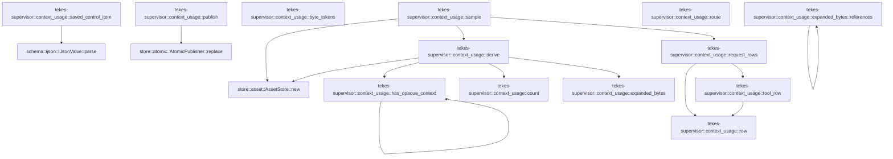

# tekes-supervisor::context_usage

[Package atlas](index.md) · [Source](../../src/context_usage.rs)

## Declarations

Visibility is the declaration spelling; trait members and reexports require their enclosing interface. `cfg` is not evaluated.

| Symbol | Kind | Visibility | Test / cfg |
|---|---|---|---|
| [tekes-supervisor::context_usage::MAX_SAFE](../../src/context_usage.rs#L12) | const_item | `private` |  |
| [tekes-supervisor::context_usage::SavedProjection](../../src/context_usage.rs#L16) | struct_item | `private` |  |
| [tekes-supervisor::context_usage::publish](../../src/context_usage.rs#L24) | function_item | `pub(crate)` |  |
| [tekes-supervisor::context_usage::saved_control_item](../../src/context_usage.rs#L72) | function_item | `pub(crate)` |  |
| [tekes-supervisor::context_usage::derive](../../src/context_usage.rs#L101) | function_item | `pub(crate)` |  |
| [tekes-supervisor::context_usage::sample](../../src/context_usage.rs#L209) | function_item | `pub(crate)` |  |
| [tekes-supervisor::context_usage::byte_tokens](../../src/context_usage.rs#L269) | function_item | `private` |  |
| [tekes-supervisor::context_usage::row](../../src/context_usage.rs#L274) | function_item | `private` |  |
| [tekes-supervisor::context_usage::request_rows](../../src/context_usage.rs#L279) | function_item | `private` |  |
| [tekes-supervisor::context_usage::tool_row](../../src/context_usage.rs#L348) | function_item | `private` |  |
| [tekes-supervisor::context_usage::has_opaque_context](../../src/context_usage.rs#L389) | function_item | `private` |  |
| [tekes-supervisor::context_usage::count](../../src/context_usage.rs#L419) | function_item | `private` |  |
| [tekes-supervisor::context_usage::expanded_bytes](../../src/context_usage.rs#L423) | function_item | `private` |  |
| [tekes-supervisor::context_usage::expanded_bytes::references](../../src/context_usage.rs#L425) | function_item | `private` |  |
| [tekes-supervisor::context_usage::route](../../src/context_usage.rs#L446) | function_item | `private` |  |
| [tekes-supervisor::context_usage::tests::config](../../src/context_usage.rs#L483) | function_item | `private` | test; #[cfg(test)] |
| [tekes-supervisor::context_usage::tests::event](../../src/context_usage.rs#L498) | function_item | `private` | test; #[cfg(test)] |
| [tekes-supervisor::context_usage::tests::prepared](../../src/context_usage.rs#L506) | function_item | `private` | test; #[cfg(test)] |
| [tekes-supervisor::context_usage::tests::replace_request](../../src/context_usage.rs#L532) | function_item | `private` | test; #[cfg(test)] |
| [tekes-supervisor::context_usage::tests::atomic_sample_partitions_system_and_deduplicates_safe_tool_inventory](../../src/context_usage.rs#L543) | function_item | `private` | test; #[cfg(test)] |
| [tekes-supervisor::context_usage::tests::dialect_shapes_are_classified_without_catalog_inference](../../src/context_usage.rs#L594) | function_item | `private` | test; #[cfg(test)] |
| [tekes-supervisor::context_usage::tests::invalidation_replaces_both_total_and_details_and_changes_clock](../../src/context_usage.rs#L627) | function_item | `private` | test; #[cfg(test)] |
| [tekes-supervisor::context_usage::tests::paired_clock_migrates_legacy_and_rejects_corruption](../../src/context_usage.rs#L712) | function_item | `private` | test; #[cfg(test)] |
| [tekes-supervisor::context_usage::tests::request_bounds_are_not_billing_totals_and_replacements_invalidate](../../src/context_usage.rs#L743) | function_item | `private` | test; #[cfg(test)] |
| [tekes-supervisor::context_usage::tests::opaque_media_and_continuations_are_not_priced_by_identifier_bytes](../../src/context_usage.rs#L770) | function_item | `private` | test; #[cfg(test)] |
| [tekes-supervisor::context_usage::tests::durable_clock_survives_recreation_and_does_not_reuse_invalidated_sequence](../../src/context_usage.rs#L783) | function_item | `private` | test; #[cfg(test)] |

## Imports / reexports

| Local name | Source path | Visibility |
|---|---|---|
| `fs` | `std::fs` | `private` |
| `Path` | `std::path::Path` | `private` |
| `Event` | `schema::Event` | `private` |
| `EventKind` | `schema::EventKind` | `private` |
| `Deserialize` | `serde::Deserialize` | `private` |
| `Serialize` | `serde::Serialize` | `private` |
| `Value` | `serde_json::Value` | `private` |
| `json` | `serde_json::json` | `private` |
| `Digest` | `sha2::Digest` | `private` |
| `Sha256` | `sha2::Sha256` | `private` |
| `AssetStore` | `store::AssetStore` | `private` |
| `AtomicPublisher` | `store::AtomicPublisher` | `private` |
| `*` | `super::*` | `private` |

## Module declarations

| Module | Visibility | Attributes |
|---|---|---|
| `tekes-supervisor::context_usage::tests` | `private` | #[cfg(test)] |

## Function call graphs

Edges below are syntactically resolved calls only, including private functions. Graphs partition callers into groups of 20; they are not execution order. All unresolved sites are listed below and in the JSON inventory.

Functions 1–13: 14 direct edges

## Call sites

Includes test functions (marked in declarations). Receiver-type-required sites need type analysis/manual tracing. Calls in closures are attributed to their enclosing function; their occurrence here does not mean the closure executes immediately.

| Caller | Callee expression | Source lines | Target / classification |
|---|---|---|---|
| `publish` | `folder.join` | [29](../../src/context_usage.rs#L29) | receiver-type-required |
| `publish` | `fs::read` | [30](../../src/context_usage.rs#L30) | external-constructor-callback-or-unresolved |
| `publish` | `serde_json::from_slice(&bytes).map_err` | [33](../../src/context_usage.rs#L33) | receiver-type-required |
| `publish` | `serde_json::from_slice` | [33](../../src/context_usage.rs#L33) | external-constructor-callback-or-unresolved |
| `publish` | `error.to_string` | [33](../../src/context_usage.rs#L33), [40](../../src/context_usage.rs#L40), [65](../../src/context_usage.rs#L65), [66](../../src/context_usage.rs#L66) | receiver-type-required |
| `publish` | `Err` | [35](../../src/context_usage.rs#L35), [40](../../src/context_usage.rs#L40), [58](../../src/context_usage.rs#L58) | external-constructor-callback-or-unresolved |
| `publish` | `"invalid context projection version or sequence".to_owned` | [35](../../src/context_usage.rs#L35) | receiver-type-required |
| `publish` | `Some` | [37](../../src/context_usage.rs#L37) | external-constructor-callback-or-unresolved |
| `publish` | `error.kind` | [39](../../src/context_usage.rs#L39) | receiver-type-required |
| `publish` | `Ok` | [46](../../src/context_usage.rs#L46), [67](../../src/context_usage.rs#L67) | external-constructor-callback-or-unresolved |
| `publish` | `match previous {         Some(previous) => previous             .sequence             .checked_add(1)             .filter(&#124;seq&#124; *seq <= MAX_SAFE)             .ok_or("context projection sequence exhausted")?,         None => 0,     }     .max` | [48](../../src/context_usage.rs#L48) | receiver-type-required |
| `publish` | `previous             .sequence             .checked_add(1)             .filter(&#124;seq&#124; *seq <= MAX_SAFE)             .ok_or` | [49](../../src/context_usage.rs#L49) | receiver-type-required |
| `publish` | `previous             .sequence             .checked_add(1)             .filter` | [49](../../src/context_usage.rs#L49) | receiver-type-required |
| `publish` | `previous             .sequence             .checked_add` | [49](../../src/context_usage.rs#L49) | receiver-type-required |
| `publish` | `"context projection sequence exhausted".to_owned` | [58](../../src/context_usage.rs#L58) | receiver-type-required |
| `publish` | `serde_json::to_vec(&SavedProjection {         format: 1,         sequence,         value,     })     .map_err` | [60](../../src/context_usage.rs#L60) | receiver-type-required |
| `publish` | `serde_json::to_vec` | [60](../../src/context_usage.rs#L60) | external-constructor-callback-or-unresolved |
| `publish` | `AtomicPublisher::replace(path, &bytes).map_err` | [66](../../src/context_usage.rs#L66) | receiver-type-required |
| `publish` | `AtomicPublisher::replace` | [66](../../src/context_usage.rs#L66) | [store::atomic::AtomicPublisher::replace](../../../store/src/atomic.rs#L16) |
| `saved_control_item` | `serde_json::from_slice(&fs::read(folder.join("context-usage.projection.json")).ok()?)             .ok` | [77](../../src/context_usage.rs#L77) | receiver-type-required |
| `saved_control_item` | `serde_json::from_slice` | [77](../../src/context_usage.rs#L77) | external-constructor-callback-or-unresolved |
| `saved_control_item` | `fs::read(folder.join("context-usage.projection.json")).ok` | [77](../../src/context_usage.rs#L77) | receiver-type-required |
| `saved_control_item` | `fs::read` | [77](../../src/context_usage.rs#L77) | external-constructor-callback-or-unresolved |
| `saved_control_item` | `folder.join` | [77](../../src/context_usage.rs#L77) | receiver-type-required |
| `saved_control_item` | `schema::IJsonValue::parse(         &serde_json::to_vec(&json!({             "asOfSeq": saved.sequence,             "values": {                 "contextDetails": saved.value.get("contextDetails")?,                 "contextUsage": saved.value.get("contextUsage")?,             },         }))         .ok()?,     )     .ok` | [82](../../src/context_usage.rs#L82) | receiver-type-required |
| `saved_control_item` | `schema::IJsonValue::parse` | [82](../../src/context_usage.rs#L82) | [schema::ijson::IJsonValue::parse](../../../schema/src/ijson.rs#L16) |
| `saved_control_item` | `serde_json::to_vec(&json!({             "asOfSeq": saved.sequence,             "values": {                 "contextDetails": saved.value.get("contextDetails")?,                 "contextUsage": saved.value.get("contextUsage")?,             },         }))         .ok` | [83](../../src/context_usage.rs#L83) | receiver-type-required |
| `saved_control_item` | `serde_json::to_vec` | [83](../../src/context_usage.rs#L83) | external-constructor-callback-or-unresolved |
| `saved_control_item` | `Some` | [93](../../src/context_usage.rs#L93) | external-constructor-callback-or-unresolved |
| `saved_control_item` | `session_id.to_owned` | [94](../../src/context_usage.rs#L94) | receiver-type-required |
| `saved_control_item` | `Vec::new` | [95](../../src/context_usage.rs#L95), [96](../../src/context_usage.rs#L96) | external-constructor-callback-or-unresolved |
| `derive` | `config.and_then` | [106](../../src/context_usage.rs#L106) | receiver-type-required |
| `derive` | `events         .iter()         .rposition` | [117](../../src/context_usage.rs#L117) | receiver-type-required |
| `derive` | `events         .iter` | [117](../../src/context_usage.rs#L117) | receiver-type-required |
| `derive` | `event.kind` | [119](../../src/context_usage.rs#L119), [126](../../src/context_usage.rs#L126), [136](../../src/context_usage.rs#L136) | receiver-type-required |
| `derive` | `events[..index]         .iter()         .rev()         .find` | [123](../../src/context_usage.rs#L123) | receiver-type-required |
| `derive` | `events[..index]         .iter()         .rev` | [123](../../src/context_usage.rs#L123) | receiver-type-required |
| `derive` | `events[..index]         .iter` | [123](../../src/context_usage.rs#L123) | receiver-type-required |
| `derive` | `config.digest().ok().as_deref` | [131](../../src/context_usage.rs#L131) | receiver-type-required |
| `derive` | `config.digest().ok` | [131](../../src/context_usage.rs#L131) | receiver-type-required |
| `derive` | `config.digest` | [131](../../src/context_usage.rs#L131) | receiver-type-required |
| `derive` | `run.string_field` | [131](../../src/context_usage.rs#L131) | receiver-type-required |
| `derive` | `events[..index].iter().rev().find` | [135](../../src/context_usage.rs#L135) | receiver-type-required |
| `derive` | `events[..index].iter().rev` | [135](../../src/context_usage.rs#L135) | receiver-type-required |
| `derive` | `events[..index].iter` | [135](../../src/context_usage.rs#L135) | receiver-type-required |
| `derive` | `event.string_field` | [137](../../src/context_usage.rs#L137) | receiver-type-required |
| `derive` | `attempt.string_field` | [137](../../src/context_usage.rs#L137) | receiver-type-required |
| `derive` | `epoch.string_field` | [141](../../src/context_usage.rs#L141) | receiver-type-required |
| `derive` | `Some` | [141](../../src/context_usage.rs#L141) | external-constructor-callback-or-unresolved |
| `derive` | `model.id.as_str` | [141](../../src/context_usage.rs#L141) | receiver-type-required |
| `derive` | `serde_json::to_value` | [144](../../src/context_usage.rs#L144), [173](../../src/context_usage.rs#L173) | external-constructor-callback-or-unresolved |
| `derive` | `attempt.raw` | [144](../../src/context_usage.rs#L144) | receiver-type-required |
| `derive` | `raw.pointer("/request/asset").and_then` | [147](../../src/context_usage.rs#L147) | receiver-type-required |
| `derive` | `raw.pointer` | [147](../../src/context_usage.rs#L147) | receiver-type-required |
| `derive` | `AssetStore::new` | [150](../../src/context_usage.rs#L150) | [store::asset::AssetStore::new](../../../store/src/asset.rs#L27) |
| `derive` | `folder.join` | [150](../../src/context_usage.rs#L150) | receiver-type-required |
| `derive` | `assets.read_verified` | [153](../../src/context_usage.rs#L153) | receiver-type-required |
| `derive` | `serde_json::from_slice::<Value>` | [158](../../src/context_usage.rs#L158) | external-constructor-callback-or-unresolved |
| `derive` | `has_opaque_context` | [161](../../src/context_usage.rs#L161), [178](../../src/context_usage.rs#L178) | [tekes-supervisor::context_usage::has_opaque_context](../../src/context_usage.rs#L389) |
| `derive` | `body.len` | [164](../../src/context_usage.rs#L164) | receiver-type-required |
| `derive` | `event.raw` | [173](../../src/context_usage.rs#L173) | receiver-type-required |
| `derive` | `raw.get("supersedes").is_some` | [176](../../src/context_usage.rs#L176) | receiver-type-required |
| `derive` | `raw.get` | [176](../../src/context_usage.rs#L176), [177](../../src/context_usage.rs#L177) | receiver-type-required |
| `derive` | `raw.get("retracts").is_some` | [177](../../src/context_usage.rs#L177) | receiver-type-required |
| `derive` | `expanded_bytes` | [182](../../src/context_usage.rs#L182) | [tekes-supervisor::context_usage::expanded_bytes](../../src/context_usage.rs#L423) |
| `derive` | `bound.saturating_add` | [185](../../src/context_usage.rs#L185) | receiver-type-required |
| `derive` | `raw             .get("usage")             .filter` | [188](../../src/context_usage.rs#L188) | receiver-type-required |
| `derive` | `raw             .get` | [188](../../src/context_usage.rs#L188) | receiver-type-required |
| `derive` | `["input_tokens", "output_tokens", "cache_read", "cache_write"]                 .iter()                 .filter_map(&#124;key&#124; count(&usage[*key]))                 .fold` | [192](../../src/context_usage.rs#L192) | receiver-type-required |
| `derive` | `["input_tokens", "output_tokens", "cache_read", "cache_write"]                 .iter()                 .filter_map` | [192](../../src/context_usage.rs#L192) | receiver-type-required |
| `derive` | `["input_tokens", "output_tokens", "cache_read", "cache_write"]                 .iter` | [192](../../src/context_usage.rs#L192) | receiver-type-required |
| `derive` | `count` | [194](../../src/context_usage.rs#L194) | [tekes-supervisor::context_usage::count](../../src/context_usage.rs#L419) |
| `derive` | `bound.max` | [196](../../src/context_usage.rs#L196) | receiver-type-required |
| `sample` | `derive` | [214](../../src/context_usage.rs#L214) | [tekes-supervisor::context_usage::derive](../../src/context_usage.rs#L101) |
| `sample` | `usage.get` | [218](../../src/context_usage.rs#L218) | receiver-type-required |
| `sample` | `value.clone` | [219](../../src/context_usage.rs#L219) | receiver-type-required |
| `sample` | `(usage["basis"] != "unknown")         .then(&#124;&#124; {             let attempt = events                 .iter()                 .rev()                 .find(&#124;e&#124; *e.kind() == EventKind::Attempt)?;             let raw = serde_json::to_value(attempt.raw()).ok()?;             let asset = raw.pointer("/request/asset")?.as_str()?;             let assets = AssetStore::new(folder.join("assets")).ok()?;             let request =                 serde_json::from_slice::<Value>(&assets.read_verified(asset).ok()?).ok()?;             for (output, input) in [("requestID", "attempt"), ("epochID", "epoch")] {                 if let Some(value) = attempt.string_field(input) {                     evidence[output] = json!(value);                 }             }             // Asset identity covers request bytes without returning a raw request.             evidence["sourceRevision"] = json!(asset);             Some(request)         })         .flatten` | [223](../../src/context_usage.rs#L223) | receiver-type-required |
| `sample` | `(usage["basis"] != "unknown")         .then` | [223](../../src/context_usage.rs#L223) | receiver-type-required |
| `sample` | `events                 .iter()                 .rev()                 .find` | [225](../../src/context_usage.rs#L225) | receiver-type-required |
| `sample` | `events                 .iter()                 .rev` | [225](../../src/context_usage.rs#L225) | receiver-type-required |
| `sample` | `events                 .iter` | [225](../../src/context_usage.rs#L225) | receiver-type-required |
| `sample` | `e.kind` | [228](../../src/context_usage.rs#L228) | receiver-type-required |
| `sample` | `serde_json::to_value(attempt.raw()).ok` | [229](../../src/context_usage.rs#L229) | receiver-type-required |
| `sample` | `serde_json::to_value` | [229](../../src/context_usage.rs#L229) | external-constructor-callback-or-unresolved |
| `sample` | `attempt.raw` | [229](../../src/context_usage.rs#L229) | receiver-type-required |
| `sample` | `raw.pointer("/request/asset")?.as_str` | [230](../../src/context_usage.rs#L230) | receiver-type-required |
| `sample` | `raw.pointer` | [230](../../src/context_usage.rs#L230) | receiver-type-required |
| `sample` | `AssetStore::new(folder.join("assets")).ok` | [231](../../src/context_usage.rs#L231) | receiver-type-required |
| `sample` | `AssetStore::new` | [231](../../src/context_usage.rs#L231) | [store::asset::AssetStore::new](../../../store/src/asset.rs#L27) |
| `sample` | `folder.join` | [231](../../src/context_usage.rs#L231) | receiver-type-required |
| `sample` | `serde_json::from_slice::<Value>(&assets.read_verified(asset).ok()?).ok` | [233](../../src/context_usage.rs#L233) | receiver-type-required |
| `sample` | `serde_json::from_slice::<Value>` | [233](../../src/context_usage.rs#L233) | external-constructor-callback-or-unresolved |
| `sample` | `assets.read_verified(asset).ok` | [233](../../src/context_usage.rs#L233) | receiver-type-required |
| `sample` | `assets.read_verified` | [233](../../src/context_usage.rs#L233) | receiver-type-required |
| `sample` | `attempt.string_field` | [235](../../src/context_usage.rs#L235) | receiver-type-required |
| `sample` | `Some` | [241](../../src/context_usage.rs#L241) | external-constructor-callback-or-unresolved |
| `sample` | `request.is_none` | [244](../../src/context_usage.rs#L244) | receiver-type-required |
| `sample` | `Vec::new` | [248](../../src/context_usage.rs#L248) | external-constructor-callback-or-unresolved |
| `sample` | `request.as_ref` | [249](../../src/context_usage.rs#L249) | receiver-type-required |
| `sample` | `request_rows` | [250](../../src/context_usage.rs#L250) | [tekes-supervisor::context_usage::request_rows](../../src/context_usage.rs#L279) |
| `request_rows` | `Vec::new` | [280](../../src/context_usage.rs#L280), [281](../../src/context_usage.rs#L281), [294](../../src/context_usage.rs#L294), [321](../../src/context_usage.rs#L321), [322](../../src/context_usage.rs#L322) | external-constructor-callback-or-unresolved |
| `request_rows` | `request.get` | [288](../../src/context_usage.rs#L288), [293](../../src/context_usage.rs#L293), [320](../../src/context_usage.rs#L320) | receiver-type-required |
| `request_rows` | `system.push` | [289](../../src/context_usage.rs#L289), [297](../../src/context_usage.rs#L297) | receiver-type-required |
| `request_rows` | `value.clone` | [289](../../src/context_usage.rs#L289) | receiver-type-required |
| `request_rows` | `request.get(key).and_then` | [293](../../src/context_usage.rs#L293) | receiver-type-required |
| `request_rows` | `item.clone` | [297](../../src/context_usage.rs#L297), [299](../../src/context_usage.rs#L299) | receiver-type-required |
| `request_rows` | `messages.push` | [299](../../src/context_usage.rs#L299) | receiver-type-required |
| `request_rows` | `rows.push` | [302](../../src/context_usage.rs#L302), [312](../../src/context_usage.rs#L312), [330](../../src/context_usage.rs#L330), [337](../../src/context_usage.rs#L337) | receiver-type-required |
| `request_rows` | `row` | [302](../../src/context_usage.rs#L302), [312](../../src/context_usage.rs#L312) | [tekes-supervisor::context_usage::row](../../src/context_usage.rs#L274) |
| `request_rows` | `system.is_empty` | [311](../../src/context_usage.rs#L311) | receiver-type-required |
| `request_rows` | `request.get("tools").and_then` | [320](../../src/context_usage.rs#L320) | receiver-type-required |
| `request_rows` | `deferred.push` | [325](../../src/context_usage.rs#L325) | receiver-type-required |
| `request_rows` | `tool.clone` | [325](../../src/context_usage.rs#L325), [327](../../src/context_usage.rs#L327) | receiver-type-required |
| `request_rows` | `active.push` | [327](../../src/context_usage.rs#L327) | receiver-type-required |
| `request_rows` | `tool_row` | [330](../../src/context_usage.rs#L330), [337](../../src/context_usage.rs#L337) | [tekes-supervisor::context_usage::tool_row](../../src/context_usage.rs#L348) |
| `request_rows` | `deferred.is_empty` | [336](../../src/context_usage.rs#L336) | receiver-type-required |
| `tool_row` | `row` | [349](../../src/context_usage.rs#L349), [381](../../src/context_usage.rs#L381) | [tekes-supervisor::context_usage::row](../../src/context_usage.rs#L274) |
| `tool_row` | `std::collections::BTreeMap::new` | [350](../../src/context_usage.rs#L350) | external-constructor-callback-or-unresolved |
| `tool_row` | `tool             .get("functionDeclarations")             .and_then(Value::as_array)             .map(&#124;items&#124; items.iter().collect::<Vec<_>>())             .unwrap_or_else` | [352](../../src/context_usage.rs#L352) | receiver-type-required |
| `tool_row` | `tool             .get("functionDeclarations")             .and_then(Value::as_array)             .map` | [352](../../src/context_usage.rs#L352) | receiver-type-required |
| `tool_row` | `tool             .get("functionDeclarations")             .and_then` | [352](../../src/context_usage.rs#L352) | receiver-type-required |
| `tool_row` | `tool             .get` | [352](../../src/context_usage.rs#L352) | receiver-type-required |
| `tool_row` | `items.iter().collect::<Vec<_>>` | [355](../../src/context_usage.rs#L355) | receiver-type-required |
| `tool_row` | `items.iter` | [355](../../src/context_usage.rs#L355) | receiver-type-required |
| `tool_row` | `definition                 .get("name")                 .or_else(&#124;&#124; definition.pointer("/function/name"))                 .and_then` | [358](../../src/context_usage.rs#L358) | receiver-type-required |
| `tool_row` | `definition                 .get("name")                 .or_else` | [358](../../src/context_usage.rs#L358) | receiver-type-required |
| `tool_row` | `definition                 .get` | [358](../../src/context_usage.rs#L358) | receiver-type-required |
| `tool_row` | `definition.pointer` | [360](../../src/context_usage.rs#L360) | receiver-type-required |
| `tool_row` | `name                 .filter(&#124;name&#124; {                     !name.is_empty()                         && name.len() <= 128                         && name                             .bytes()                             .all(&#124;b&#124; b.is_ascii_alphanumeric() &#124;&#124; b"_-.:/".contains(&b))                 })                 .unwrap_or` | [363](../../src/context_usage.rs#L363) | receiver-type-required |
| `tool_row` | `name                 .filter` | [363](../../src/context_usage.rs#L363) | receiver-type-required |
| `tool_row` | `name.is_empty` | [365](../../src/context_usage.rs#L365) | receiver-type-required |
| `tool_row` | `name.len` | [366](../../src/context_usage.rs#L366) | receiver-type-required |
| `tool_row` | `name                             .bytes()                             .all` | [367](../../src/context_usage.rs#L367) | receiver-type-required |
| `tool_row` | `name                             .bytes` | [367](../../src/context_usage.rs#L367) | receiver-type-required |
| `tool_row` | `b.is_ascii_alphanumeric` | [369](../../src/context_usage.rs#L369) | receiver-type-required |
| `tool_row` | `b"_-.:/".contains` | [369](../../src/context_usage.rs#L369) | receiver-type-required |
| `tool_row` | `serde_json::to_vec(definition).expect` | [373](../../src/context_usage.rs#L373) | receiver-type-required |
| `tool_row` | `serde_json::to_vec` | [373](../../src/context_usage.rs#L373) | external-constructor-callback-or-unresolved |
| `tool_row` | `name.as_bytes().to_vec` | [375](../../src/context_usage.rs#L375) | receiver-type-required |
| `tool_row` | `name.as_bytes` | [375](../../src/context_usage.rs#L375) | receiver-type-required |
| `tool_row` | `children                 .entry(child_id.clone())                 .or_insert_with` | [379](../../src/context_usage.rs#L379) | receiver-type-required |
| `tool_row` | `children                 .entry` | [379](../../src/context_usage.rs#L379) | receiver-type-required |
| `tool_row` | `child_id.clone` | [380](../../src/context_usage.rs#L380) | receiver-type-required |
| `has_opaque_context` | `fields.iter().any` | [391](../../src/context_usage.rs#L391) | receiver-type-required |
| `has_opaque_context` | `fields.iter` | [391](../../src/context_usage.rs#L391) | receiver-type-required |
| `has_opaque_context` | `value.as_str().is_some_and` | [405](../../src/context_usage.rs#L405) | receiver-type-required |
| `has_opaque_context` | `value.as_str` | [405](../../src/context_usage.rs#L405) | receiver-type-required |
| `has_opaque_context` | `kind.contains` | [406](../../src/context_usage.rs#L406), [407](../../src/context_usage.rs#L407), [408](../../src/context_usage.rs#L408) | receiver-type-required |
| `has_opaque_context` | `has_opaque_context` | [412](../../src/context_usage.rs#L412) | [tekes-supervisor::context_usage::has_opaque_context](../../src/context_usage.rs#L389) |
| `has_opaque_context` | `values.iter().any` | [414](../../src/context_usage.rs#L414) | receiver-type-required |
| `has_opaque_context` | `values.iter` | [414](../../src/context_usage.rs#L414) | receiver-type-required |
| `count` | `value.as_u64().or_else` | [420](../../src/context_usage.rs#L420) | receiver-type-required |
| `count` | `value.as_u64` | [420](../../src/context_usage.rs#L420) | receiver-type-required |
| `count` | `value.as_str()?.parse().ok` | [420](../../src/context_usage.rs#L420) | receiver-type-required |
| `count` | `value.as_str()?.parse` | [420](../../src/context_usage.rs#L420) | receiver-type-required |
| `count` | `value.as_str` | [420](../../src/context_usage.rs#L420) | receiver-type-required |
| `expanded_bytes` | `serde_json::to_vec(value).ok()?.len` | [424](../../src/context_usage.rs#L424) | receiver-type-required |
| `expanded_bytes` | `serde_json::to_vec(value).ok` | [424](../../src/context_usage.rs#L424) | receiver-type-required |
| `expanded_bytes` | `serde_json::to_vec` | [424](../../src/context_usage.rs#L424) | external-constructor-callback-or-unresolved |
| `expanded_bytes` | `base.checked_add` | [443](../../src/context_usage.rs#L443) | receiver-type-required |
| `expanded_bytes` | `references` | [443](../../src/context_usage.rs#L443) | external-constructor-callback-or-unresolved |
| `references` | `fields.get("asset").and_then` | [429](../../src/context_usage.rs#L429) | receiver-type-required |
| `references` | `fields.get` | [429](../../src/context_usage.rs#L429) | receiver-type-required |
| `references` | `assets.read_verified(asset).ok()?.len` | [430](../../src/context_usage.rs#L430) | receiver-type-required |
| `references` | `assets.read_verified(asset).ok` | [430](../../src/context_usage.rs#L430) | receiver-type-required |
| `references` | `assets.read_verified` | [430](../../src/context_usage.rs#L430) | receiver-type-required |
| `references` | `fields.values` | [432](../../src/context_usage.rs#L432) | receiver-type-required |
| `references` | `bytes.checked_add` | [433](../../src/context_usage.rs#L433) | receiver-type-required |
| `references` | `references` | [433](../../src/context_usage.rs#L433), [438](../../src/context_usage.rs#L438) | [tekes-supervisor::context_usage::expanded_bytes::references](../../src/context_usage.rs#L425) |
| `references` | `Some` | [435](../../src/context_usage.rs#L435), [440](../../src/context_usage.rs#L440) | external-constructor-callback-or-unresolved |
| `references` | `values.iter().try_fold` | [437](../../src/context_usage.rs#L437) | receiver-type-required |
| `references` | `values.iter` | [437](../../src/context_usage.rs#L437) | receiver-type-required |
| `references` | `sum.checked_add` | [438](../../src/context_usage.rs#L438) | receiver-type-required |
| `route` | `config         .session_settings         .as_ref()         .map(&#124;settings&#124; settings.provider.as_str())         .or` | [447](../../src/context_usage.rs#L447) | receiver-type-required |
| `route` | `config         .session_settings         .as_ref()         .map` | [447](../../src/context_usage.rs#L447), [452](../../src/context_usage.rs#L452) | receiver-type-required |
| `route` | `config         .session_settings         .as_ref` | [447](../../src/context_usage.rs#L447), [452](../../src/context_usage.rs#L452) | receiver-type-required |
| `route` | `settings.provider.as_str` | [450](../../src/context_usage.rs#L450) | receiver-type-required |
| `route` | `config.settings.default_provider.as_deref` | [451](../../src/context_usage.rs#L451) | receiver-type-required |
| `route` | `config         .session_settings         .as_ref()         .map(&#124;settings&#124; settings.model.as_str())         .or` | [452](../../src/context_usage.rs#L452) | receiver-type-required |
| `route` | `settings.model.as_str` | [455](../../src/context_usage.rs#L455) | receiver-type-required |
| `route` | `config.settings.default_model.as_deref` | [456](../../src/context_usage.rs#L456) | receiver-type-required |
| `route` | `config             .providers             .providers             .iter()             .find` | [458](../../src/context_usage.rs#L458), [463](../../src/context_usage.rs#L463) | receiver-type-required |
| `route` | `config             .providers             .providers             .iter` | [458](../../src/context_usage.rs#L458), [463](../../src/context_usage.rs#L463) | receiver-type-required |
| `route` | `provider.models.iter().any` | [467](../../src/context_usage.rs#L467) | receiver-type-required |
| `route` | `provider.models.iter` | [467](../../src/context_usage.rs#L467), [474](../../src/context_usage.rs#L474) | receiver-type-required |
| `route` | `provider             .models             .iter()             .find` | [470](../../src/context_usage.rs#L470) | receiver-type-required |
| `route` | `provider             .models             .iter` | [470](../../src/context_usage.rs#L470) | receiver-type-required |
| `route` | `provider.models.iter().find` | [474](../../src/context_usage.rs#L474) | receiver-type-required |
| `route` | `Some` | [476](../../src/context_usage.rs#L476) | external-constructor-callback-or-unresolved |
| `config` | `serde_json::from_value(json!({             "format":1,             "execution":{"session_id":"session","cwd":[std::fs::canonicalize(std::env::temp_dir()).unwrap()],"policy":{"network":true}},             "providers":{"format":1,"revision":1,"providers":[{                 "id":"p","adapter":"responses","dialect":"openai_responses_v1","endpoint_owner":"openai",                 "gateway_translation":"direct","evidence_revision":"openai-2026-08-01","endpoint":"https://example.com/v1",                 "models":[{"id":"gpt-5","profile":"openai_responses_v1:gpt-5","enabled":true,                     "context_window_tokens":100000,"compact_trigger_tokens":90000}]             }]},             "settings":{"format":1,"revision":1,"default_provider":"p","default_model":"gpt-5"},             "revisions":{"providers":1,"settings":1}         })).unwrap` | [484](../../src/context_usage.rs#L484) | receiver-type-required |
| `config` | `serde_json::from_value` | [484](../../src/context_usage.rs#L484) | external-constructor-callback-or-unresolved |
| `event` | `Event::from_value(schema::IJsonValue::parse(&serde_json::to_vec(&value).unwrap()).unwrap())             .unwrap` | [502](../../src/context_usage.rs#L502) | receiver-type-required |
| `event` | `Event::from_value` | [502](../../src/context_usage.rs#L502) | external-constructor-callback-or-unresolved |
| `event` | `schema::IJsonValue::parse(&serde_json::to_vec(&value).unwrap()).unwrap` | [502](../../src/context_usage.rs#L502) | receiver-type-required |
| `event` | `schema::IJsonValue::parse` | [502](../../src/context_usage.rs#L502) | [schema::ijson::IJsonValue::parse](../../../schema/src/ijson.rs#L16) |
| `event` | `serde_json::to_vec(&value).unwrap` | [502](../../src/context_usage.rs#L502) | receiver-type-required |
| `event` | `serde_json::to_vec` | [502](../../src/context_usage.rs#L502) | external-constructor-callback-or-unresolved |
| `prepared` | `AssetStore::new(folder.join("assets")).unwrap` | [507](../../src/context_usage.rs#L507) | receiver-type-required |
| `prepared` | `AssetStore::new` | [507](../../src/context_usage.rs#L507) | external-constructor-callback-or-unresolved |
| `prepared` | `folder.join` | [507](../../src/context_usage.rs#L507) | receiver-type-required |
| `prepared` | `assets.publish(b"system").unwrap` | [508](../../src/context_usage.rs#L508) | receiver-type-required |
| `prepared` | `assets.publish` | [508](../../src/context_usage.rs#L508), [509](../../src/context_usage.rs#L509) | receiver-type-required |
| `prepared` | `assets.publish(b"[]").unwrap` | [509](../../src/context_usage.rs#L509) | receiver-type-required |
| `prepared` | `assets             .publish(br#"{"model":"gpt-5","input":[{"role":"user","content":"hello"}]}"#)             .unwrap` | [510](../../src/context_usage.rs#L510) | receiver-type-required |
| `prepared` | `assets             .publish` | [510](../../src/context_usage.rs#L510) | receiver-type-required |
| `replace_request` | `AssetStore::new(folder.join("assets"))             .unwrap()             .publish(&serde_json::to_vec(&request).unwrap())             .unwrap` | [533](../../src/context_usage.rs#L533) | receiver-type-required |
| `replace_request` | `AssetStore::new(folder.join("assets"))             .unwrap()             .publish` | [533](../../src/context_usage.rs#L533) | receiver-type-required |
| `replace_request` | `AssetStore::new(folder.join("assets"))             .unwrap` | [533](../../src/context_usage.rs#L533) | receiver-type-required |
| `replace_request` | `AssetStore::new` | [533](../../src/context_usage.rs#L533) | external-constructor-callback-or-unresolved |
| `replace_request` | `folder.join` | [533](../../src/context_usage.rs#L533) | receiver-type-required |
| `replace_request` | `serde_json::to_vec(&request).unwrap` | [535](../../src/context_usage.rs#L535) | receiver-type-required |
| `replace_request` | `serde_json::to_vec` | [535](../../src/context_usage.rs#L535) | external-constructor-callback-or-unresolved |
| `replace_request` | `serde_json::to_value(events[2].raw()).unwrap` | [537](../../src/context_usage.rs#L537) | receiver-type-required |
| `replace_request` | `serde_json::to_value` | [537](../../src/context_usage.rs#L537) | external-constructor-callback-or-unresolved |
| `replace_request` | `events[2].raw` | [537](../../src/context_usage.rs#L537) | receiver-type-required |
| `replace_request` | `event` | [539](../../src/context_usage.rs#L539) | [tekes-supervisor::context_usage::tests::event](../../src/context_usage.rs#L498) |
| `atomic_sample_partitions_system_and_deduplicates_safe_tool_inventory` | `tempfile::tempdir().unwrap` | [544](../../src/context_usage.rs#L544) | receiver-type-required |
| `atomic_sample_partitions_system_and_deduplicates_safe_tool_inventory` | `tempfile::tempdir` | [544](../../src/context_usage.rs#L544) | external-constructor-callback-or-unresolved |
| `atomic_sample_partitions_system_and_deduplicates_safe_tool_inventory` | `config` | [545](../../src/context_usage.rs#L545) | external-constructor-callback-or-unresolved |
| `atomic_sample_partitions_system_and_deduplicates_safe_tool_inventory` | `prepared` | [546](../../src/context_usage.rs#L546) | [tekes-supervisor::context_usage::tests::prepared](../../src/context_usage.rs#L506) |
| `atomic_sample_partitions_system_and_deduplicates_safe_tool_inventory` | `folder.path` | [546](../../src/context_usage.rs#L546), [548](../../src/context_usage.rs#L548), [558](../../src/context_usage.rs#L558) | receiver-type-required |
| `atomic_sample_partitions_system_and_deduplicates_safe_tool_inventory` | `replace_request` | [547](../../src/context_usage.rs#L547) | [tekes-supervisor::context_usage::tests::replace_request](../../src/context_usage.rs#L532) |
| `atomic_sample_partitions_system_and_deduplicates_safe_tool_inventory` | `sample` | [558](../../src/context_usage.rs#L558) | external-constructor-callback-or-unresolved |
| `atomic_sample_partitions_system_and_deduplicates_safe_tool_inventory` | `Some` | [558](../../src/context_usage.rs#L558) | external-constructor-callback-or-unresolved |
| `atomic_sample_partitions_system_and_deduplicates_safe_tool_inventory` | `serde_json::from_str(include_str!(             "../../../fixtures/context-details/native-v1.json"         ))         .unwrap` | [559](../../src/context_usage.rs#L559) | receiver-type-required |
| `atomic_sample_partitions_system_and_deduplicates_safe_tool_inventory` | `serde_json::from_str` | [559](../../src/context_usage.rs#L559) | external-constructor-callback-or-unresolved |
| `atomic_sample_partitions_system_and_deduplicates_safe_tool_inventory` | `details["rows"].as_array().unwrap` | [571](../../src/context_usage.rs#L571) | receiver-type-required |
| `atomic_sample_partitions_system_and_deduplicates_safe_tool_inventory` | `details["rows"].as_array` | [571](../../src/context_usage.rs#L571) | receiver-type-required |
| `atomic_sample_partitions_system_and_deduplicates_safe_tool_inventory` | `serde_json::to_string(details).unwrap` | [581](../../src/context_usage.rs#L581) | receiver-type-required |
| `atomic_sample_partitions_system_and_deduplicates_safe_tool_inventory` | `serde_json::to_string` | [581](../../src/context_usage.rs#L581) | external-constructor-callback-or-unresolved |
| `dialect_shapes_are_classified_without_catalog_inference` | `request_rows` | [605](../../src/context_usage.rs#L605), [622](../../src/context_usage.rs#L622) | external-constructor-callback-or-unresolved |
| `dialect_shapes_are_classified_without_catalog_inference` | `std::collections::BTreeSet::new` | [614](../../src/context_usage.rs#L614) | external-constructor-callback-or-unresolved |
| `dialect_shapes_are_classified_without_catalog_inference` | `row["children"].as_array().unwrap` | [617](../../src/context_usage.rs#L617) | receiver-type-required |
| `dialect_shapes_are_classified_without_catalog_inference` | `row["children"].as_array` | [617](../../src/context_usage.rs#L617) | receiver-type-required |
| `invalidation_replaces_both_total_and_details_and_changes_clock` | `tempfile::tempdir().unwrap` | [628](../../src/context_usage.rs#L628) | receiver-type-required |
| `invalidation_replaces_both_total_and_details_and_changes_clock` | `tempfile::tempdir` | [628](../../src/context_usage.rs#L628) | external-constructor-callback-or-unresolved |
| `invalidation_replaces_both_total_and_details_and_changes_clock` | `config` | [629](../../src/context_usage.rs#L629) | external-constructor-callback-or-unresolved |
| `invalidation_replaces_both_total_and_details_and_changes_clock` | `prepared` | [630](../../src/context_usage.rs#L630) | [tekes-supervisor::context_usage::tests::prepared](../../src/context_usage.rs#L506) |
| `invalidation_replaces_both_total_and_details_and_changes_clock` | `folder.path` | [630](../../src/context_usage.rs#L630), [631](../../src/context_usage.rs#L631), [653](../../src/context_usage.rs#L653), [691](../../src/context_usage.rs#L691), [696](../../src/context_usage.rs#L696), [704](../../src/context_usage.rs#L704) | receiver-type-required |
| `invalidation_replaces_both_total_and_details_and_changes_clock` | `sample` | [631](../../src/context_usage.rs#L631), [653](../../src/context_usage.rs#L653), [691](../../src/context_usage.rs#L691) | external-constructor-callback-or-unresolved |
| `invalidation_replaces_both_total_and_details_and_changes_clock` | `Some` | [631](../../src/context_usage.rs#L631), [653](../../src/context_usage.rs#L653), [690](../../src/context_usage.rs#L690), [691](../../src/context_usage.rs#L691) | external-constructor-callback-or-unresolved |
| `invalidation_replaces_both_total_and_details_and_changes_clock` | `[             json!({"kind":"compact","covers":[{"from":3,"to":3}],"summary":"small"}),             json!({"kind":"output","turn":1,"attempt":"a1","content":[],                 "sealed":{"version":1,"adapter":"openai_responses_v1","fragments":"[]"},                 "usage":{"availability":"unavailable"},"supersedes":[{"from":3,"to":3}]}),             serde_json::to_value(events[0].raw()).unwrap(),             serde_json::to_value(events[1].raw()).unwrap(),             json!({"kind":"extension-context-replacement"}),             json!({"kind":"output","turn":1,"attempt":"a1","content":[],                 "sealed":{"version":1,"adapter":"openai_responses_v1","fragments":"[]"},                 "usage":{"availability":"unavailable"},"retracts":[{"from":3,"to":3}]}),         ]         .into_iter()         .enumerate` | [636](../../src/context_usage.rs#L636) | receiver-type-required |
| `invalidation_replaces_both_total_and_details_and_changes_clock` | `[             json!({"kind":"compact","covers":[{"from":3,"to":3}],"summary":"small"}),             json!({"kind":"output","turn":1,"attempt":"a1","content":[],                 "sealed":{"version":1,"adapter":"openai_responses_v1","fragments":"[]"},                 "usage":{"availability":"unavailable"},"supersedes":[{"from":3,"to":3}]}),             serde_json::to_value(events[0].raw()).unwrap(),             serde_json::to_value(events[1].raw()).unwrap(),             json!({"kind":"extension-context-replacement"}),             json!({"kind":"output","turn":1,"attempt":"a1","content":[],                 "sealed":{"version":1,"adapter":"openai_responses_v1","fragments":"[]"},                 "usage":{"availability":"unavailable"},"retracts":[{"from":3,"to":3}]}),         ]         .into_iter` | [636](../../src/context_usage.rs#L636) | receiver-type-required |
| `invalidation_replaces_both_total_and_details_and_changes_clock` | `serde_json::to_value(events[0].raw()).unwrap` | [641](../../src/context_usage.rs#L641) | receiver-type-required |
| `invalidation_replaces_both_total_and_details_and_changes_clock` | `serde_json::to_value` | [641](../../src/context_usage.rs#L641), [642](../../src/context_usage.rs#L642) | external-constructor-callback-or-unresolved |
| `invalidation_replaces_both_total_and_details_and_changes_clock` | `events[0].raw` | [641](../../src/context_usage.rs#L641) | receiver-type-required |
| `invalidation_replaces_both_total_and_details_and_changes_clock` | `serde_json::to_value(events[1].raw()).unwrap` | [642](../../src/context_usage.rs#L642) | receiver-type-required |
| `invalidation_replaces_both_total_and_details_and_changes_clock` | `events[1].raw` | [642](../../src/context_usage.rs#L642) | receiver-type-required |
| `invalidation_replaces_both_total_and_details_and_changes_clock` | `events.clone` | [651](../../src/context_usage.rs#L651), [694](../../src/context_usage.rs#L694) | receiver-type-required |
| `invalidation_replaces_both_total_and_details_and_changes_clock` | `changed.push` | [652](../../src/context_usage.rs#L652) | receiver-type-required |
| `invalidation_replaces_both_total_and_details_and_changes_clock` | `event` | [652](../../src/context_usage.rs#L652) | [tekes-supervisor::context_usage::tests::event](../../src/context_usage.rs#L498) |
| `invalidation_replaces_both_total_and_details_and_changes_clock` | `serde_json::from_str(include_str!(                     "../../../fixtures/context-details/native-unknown-v1.json"                 ))                 .unwrap` | [655](../../src/context_usage.rs#L655) | receiver-type-required |
| `invalidation_replaces_both_total_and_details_and_changes_clock` | `serde_json::from_str` | [655](../../src/context_usage.rs#L655) | external-constructor-callback-or-unresolved |
| `invalidation_replaces_both_total_and_details_and_changes_clock` | `config.clone` | [688](../../src/context_usage.rs#L688) | receiver-type-required |
| `invalidation_replaces_both_total_and_details_and_changes_clock` | `"other".into` | [689](../../src/context_usage.rs#L689), [690](../../src/context_usage.rs#L690) | receiver-type-required |
| `invalidation_replaces_both_total_and_details_and_changes_clock` | `replace_request` | [695](../../src/context_usage.rs#L695) | [tekes-supervisor::context_usage::tests::replace_request](../../src/context_usage.rs#L532) |
| `invalidation_replaces_both_total_and_details_and_changes_clock` | `std::fs::remove_dir_all(folder.path().join("assets")).unwrap` | [704](../../src/context_usage.rs#L704) | receiver-type-required |
| `invalidation_replaces_both_total_and_details_and_changes_clock` | `std::fs::remove_dir_all` | [704](../../src/context_usage.rs#L704) | external-constructor-callback-or-unresolved |
| `invalidation_replaces_both_total_and_details_and_changes_clock` | `folder.path().join` | [704](../../src/context_usage.rs#L704) | receiver-type-required |
| `paired_clock_migrates_legacy_and_rejects_corruption` | `tempfile::tempdir().unwrap` | [713](../../src/context_usage.rs#L713) | receiver-type-required |
| `paired_clock_migrates_legacy_and_rejects_corruption` | `tempfile::tempdir` | [713](../../src/context_usage.rs#L713) | external-constructor-callback-or-unresolved |
| `paired_clock_migrates_legacy_and_rejects_corruption` | `config` | [714](../../src/context_usage.rs#L714) | external-constructor-callback-or-unresolved |
| `paired_clock_migrates_legacy_and_rejects_corruption` | `prepared` | [715](../../src/context_usage.rs#L715) | [tekes-supervisor::context_usage::tests::prepared](../../src/context_usage.rs#L506) |
| `paired_clock_migrates_legacy_and_rejects_corruption` | `folder.path` | [715](../../src/context_usage.rs#L715), [725](../../src/context_usage.rs#L725), [735](../../src/context_usage.rs#L735) | receiver-type-required |
| `paired_clock_migrates_legacy_and_rejects_corruption` | `sample` | [725](../../src/context_usage.rs#L725) | external-constructor-callback-or-unresolved |
| `paired_clock_migrates_legacy_and_rejects_corruption` | `Some` | [725](../../src/context_usage.rs#L725) | external-constructor-callback-or-unresolved |
| `paired_clock_migrates_legacy_and_rejects_corruption` | `std::fs::write(             folder.path().join("context-usage.projection.json"),             b"bad JSON",         )         .unwrap` | [734](../../src/context_usage.rs#L734) | receiver-type-required |
| `paired_clock_migrates_legacy_and_rejects_corruption` | `std::fs::write` | [734](../../src/context_usage.rs#L734) | external-constructor-callback-or-unresolved |
| `paired_clock_migrates_legacy_and_rejects_corruption` | `folder.path().join` | [735](../../src/context_usage.rs#L735) | receiver-type-required |
| `request_bounds_are_not_billing_totals_and_replacements_invalidate` | `tempfile::tempdir().unwrap` | [744](../../src/context_usage.rs#L744) | receiver-type-required |
| `request_bounds_are_not_billing_totals_and_replacements_invalidate` | `tempfile::tempdir` | [744](../../src/context_usage.rs#L744) | external-constructor-callback-or-unresolved |
| `request_bounds_are_not_billing_totals_and_replacements_invalidate` | `config` | [745](../../src/context_usage.rs#L745) | external-constructor-callback-or-unresolved |
| `request_bounds_are_not_billing_totals_and_replacements_invalidate` | `prepared` | [746](../../src/context_usage.rs#L746) | [tekes-supervisor::context_usage::tests::prepared](../../src/context_usage.rs#L506) |
| `request_bounds_are_not_billing_totals_and_replacements_invalidate` | `folder.path` | [746](../../src/context_usage.rs#L746), [747](../../src/context_usage.rs#L747), [753](../../src/context_usage.rs#L753), [759](../../src/context_usage.rs#L759), [764](../../src/context_usage.rs#L764) | receiver-type-required |
| `request_bounds_are_not_billing_totals_and_replacements_invalidate` | `derive` | [747](../../src/context_usage.rs#L747), [753](../../src/context_usage.rs#L753), [759](../../src/context_usage.rs#L759), [764](../../src/context_usage.rs#L764) | external-constructor-callback-or-unresolved |
| `request_bounds_are_not_billing_totals_and_replacements_invalidate` | `Some` | [747](../../src/context_usage.rs#L747), [753](../../src/context_usage.rs#L753), [759](../../src/context_usage.rs#L759), [764](../../src/context_usage.rs#L764) | external-constructor-callback-or-unresolved |
| `request_bounds_are_not_billing_totals_and_replacements_invalidate` | `events.push` | [750](../../src/context_usage.rs#L750), [755](../../src/context_usage.rs#L755) | receiver-type-required |
| `request_bounds_are_not_billing_totals_and_replacements_invalidate` | `event` | [750](../../src/context_usage.rs#L750), [755](../../src/context_usage.rs#L755) | [tekes-supervisor::context_usage::tests::event](../../src/context_usage.rs#L498) |
| `request_bounds_are_not_billing_totals_and_replacements_invalidate` | `config.clone` | [762](../../src/context_usage.rs#L762) | receiver-type-required |
| `durable_clock_survives_recreation_and_does_not_reuse_invalidated_sequence` | `tempfile::tempdir().unwrap` | [784](../../src/context_usage.rs#L784) | receiver-type-required |
| `durable_clock_survives_recreation_and_does_not_reuse_invalidated_sequence` | `tempfile::tempdir` | [784](../../src/context_usage.rs#L784) | external-constructor-callback-or-unresolved |
