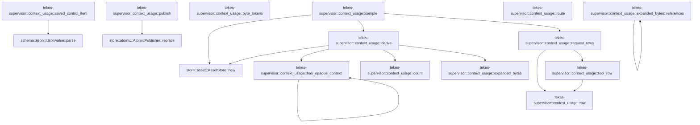

# tekes-supervisor::context_usage

[Package atlas](index.md) · [Source](../../src/context_usage.rs)

## Declarations

Visibility is the declaration spelling; trait members and reexports require their enclosing interface. `cfg` is not evaluated.

| Symbol | Kind | Visibility | Test / cfg |
|---|---|---|---|
| [tekes-supervisor::context_usage::MAX_SAFE](../../src/context_usage.rs#L12) | const_item | `private` |  |
| [tekes-supervisor::context_usage::SavedProjection](../../src/context_usage.rs#L16) | struct_item | `private` |  |
| [tekes-supervisor::context_usage::publish](../../src/context_usage.rs#L24) | function_item | `pub(crate)` |  |
| [tekes-supervisor::context_usage::saved_control_item](../../src/context_usage.rs#L71) | function_item | `pub(crate)` |  |
| [tekes-supervisor::context_usage::derive](../../src/context_usage.rs#L100) | function_item | `pub(crate)` |  |
| [tekes-supervisor::context_usage::sample](../../src/context_usage.rs#L208) | function_item | `pub(crate)` |  |
| [tekes-supervisor::context_usage::byte_tokens](../../src/context_usage.rs#L268) | function_item | `private` |  |
| [tekes-supervisor::context_usage::row](../../src/context_usage.rs#L273) | function_item | `private` |  |
| [tekes-supervisor::context_usage::request_rows](../../src/context_usage.rs#L278) | function_item | `private` |  |
| [tekes-supervisor::context_usage::tool_row](../../src/context_usage.rs#L347) | function_item | `private` |  |
| [tekes-supervisor::context_usage::has_opaque_context](../../src/context_usage.rs#L388) | function_item | `private` |  |
| [tekes-supervisor::context_usage::count](../../src/context_usage.rs#L418) | function_item | `private` |  |
| [tekes-supervisor::context_usage::expanded_bytes](../../src/context_usage.rs#L422) | function_item | `private` |  |
| [tekes-supervisor::context_usage::expanded_bytes::references](../../src/context_usage.rs#L424) | function_item | `private` |  |
| [tekes-supervisor::context_usage::route](../../src/context_usage.rs#L445) | function_item | `private` |  |
| [tekes-supervisor::context_usage::tests::config](../../src/context_usage.rs#L484) | function_item | `private` | test; #[cfg(test)] |
| [tekes-supervisor::context_usage::tests::event](../../src/context_usage.rs#L499) | function_item | `private` | test; #[cfg(test)] |
| [tekes-supervisor::context_usage::tests::prepared](../../src/context_usage.rs#L507) | function_item | `private` | test; #[cfg(test)] |
| [tekes-supervisor::context_usage::tests::replace_request](../../src/context_usage.rs#L533) | function_item | `private` | test; #[cfg(test)] |
| [tekes-supervisor::context_usage::tests::atomic_sample_partitions_system_and_deduplicates_safe_tool_inventory](../../src/context_usage.rs#L544) | function_item | `private` | test; #[cfg(test)] |
| [tekes-supervisor::context_usage::tests::dialect_shapes_are_classified_without_catalog_inference](../../src/context_usage.rs#L595) | function_item | `private` | test; #[cfg(test)] |
| [tekes-supervisor::context_usage::tests::invalidation_replaces_both_total_and_details_and_changes_clock](../../src/context_usage.rs#L628) | function_item | `private` | test; #[cfg(test)] |
| [tekes-supervisor::context_usage::tests::paired_clock_migrates_legacy_and_rejects_corruption](../../src/context_usage.rs#L713) | function_item | `private` | test; #[cfg(test)] |
| [tekes-supervisor::context_usage::tests::request_bounds_are_not_billing_totals_and_replacements_invalidate](../../src/context_usage.rs#L744) | function_item | `private` | test; #[cfg(test)] |
| [tekes-supervisor::context_usage::tests::opaque_media_and_continuations_are_not_priced_by_identifier_bytes](../../src/context_usage.rs#L771) | function_item | `private` | test; #[cfg(test)] |
| [tekes-supervisor::context_usage::tests::durable_clock_survives_recreation_and_does_not_reuse_invalidated_sequence](../../src/context_usage.rs#L784) | function_item | `private` | test; #[cfg(test)] |

## Imports / reexports

| Local name | Source path | Visibility |
|---|---|---|
| `fs` | `std::fs` | `private` |
| `Path` | `std::path::Path` | `private` |
| `Event` | `schema::Event` | `private` |
| `EventKind` | `schema::EventKind` | `private` |
| `Deserialize` | `serde::Deserialize` | `private` |
| `Serialize` | `serde::Serialize` | `private` |
| `Value` | `serde_json::Value` | `private` |
| `json` | `serde_json::json` | `private` |
| `Digest` | `sha2::Digest` | `private` |
| `Sha256` | `sha2::Sha256` | `private` |
| `AssetStore` | `store::AssetStore` | `private` |
| `AtomicPublisher` | `store::AtomicPublisher` | `private` |
| `*` | `super::*` | `private` |

## Module declarations

| Module | Visibility | Attributes |
|---|---|---|
| `tekes-supervisor::context_usage::tests` | `private` | #[cfg(test)] |

## Function call graphs

Edges below are syntactically resolved calls only, including private functions. Graphs partition callers into groups of 20; they are not execution order. All unresolved sites are listed below and in the JSON inventory.

Functions 1–13: 14 direct edges

## Call sites

Includes test functions (marked in declarations). Receiver-type-required sites need type analysis/manual tracing. Calls in closures are attributed to their enclosing function; their occurrence here does not mean the closure executes immediately.

| Caller | Callee expression | Source lines | Target / classification |
|---|---|---|---|
| `publish` | `folder.join` | [29](../../src/context_usage.rs#L29) | receiver-type-required |
| `publish` | `fs::read` | [30](../../src/context_usage.rs#L30) | external-constructor-callback-or-unresolved |
| `publish` | `serde_json::from_slice(&bytes).map_err` | [33](../../src/context_usage.rs#L33) | receiver-type-required |
| `publish` | `serde_json::from_slice` | [33](../../src/context_usage.rs#L33) | external-constructor-callback-or-unresolved |
| `publish` | `error.to_string` | [33](../../src/context_usage.rs#L33), [40](../../src/context_usage.rs#L40), [64](../../src/context_usage.rs#L64), [65](../../src/context_usage.rs#L65) | receiver-type-required |
| `publish` | `Err` | [35](../../src/context_usage.rs#L35), [40](../../src/context_usage.rs#L40), [57](../../src/context_usage.rs#L57) | external-constructor-callback-or-unresolved |
| `publish` | `"invalid context projection version or sequence".to_owned` | [35](../../src/context_usage.rs#L35) | receiver-type-required |
| `publish` | `Some` | [37](../../src/context_usage.rs#L37) | external-constructor-callback-or-unresolved |
| `publish` | `error.kind` | [39](../../src/context_usage.rs#L39) | receiver-type-required |
| `publish` | `Ok` | [44](../../src/context_usage.rs#L44), [66](../../src/context_usage.rs#L66) | external-constructor-callback-or-unresolved |
| `publish` | `match previous {         Some(previous) => previous             .sequence             .checked_add(1)             .filter(&#124;seq&#124; *seq <= MAX_SAFE)             .ok_or("context projection sequence exhausted")?,         None => 0,     }     .max` | [47](../../src/context_usage.rs#L47) | receiver-type-required |
| `publish` | `previous             .sequence             .checked_add(1)             .filter(&#124;seq&#124; *seq <= MAX_SAFE)             .ok_or` | [48](../../src/context_usage.rs#L48) | receiver-type-required |
| `publish` | `previous             .sequence             .checked_add(1)             .filter` | [48](../../src/context_usage.rs#L48) | receiver-type-required |
| `publish` | `previous             .sequence             .checked_add` | [48](../../src/context_usage.rs#L48) | receiver-type-required |
| `publish` | `"context projection sequence exhausted".to_owned` | [57](../../src/context_usage.rs#L57) | receiver-type-required |
| `publish` | `serde_json::to_vec(&SavedProjection {         format: 1,         sequence,         value,     })     .map_err` | [59](../../src/context_usage.rs#L59) | receiver-type-required |
| `publish` | `serde_json::to_vec` | [59](../../src/context_usage.rs#L59) | external-constructor-callback-or-unresolved |
| `publish` | `AtomicPublisher::replace(path, &bytes).map_err` | [65](../../src/context_usage.rs#L65) | receiver-type-required |
| `publish` | `AtomicPublisher::replace` | [65](../../src/context_usage.rs#L65) | [store::atomic::AtomicPublisher::replace](../../../store/src/atomic.rs#L16) |
| `saved_control_item` | `serde_json::from_slice(&fs::read(folder.join("context-usage.projection.json")).ok()?)             .ok` | [76](../../src/context_usage.rs#L76) | receiver-type-required |
| `saved_control_item` | `serde_json::from_slice` | [76](../../src/context_usage.rs#L76) | external-constructor-callback-or-unresolved |
| `saved_control_item` | `fs::read(folder.join("context-usage.projection.json")).ok` | [76](../../src/context_usage.rs#L76) | receiver-type-required |
| `saved_control_item` | `fs::read` | [76](../../src/context_usage.rs#L76) | external-constructor-callback-or-unresolved |
| `saved_control_item` | `folder.join` | [76](../../src/context_usage.rs#L76) | receiver-type-required |
| `saved_control_item` | `schema::IJsonValue::parse(         &serde_json::to_vec(&json!({             "asOfSeq": saved.sequence,             "values": {                 "contextDetails": saved.value.get("contextDetails")?,                 "contextUsage": saved.value.get("contextUsage")?,             },         }))         .ok()?,     )     .ok` | [81](../../src/context_usage.rs#L81) | receiver-type-required |
| `saved_control_item` | `schema::IJsonValue::parse` | [81](../../src/context_usage.rs#L81) | [schema::ijson::IJsonValue::parse](../../../schema/src/ijson.rs#L16) |
| `saved_control_item` | `serde_json::to_vec(&json!({             "asOfSeq": saved.sequence,             "values": {                 "contextDetails": saved.value.get("contextDetails")?,                 "contextUsage": saved.value.get("contextUsage")?,             },         }))         .ok` | [82](../../src/context_usage.rs#L82) | receiver-type-required |
| `saved_control_item` | `serde_json::to_vec` | [82](../../src/context_usage.rs#L82) | external-constructor-callback-or-unresolved |
| `saved_control_item` | `Some` | [92](../../src/context_usage.rs#L92) | external-constructor-callback-or-unresolved |
| `saved_control_item` | `session_id.to_owned` | [93](../../src/context_usage.rs#L93) | receiver-type-required |
| `saved_control_item` | `Vec::new` | [94](../../src/context_usage.rs#L94), [95](../../src/context_usage.rs#L95) | external-constructor-callback-or-unresolved |
| `derive` | `config.and_then` | [105](../../src/context_usage.rs#L105) | receiver-type-required |
| `derive` | `events         .iter()         .rposition` | [116](../../src/context_usage.rs#L116) | receiver-type-required |
| `derive` | `events         .iter` | [116](../../src/context_usage.rs#L116) | receiver-type-required |
| `derive` | `event.kind` | [118](../../src/context_usage.rs#L118), [125](../../src/context_usage.rs#L125), [135](../../src/context_usage.rs#L135) | receiver-type-required |
| `derive` | `events[..index]         .iter()         .rev()         .find` | [122](../../src/context_usage.rs#L122) | receiver-type-required |
| `derive` | `events[..index]         .iter()         .rev` | [122](../../src/context_usage.rs#L122) | receiver-type-required |
| `derive` | `events[..index]         .iter` | [122](../../src/context_usage.rs#L122) | receiver-type-required |
| `derive` | `config.digest().ok().as_deref` | [130](../../src/context_usage.rs#L130) | receiver-type-required |
| `derive` | `config.digest().ok` | [130](../../src/context_usage.rs#L130) | receiver-type-required |
| `derive` | `config.digest` | [130](../../src/context_usage.rs#L130) | receiver-type-required |
| `derive` | `run.string_field` | [130](../../src/context_usage.rs#L130) | receiver-type-required |
| `derive` | `events[..index].iter().rev().find` | [134](../../src/context_usage.rs#L134) | receiver-type-required |
| `derive` | `events[..index].iter().rev` | [134](../../src/context_usage.rs#L134) | receiver-type-required |
| `derive` | `events[..index].iter` | [134](../../src/context_usage.rs#L134) | receiver-type-required |
| `derive` | `event.string_field` | [136](../../src/context_usage.rs#L136) | receiver-type-required |
| `derive` | `attempt.string_field` | [136](../../src/context_usage.rs#L136) | receiver-type-required |
| `derive` | `epoch.string_field` | [140](../../src/context_usage.rs#L140) | receiver-type-required |
| `derive` | `Some` | [140](../../src/context_usage.rs#L140) | external-constructor-callback-or-unresolved |
| `derive` | `model.id.as_str` | [140](../../src/context_usage.rs#L140) | receiver-type-required |
| `derive` | `serde_json::to_value` | [143](../../src/context_usage.rs#L143), [172](../../src/context_usage.rs#L172) | external-constructor-callback-or-unresolved |
| `derive` | `attempt.raw` | [143](../../src/context_usage.rs#L143) | receiver-type-required |
| `derive` | `raw.pointer("/request/asset").and_then` | [146](../../src/context_usage.rs#L146) | receiver-type-required |
| `derive` | `raw.pointer` | [146](../../src/context_usage.rs#L146) | receiver-type-required |
| `derive` | `AssetStore::new` | [149](../../src/context_usage.rs#L149) | [store::asset::AssetStore::new](../../../store/src/asset.rs#L27) |
| `derive` | `folder.join` | [149](../../src/context_usage.rs#L149) | receiver-type-required |
| `derive` | `assets.read_verified` | [152](../../src/context_usage.rs#L152) | receiver-type-required |
| `derive` | `serde_json::from_slice::<Value>` | [157](../../src/context_usage.rs#L157) | external-constructor-callback-or-unresolved |
| `derive` | `has_opaque_context` | [160](../../src/context_usage.rs#L160), [177](../../src/context_usage.rs#L177) | [tekes-supervisor::context_usage::has_opaque_context](../../src/context_usage.rs#L388) |
| `derive` | `body.len` | [163](../../src/context_usage.rs#L163) | receiver-type-required |
| `derive` | `event.raw` | [172](../../src/context_usage.rs#L172) | receiver-type-required |
| `derive` | `raw.get("supersedes").is_some` | [175](../../src/context_usage.rs#L175) | receiver-type-required |
| `derive` | `raw.get` | [175](../../src/context_usage.rs#L175), [176](../../src/context_usage.rs#L176) | receiver-type-required |
| `derive` | `raw.get("retracts").is_some` | [176](../../src/context_usage.rs#L176) | receiver-type-required |
| `derive` | `expanded_bytes` | [181](../../src/context_usage.rs#L181) | [tekes-supervisor::context_usage::expanded_bytes](../../src/context_usage.rs#L422) |
| `derive` | `bound.saturating_add` | [184](../../src/context_usage.rs#L184) | receiver-type-required |
| `derive` | `raw             .get("usage")             .filter` | [187](../../src/context_usage.rs#L187) | receiver-type-required |
| `derive` | `raw             .get` | [187](../../src/context_usage.rs#L187) | receiver-type-required |
| `derive` | `["input_tokens", "output_tokens", "cache_read", "cache_write"]                 .iter()                 .filter_map(&#124;key&#124; count(&usage[*key]))                 .fold` | [191](../../src/context_usage.rs#L191) | receiver-type-required |
| `derive` | `["input_tokens", "output_tokens", "cache_read", "cache_write"]                 .iter()                 .filter_map` | [191](../../src/context_usage.rs#L191) | receiver-type-required |
| `derive` | `["input_tokens", "output_tokens", "cache_read", "cache_write"]                 .iter` | [191](../../src/context_usage.rs#L191) | receiver-type-required |
| `derive` | `count` | [193](../../src/context_usage.rs#L193) | [tekes-supervisor::context_usage::count](../../src/context_usage.rs#L418) |
| `derive` | `bound.max` | [195](../../src/context_usage.rs#L195) | receiver-type-required |
| `sample` | `derive` | [213](../../src/context_usage.rs#L213) | [tekes-supervisor::context_usage::derive](../../src/context_usage.rs#L100) |
| `sample` | `usage.get` | [217](../../src/context_usage.rs#L217) | receiver-type-required |
| `sample` | `value.clone` | [218](../../src/context_usage.rs#L218) | receiver-type-required |
| `sample` | `(usage["basis"] != "unknown")         .then(&#124;&#124; {             let attempt = events                 .iter()                 .rev()                 .find(&#124;e&#124; *e.kind() == EventKind::Attempt)?;             let raw = serde_json::to_value(attempt.raw()).ok()?;             let asset = raw.pointer("/request/asset")?.as_str()?;             let assets = AssetStore::new(folder.join("assets")).ok()?;             let request =                 serde_json::from_slice::<Value>(&assets.read_verified(asset).ok()?).ok()?;             for (output, input) in [("requestID", "attempt"), ("epochID", "epoch")] {                 if let Some(value) = attempt.string_field(input) {                     evidence[output] = json!(value);                 }             }             // Asset identity covers request bytes without returning a raw request.             evidence["sourceRevision"] = json!(asset);             Some(request)         })         .flatten` | [222](../../src/context_usage.rs#L222) | receiver-type-required |
| `sample` | `(usage["basis"] != "unknown")         .then` | [222](../../src/context_usage.rs#L222) | receiver-type-required |
| `sample` | `events                 .iter()                 .rev()                 .find` | [224](../../src/context_usage.rs#L224) | receiver-type-required |
| `sample` | `events                 .iter()                 .rev` | [224](../../src/context_usage.rs#L224) | receiver-type-required |
| `sample` | `events                 .iter` | [224](../../src/context_usage.rs#L224) | receiver-type-required |
| `sample` | `e.kind` | [227](../../src/context_usage.rs#L227) | receiver-type-required |
| `sample` | `serde_json::to_value(attempt.raw()).ok` | [228](../../src/context_usage.rs#L228) | receiver-type-required |
| `sample` | `serde_json::to_value` | [228](../../src/context_usage.rs#L228) | external-constructor-callback-or-unresolved |
| `sample` | `attempt.raw` | [228](../../src/context_usage.rs#L228) | receiver-type-required |
| `sample` | `raw.pointer("/request/asset")?.as_str` | [229](../../src/context_usage.rs#L229) | receiver-type-required |
| `sample` | `raw.pointer` | [229](../../src/context_usage.rs#L229) | receiver-type-required |
| `sample` | `AssetStore::new(folder.join("assets")).ok` | [230](../../src/context_usage.rs#L230) | receiver-type-required |
| `sample` | `AssetStore::new` | [230](../../src/context_usage.rs#L230) | [store::asset::AssetStore::new](../../../store/src/asset.rs#L27) |
| `sample` | `folder.join` | [230](../../src/context_usage.rs#L230) | receiver-type-required |
| `sample` | `serde_json::from_slice::<Value>(&assets.read_verified(asset).ok()?).ok` | [232](../../src/context_usage.rs#L232) | receiver-type-required |
| `sample` | `serde_json::from_slice::<Value>` | [232](../../src/context_usage.rs#L232) | external-constructor-callback-or-unresolved |
| `sample` | `assets.read_verified(asset).ok` | [232](../../src/context_usage.rs#L232) | receiver-type-required |
| `sample` | `assets.read_verified` | [232](../../src/context_usage.rs#L232) | receiver-type-required |
| `sample` | `attempt.string_field` | [234](../../src/context_usage.rs#L234) | receiver-type-required |
| `sample` | `Some` | [240](../../src/context_usage.rs#L240) | external-constructor-callback-or-unresolved |
| `sample` | `request.is_none` | [243](../../src/context_usage.rs#L243) | receiver-type-required |
| `sample` | `Vec::new` | [247](../../src/context_usage.rs#L247) | external-constructor-callback-or-unresolved |
| `sample` | `request.as_ref` | [248](../../src/context_usage.rs#L248) | receiver-type-required |
| `sample` | `request_rows` | [249](../../src/context_usage.rs#L249) | [tekes-supervisor::context_usage::request_rows](../../src/context_usage.rs#L278) |
| `request_rows` | `Vec::new` | [279](../../src/context_usage.rs#L279), [280](../../src/context_usage.rs#L280), [293](../../src/context_usage.rs#L293), [320](../../src/context_usage.rs#L320), [321](../../src/context_usage.rs#L321) | external-constructor-callback-or-unresolved |
| `request_rows` | `request.get` | [287](../../src/context_usage.rs#L287), [292](../../src/context_usage.rs#L292), [319](../../src/context_usage.rs#L319) | receiver-type-required |
| `request_rows` | `system.push` | [288](../../src/context_usage.rs#L288), [296](../../src/context_usage.rs#L296) | receiver-type-required |
| `request_rows` | `value.clone` | [288](../../src/context_usage.rs#L288) | receiver-type-required |
| `request_rows` | `request.get(key).and_then` | [292](../../src/context_usage.rs#L292) | receiver-type-required |
| `request_rows` | `item.clone` | [296](../../src/context_usage.rs#L296), [298](../../src/context_usage.rs#L298) | receiver-type-required |
| `request_rows` | `messages.push` | [298](../../src/context_usage.rs#L298) | receiver-type-required |
| `request_rows` | `rows.push` | [301](../../src/context_usage.rs#L301), [311](../../src/context_usage.rs#L311), [329](../../src/context_usage.rs#L329), [336](../../src/context_usage.rs#L336) | receiver-type-required |
| `request_rows` | `row` | [301](../../src/context_usage.rs#L301), [311](../../src/context_usage.rs#L311) | [tekes-supervisor::context_usage::row](../../src/context_usage.rs#L273) |
| `request_rows` | `system.is_empty` | [310](../../src/context_usage.rs#L310) | receiver-type-required |
| `request_rows` | `request.get("tools").and_then` | [319](../../src/context_usage.rs#L319) | receiver-type-required |
| `request_rows` | `deferred.push` | [324](../../src/context_usage.rs#L324) | receiver-type-required |
| `request_rows` | `tool.clone` | [324](../../src/context_usage.rs#L324), [326](../../src/context_usage.rs#L326) | receiver-type-required |
| `request_rows` | `active.push` | [326](../../src/context_usage.rs#L326) | receiver-type-required |
| `request_rows` | `tool_row` | [329](../../src/context_usage.rs#L329), [336](../../src/context_usage.rs#L336) | [tekes-supervisor::context_usage::tool_row](../../src/context_usage.rs#L347) |
| `request_rows` | `deferred.is_empty` | [335](../../src/context_usage.rs#L335) | receiver-type-required |
| `tool_row` | `row` | [348](../../src/context_usage.rs#L348), [380](../../src/context_usage.rs#L380) | [tekes-supervisor::context_usage::row](../../src/context_usage.rs#L273) |
| `tool_row` | `std::collections::BTreeMap::new` | [349](../../src/context_usage.rs#L349) | external-constructor-callback-or-unresolved |
| `tool_row` | `tool             .get("functionDeclarations")             .and_then(Value::as_array)             .map(&#124;items&#124; items.iter().collect::<Vec<_>>())             .unwrap_or_else` | [351](../../src/context_usage.rs#L351) | receiver-type-required |
| `tool_row` | `tool             .get("functionDeclarations")             .and_then(Value::as_array)             .map` | [351](../../src/context_usage.rs#L351) | receiver-type-required |
| `tool_row` | `tool             .get("functionDeclarations")             .and_then` | [351](../../src/context_usage.rs#L351) | receiver-type-required |
| `tool_row` | `tool             .get` | [351](../../src/context_usage.rs#L351) | receiver-type-required |
| `tool_row` | `items.iter().collect::<Vec<_>>` | [354](../../src/context_usage.rs#L354) | receiver-type-required |
| `tool_row` | `items.iter` | [354](../../src/context_usage.rs#L354) | receiver-type-required |
| `tool_row` | `definition                 .get("name")                 .or_else(&#124;&#124; definition.pointer("/function/name"))                 .and_then` | [357](../../src/context_usage.rs#L357) | receiver-type-required |
| `tool_row` | `definition                 .get("name")                 .or_else` | [357](../../src/context_usage.rs#L357) | receiver-type-required |
| `tool_row` | `definition                 .get` | [357](../../src/context_usage.rs#L357) | receiver-type-required |
| `tool_row` | `definition.pointer` | [359](../../src/context_usage.rs#L359) | receiver-type-required |
| `tool_row` | `name                 .filter(&#124;name&#124; {                     !name.is_empty()                         && name.len() <= 128                         && name                             .bytes()                             .all(&#124;b&#124; b.is_ascii_alphanumeric() &#124;&#124; b"_-.:/".contains(&b))                 })                 .unwrap_or` | [362](../../src/context_usage.rs#L362) | receiver-type-required |
| `tool_row` | `name                 .filter` | [362](../../src/context_usage.rs#L362) | receiver-type-required |
| `tool_row` | `name.is_empty` | [364](../../src/context_usage.rs#L364) | receiver-type-required |
| `tool_row` | `name.len` | [365](../../src/context_usage.rs#L365) | receiver-type-required |
| `tool_row` | `name                             .bytes()                             .all` | [366](../../src/context_usage.rs#L366) | receiver-type-required |
| `tool_row` | `name                             .bytes` | [366](../../src/context_usage.rs#L366) | receiver-type-required |
| `tool_row` | `b.is_ascii_alphanumeric` | [368](../../src/context_usage.rs#L368) | receiver-type-required |
| `tool_row` | `b"_-.:/".contains` | [368](../../src/context_usage.rs#L368) | receiver-type-required |
| `tool_row` | `serde_json::to_vec(definition).expect` | [372](../../src/context_usage.rs#L372) | receiver-type-required |
| `tool_row` | `serde_json::to_vec` | [372](../../src/context_usage.rs#L372) | external-constructor-callback-or-unresolved |
| `tool_row` | `name.as_bytes().to_vec` | [374](../../src/context_usage.rs#L374) | receiver-type-required |
| `tool_row` | `name.as_bytes` | [374](../../src/context_usage.rs#L374) | receiver-type-required |
| `tool_row` | `children                 .entry(child_id.clone())                 .or_insert_with` | [378](../../src/context_usage.rs#L378) | receiver-type-required |
| `tool_row` | `children                 .entry` | [378](../../src/context_usage.rs#L378) | receiver-type-required |
| `tool_row` | `child_id.clone` | [379](../../src/context_usage.rs#L379) | receiver-type-required |
| `has_opaque_context` | `fields.iter().any` | [390](../../src/context_usage.rs#L390) | receiver-type-required |
| `has_opaque_context` | `fields.iter` | [390](../../src/context_usage.rs#L390) | receiver-type-required |
| `has_opaque_context` | `value.as_str().is_some_and` | [404](../../src/context_usage.rs#L404) | receiver-type-required |
| `has_opaque_context` | `value.as_str` | [404](../../src/context_usage.rs#L404) | receiver-type-required |
| `has_opaque_context` | `kind.contains` | [405](../../src/context_usage.rs#L405), [406](../../src/context_usage.rs#L406), [407](../../src/context_usage.rs#L407) | receiver-type-required |
| `has_opaque_context` | `has_opaque_context` | [411](../../src/context_usage.rs#L411) | [tekes-supervisor::context_usage::has_opaque_context](../../src/context_usage.rs#L388) |
| `has_opaque_context` | `values.iter().any` | [413](../../src/context_usage.rs#L413) | receiver-type-required |
| `has_opaque_context` | `values.iter` | [413](../../src/context_usage.rs#L413) | receiver-type-required |
| `count` | `value.as_u64().or_else` | [419](../../src/context_usage.rs#L419) | receiver-type-required |
| `count` | `value.as_u64` | [419](../../src/context_usage.rs#L419) | receiver-type-required |
| `count` | `value.as_str()?.parse().ok` | [419](../../src/context_usage.rs#L419) | receiver-type-required |
| `count` | `value.as_str()?.parse` | [419](../../src/context_usage.rs#L419) | receiver-type-required |
| `count` | `value.as_str` | [419](../../src/context_usage.rs#L419) | receiver-type-required |
| `expanded_bytes` | `serde_json::to_vec(value).ok()?.len` | [423](../../src/context_usage.rs#L423) | receiver-type-required |
| `expanded_bytes` | `serde_json::to_vec(value).ok` | [423](../../src/context_usage.rs#L423) | receiver-type-required |
| `expanded_bytes` | `serde_json::to_vec` | [423](../../src/context_usage.rs#L423) | external-constructor-callback-or-unresolved |
| `expanded_bytes` | `base.checked_add` | [442](../../src/context_usage.rs#L442) | receiver-type-required |
| `expanded_bytes` | `references` | [442](../../src/context_usage.rs#L442) | external-constructor-callback-or-unresolved |
| `references` | `fields.get("asset").and_then` | [428](../../src/context_usage.rs#L428) | receiver-type-required |
| `references` | `fields.get` | [428](../../src/context_usage.rs#L428) | receiver-type-required |
| `references` | `assets.read_verified(asset).ok()?.len` | [429](../../src/context_usage.rs#L429) | receiver-type-required |
| `references` | `assets.read_verified(asset).ok` | [429](../../src/context_usage.rs#L429) | receiver-type-required |
| `references` | `assets.read_verified` | [429](../../src/context_usage.rs#L429) | receiver-type-required |
| `references` | `fields.values` | [431](../../src/context_usage.rs#L431) | receiver-type-required |
| `references` | `bytes.checked_add` | [432](../../src/context_usage.rs#L432) | receiver-type-required |
| `references` | `references` | [432](../../src/context_usage.rs#L432), [437](../../src/context_usage.rs#L437) | [tekes-supervisor::context_usage::expanded_bytes::references](../../src/context_usage.rs#L424) |
| `references` | `Some` | [434](../../src/context_usage.rs#L434), [439](../../src/context_usage.rs#L439) | external-constructor-callback-or-unresolved |
| `references` | `values.iter().try_fold` | [436](../../src/context_usage.rs#L436) | receiver-type-required |
| `references` | `values.iter` | [436](../../src/context_usage.rs#L436) | receiver-type-required |
| `references` | `sum.checked_add` | [437](../../src/context_usage.rs#L437) | receiver-type-required |
| `route` | `config         .session_settings         .as_ref()         .map(&#124;settings&#124; settings.provider.as_str())         .or(config.workspace.policy.provider.as_deref())         .or` | [446](../../src/context_usage.rs#L446) | receiver-type-required |
| `route` | `config         .session_settings         .as_ref()         .map(&#124;settings&#124; settings.provider.as_str())         .or` | [446](../../src/context_usage.rs#L446) | receiver-type-required |
| `route` | `config         .session_settings         .as_ref()         .map` | [446](../../src/context_usage.rs#L446), [452](../../src/context_usage.rs#L452) | receiver-type-required |
| `route` | `config         .session_settings         .as_ref` | [446](../../src/context_usage.rs#L446), [452](../../src/context_usage.rs#L452) | receiver-type-required |
| `route` | `settings.provider.as_str` | [449](../../src/context_usage.rs#L449) | receiver-type-required |
| `route` | `config.workspace.policy.provider.as_deref` | [450](../../src/context_usage.rs#L450) | receiver-type-required |
| `route` | `config.settings.default_provider.as_deref` | [451](../../src/context_usage.rs#L451) | receiver-type-required |
| `route` | `config         .session_settings         .as_ref()         .map(&#124;settings&#124; settings.model.as_str())         .or(config.workspace.policy.model.as_deref())         .or` | [452](../../src/context_usage.rs#L452) | receiver-type-required |
| `route` | `config         .session_settings         .as_ref()         .map(&#124;settings&#124; settings.model.as_str())         .or` | [452](../../src/context_usage.rs#L452) | receiver-type-required |
| `route` | `settings.model.as_str` | [455](../../src/context_usage.rs#L455) | receiver-type-required |
| `route` | `config.workspace.policy.model.as_deref` | [456](../../src/context_usage.rs#L456) | receiver-type-required |
| `route` | `config.settings.default_model.as_deref` | [457](../../src/context_usage.rs#L457) | receiver-type-required |
| `route` | `config             .providers             .providers             .iter()             .find` | [459](../../src/context_usage.rs#L459), [464](../../src/context_usage.rs#L464) | receiver-type-required |
| `route` | `config             .providers             .providers             .iter` | [459](../../src/context_usage.rs#L459), [464](../../src/context_usage.rs#L464) | receiver-type-required |
| `route` | `provider.models.iter().any` | [468](../../src/context_usage.rs#L468) | receiver-type-required |
| `route` | `provider.models.iter` | [468](../../src/context_usage.rs#L468), [475](../../src/context_usage.rs#L475) | receiver-type-required |
| `route` | `provider             .models             .iter()             .find` | [471](../../src/context_usage.rs#L471) | receiver-type-required |
| `route` | `provider             .models             .iter` | [471](../../src/context_usage.rs#L471) | receiver-type-required |
| `route` | `provider.models.iter().find` | [475](../../src/context_usage.rs#L475) | receiver-type-required |
| `route` | `Some` | [477](../../src/context_usage.rs#L477) | external-constructor-callback-or-unresolved |
| `config` | `serde_json::from_value(json!({             "format":1,             "workspace":{"format":1,"revision":1,"id":"w","name":"W","cwd":[std::fs::canonicalize(std::env::temp_dir()).unwrap()],"policy":{"network":true}},             "providers":{"format":1,"revision":1,"providers":[{                 "id":"p","adapter":"responses","dialect":"openai_responses_v1","endpoint_owner":"openai",                 "gateway_translation":"direct","evidence_revision":"openai-2026-08-01","endpoint":"https://example.com/v1",                 "models":[{"id":"gpt-5","profile":"openai_responses_v1:gpt-5","enabled":true,                     "context_window_tokens":100000,"compact_trigger_tokens":90000}]             }]},             "settings":{"format":1,"revision":1,"default_provider":"p","default_model":"gpt-5"},             "revisions":{"workspace":1,"providers":1,"settings":1}         })).unwrap` | [485](../../src/context_usage.rs#L485) | receiver-type-required |
| `config` | `serde_json::from_value` | [485](../../src/context_usage.rs#L485) | external-constructor-callback-or-unresolved |
| `event` | `Event::from_value(schema::IJsonValue::parse(&serde_json::to_vec(&value).unwrap()).unwrap())             .unwrap` | [503](../../src/context_usage.rs#L503) | receiver-type-required |
| `event` | `Event::from_value` | [503](../../src/context_usage.rs#L503) | external-constructor-callback-or-unresolved |
| `event` | `schema::IJsonValue::parse(&serde_json::to_vec(&value).unwrap()).unwrap` | [503](../../src/context_usage.rs#L503) | receiver-type-required |
| `event` | `schema::IJsonValue::parse` | [503](../../src/context_usage.rs#L503) | [schema::ijson::IJsonValue::parse](../../../schema/src/ijson.rs#L16) |
| `event` | `serde_json::to_vec(&value).unwrap` | [503](../../src/context_usage.rs#L503) | receiver-type-required |
| `event` | `serde_json::to_vec` | [503](../../src/context_usage.rs#L503) | external-constructor-callback-or-unresolved |
| `prepared` | `AssetStore::new(folder.join("assets")).unwrap` | [508](../../src/context_usage.rs#L508) | receiver-type-required |
| `prepared` | `AssetStore::new` | [508](../../src/context_usage.rs#L508) | external-constructor-callback-or-unresolved |
| `prepared` | `folder.join` | [508](../../src/context_usage.rs#L508) | receiver-type-required |
| `prepared` | `assets.publish(b"system").unwrap` | [509](../../src/context_usage.rs#L509) | receiver-type-required |
| `prepared` | `assets.publish` | [509](../../src/context_usage.rs#L509), [510](../../src/context_usage.rs#L510) | receiver-type-required |
| `prepared` | `assets.publish(b"[]").unwrap` | [510](../../src/context_usage.rs#L510) | receiver-type-required |
| `prepared` | `assets             .publish(br#"{"model":"gpt-5","input":[{"role":"user","content":"hello"}]}"#)             .unwrap` | [511](../../src/context_usage.rs#L511) | receiver-type-required |
| `prepared` | `assets             .publish` | [511](../../src/context_usage.rs#L511) | receiver-type-required |
| `replace_request` | `AssetStore::new(folder.join("assets"))             .unwrap()             .publish(&serde_json::to_vec(&request).unwrap())             .unwrap` | [534](../../src/context_usage.rs#L534) | receiver-type-required |
| `replace_request` | `AssetStore::new(folder.join("assets"))             .unwrap()             .publish` | [534](../../src/context_usage.rs#L534) | receiver-type-required |
| `replace_request` | `AssetStore::new(folder.join("assets"))             .unwrap` | [534](../../src/context_usage.rs#L534) | receiver-type-required |
| `replace_request` | `AssetStore::new` | [534](../../src/context_usage.rs#L534) | external-constructor-callback-or-unresolved |
| `replace_request` | `folder.join` | [534](../../src/context_usage.rs#L534) | receiver-type-required |
| `replace_request` | `serde_json::to_vec(&request).unwrap` | [536](../../src/context_usage.rs#L536) | receiver-type-required |
| `replace_request` | `serde_json::to_vec` | [536](../../src/context_usage.rs#L536) | external-constructor-callback-or-unresolved |
| `replace_request` | `serde_json::to_value(events[2].raw()).unwrap` | [538](../../src/context_usage.rs#L538) | receiver-type-required |
| `replace_request` | `serde_json::to_value` | [538](../../src/context_usage.rs#L538) | external-constructor-callback-or-unresolved |
| `replace_request` | `events[2].raw` | [538](../../src/context_usage.rs#L538) | receiver-type-required |
| `replace_request` | `event` | [540](../../src/context_usage.rs#L540) | [tekes-supervisor::context_usage::tests::event](../../src/context_usage.rs#L499) |
| `atomic_sample_partitions_system_and_deduplicates_safe_tool_inventory` | `tempfile::tempdir().unwrap` | [545](../../src/context_usage.rs#L545) | receiver-type-required |
| `atomic_sample_partitions_system_and_deduplicates_safe_tool_inventory` | `tempfile::tempdir` | [545](../../src/context_usage.rs#L545) | external-constructor-callback-or-unresolved |
| `atomic_sample_partitions_system_and_deduplicates_safe_tool_inventory` | `config` | [546](../../src/context_usage.rs#L546) | external-constructor-callback-or-unresolved |
| `atomic_sample_partitions_system_and_deduplicates_safe_tool_inventory` | `prepared` | [547](../../src/context_usage.rs#L547) | [tekes-supervisor::context_usage::tests::prepared](../../src/context_usage.rs#L507) |
| `atomic_sample_partitions_system_and_deduplicates_safe_tool_inventory` | `folder.path` | [547](../../src/context_usage.rs#L547), [549](../../src/context_usage.rs#L549), [559](../../src/context_usage.rs#L559) | receiver-type-required |
| `atomic_sample_partitions_system_and_deduplicates_safe_tool_inventory` | `replace_request` | [548](../../src/context_usage.rs#L548) | [tekes-supervisor::context_usage::tests::replace_request](../../src/context_usage.rs#L533) |
| `atomic_sample_partitions_system_and_deduplicates_safe_tool_inventory` | `sample` | [559](../../src/context_usage.rs#L559) | external-constructor-callback-or-unresolved |
| `atomic_sample_partitions_system_and_deduplicates_safe_tool_inventory` | `Some` | [559](../../src/context_usage.rs#L559) | external-constructor-callback-or-unresolved |
| `atomic_sample_partitions_system_and_deduplicates_safe_tool_inventory` | `serde_json::from_str(include_str!(             "../../../fixtures/context-details/native-v1.json"         ))         .unwrap` | [560](../../src/context_usage.rs#L560) | receiver-type-required |
| `atomic_sample_partitions_system_and_deduplicates_safe_tool_inventory` | `serde_json::from_str` | [560](../../src/context_usage.rs#L560) | external-constructor-callback-or-unresolved |
| `atomic_sample_partitions_system_and_deduplicates_safe_tool_inventory` | `details["rows"].as_array().unwrap` | [572](../../src/context_usage.rs#L572) | receiver-type-required |
| `atomic_sample_partitions_system_and_deduplicates_safe_tool_inventory` | `details["rows"].as_array` | [572](../../src/context_usage.rs#L572) | receiver-type-required |
| `atomic_sample_partitions_system_and_deduplicates_safe_tool_inventory` | `serde_json::to_string(details).unwrap` | [582](../../src/context_usage.rs#L582) | receiver-type-required |
| `atomic_sample_partitions_system_and_deduplicates_safe_tool_inventory` | `serde_json::to_string` | [582](../../src/context_usage.rs#L582) | external-constructor-callback-or-unresolved |
| `dialect_shapes_are_classified_without_catalog_inference` | `request_rows` | [606](../../src/context_usage.rs#L606), [623](../../src/context_usage.rs#L623) | external-constructor-callback-or-unresolved |
| `dialect_shapes_are_classified_without_catalog_inference` | `std::collections::BTreeSet::new` | [615](../../src/context_usage.rs#L615) | external-constructor-callback-or-unresolved |
| `dialect_shapes_are_classified_without_catalog_inference` | `row["children"].as_array().unwrap` | [618](../../src/context_usage.rs#L618) | receiver-type-required |
| `dialect_shapes_are_classified_without_catalog_inference` | `row["children"].as_array` | [618](../../src/context_usage.rs#L618) | receiver-type-required |
| `invalidation_replaces_both_total_and_details_and_changes_clock` | `tempfile::tempdir().unwrap` | [629](../../src/context_usage.rs#L629) | receiver-type-required |
| `invalidation_replaces_both_total_and_details_and_changes_clock` | `tempfile::tempdir` | [629](../../src/context_usage.rs#L629) | external-constructor-callback-or-unresolved |
| `invalidation_replaces_both_total_and_details_and_changes_clock` | `config` | [630](../../src/context_usage.rs#L630) | external-constructor-callback-or-unresolved |
| `invalidation_replaces_both_total_and_details_and_changes_clock` | `prepared` | [631](../../src/context_usage.rs#L631) | [tekes-supervisor::context_usage::tests::prepared](../../src/context_usage.rs#L507) |
| `invalidation_replaces_both_total_and_details_and_changes_clock` | `folder.path` | [631](../../src/context_usage.rs#L631), [632](../../src/context_usage.rs#L632), [654](../../src/context_usage.rs#L654), [692](../../src/context_usage.rs#L692), [697](../../src/context_usage.rs#L697), [705](../../src/context_usage.rs#L705) | receiver-type-required |
| `invalidation_replaces_both_total_and_details_and_changes_clock` | `sample` | [632](../../src/context_usage.rs#L632), [654](../../src/context_usage.rs#L654), [692](../../src/context_usage.rs#L692) | external-constructor-callback-or-unresolved |
| `invalidation_replaces_both_total_and_details_and_changes_clock` | `Some` | [632](../../src/context_usage.rs#L632), [654](../../src/context_usage.rs#L654), [691](../../src/context_usage.rs#L691), [692](../../src/context_usage.rs#L692) | external-constructor-callback-or-unresolved |
| `invalidation_replaces_both_total_and_details_and_changes_clock` | `[             json!({"kind":"compact","covers":[{"from":3,"to":3}],"summary":"small"}),             json!({"kind":"output","turn":1,"attempt":"a1","content":[],                 "sealed":{"version":1,"adapter":"openai_responses_v1","fragments":"[]"},                 "usage":{"availability":"unavailable"},"supersedes":[{"from":3,"to":3}]}),             serde_json::to_value(events[0].raw()).unwrap(),             serde_json::to_value(events[1].raw()).unwrap(),             json!({"kind":"extension-context-replacement"}),             json!({"kind":"output","turn":1,"attempt":"a1","content":[],                 "sealed":{"version":1,"adapter":"openai_responses_v1","fragments":"[]"},                 "usage":{"availability":"unavailable"},"retracts":[{"from":3,"to":3}]}),         ]         .into_iter()         .enumerate` | [637](../../src/context_usage.rs#L637) | receiver-type-required |
| `invalidation_replaces_both_total_and_details_and_changes_clock` | `[             json!({"kind":"compact","covers":[{"from":3,"to":3}],"summary":"small"}),             json!({"kind":"output","turn":1,"attempt":"a1","content":[],                 "sealed":{"version":1,"adapter":"openai_responses_v1","fragments":"[]"},                 "usage":{"availability":"unavailable"},"supersedes":[{"from":3,"to":3}]}),             serde_json::to_value(events[0].raw()).unwrap(),             serde_json::to_value(events[1].raw()).unwrap(),             json!({"kind":"extension-context-replacement"}),             json!({"kind":"output","turn":1,"attempt":"a1","content":[],                 "sealed":{"version":1,"adapter":"openai_responses_v1","fragments":"[]"},                 "usage":{"availability":"unavailable"},"retracts":[{"from":3,"to":3}]}),         ]         .into_iter` | [637](../../src/context_usage.rs#L637) | receiver-type-required |
| `invalidation_replaces_both_total_and_details_and_changes_clock` | `serde_json::to_value(events[0].raw()).unwrap` | [642](../../src/context_usage.rs#L642) | receiver-type-required |
| `invalidation_replaces_both_total_and_details_and_changes_clock` | `serde_json::to_value` | [642](../../src/context_usage.rs#L642), [643](../../src/context_usage.rs#L643) | external-constructor-callback-or-unresolved |
| `invalidation_replaces_both_total_and_details_and_changes_clock` | `events[0].raw` | [642](../../src/context_usage.rs#L642) | receiver-type-required |
| `invalidation_replaces_both_total_and_details_and_changes_clock` | `serde_json::to_value(events[1].raw()).unwrap` | [643](../../src/context_usage.rs#L643) | receiver-type-required |
| `invalidation_replaces_both_total_and_details_and_changes_clock` | `events[1].raw` | [643](../../src/context_usage.rs#L643) | receiver-type-required |
| `invalidation_replaces_both_total_and_details_and_changes_clock` | `events.clone` | [652](../../src/context_usage.rs#L652), [695](../../src/context_usage.rs#L695) | receiver-type-required |
| `invalidation_replaces_both_total_and_details_and_changes_clock` | `changed.push` | [653](../../src/context_usage.rs#L653) | receiver-type-required |
| `invalidation_replaces_both_total_and_details_and_changes_clock` | `event` | [653](../../src/context_usage.rs#L653) | [tekes-supervisor::context_usage::tests::event](../../src/context_usage.rs#L499) |
| `invalidation_replaces_both_total_and_details_and_changes_clock` | `serde_json::from_str(include_str!(                     "../../../fixtures/context-details/native-unknown-v1.json"                 ))                 .unwrap` | [656](../../src/context_usage.rs#L656) | receiver-type-required |
| `invalidation_replaces_both_total_and_details_and_changes_clock` | `serde_json::from_str` | [656](../../src/context_usage.rs#L656) | external-constructor-callback-or-unresolved |
| `invalidation_replaces_both_total_and_details_and_changes_clock` | `config.clone` | [689](../../src/context_usage.rs#L689) | receiver-type-required |
| `invalidation_replaces_both_total_and_details_and_changes_clock` | `"other".into` | [690](../../src/context_usage.rs#L690), [691](../../src/context_usage.rs#L691) | receiver-type-required |
| `invalidation_replaces_both_total_and_details_and_changes_clock` | `replace_request` | [696](../../src/context_usage.rs#L696) | [tekes-supervisor::context_usage::tests::replace_request](../../src/context_usage.rs#L533) |
| `invalidation_replaces_both_total_and_details_and_changes_clock` | `std::fs::remove_dir_all(folder.path().join("assets")).unwrap` | [705](../../src/context_usage.rs#L705) | receiver-type-required |
| `invalidation_replaces_both_total_and_details_and_changes_clock` | `std::fs::remove_dir_all` | [705](../../src/context_usage.rs#L705) | external-constructor-callback-or-unresolved |
| `invalidation_replaces_both_total_and_details_and_changes_clock` | `folder.path().join` | [705](../../src/context_usage.rs#L705) | receiver-type-required |
| `paired_clock_migrates_legacy_and_rejects_corruption` | `tempfile::tempdir().unwrap` | [714](../../src/context_usage.rs#L714) | receiver-type-required |
| `paired_clock_migrates_legacy_and_rejects_corruption` | `tempfile::tempdir` | [714](../../src/context_usage.rs#L714) | external-constructor-callback-or-unresolved |
| `paired_clock_migrates_legacy_and_rejects_corruption` | `config` | [715](../../src/context_usage.rs#L715) | external-constructor-callback-or-unresolved |
| `paired_clock_migrates_legacy_and_rejects_corruption` | `prepared` | [716](../../src/context_usage.rs#L716) | [tekes-supervisor::context_usage::tests::prepared](../../src/context_usage.rs#L507) |
| `paired_clock_migrates_legacy_and_rejects_corruption` | `folder.path` | [716](../../src/context_usage.rs#L716), [726](../../src/context_usage.rs#L726), [736](../../src/context_usage.rs#L736) | receiver-type-required |
| `paired_clock_migrates_legacy_and_rejects_corruption` | `sample` | [726](../../src/context_usage.rs#L726) | external-constructor-callback-or-unresolved |
| `paired_clock_migrates_legacy_and_rejects_corruption` | `Some` | [726](../../src/context_usage.rs#L726) | external-constructor-callback-or-unresolved |
| `paired_clock_migrates_legacy_and_rejects_corruption` | `std::fs::write(             folder.path().join("context-usage.projection.json"),             b"bad JSON",         )         .unwrap` | [735](../../src/context_usage.rs#L735) | receiver-type-required |
| `paired_clock_migrates_legacy_and_rejects_corruption` | `std::fs::write` | [735](../../src/context_usage.rs#L735) | external-constructor-callback-or-unresolved |
| `paired_clock_migrates_legacy_and_rejects_corruption` | `folder.path().join` | [736](../../src/context_usage.rs#L736) | receiver-type-required |
| `request_bounds_are_not_billing_totals_and_replacements_invalidate` | `tempfile::tempdir().unwrap` | [745](../../src/context_usage.rs#L745) | receiver-type-required |
| `request_bounds_are_not_billing_totals_and_replacements_invalidate` | `tempfile::tempdir` | [745](../../src/context_usage.rs#L745) | external-constructor-callback-or-unresolved |
| `request_bounds_are_not_billing_totals_and_replacements_invalidate` | `config` | [746](../../src/context_usage.rs#L746) | external-constructor-callback-or-unresolved |
| `request_bounds_are_not_billing_totals_and_replacements_invalidate` | `prepared` | [747](../../src/context_usage.rs#L747) | [tekes-supervisor::context_usage::tests::prepared](../../src/context_usage.rs#L507) |
| `request_bounds_are_not_billing_totals_and_replacements_invalidate` | `folder.path` | [747](../../src/context_usage.rs#L747), [748](../../src/context_usage.rs#L748), [754](../../src/context_usage.rs#L754), [760](../../src/context_usage.rs#L760), [765](../../src/context_usage.rs#L765) | receiver-type-required |
| `request_bounds_are_not_billing_totals_and_replacements_invalidate` | `derive` | [748](../../src/context_usage.rs#L748), [754](../../src/context_usage.rs#L754), [760](../../src/context_usage.rs#L760), [765](../../src/context_usage.rs#L765) | external-constructor-callback-or-unresolved |
| `request_bounds_are_not_billing_totals_and_replacements_invalidate` | `Some` | [748](../../src/context_usage.rs#L748), [754](../../src/context_usage.rs#L754), [760](../../src/context_usage.rs#L760), [765](../../src/context_usage.rs#L765) | external-constructor-callback-or-unresolved |
| `request_bounds_are_not_billing_totals_and_replacements_invalidate` | `events.push` | [751](../../src/context_usage.rs#L751), [756](../../src/context_usage.rs#L756) | receiver-type-required |
| `request_bounds_are_not_billing_totals_and_replacements_invalidate` | `event` | [751](../../src/context_usage.rs#L751), [756](../../src/context_usage.rs#L756) | [tekes-supervisor::context_usage::tests::event](../../src/context_usage.rs#L499) |
| `request_bounds_are_not_billing_totals_and_replacements_invalidate` | `config.clone` | [763](../../src/context_usage.rs#L763) | receiver-type-required |
| `durable_clock_survives_recreation_and_does_not_reuse_invalidated_sequence` | `tempfile::tempdir().unwrap` | [785](../../src/context_usage.rs#L785) | receiver-type-required |
| `durable_clock_survives_recreation_and_does_not_reuse_invalidated_sequence` | `tempfile::tempdir` | [785](../../src/context_usage.rs#L785) | external-constructor-callback-or-unresolved |
