# tekes-supervisor::endpoint_carrier::legacy_history

[Package atlas](index.md) · [Source](../../src/endpoint_carrier/legacy_history.rs)

## Declarations

Visibility is the declaration spelling; trait members and reexports require their enclosing interface. `cfg` is not evaluated.

| Symbol | Kind | Visibility | Test / cfg |
|---|---|---|---|
| [tekes-supervisor::endpoint_carrier::legacy_history::FrozenLegacyHistory](../../src/endpoint_carrier/legacy_history.rs#L5) | struct_item | `pub(super)` |  |
| [tekes-supervisor::endpoint_carrier::legacy_history::FrozenLegacyHistory::through](../../src/endpoint_carrier/legacy_history.rs#L11) | function_item | `private` |  |
| [tekes-supervisor::endpoint_carrier::legacy_history::FrozenLegacyHistory::page](../../src/endpoint_carrier/legacy_history.rs#L15) | function_item | `private` |  |
| [tekes-supervisor::endpoint_carrier::legacy_history::digest](../../src/endpoint_carrier/legacy_history.rs#L32) | function_item | `private` |  |
| [tekes-supervisor::endpoint_carrier::legacy_history::ProductionCarrierStreams::legacy_mutation_failure](../../src/endpoint_carrier/legacy_history.rs#L40) | function_item | `pub(super)` |  |
| [tekes-supervisor::endpoint_carrier::legacy_history::ProductionCarrierStreams::open_legacy_journal](../../src/endpoint_carrier/legacy_history.rs#L76) | function_item | `pub(super)` |  |
| [tekes-supervisor::endpoint_carrier::legacy_history::ProductionCarrierStreams::legacy_journal_page](../../src/endpoint_carrier/legacy_history.rs#L157) | function_item | `pub(super)` |  |
| [tekes-supervisor::endpoint_carrier::legacy_history::tests::Quarantined](../../src/endpoint_carrier/legacy_history.rs#L205) | struct_item | `private` | test; #[cfg(test)] |
| [tekes-supervisor::endpoint_carrier::legacy_history::tests::Quarantined::live_sessions](../../src/endpoint_carrier/legacy_history.rs#L207) | function_item | `private` | test; #[cfg(test)] |
| [tekes-supervisor::endpoint_carrier::legacy_history::tests::Quarantined::reconcile_projection](../../src/endpoint_carrier/legacy_history.rs#L210) | function_item | `private` | test; #[cfg(test)] |
| [tekes-supervisor::endpoint_carrier::legacy_history::tests::Quarantined::ensure_verified](../../src/endpoint_carrier/legacy_history.rs#L213) | function_item | `private` | test; #[cfg(test)] |
| [tekes-supervisor::endpoint_carrier::legacy_history::tests::fixture](../../src/endpoint_carrier/legacy_history.rs#L218) | function_item | `private` | test; #[cfg(test)] |
| [tekes-supervisor::endpoint_carrier::legacy_history::tests::quarantined_history_is_readable_but_never_promoted_to_execution_trust](../../src/endpoint_carrier/legacy_history.rs#L247) | function_item | `private` | test; #[cfg(test)] |

## Imports / reexports

| Local name | Source path | Visibility |
|---|---|---|
| `*` | `super::*` | `private` |
| `Digest` | `sha2::Digest` | `private` |
| `Sha256` | `sha2::Sha256` | `private` |
| `*` | `super::*` | `private` |

## Module declarations

| Module | Visibility | Attributes |
|---|---|---|
| `tekes-supervisor::endpoint_carrier::legacy_history::tests` | `private` | #[cfg(test)] |

## Function call graphs

Edges below are syntactically resolved calls only, including private functions. Graphs partition callers into groups of 20; they are not execution order. All unresolved sites are listed below and in the JSON inventory.

```mermaid
flowchart TD
  n0["endpoint::history::history_page"]
  n1["endpoint::projection::Projector::read_only_legacy_history"]
  n2["endpoint::types::validate_session_id"]
  n3["schema::fold::validate_historical_ledger"]
  n4["tekes-supervisor::endpoint_carrier::legacy_history::FrozenLegacyHistory::through"]
  n5["tekes-supervisor::endpoint_carrier::legacy_history::ProductionCarrierStreams::legacy_journal_page"]
  n6["tekes-supervisor::endpoint_carrier::legacy_history::FrozenLegacyHistory::page"]
  n7["tekes-supervisor::endpoint_carrier::legacy_history::digest"]
  n8["tekes-supervisor::endpoint_carrier::legacy_history::ProductionCarrierStreams::legacy_mutation_failure"]
  n9["tekes-supervisor::endpoint_carrier::legacy_history::ProductionCarrierStreams::open_legacy_journal"]
  n5 --> n7
  n6 --> n0
  n6 --> n4
  n8 --> n2
  n8 --> n3
  n9 --> n1
  n9 --> n2
  n9 --> n3
  n9 --> n7
```

Functions 1–6: 9 direct edges

## Call sites

Includes test functions (marked in declarations). Receiver-type-required sites need type analysis/manual tracing. Calls in closures are attributed to their enclosing function; their occurrence here does not mean the closure executes immediately.

| Caller | Callee expression | Source lines | Target / classification |
|---|---|---|---|
| `through` | `self.rows.last().map_or` | [12](../../src/endpoint_carrier/legacy_history.rs#L12) | receiver-type-required |
| `through` | `self.rows.last` | [12](../../src/endpoint_carrier/legacy_history.rs#L12) | receiver-type-required |
| `page` | `(1..=endpoint::MAX_JOURNAL_WINDOW_MESSAGES).contains` | [20](../../src/endpoint_carrier/legacy_history.rs#L20) | receiver-type-required |
| `page` | `before.is_some_and` | [21](../../src/endpoint_carrier/legacy_history.rs#L21) | receiver-type-required |
| `page` | `self.through` | [21](../../src/endpoint_carrier/legacy_history.rs#L21) | [tekes-supervisor::endpoint_carrier::legacy_history::FrozenLegacyHistory::through](../../src/endpoint_carrier/legacy_history.rs#L11) |
| `page` | `Err` | [23](../../src/endpoint_carrier/legacy_history.rs#L23) | external-constructor-callback-or-unresolved |
| `page` | `ProductionCarrierError::Lifecycle` | [23](../../src/endpoint_carrier/legacy_history.rs#L23), [28](../../src/endpoint_carrier/legacy_history.rs#L28) | external-constructor-callback-or-unresolved |
| `page` | `"invalid historical window".into` | [24](../../src/endpoint_carrier/legacy_history.rs#L24) | receiver-type-required |
| `page` | `endpoint::history_page(&self.rows, before.map(&#124;v&#124; v.max(0) as u64), Some(limit))             .map_err` | [27](../../src/endpoint_carrier/legacy_history.rs#L27) | receiver-type-required |
| `page` | `endpoint::history_page` | [27](../../src/endpoint_carrier/legacy_history.rs#L27) | [endpoint::history::history_page](../../../endpoint/src/history.rs#L13) |
| `page` | `before.map` | [27](../../src/endpoint_carrier/legacy_history.rs#L27) | receiver-type-required |
| `page` | `v.max` | [27](../../src/endpoint_carrier/legacy_history.rs#L27) | receiver-type-required |
| `page` | `Some` | [27](../../src/endpoint_carrier/legacy_history.rs#L27) | external-constructor-callback-or-unresolved |
| `page` | `e.to_string` | [28](../../src/endpoint_carrier/legacy_history.rs#L28) | receiver-type-required |
| `legacy_mutation_failure` | `payload_session_id` | [44](../../src/endpoint_carrier/legacy_history.rs#L44) | external-constructor-callback-or-unresolved |
| `legacy_mutation_failure` | `endpoint::validate_session_id(&session).ok` | [45](../../src/endpoint_carrier/legacy_history.rs#L45) | receiver-type-required |
| `legacy_mutation_failure` | `endpoint::validate_session_id` | [45](../../src/endpoint_carrier/legacy_history.rs#L45) | [endpoint::types::validate_session_id](../../../endpoint/src/types.rs#L130) |
| `legacy_mutation_failure` | `self             .inner             .legacy_histories             .lock()             .unwrap_or_else(std::sync::PoisonError::into_inner)             .contains_key` | [46](../../src/endpoint_carrier/legacy_history.rs#L46) | receiver-type-required |
| `legacy_mutation_failure` | `self             .inner             .legacy_histories             .lock()             .unwrap_or_else` | [46](../../src/endpoint_carrier/legacy_history.rs#L46) | receiver-type-required |
| `legacy_mutation_failure` | `self             .inner             .legacy_histories             .lock` | [46](../../src/endpoint_carrier/legacy_history.rs#L46) | receiver-type-required |
| `legacy_mutation_failure` | `fs::read(                 self.inner                     .root                     .join("threads")                     .join(&session)                     .join("main.jsonl"),             )             .ok()             .is_some_and` | [56](../../src/endpoint_carrier/legacy_history.rs#L56) | receiver-type-required |
| `legacy_mutation_failure` | `fs::read(                 self.inner                     .root                     .join("threads")                     .join(&session)                     .join("main.jsonl"),             )             .ok` | [56](../../src/endpoint_carrier/legacy_history.rs#L56) | receiver-type-required |
| `legacy_mutation_failure` | `fs::read` | [56](../../src/endpoint_carrier/legacy_history.rs#L56) | external-constructor-callback-or-unresolved |
| `legacy_mutation_failure` | `self.inner                     .root                     .join("threads")                     .join(&session)                     .join` | [57](../../src/endpoint_carrier/legacy_history.rs#L57) | receiver-type-required |
| `legacy_mutation_failure` | `self.inner                     .root                     .join("threads")                     .join` | [57](../../src/endpoint_carrier/legacy_history.rs#L57) | receiver-type-required |
| `legacy_mutation_failure` | `self.inner                     .root                     .join` | [57](../../src/endpoint_carrier/legacy_history.rs#L57) | receiver-type-required |
| `legacy_mutation_failure` | `schema::validate_historical_ledger(&bytes, schema::READER_VERSION).is_ok` | [65](../../src/endpoint_carrier/legacy_history.rs#L65) | receiver-type-required |
| `legacy_mutation_failure` | `schema::validate_historical_ledger` | [65](../../src/endpoint_carrier/legacy_history.rs#L65) | [schema::fold::validate_historical_ledger](../../../schema/src/fold.rs#L1199) |
| `legacy_mutation_failure` | `recognized.then` | [67](../../src/endpoint_carrier/legacy_history.rs#L67) | receiver-type-required |
| `legacy_mutation_failure` | `Some` | [68](../../src/endpoint_carrier/legacy_history.rs#L68) | external-constructor-callback-or-unresolved |
| `legacy_mutation_failure` | `"internal".into` | [69](../../src/endpoint_carrier/legacy_history.rs#L69) | receiver-type-required |
| `legacy_mutation_failure` | `"This legacy session is available as read-only history; execution facts are unavailable".into` | [70](../../src/endpoint_carrier/legacy_history.rs#L70) | receiver-type-required |
| `legacy_mutation_failure` | `IJsonValue::parse_str(r#"{"reason":"legacy-history-read-only"}"#).expect` | [71](../../src/endpoint_carrier/legacy_history.rs#L71) | receiver-type-required |
| `legacy_mutation_failure` | `IJsonValue::parse_str` | [71](../../src/endpoint_carrier/legacy_history.rs#L71) | external-constructor-callback-or-unresolved |
| `open_legacy_journal` | `endpoint::validate_session_id(&address.session_id)             .map_err` | [83](../../src/endpoint_carrier/legacy_history.rs#L83) | receiver-type-required |
| `open_legacy_journal` | `endpoint::validate_session_id` | [83](../../src/endpoint_carrier/legacy_history.rs#L83) | [endpoint::types::validate_session_id](../../../endpoint/src/types.rs#L130) |
| `open_legacy_journal` | `ProductionCarrierError::Lifecycle` | [84](../../src/endpoint_carrier/legacy_history.rs#L84), [86](../../src/endpoint_carrier/legacy_history.rs#L86), [99](../../src/endpoint_carrier/legacy_history.rs#L99), [104](../../src/endpoint_carrier/legacy_history.rs#L104), [110](../../src/endpoint_carrier/legacy_history.rs#L110), [129](../../src/endpoint_carrier/legacy_history.rs#L129) | external-constructor-callback-or-unresolved |
| `open_legacy_journal` | `e.to_string` | [84](../../src/endpoint_carrier/legacy_history.rs#L84), [104](../../src/endpoint_carrier/legacy_history.rs#L104) | receiver-type-required |
| `open_legacy_journal` | `self.live_sessions().contains` | [85](../../src/endpoint_carrier/legacy_history.rs#L85) | receiver-type-required |
| `open_legacy_journal` | `self.live_sessions` | [85](../../src/endpoint_carrier/legacy_history.rs#L85) | receiver-type-required |
| `open_legacy_journal` | `Err` | [86](../../src/endpoint_carrier/legacy_history.rs#L86), [99](../../src/endpoint_carrier/legacy_history.rs#L99), [110](../../src/endpoint_carrier/legacy_history.rs#L110), [129](../../src/endpoint_carrier/legacy_history.rs#L129) | external-constructor-callback-or-unresolved |
| `open_legacy_journal` | `"historical session has a live worker".into` | [87](../../src/endpoint_carrier/legacy_history.rs#L87) | receiver-type-required |
| `open_legacy_journal` | `self.inner.root.join("threads").join` | [90](../../src/endpoint_carrier/legacy_history.rs#L90) | receiver-type-required |
| `open_legacy_journal` | `self.inner.root.join` | [90](../../src/endpoint_carrier/legacy_history.rs#L90) | receiver-type-required |
| `open_legacy_journal` | `fs::read` | [91](../../src/endpoint_carrier/legacy_history.rs#L91), [109](../../src/endpoint_carrier/legacy_history.rs#L109) | external-constructor-callback-or-unresolved |
| `open_legacy_journal` | `folder.join` | [91](../../src/endpoint_carrier/legacy_history.rs#L91), [109](../../src/endpoint_carrier/legacy_history.rs#L109) | receiver-type-required |
| `open_legacy_journal` | `schema::validate_historical_ledger` | [92](../../src/endpoint_carrier/legacy_history.rs#L92) | [schema::fold::validate_historical_ledger](../../../schema/src/fold.rs#L1199) |
| `open_legacy_journal` | `ledger             .events()             .first()             .and_then` | [93](../../src/endpoint_carrier/legacy_history.rs#L93) | receiver-type-required |
| `open_legacy_journal` | `ledger             .events()             .first` | [93](../../src/endpoint_carrier/legacy_history.rs#L93) | receiver-type-required |
| `open_legacy_journal` | `ledger             .events` | [93](../../src/endpoint_carrier/legacy_history.rs#L93) | receiver-type-required |
| `open_legacy_journal` | `e.string_field` | [96](../../src/endpoint_carrier/legacy_history.rs#L96) | receiver-type-required |
| `open_legacy_journal` | `Some` | [97](../../src/endpoint_carrier/legacy_history.rs#L97), [136](../../src/endpoint_carrier/legacy_history.rs#L136) | external-constructor-callback-or-unresolved |
| `open_legacy_journal` | `address.session_id.as_str` | [97](../../src/endpoint_carrier/legacy_history.rs#L97) | receiver-type-required |
| `open_legacy_journal` | `"historical ledger address mismatch".into` | [100](../../src/endpoint_carrier/legacy_history.rs#L100) | receiver-type-required |
| `open_legacy_journal` | `endpoint::Projector::read_only_legacy_history(&ledger, &folder)             .map_err` | [103](../../src/endpoint_carrier/legacy_history.rs#L103) | receiver-type-required |
| `open_legacy_journal` | `endpoint::Projector::read_only_legacy_history` | [103](../../src/endpoint_carrier/legacy_history.rs#L103) | [endpoint::projection::Projector::read_only_legacy_history](../../../endpoint/src/projection.rs#L186) |
| `open_legacy_journal` | `Arc::new` | [105](../../src/endpoint_carrier/legacy_history.rs#L105) | external-constructor-callback-or-unresolved |
| `open_legacy_journal` | `digest` | [106](../../src/endpoint_carrier/legacy_history.rs#L106), [109](../../src/endpoint_carrier/legacy_history.rs#L109) | [tekes-supervisor::endpoint_carrier::legacy_history::digest](../../src/endpoint_carrier/legacy_history.rs#L32) |
| `open_legacy_journal` | `"historical source changed during projection".into` | [111](../../src/endpoint_carrier/legacy_history.rs#L111) | receiver-type-required |
| `open_legacy_journal` | `frozen.page` | [114](../../src/endpoint_carrier/legacy_history.rs#L114) | receiver-type-required |
| `open_legacy_journal` | `frozen.through` | [115](../../src/endpoint_carrier/legacy_history.rs#L115) | receiver-type-required |
| `open_legacy_journal` | `IJsonValue::parse` | [116](../../src/endpoint_carrier/legacy_history.rs#L116) | external-constructor-callback-or-unresolved |
| `open_legacy_journal` | `serde_json::to_vec` | [116](../../src/endpoint_carrier/legacy_history.rs#L116) | external-constructor-callback-or-unresolved |
| `open_legacy_journal` | `self.inner.legacy_histories.lock().map_err` | [124](../../src/endpoint_carrier/legacy_history.rs#L124) | receiver-type-required |
| `open_legacy_journal` | `self.inner.legacy_histories.lock` | [124](../../src/endpoint_carrier/legacy_history.rs#L124) | receiver-type-required |
| `open_legacy_journal` | `poisoned` | [124](../../src/endpoint_carrier/legacy_history.rs#L124) | external-constructor-callback-or-unresolved |
| `open_legacy_journal` | `histories                 .get(&address.session_id)                 .is_some_and` | [125](../../src/endpoint_carrier/legacy_history.rs#L125) | receiver-type-required |
| `open_legacy_journal` | `histories                 .get` | [125](../../src/endpoint_carrier/legacy_history.rs#L125) | receiver-type-required |
| `open_legacy_journal` | `"historical source changed; close the previous history first".into` | [130](../../src/endpoint_carrier/legacy_history.rs#L130) | receiver-type-required |
| `open_legacy_journal` | `histories.insert` | [133](../../src/endpoint_carrier/legacy_history.rs#L133) | receiver-type-required |
| `open_legacy_journal` | `address.session_id.clone` | [133](../../src/endpoint_carrier/legacy_history.rs#L133) | receiver-type-required |
| `open_legacy_journal` | `Ok` | [135](../../src/endpoint_carrier/legacy_history.rs#L135) | external-constructor-callback-or-unresolved |
| `open_legacy_journal` | `Box::new` | [135](../../src/endpoint_carrier/legacy_history.rs#L135) | external-constructor-callback-or-unresolved |
| `open_legacy_journal` | `self.clone` | [137](../../src/endpoint_carrier/legacy_history.rs#L137) | receiver-type-required |
| `open_legacy_journal` | `[SessionSyncFrame::JournalSnapshot {                 generation,                 snapshot: SessionJournalSnapshot {                     window_limit: max_messages,                     address,                     through_sequence: through,                     entries: page.events,                     has_more_before: page.has_more,                     projections,                 },             }]             .into_iter()             .collect` | [140](../../src/endpoint_carrier/legacy_history.rs#L140) | receiver-type-required |
| `open_legacy_journal` | `[SessionSyncFrame::JournalSnapshot {                 generation,                 snapshot: SessionJournalSnapshot {                     window_limit: max_messages,                     address,                     through_sequence: through,                     entries: page.events,                     has_more_before: page.has_more,                     projections,                 },             }]             .into_iter` | [140](../../src/endpoint_carrier/legacy_history.rs#L140) | receiver-type-required |
| `legacy_journal_page` | `self             .inner             .legacy_histories             .lock()             .map_err(&#124;_&#124; poisoned())?             .get(&address.session_id)             .cloned` | [164](../../src/endpoint_carrier/legacy_history.rs#L164) | receiver-type-required |
| `legacy_journal_page` | `self             .inner             .legacy_histories             .lock()             .map_err(&#124;_&#124; poisoned())?             .get` | [164](../../src/endpoint_carrier/legacy_history.rs#L164) | receiver-type-required |
| `legacy_journal_page` | `self             .inner             .legacy_histories             .lock()             .map_err` | [164](../../src/endpoint_carrier/legacy_history.rs#L164) | receiver-type-required |
| `legacy_journal_page` | `self             .inner             .legacy_histories             .lock` | [164](../../src/endpoint_carrier/legacy_history.rs#L164) | receiver-type-required |
| `legacy_journal_page` | `poisoned` | [168](../../src/endpoint_carrier/legacy_history.rs#L168) | external-constructor-callback-or-unresolved |
| `legacy_journal_page` | `Ok` | [172](../../src/endpoint_carrier/legacy_history.rs#L172), [192](../../src/endpoint_carrier/legacy_history.rs#L192) | external-constructor-callback-or-unresolved |
| `legacy_journal_page` | `frozen.through` | [174](../../src/endpoint_carrier/legacy_history.rs#L174) | receiver-type-required |
| `legacy_journal_page` | `Err` | [175](../../src/endpoint_carrier/legacy_history.rs#L175), [187](../../src/endpoint_carrier/legacy_history.rs#L187) | external-constructor-callback-or-unresolved |
| `legacy_journal_page` | `ProductionCarrierError::Lifecycle` | [175](../../src/endpoint_carrier/legacy_history.rs#L175), [187](../../src/endpoint_carrier/legacy_history.rs#L187) | external-constructor-callback-or-unresolved |
| `legacy_journal_page` | `"historical cut mismatch".into` | [176](../../src/endpoint_carrier/legacy_history.rs#L176) | receiver-type-required |
| `legacy_journal_page` | `fs::read` | [179](../../src/endpoint_carrier/legacy_history.rs#L179) | external-constructor-callback-or-unresolved |
| `legacy_journal_page` | `self.inner                 .root                 .join("threads")                 .join(&address.session_id)                 .join` | [180](../../src/endpoint_carrier/legacy_history.rs#L180) | receiver-type-required |
| `legacy_journal_page` | `self.inner                 .root                 .join("threads")                 .join` | [180](../../src/endpoint_carrier/legacy_history.rs#L180) | receiver-type-required |
| `legacy_journal_page` | `self.inner                 .root                 .join` | [180](../../src/endpoint_carrier/legacy_history.rs#L180) | receiver-type-required |
| `legacy_journal_page` | `digest` | [186](../../src/endpoint_carrier/legacy_history.rs#L186) | [tekes-supervisor::endpoint_carrier::legacy_history::digest](../../src/endpoint_carrier/legacy_history.rs#L32) |
| `legacy_journal_page` | `"historical source changed; reopen required".into` | [188](../../src/endpoint_carrier/legacy_history.rs#L188) | receiver-type-required |
| `legacy_journal_page` | `frozen.page` | [191](../../src/endpoint_carrier/legacy_history.rs#L191) | receiver-type-required |
| `legacy_journal_page` | `Some` | [192](../../src/endpoint_carrier/legacy_history.rs#L192) | external-constructor-callback-or-unresolved |
| `legacy_journal_page` | `address.clone` | [193](../../src/endpoint_carrier/legacy_history.rs#L193) | receiver-type-required |
| `live_sessions` | `HashSet::new` | [208](../../src/endpoint_carrier/legacy_history.rs#L208) | external-constructor-callback-or-unresolved |
| `ensure_verified` | `Err` | [214](../../src/endpoint_carrier/legacy_history.rs#L214) | external-constructor-callback-or-unresolved |
| `ensure_verified` | `SessionGateError::Quarantined` | [214](../../src/endpoint_carrier/legacy_history.rs#L214) | external-constructor-callback-or-unresolved |
| `ensure_verified` | `"missing tool catalog".into` | [214](../../src/endpoint_carrier/legacy_history.rs#L214) | receiver-type-required |
| `fixture` | `Vec::new` | [219](../../src/endpoint_carrier/legacy_history.rs#L219) | external-constructor-callback-or-unresolved |
| `fixture` | `String::new` | [220](../../src/endpoint_carrier/legacy_history.rs#L220) | external-constructor-callback-or-unresolved |
| `fixture` | `include_str!("../../../../fixtures/invalid/_valid-baseline.jsonl").lines` | [221](../../src/endpoint_carrier/legacy_history.rs#L221) | receiver-type-required |
| `fixture` | `serde_json::from_str(line).unwrap` | [222](../../src/endpoint_carrier/legacy_history.rs#L222) | receiver-type-required |
| `fixture` | `serde_json::from_str` | [222](../../src/endpoint_carrier/legacy_history.rs#L222) | external-constructor-callback-or-unresolved |
| `fixture` | `value["kind"].as_str().unwrap` | [223](../../src/endpoint_carrier/legacy_history.rs#L223) | receiver-type-required |
| `fixture` | `value["kind"].as_str` | [223](../../src/endpoint_carrier/legacy_history.rs#L223) | receiver-type-required |
| `fixture` | `value["thread"].as_str().unwrap().into` | [224](../../src/endpoint_carrier/legacy_history.rs#L224) | receiver-type-required |
| `fixture` | `value["thread"].as_str().unwrap` | [224](../../src/endpoint_carrier/legacy_history.rs#L224) | receiver-type-required |
| `fixture` | `value["thread"].as_str` | [224](../../src/endpoint_carrier/legacy_history.rs#L224) | receiver-type-required |
| `fixture` | `value.as_object_mut().unwrap().remove` | [227](../../src/endpoint_carrier/legacy_history.rs#L227), [231](../../src/endpoint_carrier/legacy_history.rs#L231) | receiver-type-required |
| `fixture` | `value.as_object_mut().unwrap` | [227](../../src/endpoint_carrier/legacy_history.rs#L227), [231](../../src/endpoint_carrier/legacy_history.rs#L231) | receiver-type-required |
| `fixture` | `value.as_object_mut` | [227](../../src/endpoint_carrier/legacy_history.rs#L227), [231](../../src/endpoint_carrier/legacy_history.rs#L231) | receiver-type-required |
| `fixture` | `bytes.extend` | [235](../../src/endpoint_carrier/legacy_history.rs#L235) | receiver-type-required |
| `fixture` | `IJsonValue::parse(&serde_json::to_vec(&value).unwrap())                     .unwrap()                     .canonical_bytes()                     .unwrap` | [236](../../src/endpoint_carrier/legacy_history.rs#L236) | receiver-type-required |
| `fixture` | `IJsonValue::parse(&serde_json::to_vec(&value).unwrap())                     .unwrap()                     .canonical_bytes` | [236](../../src/endpoint_carrier/legacy_history.rs#L236) | receiver-type-required |
| `fixture` | `IJsonValue::parse(&serde_json::to_vec(&value).unwrap())                     .unwrap` | [236](../../src/endpoint_carrier/legacy_history.rs#L236) | receiver-type-required |
| `fixture` | `IJsonValue::parse` | [236](../../src/endpoint_carrier/legacy_history.rs#L236) | external-constructor-callback-or-unresolved |
| `fixture` | `serde_json::to_vec(&value).unwrap` | [236](../../src/endpoint_carrier/legacy_history.rs#L236) | receiver-type-required |
| `fixture` | `serde_json::to_vec` | [236](../../src/endpoint_carrier/legacy_history.rs#L236) | external-constructor-callback-or-unresolved |
| `fixture` | `bytes.push` | [241](../../src/endpoint_carrier/legacy_history.rs#L241) | receiver-type-required |
| `quarantined_history_is_readable_but_never_promoted_to_execution_trust` | `tempfile::tempdir().unwrap` | [248](../../src/endpoint_carrier/legacy_history.rs#L248) | receiver-type-required |
| `quarantined_history_is_readable_but_never_promoted_to_execution_trust` | `tempfile::tempdir` | [248](../../src/endpoint_carrier/legacy_history.rs#L248) | external-constructor-callback-or-unresolved |
| `quarantined_history_is_readable_but_never_promoted_to_execution_trust` | `fixture` | [249](../../src/endpoint_carrier/legacy_history.rs#L249) | [tekes-supervisor::endpoint_carrier::legacy_history::tests::fixture](../../src/endpoint_carrier/legacy_history.rs#L218) |
| `quarantined_history_is_readable_but_never_promoted_to_execution_trust` | `root.path().join("threads").join` | [250](../../src/endpoint_carrier/legacy_history.rs#L250) | receiver-type-required |
| `quarantined_history_is_readable_but_never_promoted_to_execution_trust` | `root.path().join` | [250](../../src/endpoint_carrier/legacy_history.rs#L250) | receiver-type-required |
| `quarantined_history_is_readable_but_never_promoted_to_execution_trust` | `root.path` | [250](../../src/endpoint_carrier/legacy_history.rs#L250), [253](../../src/endpoint_carrier/legacy_history.rs#L253) | receiver-type-required |
| `quarantined_history_is_readable_but_never_promoted_to_execution_trust` | `fs::create_dir_all(&folder).unwrap` | [251](../../src/endpoint_carrier/legacy_history.rs#L251) | receiver-type-required |
| `quarantined_history_is_readable_but_never_promoted_to_execution_trust` | `fs::create_dir_all` | [251](../../src/endpoint_carrier/legacy_history.rs#L251) | external-constructor-callback-or-unresolved |
| `quarantined_history_is_readable_but_never_promoted_to_execution_trust` | `fs::write(folder.join("main.jsonl"), &bytes).unwrap` | [252](../../src/endpoint_carrier/legacy_history.rs#L252) | receiver-type-required |
| `quarantined_history_is_readable_but_never_promoted_to_execution_trust` | `fs::write` | [252](../../src/endpoint_carrier/legacy_history.rs#L252), [313](../../src/endpoint_carrier/legacy_history.rs#L313) | external-constructor-callback-or-unresolved |
| `quarantined_history_is_readable_but_never_promoted_to_execution_trust` | `folder.join` | [252](../../src/endpoint_carrier/legacy_history.rs#L252), [314](../../src/endpoint_carrier/legacy_history.rs#L314) | receiver-type-required |
| `quarantined_history_is_readable_but_never_promoted_to_execution_trust` | `ProductionCarrierStreams::new` | [253](../../src/endpoint_carrier/legacy_history.rs#L253) | external-constructor-callback-or-unresolved |
| `quarantined_history_is_readable_but_never_promoted_to_execution_trust` | `Arc::new` | [254](../../src/endpoint_carrier/legacy_history.rs#L254) | external-constructor-callback-or-unresolved |
| `quarantined_history_is_readable_but_never_promoted_to_execution_trust` | `carrier.attach_session_authority` | [255](../../src/endpoint_carrier/legacy_history.rs#L255) | receiver-type-required |
| `quarantined_history_is_readable_but_never_promoted_to_execution_trust` | `Arc::downgrade` | [255](../../src/endpoint_carrier/legacy_history.rs#L255) | external-constructor-callback-or-unresolved |
| `quarantined_history_is_readable_but_never_promoted_to_execution_trust` | `id.clone` | [257](../../src/endpoint_carrier/legacy_history.rs#L257) | receiver-type-required |
| `quarantined_history_is_readable_but_never_promoted_to_execution_trust` | `carrier             .open_mux(                 1,                 SessionStreamTarget::SessionJournal {                     address: address.clone(),                     max_messages: 1,                 },             )             .unwrap` | [259](../../src/endpoint_carrier/legacy_history.rs#L259) | receiver-type-required |
| `quarantined_history_is_readable_but_never_promoted_to_execution_trust` | `carrier             .open_mux` | [259](../../src/endpoint_carrier/legacy_history.rs#L259) | receiver-type-required |
| `quarantined_history_is_readable_but_never_promoted_to_execution_trust` | `address.clone` | [263](../../src/endpoint_carrier/legacy_history.rs#L263) | receiver-type-required |
| `quarantined_history_is_readable_but_never_promoted_to_execution_trust` | `stream.recv().await.unwrap().unwrap` | [269](../../src/endpoint_carrier/legacy_history.rs#L269) | receiver-type-required |
| `quarantined_history_is_readable_but_never_promoted_to_execution_trust` | `stream.recv().await.unwrap` | [269](../../src/endpoint_carrier/legacy_history.rs#L269) | receiver-type-required |
| `quarantined_history_is_readable_but_never_promoted_to_execution_trust` | `stream.recv` | [269](../../src/endpoint_carrier/legacy_history.rs#L269) | receiver-type-required |
| `quarantined_history_is_readable_but_never_promoted_to_execution_trust` | `serde_json::to_value(&snapshot.projections).unwrap` | [275](../../src/endpoint_carrier/legacy_history.rs#L275) | receiver-type-required |
| `quarantined_history_is_readable_but_never_promoted_to_execution_trust` | `serde_json::to_value` | [275](../../src/endpoint_carrier/legacy_history.rs#L275) | external-constructor-callback-or-unresolved |
| `quarantined_history_is_readable_but_never_promoted_to_execution_trust` | `carrier             .inner             .legacy_histories             .lock()             .unwrap()             .get(&id)             .unwrap()             .clone` | [277](../../src/endpoint_carrier/legacy_history.rs#L277) | receiver-type-required |
| `quarantined_history_is_readable_but_never_promoted_to_execution_trust` | `carrier             .inner             .legacy_histories             .lock()             .unwrap()             .get(&id)             .unwrap` | [277](../../src/endpoint_carrier/legacy_history.rs#L277) | receiver-type-required |
| `quarantined_history_is_readable_but_never_promoted_to_execution_trust` | `carrier             .inner             .legacy_histories             .lock()             .unwrap()             .get` | [277](../../src/endpoint_carrier/legacy_history.rs#L277) | receiver-type-required |
| `quarantined_history_is_readable_but_never_promoted_to_execution_trust` | `carrier             .inner             .legacy_histories             .lock()             .unwrap` | [277](../../src/endpoint_carrier/legacy_history.rs#L277) | receiver-type-required |
| `quarantined_history_is_readable_but_never_promoted_to_execution_trust` | `carrier             .inner             .legacy_histories             .lock` | [277](../../src/endpoint_carrier/legacy_history.rs#L277) | receiver-type-required |
| `quarantined_history_is_readable_but_never_promoted_to_execution_trust` | `frozen.page(None, 500).unwrap` | [285](../../src/endpoint_carrier/legacy_history.rs#L285) | receiver-type-required |
| `quarantined_history_is_readable_but_never_promoted_to_execution_trust` | `frozen.page` | [285](../../src/endpoint_carrier/legacy_history.rs#L285) | receiver-type-required |
| `quarantined_history_is_readable_but_never_promoted_to_execution_trust` | `snapshot.entries.first().unwrap` | [286](../../src/endpoint_carrier/legacy_history.rs#L286) | receiver-type-required |
| `quarantined_history_is_readable_but_never_promoted_to_execution_trust` | `snapshot.entries.first` | [286](../../src/endpoint_carrier/legacy_history.rs#L286) | receiver-type-required |
| `quarantined_history_is_readable_but_never_promoted_to_execution_trust` | `carrier             .legacy_journal_page(&address, snapshot.through_sequence, Some(first), 500)             .unwrap()             .unwrap` | [287](../../src/endpoint_carrier/legacy_history.rs#L287) | receiver-type-required |
| `quarantined_history_is_readable_but_never_promoted_to_execution_trust` | `carrier             .legacy_journal_page(&address, snapshot.through_sequence, Some(first), 500)             .unwrap` | [287](../../src/endpoint_carrier/legacy_history.rs#L287) | receiver-type-required |
| `quarantined_history_is_readable_but_never_promoted_to_execution_trust` | `carrier             .legacy_journal_page` | [287](../../src/endpoint_carrier/legacy_history.rs#L287) | receiver-type-required |
| `quarantined_history_is_readable_but_never_promoted_to_execution_trust` | `Some` | [288](../../src/endpoint_carrier/legacy_history.rs#L288) | external-constructor-callback-or-unresolved |
| `quarantined_history_is_readable_but_never_promoted_to_execution_trust` | `fs::write(             folder.join("main.jsonl"),             [bytes.as_slice(), b"\n"].concat(),         )         .unwrap` | [313](../../src/endpoint_carrier/legacy_history.rs#L313) | receiver-type-required |
| `quarantined_history_is_readable_but_never_promoted_to_execution_trust` | `[bytes.as_slice(), b"\n"].concat` | [315](../../src/endpoint_carrier/legacy_history.rs#L315) | receiver-type-required |
| `quarantined_history_is_readable_but_never_promoted_to_execution_trust` | `bytes.as_slice` | [315](../../src/endpoint_carrier/legacy_history.rs#L315) | receiver-type-required |
| `quarantined_history_is_readable_but_never_promoted_to_execution_trust` | `drop` | [323](../../src/endpoint_carrier/legacy_history.rs#L323) | external-constructor-callback-or-unresolved |
