```mermaid
flowchart TD
  n0["endpoint::hub::HostFrame::new"]
  n1["endpoint::mux::SessionEndpointCapability::required"]
  n2["endpoint::types::validate_session_id"]
  n3["schema::ijson::IJsonValue::parse"]
  n4["schema::ijson::IJsonValue::parse_str"]
  n5["tekes-supervisor::endpoint_carrier::ProductionCarrierStreams::lacks_registration"]
  n6["tekes-supervisor::endpoint_carrier::ProductionCarrierStreams::touch"]
  n7["tekes-supervisor::endpoint_carrier::ProductionCarrierStreams::pinned_sessions"]
  n8["tekes-supervisor::endpoint_carrier::ProductionCarrierStreams::claim_journal"]
  n9["tekes-supervisor::endpoint_carrier::ProductionCarrierStreams::detach_for_archive"]
  n10["tekes-supervisor::endpoint_carrier::ProductionCarrierStreams::publish_host_frame"]
  n11["tekes-supervisor::endpoint_carrier::ProductionCarrierStreams::publish_session_frame"]
  n12["tekes-supervisor::endpoint_carrier::ProductionCarrierStreams::next_rpc_id"]
  n13["tekes-supervisor::endpoint_carrier::load_mux_session"]
  n14["tekes-supervisor::endpoint_carrier::semantic_line_projection_mode"]
  n15["tekes-supervisor::endpoint_carrier::line_requests"]
  n16["tekes-supervisor::endpoint_carrier::actionable_projection"]
  n17["tekes-supervisor::endpoint_carrier::actionable_projection_mode"]
  n18["tekes-supervisor::endpoint_carrier::internal_carrier"]
  n19["tekes-supervisor::endpoint_carrier::poisoned"]
  n20["tekes-supervisor::endpoint_carrier::ProductionCarrierStreams::recover_actionables"]
  n21["tekes-supervisor::endpoint_carrier::ProductionCarrierStreams::reconcile_actionables"]
  n22["tekes-supervisor::endpoint_carrier::ProductionCarrierStreams::reconcile_actionables_main"]
  n23["tekes-supervisor::endpoint_carrier::ProductionCarrierStreams::reconcile_actionables_from"]
  n24["tekes-supervisor::endpoint_carrier::ProductionCarrierStreams::note_pending_line"]
  n25["tekes-supervisor::endpoint_carrier::ProductionCarrierStreams::forget_session"]
  n26["tekes-supervisor::endpoint_carrier::ProductionCarrierStreams::new"]
  n27["tekes-supervisor::endpoint_carrier::ProductionCarrierStreams::with_description"]
  n28["tekes-supervisor::endpoint_carrier::ProductionCarrierStreams::attach_session_authority"]
  n29["tekes-supervisor::endpoint_carrier::ProductionCarrierStreams::session_authority"]
  n30["tekes-supervisor::endpoint_carrier::ProductionCarrierStreams::live_sessions"]
  n31["tekes-supervisor::endpoint_carrier::ProductionCarrierStreams::publish_session_status"]
  n32["tekes-supervisor::endpoint_carrier::ProductionCarrierStreams::attach_session"]
  n33["tekes-supervisor::endpoint_carrier::ProductionCarrierStreams::attach_everywhere"]
  n34["tekes-supervisor::endpoint_carrier::ProductionCarrierStreams::attach_everywhere_with"]
  n5 --> n19
  n7 --> n30
  n8 --> n7
  n8 --> n19
  n9 --> n0
  n9 --> n3
  n9 --> n4
  n9 --> n10
  n9 --> n19
  n20 --> n2
  n20 --> n17
  n20 --> n18
  n20 --> n23
  n21 --> n16
  n21 --> n23
  n22 --> n18
  n22 --> n23
  n23 --> n11
  n23 --> n15
  n23 --> n24
  n26 --> n1
  n26 --> n27
  n30 --> n29
  n31 --> n0
  n31 --> n3
  n31 --> n10
  n32 --> n0
  n32 --> n3
  n32 --> n10
  n32 --> n14
  n32 --> n33
  n33 --> n34
  n34 --> n5
  n34 --> n6
  n34 --> n7
  n34 --> n12
  n34 --> n13
  n34 --> n19
```

```mermaid
flowchart TD
  n0["endpoint::all_session::AllSessionMux::open_with_replay"]
  n1["endpoint::journal::EndpointJournal::open"]
  n2["endpoint::management::ManagementStore::open_light"]
  n3["endpoint::service::NativeEndpoint::open"]
  n4["endpoint::stream_queue::EndpointFrameQueue::new"]
  n5["endpoint::types::validate_session_id"]
  n6["schema::ijson::IJsonValue::parse"]
  n7["schema::ijson::IJsonValue::parse_str"]
  n8["tekes-supervisor::context_usage::sample"]
  n9["tekes-supervisor::context_usage::publish"]
  n10["tekes-supervisor::context_usage::saved_control_item"]
  n11["tekes-supervisor::endpoint_carrier::ProductionCarrierStreams::pinned_sessions"]
  n12["tekes-supervisor::endpoint_carrier::ProductionCarrierStreams::publish_host_frame"]
  n13["tekes-supervisor::endpoint_carrier::ProductionCarrierStreams::publish_session_frame"]
  n14["tekes-supervisor::endpoint_carrier::ProductionCarrierStreams::attach_for_publish"]
  n15["tekes-supervisor::endpoint_carrier::ProductionCarrierStreams::update_control_cache"]
  n16["tekes-supervisor::endpoint_carrier::ProductionCarrierStreams::update_control_frames"]
  n17["tekes-supervisor::endpoint_carrier::ProductionCarrierStreams::publish_durable_session_event"]
  n18["tekes-supervisor::endpoint_carrier::ProductionCarrierStreams::publish_durable_session_event_from_journal"]
  n19["tekes-supervisor::endpoint_carrier::ProductionCarrierStreams::close_mux_generations"]
  n20["tekes-supervisor::endpoint_carrier::ProductionCarrierStreams::open_legacy_mux"]
  n21["tekes-supervisor::endpoint_carrier::ProductionCarrierStreams::open_host"]
  n22["tekes-supervisor::endpoint_carrier::ProductionCarrierStreams::next_rpc_id"]
  n23["tekes-supervisor::endpoint_carrier::ProductionCarrierStreams::refresh_all_context_projections"]
  n24["tekes-supervisor::endpoint_carrier::ProductionCarrierStreams::refresh_context_projection"]
  n25["tekes-supervisor::endpoint_carrier::ProductionCarrierStreams::refresh_context_projection_shared"]
  n26["tekes-supervisor::endpoint_carrier::ProductionCarrierStreams::refresh_context_projection_locked"]
  n27["tekes-supervisor::endpoint_carrier::ProductionCarrierStreams::session_items"]
  n28["tekes-supervisor::endpoint_carrier::ProductionCarrierStreams::workspace_baseline"]
  n29["tekes-supervisor::endpoint_carrier::ProductionCarrierStreams::inventory_baseline"]
  n30["tekes-supervisor::endpoint_carrier::ProductionCarrierStreams::inventory_row"]
  n31["tekes-supervisor::endpoint_carrier::ProductionCarrierStreams::control_baseline"]
  n32["tekes-supervisor::endpoint_carrier::active_session_ids"]
  n33["tekes-supervisor::endpoint_carrier::inventory_row"]
  n34["tekes-supervisor::endpoint_carrier::semantic_projection"]
  n35["tekes-supervisor::endpoint_carrier::poisoned"]
  n36["tekes-supervisor::endpoint_carrier::ProductionCarrierStreams::session_authority"]
  n37["tekes-supervisor::endpoint_carrier::ProductionCarrierStreams::live_sessions"]
  n38["tekes-supervisor::endpoint_carrier::ProductionCarrierStreams::attach_everywhere"]
  n12 --> n22
  n12 --> n35
  n13 --> n14
  n13 --> n15
  n13 --> n22
  n14 --> n38
  n15 --> n16
  n16 --> n6
  n16 --> n7
  n16 --> n35
  n17 --> n1
  n17 --> n18
  n18 --> n22
  n19 --> n35
  n20 --> n0
  n20 --> n35
  n21 --> n4
  n21 --> n35
  n23 --> n11
  n23 --> n24
  n23 --> n32
  n23 --> n35
  n24 --> n1
  n24 --> n5
  n24 --> n26
  n24 --> n34
  n24 --> n35
  n25 --> n5
  n25 --> n26
  n25 --> n35
  n26 --> n3
  n26 --> n6
  n26 --> n8
  n26 --> n9
  n26 --> n16
  n26 --> n22
  n26 --> n35
  n27 --> n3
  n27 --> n36
  n27 --> n37
  n28 --> n2
  n28 --> n27
  n29 --> n2
  n29 --> n27
  n29 --> n33
  n30 --> n2
  n30 --> n33
  n30 --> n36
  n31 --> n10
  n31 --> n24
  n31 --> n32
  n31 --> n35
  n31 --> n36
```

```mermaid
flowchart TD
  n0["endpoint::all_session::AllSessionMux::open"]
  n1["endpoint::host::StreamFailure::internal"]
  n2["endpoint::mux::frozen_history_page"]
  n3["endpoint::service::NativeEndpoint::open"]
  n4["endpoint::types::validate_session_id"]
  n5["schema::ijson::IJsonValue::parse"]
  n6["tekes-supervisor::context_usage::saved_control_item"]
  n7["tekes-supervisor::endpoint_carrier::ProductionCarrierStreams::claim_journal"]
  n8["tekes-supervisor::endpoint_carrier::ProductionCarrierStreams::open_legacy_mux"]
  n9["tekes-supervisor::endpoint_carrier::ProductionCarrierStreams::open_host"]
  n10["tekes-supervisor::endpoint_carrier::ProductionCarrierStreams::next_rpc_id"]
  n11["tekes-supervisor::endpoint_carrier::ProductionCarrierStreams::workspace_baseline"]
  n12["tekes-supervisor::endpoint_carrier::ProductionCarrierStreams::inventory_baseline"]
  n13["tekes-supervisor::endpoint_carrier::ProductionCarrierStreams::control_baseline"]
  n14["tekes-supervisor::endpoint_carrier::ProductionCarrierStreams::actionables_baseline"]
  n15["tekes-supervisor::endpoint_carrier::ProductionCarrierStreams::index_holds"]
  n16["tekes-supervisor::endpoint_carrier::ProductionCarrierStreams::sessions_with_published_requests"]
  n17["tekes-supervisor::endpoint_carrier::ProductionCarrierStreams::requests"]
  n18["tekes-supervisor::endpoint_carrier::ProductionCarrierStreams::index_catalog_holds"]
  n19["tekes-supervisor::endpoint_carrier::ProductionCarrierStreams::index_unverified_and_archived"]
  n20["tekes-supervisor::endpoint_carrier::ProductionCarrierStreams::examine"]
  n21["tekes-supervisor::endpoint_carrier::ProductionCarrierStreams::fold_into_index"]
  n22["tekes-supervisor::endpoint_carrier::ProductionCarrierStreams::verify_session_carrier"]
  n23["tekes-supervisor::endpoint_carrier::ProductionCarrierStreams::verify_session"]
  n24["tekes-supervisor::endpoint_carrier::ProductionCarrierStreams::open_mux_journal"]
  n25["tekes-supervisor::endpoint_carrier::ProductionCarrierStreams::snapshot_projections"]
  n26["tekes-supervisor::endpoint_carrier::ProductionCarrierStreams::open_mux"]
  n27["tekes-supervisor::endpoint_carrier::ProductionCarrierStreams::mux_journal_page"]
  n28["tekes-supervisor::endpoint_carrier::ProductionStream::map_source"]
  n29["tekes-supervisor::endpoint_carrier::ProductionStream::recv"]
  n30["tekes-supervisor::endpoint_carrier::ProductionCarrierStreams::open_stream"]
  n31["tekes-supervisor::endpoint_carrier::ProductionCarrierStreams::stream_error"]
  n32["tekes-supervisor::endpoint_carrier::ProductionCarrierStreams::mux_description"]
  n33["tekes-supervisor::endpoint_carrier::ProductionCarrierStreams::open_mux_stream"]
  n34["tekes-supervisor::endpoint_carrier::active_session_ids"]
  n35["tekes-supervisor::endpoint_carrier::load_mux_session"]
  n36["tekes-supervisor::endpoint_carrier::session_requests_mode"]
  n37["tekes-supervisor::endpoint_carrier::pending_session_requests_mode"]
  n38["tekes-supervisor::endpoint_carrier::poisoned"]
  n39["tekes-supervisor::endpoint_carrier::ProductionCarrierStreams::recover_actionables"]
  n40["tekes-supervisor::endpoint_carrier::ProductionCarrierStreams::session_authority"]
  n41["tekes-supervisor::request_index::ledger_signature"]
  n42["tekes-supervisor::request_index::children_may_hold_requests"]
  n43["tekes-supervisor::request_index::may_hold_requests"]
  n14 --> n15
  n14 --> n16
  n14 --> n34
  n14 --> n37
  n14 --> n39
  n14 --> n40
  n14 --> n43
  n18 --> n15
  n18 --> n40
  n19 --> n4
  n19 --> n20
  n19 --> n34
  n19 --> n40
  n20 --> n21
  n20 --> n41
  n20 --> n42
  n20 --> n43
  n21 --> n36
  n22 --> n40
  n23 --> n22
  n24 --> n0
  n24 --> n2
  n24 --> n3
  n24 --> n7
  n24 --> n10
  n24 --> n22
  n24 --> n25
  n24 --> n35
  n24 --> n40
  n25 --> n5
  n25 --> n6
  n25 --> n38
  n26 --> n8
  n26 --> n9
  n26 --> n11
  n26 --> n12
  n26 --> n13
  n26 --> n14
  n26 --> n24
  n27 --> n2
  n27 --> n3
  n27 --> n35
  n28 --> n38
  n29 --> n1
  n31 --> n5
```

```mermaid
flowchart TD
  n0["endpoint::journal::EndpointJournal::open"]
  n1["endpoint::requests::PendingRequest::derive"]
  n2["endpoint::requests::RequestState::resolved"]
  n3["endpoint::types::validate_session_id"]
  n4["engine::lifecycle::classify"]
  n5["schema::ijson::IJsonValue::parse"]
  n6["store::tail::scan_valid_prefix"]
  n7["tekes-supervisor::endpoint_carrier::load_mux_session"]
  n8["tekes-supervisor::endpoint_carrier::inventory_row"]
  n9["tekes-supervisor::endpoint_carrier::semantic_projection"]
  n10["tekes-supervisor::endpoint_carrier::semantic_line_projection"]
  n11["tekes-supervisor::endpoint_carrier::semantic_line_projection_mode"]
  n12["tekes-supervisor::endpoint_carrier::line_requests"]
  n13["tekes-supervisor::endpoint_carrier::session_requests_mode"]
  n14["tekes-supervisor::endpoint_carrier::pending_session_requests_mode"]
  n15["tekes-supervisor::endpoint_carrier::actionable_projection"]
  n16["tekes-supervisor::endpoint_carrier::actionable_projection_mode"]
  n17["tekes-supervisor::endpoint_carrier::validate_request_binding"]
  n18["tekes-supervisor::endpoint_carrier::unresolved_hold_turn"]
  n19["tekes-supervisor::endpoint_carrier::payload_session_id"]
  n20["tekes-supervisor::endpoint_carrier::result_session_id"]
  n21["tekes-supervisor::endpoint_carrier::route_failure"]
  n22["tekes-supervisor::endpoint_carrier::public_question"]
  n23["tekes-supervisor::endpoint_carrier::internal"]
  n24["tekes-supervisor::endpoint_carrier::carrier_failure"]
  n25["tekes-supervisor::endpoint_carrier::internal_carrier"]
  n26["tekes-supervisor::endpoint_carrier::poisoned"]
  n7 --> n0
  n7 --> n3
  n7 --> n14
  n8 --> n4
  n8 --> n5
  n9 --> n10
  n10 --> n11
  n11 --> n3
  n11 --> n6
  n11 --> n23
  n12 --> n1
  n12 --> n2
  n12 --> n5
  n12 --> n23
  n13 --> n3
  n13 --> n11
  n13 --> n12
  n13 --> n23
  n14 --> n13
  n15 --> n16
  n16 --> n11
  n16 --> n23
  n22 --> n5
  n22 --> n23
  n24 --> n23
```

# tekes-supervisor::endpoint_carrier

[Package atlas](index.md) · [Source](../../src/endpoint_carrier.rs)

## Declarations

Visibility is the declaration spelling; trait members and reexports require their enclosing interface. `cfg` is not evaluated.

| Symbol | Kind | Visibility | Test / cfg |
|---|---|---|---|
| [tekes-supervisor::endpoint_carrier::HOST_STREAM_MAX_FRAMES](../../src/endpoint_carrier.rs#L41) | const_item | `private` |  |
| [tekes-supervisor::endpoint_carrier::HOST_STREAM_MAX_BYTES](../../src/endpoint_carrier.rs#L42) | const_item | `private` |  |
| [tekes-supervisor::endpoint_carrier::SupervisorSessionAuthority](../../src/endpoint_carrier.rs#L56) | trait_item | `pub` |  |
| [tekes-supervisor::endpoint_carrier::SupervisorSessionAuthority::live_sessions](../../src/endpoint_carrier.rs#L58) | function_signature_item | `private` |  |
| [tekes-supervisor::endpoint_carrier::SupervisorSessionAuthority::reconcile_projection](../../src/endpoint_carrier.rs#L63) | function_signature_item | `private` |  |
| [tekes-supervisor::endpoint_carrier::SupervisorSessionAuthority::inventory_items](../../src/endpoint_carrier.rs#L68) | function_item | `private` |  |
| [tekes-supervisor::endpoint_carrier::SupervisorSessionAuthority::inventory_item](../../src/endpoint_carrier.rs#L76) | function_item | `private` |  |
| [tekes-supervisor::endpoint_carrier::SupervisorSessionAuthority::ensure_verified](../../src/endpoint_carrier.rs#L85) | function_item | `private` |  |
| [tekes-supervisor::endpoint_carrier::SupervisorSessionAuthority::has_catalog](../../src/endpoint_carrier.rs#L91) | function_item | `private` |  |
| [tekes-supervisor::endpoint_carrier::SupervisorSessionAuthority::hold_catalog](../../src/endpoint_carrier.rs#L97) | function_item | `private` |  |
| [tekes-supervisor::endpoint_carrier::SessionGateError](../../src/endpoint_carrier.rs#L104) | enum_item | `pub` |  |
| [tekes-supervisor::endpoint_carrier::HoldRef](../../src/endpoint_carrier.rs#L113) | struct_item | `pub` |  |
| [tekes-supervisor::endpoint_carrier::VerifiedHolds](../../src/endpoint_carrier.rs#L122) | struct_item | `pub` |  |
| [tekes-supervisor::endpoint_carrier::HoldCatalog](../../src/endpoint_carrier.rs#L131) | struct_item | `pub` |  |
| [tekes-supervisor::endpoint_carrier::LiveRespondAuthority](../../src/endpoint_carrier.rs#L145) | trait_item | `pub` |  |
| [tekes-supervisor::endpoint_carrier::LiveRespondAuthority::deliver_if_live](../../src/endpoint_carrier.rs#L146) | function_signature_item | `private` |  |
| [tekes-supervisor::endpoint_carrier::LiveRespondAuthority::ensure_after_locked_append](../../src/endpoint_carrier.rs#L155) | function_item | `private` |  |
| [tekes-supervisor::endpoint_carrier::CarrierClock](../../src/endpoint_carrier.rs#L160) | type_item | `pub` |  |
| [tekes-supervisor::endpoint_carrier::ProductionRespondAuthority](../../src/endpoint_carrier.rs#L162) | struct_item | `pub` |  |
| [tekes-supervisor::endpoint_carrier::ProductionRespondAuthority::open](../../src/endpoint_carrier.rs#L177) | function_item | `pub` |  |
| [tekes-supervisor::endpoint_carrier::ProductionRespondAuthority::open_with_clock](../../src/endpoint_carrier.rs#L185) | function_item | `pub` |  |
| [tekes-supervisor::endpoint_carrier::ProductionRespondAuthority::with_streams](../../src/endpoint_carrier.rs#L208) | function_item | `pub` |  |
| [tekes-supervisor::endpoint_carrier::ProductionRespondAuthority::reconcile_after_response](../../src/endpoint_carrier.rs#L219) | function_item | `private` |  |
| [tekes-supervisor::endpoint_carrier::ProductionRespondAuthority::locate_once](../../src/endpoint_carrier.rs#L237) | function_item | `private` |  |
| [tekes-supervisor::endpoint_carrier::ProductionRespondAuthority::locate_indexed](../../src/endpoint_carrier.rs#L259) | function_item | `private` |  |
| [tekes-supervisor::endpoint_carrier::ProductionRespondAuthority::locate_by_scan](../../src/endpoint_carrier.rs#L285) | function_item | `private` |  |
| [tekes-supervisor::endpoint_carrier::ProductionRespondAuthority::locate_in_folder](../../src/endpoint_carrier.rs#L314) | function_item | `private` |  |
| [tekes-supervisor::endpoint_carrier::ProductionRespondAuthority::worker_message](../../src/endpoint_carrier.rs#L355) | function_item | `private` |  |
| [tekes-supervisor::endpoint_carrier::ProductionRespondAuthority::live_delivery](../../src/endpoint_carrier.rs#L371) | function_item | `private` |  |
| [tekes-supervisor::endpoint_carrier::ProductionRespondAuthority::locked_append](../../src/endpoint_carrier.rs#L394) | function_item | `private` |  |
| [tekes-supervisor::endpoint_carrier::ProductionRespondAuthority::locate](../../src/endpoint_carrier.rs#L467) | function_item | `private` |  |
| [tekes-supervisor::endpoint_carrier::ProductionRespondAuthority::author](../../src/endpoint_carrier.rs#L471) | function_item | `private` |  |
| [tekes-supervisor::endpoint_carrier::ProductionCarrierStreams](../../src/endpoint_carrier.rs#L529) | struct_item | `pub` |  |
| [tekes-supervisor::endpoint_carrier::CarrierStreamsInner](../../src/endpoint_carrier.rs#L533) | struct_item | `private` |  |
| [tekes-supervisor::endpoint_carrier::Attachments](../../src/endpoint_carrier.rs#L553) | struct_item | `private` |  |
| [tekes-supervisor::endpoint_carrier::JournalLease](../../src/endpoint_carrier.rs#L563) | struct_item | `pub(crate)` |  |
| [tekes-supervisor::endpoint_carrier::JournalLease::drop](../../src/endpoint_carrier.rs#L569) | function_item | `private` |  |
| [tekes-supervisor::endpoint_carrier::PublishedActionables](../../src/endpoint_carrier.rs#L588) | type_item | `private` |  |
| [tekes-supervisor::endpoint_carrier::StreamGenerations](../../src/endpoint_carrier.rs#L591) | struct_item | `private` |  |
| [tekes-supervisor::endpoint_carrier::TrackedMux](../../src/endpoint_carrier.rs#L596) | struct_item | `private` |  |
| [tekes-supervisor::endpoint_carrier::TrackedHost](../../src/endpoint_carrier.rs#L601) | struct_item | `private` |  |
| [tekes-supervisor::endpoint_carrier::ProjectionReplay](../../src/endpoint_carrier.rs#L607) | struct_item | `private` |  |
| [tekes-supervisor::endpoint_carrier::ProductionCarrierStreams::recover_actionables](../../src/endpoint_carrier.rs#L614) | function_item | `private` |  |
| [tekes-supervisor::endpoint_carrier::ProductionCarrierStreams::reconcile_actionables](../../src/endpoint_carrier.rs#L651) | function_item | `pub(crate)` |  |
| [tekes-supervisor::endpoint_carrier::ProductionCarrierStreams::reconcile_actionables_main](../../src/endpoint_carrier.rs#L665) | function_item | `pub(crate)` |  |
| [tekes-supervisor::endpoint_carrier::ProductionCarrierStreams::reconcile_actionables_from](../../src/endpoint_carrier.rs#L680) | function_item | `private` |  |
| [tekes-supervisor::endpoint_carrier::ProductionCarrierStreams::note_pending_line](../../src/endpoint_carrier.rs#L756) | function_item | `private` |  |
| [tekes-supervisor::endpoint_carrier::ProductionCarrierStreams::forget_session](../../src/endpoint_carrier.rs#L773) | function_item | `pub(crate)` |  |
| [tekes-supervisor::endpoint_carrier::ProductionCarrierStreams::actionable_ids_for_test](../../src/endpoint_carrier.rs#L791) | function_item | `pub(crate)` | test; #[cfg(test)] #[cfg_attr(not(target_os = "macos"), allow(dead_code))] |
| [tekes-supervisor::endpoint_carrier::ProductionCarrierStreams::published_pending_for_test](../../src/endpoint_carrier.rs#L803) | function_item | `pub(crate)` | test; #[cfg(test)] #[cfg_attr(not(target_os = "macos"), allow(dead_code))] |
| [tekes-supervisor::endpoint_carrier::ProductionCarrierStreams::new](../../src/endpoint_carrier.rs#L818) | function_item | `pub` |  |
| [tekes-supervisor::endpoint_carrier::ProductionCarrierStreams::with_description](../../src/endpoint_carrier.rs#L839) | function_item | `pub` |  |
| [tekes-supervisor::endpoint_carrier::ProductionCarrierStreams::attach_session_authority](../../src/endpoint_carrier.rs#L859) | function_item | `pub` |  |
| [tekes-supervisor::endpoint_carrier::ProductionCarrierStreams::session_authority](../../src/endpoint_carrier.rs#L867) | function_item | `private` |  |
| [tekes-supervisor::endpoint_carrier::ProductionCarrierStreams::live_sessions](../../src/endpoint_carrier.rs#L876) | function_item | `private` |  |
| [tekes-supervisor::endpoint_carrier::ProductionCarrierStreams::publish_session_status](../../src/endpoint_carrier.rs#L886) | function_item | `pub` |  |
| [tekes-supervisor::endpoint_carrier::ProductionCarrierStreams::attach_session](../../src/endpoint_carrier.rs#L901) | function_item | `pub` |  |
| [tekes-supervisor::endpoint_carrier::ProductionCarrierStreams::attach_everywhere](../../src/endpoint_carrier.rs#L926) | function_item | `pub(crate)` |  |
| [tekes-supervisor::endpoint_carrier::ProductionCarrierStreams::attach_everywhere_with](../../src/endpoint_carrier.rs#L931) | function_item | `pub(crate)` |  |
| [tekes-supervisor::endpoint_carrier::ProductionCarrierStreams::lacks_registration](../../src/endpoint_carrier.rs#L1027) | function_item | `private` |  |
| [tekes-supervisor::endpoint_carrier::ProductionCarrierStreams::touch](../../src/endpoint_carrier.rs#L1040) | function_item | `private` |  |
| [tekes-supervisor::endpoint_carrier::ProductionCarrierStreams::pinned_sessions](../../src/endpoint_carrier.rs#L1053) | function_item | `private` |  |
| [tekes-supervisor::endpoint_carrier::ProductionCarrierStreams::claim_journal](../../src/endpoint_carrier.rs#L1072) | function_item | `private` |  |
| [tekes-supervisor::endpoint_carrier::ProductionCarrierStreams::detach_for_archive](../../src/endpoint_carrier.rs#L1093) | function_item | `pub` |  |
| [tekes-supervisor::endpoint_carrier::ProductionCarrierStreams::publish_host_frame](../../src/endpoint_carrier.rs#L1116) | function_item | `pub` |  |
| [tekes-supervisor::endpoint_carrier::ProductionCarrierStreams::publish_session_frame](../../src/endpoint_carrier.rs#L1145) | function_item | `pub` |  |
| [tekes-supervisor::endpoint_carrier::ProductionCarrierStreams::attach_for_publish](../../src/endpoint_carrier.rs#L1161) | function_item | `private` |  |
| [tekes-supervisor::endpoint_carrier::ProductionCarrierStreams::update_control_cache](../../src/endpoint_carrier.rs#L1172) | function_item | `private` |  |
| [tekes-supervisor::endpoint_carrier::ProductionCarrierStreams::update_control_frames](../../src/endpoint_carrier.rs#L1179) | function_item | `private` |  |
| [tekes-supervisor::endpoint_carrier::ProductionCarrierStreams::publish_durable_session_event](../../src/endpoint_carrier.rs#L1225) | function_item | `pub` |  |
| [tekes-supervisor::endpoint_carrier::ProductionCarrierStreams::publish_durable_session_event_from_journal](../../src/endpoint_carrier.rs#L1238) | function_item | `pub` |  |
| [tekes-supervisor::endpoint_carrier::ProductionCarrierStreams::close_mux_generations](../../src/endpoint_carrier.rs#L1254) | function_item | `pub` |  |
| [tekes-supervisor::endpoint_carrier::ProductionCarrierStreams::open_legacy_mux](../../src/endpoint_carrier.rs#L1265) | function_item | `private` |  |
| [tekes-supervisor::endpoint_carrier::ProductionCarrierStreams::open_host](../../src/endpoint_carrier.rs#L1284) | function_item | `private` |  |
| [tekes-supervisor::endpoint_carrier::ProductionCarrierStreams::next_rpc_id](../../src/endpoint_carrier.rs#L1303) | function_item | `private` |  |
| [tekes-supervisor::endpoint_carrier::ProductionCarrierStreams::refresh_all_context_projections](../../src/endpoint_carrier.rs#L1312) | function_item | `pub(crate)` |  |
| [tekes-supervisor::endpoint_carrier::ProductionCarrierStreams::refresh_context_projection](../../src/endpoint_carrier.rs#L1351) | function_item | `pub(crate)` |  |
| [tekes-supervisor::endpoint_carrier::ProductionCarrierStreams::refresh_context_projection_shared](../../src/endpoint_carrier.rs#L1371) | function_item | `pub(crate)` |  |
| [tekes-supervisor::endpoint_carrier::ProductionCarrierStreams::refresh_context_projection_locked](../../src/endpoint_carrier.rs#L1387) | function_item | `private` |  |
| [tekes-supervisor::endpoint_carrier::ProductionCarrierStreams::session_items](../../src/endpoint_carrier.rs#L1445) | function_item | `private` |  |
| [tekes-supervisor::endpoint_carrier::ProductionCarrierStreams::workspace_baseline](../../src/endpoint_carrier.rs#L1462) | function_item | `private` |  |
| [tekes-supervisor::endpoint_carrier::ProductionCarrierStreams::inventory_baseline](../../src/endpoint_carrier.rs#L1489) | function_item | `private` |  |
| [tekes-supervisor::endpoint_carrier::ProductionCarrierStreams::inventory_row](../../src/endpoint_carrier.rs#L1516) | function_item | `private` |  |
| [tekes-supervisor::endpoint_carrier::ProductionCarrierStreams::control_baseline](../../src/endpoint_carrier.rs#L1535) | function_item | `private` |  |
| [tekes-supervisor::endpoint_carrier::ProductionCarrierStreams::actionables_baseline](../../src/endpoint_carrier.rs#L1589) | function_item | `private` |  |
| [tekes-supervisor::endpoint_carrier::ProductionCarrierStreams::index_holds](../../src/endpoint_carrier.rs#L1669) | function_item | `private` |  |
| [tekes-supervisor::endpoint_carrier::ProductionCarrierStreams::sessions_with_published_requests](../../src/endpoint_carrier.rs#L1683) | function_item | `private` |  |
| [tekes-supervisor::endpoint_carrier::ProductionCarrierStreams::requests](../../src/endpoint_carrier.rs#L1699) | function_item | `pub(crate)` |  |
| [tekes-supervisor::endpoint_carrier::ProductionCarrierStreams::index_catalog_holds](../../src/endpoint_carrier.rs#L1705) | function_item | `pub(crate)` |  |
| [tekes-supervisor::endpoint_carrier::ProductionCarrierStreams::index_unverified_and_archived](../../src/endpoint_carrier.rs#L1716) | function_item | `pub(crate)` |  |
| [tekes-supervisor::endpoint_carrier::ProductionCarrierStreams::examine](../../src/endpoint_carrier.rs#L1761) | function_item | `private` |  |
| [tekes-supervisor::endpoint_carrier::ProductionCarrierStreams::fold_into_index](../../src/endpoint_carrier.rs#L1787) | function_item | `private` |  |
| [tekes-supervisor::endpoint_carrier::ProductionCarrierStreams::verify_session_carrier](../../src/endpoint_carrier.rs#L1811) | function_item | `pub(crate)` |  |
| [tekes-supervisor::endpoint_carrier::ProductionCarrierStreams::verify_session](../../src/endpoint_carrier.rs#L1830) | function_item | `pub(crate)` |  |
| [tekes-supervisor::endpoint_carrier::ProductionCarrierStreams::open_mux_journal](../../src/endpoint_carrier.rs#L1835) | function_item | `private` |  |
| [tekes-supervisor::endpoint_carrier::ProductionCarrierStreams::snapshot_projections](../../src/endpoint_carrier.rs#L1927) | function_item | `private` |  |
| [tekes-supervisor::endpoint_carrier::ProductionCarrierStreams::open_mux](../../src/endpoint_carrier.rs#L1982) | function_item | `pub(crate)` |  |
| [tekes-supervisor::endpoint_carrier::ProductionCarrierStreams::mux_journal_page](../../src/endpoint_carrier.rs#L2072) | function_item | `private` |  |
| [tekes-supervisor::endpoint_carrier::ProductionStreamKind](../../src/endpoint_carrier.rs#L2107) | enum_item | `private` |  |
| [tekes-supervisor::endpoint_carrier::ProductionStream](../../src/endpoint_carrier.rs#L2123) | struct_item | `private` |  |
| [tekes-supervisor::endpoint_carrier::ProductionStream::map_source](../../src/endpoint_carrier.rs#L2134) | function_item | `private` |  |
| [tekes-supervisor::endpoint_carrier::ProductionStream::recv](../../src/endpoint_carrier.rs#L2406) | function_item | `private` |  |
| [tekes-supervisor::endpoint_carrier::ProductionCarrierStreams::open_stream](../../src/endpoint_carrier.rs#L2428) | function_item | `private` |  |
| [tekes-supervisor::endpoint_carrier::ProductionCarrierStreams::stream_error](../../src/endpoint_carrier.rs#L2438) | function_item | `private` |  |
| [tekes-supervisor::endpoint_carrier::ProductionCarrierStreams::mux_description](../../src/endpoint_carrier.rs#L2465) | function_item | `private` |  |
| [tekes-supervisor::endpoint_carrier::ProductionCarrierStreams::open_mux_stream](../../src/endpoint_carrier.rs#L2472) | function_item | `private` |  |
| [tekes-supervisor::endpoint_carrier::ProductionCarrierStreams::journal_page](../../src/endpoint_carrier.rs#L2482) | function_item | `private` |  |
| [tekes-supervisor::endpoint_carrier::LeasedStream](../../src/endpoint_carrier.rs#L2492) | struct_item | `private` |  |
| [tekes-supervisor::endpoint_carrier::StreamDrop](../../src/endpoint_carrier.rs#L2499) | enum_item | `private` |  |
| [tekes-supervisor::endpoint_carrier::LeasedStream::recv](../../src/endpoint_carrier.rs#L2505) | function_item | `private` |  |
| [tekes-supervisor::endpoint_carrier::LeasedStream::drop](../../src/endpoint_carrier.rs#L2511) | function_item | `private` |  |
| [tekes-supervisor::endpoint_carrier::LifecycleCarrierHost](../../src/endpoint_carrier.rs#L2523) | struct_item | `pub` |  |
| [tekes-supervisor::endpoint_carrier::LifecycleCarrierHost::new](../../src/endpoint_carrier.rs#L2530) | function_item | `pub` |  |
| [tekes-supervisor::endpoint_carrier::LifecycleCarrierHost::capabilities](../../src/endpoint_carrier.rs#L2536) | function_item | `private` |  |
| [tekes-supervisor::endpoint_carrier::LifecycleCarrierHost::extension_capabilities](../../src/endpoint_carrier.rs#L2540) | function_item | `private` |  |
| [tekes-supervisor::endpoint_carrier::LifecycleCarrierHost::method_class](../../src/endpoint_carrier.rs#L2544) | function_item | `private` |  |
| [tekes-supervisor::endpoint_carrier::LifecycleCarrierHost::validate_request](../../src/endpoint_carrier.rs#L2548) | function_item | `private` |  |
| [tekes-supervisor::endpoint_carrier::LifecycleCarrierHost::call](../../src/endpoint_carrier.rs#L2552) | function_item | `private` |  |
| [tekes-supervisor::endpoint_carrier::LifecycleTarget](../../src/endpoint_carrier.rs#L2585) | enum_item | `private` |  |
| [tekes-supervisor::endpoint_carrier::lifecycle_target](../../src/endpoint_carrier.rs#L2591) | function_item | `private` |  |
| [tekes-supervisor::endpoint_carrier::ProductionCarrierHost](../../src/endpoint_carrier.rs#L2604) | type_item | `pub` |  |
| [tekes-supervisor::endpoint_carrier::ProductionCarrierAssembly](../../src/endpoint_carrier.rs#L2610) | struct_item | `pub` |  |
| [tekes-supervisor::endpoint_carrier::ProductionCarrierAssembly::assemble](../../src/endpoint_carrier.rs#L2617) | function_item | `pub` |  |
| [tekes-supervisor::endpoint_carrier::ProductionCarrierAssembly::host](../../src/endpoint_carrier.rs#L2652) | function_item | `pub` |  |
| [tekes-supervisor::endpoint_carrier::ProductionCarrierAssembly::with_file_changes](../../src/endpoint_carrier.rs#L2656) | function_item | `pub` |  |
| [tekes-supervisor::endpoint_carrier::ProductionCarrierAssembly::streams](../../src/endpoint_carrier.rs#L2662) | function_item | `pub` |  |
| [tekes-supervisor::endpoint_carrier::ProductionCarrierAssembly::server](../../src/endpoint_carrier.rs#L2667) | function_item | `pub` |  |
| [tekes-supervisor::endpoint_carrier::ProductionCarrierAssembly::into_server](../../src/endpoint_carrier.rs#L2672) | function_item | `pub` |  |
| [tekes-supervisor::endpoint_carrier::ProductionCarrierAssembly::mark_ready](../../src/endpoint_carrier.rs#L2679) | function_item | `pub` |  |
| [tekes-supervisor::endpoint_carrier::ProductionCarrierAssembly::finish_recovery](../../src/endpoint_carrier.rs#L2684) | function_item | `pub` |  |
| [tekes-supervisor::endpoint_carrier::ProductionCarrierAssembly::begin_drain](../../src/endpoint_carrier.rs#L2689) | function_item | `pub` |  |
| [tekes-supervisor::endpoint_carrier::MuxSession](../../src/endpoint_carrier.rs#L2695) | struct_item | `private` |  |
| [tekes-supervisor::endpoint_carrier::active_session_ids](../../src/endpoint_carrier.rs#L2701) | function_item | `private` |  |
| [tekes-supervisor::endpoint_carrier::load_mux_session](../../src/endpoint_carrier.rs#L2714) | function_item | `private` |  |
| [tekes-supervisor::endpoint_carrier::inventory_row](../../src/endpoint_carrier.rs#L2730) | function_item | `private` |  |
| [tekes-supervisor::endpoint_carrier::semantic_projection](../../src/endpoint_carrier.rs#L2774) | function_item | `private` |  |
| [tekes-supervisor::endpoint_carrier::semantic_line_projection](../../src/endpoint_carrier.rs#L2778) | function_item | `private` |  |
| [tekes-supervisor::endpoint_carrier::semantic_line_projection_mode](../../src/endpoint_carrier.rs#L2789) | function_item | `private` |  |
| [tekes-supervisor::endpoint_carrier::line_requests](../../src/endpoint_carrier.rs#L2822) | function_item | `pub(crate)` |  |
| [tekes-supervisor::endpoint_carrier::session_requests_mode](../../src/endpoint_carrier.rs#L2925) | function_item | `private` |  |
| [tekes-supervisor::endpoint_carrier::pending_session_requests_mode](../../src/endpoint_carrier.rs#L2966) | function_item | `private` |  |
| [tekes-supervisor::endpoint_carrier::actionable_projection](../../src/endpoint_carrier.rs#L2980) | function_item | `private` |  |
| [tekes-supervisor::endpoint_carrier::actionable_projection_mode](../../src/endpoint_carrier.rs#L2988) | function_item | `private` |  |
| [tekes-supervisor::endpoint_carrier::validate_request_binding](../../src/endpoint_carrier.rs#L3051) | function_item | `private` |  |
| [tekes-supervisor::endpoint_carrier::unresolved_hold_turn](../../src/endpoint_carrier.rs#L3085) | function_item | `private` |  |
| [tekes-supervisor::endpoint_carrier::payload_session_id](../../src/endpoint_carrier.rs#L3110) | function_item | `private` |  |
| [tekes-supervisor::endpoint_carrier::result_session_id](../../src/endpoint_carrier.rs#L3118) | function_item | `private` |  |
| [tekes-supervisor::endpoint_carrier::route_failure](../../src/endpoint_carrier.rs#L3126) | function_item | `private` |  |
| [tekes-supervisor::endpoint_carrier::public_question](../../src/endpoint_carrier.rs#L3138) | function_item | `private` |  |
| [tekes-supervisor::endpoint_carrier::internal](../../src/endpoint_carrier.rs#L3162) | function_item | `private` |  |
| [tekes-supervisor::endpoint_carrier::carrier_failure](../../src/endpoint_carrier.rs#L3167) | function_item | `private` |  |
| [tekes-supervisor::endpoint_carrier::internal_carrier](../../src/endpoint_carrier.rs#L3177) | function_item | `private` |  |
| [tekes-supervisor::endpoint_carrier::poisoned](../../src/endpoint_carrier.rs#L3181) | function_item | `private` |  |
| [tekes-supervisor::endpoint_carrier::system_timestamp](../../src/endpoint_carrier.rs#L3185) | function_item | `private` |  |
| [tekes-supervisor::endpoint_carrier::ProductionCarrierError](../../src/endpoint_carrier.rs#L3217) | enum_item | `pub` |  |
| [tekes-supervisor::endpoint_carrier::question_cancellation_tests::question_denial_projects_as_cancelled_and_answer_as_answered](../../src/endpoint_carrier.rs#L3257) | function_item | `private` | test; #[cfg(test)] |
| [tekes-supervisor::endpoint_carrier::lazy_registration_tests::TS](../../src/endpoint_carrier.rs#L3312) | const_item | `private` | test; #[cfg(test)] |
| [tekes-supervisor::endpoint_carrier::lazy_registration_tests::blank_thread](../../src/endpoint_carrier.rs#L3314) | function_item | `private` | test; #[cfg(test)] |
| [tekes-supervisor::endpoint_carrier::lazy_registration_tests::id](../../src/endpoint_carrier.rs#L3324) | function_item | `private` | test; #[cfg(test)] |
| [tekes-supervisor::endpoint_carrier::lazy_registration_tests::registered](../../src/endpoint_carrier.rs#L3328) | function_item | `private` | test; #[cfg(test)] |
| [tekes-supervisor::endpoint_carrier::lazy_registration_tests::first_touches_load_in_parallel_and_do_not_hold_up_live_frames](../../src/endpoint_carrier.rs#L3345) | function_item | `private` | test; #[cfg(test)] |
| [tekes-supervisor::endpoint_carrier::lazy_registration_tests::a_context_refresh_serves_the_open_thread_first_and_registers_no_idle_session](../../src/endpoint_carrier.rs#L3426) | function_item | `private` | test; #[cfg(test)] |

## Imports / reexports

| Local name | Source path | Visibility |
|---|---|---|
| `BTreeMap` | `std::collections::BTreeMap` | `private` |
| `BTreeSet` | `std::collections::BTreeSet` | `private` |
| `HashMap` | `std::collections::HashMap` | `private` |
| `HashSet` | `std::collections::HashSet` | `private` |
| `VecDeque` | `std::collections::VecDeque` | `private` |
| `fs` | `std::fs` | `private` |
| `Path` | `std::path::Path` | `private` |
| `PathBuf` | `std::path::PathBuf` | `private` |
| `AtomicU64` | `std::sync::atomic::AtomicU64` | `private` |
| `Ordering` | `std::sync::atomic::Ordering` | `private` |
| `Arc` | `std::sync::Arc` | `private` |
| `Mutex` | `std::sync::Mutex` | `private` |
| `Weak` | `std::sync::Weak` | `private` |
| `SystemTime` | `std::time::SystemTime` | `private` |
| `UNIX_EPOCH` | `std::time::UNIX_EPOCH` | `private` |
| `AllSessionMux` | `endpoint::AllSessionMux` | `private` |
| `AllSessionMuxHandle` | `endpoint::AllSessionMuxHandle` | `private` |
| `CarrierHostFuture` | `endpoint::CarrierHostFuture` | `private` |
| `CarrierStreamHandler` | `endpoint::CarrierStreamHandler` | `private` |
| `ComposedEndpointCarrierHost` | `endpoint::ComposedEndpointCarrierHost` | `private` |
| `EndpointCarrierHost` | `endpoint::EndpointCarrierHost` | `private` |
| `EndpointFrameQueue` | `endpoint::EndpointFrameQueue` | `private` |
| `EndpointHost` | `endpoint::EndpointHost` | `private` |
| `EndpointHostCall` | `endpoint::EndpointHostCall` | `private` |
| `EndpointHostFuture` | `endpoint::EndpointHostFuture` | `private` |
| `EndpointJournal` | `endpoint::EndpointJournal` | `private` |
| `EndpointStream` | `endpoint::EndpointStream` | `private` |
| `EndpointStreamReceiver` | `endpoint::EndpointStreamReceiver` | `private` |
| `EndpointSubscriptionHub` | `endpoint::EndpointSubscriptionHub` | `private` |
| `HostFailure` | `endpoint::HostFailure` | `private` |
| `HostFrame` | `endpoint::HostFrame` | `private` |
| `HostFrameKind` | `endpoint::HostFrameKind` | `private` |
| `HostReadiness` | `endpoint::HostReadiness` | `private` |
| `JournalRespondHandler` | `endpoint::JournalRespondHandler` | `private` |
| `LocatedRespond` | `endpoint::LocatedRespond` | `private` |
| `MuxHostDescription` | `endpoint::MuxHostDescription` | `private` |
| `PendingRequest` | `endpoint::PendingRequest` | `private` |
| `RequestFrameType` | `endpoint::RequestFrameType` | `private` |
| `RequestState` | `endpoint::RequestState` | `private` |
| `RespondAuthorReceipt` | `endpoint::RespondAuthorReceipt` | `private` |
| `RespondAuthority` | `endpoint::RespondAuthority` | `private` |
| `RespondAuthorization` | `endpoint::RespondAuthorization` | `private` |
| `RespondDelivery` | `endpoint::RespondDelivery` | `private` |
| `RespondPrepareContext` | `endpoint::RespondPrepareContext` | `private` |
| `RpcRegistry` | `endpoint::RpcRegistry` | `private` |
| `ServerRequest` | `endpoint::ServerRequest` | `private` |
| `SessionActionable` | `endpoint::SessionActionable` | `private` |
| `SessionActionableKind` | `endpoint::SessionActionableKind` | `private` |
| `SessionAddress` | `endpoint::SessionAddress` | `private` |
| `SessionControlItem` | `endpoint::SessionControlItem` | `private` |
| `SessionJournalPage` | `endpoint::SessionJournalPage` | `private` |
| `SessionJournalSnapshot` | `endpoint::SessionJournalSnapshot` | `private` |
| `SessionMuxClientFrame` | `endpoint::SessionMuxClientFrame` | `private` |
| `SessionStream` | `endpoint::SessionStream` | `private` |
| `SessionStreamReceiver` | `endpoint::SessionStreamReceiver` | `private` |
| `SessionStreamTarget` | `endpoint::SessionStreamTarget` | `private` |
| `SessionSummary` | `endpoint::SessionSummary` | `private` |
| `SessionSyncFrame` | `endpoint::SessionSyncFrame` | `private` |
| `StreamChannel` | `endpoint::StreamChannel` | `private` |
| `StreamErrorCode` | `endpoint::StreamErrorCode` | `private` |
| `StreamFailure` | `endpoint::StreamFailure` | `private` |
| `WorkspaceBaseline` | `endpoint::WorkspaceBaseline` | `private` |
| `WorkspaceSummary` | `endpoint::WorkspaceSummary` | `private` |
| `LockFacts` | `engine::LockFacts` | `private` |
| `classify` | `engine::classify` | `private` |
| `Event` | `schema::Event` | `private` |
| `EventKind` | `schema::EventKind` | `private` |
| `IJsonValue` | `schema::IJsonValue` | `private` |
| `OriginTuple` | `schema::OriginTuple` | `private` |
| `Value` | `serde_json::Value` | `private` |
| `json` | `serde_json::json` | `private` |
| `StoreError` | `store::StoreError` | `private` |
| `ThreadStore` | `store::ThreadStore` | `private` |
| `scan_valid_prefix` | `store::scan_valid_prefix` | `private` |
| `Error` | `thiserror::Error` | `private` |
| `TransportConfig` | `transport::TransportConfig` | `private` |
| `TransportConfigError` | `transport::TransportConfigError` | `private` |
| `TransportServer` | `transport::TransportServer` | `private` |
| `ApprovalResponse` | `worker_control::ApprovalResponse` | `private` |
| `Receipt` | `worker_control::Receipt` | `private` |
| `ProductionEndpointHost` | `crate::endpoint_host::ProductionEndpointHost` | `private` |
| `ProductionRouteFailure` | `crate::endpoint_host::ProductionRouteFailure` | `private` |
| `SessionAdmissionGates` | `crate::endpoint_host::SessionAdmissionGates` | `private` |
| `RequestIndex` | `crate::request_index::RequestIndex` | `private` |
| `children_may_hold_requests` | `crate::request_index::children_may_hold_requests` | `private` |
| `ledger_signature` | `crate::request_index::ledger_signature` | `private` |
| `may_hold_requests` | `crate::request_index::may_hold_requests` | `private` |
| `*` | `super::*` | `private` |
| `*` | `super::*` | `private` |
| `AtomicBool` | `std::sync::atomic::AtomicBool` | `private` |

## Module declarations

| Module | Visibility | Attributes |
|---|---|---|
| `tekes-supervisor::endpoint_carrier::question_cancellation_tests` | `private` | #[cfg(test)] |
| `tekes-supervisor::endpoint_carrier::lazy_registration_tests` | `private` | #[cfg(test)] |

## Function call graphs

Edges below are syntactically resolved calls only, including private functions. Graphs partition callers into groups of 20; they are not execution order. All unresolved sites are listed below and in the JSON inventory.

Functions 1–20: 18 direct edges

Functions 21–40: 38 direct edges

Functions 41–60: 53 direct edges

Functions 61–80: 45 direct edges

Functions 81–100: 12 direct edges

Functions 101–120: 25 direct edges

Functions 121–121: 0 direct edges

## Call sites

Includes test functions (marked in declarations). Receiver-type-required sites need type analysis/manual tracing. Calls in closures are attributed to their enclosing function; their occurrence here does not mean the closure executes immediately.

| Caller | Callee expression | Source lines | Target / classification |
|---|---|---|---|
| `ensure_verified` | `Ok` | [86](../../src/endpoint_carrier.rs#L86) | external-constructor-callback-or-unresolved |
| `ensure_after_locked_append` | `Ok` | [156](../../src/endpoint_carrier.rs#L156) | external-constructor-callback-or-unresolved |
| `open` | `Self::open_with_clock` | [182](../../src/endpoint_carrier.rs#L182) | [tekes-supervisor::endpoint_carrier::ProductionRespondAuthority::open_with_clock](../../src/endpoint_carrier.rs#L185) |
| `open` | `Arc::new` | [182](../../src/endpoint_carrier.rs#L182) | external-constructor-callback-or-unresolved |
| `open_with_clock` | `root.as_ref().to_path_buf` | [191](../../src/endpoint_carrier.rs#L191) | receiver-type-required |
| `open_with_clock` | `root.as_ref` | [191](../../src/endpoint_carrier.rs#L191) | receiver-type-required |
| `open_with_clock` | `Ok` | [195](../../src/endpoint_carrier.rs#L195) | external-constructor-callback-or-unresolved |
| `open_with_clock` | `ThreadStore::open` | [196](../../src/endpoint_carrier.rs#L196) | [store::folder::ThreadStore::open](../../../store/src/folder.rs#L36) |
| `with_streams` | `Some` | [209](../../src/endpoint_carrier.rs#L209) | external-constructor-callback-or-unresolved |
| `reconcile_after_response` | `session_key             .split_once(':')             .map_or` | [223](../../src/endpoint_carrier.rs#L223) | receiver-type-required |
| `reconcile_after_response` | `session_key             .split_once` | [223](../../src/endpoint_carrier.rs#L223) | receiver-type-required |
| `reconcile_after_response` | `Some` | [226](../../src/endpoint_carrier.rs#L226) | external-constructor-callback-or-unresolved |
| `reconcile_after_response` | `streams.reconcile_actionables` | [228](../../src/endpoint_carrier.rs#L228) | receiver-type-required |
| `reconcile_after_response` | `line.as_deref` | [228](../../src/endpoint_carrier.rs#L228) | receiver-type-required |
| `locate_once` | `self.streams.as_ref` | [238](../../src/endpoint_carrier.rs#L238) | receiver-type-required |
| `locate_once` | `self.locate_by_scan` | [239](../../src/endpoint_carrier.rs#L239) | [tekes-supervisor::endpoint_carrier::ProductionRespondAuthority::locate_by_scan](../../src/endpoint_carrier.rs#L285) |
| `locate_once` | `self.locate_indexed` | [241](../../src/endpoint_carrier.rs#L241), [248](../../src/endpoint_carrier.rs#L248), [252](../../src/endpoint_carrier.rs#L252) | [tekes-supervisor::endpoint_carrier::ProductionRespondAuthority::locate_indexed](../../src/endpoint_carrier.rs#L259) |
| `locate_once` | `Ok` | [242](../../src/endpoint_carrier.rs#L242), [245](../../src/endpoint_carrier.rs#L245), [249](../../src/endpoint_carrier.rs#L249), [253](../../src/endpoint_carrier.rs#L253), [256](../../src/endpoint_carrier.rs#L256) | external-constructor-callback-or-unresolved |
| `locate_once` | `Some` | [242](../../src/endpoint_carrier.rs#L242), [249](../../src/endpoint_carrier.rs#L249), [253](../../src/endpoint_carrier.rs#L253) | external-constructor-callback-or-unresolved |
| `locate_once` | `streams.requests().is_known_missing` | [244](../../src/endpoint_carrier.rs#L244) | receiver-type-required |
| `locate_once` | `streams.requests` | [244](../../src/endpoint_carrier.rs#L244), [255](../../src/endpoint_carrier.rs#L255) | receiver-type-required |
| `locate_once` | `streams.index_catalog_holds` | [247](../../src/endpoint_carrier.rs#L247) | receiver-type-required |
| `locate_once` | `streams.index_unverified_and_archived` | [251](../../src/endpoint_carrier.rs#L251) | receiver-type-required |
| `locate_once` | `streams.requests().note_missing` | [255](../../src/endpoint_carrier.rs#L255) | receiver-type-required |
| `locate_indexed` | `streams.requests().lookup` | [264](../../src/endpoint_carrier.rs#L264) | receiver-type-required |
| `locate_indexed` | `streams.requests` | [264](../../src/endpoint_carrier.rs#L264), [278](../../src/endpoint_carrier.rs#L278) | receiver-type-required |
| `locate_indexed` | `Ok` | [265](../../src/endpoint_carrier.rs#L265), [280](../../src/endpoint_carrier.rs#L280) | external-constructor-callback-or-unresolved |
| `locate_indexed` | `streams.verify_session` | [268](../../src/endpoint_carrier.rs#L268) | receiver-type-required |
| `locate_indexed` | `self.root.join(area).join` | [271](../../src/endpoint_carrier.rs#L271) | receiver-type-required |
| `locate_indexed` | `self.root.join` | [271](../../src/endpoint_carrier.rs#L271) | receiver-type-required |
| `locate_indexed` | `folder.is_dir` | [272](../../src/endpoint_carrier.rs#L272) | receiver-type-required |
| `locate_indexed` | `self.locate_in_folder` | [273](../../src/endpoint_carrier.rs#L273) | [tekes-supervisor::endpoint_carrier::ProductionRespondAuthority::locate_in_folder](../../src/endpoint_carrier.rs#L314) |
| `locate_indexed` | `located.is_none` | [277](../../src/endpoint_carrier.rs#L277) | receiver-type-required |
| `locate_indexed` | `streams.requests().remove` | [278](../../src/endpoint_carrier.rs#L278) | receiver-type-required |
| `locate_by_scan` | `fs::read_dir(self.root.join(area))                 .map_err(internal)?                 .collect::<Result<Vec<_>, _>>()                 .map_err` | [287](../../src/endpoint_carrier.rs#L287) | receiver-type-required |
| `locate_by_scan` | `fs::read_dir(self.root.join(area))                 .map_err(internal)?                 .collect::<Result<Vec<_>, _>>` | [287](../../src/endpoint_carrier.rs#L287) | receiver-type-required |
| `locate_by_scan` | `fs::read_dir(self.root.join(area))                 .map_err` | [287](../../src/endpoint_carrier.rs#L287) | receiver-type-required |
| `locate_by_scan` | `fs::read_dir` | [287](../../src/endpoint_carrier.rs#L287) | external-constructor-callback-or-unresolved |
| `locate_by_scan` | `self.root.join` | [287](../../src/endpoint_carrier.rs#L287) | receiver-type-required |
| `locate_by_scan` | `folders.sort_by_key` | [291](../../src/endpoint_carrier.rs#L291) | receiver-type-required |
| `locate_by_scan` | `entry.file_type().map_err(internal)?.is_dir` | [293](../../src/endpoint_carrier.rs#L293) | receiver-type-required |
| `locate_by_scan` | `entry.file_type().map_err` | [293](../../src/endpoint_carrier.rs#L293) | receiver-type-required |
| `locate_by_scan` | `entry.file_type` | [293](../../src/endpoint_carrier.rs#L293) | receiver-type-required |
| `locate_by_scan` | `entry.file_name().to_string_lossy().into_owned` | [296](../../src/endpoint_carrier.rs#L296) | receiver-type-required |
| `locate_by_scan` | `entry.file_name().to_string_lossy` | [296](../../src/endpoint_carrier.rs#L296) | receiver-type-required |
| `locate_by_scan` | `entry.file_name` | [296](../../src/endpoint_carrier.rs#L296) | receiver-type-required |
| `locate_by_scan` | `endpoint::validate_session_id(&session).is_err` | [297](../../src/endpoint_carrier.rs#L297) | receiver-type-required |
| `locate_by_scan` | `endpoint::validate_session_id` | [297](../../src/endpoint_carrier.rs#L297) | [endpoint::types::validate_session_id](../../../endpoint/src/types.rs#L130) |
| `locate_by_scan` | `self.locate_in_folder` | [300](../../src/endpoint_carrier.rs#L300) | [tekes-supervisor::endpoint_carrier::ProductionRespondAuthority::locate_in_folder](../../src/endpoint_carrier.rs#L314) |
| `locate_by_scan` | `entry.path` | [300](../../src/endpoint_carrier.rs#L300) | receiver-type-required |
| `locate_by_scan` | `Ok` | [301](../../src/endpoint_carrier.rs#L301), [309](../../src/endpoint_carrier.rs#L309) | external-constructor-callback-or-unresolved |
| `locate_by_scan` | `Some` | [301](../../src/endpoint_carrier.rs#L301) | external-constructor-callback-or-unresolved |
| `locate_in_folder` | `session_requests_mode(folder, session, true)?             .into_iter()             .find` | [321](../../src/endpoint_carrier.rs#L321) | receiver-type-required |
| `locate_in_folder` | `session_requests_mode(folder, session, true)?             .into_iter` | [321](../../src/endpoint_carrier.rs#L321) | receiver-type-required |
| `locate_in_folder` | `session_requests_mode` | [321](../../src/endpoint_carrier.rs#L321) | [tekes-supervisor::endpoint_carrier::session_requests_mode](../../src/endpoint_carrier.rs#L2925) |
| `locate_in_folder` | `Ok` | [325](../../src/endpoint_carrier.rs#L325), [343](../../src/endpoint_carrier.rs#L343) | external-constructor-callback-or-unresolved |
| `locate_in_folder` | `actionable_projection_mode` | [327](../../src/endpoint_carrier.rs#L327) | [tekes-supervisor::endpoint_carrier::actionable_projection_mode](../../src/endpoint_carrier.rs#L2988) |
| `locate_in_folder` | `state.request.source_line.as_deref` | [330](../../src/endpoint_carrier.rs#L330) | receiver-type-required |
| `locate_in_folder` | `validate_request_binding` | [333](../../src/endpoint_carrier.rs#L333) | [tekes-supervisor::endpoint_carrier::validate_request_binding](../../src/endpoint_carrier.rs#L3051) |
| `locate_in_folder` | `self             .admission             .gate(&state.request.session_id)             .map_err` | [339](../../src/endpoint_carrier.rs#L339) | receiver-type-required |
| `locate_in_folder` | `self             .admission             .gate` | [339](../../src/endpoint_carrier.rs#L339) | receiver-type-required |
| `locate_in_folder` | `Some` | [343](../../src/endpoint_carrier.rs#L343) | external-constructor-callback-or-unresolved |
| `locate_in_folder` | `folder.to_path_buf` | [344](../../src/endpoint_carrier.rs#L344) | receiver-type-required |
| `worker_message` | `authorization.origin_key.clone` | [357](../../src/endpoint_carrier.rs#L357), [363](../../src/endpoint_carrier.rs#L363) | receiver-type-required |
| `worker_message` | `self.principal.clone` | [359](../../src/endpoint_carrier.rs#L359) | receiver-type-required |
| `worker_message` | `endpoint::ORIGIN_CLIENT.to_owned` | [360](../../src/endpoint_carrier.rs#L360) | receiver-type-required |
| `worker_message` | `authorization.session_id.clone` | [361](../../src/endpoint_carrier.rs#L361) | receiver-type-required |
| `worker_message` | `"respond".to_owned` | [362](../../src/endpoint_carrier.rs#L362) | receiver-type-required |
| `worker_message` | `authorization.call.clone` | [365](../../src/endpoint_carrier.rs#L365) | receiver-type-required |
| `worker_message` | `authorization.answer.clone` | [367](../../src/endpoint_carrier.rs#L367) | receiver-type-required |
| `live_delivery` | `self             .live             .deliver_if_live(&authorization.session_id, message)             .map_err` | [376](../../src/endpoint_carrier.rs#L376) | receiver-type-required |
| `live_delivery` | `self             .live             .deliver_if_live` | [376](../../src/endpoint_carrier.rs#L376) | receiver-type-required |
| `live_delivery` | `Ok` | [381](../../src/endpoint_carrier.rs#L381), [388](../../src/endpoint_carrier.rs#L388) | external-constructor-callback-or-unresolved |
| `live_delivery` | `Err` | [384](../../src/endpoint_carrier.rs#L384) | external-constructor-callback-or-unresolved |
| `live_delivery` | `HostFailure::Internal` | [384](../../src/endpoint_carrier.rs#L384) | external-constructor-callback-or-unresolved |
| `live_delivery` | `"live respond returned an invalid durable receipt".to_owned` | [385](../../src/endpoint_carrier.rs#L385) | receiver-type-required |
| `live_delivery` | `Some` | [388](../../src/endpoint_carrier.rs#L388) | external-constructor-callback-or-unresolved |
| `locked_append` | `(self.clock)` | [399](../../src/endpoint_carrier.rs#L399) | external-constructor-callback-or-unresolved |
| `locked_append` | `authorization.session_id.split_once(':').map_or` | [402](../../src/endpoint_carrier.rs#L402) | receiver-type-required |
| `locked_append` | `authorization.session_id.split_once` | [402](../../src/endpoint_carrier.rs#L402) | receiver-type-required |
| `locked_append` | `authorization.session_id.as_str` | [403](../../src/endpoint_carrier.rs#L403) | receiver-type-required |
| `locked_append` | `Some` | [404](../../src/endpoint_carrier.rs#L404) | external-constructor-callback-or-unresolved |
| `locked_append` | `line.map_or_else` | [407](../../src/endpoint_carrier.rs#L407) | receiver-type-required |
| `locked_append` | `"main.jsonl".to_owned` | [407](../../src/endpoint_carrier.rs#L407) | receiver-type-required |
| `locked_append` | `self.store.append_line_keyed_with_projection_if` | [408](../../src/endpoint_carrier.rs#L408) | receiver-type-required |
| `locked_append` | `Err` | [414](../../src/endpoint_carrier.rs#L414), [455](../../src/endpoint_carrier.rs#L455), [461](../../src/endpoint_carrier.rs#L461) | external-constructor-callback-or-unresolved |
| `locked_append` | `StoreError::Corruption` | [414](../../src/endpoint_carrier.rs#L414), [435](../../src/endpoint_carrier.rs#L435), [439](../../src/endpoint_carrier.rs#L439) | external-constructor-callback-or-unresolved |
| `locked_append` | `"stop became active before respond append".to_owned` | [415](../../src/endpoint_carrier.rs#L415) | receiver-type-required |
| `locked_append` | `unresolved_hold_turn` | [418](../../src/endpoint_carrier.rs#L418) | [tekes-supervisor::endpoint_carrier::unresolved_hold_turn](../../src/endpoint_carrier.rs#L3085) |
| `locked_append` | `value.as_object().expect("literal is object").clone` | [430](../../src/endpoint_carrier.rs#L430) | receiver-type-required |
| `locked_append` | `value.as_object().expect` | [430](../../src/endpoint_carrier.rs#L430) | receiver-type-required |
| `locked_append` | `value.as_object` | [430](../../src/endpoint_carrier.rs#L430) | receiver-type-required |
| `locked_append` | `authorization.answer.as_ref` | [431](../../src/endpoint_carrier.rs#L431) | receiver-type-required |
| `locked_append` | `object.insert` | [432](../../src/endpoint_carrier.rs#L432) | receiver-type-required |
| `locked_append` | `"answer".to_owned` | [433](../../src/endpoint_carrier.rs#L433) | receiver-type-required |
| `locked_append` | `serde_json::from_slice(&answer.canonical_bytes()?)                             .map_err` | [434](../../src/endpoint_carrier.rs#L434) | receiver-type-required |
| `locked_append` | `serde_json::from_slice` | [434](../../src/endpoint_carrier.rs#L434) | external-constructor-callback-or-unresolved |
| `locked_append` | `answer.canonical_bytes` | [434](../../src/endpoint_carrier.rs#L434) | receiver-type-required |
| `locked_append` | `error.to_string` | [435](../../src/endpoint_carrier.rs#L435), [439](../../src/endpoint_carrier.rs#L439) | receiver-type-required |
| `locked_append` | `serde_json_canonicalizer::to_vec(&Value::Object(object))                     .map_err` | [438](../../src/endpoint_carrier.rs#L438) | receiver-type-required |
| `locked_append` | `serde_json_canonicalizer::to_vec` | [438](../../src/endpoint_carrier.rs#L438) | external-constructor-callback-or-unresolved |
| `locked_append` | `Value::Object` | [438](../../src/endpoint_carrier.rs#L438) | external-constructor-callback-or-unresolved |
| `locked_append` | `Event::decode_canonical(&bytes)                     .map(Some)                     .map_err` | [440](../../src/endpoint_carrier.rs#L440) | receiver-type-required |
| `locked_append` | `Event::decode_canonical(&bytes)                     .map` | [440](../../src/endpoint_carrier.rs#L440) | receiver-type-required |
| `locked_append` | `Event::decode_canonical` | [440](../../src/endpoint_carrier.rs#L440) | [schema::event::Event::decode_canonical](../../../schema/src/event.rs#L168) |
| `locked_append` | `self.live                     .ensure_after_locked_append(&authorization.session_id)                     .map_err` | [447](../../src/endpoint_carrier.rs#L447) | receiver-type-required |
| `locked_append` | `self.live                     .ensure_after_locked_append` | [447](../../src/endpoint_carrier.rs#L447) | receiver-type-required |
| `locked_append` | `Ok` | [450](../../src/endpoint_carrier.rs#L450) | external-constructor-callback-or-unresolved |
| `locked_append` | `HostFailure::Internal` | [455](../../src/endpoint_carrier.rs#L455) | external-constructor-callback-or-unresolved |
| `locked_append` | `"approval append unexpectedly skipped".to_owned` | [456](../../src/endpoint_carrier.rs#L456) | receiver-type-required |
| `locked_append` | `self                 .live_delivery(authorization, message)?                 .ok_or` | [458](../../src/endpoint_carrier.rs#L458) | receiver-type-required |
| `locked_append` | `self                 .live_delivery` | [458](../../src/endpoint_carrier.rs#L458) | [tekes-supervisor::endpoint_carrier::ProductionRespondAuthority::live_delivery](../../src/endpoint_carrier.rs#L371) |
| `locked_append` | `internal` | [461](../../src/endpoint_carrier.rs#L461) | [tekes-supervisor::endpoint_carrier::internal](../../src/endpoint_carrier.rs#L3162) |
| `locate` | `self.locate_once` | [468](../../src/endpoint_carrier.rs#L468) | receiver-type-required |
| `author` | `authorization.session_id.contains` | [477](../../src/endpoint_carrier.rs#L477) | receiver-type-required |
| `author` | `self.root.join("threads").join` | [478](../../src/endpoint_carrier.rs#L478) | receiver-type-required |
| `author` | `self.root.join` | [478](../../src/endpoint_carrier.rs#L478) | receiver-type-required |
| `author` | `session_requests_mode(&folder, &authorization.session_id, true)?                 .into_iter()                 .find` | [479](../../src/endpoint_carrier.rs#L479) | receiver-type-required |
| `author` | `session_requests_mode(&folder, &authorization.session_id, true)?                 .into_iter` | [479](../../src/endpoint_carrier.rs#L479) | receiver-type-required |
| `author` | `session_requests_mode` | [479](../../src/endpoint_carrier.rs#L479) | [tekes-supervisor::endpoint_carrier::session_requests_mode](../../src/endpoint_carrier.rs#L2925) |
| `author` | `state.request.source_line.as_deref` | [483](../../src/endpoint_carrier.rs#L483) | receiver-type-required |
| `author` | `actionable_projection_mode` | [485](../../src/endpoint_carrier.rs#L485) | [tekes-supervisor::endpoint_carrier::actionable_projection_mode](../../src/endpoint_carrier.rs#L2988) |
| `author` | `Some` | [488](../../src/endpoint_carrier.rs#L488), [506](../../src/endpoint_carrier.rs#L506) | external-constructor-callback-or-unresolved |
| `author` | `Err` | [492](../../src/endpoint_carrier.rs#L492), [508](../../src/endpoint_carrier.rs#L508) | external-constructor-callback-or-unresolved |
| `author` | `internal` | [492](../../src/endpoint_carrier.rs#L492), [504](../../src/endpoint_carrier.rs#L504), [508](../../src/endpoint_carrier.rs#L508) | [tekes-supervisor::endpoint_carrier::internal](../../src/endpoint_carrier.rs#L3162) |
| `author` | `validate_request_binding` | [494](../../src/endpoint_carrier.rs#L494) | [tekes-supervisor::endpoint_carrier::validate_request_binding](../../src/endpoint_carrier.rs#L3051) |
| `author` | `projection                     .events                     .iter()                     .find(&#124;e&#124; e.seq() == state.request.causal_kernel_seq)                     .ok_or_else` | [500](../../src/endpoint_carrier.rs#L500) | receiver-type-required |
| `author` | `projection                     .events                     .iter()                     .find` | [500](../../src/endpoint_carrier.rs#L500) | receiver-type-required |
| `author` | `projection                     .events                     .iter` | [500](../../src/endpoint_carrier.rs#L500) | receiver-type-required |
| `author` | `e.seq` | [503](../../src/endpoint_carrier.rs#L503) | receiver-type-required |
| `author` | `held.string_field` | [506](../../src/endpoint_carrier.rs#L506) | receiver-type-required |
| `author` | `authorization.call.as_str` | [506](../../src/endpoint_carrier.rs#L506) | receiver-type-required |
| `author` | `self.worker_message` | [518](../../src/endpoint_carrier.rs#L518) | receiver-type-required |
| `author` | `self.live_delivery` | [519](../../src/endpoint_carrier.rs#L519) | receiver-type-required |
| `author` | `self.locked_append` | [521](../../src/endpoint_carrier.rs#L521) | receiver-type-required |
| `author` | `self.reconcile_after_response` | [523](../../src/endpoint_carrier.rs#L523) | receiver-type-required |
| `author` | `Ok` | [524](../../src/endpoint_carrier.rs#L524) | external-constructor-callback-or-unresolved |
| `drop` | `self             .streams             .inner             .attachments             .lock()             .unwrap_or_else` | [570](../../src/endpoint_carrier.rs#L570) | receiver-type-required |
| `drop` | `self             .streams             .inner             .attachments             .lock` | [570](../../src/endpoint_carrier.rs#L570) | receiver-type-required |
| `drop` | `attachments.journal_leases.get_mut` | [576](../../src/endpoint_carrier.rs#L576) | receiver-type-required |
| `drop` | `count.saturating_sub` | [577](../../src/endpoint_carrier.rs#L577) | receiver-type-required |
| `drop` | `attachments.journal_leases.remove` | [579](../../src/endpoint_carrier.rs#L579) | receiver-type-required |
| `recover_actionables` | `self.inner.root.join("threads").join` | [615](../../src/endpoint_carrier.rs#L615) | receiver-type-required |
| `recover_actionables` | `self.inner.root.join` | [615](../../src/endpoint_carrier.rs#L615) | receiver-type-required |
| `recover_actionables` | `HashSet::new` | [617](../../src/endpoint_carrier.rs#L617) | external-constructor-callback-or-unresolved |
| `recover_actionables` | `pending.pop` | [618](../../src/endpoint_carrier.rs#L618) | receiver-type-required |
| `recover_actionables` | `visited.insert` | [619](../../src/endpoint_carrier.rs#L619) | receiver-type-required |
| `recover_actionables` | `line.clone` | [619](../../src/endpoint_carrier.rs#L619) | receiver-type-required |
| `recover_actionables` | `(line != "main.jsonl").then_some` | [622](../../src/endpoint_carrier.rs#L622) | receiver-type-required |
| `recover_actionables` | `line.as_str` | [622](../../src/endpoint_carrier.rs#L622) | receiver-type-required |
| `recover_actionables` | `actionable_projection_mode(&folder, session, source, true)                 .map_err` | [623](../../src/endpoint_carrier.rs#L623) | receiver-type-required |
| `recover_actionables` | `actionable_projection_mode` | [623](../../src/endpoint_carrier.rs#L623) | [tekes-supervisor::endpoint_carrier::actionable_projection_mode](../../src/endpoint_carrier.rs#L2988) |
| `recover_actionables` | `self.reconcile_actionables_from` | [625](../../src/endpoint_carrier.rs#L625) | [tekes-supervisor::endpoint_carrier::ProductionCarrierStreams::reconcile_actionables_from](../../src/endpoint_carrier.rs#L680) |
| `recover_actionables` | `projection                 .events                 .iter()                 .filter` | [626](../../src/endpoint_carrier.rs#L626) | receiver-type-required |
| `recover_actionables` | `projection                 .events                 .iter` | [626](../../src/endpoint_carrier.rs#L626) | receiver-type-required |
| `recover_actionables` | `e.kind` | [629](../../src/endpoint_carrier.rs#L629) | receiver-type-required |
| `recover_actionables` | `spawn                     .string_field("child")                     .ok_or_else` | [631](../../src/endpoint_carrier.rs#L631) | receiver-type-required |
| `recover_actionables` | `spawn                     .string_field` | [631](../../src/endpoint_carrier.rs#L631) | receiver-type-required |
| `recover_actionables` | `internal_carrier` | [633](../../src/endpoint_carrier.rs#L633), [638](../../src/endpoint_carrier.rs#L638) | [tekes-supervisor::endpoint_carrier::internal_carrier](../../src/endpoint_carrier.rs#L3177) |
| `recover_actionables` | `child                     .strip_suffix(".jsonl")                     .ok_or_else` | [636](../../src/endpoint_carrier.rs#L636) | receiver-type-required |
| `recover_actionables` | `child                     .strip_suffix` | [636](../../src/endpoint_carrier.rs#L636) | receiver-type-required |
| `recover_actionables` | `endpoint::validate_session_id(id).map_err` | [639](../../src/endpoint_carrier.rs#L639) | receiver-type-required |
| `recover_actionables` | `endpoint::validate_session_id` | [639](../../src/endpoint_carrier.rs#L639) | [endpoint::types::validate_session_id](../../../endpoint/src/types.rs#L130) |
| `recover_actionables` | `folder.join(child).exists` | [640](../../src/endpoint_carrier.rs#L640) | receiver-type-required |
| `recover_actionables` | `folder.join` | [640](../../src/endpoint_carrier.rs#L640) | receiver-type-required |
| `recover_actionables` | `pending.push` | [641](../../src/endpoint_carrier.rs#L641) | receiver-type-required |
| `recover_actionables` | `child.to_owned` | [641](../../src/endpoint_carrier.rs#L641) | receiver-type-required |
| `recover_actionables` | `Ok` | [645](../../src/endpoint_carrier.rs#L645) | external-constructor-callback-or-unresolved |
| `reconcile_actionables` | `self.inner.root.join("threads").join` | [656](../../src/endpoint_carrier.rs#L656) | receiver-type-required |
| `reconcile_actionables` | `self.inner.root.join` | [656](../../src/endpoint_carrier.rs#L656) | receiver-type-required |
| `reconcile_actionables` | `actionable_projection(&folder, session_id, source_line).map_err` | [658](../../src/endpoint_carrier.rs#L658) | receiver-type-required |
| `reconcile_actionables` | `actionable_projection` | [658](../../src/endpoint_carrier.rs#L658) | [tekes-supervisor::endpoint_carrier::actionable_projection](../../src/endpoint_carrier.rs#L2980) |
| `reconcile_actionables` | `self.reconcile_actionables_from` | [659](../../src/endpoint_carrier.rs#L659) | [tekes-supervisor::endpoint_carrier::ProductionCarrierStreams::reconcile_actionables_from](../../src/endpoint_carrier.rs#L680) |
| `reconcile_actionables_main` | `projection             .events             .first()             .ok_or_else` | [670](../../src/endpoint_carrier.rs#L670) | receiver-type-required |
| `reconcile_actionables_main` | `projection             .events             .first` | [670](../../src/endpoint_carrier.rs#L670) | receiver-type-required |
| `reconcile_actionables_main` | `internal_carrier` | [673](../../src/endpoint_carrier.rs#L673), [675](../../src/endpoint_carrier.rs#L675) | [tekes-supervisor::endpoint_carrier::internal_carrier](../../src/endpoint_carrier.rs#L3177) |
| `reconcile_actionables_main` | `genesis.string_field` | [674](../../src/endpoint_carrier.rs#L674) | receiver-type-required |
| `reconcile_actionables_main` | `Some` | [674](../../src/endpoint_carrier.rs#L674) | external-constructor-callback-or-unresolved |
| `reconcile_actionables_main` | `Err` | [675](../../src/endpoint_carrier.rs#L675) | external-constructor-callback-or-unresolved |
| `reconcile_actionables_main` | `self.reconcile_actionables_from` | [677](../../src/endpoint_carrier.rs#L677) | [tekes-supervisor::endpoint_carrier::ProductionCarrierStreams::reconcile_actionables_from](../../src/endpoint_carrier.rs#L680) |
| `reconcile_actionables_from` | `line_requests(session_id, source_line, projection).map_err` | [687](../../src/endpoint_carrier.rs#L687) | receiver-type-required |
| `reconcile_actionables_from` | `line_requests` | [687](../../src/endpoint_carrier.rs#L687) | [tekes-supervisor::endpoint_carrier::line_requests](../../src/endpoint_carrier.rs#L2822) |
| `reconcile_actionables_from` | `self.inner.requests.insert` | [689](../../src/endpoint_carrier.rs#L689) | receiver-type-required |
| `reconcile_actionables_from` | `requests             .iter()             .filter(&#124;(state, _)&#124; state.resolution.is_none())             .map(&#124;(state, _)&#124; state.request.rpc_id.clone())             .collect::<BTreeSet<_>>` | [697](../../src/endpoint_carrier.rs#L697) | receiver-type-required |
| `reconcile_actionables_from` | `requests             .iter()             .filter(&#124;(state, _)&#124; state.resolution.is_none())             .map` | [697](../../src/endpoint_carrier.rs#L697) | receiver-type-required |
| `reconcile_actionables_from` | `requests             .iter()             .filter` | [697](../../src/endpoint_carrier.rs#L697) | receiver-type-required |
| `reconcile_actionables_from` | `requests             .iter` | [697](../../src/endpoint_carrier.rs#L697) | receiver-type-required |
| `reconcile_actionables_from` | `state.resolution.is_none` | [699](../../src/endpoint_carrier.rs#L699) | receiver-type-required |
| `reconcile_actionables_from` | `state.request.rpc_id.clone` | [700](../../src/endpoint_carrier.rs#L700) | receiver-type-required |
| `reconcile_actionables_from` | `session_id.to_owned` | [702](../../src/endpoint_carrier.rs#L702) | receiver-type-required |
| `reconcile_actionables_from` | `source_line.map` | [702](../../src/endpoint_carrier.rs#L702) | receiver-type-required |
| `reconcile_actionables_from` | `self             .inner             .published_actionables             .lock()             .unwrap_or_else` | [703](../../src/endpoint_carrier.rs#L703) | receiver-type-required |
| `reconcile_actionables_from` | `self             .inner             .published_actionables             .lock` | [703](../../src/endpoint_carrier.rs#L703) | receiver-type-required |
| `reconcile_actionables_from` | `published.get(&key).cloned().unwrap_or_default` | [708](../../src/endpoint_carrier.rs#L708) | receiver-type-required |
| `reconcile_actionables_from` | `published.get(&key).cloned` | [708](../../src/endpoint_carrier.rs#L708) | receiver-type-required |
| `reconcile_actionables_from` | `published.get` | [708](../../src/endpoint_carrier.rs#L708), [744](../../src/endpoint_carrier.rs#L744) | receiver-type-required |
| `reconcile_actionables_from` | `Ok` | [712](../../src/endpoint_carrier.rs#L712), [753](../../src/endpoint_carrier.rs#L753) | external-constructor-callback-or-unresolved |
| `reconcile_actionables_from` | `self.note_pending_line` | [717](../../src/endpoint_carrier.rs#L717) | [tekes-supervisor::endpoint_carrier::ProductionCarrierStreams::note_pending_line](../../src/endpoint_carrier.rs#L756) |
| `reconcile_actionables_from` | `pending.is_empty` | [717](../../src/endpoint_carrier.rs#L717) | receiver-type-required |
| `reconcile_actionables_from` | `requests                 .into_iter()                 .filter(&#124;(state, _)&#124; {                     let id = &state.request.rpc_id;                     pending.contains(id) != previous.contains(id)                 })                 .map(&#124;(_, frame)&#124; frame)                 .collect::<Vec<_>>` | [718](../../src/endpoint_carrier.rs#L718) | receiver-type-required |
| `reconcile_actionables_from` | `requests                 .into_iter()                 .filter(&#124;(state, _)&#124; {                     let id = &state.request.rpc_id;                     pending.contains(id) != previous.contains(id)                 })                 .map` | [718](../../src/endpoint_carrier.rs#L718) | receiver-type-required |
| `reconcile_actionables_from` | `requests                 .into_iter()                 .filter` | [718](../../src/endpoint_carrier.rs#L718) | receiver-type-required |
| `reconcile_actionables_from` | `requests                 .into_iter` | [718](../../src/endpoint_carrier.rs#L718) | receiver-type-required |
| `reconcile_actionables_from` | `pending.contains` | [722](../../src/endpoint_carrier.rs#L722) | receiver-type-required |
| `reconcile_actionables_from` | `previous.contains` | [722](../../src/endpoint_carrier.rs#L722) | receiver-type-required |
| `reconcile_actionables_from` | `published.insert` | [727](../../src/endpoint_carrier.rs#L727), [745](../../src/endpoint_carrier.rs#L745), [751](../../src/endpoint_carrier.rs#L751) | receiver-type-required |
| `reconcile_actionables_from` | `key.clone` | [727](../../src/endpoint_carrier.rs#L727) | receiver-type-required |
| `reconcile_actionables_from` | `recorded.clone` | [727](../../src/endpoint_carrier.rs#L727) | receiver-type-required |
| `reconcile_actionables_from` | `drop` | [733](../../src/endpoint_carrier.rs#L733) | external-constructor-callback-or-unresolved |
| `reconcile_actionables_from` | `self.publish_session_frame` | [735](../../src/endpoint_carrier.rs#L735) | [tekes-supervisor::endpoint_carrier::ProductionCarrierStreams::publish_session_frame](../../src/endpoint_carrier.rs#L1145) |
| `reconcile_actionables_from` | `self                         .inner                         .published_actionables                         .lock()                         .unwrap_or_else` | [739](../../src/endpoint_carrier.rs#L739) | receiver-type-required |
| `reconcile_actionables_from` | `self                         .inner                         .published_actionables                         .lock` | [739](../../src/endpoint_carrier.rs#L739) | receiver-type-required |
| `reconcile_actionables_from` | `Some` | [744](../../src/endpoint_carrier.rs#L744) | external-constructor-callback-or-unresolved |
| `reconcile_actionables_from` | `Err` | [747](../../src/endpoint_carrier.rs#L747) | external-constructor-callback-or-unresolved |
| `note_pending_line` | `self             .inner             .attachments             .lock()             .unwrap_or_else` | [757](../../src/endpoint_carrier.rs#L757) | receiver-type-required |
| `note_pending_line` | `self             .inner             .attachments             .lock` | [757](../../src/endpoint_carrier.rs#L757) | receiver-type-required |
| `note_pending_line` | `attachments.pending_lines.insert` | [763](../../src/endpoint_carrier.rs#L763) | receiver-type-required |
| `note_pending_line` | `key.clone` | [763](../../src/endpoint_carrier.rs#L763) | receiver-type-required |
| `note_pending_line` | `attachments.pending_lines.remove` | [765](../../src/endpoint_carrier.rs#L765) | receiver-type-required |
| `forget_session` | `self.inner             .attachments             .lock()             .unwrap_or_else(std::sync::PoisonError::into_inner)             .pending_lines             .retain` | [774](../../src/endpoint_carrier.rs#L774) | receiver-type-required |
| `forget_session` | `self.inner             .attachments             .lock()             .unwrap_or_else` | [774](../../src/endpoint_carrier.rs#L774) | receiver-type-required |
| `forget_session` | `self.inner             .attachments             .lock` | [774](../../src/endpoint_carrier.rs#L774) | receiver-type-required |
| `forget_session` | `self.inner             .published_actionables             .lock()             .unwrap_or_else(std::sync::PoisonError::into_inner)             .retain` | [780](../../src/endpoint_carrier.rs#L780) | receiver-type-required |
| `forget_session` | `self.inner             .published_actionables             .lock()             .unwrap_or_else` | [780](../../src/endpoint_carrier.rs#L780) | receiver-type-required |
| `forget_session` | `self.inner             .published_actionables             .lock` | [780](../../src/endpoint_carrier.rs#L780) | receiver-type-required |
| `forget_session` | `self.inner.requests.forget_session` | [785](../../src/endpoint_carrier.rs#L785) | receiver-type-required |
| `actionable_ids_for_test` | `self.actionables_baseline` | [792](../../src/endpoint_carrier.rs#L792) | [tekes-supervisor::endpoint_carrier::ProductionCarrierStreams::actionables_baseline](../../src/endpoint_carrier.rs#L1589) |
| `actionable_ids_for_test` | `items.into_iter().map(&#124;item&#124; item.id).collect` | [794](../../src/endpoint_carrier.rs#L794) | receiver-type-required |
| `actionable_ids_for_test` | `items.into_iter().map` | [794](../../src/endpoint_carrier.rs#L794) | receiver-type-required |
| `actionable_ids_for_test` | `items.into_iter` | [794](../../src/endpoint_carrier.rs#L794) | receiver-type-required |
| `published_pending_for_test` | `self.inner             .published_actionables             .lock()             .unwrap_or_else(std::sync::PoisonError::into_inner)             .get(&(session_id.to_owned(), source_line.map(str::to_owned)))             .map(&#124;(_, pending)&#124; pending.clone())             .unwrap_or_default` | [808](../../src/endpoint_carrier.rs#L808) | receiver-type-required |
| `published_pending_for_test` | `self.inner             .published_actionables             .lock()             .unwrap_or_else(std::sync::PoisonError::into_inner)             .get(&(session_id.to_owned(), source_line.map(str::to_owned)))             .map` | [808](../../src/endpoint_carrier.rs#L808) | receiver-type-required |
| `published_pending_for_test` | `self.inner             .published_actionables             .lock()             .unwrap_or_else(std::sync::PoisonError::into_inner)             .get` | [808](../../src/endpoint_carrier.rs#L808) | receiver-type-required |
| `published_pending_for_test` | `self.inner             .published_actionables             .lock()             .unwrap_or_else` | [808](../../src/endpoint_carrier.rs#L808) | receiver-type-required |
| `published_pending_for_test` | `self.inner             .published_actionables             .lock` | [808](../../src/endpoint_carrier.rs#L808) | receiver-type-required |
| `published_pending_for_test` | `session_id.to_owned` | [812](../../src/endpoint_carrier.rs#L812) | receiver-type-required |
| `published_pending_for_test` | `source_line.map` | [812](../../src/endpoint_carrier.rs#L812) | receiver-type-required |
| `published_pending_for_test` | `pending.clone` | [813](../../src/endpoint_carrier.rs#L813) | receiver-type-required |
| `new` | `Self::with_description` | [819](../../src/endpoint_carrier.rs#L819) | [tekes-supervisor::endpoint_carrier::ProductionCarrierStreams::with_description](../../src/endpoint_carrier.rs#L839) |
| `new` | `"TekesKernel".to_owned` | [824](../../src/endpoint_carrier.rs#L824) | receiver-type-required |
| `new` | `env!("CARGO_PKG_VERSION").to_owned` | [825](../../src/endpoint_carrier.rs#L825) | receiver-type-required |
| `new` | `endpoint::SessionEndpointCapability::required` | [827](../../src/endpoint_carrier.rs#L827) | [endpoint::mux::SessionEndpointCapability::required](../../../endpoint/src/mux.rs#L34) |
| `new` | `"/".to_owned` | [828](../../src/endpoint_carrier.rs#L828), [832](../../src/endpoint_carrier.rs#L832) | receiver-type-required |
| `with_description` | `Arc::new` | [841](../../src/endpoint_carrier.rs#L841) | external-constructor-callback-or-unresolved |
| `with_description` | `root.as_ref().to_path_buf` | [842](../../src/endpoint_carrier.rs#L842) | receiver-type-required |
| `with_description` | `root.as_ref` | [842](../../src/endpoint_carrier.rs#L842) | receiver-type-required |
| `with_description` | `EndpointSubscriptionHub::default` | [844](../../src/endpoint_carrier.rs#L844) | external-constructor-callback-or-unresolved |
| `with_description` | `Mutex::new` | [845](../../src/endpoint_carrier.rs#L845), [846](../../src/endpoint_carrier.rs#L846), [847](../../src/endpoint_carrier.rs#L847), [848](../../src/endpoint_carrier.rs#L848), [850](../../src/endpoint_carrier.rs#L850), [852](../../src/endpoint_carrier.rs#L852) | external-constructor-callback-or-unresolved |
| `with_description` | `StreamGenerations::default` | [845](../../src/endpoint_carrier.rs#L845) | external-constructor-callback-or-unresolved |
| `with_description` | `BTreeMap::new` | [846](../../src/endpoint_carrier.rs#L846) | external-constructor-callback-or-unresolved |
| `with_description` | `AtomicU64::new` | [849](../../src/endpoint_carrier.rs#L849) | external-constructor-callback-or-unresolved |
| `with_description` | `HashMap::new` | [850](../../src/endpoint_carrier.rs#L850) | external-constructor-callback-or-unresolved |
| `with_description` | `RequestIndex::default` | [851](../../src/endpoint_carrier.rs#L851) | external-constructor-callback-or-unresolved |
| `with_description` | `Attachments::default` | [852](../../src/endpoint_carrier.rs#L852) | external-constructor-callback-or-unresolved |
| `attach_session_authority` | `self             .inner             .session_authority             .lock()             .unwrap_or_else` | [860](../../src/endpoint_carrier.rs#L860) | receiver-type-required |
| `attach_session_authority` | `self             .inner             .session_authority             .lock` | [860](../../src/endpoint_carrier.rs#L860) | receiver-type-required |
| `attach_session_authority` | `Some` | [864](../../src/endpoint_carrier.rs#L864) | external-constructor-callback-or-unresolved |
| `session_authority` | `self.inner             .session_authority             .lock()             .unwrap_or_else(std::sync::PoisonError::into_inner)             .as_ref()             .and_then` | [868](../../src/endpoint_carrier.rs#L868) | receiver-type-required |
| `session_authority` | `self.inner             .session_authority             .lock()             .unwrap_or_else(std::sync::PoisonError::into_inner)             .as_ref` | [868](../../src/endpoint_carrier.rs#L868) | receiver-type-required |
| `session_authority` | `self.inner             .session_authority             .lock()             .unwrap_or_else` | [868](../../src/endpoint_carrier.rs#L868) | receiver-type-required |
| `session_authority` | `self.inner             .session_authority             .lock` | [868](../../src/endpoint_carrier.rs#L868) | receiver-type-required |
| `live_sessions` | `self.session_authority()             .map(&#124;authority&#124; authority.live_sessions())             .unwrap_or_default` | [877](../../src/endpoint_carrier.rs#L877) | receiver-type-required |
| `live_sessions` | `self.session_authority()             .map` | [877](../../src/endpoint_carrier.rs#L877) | receiver-type-required |
| `live_sessions` | `self.session_authority` | [877](../../src/endpoint_carrier.rs#L877) | [tekes-supervisor::endpoint_carrier::ProductionCarrierStreams::session_authority](../../src/endpoint_carrier.rs#L867) |
| `live_sessions` | `authority.live_sessions` | [878](../../src/endpoint_carrier.rs#L878) | receiver-type-required |
| `publish_session_status` | `self.publish_host_frame` | [891](../../src/endpoint_carrier.rs#L891) | [tekes-supervisor::endpoint_carrier::ProductionCarrierStreams::publish_host_frame](../../src/endpoint_carrier.rs#L1116) |
| `publish_session_status` | `HostFrame::new` | [891](../../src/endpoint_carrier.rs#L891) | [endpoint::hub::HostFrame::new](../../../endpoint/src/hub.rs#L158) |
| `publish_session_status` | `IJsonValue::parse` | [893](../../src/endpoint_carrier.rs#L893) | [schema::ijson::IJsonValue::parse](../../../schema/src/ijson.rs#L16) |
| `publish_session_status` | `serde_json::to_vec` | [893](../../src/endpoint_carrier.rs#L893) | external-constructor-callback-or-unresolved |
| `attach_session` | `self.attach_everywhere` | [902](../../src/endpoint_carrier.rs#L902) | [tekes-supervisor::endpoint_carrier::ProductionCarrierStreams::attach_everywhere](../../src/endpoint_carrier.rs#L926) |
| `attach_session` | `semantic_line_projection_mode(             &self.inner.root.join("threads").join(session_id),             "main.jsonl",             true,         )         .map_err` | [903](../../src/endpoint_carrier.rs#L903) | receiver-type-required |
| `attach_session` | `semantic_line_projection_mode` | [903](../../src/endpoint_carrier.rs#L903) | [tekes-supervisor::endpoint_carrier::semantic_line_projection_mode](../../src/endpoint_carrier.rs#L2789) |
| `attach_session` | `self.inner.root.join("threads").join` | [904](../../src/endpoint_carrier.rs#L904) | receiver-type-required |
| `attach_session` | `self.inner.root.join` | [904](../../src/endpoint_carrier.rs#L904) | receiver-type-required |
| `attach_session` | `self.publish_host_frame` | [909](../../src/endpoint_carrier.rs#L909) | [tekes-supervisor::endpoint_carrier::ProductionCarrierStreams::publish_host_frame](../../src/endpoint_carrier.rs#L1116) |
| `attach_session` | `HostFrame::new` | [909](../../src/endpoint_carrier.rs#L909) | [endpoint::hub::HostFrame::new](../../../endpoint/src/hub.rs#L158) |
| `attach_session` | `IJsonValue::parse` | [911](../../src/endpoint_carrier.rs#L911) | [schema::ijson::IJsonValue::parse](../../../schema/src/ijson.rs#L16) |
| `attach_session` | `serde_json::to_vec` | [911](../../src/endpoint_carrier.rs#L911) | external-constructor-callback-or-unresolved |
| `attach_session` | `Ok` | [917](../../src/endpoint_carrier.rs#L917) | external-constructor-callback-or-unresolved |
| `attach_everywhere` | `self.attach_everywhere_with` | [927](../../src/endpoint_carrier.rs#L927) | [tekes-supervisor::endpoint_carrier::ProductionCarrierStreams::attach_everywhere_with](../../src/endpoint_carrier.rs#L931) |
| `attach_everywhere_with` | `self.lacks_registration` | [936](../../src/endpoint_carrier.rs#L936) | [tekes-supervisor::endpoint_carrier::ProductionCarrierStreams::lacks_registration](../../src/endpoint_carrier.rs#L1027) |
| `attach_everywhere_with` | `self.touch` | [937](../../src/endpoint_carrier.rs#L937), [962](../../src/endpoint_carrier.rs#L962), [1021](../../src/endpoint_carrier.rs#L1021) | [tekes-supervisor::endpoint_carrier::ProductionCarrierStreams::touch](../../src/endpoint_carrier.rs#L1040) |
| `attach_everywhere_with` | `Ok` | [938](../../src/endpoint_carrier.rs#L938), [963](../../src/endpoint_carrier.rs#L963), [1022](../../src/endpoint_carrier.rs#L1022) | external-constructor-callback-or-unresolved |
| `attach_everywhere_with` | `load_mux_session` | [943](../../src/endpoint_carrier.rs#L943) | [tekes-supervisor::endpoint_carrier::load_mux_session](../../src/endpoint_carrier.rs#L2714) |
| `attach_everywhere_with` | `after_load` | [945](../../src/endpoint_carrier.rs#L945) | external-constructor-callback-or-unresolved |
| `attach_everywhere_with` | `self.inner.generations.lock().map_err` | [949](../../src/endpoint_carrier.rs#L949) | receiver-type-required |
| `attach_everywhere_with` | `self.inner.generations.lock` | [949](../../src/endpoint_carrier.rs#L949) | receiver-type-required |
| `attach_everywhere_with` | `poisoned` | [949](../../src/endpoint_carrier.rs#L949), [987](../../src/endpoint_carrier.rs#L987), [1007](../../src/endpoint_carrier.rs#L1007) | [tekes-supervisor::endpoint_carrier::poisoned](../../src/endpoint_carrier.rs#L3181) |
| `attach_everywhere_with` | `generations                 .mux                 .retain` | [950](../../src/endpoint_carrier.rs#L950) | receiver-type-required |
| `attach_everywhere_with` | `generation.lease.strong_count` | [952](../../src/endpoint_carrier.rs#L952) | receiver-type-required |
| `attach_everywhere_with` | `Vec::new` | [953](../../src/endpoint_carrier.rs#L953) | external-constructor-callback-or-unresolved |
| `attach_everywhere_with` | `generations.mux.iter().enumerate` | [954](../../src/endpoint_carrier.rs#L954) | receiver-type-required |
| `attach_everywhere_with` | `generations.mux.iter` | [954](../../src/endpoint_carrier.rs#L954) | receiver-type-required |
| `attach_everywhere_with` | `generation.handle.contains` | [955](../../src/endpoint_carrier.rs#L955) | receiver-type-required |
| `attach_everywhere_with` | `missing.push` | [956](../../src/endpoint_carrier.rs#L956) | receiver-type-required |
| `attach_everywhere_with` | `missing.is_empty` | [959](../../src/endpoint_carrier.rs#L959) | receiver-type-required |
| `attach_everywhere_with` | `drop` | [961](../../src/endpoint_carrier.rs#L961), [974](../../src/endpoint_carrier.rs#L974), [1020](../../src/endpoint_carrier.rs#L1020) | external-constructor-callback-or-unresolved |
| `attach_everywhere_with` | `BTreeSet::new` | [965](../../src/endpoint_carrier.rs#L965) | external-constructor-callback-or-unresolved |
| `attach_everywhere_with` | `generation.handle.baselines` | [967](../../src/endpoint_carrier.rs#L967) | receiver-type-required |
| `attach_everywhere_with` | `attached.insert` | [968](../../src/endpoint_carrier.rs#L968) | receiver-type-required |
| `attach_everywhere_with` | `attached.contains` | [971](../../src/endpoint_carrier.rs#L971) | receiver-type-required |
| `attach_everywhere_with` | `attached.len` | [971](../../src/endpoint_carrier.rs#L971) | receiver-type-required |
| `attach_everywhere_with` | `pinned.as_ref` | [972](../../src/endpoint_carrier.rs#L972) | receiver-type-required |
| `attach_everywhere_with` | `Some` | [975](../../src/endpoint_carrier.rs#L975) | external-constructor-callback-or-unresolved |
| `attach_everywhere_with` | `self.pinned_sessions` | [975](../../src/endpoint_carrier.rs#L975) | [tekes-supervisor::endpoint_carrier::ProductionCarrierStreams::pinned_sessions](../../src/endpoint_carrier.rs#L1053) |
| `attach_everywhere_with` | `pinned_now.contains` | [979](../../src/endpoint_carrier.rs#L979), [990](../../src/endpoint_carrier.rs#L990) | receiver-type-required |
| `attach_everywhere_with` | `pinned_now.len` | [980](../../src/endpoint_carrier.rs#L980) | receiver-type-required |
| `attach_everywhere_with` | `Err` | [982](../../src/endpoint_carrier.rs#L982), [997](../../src/endpoint_carrier.rs#L997) | external-constructor-callback-or-unresolved |
| `attach_everywhere_with` | `ProductionCarrierError::ActiveSessionLimit` | [982](../../src/endpoint_carrier.rs#L982), [997](../../src/endpoint_carrier.rs#L997) | external-constructor-callback-or-unresolved |
| `attach_everywhere_with` | `self.inner.attachments.lock().map_err` | [987](../../src/endpoint_carrier.rs#L987) | receiver-type-required |
| `attach_everywhere_with` | `self.inner.attachments.lock` | [987](../../src/endpoint_carrier.rs#L987) | receiver-type-required |
| `attach_everywhere_with` | `attached                         .iter()                         .filter(&#124;candidate&#124; !pinned_now.contains(*candidate))                         .min_by_key(&#124;candidate&#124; {                             attachments.touched.get(*candidate).copied().unwrap_or(0)                         })                         .cloned` | [988](../../src/endpoint_carrier.rs#L988) | receiver-type-required |
| `attach_everywhere_with` | `attached                         .iter()                         .filter(&#124;candidate&#124; !pinned_now.contains(*candidate))                         .min_by_key` | [988](../../src/endpoint_carrier.rs#L988) | receiver-type-required |
| `attach_everywhere_with` | `attached                         .iter()                         .filter` | [988](../../src/endpoint_carrier.rs#L988) | receiver-type-required |
| `attach_everywhere_with` | `attached                         .iter` | [988](../../src/endpoint_carrier.rs#L988) | receiver-type-required |
| `attach_everywhere_with` | `attachments.touched.get(*candidate).copied().unwrap_or` | [992](../../src/endpoint_carrier.rs#L992) | receiver-type-required |
| `attach_everywhere_with` | `attachments.touched.get(*candidate).copied` | [992](../../src/endpoint_carrier.rs#L992) | receiver-type-required |
| `attach_everywhere_with` | `attachments.touched.get` | [992](../../src/endpoint_carrier.rs#L992) | receiver-type-required |
| `attach_everywhere_with` | `generation.handle.detach_for_archive` | [1002](../../src/endpoint_carrier.rs#L1002) | receiver-type-required |
| `attach_everywhere_with` | `self.inner                     .attachments                     .lock()                     .map_err(&#124;_&#124; poisoned())?                     .touched                     .remove` | [1004](../../src/endpoint_carrier.rs#L1004) | receiver-type-required |
| `attach_everywhere_with` | `self.inner                     .attachments                     .lock()                     .map_err` | [1004](../../src/endpoint_carrier.rs#L1004) | receiver-type-required |
| `attach_everywhere_with` | `self.inner                     .attachments                     .lock` | [1004](../../src/endpoint_carrier.rs#L1004) | receiver-type-required |
| `attach_everywhere_with` | `generations.mux[index].handle.attach_with_replay` | [1012](../../src/endpoint_carrier.rs#L1012) | receiver-type-required |
| `attach_everywhere_with` | `self.next_rpc_id` | [1016](../../src/endpoint_carrier.rs#L1016) | [tekes-supervisor::endpoint_carrier::ProductionCarrierStreams::next_rpc_id](../../src/endpoint_carrier.rs#L1303) |
| `lacks_registration` | `self.inner.generations.lock().map_err` | [1028](../../src/endpoint_carrier.rs#L1028) | receiver-type-required |
| `lacks_registration` | `self.inner.generations.lock` | [1028](../../src/endpoint_carrier.rs#L1028) | receiver-type-required |
| `lacks_registration` | `poisoned` | [1028](../../src/endpoint_carrier.rs#L1028) | [tekes-supervisor::endpoint_carrier::poisoned](../../src/endpoint_carrier.rs#L3181) |
| `lacks_registration` | `generations             .mux             .retain` | [1029](../../src/endpoint_carrier.rs#L1029) | receiver-type-required |
| `lacks_registration` | `generation.lease.strong_count` | [1031](../../src/endpoint_carrier.rs#L1031) | receiver-type-required |
| `lacks_registration` | `generation.handle.contains` | [1033](../../src/endpoint_carrier.rs#L1033) | receiver-type-required |
| `lacks_registration` | `Ok` | [1034](../../src/endpoint_carrier.rs#L1034), [1037](../../src/endpoint_carrier.rs#L1037) | external-constructor-callback-or-unresolved |
| `touch` | `self             .inner             .attachments             .lock()             .unwrap_or_else` | [1041](../../src/endpoint_carrier.rs#L1041) | receiver-type-required |
| `touch` | `self             .inner             .attachments             .lock` | [1041](../../src/endpoint_carrier.rs#L1041) | receiver-type-required |
| `touch` | `attachments.touched.insert` | [1048](../../src/endpoint_carrier.rs#L1048) | receiver-type-required |
| `touch` | `session_id.to_owned` | [1048](../../src/endpoint_carrier.rs#L1048) | receiver-type-required |
| `pinned_sessions` | `self.live_sessions` | [1054](../../src/endpoint_carrier.rs#L1054) | [tekes-supervisor::endpoint_carrier::ProductionCarrierStreams::live_sessions](../../src/endpoint_carrier.rs#L876) |
| `pinned_sessions` | `self             .inner             .attachments             .lock()             .unwrap_or_else` | [1055](../../src/endpoint_carrier.rs#L1055) | receiver-type-required |
| `pinned_sessions` | `self             .inner             .attachments             .lock` | [1055](../../src/endpoint_carrier.rs#L1055) | receiver-type-required |
| `pinned_sessions` | `pinned.extend` | [1060](../../src/endpoint_carrier.rs#L1060), [1061](../../src/endpoint_carrier.rs#L1061) | receiver-type-required |
| `pinned_sessions` | `attachments.pending_lines.iter().map` | [1060](../../src/endpoint_carrier.rs#L1060) | receiver-type-required |
| `pinned_sessions` | `attachments.pending_lines.iter` | [1060](../../src/endpoint_carrier.rs#L1060) | receiver-type-required |
| `pinned_sessions` | `s.clone` | [1060](../../src/endpoint_carrier.rs#L1060) | receiver-type-required |
| `pinned_sessions` | `attachments                 .journal_leases                 .iter()                 .filter(&#124;(_, count)&#124; **count > 0)                 .map` | [1062](../../src/endpoint_carrier.rs#L1062) | receiver-type-required |
| `pinned_sessions` | `attachments                 .journal_leases                 .iter()                 .filter` | [1062](../../src/endpoint_carrier.rs#L1062) | receiver-type-required |
| `pinned_sessions` | `attachments                 .journal_leases                 .iter` | [1062](../../src/endpoint_carrier.rs#L1062) | receiver-type-required |
| `pinned_sessions` | `session.clone` | [1066](../../src/endpoint_carrier.rs#L1066) | receiver-type-required |
| `claim_journal` | `self.pinned_sessions` | [1073](../../src/endpoint_carrier.rs#L1073) | [tekes-supervisor::endpoint_carrier::ProductionCarrierStreams::pinned_sessions](../../src/endpoint_carrier.rs#L1053) |
| `claim_journal` | `pinned.contains` | [1074](../../src/endpoint_carrier.rs#L1074) | receiver-type-required |
| `claim_journal` | `pinned.len` | [1074](../../src/endpoint_carrier.rs#L1074) | receiver-type-required |
| `claim_journal` | `Err` | [1075](../../src/endpoint_carrier.rs#L1075) | external-constructor-callback-or-unresolved |
| `claim_journal` | `ProductionCarrierError::ActiveSessionLimit` | [1075](../../src/endpoint_carrier.rs#L1075) | external-constructor-callback-or-unresolved |
| `claim_journal` | `self             .inner             .attachments             .lock()             .map_err(&#124;_&#124; poisoned())?             .journal_leases             .entry(session_id.to_owned())             .or_default` | [1079](../../src/endpoint_carrier.rs#L1079) | receiver-type-required |
| `claim_journal` | `self             .inner             .attachments             .lock()             .map_err(&#124;_&#124; poisoned())?             .journal_leases             .entry` | [1079](../../src/endpoint_carrier.rs#L1079) | receiver-type-required |
| `claim_journal` | `self             .inner             .attachments             .lock()             .map_err` | [1079](../../src/endpoint_carrier.rs#L1079) | receiver-type-required |
| `claim_journal` | `self             .inner             .attachments             .lock` | [1079](../../src/endpoint_carrier.rs#L1079) | receiver-type-required |
| `claim_journal` | `poisoned` | [1083](../../src/endpoint_carrier.rs#L1083) | [tekes-supervisor::endpoint_carrier::poisoned](../../src/endpoint_carrier.rs#L3181) |
| `claim_journal` | `session_id.to_owned` | [1085](../../src/endpoint_carrier.rs#L1085), [1089](../../src/endpoint_carrier.rs#L1089) | receiver-type-required |
| `claim_journal` | `Ok` | [1087](../../src/endpoint_carrier.rs#L1087) | external-constructor-callback-or-unresolved |
| `claim_journal` | `self.clone` | [1088](../../src/endpoint_carrier.rs#L1088) | receiver-type-required |
| `detach_for_archive` | `self.inner.generations.lock().map_err` | [1094](../../src/endpoint_carrier.rs#L1094) | receiver-type-required |
| `detach_for_archive` | `self.inner.generations.lock` | [1094](../../src/endpoint_carrier.rs#L1094) | receiver-type-required |
| `detach_for_archive` | `poisoned` | [1094](../../src/endpoint_carrier.rs#L1094) | [tekes-supervisor::endpoint_carrier::poisoned](../../src/endpoint_carrier.rs#L3181) |
| `detach_for_archive` | `generations             .mux             .retain` | [1095](../../src/endpoint_carrier.rs#L1095) | receiver-type-required |
| `detach_for_archive` | `generation.lease.strong_count` | [1097](../../src/endpoint_carrier.rs#L1097) | receiver-type-required |
| `detach_for_archive` | `generation.handle.detach_for_archive` | [1099](../../src/endpoint_carrier.rs#L1099) | receiver-type-required |
| `detach_for_archive` | `drop` | [1101](../../src/endpoint_carrier.rs#L1101) | external-constructor-callback-or-unresolved |
| `detach_for_archive` | `self.publish_host_frame` | [1102](../../src/endpoint_carrier.rs#L1102), [1109](../../src/endpoint_carrier.rs#L1109) | [tekes-supervisor::endpoint_carrier::ProductionCarrierStreams::publish_host_frame](../../src/endpoint_carrier.rs#L1116) |
| `detach_for_archive` | `HostFrame::new` | [1102](../../src/endpoint_carrier.rs#L1102), [1109](../../src/endpoint_carrier.rs#L1109) | [endpoint::hub::HostFrame::new](../../../endpoint/src/hub.rs#L158) |
| `detach_for_archive` | `IJsonValue::parse` | [1104](../../src/endpoint_carrier.rs#L1104) | [schema::ijson::IJsonValue::parse](../../../schema/src/ijson.rs#L16) |
| `detach_for_archive` | `serde_json::to_vec` | [1104](../../src/endpoint_carrier.rs#L1104) | external-constructor-callback-or-unresolved |
| `detach_for_archive` | `IJsonValue::parse_str` | [1111](../../src/endpoint_carrier.rs#L1111) | [schema::ijson::IJsonValue::parse_str](../../../schema/src/ijson.rs#L23) |
| `detach_for_archive` | `Ok` | [1113](../../src/endpoint_carrier.rs#L1113) | external-constructor-callback-or-unresolved |
| `publish_host_frame` | `frame.into_envelope` | [1117](../../src/endpoint_carrier.rs#L1117) | receiver-type-required |
| `publish_host_frame` | `self.next_rpc_id` | [1117](../../src/endpoint_carrier.rs#L1117) | [tekes-supervisor::endpoint_carrier::ProductionCarrierStreams::next_rpc_id](../../src/endpoint_carrier.rs#L1303) |
| `publish_host_frame` | `self.inner.generations.lock().map_err` | [1118](../../src/endpoint_carrier.rs#L1118) | receiver-type-required |
| `publish_host_frame` | `self.inner.generations.lock` | [1118](../../src/endpoint_carrier.rs#L1118) | receiver-type-required |
| `publish_host_frame` | `poisoned` | [1118](../../src/endpoint_carrier.rs#L1118) | [tekes-supervisor::endpoint_carrier::poisoned](../../src/endpoint_carrier.rs#L3181) |
| `publish_host_frame` | `generations             .host             .retain` | [1119](../../src/endpoint_carrier.rs#L1119), [1124](../../src/endpoint_carrier.rs#L1124) | receiver-type-required |
| `publish_host_frame` | `generation.lease.strong_count` | [1121](../../src/endpoint_carrier.rs#L1121) | receiver-type-required |
| `publish_host_frame` | `generation.queue.push` | [1126](../../src/endpoint_carrier.rs#L1126) | receiver-type-required |
| `publish_host_frame` | `envelope.clone` | [1126](../../src/endpoint_carrier.rs#L1126) | receiver-type-required |
| `publish_host_frame` | `Some` | [1135](../../src/endpoint_carrier.rs#L1135) | external-constructor-callback-or-unresolved |
| `publish_host_frame` | `Err` | [1140](../../src/endpoint_carrier.rs#L1140) | external-constructor-callback-or-unresolved |
| `publish_host_frame` | `error.into` | [1140](../../src/endpoint_carrier.rs#L1140) | receiver-type-required |
| `publish_host_frame` | `Ok` | [1142](../../src/endpoint_carrier.rs#L1142) | external-constructor-callback-or-unresolved |
| `publish_session_frame` | `self.update_control_cache` | [1150](../../src/endpoint_carrier.rs#L1150) | [tekes-supervisor::endpoint_carrier::ProductionCarrierStreams::update_control_cache](../../src/endpoint_carrier.rs#L1172) |
| `publish_session_frame` | `self.attach_for_publish` | [1151](../../src/endpoint_carrier.rs#L1151) | [tekes-supervisor::endpoint_carrier::ProductionCarrierStreams::attach_for_publish](../../src/endpoint_carrier.rs#L1161) |
| `publish_session_frame` | `Ok` | [1152](../../src/endpoint_carrier.rs#L1152) | external-constructor-callback-or-unresolved |
| `publish_session_frame` | `self             .inner             .hub             .publish_frame` | [1152](../../src/endpoint_carrier.rs#L1152) | receiver-type-required |
| `publish_session_frame` | `self.next_rpc_id` | [1155](../../src/endpoint_carrier.rs#L1155) | [tekes-supervisor::endpoint_carrier::ProductionCarrierStreams::next_rpc_id](../../src/endpoint_carrier.rs#L1303) |
| `attach_for_publish` | `self.attach_everywhere` | [1162](../../src/endpoint_carrier.rs#L1162) | [tekes-supervisor::endpoint_carrier::ProductionCarrierStreams::attach_everywhere](../../src/endpoint_carrier.rs#L926) |
| `attach_for_publish` | `Err` | [1163](../../src/endpoint_carrier.rs#L1163) | external-constructor-callback-or-unresolved |
| `attach_for_publish` | `Ok` | [1166](../../src/endpoint_carrier.rs#L1166), [1168](../../src/endpoint_carrier.rs#L1168) | external-constructor-callback-or-unresolved |
| `update_control_cache` | `self.update_control_frames` | [1176](../../src/endpoint_carrier.rs#L1176) | [tekes-supervisor::endpoint_carrier::ProductionCarrierStreams::update_control_frames](../../src/endpoint_carrier.rs#L1179) |
| `update_control_cache` | `std::slice::from_ref` | [1176](../../src/endpoint_carrier.rs#L1176) | external-constructor-callback-or-unresolved |
| `update_control_frames` | `self.inner.controls.lock().map_err` | [1183](../../src/endpoint_carrier.rs#L1183) | receiver-type-required |
| `update_control_frames` | `self.inner.controls.lock` | [1183](../../src/endpoint_carrier.rs#L1183) | receiver-type-required |
| `update_control_frames` | `poisoned` | [1183](../../src/endpoint_carrier.rs#L1183) | [tekes-supervisor::endpoint_carrier::poisoned](../../src/endpoint_carrier.rs#L3181) |
| `update_control_frames` | `frame.session_id` | [1185](../../src/endpoint_carrier.rs#L1185) | receiver-type-required |
| `update_control_frames` | `controls                     .entry(session_id.to_owned())                     .or_insert_with` | [1189](../../src/endpoint_carrier.rs#L1189) | receiver-type-required |
| `update_control_frames` | `controls                     .entry` | [1189](../../src/endpoint_carrier.rs#L1189) | receiver-type-required |
| `update_control_frames` | `session_id.to_owned` | [1190](../../src/endpoint_carrier.rs#L1190), [1192](../../src/endpoint_carrier.rs#L1192) | receiver-type-required |
| `update_control_frames` | `Vec::new` | [1193](../../src/endpoint_carrier.rs#L1193), [1194](../../src/endpoint_carrier.rs#L1194) | external-constructor-callback-or-unresolved |
| `update_control_frames` | `IJsonValue::parse_str(r#"{"asOfSeq":-1,"values":{}}"#)                             .expect` | [1195](../../src/endpoint_carrier.rs#L1195) | receiver-type-required |
| `update_control_frames` | `IJsonValue::parse_str` | [1195](../../src/endpoint_carrier.rs#L1195) | [schema::ijson::IJsonValue::parse_str](../../../schema/src/ijson.rs#L23) |
| `update_control_frames` | `control.queue.clone_from` | [1199](../../src/endpoint_carrier.rs#L1199) | receiver-type-required |
| `update_control_frames` | `control.jobs.clone_from` | [1200](../../src/endpoint_carrier.rs#L1200) | receiver-type-required |
| `update_control_frames` | `serde_json::from_slice` | [1204](../../src/endpoint_carrier.rs#L1204), [1211](../../src/endpoint_carrier.rs#L1211) | external-constructor-callback-or-unresolved |
| `update_control_frames` | `control                             .projections                             .canonical_bytes()                             .map_err` | [1205](../../src/endpoint_carrier.rs#L1205) | receiver-type-required |
| `update_control_frames` | `control                             .projections                             .canonical_bytes` | [1205](../../src/endpoint_carrier.rs#L1205) | receiver-type-required |
| `update_control_frames` | `Value::from` | [1210](../../src/endpoint_carrier.rs#L1210) | external-constructor-callback-or-unresolved |
| `update_control_frames` | `value.canonical_bytes().map_err` | [1212](../../src/endpoint_carrier.rs#L1212) | receiver-type-required |
| `update_control_frames` | `value.canonical_bytes` | [1212](../../src/endpoint_carrier.rs#L1212) | receiver-type-required |
| `update_control_frames` | `IJsonValue::parse` | [1214](../../src/endpoint_carrier.rs#L1214) | [schema::ijson::IJsonValue::parse](../../../schema/src/ijson.rs#L16) |
| `update_control_frames` | `serde_json::to_vec` | [1214](../../src/endpoint_carrier.rs#L1214) | external-constructor-callback-or-unresolved |
| `update_control_frames` | `Ok` | [1219](../../src/endpoint_carrier.rs#L1219) | external-constructor-callback-or-unresolved |
| `publish_durable_session_event` | `EndpointJournal::open` | [1231](../../src/endpoint_carrier.rs#L1231) | [endpoint::journal::EndpointJournal::open](../../../endpoint/src/journal.rs#L165) |
| `publish_durable_session_event` | `self.inner.root.join("threads").join` | [1231](../../src/endpoint_carrier.rs#L1231) | receiver-type-required |
| `publish_durable_session_event` | `self.inner.root.join` | [1231](../../src/endpoint_carrier.rs#L1231) | receiver-type-required |
| `publish_durable_session_event` | `self.publish_durable_session_event_from_journal` | [1232](../../src/endpoint_carrier.rs#L1232) | [tekes-supervisor::endpoint_carrier::ProductionCarrierStreams::publish_durable_session_event_from_journal](../../src/endpoint_carrier.rs#L1238) |
| `publish_durable_session_event_from_journal` | `Ok` | [1245](../../src/endpoint_carrier.rs#L1245) | external-constructor-callback-or-unresolved |
| `publish_durable_session_event_from_journal` | `self.inner.hub.publish_event` | [1245](../../src/endpoint_carrier.rs#L1245) | receiver-type-required |
| `publish_durable_session_event_from_journal` | `self.next_rpc_id` | [1248](../../src/endpoint_carrier.rs#L1248) | [tekes-supervisor::endpoint_carrier::ProductionCarrierStreams::next_rpc_id](../../src/endpoint_carrier.rs#L1303) |
| `close_mux_generations` | `self.inner.generations.lock().map_err` | [1255](../../src/endpoint_carrier.rs#L1255) | receiver-type-required |
| `close_mux_generations` | `self.inner.generations.lock` | [1255](../../src/endpoint_carrier.rs#L1255) | receiver-type-required |
| `close_mux_generations` | `poisoned` | [1255](../../src/endpoint_carrier.rs#L1255) | [tekes-supervisor::endpoint_carrier::poisoned](../../src/endpoint_carrier.rs#L3181) |
| `close_mux_generations` | `generations.mux.drain` | [1256](../../src/endpoint_carrier.rs#L1256) | receiver-type-required |
| `close_mux_generations` | `generation.handle.close` | [1257](../../src/endpoint_carrier.rs#L1257) | receiver-type-required |
| `close_mux_generations` | `Ok` | [1259](../../src/endpoint_carrier.rs#L1259) | external-constructor-callback-or-unresolved |
| `open_legacy_mux` | `self.inner.generations.lock().map_err` | [1266](../../src/endpoint_carrier.rs#L1266) | receiver-type-required |
| `open_legacy_mux` | `self.inner.generations.lock` | [1266](../../src/endpoint_carrier.rs#L1266) | receiver-type-required |
| `open_legacy_mux` | `poisoned` | [1266](../../src/endpoint_carrier.rs#L1266) | [tekes-supervisor::endpoint_carrier::poisoned](../../src/endpoint_carrier.rs#L3181) |
| `open_legacy_mux` | `generations             .mux             .retain` | [1267](../../src/endpoint_carrier.rs#L1267) | receiver-type-required |
| `open_legacy_mux` | `generation.lease.strong_count` | [1269](../../src/endpoint_carrier.rs#L1269) | receiver-type-required |
| `open_legacy_mux` | `AllSessionMux::open_with_replay(&self.inner.hub, &[])?.into_stream` | [1271](../../src/endpoint_carrier.rs#L1271) | receiver-type-required |
| `open_legacy_mux` | `AllSessionMux::open_with_replay` | [1271](../../src/endpoint_carrier.rs#L1271) | [endpoint::all_session::AllSessionMux::open_with_replay](../../../endpoint/src/all_session.rs#L39) |
| `open_legacy_mux` | `Arc::new` | [1272](../../src/endpoint_carrier.rs#L1272) | external-constructor-callback-or-unresolved |
| `open_legacy_mux` | `generations.mux.push` | [1273](../../src/endpoint_carrier.rs#L1273) | receiver-type-required |
| `open_legacy_mux` | `handle.clone` | [1274](../../src/endpoint_carrier.rs#L1274) | receiver-type-required |
| `open_legacy_mux` | `Arc::downgrade` | [1275](../../src/endpoint_carrier.rs#L1275) | external-constructor-callback-or-unresolved |
| `open_legacy_mux` | `Ok` | [1277](../../src/endpoint_carrier.rs#L1277) | external-constructor-callback-or-unresolved |
| `open_legacy_mux` | `Box::new` | [1277](../../src/endpoint_carrier.rs#L1277) | external-constructor-callback-or-unresolved |
| `open_legacy_mux` | `StreamDrop::Mux` | [1280](../../src/endpoint_carrier.rs#L1280) | external-constructor-callback-or-unresolved |
| `open_host` | `EndpointFrameQueue::new` | [1285](../../src/endpoint_carrier.rs#L1285) | [endpoint::stream_queue::EndpointFrameQueue::new](../../../endpoint/src/stream_queue.rs#L30) |
| `open_host` | `queue.receiver` | [1286](../../src/endpoint_carrier.rs#L1286) | receiver-type-required |
| `open_host` | `Arc::new` | [1287](../../src/endpoint_carrier.rs#L1287) | external-constructor-callback-or-unresolved |
| `open_host` | `self.inner.generations.lock().map_err` | [1288](../../src/endpoint_carrier.rs#L1288) | receiver-type-required |
| `open_host` | `self.inner.generations.lock` | [1288](../../src/endpoint_carrier.rs#L1288) | receiver-type-required |
| `open_host` | `poisoned` | [1288](../../src/endpoint_carrier.rs#L1288) | [tekes-supervisor::endpoint_carrier::poisoned](../../src/endpoint_carrier.rs#L3181) |
| `open_host` | `generations             .host             .retain` | [1289](../../src/endpoint_carrier.rs#L1289) | receiver-type-required |
| `open_host` | `generation.lease.strong_count` | [1291](../../src/endpoint_carrier.rs#L1291) | receiver-type-required |
| `open_host` | `generations.host.push` | [1292](../../src/endpoint_carrier.rs#L1292) | receiver-type-required |
| `open_host` | `queue.clone` | [1293](../../src/endpoint_carrier.rs#L1293) | receiver-type-required |
| `open_host` | `Arc::downgrade` | [1294](../../src/endpoint_carrier.rs#L1294) | external-constructor-callback-or-unresolved |
| `open_host` | `Ok` | [1296](../../src/endpoint_carrier.rs#L1296) | external-constructor-callback-or-unresolved |
| `open_host` | `Box::new` | [1296](../../src/endpoint_carrier.rs#L1296) | external-constructor-callback-or-unresolved |
| `open_host` | `StreamDrop::Host` | [1299](../../src/endpoint_carrier.rs#L1299) | external-constructor-callback-or-unresolved |
| `next_rpc_id` | `self.inner.next_rpc.fetch_add` | [1304](../../src/endpoint_carrier.rs#L1304) | receiver-type-required |
| `refresh_all_context_projections` | `active_session_ids` | [1313](../../src/endpoint_carrier.rs#L1313) | [tekes-supervisor::endpoint_carrier::active_session_ids](../../src/endpoint_carrier.rs#L2701) |
| `refresh_all_context_projections` | `self.pinned_sessions` | [1316](../../src/endpoint_carrier.rs#L1316) | [tekes-supervisor::endpoint_carrier::ProductionCarrierStreams::pinned_sessions](../../src/endpoint_carrier.rs#L1053) |
| `refresh_all_context_projections` | `self.inner.generations.lock().map_err` | [1318](../../src/endpoint_carrier.rs#L1318) | receiver-type-required |
| `refresh_all_context_projections` | `self.inner.generations.lock` | [1318](../../src/endpoint_carrier.rs#L1318) | receiver-type-required |
| `refresh_all_context_projections` | `poisoned` | [1318](../../src/endpoint_carrier.rs#L1318) | [tekes-supervisor::endpoint_carrier::poisoned](../../src/endpoint_carrier.rs#L3181) |
| `refresh_all_context_projections` | `HashSet::new` | [1319](../../src/endpoint_carrier.rs#L1319) | external-constructor-callback-or-unresolved |
| `refresh_all_context_projections` | `generation.handle.baselines` | [1321](../../src/endpoint_carrier.rs#L1321) | receiver-type-required |
| `refresh_all_context_projections` | `attached.insert` | [1322](../../src/endpoint_carrier.rs#L1322) | receiver-type-required |
| `refresh_all_context_projections` | `ids             .into_iter()             .partition` | [1327](../../src/endpoint_carrier.rs#L1327) | receiver-type-required |
| `refresh_all_context_projections` | `ids             .into_iter` | [1327](../../src/endpoint_carrier.rs#L1327) | receiver-type-required |
| `refresh_all_context_projections` | `pinned.contains` | [1329](../../src/endpoint_carrier.rs#L1329) | receiver-type-required |
| `refresh_all_context_projections` | `attached.contains` | [1329](../../src/endpoint_carrier.rs#L1329) | receiver-type-required |
| `refresh_all_context_projections` | `self.refresh_context_projection` | [1331](../../src/endpoint_carrier.rs#L1331) | [tekes-supervisor::endpoint_carrier::ProductionCarrierStreams::refresh_context_projection](../../src/endpoint_carrier.rs#L1351) |
| `refresh_all_context_projections` | `later.is_empty` | [1335](../../src/endpoint_carrier.rs#L1335) | receiver-type-required |
| `refresh_all_context_projections` | `self.clone` | [1336](../../src/endpoint_carrier.rs#L1336) | receiver-type-required |
| `refresh_all_context_projections` | `std::thread::spawn` | [1337](../../src/endpoint_carrier.rs#L1337) | external-constructor-callback-or-unresolved |
| `refresh_all_context_projections` | `streams.refresh_context_projection` | [1339](../../src/endpoint_carrier.rs#L1339) | receiver-type-required |
| `refresh_all_context_projections` | `std::thread::sleep` | [1344](../../src/endpoint_carrier.rs#L1344) | external-constructor-callback-or-unresolved |
| `refresh_all_context_projections` | `std::time::Duration::from_millis` | [1344](../../src/endpoint_carrier.rs#L1344) | external-constructor-callback-or-unresolved |
| `refresh_all_context_projections` | `Ok` | [1348](../../src/endpoint_carrier.rs#L1348) | external-constructor-callback-or-unresolved |
| `refresh_context_projection` | `endpoint::validate_session_id(session_id).map_err` | [1355](../../src/endpoint_carrier.rs#L1355) | receiver-type-required |
| `refresh_context_projection` | `endpoint::validate_session_id` | [1355](../../src/endpoint_carrier.rs#L1355) | [endpoint::types::validate_session_id](../../../endpoint/src/types.rs#L130) |
| `refresh_context_projection` | `self             .inner             .context_projection_lock             .lock()             .map_err` | [1356](../../src/endpoint_carrier.rs#L1356) | receiver-type-required |
| `refresh_context_projection` | `self             .inner             .context_projection_lock             .lock` | [1356](../../src/endpoint_carrier.rs#L1356) | receiver-type-required |
| `refresh_context_projection` | `poisoned` | [1360](../../src/endpoint_carrier.rs#L1360) | [tekes-supervisor::endpoint_carrier::poisoned](../../src/endpoint_carrier.rs#L3181) |
| `refresh_context_projection` | `self.inner.root.join("threads").join` | [1361](../../src/endpoint_carrier.rs#L1361) | receiver-type-required |
| `refresh_context_projection` | `self.inner.root.join` | [1361](../../src/endpoint_carrier.rs#L1361) | receiver-type-required |
| `refresh_context_projection` | `semantic_projection(&folder).map_err` | [1362](../../src/endpoint_carrier.rs#L1362) | receiver-type-required |
| `refresh_context_projection` | `semantic_projection` | [1362](../../src/endpoint_carrier.rs#L1362) | [tekes-supervisor::endpoint_carrier::semantic_projection](../../src/endpoint_carrier.rs#L2774) |
| `refresh_context_projection` | `EndpointJournal::open` | [1363](../../src/endpoint_carrier.rs#L1363) | [endpoint::journal::EndpointJournal::open](../../../endpoint/src/journal.rs#L165) |
| `refresh_context_projection` | `self.refresh_context_projection_locked` | [1364](../../src/endpoint_carrier.rs#L1364) | [tekes-supervisor::endpoint_carrier::ProductionCarrierStreams::refresh_context_projection_locked](../../src/endpoint_carrier.rs#L1387) |
| `refresh_context_projection_shared` | `endpoint::validate_session_id(session_id).map_err` | [1377](../../src/endpoint_carrier.rs#L1377) | receiver-type-required |
| `refresh_context_projection_shared` | `endpoint::validate_session_id` | [1377](../../src/endpoint_carrier.rs#L1377) | [endpoint::types::validate_session_id](../../../endpoint/src/types.rs#L130) |
| `refresh_context_projection_shared` | `self             .inner             .context_projection_lock             .lock()             .map_err` | [1378](../../src/endpoint_carrier.rs#L1378) | receiver-type-required |
| `refresh_context_projection_shared` | `self             .inner             .context_projection_lock             .lock` | [1378](../../src/endpoint_carrier.rs#L1378) | receiver-type-required |
| `refresh_context_projection_shared` | `poisoned` | [1382](../../src/endpoint_carrier.rs#L1382) | [tekes-supervisor::endpoint_carrier::poisoned](../../src/endpoint_carrier.rs#L3181) |
| `refresh_context_projection_shared` | `self.inner.root.join("threads").join` | [1383](../../src/endpoint_carrier.rs#L1383) | receiver-type-required |
| `refresh_context_projection_shared` | `self.inner.root.join` | [1383](../../src/endpoint_carrier.rs#L1383) | receiver-type-required |
| `refresh_context_projection_shared` | `self.refresh_context_projection_locked` | [1384](../../src/endpoint_carrier.rs#L1384) | [tekes-supervisor::endpoint_carrier::ProductionCarrierStreams::refresh_context_projection_locked](../../src/endpoint_carrier.rs#L1387) |
| `refresh_context_projection_locked` | `endpoint::NativeEndpoint::open` | [1394](../../src/endpoint_carrier.rs#L1394) | [endpoint::service::NativeEndpoint::open](../../../endpoint/src/service.rs#L263) |
| `refresh_context_projection_locked` | `endpoint.session_config_snapshot(session_id).ok` | [1395](../../src/endpoint_carrier.rs#L1395) | receiver-type-required |
| `refresh_context_projection_locked` | `endpoint.session_config_snapshot` | [1395](../../src/endpoint_carrier.rs#L1395) | receiver-type-required |
| `refresh_context_projection_locked` | `crate::context_usage::sample` | [1396](../../src/endpoint_carrier.rs#L1396) | [tekes-supervisor::context_usage::sample](../../src/context_usage.rs#L209) |
| `refresh_context_projection_locked` | `config.as_ref` | [1396](../../src/endpoint_carrier.rs#L1396) | receiver-type-required |
| `refresh_context_projection_locked` | `journal.last_seq()?.map_or` | [1397](../../src/endpoint_carrier.rs#L1397) | receiver-type-required |
| `refresh_context_projection_locked` | `journal.last_seq` | [1397](../../src/endpoint_carrier.rs#L1397) | receiver-type-required |
| `refresh_context_projection_locked` | `seq.saturating_add` | [1397](../../src/endpoint_carrier.rs#L1397) | receiver-type-required |
| `refresh_context_projection_locked` | `self             .inner             .controls             .lock()             .map_err(&#124;_&#124; poisoned())?             .get(session_id)             .and_then(&#124;item&#124; {                 serde_json::from_slice::<Value>(&item.projections.canonical_bytes().ok()?).ok()             })             .and_then(&#124;value&#124; value["asOfSeq"].as_u64())             .unwrap_or` | [1398](../../src/endpoint_carrier.rs#L1398) | receiver-type-required |
| `refresh_context_projection_locked` | `self             .inner             .controls             .lock()             .map_err(&#124;_&#124; poisoned())?             .get(session_id)             .and_then(&#124;item&#124; {                 serde_json::from_slice::<Value>(&item.projections.canonical_bytes().ok()?).ok()             })             .and_then` | [1398](../../src/endpoint_carrier.rs#L1398) | receiver-type-required |
| `refresh_context_projection_locked` | `self             .inner             .controls             .lock()             .map_err(&#124;_&#124; poisoned())?             .get(session_id)             .and_then` | [1398](../../src/endpoint_carrier.rs#L1398) | receiver-type-required |
| `refresh_context_projection_locked` | `self             .inner             .controls             .lock()             .map_err(&#124;_&#124; poisoned())?             .get` | [1398](../../src/endpoint_carrier.rs#L1398) | receiver-type-required |
| `refresh_context_projection_locked` | `self             .inner             .controls             .lock()             .map_err` | [1398](../../src/endpoint_carrier.rs#L1398) | receiver-type-required |
| `refresh_context_projection_locked` | `self             .inner             .controls             .lock` | [1398](../../src/endpoint_carrier.rs#L1398) | receiver-type-required |
| `refresh_context_projection_locked` | `poisoned` | [1402](../../src/endpoint_carrier.rs#L1402) | [tekes-supervisor::endpoint_carrier::poisoned](../../src/endpoint_carrier.rs#L3181) |
| `refresh_context_projection_locked` | `serde_json::from_slice::<Value>(&item.projections.canonical_bytes().ok()?).ok` | [1405](../../src/endpoint_carrier.rs#L1405) | receiver-type-required |
| `refresh_context_projection_locked` | `serde_json::from_slice::<Value>` | [1405](../../src/endpoint_carrier.rs#L1405) | external-constructor-callback-or-unresolved |
| `refresh_context_projection_locked` | `item.projections.canonical_bytes().ok` | [1405](../../src/endpoint_carrier.rs#L1405) | receiver-type-required |
| `refresh_context_projection_locked` | `item.projections.canonical_bytes` | [1405](../../src/endpoint_carrier.rs#L1405) | receiver-type-required |
| `refresh_context_projection_locked` | `value["asOfSeq"].as_u64` | [1407](../../src/endpoint_carrier.rs#L1407) | receiver-type-required |
| `refresh_context_projection_locked` | `crate::context_usage::publish(             folder,             value.clone(),             journal_sequence.max(control_sequence),         )         .map_err` | [1409](../../src/endpoint_carrier.rs#L1409) | receiver-type-required |
| `refresh_context_projection_locked` | `crate::context_usage::publish` | [1409](../../src/endpoint_carrier.rs#L1409) | [tekes-supervisor::context_usage::publish](../../src/context_usage.rs#L24) |
| `refresh_context_projection_locked` | `value.clone` | [1411](../../src/endpoint_carrier.rs#L1411) | receiver-type-required |
| `refresh_context_projection_locked` | `journal_sequence.max` | [1412](../../src/endpoint_carrier.rs#L1412) | receiver-type-required |
| `refresh_context_projection_locked` | `["contextDetails", "contextUsage"]             .map(&#124;key&#124; {                 Ok(endpoint::MuxFrame::Projection {                     session_id: session_id.to_owned(),                     key: key.to_owned(),                     value: IJsonValue::parse(&serde_json::to_vec(&value[key])?)?,                     seq,                 })             })             .into_iter()             .collect::<Result<Vec<_>, ProductionCarrierError>>` | [1415](../../src/endpoint_carrier.rs#L1415) | receiver-type-required |
| `refresh_context_projection_locked` | `["contextDetails", "contextUsage"]             .map(&#124;key&#124; {                 Ok(endpoint::MuxFrame::Projection {                     session_id: session_id.to_owned(),                     key: key.to_owned(),                     value: IJsonValue::parse(&serde_json::to_vec(&value[key])?)?,                     seq,                 })             })             .into_iter` | [1415](../../src/endpoint_carrier.rs#L1415) | receiver-type-required |
| `refresh_context_projection_locked` | `["contextDetails", "contextUsage"]             .map` | [1415](../../src/endpoint_carrier.rs#L1415) | receiver-type-required |
| `refresh_context_projection_locked` | `Ok` | [1417](../../src/endpoint_carrier.rs#L1417), [1440](../../src/endpoint_carrier.rs#L1440) | external-constructor-callback-or-unresolved |
| `refresh_context_projection_locked` | `session_id.to_owned` | [1418](../../src/endpoint_carrier.rs#L1418) | receiver-type-required |
| `refresh_context_projection_locked` | `key.to_owned` | [1419](../../src/endpoint_carrier.rs#L1419) | receiver-type-required |
| `refresh_context_projection_locked` | `IJsonValue::parse` | [1420](../../src/endpoint_carrier.rs#L1420) | [schema::ijson::IJsonValue::parse](../../../schema/src/ijson.rs#L16) |
| `refresh_context_projection_locked` | `serde_json::to_vec` | [1420](../../src/endpoint_carrier.rs#L1420) | external-constructor-callback-or-unresolved |
| `refresh_context_projection_locked` | `self.update_control_frames` | [1428](../../src/endpoint_carrier.rs#L1428) | [tekes-supervisor::endpoint_carrier::ProductionCarrierStreams::update_control_frames](../../src/endpoint_carrier.rs#L1179) |
| `refresh_context_projection_locked` | `self.inner                     .hub                     .publish_frame` | [1435](../../src/endpoint_carrier.rs#L1435) | receiver-type-required |
| `refresh_context_projection_locked` | `self.next_rpc_id` | [1437](../../src/endpoint_carrier.rs#L1437) | [tekes-supervisor::endpoint_carrier::ProductionCarrierStreams::next_rpc_id](../../src/endpoint_carrier.rs#L1303) |
| `session_items` | `self.session_authority` | [1449](../../src/endpoint_carrier.rs#L1449) | [tekes-supervisor::endpoint_carrier::ProductionCarrierStreams::session_authority](../../src/endpoint_carrier.rs#L867) |
| `session_items` | `authority.inventory_items` | [1450](../../src/endpoint_carrier.rs#L1450) | receiver-type-required |
| `session_items` | `items.map_err` | [1452](../../src/endpoint_carrier.rs#L1452) | receiver-type-required |
| `session_items` | `endpoint::NativeEndpoint::open` | [1454](../../src/endpoint_carrier.rs#L1454) | [endpoint::service::NativeEndpoint::open](../../../endpoint/src/service.rs#L263) |
| `session_items` | `Ok` | [1455](../../src/endpoint_carrier.rs#L1455) | external-constructor-callback-or-unresolved |
| `session_items` | `endpoint             .list_sessions(&self.live_sessions())?             .into_iter()             .filter(&#124;session&#124; include_archived &#124;&#124; !session.archived)             .collect` | [1455](../../src/endpoint_carrier.rs#L1455) | receiver-type-required |
| `session_items` | `endpoint             .list_sessions(&self.live_sessions())?             .into_iter()             .filter` | [1455](../../src/endpoint_carrier.rs#L1455) | receiver-type-required |
| `session_items` | `endpoint             .list_sessions(&self.live_sessions())?             .into_iter` | [1455](../../src/endpoint_carrier.rs#L1455) | receiver-type-required |
| `session_items` | `endpoint             .list_sessions` | [1455](../../src/endpoint_carrier.rs#L1455) | receiver-type-required |
| `session_items` | `self.live_sessions` | [1456](../../src/endpoint_carrier.rs#L1456) | [tekes-supervisor::endpoint_carrier::ProductionCarrierStreams::live_sessions](../../src/endpoint_carrier.rs#L876) |
| `workspace_baseline` | `self.session_items` | [1466](../../src/endpoint_carrier.rs#L1466) | [tekes-supervisor::endpoint_carrier::ProductionCarrierStreams::session_items](../../src/endpoint_carrier.rs#L1445) |
| `workspace_baseline` | `endpoint::ManagementStore::open_light` | [1467](../../src/endpoint_carrier.rs#L1467) | [endpoint::management::ManagementStore::open_light](../../../endpoint/src/management.rs#L533) |
| `workspace_baseline` | `management.list_workspaces` | [1468](../../src/endpoint_carrier.rs#L1468) | receiver-type-required |
| `workspace_baseline` | `Ok` | [1469](../../src/endpoint_carrier.rs#L1469) | external-constructor-callback-or-unresolved |
| `workspace_baseline` | `list                     .items                     .into_iter()                     .map(&#124;workspace&#124; WorkspaceSummary {                         id: workspace.workspace_id,                         path: workspace.path,                         title: workspace.title,                         session_ids: workspace.session_ids,                         created_at: workspace.created_at,                         updated_at: workspace.updated_at,                     })                     .collect` | [1472](../../src/endpoint_carrier.rs#L1472) | receiver-type-required |
| `workspace_baseline` | `list                     .items                     .into_iter()                     .map` | [1472](../../src/endpoint_carrier.rs#L1472) | receiver-type-required |
| `workspace_baseline` | `list                     .items                     .into_iter` | [1472](../../src/endpoint_carrier.rs#L1472) | receiver-type-required |
| `inventory_baseline` | `endpoint::ManagementStore::open_light` | [1493](../../src/endpoint_carrier.rs#L1493) | [endpoint::management::ManagementStore::open_light](../../../endpoint/src/management.rs#L533) |
| `inventory_baseline` | `management.completed_fork_lineage` | [1494](../../src/endpoint_carrier.rs#L1494) | receiver-type-required |
| `inventory_baseline` | `management.workspace_paths` | [1495](../../src/endpoint_carrier.rs#L1495) | receiver-type-required |
| `inventory_baseline` | `self             .session_items(false)?             .into_iter()             .filter(&#124;session&#124; !session.archived)             .map(&#124;session&#124; inventory_row(session, &paths, &lineage))             .collect::<Result<Vec<_>, endpoint::ManagementError>>` | [1496](../../src/endpoint_carrier.rs#L1496) | receiver-type-required |
| `inventory_baseline` | `self             .session_items(false)?             .into_iter()             .filter(&#124;session&#124; !session.archived)             .map` | [1496](../../src/endpoint_carrier.rs#L1496) | receiver-type-required |
| `inventory_baseline` | `self             .session_items(false)?             .into_iter()             .filter` | [1496](../../src/endpoint_carrier.rs#L1496) | receiver-type-required |
| `inventory_baseline` | `self             .session_items(false)?             .into_iter` | [1496](../../src/endpoint_carrier.rs#L1496) | receiver-type-required |
| `inventory_baseline` | `self             .session_items` | [1496](../../src/endpoint_carrier.rs#L1496) | [tekes-supervisor::endpoint_carrier::ProductionCarrierStreams::session_items](../../src/endpoint_carrier.rs#L1445) |
| `inventory_baseline` | `inventory_row` | [1500](../../src/endpoint_carrier.rs#L1500) | [tekes-supervisor::endpoint_carrier::inventory_row](../../src/endpoint_carrier.rs#L2730) |
| `inventory_baseline` | `sessions.sort_by` | [1502](../../src/endpoint_carrier.rs#L1502) | receiver-type-required |
| `inventory_baseline` | `right                 .updated_at                 .cmp(&left.updated_at)                 .then_with` | [1503](../../src/endpoint_carrier.rs#L1503) | receiver-type-required |
| `inventory_baseline` | `right                 .updated_at                 .cmp` | [1503](../../src/endpoint_carrier.rs#L1503) | receiver-type-required |
| `inventory_baseline` | `left.session_id.cmp` | [1506](../../src/endpoint_carrier.rs#L1506) | receiver-type-required |
| `inventory_baseline` | `Ok` | [1508](../../src/endpoint_carrier.rs#L1508) | external-constructor-callback-or-unresolved |
| `inventory_row` | `self.session_authority` | [1520](../../src/endpoint_carrier.rs#L1520) | [tekes-supervisor::endpoint_carrier::ProductionCarrierStreams::session_authority](../../src/endpoint_carrier.rs#L867) |
| `inventory_row` | `Ok` | [1521](../../src/endpoint_carrier.rs#L1521), [1524](../../src/endpoint_carrier.rs#L1524), [1527](../../src/endpoint_carrier.rs#L1527), [1532](../../src/endpoint_carrier.rs#L1532) | external-constructor-callback-or-unresolved |
| `inventory_row` | `authority.inventory_item` | [1523](../../src/endpoint_carrier.rs#L1523) | receiver-type-required |
| `inventory_row` | `item.map_err` | [1526](../../src/endpoint_carrier.rs#L1526) | receiver-type-required |
| `inventory_row` | `Some` | [1527](../../src/endpoint_carrier.rs#L1527), [1532](../../src/endpoint_carrier.rs#L1532) | external-constructor-callback-or-unresolved |
| `inventory_row` | `endpoint::ManagementStore::open_light` | [1529](../../src/endpoint_carrier.rs#L1529) | [endpoint::management::ManagementStore::open_light](../../../endpoint/src/management.rs#L533) |
| `inventory_row` | `management.completed_fork_lineage` | [1530](../../src/endpoint_carrier.rs#L1530) | receiver-type-required |
| `inventory_row` | `management.workspace_paths` | [1531](../../src/endpoint_carrier.rs#L1531) | receiver-type-required |
| `inventory_row` | `inventory_row` | [1532](../../src/endpoint_carrier.rs#L1532) | [tekes-supervisor::endpoint_carrier::inventory_row](../../src/endpoint_carrier.rs#L2730) |
| `control_baseline` | `self             .session_authority()             .is_some_and` | [1543](../../src/endpoint_carrier.rs#L1543) | receiver-type-required |
| `control_baseline` | `self             .session_authority` | [1543](../../src/endpoint_carrier.rs#L1543) | [tekes-supervisor::endpoint_carrier::ProductionCarrierStreams::session_authority](../../src/endpoint_carrier.rs#L867) |
| `control_baseline` | `authority.has_catalog` | [1545](../../src/endpoint_carrier.rs#L1545) | receiver-type-required |
| `control_baseline` | `Vec::new` | [1546](../../src/endpoint_carrier.rs#L1546) | external-constructor-callback-or-unresolved |
| `control_baseline` | `self.inner.controls.lock().map_err` | [1548](../../src/endpoint_carrier.rs#L1548) | receiver-type-required |
| `control_baseline` | `self.inner.controls.lock` | [1548](../../src/endpoint_carrier.rs#L1548) | receiver-type-required |
| `control_baseline` | `poisoned` | [1548](../../src/endpoint_carrier.rs#L1548), [1582](../../src/endpoint_carrier.rs#L1582) | [tekes-supervisor::endpoint_carrier::poisoned](../../src/endpoint_carrier.rs#L3181) |
| `control_baseline` | `active_session_ids` | [1549](../../src/endpoint_carrier.rs#L1549) | [tekes-supervisor::endpoint_carrier::active_session_ids](../../src/endpoint_carrier.rs#L2701) |
| `control_baseline` | `controls.contains_key` | [1550](../../src/endpoint_carrier.rs#L1550) | receiver-type-required |
| `control_baseline` | `unprojected.push` | [1555](../../src/endpoint_carrier.rs#L1555), [1563](../../src/endpoint_carrier.rs#L1563) | receiver-type-required |
| `control_baseline` | `self.inner.root.join("threads").join` | [1558](../../src/endpoint_carrier.rs#L1558) | receiver-type-required |
| `control_baseline` | `self.inner.root.join` | [1558](../../src/endpoint_carrier.rs#L1558) | receiver-type-required |
| `control_baseline` | `crate::context_usage::saved_control_item` | [1559](../../src/endpoint_carrier.rs#L1559) | [tekes-supervisor::context_usage::saved_control_item](../../src/context_usage.rs#L72) |
| `control_baseline` | `controls.insert` | [1561](../../src/endpoint_carrier.rs#L1561) | receiver-type-required |
| `control_baseline` | `self.refresh_context_projection` | [1573](../../src/endpoint_carrier.rs#L1573) | [tekes-supervisor::endpoint_carrier::ProductionCarrierStreams::refresh_context_projection](../../src/endpoint_carrier.rs#L1351) |
| `control_baseline` | `self             .inner             .controls             .lock()             .map_err(&#124;_&#124; poisoned())?             .values()             .cloned()             .collect` | [1578](../../src/endpoint_carrier.rs#L1578) | receiver-type-required |
| `control_baseline` | `self             .inner             .controls             .lock()             .map_err(&#124;_&#124; poisoned())?             .values()             .cloned` | [1578](../../src/endpoint_carrier.rs#L1578) | receiver-type-required |
| `control_baseline` | `self             .inner             .controls             .lock()             .map_err(&#124;_&#124; poisoned())?             .values` | [1578](../../src/endpoint_carrier.rs#L1578) | receiver-type-required |
| `control_baseline` | `self             .inner             .controls             .lock()             .map_err` | [1578](../../src/endpoint_carrier.rs#L1578) | receiver-type-required |
| `control_baseline` | `self             .inner             .controls             .lock` | [1578](../../src/endpoint_carrier.rs#L1578) | receiver-type-required |
| `control_baseline` | `Ok` | [1586](../../src/endpoint_carrier.rs#L1586) | external-constructor-callback-or-unresolved |
| `actionables_baseline` | `BTreeSet::new` | [1595](../../src/endpoint_carrier.rs#L1595) | external-constructor-callback-or-unresolved |
| `actionables_baseline` | `self.session_authority().and_then` | [1596](../../src/endpoint_carrier.rs#L1596) | receiver-type-required |
| `actionables_baseline` | `self.session_authority` | [1596](../../src/endpoint_carrier.rs#L1596) | [tekes-supervisor::endpoint_carrier::ProductionCarrierStreams::session_authority](../../src/endpoint_carrier.rs#L867) |
| `actionables_baseline` | `a.hold_catalog` | [1596](../../src/endpoint_carrier.rs#L1596) | receiver-type-required |
| `actionables_baseline` | `self.index_holds` | [1599](../../src/endpoint_carrier.rs#L1599) | [tekes-supervisor::endpoint_carrier::ProductionCarrierStreams::index_holds](../../src/endpoint_carrier.rs#L1669) |
| `actionables_baseline` | `verified.holds.iter().any` | [1600](../../src/endpoint_carrier.rs#L1600) | receiver-type-required |
| `actionables_baseline` | `verified.holds.iter` | [1600](../../src/endpoint_carrier.rs#L1600) | receiver-type-required |
| `actionables_baseline` | `candidates.insert` | [1601](../../src/endpoint_carrier.rs#L1601), [1607](../../src/endpoint_carrier.rs#L1607), [1613](../../src/endpoint_carrier.rs#L1613), [1621](../../src/endpoint_carrier.rs#L1621) | receiver-type-required |
| `actionables_baseline` | `self.inner.root.join("threads").join` | [1605](../../src/endpoint_carrier.rs#L1605), [1611](../../src/endpoint_carrier.rs#L1611), [1619](../../src/endpoint_carrier.rs#L1619), [1632](../../src/endpoint_carrier.rs#L1632) | receiver-type-required |
| `actionables_baseline` | `self.inner.root.join` | [1605](../../src/endpoint_carrier.rs#L1605), [1611](../../src/endpoint_carrier.rs#L1611), [1619](../../src/endpoint_carrier.rs#L1619), [1632](../../src/endpoint_carrier.rs#L1632) | receiver-type-required |
| `actionables_baseline` | `may_hold_requests` | [1606](../../src/endpoint_carrier.rs#L1606), [1620](../../src/endpoint_carrier.rs#L1620) | [tekes-supervisor::request_index::may_hold_requests](../../src/request_index.rs#L235) |
| `actionables_baseline` | `self.inner.requests.children_may_hold` | [1612](../../src/endpoint_carrier.rs#L1612) | receiver-type-required |
| `actionables_baseline` | `active_session_ids` | [1618](../../src/endpoint_carrier.rs#L1618) | [tekes-supervisor::endpoint_carrier::active_session_ids](../../src/endpoint_carrier.rs#L2701) |
| `actionables_baseline` | `candidates.extend` | [1628](../../src/endpoint_carrier.rs#L1628) | receiver-type-required |
| `actionables_baseline` | `self.sessions_with_published_requests` | [1628](../../src/endpoint_carrier.rs#L1628) | [tekes-supervisor::endpoint_carrier::ProductionCarrierStreams::sessions_with_published_requests](../../src/endpoint_carrier.rs#L1683) |
| `actionables_baseline` | `Vec::new` | [1629](../../src/endpoint_carrier.rs#L1629) | external-constructor-callback-or-unresolved |
| `actionables_baseline` | `self                 .recover_actionables(&session)                 .map_err(&#124;error&#124; error.to_string())                 .and_then` | [1633](../../src/endpoint_carrier.rs#L1633) | receiver-type-required |
| `actionables_baseline` | `self                 .recover_actionables(&session)                 .map_err` | [1633](../../src/endpoint_carrier.rs#L1633) | receiver-type-required |
| `actionables_baseline` | `self                 .recover_actionables` | [1633](../../src/endpoint_carrier.rs#L1633) | [tekes-supervisor::endpoint_carrier::ProductionCarrierStreams::recover_actionables](../../src/endpoint_carrier.rs#L614) |
| `actionables_baseline` | `error.to_string` | [1635](../../src/endpoint_carrier.rs#L1635), [1638](../../src/endpoint_carrier.rs#L1638) | receiver-type-required |
| `actionables_baseline` | `pending_session_requests_mode(&folder, &session, true)                         .map_err` | [1637](../../src/endpoint_carrier.rs#L1637) | receiver-type-required |
| `actionables_baseline` | `pending_session_requests_mode` | [1637](../../src/endpoint_carrier.rs#L1637) | [tekes-supervisor::endpoint_carrier::pending_session_requests_mode](../../src/endpoint_carrier.rs#L2966) |
| `actionables_baseline` | `items.push` | [1656](../../src/endpoint_carrier.rs#L1656) | receiver-type-required |
| `actionables_baseline` | `items.sort_by` | [1665](../../src/endpoint_carrier.rs#L1665) | receiver-type-required |
| `actionables_baseline` | `left.id.cmp` | [1665](../../src/endpoint_carrier.rs#L1665) | receiver-type-required |
| `actionables_baseline` | `Ok` | [1666](../../src/endpoint_carrier.rs#L1666) | external-constructor-callback-or-unresolved |
| `index_holds` | `self.inner.requests.insert` | [1671](../../src/endpoint_carrier.rs#L1671) | receiver-type-required |
| `index_holds` | `hold.line.as_deref` | [1673](../../src/endpoint_carrier.rs#L1673) | receiver-type-required |
| `sessions_with_published_requests` | `self             .inner             .attachments             .lock()             .unwrap_or_else` | [1684](../../src/endpoint_carrier.rs#L1684) | receiver-type-required |
| `sessions_with_published_requests` | `self             .inner             .attachments             .lock` | [1684](../../src/endpoint_carrier.rs#L1684) | receiver-type-required |
| `sessions_with_published_requests` | `attachments             .pending_lines             .iter()             .map(&#124;(session, _)&#124; session.clone())             .collect::<Vec<_>>` | [1689](../../src/endpoint_carrier.rs#L1689) | receiver-type-required |
| `sessions_with_published_requests` | `attachments             .pending_lines             .iter()             .map` | [1689](../../src/endpoint_carrier.rs#L1689) | receiver-type-required |
| `sessions_with_published_requests` | `attachments             .pending_lines             .iter` | [1689](../../src/endpoint_carrier.rs#L1689) | receiver-type-required |
| `sessions_with_published_requests` | `session.clone` | [1692](../../src/endpoint_carrier.rs#L1692) | receiver-type-required |
| `sessions_with_published_requests` | `sessions.sort` | [1694](../../src/endpoint_carrier.rs#L1694) | receiver-type-required |
| `sessions_with_published_requests` | `sessions.dedup` | [1695](../../src/endpoint_carrier.rs#L1695) | receiver-type-required |
| `index_catalog_holds` | `self.session_authority().and_then` | [1706](../../src/endpoint_carrier.rs#L1706) | receiver-type-required |
| `index_catalog_holds` | `self.session_authority` | [1706](../../src/endpoint_carrier.rs#L1706) | [tekes-supervisor::endpoint_carrier::ProductionCarrierStreams::session_authority](../../src/endpoint_carrier.rs#L867) |
| `index_catalog_holds` | `a.hold_catalog` | [1706](../../src/endpoint_carrier.rs#L1706) | receiver-type-required |
| `index_catalog_holds` | `self.index_holds` | [1708](../../src/endpoint_carrier.rs#L1708) | [tekes-supervisor::endpoint_carrier::ProductionCarrierStreams::index_holds](../../src/endpoint_carrier.rs#L1669) |
| `index_unverified_and_archived` | `self.session_authority().and_then` | [1718](../../src/endpoint_carrier.rs#L1718) | receiver-type-required |
| `index_unverified_and_archived` | `self.session_authority` | [1718](../../src/endpoint_carrier.rs#L1718) | [tekes-supervisor::endpoint_carrier::ProductionCarrierStreams::session_authority](../../src/endpoint_carrier.rs#L867) |
| `index_unverified_and_archived` | `a.hold_catalog` | [1718](../../src/endpoint_carrier.rs#L1718) | receiver-type-required |
| `index_unverified_and_archived` | `active_session_ids(&self.inner.root).unwrap_or_default` | [1721](../../src/endpoint_carrier.rs#L1721) | receiver-type-required |
| `index_unverified_and_archived` | `active_session_ids` | [1721](../../src/endpoint_carrier.rs#L1721) | [tekes-supervisor::endpoint_carrier::active_session_ids](../../src/endpoint_carrier.rs#L2701) |
| `index_unverified_and_archived` | `Vec::new` | [1722](../../src/endpoint_carrier.rs#L1722) | external-constructor-callback-or-unresolved |
| `index_unverified_and_archived` | `self.inner.root.join("threads").join` | [1726](../../src/endpoint_carrier.rs#L1726), [1733](../../src/endpoint_carrier.rs#L1733) | receiver-type-required |
| `index_unverified_and_archived` | `self.inner.root.join` | [1726](../../src/endpoint_carrier.rs#L1726), [1733](../../src/endpoint_carrier.rs#L1733), [1739](../../src/endpoint_carrier.rs#L1739), [1750](../../src/endpoint_carrier.rs#L1750) | receiver-type-required |
| `index_unverified_and_archived` | `self.examine` | [1727](../../src/endpoint_carrier.rs#L1727), [1734](../../src/endpoint_carrier.rs#L1734), [1751](../../src/endpoint_carrier.rs#L1751) | [tekes-supervisor::endpoint_carrier::ProductionCarrierStreams::examine](../../src/endpoint_carrier.rs#L1761) |
| `index_unverified_and_archived` | `self.inner.requests.lookup(rpc_id).is_some` | [1728](../../src/endpoint_carrier.rs#L1728), [1735](../../src/endpoint_carrier.rs#L1735), [1752](../../src/endpoint_carrier.rs#L1752) | receiver-type-required |
| `index_unverified_and_archived` | `self.inner.requests.lookup` | [1728](../../src/endpoint_carrier.rs#L1728), [1735](../../src/endpoint_carrier.rs#L1735), [1752](../../src/endpoint_carrier.rs#L1752) | receiver-type-required |
| `index_unverified_and_archived` | `fs::read_dir` | [1739](../../src/endpoint_carrier.rs#L1739) | external-constructor-callback-or-unresolved |
| `index_unverified_and_archived` | `entries             .flatten()             .filter(&#124;entry&#124; entry.file_type().is_ok_and(&#124;kind&#124; kind.is_dir()))             .map(&#124;entry&#124; entry.file_name().to_string_lossy().into_owned())             .filter(&#124;name&#124; endpoint::validate_session_id(name).is_ok())             .collect::<Vec<_>>` | [1742](../../src/endpoint_carrier.rs#L1742) | receiver-type-required |
| `index_unverified_and_archived` | `entries             .flatten()             .filter(&#124;entry&#124; entry.file_type().is_ok_and(&#124;kind&#124; kind.is_dir()))             .map(&#124;entry&#124; entry.file_name().to_string_lossy().into_owned())             .filter` | [1742](../../src/endpoint_carrier.rs#L1742) | receiver-type-required |
| `index_unverified_and_archived` | `entries             .flatten()             .filter(&#124;entry&#124; entry.file_type().is_ok_and(&#124;kind&#124; kind.is_dir()))             .map` | [1742](../../src/endpoint_carrier.rs#L1742) | receiver-type-required |
| `index_unverified_and_archived` | `entries             .flatten()             .filter` | [1742](../../src/endpoint_carrier.rs#L1742) | receiver-type-required |
| `index_unverified_and_archived` | `entries             .flatten` | [1742](../../src/endpoint_carrier.rs#L1742) | receiver-type-required |
| `index_unverified_and_archived` | `entry.file_type().is_ok_and` | [1744](../../src/endpoint_carrier.rs#L1744) | receiver-type-required |
| `index_unverified_and_archived` | `entry.file_type` | [1744](../../src/endpoint_carrier.rs#L1744) | receiver-type-required |
| `index_unverified_and_archived` | `kind.is_dir` | [1744](../../src/endpoint_carrier.rs#L1744) | receiver-type-required |
| `index_unverified_and_archived` | `entry.file_name().to_string_lossy().into_owned` | [1745](../../src/endpoint_carrier.rs#L1745) | receiver-type-required |
| `index_unverified_and_archived` | `entry.file_name().to_string_lossy` | [1745](../../src/endpoint_carrier.rs#L1745) | receiver-type-required |
| `index_unverified_and_archived` | `entry.file_name` | [1745](../../src/endpoint_carrier.rs#L1745) | receiver-type-required |
| `index_unverified_and_archived` | `endpoint::validate_session_id(name).is_ok` | [1746](../../src/endpoint_carrier.rs#L1746) | receiver-type-required |
| `index_unverified_and_archived` | `endpoint::validate_session_id` | [1746](../../src/endpoint_carrier.rs#L1746) | [endpoint::types::validate_session_id](../../../endpoint/src/types.rs#L130) |
| `index_unverified_and_archived` | `archived.sort` | [1748](../../src/endpoint_carrier.rs#L1748) | receiver-type-required |
| `index_unverified_and_archived` | `self.inner.root.join("archive").join` | [1750](../../src/endpoint_carrier.rs#L1750) | receiver-type-required |
| `examine` | `ledger_signature` | [1762](../../src/endpoint_carrier.rs#L1762) | [tekes-supervisor::request_index::ledger_signature](../../src/request_index.rs#L192) |
| `examine` | `session.to_owned` | [1770](../../src/endpoint_carrier.rs#L1770) | receiver-type-required |
| `examine` | `self.inner.requests.examined` | [1772](../../src/endpoint_carrier.rs#L1772) | receiver-type-required |
| `examine` | `children_may_hold_requests` | [1776](../../src/endpoint_carrier.rs#L1776) | [tekes-supervisor::request_index::children_may_hold_requests](../../src/request_index.rs#L227) |
| `examine` | `may_hold_requests` | [1778](../../src/endpoint_carrier.rs#L1778) | [tekes-supervisor::request_index::may_hold_requests](../../src/request_index.rs#L235) |
| `examine` | `self.fold_into_index` | [1781](../../src/endpoint_carrier.rs#L1781) | [tekes-supervisor::endpoint_carrier::ProductionCarrierStreams::fold_into_index](../../src/endpoint_carrier.rs#L1787) |
| `examine` | `self.inner.requests.note_examined` | [1783](../../src/endpoint_carrier.rs#L1783) | receiver-type-required |
| `fold_into_index` | `self.inner.root.join(area).join` | [1789](../../src/endpoint_carrier.rs#L1789) | receiver-type-required |
| `fold_into_index` | `self.inner.root.join` | [1789](../../src/endpoint_carrier.rs#L1789) | receiver-type-required |
| `fold_into_index` | `session_requests_mode` | [1790](../../src/endpoint_carrier.rs#L1790) | [tekes-supervisor::endpoint_carrier::session_requests_mode](../../src/endpoint_carrier.rs#L2925) |
| `fold_into_index` | `self.inner.requests.insert` | [1793](../../src/endpoint_carrier.rs#L1793) | receiver-type-required |
| `fold_into_index` | `state.request.source_line.as_deref` | [1795](../../src/endpoint_carrier.rs#L1795) | receiver-type-required |
| `fold_into_index` | `states.is_empty` | [1801](../../src/endpoint_carrier.rs#L1801) | receiver-type-required |
| `verify_session_carrier` | `self.session_authority` | [1815](../../src/endpoint_carrier.rs#L1815) | [tekes-supervisor::endpoint_carrier::ProductionCarrierStreams::session_authority](../../src/endpoint_carrier.rs#L867) |
| `verify_session_carrier` | `Ok` | [1816](../../src/endpoint_carrier.rs#L1816), [1819](../../src/endpoint_carrier.rs#L1819), [1825](../../src/endpoint_carrier.rs#L1825) | external-constructor-callback-or-unresolved |
| `verify_session_carrier` | `authority.ensure_verified` | [1818](../../src/endpoint_carrier.rs#L1818) | receiver-type-required |
| `verify_session_carrier` | `Err` | [1821](../../src/endpoint_carrier.rs#L1821) | external-constructor-callback-or-unresolved |
| `verify_session_carrier` | `ProductionCarrierError::Quarantined` | [1821](../../src/endpoint_carrier.rs#L1821) | external-constructor-callback-or-unresolved |
| `verify_session` | `self.verify_session_carrier(session_id)             .map_err` | [1831](../../src/endpoint_carrier.rs#L1831) | receiver-type-required |
| `verify_session` | `self.verify_session_carrier` | [1831](../../src/endpoint_carrier.rs#L1831) | [tekes-supervisor::endpoint_carrier::ProductionCarrierStreams::verify_session_carrier](../../src/endpoint_carrier.rs#L1811) |
| `open_mux_journal` | `self.claim_journal` | [1841](../../src/endpoint_carrier.rs#L1841) | [tekes-supervisor::endpoint_carrier::ProductionCarrierStreams::claim_journal](../../src/endpoint_carrier.rs#L1072) |
| `open_mux_journal` | `self.verify_session_carrier` | [1842](../../src/endpoint_carrier.rs#L1842) | [tekes-supervisor::endpoint_carrier::ProductionCarrierStreams::verify_session_carrier](../../src/endpoint_carrier.rs#L1811) |
| `open_mux_journal` | `self.session_authority` | [1846](../../src/endpoint_carrier.rs#L1846) | [tekes-supervisor::endpoint_carrier::ProductionCarrierStreams::session_authority](../../src/endpoint_carrier.rs#L867) |
| `open_mux_journal` | `authority.reconcile_projection` | [1847](../../src/endpoint_carrier.rs#L1847) | receiver-type-required |
| `open_mux_journal` | `load_mux_session` | [1854](../../src/endpoint_carrier.rs#L1854) | [tekes-supervisor::endpoint_carrier::load_mux_session](../../src/endpoint_carrier.rs#L2714) |
| `open_mux_journal` | `self.next_rpc_id` | [1855](../../src/endpoint_carrier.rs#L1855) | [tekes-supervisor::endpoint_carrier::ProductionCarrierStreams::next_rpc_id](../../src/endpoint_carrier.rs#L1303) |
| `open_mux_journal` | `AllSessionMux::open` | [1856](../../src/endpoint_carrier.rs#L1856) | [endpoint::all_session::AllSessionMux::open](../../../endpoint/src/all_session.rs#L27) |
| `open_mux_journal` | `mux             .baselines()             .first()             .ok_or_else` | [1864](../../src/endpoint_carrier.rs#L1864) | receiver-type-required |
| `open_mux_journal` | `mux             .baselines()             .first` | [1864](../../src/endpoint_carrier.rs#L1864) | receiver-type-required |
| `open_mux_journal` | `mux             .baselines` | [1864](../../src/endpoint_carrier.rs#L1864) | receiver-type-required |
| `open_mux_journal` | `ProductionCarrierError::Lifecycle` | [1868](../../src/endpoint_carrier.rs#L1868), [1875](../../src/endpoint_carrier.rs#L1875) | external-constructor-callback-or-unresolved |
| `open_mux_journal` | `"journal follow did not establish a baseline".to_owned` | [1869](../../src/endpoint_carrier.rs#L1869) | receiver-type-required |
| `open_mux_journal` | `endpoint::frozen_history_page(&session.endpoint, through_sequence, None, max_messages)                 .map_err` | [1874](../../src/endpoint_carrier.rs#L1874) | receiver-type-required |
| `open_mux_journal` | `endpoint::frozen_history_page` | [1874](../../src/endpoint_carrier.rs#L1874) | [endpoint::mux::frozen_history_page](../../../endpoint/src/mux.rs#L714) |
| `open_mux_journal` | `error.to_string` | [1875](../../src/endpoint_carrier.rs#L1875) | receiver-type-required |
| `open_mux_journal` | `endpoint::NativeEndpoint::open(&self.inner.root)?             .hydrate_historical_submissions` | [1876](../../src/endpoint_carrier.rs#L1876) | receiver-type-required |
| `open_mux_journal` | `endpoint::NativeEndpoint::open` | [1876](../../src/endpoint_carrier.rs#L1876) | [endpoint::service::NativeEndpoint::open](../../../endpoint/src/service.rs#L263) |
| `open_mux_journal` | `self.snapshot_projections` | [1879](../../src/endpoint_carrier.rs#L1879) | [tekes-supervisor::endpoint_carrier::ProductionCarrierStreams::snapshot_projections](../../src/endpoint_carrier.rs#L1927) |
| `open_mux_journal` | `mux.into_stream` | [1880](../../src/endpoint_carrier.rs#L1880) | receiver-type-required |
| `open_mux_journal` | `VecDeque::from` | [1884](../../src/endpoint_carrier.rs#L1884) | external-constructor-callback-or-unresolved |
| `open_mux_journal` | `address.clone` | [1888](../../src/endpoint_carrier.rs#L1888), [1900](../../src/endpoint_carrier.rs#L1900) | receiver-type-required |
| `open_mux_journal` | `pending.extend` | [1895](../../src/endpoint_carrier.rs#L1895) | receiver-type-required |
| `open_mux_journal` | `replay                 .into_iter()                 .map` | [1896](../../src/endpoint_carrier.rs#L1896) | receiver-type-required |
| `open_mux_journal` | `replay                 .into_iter` | [1896](../../src/endpoint_carrier.rs#L1896) | receiver-type-required |
| `open_mux_journal` | `Ok` | [1906](../../src/endpoint_carrier.rs#L1906) | external-constructor-callback-or-unresolved |
| `open_mux_journal` | `Box::new` | [1906](../../src/endpoint_carrier.rs#L1906) | external-constructor-callback-or-unresolved |
| `open_mux_journal` | `Some` | [1907](../../src/endpoint_carrier.rs#L1907), [1912](../../src/endpoint_carrier.rs#L1912) | external-constructor-callback-or-unresolved |
| `open_mux_journal` | `self.clone` | [1908](../../src/endpoint_carrier.rs#L1908) | receiver-type-required |
| `open_mux_journal` | `ProductionStreamKind::Journal` | [1910](../../src/endpoint_carrier.rs#L1910) | external-constructor-callback-or-unresolved |
| `snapshot_projections` | `self             .inner             .controls             .lock()             .map_err(&#124;_&#124; poisoned())?             .get(session_id)             .cloned` | [1932](../../src/endpoint_carrier.rs#L1932) | receiver-type-required |
| `snapshot_projections` | `self             .inner             .controls             .lock()             .map_err(&#124;_&#124; poisoned())?             .get` | [1932](../../src/endpoint_carrier.rs#L1932) | receiver-type-required |
| `snapshot_projections` | `self             .inner             .controls             .lock()             .map_err` | [1932](../../src/endpoint_carrier.rs#L1932) | receiver-type-required |
| `snapshot_projections` | `self             .inner             .controls             .lock` | [1932](../../src/endpoint_carrier.rs#L1932) | receiver-type-required |
| `snapshot_projections` | `poisoned` | [1936](../../src/endpoint_carrier.rs#L1936) | [tekes-supervisor::endpoint_carrier::poisoned](../../src/endpoint_carrier.rs#L3181) |
| `snapshot_projections` | `cached.or_else` | [1939](../../src/endpoint_carrier.rs#L1939) | receiver-type-required |
| `snapshot_projections` | `crate::context_usage::saved_control_item` | [1940](../../src/endpoint_carrier.rs#L1940) | [tekes-supervisor::context_usage::saved_control_item](../../src/context_usage.rs#L72) |
| `snapshot_projections` | `self.inner.root.join("threads").join` | [1941](../../src/endpoint_carrier.rs#L1941) | receiver-type-required |
| `snapshot_projections` | `self.inner.root.join` | [1941](../../src/endpoint_carrier.rs#L1941) | receiver-type-required |
| `snapshot_projections` | `Vec::new` | [1947](../../src/endpoint_carrier.rs#L1947) | external-constructor-callback-or-unresolved |
| `snapshot_projections` | `serde_json::from_slice` | [1949](../../src/endpoint_carrier.rs#L1949) | external-constructor-callback-or-unresolved |
| `snapshot_projections` | `item.projections.canonical_bytes` | [1949](../../src/endpoint_carrier.rs#L1949) | receiver-type-required |
| `snapshot_projections` | `known["asOfSeq"].as_i64().unwrap_or` | [1954](../../src/endpoint_carrier.rs#L1954) | receiver-type-required |
| `snapshot_projections` | `known["asOfSeq"].as_i64` | [1954](../../src/endpoint_carrier.rs#L1954) | receiver-type-required |
| `snapshot_projections` | `true_sequence.min` | [1955](../../src/endpoint_carrier.rs#L1955) | receiver-type-required |
| `snapshot_projections` | `known["values"].is_object` | [1956](../../src/endpoint_carrier.rs#L1956) | receiver-type-required |
| `snapshot_projections` | `known["values"].clone` | [1957](../../src/endpoint_carrier.rs#L1957) | receiver-type-required |
| `snapshot_projections` | `u64::try_from` | [1960](../../src/endpoint_carrier.rs#L1960) | external-constructor-callback-or-unresolved |
| `snapshot_projections` | `values.get` | [1963](../../src/endpoint_carrier.rs#L1963) | receiver-type-required |
| `snapshot_projections` | `replay.push` | [1964](../../src/endpoint_carrier.rs#L1964) | receiver-type-required |
| `snapshot_projections` | `key.to_owned` | [1965](../../src/endpoint_carrier.rs#L1965) | receiver-type-required |
| `snapshot_projections` | `IJsonValue::parse` | [1966](../../src/endpoint_carrier.rs#L1966), [1974](../../src/endpoint_carrier.rs#L1974) | [schema::ijson::IJsonValue::parse](../../../schema/src/ijson.rs#L16) |
| `snapshot_projections` | `serde_json::to_vec` | [1966](../../src/endpoint_carrier.rs#L1966), [1974](../../src/endpoint_carrier.rs#L1974) | external-constructor-callback-or-unresolved |
| `snapshot_projections` | `Ok` | [1973](../../src/endpoint_carrier.rs#L1973) | external-constructor-callback-or-unresolved |
| `open_mux` | `Err` | [1988](../../src/endpoint_carrier.rs#L1988) | external-constructor-callback-or-unresolved |
| `open_mux` | `ProductionCarrierError::Lifecycle` | [1988](../../src/endpoint_carrier.rs#L1988) | external-constructor-callback-or-unresolved |
| `open_mux` | `"V3 generation must be positive".to_owned` | [1989](../../src/endpoint_carrier.rs#L1989) | receiver-type-required |
| `open_mux` | `self.open_mux_journal` | [1996](../../src/endpoint_carrier.rs#L1996) | [tekes-supervisor::endpoint_carrier::ProductionCarrierStreams::open_mux_journal](../../src/endpoint_carrier.rs#L1835) |
| `open_mux` | `self.workspace_baseline` | [1998](../../src/endpoint_carrier.rs#L1998) | [tekes-supervisor::endpoint_carrier::ProductionCarrierStreams::workspace_baseline](../../src/endpoint_carrier.rs#L1462) |
| `open_mux` | `baseline                         .items                         .iter()                         .cloned()                         .map(&#124;item&#124; (item.id.clone(), item))                         .collect` | [2003](../../src/endpoint_carrier.rs#L2003) | receiver-type-required |
| `open_mux` | `baseline                         .items                         .iter()                         .cloned()                         .map` | [2003](../../src/endpoint_carrier.rs#L2003) | receiver-type-required |
| `open_mux` | `baseline                         .items                         .iter()                         .cloned` | [2003](../../src/endpoint_carrier.rs#L2003) | receiver-type-required |
| `open_mux` | `baseline                         .items                         .iter` | [2003](../../src/endpoint_carrier.rs#L2003) | receiver-type-required |
| `open_mux` | `item.id.clone` | [2007](../../src/endpoint_carrier.rs#L2007), [2009](../../src/endpoint_carrier.rs#L2009), [2062](../../src/endpoint_carrier.rs#L2062) | receiver-type-required |
| `open_mux` | `baseline.items.iter().map(&#124;item&#124; item.id.clone()).collect` | [2009](../../src/endpoint_carrier.rs#L2009) | receiver-type-required |
| `open_mux` | `baseline.items.iter().map` | [2009](../../src/endpoint_carrier.rs#L2009) | receiver-type-required |
| `open_mux` | `baseline.items.iter` | [2009](../../src/endpoint_carrier.rs#L2009) | receiver-type-required |
| `open_mux` | `baseline.archived_session_ids.clone` | [2010](../../src/endpoint_carrier.rs#L2010) | receiver-type-required |
| `open_mux` | `Ok` | [2012](../../src/endpoint_carrier.rs#L2012), [2026](../../src/endpoint_carrier.rs#L2026), [2041](../../src/endpoint_carrier.rs#L2041), [2054](../../src/endpoint_carrier.rs#L2054) | external-constructor-callback-or-unresolved |
| `open_mux` | `Box::new` | [2012](../../src/endpoint_carrier.rs#L2012), [2026](../../src/endpoint_carrier.rs#L2026), [2041](../../src/endpoint_carrier.rs#L2041), [2054](../../src/endpoint_carrier.rs#L2054) | external-constructor-callback-or-unresolved |
| `open_mux` | `self.clone` | [2014](../../src/endpoint_carrier.rs#L2014), [2028](../../src/endpoint_carrier.rs#L2028), [2043](../../src/endpoint_carrier.rs#L2043), [2056](../../src/endpoint_carrier.rs#L2056) | receiver-type-required |
| `open_mux` | `[frame].into_iter().collect` | [2017](../../src/endpoint_carrier.rs#L2017) | receiver-type-required |
| `open_mux` | `[frame].into_iter` | [2017](../../src/endpoint_carrier.rs#L2017) | receiver-type-required |
| `open_mux` | `Some` | [2018](../../src/endpoint_carrier.rs#L2018), [2038](../../src/endpoint_carrier.rs#L2038), [2047](../../src/endpoint_carrier.rs#L2047), [2066](../../src/endpoint_carrier.rs#L2066) | external-constructor-callback-or-unresolved |
| `open_mux` | `self.open_host` | [2018](../../src/endpoint_carrier.rs#L2018), [2038](../../src/endpoint_carrier.rs#L2038) | [tekes-supervisor::endpoint_carrier::ProductionCarrierStreams::open_host](../../src/endpoint_carrier.rs#L1284) |
| `open_mux` | `self.inventory_baseline` | [2022](../../src/endpoint_carrier.rs#L2022) | [tekes-supervisor::endpoint_carrier::ProductionCarrierStreams::inventory_baseline](../../src/endpoint_carrier.rs#L1489) |
| `open_mux` | `items                             .iter()                             .cloned()                             .map(&#124;item&#124; (item.session_id.clone(), item))                             .collect` | [2031](../../src/endpoint_carrier.rs#L2031) | receiver-type-required |
| `open_mux` | `items                             .iter()                             .cloned()                             .map` | [2031](../../src/endpoint_carrier.rs#L2031), [2059](../../src/endpoint_carrier.rs#L2059) | receiver-type-required |
| `open_mux` | `items                             .iter()                             .cloned` | [2031](../../src/endpoint_carrier.rs#L2031), [2059](../../src/endpoint_carrier.rs#L2059) | receiver-type-required |
| `open_mux` | `items                             .iter` | [2031](../../src/endpoint_carrier.rs#L2031), [2059](../../src/endpoint_carrier.rs#L2059) | receiver-type-required |
| `open_mux` | `item.session_id.clone` | [2034](../../src/endpoint_carrier.rs#L2034) | receiver-type-required |
| `open_mux` | `[baseline].into_iter().collect` | [2037](../../src/endpoint_carrier.rs#L2037), [2065](../../src/endpoint_carrier.rs#L2065) | receiver-type-required |
| `open_mux` | `[baseline].into_iter` | [2037](../../src/endpoint_carrier.rs#L2037), [2065](../../src/endpoint_carrier.rs#L2065) | receiver-type-required |
| `open_mux` | `[self.control_baseline(generation)?].into_iter().collect` | [2046](../../src/endpoint_carrier.rs#L2046) | receiver-type-required |
| `open_mux` | `[self.control_baseline(generation)?].into_iter` | [2046](../../src/endpoint_carrier.rs#L2046) | receiver-type-required |
| `open_mux` | `self.control_baseline` | [2046](../../src/endpoint_carrier.rs#L2046) | [tekes-supervisor::endpoint_carrier::ProductionCarrierStreams::control_baseline](../../src/endpoint_carrier.rs#L1535) |
| `open_mux` | `self.open_legacy_mux` | [2047](../../src/endpoint_carrier.rs#L2047), [2066](../../src/endpoint_carrier.rs#L2066) | [tekes-supervisor::endpoint_carrier::ProductionCarrierStreams::open_legacy_mux](../../src/endpoint_carrier.rs#L1265) |
| `open_mux` | `self.actionables_baseline` | [2050](../../src/endpoint_carrier.rs#L2050) | [tekes-supervisor::endpoint_carrier::ProductionCarrierStreams::actionables_baseline](../../src/endpoint_carrier.rs#L1589) |
| `open_mux` | `items                             .iter()                             .cloned()                             .map(&#124;item&#124; (item.id.clone(), item))                             .collect` | [2059](../../src/endpoint_carrier.rs#L2059) | receiver-type-required |
| `mux_journal_page` | `Err` | [2084](../../src/endpoint_carrier.rs#L2084) | external-constructor-callback-or-unresolved |
| `mux_journal_page` | `ProductionCarrierError::Lifecycle` | [2084](../../src/endpoint_carrier.rs#L2084), [2095](../../src/endpoint_carrier.rs#L2095) | external-constructor-callback-or-unresolved |
| `mux_journal_page` | `"expected a V3 journal-page request".to_owned` | [2085](../../src/endpoint_carrier.rs#L2085) | receiver-type-required |
| `mux_journal_page` | `load_mux_session` | [2088](../../src/endpoint_carrier.rs#L2088) | [tekes-supervisor::endpoint_carrier::load_mux_session](../../src/endpoint_carrier.rs#L2714) |
| `mux_journal_page` | `endpoint::frozen_history_page(             &session.endpoint,             through_sequence,             before_sequence,             max_messages,         )         .map_err` | [2089](../../src/endpoint_carrier.rs#L2089) | receiver-type-required |
| `mux_journal_page` | `endpoint::frozen_history_page` | [2089](../../src/endpoint_carrier.rs#L2089) | [endpoint::mux::frozen_history_page](../../../endpoint/src/mux.rs#L714) |
| `mux_journal_page` | `error.to_string` | [2095](../../src/endpoint_carrier.rs#L2095) | receiver-type-required |
| `mux_journal_page` | `endpoint::NativeEndpoint::open(&self.inner.root)?             .hydrate_historical_submissions` | [2096](../../src/endpoint_carrier.rs#L2096) | receiver-type-required |
| `mux_journal_page` | `endpoint::NativeEndpoint::open` | [2096](../../src/endpoint_carrier.rs#L2096) | [endpoint::service::NativeEndpoint::open](../../../endpoint/src/service.rs#L263) |
| `mux_journal_page` | `Ok` | [2098](../../src/endpoint_carrier.rs#L2098) | external-constructor-callback-or-unresolved |
| `map_source` | `serde_json::from_slice` | [2144](../../src/endpoint_carrier.rs#L2144), [2207](../../src/endpoint_carrier.rs#L2207), [2292](../../src/endpoint_carrier.rs#L2292), [2334](../../src/endpoint_carrier.rs#L2334), [2356](../../src/endpoint_carrier.rs#L2356) | external-constructor-callback-or-unresolved |
| `map_source` | `envelope.payload.canonical_bytes` | [2144](../../src/endpoint_carrier.rs#L2144), [2207](../../src/endpoint_carrier.rs#L2207), [2292](../../src/endpoint_carrier.rs#L2292), [2334](../../src/endpoint_carrier.rs#L2334), [2356](../../src/endpoint_carrier.rs#L2356) | receiver-type-required |
| `map_source` | `value                     .get("type")                     .and_then(Value::as_str)                     .unwrap_or_default` | [2145](../../src/endpoint_carrier.rs#L2145), [2208](../../src/endpoint_carrier.rs#L2208) | receiver-type-required |
| `map_source` | `value                     .get("type")                     .and_then` | [2145](../../src/endpoint_carrier.rs#L2145), [2208](../../src/endpoint_carrier.rs#L2208) | receiver-type-required |
| `map_source` | `value                     .get` | [2145](../../src/endpoint_carrier.rs#L2145), [2208](../../src/endpoint_carrier.rs#L2208) | receiver-type-required |
| `map_source` | `self.owner.workspace_baseline` | [2159](../../src/endpoint_carrier.rs#L2159) | receiver-type-required |
| `map_source` | `baseline                         .items                         .into_iter()                         .map(&#124;item&#124; (item.id.clone(), item))                         .collect::<BTreeMap<_, _>>` | [2163](../../src/endpoint_carrier.rs#L2163) | receiver-type-required |
| `map_source` | `baseline                         .items                         .into_iter()                         .map` | [2163](../../src/endpoint_carrier.rs#L2163) | receiver-type-required |
| `map_source` | `baseline                         .items                         .into_iter` | [2163](../../src/endpoint_carrier.rs#L2163) | receiver-type-required |
| `map_source` | `item.id.clone` | [2166](../../src/endpoint_carrier.rs#L2166), [2373](../../src/endpoint_carrier.rs#L2373) | receiver-type-required |
| `map_source` | `next_items.keys().cloned().collect::<Vec<_>>` | [2168](../../src/endpoint_carrier.rs#L2168) | receiver-type-required |
| `map_source` | `next_items.keys().cloned` | [2168](../../src/endpoint_carrier.rs#L2168) | receiver-type-required |
| `map_source` | `next_items.keys` | [2168](../../src/endpoint_carrier.rs#L2168) | receiver-type-required |
| `map_source` | `VecDeque::new` | [2169](../../src/endpoint_carrier.rs#L2169), [2267](../../src/endpoint_carrier.rs#L2267), [2375](../../src/endpoint_carrier.rs#L2375) | external-constructor-callback-or-unresolved |
| `map_source` | `items.keys().filter` | [2170](../../src/endpoint_carrier.rs#L2170), [2268](../../src/endpoint_carrier.rs#L2268) | receiver-type-required |
| `map_source` | `items.keys` | [2170](../../src/endpoint_carrier.rs#L2170), [2268](../../src/endpoint_carrier.rs#L2268) | receiver-type-required |
| `map_source` | `next_items.contains_key` | [2170](../../src/endpoint_carrier.rs#L2170), [2268](../../src/endpoint_carrier.rs#L2268) | receiver-type-required |
| `map_source` | `deltas.push_back` | [2171](../../src/endpoint_carrier.rs#L2171), [2178](../../src/endpoint_carrier.rs#L2178), [2185](../../src/endpoint_carrier.rs#L2185), [2191](../../src/endpoint_carrier.rs#L2191), [2269](../../src/endpoint_carrier.rs#L2269), [2276](../../src/endpoint_carrier.rs#L2276), [2378](../../src/endpoint_carrier.rs#L2378), [2387](../../src/endpoint_carrier.rs#L2387) | receiver-type-required |
| `map_source` | `id.clone` | [2173](../../src/endpoint_carrier.rs#L2173), [2243](../../src/endpoint_carrier.rs#L2243), [2271](../../src/endpoint_carrier.rs#L2271), [2380](../../src/endpoint_carrier.rs#L2380) | receiver-type-required |
| `map_source` | `items.get` | [2177](../../src/endpoint_carrier.rs#L2177), [2275](../../src/endpoint_carrier.rs#L2275), [2386](../../src/endpoint_carrier.rs#L2386) | receiver-type-required |
| `map_source` | `Some` | [2177](../../src/endpoint_carrier.rs#L2177), [2237](../../src/endpoint_carrier.rs#L2237), [2275](../../src/endpoint_carrier.rs#L2275), [2299](../../src/endpoint_carrier.rs#L2299), [2309](../../src/endpoint_carrier.rs#L2309), [2321](../../src/endpoint_carrier.rs#L2321), [2386](../../src/endpoint_carrier.rs#L2386) | external-constructor-callback-or-unresolved |
| `map_source` | `workspace.clone` | [2180](../../src/endpoint_carrier.rs#L2180) | receiver-type-required |
| `map_source` | `next_order.clone` | [2187](../../src/endpoint_carrier.rs#L2187) | receiver-type-required |
| `map_source` | `baseline.archived_session_ids.clone` | [2193](../../src/endpoint_carrier.rs#L2193) | receiver-type-required |
| `map_source` | `deltas.pop_front` | [2199](../../src/endpoint_carrier.rs#L2199), [2283](../../src/endpoint_carrier.rs#L2283), [2394](../../src/endpoint_carrier.rs#L2394) | receiver-type-required |
| `map_source` | `self.pending.extend` | [2200](../../src/endpoint_carrier.rs#L2200), [2284](../../src/endpoint_carrier.rs#L2284), [2395](../../src/endpoint_carrier.rs#L2395) | receiver-type-required |
| `map_source` | `Ok` | [2201](../../src/endpoint_carrier.rs#L2201), [2203](../../src/endpoint_carrier.rs#L2203), [2285](../../src/endpoint_carrier.rs#L2285), [2287](../../src/endpoint_carrier.rs#L2287), [2299](../../src/endpoint_carrier.rs#L2299), [2309](../../src/endpoint_carrier.rs#L2309), [2321](../../src/endpoint_carrier.rs#L2321), [2329](../../src/endpoint_carrier.rs#L2329), [2336](../../src/endpoint_carrier.rs#L2336), [2344](../../src/endpoint_carrier.rs#L2344), [2347](../../src/endpoint_carrier.rs#L2347), [2396](../../src/endpoint_carrier.rs#L2396), [2398](../../src/endpoint_carrier.rs#L2398) | external-constructor-callback-or-unresolved |
| `map_source` | `matches!(                         kind,                         "host/session-added" &#124; "host/session-status" &#124; "host/session-removed"                     )                     .then(&#124;&#124; {                         value                             .get("sessionId")                             .and_then(Value::as_str)                             .map(str::to_owned)                     })                     .flatten` | [2222](../../src/endpoint_carrier.rs#L2222) | receiver-type-required |
| `map_source` | `matches!(                         kind,                         "host/session-added" &#124; "host/session-status" &#124; "host/session-removed"                     )                     .then` | [2222](../../src/endpoint_carrier.rs#L2222) | receiver-type-required |
| `map_source` | `value                             .get("sessionId")                             .and_then(Value::as_str)                             .map` | [2227](../../src/endpoint_carrier.rs#L2227) | receiver-type-required |
| `map_source` | `value                             .get("sessionId")                             .and_then` | [2227](../../src/endpoint_carrier.rs#L2227) | receiver-type-required |
| `map_source` | `value                             .get` | [2227](../../src/endpoint_carrier.rs#L2227) | receiver-type-required |
| `map_source` | `items.clone` | [2235](../../src/endpoint_carrier.rs#L2235), [2240](../../src/endpoint_carrier.rs#L2240) | receiver-type-required |
| `map_source` | `next.remove` | [2236](../../src/endpoint_carrier.rs#L2236), [2246](../../src/endpoint_carrier.rs#L2246) | receiver-type-required |
| `map_source` | `self.owner.inventory_row(id)?.map` | [2239](../../src/endpoint_carrier.rs#L2239) | receiver-type-required |
| `map_source` | `self.owner.inventory_row` | [2239](../../src/endpoint_carrier.rs#L2239) | receiver-type-required |
| `map_source` | `next.insert` | [2243](../../src/endpoint_carrier.rs#L2243) | receiver-type-required |
| `map_source` | `self.owner.inventory_baseline` | [2258](../../src/endpoint_carrier.rs#L2258) | receiver-type-required |
| `map_source` | `next_items                             .into_iter()                             .map(&#124;item&#124; (item.session_id.clone(), item))                             .collect::<BTreeMap<_, _>>` | [2262](../../src/endpoint_carrier.rs#L2262) | receiver-type-required |
| `map_source` | `next_items                             .into_iter()                             .map` | [2262](../../src/endpoint_carrier.rs#L2262) | receiver-type-required |
| `map_source` | `next_items                             .into_iter` | [2262](../../src/endpoint_carrier.rs#L2262) | receiver-type-required |
| `map_source` | `item.session_id.clone` | [2264](../../src/endpoint_carrier.rs#L2264) | receiver-type-required |
| `map_source` | `session.clone` | [2278](../../src/endpoint_carrier.rs#L2278) | receiver-type-required |
| `map_source` | `address.clone` | [2301](../../src/endpoint_carrier.rs#L2301), [2311](../../src/endpoint_carrier.rs#L2311), [2323](../../src/endpoint_carrier.rs#L2323) | receiver-type-required |
| `map_source` | `frame.session_id` | [2335](../../src/endpoint_carrier.rs#L2335) | receiver-type-required |
| `map_source` | `self.owner.inner.controls.lock().map_err` | [2346](../../src/endpoint_carrier.rs#L2346) | receiver-type-required |
| `map_source` | `self.owner.inner.controls.lock` | [2346](../../src/endpoint_carrier.rs#L2346) | receiver-type-required |
| `map_source` | `poisoned` | [2346](../../src/endpoint_carrier.rs#L2346) | [tekes-supervisor::endpoint_carrier::poisoned](../../src/endpoint_carrier.rs#L3181) |
| `map_source` | `controls.get(session_id).cloned().map` | [2347](../../src/endpoint_carrier.rs#L2347) | receiver-type-required |
| `map_source` | `controls.get(session_id).cloned` | [2347](../../src/endpoint_carrier.rs#L2347) | receiver-type-required |
| `map_source` | `controls.get` | [2347](../../src/endpoint_carrier.rs#L2347) | receiver-type-required |
| `map_source` | `self.owner.actionables_baseline` | [2364](../../src/endpoint_carrier.rs#L2364) | receiver-type-required |
| `map_source` | `next_items                         .into_iter()                         .map(&#124;item&#124; (item.id.clone(), item))                         .collect` | [2371](../../src/endpoint_carrier.rs#L2371) | receiver-type-required |
| `map_source` | `next_items                         .into_iter()                         .map` | [2371](../../src/endpoint_carrier.rs#L2371) | receiver-type-required |
| `map_source` | `next_items                         .into_iter` | [2371](../../src/endpoint_carrier.rs#L2371) | receiver-type-required |
| `map_source` | `items.iter` | [2376](../../src/endpoint_carrier.rs#L2376) | receiver-type-required |
| `map_source` | `next.contains_key` | [2377](../../src/endpoint_carrier.rs#L2377) | receiver-type-required |
| `map_source` | `actionable.clone` | [2389](../../src/endpoint_carrier.rs#L2389) | receiver-type-required |
| `recv` | `Box::pin` | [2407](../../src/endpoint_carrier.rs#L2407) | external-constructor-callback-or-unresolved |
| `recv` | `self.pending.pop_front` | [2408](../../src/endpoint_carrier.rs#L2408) | receiver-type-required |
| `recv` | `Some` | [2409](../../src/endpoint_carrier.rs#L2409), [2415](../../src/endpoint_carrier.rs#L2415), [2418](../../src/endpoint_carrier.rs#L2418), [2420](../../src/endpoint_carrier.rs#L2420) | external-constructor-callback-or-unresolved |
| `recv` | `Ok` | [2409](../../src/endpoint_carrier.rs#L2409), [2418](../../src/endpoint_carrier.rs#L2418) | external-constructor-callback-or-unresolved |
| `recv` | `self.source.as_mut` | [2412](../../src/endpoint_carrier.rs#L2412) | receiver-type-required |
| `recv` | `source.recv` | [2413](../../src/endpoint_carrier.rs#L2413) | receiver-type-required |
| `recv` | `Err` | [2415](../../src/endpoint_carrier.rs#L2415), [2420](../../src/endpoint_carrier.rs#L2420) | external-constructor-callback-or-unresolved |
| `recv` | `self.map_source` | [2417](../../src/endpoint_carrier.rs#L2417) | receiver-type-required |
| `recv` | `StreamFailure::internal` | [2420](../../src/endpoint_carrier.rs#L2420) | [endpoint::host::StreamFailure::internal](../../../endpoint/src/host.rs#L304) |
| `recv` | `error.to_string` | [2420](../../src/endpoint_carrier.rs#L2420) | receiver-type-required |
| `open_stream` | `Box::pin` | [2432](../../src/endpoint_carrier.rs#L2432) | external-constructor-callback-or-unresolved |
| `open_stream` | `std::future::ready` | [2432](../../src/endpoint_carrier.rs#L2432) | external-constructor-callback-or-unresolved |
| `open_stream` | `self.open_legacy_mux().map_err` | [2433](../../src/endpoint_carrier.rs#L2433) | receiver-type-required |
| `open_stream` | `self.open_legacy_mux` | [2433](../../src/endpoint_carrier.rs#L2433) | receiver-type-required |
| `open_stream` | `self.open_host().map_err` | [2434](../../src/endpoint_carrier.rs#L2434) | receiver-type-required |
| `open_stream` | `self.open_host` | [2434](../../src/endpoint_carrier.rs#L2434) | receiver-type-required |
| `stream_error` | `Ok` | [2450](../../src/endpoint_carrier.rs#L2450) | external-constructor-callback-or-unresolved |
| `stream_error` | `"server-request".to_owned` | [2451](../../src/endpoint_carrier.rs#L2451) | receiver-type-required |
| `stream_error` | `self.next_rpc_id` | [2452](../../src/endpoint_carrier.rs#L2452) | receiver-type-required |
| `stream_error` | `"stream/error".to_owned` | [2453](../../src/endpoint_carrier.rs#L2453) | receiver-type-required |
| `stream_error` | `IJsonValue::parse(                 &serde_json::to_vec(&json!({                     "type":"stream/error",                     "error":{"code":code.code(),"message":message,"details":{}}                 }))                 .map_err(internal)?,             )             .map_err` | [2454](../../src/endpoint_carrier.rs#L2454) | receiver-type-required |
| `stream_error` | `IJsonValue::parse` | [2454](../../src/endpoint_carrier.rs#L2454) | [schema::ijson::IJsonValue::parse](../../../schema/src/ijson.rs#L16) |
| `stream_error` | `serde_json::to_vec(&json!({                     "type":"stream/error",                     "error":{"code":code.code(),"message":message,"details":{}}                 }))                 .map_err` | [2455](../../src/endpoint_carrier.rs#L2455) | receiver-type-required |
| `stream_error` | `serde_json::to_vec` | [2455](../../src/endpoint_carrier.rs#L2455) | external-constructor-callback-or-unresolved |
| `mux_description` | `self.inner.description.validate().map_err` | [2466](../../src/endpoint_carrier.rs#L2466) | receiver-type-required |
| `mux_description` | `self.inner.description.validate` | [2466](../../src/endpoint_carrier.rs#L2466) | receiver-type-required |
| `mux_description` | `HostFailure::Protocol` | [2467](../../src/endpoint_carrier.rs#L2467) | external-constructor-callback-or-unresolved |
| `mux_description` | `Ok` | [2469](../../src/endpoint_carrier.rs#L2469) | external-constructor-callback-or-unresolved |
| `mux_description` | `self.inner.description.clone` | [2469](../../src/endpoint_carrier.rs#L2469) | receiver-type-required |
| `open_mux_stream` | `Box::pin` | [2477](../../src/endpoint_carrier.rs#L2477) | external-constructor-callback-or-unresolved |
| `open_mux_stream` | `std::future::ready` | [2477](../../src/endpoint_carrier.rs#L2477) | external-constructor-callback-or-unresolved |
| `open_mux_stream` | `self.open_mux(generation, target).map_err` | [2478](../../src/endpoint_carrier.rs#L2478) | receiver-type-required |
| `open_mux_stream` | `self.open_mux` | [2478](../../src/endpoint_carrier.rs#L2478) | receiver-type-required |
| `journal_page` | `Box::pin` | [2486](../../src/endpoint_carrier.rs#L2486) | external-constructor-callback-or-unresolved |
| `journal_page` | `std::future::ready` | [2486](../../src/endpoint_carrier.rs#L2486) | external-constructor-callback-or-unresolved |
| `journal_page` | `self.mux_journal_page(request).map_err` | [2487](../../src/endpoint_carrier.rs#L2487) | receiver-type-required |
| `journal_page` | `self.mux_journal_page` | [2487](../../src/endpoint_carrier.rs#L2487) | receiver-type-required |
| `recv` | `self.receiver.recv` | [2506](../../src/endpoint_carrier.rs#L2506) | receiver-type-required |
| `drop` | `handle.close` | [2514](../../src/endpoint_carrier.rs#L2514) | receiver-type-required |
| `drop` | `queue.close` | [2517](../../src/endpoint_carrier.rs#L2517) | receiver-type-required |
| `capabilities` | `self.unary.capabilities` | [2537](../../src/endpoint_carrier.rs#L2537) | receiver-type-required |
| `extension_capabilities` | `self.unary.extension_capabilities` | [2541](../../src/endpoint_carrier.rs#L2541) | receiver-type-required |
| `method_class` | `self.unary.method_class` | [2545](../../src/endpoint_carrier.rs#L2545) | receiver-type-required |
| `validate_request` | `self.unary.validate_request` | [2549](../../src/endpoint_carrier.rs#L2549) | receiver-type-required |
| `call` | `Box::pin` | [2553](../../src/endpoint_carrier.rs#L2553) | external-constructor-callback-or-unresolved |
| `call` | `lifecycle_target` | [2554](../../src/endpoint_carrier.rs#L2554) | [tekes-supervisor::endpoint_carrier::lifecycle_target](../../src/endpoint_carrier.rs#L2591) |
| `call` | `self.unary.call` | [2555](../../src/endpoint_carrier.rs#L2555) | receiver-type-required |
| `call` | `self.streams.attach_session` | [2559](../../src/endpoint_carrier.rs#L2559), [2573](../../src/endpoint_carrier.rs#L2573) | receiver-type-required |
| `call` | `self.streams.detach_for_archive` | [2562](../../src/endpoint_carrier.rs#L2562) | receiver-type-required |
| `call` | `result                         .value                         .as_ref()                         .and_then(result_session_id)                         .ok_or_else(&#124;&#124; {                             ProductionCarrierError::Lifecycle(                                 "session.create success omitted sessionId".to_owned(),                             )                         })                         .and_then` | [2564](../../src/endpoint_carrier.rs#L2564) | receiver-type-required |
| `call` | `result                         .value                         .as_ref()                         .and_then(result_session_id)                         .ok_or_else` | [2564](../../src/endpoint_carrier.rs#L2564) | receiver-type-required |
| `call` | `result                         .value                         .as_ref()                         .and_then` | [2564](../../src/endpoint_carrier.rs#L2564) | receiver-type-required |
| `call` | `result                         .value                         .as_ref` | [2564](../../src/endpoint_carrier.rs#L2564) | receiver-type-required |
| `call` | `ProductionCarrierError::Lifecycle` | [2569](../../src/endpoint_carrier.rs#L2569) | external-constructor-callback-or-unresolved |
| `call` | `"session.create success omitted sessionId".to_owned` | [2570](../../src/endpoint_carrier.rs#L2570) | receiver-type-required |
| `call` | `Ok` | [2574](../../src/endpoint_carrier.rs#L2574) | external-constructor-callback-or-unresolved |
| `call` | `hook.is_err` | [2576](../../src/endpoint_carrier.rs#L2576) | receiver-type-required |
| `call` | `self.streams.close_mux_generations` | [2577](../../src/endpoint_carrier.rs#L2577) | receiver-type-required |
| `lifecycle_target` | `request.operation.as_str` | [2592](../../src/endpoint_carrier.rs#L2592) | receiver-type-required |
| `lifecycle_target` | `payload_session_id(&request.payload).map` | [2594](../../src/endpoint_carrier.rs#L2594), [2597](../../src/endpoint_carrier.rs#L2597) | receiver-type-required |
| `lifecycle_target` | `payload_session_id` | [2594](../../src/endpoint_carrier.rs#L2594), [2597](../../src/endpoint_carrier.rs#L2597) | [tekes-supervisor::endpoint_carrier::payload_session_id](../../src/endpoint_carrier.rs#L3110) |
| `lifecycle_target` | `Some` | [2599](../../src/endpoint_carrier.rs#L2599) | external-constructor-callback-or-unresolved |
| `assemble` | `root.as_ref` | [2623](../../src/endpoint_carrier.rs#L2623) | receiver-type-required |
| `assemble` | `unary.admission_gates` | [2624](../../src/endpoint_carrier.rs#L2624) | receiver-type-required |
| `assemble` | `ProductionCarrierStreams::with_description` | [2625](../../src/endpoint_carrier.rs#L2625) | [tekes-supervisor::endpoint_carrier::ProductionCarrierStreams::with_description](../../src/endpoint_carrier.rs#L839) |
| `assemble` | `unary.mux_description` | [2625](../../src/endpoint_carrier.rs#L2625) | receiver-type-required |
| `assemble` | `JournalRespondHandler::new` | [2626](../../src/endpoint_carrier.rs#L2626) | [endpoint::carrier_adapter::JournalRespondHandler::new](../../../endpoint/src/carrier_adapter.rs#L108) |
| `assemble` | `ProductionRespondAuthority::open(root, admission, live_respond)?                 .with_streams` | [2627](../../src/endpoint_carrier.rs#L2627) | receiver-type-required |
| `assemble` | `ProductionRespondAuthority::open` | [2627](../../src/endpoint_carrier.rs#L2627) | [tekes-supervisor::endpoint_carrier::ProductionRespondAuthority::open](../../src/endpoint_carrier.rs#L177) |
| `assemble` | `streams.clone` | [2628](../../src/endpoint_carrier.rs#L2628), [2632](../../src/endpoint_carrier.rs#L2632), [2635](../../src/endpoint_carrier.rs#L2635) | receiver-type-required |
| `assemble` | `RpcRegistry::open` | [2629](../../src/endpoint_carrier.rs#L2629), [2633](../../src/endpoint_carrier.rs#L2633) | [endpoint::idempotency::RpcRegistry::open](../../../endpoint/src/idempotency.rs#L123) |
| `assemble` | `Arc::new` | [2631](../../src/endpoint_carrier.rs#L2631), [2640](../../src/endpoint_carrier.rs#L2640) | external-constructor-callback-or-unresolved |
| `assemble` | `ComposedEndpointCarrierHost::new` | [2631](../../src/endpoint_carrier.rs#L2631) | [endpoint::carrier_adapter::ComposedEndpointCarrierHost::new](../../../endpoint/src/carrier_adapter.rs#L433) |
| `assemble` | `LifecycleCarrierHost::new` | [2632](../../src/endpoint_carrier.rs#L2632) | [tekes-supervisor::endpoint_carrier::LifecycleCarrierHost::new](../../src/endpoint_carrier.rs#L2530) |
| `assemble` | `host.set_readiness` | [2637](../../src/endpoint_carrier.rs#L2637) | receiver-type-required |
| `assemble` | `TransportServer::new(Arc::clone(&host) as Arc<dyn EndpointCarrierHost>, config)?                 .with_file_transfer` | [2639](../../src/endpoint_carrier.rs#L2639) | receiver-type-required |
| `assemble` | `TransportServer::new` | [2639](../../src/endpoint_carrier.rs#L2639) | [transport::server::TransportServer::new](../../../transport/src/server.rs#L296) |
| `assemble` | `Arc::clone` | [2639](../../src/endpoint_carrier.rs#L2639) | external-constructor-callback-or-unresolved |
| `assemble` | `crate::file_leases::WorkspaceFileTransfer::open(root)                         .map_err` | [2641](../../src/endpoint_carrier.rs#L2641) | receiver-type-required |
| `assemble` | `crate::file_leases::WorkspaceFileTransfer::open` | [2641](../../src/endpoint_carrier.rs#L2641) | [tekes-supervisor::file_leases::WorkspaceFileTransfer::open](../../src/file_leases.rs#L29) |
| `assemble` | `Ok` | [2644](../../src/endpoint_carrier.rs#L2644) | external-constructor-callback-or-unresolved |
| `host` | `Arc::clone` | [2653](../../src/endpoint_carrier.rs#L2653) | external-constructor-callback-or-unresolved |
| `with_file_changes` | `self.server.set_file_changes` | [2657](../../src/endpoint_carrier.rs#L2657) | receiver-type-required |
| `mark_ready` | `self.host.set_readiness` | [2680](../../src/endpoint_carrier.rs#L2680) | receiver-type-required |
| `finish_recovery` | `self.mark_ready` | [2685](../../src/endpoint_carrier.rs#L2685) | [tekes-supervisor::endpoint_carrier::ProductionCarrierAssembly::mark_ready](../../src/endpoint_carrier.rs#L2679) |
| `finish_recovery` | `Ok` | [2686](../../src/endpoint_carrier.rs#L2686) | external-constructor-callback-or-unresolved |
| `begin_drain` | `self.host.set_readiness` | [2690](../../src/endpoint_carrier.rs#L2690) | receiver-type-required |
| `begin_drain` | `self.server.handle().begin_drain` | [2691](../../src/endpoint_carrier.rs#L2691) | receiver-type-required |
| `begin_drain` | `self.server.handle` | [2691](../../src/endpoint_carrier.rs#L2691) | receiver-type-required |
| `active_session_ids` | `Vec::new` | [2702](../../src/endpoint_carrier.rs#L2702) | external-constructor-callback-or-unresolved |
| `active_session_ids` | `fs::read_dir` | [2703](../../src/endpoint_carrier.rs#L2703) | external-constructor-callback-or-unresolved |
| `active_session_ids` | `root.join` | [2703](../../src/endpoint_carrier.rs#L2703) | receiver-type-required |
| `active_session_ids` | `entry.file_name().to_string_lossy().into_owned` | [2705](../../src/endpoint_carrier.rs#L2705) | receiver-type-required |
| `active_session_ids` | `entry.file_name().to_string_lossy` | [2705](../../src/endpoint_carrier.rs#L2705) | receiver-type-required |
| `active_session_ids` | `entry.file_name` | [2705](../../src/endpoint_carrier.rs#L2705) | receiver-type-required |
| `active_session_ids` | `entry.file_type()?.is_dir` | [2706](../../src/endpoint_carrier.rs#L2706) | receiver-type-required |
| `active_session_ids` | `entry.file_type` | [2706](../../src/endpoint_carrier.rs#L2706) | receiver-type-required |
| `active_session_ids` | `endpoint::validate_session_id(&name).is_ok` | [2706](../../src/endpoint_carrier.rs#L2706) | receiver-type-required |
| `active_session_ids` | `endpoint::validate_session_id` | [2706](../../src/endpoint_carrier.rs#L2706) | [endpoint::types::validate_session_id](../../../endpoint/src/types.rs#L130) |
| `active_session_ids` | `ids.push` | [2707](../../src/endpoint_carrier.rs#L2707) | receiver-type-required |
| `active_session_ids` | `ids.sort` | [2710](../../src/endpoint_carrier.rs#L2710) | receiver-type-required |
| `active_session_ids` | `Ok` | [2711](../../src/endpoint_carrier.rs#L2711) | external-constructor-callback-or-unresolved |
| `load_mux_session` | `endpoint::validate_session_id(session_id)         .map_err` | [2715](../../src/endpoint_carrier.rs#L2715) | receiver-type-required |
| `load_mux_session` | `endpoint::validate_session_id` | [2715](../../src/endpoint_carrier.rs#L2715) | [endpoint::types::validate_session_id](../../../endpoint/src/types.rs#L130) |
| `load_mux_session` | `ProductionCarrierError::Lifecycle` | [2716](../../src/endpoint_carrier.rs#L2716) | external-constructor-callback-or-unresolved |
| `load_mux_session` | `error.to_string` | [2716](../../src/endpoint_carrier.rs#L2716) | receiver-type-required |
| `load_mux_session` | `root.join("threads").join` | [2717](../../src/endpoint_carrier.rs#L2717) | receiver-type-required |
| `load_mux_session` | `root.join` | [2717](../../src/endpoint_carrier.rs#L2717) | receiver-type-required |
| `load_mux_session` | `EndpointJournal::open` | [2718](../../src/endpoint_carrier.rs#L2718) | [endpoint::journal::EndpointJournal::open](../../../endpoint/src/journal.rs#L165) |
| `load_mux_session` | `pending_session_requests_mode(&folder, session_id, true)         .map_err(internal_carrier)?         .into_iter()         .map(&#124;request&#124; request.envelope)         .collect` | [2719](../../src/endpoint_carrier.rs#L2719) | receiver-type-required |
| `load_mux_session` | `pending_session_requests_mode(&folder, session_id, true)         .map_err(internal_carrier)?         .into_iter()         .map` | [2719](../../src/endpoint_carrier.rs#L2719) | receiver-type-required |
| `load_mux_session` | `pending_session_requests_mode(&folder, session_id, true)         .map_err(internal_carrier)?         .into_iter` | [2719](../../src/endpoint_carrier.rs#L2719) | receiver-type-required |
| `load_mux_session` | `pending_session_requests_mode(&folder, session_id, true)         .map_err` | [2719](../../src/endpoint_carrier.rs#L2719) | receiver-type-required |
| `load_mux_session` | `pending_session_requests_mode` | [2719](../../src/endpoint_carrier.rs#L2719) | [tekes-supervisor::endpoint_carrier::pending_session_requests_mode](../../src/endpoint_carrier.rs#L2966) |
| `load_mux_session` | `Ok` | [2724](../../src/endpoint_carrier.rs#L2724) | external-constructor-callback-or-unresolved |
| `inventory_row` | `session.title.map` | [2735](../../src/endpoint_carrier.rs#L2735) | receiver-type-required |
| `inventory_row` | `IJsonValue::parse(             &serde_json::to_vec(&json!({                 "asOfSeq":session.as_of_seq,                 "values":{"sessionTitle":{"title":title}},             }))             .expect("session summary projection serializes"),         )         .expect` | [2736](../../src/endpoint_carrier.rs#L2736) | receiver-type-required |
| `inventory_row` | `IJsonValue::parse` | [2736](../../src/endpoint_carrier.rs#L2736) | [schema::ijson::IJsonValue::parse](../../../schema/src/ijson.rs#L16) |
| `inventory_row` | `serde_json::to_vec(&json!({                 "asOfSeq":session.as_of_seq,                 "values":{"sessionTitle":{"title":title}},             }))             .expect` | [2737](../../src/endpoint_carrier.rs#L2737) | receiver-type-required |
| `inventory_row` | `serde_json::to_vec` | [2737](../../src/endpoint_carrier.rs#L2737) | external-constructor-callback-or-unresolved |
| `inventory_row` | `classify` | [2750](../../src/endpoint_carrier.rs#L2750) | [engine::lifecycle::classify](../../../engine/src/lifecycle.rs#L84) |
| `inventory_row` | `lineage.get` | [2751](../../src/endpoint_carrier.rs#L2751) | receiver-type-required |
| `inventory_row` | `Ok` | [2752](../../src/endpoint_carrier.rs#L2752) | external-constructor-callback-or-unresolved |
| `inventory_row` | `workspace_paths             .get(&session.workspace_id)             .cloned()             .ok_or_else` | [2753](../../src/endpoint_carrier.rs#L2753) | receiver-type-required |
| `inventory_row` | `workspace_paths             .get(&session.workspace_id)             .cloned` | [2753](../../src/endpoint_carrier.rs#L2753) | receiver-type-required |
| `inventory_row` | `workspace_paths             .get` | [2753](../../src/endpoint_carrier.rs#L2753) | receiver-type-required |
| `inventory_row` | `endpoint::ManagementError::WorkspaceNotFound` | [2757](../../src/endpoint_carrier.rs#L2757) | external-constructor-callback-or-unresolved |
| `inventory_row` | `session.workspace_id.clone` | [2757](../../src/endpoint_carrier.rs#L2757) | receiver-type-required |
| `inventory_row` | `fork.map` | [2759](../../src/endpoint_carrier.rs#L2759), [2760](../../src/endpoint_carrier.rs#L2760) | receiver-type-required |
| `inventory_row` | `fork.source.clone` | [2759](../../src/endpoint_carrier.rs#L2759) | receiver-type-required |
| `inventory_row` | `"fork".to_owned` | [2760](../../src/endpoint_carrier.rs#L2760) | receiver-type-required |
| `inventory_row` | `tail.as_str().to_owned` | [2765](../../src/endpoint_carrier.rs#L2765) | receiver-type-required |
| `inventory_row` | `tail.as_str` | [2765](../../src/endpoint_carrier.rs#L2765) | receiver-type-required |
| `inventory_row` | `Some` | [2768](../../src/endpoint_carrier.rs#L2768) | external-constructor-callback-or-unresolved |
| `semantic_projection` | `semantic_line_projection` | [2775](../../src/endpoint_carrier.rs#L2775) | [tekes-supervisor::endpoint_carrier::semantic_line_projection](../../src/endpoint_carrier.rs#L2778) |
| `semantic_line_projection` | `semantic_line_projection_mode` | [2782](../../src/endpoint_carrier.rs#L2782) | [tekes-supervisor::endpoint_carrier::semantic_line_projection_mode](../../src/endpoint_carrier.rs#L2789) |
| `semantic_line_projection_mode` | `line             .strip_suffix(".jsonl")             .ok_or_else` | [2795](../../src/endpoint_carrier.rs#L2795) | receiver-type-required |
| `semantic_line_projection_mode` | `line             .strip_suffix` | [2795](../../src/endpoint_carrier.rs#L2795) | receiver-type-required |
| `semantic_line_projection_mode` | `internal` | [2797](../../src/endpoint_carrier.rs#L2797), [2806](../../src/endpoint_carrier.rs#L2806) | [tekes-supervisor::endpoint_carrier::internal](../../src/endpoint_carrier.rs#L3162) |
| `semantic_line_projection_mode` | `endpoint::validate_session_id(id).map_err` | [2798](../../src/endpoint_carrier.rs#L2798) | receiver-type-required |
| `semantic_line_projection_mode` | `endpoint::validate_session_id` | [2798](../../src/endpoint_carrier.rs#L2798) | [endpoint::types::validate_session_id](../../../endpoint/src/types.rs#L130) |
| `semantic_line_projection_mode` | `folder.join` | [2800](../../src/endpoint_carrier.rs#L2800) | receiver-type-required |
| `semantic_line_projection_mode` | `fs::symlink_metadata(&path)         .map_err(internal)?         .file_type()         .is_file` | [2801](../../src/endpoint_carrier.rs#L2801) | receiver-type-required |
| `semantic_line_projection_mode` | `fs::symlink_metadata(&path)         .map_err(internal)?         .file_type` | [2801](../../src/endpoint_carrier.rs#L2801) | receiver-type-required |
| `semantic_line_projection_mode` | `fs::symlink_metadata(&path)         .map_err` | [2801](../../src/endpoint_carrier.rs#L2801) | receiver-type-required |
| `semantic_line_projection_mode` | `fs::symlink_metadata` | [2801](../../src/endpoint_carrier.rs#L2801) | external-constructor-callback-or-unresolved |
| `semantic_line_projection_mode` | `Err` | [2806](../../src/endpoint_carrier.rs#L2806), [2811](../../src/endpoint_carrier.rs#L2811) | external-constructor-callback-or-unresolved |
| `semantic_line_projection_mode` | `fs::read(path).map_err` | [2808](../../src/endpoint_carrier.rs#L2808) | receiver-type-required |
| `semantic_line_projection_mode` | `fs::read` | [2808](../../src/endpoint_carrier.rs#L2808) | external-constructor-callback-or-unresolved |
| `semantic_line_projection_mode` | `scan_valid_prefix` | [2809](../../src/endpoint_carrier.rs#L2809) | [store::tail::scan_valid_prefix](../../../store/src/tail.rs#L37) |
| `semantic_line_projection_mode` | `scan.needs_repair` | [2810](../../src/endpoint_carrier.rs#L2810) | receiver-type-required |
| `semantic_line_projection_mode` | `HostFailure::Internal` | [2811](../../src/endpoint_carrier.rs#L2811), [2816](../../src/endpoint_carrier.rs#L2816) | external-constructor-callback-or-unresolved |
| `semantic_line_projection_mode` | `"respond semantic ledger requires tail recovery".to_owned` | [2812](../../src/endpoint_carrier.rs#L2812) | receiver-type-required |
| `semantic_line_projection_mode` | `scan.projection         .ok_or_else` | [2815](../../src/endpoint_carrier.rs#L2815) | receiver-type-required |
| `semantic_line_projection_mode` | `"respond semantic ledger is empty".to_owned` | [2816](../../src/endpoint_carrier.rs#L2816) | receiver-type-required |
| `line_requests` | `Vec::new` | [2827](../../src/endpoint_carrier.rs#L2827) | external-constructor-callback-or-unresolved |
| `line_requests` | `projection         .events         .iter()         .filter` | [2828](../../src/endpoint_carrier.rs#L2828) | receiver-type-required |
| `line_requests` | `projection         .events         .iter` | [2828](../../src/endpoint_carrier.rs#L2828) | receiver-type-required |
| `line_requests` | `e.kind` | [2831](../../src/endpoint_carrier.rs#L2831), [2839](../../src/endpoint_carrier.rs#L2839), [2879](../../src/endpoint_carrier.rs#L2879), [2899](../../src/endpoint_carrier.rs#L2899) | receiver-type-required |
| `line_requests` | `hold             .string_field("call")             .ok_or_else` | [2833](../../src/endpoint_carrier.rs#L2833) | receiver-type-required |
| `line_requests` | `hold             .string_field` | [2833](../../src/endpoint_carrier.rs#L2833) | receiver-type-required |
| `line_requests` | `internal` | [2835](../../src/endpoint_carrier.rs#L2835), [2840](../../src/endpoint_carrier.rs#L2840), [2862](../../src/endpoint_carrier.rs#L2862) | [tekes-supervisor::endpoint_carrier::internal](../../src/endpoint_carrier.rs#L3162) |
| `line_requests` | `projection             .events             .iter()             .find(&#124;e&#124; e.kind() == &EventKind::ToolCall && e.string_field("call") == Some(call))             .ok_or_else` | [2836](../../src/endpoint_carrier.rs#L2836) | receiver-type-required |
| `line_requests` | `projection             .events             .iter()             .find` | [2836](../../src/endpoint_carrier.rs#L2836) | receiver-type-required |
| `line_requests` | `projection             .events             .iter` | [2836](../../src/endpoint_carrier.rs#L2836) | receiver-type-required |
| `line_requests` | `e.string_field` | [2839](../../src/endpoint_carrier.rs#L2839), [2880](../../src/endpoint_carrier.rs#L2880), [2900](../../src/endpoint_carrier.rs#L2900) | receiver-type-required |
| `line_requests` | `Some` | [2839](../../src/endpoint_carrier.rs#L2839), [2841](../../src/endpoint_carrier.rs#L2841), [2864](../../src/endpoint_carrier.rs#L2864), [2880](../../src/endpoint_carrier.rs#L2880), [2900](../../src/endpoint_carrier.rs#L2900) | external-constructor-callback-or-unresolved |
| `line_requests` | `hold.string_field` | [2841](../../src/endpoint_carrier.rs#L2841), [2865](../../src/endpoint_carrier.rs#L2865) | receiver-type-required |
| `line_requests` | `hold.has_field` | [2841](../../src/endpoint_carrier.rs#L2841) | receiver-type-required |
| `line_requests` | `serde_json::to_value(hold.raw()).map_err` | [2843](../../src/endpoint_carrier.rs#L2843) | receiver-type-required |
| `line_requests` | `serde_json::to_value` | [2843](../../src/endpoint_carrier.rs#L2843), [2883](../../src/endpoint_carrier.rs#L2883), [2901](../../src/endpoint_carrier.rs#L2901) | external-constructor-callback-or-unresolved |
| `line_requests` | `hold.raw` | [2843](../../src/endpoint_carrier.rs#L2843) | receiver-type-required |
| `line_requests` | `session_id.to_owned` | [2849](../../src/endpoint_carrier.rs#L2849), [2858](../../src/endpoint_carrier.rs#L2858) | receiver-type-required |
| `line_requests` | `tool                     .string_field("name")                     .ok_or_else(&#124;&#124; internal("tool lacks name"))?                     .to_owned` | [2860](../../src/endpoint_carrier.rs#L2860) | receiver-type-required |
| `line_requests` | `tool                     .string_field("name")                     .ok_or_else` | [2860](../../src/endpoint_carrier.rs#L2860) | receiver-type-required |
| `line_requests` | `tool                     .string_field` | [2860](../../src/endpoint_carrier.rs#L2860) | receiver-type-required |
| `line_requests` | `call.to_owned` | [2864](../../src/endpoint_carrier.rs#L2864) | receiver-type-required |
| `line_requests` | `hold.string_field("scope").map` | [2865](../../src/endpoint_carrier.rs#L2865) | receiver-type-required |
| `line_requests` | `IJsonValue::parse(&serde_json::to_vec(&frame).map_err(internal)?).map_err` | [2869](../../src/endpoint_carrier.rs#L2869) | receiver-type-required |
| `line_requests` | `IJsonValue::parse` | [2869](../../src/endpoint_carrier.rs#L2869) | [schema::ijson::IJsonValue::parse](../../../schema/src/ijson.rs#L16) |
| `line_requests` | `serde_json::to_vec(&frame).map_err` | [2869](../../src/endpoint_carrier.rs#L2869) | receiver-type-required |
| `line_requests` | `serde_json::to_vec` | [2869](../../src/endpoint_carrier.rs#L2869) | external-constructor-callback-or-unresolved |
| `line_requests` | `PendingRequest::derive(session_id, source_line, kind, hold.seq(), payload)             .map_err` | [2875](../../src/endpoint_carrier.rs#L2875) | receiver-type-required |
| `line_requests` | `PendingRequest::derive` | [2875](../../src/endpoint_carrier.rs#L2875) | [endpoint::requests::PendingRequest::derive](../../../endpoint/src/requests.rs#L62) |
| `line_requests` | `hold.seq` | [2875](../../src/endpoint_carrier.rs#L2875), [2878](../../src/endpoint_carrier.rs#L2878), [2898](../../src/endpoint_carrier.rs#L2898) | receiver-type-required |
| `line_requests` | `projection.events.iter().find` | [2877](../../src/endpoint_carrier.rs#L2877), [2897](../../src/endpoint_carrier.rs#L2897) | receiver-type-required |
| `line_requests` | `projection.events.iter` | [2877](../../src/endpoint_carrier.rs#L2877), [2897](../../src/endpoint_carrier.rs#L2897) | receiver-type-required |
| `line_requests` | `e.seq` | [2878](../../src/endpoint_carrier.rs#L2878), [2898](../../src/endpoint_carrier.rs#L2898) | receiver-type-required |
| `line_requests` | `serde_json::to_value(response.raw()).map_err` | [2883](../../src/endpoint_carrier.rs#L2883) | receiver-type-required |
| `line_requests` | `response.raw` | [2883](../../src/endpoint_carrier.rs#L2883) | receiver-type-required |
| `line_requests` | `RequestState::resolved(request, response.seq(), outcome).map_err` | [2896](../../src/endpoint_carrier.rs#L2896) | receiver-type-required |
| `line_requests` | `RequestState::resolved` | [2896](../../src/endpoint_carrier.rs#L2896), [2905](../../src/endpoint_carrier.rs#L2905) | [endpoint::requests::RequestState::resolved](../../../endpoint/src/requests.rs#L97) |
| `line_requests` | `response.seq` | [2896](../../src/endpoint_carrier.rs#L2896) | receiver-type-required |
| `line_requests` | `serde_json::to_value(e.raw())                     .ok()                     .is_some_and` | [2901](../../src/endpoint_carrier.rs#L2901) | receiver-type-required |
| `line_requests` | `serde_json::to_value(e.raw())                     .ok` | [2901](../../src/endpoint_carrier.rs#L2901) | receiver-type-required |
| `line_requests` | `e.raw` | [2901](../../src/endpoint_carrier.rs#L2901) | receiver-type-required |
| `line_requests` | `value["outcome"].get("aborted").is_some` | [2903](../../src/endpoint_carrier.rs#L2903) | receiver-type-required |
| `line_requests` | `value["outcome"].get` | [2903](../../src/endpoint_carrier.rs#L2903) | receiver-type-required |
| `line_requests` | `RequestState::resolved(                 request,                 aborted.seq(),                 endpoint::ResolutionOutcome::Cancelled,             )             .map_err` | [2905](../../src/endpoint_carrier.rs#L2905) | receiver-type-required |
| `line_requests` | `aborted.seq` | [2907](../../src/endpoint_carrier.rs#L2907) | receiver-type-required |
| `line_requests` | `requests.push` | [2917](../../src/endpoint_carrier.rs#L2917) | receiver-type-required |
| `line_requests` | `Ok` | [2919](../../src/endpoint_carrier.rs#L2919) | external-constructor-callback-or-unresolved |
| `session_requests_mode` | `Vec::new` | [2930](../../src/endpoint_carrier.rs#L2930) | external-constructor-callback-or-unresolved |
| `session_requests_mode` | `HashSet::new` | [2932](../../src/endpoint_carrier.rs#L2932) | external-constructor-callback-or-unresolved |
| `session_requests_mode` | `pending.pop` | [2933](../../src/endpoint_carrier.rs#L2933) | receiver-type-required |
| `session_requests_mode` | `visited.insert` | [2934](../../src/endpoint_carrier.rs#L2934) | receiver-type-required |
| `session_requests_mode` | `line.clone` | [2934](../../src/endpoint_carrier.rs#L2934) | receiver-type-required |
| `session_requests_mode` | `(line != "main.jsonl").then_some` | [2937](../../src/endpoint_carrier.rs#L2937) | receiver-type-required |
| `session_requests_mode` | `line.as_str` | [2937](../../src/endpoint_carrier.rs#L2937) | receiver-type-required |
| `session_requests_mode` | `semantic_line_projection_mode` | [2938](../../src/endpoint_carrier.rs#L2938) | [tekes-supervisor::endpoint_carrier::semantic_line_projection_mode](../../src/endpoint_carrier.rs#L2789) |
| `session_requests_mode` | `states.extend` | [2939](../../src/endpoint_carrier.rs#L2939) | receiver-type-required |
| `session_requests_mode` | `line_requests(session, source, &projection)?                 .into_iter()                 .map` | [2940](../../src/endpoint_carrier.rs#L2940) | receiver-type-required |
| `session_requests_mode` | `line_requests(session, source, &projection)?                 .into_iter` | [2940](../../src/endpoint_carrier.rs#L2940) | receiver-type-required |
| `session_requests_mode` | `line_requests` | [2940](../../src/endpoint_carrier.rs#L2940) | [tekes-supervisor::endpoint_carrier::line_requests](../../src/endpoint_carrier.rs#L2822) |
| `session_requests_mode` | `projection             .events             .iter()             .filter` | [2944](../../src/endpoint_carrier.rs#L2944) | receiver-type-required |
| `session_requests_mode` | `projection             .events             .iter` | [2944](../../src/endpoint_carrier.rs#L2944) | receiver-type-required |
| `session_requests_mode` | `e.kind` | [2947](../../src/endpoint_carrier.rs#L2947) | receiver-type-required |
| `session_requests_mode` | `spawn                 .string_field("child")                 .ok_or_else` | [2949](../../src/endpoint_carrier.rs#L2949) | receiver-type-required |
| `session_requests_mode` | `spawn                 .string_field` | [2949](../../src/endpoint_carrier.rs#L2949) | receiver-type-required |
| `session_requests_mode` | `internal` | [2951](../../src/endpoint_carrier.rs#L2951), [2954](../../src/endpoint_carrier.rs#L2954) | [tekes-supervisor::endpoint_carrier::internal](../../src/endpoint_carrier.rs#L3162) |
| `session_requests_mode` | `child                 .strip_suffix(".jsonl")                 .ok_or_else` | [2952](../../src/endpoint_carrier.rs#L2952) | receiver-type-required |
| `session_requests_mode` | `child                 .strip_suffix` | [2952](../../src/endpoint_carrier.rs#L2952) | receiver-type-required |
| `session_requests_mode` | `endpoint::validate_session_id(id).map_err` | [2955](../../src/endpoint_carrier.rs#L2955) | receiver-type-required |
| `session_requests_mode` | `endpoint::validate_session_id` | [2955](../../src/endpoint_carrier.rs#L2955) | [endpoint::types::validate_session_id](../../../endpoint/src/types.rs#L130) |
| `session_requests_mode` | `folder.join(child).exists` | [2956](../../src/endpoint_carrier.rs#L2956) | receiver-type-required |
| `session_requests_mode` | `folder.join` | [2956](../../src/endpoint_carrier.rs#L2956) | receiver-type-required |
| `session_requests_mode` | `pending.push` | [2957](../../src/endpoint_carrier.rs#L2957) | receiver-type-required |
| `session_requests_mode` | `child.to_owned` | [2957](../../src/endpoint_carrier.rs#L2957) | receiver-type-required |
| `session_requests_mode` | `states.sort_by_key` | [2961](../../src/endpoint_carrier.rs#L2961) | receiver-type-required |
| `session_requests_mode` | `Ok` | [2962](../../src/endpoint_carrier.rs#L2962) | external-constructor-callback-or-unresolved |
| `pending_session_requests_mode` | `Ok` | [2971](../../src/endpoint_carrier.rs#L2971) | external-constructor-callback-or-unresolved |
| `pending_session_requests_mode` | `session_requests_mode(folder, session, tolerant)?         .into_iter()         .filter(&#124;state&#124; state.resolution.is_none())         .map(&#124;state&#124; state.request)         .collect` | [2971](../../src/endpoint_carrier.rs#L2971) | receiver-type-required |
| `pending_session_requests_mode` | `session_requests_mode(folder, session, tolerant)?         .into_iter()         .filter(&#124;state&#124; state.resolution.is_none())         .map` | [2971](../../src/endpoint_carrier.rs#L2971) | receiver-type-required |
| `pending_session_requests_mode` | `session_requests_mode(folder, session, tolerant)?         .into_iter()         .filter` | [2971](../../src/endpoint_carrier.rs#L2971) | receiver-type-required |
| `pending_session_requests_mode` | `session_requests_mode(folder, session, tolerant)?         .into_iter` | [2971](../../src/endpoint_carrier.rs#L2971) | receiver-type-required |
| `pending_session_requests_mode` | `session_requests_mode` | [2971](../../src/endpoint_carrier.rs#L2971) | [tekes-supervisor::endpoint_carrier::session_requests_mode](../../src/endpoint_carrier.rs#L2925) |
| `pending_session_requests_mode` | `state.resolution.is_none` | [2973](../../src/endpoint_carrier.rs#L2973) | receiver-type-required |
| `actionable_projection` | `actionable_projection_mode` | [2985](../../src/endpoint_carrier.rs#L2985) | [tekes-supervisor::endpoint_carrier::actionable_projection_mode](../../src/endpoint_carrier.rs#L2988) |
| `actionable_projection_mode` | `source_line.unwrap_or` | [2994](../../src/endpoint_carrier.rs#L2994) | receiver-type-required |
| `actionable_projection_mode` | `semantic_line_projection_mode` | [2995](../../src/endpoint_carrier.rs#L2995), [3032](../../src/endpoint_carrier.rs#L3032) | [tekes-supervisor::endpoint_carrier::semantic_line_projection_mode](../../src/endpoint_carrier.rs#L2789) |
| `actionable_projection_mode` | `projection.clone` | [2996](../../src/endpoint_carrier.rs#L2996) | receiver-type-required |
| `actionable_projection_mode` | `line.to_owned` | [2997](../../src/endpoint_carrier.rs#L2997) | receiver-type-required |
| `actionable_projection_mode` | `HashSet::new` | [2998](../../src/endpoint_carrier.rs#L2998) | external-constructor-callback-or-unresolved |
| `actionable_projection_mode` | `visited.insert` | [3001](../../src/endpoint_carrier.rs#L3001) | receiver-type-required |
| `actionable_projection_mode` | `current_line.clone` | [3001](../../src/endpoint_carrier.rs#L3001) | receiver-type-required |
| `actionable_projection_mode` | `Err` | [3002](../../src/endpoint_carrier.rs#L3002), [3016](../../src/endpoint_carrier.rs#L3016), [3042](../../src/endpoint_carrier.rs#L3042) | external-constructor-callback-or-unresolved |
| `actionable_projection_mode` | `internal` | [3002](../../src/endpoint_carrier.rs#L3002), [3007](../../src/endpoint_carrier.rs#L3007), [3016](../../src/endpoint_carrier.rs#L3016), [3025](../../src/endpoint_carrier.rs#L3025), [3028](../../src/endpoint_carrier.rs#L3028), [3031](../../src/endpoint_carrier.rs#L3031), [3037](../../src/endpoint_carrier.rs#L3037), [3042](../../src/endpoint_carrier.rs#L3042) | [tekes-supervisor::endpoint_carrier::internal](../../src/endpoint_carrier.rs#L3162) |
| `actionable_projection_mode` | `current             .events             .first()             .ok_or_else` | [3004](../../src/endpoint_carrier.rs#L3004) | receiver-type-required |
| `actionable_projection_mode` | `current             .events             .first` | [3004](../../src/endpoint_carrier.rs#L3004) | receiver-type-required |
| `actionable_projection_mode` | `current_line                 .strip_suffix(".jsonl")                 .expect` | [3011](../../src/endpoint_carrier.rs#L3011) | receiver-type-required |
| `actionable_projection_mode` | `current_line                 .strip_suffix` | [3011](../../src/endpoint_carrier.rs#L3011) | receiver-type-required |
| `actionable_projection_mode` | `genesis.string_field` | [3015](../../src/endpoint_carrier.rs#L3015) | receiver-type-required |
| `actionable_projection_mode` | `Some` | [3015](../../src/endpoint_carrier.rs#L3015), [3039](../../src/endpoint_carrier.rs#L3039), [3040](../../src/endpoint_carrier.rs#L3040) | external-constructor-callback-or-unresolved |
| `actionable_projection_mode` | `serde_json::to_value(genesis.raw()).map_err` | [3021](../../src/endpoint_carrier.rs#L3021) | receiver-type-required |
| `actionable_projection_mode` | `serde_json::to_value` | [3021](../../src/endpoint_carrier.rs#L3021) | external-constructor-callback-or-unresolved |
| `actionable_projection_mode` | `genesis.raw` | [3021](../../src/endpoint_carrier.rs#L3021) | receiver-type-required |
| `actionable_projection_mode` | `parent["file"]             .as_str()             .ok_or_else` | [3023](../../src/endpoint_carrier.rs#L3023) | receiver-type-required |
| `actionable_projection_mode` | `parent["file"]             .as_str` | [3023](../../src/endpoint_carrier.rs#L3023) | receiver-type-required |
| `actionable_projection_mode` | `parent["seq"]             .as_u64()             .ok_or_else` | [3026](../../src/endpoint_carrier.rs#L3026) | receiver-type-required |
| `actionable_projection_mode` | `parent["seq"]             .as_u64` | [3026](../../src/endpoint_carrier.rs#L3026) | receiver-type-required |
| `actionable_projection_mode` | `parent["spawn_id"]             .as_str()             .ok_or_else` | [3029](../../src/endpoint_carrier.rs#L3029) | receiver-type-required |
| `actionable_projection_mode` | `parent["spawn_id"]             .as_str` | [3029](../../src/endpoint_carrier.rs#L3029) | receiver-type-required |
| `actionable_projection_mode` | `parent_projection             .events             .iter()             .find(&#124;e&#124; e.seq() == parent_seq)             .ok_or_else` | [3033](../../src/endpoint_carrier.rs#L3033) | receiver-type-required |
| `actionable_projection_mode` | `parent_projection             .events             .iter()             .find` | [3033](../../src/endpoint_carrier.rs#L3033) | receiver-type-required |
| `actionable_projection_mode` | `parent_projection             .events             .iter` | [3033](../../src/endpoint_carrier.rs#L3033) | receiver-type-required |
| `actionable_projection_mode` | `e.seq` | [3036](../../src/endpoint_carrier.rs#L3036) | receiver-type-required |
| `actionable_projection_mode` | `spawn.kind` | [3038](../../src/endpoint_carrier.rs#L3038) | receiver-type-required |
| `actionable_projection_mode` | `spawn.string_field` | [3039](../../src/endpoint_carrier.rs#L3039), [3040](../../src/endpoint_carrier.rs#L3040) | receiver-type-required |
| `actionable_projection_mode` | `current_line.as_str` | [3039](../../src/endpoint_carrier.rs#L3039) | receiver-type-required |
| `actionable_projection_mode` | `parent_line.to_owned` | [3045](../../src/endpoint_carrier.rs#L3045) | receiver-type-required |
| `actionable_projection_mode` | `Ok` | [3048](../../src/endpoint_carrier.rs#L3048) | external-constructor-callback-or-unresolved |
| `validate_request_binding` | `events         .iter()         .find(&#124;event&#124; event.seq() == causal_seq && event.kind() == &EventKind::ApprovalRequest)         .ok_or_else` | [3057](../../src/endpoint_carrier.rs#L3057) | receiver-type-required |
| `validate_request_binding` | `events         .iter()         .find` | [3057](../../src/endpoint_carrier.rs#L3057) | receiver-type-required |
| `validate_request_binding` | `events         .iter` | [3057](../../src/endpoint_carrier.rs#L3057) | receiver-type-required |
| `validate_request_binding` | `event.seq` | [3059](../../src/endpoint_carrier.rs#L3059) | receiver-type-required |
| `validate_request_binding` | `event.kind` | [3059](../../src/endpoint_carrier.rs#L3059) | receiver-type-required |
| `validate_request_binding` | `HostFailure::Internal` | [3060](../../src/endpoint_carrier.rs#L3060), [3063](../../src/endpoint_carrier.rs#L3063), [3073](../../src/endpoint_carrier.rs#L3073), [3077](../../src/endpoint_carrier.rs#L3077) | external-constructor-callback-or-unresolved |
| `validate_request_binding` | `"ledger lacks the causal approval hold".to_owned` | [3060](../../src/endpoint_carrier.rs#L3060) | receiver-type-required |
| `validate_request_binding` | `event         .string_field("call")         .ok_or_else` | [3061](../../src/endpoint_carrier.rs#L3061) | receiver-type-required |
| `validate_request_binding` | `event         .string_field` | [3061](../../src/endpoint_carrier.rs#L3061) | receiver-type-required |
| `validate_request_binding` | `"causal approval hold lacks its call".to_owned` | [3063](../../src/endpoint_carrier.rs#L3063) | receiver-type-required |
| `validate_request_binding` | `serde_json::from_slice(&payload.canonical_bytes().map_err(internal)?).map_err` | [3065](../../src/endpoint_carrier.rs#L3065) | receiver-type-required |
| `validate_request_binding` | `serde_json::from_slice` | [3065](../../src/endpoint_carrier.rs#L3065) | external-constructor-callback-or-unresolved |
| `validate_request_binding` | `payload.canonical_bytes().map_err` | [3065](../../src/endpoint_carrier.rs#L3065) | receiver-type-required |
| `validate_request_binding` | `payload.canonical_bytes` | [3065](../../src/endpoint_carrier.rs#L3065) | receiver-type-required |
| `validate_request_binding` | `event.string_field` | [3068](../../src/endpoint_carrier.rs#L3068) | receiver-type-required |
| `validate_request_binding` | `Some` | [3068](../../src/endpoint_carrier.rs#L3068), [3071](../../src/endpoint_carrier.rs#L3071), [3080](../../src/endpoint_carrier.rs#L3080) | external-constructor-callback-or-unresolved |
| `validate_request_binding` | `event.has_field` | [3068](../../src/endpoint_carrier.rs#L3068) | receiver-type-required |
| `validate_request_binding` | `payload.get("callId").and_then` | [3071](../../src/endpoint_carrier.rs#L3071) | receiver-type-required |
| `validate_request_binding` | `payload.get` | [3071](../../src/endpoint_carrier.rs#L3071) | receiver-type-required |
| `validate_request_binding` | `Err` | [3073](../../src/endpoint_carrier.rs#L3073), [3077](../../src/endpoint_carrier.rs#L3077) | external-constructor-callback-or-unresolved |
| `validate_request_binding` | `"approval request disagrees with its semantic hold".to_owned` | [3074](../../src/endpoint_carrier.rs#L3074) | receiver-type-required |
| `validate_request_binding` | `"question request disagrees with its semantic hold".to_owned` | [3078](../../src/endpoint_carrier.rs#L3078) | receiver-type-required |
| `validate_request_binding` | `Ok` | [3080](../../src/endpoint_carrier.rs#L3080), [3081](../../src/endpoint_carrier.rs#L3081) | external-constructor-callback-or-unresolved |
| `validate_request_binding` | `call.to_owned` | [3080](../../src/endpoint_carrier.rs#L3080) | receiver-type-required |
| `unresolved_hold_turn` | `events         .iter()         .rev()         .find(&#124;event&#124; {             event.kind() == &EventKind::ApprovalRequest && event.string_field("call") == Some(call)         })         .ok_or_else` | [3086](../../src/endpoint_carrier.rs#L3086) | receiver-type-required |
| `unresolved_hold_turn` | `events         .iter()         .rev()         .find` | [3086](../../src/endpoint_carrier.rs#L3086) | receiver-type-required |
| `unresolved_hold_turn` | `events         .iter()         .rev` | [3086](../../src/endpoint_carrier.rs#L3086) | receiver-type-required |
| `unresolved_hold_turn` | `events         .iter` | [3086](../../src/endpoint_carrier.rs#L3086) | receiver-type-required |
| `unresolved_hold_turn` | `event.kind` | [3090](../../src/endpoint_carrier.rs#L3090) | receiver-type-required |
| `unresolved_hold_turn` | `event.string_field` | [3090](../../src/endpoint_carrier.rs#L3090), [3099](../../src/endpoint_carrier.rs#L3099) | receiver-type-required |
| `unresolved_hold_turn` | `Some` | [3090](../../src/endpoint_carrier.rs#L3090), [3099](../../src/endpoint_carrier.rs#L3099) | external-constructor-callback-or-unresolved |
| `unresolved_hold_turn` | `StoreError::Corruption` | [3092](../../src/endpoint_carrier.rs#L3092), [3101](../../src/endpoint_carrier.rs#L3101), [3107](../../src/endpoint_carrier.rs#L3107) | external-constructor-callback-or-unresolved |
| `unresolved_hold_turn` | `"respond hold is missing".to_owned` | [3092](../../src/endpoint_carrier.rs#L3092) | receiver-type-required |
| `unresolved_hold_turn` | `events.iter().any` | [3093](../../src/endpoint_carrier.rs#L3093) | receiver-type-required |
| `unresolved_hold_turn` | `events.iter` | [3093](../../src/endpoint_carrier.rs#L3093) | receiver-type-required |
| `unresolved_hold_turn` | `event.seq` | [3094](../../src/endpoint_carrier.rs#L3094) | receiver-type-required |
| `unresolved_hold_turn` | `request.seq` | [3094](../../src/endpoint_carrier.rs#L3094) | receiver-type-required |
| `unresolved_hold_turn` | `Err` | [3101](../../src/endpoint_carrier.rs#L3101) | external-constructor-callback-or-unresolved |
| `unresolved_hold_turn` | `"respond hold is already resolved".to_owned` | [3102](../../src/endpoint_carrier.rs#L3102) | receiver-type-required |
| `unresolved_hold_turn` | `request         .turn()         .ok_or_else` | [3105](../../src/endpoint_carrier.rs#L3105) | receiver-type-required |
| `unresolved_hold_turn` | `request         .turn` | [3105](../../src/endpoint_carrier.rs#L3105) | receiver-type-required |
| `unresolved_hold_turn` | `"respond hold has no turn".to_owned` | [3107](../../src/endpoint_carrier.rs#L3107) | receiver-type-required |
| `payload_session_id` | `serde_json::from_slice::<Value>(&payload.canonical_bytes().ok()?)         .ok()?         .get("sessionId")?         .as_str()         .map` | [3111](../../src/endpoint_carrier.rs#L3111) | receiver-type-required |
| `payload_session_id` | `serde_json::from_slice::<Value>(&payload.canonical_bytes().ok()?)         .ok()?         .get("sessionId")?         .as_str` | [3111](../../src/endpoint_carrier.rs#L3111) | receiver-type-required |
| `payload_session_id` | `serde_json::from_slice::<Value>(&payload.canonical_bytes().ok()?)         .ok()?         .get` | [3111](../../src/endpoint_carrier.rs#L3111) | receiver-type-required |
| `payload_session_id` | `serde_json::from_slice::<Value>(&payload.canonical_bytes().ok()?)         .ok` | [3111](../../src/endpoint_carrier.rs#L3111) | receiver-type-required |
| `payload_session_id` | `serde_json::from_slice::<Value>` | [3111](../../src/endpoint_carrier.rs#L3111) | external-constructor-callback-or-unresolved |
| `payload_session_id` | `payload.canonical_bytes().ok` | [3111](../../src/endpoint_carrier.rs#L3111) | receiver-type-required |
| `payload_session_id` | `payload.canonical_bytes` | [3111](../../src/endpoint_carrier.rs#L3111) | receiver-type-required |
| `result_session_id` | `serde_json::from_slice::<Value>(&value.canonical_bytes().ok()?)         .ok()?         .get("sessionId")?         .as_str()         .map` | [3119](../../src/endpoint_carrier.rs#L3119) | receiver-type-required |
| `result_session_id` | `serde_json::from_slice::<Value>(&value.canonical_bytes().ok()?)         .ok()?         .get("sessionId")?         .as_str` | [3119](../../src/endpoint_carrier.rs#L3119) | receiver-type-required |
| `result_session_id` | `serde_json::from_slice::<Value>(&value.canonical_bytes().ok()?)         .ok()?         .get` | [3119](../../src/endpoint_carrier.rs#L3119) | receiver-type-required |
| `result_session_id` | `serde_json::from_slice::<Value>(&value.canonical_bytes().ok()?)         .ok` | [3119](../../src/endpoint_carrier.rs#L3119) | receiver-type-required |
| `result_session_id` | `serde_json::from_slice::<Value>` | [3119](../../src/endpoint_carrier.rs#L3119) | external-constructor-callback-or-unresolved |
| `result_session_id` | `value.canonical_bytes().ok` | [3119](../../src/endpoint_carrier.rs#L3119) | receiver-type-required |
| `result_session_id` | `value.canonical_bytes` | [3119](../../src/endpoint_carrier.rs#L3119) | receiver-type-required |
| `route_failure` | `HostFailure::Internal` | [3127](../../src/endpoint_carrier.rs#L3127) | external-constructor-callback-or-unresolved |
| `public_question` | `invocation["question"]         .as_str()         .ok_or_else` | [3139](../../src/endpoint_carrier.rs#L3139) | receiver-type-required |
| `public_question` | `invocation["question"]         .as_str` | [3139](../../src/endpoint_carrier.rs#L3139) | receiver-type-required |
| `public_question` | `internal` | [3141](../../src/endpoint_carrier.rs#L3141) | [tekes-supervisor::endpoint_carrier::internal](../../src/endpoint_carrier.rs#L3162) |
| `public_question` | `invocation["options"]         .as_array()         .map(&#124;options&#124; {             options                 .iter()                 .filter_map(Value::as_str)                 .map(&#124;label&#124; json!({ "label": label }))                 .collect::<Vec<_>>()         })         .unwrap_or_default` | [3142](../../src/endpoint_carrier.rs#L3142) | receiver-type-required |
| `public_question` | `invocation["options"]         .as_array()         .map` | [3142](../../src/endpoint_carrier.rs#L3142) | receiver-type-required |
| `public_question` | `invocation["options"]         .as_array` | [3142](../../src/endpoint_carrier.rs#L3142) | receiver-type-required |
| `public_question` | `options                 .iter()                 .filter_map(Value::as_str)                 .map(&#124;label&#124; json!({ "label": label }))                 .collect::<Vec<_>>` | [3145](../../src/endpoint_carrier.rs#L3145) | receiver-type-required |
| `public_question` | `options                 .iter()                 .filter_map(Value::as_str)                 .map` | [3145](../../src/endpoint_carrier.rs#L3145) | receiver-type-required |
| `public_question` | `options                 .iter()                 .filter_map` | [3145](../../src/endpoint_carrier.rs#L3145) | receiver-type-required |
| `public_question` | `options                 .iter` | [3145](../../src/endpoint_carrier.rs#L3145) | receiver-type-required |
| `public_question` | `IJsonValue::parse(&serde_json::to_vec(&row).map_err(internal)?).map_err` | [3159](../../src/endpoint_carrier.rs#L3159) | receiver-type-required |
| `public_question` | `IJsonValue::parse` | [3159](../../src/endpoint_carrier.rs#L3159) | [schema::ijson::IJsonValue::parse](../../../schema/src/ijson.rs#L16) |
| `public_question` | `serde_json::to_vec(&row).map_err` | [3159](../../src/endpoint_carrier.rs#L3159) | receiver-type-required |
| `public_question` | `serde_json::to_vec` | [3159](../../src/endpoint_carrier.rs#L3159) | external-constructor-callback-or-unresolved |
| `internal` | `HostFailure::Internal` | [3163](../../src/endpoint_carrier.rs#L3163) | external-constructor-callback-or-unresolved |
| `internal` | `error.to_string` | [3163](../../src/endpoint_carrier.rs#L3163) | receiver-type-required |
| `carrier_failure` | `HostFailure::Quarantined` | [3172](../../src/endpoint_carrier.rs#L3172) | external-constructor-callback-or-unresolved |
| `carrier_failure` | `internal` | [3173](../../src/endpoint_carrier.rs#L3173) | [tekes-supervisor::endpoint_carrier::internal](../../src/endpoint_carrier.rs#L3162) |
| `internal_carrier` | `ProductionCarrierError::Lifecycle` | [3178](../../src/endpoint_carrier.rs#L3178) | external-constructor-callback-or-unresolved |
| `internal_carrier` | `error.to_string` | [3178](../../src/endpoint_carrier.rs#L3178) | receiver-type-required |
| `poisoned` | `ProductionCarrierError::Lifecycle` | [3182](../../src/endpoint_carrier.rs#L3182) | external-constructor-callback-or-unresolved |
| `poisoned` | `"carrier generation mutex poisoned".to_owned` | [3182](../../src/endpoint_carrier.rs#L3182) | receiver-type-required |
| `system_timestamp` | `SystemTime::now()         .duration_since(UNIX_EPOCH)         .map_err` | [3186](../../src/endpoint_carrier.rs#L3186) | receiver-type-required |
| `system_timestamp` | `SystemTime::now()         .duration_since` | [3186](../../src/endpoint_carrier.rs#L3186) | receiver-type-required |
| `system_timestamp` | `SystemTime::now` | [3186](../../src/endpoint_carrier.rs#L3186) | external-constructor-callback-or-unresolved |
| `system_timestamp` | `now.as_secs` | [3189](../../src/endpoint_carrier.rs#L3189) | receiver-type-required |
| `system_timestamp` | `now.subsec_millis` | [3190](../../src/endpoint_carrier.rs#L3190) | receiver-type-required |
| `system_timestamp` | `i64::try_from(seconds / 86_400).map_err` | [3195](../../src/endpoint_carrier.rs#L3195) | receiver-type-required |
| `system_timestamp` | `i64::try_from` | [3195](../../src/endpoint_carrier.rs#L3195) | external-constructor-callback-or-unresolved |
| `system_timestamp` | `i64::from` | [3207](../../src/endpoint_carrier.rs#L3207) | external-constructor-callback-or-unresolved |
| `system_timestamp` | `Ok` | [3208](../../src/endpoint_carrier.rs#L3208) | external-constructor-callback-or-unresolved |
| `question_denial_projects_as_cancelled_and_answer_as_answered` | `request.clone` | [3270](../../src/endpoint_carrier.rs#L3270) | receiver-type-required |
| `question_denial_projects_as_cancelled_and_answer_as_answered` | `Vec::new` | [3280](../../src/endpoint_carrier.rs#L3280) | external-constructor-callback-or-unresolved |
| `question_denial_projects_as_cancelled_and_answer_as_answered` | `bytes.extend` | [3282](../../src/endpoint_carrier.rs#L3282) | receiver-type-required |
| `question_denial_projects_as_cancelled_and_answer_as_answered` | `serde_json_canonicalizer::to_vec(&event).expect` | [3282](../../src/endpoint_carrier.rs#L3282) | receiver-type-required |
| `question_denial_projects_as_cancelled_and_answer_as_answered` | `serde_json_canonicalizer::to_vec` | [3282](../../src/endpoint_carrier.rs#L3282) | external-constructor-callback-or-unresolved |
| `question_denial_projects_as_cancelled_and_answer_as_answered` | `bytes.push` | [3283](../../src/endpoint_carrier.rs#L3283) | receiver-type-required |
| `question_denial_projects_as_cancelled_and_answer_as_answered` | `schema::validate_ledger(&bytes, schema::READER_VERSION).expect` | [3285](../../src/endpoint_carrier.rs#L3285) | receiver-type-required |
| `question_denial_projects_as_cancelled_and_answer_as_answered` | `schema::validate_ledger` | [3285](../../src/endpoint_carrier.rs#L3285) | [schema::fold::validate_ledger](../../../schema/src/fold.rs#L1053) |
| `question_denial_projects_as_cancelled_and_answer_as_answered` | `ledger` | [3287](../../src/endpoint_carrier.rs#L3287), [3296](../../src/endpoint_carrier.rs#L3296) | external-constructor-callback-or-unresolved |
| `question_denial_projects_as_cancelled_and_answer_as_answered` | `line_requests(thread, None, &cancelled).expect` | [3290](../../src/endpoint_carrier.rs#L3290) | receiver-type-required |
| `question_denial_projects_as_cancelled_and_answer_as_answered` | `line_requests` | [3290](../../src/endpoint_carrier.rs#L3290), [3299](../../src/endpoint_carrier.rs#L3299) | external-constructor-callback-or-unresolved |
| `question_denial_projects_as_cancelled_and_answer_as_answered` | `line_requests(thread, None, &answered).expect` | [3299](../../src/endpoint_carrier.rs#L3299) | receiver-type-required |
| `blank_thread` | `ThreadStore::open(root).expect` | [3318](../../src/endpoint_carrier.rs#L3318) | receiver-type-required |
| `blank_thread` | `ThreadStore::open` | [3318](../../src/endpoint_carrier.rs#L3318) | external-constructor-callback-or-unresolved |
| `blank_thread` | `root.join("threads").join` | [3319](../../src/endpoint_carrier.rs#L3319) | receiver-type-required |
| `blank_thread` | `root.join` | [3319](../../src/endpoint_carrier.rs#L3319) | receiver-type-required |
| `blank_thread` | `fs::create_dir_all(folder.join("assets")).expect` | [3320](../../src/endpoint_carrier.rs#L3320) | receiver-type-required |
| `blank_thread` | `fs::create_dir_all` | [3320](../../src/endpoint_carrier.rs#L3320) | external-constructor-callback-or-unresolved |
| `blank_thread` | `folder.join` | [3320](../../src/endpoint_carrier.rs#L3320), [3321](../../src/endpoint_carrier.rs#L3321) | receiver-type-required |
| `blank_thread` | `fs::write(folder.join("main.jsonl"), genesis + "\n").expect` | [3321](../../src/endpoint_carrier.rs#L3321) | receiver-type-required |
| `blank_thread` | `fs::write` | [3321](../../src/endpoint_carrier.rs#L3321) | external-constructor-callback-or-unresolved |
| `registered` | `streams.inner.generations.lock().expect` | [3329](../../src/endpoint_carrier.rs#L3329) | receiver-type-required |
| `registered` | `streams.inner.generations.lock` | [3329](../../src/endpoint_carrier.rs#L3329) | receiver-type-required |
| `registered` | `BTreeSet::new` | [3331](../../src/endpoint_carrier.rs#L3331) | external-constructor-callback-or-unresolved |
| `registered` | `generation.handle.baselines().expect` | [3333](../../src/endpoint_carrier.rs#L3333) | receiver-type-required |
| `registered` | `generation.handle.baselines` | [3333](../../src/endpoint_carrier.rs#L3333) | receiver-type-required |
| `registered` | `all.insert` | [3334](../../src/endpoint_carrier.rs#L3334) | receiver-type-required |
| `registered` | `all.len` | [3337](../../src/endpoint_carrier.rs#L3337) | receiver-type-required |
| `first_touches_load_in_parallel_and_do_not_hold_up_live_frames` | `tempfile::tempdir().expect` | [3346](../../src/endpoint_carrier.rs#L3346) | receiver-type-required |
| `first_touches_load_in_parallel_and_do_not_hold_up_live_frames` | `tempfile::tempdir` | [3346](../../src/endpoint_carrier.rs#L3346) | external-constructor-callback-or-unresolved |
| `first_touches_load_in_parallel_and_do_not_hold_up_live_frames` | `id` | [3347](../../src/endpoint_carrier.rs#L3347) | [tekes-supervisor::endpoint_carrier::lazy_registration_tests::id](../../src/endpoint_carrier.rs#L3324) |
| `first_touches_load_in_parallel_and_do_not_hold_up_live_frames` | `blank_thread` | [3349](../../src/endpoint_carrier.rs#L3349) | [tekes-supervisor::endpoint_carrier::lazy_registration_tests::blank_thread](../../src/endpoint_carrier.rs#L3314) |
| `first_touches_load_in_parallel_and_do_not_hold_up_live_frames` | `root.path` | [3349](../../src/endpoint_carrier.rs#L3349), [3351](../../src/endpoint_carrier.rs#L3351) | receiver-type-required |
| `first_touches_load_in_parallel_and_do_not_hold_up_live_frames` | `ProductionCarrierStreams::new` | [3351](../../src/endpoint_carrier.rs#L3351) | external-constructor-callback-or-unresolved |
| `first_touches_load_in_parallel_and_do_not_hold_up_live_frames` | `streams.open_legacy_mux().expect` | [3352](../../src/endpoint_carrier.rs#L3352) | receiver-type-required |
| `first_touches_load_in_parallel_and_do_not_hold_up_live_frames` | `streams.open_legacy_mux` | [3352](../../src/endpoint_carrier.rs#L3352) | receiver-type-required |
| `first_touches_load_in_parallel_and_do_not_hold_up_live_frames` | `streams             .attach_everywhere(&live)             .expect` | [3353](../../src/endpoint_carrier.rs#L3353) | receiver-type-required |
| `first_touches_load_in_parallel_and_do_not_hold_up_live_frames` | `streams             .attach_everywhere` | [3353](../../src/endpoint_carrier.rs#L3353) | receiver-type-required |
| `first_touches_load_in_parallel_and_do_not_hold_up_live_frames` | `std::sync::atomic::AtomicUsize::new` | [3357](../../src/endpoint_carrier.rs#L3357) | external-constructor-callback-or-unresolved |
| `first_touches_load_in_parallel_and_do_not_hold_up_live_frames` | `std::thread::scope` | [3358](../../src/endpoint_carrier.rs#L3358), [3385](../../src/endpoint_carrier.rs#L3385) | external-constructor-callback-or-unresolved |
| `first_touches_load_in_parallel_and_do_not_hold_up_live_frames` | `scope.spawn` | [3361](../../src/endpoint_carrier.rs#L3361), [3387](../../src/endpoint_carrier.rs#L3387) | receiver-type-required |
| `first_touches_load_in_parallel_and_do_not_hold_up_live_frames` | `arrived.fetch_add` | [3363](../../src/endpoint_carrier.rs#L3363) | receiver-type-required |
| `first_touches_load_in_parallel_and_do_not_hold_up_live_frames` | `std::time::Instant::now` | [3365](../../src/endpoint_carrier.rs#L3365), [3390](../../src/endpoint_carrier.rs#L3390), [3400](../../src/endpoint_carrier.rs#L3400) | external-constructor-callback-or-unresolved |
| `first_touches_load_in_parallel_and_do_not_hold_up_live_frames` | `std::time::Duration::from_secs` | [3365](../../src/endpoint_carrier.rs#L3365), [3390](../../src/endpoint_carrier.rs#L3390), [3400](../../src/endpoint_carrier.rs#L3400) | external-constructor-callback-or-unresolved |
| `first_touches_load_in_parallel_and_do_not_hold_up_live_frames` | `arrived.load` | [3366](../../src/endpoint_carrier.rs#L3366) | receiver-type-required |
| `first_touches_load_in_parallel_and_do_not_hold_up_live_frames` | `std::thread::sleep` | [3371](../../src/endpoint_carrier.rs#L3371), [3393](../../src/endpoint_carrier.rs#L3393), [3406](../../src/endpoint_carrier.rs#L3406) | external-constructor-callback-or-unresolved |
| `first_touches_load_in_parallel_and_do_not_hold_up_live_frames` | `std::time::Duration::from_millis` | [3371](../../src/endpoint_carrier.rs#L3371), [3393](../../src/endpoint_carrier.rs#L3393), [3406](../../src/endpoint_carrier.rs#L3406) | external-constructor-callback-or-unresolved |
| `first_touches_load_in_parallel_and_do_not_hold_up_live_frames` | `streams                         .attach_everywhere_with(session, Some(&rendezvous))                         .expect` | [3374](../../src/endpoint_carrier.rs#L3374) | receiver-type-required |
| `first_touches_load_in_parallel_and_do_not_hold_up_live_frames` | `streams                         .attach_everywhere_with` | [3374](../../src/endpoint_carrier.rs#L3374) | receiver-type-required |
| `first_touches_load_in_parallel_and_do_not_hold_up_live_frames` | `Some` | [3375](../../src/endpoint_carrier.rs#L3375), [3397](../../src/endpoint_carrier.rs#L3397) | external-constructor-callback-or-unresolved |
| `first_touches_load_in_parallel_and_do_not_hold_up_live_frames` | `AtomicBool::new` | [3383](../../src/endpoint_carrier.rs#L3383), [3384](../../src/endpoint_carrier.rs#L3384) | external-constructor-callback-or-unresolved |
| `first_touches_load_in_parallel_and_do_not_hold_up_live_frames` | `holding.store` | [3389](../../src/endpoint_carrier.rs#L3389) | receiver-type-required |
| `first_touches_load_in_parallel_and_do_not_hold_up_live_frames` | `release.load` | [3391](../../src/endpoint_carrier.rs#L3391) | receiver-type-required |
| `first_touches_load_in_parallel_and_do_not_hold_up_live_frames` | `streams_ref                     .attach_everywhere_with(c_ref, Some(&hold))                     .expect` | [3396](../../src/endpoint_carrier.rs#L3396) | receiver-type-required |
| `first_touches_load_in_parallel_and_do_not_hold_up_live_frames` | `streams_ref                     .attach_everywhere_with` | [3396](../../src/endpoint_carrier.rs#L3396) | receiver-type-required |
| `first_touches_load_in_parallel_and_do_not_hold_up_live_frames` | `holding.load` | [3401](../../src/endpoint_carrier.rs#L3401) | receiver-type-required |
| `first_touches_load_in_parallel_and_do_not_hold_up_live_frames` | `streams                 .publish_session_frame(                     &live,                     endpoint::MuxFrame::Queue {                         session_id: live.clone(),                         items: Vec::new(),                     },                 )                 .expect` | [3408](../../src/endpoint_carrier.rs#L3408) | receiver-type-required |
| `first_touches_load_in_parallel_and_do_not_hold_up_live_frames` | `streams                 .publish_session_frame` | [3408](../../src/endpoint_carrier.rs#L3408) | receiver-type-required |
| `first_touches_load_in_parallel_and_do_not_hold_up_live_frames` | `live.clone` | [3412](../../src/endpoint_carrier.rs#L3412) | receiver-type-required |
| `first_touches_load_in_parallel_and_do_not_hold_up_live_frames` | `Vec::new` | [3413](../../src/endpoint_carrier.rs#L3413) | external-constructor-callback-or-unresolved |
| `first_touches_load_in_parallel_and_do_not_hold_up_live_frames` | `release.store` | [3417](../../src/endpoint_carrier.rs#L3417) | receiver-type-required |
| `first_touches_load_in_parallel_and_do_not_hold_up_live_frames` | `slow.join().expect` | [3418](../../src/endpoint_carrier.rs#L3418) | receiver-type-required |
| `first_touches_load_in_parallel_and_do_not_hold_up_live_frames` | `slow.join` | [3418](../../src/endpoint_carrier.rs#L3418) | receiver-type-required |
| `a_context_refresh_serves_the_open_thread_first_and_registers_no_idle_session` | `tempfile::tempdir().expect` | [3427](../../src/endpoint_carrier.rs#L3427) | receiver-type-required |
| `a_context_refresh_serves_the_open_thread_first_and_registers_no_idle_session` | `tempfile::tempdir` | [3427](../../src/endpoint_carrier.rs#L3427) | external-constructor-callback-or-unresolved |
| `a_context_refresh_serves_the_open_thread_first_and_registers_no_idle_session` | `(10..70).map(id).collect::<Vec<_>>` | [3428](../../src/endpoint_carrier.rs#L3428) | receiver-type-required |
| `a_context_refresh_serves_the_open_thread_first_and_registers_no_idle_session` | `(10..70).map` | [3428](../../src/endpoint_carrier.rs#L3428) | receiver-type-required |
| `a_context_refresh_serves_the_open_thread_first_and_registers_no_idle_session` | `blank_thread` | [3430](../../src/endpoint_carrier.rs#L3430) | [tekes-supervisor::endpoint_carrier::lazy_registration_tests::blank_thread](../../src/endpoint_carrier.rs#L3314) |
| `a_context_refresh_serves_the_open_thread_first_and_registers_no_idle_session` | `root.path` | [3430](../../src/endpoint_carrier.rs#L3430), [3432](../../src/endpoint_carrier.rs#L3432), [3437](../../src/endpoint_carrier.rs#L3437) | receiver-type-required |
| `a_context_refresh_serves_the_open_thread_first_and_registers_no_idle_session` | `ProductionCarrierStreams::new` | [3432](../../src/endpoint_carrier.rs#L3432) | external-constructor-callback-or-unresolved |
| `a_context_refresh_serves_the_open_thread_first_and_registers_no_idle_session` | `streams.open_legacy_mux().expect` | [3433](../../src/endpoint_carrier.rs#L3433) | receiver-type-required |
| `a_context_refresh_serves_the_open_thread_first_and_registers_no_idle_session` | `streams.open_legacy_mux` | [3433](../../src/endpoint_carrier.rs#L3433) | receiver-type-required |
| `a_context_refresh_serves_the_open_thread_first_and_registers_no_idle_session` | `streams.claim_journal(open).expect` | [3435](../../src/endpoint_carrier.rs#L3435) | receiver-type-required |
| `a_context_refresh_serves_the_open_thread_first_and_registers_no_idle_session` | `streams.claim_journal` | [3435](../../src/endpoint_carrier.rs#L3435) | receiver-type-required |
| `a_context_refresh_serves_the_open_thread_first_and_registers_no_idle_session` | `root.path()                 .join("threads")                 .join(session)                 .join` | [3437](../../src/endpoint_carrier.rs#L3437) | receiver-type-required |
| `a_context_refresh_serves_the_open_thread_first_and_registers_no_idle_session` | `root.path()                 .join("threads")                 .join` | [3437](../../src/endpoint_carrier.rs#L3437) | receiver-type-required |
| `a_context_refresh_serves_the_open_thread_first_and_registers_no_idle_session` | `root.path()                 .join` | [3437](../../src/endpoint_carrier.rs#L3437) | receiver-type-required |
| `a_context_refresh_serves_the_open_thread_first_and_registers_no_idle_session` | `streams             .refresh_all_context_projections()             .expect` | [3443](../../src/endpoint_carrier.rs#L3443) | receiver-type-required |
| `a_context_refresh_serves_the_open_thread_first_and_registers_no_idle_session` | `streams             .refresh_all_context_projections` | [3443](../../src/endpoint_carrier.rs#L3443) | receiver-type-required |
| `a_context_refresh_serves_the_open_thread_first_and_registers_no_idle_session` | `std::time::Instant::now` | [3452](../../src/endpoint_carrier.rs#L3452) | external-constructor-callback-or-unresolved |
| `a_context_refresh_serves_the_open_thread_first_and_registers_no_idle_session` | `std::time::Duration::from_secs` | [3452](../../src/endpoint_carrier.rs#L3452) | external-constructor-callback-or-unresolved |
| `a_context_refresh_serves_the_open_thread_first_and_registers_no_idle_session` | `sessions.iter().all` | [3453](../../src/endpoint_carrier.rs#L3453) | receiver-type-required |
| `a_context_refresh_serves_the_open_thread_first_and_registers_no_idle_session` | `sessions.iter` | [3453](../../src/endpoint_carrier.rs#L3453) | receiver-type-required |
| `a_context_refresh_serves_the_open_thread_first_and_registers_no_idle_session` | `projection(session).exists` | [3453](../../src/endpoint_carrier.rs#L3453) | receiver-type-required |
| `a_context_refresh_serves_the_open_thread_first_and_registers_no_idle_session` | `projection` | [3453](../../src/endpoint_carrier.rs#L3453) | external-constructor-callback-or-unresolved |
| `a_context_refresh_serves_the_open_thread_first_and_registers_no_idle_session` | `std::thread::sleep` | [3458](../../src/endpoint_carrier.rs#L3458) | external-constructor-callback-or-unresolved |
| `a_context_refresh_serves_the_open_thread_first_and_registers_no_idle_session` | `std::time::Duration::from_millis` | [3458](../../src/endpoint_carrier.rs#L3458) | external-constructor-callback-or-unresolved |
