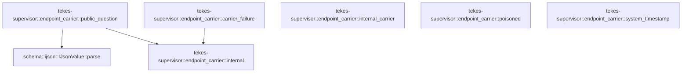

```mermaid
flowchart TD
  n0["endpoint::hub::HostFrame::new"]
  n1["endpoint::mux::SessionEndpointCapability::required"]
  n2["endpoint::types::validate_session_id"]
  n3["schema::ijson::IJsonValue::parse"]
  n4["tekes-supervisor::endpoint_carrier::ProductionCarrierStreams::attach_session_authority"]
  n5["tekes-supervisor::endpoint_carrier::ProductionCarrierStreams::session_authority"]
  n6["tekes-supervisor::endpoint_carrier::ProductionCarrierStreams::live_sessions"]
  n7["tekes-supervisor::endpoint_carrier::ProductionCarrierStreams::publish_session_status"]
  n8["tekes-supervisor::endpoint_carrier::ProductionCarrierStreams::publish_workspace_changed"]
  n9["tekes-supervisor::endpoint_carrier::ProductionCarrierStreams::attach_session"]
  n10["tekes-supervisor::endpoint_carrier::ProductionCarrierStreams::attach_everywhere"]
  n11["tekes-supervisor::endpoint_carrier::ProductionCarrierStreams::attach_everywhere_with"]
  n12["tekes-supervisor::endpoint_carrier::ProductionCarrierStreams::lacks_registration"]
  n13["tekes-supervisor::endpoint_carrier::ProductionCarrierStreams::touch"]
  n14["tekes-supervisor::endpoint_carrier::ProductionCarrierStreams::pinned_sessions"]
  n15["tekes-supervisor::endpoint_carrier::ProductionCarrierStreams::publish_host_frame"]
  n16["tekes-supervisor::endpoint_carrier::ProductionCarrierStreams::publish_session_frame"]
  n17["tekes-supervisor::endpoint_carrier::ProductionCarrierStreams::next_rpc_id"]
  n18["tekes-supervisor::endpoint_carrier::load_mux_session"]
  n19["tekes-supervisor::endpoint_carrier::semantic_line_projection_mode"]
  n20["tekes-supervisor::endpoint_carrier::line_requests"]
  n21["tekes-supervisor::endpoint_carrier::actionable_projection"]
  n22["tekes-supervisor::endpoint_carrier::actionable_projection_mode"]
  n23["tekes-supervisor::endpoint_carrier::internal_carrier"]
  n24["tekes-supervisor::endpoint_carrier::poisoned"]
  n25["tekes-supervisor::endpoint_carrier::queue_projection_is_older_than"]
  n26["tekes-supervisor::endpoint_carrier::public_queue_items"]
  n27["tekes-supervisor::endpoint_carrier::JournalLease::drop"]
  n28["tekes-supervisor::endpoint_carrier::ProductionCarrierStreams::recover_actionables"]
  n29["tekes-supervisor::endpoint_carrier::ProductionCarrierStreams::reconcile_actionables"]
  n30["tekes-supervisor::endpoint_carrier::ProductionCarrierStreams::reconcile_actionables_main"]
  n31["tekes-supervisor::endpoint_carrier::ProductionCarrierStreams::reconcile_actionables_from"]
  n32["tekes-supervisor::endpoint_carrier::ProductionCarrierStreams::note_pending_line"]
  n33["tekes-supervisor::endpoint_carrier::ProductionCarrierStreams::forget_session"]
  n34["tekes-supervisor::endpoint_carrier::ProductionCarrierStreams::new"]
  n35["tekes-supervisor::endpoint_carrier::ProductionCarrierStreams::with_description"]
  n6 --> n5
  n7 --> n0
  n7 --> n3
  n7 --> n15
  n8 --> n0
  n8 --> n3
  n8 --> n15
  n9 --> n0
  n9 --> n3
  n9 --> n10
  n9 --> n15
  n9 --> n19
  n10 --> n11
  n11 --> n12
  n11 --> n13
  n11 --> n14
  n11 --> n17
  n11 --> n18
  n11 --> n24
  n12 --> n24
  n26 --> n3
  n28 --> n2
  n28 --> n22
  n28 --> n23
  n28 --> n31
  n29 --> n21
  n29 --> n31
  n30 --> n23
  n30 --> n31
  n31 --> n16
  n31 --> n20
  n31 --> n32
  n34 --> n1
  n34 --> n35
```

```mermaid
flowchart TD
  n0["endpoint::all_session::AllSessionMux::open_with_replay"]
  n1["endpoint::hub::HostFrame::new"]
  n2["endpoint::journal::EndpointJournal::open"]
  n3["endpoint::stream_queue::EndpointFrameQueue::new"]
  n4["endpoint::types::validate_session_id"]
  n5["schema::ijson::IJsonValue::parse"]
  n6["schema::ijson::IJsonValue::parse_str"]
  n7["store::atomic::AtomicPublisher::replace"]
  n8["store::platform::NamedLock::exclusive"]
  n9["store::tail::scan_valid_prefix"]
  n10["tekes-supervisor::endpoint_carrier::ProductionCarrierStreams::live_sessions"]
  n11["tekes-supervisor::endpoint_carrier::ProductionCarrierStreams::attach_everywhere"]
  n12["tekes-supervisor::endpoint_carrier::ProductionCarrierStreams::touch"]
  n13["tekes-supervisor::endpoint_carrier::ProductionCarrierStreams::pinned_sessions"]
  n14["tekes-supervisor::endpoint_carrier::ProductionCarrierStreams::claim_journal"]
  n15["tekes-supervisor::endpoint_carrier::ProductionCarrierStreams::detach_for_archive"]
  n16["tekes-supervisor::endpoint_carrier::ProductionCarrierStreams::publish_host_frame"]
  n17["tekes-supervisor::endpoint_carrier::ProductionCarrierStreams::publish_session_frame"]
  n18["tekes-supervisor::endpoint_carrier::ProductionCarrierStreams::publish_queue_snapshot"]
  n19["tekes-supervisor::endpoint_carrier::ProductionCarrierStreams::publish_queue_projection_for_delivery"]
  n20["tekes-supervisor::endpoint_carrier::ProductionCarrierStreams::attach_for_publish"]
  n21["tekes-supervisor::endpoint_carrier::ProductionCarrierStreams::update_control_cache"]
  n22["tekes-supervisor::endpoint_carrier::ProductionCarrierStreams::update_control_frames"]
  n23["tekes-supervisor::endpoint_carrier::ProductionCarrierStreams::publish_durable_session_event"]
  n24["tekes-supervisor::endpoint_carrier::ProductionCarrierStreams::publish_durable_session_event_from_journal"]
  n25["tekes-supervisor::endpoint_carrier::ProductionCarrierStreams::close_mux_generations"]
  n26["tekes-supervisor::endpoint_carrier::ProductionCarrierStreams::open_legacy_mux"]
  n27["tekes-supervisor::endpoint_carrier::ProductionCarrierStreams::open_host"]
  n28["tekes-supervisor::endpoint_carrier::ProductionCarrierStreams::next_rpc_id"]
  n29["tekes-supervisor::endpoint_carrier::ProductionCarrierStreams::refresh_all_context_projections"]
  n30["tekes-supervisor::endpoint_carrier::ProductionCarrierStreams::refresh_context_projection"]
  n31["tekes-supervisor::endpoint_carrier::ProductionCarrierStreams::refresh_context_projection_shared"]
  n32["tekes-supervisor::endpoint_carrier::ProductionCarrierStreams::refresh_context_projection_locked"]
  n33["tekes-supervisor::endpoint_carrier::active_session_ids"]
  n34["tekes-supervisor::endpoint_carrier::semantic_projection"]
  n35["tekes-supervisor::endpoint_carrier::poisoned"]
  n36["tekes-supervisor::endpoint_carrier::read_queue_projection"]
  n37["tekes-supervisor::endpoint_carrier::queue_projection_is_older_than"]
  n38["tekes-supervisor::endpoint_carrier::public_queue_items"]
  n13 --> n10
  n14 --> n13
  n14 --> n35
  n15 --> n1
  n15 --> n5
  n15 --> n6
  n15 --> n16
  n15 --> n35
  n16 --> n28
  n16 --> n35
  n17 --> n20
  n17 --> n21
  n17 --> n28
  n18 --> n9
  n18 --> n19
  n19 --> n7
  n19 --> n8
  n19 --> n17
  n19 --> n36
  n19 --> n37
  n19 --> n38
  n20 --> n11
  n21 --> n22
  n22 --> n5
  n22 --> n6
  n22 --> n35
  n23 --> n2
  n23 --> n24
  n24 --> n28
  n25 --> n35
  n26 --> n0
  n26 --> n35
  n27 --> n3
  n27 --> n35
  n29 --> n13
  n29 --> n30
  n29 --> n33
  n29 --> n35
  n30 --> n2
  n30 --> n4
  n30 --> n32
  n30 --> n34
  n30 --> n35
  n31 --> n4
  n31 --> n32
  n31 --> n35
```

```mermaid
flowchart TD
  n0["endpoint::all_session::AllSessionMux::open"]
  n1["endpoint::mux::frozen_history_page"]
  n2["endpoint::service::NativeEndpoint::open"]
  n3["endpoint::session_operations::SessionOperations::open_sessions"]
  n4["endpoint::types::validate_session_id"]
  n5["schema::ijson::IJsonValue::parse"]
  n6["schema::ijson::IJsonValue::parse_str"]
  n7["tekes-supervisor::context_usage::sample"]
  n8["tekes-supervisor::context_usage::publish"]
  n9["tekes-supervisor::context_usage::saved_control_item"]
  n10["tekes-supervisor::endpoint_carrier::ProductionCarrierStreams::session_authority"]
  n11["tekes-supervisor::endpoint_carrier::ProductionCarrierStreams::live_sessions"]
  n12["tekes-supervisor::endpoint_carrier::ProductionCarrierStreams::claim_journal"]
  n13["tekes-supervisor::endpoint_carrier::ProductionCarrierStreams::publish_queue_snapshot"]
  n14["tekes-supervisor::endpoint_carrier::ProductionCarrierStreams::update_control_frames"]
  n15["tekes-supervisor::endpoint_carrier::ProductionCarrierStreams::open_legacy_mux"]
  n16["tekes-supervisor::endpoint_carrier::ProductionCarrierStreams::open_host"]
  n17["tekes-supervisor::endpoint_carrier::ProductionCarrierStreams::next_rpc_id"]
  n18["tekes-supervisor::endpoint_carrier::ProductionCarrierStreams::refresh_context_projection"]
  n19["tekes-supervisor::endpoint_carrier::ProductionCarrierStreams::refresh_context_projection_locked"]
  n20["tekes-supervisor::endpoint_carrier::ProductionCarrierStreams::session_items"]
  n21["tekes-supervisor::endpoint_carrier::ProductionCarrierStreams::inventory_baseline"]
  n22["tekes-supervisor::endpoint_carrier::ProductionCarrierStreams::inventory_row"]
  n23["tekes-supervisor::endpoint_carrier::ProductionCarrierStreams::control_baseline"]
  n24["tekes-supervisor::endpoint_carrier::ProductionCarrierStreams::actionables_baseline"]
  n25["tekes-supervisor::endpoint_carrier::ProductionCarrierStreams::index_holds"]
  n26["tekes-supervisor::endpoint_carrier::ProductionCarrierStreams::sessions_with_published_requests"]
  n27["tekes-supervisor::endpoint_carrier::ProductionCarrierStreams::requests"]
  n28["tekes-supervisor::endpoint_carrier::ProductionCarrierStreams::index_catalog_holds"]
  n29["tekes-supervisor::endpoint_carrier::ProductionCarrierStreams::index_unverified_and_archived"]
  n30["tekes-supervisor::endpoint_carrier::ProductionCarrierStreams::examine"]
  n31["tekes-supervisor::endpoint_carrier::ProductionCarrierStreams::fold_into_index"]
  n32["tekes-supervisor::endpoint_carrier::ProductionCarrierStreams::verify_session_carrier"]
  n33["tekes-supervisor::endpoint_carrier::ProductionCarrierStreams::verify_session"]
  n34["tekes-supervisor::endpoint_carrier::ProductionCarrierStreams::open_mux_journal"]
  n35["tekes-supervisor::endpoint_carrier::ProductionCarrierStreams::snapshot_projections"]
  n36["tekes-supervisor::endpoint_carrier::ProductionCarrierStreams::open_mux"]
  n37["tekes-supervisor::endpoint_carrier::ProductionCarrierStreams::mux_journal_page"]
  n38["tekes-supervisor::endpoint_carrier::ProductionStream::map_source"]
  n39["tekes-supervisor::endpoint_carrier::active_session_ids"]
  n40["tekes-supervisor::endpoint_carrier::load_mux_session"]
  n41["tekes-supervisor::endpoint_carrier::inventory_row"]
  n42["tekes-supervisor::endpoint_carrier::session_requests_mode"]
  n43["tekes-supervisor::endpoint_carrier::pending_session_requests_mode"]
  n44["tekes-supervisor::endpoint_carrier::poisoned"]
  n45["tekes-supervisor::endpoint_carrier::read_queue_projection"]
  n46["tekes-supervisor::endpoint_carrier::ProductionCarrierStreams::recover_actionables"]
  n47["tekes-supervisor::request_index::ledger_signature"]
  n48["tekes-supervisor::request_index::children_may_hold_requests"]
  n49["tekes-supervisor::request_index::may_hold_requests"]
  n19 --> n2
  n19 --> n5
  n19 --> n7
  n19 --> n8
  n19 --> n14
  n19 --> n17
  n19 --> n44
  n20 --> n2
  n20 --> n10
  n20 --> n11
  n21 --> n3
  n21 --> n20
  n21 --> n41
  n22 --> n3
  n22 --> n10
  n22 --> n41
  n23 --> n6
  n23 --> n9
  n23 --> n10
  n23 --> n13
  n23 --> n18
  n23 --> n39
  n23 --> n44
  n23 --> n45
  n24 --> n10
  n24 --> n25
  n24 --> n26
  n24 --> n39
  n24 --> n43
  n24 --> n46
  n24 --> n49
  n28 --> n10
  n28 --> n25
  n29 --> n4
  n29 --> n10
  n29 --> n30
  n29 --> n39
  n30 --> n31
  n30 --> n47
  n30 --> n48
  n30 --> n49
  n31 --> n42
  n32 --> n10
  n33 --> n32
  n34 --> n0
  n34 --> n1
  n34 --> n2
  n34 --> n10
  n34 --> n12
  n34 --> n17
  n34 --> n32
  n34 --> n35
  n34 --> n40
  n35 --> n5
  n35 --> n9
  n35 --> n44
  n36 --> n15
  n36 --> n16
  n36 --> n21
  n36 --> n23
  n36 --> n24
  n36 --> n34
  n37 --> n1
  n37 --> n2
  n37 --> n40
  n38 --> n44
```

```mermaid
flowchart TD
  n0["endpoint::carrier_adapter::JournalRespondHandler::new"]
  n1["endpoint::carrier_adapter::ComposedEndpointCarrierHost::new"]
  n2["endpoint::host::StreamFailure::internal"]
  n3["endpoint::idempotency::RpcRegistry::open"]
  n4["schema::ijson::IJsonValue::parse"]
  n5["tekes-supervisor::endpoint_carrier::ProductionRespondAuthority::open"]
  n6["tekes-supervisor::endpoint_carrier::ProductionStream::recv"]
  n7["tekes-supervisor::endpoint_carrier::ProductionCarrierStreams::open_stream"]
  n8["tekes-supervisor::endpoint_carrier::ProductionCarrierStreams::stream_error"]
  n9["tekes-supervisor::endpoint_carrier::ProductionCarrierStreams::mux_description"]
  n10["tekes-supervisor::endpoint_carrier::ProductionCarrierStreams::open_mux_stream"]
  n11["tekes-supervisor::endpoint_carrier::ProductionCarrierStreams::journal_page"]
  n12["tekes-supervisor::endpoint_carrier::LeasedStream::recv"]
  n13["tekes-supervisor::endpoint_carrier::LeasedStream::drop"]
  n14["tekes-supervisor::endpoint_carrier::LifecycleCarrierHost::new"]
  n15["tekes-supervisor::endpoint_carrier::LifecycleCarrierHost::capabilities"]
  n16["tekes-supervisor::endpoint_carrier::LifecycleCarrierHost::extension_capabilities"]
  n17["tekes-supervisor::endpoint_carrier::LifecycleCarrierHost::method_class"]
  n18["tekes-supervisor::endpoint_carrier::LifecycleCarrierHost::validate_request"]
  n19["tekes-supervisor::endpoint_carrier::LifecycleCarrierHost::call"]
  n20["tekes-supervisor::endpoint_carrier::lifecycle_target"]
  n21["tekes-supervisor::endpoint_carrier::ProductionCarrierAssembly::assemble"]
  n22["tekes-supervisor::endpoint_carrier::ProductionCarrierAssembly::host"]
  n23["tekes-supervisor::endpoint_carrier::ProductionCarrierAssembly::with_file_changes"]
  n24["tekes-supervisor::endpoint_carrier::ProductionCarrierAssembly::streams"]
  n25["tekes-supervisor::endpoint_carrier::ProductionCarrierAssembly::server"]
  n26["tekes-supervisor::endpoint_carrier::payload_session_id"]
  n27["tekes-supervisor::endpoint_carrier::ProductionCarrierStreams::with_description"]
  n28["tekes-supervisor::file_leases::SessionFileTransfer::open"]
  n29["transport::server::TransportServer::new"]
  n6 --> n2
  n8 --> n4
  n19 --> n20
  n20 --> n26
  n21 --> n0
  n21 --> n1
  n21 --> n3
  n21 --> n5
  n21 --> n14
  n21 --> n27
  n21 --> n28
  n21 --> n29
```

```mermaid
flowchart TD
  n0["endpoint::journal::EndpointJournal::open"]
  n1["endpoint::requests::PendingRequest::derive"]
  n2["endpoint::requests::RequestState::resolved"]
  n3["endpoint::types::validate_session_id"]
  n4["engine::lifecycle::classify"]
  n5["schema::ijson::IJsonValue::parse"]
  n6["store::tail::scan_valid_prefix"]
  n7["tekes-supervisor::endpoint_carrier::ProductionCarrierAssembly::into_server"]
  n8["tekes-supervisor::endpoint_carrier::ProductionCarrierAssembly::mark_ready"]
  n9["tekes-supervisor::endpoint_carrier::ProductionCarrierAssembly::finish_recovery"]
  n10["tekes-supervisor::endpoint_carrier::ProductionCarrierAssembly::begin_drain"]
  n11["tekes-supervisor::endpoint_carrier::active_session_ids"]
  n12["tekes-supervisor::endpoint_carrier::load_mux_session"]
  n13["tekes-supervisor::endpoint_carrier::inventory_row"]
  n14["tekes-supervisor::endpoint_carrier::semantic_projection"]
  n15["tekes-supervisor::endpoint_carrier::semantic_line_projection"]
  n16["tekes-supervisor::endpoint_carrier::semantic_line_projection_mode"]
  n17["tekes-supervisor::endpoint_carrier::line_requests"]
  n18["tekes-supervisor::endpoint_carrier::session_requests_mode"]
  n19["tekes-supervisor::endpoint_carrier::pending_session_requests_mode"]
  n20["tekes-supervisor::endpoint_carrier::actionable_projection"]
  n21["tekes-supervisor::endpoint_carrier::actionable_projection_mode"]
  n22["tekes-supervisor::endpoint_carrier::validate_request_binding"]
  n23["tekes-supervisor::endpoint_carrier::unresolved_hold_turn"]
  n24["tekes-supervisor::endpoint_carrier::payload_session_id"]
  n25["tekes-supervisor::endpoint_carrier::result_session_id"]
  n26["tekes-supervisor::endpoint_carrier::route_failure"]
  n27["tekes-supervisor::endpoint_carrier::internal"]
  n9 --> n8
  n11 --> n3
  n12 --> n0
  n12 --> n3
  n12 --> n19
  n13 --> n4
  n13 --> n5
  n14 --> n15
  n15 --> n16
  n16 --> n3
  n16 --> n6
  n16 --> n27
  n17 --> n1
  n17 --> n2
  n17 --> n5
  n17 --> n27
  n18 --> n3
  n18 --> n16
  n18 --> n17
  n18 --> n27
  n19 --> n18
  n20 --> n21
  n21 --> n16
  n21 --> n27
```

# tekes-supervisor::endpoint_carrier

[Package atlas](index.md) · [Source](../../src/endpoint_carrier.rs)

## Declarations

Visibility is the declaration spelling; trait members and reexports require their enclosing interface. `cfg` is not evaluated.

| Symbol | Kind | Visibility | Test / cfg |
|---|---|---|---|
| [tekes-supervisor::endpoint_carrier::HOST_STREAM_MAX_FRAMES](../../src/endpoint_carrier.rs#L40) | const_item | `private` |  |
| [tekes-supervisor::endpoint_carrier::HOST_STREAM_MAX_BYTES](../../src/endpoint_carrier.rs#L41) | const_item | `private` |  |
| [tekes-supervisor::endpoint_carrier::SupervisorSessionAuthority](../../src/endpoint_carrier.rs#L55) | trait_item | `pub` |  |
| [tekes-supervisor::endpoint_carrier::SupervisorSessionAuthority::live_sessions](../../src/endpoint_carrier.rs#L57) | function_signature_item | `private` |  |
| [tekes-supervisor::endpoint_carrier::SupervisorSessionAuthority::reconcile_projection](../../src/endpoint_carrier.rs#L62) | function_signature_item | `private` |  |
| [tekes-supervisor::endpoint_carrier::SupervisorSessionAuthority::inventory_items](../../src/endpoint_carrier.rs#L67) | function_item | `private` |  |
| [tekes-supervisor::endpoint_carrier::SupervisorSessionAuthority::inventory_item](../../src/endpoint_carrier.rs#L75) | function_item | `private` |  |
| [tekes-supervisor::endpoint_carrier::SupervisorSessionAuthority::ensure_verified](../../src/endpoint_carrier.rs#L84) | function_item | `private` |  |
| [tekes-supervisor::endpoint_carrier::SupervisorSessionAuthority::has_catalog](../../src/endpoint_carrier.rs#L90) | function_item | `private` |  |
| [tekes-supervisor::endpoint_carrier::SupervisorSessionAuthority::hold_catalog](../../src/endpoint_carrier.rs#L96) | function_item | `private` |  |
| [tekes-supervisor::endpoint_carrier::SessionGateError](../../src/endpoint_carrier.rs#L103) | enum_item | `pub` |  |
| [tekes-supervisor::endpoint_carrier::HoldRef](../../src/endpoint_carrier.rs#L112) | struct_item | `pub` |  |
| [tekes-supervisor::endpoint_carrier::VerifiedHolds](../../src/endpoint_carrier.rs#L121) | struct_item | `pub` |  |
| [tekes-supervisor::endpoint_carrier::HoldCatalog](../../src/endpoint_carrier.rs#L130) | struct_item | `pub` |  |
| [tekes-supervisor::endpoint_carrier::LiveRespondAuthority](../../src/endpoint_carrier.rs#L144) | trait_item | `pub` |  |
| [tekes-supervisor::endpoint_carrier::LiveRespondAuthority::deliver_if_live](../../src/endpoint_carrier.rs#L145) | function_signature_item | `private` |  |
| [tekes-supervisor::endpoint_carrier::LiveRespondAuthority::ensure_after_locked_append](../../src/endpoint_carrier.rs#L154) | function_item | `private` |  |
| [tekes-supervisor::endpoint_carrier::CarrierClock](../../src/endpoint_carrier.rs#L159) | type_item | `pub` |  |
| [tekes-supervisor::endpoint_carrier::ProductionRespondAuthority](../../src/endpoint_carrier.rs#L161) | struct_item | `pub` |  |
| [tekes-supervisor::endpoint_carrier::ProductionRespondAuthority::open](../../src/endpoint_carrier.rs#L176) | function_item | `pub` |  |
| [tekes-supervisor::endpoint_carrier::ProductionRespondAuthority::open_with_clock](../../src/endpoint_carrier.rs#L184) | function_item | `pub` |  |
| [tekes-supervisor::endpoint_carrier::ProductionRespondAuthority::with_streams](../../src/endpoint_carrier.rs#L207) | function_item | `pub` |  |
| [tekes-supervisor::endpoint_carrier::ProductionRespondAuthority::reconcile_after_response](../../src/endpoint_carrier.rs#L218) | function_item | `private` |  |
| [tekes-supervisor::endpoint_carrier::ProductionRespondAuthority::locate_once](../../src/endpoint_carrier.rs#L236) | function_item | `private` |  |
| [tekes-supervisor::endpoint_carrier::ProductionRespondAuthority::locate_indexed](../../src/endpoint_carrier.rs#L258) | function_item | `private` |  |
| [tekes-supervisor::endpoint_carrier::ProductionRespondAuthority::locate_by_scan](../../src/endpoint_carrier.rs#L284) | function_item | `private` |  |
| [tekes-supervisor::endpoint_carrier::ProductionRespondAuthority::locate_in_folder](../../src/endpoint_carrier.rs#L313) | function_item | `private` |  |
| [tekes-supervisor::endpoint_carrier::ProductionRespondAuthority::worker_message](../../src/endpoint_carrier.rs#L354) | function_item | `private` |  |
| [tekes-supervisor::endpoint_carrier::ProductionRespondAuthority::live_delivery](../../src/endpoint_carrier.rs#L370) | function_item | `private` |  |
| [tekes-supervisor::endpoint_carrier::ProductionRespondAuthority::locked_append](../../src/endpoint_carrier.rs#L393) | function_item | `private` |  |
| [tekes-supervisor::endpoint_carrier::ProductionRespondAuthority::locate](../../src/endpoint_carrier.rs#L466) | function_item | `private` |  |
| [tekes-supervisor::endpoint_carrier::ProductionRespondAuthority::author](../../src/endpoint_carrier.rs#L470) | function_item | `private` |  |
| [tekes-supervisor::endpoint_carrier::ProductionCarrierStreams](../../src/endpoint_carrier.rs#L528) | struct_item | `pub` |  |
| [tekes-supervisor::endpoint_carrier::CarrierStreamsInner](../../src/endpoint_carrier.rs#L532) | struct_item | `private` |  |
| [tekes-supervisor::endpoint_carrier::Attachments](../../src/endpoint_carrier.rs#L552) | struct_item | `private` |  |
| [tekes-supervisor::endpoint_carrier::SavedQueueProjection](../../src/endpoint_carrier.rs#L563) | struct_item | `private` |  |
| [tekes-supervisor::endpoint_carrier::read_queue_projection](../../src/endpoint_carrier.rs#L570) | function_item | `private` |  |
| [tekes-supervisor::endpoint_carrier::queue_projection_is_older_than](../../src/endpoint_carrier.rs#L577) | function_item | `private` |  |
| [tekes-supervisor::endpoint_carrier::public_queue_items](../../src/endpoint_carrier.rs#L585) | function_item | `private` |  |
| [tekes-supervisor::endpoint_carrier::public_queue_projection_tests::projection](../../src/endpoint_carrier.rs#L634) | function_item | `private` | test; #[cfg(test)] |
| [tekes-supervisor::endpoint_carrier::public_queue_projection_tests::ledger_recovery_starts_a_new_queue_generation](../../src/endpoint_carrier.rs#L670) | function_item | `private` | test; #[cfg(test)] |
| [tekes-supervisor::endpoint_carrier::public_queue_projection_tests::queue_snapshot_uses_only_live_inputs_and_preserves_public_message_source](../../src/endpoint_carrier.rs#L683) | function_item | `private` | test; #[cfg(test)] |
| [tekes-supervisor::endpoint_carrier::JournalLease](../../src/endpoint_carrier.rs#L711) | struct_item | `pub(crate)` |  |
| [tekes-supervisor::endpoint_carrier::JournalLease::drop](../../src/endpoint_carrier.rs#L717) | function_item | `private` |  |
| [tekes-supervisor::endpoint_carrier::PublishedActionables](../../src/endpoint_carrier.rs#L736) | type_item | `private` |  |
| [tekes-supervisor::endpoint_carrier::StreamGenerations](../../src/endpoint_carrier.rs#L739) | struct_item | `private` |  |
| [tekes-supervisor::endpoint_carrier::TrackedMux](../../src/endpoint_carrier.rs#L744) | struct_item | `private` |  |
| [tekes-supervisor::endpoint_carrier::TrackedHost](../../src/endpoint_carrier.rs#L749) | struct_item | `private` |  |
| [tekes-supervisor::endpoint_carrier::ProjectionReplay](../../src/endpoint_carrier.rs#L755) | struct_item | `private` |  |
| [tekes-supervisor::endpoint_carrier::ProductionCarrierStreams::recover_actionables](../../src/endpoint_carrier.rs#L762) | function_item | `private` |  |
| [tekes-supervisor::endpoint_carrier::ProductionCarrierStreams::reconcile_actionables](../../src/endpoint_carrier.rs#L799) | function_item | `pub(crate)` |  |
| [tekes-supervisor::endpoint_carrier::ProductionCarrierStreams::reconcile_actionables_main](../../src/endpoint_carrier.rs#L813) | function_item | `pub(crate)` |  |
| [tekes-supervisor::endpoint_carrier::ProductionCarrierStreams::reconcile_actionables_from](../../src/endpoint_carrier.rs#L828) | function_item | `private` |  |
| [tekes-supervisor::endpoint_carrier::ProductionCarrierStreams::note_pending_line](../../src/endpoint_carrier.rs#L904) | function_item | `private` |  |
| [tekes-supervisor::endpoint_carrier::ProductionCarrierStreams::forget_session](../../src/endpoint_carrier.rs#L921) | function_item | `pub(crate)` |  |
| [tekes-supervisor::endpoint_carrier::ProductionCarrierStreams::actionable_ids_for_test](../../src/endpoint_carrier.rs#L939) | function_item | `pub(crate)` | test; #[cfg(test)] #[cfg_attr(not(target_os = "macos"), allow(dead_code))] |
| [tekes-supervisor::endpoint_carrier::ProductionCarrierStreams::published_pending_for_test](../../src/endpoint_carrier.rs#L951) | function_item | `pub(crate)` | test; #[cfg(test)] #[cfg_attr(not(target_os = "macos"), allow(dead_code))] |
| [tekes-supervisor::endpoint_carrier::ProductionCarrierStreams::new](../../src/endpoint_carrier.rs#L966) | function_item | `pub` |  |
| [tekes-supervisor::endpoint_carrier::ProductionCarrierStreams::with_description](../../src/endpoint_carrier.rs#L987) | function_item | `pub` |  |
| [tekes-supervisor::endpoint_carrier::ProductionCarrierStreams::attach_session_authority](../../src/endpoint_carrier.rs#L1007) | function_item | `pub` |  |
| [tekes-supervisor::endpoint_carrier::ProductionCarrierStreams::session_authority](../../src/endpoint_carrier.rs#L1015) | function_item | `private` |  |
| [tekes-supervisor::endpoint_carrier::ProductionCarrierStreams::live_sessions](../../src/endpoint_carrier.rs#L1024) | function_item | `private` |  |
| [tekes-supervisor::endpoint_carrier::ProductionCarrierStreams::publish_session_status](../../src/endpoint_carrier.rs#L1034) | function_item | `pub` |  |
| [tekes-supervisor::endpoint_carrier::ProductionCarrierStreams::publish_workspace_changed](../../src/endpoint_carrier.rs#L1049) | function_item | `pub` |  |
| [tekes-supervisor::endpoint_carrier::ProductionCarrierStreams::attach_session](../../src/endpoint_carrier.rs#L1061) | function_item | `pub` |  |
| [tekes-supervisor::endpoint_carrier::ProductionCarrierStreams::attach_everywhere](../../src/endpoint_carrier.rs#L1086) | function_item | `pub(crate)` |  |
| [tekes-supervisor::endpoint_carrier::ProductionCarrierStreams::attach_everywhere_with](../../src/endpoint_carrier.rs#L1091) | function_item | `pub(crate)` |  |
| [tekes-supervisor::endpoint_carrier::ProductionCarrierStreams::lacks_registration](../../src/endpoint_carrier.rs#L1187) | function_item | `private` |  |
| [tekes-supervisor::endpoint_carrier::ProductionCarrierStreams::touch](../../src/endpoint_carrier.rs#L1200) | function_item | `private` |  |
| [tekes-supervisor::endpoint_carrier::ProductionCarrierStreams::pinned_sessions](../../src/endpoint_carrier.rs#L1213) | function_item | `private` |  |
| [tekes-supervisor::endpoint_carrier::ProductionCarrierStreams::claim_journal](../../src/endpoint_carrier.rs#L1232) | function_item | `private` |  |
| [tekes-supervisor::endpoint_carrier::ProductionCarrierStreams::detach_for_archive](../../src/endpoint_carrier.rs#L1253) | function_item | `pub` |  |
| [tekes-supervisor::endpoint_carrier::ProductionCarrierStreams::publish_host_frame](../../src/endpoint_carrier.rs#L1276) | function_item | `pub` |  |
| [tekes-supervisor::endpoint_carrier::ProductionCarrierStreams::publish_session_frame](../../src/endpoint_carrier.rs#L1305) | function_item | `pub` |  |
| [tekes-supervisor::endpoint_carrier::ProductionCarrierStreams::publish_queue_snapshot](../../src/endpoint_carrier.rs#L1321) | function_item | `pub` |  |
| [tekes-supervisor::endpoint_carrier::ProductionCarrierStreams::publish_queue_projection_for_delivery](../../src/endpoint_carrier.rs#L1348) | function_item | `pub(crate)` |  |
| [tekes-supervisor::endpoint_carrier::ProductionCarrierStreams::attach_for_publish](../../src/endpoint_carrier.rs#L1412) | function_item | `private` |  |
| [tekes-supervisor::endpoint_carrier::ProductionCarrierStreams::update_control_cache](../../src/endpoint_carrier.rs#L1423) | function_item | `private` |  |
| [tekes-supervisor::endpoint_carrier::ProductionCarrierStreams::update_control_frames](../../src/endpoint_carrier.rs#L1430) | function_item | `private` |  |
| [tekes-supervisor::endpoint_carrier::ProductionCarrierStreams::publish_durable_session_event](../../src/endpoint_carrier.rs#L1476) | function_item | `pub` |  |
| [tekes-supervisor::endpoint_carrier::ProductionCarrierStreams::publish_durable_session_event_from_journal](../../src/endpoint_carrier.rs#L1489) | function_item | `pub` |  |
| [tekes-supervisor::endpoint_carrier::ProductionCarrierStreams::close_mux_generations](../../src/endpoint_carrier.rs#L1505) | function_item | `pub` |  |
| [tekes-supervisor::endpoint_carrier::ProductionCarrierStreams::open_legacy_mux](../../src/endpoint_carrier.rs#L1516) | function_item | `private` |  |
| [tekes-supervisor::endpoint_carrier::ProductionCarrierStreams::open_host](../../src/endpoint_carrier.rs#L1535) | function_item | `private` |  |
| [tekes-supervisor::endpoint_carrier::ProductionCarrierStreams::next_rpc_id](../../src/endpoint_carrier.rs#L1554) | function_item | `private` |  |
| [tekes-supervisor::endpoint_carrier::ProductionCarrierStreams::refresh_all_context_projections](../../src/endpoint_carrier.rs#L1563) | function_item | `pub(crate)` |  |
| [tekes-supervisor::endpoint_carrier::ProductionCarrierStreams::refresh_context_projection](../../src/endpoint_carrier.rs#L1602) | function_item | `pub(crate)` |  |
| [tekes-supervisor::endpoint_carrier::ProductionCarrierStreams::refresh_context_projection_shared](../../src/endpoint_carrier.rs#L1622) | function_item | `pub(crate)` |  |
| [tekes-supervisor::endpoint_carrier::ProductionCarrierStreams::refresh_context_projection_locked](../../src/endpoint_carrier.rs#L1638) | function_item | `private` |  |
| [tekes-supervisor::endpoint_carrier::ProductionCarrierStreams::session_items](../../src/endpoint_carrier.rs#L1696) | function_item | `private` |  |
| [tekes-supervisor::endpoint_carrier::ProductionCarrierStreams::inventory_baseline](../../src/endpoint_carrier.rs#L1713) | function_item | `private` |  |
| [tekes-supervisor::endpoint_carrier::ProductionCarrierStreams::inventory_row](../../src/endpoint_carrier.rs#L1739) | function_item | `private` |  |
| [tekes-supervisor::endpoint_carrier::ProductionCarrierStreams::control_baseline](../../src/endpoint_carrier.rs#L1757) | function_item | `private` |  |
| [tekes-supervisor::endpoint_carrier::ProductionCarrierStreams::actionables_baseline](../../src/endpoint_carrier.rs#L1852) | function_item | `private` |  |
| [tekes-supervisor::endpoint_carrier::ProductionCarrierStreams::index_holds](../../src/endpoint_carrier.rs#L1932) | function_item | `private` |  |
| [tekes-supervisor::endpoint_carrier::ProductionCarrierStreams::sessions_with_published_requests](../../src/endpoint_carrier.rs#L1946) | function_item | `private` |  |
| [tekes-supervisor::endpoint_carrier::ProductionCarrierStreams::requests](../../src/endpoint_carrier.rs#L1962) | function_item | `pub(crate)` |  |
| [tekes-supervisor::endpoint_carrier::ProductionCarrierStreams::index_catalog_holds](../../src/endpoint_carrier.rs#L1968) | function_item | `pub(crate)` |  |
| [tekes-supervisor::endpoint_carrier::ProductionCarrierStreams::index_unverified_and_archived](../../src/endpoint_carrier.rs#L1979) | function_item | `pub(crate)` |  |
| [tekes-supervisor::endpoint_carrier::ProductionCarrierStreams::examine](../../src/endpoint_carrier.rs#L2024) | function_item | `private` |  |
| [tekes-supervisor::endpoint_carrier::ProductionCarrierStreams::fold_into_index](../../src/endpoint_carrier.rs#L2050) | function_item | `private` |  |
| [tekes-supervisor::endpoint_carrier::ProductionCarrierStreams::verify_session_carrier](../../src/endpoint_carrier.rs#L2074) | function_item | `pub(crate)` |  |
| [tekes-supervisor::endpoint_carrier::ProductionCarrierStreams::verify_session](../../src/endpoint_carrier.rs#L2093) | function_item | `pub(crate)` |  |
| [tekes-supervisor::endpoint_carrier::ProductionCarrierStreams::open_mux_journal](../../src/endpoint_carrier.rs#L2098) | function_item | `private` |  |
| [tekes-supervisor::endpoint_carrier::ProductionCarrierStreams::snapshot_projections](../../src/endpoint_carrier.rs#L2190) | function_item | `private` |  |
| [tekes-supervisor::endpoint_carrier::ProductionCarrierStreams::open_mux](../../src/endpoint_carrier.rs#L2245) | function_item | `pub(crate)` |  |
| [tekes-supervisor::endpoint_carrier::ProductionCarrierStreams::mux_journal_page](../../src/endpoint_carrier.rs#L2314) | function_item | `private` |  |
| [tekes-supervisor::endpoint_carrier::ProductionStreamKind](../../src/endpoint_carrier.rs#L2349) | enum_item | `private` |  |
| [tekes-supervisor::endpoint_carrier::ProductionStream](../../src/endpoint_carrier.rs#L2360) | struct_item | `private` |  |
| [tekes-supervisor::endpoint_carrier::ProductionStream::map_source](../../src/endpoint_carrier.rs#L2371) | function_item | `private` |  |
| [tekes-supervisor::endpoint_carrier::ProductionStream::recv](../../src/endpoint_carrier.rs#L2576) | function_item | `private` |  |
| [tekes-supervisor::endpoint_carrier::ProductionCarrierStreams::open_stream](../../src/endpoint_carrier.rs#L2598) | function_item | `private` |  |
| [tekes-supervisor::endpoint_carrier::ProductionCarrierStreams::stream_error](../../src/endpoint_carrier.rs#L2608) | function_item | `private` |  |
| [tekes-supervisor::endpoint_carrier::ProductionCarrierStreams::mux_description](../../src/endpoint_carrier.rs#L2635) | function_item | `private` |  |
| [tekes-supervisor::endpoint_carrier::ProductionCarrierStreams::open_mux_stream](../../src/endpoint_carrier.rs#L2642) | function_item | `private` |  |
| [tekes-supervisor::endpoint_carrier::ProductionCarrierStreams::journal_page](../../src/endpoint_carrier.rs#L2652) | function_item | `private` |  |
| [tekes-supervisor::endpoint_carrier::LeasedStream](../../src/endpoint_carrier.rs#L2662) | struct_item | `private` |  |
| [tekes-supervisor::endpoint_carrier::StreamDrop](../../src/endpoint_carrier.rs#L2669) | enum_item | `private` |  |
| [tekes-supervisor::endpoint_carrier::LeasedStream::recv](../../src/endpoint_carrier.rs#L2675) | function_item | `private` |  |
| [tekes-supervisor::endpoint_carrier::LeasedStream::drop](../../src/endpoint_carrier.rs#L2681) | function_item | `private` |  |
| [tekes-supervisor::endpoint_carrier::LifecycleCarrierHost](../../src/endpoint_carrier.rs#L2693) | struct_item | `pub` |  |
| [tekes-supervisor::endpoint_carrier::LifecycleCarrierHost::new](../../src/endpoint_carrier.rs#L2700) | function_item | `pub` |  |
| [tekes-supervisor::endpoint_carrier::LifecycleCarrierHost::capabilities](../../src/endpoint_carrier.rs#L2706) | function_item | `private` |  |
| [tekes-supervisor::endpoint_carrier::LifecycleCarrierHost::extension_capabilities](../../src/endpoint_carrier.rs#L2710) | function_item | `private` |  |
| [tekes-supervisor::endpoint_carrier::LifecycleCarrierHost::method_class](../../src/endpoint_carrier.rs#L2714) | function_item | `private` |  |
| [tekes-supervisor::endpoint_carrier::LifecycleCarrierHost::validate_request](../../src/endpoint_carrier.rs#L2718) | function_item | `private` |  |
| [tekes-supervisor::endpoint_carrier::LifecycleCarrierHost::call](../../src/endpoint_carrier.rs#L2722) | function_item | `private` |  |
| [tekes-supervisor::endpoint_carrier::LifecycleTarget](../../src/endpoint_carrier.rs#L2755) | enum_item | `private` |  |
| [tekes-supervisor::endpoint_carrier::lifecycle_target](../../src/endpoint_carrier.rs#L2761) | function_item | `private` |  |
| [tekes-supervisor::endpoint_carrier::ProductionCarrierHost](../../src/endpoint_carrier.rs#L2772) | type_item | `pub` |  |
| [tekes-supervisor::endpoint_carrier::ProductionCarrierAssembly](../../src/endpoint_carrier.rs#L2778) | struct_item | `pub` |  |
| [tekes-supervisor::endpoint_carrier::ProductionCarrierAssembly::assemble](../../src/endpoint_carrier.rs#L2785) | function_item | `pub` |  |
| [tekes-supervisor::endpoint_carrier::ProductionCarrierAssembly::host](../../src/endpoint_carrier.rs#L2820) | function_item | `pub` |  |
| [tekes-supervisor::endpoint_carrier::ProductionCarrierAssembly::with_file_changes](../../src/endpoint_carrier.rs#L2824) | function_item | `pub` |  |
| [tekes-supervisor::endpoint_carrier::ProductionCarrierAssembly::streams](../../src/endpoint_carrier.rs#L2830) | function_item | `pub` |  |
| [tekes-supervisor::endpoint_carrier::ProductionCarrierAssembly::server](../../src/endpoint_carrier.rs#L2835) | function_item | `pub` |  |
| [tekes-supervisor::endpoint_carrier::ProductionCarrierAssembly::into_server](../../src/endpoint_carrier.rs#L2840) | function_item | `pub` |  |
| [tekes-supervisor::endpoint_carrier::ProductionCarrierAssembly::mark_ready](../../src/endpoint_carrier.rs#L2847) | function_item | `pub` |  |
| [tekes-supervisor::endpoint_carrier::ProductionCarrierAssembly::finish_recovery](../../src/endpoint_carrier.rs#L2852) | function_item | `pub` |  |
| [tekes-supervisor::endpoint_carrier::ProductionCarrierAssembly::begin_drain](../../src/endpoint_carrier.rs#L2857) | function_item | `pub` |  |
| [tekes-supervisor::endpoint_carrier::MuxSession](../../src/endpoint_carrier.rs#L2863) | struct_item | `private` |  |
| [tekes-supervisor::endpoint_carrier::active_session_ids](../../src/endpoint_carrier.rs#L2869) | function_item | `private` |  |
| [tekes-supervisor::endpoint_carrier::load_mux_session](../../src/endpoint_carrier.rs#L2882) | function_item | `private` |  |
| [tekes-supervisor::endpoint_carrier::inventory_row](../../src/endpoint_carrier.rs#L2898) | function_item | `private` |  |
| [tekes-supervisor::endpoint_carrier::folder_inventory_tests::inventory_uses_only_its_own_recorded_execution_cwd](../../src/endpoint_carrier.rs#L2942) | function_item | `private` | test; #[cfg(test)] |
| [tekes-supervisor::endpoint_carrier::semantic_projection](../../src/endpoint_carrier.rs#L2982) | function_item | `private` |  |
| [tekes-supervisor::endpoint_carrier::semantic_line_projection](../../src/endpoint_carrier.rs#L2986) | function_item | `private` |  |
| [tekes-supervisor::endpoint_carrier::semantic_line_projection_mode](../../src/endpoint_carrier.rs#L2997) | function_item | `private` |  |
| [tekes-supervisor::endpoint_carrier::line_requests](../../src/endpoint_carrier.rs#L3030) | function_item | `pub(crate)` |  |
| [tekes-supervisor::endpoint_carrier::session_requests_mode](../../src/endpoint_carrier.rs#L3133) | function_item | `private` |  |
| [tekes-supervisor::endpoint_carrier::pending_session_requests_mode](../../src/endpoint_carrier.rs#L3174) | function_item | `private` |  |
| [tekes-supervisor::endpoint_carrier::actionable_projection](../../src/endpoint_carrier.rs#L3188) | function_item | `private` |  |
| [tekes-supervisor::endpoint_carrier::actionable_projection_mode](../../src/endpoint_carrier.rs#L3196) | function_item | `private` |  |
| [tekes-supervisor::endpoint_carrier::validate_request_binding](../../src/endpoint_carrier.rs#L3259) | function_item | `private` |  |
| [tekes-supervisor::endpoint_carrier::unresolved_hold_turn](../../src/endpoint_carrier.rs#L3293) | function_item | `private` |  |
| [tekes-supervisor::endpoint_carrier::payload_session_id](../../src/endpoint_carrier.rs#L3318) | function_item | `private` |  |
| [tekes-supervisor::endpoint_carrier::result_session_id](../../src/endpoint_carrier.rs#L3326) | function_item | `private` |  |
| [tekes-supervisor::endpoint_carrier::route_failure](../../src/endpoint_carrier.rs#L3334) | function_item | `private` |  |
| [tekes-supervisor::endpoint_carrier::public_question](../../src/endpoint_carrier.rs#L3346) | function_item | `private` |  |
| [tekes-supervisor::endpoint_carrier::internal](../../src/endpoint_carrier.rs#L3370) | function_item | `private` |  |
| [tekes-supervisor::endpoint_carrier::carrier_failure](../../src/endpoint_carrier.rs#L3375) | function_item | `private` |  |
| [tekes-supervisor::endpoint_carrier::internal_carrier](../../src/endpoint_carrier.rs#L3385) | function_item | `private` |  |
| [tekes-supervisor::endpoint_carrier::poisoned](../../src/endpoint_carrier.rs#L3389) | function_item | `private` |  |
| [tekes-supervisor::endpoint_carrier::system_timestamp](../../src/endpoint_carrier.rs#L3393) | function_item | `private` |  |
| [tekes-supervisor::endpoint_carrier::ProductionCarrierError](../../src/endpoint_carrier.rs#L3425) | enum_item | `pub` |  |
| [tekes-supervisor::endpoint_carrier::question_cancellation_tests::question_denial_projects_as_cancelled_and_answer_as_answered](../../src/endpoint_carrier.rs#L3465) | function_item | `private` | test; #[cfg(test)] |
| [tekes-supervisor::endpoint_carrier::lazy_registration_tests::TS](../../src/endpoint_carrier.rs#L3520) | const_item | `private` | test; #[cfg(test)] |
| [tekes-supervisor::endpoint_carrier::lazy_registration_tests::blank_thread](../../src/endpoint_carrier.rs#L3522) | function_item | `private` | test; #[cfg(test)] |
| [tekes-supervisor::endpoint_carrier::lazy_registration_tests::id](../../src/endpoint_carrier.rs#L3532) | function_item | `private` | test; #[cfg(test)] |
| [tekes-supervisor::endpoint_carrier::lazy_registration_tests::registered](../../src/endpoint_carrier.rs#L3536) | function_item | `private` | test; #[cfg(test)] |
| [tekes-supervisor::endpoint_carrier::lazy_registration_tests::first_touches_load_in_parallel_and_do_not_hold_up_live_frames](../../src/endpoint_carrier.rs#L3553) | function_item | `private` | test; #[cfg(test)] |
| [tekes-supervisor::endpoint_carrier::lazy_registration_tests::a_context_refresh_serves_the_open_thread_first_and_registers_no_idle_session](../../src/endpoint_carrier.rs#L3634) | function_item | `private` | test; #[cfg(test)] |

## Imports / reexports

| Local name | Source path | Visibility |
|---|---|---|
| `BTreeMap` | `std::collections::BTreeMap` | `private` |
| `BTreeSet` | `std::collections::BTreeSet` | `private` |
| `HashMap` | `std::collections::HashMap` | `private` |
| `HashSet` | `std::collections::HashSet` | `private` |
| `VecDeque` | `std::collections::VecDeque` | `private` |
| `fs` | `std::fs` | `private` |
| `Path` | `std::path::Path` | `private` |
| `PathBuf` | `std::path::PathBuf` | `private` |
| `AtomicU64` | `std::sync::atomic::AtomicU64` | `private` |
| `Ordering` | `std::sync::atomic::Ordering` | `private` |
| `Arc` | `std::sync::Arc` | `private` |
| `Mutex` | `std::sync::Mutex` | `private` |
| `Weak` | `std::sync::Weak` | `private` |
| `SystemTime` | `std::time::SystemTime` | `private` |
| `UNIX_EPOCH` | `std::time::UNIX_EPOCH` | `private` |
| `AllSessionMux` | `endpoint::AllSessionMux` | `private` |
| `AllSessionMuxHandle` | `endpoint::AllSessionMuxHandle` | `private` |
| `CarrierHostFuture` | `endpoint::CarrierHostFuture` | `private` |
| `CarrierStreamHandler` | `endpoint::CarrierStreamHandler` | `private` |
| `ComposedEndpointCarrierHost` | `endpoint::ComposedEndpointCarrierHost` | `private` |
| `EndpointCarrierHost` | `endpoint::EndpointCarrierHost` | `private` |
| `EndpointFrameQueue` | `endpoint::EndpointFrameQueue` | `private` |
| `EndpointHost` | `endpoint::EndpointHost` | `private` |
| `EndpointHostCall` | `endpoint::EndpointHostCall` | `private` |
| `EndpointHostFuture` | `endpoint::EndpointHostFuture` | `private` |
| `EndpointJournal` | `endpoint::EndpointJournal` | `private` |
| `EndpointStream` | `endpoint::EndpointStream` | `private` |
| `EndpointStreamReceiver` | `endpoint::EndpointStreamReceiver` | `private` |
| `EndpointSubscriptionHub` | `endpoint::EndpointSubscriptionHub` | `private` |
| `HostFailure` | `endpoint::HostFailure` | `private` |
| `HostFrame` | `endpoint::HostFrame` | `private` |
| `HostFrameKind` | `endpoint::HostFrameKind` | `private` |
| `HostReadiness` | `endpoint::HostReadiness` | `private` |
| `JournalRespondHandler` | `endpoint::JournalRespondHandler` | `private` |
| `LocatedRespond` | `endpoint::LocatedRespond` | `private` |
| `MuxHostDescription` | `endpoint::MuxHostDescription` | `private` |
| `PendingRequest` | `endpoint::PendingRequest` | `private` |
| `RequestFrameType` | `endpoint::RequestFrameType` | `private` |
| `RequestState` | `endpoint::RequestState` | `private` |
| `RespondAuthorReceipt` | `endpoint::RespondAuthorReceipt` | `private` |
| `RespondAuthority` | `endpoint::RespondAuthority` | `private` |
| `RespondAuthorization` | `endpoint::RespondAuthorization` | `private` |
| `RespondDelivery` | `endpoint::RespondDelivery` | `private` |
| `RespondPrepareContext` | `endpoint::RespondPrepareContext` | `private` |
| `RpcRegistry` | `endpoint::RpcRegistry` | `private` |
| `ServerRequest` | `endpoint::ServerRequest` | `private` |
| `SessionActionable` | `endpoint::SessionActionable` | `private` |
| `SessionActionableKind` | `endpoint::SessionActionableKind` | `private` |
| `SessionAddress` | `endpoint::SessionAddress` | `private` |
| `SessionControlItem` | `endpoint::SessionControlItem` | `private` |
| `SessionJournalPage` | `endpoint::SessionJournalPage` | `private` |
| `SessionJournalSnapshot` | `endpoint::SessionJournalSnapshot` | `private` |
| `SessionMuxClientFrame` | `endpoint::SessionMuxClientFrame` | `private` |
| `SessionStream` | `endpoint::SessionStream` | `private` |
| `SessionStreamReceiver` | `endpoint::SessionStreamReceiver` | `private` |
| `SessionStreamTarget` | `endpoint::SessionStreamTarget` | `private` |
| `SessionSummary` | `endpoint::SessionSummary` | `private` |
| `SessionSyncFrame` | `endpoint::SessionSyncFrame` | `private` |
| `StreamChannel` | `endpoint::StreamChannel` | `private` |
| `StreamErrorCode` | `endpoint::StreamErrorCode` | `private` |
| `StreamFailure` | `endpoint::StreamFailure` | `private` |
| `LockFacts` | `engine::LockFacts` | `private` |
| `classify` | `engine::classify` | `private` |
| `Event` | `schema::Event` | `private` |
| `EventKind` | `schema::EventKind` | `private` |
| `IJsonValue` | `schema::IJsonValue` | `private` |
| `OriginTuple` | `schema::OriginTuple` | `private` |
| `Value` | `serde_json::Value` | `private` |
| `json` | `serde_json::json` | `private` |
| `AtomicPublisher` | `store::AtomicPublisher` | `private` |
| `NamedLock` | `store::NamedLock` | `private` |
| `StoreError` | `store::StoreError` | `private` |
| `ThreadStore` | `store::ThreadStore` | `private` |
| `scan_valid_prefix` | `store::scan_valid_prefix` | `private` |
| `Error` | `thiserror::Error` | `private` |
| `TransportConfig` | `transport::TransportConfig` | `private` |
| `TransportConfigError` | `transport::TransportConfigError` | `private` |
| `TransportServer` | `transport::TransportServer` | `private` |
| `ApprovalResponse` | `worker_control::ApprovalResponse` | `private` |
| `Receipt` | `worker_control::Receipt` | `private` |
| `ProductionEndpointHost` | `crate::endpoint_host::ProductionEndpointHost` | `private` |
| `ProductionRouteFailure` | `crate::endpoint_host::ProductionRouteFailure` | `private` |
| `SessionAdmissionGates` | `crate::endpoint_host::SessionAdmissionGates` | `private` |
| `RequestIndex` | `crate::request_index::RequestIndex` | `private` |
| `children_may_hold_requests` | `crate::request_index::children_may_hold_requests` | `private` |
| `ledger_signature` | `crate::request_index::ledger_signature` | `private` |
| `may_hold_requests` | `crate::request_index::may_hold_requests` | `private` |
| `*` | `super::*` | `private` |
| `*` | `super::*` | `private` |
| `*` | `super::*` | `private` |
| `*` | `super::*` | `private` |
| `AtomicBool` | `std::sync::atomic::AtomicBool` | `private` |

## Module declarations

| Module | Visibility | Attributes |
|---|---|---|
| `tekes-supervisor::endpoint_carrier::public_queue_projection_tests` | `private` | #[cfg(test)] |
| `tekes-supervisor::endpoint_carrier::folder_inventory_tests` | `private` | #[cfg(test)] |
| `tekes-supervisor::endpoint_carrier::question_cancellation_tests` | `private` | #[cfg(test)] |
| `tekes-supervisor::endpoint_carrier::lazy_registration_tests` | `private` | #[cfg(test)] |

## Function call graphs

Edges below are syntactically resolved calls only, including private functions. Graphs partition callers into groups of 20; they are not execution order. All unresolved sites are listed below and in the JSON inventory.

Functions 1–20: 18 direct edges

Functions 21–40: 34 direct edges

Functions 41–60: 46 direct edges

Functions 61–80: 66 direct edges

Functions 81–100: 12 direct edges

Functions 101–120: 24 direct edges

Functions 121–126: 3 direct edges

## Call sites

Includes test functions (marked in declarations). Receiver-type-required sites need type analysis/manual tracing. Calls in closures are attributed to their enclosing function; their occurrence here does not mean the closure executes immediately.

| Caller | Callee expression | Source lines | Target / classification |
|---|---|---|---|
| `ensure_verified` | `Ok` | [85](../../src/endpoint_carrier.rs#L85) | external-constructor-callback-or-unresolved |
| `ensure_after_locked_append` | `Ok` | [155](../../src/endpoint_carrier.rs#L155) | external-constructor-callback-or-unresolved |
| `open` | `Self::open_with_clock` | [181](../../src/endpoint_carrier.rs#L181) | [tekes-supervisor::endpoint_carrier::ProductionRespondAuthority::open_with_clock](../../src/endpoint_carrier.rs#L184) |
| `open` | `Arc::new` | [181](../../src/endpoint_carrier.rs#L181) | external-constructor-callback-or-unresolved |
| `open_with_clock` | `root.as_ref().to_path_buf` | [190](../../src/endpoint_carrier.rs#L190) | receiver-type-required |
| `open_with_clock` | `root.as_ref` | [190](../../src/endpoint_carrier.rs#L190) | receiver-type-required |
| `open_with_clock` | `Ok` | [194](../../src/endpoint_carrier.rs#L194) | external-constructor-callback-or-unresolved |
| `open_with_clock` | `ThreadStore::open` | [195](../../src/endpoint_carrier.rs#L195) | [store::folder::ThreadStore::open](../../../store/src/folder.rs#L36) |
| `with_streams` | `Some` | [208](../../src/endpoint_carrier.rs#L208) | external-constructor-callback-or-unresolved |
| `reconcile_after_response` | `session_key             .split_once(':')             .map_or` | [222](../../src/endpoint_carrier.rs#L222) | receiver-type-required |
| `reconcile_after_response` | `session_key             .split_once` | [222](../../src/endpoint_carrier.rs#L222) | receiver-type-required |
| `reconcile_after_response` | `Some` | [225](../../src/endpoint_carrier.rs#L225) | external-constructor-callback-or-unresolved |
| `reconcile_after_response` | `streams.reconcile_actionables` | [227](../../src/endpoint_carrier.rs#L227) | receiver-type-required |
| `reconcile_after_response` | `line.as_deref` | [227](../../src/endpoint_carrier.rs#L227) | receiver-type-required |
| `locate_once` | `self.streams.as_ref` | [237](../../src/endpoint_carrier.rs#L237) | receiver-type-required |
| `locate_once` | `self.locate_by_scan` | [238](../../src/endpoint_carrier.rs#L238) | [tekes-supervisor::endpoint_carrier::ProductionRespondAuthority::locate_by_scan](../../src/endpoint_carrier.rs#L284) |
| `locate_once` | `self.locate_indexed` | [240](../../src/endpoint_carrier.rs#L240), [247](../../src/endpoint_carrier.rs#L247), [251](../../src/endpoint_carrier.rs#L251) | [tekes-supervisor::endpoint_carrier::ProductionRespondAuthority::locate_indexed](../../src/endpoint_carrier.rs#L258) |
| `locate_once` | `Ok` | [241](../../src/endpoint_carrier.rs#L241), [244](../../src/endpoint_carrier.rs#L244), [248](../../src/endpoint_carrier.rs#L248), [252](../../src/endpoint_carrier.rs#L252), [255](../../src/endpoint_carrier.rs#L255) | external-constructor-callback-or-unresolved |
| `locate_once` | `Some` | [241](../../src/endpoint_carrier.rs#L241), [248](../../src/endpoint_carrier.rs#L248), [252](../../src/endpoint_carrier.rs#L252) | external-constructor-callback-or-unresolved |
| `locate_once` | `streams.requests().is_known_missing` | [243](../../src/endpoint_carrier.rs#L243) | receiver-type-required |
| `locate_once` | `streams.requests` | [243](../../src/endpoint_carrier.rs#L243), [254](../../src/endpoint_carrier.rs#L254) | receiver-type-required |
| `locate_once` | `streams.index_catalog_holds` | [246](../../src/endpoint_carrier.rs#L246) | receiver-type-required |
| `locate_once` | `streams.index_unverified_and_archived` | [250](../../src/endpoint_carrier.rs#L250) | receiver-type-required |
| `locate_once` | `streams.requests().note_missing` | [254](../../src/endpoint_carrier.rs#L254) | receiver-type-required |
| `locate_indexed` | `streams.requests().lookup` | [263](../../src/endpoint_carrier.rs#L263) | receiver-type-required |
| `locate_indexed` | `streams.requests` | [263](../../src/endpoint_carrier.rs#L263), [277](../../src/endpoint_carrier.rs#L277) | receiver-type-required |
| `locate_indexed` | `Ok` | [264](../../src/endpoint_carrier.rs#L264), [279](../../src/endpoint_carrier.rs#L279) | external-constructor-callback-or-unresolved |
| `locate_indexed` | `streams.verify_session` | [267](../../src/endpoint_carrier.rs#L267) | receiver-type-required |
| `locate_indexed` | `self.root.join(area).join` | [270](../../src/endpoint_carrier.rs#L270) | receiver-type-required |
| `locate_indexed` | `self.root.join` | [270](../../src/endpoint_carrier.rs#L270) | receiver-type-required |
| `locate_indexed` | `folder.is_dir` | [271](../../src/endpoint_carrier.rs#L271) | receiver-type-required |
| `locate_indexed` | `self.locate_in_folder` | [272](../../src/endpoint_carrier.rs#L272) | [tekes-supervisor::endpoint_carrier::ProductionRespondAuthority::locate_in_folder](../../src/endpoint_carrier.rs#L313) |
| `locate_indexed` | `located.is_none` | [276](../../src/endpoint_carrier.rs#L276) | receiver-type-required |
| `locate_indexed` | `streams.requests().remove` | [277](../../src/endpoint_carrier.rs#L277) | receiver-type-required |
| `locate_by_scan` | `fs::read_dir(self.root.join(area))                 .map_err(internal)?                 .collect::<Result<Vec<_>, _>>()                 .map_err` | [286](../../src/endpoint_carrier.rs#L286) | receiver-type-required |
| `locate_by_scan` | `fs::read_dir(self.root.join(area))                 .map_err(internal)?                 .collect::<Result<Vec<_>, _>>` | [286](../../src/endpoint_carrier.rs#L286) | receiver-type-required |
| `locate_by_scan` | `fs::read_dir(self.root.join(area))                 .map_err` | [286](../../src/endpoint_carrier.rs#L286) | receiver-type-required |
| `locate_by_scan` | `fs::read_dir` | [286](../../src/endpoint_carrier.rs#L286) | external-constructor-callback-or-unresolved |
| `locate_by_scan` | `self.root.join` | [286](../../src/endpoint_carrier.rs#L286) | receiver-type-required |
| `locate_by_scan` | `folders.sort_by_key` | [290](../../src/endpoint_carrier.rs#L290) | receiver-type-required |
| `locate_by_scan` | `entry.file_type().map_err(internal)?.is_dir` | [292](../../src/endpoint_carrier.rs#L292) | receiver-type-required |
| `locate_by_scan` | `entry.file_type().map_err` | [292](../../src/endpoint_carrier.rs#L292) | receiver-type-required |
| `locate_by_scan` | `entry.file_type` | [292](../../src/endpoint_carrier.rs#L292) | receiver-type-required |
| `locate_by_scan` | `entry.file_name().to_string_lossy().into_owned` | [295](../../src/endpoint_carrier.rs#L295) | receiver-type-required |
| `locate_by_scan` | `entry.file_name().to_string_lossy` | [295](../../src/endpoint_carrier.rs#L295) | receiver-type-required |
| `locate_by_scan` | `entry.file_name` | [295](../../src/endpoint_carrier.rs#L295) | receiver-type-required |
| `locate_by_scan` | `endpoint::validate_session_id(&session).is_err` | [296](../../src/endpoint_carrier.rs#L296) | receiver-type-required |
| `locate_by_scan` | `endpoint::validate_session_id` | [296](../../src/endpoint_carrier.rs#L296) | [endpoint::types::validate_session_id](../../../endpoint/src/types.rs#L130) |
| `locate_by_scan` | `self.locate_in_folder` | [299](../../src/endpoint_carrier.rs#L299) | [tekes-supervisor::endpoint_carrier::ProductionRespondAuthority::locate_in_folder](../../src/endpoint_carrier.rs#L313) |
| `locate_by_scan` | `entry.path` | [299](../../src/endpoint_carrier.rs#L299) | receiver-type-required |
| `locate_by_scan` | `Ok` | [300](../../src/endpoint_carrier.rs#L300), [308](../../src/endpoint_carrier.rs#L308) | external-constructor-callback-or-unresolved |
| `locate_by_scan` | `Some` | [300](../../src/endpoint_carrier.rs#L300) | external-constructor-callback-or-unresolved |
| `locate_in_folder` | `session_requests_mode(folder, session, true)?             .into_iter()             .find` | [320](../../src/endpoint_carrier.rs#L320) | receiver-type-required |
| `locate_in_folder` | `session_requests_mode(folder, session, true)?             .into_iter` | [320](../../src/endpoint_carrier.rs#L320) | receiver-type-required |
| `locate_in_folder` | `session_requests_mode` | [320](../../src/endpoint_carrier.rs#L320) | [tekes-supervisor::endpoint_carrier::session_requests_mode](../../src/endpoint_carrier.rs#L3133) |
| `locate_in_folder` | `Ok` | [324](../../src/endpoint_carrier.rs#L324), [342](../../src/endpoint_carrier.rs#L342) | external-constructor-callback-or-unresolved |
| `locate_in_folder` | `actionable_projection_mode` | [326](../../src/endpoint_carrier.rs#L326) | [tekes-supervisor::endpoint_carrier::actionable_projection_mode](../../src/endpoint_carrier.rs#L3196) |
| `locate_in_folder` | `state.request.source_line.as_deref` | [329](../../src/endpoint_carrier.rs#L329) | receiver-type-required |
| `locate_in_folder` | `validate_request_binding` | [332](../../src/endpoint_carrier.rs#L332) | [tekes-supervisor::endpoint_carrier::validate_request_binding](../../src/endpoint_carrier.rs#L3259) |
| `locate_in_folder` | `self             .admission             .gate(&state.request.session_id)             .map_err` | [338](../../src/endpoint_carrier.rs#L338) | receiver-type-required |
| `locate_in_folder` | `self             .admission             .gate` | [338](../../src/endpoint_carrier.rs#L338) | receiver-type-required |
| `locate_in_folder` | `Some` | [342](../../src/endpoint_carrier.rs#L342) | external-constructor-callback-or-unresolved |
| `locate_in_folder` | `folder.to_path_buf` | [343](../../src/endpoint_carrier.rs#L343) | receiver-type-required |
| `worker_message` | `authorization.origin_key.clone` | [356](../../src/endpoint_carrier.rs#L356), [362](../../src/endpoint_carrier.rs#L362) | receiver-type-required |
| `worker_message` | `self.principal.clone` | [358](../../src/endpoint_carrier.rs#L358) | receiver-type-required |
| `worker_message` | `endpoint::ORIGIN_CLIENT.to_owned` | [359](../../src/endpoint_carrier.rs#L359) | receiver-type-required |
| `worker_message` | `authorization.session_id.clone` | [360](../../src/endpoint_carrier.rs#L360) | receiver-type-required |
| `worker_message` | `"respond".to_owned` | [361](../../src/endpoint_carrier.rs#L361) | receiver-type-required |
| `worker_message` | `authorization.call.clone` | [364](../../src/endpoint_carrier.rs#L364) | receiver-type-required |
| `worker_message` | `authorization.answer.clone` | [366](../../src/endpoint_carrier.rs#L366) | receiver-type-required |
| `live_delivery` | `self             .live             .deliver_if_live(&authorization.session_id, message)             .map_err` | [375](../../src/endpoint_carrier.rs#L375) | receiver-type-required |
| `live_delivery` | `self             .live             .deliver_if_live` | [375](../../src/endpoint_carrier.rs#L375) | receiver-type-required |
| `live_delivery` | `Ok` | [380](../../src/endpoint_carrier.rs#L380), [387](../../src/endpoint_carrier.rs#L387) | external-constructor-callback-or-unresolved |
| `live_delivery` | `Err` | [383](../../src/endpoint_carrier.rs#L383) | external-constructor-callback-or-unresolved |
| `live_delivery` | `HostFailure::Internal` | [383](../../src/endpoint_carrier.rs#L383) | external-constructor-callback-or-unresolved |
| `live_delivery` | `"live respond returned an invalid durable receipt".to_owned` | [384](../../src/endpoint_carrier.rs#L384) | receiver-type-required |
| `live_delivery` | `Some` | [387](../../src/endpoint_carrier.rs#L387) | external-constructor-callback-or-unresolved |
| `locked_append` | `(self.clock)` | [398](../../src/endpoint_carrier.rs#L398) | external-constructor-callback-or-unresolved |
| `locked_append` | `authorization.session_id.split_once(':').map_or` | [401](../../src/endpoint_carrier.rs#L401) | receiver-type-required |
| `locked_append` | `authorization.session_id.split_once` | [401](../../src/endpoint_carrier.rs#L401) | receiver-type-required |
| `locked_append` | `authorization.session_id.as_str` | [402](../../src/endpoint_carrier.rs#L402) | receiver-type-required |
| `locked_append` | `Some` | [403](../../src/endpoint_carrier.rs#L403) | external-constructor-callback-or-unresolved |
| `locked_append` | `line.map_or_else` | [406](../../src/endpoint_carrier.rs#L406) | receiver-type-required |
| `locked_append` | `"main.jsonl".to_owned` | [406](../../src/endpoint_carrier.rs#L406) | receiver-type-required |
| `locked_append` | `self.store.append_line_keyed_with_projection_if` | [407](../../src/endpoint_carrier.rs#L407) | receiver-type-required |
| `locked_append` | `Err` | [413](../../src/endpoint_carrier.rs#L413), [454](../../src/endpoint_carrier.rs#L454), [460](../../src/endpoint_carrier.rs#L460) | external-constructor-callback-or-unresolved |
| `locked_append` | `StoreError::Corruption` | [413](../../src/endpoint_carrier.rs#L413), [434](../../src/endpoint_carrier.rs#L434), [438](../../src/endpoint_carrier.rs#L438) | external-constructor-callback-or-unresolved |
| `locked_append` | `"stop became active before respond append".to_owned` | [414](../../src/endpoint_carrier.rs#L414) | receiver-type-required |
| `locked_append` | `unresolved_hold_turn` | [417](../../src/endpoint_carrier.rs#L417) | [tekes-supervisor::endpoint_carrier::unresolved_hold_turn](../../src/endpoint_carrier.rs#L3293) |
| `locked_append` | `value.as_object().expect("literal is object").clone` | [429](../../src/endpoint_carrier.rs#L429) | receiver-type-required |
| `locked_append` | `value.as_object().expect` | [429](../../src/endpoint_carrier.rs#L429) | receiver-type-required |
| `locked_append` | `value.as_object` | [429](../../src/endpoint_carrier.rs#L429) | receiver-type-required |
| `locked_append` | `authorization.answer.as_ref` | [430](../../src/endpoint_carrier.rs#L430) | receiver-type-required |
| `locked_append` | `object.insert` | [431](../../src/endpoint_carrier.rs#L431) | receiver-type-required |
| `locked_append` | `"answer".to_owned` | [432](../../src/endpoint_carrier.rs#L432) | receiver-type-required |
| `locked_append` | `serde_json::from_slice(&answer.canonical_bytes()?)                             .map_err` | [433](../../src/endpoint_carrier.rs#L433) | receiver-type-required |
| `locked_append` | `serde_json::from_slice` | [433](../../src/endpoint_carrier.rs#L433) | external-constructor-callback-or-unresolved |
| `locked_append` | `answer.canonical_bytes` | [433](../../src/endpoint_carrier.rs#L433) | receiver-type-required |
| `locked_append` | `error.to_string` | [434](../../src/endpoint_carrier.rs#L434), [438](../../src/endpoint_carrier.rs#L438) | receiver-type-required |
| `locked_append` | `serde_json_canonicalizer::to_vec(&Value::Object(object))                     .map_err` | [437](../../src/endpoint_carrier.rs#L437) | receiver-type-required |
| `locked_append` | `serde_json_canonicalizer::to_vec` | [437](../../src/endpoint_carrier.rs#L437) | external-constructor-callback-or-unresolved |
| `locked_append` | `Value::Object` | [437](../../src/endpoint_carrier.rs#L437) | external-constructor-callback-or-unresolved |
| `locked_append` | `Event::decode_canonical(&bytes)                     .map(Some)                     .map_err` | [439](../../src/endpoint_carrier.rs#L439) | receiver-type-required |
| `locked_append` | `Event::decode_canonical(&bytes)                     .map` | [439](../../src/endpoint_carrier.rs#L439) | receiver-type-required |
| `locked_append` | `Event::decode_canonical` | [439](../../src/endpoint_carrier.rs#L439) | [schema::event::Event::decode_canonical](../../../schema/src/event.rs#L168) |
| `locked_append` | `self.live                     .ensure_after_locked_append(&authorization.session_id)                     .map_err` | [446](../../src/endpoint_carrier.rs#L446) | receiver-type-required |
| `locked_append` | `self.live                     .ensure_after_locked_append` | [446](../../src/endpoint_carrier.rs#L446) | receiver-type-required |
| `locked_append` | `Ok` | [449](../../src/endpoint_carrier.rs#L449) | external-constructor-callback-or-unresolved |
| `locked_append` | `HostFailure::Internal` | [454](../../src/endpoint_carrier.rs#L454) | external-constructor-callback-or-unresolved |
| `locked_append` | `"approval append unexpectedly skipped".to_owned` | [455](../../src/endpoint_carrier.rs#L455) | receiver-type-required |
| `locked_append` | `self                 .live_delivery(authorization, message)?                 .ok_or` | [457](../../src/endpoint_carrier.rs#L457) | receiver-type-required |
| `locked_append` | `self                 .live_delivery` | [457](../../src/endpoint_carrier.rs#L457) | [tekes-supervisor::endpoint_carrier::ProductionRespondAuthority::live_delivery](../../src/endpoint_carrier.rs#L370) |
| `locked_append` | `internal` | [460](../../src/endpoint_carrier.rs#L460) | [tekes-supervisor::endpoint_carrier::internal](../../src/endpoint_carrier.rs#L3370) |
| `locate` | `self.locate_once` | [467](../../src/endpoint_carrier.rs#L467) | receiver-type-required |
| `author` | `authorization.session_id.contains` | [476](../../src/endpoint_carrier.rs#L476) | receiver-type-required |
| `author` | `self.root.join("threads").join` | [477](../../src/endpoint_carrier.rs#L477) | receiver-type-required |
| `author` | `self.root.join` | [477](../../src/endpoint_carrier.rs#L477) | receiver-type-required |
| `author` | `session_requests_mode(&folder, &authorization.session_id, true)?                 .into_iter()                 .find` | [478](../../src/endpoint_carrier.rs#L478) | receiver-type-required |
| `author` | `session_requests_mode(&folder, &authorization.session_id, true)?                 .into_iter` | [478](../../src/endpoint_carrier.rs#L478) | receiver-type-required |
| `author` | `session_requests_mode` | [478](../../src/endpoint_carrier.rs#L478) | [tekes-supervisor::endpoint_carrier::session_requests_mode](../../src/endpoint_carrier.rs#L3133) |
| `author` | `state.request.source_line.as_deref` | [482](../../src/endpoint_carrier.rs#L482) | receiver-type-required |
| `author` | `actionable_projection_mode` | [484](../../src/endpoint_carrier.rs#L484) | [tekes-supervisor::endpoint_carrier::actionable_projection_mode](../../src/endpoint_carrier.rs#L3196) |
| `author` | `Some` | [487](../../src/endpoint_carrier.rs#L487), [505](../../src/endpoint_carrier.rs#L505) | external-constructor-callback-or-unresolved |
| `author` | `Err` | [491](../../src/endpoint_carrier.rs#L491), [507](../../src/endpoint_carrier.rs#L507) | external-constructor-callback-or-unresolved |
| `author` | `internal` | [491](../../src/endpoint_carrier.rs#L491), [503](../../src/endpoint_carrier.rs#L503), [507](../../src/endpoint_carrier.rs#L507) | [tekes-supervisor::endpoint_carrier::internal](../../src/endpoint_carrier.rs#L3370) |
| `author` | `validate_request_binding` | [493](../../src/endpoint_carrier.rs#L493) | [tekes-supervisor::endpoint_carrier::validate_request_binding](../../src/endpoint_carrier.rs#L3259) |
| `author` | `projection                     .events                     .iter()                     .find(&#124;e&#124; e.seq() == state.request.causal_kernel_seq)                     .ok_or_else` | [499](../../src/endpoint_carrier.rs#L499) | receiver-type-required |
| `author` | `projection                     .events                     .iter()                     .find` | [499](../../src/endpoint_carrier.rs#L499) | receiver-type-required |
| `author` | `projection                     .events                     .iter` | [499](../../src/endpoint_carrier.rs#L499) | receiver-type-required |
| `author` | `e.seq` | [502](../../src/endpoint_carrier.rs#L502) | receiver-type-required |
| `author` | `held.string_field` | [505](../../src/endpoint_carrier.rs#L505) | receiver-type-required |
| `author` | `authorization.call.as_str` | [505](../../src/endpoint_carrier.rs#L505) | receiver-type-required |
| `author` | `self.worker_message` | [517](../../src/endpoint_carrier.rs#L517) | receiver-type-required |
| `author` | `self.live_delivery` | [518](../../src/endpoint_carrier.rs#L518) | receiver-type-required |
| `author` | `self.locked_append` | [520](../../src/endpoint_carrier.rs#L520) | receiver-type-required |
| `author` | `self.reconcile_after_response` | [522](../../src/endpoint_carrier.rs#L522) | receiver-type-required |
| `author` | `Ok` | [523](../../src/endpoint_carrier.rs#L523) | external-constructor-callback-or-unresolved |
| `read_queue_projection` | `serde_json::from_slice(&fs::read(folder.join("session-queue.projection.json")).ok()?)             .ok` | [572](../../src/endpoint_carrier.rs#L572) | receiver-type-required |
| `read_queue_projection` | `serde_json::from_slice` | [572](../../src/endpoint_carrier.rs#L572) | external-constructor-callback-or-unresolved |
| `read_queue_projection` | `fs::read(folder.join("session-queue.projection.json")).ok` | [572](../../src/endpoint_carrier.rs#L572) | receiver-type-required |
| `read_queue_projection` | `fs::read` | [572](../../src/endpoint_carrier.rs#L572) | external-constructor-callback-or-unresolved |
| `read_queue_projection` | `folder.join` | [572](../../src/endpoint_carrier.rs#L572) | receiver-type-required |
| `read_queue_projection` | `(saved.format == 1).then_some` | [574](../../src/endpoint_carrier.rs#L574) | receiver-type-required |
| `public_queue_items` | `projection         .lifecycle         .live_inputs         .iter()         .copied()         .collect::<BTreeSet<_>>` | [588](../../src/endpoint_carrier.rs#L588) | receiver-type-required |
| `public_queue_items` | `projection         .lifecycle         .live_inputs         .iter()         .copied` | [588](../../src/endpoint_carrier.rs#L588) | receiver-type-required |
| `public_queue_items` | `projection         .lifecycle         .live_inputs         .iter` | [588](../../src/endpoint_carrier.rs#L588) | receiver-type-required |
| `public_queue_items` | `Vec::with_capacity` | [594](../../src/endpoint_carrier.rs#L594) | external-constructor-callback-or-unresolved |
| `public_queue_items` | `live.len` | [594](../../src/endpoint_carrier.rs#L594) | receiver-type-required |
| `public_queue_items` | `projection         .events         .iter()         .filter` | [595](../../src/endpoint_carrier.rs#L595) | receiver-type-required |
| `public_queue_items` | `projection         .events         .iter` | [595](../../src/endpoint_carrier.rs#L595) | receiver-type-required |
| `public_queue_items` | `event.kind` | [598](../../src/endpoint_carrier.rs#L598) | receiver-type-required |
| `public_queue_items` | `live.contains` | [598](../../src/endpoint_carrier.rs#L598) | receiver-type-required |
| `public_queue_items` | `event.seq` | [598](../../src/endpoint_carrier.rs#L598), [601](../../src/endpoint_carrier.rs#L601) | receiver-type-required |
| `public_queue_items` | `serde_json::from_slice` | [600](../../src/endpoint_carrier.rs#L600) | external-constructor-callback-or-unresolved |
| `public_queue_items` | `event.raw().canonical_bytes` | [600](../../src/endpoint_carrier.rs#L600) | receiver-type-required |
| `public_queue_items` | `event.raw` | [600](../../src/endpoint_carrier.rs#L600) | receiver-type-required |
| `public_queue_items` | `value.get` | [610](../../src/endpoint_carrier.rs#L610), [613](../../src/endpoint_carrier.rs#L613) | receiver-type-required |
| `public_queue_items` | `rpc_id.clone` | [611](../../src/endpoint_carrier.rs#L611) | receiver-type-required |
| `public_queue_items` | `submission.clone` | [614](../../src/endpoint_carrier.rs#L614) | receiver-type-required |
| `public_queue_items` | `items.push` | [625](../../src/endpoint_carrier.rs#L625) | receiver-type-required |
| `public_queue_items` | `IJsonValue::parse` | [625](../../src/endpoint_carrier.rs#L625) | [schema::ijson::IJsonValue::parse](../../../schema/src/ijson.rs#L16) |
| `public_queue_items` | `serde_json::to_vec` | [625](../../src/endpoint_carrier.rs#L625) | external-constructor-callback-or-unresolved |
| `public_queue_items` | `Ok` | [627](../../src/endpoint_carrier.rs#L627) | external-constructor-callback-or-unresolved |
| `projection` | `schema::Event::decode(             br#"{"v":1,"seq":2,"kind":"input","ts":"2026-10-26T00:00:00.000Z","content":[{"type":"text","text":"queued"}],"source":"cross_thread","origin_key":"rpc-2","origin_tuple":{"principal":"p","client":"c","target":"session","op":"submit","key":"rpc-2"}}"#,         )         .expect` | [635](../../src/endpoint_carrier.rs#L635) | receiver-type-required |
| `projection` | `schema::Event::decode` | [635](../../src/endpoint_carrier.rs#L635) | [schema::event::Event::decode](../../../schema/src/event.rs#L163) |
| `projection` | `BTreeMap::new` | [646](../../src/endpoint_carrier.rs#L646), [647](../../src/endpoint_carrier.rs#L647) | external-constructor-callback-or-unresolved |
| `projection` | `live_inputs.clone` | [655](../../src/endpoint_carrier.rs#L655) | receiver-type-required |
| `projection` | `Vec::new` | [656](../../src/endpoint_carrier.rs#L656), [665](../../src/endpoint_carrier.rs#L665) | external-constructor-callback-or-unresolved |
| `ledger_recovery_starts_a_new_queue_generation` | `Vec::new` | [675](../../src/endpoint_carrier.rs#L675) | external-constructor-callback-or-unresolved |
| `queue_snapshot_uses_only_live_inputs_and_preserves_public_message_source` | `public_queue_items(&projection(vec![2])).expect` | [684](../../src/endpoint_carrier.rs#L684) | receiver-type-required |
| `queue_snapshot_uses_only_live_inputs_and_preserves_public_message_source` | `public_queue_items` | [684](../../src/endpoint_carrier.rs#L684) | external-constructor-callback-or-unresolved |
| `queue_snapshot_uses_only_live_inputs_and_preserves_public_message_source` | `projection` | [684](../../src/endpoint_carrier.rs#L684) | [tekes-supervisor::endpoint_carrier::public_queue_projection_tests::projection](../../src/endpoint_carrier.rs#L634) |
| `queue_snapshot_uses_only_live_inputs_and_preserves_public_message_source` | `items             .iter()             .map(&#124;item&#124; serde_json::from_slice::<Value>(&item.canonical_bytes().unwrap()).unwrap())             .collect::<Vec<_>>` | [685](../../src/endpoint_carrier.rs#L685) | receiver-type-required |
| `queue_snapshot_uses_only_live_inputs_and_preserves_public_message_source` | `items             .iter()             .map` | [685](../../src/endpoint_carrier.rs#L685) | receiver-type-required |
| `queue_snapshot_uses_only_live_inputs_and_preserves_public_message_source` | `items             .iter` | [685](../../src/endpoint_carrier.rs#L685) | receiver-type-required |
| `queue_snapshot_uses_only_live_inputs_and_preserves_public_message_source` | `serde_json::from_slice::<Value>(&item.canonical_bytes().unwrap()).unwrap` | [687](../../src/endpoint_carrier.rs#L687) | receiver-type-required |
| `queue_snapshot_uses_only_live_inputs_and_preserves_public_message_source` | `serde_json::from_slice::<Value>` | [687](../../src/endpoint_carrier.rs#L687) | external-constructor-callback-or-unresolved |
| `queue_snapshot_uses_only_live_inputs_and_preserves_public_message_source` | `item.canonical_bytes().unwrap` | [687](../../src/endpoint_carrier.rs#L687) | receiver-type-required |
| `queue_snapshot_uses_only_live_inputs_and_preserves_public_message_source` | `item.canonical_bytes` | [687](../../src/endpoint_carrier.rs#L687) | receiver-type-required |
| `drop` | `self             .streams             .inner             .attachments             .lock()             .unwrap_or_else` | [718](../../src/endpoint_carrier.rs#L718) | receiver-type-required |
| `drop` | `self             .streams             .inner             .attachments             .lock` | [718](../../src/endpoint_carrier.rs#L718) | receiver-type-required |
| `drop` | `attachments.journal_leases.get_mut` | [724](../../src/endpoint_carrier.rs#L724) | receiver-type-required |
| `drop` | `count.saturating_sub` | [725](../../src/endpoint_carrier.rs#L725) | receiver-type-required |
| `drop` | `attachments.journal_leases.remove` | [727](../../src/endpoint_carrier.rs#L727) | receiver-type-required |
| `recover_actionables` | `self.inner.root.join("threads").join` | [763](../../src/endpoint_carrier.rs#L763) | receiver-type-required |
| `recover_actionables` | `self.inner.root.join` | [763](../../src/endpoint_carrier.rs#L763) | receiver-type-required |
| `recover_actionables` | `HashSet::new` | [765](../../src/endpoint_carrier.rs#L765) | external-constructor-callback-or-unresolved |
| `recover_actionables` | `pending.pop` | [766](../../src/endpoint_carrier.rs#L766) | receiver-type-required |
| `recover_actionables` | `visited.insert` | [767](../../src/endpoint_carrier.rs#L767) | receiver-type-required |
| `recover_actionables` | `line.clone` | [767](../../src/endpoint_carrier.rs#L767) | receiver-type-required |
| `recover_actionables` | `(line != "main.jsonl").then_some` | [770](../../src/endpoint_carrier.rs#L770) | receiver-type-required |
| `recover_actionables` | `line.as_str` | [770](../../src/endpoint_carrier.rs#L770) | receiver-type-required |
| `recover_actionables` | `actionable_projection_mode(&folder, session, source, true)                 .map_err` | [771](../../src/endpoint_carrier.rs#L771) | receiver-type-required |
| `recover_actionables` | `actionable_projection_mode` | [771](../../src/endpoint_carrier.rs#L771) | [tekes-supervisor::endpoint_carrier::actionable_projection_mode](../../src/endpoint_carrier.rs#L3196) |
| `recover_actionables` | `self.reconcile_actionables_from` | [773](../../src/endpoint_carrier.rs#L773) | [tekes-supervisor::endpoint_carrier::ProductionCarrierStreams::reconcile_actionables_from](../../src/endpoint_carrier.rs#L828) |
| `recover_actionables` | `projection                 .events                 .iter()                 .filter` | [774](../../src/endpoint_carrier.rs#L774) | receiver-type-required |
| `recover_actionables` | `projection                 .events                 .iter` | [774](../../src/endpoint_carrier.rs#L774) | receiver-type-required |
| `recover_actionables` | `e.kind` | [777](../../src/endpoint_carrier.rs#L777) | receiver-type-required |
| `recover_actionables` | `spawn                     .string_field("child")                     .ok_or_else` | [779](../../src/endpoint_carrier.rs#L779) | receiver-type-required |
| `recover_actionables` | `spawn                     .string_field` | [779](../../src/endpoint_carrier.rs#L779) | receiver-type-required |
| `recover_actionables` | `internal_carrier` | [781](../../src/endpoint_carrier.rs#L781), [786](../../src/endpoint_carrier.rs#L786) | [tekes-supervisor::endpoint_carrier::internal_carrier](../../src/endpoint_carrier.rs#L3385) |
| `recover_actionables` | `child                     .strip_suffix(".jsonl")                     .ok_or_else` | [784](../../src/endpoint_carrier.rs#L784) | receiver-type-required |
| `recover_actionables` | `child                     .strip_suffix` | [784](../../src/endpoint_carrier.rs#L784) | receiver-type-required |
| `recover_actionables` | `endpoint::validate_session_id(id).map_err` | [787](../../src/endpoint_carrier.rs#L787) | receiver-type-required |
| `recover_actionables` | `endpoint::validate_session_id` | [787](../../src/endpoint_carrier.rs#L787) | [endpoint::types::validate_session_id](../../../endpoint/src/types.rs#L130) |
| `recover_actionables` | `folder.join(child).exists` | [788](../../src/endpoint_carrier.rs#L788) | receiver-type-required |
| `recover_actionables` | `folder.join` | [788](../../src/endpoint_carrier.rs#L788) | receiver-type-required |
| `recover_actionables` | `pending.push` | [789](../../src/endpoint_carrier.rs#L789) | receiver-type-required |
| `recover_actionables` | `child.to_owned` | [789](../../src/endpoint_carrier.rs#L789) | receiver-type-required |
| `recover_actionables` | `Ok` | [793](../../src/endpoint_carrier.rs#L793) | external-constructor-callback-or-unresolved |
| `reconcile_actionables` | `self.inner.root.join("threads").join` | [804](../../src/endpoint_carrier.rs#L804) | receiver-type-required |
| `reconcile_actionables` | `self.inner.root.join` | [804](../../src/endpoint_carrier.rs#L804) | receiver-type-required |
| `reconcile_actionables` | `actionable_projection(&folder, session_id, source_line).map_err` | [806](../../src/endpoint_carrier.rs#L806) | receiver-type-required |
| `reconcile_actionables` | `actionable_projection` | [806](../../src/endpoint_carrier.rs#L806) | [tekes-supervisor::endpoint_carrier::actionable_projection](../../src/endpoint_carrier.rs#L3188) |
| `reconcile_actionables` | `self.reconcile_actionables_from` | [807](../../src/endpoint_carrier.rs#L807) | [tekes-supervisor::endpoint_carrier::ProductionCarrierStreams::reconcile_actionables_from](../../src/endpoint_carrier.rs#L828) |
| `reconcile_actionables_main` | `projection             .events             .first()             .ok_or_else` | [818](../../src/endpoint_carrier.rs#L818) | receiver-type-required |
| `reconcile_actionables_main` | `projection             .events             .first` | [818](../../src/endpoint_carrier.rs#L818) | receiver-type-required |
| `reconcile_actionables_main` | `internal_carrier` | [821](../../src/endpoint_carrier.rs#L821), [823](../../src/endpoint_carrier.rs#L823) | [tekes-supervisor::endpoint_carrier::internal_carrier](../../src/endpoint_carrier.rs#L3385) |
| `reconcile_actionables_main` | `genesis.string_field` | [822](../../src/endpoint_carrier.rs#L822) | receiver-type-required |
| `reconcile_actionables_main` | `Some` | [822](../../src/endpoint_carrier.rs#L822) | external-constructor-callback-or-unresolved |
| `reconcile_actionables_main` | `Err` | [823](../../src/endpoint_carrier.rs#L823) | external-constructor-callback-or-unresolved |
| `reconcile_actionables_main` | `self.reconcile_actionables_from` | [825](../../src/endpoint_carrier.rs#L825) | [tekes-supervisor::endpoint_carrier::ProductionCarrierStreams::reconcile_actionables_from](../../src/endpoint_carrier.rs#L828) |
| `reconcile_actionables_from` | `line_requests(session_id, source_line, projection).map_err` | [835](../../src/endpoint_carrier.rs#L835) | receiver-type-required |
| `reconcile_actionables_from` | `line_requests` | [835](../../src/endpoint_carrier.rs#L835) | [tekes-supervisor::endpoint_carrier::line_requests](../../src/endpoint_carrier.rs#L3030) |
| `reconcile_actionables_from` | `self.inner.requests.insert` | [837](../../src/endpoint_carrier.rs#L837) | receiver-type-required |
| `reconcile_actionables_from` | `requests             .iter()             .filter(&#124;(state, _)&#124; state.resolution.is_none())             .map(&#124;(state, _)&#124; state.request.rpc_id.clone())             .collect::<BTreeSet<_>>` | [845](../../src/endpoint_carrier.rs#L845) | receiver-type-required |
| `reconcile_actionables_from` | `requests             .iter()             .filter(&#124;(state, _)&#124; state.resolution.is_none())             .map` | [845](../../src/endpoint_carrier.rs#L845) | receiver-type-required |
| `reconcile_actionables_from` | `requests             .iter()             .filter` | [845](../../src/endpoint_carrier.rs#L845) | receiver-type-required |
| `reconcile_actionables_from` | `requests             .iter` | [845](../../src/endpoint_carrier.rs#L845) | receiver-type-required |
| `reconcile_actionables_from` | `state.resolution.is_none` | [847](../../src/endpoint_carrier.rs#L847) | receiver-type-required |
| `reconcile_actionables_from` | `state.request.rpc_id.clone` | [848](../../src/endpoint_carrier.rs#L848) | receiver-type-required |
| `reconcile_actionables_from` | `session_id.to_owned` | [850](../../src/endpoint_carrier.rs#L850) | receiver-type-required |
| `reconcile_actionables_from` | `source_line.map` | [850](../../src/endpoint_carrier.rs#L850) | receiver-type-required |
| `reconcile_actionables_from` | `self             .inner             .published_actionables             .lock()             .unwrap_or_else` | [851](../../src/endpoint_carrier.rs#L851) | receiver-type-required |
| `reconcile_actionables_from` | `self             .inner             .published_actionables             .lock` | [851](../../src/endpoint_carrier.rs#L851) | receiver-type-required |
| `reconcile_actionables_from` | `published.get(&key).cloned().unwrap_or_default` | [856](../../src/endpoint_carrier.rs#L856) | receiver-type-required |
| `reconcile_actionables_from` | `published.get(&key).cloned` | [856](../../src/endpoint_carrier.rs#L856) | receiver-type-required |
| `reconcile_actionables_from` | `published.get` | [856](../../src/endpoint_carrier.rs#L856), [892](../../src/endpoint_carrier.rs#L892) | receiver-type-required |
| `reconcile_actionables_from` | `Ok` | [860](../../src/endpoint_carrier.rs#L860), [901](../../src/endpoint_carrier.rs#L901) | external-constructor-callback-or-unresolved |
| `reconcile_actionables_from` | `self.note_pending_line` | [865](../../src/endpoint_carrier.rs#L865) | [tekes-supervisor::endpoint_carrier::ProductionCarrierStreams::note_pending_line](../../src/endpoint_carrier.rs#L904) |
| `reconcile_actionables_from` | `pending.is_empty` | [865](../../src/endpoint_carrier.rs#L865) | receiver-type-required |
| `reconcile_actionables_from` | `requests                 .into_iter()                 .filter(&#124;(state, _)&#124; {                     let id = &state.request.rpc_id;                     pending.contains(id) != previous.contains(id)                 })                 .map(&#124;(_, frame)&#124; frame)                 .collect::<Vec<_>>` | [866](../../src/endpoint_carrier.rs#L866) | receiver-type-required |
| `reconcile_actionables_from` | `requests                 .into_iter()                 .filter(&#124;(state, _)&#124; {                     let id = &state.request.rpc_id;                     pending.contains(id) != previous.contains(id)                 })                 .map` | [866](../../src/endpoint_carrier.rs#L866) | receiver-type-required |
| `reconcile_actionables_from` | `requests                 .into_iter()                 .filter` | [866](../../src/endpoint_carrier.rs#L866) | receiver-type-required |
| `reconcile_actionables_from` | `requests                 .into_iter` | [866](../../src/endpoint_carrier.rs#L866) | receiver-type-required |
| `reconcile_actionables_from` | `pending.contains` | [870](../../src/endpoint_carrier.rs#L870) | receiver-type-required |
| `reconcile_actionables_from` | `previous.contains` | [870](../../src/endpoint_carrier.rs#L870) | receiver-type-required |
| `reconcile_actionables_from` | `published.insert` | [875](../../src/endpoint_carrier.rs#L875), [893](../../src/endpoint_carrier.rs#L893), [899](../../src/endpoint_carrier.rs#L899) | receiver-type-required |
| `reconcile_actionables_from` | `key.clone` | [875](../../src/endpoint_carrier.rs#L875) | receiver-type-required |
| `reconcile_actionables_from` | `recorded.clone` | [875](../../src/endpoint_carrier.rs#L875) | receiver-type-required |
| `reconcile_actionables_from` | `drop` | [881](../../src/endpoint_carrier.rs#L881) | external-constructor-callback-or-unresolved |
| `reconcile_actionables_from` | `self.publish_session_frame` | [883](../../src/endpoint_carrier.rs#L883) | [tekes-supervisor::endpoint_carrier::ProductionCarrierStreams::publish_session_frame](../../src/endpoint_carrier.rs#L1305) |
| `reconcile_actionables_from` | `self                         .inner                         .published_actionables                         .lock()                         .unwrap_or_else` | [887](../../src/endpoint_carrier.rs#L887) | receiver-type-required |
| `reconcile_actionables_from` | `self                         .inner                         .published_actionables                         .lock` | [887](../../src/endpoint_carrier.rs#L887) | receiver-type-required |
| `reconcile_actionables_from` | `Some` | [892](../../src/endpoint_carrier.rs#L892) | external-constructor-callback-or-unresolved |
| `reconcile_actionables_from` | `Err` | [895](../../src/endpoint_carrier.rs#L895) | external-constructor-callback-or-unresolved |
| `note_pending_line` | `self             .inner             .attachments             .lock()             .unwrap_or_else` | [905](../../src/endpoint_carrier.rs#L905) | receiver-type-required |
| `note_pending_line` | `self             .inner             .attachments             .lock` | [905](../../src/endpoint_carrier.rs#L905) | receiver-type-required |
| `note_pending_line` | `attachments.pending_lines.insert` | [911](../../src/endpoint_carrier.rs#L911) | receiver-type-required |
| `note_pending_line` | `key.clone` | [911](../../src/endpoint_carrier.rs#L911) | receiver-type-required |
| `note_pending_line` | `attachments.pending_lines.remove` | [913](../../src/endpoint_carrier.rs#L913) | receiver-type-required |
| `forget_session` | `self.inner             .attachments             .lock()             .unwrap_or_else(std::sync::PoisonError::into_inner)             .pending_lines             .retain` | [922](../../src/endpoint_carrier.rs#L922) | receiver-type-required |
| `forget_session` | `self.inner             .attachments             .lock()             .unwrap_or_else` | [922](../../src/endpoint_carrier.rs#L922) | receiver-type-required |
| `forget_session` | `self.inner             .attachments             .lock` | [922](../../src/endpoint_carrier.rs#L922) | receiver-type-required |
| `forget_session` | `self.inner             .published_actionables             .lock()             .unwrap_or_else(std::sync::PoisonError::into_inner)             .retain` | [928](../../src/endpoint_carrier.rs#L928) | receiver-type-required |
| `forget_session` | `self.inner             .published_actionables             .lock()             .unwrap_or_else` | [928](../../src/endpoint_carrier.rs#L928) | receiver-type-required |
| `forget_session` | `self.inner             .published_actionables             .lock` | [928](../../src/endpoint_carrier.rs#L928) | receiver-type-required |
| `forget_session` | `self.inner.requests.forget_session` | [933](../../src/endpoint_carrier.rs#L933) | receiver-type-required |
| `actionable_ids_for_test` | `self.actionables_baseline` | [940](../../src/endpoint_carrier.rs#L940) | [tekes-supervisor::endpoint_carrier::ProductionCarrierStreams::actionables_baseline](../../src/endpoint_carrier.rs#L1852) |
| `actionable_ids_for_test` | `items.into_iter().map(&#124;item&#124; item.id).collect` | [942](../../src/endpoint_carrier.rs#L942) | receiver-type-required |
| `actionable_ids_for_test` | `items.into_iter().map` | [942](../../src/endpoint_carrier.rs#L942) | receiver-type-required |
| `actionable_ids_for_test` | `items.into_iter` | [942](../../src/endpoint_carrier.rs#L942) | receiver-type-required |
| `published_pending_for_test` | `self.inner             .published_actionables             .lock()             .unwrap_or_else(std::sync::PoisonError::into_inner)             .get(&(session_id.to_owned(), source_line.map(str::to_owned)))             .map(&#124;(_, pending)&#124; pending.clone())             .unwrap_or_default` | [956](../../src/endpoint_carrier.rs#L956) | receiver-type-required |
| `published_pending_for_test` | `self.inner             .published_actionables             .lock()             .unwrap_or_else(std::sync::PoisonError::into_inner)             .get(&(session_id.to_owned(), source_line.map(str::to_owned)))             .map` | [956](../../src/endpoint_carrier.rs#L956) | receiver-type-required |
| `published_pending_for_test` | `self.inner             .published_actionables             .lock()             .unwrap_or_else(std::sync::PoisonError::into_inner)             .get` | [956](../../src/endpoint_carrier.rs#L956) | receiver-type-required |
| `published_pending_for_test` | `self.inner             .published_actionables             .lock()             .unwrap_or_else` | [956](../../src/endpoint_carrier.rs#L956) | receiver-type-required |
| `published_pending_for_test` | `self.inner             .published_actionables             .lock` | [956](../../src/endpoint_carrier.rs#L956) | receiver-type-required |
| `published_pending_for_test` | `session_id.to_owned` | [960](../../src/endpoint_carrier.rs#L960) | receiver-type-required |
| `published_pending_for_test` | `source_line.map` | [960](../../src/endpoint_carrier.rs#L960) | receiver-type-required |
| `published_pending_for_test` | `pending.clone` | [961](../../src/endpoint_carrier.rs#L961) | receiver-type-required |
| `new` | `Self::with_description` | [967](../../src/endpoint_carrier.rs#L967) | [tekes-supervisor::endpoint_carrier::ProductionCarrierStreams::with_description](../../src/endpoint_carrier.rs#L987) |
| `new` | `"TekesKernel".to_owned` | [972](../../src/endpoint_carrier.rs#L972) | receiver-type-required |
| `new` | `env!("CARGO_PKG_VERSION").to_owned` | [973](../../src/endpoint_carrier.rs#L973) | receiver-type-required |
| `new` | `endpoint::SessionEndpointCapability::required` | [975](../../src/endpoint_carrier.rs#L975) | [endpoint::mux::SessionEndpointCapability::required](../../../endpoint/src/mux.rs#L34) |
| `new` | `"/".to_owned` | [976](../../src/endpoint_carrier.rs#L976), [980](../../src/endpoint_carrier.rs#L980) | receiver-type-required |
| `with_description` | `Arc::new` | [989](../../src/endpoint_carrier.rs#L989) | external-constructor-callback-or-unresolved |
| `with_description` | `root.as_ref().to_path_buf` | [990](../../src/endpoint_carrier.rs#L990) | receiver-type-required |
| `with_description` | `root.as_ref` | [990](../../src/endpoint_carrier.rs#L990) | receiver-type-required |
| `with_description` | `EndpointSubscriptionHub::default` | [992](../../src/endpoint_carrier.rs#L992) | external-constructor-callback-or-unresolved |
| `with_description` | `Mutex::new` | [993](../../src/endpoint_carrier.rs#L993), [994](../../src/endpoint_carrier.rs#L994), [995](../../src/endpoint_carrier.rs#L995), [996](../../src/endpoint_carrier.rs#L996), [998](../../src/endpoint_carrier.rs#L998), [1000](../../src/endpoint_carrier.rs#L1000) | external-constructor-callback-or-unresolved |
| `with_description` | `StreamGenerations::default` | [993](../../src/endpoint_carrier.rs#L993) | external-constructor-callback-or-unresolved |
| `with_description` | `BTreeMap::new` | [994](../../src/endpoint_carrier.rs#L994) | external-constructor-callback-or-unresolved |
| `with_description` | `AtomicU64::new` | [997](../../src/endpoint_carrier.rs#L997) | external-constructor-callback-or-unresolved |
| `with_description` | `HashMap::new` | [998](../../src/endpoint_carrier.rs#L998) | external-constructor-callback-or-unresolved |
| `with_description` | `RequestIndex::default` | [999](../../src/endpoint_carrier.rs#L999) | external-constructor-callback-or-unresolved |
| `with_description` | `Attachments::default` | [1000](../../src/endpoint_carrier.rs#L1000) | external-constructor-callback-or-unresolved |
| `attach_session_authority` | `self             .inner             .session_authority             .lock()             .unwrap_or_else` | [1008](../../src/endpoint_carrier.rs#L1008) | receiver-type-required |
| `attach_session_authority` | `self             .inner             .session_authority             .lock` | [1008](../../src/endpoint_carrier.rs#L1008) | receiver-type-required |
| `attach_session_authority` | `Some` | [1012](../../src/endpoint_carrier.rs#L1012) | external-constructor-callback-or-unresolved |
| `session_authority` | `self.inner             .session_authority             .lock()             .unwrap_or_else(std::sync::PoisonError::into_inner)             .as_ref()             .and_then` | [1016](../../src/endpoint_carrier.rs#L1016) | receiver-type-required |
| `session_authority` | `self.inner             .session_authority             .lock()             .unwrap_or_else(std::sync::PoisonError::into_inner)             .as_ref` | [1016](../../src/endpoint_carrier.rs#L1016) | receiver-type-required |
| `session_authority` | `self.inner             .session_authority             .lock()             .unwrap_or_else` | [1016](../../src/endpoint_carrier.rs#L1016) | receiver-type-required |
| `session_authority` | `self.inner             .session_authority             .lock` | [1016](../../src/endpoint_carrier.rs#L1016) | receiver-type-required |
| `live_sessions` | `self.session_authority()             .map(&#124;authority&#124; authority.live_sessions())             .unwrap_or_default` | [1025](../../src/endpoint_carrier.rs#L1025) | receiver-type-required |
| `live_sessions` | `self.session_authority()             .map` | [1025](../../src/endpoint_carrier.rs#L1025) | receiver-type-required |
| `live_sessions` | `self.session_authority` | [1025](../../src/endpoint_carrier.rs#L1025) | [tekes-supervisor::endpoint_carrier::ProductionCarrierStreams::session_authority](../../src/endpoint_carrier.rs#L1015) |
| `live_sessions` | `authority.live_sessions` | [1026](../../src/endpoint_carrier.rs#L1026) | receiver-type-required |
| `publish_session_status` | `self.publish_host_frame` | [1039](../../src/endpoint_carrier.rs#L1039) | [tekes-supervisor::endpoint_carrier::ProductionCarrierStreams::publish_host_frame](../../src/endpoint_carrier.rs#L1276) |
| `publish_session_status` | `HostFrame::new` | [1039](../../src/endpoint_carrier.rs#L1039) | [endpoint::hub::HostFrame::new](../../../endpoint/src/hub.rs#L158) |
| `publish_session_status` | `IJsonValue::parse` | [1041](../../src/endpoint_carrier.rs#L1041) | [schema::ijson::IJsonValue::parse](../../../schema/src/ijson.rs#L16) |
| `publish_session_status` | `serde_json::to_vec` | [1041](../../src/endpoint_carrier.rs#L1041) | external-constructor-callback-or-unresolved |
| `publish_workspace_changed` | `self.publish_host_frame` | [1053](../../src/endpoint_carrier.rs#L1053) | [tekes-supervisor::endpoint_carrier::ProductionCarrierStreams::publish_host_frame](../../src/endpoint_carrier.rs#L1276) |
| `publish_workspace_changed` | `HostFrame::new` | [1053](../../src/endpoint_carrier.rs#L1053) | [endpoint::hub::HostFrame::new](../../../endpoint/src/hub.rs#L158) |
| `publish_workspace_changed` | `IJsonValue::parse` | [1055](../../src/endpoint_carrier.rs#L1055) | [schema::ijson::IJsonValue::parse](../../../schema/src/ijson.rs#L16) |
| `publish_workspace_changed` | `serde_json::to_vec` | [1055](../../src/endpoint_carrier.rs#L1055) | external-constructor-callback-or-unresolved |
| `attach_session` | `self.attach_everywhere` | [1062](../../src/endpoint_carrier.rs#L1062) | [tekes-supervisor::endpoint_carrier::ProductionCarrierStreams::attach_everywhere](../../src/endpoint_carrier.rs#L1086) |
| `attach_session` | `semantic_line_projection_mode(             &self.inner.root.join("threads").join(session_id),             "main.jsonl",             true,         )         .map_err` | [1063](../../src/endpoint_carrier.rs#L1063) | receiver-type-required |
| `attach_session` | `semantic_line_projection_mode` | [1063](../../src/endpoint_carrier.rs#L1063) | [tekes-supervisor::endpoint_carrier::semantic_line_projection_mode](../../src/endpoint_carrier.rs#L2997) |
| `attach_session` | `self.inner.root.join("threads").join` | [1064](../../src/endpoint_carrier.rs#L1064) | receiver-type-required |
| `attach_session` | `self.inner.root.join` | [1064](../../src/endpoint_carrier.rs#L1064) | receiver-type-required |
| `attach_session` | `self.publish_host_frame` | [1069](../../src/endpoint_carrier.rs#L1069) | [tekes-supervisor::endpoint_carrier::ProductionCarrierStreams::publish_host_frame](../../src/endpoint_carrier.rs#L1276) |
| `attach_session` | `HostFrame::new` | [1069](../../src/endpoint_carrier.rs#L1069) | [endpoint::hub::HostFrame::new](../../../endpoint/src/hub.rs#L158) |
| `attach_session` | `IJsonValue::parse` | [1071](../../src/endpoint_carrier.rs#L1071) | [schema::ijson::IJsonValue::parse](../../../schema/src/ijson.rs#L16) |
| `attach_session` | `serde_json::to_vec` | [1071](../../src/endpoint_carrier.rs#L1071) | external-constructor-callback-or-unresolved |
| `attach_session` | `Ok` | [1077](../../src/endpoint_carrier.rs#L1077) | external-constructor-callback-or-unresolved |
| `attach_everywhere` | `self.attach_everywhere_with` | [1087](../../src/endpoint_carrier.rs#L1087) | [tekes-supervisor::endpoint_carrier::ProductionCarrierStreams::attach_everywhere_with](../../src/endpoint_carrier.rs#L1091) |
| `attach_everywhere_with` | `self.lacks_registration` | [1096](../../src/endpoint_carrier.rs#L1096) | [tekes-supervisor::endpoint_carrier::ProductionCarrierStreams::lacks_registration](../../src/endpoint_carrier.rs#L1187) |
| `attach_everywhere_with` | `self.touch` | [1097](../../src/endpoint_carrier.rs#L1097), [1122](../../src/endpoint_carrier.rs#L1122), [1181](../../src/endpoint_carrier.rs#L1181) | [tekes-supervisor::endpoint_carrier::ProductionCarrierStreams::touch](../../src/endpoint_carrier.rs#L1200) |
| `attach_everywhere_with` | `Ok` | [1098](../../src/endpoint_carrier.rs#L1098), [1123](../../src/endpoint_carrier.rs#L1123), [1182](../../src/endpoint_carrier.rs#L1182) | external-constructor-callback-or-unresolved |
| `attach_everywhere_with` | `load_mux_session` | [1103](../../src/endpoint_carrier.rs#L1103) | [tekes-supervisor::endpoint_carrier::load_mux_session](../../src/endpoint_carrier.rs#L2882) |
| `attach_everywhere_with` | `after_load` | [1105](../../src/endpoint_carrier.rs#L1105) | external-constructor-callback-or-unresolved |
| `attach_everywhere_with` | `self.inner.generations.lock().map_err` | [1109](../../src/endpoint_carrier.rs#L1109) | receiver-type-required |
| `attach_everywhere_with` | `self.inner.generations.lock` | [1109](../../src/endpoint_carrier.rs#L1109) | receiver-type-required |
| `attach_everywhere_with` | `poisoned` | [1109](../../src/endpoint_carrier.rs#L1109), [1147](../../src/endpoint_carrier.rs#L1147), [1167](../../src/endpoint_carrier.rs#L1167) | [tekes-supervisor::endpoint_carrier::poisoned](../../src/endpoint_carrier.rs#L3389) |
| `attach_everywhere_with` | `generations                 .mux                 .retain` | [1110](../../src/endpoint_carrier.rs#L1110) | receiver-type-required |
| `attach_everywhere_with` | `generation.lease.strong_count` | [1112](../../src/endpoint_carrier.rs#L1112) | receiver-type-required |
| `attach_everywhere_with` | `Vec::new` | [1113](../../src/endpoint_carrier.rs#L1113) | external-constructor-callback-or-unresolved |
| `attach_everywhere_with` | `generations.mux.iter().enumerate` | [1114](../../src/endpoint_carrier.rs#L1114) | receiver-type-required |
| `attach_everywhere_with` | `generations.mux.iter` | [1114](../../src/endpoint_carrier.rs#L1114) | receiver-type-required |
| `attach_everywhere_with` | `generation.handle.contains` | [1115](../../src/endpoint_carrier.rs#L1115) | receiver-type-required |
| `attach_everywhere_with` | `missing.push` | [1116](../../src/endpoint_carrier.rs#L1116) | receiver-type-required |
| `attach_everywhere_with` | `missing.is_empty` | [1119](../../src/endpoint_carrier.rs#L1119) | receiver-type-required |
| `attach_everywhere_with` | `drop` | [1121](../../src/endpoint_carrier.rs#L1121), [1134](../../src/endpoint_carrier.rs#L1134), [1180](../../src/endpoint_carrier.rs#L1180) | external-constructor-callback-or-unresolved |
| `attach_everywhere_with` | `BTreeSet::new` | [1125](../../src/endpoint_carrier.rs#L1125) | external-constructor-callback-or-unresolved |
| `attach_everywhere_with` | `generation.handle.baselines` | [1127](../../src/endpoint_carrier.rs#L1127) | receiver-type-required |
| `attach_everywhere_with` | `attached.insert` | [1128](../../src/endpoint_carrier.rs#L1128) | receiver-type-required |
| `attach_everywhere_with` | `attached.contains` | [1131](../../src/endpoint_carrier.rs#L1131) | receiver-type-required |
| `attach_everywhere_with` | `attached.len` | [1131](../../src/endpoint_carrier.rs#L1131) | receiver-type-required |
| `attach_everywhere_with` | `pinned.as_ref` | [1132](../../src/endpoint_carrier.rs#L1132) | receiver-type-required |
| `attach_everywhere_with` | `Some` | [1135](../../src/endpoint_carrier.rs#L1135) | external-constructor-callback-or-unresolved |
| `attach_everywhere_with` | `self.pinned_sessions` | [1135](../../src/endpoint_carrier.rs#L1135) | [tekes-supervisor::endpoint_carrier::ProductionCarrierStreams::pinned_sessions](../../src/endpoint_carrier.rs#L1213) |
| `attach_everywhere_with` | `pinned_now.contains` | [1139](../../src/endpoint_carrier.rs#L1139), [1150](../../src/endpoint_carrier.rs#L1150) | receiver-type-required |
| `attach_everywhere_with` | `pinned_now.len` | [1140](../../src/endpoint_carrier.rs#L1140) | receiver-type-required |
| `attach_everywhere_with` | `Err` | [1142](../../src/endpoint_carrier.rs#L1142), [1157](../../src/endpoint_carrier.rs#L1157) | external-constructor-callback-or-unresolved |
| `attach_everywhere_with` | `ProductionCarrierError::ActiveSessionLimit` | [1142](../../src/endpoint_carrier.rs#L1142), [1157](../../src/endpoint_carrier.rs#L1157) | external-constructor-callback-or-unresolved |
| `attach_everywhere_with` | `self.inner.attachments.lock().map_err` | [1147](../../src/endpoint_carrier.rs#L1147) | receiver-type-required |
| `attach_everywhere_with` | `self.inner.attachments.lock` | [1147](../../src/endpoint_carrier.rs#L1147) | receiver-type-required |
| `attach_everywhere_with` | `attached                         .iter()                         .filter(&#124;candidate&#124; !pinned_now.contains(*candidate))                         .min_by_key(&#124;candidate&#124; {                             attachments.touched.get(*candidate).copied().unwrap_or(0)                         })                         .cloned` | [1148](../../src/endpoint_carrier.rs#L1148) | receiver-type-required |
| `attach_everywhere_with` | `attached                         .iter()                         .filter(&#124;candidate&#124; !pinned_now.contains(*candidate))                         .min_by_key` | [1148](../../src/endpoint_carrier.rs#L1148) | receiver-type-required |
| `attach_everywhere_with` | `attached                         .iter()                         .filter` | [1148](../../src/endpoint_carrier.rs#L1148) | receiver-type-required |
| `attach_everywhere_with` | `attached                         .iter` | [1148](../../src/endpoint_carrier.rs#L1148) | receiver-type-required |
| `attach_everywhere_with` | `attachments.touched.get(*candidate).copied().unwrap_or` | [1152](../../src/endpoint_carrier.rs#L1152) | receiver-type-required |
| `attach_everywhere_with` | `attachments.touched.get(*candidate).copied` | [1152](../../src/endpoint_carrier.rs#L1152) | receiver-type-required |
| `attach_everywhere_with` | `attachments.touched.get` | [1152](../../src/endpoint_carrier.rs#L1152) | receiver-type-required |
| `attach_everywhere_with` | `generation.handle.detach_for_archive` | [1162](../../src/endpoint_carrier.rs#L1162) | receiver-type-required |
| `attach_everywhere_with` | `self.inner                     .attachments                     .lock()                     .map_err(&#124;_&#124; poisoned())?                     .touched                     .remove` | [1164](../../src/endpoint_carrier.rs#L1164) | receiver-type-required |
| `attach_everywhere_with` | `self.inner                     .attachments                     .lock()                     .map_err` | [1164](../../src/endpoint_carrier.rs#L1164) | receiver-type-required |
| `attach_everywhere_with` | `self.inner                     .attachments                     .lock` | [1164](../../src/endpoint_carrier.rs#L1164) | receiver-type-required |
| `attach_everywhere_with` | `generations.mux[index].handle.attach_with_replay` | [1172](../../src/endpoint_carrier.rs#L1172) | receiver-type-required |
| `attach_everywhere_with` | `self.next_rpc_id` | [1176](../../src/endpoint_carrier.rs#L1176) | [tekes-supervisor::endpoint_carrier::ProductionCarrierStreams::next_rpc_id](../../src/endpoint_carrier.rs#L1554) |
| `lacks_registration` | `self.inner.generations.lock().map_err` | [1188](../../src/endpoint_carrier.rs#L1188) | receiver-type-required |
| `lacks_registration` | `self.inner.generations.lock` | [1188](../../src/endpoint_carrier.rs#L1188) | receiver-type-required |
| `lacks_registration` | `poisoned` | [1188](../../src/endpoint_carrier.rs#L1188) | [tekes-supervisor::endpoint_carrier::poisoned](../../src/endpoint_carrier.rs#L3389) |
| `lacks_registration` | `generations             .mux             .retain` | [1189](../../src/endpoint_carrier.rs#L1189) | receiver-type-required |
| `lacks_registration` | `generation.lease.strong_count` | [1191](../../src/endpoint_carrier.rs#L1191) | receiver-type-required |
| `lacks_registration` | `generation.handle.contains` | [1193](../../src/endpoint_carrier.rs#L1193) | receiver-type-required |
| `lacks_registration` | `Ok` | [1194](../../src/endpoint_carrier.rs#L1194), [1197](../../src/endpoint_carrier.rs#L1197) | external-constructor-callback-or-unresolved |
| `touch` | `self             .inner             .attachments             .lock()             .unwrap_or_else` | [1201](../../src/endpoint_carrier.rs#L1201) | receiver-type-required |
| `touch` | `self             .inner             .attachments             .lock` | [1201](../../src/endpoint_carrier.rs#L1201) | receiver-type-required |
| `touch` | `attachments.touched.insert` | [1208](../../src/endpoint_carrier.rs#L1208) | receiver-type-required |
| `touch` | `session_id.to_owned` | [1208](../../src/endpoint_carrier.rs#L1208) | receiver-type-required |
| `pinned_sessions` | `self.live_sessions` | [1214](../../src/endpoint_carrier.rs#L1214) | [tekes-supervisor::endpoint_carrier::ProductionCarrierStreams::live_sessions](../../src/endpoint_carrier.rs#L1024) |
| `pinned_sessions` | `self             .inner             .attachments             .lock()             .unwrap_or_else` | [1215](../../src/endpoint_carrier.rs#L1215) | receiver-type-required |
| `pinned_sessions` | `self             .inner             .attachments             .lock` | [1215](../../src/endpoint_carrier.rs#L1215) | receiver-type-required |
| `pinned_sessions` | `pinned.extend` | [1220](../../src/endpoint_carrier.rs#L1220), [1221](../../src/endpoint_carrier.rs#L1221) | receiver-type-required |
| `pinned_sessions` | `attachments.pending_lines.iter().map` | [1220](../../src/endpoint_carrier.rs#L1220) | receiver-type-required |
| `pinned_sessions` | `attachments.pending_lines.iter` | [1220](../../src/endpoint_carrier.rs#L1220) | receiver-type-required |
| `pinned_sessions` | `s.clone` | [1220](../../src/endpoint_carrier.rs#L1220) | receiver-type-required |
| `pinned_sessions` | `attachments                 .journal_leases                 .iter()                 .filter(&#124;(_, count)&#124; **count > 0)                 .map` | [1222](../../src/endpoint_carrier.rs#L1222) | receiver-type-required |
| `pinned_sessions` | `attachments                 .journal_leases                 .iter()                 .filter` | [1222](../../src/endpoint_carrier.rs#L1222) | receiver-type-required |
| `pinned_sessions` | `attachments                 .journal_leases                 .iter` | [1222](../../src/endpoint_carrier.rs#L1222) | receiver-type-required |
| `pinned_sessions` | `session.clone` | [1226](../../src/endpoint_carrier.rs#L1226) | receiver-type-required |
| `claim_journal` | `self.pinned_sessions` | [1233](../../src/endpoint_carrier.rs#L1233) | [tekes-supervisor::endpoint_carrier::ProductionCarrierStreams::pinned_sessions](../../src/endpoint_carrier.rs#L1213) |
| `claim_journal` | `pinned.contains` | [1234](../../src/endpoint_carrier.rs#L1234) | receiver-type-required |
| `claim_journal` | `pinned.len` | [1234](../../src/endpoint_carrier.rs#L1234) | receiver-type-required |
| `claim_journal` | `Err` | [1235](../../src/endpoint_carrier.rs#L1235) | external-constructor-callback-or-unresolved |
| `claim_journal` | `ProductionCarrierError::ActiveSessionLimit` | [1235](../../src/endpoint_carrier.rs#L1235) | external-constructor-callback-or-unresolved |
| `claim_journal` | `self             .inner             .attachments             .lock()             .map_err(&#124;_&#124; poisoned())?             .journal_leases             .entry(session_id.to_owned())             .or_default` | [1239](../../src/endpoint_carrier.rs#L1239) | receiver-type-required |
| `claim_journal` | `self             .inner             .attachments             .lock()             .map_err(&#124;_&#124; poisoned())?             .journal_leases             .entry` | [1239](../../src/endpoint_carrier.rs#L1239) | receiver-type-required |
| `claim_journal` | `self             .inner             .attachments             .lock()             .map_err` | [1239](../../src/endpoint_carrier.rs#L1239) | receiver-type-required |
| `claim_journal` | `self             .inner             .attachments             .lock` | [1239](../../src/endpoint_carrier.rs#L1239) | receiver-type-required |
| `claim_journal` | `poisoned` | [1243](../../src/endpoint_carrier.rs#L1243) | [tekes-supervisor::endpoint_carrier::poisoned](../../src/endpoint_carrier.rs#L3389) |
| `claim_journal` | `session_id.to_owned` | [1245](../../src/endpoint_carrier.rs#L1245), [1249](../../src/endpoint_carrier.rs#L1249) | receiver-type-required |
| `claim_journal` | `Ok` | [1247](../../src/endpoint_carrier.rs#L1247) | external-constructor-callback-or-unresolved |
| `claim_journal` | `self.clone` | [1248](../../src/endpoint_carrier.rs#L1248) | receiver-type-required |
| `detach_for_archive` | `self.inner.generations.lock().map_err` | [1254](../../src/endpoint_carrier.rs#L1254) | receiver-type-required |
| `detach_for_archive` | `self.inner.generations.lock` | [1254](../../src/endpoint_carrier.rs#L1254) | receiver-type-required |
| `detach_for_archive` | `poisoned` | [1254](../../src/endpoint_carrier.rs#L1254) | [tekes-supervisor::endpoint_carrier::poisoned](../../src/endpoint_carrier.rs#L3389) |
| `detach_for_archive` | `generations             .mux             .retain` | [1255](../../src/endpoint_carrier.rs#L1255) | receiver-type-required |
| `detach_for_archive` | `generation.lease.strong_count` | [1257](../../src/endpoint_carrier.rs#L1257) | receiver-type-required |
| `detach_for_archive` | `generation.handle.detach_for_archive` | [1259](../../src/endpoint_carrier.rs#L1259) | receiver-type-required |
| `detach_for_archive` | `drop` | [1261](../../src/endpoint_carrier.rs#L1261) | external-constructor-callback-or-unresolved |
| `detach_for_archive` | `self.publish_host_frame` | [1262](../../src/endpoint_carrier.rs#L1262), [1269](../../src/endpoint_carrier.rs#L1269) | [tekes-supervisor::endpoint_carrier::ProductionCarrierStreams::publish_host_frame](../../src/endpoint_carrier.rs#L1276) |
| `detach_for_archive` | `HostFrame::new` | [1262](../../src/endpoint_carrier.rs#L1262), [1269](../../src/endpoint_carrier.rs#L1269) | [endpoint::hub::HostFrame::new](../../../endpoint/src/hub.rs#L158) |
| `detach_for_archive` | `IJsonValue::parse` | [1264](../../src/endpoint_carrier.rs#L1264) | [schema::ijson::IJsonValue::parse](../../../schema/src/ijson.rs#L16) |
| `detach_for_archive` | `serde_json::to_vec` | [1264](../../src/endpoint_carrier.rs#L1264) | external-constructor-callback-or-unresolved |
| `detach_for_archive` | `IJsonValue::parse_str` | [1271](../../src/endpoint_carrier.rs#L1271) | [schema::ijson::IJsonValue::parse_str](../../../schema/src/ijson.rs#L23) |
| `detach_for_archive` | `Ok` | [1273](../../src/endpoint_carrier.rs#L1273) | external-constructor-callback-or-unresolved |
| `publish_host_frame` | `frame.into_envelope` | [1277](../../src/endpoint_carrier.rs#L1277) | receiver-type-required |
| `publish_host_frame` | `self.next_rpc_id` | [1277](../../src/endpoint_carrier.rs#L1277) | [tekes-supervisor::endpoint_carrier::ProductionCarrierStreams::next_rpc_id](../../src/endpoint_carrier.rs#L1554) |
| `publish_host_frame` | `self.inner.generations.lock().map_err` | [1278](../../src/endpoint_carrier.rs#L1278) | receiver-type-required |
| `publish_host_frame` | `self.inner.generations.lock` | [1278](../../src/endpoint_carrier.rs#L1278) | receiver-type-required |
| `publish_host_frame` | `poisoned` | [1278](../../src/endpoint_carrier.rs#L1278) | [tekes-supervisor::endpoint_carrier::poisoned](../../src/endpoint_carrier.rs#L3389) |
| `publish_host_frame` | `generations             .host             .retain` | [1279](../../src/endpoint_carrier.rs#L1279), [1284](../../src/endpoint_carrier.rs#L1284) | receiver-type-required |
| `publish_host_frame` | `generation.lease.strong_count` | [1281](../../src/endpoint_carrier.rs#L1281) | receiver-type-required |
| `publish_host_frame` | `generation.queue.push` | [1286](../../src/endpoint_carrier.rs#L1286) | receiver-type-required |
| `publish_host_frame` | `envelope.clone` | [1286](../../src/endpoint_carrier.rs#L1286) | receiver-type-required |
| `publish_host_frame` | `Some` | [1295](../../src/endpoint_carrier.rs#L1295) | external-constructor-callback-or-unresolved |
| `publish_host_frame` | `Err` | [1300](../../src/endpoint_carrier.rs#L1300) | external-constructor-callback-or-unresolved |
| `publish_host_frame` | `error.into` | [1300](../../src/endpoint_carrier.rs#L1300) | receiver-type-required |
| `publish_host_frame` | `Ok` | [1302](../../src/endpoint_carrier.rs#L1302) | external-constructor-callback-or-unresolved |
| `publish_session_frame` | `self.update_control_cache` | [1310](../../src/endpoint_carrier.rs#L1310) | [tekes-supervisor::endpoint_carrier::ProductionCarrierStreams::update_control_cache](../../src/endpoint_carrier.rs#L1423) |
| `publish_session_frame` | `self.attach_for_publish` | [1311](../../src/endpoint_carrier.rs#L1311) | [tekes-supervisor::endpoint_carrier::ProductionCarrierStreams::attach_for_publish](../../src/endpoint_carrier.rs#L1412) |
| `publish_session_frame` | `Ok` | [1312](../../src/endpoint_carrier.rs#L1312) | external-constructor-callback-or-unresolved |
| `publish_session_frame` | `self             .inner             .hub             .publish_frame` | [1312](../../src/endpoint_carrier.rs#L1312) | receiver-type-required |
| `publish_session_frame` | `self.next_rpc_id` | [1315](../../src/endpoint_carrier.rs#L1315) | [tekes-supervisor::endpoint_carrier::ProductionCarrierStreams::next_rpc_id](../../src/endpoint_carrier.rs#L1554) |
| `publish_queue_snapshot` | `self.inner.root.join("threads").join` | [1325](../../src/endpoint_carrier.rs#L1325) | receiver-type-required |
| `publish_queue_snapshot` | `self.inner.root.join` | [1325](../../src/endpoint_carrier.rs#L1325) | receiver-type-required |
| `publish_queue_snapshot` | `folder.join` | [1326](../../src/endpoint_carrier.rs#L1326) | receiver-type-required |
| `publish_queue_snapshot` | `fs::symlink_metadata(&ledger)?.file_type().is_file` | [1327](../../src/endpoint_carrier.rs#L1327) | receiver-type-required |
| `publish_queue_snapshot` | `fs::symlink_metadata(&ledger)?.file_type` | [1327](../../src/endpoint_carrier.rs#L1327) | receiver-type-required |
| `publish_queue_snapshot` | `fs::symlink_metadata` | [1327](../../src/endpoint_carrier.rs#L1327) | external-constructor-callback-or-unresolved |
| `publish_queue_snapshot` | `Err` | [1328](../../src/endpoint_carrier.rs#L1328) | external-constructor-callback-or-unresolved |
| `publish_queue_snapshot` | `ProductionCarrierError::Lifecycle` | [1328](../../src/endpoint_carrier.rs#L1328), [1338](../../src/endpoint_carrier.rs#L1338) | external-constructor-callback-or-unresolved |
| `publish_queue_snapshot` | `"queue ledger must be a regular file".to_owned` | [1329](../../src/endpoint_carrier.rs#L1329) | receiver-type-required |
| `publish_queue_snapshot` | `fs::read` | [1334](../../src/endpoint_carrier.rs#L1334) | external-constructor-callback-or-unresolved |
| `publish_queue_snapshot` | `scan_valid_prefix(&contents, schema::READER_VERSION)             .projection             .ok_or_else` | [1335](../../src/endpoint_carrier.rs#L1335) | receiver-type-required |
| `publish_queue_snapshot` | `scan_valid_prefix` | [1335](../../src/endpoint_carrier.rs#L1335) | [store::tail::scan_valid_prefix](../../../store/src/tail.rs#L37) |
| `publish_queue_snapshot` | `"queue ledger has no valid prefix".to_owned` | [1338](../../src/endpoint_carrier.rs#L1338) | receiver-type-required |
| `publish_queue_snapshot` | `self.publish_queue_projection_for_delivery` | [1340](../../src/endpoint_carrier.rs#L1340) | [tekes-supervisor::endpoint_carrier::ProductionCarrierStreams::publish_queue_projection_for_delivery](../../src/endpoint_carrier.rs#L1348) |
| `publish_queue_snapshot` | `contents.len` | [1344](../../src/endpoint_carrier.rs#L1344) | receiver-type-required |
| `publish_queue_projection_for_delivery` | `NamedLock::exclusive` | [1355](../../src/endpoint_carrier.rs#L1355) | [store::platform::NamedLock::exclusive](../../../store/src/platform.rs#L103) |
| `publish_queue_projection_for_delivery` | `folder.join` | [1355](../../src/endpoint_carrier.rs#L1355), [1356](../../src/endpoint_carrier.rs#L1356), [1387](../../src/endpoint_carrier.rs#L1387), [1398](../../src/endpoint_carrier.rs#L1398) | receiver-type-required |
| `publish_queue_projection_for_delivery` | `fs::metadata(folder.join("main.jsonl"))?.len` | [1356](../../src/endpoint_carrier.rs#L1356) | receiver-type-required |
| `publish_queue_projection_for_delivery` | `fs::metadata` | [1356](../../src/endpoint_carrier.rs#L1356) | external-constructor-callback-or-unresolved |
| `publish_queue_projection_for_delivery` | `Err` | [1358](../../src/endpoint_carrier.rs#L1358), [1373](../../src/endpoint_carrier.rs#L1373) | external-constructor-callback-or-unresolved |
| `publish_queue_projection_for_delivery` | `ProductionCarrierError::Lifecycle` | [1358](../../src/endpoint_carrier.rs#L1358), [1373](../../src/endpoint_carrier.rs#L1373), [1388](../../src/endpoint_carrier.rs#L1388), [1399](../../src/endpoint_carrier.rs#L1399) | external-constructor-callback-or-unresolved |
| `publish_queue_projection_for_delivery` | `"queue ledger changed during snapshot projection".to_owned` | [1359](../../src/endpoint_carrier.rs#L1359) | receiver-type-required |
| `publish_queue_projection_for_delivery` | `public_queue_items` | [1362](../../src/endpoint_carrier.rs#L1362) | [tekes-supervisor::endpoint_carrier::public_queue_items](../../src/endpoint_carrier.rs#L585) |
| `publish_queue_projection_for_delivery` | `read_queue_projection` | [1364](../../src/endpoint_carrier.rs#L1364) | [tekes-supervisor::endpoint_carrier::read_queue_projection](../../src/endpoint_carrier.rs#L570) |
| `publish_queue_projection_for_delivery` | `queue_projection_is_older_than` | [1369](../../src/endpoint_carrier.rs#L1369) | [tekes-supervisor::endpoint_carrier::queue_projection_is_older_than](../../src/endpoint_carrier.rs#L577) |
| `publish_queue_projection_for_delivery` | `Ok` | [1370](../../src/endpoint_carrier.rs#L1370), [1379](../../src/endpoint_carrier.rs#L1379), [1389](../../src/endpoint_carrier.rs#L1389) | external-constructor-callback-or-unresolved |
| `publish_queue_projection_for_delivery` | `"queue projection changed at an unchanged ledger sequence".to_owned` | [1374](../../src/endpoint_carrier.rs#L1374) | receiver-type-required |
| `publish_queue_projection_for_delivery` | `serde_json::to_vec` | [1381](../../src/endpoint_carrier.rs#L1381), [1392](../../src/endpoint_carrier.rs#L1392) | external-constructor-callback-or-unresolved |
| `publish_queue_projection_for_delivery` | `AtomicPublisher::replace(folder.join("session-queue.projection.json"), &bytes)                     .map_err` | [1387](../../src/endpoint_carrier.rs#L1387) | receiver-type-required |
| `publish_queue_projection_for_delivery` | `AtomicPublisher::replace` | [1387](../../src/endpoint_carrier.rs#L1387), [1398](../../src/endpoint_carrier.rs#L1398) | [store::atomic::AtomicPublisher::replace](../../../store/src/atomic.rs#L16) |
| `publish_queue_projection_for_delivery` | `error.to_string` | [1388](../../src/endpoint_carrier.rs#L1388), [1399](../../src/endpoint_carrier.rs#L1399) | receiver-type-required |
| `publish_queue_projection_for_delivery` | `items.clone` | [1396](../../src/endpoint_carrier.rs#L1396) | receiver-type-required |
| `publish_queue_projection_for_delivery` | `AtomicPublisher::replace(folder.join("session-queue.projection.json"), &bytes)             .map_err` | [1398](../../src/endpoint_carrier.rs#L1398) | receiver-type-required |
| `publish_queue_projection_for_delivery` | `self.publish_session_frame` | [1400](../../src/endpoint_carrier.rs#L1400) | [tekes-supervisor::endpoint_carrier::ProductionCarrierStreams::publish_session_frame](../../src/endpoint_carrier.rs#L1305) |
| `publish_queue_projection_for_delivery` | `session_id.to_owned` | [1403](../../src/endpoint_carrier.rs#L1403) | receiver-type-required |
| `attach_for_publish` | `self.attach_everywhere` | [1413](../../src/endpoint_carrier.rs#L1413) | [tekes-supervisor::endpoint_carrier::ProductionCarrierStreams::attach_everywhere](../../src/endpoint_carrier.rs#L1086) |
| `attach_for_publish` | `Err` | [1414](../../src/endpoint_carrier.rs#L1414) | external-constructor-callback-or-unresolved |
| `attach_for_publish` | `Ok` | [1417](../../src/endpoint_carrier.rs#L1417), [1419](../../src/endpoint_carrier.rs#L1419) | external-constructor-callback-or-unresolved |
| `update_control_cache` | `self.update_control_frames` | [1427](../../src/endpoint_carrier.rs#L1427) | [tekes-supervisor::endpoint_carrier::ProductionCarrierStreams::update_control_frames](../../src/endpoint_carrier.rs#L1430) |
| `update_control_cache` | `std::slice::from_ref` | [1427](../../src/endpoint_carrier.rs#L1427) | external-constructor-callback-or-unresolved |
| `update_control_frames` | `self.inner.controls.lock().map_err` | [1434](../../src/endpoint_carrier.rs#L1434) | receiver-type-required |
| `update_control_frames` | `self.inner.controls.lock` | [1434](../../src/endpoint_carrier.rs#L1434) | receiver-type-required |
| `update_control_frames` | `poisoned` | [1434](../../src/endpoint_carrier.rs#L1434) | [tekes-supervisor::endpoint_carrier::poisoned](../../src/endpoint_carrier.rs#L3389) |
| `update_control_frames` | `frame.session_id` | [1436](../../src/endpoint_carrier.rs#L1436) | receiver-type-required |
| `update_control_frames` | `controls                     .entry(session_id.to_owned())                     .or_insert_with` | [1440](../../src/endpoint_carrier.rs#L1440) | receiver-type-required |
| `update_control_frames` | `controls                     .entry` | [1440](../../src/endpoint_carrier.rs#L1440) | receiver-type-required |
| `update_control_frames` | `session_id.to_owned` | [1441](../../src/endpoint_carrier.rs#L1441), [1443](../../src/endpoint_carrier.rs#L1443) | receiver-type-required |
| `update_control_frames` | `Vec::new` | [1444](../../src/endpoint_carrier.rs#L1444), [1445](../../src/endpoint_carrier.rs#L1445) | external-constructor-callback-or-unresolved |
| `update_control_frames` | `IJsonValue::parse_str(r#"{"asOfSeq":-1,"values":{}}"#)                             .expect` | [1446](../../src/endpoint_carrier.rs#L1446) | receiver-type-required |
| `update_control_frames` | `IJsonValue::parse_str` | [1446](../../src/endpoint_carrier.rs#L1446) | [schema::ijson::IJsonValue::parse_str](../../../schema/src/ijson.rs#L23) |
| `update_control_frames` | `control.queue.clone_from` | [1450](../../src/endpoint_carrier.rs#L1450) | receiver-type-required |
| `update_control_frames` | `control.jobs.clone_from` | [1451](../../src/endpoint_carrier.rs#L1451) | receiver-type-required |
| `update_control_frames` | `serde_json::from_slice` | [1455](../../src/endpoint_carrier.rs#L1455), [1462](../../src/endpoint_carrier.rs#L1462) | external-constructor-callback-or-unresolved |
| `update_control_frames` | `control                             .projections                             .canonical_bytes()                             .map_err` | [1456](../../src/endpoint_carrier.rs#L1456) | receiver-type-required |
| `update_control_frames` | `control                             .projections                             .canonical_bytes` | [1456](../../src/endpoint_carrier.rs#L1456) | receiver-type-required |
| `update_control_frames` | `Value::from` | [1461](../../src/endpoint_carrier.rs#L1461) | external-constructor-callback-or-unresolved |
| `update_control_frames` | `value.canonical_bytes().map_err` | [1463](../../src/endpoint_carrier.rs#L1463) | receiver-type-required |
| `update_control_frames` | `value.canonical_bytes` | [1463](../../src/endpoint_carrier.rs#L1463) | receiver-type-required |
| `update_control_frames` | `IJsonValue::parse` | [1465](../../src/endpoint_carrier.rs#L1465) | [schema::ijson::IJsonValue::parse](../../../schema/src/ijson.rs#L16) |
| `update_control_frames` | `serde_json::to_vec` | [1465](../../src/endpoint_carrier.rs#L1465) | external-constructor-callback-or-unresolved |
| `update_control_frames` | `Ok` | [1470](../../src/endpoint_carrier.rs#L1470) | external-constructor-callback-or-unresolved |
| `publish_durable_session_event` | `EndpointJournal::open` | [1482](../../src/endpoint_carrier.rs#L1482) | [endpoint::journal::EndpointJournal::open](../../../endpoint/src/journal.rs#L165) |
| `publish_durable_session_event` | `self.inner.root.join("threads").join` | [1482](../../src/endpoint_carrier.rs#L1482) | receiver-type-required |
| `publish_durable_session_event` | `self.inner.root.join` | [1482](../../src/endpoint_carrier.rs#L1482) | receiver-type-required |
| `publish_durable_session_event` | `self.publish_durable_session_event_from_journal` | [1483](../../src/endpoint_carrier.rs#L1483) | [tekes-supervisor::endpoint_carrier::ProductionCarrierStreams::publish_durable_session_event_from_journal](../../src/endpoint_carrier.rs#L1489) |
| `publish_durable_session_event_from_journal` | `Ok` | [1496](../../src/endpoint_carrier.rs#L1496) | external-constructor-callback-or-unresolved |
| `publish_durable_session_event_from_journal` | `self.inner.hub.publish_event` | [1496](../../src/endpoint_carrier.rs#L1496) | receiver-type-required |
| `publish_durable_session_event_from_journal` | `self.next_rpc_id` | [1499](../../src/endpoint_carrier.rs#L1499) | [tekes-supervisor::endpoint_carrier::ProductionCarrierStreams::next_rpc_id](../../src/endpoint_carrier.rs#L1554) |
| `close_mux_generations` | `self.inner.generations.lock().map_err` | [1506](../../src/endpoint_carrier.rs#L1506) | receiver-type-required |
| `close_mux_generations` | `self.inner.generations.lock` | [1506](../../src/endpoint_carrier.rs#L1506) | receiver-type-required |
| `close_mux_generations` | `poisoned` | [1506](../../src/endpoint_carrier.rs#L1506) | [tekes-supervisor::endpoint_carrier::poisoned](../../src/endpoint_carrier.rs#L3389) |
| `close_mux_generations` | `generations.mux.drain` | [1507](../../src/endpoint_carrier.rs#L1507) | receiver-type-required |
| `close_mux_generations` | `generation.handle.close` | [1508](../../src/endpoint_carrier.rs#L1508) | receiver-type-required |
| `close_mux_generations` | `Ok` | [1510](../../src/endpoint_carrier.rs#L1510) | external-constructor-callback-or-unresolved |
| `open_legacy_mux` | `self.inner.generations.lock().map_err` | [1517](../../src/endpoint_carrier.rs#L1517) | receiver-type-required |
| `open_legacy_mux` | `self.inner.generations.lock` | [1517](../../src/endpoint_carrier.rs#L1517) | receiver-type-required |
| `open_legacy_mux` | `poisoned` | [1517](../../src/endpoint_carrier.rs#L1517) | [tekes-supervisor::endpoint_carrier::poisoned](../../src/endpoint_carrier.rs#L3389) |
| `open_legacy_mux` | `generations             .mux             .retain` | [1518](../../src/endpoint_carrier.rs#L1518) | receiver-type-required |
| `open_legacy_mux` | `generation.lease.strong_count` | [1520](../../src/endpoint_carrier.rs#L1520) | receiver-type-required |
| `open_legacy_mux` | `AllSessionMux::open_with_replay(&self.inner.hub, &[])?.into_stream` | [1522](../../src/endpoint_carrier.rs#L1522) | receiver-type-required |
| `open_legacy_mux` | `AllSessionMux::open_with_replay` | [1522](../../src/endpoint_carrier.rs#L1522) | [endpoint::all_session::AllSessionMux::open_with_replay](../../../endpoint/src/all_session.rs#L39) |
| `open_legacy_mux` | `Arc::new` | [1523](../../src/endpoint_carrier.rs#L1523) | external-constructor-callback-or-unresolved |
| `open_legacy_mux` | `generations.mux.push` | [1524](../../src/endpoint_carrier.rs#L1524) | receiver-type-required |
| `open_legacy_mux` | `handle.clone` | [1525](../../src/endpoint_carrier.rs#L1525) | receiver-type-required |
| `open_legacy_mux` | `Arc::downgrade` | [1526](../../src/endpoint_carrier.rs#L1526) | external-constructor-callback-or-unresolved |
| `open_legacy_mux` | `Ok` | [1528](../../src/endpoint_carrier.rs#L1528) | external-constructor-callback-or-unresolved |
| `open_legacy_mux` | `Box::new` | [1528](../../src/endpoint_carrier.rs#L1528) | external-constructor-callback-or-unresolved |
| `open_legacy_mux` | `StreamDrop::Mux` | [1531](../../src/endpoint_carrier.rs#L1531) | external-constructor-callback-or-unresolved |
| `open_host` | `EndpointFrameQueue::new` | [1536](../../src/endpoint_carrier.rs#L1536) | [endpoint::stream_queue::EndpointFrameQueue::new](../../../endpoint/src/stream_queue.rs#L30) |
| `open_host` | `queue.receiver` | [1537](../../src/endpoint_carrier.rs#L1537) | receiver-type-required |
| `open_host` | `Arc::new` | [1538](../../src/endpoint_carrier.rs#L1538) | external-constructor-callback-or-unresolved |
| `open_host` | `self.inner.generations.lock().map_err` | [1539](../../src/endpoint_carrier.rs#L1539) | receiver-type-required |
| `open_host` | `self.inner.generations.lock` | [1539](../../src/endpoint_carrier.rs#L1539) | receiver-type-required |
| `open_host` | `poisoned` | [1539](../../src/endpoint_carrier.rs#L1539) | [tekes-supervisor::endpoint_carrier::poisoned](../../src/endpoint_carrier.rs#L3389) |
| `open_host` | `generations             .host             .retain` | [1540](../../src/endpoint_carrier.rs#L1540) | receiver-type-required |
| `open_host` | `generation.lease.strong_count` | [1542](../../src/endpoint_carrier.rs#L1542) | receiver-type-required |
| `open_host` | `generations.host.push` | [1543](../../src/endpoint_carrier.rs#L1543) | receiver-type-required |
| `open_host` | `queue.clone` | [1544](../../src/endpoint_carrier.rs#L1544) | receiver-type-required |
| `open_host` | `Arc::downgrade` | [1545](../../src/endpoint_carrier.rs#L1545) | external-constructor-callback-or-unresolved |
| `open_host` | `Ok` | [1547](../../src/endpoint_carrier.rs#L1547) | external-constructor-callback-or-unresolved |
| `open_host` | `Box::new` | [1547](../../src/endpoint_carrier.rs#L1547) | external-constructor-callback-or-unresolved |
| `open_host` | `StreamDrop::Host` | [1550](../../src/endpoint_carrier.rs#L1550) | external-constructor-callback-or-unresolved |
| `next_rpc_id` | `self.inner.next_rpc.fetch_add` | [1555](../../src/endpoint_carrier.rs#L1555) | receiver-type-required |
| `refresh_all_context_projections` | `active_session_ids` | [1564](../../src/endpoint_carrier.rs#L1564) | [tekes-supervisor::endpoint_carrier::active_session_ids](../../src/endpoint_carrier.rs#L2869) |
| `refresh_all_context_projections` | `self.pinned_sessions` | [1567](../../src/endpoint_carrier.rs#L1567) | [tekes-supervisor::endpoint_carrier::ProductionCarrierStreams::pinned_sessions](../../src/endpoint_carrier.rs#L1213) |
| `refresh_all_context_projections` | `self.inner.generations.lock().map_err` | [1569](../../src/endpoint_carrier.rs#L1569) | receiver-type-required |
| `refresh_all_context_projections` | `self.inner.generations.lock` | [1569](../../src/endpoint_carrier.rs#L1569) | receiver-type-required |
| `refresh_all_context_projections` | `poisoned` | [1569](../../src/endpoint_carrier.rs#L1569) | [tekes-supervisor::endpoint_carrier::poisoned](../../src/endpoint_carrier.rs#L3389) |
| `refresh_all_context_projections` | `HashSet::new` | [1570](../../src/endpoint_carrier.rs#L1570) | external-constructor-callback-or-unresolved |
| `refresh_all_context_projections` | `generation.handle.baselines` | [1572](../../src/endpoint_carrier.rs#L1572) | receiver-type-required |
| `refresh_all_context_projections` | `attached.insert` | [1573](../../src/endpoint_carrier.rs#L1573) | receiver-type-required |
| `refresh_all_context_projections` | `ids             .into_iter()             .partition` | [1578](../../src/endpoint_carrier.rs#L1578) | receiver-type-required |
| `refresh_all_context_projections` | `ids             .into_iter` | [1578](../../src/endpoint_carrier.rs#L1578) | receiver-type-required |
| `refresh_all_context_projections` | `pinned.contains` | [1580](../../src/endpoint_carrier.rs#L1580) | receiver-type-required |
| `refresh_all_context_projections` | `attached.contains` | [1580](../../src/endpoint_carrier.rs#L1580) | receiver-type-required |
| `refresh_all_context_projections` | `self.refresh_context_projection` | [1582](../../src/endpoint_carrier.rs#L1582) | [tekes-supervisor::endpoint_carrier::ProductionCarrierStreams::refresh_context_projection](../../src/endpoint_carrier.rs#L1602) |
| `refresh_all_context_projections` | `later.is_empty` | [1586](../../src/endpoint_carrier.rs#L1586) | receiver-type-required |
| `refresh_all_context_projections` | `self.clone` | [1587](../../src/endpoint_carrier.rs#L1587) | receiver-type-required |
| `refresh_all_context_projections` | `std::thread::spawn` | [1588](../../src/endpoint_carrier.rs#L1588) | external-constructor-callback-or-unresolved |
| `refresh_all_context_projections` | `streams.refresh_context_projection` | [1590](../../src/endpoint_carrier.rs#L1590) | receiver-type-required |
| `refresh_all_context_projections` | `std::thread::sleep` | [1595](../../src/endpoint_carrier.rs#L1595) | external-constructor-callback-or-unresolved |
| `refresh_all_context_projections` | `std::time::Duration::from_millis` | [1595](../../src/endpoint_carrier.rs#L1595) | external-constructor-callback-or-unresolved |
| `refresh_all_context_projections` | `Ok` | [1599](../../src/endpoint_carrier.rs#L1599) | external-constructor-callback-or-unresolved |
| `refresh_context_projection` | `endpoint::validate_session_id(session_id).map_err` | [1606](../../src/endpoint_carrier.rs#L1606) | receiver-type-required |
| `refresh_context_projection` | `endpoint::validate_session_id` | [1606](../../src/endpoint_carrier.rs#L1606) | [endpoint::types::validate_session_id](../../../endpoint/src/types.rs#L130) |
| `refresh_context_projection` | `self             .inner             .context_projection_lock             .lock()             .map_err` | [1607](../../src/endpoint_carrier.rs#L1607) | receiver-type-required |
| `refresh_context_projection` | `self             .inner             .context_projection_lock             .lock` | [1607](../../src/endpoint_carrier.rs#L1607) | receiver-type-required |
| `refresh_context_projection` | `poisoned` | [1611](../../src/endpoint_carrier.rs#L1611) | [tekes-supervisor::endpoint_carrier::poisoned](../../src/endpoint_carrier.rs#L3389) |
| `refresh_context_projection` | `self.inner.root.join("threads").join` | [1612](../../src/endpoint_carrier.rs#L1612) | receiver-type-required |
| `refresh_context_projection` | `self.inner.root.join` | [1612](../../src/endpoint_carrier.rs#L1612) | receiver-type-required |
| `refresh_context_projection` | `semantic_projection(&folder).map_err` | [1613](../../src/endpoint_carrier.rs#L1613) | receiver-type-required |
| `refresh_context_projection` | `semantic_projection` | [1613](../../src/endpoint_carrier.rs#L1613) | [tekes-supervisor::endpoint_carrier::semantic_projection](../../src/endpoint_carrier.rs#L2982) |
| `refresh_context_projection` | `EndpointJournal::open` | [1614](../../src/endpoint_carrier.rs#L1614) | [endpoint::journal::EndpointJournal::open](../../../endpoint/src/journal.rs#L165) |
| `refresh_context_projection` | `self.refresh_context_projection_locked` | [1615](../../src/endpoint_carrier.rs#L1615) | [tekes-supervisor::endpoint_carrier::ProductionCarrierStreams::refresh_context_projection_locked](../../src/endpoint_carrier.rs#L1638) |
| `refresh_context_projection_shared` | `endpoint::validate_session_id(session_id).map_err` | [1628](../../src/endpoint_carrier.rs#L1628) | receiver-type-required |
| `refresh_context_projection_shared` | `endpoint::validate_session_id` | [1628](../../src/endpoint_carrier.rs#L1628) | [endpoint::types::validate_session_id](../../../endpoint/src/types.rs#L130) |
| `refresh_context_projection_shared` | `self             .inner             .context_projection_lock             .lock()             .map_err` | [1629](../../src/endpoint_carrier.rs#L1629) | receiver-type-required |
| `refresh_context_projection_shared` | `self             .inner             .context_projection_lock             .lock` | [1629](../../src/endpoint_carrier.rs#L1629) | receiver-type-required |
| `refresh_context_projection_shared` | `poisoned` | [1633](../../src/endpoint_carrier.rs#L1633) | [tekes-supervisor::endpoint_carrier::poisoned](../../src/endpoint_carrier.rs#L3389) |
| `refresh_context_projection_shared` | `self.inner.root.join("threads").join` | [1634](../../src/endpoint_carrier.rs#L1634) | receiver-type-required |
| `refresh_context_projection_shared` | `self.inner.root.join` | [1634](../../src/endpoint_carrier.rs#L1634) | receiver-type-required |
| `refresh_context_projection_shared` | `self.refresh_context_projection_locked` | [1635](../../src/endpoint_carrier.rs#L1635) | [tekes-supervisor::endpoint_carrier::ProductionCarrierStreams::refresh_context_projection_locked](../../src/endpoint_carrier.rs#L1638) |
| `refresh_context_projection_locked` | `endpoint::NativeEndpoint::open` | [1645](../../src/endpoint_carrier.rs#L1645) | [endpoint::service::NativeEndpoint::open](../../../endpoint/src/service.rs#L263) |
| `refresh_context_projection_locked` | `endpoint.session_config_snapshot(session_id).ok` | [1646](../../src/endpoint_carrier.rs#L1646) | receiver-type-required |
| `refresh_context_projection_locked` | `endpoint.session_config_snapshot` | [1646](../../src/endpoint_carrier.rs#L1646) | receiver-type-required |
| `refresh_context_projection_locked` | `crate::context_usage::sample` | [1647](../../src/endpoint_carrier.rs#L1647) | [tekes-supervisor::context_usage::sample](../../src/context_usage.rs#L209) |
| `refresh_context_projection_locked` | `config.as_ref` | [1647](../../src/endpoint_carrier.rs#L1647) | receiver-type-required |
| `refresh_context_projection_locked` | `journal.last_seq()?.map_or` | [1648](../../src/endpoint_carrier.rs#L1648) | receiver-type-required |
| `refresh_context_projection_locked` | `journal.last_seq` | [1648](../../src/endpoint_carrier.rs#L1648) | receiver-type-required |
| `refresh_context_projection_locked` | `seq.saturating_add` | [1648](../../src/endpoint_carrier.rs#L1648) | receiver-type-required |
| `refresh_context_projection_locked` | `self             .inner             .controls             .lock()             .map_err(&#124;_&#124; poisoned())?             .get(session_id)             .and_then(&#124;item&#124; {                 serde_json::from_slice::<Value>(&item.projections.canonical_bytes().ok()?).ok()             })             .and_then(&#124;value&#124; value["asOfSeq"].as_u64())             .unwrap_or` | [1649](../../src/endpoint_carrier.rs#L1649) | receiver-type-required |
| `refresh_context_projection_locked` | `self             .inner             .controls             .lock()             .map_err(&#124;_&#124; poisoned())?             .get(session_id)             .and_then(&#124;item&#124; {                 serde_json::from_slice::<Value>(&item.projections.canonical_bytes().ok()?).ok()             })             .and_then` | [1649](../../src/endpoint_carrier.rs#L1649) | receiver-type-required |
| `refresh_context_projection_locked` | `self             .inner             .controls             .lock()             .map_err(&#124;_&#124; poisoned())?             .get(session_id)             .and_then` | [1649](../../src/endpoint_carrier.rs#L1649) | receiver-type-required |
| `refresh_context_projection_locked` | `self             .inner             .controls             .lock()             .map_err(&#124;_&#124; poisoned())?             .get` | [1649](../../src/endpoint_carrier.rs#L1649) | receiver-type-required |
| `refresh_context_projection_locked` | `self             .inner             .controls             .lock()             .map_err` | [1649](../../src/endpoint_carrier.rs#L1649) | receiver-type-required |
| `refresh_context_projection_locked` | `self             .inner             .controls             .lock` | [1649](../../src/endpoint_carrier.rs#L1649) | receiver-type-required |
| `refresh_context_projection_locked` | `poisoned` | [1653](../../src/endpoint_carrier.rs#L1653) | [tekes-supervisor::endpoint_carrier::poisoned](../../src/endpoint_carrier.rs#L3389) |
| `refresh_context_projection_locked` | `serde_json::from_slice::<Value>(&item.projections.canonical_bytes().ok()?).ok` | [1656](../../src/endpoint_carrier.rs#L1656) | receiver-type-required |
| `refresh_context_projection_locked` | `serde_json::from_slice::<Value>` | [1656](../../src/endpoint_carrier.rs#L1656) | external-constructor-callback-or-unresolved |
| `refresh_context_projection_locked` | `item.projections.canonical_bytes().ok` | [1656](../../src/endpoint_carrier.rs#L1656) | receiver-type-required |
| `refresh_context_projection_locked` | `item.projections.canonical_bytes` | [1656](../../src/endpoint_carrier.rs#L1656) | receiver-type-required |
| `refresh_context_projection_locked` | `value["asOfSeq"].as_u64` | [1658](../../src/endpoint_carrier.rs#L1658) | receiver-type-required |
| `refresh_context_projection_locked` | `crate::context_usage::publish(             folder,             value.clone(),             journal_sequence.max(control_sequence),         )         .map_err` | [1660](../../src/endpoint_carrier.rs#L1660) | receiver-type-required |
| `refresh_context_projection_locked` | `crate::context_usage::publish` | [1660](../../src/endpoint_carrier.rs#L1660) | [tekes-supervisor::context_usage::publish](../../src/context_usage.rs#L24) |
| `refresh_context_projection_locked` | `value.clone` | [1662](../../src/endpoint_carrier.rs#L1662) | receiver-type-required |
| `refresh_context_projection_locked` | `journal_sequence.max` | [1663](../../src/endpoint_carrier.rs#L1663) | receiver-type-required |
| `refresh_context_projection_locked` | `["contextDetails", "contextUsage"]             .map(&#124;key&#124; {                 Ok(endpoint::MuxFrame::Projection {                     session_id: session_id.to_owned(),                     key: key.to_owned(),                     value: IJsonValue::parse(&serde_json::to_vec(&value[key])?)?,                     seq,                 })             })             .into_iter()             .collect::<Result<Vec<_>, ProductionCarrierError>>` | [1666](../../src/endpoint_carrier.rs#L1666) | receiver-type-required |
| `refresh_context_projection_locked` | `["contextDetails", "contextUsage"]             .map(&#124;key&#124; {                 Ok(endpoint::MuxFrame::Projection {                     session_id: session_id.to_owned(),                     key: key.to_owned(),                     value: IJsonValue::parse(&serde_json::to_vec(&value[key])?)?,                     seq,                 })             })             .into_iter` | [1666](../../src/endpoint_carrier.rs#L1666) | receiver-type-required |
| `refresh_context_projection_locked` | `["contextDetails", "contextUsage"]             .map` | [1666](../../src/endpoint_carrier.rs#L1666) | receiver-type-required |
| `refresh_context_projection_locked` | `Ok` | [1668](../../src/endpoint_carrier.rs#L1668), [1691](../../src/endpoint_carrier.rs#L1691) | external-constructor-callback-or-unresolved |
| `refresh_context_projection_locked` | `session_id.to_owned` | [1669](../../src/endpoint_carrier.rs#L1669) | receiver-type-required |
| `refresh_context_projection_locked` | `key.to_owned` | [1670](../../src/endpoint_carrier.rs#L1670) | receiver-type-required |
| `refresh_context_projection_locked` | `IJsonValue::parse` | [1671](../../src/endpoint_carrier.rs#L1671) | [schema::ijson::IJsonValue::parse](../../../schema/src/ijson.rs#L16) |
| `refresh_context_projection_locked` | `serde_json::to_vec` | [1671](../../src/endpoint_carrier.rs#L1671) | external-constructor-callback-or-unresolved |
| `refresh_context_projection_locked` | `self.update_control_frames` | [1679](../../src/endpoint_carrier.rs#L1679) | [tekes-supervisor::endpoint_carrier::ProductionCarrierStreams::update_control_frames](../../src/endpoint_carrier.rs#L1430) |
| `refresh_context_projection_locked` | `self.inner                     .hub                     .publish_frame` | [1686](../../src/endpoint_carrier.rs#L1686) | receiver-type-required |
| `refresh_context_projection_locked` | `self.next_rpc_id` | [1688](../../src/endpoint_carrier.rs#L1688) | [tekes-supervisor::endpoint_carrier::ProductionCarrierStreams::next_rpc_id](../../src/endpoint_carrier.rs#L1554) |
| `session_items` | `self.session_authority` | [1700](../../src/endpoint_carrier.rs#L1700) | [tekes-supervisor::endpoint_carrier::ProductionCarrierStreams::session_authority](../../src/endpoint_carrier.rs#L1015) |
| `session_items` | `authority.inventory_items` | [1701](../../src/endpoint_carrier.rs#L1701) | receiver-type-required |
| `session_items` | `items.map_err` | [1703](../../src/endpoint_carrier.rs#L1703) | receiver-type-required |
| `session_items` | `endpoint::NativeEndpoint::open` | [1705](../../src/endpoint_carrier.rs#L1705) | [endpoint::service::NativeEndpoint::open](../../../endpoint/src/service.rs#L263) |
| `session_items` | `Ok` | [1706](../../src/endpoint_carrier.rs#L1706) | external-constructor-callback-or-unresolved |
| `session_items` | `endpoint             .list_sessions(&self.live_sessions())?             .into_iter()             .filter(&#124;session&#124; include_archived &#124;&#124; !session.archived)             .collect` | [1706](../../src/endpoint_carrier.rs#L1706) | receiver-type-required |
| `session_items` | `endpoint             .list_sessions(&self.live_sessions())?             .into_iter()             .filter` | [1706](../../src/endpoint_carrier.rs#L1706) | receiver-type-required |
| `session_items` | `endpoint             .list_sessions(&self.live_sessions())?             .into_iter` | [1706](../../src/endpoint_carrier.rs#L1706) | receiver-type-required |
| `session_items` | `endpoint             .list_sessions` | [1706](../../src/endpoint_carrier.rs#L1706) | receiver-type-required |
| `session_items` | `self.live_sessions` | [1707](../../src/endpoint_carrier.rs#L1707) | [tekes-supervisor::endpoint_carrier::ProductionCarrierStreams::live_sessions](../../src/endpoint_carrier.rs#L1024) |
| `inventory_baseline` | `endpoint::SessionOperations::open_sessions` | [1717](../../src/endpoint_carrier.rs#L1717) | [endpoint::session_operations::SessionOperations::open_sessions](../../../endpoint/src/session_operations.rs#L364) |
| `inventory_baseline` | `management.completed_fork_lineage` | [1718](../../src/endpoint_carrier.rs#L1718) | receiver-type-required |
| `inventory_baseline` | `self             .session_items(false)?             .into_iter()             .filter(&#124;session&#124; !session.archived)             .map(&#124;session&#124; inventory_row(session, &lineage))             .collect::<Result<Vec<_>, endpoint::SessionOperationError>>` | [1719](../../src/endpoint_carrier.rs#L1719) | receiver-type-required |
| `inventory_baseline` | `self             .session_items(false)?             .into_iter()             .filter(&#124;session&#124; !session.archived)             .map` | [1719](../../src/endpoint_carrier.rs#L1719) | receiver-type-required |
| `inventory_baseline` | `self             .session_items(false)?             .into_iter()             .filter` | [1719](../../src/endpoint_carrier.rs#L1719) | receiver-type-required |
| `inventory_baseline` | `self             .session_items(false)?             .into_iter` | [1719](../../src/endpoint_carrier.rs#L1719) | receiver-type-required |
| `inventory_baseline` | `self             .session_items` | [1719](../../src/endpoint_carrier.rs#L1719) | [tekes-supervisor::endpoint_carrier::ProductionCarrierStreams::session_items](../../src/endpoint_carrier.rs#L1696) |
| `inventory_baseline` | `inventory_row` | [1723](../../src/endpoint_carrier.rs#L1723) | [tekes-supervisor::endpoint_carrier::inventory_row](../../src/endpoint_carrier.rs#L2898) |
| `inventory_baseline` | `sessions.sort_by` | [1725](../../src/endpoint_carrier.rs#L1725) | receiver-type-required |
| `inventory_baseline` | `right                 .updated_at                 .cmp(&left.updated_at)                 .then_with` | [1726](../../src/endpoint_carrier.rs#L1726) | receiver-type-required |
| `inventory_baseline` | `right                 .updated_at                 .cmp` | [1726](../../src/endpoint_carrier.rs#L1726) | receiver-type-required |
| `inventory_baseline` | `left.session_id.cmp` | [1729](../../src/endpoint_carrier.rs#L1729) | receiver-type-required |
| `inventory_baseline` | `Ok` | [1731](../../src/endpoint_carrier.rs#L1731) | external-constructor-callback-or-unresolved |
| `inventory_row` | `self.session_authority` | [1743](../../src/endpoint_carrier.rs#L1743) | [tekes-supervisor::endpoint_carrier::ProductionCarrierStreams::session_authority](../../src/endpoint_carrier.rs#L1015) |
| `inventory_row` | `Ok` | [1744](../../src/endpoint_carrier.rs#L1744), [1747](../../src/endpoint_carrier.rs#L1747), [1750](../../src/endpoint_carrier.rs#L1750), [1754](../../src/endpoint_carrier.rs#L1754) | external-constructor-callback-or-unresolved |
| `inventory_row` | `authority.inventory_item` | [1746](../../src/endpoint_carrier.rs#L1746) | receiver-type-required |
| `inventory_row` | `item.map_err` | [1749](../../src/endpoint_carrier.rs#L1749) | receiver-type-required |
| `inventory_row` | `Some` | [1750](../../src/endpoint_carrier.rs#L1750), [1754](../../src/endpoint_carrier.rs#L1754) | external-constructor-callback-or-unresolved |
| `inventory_row` | `endpoint::SessionOperations::open_sessions` | [1752](../../src/endpoint_carrier.rs#L1752) | [endpoint::session_operations::SessionOperations::open_sessions](../../../endpoint/src/session_operations.rs#L364) |
| `inventory_row` | `management.completed_fork_lineage` | [1753](../../src/endpoint_carrier.rs#L1753) | receiver-type-required |
| `inventory_row` | `inventory_row` | [1754](../../src/endpoint_carrier.rs#L1754) | [tekes-supervisor::endpoint_carrier::inventory_row](../../src/endpoint_carrier.rs#L2898) |
| `control_baseline` | `self             .session_authority()             .is_some_and` | [1765](../../src/endpoint_carrier.rs#L1765) | receiver-type-required |
| `control_baseline` | `self             .session_authority` | [1765](../../src/endpoint_carrier.rs#L1765) | [tekes-supervisor::endpoint_carrier::ProductionCarrierStreams::session_authority](../../src/endpoint_carrier.rs#L1015) |
| `control_baseline` | `authority.has_catalog` | [1767](../../src/endpoint_carrier.rs#L1767) | receiver-type-required |
| `control_baseline` | `Vec::new` | [1768](../../src/endpoint_carrier.rs#L1768), [1769](../../src/endpoint_carrier.rs#L1769), [1807](../../src/endpoint_carrier.rs#L1807), [1808](../../src/endpoint_carrier.rs#L1808) | external-constructor-callback-or-unresolved |
| `control_baseline` | `self.inner.controls.lock().map_err` | [1771](../../src/endpoint_carrier.rs#L1771) | receiver-type-required |
| `control_baseline` | `self.inner.controls.lock` | [1771](../../src/endpoint_carrier.rs#L1771) | receiver-type-required |
| `control_baseline` | `poisoned` | [1771](../../src/endpoint_carrier.rs#L1771), [1845](../../src/endpoint_carrier.rs#L1845) | [tekes-supervisor::endpoint_carrier::poisoned](../../src/endpoint_carrier.rs#L3389) |
| `control_baseline` | `active_session_ids` | [1772](../../src/endpoint_carrier.rs#L1772) | [tekes-supervisor::endpoint_carrier::active_session_ids](../../src/endpoint_carrier.rs#L2869) |
| `control_baseline` | `controls.contains_key` | [1773](../../src/endpoint_carrier.rs#L1773), [1774](../../src/endpoint_carrier.rs#L1774) | receiver-type-required |
| `control_baseline` | `unprojected.push` | [1779](../../src/endpoint_carrier.rs#L1779), [1787](../../src/endpoint_carrier.rs#L1787) | receiver-type-required |
| `control_baseline` | `session.clone` | [1779](../../src/endpoint_carrier.rs#L1779), [1785](../../src/endpoint_carrier.rs#L1785), [1787](../../src/endpoint_carrier.rs#L1787), [1804](../../src/endpoint_carrier.rs#L1804), [1806](../../src/endpoint_carrier.rs#L1806) | receiver-type-required |
| `control_baseline` | `self.inner.root.join("threads").join` | [1781](../../src/endpoint_carrier.rs#L1781), [1796](../../src/endpoint_carrier.rs#L1796) | receiver-type-required |
| `control_baseline` | `self.inner.root.join` | [1781](../../src/endpoint_carrier.rs#L1781), [1796](../../src/endpoint_carrier.rs#L1796) | receiver-type-required |
| `control_baseline` | `crate::context_usage::saved_control_item` | [1782](../../src/endpoint_carrier.rs#L1782) | [tekes-supervisor::context_usage::saved_control_item](../../src/context_usage.rs#L72) |
| `control_baseline` | `controls.insert` | [1785](../../src/endpoint_carrier.rs#L1785) | receiver-type-required |
| `control_baseline` | `read_queue_projection(&folder).filter` | [1797](../../src/endpoint_carrier.rs#L1797) | receiver-type-required |
| `control_baseline` | `read_queue_projection` | [1797](../../src/endpoint_carrier.rs#L1797) | [tekes-supervisor::endpoint_carrier::read_queue_projection](../../src/endpoint_carrier.rs#L570) |
| `control_baseline` | `fs::metadata(folder.join("main.jsonl"))                         .is_ok_and` | [1798](../../src/endpoint_carrier.rs#L1798) | receiver-type-required |
| `control_baseline` | `fs::metadata` | [1798](../../src/endpoint_carrier.rs#L1798) | external-constructor-callback-or-unresolved |
| `control_baseline` | `folder.join` | [1798](../../src/endpoint_carrier.rs#L1798) | receiver-type-required |
| `control_baseline` | `metadata.len` | [1799](../../src/endpoint_carrier.rs#L1799) | receiver-type-required |
| `control_baseline` | `controls                                 .entry(session.clone())                                 .or_insert_with` | [1803](../../src/endpoint_carrier.rs#L1803) | receiver-type-required |
| `control_baseline` | `controls                                 .entry` | [1803](../../src/endpoint_carrier.rs#L1803) | receiver-type-required |
| `control_baseline` | `IJsonValue::parse_str(                                         r#"{"asOfSeq":-1,"values":{}}"#,                                     )                                     .expect` | [1809](../../src/endpoint_carrier.rs#L1809) | receiver-type-required |
| `control_baseline` | `IJsonValue::parse_str` | [1809](../../src/endpoint_carrier.rs#L1809) | [schema::ijson::IJsonValue::parse_str](../../../schema/src/ijson.rs#L23) |
| `control_baseline` | `queue_unprojected.push` | [1816](../../src/endpoint_carrier.rs#L1816) | receiver-type-required |
| `control_baseline` | `self.refresh_context_projection` | [1826](../../src/endpoint_carrier.rs#L1826) | [tekes-supervisor::endpoint_carrier::ProductionCarrierStreams::refresh_context_projection](../../src/endpoint_carrier.rs#L1602) |
| `control_baseline` | `self.publish_queue_snapshot(&session).map_err` | [1835](../../src/endpoint_carrier.rs#L1835) | receiver-type-required |
| `control_baseline` | `self.publish_queue_snapshot` | [1835](../../src/endpoint_carrier.rs#L1835) | [tekes-supervisor::endpoint_carrier::ProductionCarrierStreams::publish_queue_snapshot](../../src/endpoint_carrier.rs#L1321) |
| `control_baseline` | `ProductionCarrierError::Lifecycle` | [1836](../../src/endpoint_carrier.rs#L1836) | external-constructor-callback-or-unresolved |
| `control_baseline` | `self             .inner             .controls             .lock()             .map_err(&#124;_&#124; poisoned())?             .values()             .cloned()             .collect` | [1841](../../src/endpoint_carrier.rs#L1841) | receiver-type-required |
| `control_baseline` | `self             .inner             .controls             .lock()             .map_err(&#124;_&#124; poisoned())?             .values()             .cloned` | [1841](../../src/endpoint_carrier.rs#L1841) | receiver-type-required |
| `control_baseline` | `self             .inner             .controls             .lock()             .map_err(&#124;_&#124; poisoned())?             .values` | [1841](../../src/endpoint_carrier.rs#L1841) | receiver-type-required |
| `control_baseline` | `self             .inner             .controls             .lock()             .map_err` | [1841](../../src/endpoint_carrier.rs#L1841) | receiver-type-required |
| `control_baseline` | `self             .inner             .controls             .lock` | [1841](../../src/endpoint_carrier.rs#L1841) | receiver-type-required |
| `control_baseline` | `Ok` | [1849](../../src/endpoint_carrier.rs#L1849) | external-constructor-callback-or-unresolved |
| `actionables_baseline` | `BTreeSet::new` | [1858](../../src/endpoint_carrier.rs#L1858) | external-constructor-callback-or-unresolved |
| `actionables_baseline` | `self.session_authority().and_then` | [1859](../../src/endpoint_carrier.rs#L1859) | receiver-type-required |
| `actionables_baseline` | `self.session_authority` | [1859](../../src/endpoint_carrier.rs#L1859) | [tekes-supervisor::endpoint_carrier::ProductionCarrierStreams::session_authority](../../src/endpoint_carrier.rs#L1015) |
| `actionables_baseline` | `a.hold_catalog` | [1859](../../src/endpoint_carrier.rs#L1859) | receiver-type-required |
| `actionables_baseline` | `self.index_holds` | [1862](../../src/endpoint_carrier.rs#L1862) | [tekes-supervisor::endpoint_carrier::ProductionCarrierStreams::index_holds](../../src/endpoint_carrier.rs#L1932) |
| `actionables_baseline` | `verified.holds.iter().any` | [1863](../../src/endpoint_carrier.rs#L1863) | receiver-type-required |
| `actionables_baseline` | `verified.holds.iter` | [1863](../../src/endpoint_carrier.rs#L1863) | receiver-type-required |
| `actionables_baseline` | `candidates.insert` | [1864](../../src/endpoint_carrier.rs#L1864), [1870](../../src/endpoint_carrier.rs#L1870), [1876](../../src/endpoint_carrier.rs#L1876), [1884](../../src/endpoint_carrier.rs#L1884) | receiver-type-required |
| `actionables_baseline` | `self.inner.root.join("threads").join` | [1868](../../src/endpoint_carrier.rs#L1868), [1874](../../src/endpoint_carrier.rs#L1874), [1882](../../src/endpoint_carrier.rs#L1882), [1895](../../src/endpoint_carrier.rs#L1895) | receiver-type-required |
| `actionables_baseline` | `self.inner.root.join` | [1868](../../src/endpoint_carrier.rs#L1868), [1874](../../src/endpoint_carrier.rs#L1874), [1882](../../src/endpoint_carrier.rs#L1882), [1895](../../src/endpoint_carrier.rs#L1895) | receiver-type-required |
| `actionables_baseline` | `may_hold_requests` | [1869](../../src/endpoint_carrier.rs#L1869), [1883](../../src/endpoint_carrier.rs#L1883) | [tekes-supervisor::request_index::may_hold_requests](../../src/request_index.rs#L235) |
| `actionables_baseline` | `self.inner.requests.children_may_hold` | [1875](../../src/endpoint_carrier.rs#L1875) | receiver-type-required |
| `actionables_baseline` | `active_session_ids` | [1881](../../src/endpoint_carrier.rs#L1881) | [tekes-supervisor::endpoint_carrier::active_session_ids](../../src/endpoint_carrier.rs#L2869) |
| `actionables_baseline` | `candidates.extend` | [1891](../../src/endpoint_carrier.rs#L1891) | receiver-type-required |
| `actionables_baseline` | `self.sessions_with_published_requests` | [1891](../../src/endpoint_carrier.rs#L1891) | [tekes-supervisor::endpoint_carrier::ProductionCarrierStreams::sessions_with_published_requests](../../src/endpoint_carrier.rs#L1946) |
| `actionables_baseline` | `Vec::new` | [1892](../../src/endpoint_carrier.rs#L1892) | external-constructor-callback-or-unresolved |
| `actionables_baseline` | `self                 .recover_actionables(&session)                 .map_err(&#124;error&#124; error.to_string())                 .and_then` | [1896](../../src/endpoint_carrier.rs#L1896) | receiver-type-required |
| `actionables_baseline` | `self                 .recover_actionables(&session)                 .map_err` | [1896](../../src/endpoint_carrier.rs#L1896) | receiver-type-required |
| `actionables_baseline` | `self                 .recover_actionables` | [1896](../../src/endpoint_carrier.rs#L1896) | [tekes-supervisor::endpoint_carrier::ProductionCarrierStreams::recover_actionables](../../src/endpoint_carrier.rs#L762) |
| `actionables_baseline` | `error.to_string` | [1898](../../src/endpoint_carrier.rs#L1898), [1901](../../src/endpoint_carrier.rs#L1901) | receiver-type-required |
| `actionables_baseline` | `pending_session_requests_mode(&folder, &session, true)                         .map_err` | [1900](../../src/endpoint_carrier.rs#L1900) | receiver-type-required |
| `actionables_baseline` | `pending_session_requests_mode` | [1900](../../src/endpoint_carrier.rs#L1900) | [tekes-supervisor::endpoint_carrier::pending_session_requests_mode](../../src/endpoint_carrier.rs#L3174) |
| `actionables_baseline` | `items.push` | [1919](../../src/endpoint_carrier.rs#L1919) | receiver-type-required |
| `actionables_baseline` | `items.sort_by` | [1928](../../src/endpoint_carrier.rs#L1928) | receiver-type-required |
| `actionables_baseline` | `left.id.cmp` | [1928](../../src/endpoint_carrier.rs#L1928) | receiver-type-required |
| `actionables_baseline` | `Ok` | [1929](../../src/endpoint_carrier.rs#L1929) | external-constructor-callback-or-unresolved |
| `index_holds` | `self.inner.requests.insert` | [1934](../../src/endpoint_carrier.rs#L1934) | receiver-type-required |
| `index_holds` | `hold.line.as_deref` | [1936](../../src/endpoint_carrier.rs#L1936) | receiver-type-required |
| `sessions_with_published_requests` | `self             .inner             .attachments             .lock()             .unwrap_or_else` | [1947](../../src/endpoint_carrier.rs#L1947) | receiver-type-required |
| `sessions_with_published_requests` | `self             .inner             .attachments             .lock` | [1947](../../src/endpoint_carrier.rs#L1947) | receiver-type-required |
| `sessions_with_published_requests` | `attachments             .pending_lines             .iter()             .map(&#124;(session, _)&#124; session.clone())             .collect::<Vec<_>>` | [1952](../../src/endpoint_carrier.rs#L1952) | receiver-type-required |
| `sessions_with_published_requests` | `attachments             .pending_lines             .iter()             .map` | [1952](../../src/endpoint_carrier.rs#L1952) | receiver-type-required |
| `sessions_with_published_requests` | `attachments             .pending_lines             .iter` | [1952](../../src/endpoint_carrier.rs#L1952) | receiver-type-required |
| `sessions_with_published_requests` | `session.clone` | [1955](../../src/endpoint_carrier.rs#L1955) | receiver-type-required |
| `sessions_with_published_requests` | `sessions.sort` | [1957](../../src/endpoint_carrier.rs#L1957) | receiver-type-required |
| `sessions_with_published_requests` | `sessions.dedup` | [1958](../../src/endpoint_carrier.rs#L1958) | receiver-type-required |
| `index_catalog_holds` | `self.session_authority().and_then` | [1969](../../src/endpoint_carrier.rs#L1969) | receiver-type-required |
| `index_catalog_holds` | `self.session_authority` | [1969](../../src/endpoint_carrier.rs#L1969) | [tekes-supervisor::endpoint_carrier::ProductionCarrierStreams::session_authority](../../src/endpoint_carrier.rs#L1015) |
| `index_catalog_holds` | `a.hold_catalog` | [1969](../../src/endpoint_carrier.rs#L1969) | receiver-type-required |
| `index_catalog_holds` | `self.index_holds` | [1971](../../src/endpoint_carrier.rs#L1971) | [tekes-supervisor::endpoint_carrier::ProductionCarrierStreams::index_holds](../../src/endpoint_carrier.rs#L1932) |
| `index_unverified_and_archived` | `self.session_authority().and_then` | [1981](../../src/endpoint_carrier.rs#L1981) | receiver-type-required |
| `index_unverified_and_archived` | `self.session_authority` | [1981](../../src/endpoint_carrier.rs#L1981) | [tekes-supervisor::endpoint_carrier::ProductionCarrierStreams::session_authority](../../src/endpoint_carrier.rs#L1015) |
| `index_unverified_and_archived` | `a.hold_catalog` | [1981](../../src/endpoint_carrier.rs#L1981) | receiver-type-required |
| `index_unverified_and_archived` | `active_session_ids(&self.inner.root).unwrap_or_default` | [1984](../../src/endpoint_carrier.rs#L1984) | receiver-type-required |
| `index_unverified_and_archived` | `active_session_ids` | [1984](../../src/endpoint_carrier.rs#L1984) | [tekes-supervisor::endpoint_carrier::active_session_ids](../../src/endpoint_carrier.rs#L2869) |
| `index_unverified_and_archived` | `Vec::new` | [1985](../../src/endpoint_carrier.rs#L1985) | external-constructor-callback-or-unresolved |
| `index_unverified_and_archived` | `self.inner.root.join("threads").join` | [1989](../../src/endpoint_carrier.rs#L1989), [1996](../../src/endpoint_carrier.rs#L1996) | receiver-type-required |
| `index_unverified_and_archived` | `self.inner.root.join` | [1989](../../src/endpoint_carrier.rs#L1989), [1996](../../src/endpoint_carrier.rs#L1996), [2002](../../src/endpoint_carrier.rs#L2002), [2013](../../src/endpoint_carrier.rs#L2013) | receiver-type-required |
| `index_unverified_and_archived` | `self.examine` | [1990](../../src/endpoint_carrier.rs#L1990), [1997](../../src/endpoint_carrier.rs#L1997), [2014](../../src/endpoint_carrier.rs#L2014) | [tekes-supervisor::endpoint_carrier::ProductionCarrierStreams::examine](../../src/endpoint_carrier.rs#L2024) |
| `index_unverified_and_archived` | `self.inner.requests.lookup(rpc_id).is_some` | [1991](../../src/endpoint_carrier.rs#L1991), [1998](../../src/endpoint_carrier.rs#L1998), [2015](../../src/endpoint_carrier.rs#L2015) | receiver-type-required |
| `index_unverified_and_archived` | `self.inner.requests.lookup` | [1991](../../src/endpoint_carrier.rs#L1991), [1998](../../src/endpoint_carrier.rs#L1998), [2015](../../src/endpoint_carrier.rs#L2015) | receiver-type-required |
| `index_unverified_and_archived` | `fs::read_dir` | [2002](../../src/endpoint_carrier.rs#L2002) | external-constructor-callback-or-unresolved |
| `index_unverified_and_archived` | `entries             .flatten()             .filter(&#124;entry&#124; entry.file_type().is_ok_and(&#124;kind&#124; kind.is_dir()))             .map(&#124;entry&#124; entry.file_name().to_string_lossy().into_owned())             .filter(&#124;name&#124; endpoint::validate_session_id(name).is_ok())             .collect::<Vec<_>>` | [2005](../../src/endpoint_carrier.rs#L2005) | receiver-type-required |
| `index_unverified_and_archived` | `entries             .flatten()             .filter(&#124;entry&#124; entry.file_type().is_ok_and(&#124;kind&#124; kind.is_dir()))             .map(&#124;entry&#124; entry.file_name().to_string_lossy().into_owned())             .filter` | [2005](../../src/endpoint_carrier.rs#L2005) | receiver-type-required |
| `index_unverified_and_archived` | `entries             .flatten()             .filter(&#124;entry&#124; entry.file_type().is_ok_and(&#124;kind&#124; kind.is_dir()))             .map` | [2005](../../src/endpoint_carrier.rs#L2005) | receiver-type-required |
| `index_unverified_and_archived` | `entries             .flatten()             .filter` | [2005](../../src/endpoint_carrier.rs#L2005) | receiver-type-required |
| `index_unverified_and_archived` | `entries             .flatten` | [2005](../../src/endpoint_carrier.rs#L2005) | receiver-type-required |
| `index_unverified_and_archived` | `entry.file_type().is_ok_and` | [2007](../../src/endpoint_carrier.rs#L2007) | receiver-type-required |
| `index_unverified_and_archived` | `entry.file_type` | [2007](../../src/endpoint_carrier.rs#L2007) | receiver-type-required |
| `index_unverified_and_archived` | `kind.is_dir` | [2007](../../src/endpoint_carrier.rs#L2007) | receiver-type-required |
| `index_unverified_and_archived` | `entry.file_name().to_string_lossy().into_owned` | [2008](../../src/endpoint_carrier.rs#L2008) | receiver-type-required |
| `index_unverified_and_archived` | `entry.file_name().to_string_lossy` | [2008](../../src/endpoint_carrier.rs#L2008) | receiver-type-required |
| `index_unverified_and_archived` | `entry.file_name` | [2008](../../src/endpoint_carrier.rs#L2008) | receiver-type-required |
| `index_unverified_and_archived` | `endpoint::validate_session_id(name).is_ok` | [2009](../../src/endpoint_carrier.rs#L2009) | receiver-type-required |
| `index_unverified_and_archived` | `endpoint::validate_session_id` | [2009](../../src/endpoint_carrier.rs#L2009) | [endpoint::types::validate_session_id](../../../endpoint/src/types.rs#L130) |
| `index_unverified_and_archived` | `archived.sort` | [2011](../../src/endpoint_carrier.rs#L2011) | receiver-type-required |
| `index_unverified_and_archived` | `self.inner.root.join("archive").join` | [2013](../../src/endpoint_carrier.rs#L2013) | receiver-type-required |
| `examine` | `ledger_signature` | [2025](../../src/endpoint_carrier.rs#L2025) | [tekes-supervisor::request_index::ledger_signature](../../src/request_index.rs#L192) |
| `examine` | `session.to_owned` | [2033](../../src/endpoint_carrier.rs#L2033) | receiver-type-required |
| `examine` | `self.inner.requests.examined` | [2035](../../src/endpoint_carrier.rs#L2035) | receiver-type-required |
| `examine` | `children_may_hold_requests` | [2039](../../src/endpoint_carrier.rs#L2039) | [tekes-supervisor::request_index::children_may_hold_requests](../../src/request_index.rs#L227) |
| `examine` | `may_hold_requests` | [2041](../../src/endpoint_carrier.rs#L2041) | [tekes-supervisor::request_index::may_hold_requests](../../src/request_index.rs#L235) |
| `examine` | `self.fold_into_index` | [2044](../../src/endpoint_carrier.rs#L2044) | [tekes-supervisor::endpoint_carrier::ProductionCarrierStreams::fold_into_index](../../src/endpoint_carrier.rs#L2050) |
| `examine` | `self.inner.requests.note_examined` | [2046](../../src/endpoint_carrier.rs#L2046) | receiver-type-required |
| `fold_into_index` | `self.inner.root.join(area).join` | [2052](../../src/endpoint_carrier.rs#L2052) | receiver-type-required |
| `fold_into_index` | `self.inner.root.join` | [2052](../../src/endpoint_carrier.rs#L2052) | receiver-type-required |
| `fold_into_index` | `session_requests_mode` | [2053](../../src/endpoint_carrier.rs#L2053) | [tekes-supervisor::endpoint_carrier::session_requests_mode](../../src/endpoint_carrier.rs#L3133) |
| `fold_into_index` | `self.inner.requests.insert` | [2056](../../src/endpoint_carrier.rs#L2056) | receiver-type-required |
| `fold_into_index` | `state.request.source_line.as_deref` | [2058](../../src/endpoint_carrier.rs#L2058) | receiver-type-required |
| `fold_into_index` | `states.is_empty` | [2064](../../src/endpoint_carrier.rs#L2064) | receiver-type-required |
| `verify_session_carrier` | `self.session_authority` | [2078](../../src/endpoint_carrier.rs#L2078) | [tekes-supervisor::endpoint_carrier::ProductionCarrierStreams::session_authority](../../src/endpoint_carrier.rs#L1015) |
| `verify_session_carrier` | `Ok` | [2079](../../src/endpoint_carrier.rs#L2079), [2082](../../src/endpoint_carrier.rs#L2082), [2088](../../src/endpoint_carrier.rs#L2088) | external-constructor-callback-or-unresolved |
| `verify_session_carrier` | `authority.ensure_verified` | [2081](../../src/endpoint_carrier.rs#L2081) | receiver-type-required |
| `verify_session_carrier` | `Err` | [2084](../../src/endpoint_carrier.rs#L2084) | external-constructor-callback-or-unresolved |
| `verify_session_carrier` | `ProductionCarrierError::Quarantined` | [2084](../../src/endpoint_carrier.rs#L2084) | external-constructor-callback-or-unresolved |
| `verify_session` | `self.verify_session_carrier(session_id)             .map_err` | [2094](../../src/endpoint_carrier.rs#L2094) | receiver-type-required |
| `verify_session` | `self.verify_session_carrier` | [2094](../../src/endpoint_carrier.rs#L2094) | [tekes-supervisor::endpoint_carrier::ProductionCarrierStreams::verify_session_carrier](../../src/endpoint_carrier.rs#L2074) |
| `open_mux_journal` | `self.claim_journal` | [2104](../../src/endpoint_carrier.rs#L2104) | [tekes-supervisor::endpoint_carrier::ProductionCarrierStreams::claim_journal](../../src/endpoint_carrier.rs#L1232) |
| `open_mux_journal` | `self.verify_session_carrier` | [2105](../../src/endpoint_carrier.rs#L2105) | [tekes-supervisor::endpoint_carrier::ProductionCarrierStreams::verify_session_carrier](../../src/endpoint_carrier.rs#L2074) |
| `open_mux_journal` | `self.session_authority` | [2109](../../src/endpoint_carrier.rs#L2109) | [tekes-supervisor::endpoint_carrier::ProductionCarrierStreams::session_authority](../../src/endpoint_carrier.rs#L1015) |
| `open_mux_journal` | `authority.reconcile_projection` | [2110](../../src/endpoint_carrier.rs#L2110) | receiver-type-required |
| `open_mux_journal` | `load_mux_session` | [2117](../../src/endpoint_carrier.rs#L2117) | [tekes-supervisor::endpoint_carrier::load_mux_session](../../src/endpoint_carrier.rs#L2882) |
| `open_mux_journal` | `self.next_rpc_id` | [2118](../../src/endpoint_carrier.rs#L2118) | [tekes-supervisor::endpoint_carrier::ProductionCarrierStreams::next_rpc_id](../../src/endpoint_carrier.rs#L1554) |
| `open_mux_journal` | `AllSessionMux::open` | [2119](../../src/endpoint_carrier.rs#L2119) | [endpoint::all_session::AllSessionMux::open](../../../endpoint/src/all_session.rs#L27) |
| `open_mux_journal` | `mux             .baselines()             .first()             .ok_or_else` | [2127](../../src/endpoint_carrier.rs#L2127) | receiver-type-required |
| `open_mux_journal` | `mux             .baselines()             .first` | [2127](../../src/endpoint_carrier.rs#L2127) | receiver-type-required |
| `open_mux_journal` | `mux             .baselines` | [2127](../../src/endpoint_carrier.rs#L2127) | receiver-type-required |
| `open_mux_journal` | `ProductionCarrierError::Lifecycle` | [2131](../../src/endpoint_carrier.rs#L2131), [2138](../../src/endpoint_carrier.rs#L2138) | external-constructor-callback-or-unresolved |
| `open_mux_journal` | `"journal follow did not establish a baseline".to_owned` | [2132](../../src/endpoint_carrier.rs#L2132) | receiver-type-required |
| `open_mux_journal` | `endpoint::frozen_history_page(&session.endpoint, through_sequence, None, max_messages)                 .map_err` | [2137](../../src/endpoint_carrier.rs#L2137) | receiver-type-required |
| `open_mux_journal` | `endpoint::frozen_history_page` | [2137](../../src/endpoint_carrier.rs#L2137) | [endpoint::mux::frozen_history_page](../../../endpoint/src/mux.rs#L713) |
| `open_mux_journal` | `error.to_string` | [2138](../../src/endpoint_carrier.rs#L2138) | receiver-type-required |
| `open_mux_journal` | `endpoint::NativeEndpoint::open(&self.inner.root)?             .hydrate_historical_submissions` | [2139](../../src/endpoint_carrier.rs#L2139) | receiver-type-required |
| `open_mux_journal` | `endpoint::NativeEndpoint::open` | [2139](../../src/endpoint_carrier.rs#L2139) | [endpoint::service::NativeEndpoint::open](../../../endpoint/src/service.rs#L263) |
| `open_mux_journal` | `self.snapshot_projections` | [2142](../../src/endpoint_carrier.rs#L2142) | [tekes-supervisor::endpoint_carrier::ProductionCarrierStreams::snapshot_projections](../../src/endpoint_carrier.rs#L2190) |
| `open_mux_journal` | `mux.into_stream` | [2143](../../src/endpoint_carrier.rs#L2143) | receiver-type-required |
| `open_mux_journal` | `VecDeque::from` | [2147](../../src/endpoint_carrier.rs#L2147) | external-constructor-callback-or-unresolved |
| `open_mux_journal` | `address.clone` | [2151](../../src/endpoint_carrier.rs#L2151), [2163](../../src/endpoint_carrier.rs#L2163) | receiver-type-required |
| `open_mux_journal` | `pending.extend` | [2158](../../src/endpoint_carrier.rs#L2158) | receiver-type-required |
| `open_mux_journal` | `replay                 .into_iter()                 .map` | [2159](../../src/endpoint_carrier.rs#L2159) | receiver-type-required |
| `open_mux_journal` | `replay                 .into_iter` | [2159](../../src/endpoint_carrier.rs#L2159) | receiver-type-required |
| `open_mux_journal` | `Ok` | [2169](../../src/endpoint_carrier.rs#L2169) | external-constructor-callback-or-unresolved |
| `open_mux_journal` | `Box::new` | [2169](../../src/endpoint_carrier.rs#L2169) | external-constructor-callback-or-unresolved |
| `open_mux_journal` | `Some` | [2170](../../src/endpoint_carrier.rs#L2170), [2175](../../src/endpoint_carrier.rs#L2175) | external-constructor-callback-or-unresolved |
| `open_mux_journal` | `self.clone` | [2171](../../src/endpoint_carrier.rs#L2171) | receiver-type-required |
| `open_mux_journal` | `ProductionStreamKind::Journal` | [2173](../../src/endpoint_carrier.rs#L2173) | external-constructor-callback-or-unresolved |
| `snapshot_projections` | `self             .inner             .controls             .lock()             .map_err(&#124;_&#124; poisoned())?             .get(session_id)             .cloned` | [2195](../../src/endpoint_carrier.rs#L2195) | receiver-type-required |
| `snapshot_projections` | `self             .inner             .controls             .lock()             .map_err(&#124;_&#124; poisoned())?             .get` | [2195](../../src/endpoint_carrier.rs#L2195) | receiver-type-required |
| `snapshot_projections` | `self             .inner             .controls             .lock()             .map_err` | [2195](../../src/endpoint_carrier.rs#L2195) | receiver-type-required |
| `snapshot_projections` | `self             .inner             .controls             .lock` | [2195](../../src/endpoint_carrier.rs#L2195) | receiver-type-required |
| `snapshot_projections` | `poisoned` | [2199](../../src/endpoint_carrier.rs#L2199) | [tekes-supervisor::endpoint_carrier::poisoned](../../src/endpoint_carrier.rs#L3389) |
| `snapshot_projections` | `cached.or_else` | [2202](../../src/endpoint_carrier.rs#L2202) | receiver-type-required |
| `snapshot_projections` | `crate::context_usage::saved_control_item` | [2203](../../src/endpoint_carrier.rs#L2203) | [tekes-supervisor::context_usage::saved_control_item](../../src/context_usage.rs#L72) |
| `snapshot_projections` | `self.inner.root.join("threads").join` | [2204](../../src/endpoint_carrier.rs#L2204) | receiver-type-required |
| `snapshot_projections` | `self.inner.root.join` | [2204](../../src/endpoint_carrier.rs#L2204) | receiver-type-required |
| `snapshot_projections` | `Vec::new` | [2210](../../src/endpoint_carrier.rs#L2210) | external-constructor-callback-or-unresolved |
| `snapshot_projections` | `serde_json::from_slice` | [2212](../../src/endpoint_carrier.rs#L2212) | external-constructor-callback-or-unresolved |
| `snapshot_projections` | `item.projections.canonical_bytes` | [2212](../../src/endpoint_carrier.rs#L2212) | receiver-type-required |
| `snapshot_projections` | `known["asOfSeq"].as_i64().unwrap_or` | [2217](../../src/endpoint_carrier.rs#L2217) | receiver-type-required |
| `snapshot_projections` | `known["asOfSeq"].as_i64` | [2217](../../src/endpoint_carrier.rs#L2217) | receiver-type-required |
| `snapshot_projections` | `true_sequence.min` | [2218](../../src/endpoint_carrier.rs#L2218) | receiver-type-required |
| `snapshot_projections` | `known["values"].is_object` | [2219](../../src/endpoint_carrier.rs#L2219) | receiver-type-required |
| `snapshot_projections` | `known["values"].clone` | [2220](../../src/endpoint_carrier.rs#L2220) | receiver-type-required |
| `snapshot_projections` | `u64::try_from` | [2223](../../src/endpoint_carrier.rs#L2223) | external-constructor-callback-or-unresolved |
| `snapshot_projections` | `values.get` | [2226](../../src/endpoint_carrier.rs#L2226) | receiver-type-required |
| `snapshot_projections` | `replay.push` | [2227](../../src/endpoint_carrier.rs#L2227) | receiver-type-required |
| `snapshot_projections` | `key.to_owned` | [2228](../../src/endpoint_carrier.rs#L2228) | receiver-type-required |
| `snapshot_projections` | `IJsonValue::parse` | [2229](../../src/endpoint_carrier.rs#L2229), [2237](../../src/endpoint_carrier.rs#L2237) | [schema::ijson::IJsonValue::parse](../../../schema/src/ijson.rs#L16) |
| `snapshot_projections` | `serde_json::to_vec` | [2229](../../src/endpoint_carrier.rs#L2229), [2237](../../src/endpoint_carrier.rs#L2237) | external-constructor-callback-or-unresolved |
| `snapshot_projections` | `Ok` | [2236](../../src/endpoint_carrier.rs#L2236) | external-constructor-callback-or-unresolved |
| `open_mux` | `Err` | [2251](../../src/endpoint_carrier.rs#L2251), [2260](../../src/endpoint_carrier.rs#L2260) | external-constructor-callback-or-unresolved |
| `open_mux` | `ProductionCarrierError::Lifecycle` | [2251](../../src/endpoint_carrier.rs#L2251), [2260](../../src/endpoint_carrier.rs#L2260) | external-constructor-callback-or-unresolved |
| `open_mux` | `"V3 generation must be positive".to_owned` | [2252](../../src/endpoint_carrier.rs#L2252) | receiver-type-required |
| `open_mux` | `self.open_mux_journal` | [2259](../../src/endpoint_carrier.rs#L2259) | [tekes-supervisor::endpoint_carrier::ProductionCarrierStreams::open_mux_journal](../../src/endpoint_carrier.rs#L2098) |
| `open_mux` | `"workspace streams are not supported".into` | [2261](../../src/endpoint_carrier.rs#L2261) | receiver-type-required |
| `open_mux` | `self.inventory_baseline` | [2264](../../src/endpoint_carrier.rs#L2264) | [tekes-supervisor::endpoint_carrier::ProductionCarrierStreams::inventory_baseline](../../src/endpoint_carrier.rs#L1713) |
| `open_mux` | `Ok` | [2268](../../src/endpoint_carrier.rs#L2268), [2283](../../src/endpoint_carrier.rs#L2283), [2296](../../src/endpoint_carrier.rs#L2296) | external-constructor-callback-or-unresolved |
| `open_mux` | `Box::new` | [2268](../../src/endpoint_carrier.rs#L2268), [2283](../../src/endpoint_carrier.rs#L2283), [2296](../../src/endpoint_carrier.rs#L2296) | external-constructor-callback-or-unresolved |
| `open_mux` | `self.clone` | [2270](../../src/endpoint_carrier.rs#L2270), [2285](../../src/endpoint_carrier.rs#L2285), [2298](../../src/endpoint_carrier.rs#L2298) | receiver-type-required |
| `open_mux` | `items                             .iter()                             .cloned()                             .map(&#124;item&#124; (item.session_id.clone(), item))                             .collect` | [2273](../../src/endpoint_carrier.rs#L2273) | receiver-type-required |
| `open_mux` | `items                             .iter()                             .cloned()                             .map` | [2273](../../src/endpoint_carrier.rs#L2273), [2301](../../src/endpoint_carrier.rs#L2301) | receiver-type-required |
| `open_mux` | `items                             .iter()                             .cloned` | [2273](../../src/endpoint_carrier.rs#L2273), [2301](../../src/endpoint_carrier.rs#L2301) | receiver-type-required |
| `open_mux` | `items                             .iter` | [2273](../../src/endpoint_carrier.rs#L2273), [2301](../../src/endpoint_carrier.rs#L2301) | receiver-type-required |
| `open_mux` | `item.session_id.clone` | [2276](../../src/endpoint_carrier.rs#L2276) | receiver-type-required |
| `open_mux` | `[baseline].into_iter().collect` | [2279](../../src/endpoint_carrier.rs#L2279), [2307](../../src/endpoint_carrier.rs#L2307) | receiver-type-required |
| `open_mux` | `[baseline].into_iter` | [2279](../../src/endpoint_carrier.rs#L2279), [2307](../../src/endpoint_carrier.rs#L2307) | receiver-type-required |
| `open_mux` | `Some` | [2280](../../src/endpoint_carrier.rs#L2280), [2289](../../src/endpoint_carrier.rs#L2289), [2308](../../src/endpoint_carrier.rs#L2308) | external-constructor-callback-or-unresolved |
| `open_mux` | `self.open_host` | [2280](../../src/endpoint_carrier.rs#L2280) | [tekes-supervisor::endpoint_carrier::ProductionCarrierStreams::open_host](../../src/endpoint_carrier.rs#L1535) |
| `open_mux` | `[self.control_baseline(generation)?].into_iter().collect` | [2288](../../src/endpoint_carrier.rs#L2288) | receiver-type-required |
| `open_mux` | `[self.control_baseline(generation)?].into_iter` | [2288](../../src/endpoint_carrier.rs#L2288) | receiver-type-required |
| `open_mux` | `self.control_baseline` | [2288](../../src/endpoint_carrier.rs#L2288) | [tekes-supervisor::endpoint_carrier::ProductionCarrierStreams::control_baseline](../../src/endpoint_carrier.rs#L1757) |
| `open_mux` | `self.open_legacy_mux` | [2289](../../src/endpoint_carrier.rs#L2289), [2308](../../src/endpoint_carrier.rs#L2308) | [tekes-supervisor::endpoint_carrier::ProductionCarrierStreams::open_legacy_mux](../../src/endpoint_carrier.rs#L1516) |
| `open_mux` | `self.actionables_baseline` | [2292](../../src/endpoint_carrier.rs#L2292) | [tekes-supervisor::endpoint_carrier::ProductionCarrierStreams::actionables_baseline](../../src/endpoint_carrier.rs#L1852) |
| `open_mux` | `items                             .iter()                             .cloned()                             .map(&#124;item&#124; (item.id.clone(), item))                             .collect` | [2301](../../src/endpoint_carrier.rs#L2301) | receiver-type-required |
| `open_mux` | `item.id.clone` | [2304](../../src/endpoint_carrier.rs#L2304) | receiver-type-required |
| `mux_journal_page` | `Err` | [2326](../../src/endpoint_carrier.rs#L2326) | external-constructor-callback-or-unresolved |
| `mux_journal_page` | `ProductionCarrierError::Lifecycle` | [2326](../../src/endpoint_carrier.rs#L2326), [2337](../../src/endpoint_carrier.rs#L2337) | external-constructor-callback-or-unresolved |
| `mux_journal_page` | `"expected a V3 journal-page request".to_owned` | [2327](../../src/endpoint_carrier.rs#L2327) | receiver-type-required |
| `mux_journal_page` | `load_mux_session` | [2330](../../src/endpoint_carrier.rs#L2330) | [tekes-supervisor::endpoint_carrier::load_mux_session](../../src/endpoint_carrier.rs#L2882) |
| `mux_journal_page` | `endpoint::frozen_history_page(             &session.endpoint,             through_sequence,             before_sequence,             max_messages,         )         .map_err` | [2331](../../src/endpoint_carrier.rs#L2331) | receiver-type-required |
| `mux_journal_page` | `endpoint::frozen_history_page` | [2331](../../src/endpoint_carrier.rs#L2331) | [endpoint::mux::frozen_history_page](../../../endpoint/src/mux.rs#L713) |
| `mux_journal_page` | `error.to_string` | [2337](../../src/endpoint_carrier.rs#L2337) | receiver-type-required |
| `mux_journal_page` | `endpoint::NativeEndpoint::open(&self.inner.root)?             .hydrate_historical_submissions` | [2338](../../src/endpoint_carrier.rs#L2338) | receiver-type-required |
| `mux_journal_page` | `endpoint::NativeEndpoint::open` | [2338](../../src/endpoint_carrier.rs#L2338) | [endpoint::service::NativeEndpoint::open](../../../endpoint/src/service.rs#L263) |
| `mux_journal_page` | `Ok` | [2340](../../src/endpoint_carrier.rs#L2340) | external-constructor-callback-or-unresolved |
| `map_source` | `serde_json::from_slice` | [2377](../../src/endpoint_carrier.rs#L2377), [2462](../../src/endpoint_carrier.rs#L2462), [2504](../../src/endpoint_carrier.rs#L2504), [2526](../../src/endpoint_carrier.rs#L2526) | external-constructor-callback-or-unresolved |
| `map_source` | `envelope.payload.canonical_bytes` | [2377](../../src/endpoint_carrier.rs#L2377), [2462](../../src/endpoint_carrier.rs#L2462), [2504](../../src/endpoint_carrier.rs#L2504), [2526](../../src/endpoint_carrier.rs#L2526) | receiver-type-required |
| `map_source` | `value                     .get("type")                     .and_then(Value::as_str)                     .unwrap_or_default` | [2378](../../src/endpoint_carrier.rs#L2378) | receiver-type-required |
| `map_source` | `value                     .get("type")                     .and_then` | [2378](../../src/endpoint_carrier.rs#L2378) | receiver-type-required |
| `map_source` | `value                     .get` | [2378](../../src/endpoint_carrier.rs#L2378) | receiver-type-required |
| `map_source` | `matches!(                         kind,                         "host/session-added" &#124; "host/session-status" &#124; "host/session-removed"                     )                     .then(&#124;&#124; {                         value                             .get("sessionId")                             .and_then(Value::as_str)                             .map(str::to_owned)                     })                     .flatten` | [2392](../../src/endpoint_carrier.rs#L2392) | receiver-type-required |
| `map_source` | `matches!(                         kind,                         "host/session-added" &#124; "host/session-status" &#124; "host/session-removed"                     )                     .then` | [2392](../../src/endpoint_carrier.rs#L2392) | receiver-type-required |
| `map_source` | `value                             .get("sessionId")                             .and_then(Value::as_str)                             .map` | [2397](../../src/endpoint_carrier.rs#L2397) | receiver-type-required |
| `map_source` | `value                             .get("sessionId")                             .and_then` | [2397](../../src/endpoint_carrier.rs#L2397) | receiver-type-required |
| `map_source` | `value                             .get` | [2397](../../src/endpoint_carrier.rs#L2397) | receiver-type-required |
| `map_source` | `items.clone` | [2405](../../src/endpoint_carrier.rs#L2405), [2410](../../src/endpoint_carrier.rs#L2410) | receiver-type-required |
| `map_source` | `next.remove` | [2406](../../src/endpoint_carrier.rs#L2406), [2416](../../src/endpoint_carrier.rs#L2416) | receiver-type-required |
| `map_source` | `Some` | [2407](../../src/endpoint_carrier.rs#L2407), [2445](../../src/endpoint_carrier.rs#L2445), [2469](../../src/endpoint_carrier.rs#L2469), [2479](../../src/endpoint_carrier.rs#L2479), [2491](../../src/endpoint_carrier.rs#L2491), [2556](../../src/endpoint_carrier.rs#L2556) | external-constructor-callback-or-unresolved |
| `map_source` | `self.owner.inventory_row(id)?.map` | [2409](../../src/endpoint_carrier.rs#L2409) | receiver-type-required |
| `map_source` | `self.owner.inventory_row` | [2409](../../src/endpoint_carrier.rs#L2409) | receiver-type-required |
| `map_source` | `next.insert` | [2413](../../src/endpoint_carrier.rs#L2413) | receiver-type-required |
| `map_source` | `id.clone` | [2413](../../src/endpoint_carrier.rs#L2413), [2441](../../src/endpoint_carrier.rs#L2441), [2550](../../src/endpoint_carrier.rs#L2550) | receiver-type-required |
| `map_source` | `self.owner.inventory_baseline` | [2428](../../src/endpoint_carrier.rs#L2428) | receiver-type-required |
| `map_source` | `next_items                             .into_iter()                             .map(&#124;item&#124; (item.session_id.clone(), item))                             .collect::<BTreeMap<_, _>>` | [2432](../../src/endpoint_carrier.rs#L2432) | receiver-type-required |
| `map_source` | `next_items                             .into_iter()                             .map` | [2432](../../src/endpoint_carrier.rs#L2432) | receiver-type-required |
| `map_source` | `next_items                             .into_iter` | [2432](../../src/endpoint_carrier.rs#L2432) | receiver-type-required |
| `map_source` | `item.session_id.clone` | [2434](../../src/endpoint_carrier.rs#L2434) | receiver-type-required |
| `map_source` | `VecDeque::new` | [2437](../../src/endpoint_carrier.rs#L2437), [2545](../../src/endpoint_carrier.rs#L2545) | external-constructor-callback-or-unresolved |
| `map_source` | `items.keys().filter` | [2438](../../src/endpoint_carrier.rs#L2438) | receiver-type-required |
| `map_source` | `items.keys` | [2438](../../src/endpoint_carrier.rs#L2438) | receiver-type-required |
| `map_source` | `next_items.contains_key` | [2438](../../src/endpoint_carrier.rs#L2438) | receiver-type-required |
| `map_source` | `deltas.push_back` | [2439](../../src/endpoint_carrier.rs#L2439), [2446](../../src/endpoint_carrier.rs#L2446), [2548](../../src/endpoint_carrier.rs#L2548), [2557](../../src/endpoint_carrier.rs#L2557) | receiver-type-required |
| `map_source` | `items.get` | [2445](../../src/endpoint_carrier.rs#L2445), [2556](../../src/endpoint_carrier.rs#L2556) | receiver-type-required |
| `map_source` | `session.clone` | [2448](../../src/endpoint_carrier.rs#L2448) | receiver-type-required |
| `map_source` | `deltas.pop_front` | [2453](../../src/endpoint_carrier.rs#L2453), [2564](../../src/endpoint_carrier.rs#L2564) | receiver-type-required |
| `map_source` | `self.pending.extend` | [2454](../../src/endpoint_carrier.rs#L2454), [2565](../../src/endpoint_carrier.rs#L2565) | receiver-type-required |
| `map_source` | `Ok` | [2455](../../src/endpoint_carrier.rs#L2455), [2457](../../src/endpoint_carrier.rs#L2457), [2469](../../src/endpoint_carrier.rs#L2469), [2479](../../src/endpoint_carrier.rs#L2479), [2491](../../src/endpoint_carrier.rs#L2491), [2499](../../src/endpoint_carrier.rs#L2499), [2506](../../src/endpoint_carrier.rs#L2506), [2514](../../src/endpoint_carrier.rs#L2514), [2517](../../src/endpoint_carrier.rs#L2517), [2566](../../src/endpoint_carrier.rs#L2566), [2568](../../src/endpoint_carrier.rs#L2568) | external-constructor-callback-or-unresolved |
| `map_source` | `address.clone` | [2471](../../src/endpoint_carrier.rs#L2471), [2481](../../src/endpoint_carrier.rs#L2481), [2493](../../src/endpoint_carrier.rs#L2493) | receiver-type-required |
| `map_source` | `frame.session_id` | [2505](../../src/endpoint_carrier.rs#L2505) | receiver-type-required |
| `map_source` | `self.owner.inner.controls.lock().map_err` | [2516](../../src/endpoint_carrier.rs#L2516) | receiver-type-required |
| `map_source` | `self.owner.inner.controls.lock` | [2516](../../src/endpoint_carrier.rs#L2516) | receiver-type-required |
| `map_source` | `poisoned` | [2516](../../src/endpoint_carrier.rs#L2516) | [tekes-supervisor::endpoint_carrier::poisoned](../../src/endpoint_carrier.rs#L3389) |
| `map_source` | `controls.get(session_id).cloned().map` | [2517](../../src/endpoint_carrier.rs#L2517) | receiver-type-required |
| `map_source` | `controls.get(session_id).cloned` | [2517](../../src/endpoint_carrier.rs#L2517) | receiver-type-required |
| `map_source` | `controls.get` | [2517](../../src/endpoint_carrier.rs#L2517) | receiver-type-required |
| `map_source` | `self.owner.actionables_baseline` | [2534](../../src/endpoint_carrier.rs#L2534) | receiver-type-required |
| `map_source` | `next_items                         .into_iter()                         .map(&#124;item&#124; (item.id.clone(), item))                         .collect` | [2541](../../src/endpoint_carrier.rs#L2541) | receiver-type-required |
| `map_source` | `next_items                         .into_iter()                         .map` | [2541](../../src/endpoint_carrier.rs#L2541) | receiver-type-required |
| `map_source` | `next_items                         .into_iter` | [2541](../../src/endpoint_carrier.rs#L2541) | receiver-type-required |
| `map_source` | `item.id.clone` | [2543](../../src/endpoint_carrier.rs#L2543) | receiver-type-required |
| `map_source` | `items.iter` | [2546](../../src/endpoint_carrier.rs#L2546) | receiver-type-required |
| `map_source` | `next.contains_key` | [2547](../../src/endpoint_carrier.rs#L2547) | receiver-type-required |
| `map_source` | `actionable.clone` | [2559](../../src/endpoint_carrier.rs#L2559) | receiver-type-required |
| `recv` | `Box::pin` | [2577](../../src/endpoint_carrier.rs#L2577) | external-constructor-callback-or-unresolved |
| `recv` | `self.pending.pop_front` | [2578](../../src/endpoint_carrier.rs#L2578) | receiver-type-required |
| `recv` | `Some` | [2579](../../src/endpoint_carrier.rs#L2579), [2585](../../src/endpoint_carrier.rs#L2585), [2588](../../src/endpoint_carrier.rs#L2588), [2590](../../src/endpoint_carrier.rs#L2590) | external-constructor-callback-or-unresolved |
| `recv` | `Ok` | [2579](../../src/endpoint_carrier.rs#L2579), [2588](../../src/endpoint_carrier.rs#L2588) | external-constructor-callback-or-unresolved |
| `recv` | `self.source.as_mut` | [2582](../../src/endpoint_carrier.rs#L2582) | receiver-type-required |
| `recv` | `source.recv` | [2583](../../src/endpoint_carrier.rs#L2583) | receiver-type-required |
| `recv` | `Err` | [2585](../../src/endpoint_carrier.rs#L2585), [2590](../../src/endpoint_carrier.rs#L2590) | external-constructor-callback-or-unresolved |
| `recv` | `self.map_source` | [2587](../../src/endpoint_carrier.rs#L2587) | receiver-type-required |
| `recv` | `StreamFailure::internal` | [2590](../../src/endpoint_carrier.rs#L2590) | [endpoint::host::StreamFailure::internal](../../../endpoint/src/host.rs#L304) |
| `recv` | `error.to_string` | [2590](../../src/endpoint_carrier.rs#L2590) | receiver-type-required |
| `open_stream` | `Box::pin` | [2602](../../src/endpoint_carrier.rs#L2602) | external-constructor-callback-or-unresolved |
| `open_stream` | `std::future::ready` | [2602](../../src/endpoint_carrier.rs#L2602) | external-constructor-callback-or-unresolved |
| `open_stream` | `self.open_legacy_mux().map_err` | [2603](../../src/endpoint_carrier.rs#L2603) | receiver-type-required |
| `open_stream` | `self.open_legacy_mux` | [2603](../../src/endpoint_carrier.rs#L2603) | receiver-type-required |
| `open_stream` | `self.open_host().map_err` | [2604](../../src/endpoint_carrier.rs#L2604) | receiver-type-required |
| `open_stream` | `self.open_host` | [2604](../../src/endpoint_carrier.rs#L2604) | receiver-type-required |
| `stream_error` | `Ok` | [2620](../../src/endpoint_carrier.rs#L2620) | external-constructor-callback-or-unresolved |
| `stream_error` | `"server-request".to_owned` | [2621](../../src/endpoint_carrier.rs#L2621) | receiver-type-required |
| `stream_error` | `self.next_rpc_id` | [2622](../../src/endpoint_carrier.rs#L2622) | receiver-type-required |
| `stream_error` | `"stream/error".to_owned` | [2623](../../src/endpoint_carrier.rs#L2623) | receiver-type-required |
| `stream_error` | `IJsonValue::parse(                 &serde_json::to_vec(&json!({                     "type":"stream/error",                     "error":{"code":code.code(),"message":message,"details":{}}                 }))                 .map_err(internal)?,             )             .map_err` | [2624](../../src/endpoint_carrier.rs#L2624) | receiver-type-required |
| `stream_error` | `IJsonValue::parse` | [2624](../../src/endpoint_carrier.rs#L2624) | [schema::ijson::IJsonValue::parse](../../../schema/src/ijson.rs#L16) |
| `stream_error` | `serde_json::to_vec(&json!({                     "type":"stream/error",                     "error":{"code":code.code(),"message":message,"details":{}}                 }))                 .map_err` | [2625](../../src/endpoint_carrier.rs#L2625) | receiver-type-required |
| `stream_error` | `serde_json::to_vec` | [2625](../../src/endpoint_carrier.rs#L2625) | external-constructor-callback-or-unresolved |
| `mux_description` | `self.inner.description.validate().map_err` | [2636](../../src/endpoint_carrier.rs#L2636) | receiver-type-required |
| `mux_description` | `self.inner.description.validate` | [2636](../../src/endpoint_carrier.rs#L2636) | receiver-type-required |
| `mux_description` | `HostFailure::Protocol` | [2637](../../src/endpoint_carrier.rs#L2637) | external-constructor-callback-or-unresolved |
| `mux_description` | `Ok` | [2639](../../src/endpoint_carrier.rs#L2639) | external-constructor-callback-or-unresolved |
| `mux_description` | `self.inner.description.clone` | [2639](../../src/endpoint_carrier.rs#L2639) | receiver-type-required |
| `open_mux_stream` | `Box::pin` | [2647](../../src/endpoint_carrier.rs#L2647) | external-constructor-callback-or-unresolved |
| `open_mux_stream` | `std::future::ready` | [2647](../../src/endpoint_carrier.rs#L2647) | external-constructor-callback-or-unresolved |
| `open_mux_stream` | `self.open_mux(generation, target).map_err` | [2648](../../src/endpoint_carrier.rs#L2648) | receiver-type-required |
| `open_mux_stream` | `self.open_mux` | [2648](../../src/endpoint_carrier.rs#L2648) | receiver-type-required |
| `journal_page` | `Box::pin` | [2656](../../src/endpoint_carrier.rs#L2656) | external-constructor-callback-or-unresolved |
| `journal_page` | `std::future::ready` | [2656](../../src/endpoint_carrier.rs#L2656) | external-constructor-callback-or-unresolved |
| `journal_page` | `self.mux_journal_page(request).map_err` | [2657](../../src/endpoint_carrier.rs#L2657) | receiver-type-required |
| `journal_page` | `self.mux_journal_page` | [2657](../../src/endpoint_carrier.rs#L2657) | receiver-type-required |
| `recv` | `self.receiver.recv` | [2676](../../src/endpoint_carrier.rs#L2676) | receiver-type-required |
| `drop` | `handle.close` | [2684](../../src/endpoint_carrier.rs#L2684) | receiver-type-required |
| `drop` | `queue.close` | [2687](../../src/endpoint_carrier.rs#L2687) | receiver-type-required |
| `capabilities` | `self.unary.capabilities` | [2707](../../src/endpoint_carrier.rs#L2707) | receiver-type-required |
| `extension_capabilities` | `self.unary.extension_capabilities` | [2711](../../src/endpoint_carrier.rs#L2711) | receiver-type-required |
| `method_class` | `self.unary.method_class` | [2715](../../src/endpoint_carrier.rs#L2715) | receiver-type-required |
| `validate_request` | `self.unary.validate_request` | [2719](../../src/endpoint_carrier.rs#L2719) | receiver-type-required |
| `call` | `Box::pin` | [2723](../../src/endpoint_carrier.rs#L2723) | external-constructor-callback-or-unresolved |
| `call` | `lifecycle_target` | [2724](../../src/endpoint_carrier.rs#L2724) | [tekes-supervisor::endpoint_carrier::lifecycle_target](../../src/endpoint_carrier.rs#L2761) |
| `call` | `self.unary.call` | [2725](../../src/endpoint_carrier.rs#L2725) | receiver-type-required |
| `call` | `self.streams.attach_session` | [2729](../../src/endpoint_carrier.rs#L2729), [2743](../../src/endpoint_carrier.rs#L2743) | receiver-type-required |
| `call` | `self.streams.detach_for_archive` | [2732](../../src/endpoint_carrier.rs#L2732) | receiver-type-required |
| `call` | `result                         .value                         .as_ref()                         .and_then(result_session_id)                         .ok_or_else(&#124;&#124; {                             ProductionCarrierError::Lifecycle(                                 "session.create success omitted sessionId".to_owned(),                             )                         })                         .and_then` | [2734](../../src/endpoint_carrier.rs#L2734) | receiver-type-required |
| `call` | `result                         .value                         .as_ref()                         .and_then(result_session_id)                         .ok_or_else` | [2734](../../src/endpoint_carrier.rs#L2734) | receiver-type-required |
| `call` | `result                         .value                         .as_ref()                         .and_then` | [2734](../../src/endpoint_carrier.rs#L2734) | receiver-type-required |
| `call` | `result                         .value                         .as_ref` | [2734](../../src/endpoint_carrier.rs#L2734) | receiver-type-required |
| `call` | `ProductionCarrierError::Lifecycle` | [2739](../../src/endpoint_carrier.rs#L2739) | external-constructor-callback-or-unresolved |
| `call` | `"session.create success omitted sessionId".to_owned` | [2740](../../src/endpoint_carrier.rs#L2740) | receiver-type-required |
| `call` | `Ok` | [2744](../../src/endpoint_carrier.rs#L2744) | external-constructor-callback-or-unresolved |
| `call` | `hook.is_err` | [2746](../../src/endpoint_carrier.rs#L2746) | receiver-type-required |
| `call` | `self.streams.close_mux_generations` | [2747](../../src/endpoint_carrier.rs#L2747) | receiver-type-required |
| `lifecycle_target` | `request.operation.as_str` | [2762](../../src/endpoint_carrier.rs#L2762) | receiver-type-required |
| `lifecycle_target` | `payload_session_id(&request.payload).map` | [2764](../../src/endpoint_carrier.rs#L2764), [2766](../../src/endpoint_carrier.rs#L2766) | receiver-type-required |
| `lifecycle_target` | `payload_session_id` | [2764](../../src/endpoint_carrier.rs#L2764), [2766](../../src/endpoint_carrier.rs#L2766) | [tekes-supervisor::endpoint_carrier::payload_session_id](../../src/endpoint_carrier.rs#L3318) |
| `lifecycle_target` | `Some` | [2767](../../src/endpoint_carrier.rs#L2767) | external-constructor-callback-or-unresolved |
| `assemble` | `root.as_ref` | [2791](../../src/endpoint_carrier.rs#L2791) | receiver-type-required |
| `assemble` | `unary.admission_gates` | [2792](../../src/endpoint_carrier.rs#L2792) | receiver-type-required |
| `assemble` | `ProductionCarrierStreams::with_description` | [2793](../../src/endpoint_carrier.rs#L2793) | [tekes-supervisor::endpoint_carrier::ProductionCarrierStreams::with_description](../../src/endpoint_carrier.rs#L987) |
| `assemble` | `unary.mux_description` | [2793](../../src/endpoint_carrier.rs#L2793) | receiver-type-required |
| `assemble` | `JournalRespondHandler::new` | [2794](../../src/endpoint_carrier.rs#L2794) | [endpoint::carrier_adapter::JournalRespondHandler::new](../../../endpoint/src/carrier_adapter.rs#L105) |
| `assemble` | `ProductionRespondAuthority::open(root, admission, live_respond)?                 .with_streams` | [2795](../../src/endpoint_carrier.rs#L2795) | receiver-type-required |
| `assemble` | `ProductionRespondAuthority::open` | [2795](../../src/endpoint_carrier.rs#L2795) | [tekes-supervisor::endpoint_carrier::ProductionRespondAuthority::open](../../src/endpoint_carrier.rs#L176) |
| `assemble` | `streams.clone` | [2796](../../src/endpoint_carrier.rs#L2796), [2800](../../src/endpoint_carrier.rs#L2800), [2803](../../src/endpoint_carrier.rs#L2803) | receiver-type-required |
| `assemble` | `RpcRegistry::open` | [2797](../../src/endpoint_carrier.rs#L2797), [2801](../../src/endpoint_carrier.rs#L2801) | [endpoint::idempotency::RpcRegistry::open](../../../endpoint/src/idempotency.rs#L123) |
| `assemble` | `Arc::new` | [2799](../../src/endpoint_carrier.rs#L2799), [2808](../../src/endpoint_carrier.rs#L2808) | external-constructor-callback-or-unresolved |
| `assemble` | `ComposedEndpointCarrierHost::new` | [2799](../../src/endpoint_carrier.rs#L2799) | [endpoint::carrier_adapter::ComposedEndpointCarrierHost::new](../../../endpoint/src/carrier_adapter.rs#L430) |
| `assemble` | `LifecycleCarrierHost::new` | [2800](../../src/endpoint_carrier.rs#L2800) | [tekes-supervisor::endpoint_carrier::LifecycleCarrierHost::new](../../src/endpoint_carrier.rs#L2700) |
| `assemble` | `host.set_readiness` | [2805](../../src/endpoint_carrier.rs#L2805) | receiver-type-required |
| `assemble` | `TransportServer::new(Arc::clone(&host) as Arc<dyn EndpointCarrierHost>, config)?                 .with_file_transfer` | [2807](../../src/endpoint_carrier.rs#L2807) | receiver-type-required |
| `assemble` | `TransportServer::new` | [2807](../../src/endpoint_carrier.rs#L2807) | [transport::server::TransportServer::new](../../../transport/src/server.rs#L293) |
| `assemble` | `Arc::clone` | [2807](../../src/endpoint_carrier.rs#L2807) | external-constructor-callback-or-unresolved |
| `assemble` | `crate::file_leases::SessionFileTransfer::open(root)                         .map_err` | [2809](../../src/endpoint_carrier.rs#L2809) | receiver-type-required |
| `assemble` | `crate::file_leases::SessionFileTransfer::open` | [2809](../../src/endpoint_carrier.rs#L2809) | [tekes-supervisor::file_leases::SessionFileTransfer::open](../../src/file_leases.rs#L29) |
| `assemble` | `Ok` | [2812](../../src/endpoint_carrier.rs#L2812) | external-constructor-callback-or-unresolved |
| `host` | `Arc::clone` | [2821](../../src/endpoint_carrier.rs#L2821) | external-constructor-callback-or-unresolved |
| `with_file_changes` | `self.server.set_file_changes` | [2825](../../src/endpoint_carrier.rs#L2825) | receiver-type-required |
| `mark_ready` | `self.host.set_readiness` | [2848](../../src/endpoint_carrier.rs#L2848) | receiver-type-required |
| `finish_recovery` | `self.mark_ready` | [2853](../../src/endpoint_carrier.rs#L2853) | [tekes-supervisor::endpoint_carrier::ProductionCarrierAssembly::mark_ready](../../src/endpoint_carrier.rs#L2847) |
| `finish_recovery` | `Ok` | [2854](../../src/endpoint_carrier.rs#L2854) | external-constructor-callback-or-unresolved |
| `begin_drain` | `self.host.set_readiness` | [2858](../../src/endpoint_carrier.rs#L2858) | receiver-type-required |
| `begin_drain` | `self.server.handle().begin_drain` | [2859](../../src/endpoint_carrier.rs#L2859) | receiver-type-required |
| `begin_drain` | `self.server.handle` | [2859](../../src/endpoint_carrier.rs#L2859) | receiver-type-required |
| `active_session_ids` | `Vec::new` | [2870](../../src/endpoint_carrier.rs#L2870) | external-constructor-callback-or-unresolved |
| `active_session_ids` | `fs::read_dir` | [2871](../../src/endpoint_carrier.rs#L2871) | external-constructor-callback-or-unresolved |
| `active_session_ids` | `root.join` | [2871](../../src/endpoint_carrier.rs#L2871) | receiver-type-required |
| `active_session_ids` | `entry.file_name().to_string_lossy().into_owned` | [2873](../../src/endpoint_carrier.rs#L2873) | receiver-type-required |
| `active_session_ids` | `entry.file_name().to_string_lossy` | [2873](../../src/endpoint_carrier.rs#L2873) | receiver-type-required |
| `active_session_ids` | `entry.file_name` | [2873](../../src/endpoint_carrier.rs#L2873) | receiver-type-required |
| `active_session_ids` | `entry.file_type()?.is_dir` | [2874](../../src/endpoint_carrier.rs#L2874) | receiver-type-required |
| `active_session_ids` | `entry.file_type` | [2874](../../src/endpoint_carrier.rs#L2874) | receiver-type-required |
| `active_session_ids` | `endpoint::validate_session_id(&name).is_ok` | [2874](../../src/endpoint_carrier.rs#L2874) | receiver-type-required |
| `active_session_ids` | `endpoint::validate_session_id` | [2874](../../src/endpoint_carrier.rs#L2874) | [endpoint::types::validate_session_id](../../../endpoint/src/types.rs#L130) |
| `active_session_ids` | `ids.push` | [2875](../../src/endpoint_carrier.rs#L2875) | receiver-type-required |
| `active_session_ids` | `ids.sort` | [2878](../../src/endpoint_carrier.rs#L2878) | receiver-type-required |
| `active_session_ids` | `Ok` | [2879](../../src/endpoint_carrier.rs#L2879) | external-constructor-callback-or-unresolved |
| `load_mux_session` | `endpoint::validate_session_id(session_id)         .map_err` | [2883](../../src/endpoint_carrier.rs#L2883) | receiver-type-required |
| `load_mux_session` | `endpoint::validate_session_id` | [2883](../../src/endpoint_carrier.rs#L2883) | [endpoint::types::validate_session_id](../../../endpoint/src/types.rs#L130) |
| `load_mux_session` | `ProductionCarrierError::Lifecycle` | [2884](../../src/endpoint_carrier.rs#L2884) | external-constructor-callback-or-unresolved |
| `load_mux_session` | `error.to_string` | [2884](../../src/endpoint_carrier.rs#L2884) | receiver-type-required |
| `load_mux_session` | `root.join("threads").join` | [2885](../../src/endpoint_carrier.rs#L2885) | receiver-type-required |
| `load_mux_session` | `root.join` | [2885](../../src/endpoint_carrier.rs#L2885) | receiver-type-required |
| `load_mux_session` | `EndpointJournal::open` | [2886](../../src/endpoint_carrier.rs#L2886) | [endpoint::journal::EndpointJournal::open](../../../endpoint/src/journal.rs#L165) |
| `load_mux_session` | `pending_session_requests_mode(&folder, session_id, true)         .map_err(internal_carrier)?         .into_iter()         .map(&#124;request&#124; request.envelope)         .collect` | [2887](../../src/endpoint_carrier.rs#L2887) | receiver-type-required |
| `load_mux_session` | `pending_session_requests_mode(&folder, session_id, true)         .map_err(internal_carrier)?         .into_iter()         .map` | [2887](../../src/endpoint_carrier.rs#L2887) | receiver-type-required |
| `load_mux_session` | `pending_session_requests_mode(&folder, session_id, true)         .map_err(internal_carrier)?         .into_iter` | [2887](../../src/endpoint_carrier.rs#L2887) | receiver-type-required |
| `load_mux_session` | `pending_session_requests_mode(&folder, session_id, true)         .map_err` | [2887](../../src/endpoint_carrier.rs#L2887) | receiver-type-required |
| `load_mux_session` | `pending_session_requests_mode` | [2887](../../src/endpoint_carrier.rs#L2887) | [tekes-supervisor::endpoint_carrier::pending_session_requests_mode](../../src/endpoint_carrier.rs#L3174) |
| `load_mux_session` | `Ok` | [2892](../../src/endpoint_carrier.rs#L2892) | external-constructor-callback-or-unresolved |
| `inventory_row` | `session.cwd.clone` | [2902](../../src/endpoint_carrier.rs#L2902) | receiver-type-required |
| `inventory_row` | `session.title.map` | [2903](../../src/endpoint_carrier.rs#L2903) | receiver-type-required |
| `inventory_row` | `IJsonValue::parse(             &serde_json::to_vec(&json!({                 "asOfSeq":session.as_of_seq,                 "values":{"sessionTitle":{"title":title}},             }))             .expect("session summary projection serializes"),         )         .expect` | [2904](../../src/endpoint_carrier.rs#L2904) | receiver-type-required |
| `inventory_row` | `IJsonValue::parse` | [2904](../../src/endpoint_carrier.rs#L2904) | [schema::ijson::IJsonValue::parse](../../../schema/src/ijson.rs#L16) |
| `inventory_row` | `serde_json::to_vec(&json!({                 "asOfSeq":session.as_of_seq,                 "values":{"sessionTitle":{"title":title}},             }))             .expect` | [2905](../../src/endpoint_carrier.rs#L2905) | receiver-type-required |
| `inventory_row` | `serde_json::to_vec` | [2905](../../src/endpoint_carrier.rs#L2905) | external-constructor-callback-or-unresolved |
| `inventory_row` | `classify` | [2918](../../src/endpoint_carrier.rs#L2918) | [engine::lifecycle::classify](../../../engine/src/lifecycle.rs#L84) |
| `inventory_row` | `lineage.get` | [2919](../../src/endpoint_carrier.rs#L2919) | receiver-type-required |
| `inventory_row` | `Ok` | [2920](../../src/endpoint_carrier.rs#L2920) | external-constructor-callback-or-unresolved |
| `inventory_row` | `fork.map` | [2922](../../src/endpoint_carrier.rs#L2922), [2923](../../src/endpoint_carrier.rs#L2923) | receiver-type-required |
| `inventory_row` | `fork.source.clone` | [2922](../../src/endpoint_carrier.rs#L2922) | receiver-type-required |
| `inventory_row` | `"fork".to_owned` | [2923](../../src/endpoint_carrier.rs#L2923) | receiver-type-required |
| `inventory_row` | `tail.as_str().to_owned` | [2928](../../src/endpoint_carrier.rs#L2928) | receiver-type-required |
| `inventory_row` | `tail.as_str` | [2928](../../src/endpoint_carrier.rs#L2928) | receiver-type-required |
| `inventory_row` | `Some` | [2931](../../src/endpoint_carrier.rs#L2931) | external-constructor-callback-or-unresolved |
| `inventory_uses_only_its_own_recorded_execution_cwd` | `"session".into` | [2944](../../src/endpoint_carrier.rs#L2944) | receiver-type-required |
| `inventory_uses_only_its_own_recorded_execution_cwd` | `"/recorded/second".into` | [2945](../../src/endpoint_carrier.rs#L2945) | receiver-type-required |
| `inventory_uses_only_its_own_recorded_execution_cwd` | `Vec::new` | [2959](../../src/endpoint_carrier.rs#L2959), [2960](../../src/endpoint_carrier.rs#L2960), [2961](../../src/endpoint_carrier.rs#L2961) | external-constructor-callback-or-unresolved |
| `inventory_uses_only_its_own_recorded_execution_cwd` | `"workspace-write".into` | [2969](../../src/endpoint_carrier.rs#L2969) | receiver-type-required |
| `inventory_uses_only_its_own_recorded_execution_cwd` | `Default::default` | [2974](../../src/endpoint_carrier.rs#L2974) | external-constructor-callback-or-unresolved |
| `semantic_projection` | `semantic_line_projection` | [2983](../../src/endpoint_carrier.rs#L2983) | [tekes-supervisor::endpoint_carrier::semantic_line_projection](../../src/endpoint_carrier.rs#L2986) |
| `semantic_line_projection` | `semantic_line_projection_mode` | [2990](../../src/endpoint_carrier.rs#L2990) | [tekes-supervisor::endpoint_carrier::semantic_line_projection_mode](../../src/endpoint_carrier.rs#L2997) |
| `semantic_line_projection_mode` | `line             .strip_suffix(".jsonl")             .ok_or_else` | [3003](../../src/endpoint_carrier.rs#L3003) | receiver-type-required |
| `semantic_line_projection_mode` | `line             .strip_suffix` | [3003](../../src/endpoint_carrier.rs#L3003) | receiver-type-required |
| `semantic_line_projection_mode` | `internal` | [3005](../../src/endpoint_carrier.rs#L3005), [3014](../../src/endpoint_carrier.rs#L3014) | [tekes-supervisor::endpoint_carrier::internal](../../src/endpoint_carrier.rs#L3370) |
| `semantic_line_projection_mode` | `endpoint::validate_session_id(id).map_err` | [3006](../../src/endpoint_carrier.rs#L3006) | receiver-type-required |
| `semantic_line_projection_mode` | `endpoint::validate_session_id` | [3006](../../src/endpoint_carrier.rs#L3006) | [endpoint::types::validate_session_id](../../../endpoint/src/types.rs#L130) |
| `semantic_line_projection_mode` | `folder.join` | [3008](../../src/endpoint_carrier.rs#L3008) | receiver-type-required |
| `semantic_line_projection_mode` | `fs::symlink_metadata(&path)         .map_err(internal)?         .file_type()         .is_file` | [3009](../../src/endpoint_carrier.rs#L3009) | receiver-type-required |
| `semantic_line_projection_mode` | `fs::symlink_metadata(&path)         .map_err(internal)?         .file_type` | [3009](../../src/endpoint_carrier.rs#L3009) | receiver-type-required |
| `semantic_line_projection_mode` | `fs::symlink_metadata(&path)         .map_err` | [3009](../../src/endpoint_carrier.rs#L3009) | receiver-type-required |
| `semantic_line_projection_mode` | `fs::symlink_metadata` | [3009](../../src/endpoint_carrier.rs#L3009) | external-constructor-callback-or-unresolved |
| `semantic_line_projection_mode` | `Err` | [3014](../../src/endpoint_carrier.rs#L3014), [3019](../../src/endpoint_carrier.rs#L3019) | external-constructor-callback-or-unresolved |
| `semantic_line_projection_mode` | `fs::read(path).map_err` | [3016](../../src/endpoint_carrier.rs#L3016) | receiver-type-required |
| `semantic_line_projection_mode` | `fs::read` | [3016](../../src/endpoint_carrier.rs#L3016) | external-constructor-callback-or-unresolved |
| `semantic_line_projection_mode` | `scan_valid_prefix` | [3017](../../src/endpoint_carrier.rs#L3017) | [store::tail::scan_valid_prefix](../../../store/src/tail.rs#L37) |
| `semantic_line_projection_mode` | `scan.needs_repair` | [3018](../../src/endpoint_carrier.rs#L3018) | receiver-type-required |
| `semantic_line_projection_mode` | `HostFailure::Internal` | [3019](../../src/endpoint_carrier.rs#L3019), [3024](../../src/endpoint_carrier.rs#L3024) | external-constructor-callback-or-unresolved |
| `semantic_line_projection_mode` | `"respond semantic ledger requires tail recovery".to_owned` | [3020](../../src/endpoint_carrier.rs#L3020) | receiver-type-required |
| `semantic_line_projection_mode` | `scan.projection         .ok_or_else` | [3023](../../src/endpoint_carrier.rs#L3023) | receiver-type-required |
| `semantic_line_projection_mode` | `"respond semantic ledger is empty".to_owned` | [3024](../../src/endpoint_carrier.rs#L3024) | receiver-type-required |
| `line_requests` | `Vec::new` | [3035](../../src/endpoint_carrier.rs#L3035) | external-constructor-callback-or-unresolved |
| `line_requests` | `projection         .events         .iter()         .filter` | [3036](../../src/endpoint_carrier.rs#L3036) | receiver-type-required |
| `line_requests` | `projection         .events         .iter` | [3036](../../src/endpoint_carrier.rs#L3036) | receiver-type-required |
| `line_requests` | `e.kind` | [3039](../../src/endpoint_carrier.rs#L3039), [3047](../../src/endpoint_carrier.rs#L3047), [3087](../../src/endpoint_carrier.rs#L3087), [3107](../../src/endpoint_carrier.rs#L3107) | receiver-type-required |
| `line_requests` | `hold             .string_field("call")             .ok_or_else` | [3041](../../src/endpoint_carrier.rs#L3041) | receiver-type-required |
| `line_requests` | `hold             .string_field` | [3041](../../src/endpoint_carrier.rs#L3041) | receiver-type-required |
| `line_requests` | `internal` | [3043](../../src/endpoint_carrier.rs#L3043), [3048](../../src/endpoint_carrier.rs#L3048), [3070](../../src/endpoint_carrier.rs#L3070) | [tekes-supervisor::endpoint_carrier::internal](../../src/endpoint_carrier.rs#L3370) |
| `line_requests` | `projection             .events             .iter()             .find(&#124;e&#124; e.kind() == &EventKind::ToolCall && e.string_field("call") == Some(call))             .ok_or_else` | [3044](../../src/endpoint_carrier.rs#L3044) | receiver-type-required |
| `line_requests` | `projection             .events             .iter()             .find` | [3044](../../src/endpoint_carrier.rs#L3044) | receiver-type-required |
| `line_requests` | `projection             .events             .iter` | [3044](../../src/endpoint_carrier.rs#L3044) | receiver-type-required |
| `line_requests` | `e.string_field` | [3047](../../src/endpoint_carrier.rs#L3047), [3088](../../src/endpoint_carrier.rs#L3088), [3108](../../src/endpoint_carrier.rs#L3108) | receiver-type-required |
| `line_requests` | `Some` | [3047](../../src/endpoint_carrier.rs#L3047), [3049](../../src/endpoint_carrier.rs#L3049), [3072](../../src/endpoint_carrier.rs#L3072), [3088](../../src/endpoint_carrier.rs#L3088), [3108](../../src/endpoint_carrier.rs#L3108) | external-constructor-callback-or-unresolved |
| `line_requests` | `hold.string_field` | [3049](../../src/endpoint_carrier.rs#L3049), [3073](../../src/endpoint_carrier.rs#L3073) | receiver-type-required |
| `line_requests` | `hold.has_field` | [3049](../../src/endpoint_carrier.rs#L3049) | receiver-type-required |
| `line_requests` | `serde_json::to_value(hold.raw()).map_err` | [3051](../../src/endpoint_carrier.rs#L3051) | receiver-type-required |
| `line_requests` | `serde_json::to_value` | [3051](../../src/endpoint_carrier.rs#L3051), [3091](../../src/endpoint_carrier.rs#L3091), [3109](../../src/endpoint_carrier.rs#L3109) | external-constructor-callback-or-unresolved |
| `line_requests` | `hold.raw` | [3051](../../src/endpoint_carrier.rs#L3051) | receiver-type-required |
| `line_requests` | `session_id.to_owned` | [3057](../../src/endpoint_carrier.rs#L3057), [3066](../../src/endpoint_carrier.rs#L3066) | receiver-type-required |
| `line_requests` | `tool                     .string_field("name")                     .ok_or_else(&#124;&#124; internal("tool lacks name"))?                     .to_owned` | [3068](../../src/endpoint_carrier.rs#L3068) | receiver-type-required |
| `line_requests` | `tool                     .string_field("name")                     .ok_or_else` | [3068](../../src/endpoint_carrier.rs#L3068) | receiver-type-required |
| `line_requests` | `tool                     .string_field` | [3068](../../src/endpoint_carrier.rs#L3068) | receiver-type-required |
| `line_requests` | `call.to_owned` | [3072](../../src/endpoint_carrier.rs#L3072) | receiver-type-required |
| `line_requests` | `hold.string_field("scope").map` | [3073](../../src/endpoint_carrier.rs#L3073) | receiver-type-required |
| `line_requests` | `IJsonValue::parse(&serde_json::to_vec(&frame).map_err(internal)?).map_err` | [3077](../../src/endpoint_carrier.rs#L3077) | receiver-type-required |
| `line_requests` | `IJsonValue::parse` | [3077](../../src/endpoint_carrier.rs#L3077) | [schema::ijson::IJsonValue::parse](../../../schema/src/ijson.rs#L16) |
| `line_requests` | `serde_json::to_vec(&frame).map_err` | [3077](../../src/endpoint_carrier.rs#L3077) | receiver-type-required |
| `line_requests` | `serde_json::to_vec` | [3077](../../src/endpoint_carrier.rs#L3077) | external-constructor-callback-or-unresolved |
| `line_requests` | `PendingRequest::derive(session_id, source_line, kind, hold.seq(), payload)             .map_err` | [3083](../../src/endpoint_carrier.rs#L3083) | receiver-type-required |
| `line_requests` | `PendingRequest::derive` | [3083](../../src/endpoint_carrier.rs#L3083) | [endpoint::requests::PendingRequest::derive](../../../endpoint/src/requests.rs#L62) |
| `line_requests` | `hold.seq` | [3083](../../src/endpoint_carrier.rs#L3083), [3086](../../src/endpoint_carrier.rs#L3086), [3106](../../src/endpoint_carrier.rs#L3106) | receiver-type-required |
| `line_requests` | `projection.events.iter().find` | [3085](../../src/endpoint_carrier.rs#L3085), [3105](../../src/endpoint_carrier.rs#L3105) | receiver-type-required |
| `line_requests` | `projection.events.iter` | [3085](../../src/endpoint_carrier.rs#L3085), [3105](../../src/endpoint_carrier.rs#L3105) | receiver-type-required |
| `line_requests` | `e.seq` | [3086](../../src/endpoint_carrier.rs#L3086), [3106](../../src/endpoint_carrier.rs#L3106) | receiver-type-required |
| `line_requests` | `serde_json::to_value(response.raw()).map_err` | [3091](../../src/endpoint_carrier.rs#L3091) | receiver-type-required |
| `line_requests` | `response.raw` | [3091](../../src/endpoint_carrier.rs#L3091) | receiver-type-required |
| `line_requests` | `RequestState::resolved(request, response.seq(), outcome).map_err` | [3104](../../src/endpoint_carrier.rs#L3104) | receiver-type-required |
| `line_requests` | `RequestState::resolved` | [3104](../../src/endpoint_carrier.rs#L3104), [3113](../../src/endpoint_carrier.rs#L3113) | [endpoint::requests::RequestState::resolved](../../../endpoint/src/requests.rs#L97) |
| `line_requests` | `response.seq` | [3104](../../src/endpoint_carrier.rs#L3104) | receiver-type-required |
| `line_requests` | `serde_json::to_value(e.raw())                     .ok()                     .is_some_and` | [3109](../../src/endpoint_carrier.rs#L3109) | receiver-type-required |
| `line_requests` | `serde_json::to_value(e.raw())                     .ok` | [3109](../../src/endpoint_carrier.rs#L3109) | receiver-type-required |
| `line_requests` | `e.raw` | [3109](../../src/endpoint_carrier.rs#L3109) | receiver-type-required |
| `line_requests` | `value["outcome"].get("aborted").is_some` | [3111](../../src/endpoint_carrier.rs#L3111) | receiver-type-required |
| `line_requests` | `value["outcome"].get` | [3111](../../src/endpoint_carrier.rs#L3111) | receiver-type-required |
| `line_requests` | `RequestState::resolved(                 request,                 aborted.seq(),                 endpoint::ResolutionOutcome::Cancelled,             )             .map_err` | [3113](../../src/endpoint_carrier.rs#L3113) | receiver-type-required |
| `line_requests` | `aborted.seq` | [3115](../../src/endpoint_carrier.rs#L3115) | receiver-type-required |
| `line_requests` | `requests.push` | [3125](../../src/endpoint_carrier.rs#L3125) | receiver-type-required |
| `line_requests` | `Ok` | [3127](../../src/endpoint_carrier.rs#L3127) | external-constructor-callback-or-unresolved |
| `session_requests_mode` | `Vec::new` | [3138](../../src/endpoint_carrier.rs#L3138) | external-constructor-callback-or-unresolved |
| `session_requests_mode` | `HashSet::new` | [3140](../../src/endpoint_carrier.rs#L3140) | external-constructor-callback-or-unresolved |
| `session_requests_mode` | `pending.pop` | [3141](../../src/endpoint_carrier.rs#L3141) | receiver-type-required |
| `session_requests_mode` | `visited.insert` | [3142](../../src/endpoint_carrier.rs#L3142) | receiver-type-required |
| `session_requests_mode` | `line.clone` | [3142](../../src/endpoint_carrier.rs#L3142) | receiver-type-required |
| `session_requests_mode` | `(line != "main.jsonl").then_some` | [3145](../../src/endpoint_carrier.rs#L3145) | receiver-type-required |
| `session_requests_mode` | `line.as_str` | [3145](../../src/endpoint_carrier.rs#L3145) | receiver-type-required |
| `session_requests_mode` | `semantic_line_projection_mode` | [3146](../../src/endpoint_carrier.rs#L3146) | [tekes-supervisor::endpoint_carrier::semantic_line_projection_mode](../../src/endpoint_carrier.rs#L2997) |
| `session_requests_mode` | `states.extend` | [3147](../../src/endpoint_carrier.rs#L3147) | receiver-type-required |
| `session_requests_mode` | `line_requests(session, source, &projection)?                 .into_iter()                 .map` | [3148](../../src/endpoint_carrier.rs#L3148) | receiver-type-required |
| `session_requests_mode` | `line_requests(session, source, &projection)?                 .into_iter` | [3148](../../src/endpoint_carrier.rs#L3148) | receiver-type-required |
| `session_requests_mode` | `line_requests` | [3148](../../src/endpoint_carrier.rs#L3148) | [tekes-supervisor::endpoint_carrier::line_requests](../../src/endpoint_carrier.rs#L3030) |
| `session_requests_mode` | `projection             .events             .iter()             .filter` | [3152](../../src/endpoint_carrier.rs#L3152) | receiver-type-required |
| `session_requests_mode` | `projection             .events             .iter` | [3152](../../src/endpoint_carrier.rs#L3152) | receiver-type-required |
| `session_requests_mode` | `e.kind` | [3155](../../src/endpoint_carrier.rs#L3155) | receiver-type-required |
| `session_requests_mode` | `spawn                 .string_field("child")                 .ok_or_else` | [3157](../../src/endpoint_carrier.rs#L3157) | receiver-type-required |
| `session_requests_mode` | `spawn                 .string_field` | [3157](../../src/endpoint_carrier.rs#L3157) | receiver-type-required |
| `session_requests_mode` | `internal` | [3159](../../src/endpoint_carrier.rs#L3159), [3162](../../src/endpoint_carrier.rs#L3162) | [tekes-supervisor::endpoint_carrier::internal](../../src/endpoint_carrier.rs#L3370) |
| `session_requests_mode` | `child                 .strip_suffix(".jsonl")                 .ok_or_else` | [3160](../../src/endpoint_carrier.rs#L3160) | receiver-type-required |
| `session_requests_mode` | `child                 .strip_suffix` | [3160](../../src/endpoint_carrier.rs#L3160) | receiver-type-required |
| `session_requests_mode` | `endpoint::validate_session_id(id).map_err` | [3163](../../src/endpoint_carrier.rs#L3163) | receiver-type-required |
| `session_requests_mode` | `endpoint::validate_session_id` | [3163](../../src/endpoint_carrier.rs#L3163) | [endpoint::types::validate_session_id](../../../endpoint/src/types.rs#L130) |
| `session_requests_mode` | `folder.join(child).exists` | [3164](../../src/endpoint_carrier.rs#L3164) | receiver-type-required |
| `session_requests_mode` | `folder.join` | [3164](../../src/endpoint_carrier.rs#L3164) | receiver-type-required |
| `session_requests_mode` | `pending.push` | [3165](../../src/endpoint_carrier.rs#L3165) | receiver-type-required |
| `session_requests_mode` | `child.to_owned` | [3165](../../src/endpoint_carrier.rs#L3165) | receiver-type-required |
| `session_requests_mode` | `states.sort_by_key` | [3169](../../src/endpoint_carrier.rs#L3169) | receiver-type-required |
| `session_requests_mode` | `Ok` | [3170](../../src/endpoint_carrier.rs#L3170) | external-constructor-callback-or-unresolved |
| `pending_session_requests_mode` | `Ok` | [3179](../../src/endpoint_carrier.rs#L3179) | external-constructor-callback-or-unresolved |
| `pending_session_requests_mode` | `session_requests_mode(folder, session, tolerant)?         .into_iter()         .filter(&#124;state&#124; state.resolution.is_none())         .map(&#124;state&#124; state.request)         .collect` | [3179](../../src/endpoint_carrier.rs#L3179) | receiver-type-required |
| `pending_session_requests_mode` | `session_requests_mode(folder, session, tolerant)?         .into_iter()         .filter(&#124;state&#124; state.resolution.is_none())         .map` | [3179](../../src/endpoint_carrier.rs#L3179) | receiver-type-required |
| `pending_session_requests_mode` | `session_requests_mode(folder, session, tolerant)?         .into_iter()         .filter` | [3179](../../src/endpoint_carrier.rs#L3179) | receiver-type-required |
| `pending_session_requests_mode` | `session_requests_mode(folder, session, tolerant)?         .into_iter` | [3179](../../src/endpoint_carrier.rs#L3179) | receiver-type-required |
| `pending_session_requests_mode` | `session_requests_mode` | [3179](../../src/endpoint_carrier.rs#L3179) | [tekes-supervisor::endpoint_carrier::session_requests_mode](../../src/endpoint_carrier.rs#L3133) |
| `pending_session_requests_mode` | `state.resolution.is_none` | [3181](../../src/endpoint_carrier.rs#L3181) | receiver-type-required |
| `actionable_projection` | `actionable_projection_mode` | [3193](../../src/endpoint_carrier.rs#L3193) | [tekes-supervisor::endpoint_carrier::actionable_projection_mode](../../src/endpoint_carrier.rs#L3196) |
| `actionable_projection_mode` | `source_line.unwrap_or` | [3202](../../src/endpoint_carrier.rs#L3202) | receiver-type-required |
| `actionable_projection_mode` | `semantic_line_projection_mode` | [3203](../../src/endpoint_carrier.rs#L3203), [3240](../../src/endpoint_carrier.rs#L3240) | [tekes-supervisor::endpoint_carrier::semantic_line_projection_mode](../../src/endpoint_carrier.rs#L2997) |
| `actionable_projection_mode` | `projection.clone` | [3204](../../src/endpoint_carrier.rs#L3204) | receiver-type-required |
| `actionable_projection_mode` | `line.to_owned` | [3205](../../src/endpoint_carrier.rs#L3205) | receiver-type-required |
| `actionable_projection_mode` | `HashSet::new` | [3206](../../src/endpoint_carrier.rs#L3206) | external-constructor-callback-or-unresolved |
| `actionable_projection_mode` | `visited.insert` | [3209](../../src/endpoint_carrier.rs#L3209) | receiver-type-required |
| `actionable_projection_mode` | `current_line.clone` | [3209](../../src/endpoint_carrier.rs#L3209) | receiver-type-required |
| `actionable_projection_mode` | `Err` | [3210](../../src/endpoint_carrier.rs#L3210), [3224](../../src/endpoint_carrier.rs#L3224), [3250](../../src/endpoint_carrier.rs#L3250) | external-constructor-callback-or-unresolved |
| `actionable_projection_mode` | `internal` | [3210](../../src/endpoint_carrier.rs#L3210), [3215](../../src/endpoint_carrier.rs#L3215), [3224](../../src/endpoint_carrier.rs#L3224), [3233](../../src/endpoint_carrier.rs#L3233), [3236](../../src/endpoint_carrier.rs#L3236), [3239](../../src/endpoint_carrier.rs#L3239), [3245](../../src/endpoint_carrier.rs#L3245), [3250](../../src/endpoint_carrier.rs#L3250) | [tekes-supervisor::endpoint_carrier::internal](../../src/endpoint_carrier.rs#L3370) |
| `actionable_projection_mode` | `current             .events             .first()             .ok_or_else` | [3212](../../src/endpoint_carrier.rs#L3212) | receiver-type-required |
| `actionable_projection_mode` | `current             .events             .first` | [3212](../../src/endpoint_carrier.rs#L3212) | receiver-type-required |
| `actionable_projection_mode` | `current_line                 .strip_suffix(".jsonl")                 .expect` | [3219](../../src/endpoint_carrier.rs#L3219) | receiver-type-required |
| `actionable_projection_mode` | `current_line                 .strip_suffix` | [3219](../../src/endpoint_carrier.rs#L3219) | receiver-type-required |
| `actionable_projection_mode` | `genesis.string_field` | [3223](../../src/endpoint_carrier.rs#L3223) | receiver-type-required |
| `actionable_projection_mode` | `Some` | [3223](../../src/endpoint_carrier.rs#L3223), [3247](../../src/endpoint_carrier.rs#L3247), [3248](../../src/endpoint_carrier.rs#L3248) | external-constructor-callback-or-unresolved |
| `actionable_projection_mode` | `serde_json::to_value(genesis.raw()).map_err` | [3229](../../src/endpoint_carrier.rs#L3229) | receiver-type-required |
| `actionable_projection_mode` | `serde_json::to_value` | [3229](../../src/endpoint_carrier.rs#L3229) | external-constructor-callback-or-unresolved |
| `actionable_projection_mode` | `genesis.raw` | [3229](../../src/endpoint_carrier.rs#L3229) | receiver-type-required |
| `actionable_projection_mode` | `parent["file"]             .as_str()             .ok_or_else` | [3231](../../src/endpoint_carrier.rs#L3231) | receiver-type-required |
| `actionable_projection_mode` | `parent["file"]             .as_str` | [3231](../../src/endpoint_carrier.rs#L3231) | receiver-type-required |
| `actionable_projection_mode` | `parent["seq"]             .as_u64()             .ok_or_else` | [3234](../../src/endpoint_carrier.rs#L3234) | receiver-type-required |
| `actionable_projection_mode` | `parent["seq"]             .as_u64` | [3234](../../src/endpoint_carrier.rs#L3234) | receiver-type-required |
| `actionable_projection_mode` | `parent["spawn_id"]             .as_str()             .ok_or_else` | [3237](../../src/endpoint_carrier.rs#L3237) | receiver-type-required |
| `actionable_projection_mode` | `parent["spawn_id"]             .as_str` | [3237](../../src/endpoint_carrier.rs#L3237) | receiver-type-required |
| `actionable_projection_mode` | `parent_projection             .events             .iter()             .find(&#124;e&#124; e.seq() == parent_seq)             .ok_or_else` | [3241](../../src/endpoint_carrier.rs#L3241) | receiver-type-required |
| `actionable_projection_mode` | `parent_projection             .events             .iter()             .find` | [3241](../../src/endpoint_carrier.rs#L3241) | receiver-type-required |
| `actionable_projection_mode` | `parent_projection             .events             .iter` | [3241](../../src/endpoint_carrier.rs#L3241) | receiver-type-required |
| `actionable_projection_mode` | `e.seq` | [3244](../../src/endpoint_carrier.rs#L3244) | receiver-type-required |
| `actionable_projection_mode` | `spawn.kind` | [3246](../../src/endpoint_carrier.rs#L3246) | receiver-type-required |
| `actionable_projection_mode` | `spawn.string_field` | [3247](../../src/endpoint_carrier.rs#L3247), [3248](../../src/endpoint_carrier.rs#L3248) | receiver-type-required |
| `actionable_projection_mode` | `current_line.as_str` | [3247](../../src/endpoint_carrier.rs#L3247) | receiver-type-required |
| `actionable_projection_mode` | `parent_line.to_owned` | [3253](../../src/endpoint_carrier.rs#L3253) | receiver-type-required |
| `actionable_projection_mode` | `Ok` | [3256](../../src/endpoint_carrier.rs#L3256) | external-constructor-callback-or-unresolved |
| `validate_request_binding` | `events         .iter()         .find(&#124;event&#124; event.seq() == causal_seq && event.kind() == &EventKind::ApprovalRequest)         .ok_or_else` | [3265](../../src/endpoint_carrier.rs#L3265) | receiver-type-required |
| `validate_request_binding` | `events         .iter()         .find` | [3265](../../src/endpoint_carrier.rs#L3265) | receiver-type-required |
| `validate_request_binding` | `events         .iter` | [3265](../../src/endpoint_carrier.rs#L3265) | receiver-type-required |
| `validate_request_binding` | `event.seq` | [3267](../../src/endpoint_carrier.rs#L3267) | receiver-type-required |
| `validate_request_binding` | `event.kind` | [3267](../../src/endpoint_carrier.rs#L3267) | receiver-type-required |
| `validate_request_binding` | `HostFailure::Internal` | [3268](../../src/endpoint_carrier.rs#L3268), [3271](../../src/endpoint_carrier.rs#L3271), [3281](../../src/endpoint_carrier.rs#L3281), [3285](../../src/endpoint_carrier.rs#L3285) | external-constructor-callback-or-unresolved |
| `validate_request_binding` | `"ledger lacks the causal approval hold".to_owned` | [3268](../../src/endpoint_carrier.rs#L3268) | receiver-type-required |
| `validate_request_binding` | `event         .string_field("call")         .ok_or_else` | [3269](../../src/endpoint_carrier.rs#L3269) | receiver-type-required |
| `validate_request_binding` | `event         .string_field` | [3269](../../src/endpoint_carrier.rs#L3269) | receiver-type-required |
| `validate_request_binding` | `"causal approval hold lacks its call".to_owned` | [3271](../../src/endpoint_carrier.rs#L3271) | receiver-type-required |
| `validate_request_binding` | `serde_json::from_slice(&payload.canonical_bytes().map_err(internal)?).map_err` | [3273](../../src/endpoint_carrier.rs#L3273) | receiver-type-required |
| `validate_request_binding` | `serde_json::from_slice` | [3273](../../src/endpoint_carrier.rs#L3273) | external-constructor-callback-or-unresolved |
| `validate_request_binding` | `payload.canonical_bytes().map_err` | [3273](../../src/endpoint_carrier.rs#L3273) | receiver-type-required |
| `validate_request_binding` | `payload.canonical_bytes` | [3273](../../src/endpoint_carrier.rs#L3273) | receiver-type-required |
| `validate_request_binding` | `event.string_field` | [3276](../../src/endpoint_carrier.rs#L3276) | receiver-type-required |
| `validate_request_binding` | `Some` | [3276](../../src/endpoint_carrier.rs#L3276), [3279](../../src/endpoint_carrier.rs#L3279), [3288](../../src/endpoint_carrier.rs#L3288) | external-constructor-callback-or-unresolved |
| `validate_request_binding` | `event.has_field` | [3276](../../src/endpoint_carrier.rs#L3276) | receiver-type-required |
| `validate_request_binding` | `payload.get("callId").and_then` | [3279](../../src/endpoint_carrier.rs#L3279) | receiver-type-required |
| `validate_request_binding` | `payload.get` | [3279](../../src/endpoint_carrier.rs#L3279) | receiver-type-required |
| `validate_request_binding` | `Err` | [3281](../../src/endpoint_carrier.rs#L3281), [3285](../../src/endpoint_carrier.rs#L3285) | external-constructor-callback-or-unresolved |
| `validate_request_binding` | `"approval request disagrees with its semantic hold".to_owned` | [3282](../../src/endpoint_carrier.rs#L3282) | receiver-type-required |
| `validate_request_binding` | `"question request disagrees with its semantic hold".to_owned` | [3286](../../src/endpoint_carrier.rs#L3286) | receiver-type-required |
| `validate_request_binding` | `Ok` | [3288](../../src/endpoint_carrier.rs#L3288), [3289](../../src/endpoint_carrier.rs#L3289) | external-constructor-callback-or-unresolved |
| `validate_request_binding` | `call.to_owned` | [3288](../../src/endpoint_carrier.rs#L3288) | receiver-type-required |
| `unresolved_hold_turn` | `events         .iter()         .rev()         .find(&#124;event&#124; {             event.kind() == &EventKind::ApprovalRequest && event.string_field("call") == Some(call)         })         .ok_or_else` | [3294](../../src/endpoint_carrier.rs#L3294) | receiver-type-required |
| `unresolved_hold_turn` | `events         .iter()         .rev()         .find` | [3294](../../src/endpoint_carrier.rs#L3294) | receiver-type-required |
| `unresolved_hold_turn` | `events         .iter()         .rev` | [3294](../../src/endpoint_carrier.rs#L3294) | receiver-type-required |
| `unresolved_hold_turn` | `events         .iter` | [3294](../../src/endpoint_carrier.rs#L3294) | receiver-type-required |
| `unresolved_hold_turn` | `event.kind` | [3298](../../src/endpoint_carrier.rs#L3298) | receiver-type-required |
| `unresolved_hold_turn` | `event.string_field` | [3298](../../src/endpoint_carrier.rs#L3298), [3307](../../src/endpoint_carrier.rs#L3307) | receiver-type-required |
| `unresolved_hold_turn` | `Some` | [3298](../../src/endpoint_carrier.rs#L3298), [3307](../../src/endpoint_carrier.rs#L3307) | external-constructor-callback-or-unresolved |
| `unresolved_hold_turn` | `StoreError::Corruption` | [3300](../../src/endpoint_carrier.rs#L3300), [3309](../../src/endpoint_carrier.rs#L3309), [3315](../../src/endpoint_carrier.rs#L3315) | external-constructor-callback-or-unresolved |
| `unresolved_hold_turn` | `"respond hold is missing".to_owned` | [3300](../../src/endpoint_carrier.rs#L3300) | receiver-type-required |
| `unresolved_hold_turn` | `events.iter().any` | [3301](../../src/endpoint_carrier.rs#L3301) | receiver-type-required |
| `unresolved_hold_turn` | `events.iter` | [3301](../../src/endpoint_carrier.rs#L3301) | receiver-type-required |
| `unresolved_hold_turn` | `event.seq` | [3302](../../src/endpoint_carrier.rs#L3302) | receiver-type-required |
| `unresolved_hold_turn` | `request.seq` | [3302](../../src/endpoint_carrier.rs#L3302) | receiver-type-required |
| `unresolved_hold_turn` | `Err` | [3309](../../src/endpoint_carrier.rs#L3309) | external-constructor-callback-or-unresolved |
| `unresolved_hold_turn` | `"respond hold is already resolved".to_owned` | [3310](../../src/endpoint_carrier.rs#L3310) | receiver-type-required |
| `unresolved_hold_turn` | `request         .turn()         .ok_or_else` | [3313](../../src/endpoint_carrier.rs#L3313) | receiver-type-required |
| `unresolved_hold_turn` | `request         .turn` | [3313](../../src/endpoint_carrier.rs#L3313) | receiver-type-required |
| `unresolved_hold_turn` | `"respond hold has no turn".to_owned` | [3315](../../src/endpoint_carrier.rs#L3315) | receiver-type-required |
| `payload_session_id` | `serde_json::from_slice::<Value>(&payload.canonical_bytes().ok()?)         .ok()?         .get("sessionId")?         .as_str()         .map` | [3319](../../src/endpoint_carrier.rs#L3319) | receiver-type-required |
| `payload_session_id` | `serde_json::from_slice::<Value>(&payload.canonical_bytes().ok()?)         .ok()?         .get("sessionId")?         .as_str` | [3319](../../src/endpoint_carrier.rs#L3319) | receiver-type-required |
| `payload_session_id` | `serde_json::from_slice::<Value>(&payload.canonical_bytes().ok()?)         .ok()?         .get` | [3319](../../src/endpoint_carrier.rs#L3319) | receiver-type-required |
| `payload_session_id` | `serde_json::from_slice::<Value>(&payload.canonical_bytes().ok()?)         .ok` | [3319](../../src/endpoint_carrier.rs#L3319) | receiver-type-required |
| `payload_session_id` | `serde_json::from_slice::<Value>` | [3319](../../src/endpoint_carrier.rs#L3319) | external-constructor-callback-or-unresolved |
| `payload_session_id` | `payload.canonical_bytes().ok` | [3319](../../src/endpoint_carrier.rs#L3319) | receiver-type-required |
| `payload_session_id` | `payload.canonical_bytes` | [3319](../../src/endpoint_carrier.rs#L3319) | receiver-type-required |
| `result_session_id` | `serde_json::from_slice::<Value>(&value.canonical_bytes().ok()?)         .ok()?         .get("sessionId")?         .as_str()         .map` | [3327](../../src/endpoint_carrier.rs#L3327) | receiver-type-required |
| `result_session_id` | `serde_json::from_slice::<Value>(&value.canonical_bytes().ok()?)         .ok()?         .get("sessionId")?         .as_str` | [3327](../../src/endpoint_carrier.rs#L3327) | receiver-type-required |
| `result_session_id` | `serde_json::from_slice::<Value>(&value.canonical_bytes().ok()?)         .ok()?         .get` | [3327](../../src/endpoint_carrier.rs#L3327) | receiver-type-required |
| `result_session_id` | `serde_json::from_slice::<Value>(&value.canonical_bytes().ok()?)         .ok` | [3327](../../src/endpoint_carrier.rs#L3327) | receiver-type-required |
| `result_session_id` | `serde_json::from_slice::<Value>` | [3327](../../src/endpoint_carrier.rs#L3327) | external-constructor-callback-or-unresolved |
| `result_session_id` | `value.canonical_bytes().ok` | [3327](../../src/endpoint_carrier.rs#L3327) | receiver-type-required |
| `result_session_id` | `value.canonical_bytes` | [3327](../../src/endpoint_carrier.rs#L3327) | receiver-type-required |
| `route_failure` | `HostFailure::Internal` | [3335](../../src/endpoint_carrier.rs#L3335) | external-constructor-callback-or-unresolved |
| `public_question` | `invocation["question"]         .as_str()         .ok_or_else` | [3347](../../src/endpoint_carrier.rs#L3347) | receiver-type-required |
| `public_question` | `invocation["question"]         .as_str` | [3347](../../src/endpoint_carrier.rs#L3347) | receiver-type-required |
| `public_question` | `internal` | [3349](../../src/endpoint_carrier.rs#L3349) | [tekes-supervisor::endpoint_carrier::internal](../../src/endpoint_carrier.rs#L3370) |
| `public_question` | `invocation["options"]         .as_array()         .map(&#124;options&#124; {             options                 .iter()                 .filter_map(Value::as_str)                 .map(&#124;label&#124; json!({ "label": label }))                 .collect::<Vec<_>>()         })         .unwrap_or_default` | [3350](../../src/endpoint_carrier.rs#L3350) | receiver-type-required |
| `public_question` | `invocation["options"]         .as_array()         .map` | [3350](../../src/endpoint_carrier.rs#L3350) | receiver-type-required |
| `public_question` | `invocation["options"]         .as_array` | [3350](../../src/endpoint_carrier.rs#L3350) | receiver-type-required |
| `public_question` | `options                 .iter()                 .filter_map(Value::as_str)                 .map(&#124;label&#124; json!({ "label": label }))                 .collect::<Vec<_>>` | [3353](../../src/endpoint_carrier.rs#L3353) | receiver-type-required |
| `public_question` | `options                 .iter()                 .filter_map(Value::as_str)                 .map` | [3353](../../src/endpoint_carrier.rs#L3353) | receiver-type-required |
| `public_question` | `options                 .iter()                 .filter_map` | [3353](../../src/endpoint_carrier.rs#L3353) | receiver-type-required |
| `public_question` | `options                 .iter` | [3353](../../src/endpoint_carrier.rs#L3353) | receiver-type-required |
| `public_question` | `IJsonValue::parse(&serde_json::to_vec(&row).map_err(internal)?).map_err` | [3367](../../src/endpoint_carrier.rs#L3367) | receiver-type-required |
| `public_question` | `IJsonValue::parse` | [3367](../../src/endpoint_carrier.rs#L3367) | [schema::ijson::IJsonValue::parse](../../../schema/src/ijson.rs#L16) |
| `public_question` | `serde_json::to_vec(&row).map_err` | [3367](../../src/endpoint_carrier.rs#L3367) | receiver-type-required |
| `public_question` | `serde_json::to_vec` | [3367](../../src/endpoint_carrier.rs#L3367) | external-constructor-callback-or-unresolved |
| `internal` | `HostFailure::Internal` | [3371](../../src/endpoint_carrier.rs#L3371) | external-constructor-callback-or-unresolved |
| `internal` | `error.to_string` | [3371](../../src/endpoint_carrier.rs#L3371) | receiver-type-required |
| `carrier_failure` | `HostFailure::Quarantined` | [3380](../../src/endpoint_carrier.rs#L3380) | external-constructor-callback-or-unresolved |
| `carrier_failure` | `internal` | [3381](../../src/endpoint_carrier.rs#L3381) | [tekes-supervisor::endpoint_carrier::internal](../../src/endpoint_carrier.rs#L3370) |
| `internal_carrier` | `ProductionCarrierError::Lifecycle` | [3386](../../src/endpoint_carrier.rs#L3386) | external-constructor-callback-or-unresolved |
| `internal_carrier` | `error.to_string` | [3386](../../src/endpoint_carrier.rs#L3386) | receiver-type-required |
| `poisoned` | `ProductionCarrierError::Lifecycle` | [3390](../../src/endpoint_carrier.rs#L3390) | external-constructor-callback-or-unresolved |
| `poisoned` | `"carrier generation mutex poisoned".to_owned` | [3390](../../src/endpoint_carrier.rs#L3390) | receiver-type-required |
| `system_timestamp` | `SystemTime::now()         .duration_since(UNIX_EPOCH)         .map_err` | [3394](../../src/endpoint_carrier.rs#L3394) | receiver-type-required |
| `system_timestamp` | `SystemTime::now()         .duration_since` | [3394](../../src/endpoint_carrier.rs#L3394) | receiver-type-required |
| `system_timestamp` | `SystemTime::now` | [3394](../../src/endpoint_carrier.rs#L3394) | external-constructor-callback-or-unresolved |
| `system_timestamp` | `now.as_secs` | [3397](../../src/endpoint_carrier.rs#L3397) | receiver-type-required |
| `system_timestamp` | `now.subsec_millis` | [3398](../../src/endpoint_carrier.rs#L3398) | receiver-type-required |
| `system_timestamp` | `i64::try_from(seconds / 86_400).map_err` | [3403](../../src/endpoint_carrier.rs#L3403) | receiver-type-required |
| `system_timestamp` | `i64::try_from` | [3403](../../src/endpoint_carrier.rs#L3403) | external-constructor-callback-or-unresolved |
| `system_timestamp` | `i64::from` | [3415](../../src/endpoint_carrier.rs#L3415) | external-constructor-callback-or-unresolved |
| `system_timestamp` | `Ok` | [3416](../../src/endpoint_carrier.rs#L3416) | external-constructor-callback-or-unresolved |
| `question_denial_projects_as_cancelled_and_answer_as_answered` | `request.clone` | [3478](../../src/endpoint_carrier.rs#L3478) | receiver-type-required |
| `question_denial_projects_as_cancelled_and_answer_as_answered` | `Vec::new` | [3488](../../src/endpoint_carrier.rs#L3488) | external-constructor-callback-or-unresolved |
| `question_denial_projects_as_cancelled_and_answer_as_answered` | `bytes.extend` | [3490](../../src/endpoint_carrier.rs#L3490) | receiver-type-required |
| `question_denial_projects_as_cancelled_and_answer_as_answered` | `serde_json_canonicalizer::to_vec(&event).expect` | [3490](../../src/endpoint_carrier.rs#L3490) | receiver-type-required |
| `question_denial_projects_as_cancelled_and_answer_as_answered` | `serde_json_canonicalizer::to_vec` | [3490](../../src/endpoint_carrier.rs#L3490) | external-constructor-callback-or-unresolved |
| `question_denial_projects_as_cancelled_and_answer_as_answered` | `bytes.push` | [3491](../../src/endpoint_carrier.rs#L3491) | receiver-type-required |
| `question_denial_projects_as_cancelled_and_answer_as_answered` | `schema::validate_ledger(&bytes, schema::READER_VERSION).expect` | [3493](../../src/endpoint_carrier.rs#L3493) | receiver-type-required |
| `question_denial_projects_as_cancelled_and_answer_as_answered` | `schema::validate_ledger` | [3493](../../src/endpoint_carrier.rs#L3493) | [schema::fold::validate_ledger](../../../schema/src/fold.rs#L1053) |
| `question_denial_projects_as_cancelled_and_answer_as_answered` | `ledger` | [3495](../../src/endpoint_carrier.rs#L3495), [3504](../../src/endpoint_carrier.rs#L3504) | external-constructor-callback-or-unresolved |
| `question_denial_projects_as_cancelled_and_answer_as_answered` | `line_requests(thread, None, &cancelled).expect` | [3498](../../src/endpoint_carrier.rs#L3498) | receiver-type-required |
| `question_denial_projects_as_cancelled_and_answer_as_answered` | `line_requests` | [3498](../../src/endpoint_carrier.rs#L3498), [3507](../../src/endpoint_carrier.rs#L3507) | external-constructor-callback-or-unresolved |
| `question_denial_projects_as_cancelled_and_answer_as_answered` | `line_requests(thread, None, &answered).expect` | [3507](../../src/endpoint_carrier.rs#L3507) | receiver-type-required |
| `blank_thread` | `ThreadStore::open(root).expect` | [3526](../../src/endpoint_carrier.rs#L3526) | receiver-type-required |
| `blank_thread` | `ThreadStore::open` | [3526](../../src/endpoint_carrier.rs#L3526) | external-constructor-callback-or-unresolved |
| `blank_thread` | `root.join("threads").join` | [3527](../../src/endpoint_carrier.rs#L3527) | receiver-type-required |
| `blank_thread` | `root.join` | [3527](../../src/endpoint_carrier.rs#L3527) | receiver-type-required |
| `blank_thread` | `fs::create_dir_all(folder.join("assets")).expect` | [3528](../../src/endpoint_carrier.rs#L3528) | receiver-type-required |
| `blank_thread` | `fs::create_dir_all` | [3528](../../src/endpoint_carrier.rs#L3528) | external-constructor-callback-or-unresolved |
| `blank_thread` | `folder.join` | [3528](../../src/endpoint_carrier.rs#L3528), [3529](../../src/endpoint_carrier.rs#L3529) | receiver-type-required |
| `blank_thread` | `fs::write(folder.join("main.jsonl"), genesis + "\n").expect` | [3529](../../src/endpoint_carrier.rs#L3529) | receiver-type-required |
| `blank_thread` | `fs::write` | [3529](../../src/endpoint_carrier.rs#L3529) | external-constructor-callback-or-unresolved |
| `registered` | `streams.inner.generations.lock().expect` | [3537](../../src/endpoint_carrier.rs#L3537) | receiver-type-required |
| `registered` | `streams.inner.generations.lock` | [3537](../../src/endpoint_carrier.rs#L3537) | receiver-type-required |
| `registered` | `BTreeSet::new` | [3539](../../src/endpoint_carrier.rs#L3539) | external-constructor-callback-or-unresolved |
| `registered` | `generation.handle.baselines().expect` | [3541](../../src/endpoint_carrier.rs#L3541) | receiver-type-required |
| `registered` | `generation.handle.baselines` | [3541](../../src/endpoint_carrier.rs#L3541) | receiver-type-required |
| `registered` | `all.insert` | [3542](../../src/endpoint_carrier.rs#L3542) | receiver-type-required |
| `registered` | `all.len` | [3545](../../src/endpoint_carrier.rs#L3545) | receiver-type-required |
| `first_touches_load_in_parallel_and_do_not_hold_up_live_frames` | `tempfile::tempdir().expect` | [3554](../../src/endpoint_carrier.rs#L3554) | receiver-type-required |
| `first_touches_load_in_parallel_and_do_not_hold_up_live_frames` | `tempfile::tempdir` | [3554](../../src/endpoint_carrier.rs#L3554) | external-constructor-callback-or-unresolved |
| `first_touches_load_in_parallel_and_do_not_hold_up_live_frames` | `id` | [3555](../../src/endpoint_carrier.rs#L3555) | [tekes-supervisor::endpoint_carrier::lazy_registration_tests::id](../../src/endpoint_carrier.rs#L3532) |
| `first_touches_load_in_parallel_and_do_not_hold_up_live_frames` | `blank_thread` | [3557](../../src/endpoint_carrier.rs#L3557) | [tekes-supervisor::endpoint_carrier::lazy_registration_tests::blank_thread](../../src/endpoint_carrier.rs#L3522) |
| `first_touches_load_in_parallel_and_do_not_hold_up_live_frames` | `root.path` | [3557](../../src/endpoint_carrier.rs#L3557), [3559](../../src/endpoint_carrier.rs#L3559) | receiver-type-required |
| `first_touches_load_in_parallel_and_do_not_hold_up_live_frames` | `ProductionCarrierStreams::new` | [3559](../../src/endpoint_carrier.rs#L3559) | external-constructor-callback-or-unresolved |
| `first_touches_load_in_parallel_and_do_not_hold_up_live_frames` | `streams.open_legacy_mux().expect` | [3560](../../src/endpoint_carrier.rs#L3560) | receiver-type-required |
| `first_touches_load_in_parallel_and_do_not_hold_up_live_frames` | `streams.open_legacy_mux` | [3560](../../src/endpoint_carrier.rs#L3560) | receiver-type-required |
| `first_touches_load_in_parallel_and_do_not_hold_up_live_frames` | `streams             .attach_everywhere(&live)             .expect` | [3561](../../src/endpoint_carrier.rs#L3561) | receiver-type-required |
| `first_touches_load_in_parallel_and_do_not_hold_up_live_frames` | `streams             .attach_everywhere` | [3561](../../src/endpoint_carrier.rs#L3561) | receiver-type-required |
| `first_touches_load_in_parallel_and_do_not_hold_up_live_frames` | `std::sync::atomic::AtomicUsize::new` | [3565](../../src/endpoint_carrier.rs#L3565) | external-constructor-callback-or-unresolved |
| `first_touches_load_in_parallel_and_do_not_hold_up_live_frames` | `std::thread::scope` | [3566](../../src/endpoint_carrier.rs#L3566), [3593](../../src/endpoint_carrier.rs#L3593) | external-constructor-callback-or-unresolved |
| `first_touches_load_in_parallel_and_do_not_hold_up_live_frames` | `scope.spawn` | [3569](../../src/endpoint_carrier.rs#L3569), [3595](../../src/endpoint_carrier.rs#L3595) | receiver-type-required |
| `first_touches_load_in_parallel_and_do_not_hold_up_live_frames` | `arrived.fetch_add` | [3571](../../src/endpoint_carrier.rs#L3571) | receiver-type-required |
| `first_touches_load_in_parallel_and_do_not_hold_up_live_frames` | `std::time::Instant::now` | [3573](../../src/endpoint_carrier.rs#L3573), [3598](../../src/endpoint_carrier.rs#L3598), [3608](../../src/endpoint_carrier.rs#L3608) | external-constructor-callback-or-unresolved |
| `first_touches_load_in_parallel_and_do_not_hold_up_live_frames` | `std::time::Duration::from_secs` | [3573](../../src/endpoint_carrier.rs#L3573), [3598](../../src/endpoint_carrier.rs#L3598), [3608](../../src/endpoint_carrier.rs#L3608) | external-constructor-callback-or-unresolved |
| `first_touches_load_in_parallel_and_do_not_hold_up_live_frames` | `arrived.load` | [3574](../../src/endpoint_carrier.rs#L3574) | receiver-type-required |
| `first_touches_load_in_parallel_and_do_not_hold_up_live_frames` | `std::thread::sleep` | [3579](../../src/endpoint_carrier.rs#L3579), [3601](../../src/endpoint_carrier.rs#L3601), [3614](../../src/endpoint_carrier.rs#L3614) | external-constructor-callback-or-unresolved |
| `first_touches_load_in_parallel_and_do_not_hold_up_live_frames` | `std::time::Duration::from_millis` | [3579](../../src/endpoint_carrier.rs#L3579), [3601](../../src/endpoint_carrier.rs#L3601), [3614](../../src/endpoint_carrier.rs#L3614) | external-constructor-callback-or-unresolved |
| `first_touches_load_in_parallel_and_do_not_hold_up_live_frames` | `streams                         .attach_everywhere_with(session, Some(&rendezvous))                         .expect` | [3582](../../src/endpoint_carrier.rs#L3582) | receiver-type-required |
| `first_touches_load_in_parallel_and_do_not_hold_up_live_frames` | `streams                         .attach_everywhere_with` | [3582](../../src/endpoint_carrier.rs#L3582) | receiver-type-required |
| `first_touches_load_in_parallel_and_do_not_hold_up_live_frames` | `Some` | [3583](../../src/endpoint_carrier.rs#L3583), [3605](../../src/endpoint_carrier.rs#L3605) | external-constructor-callback-or-unresolved |
| `first_touches_load_in_parallel_and_do_not_hold_up_live_frames` | `AtomicBool::new` | [3591](../../src/endpoint_carrier.rs#L3591), [3592](../../src/endpoint_carrier.rs#L3592) | external-constructor-callback-or-unresolved |
| `first_touches_load_in_parallel_and_do_not_hold_up_live_frames` | `holding.store` | [3597](../../src/endpoint_carrier.rs#L3597) | receiver-type-required |
| `first_touches_load_in_parallel_and_do_not_hold_up_live_frames` | `release.load` | [3599](../../src/endpoint_carrier.rs#L3599) | receiver-type-required |
| `first_touches_load_in_parallel_and_do_not_hold_up_live_frames` | `streams_ref                     .attach_everywhere_with(c_ref, Some(&hold))                     .expect` | [3604](../../src/endpoint_carrier.rs#L3604) | receiver-type-required |
| `first_touches_load_in_parallel_and_do_not_hold_up_live_frames` | `streams_ref                     .attach_everywhere_with` | [3604](../../src/endpoint_carrier.rs#L3604) | receiver-type-required |
| `first_touches_load_in_parallel_and_do_not_hold_up_live_frames` | `holding.load` | [3609](../../src/endpoint_carrier.rs#L3609) | receiver-type-required |
| `first_touches_load_in_parallel_and_do_not_hold_up_live_frames` | `streams                 .publish_session_frame(                     &live,                     endpoint::MuxFrame::Queue {                         session_id: live.clone(),                         items: Vec::new(),                     },                 )                 .expect` | [3616](../../src/endpoint_carrier.rs#L3616) | receiver-type-required |
| `first_touches_load_in_parallel_and_do_not_hold_up_live_frames` | `streams                 .publish_session_frame` | [3616](../../src/endpoint_carrier.rs#L3616) | receiver-type-required |
| `first_touches_load_in_parallel_and_do_not_hold_up_live_frames` | `live.clone` | [3620](../../src/endpoint_carrier.rs#L3620) | receiver-type-required |
| `first_touches_load_in_parallel_and_do_not_hold_up_live_frames` | `Vec::new` | [3621](../../src/endpoint_carrier.rs#L3621) | external-constructor-callback-or-unresolved |
| `first_touches_load_in_parallel_and_do_not_hold_up_live_frames` | `release.store` | [3625](../../src/endpoint_carrier.rs#L3625) | receiver-type-required |
| `first_touches_load_in_parallel_and_do_not_hold_up_live_frames` | `slow.join().expect` | [3626](../../src/endpoint_carrier.rs#L3626) | receiver-type-required |
| `first_touches_load_in_parallel_and_do_not_hold_up_live_frames` | `slow.join` | [3626](../../src/endpoint_carrier.rs#L3626) | receiver-type-required |
| `a_context_refresh_serves_the_open_thread_first_and_registers_no_idle_session` | `tempfile::tempdir().expect` | [3635](../../src/endpoint_carrier.rs#L3635) | receiver-type-required |
| `a_context_refresh_serves_the_open_thread_first_and_registers_no_idle_session` | `tempfile::tempdir` | [3635](../../src/endpoint_carrier.rs#L3635) | external-constructor-callback-or-unresolved |
| `a_context_refresh_serves_the_open_thread_first_and_registers_no_idle_session` | `(10..70).map(id).collect::<Vec<_>>` | [3636](../../src/endpoint_carrier.rs#L3636) | receiver-type-required |
| `a_context_refresh_serves_the_open_thread_first_and_registers_no_idle_session` | `(10..70).map` | [3636](../../src/endpoint_carrier.rs#L3636) | receiver-type-required |
| `a_context_refresh_serves_the_open_thread_first_and_registers_no_idle_session` | `blank_thread` | [3638](../../src/endpoint_carrier.rs#L3638) | [tekes-supervisor::endpoint_carrier::lazy_registration_tests::blank_thread](../../src/endpoint_carrier.rs#L3522) |
| `a_context_refresh_serves_the_open_thread_first_and_registers_no_idle_session` | `root.path` | [3638](../../src/endpoint_carrier.rs#L3638), [3640](../../src/endpoint_carrier.rs#L3640), [3645](../../src/endpoint_carrier.rs#L3645) | receiver-type-required |
| `a_context_refresh_serves_the_open_thread_first_and_registers_no_idle_session` | `ProductionCarrierStreams::new` | [3640](../../src/endpoint_carrier.rs#L3640) | external-constructor-callback-or-unresolved |
| `a_context_refresh_serves_the_open_thread_first_and_registers_no_idle_session` | `streams.open_legacy_mux().expect` | [3641](../../src/endpoint_carrier.rs#L3641) | receiver-type-required |
| `a_context_refresh_serves_the_open_thread_first_and_registers_no_idle_session` | `streams.open_legacy_mux` | [3641](../../src/endpoint_carrier.rs#L3641) | receiver-type-required |
| `a_context_refresh_serves_the_open_thread_first_and_registers_no_idle_session` | `streams.claim_journal(open).expect` | [3643](../../src/endpoint_carrier.rs#L3643) | receiver-type-required |
| `a_context_refresh_serves_the_open_thread_first_and_registers_no_idle_session` | `streams.claim_journal` | [3643](../../src/endpoint_carrier.rs#L3643) | receiver-type-required |
| `a_context_refresh_serves_the_open_thread_first_and_registers_no_idle_session` | `root.path()                 .join("threads")                 .join(session)                 .join` | [3645](../../src/endpoint_carrier.rs#L3645) | receiver-type-required |
| `a_context_refresh_serves_the_open_thread_first_and_registers_no_idle_session` | `root.path()                 .join("threads")                 .join` | [3645](../../src/endpoint_carrier.rs#L3645) | receiver-type-required |
| `a_context_refresh_serves_the_open_thread_first_and_registers_no_idle_session` | `root.path()                 .join` | [3645](../../src/endpoint_carrier.rs#L3645) | receiver-type-required |
| `a_context_refresh_serves_the_open_thread_first_and_registers_no_idle_session` | `streams             .refresh_all_context_projections()             .expect` | [3651](../../src/endpoint_carrier.rs#L3651) | receiver-type-required |
| `a_context_refresh_serves_the_open_thread_first_and_registers_no_idle_session` | `streams             .refresh_all_context_projections` | [3651](../../src/endpoint_carrier.rs#L3651) | receiver-type-required |
| `a_context_refresh_serves_the_open_thread_first_and_registers_no_idle_session` | `std::time::Instant::now` | [3660](../../src/endpoint_carrier.rs#L3660) | external-constructor-callback-or-unresolved |
| `a_context_refresh_serves_the_open_thread_first_and_registers_no_idle_session` | `std::time::Duration::from_secs` | [3660](../../src/endpoint_carrier.rs#L3660) | external-constructor-callback-or-unresolved |
| `a_context_refresh_serves_the_open_thread_first_and_registers_no_idle_session` | `sessions.iter().all` | [3661](../../src/endpoint_carrier.rs#L3661) | receiver-type-required |
| `a_context_refresh_serves_the_open_thread_first_and_registers_no_idle_session` | `sessions.iter` | [3661](../../src/endpoint_carrier.rs#L3661) | receiver-type-required |
| `a_context_refresh_serves_the_open_thread_first_and_registers_no_idle_session` | `projection(session).exists` | [3661](../../src/endpoint_carrier.rs#L3661) | receiver-type-required |
| `a_context_refresh_serves_the_open_thread_first_and_registers_no_idle_session` | `projection` | [3661](../../src/endpoint_carrier.rs#L3661) | external-constructor-callback-or-unresolved |
| `a_context_refresh_serves_the_open_thread_first_and_registers_no_idle_session` | `std::thread::sleep` | [3666](../../src/endpoint_carrier.rs#L3666) | external-constructor-callback-or-unresolved |
| `a_context_refresh_serves_the_open_thread_first_and_registers_no_idle_session` | `std::time::Duration::from_millis` | [3666](../../src/endpoint_carrier.rs#L3666) | external-constructor-callback-or-unresolved |
