```mermaid
flowchart TD
  n0["endpoint::hub::HostFrame::new"]
  n1["endpoint::mux::SessionEndpointCapability::required"]
  n2["endpoint::types::validate_session_id"]
  n3["schema::ijson::IJsonValue::parse"]
  n4["tekes-supervisor::endpoint_carrier::ProductionCarrierStreams::lacks_registration"]
  n5["tekes-supervisor::endpoint_carrier::ProductionCarrierStreams::touch"]
  n6["tekes-supervisor::endpoint_carrier::ProductionCarrierStreams::pinned_sessions"]
  n7["tekes-supervisor::endpoint_carrier::ProductionCarrierStreams::claim_journal"]
  n8["tekes-supervisor::endpoint_carrier::ProductionCarrierStreams::publish_host_frame"]
  n9["tekes-supervisor::endpoint_carrier::ProductionCarrierStreams::publish_session_frame"]
  n10["tekes-supervisor::endpoint_carrier::ProductionCarrierStreams::next_rpc_id"]
  n11["tekes-supervisor::endpoint_carrier::load_mux_session"]
  n12["tekes-supervisor::endpoint_carrier::semantic_line_projection_mode"]
  n13["tekes-supervisor::endpoint_carrier::line_requests"]
  n14["tekes-supervisor::endpoint_carrier::actionable_projection"]
  n15["tekes-supervisor::endpoint_carrier::actionable_projection_mode"]
  n16["tekes-supervisor::endpoint_carrier::internal_carrier"]
  n17["tekes-supervisor::endpoint_carrier::poisoned"]
  n18["tekes-supervisor::endpoint_carrier::ProductionCarrierStreams::recover_actionables"]
  n19["tekes-supervisor::endpoint_carrier::ProductionCarrierStreams::reconcile_actionables"]
  n20["tekes-supervisor::endpoint_carrier::ProductionCarrierStreams::reconcile_actionables_main"]
  n21["tekes-supervisor::endpoint_carrier::ProductionCarrierStreams::reconcile_actionables_from"]
  n22["tekes-supervisor::endpoint_carrier::ProductionCarrierStreams::note_pending_line"]
  n23["tekes-supervisor::endpoint_carrier::ProductionCarrierStreams::forget_session"]
  n24["tekes-supervisor::endpoint_carrier::ProductionCarrierStreams::new"]
  n25["tekes-supervisor::endpoint_carrier::ProductionCarrierStreams::with_description"]
  n26["tekes-supervisor::endpoint_carrier::ProductionCarrierStreams::attach_session_authority"]
  n27["tekes-supervisor::endpoint_carrier::ProductionCarrierStreams::session_authority"]
  n28["tekes-supervisor::endpoint_carrier::ProductionCarrierStreams::live_sessions"]
  n29["tekes-supervisor::endpoint_carrier::ProductionCarrierStreams::publish_session_status"]
  n30["tekes-supervisor::endpoint_carrier::ProductionCarrierStreams::publish_workspace_changed"]
  n31["tekes-supervisor::endpoint_carrier::ProductionCarrierStreams::attach_session"]
  n32["tekes-supervisor::endpoint_carrier::ProductionCarrierStreams::attach_everywhere"]
  n33["tekes-supervisor::endpoint_carrier::ProductionCarrierStreams::attach_everywhere_with"]
  n4 --> n17
  n6 --> n28
  n7 --> n6
  n7 --> n17
  n18 --> n2
  n18 --> n15
  n18 --> n16
  n18 --> n21
  n19 --> n14
  n19 --> n21
  n20 --> n16
  n20 --> n21
  n21 --> n9
  n21 --> n13
  n21 --> n22
  n24 --> n1
  n24 --> n25
  n28 --> n27
  n29 --> n0
  n29 --> n3
  n29 --> n8
  n30 --> n0
  n30 --> n3
  n30 --> n8
  n31 --> n0
  n31 --> n3
  n31 --> n8
  n31 --> n12
  n31 --> n32
  n32 --> n33
  n33 --> n4
  n33 --> n5
  n33 --> n6
  n33 --> n10
  n33 --> n11
  n33 --> n17
```

```mermaid
flowchart TD
  n0["endpoint::all_session::AllSessionMux::open_with_replay"]
  n1["endpoint::hub::HostFrame::new"]
  n2["endpoint::journal::EndpointJournal::open"]
  n3["endpoint::service::NativeEndpoint::open"]
  n4["endpoint::session_operations::SessionOperations::open_sessions"]
  n5["endpoint::stream_queue::EndpointFrameQueue::new"]
  n6["endpoint::types::validate_session_id"]
  n7["schema::ijson::IJsonValue::parse"]
  n8["schema::ijson::IJsonValue::parse_str"]
  n9["tekes-supervisor::context_usage::sample"]
  n10["tekes-supervisor::context_usage::publish"]
  n11["tekes-supervisor::context_usage::saved_control_item"]
  n12["tekes-supervisor::endpoint_carrier::ProductionCarrierStreams::pinned_sessions"]
  n13["tekes-supervisor::endpoint_carrier::ProductionCarrierStreams::detach_for_archive"]
  n14["tekes-supervisor::endpoint_carrier::ProductionCarrierStreams::publish_host_frame"]
  n15["tekes-supervisor::endpoint_carrier::ProductionCarrierStreams::publish_session_frame"]
  n16["tekes-supervisor::endpoint_carrier::ProductionCarrierStreams::attach_for_publish"]
  n17["tekes-supervisor::endpoint_carrier::ProductionCarrierStreams::update_control_cache"]
  n18["tekes-supervisor::endpoint_carrier::ProductionCarrierStreams::update_control_frames"]
  n19["tekes-supervisor::endpoint_carrier::ProductionCarrierStreams::publish_durable_session_event"]
  n20["tekes-supervisor::endpoint_carrier::ProductionCarrierStreams::publish_durable_session_event_from_journal"]
  n21["tekes-supervisor::endpoint_carrier::ProductionCarrierStreams::close_mux_generations"]
  n22["tekes-supervisor::endpoint_carrier::ProductionCarrierStreams::open_legacy_mux"]
  n23["tekes-supervisor::endpoint_carrier::ProductionCarrierStreams::open_host"]
  n24["tekes-supervisor::endpoint_carrier::ProductionCarrierStreams::next_rpc_id"]
  n25["tekes-supervisor::endpoint_carrier::ProductionCarrierStreams::refresh_all_context_projections"]
  n26["tekes-supervisor::endpoint_carrier::ProductionCarrierStreams::refresh_context_projection"]
  n27["tekes-supervisor::endpoint_carrier::ProductionCarrierStreams::refresh_context_projection_shared"]
  n28["tekes-supervisor::endpoint_carrier::ProductionCarrierStreams::refresh_context_projection_locked"]
  n29["tekes-supervisor::endpoint_carrier::ProductionCarrierStreams::session_items"]
  n30["tekes-supervisor::endpoint_carrier::ProductionCarrierStreams::inventory_baseline"]
  n31["tekes-supervisor::endpoint_carrier::ProductionCarrierStreams::inventory_row"]
  n32["tekes-supervisor::endpoint_carrier::ProductionCarrierStreams::control_baseline"]
  n33["tekes-supervisor::endpoint_carrier::active_session_ids"]
  n34["tekes-supervisor::endpoint_carrier::inventory_row"]
  n35["tekes-supervisor::endpoint_carrier::semantic_projection"]
  n36["tekes-supervisor::endpoint_carrier::poisoned"]
  n37["tekes-supervisor::endpoint_carrier::ProductionCarrierStreams::session_authority"]
  n38["tekes-supervisor::endpoint_carrier::ProductionCarrierStreams::live_sessions"]
  n39["tekes-supervisor::endpoint_carrier::ProductionCarrierStreams::attach_everywhere"]
  n13 --> n1
  n13 --> n7
  n13 --> n8
  n13 --> n14
  n13 --> n36
  n14 --> n24
  n14 --> n36
  n15 --> n16
  n15 --> n17
  n15 --> n24
  n16 --> n39
  n17 --> n18
  n18 --> n7
  n18 --> n8
  n18 --> n36
  n19 --> n2
  n19 --> n20
  n20 --> n24
  n21 --> n36
  n22 --> n0
  n22 --> n36
  n23 --> n5
  n23 --> n36
  n25 --> n12
  n25 --> n26
  n25 --> n33
  n25 --> n36
  n26 --> n2
  n26 --> n6
  n26 --> n28
  n26 --> n35
  n26 --> n36
  n27 --> n6
  n27 --> n28
  n27 --> n36
  n28 --> n3
  n28 --> n7
  n28 --> n9
  n28 --> n10
  n28 --> n18
  n28 --> n24
  n28 --> n36
  n29 --> n3
  n29 --> n37
  n29 --> n38
  n30 --> n4
  n30 --> n29
  n30 --> n34
  n31 --> n4
  n31 --> n34
  n31 --> n37
  n32 --> n11
  n32 --> n26
  n32 --> n33
  n32 --> n36
  n32 --> n37
```

```mermaid
flowchart TD
  n0["endpoint::all_session::AllSessionMux::open"]
  n1["endpoint::host::StreamFailure::internal"]
  n2["endpoint::mux::frozen_history_page"]
  n3["endpoint::service::NativeEndpoint::open"]
  n4["endpoint::types::validate_session_id"]
  n5["schema::ijson::IJsonValue::parse"]
  n6["tekes-supervisor::context_usage::saved_control_item"]
  n7["tekes-supervisor::endpoint_carrier::ProductionCarrierStreams::claim_journal"]
  n8["tekes-supervisor::endpoint_carrier::ProductionCarrierStreams::open_legacy_mux"]
  n9["tekes-supervisor::endpoint_carrier::ProductionCarrierStreams::open_host"]
  n10["tekes-supervisor::endpoint_carrier::ProductionCarrierStreams::next_rpc_id"]
  n11["tekes-supervisor::endpoint_carrier::ProductionCarrierStreams::inventory_baseline"]
  n12["tekes-supervisor::endpoint_carrier::ProductionCarrierStreams::control_baseline"]
  n13["tekes-supervisor::endpoint_carrier::ProductionCarrierStreams::actionables_baseline"]
  n14["tekes-supervisor::endpoint_carrier::ProductionCarrierStreams::index_holds"]
  n15["tekes-supervisor::endpoint_carrier::ProductionCarrierStreams::sessions_with_published_requests"]
  n16["tekes-supervisor::endpoint_carrier::ProductionCarrierStreams::requests"]
  n17["tekes-supervisor::endpoint_carrier::ProductionCarrierStreams::index_catalog_holds"]
  n18["tekes-supervisor::endpoint_carrier::ProductionCarrierStreams::index_unverified_and_archived"]
  n19["tekes-supervisor::endpoint_carrier::ProductionCarrierStreams::examine"]
  n20["tekes-supervisor::endpoint_carrier::ProductionCarrierStreams::fold_into_index"]
  n21["tekes-supervisor::endpoint_carrier::ProductionCarrierStreams::verify_session_carrier"]
  n22["tekes-supervisor::endpoint_carrier::ProductionCarrierStreams::verify_session"]
  n23["tekes-supervisor::endpoint_carrier::ProductionCarrierStreams::open_mux_journal"]
  n24["tekes-supervisor::endpoint_carrier::ProductionCarrierStreams::snapshot_projections"]
  n25["tekes-supervisor::endpoint_carrier::ProductionCarrierStreams::open_mux"]
  n26["tekes-supervisor::endpoint_carrier::ProductionCarrierStreams::mux_journal_page"]
  n27["tekes-supervisor::endpoint_carrier::ProductionStream::map_source"]
  n28["tekes-supervisor::endpoint_carrier::ProductionStream::recv"]
  n29["tekes-supervisor::endpoint_carrier::ProductionCarrierStreams::open_stream"]
  n30["tekes-supervisor::endpoint_carrier::ProductionCarrierStreams::stream_error"]
  n31["tekes-supervisor::endpoint_carrier::ProductionCarrierStreams::mux_description"]
  n32["tekes-supervisor::endpoint_carrier::ProductionCarrierStreams::open_mux_stream"]
  n33["tekes-supervisor::endpoint_carrier::active_session_ids"]
  n34["tekes-supervisor::endpoint_carrier::load_mux_session"]
  n35["tekes-supervisor::endpoint_carrier::session_requests_mode"]
  n36["tekes-supervisor::endpoint_carrier::pending_session_requests_mode"]
  n37["tekes-supervisor::endpoint_carrier::poisoned"]
  n38["tekes-supervisor::endpoint_carrier::ProductionCarrierStreams::recover_actionables"]
  n39["tekes-supervisor::endpoint_carrier::ProductionCarrierStreams::session_authority"]
  n40["tekes-supervisor::request_index::ledger_signature"]
  n41["tekes-supervisor::request_index::children_may_hold_requests"]
  n42["tekes-supervisor::request_index::may_hold_requests"]
  n13 --> n14
  n13 --> n15
  n13 --> n33
  n13 --> n36
  n13 --> n38
  n13 --> n39
  n13 --> n42
  n17 --> n14
  n17 --> n39
  n18 --> n4
  n18 --> n19
  n18 --> n33
  n18 --> n39
  n19 --> n20
  n19 --> n40
  n19 --> n41
  n19 --> n42
  n20 --> n35
  n21 --> n39
  n22 --> n21
  n23 --> n0
  n23 --> n2
  n23 --> n3
  n23 --> n7
  n23 --> n10
  n23 --> n21
  n23 --> n24
  n23 --> n34
  n23 --> n39
  n24 --> n5
  n24 --> n6
  n24 --> n37
  n25 --> n8
  n25 --> n9
  n25 --> n11
  n25 --> n12
  n25 --> n13
  n25 --> n23
  n26 --> n2
  n26 --> n3
  n26 --> n34
  n27 --> n37
  n28 --> n1
  n30 --> n5
```

```mermaid
flowchart TD
  n0["endpoint::journal::EndpointJournal::open"]
  n1["endpoint::requests::PendingRequest::derive"]
  n2["endpoint::requests::RequestState::resolved"]
  n3["endpoint::types::validate_session_id"]
  n4["engine::lifecycle::classify"]
  n5["schema::ijson::IJsonValue::parse"]
  n6["store::tail::scan_valid_prefix"]
  n7["tekes-supervisor::endpoint_carrier::load_mux_session"]
  n8["tekes-supervisor::endpoint_carrier::inventory_row"]
  n9["tekes-supervisor::endpoint_carrier::semantic_projection"]
  n10["tekes-supervisor::endpoint_carrier::semantic_line_projection"]
  n11["tekes-supervisor::endpoint_carrier::semantic_line_projection_mode"]
  n12["tekes-supervisor::endpoint_carrier::line_requests"]
  n13["tekes-supervisor::endpoint_carrier::session_requests_mode"]
  n14["tekes-supervisor::endpoint_carrier::pending_session_requests_mode"]
  n15["tekes-supervisor::endpoint_carrier::actionable_projection"]
  n16["tekes-supervisor::endpoint_carrier::actionable_projection_mode"]
  n17["tekes-supervisor::endpoint_carrier::validate_request_binding"]
  n18["tekes-supervisor::endpoint_carrier::unresolved_hold_turn"]
  n19["tekes-supervisor::endpoint_carrier::payload_session_id"]
  n20["tekes-supervisor::endpoint_carrier::result_session_id"]
  n21["tekes-supervisor::endpoint_carrier::route_failure"]
  n22["tekes-supervisor::endpoint_carrier::public_question"]
  n23["tekes-supervisor::endpoint_carrier::internal"]
  n24["tekes-supervisor::endpoint_carrier::carrier_failure"]
  n25["tekes-supervisor::endpoint_carrier::internal_carrier"]
  n26["tekes-supervisor::endpoint_carrier::poisoned"]
  n7 --> n0
  n7 --> n3
  n7 --> n14
  n8 --> n4
  n8 --> n5
  n9 --> n10
  n10 --> n11
  n11 --> n3
  n11 --> n6
  n11 --> n23
  n12 --> n1
  n12 --> n2
  n12 --> n5
  n12 --> n23
  n13 --> n3
  n13 --> n11
  n13 --> n12
  n13 --> n23
  n14 --> n13
  n15 --> n16
  n16 --> n11
  n16 --> n23
  n22 --> n5
  n22 --> n23
  n24 --> n23
```

# tekes-supervisor::endpoint_carrier

[Package atlas](index.md) · [Source](../../src/endpoint_carrier.rs)

## Declarations

Visibility is the declaration spelling; trait members and reexports require their enclosing interface. `cfg` is not evaluated.

| Symbol | Kind | Visibility | Test / cfg |
|---|---|---|---|
| [tekes-supervisor::endpoint_carrier::HOST_STREAM_MAX_FRAMES](../../src/endpoint_carrier.rs#L40) | const_item | `private` |  |
| [tekes-supervisor::endpoint_carrier::HOST_STREAM_MAX_BYTES](../../src/endpoint_carrier.rs#L41) | const_item | `private` |  |
| [tekes-supervisor::endpoint_carrier::SupervisorSessionAuthority](../../src/endpoint_carrier.rs#L55) | trait_item | `pub` |  |
| [tekes-supervisor::endpoint_carrier::SupervisorSessionAuthority::live_sessions](../../src/endpoint_carrier.rs#L57) | function_signature_item | `private` |  |
| [tekes-supervisor::endpoint_carrier::SupervisorSessionAuthority::reconcile_projection](../../src/endpoint_carrier.rs#L62) | function_signature_item | `private` |  |
| [tekes-supervisor::endpoint_carrier::SupervisorSessionAuthority::inventory_items](../../src/endpoint_carrier.rs#L67) | function_item | `private` |  |
| [tekes-supervisor::endpoint_carrier::SupervisorSessionAuthority::inventory_item](../../src/endpoint_carrier.rs#L75) | function_item | `private` |  |
| [tekes-supervisor::endpoint_carrier::SupervisorSessionAuthority::ensure_verified](../../src/endpoint_carrier.rs#L84) | function_item | `private` |  |
| [tekes-supervisor::endpoint_carrier::SupervisorSessionAuthority::has_catalog](../../src/endpoint_carrier.rs#L90) | function_item | `private` |  |
| [tekes-supervisor::endpoint_carrier::SupervisorSessionAuthority::hold_catalog](../../src/endpoint_carrier.rs#L96) | function_item | `private` |  |
| [tekes-supervisor::endpoint_carrier::SessionGateError](../../src/endpoint_carrier.rs#L103) | enum_item | `pub` |  |
| [tekes-supervisor::endpoint_carrier::HoldRef](../../src/endpoint_carrier.rs#L112) | struct_item | `pub` |  |
| [tekes-supervisor::endpoint_carrier::VerifiedHolds](../../src/endpoint_carrier.rs#L121) | struct_item | `pub` |  |
| [tekes-supervisor::endpoint_carrier::HoldCatalog](../../src/endpoint_carrier.rs#L130) | struct_item | `pub` |  |
| [tekes-supervisor::endpoint_carrier::LiveRespondAuthority](../../src/endpoint_carrier.rs#L144) | trait_item | `pub` |  |
| [tekes-supervisor::endpoint_carrier::LiveRespondAuthority::deliver_if_live](../../src/endpoint_carrier.rs#L145) | function_signature_item | `private` |  |
| [tekes-supervisor::endpoint_carrier::LiveRespondAuthority::ensure_after_locked_append](../../src/endpoint_carrier.rs#L154) | function_item | `private` |  |
| [tekes-supervisor::endpoint_carrier::CarrierClock](../../src/endpoint_carrier.rs#L159) | type_item | `pub` |  |
| [tekes-supervisor::endpoint_carrier::ProductionRespondAuthority](../../src/endpoint_carrier.rs#L161) | struct_item | `pub` |  |
| [tekes-supervisor::endpoint_carrier::ProductionRespondAuthority::open](../../src/endpoint_carrier.rs#L176) | function_item | `pub` |  |
| [tekes-supervisor::endpoint_carrier::ProductionRespondAuthority::open_with_clock](../../src/endpoint_carrier.rs#L184) | function_item | `pub` |  |
| [tekes-supervisor::endpoint_carrier::ProductionRespondAuthority::with_streams](../../src/endpoint_carrier.rs#L207) | function_item | `pub` |  |
| [tekes-supervisor::endpoint_carrier::ProductionRespondAuthority::reconcile_after_response](../../src/endpoint_carrier.rs#L218) | function_item | `private` |  |
| [tekes-supervisor::endpoint_carrier::ProductionRespondAuthority::locate_once](../../src/endpoint_carrier.rs#L236) | function_item | `private` |  |
| [tekes-supervisor::endpoint_carrier::ProductionRespondAuthority::locate_indexed](../../src/endpoint_carrier.rs#L258) | function_item | `private` |  |
| [tekes-supervisor::endpoint_carrier::ProductionRespondAuthority::locate_by_scan](../../src/endpoint_carrier.rs#L284) | function_item | `private` |  |
| [tekes-supervisor::endpoint_carrier::ProductionRespondAuthority::locate_in_folder](../../src/endpoint_carrier.rs#L313) | function_item | `private` |  |
| [tekes-supervisor::endpoint_carrier::ProductionRespondAuthority::worker_message](../../src/endpoint_carrier.rs#L354) | function_item | `private` |  |
| [tekes-supervisor::endpoint_carrier::ProductionRespondAuthority::live_delivery](../../src/endpoint_carrier.rs#L370) | function_item | `private` |  |
| [tekes-supervisor::endpoint_carrier::ProductionRespondAuthority::locked_append](../../src/endpoint_carrier.rs#L393) | function_item | `private` |  |
| [tekes-supervisor::endpoint_carrier::ProductionRespondAuthority::locate](../../src/endpoint_carrier.rs#L466) | function_item | `private` |  |
| [tekes-supervisor::endpoint_carrier::ProductionRespondAuthority::author](../../src/endpoint_carrier.rs#L470) | function_item | `private` |  |
| [tekes-supervisor::endpoint_carrier::ProductionCarrierStreams](../../src/endpoint_carrier.rs#L528) | struct_item | `pub` |  |
| [tekes-supervisor::endpoint_carrier::CarrierStreamsInner](../../src/endpoint_carrier.rs#L532) | struct_item | `private` |  |
| [tekes-supervisor::endpoint_carrier::Attachments](../../src/endpoint_carrier.rs#L552) | struct_item | `private` |  |
| [tekes-supervisor::endpoint_carrier::JournalLease](../../src/endpoint_carrier.rs#L562) | struct_item | `pub(crate)` |  |
| [tekes-supervisor::endpoint_carrier::JournalLease::drop](../../src/endpoint_carrier.rs#L568) | function_item | `private` |  |
| [tekes-supervisor::endpoint_carrier::PublishedActionables](../../src/endpoint_carrier.rs#L587) | type_item | `private` |  |
| [tekes-supervisor::endpoint_carrier::StreamGenerations](../../src/endpoint_carrier.rs#L590) | struct_item | `private` |  |
| [tekes-supervisor::endpoint_carrier::TrackedMux](../../src/endpoint_carrier.rs#L595) | struct_item | `private` |  |
| [tekes-supervisor::endpoint_carrier::TrackedHost](../../src/endpoint_carrier.rs#L600) | struct_item | `private` |  |
| [tekes-supervisor::endpoint_carrier::ProjectionReplay](../../src/endpoint_carrier.rs#L606) | struct_item | `private` |  |
| [tekes-supervisor::endpoint_carrier::ProductionCarrierStreams::recover_actionables](../../src/endpoint_carrier.rs#L613) | function_item | `private` |  |
| [tekes-supervisor::endpoint_carrier::ProductionCarrierStreams::reconcile_actionables](../../src/endpoint_carrier.rs#L650) | function_item | `pub(crate)` |  |
| [tekes-supervisor::endpoint_carrier::ProductionCarrierStreams::reconcile_actionables_main](../../src/endpoint_carrier.rs#L664) | function_item | `pub(crate)` |  |
| [tekes-supervisor::endpoint_carrier::ProductionCarrierStreams::reconcile_actionables_from](../../src/endpoint_carrier.rs#L679) | function_item | `private` |  |
| [tekes-supervisor::endpoint_carrier::ProductionCarrierStreams::note_pending_line](../../src/endpoint_carrier.rs#L755) | function_item | `private` |  |
| [tekes-supervisor::endpoint_carrier::ProductionCarrierStreams::forget_session](../../src/endpoint_carrier.rs#L772) | function_item | `pub(crate)` |  |
| [tekes-supervisor::endpoint_carrier::ProductionCarrierStreams::actionable_ids_for_test](../../src/endpoint_carrier.rs#L790) | function_item | `pub(crate)` | test; #[cfg(test)] #[cfg_attr(not(target_os = "macos"), allow(dead_code))] |
| [tekes-supervisor::endpoint_carrier::ProductionCarrierStreams::published_pending_for_test](../../src/endpoint_carrier.rs#L802) | function_item | `pub(crate)` | test; #[cfg(test)] #[cfg_attr(not(target_os = "macos"), allow(dead_code))] |
| [tekes-supervisor::endpoint_carrier::ProductionCarrierStreams::new](../../src/endpoint_carrier.rs#L817) | function_item | `pub` |  |
| [tekes-supervisor::endpoint_carrier::ProductionCarrierStreams::with_description](../../src/endpoint_carrier.rs#L838) | function_item | `pub` |  |
| [tekes-supervisor::endpoint_carrier::ProductionCarrierStreams::attach_session_authority](../../src/endpoint_carrier.rs#L858) | function_item | `pub` |  |
| [tekes-supervisor::endpoint_carrier::ProductionCarrierStreams::session_authority](../../src/endpoint_carrier.rs#L866) | function_item | `private` |  |
| [tekes-supervisor::endpoint_carrier::ProductionCarrierStreams::live_sessions](../../src/endpoint_carrier.rs#L875) | function_item | `private` |  |
| [tekes-supervisor::endpoint_carrier::ProductionCarrierStreams::publish_session_status](../../src/endpoint_carrier.rs#L885) | function_item | `pub` |  |
| [tekes-supervisor::endpoint_carrier::ProductionCarrierStreams::publish_workspace_changed](../../src/endpoint_carrier.rs#L900) | function_item | `pub` |  |
| [tekes-supervisor::endpoint_carrier::ProductionCarrierStreams::attach_session](../../src/endpoint_carrier.rs#L912) | function_item | `pub` |  |
| [tekes-supervisor::endpoint_carrier::ProductionCarrierStreams::attach_everywhere](../../src/endpoint_carrier.rs#L937) | function_item | `pub(crate)` |  |
| [tekes-supervisor::endpoint_carrier::ProductionCarrierStreams::attach_everywhere_with](../../src/endpoint_carrier.rs#L942) | function_item | `pub(crate)` |  |
| [tekes-supervisor::endpoint_carrier::ProductionCarrierStreams::lacks_registration](../../src/endpoint_carrier.rs#L1038) | function_item | `private` |  |
| [tekes-supervisor::endpoint_carrier::ProductionCarrierStreams::touch](../../src/endpoint_carrier.rs#L1051) | function_item | `private` |  |
| [tekes-supervisor::endpoint_carrier::ProductionCarrierStreams::pinned_sessions](../../src/endpoint_carrier.rs#L1064) | function_item | `private` |  |
| [tekes-supervisor::endpoint_carrier::ProductionCarrierStreams::claim_journal](../../src/endpoint_carrier.rs#L1083) | function_item | `private` |  |
| [tekes-supervisor::endpoint_carrier::ProductionCarrierStreams::detach_for_archive](../../src/endpoint_carrier.rs#L1104) | function_item | `pub` |  |
| [tekes-supervisor::endpoint_carrier::ProductionCarrierStreams::publish_host_frame](../../src/endpoint_carrier.rs#L1127) | function_item | `pub` |  |
| [tekes-supervisor::endpoint_carrier::ProductionCarrierStreams::publish_session_frame](../../src/endpoint_carrier.rs#L1156) | function_item | `pub` |  |
| [tekes-supervisor::endpoint_carrier::ProductionCarrierStreams::attach_for_publish](../../src/endpoint_carrier.rs#L1172) | function_item | `private` |  |
| [tekes-supervisor::endpoint_carrier::ProductionCarrierStreams::update_control_cache](../../src/endpoint_carrier.rs#L1183) | function_item | `private` |  |
| [tekes-supervisor::endpoint_carrier::ProductionCarrierStreams::update_control_frames](../../src/endpoint_carrier.rs#L1190) | function_item | `private` |  |
| [tekes-supervisor::endpoint_carrier::ProductionCarrierStreams::publish_durable_session_event](../../src/endpoint_carrier.rs#L1236) | function_item | `pub` |  |
| [tekes-supervisor::endpoint_carrier::ProductionCarrierStreams::publish_durable_session_event_from_journal](../../src/endpoint_carrier.rs#L1249) | function_item | `pub` |  |
| [tekes-supervisor::endpoint_carrier::ProductionCarrierStreams::close_mux_generations](../../src/endpoint_carrier.rs#L1265) | function_item | `pub` |  |
| [tekes-supervisor::endpoint_carrier::ProductionCarrierStreams::open_legacy_mux](../../src/endpoint_carrier.rs#L1276) | function_item | `private` |  |
| [tekes-supervisor::endpoint_carrier::ProductionCarrierStreams::open_host](../../src/endpoint_carrier.rs#L1295) | function_item | `private` |  |
| [tekes-supervisor::endpoint_carrier::ProductionCarrierStreams::next_rpc_id](../../src/endpoint_carrier.rs#L1314) | function_item | `private` |  |
| [tekes-supervisor::endpoint_carrier::ProductionCarrierStreams::refresh_all_context_projections](../../src/endpoint_carrier.rs#L1323) | function_item | `pub(crate)` |  |
| [tekes-supervisor::endpoint_carrier::ProductionCarrierStreams::refresh_context_projection](../../src/endpoint_carrier.rs#L1362) | function_item | `pub(crate)` |  |
| [tekes-supervisor::endpoint_carrier::ProductionCarrierStreams::refresh_context_projection_shared](../../src/endpoint_carrier.rs#L1382) | function_item | `pub(crate)` |  |
| [tekes-supervisor::endpoint_carrier::ProductionCarrierStreams::refresh_context_projection_locked](../../src/endpoint_carrier.rs#L1398) | function_item | `private` |  |
| [tekes-supervisor::endpoint_carrier::ProductionCarrierStreams::session_items](../../src/endpoint_carrier.rs#L1456) | function_item | `private` |  |
| [tekes-supervisor::endpoint_carrier::ProductionCarrierStreams::inventory_baseline](../../src/endpoint_carrier.rs#L1473) | function_item | `private` |  |
| [tekes-supervisor::endpoint_carrier::ProductionCarrierStreams::inventory_row](../../src/endpoint_carrier.rs#L1499) | function_item | `private` |  |
| [tekes-supervisor::endpoint_carrier::ProductionCarrierStreams::control_baseline](../../src/endpoint_carrier.rs#L1517) | function_item | `private` |  |
| [tekes-supervisor::endpoint_carrier::ProductionCarrierStreams::actionables_baseline](../../src/endpoint_carrier.rs#L1571) | function_item | `private` |  |
| [tekes-supervisor::endpoint_carrier::ProductionCarrierStreams::index_holds](../../src/endpoint_carrier.rs#L1651) | function_item | `private` |  |
| [tekes-supervisor::endpoint_carrier::ProductionCarrierStreams::sessions_with_published_requests](../../src/endpoint_carrier.rs#L1665) | function_item | `private` |  |
| [tekes-supervisor::endpoint_carrier::ProductionCarrierStreams::requests](../../src/endpoint_carrier.rs#L1681) | function_item | `pub(crate)` |  |
| [tekes-supervisor::endpoint_carrier::ProductionCarrierStreams::index_catalog_holds](../../src/endpoint_carrier.rs#L1687) | function_item | `pub(crate)` |  |
| [tekes-supervisor::endpoint_carrier::ProductionCarrierStreams::index_unverified_and_archived](../../src/endpoint_carrier.rs#L1698) | function_item | `pub(crate)` |  |
| [tekes-supervisor::endpoint_carrier::ProductionCarrierStreams::examine](../../src/endpoint_carrier.rs#L1743) | function_item | `private` |  |
| [tekes-supervisor::endpoint_carrier::ProductionCarrierStreams::fold_into_index](../../src/endpoint_carrier.rs#L1769) | function_item | `private` |  |
| [tekes-supervisor::endpoint_carrier::ProductionCarrierStreams::verify_session_carrier](../../src/endpoint_carrier.rs#L1793) | function_item | `pub(crate)` |  |
| [tekes-supervisor::endpoint_carrier::ProductionCarrierStreams::verify_session](../../src/endpoint_carrier.rs#L1812) | function_item | `pub(crate)` |  |
| [tekes-supervisor::endpoint_carrier::ProductionCarrierStreams::open_mux_journal](../../src/endpoint_carrier.rs#L1817) | function_item | `private` |  |
| [tekes-supervisor::endpoint_carrier::ProductionCarrierStreams::snapshot_projections](../../src/endpoint_carrier.rs#L1909) | function_item | `private` |  |
| [tekes-supervisor::endpoint_carrier::ProductionCarrierStreams::open_mux](../../src/endpoint_carrier.rs#L1964) | function_item | `pub(crate)` |  |
| [tekes-supervisor::endpoint_carrier::ProductionCarrierStreams::mux_journal_page](../../src/endpoint_carrier.rs#L2033) | function_item | `private` |  |
| [tekes-supervisor::endpoint_carrier::ProductionStreamKind](../../src/endpoint_carrier.rs#L2068) | enum_item | `private` |  |
| [tekes-supervisor::endpoint_carrier::ProductionStream](../../src/endpoint_carrier.rs#L2079) | struct_item | `private` |  |
| [tekes-supervisor::endpoint_carrier::ProductionStream::map_source](../../src/endpoint_carrier.rs#L2090) | function_item | `private` |  |
| [tekes-supervisor::endpoint_carrier::ProductionStream::recv](../../src/endpoint_carrier.rs#L2295) | function_item | `private` |  |
| [tekes-supervisor::endpoint_carrier::ProductionCarrierStreams::open_stream](../../src/endpoint_carrier.rs#L2317) | function_item | `private` |  |
| [tekes-supervisor::endpoint_carrier::ProductionCarrierStreams::stream_error](../../src/endpoint_carrier.rs#L2327) | function_item | `private` |  |
| [tekes-supervisor::endpoint_carrier::ProductionCarrierStreams::mux_description](../../src/endpoint_carrier.rs#L2354) | function_item | `private` |  |
| [tekes-supervisor::endpoint_carrier::ProductionCarrierStreams::open_mux_stream](../../src/endpoint_carrier.rs#L2361) | function_item | `private` |  |
| [tekes-supervisor::endpoint_carrier::ProductionCarrierStreams::journal_page](../../src/endpoint_carrier.rs#L2371) | function_item | `private` |  |
| [tekes-supervisor::endpoint_carrier::LeasedStream](../../src/endpoint_carrier.rs#L2381) | struct_item | `private` |  |
| [tekes-supervisor::endpoint_carrier::StreamDrop](../../src/endpoint_carrier.rs#L2388) | enum_item | `private` |  |
| [tekes-supervisor::endpoint_carrier::LeasedStream::recv](../../src/endpoint_carrier.rs#L2394) | function_item | `private` |  |
| [tekes-supervisor::endpoint_carrier::LeasedStream::drop](../../src/endpoint_carrier.rs#L2400) | function_item | `private` |  |
| [tekes-supervisor::endpoint_carrier::LifecycleCarrierHost](../../src/endpoint_carrier.rs#L2412) | struct_item | `pub` |  |
| [tekes-supervisor::endpoint_carrier::LifecycleCarrierHost::new](../../src/endpoint_carrier.rs#L2419) | function_item | `pub` |  |
| [tekes-supervisor::endpoint_carrier::LifecycleCarrierHost::capabilities](../../src/endpoint_carrier.rs#L2425) | function_item | `private` |  |
| [tekes-supervisor::endpoint_carrier::LifecycleCarrierHost::extension_capabilities](../../src/endpoint_carrier.rs#L2429) | function_item | `private` |  |
| [tekes-supervisor::endpoint_carrier::LifecycleCarrierHost::method_class](../../src/endpoint_carrier.rs#L2433) | function_item | `private` |  |
| [tekes-supervisor::endpoint_carrier::LifecycleCarrierHost::validate_request](../../src/endpoint_carrier.rs#L2437) | function_item | `private` |  |
| [tekes-supervisor::endpoint_carrier::LifecycleCarrierHost::call](../../src/endpoint_carrier.rs#L2441) | function_item | `private` |  |
| [tekes-supervisor::endpoint_carrier::LifecycleTarget](../../src/endpoint_carrier.rs#L2474) | enum_item | `private` |  |
| [tekes-supervisor::endpoint_carrier::lifecycle_target](../../src/endpoint_carrier.rs#L2480) | function_item | `private` |  |
| [tekes-supervisor::endpoint_carrier::ProductionCarrierHost](../../src/endpoint_carrier.rs#L2491) | type_item | `pub` |  |
| [tekes-supervisor::endpoint_carrier::ProductionCarrierAssembly](../../src/endpoint_carrier.rs#L2497) | struct_item | `pub` |  |
| [tekes-supervisor::endpoint_carrier::ProductionCarrierAssembly::assemble](../../src/endpoint_carrier.rs#L2504) | function_item | `pub` |  |
| [tekes-supervisor::endpoint_carrier::ProductionCarrierAssembly::host](../../src/endpoint_carrier.rs#L2539) | function_item | `pub` |  |
| [tekes-supervisor::endpoint_carrier::ProductionCarrierAssembly::with_file_changes](../../src/endpoint_carrier.rs#L2543) | function_item | `pub` |  |
| [tekes-supervisor::endpoint_carrier::ProductionCarrierAssembly::streams](../../src/endpoint_carrier.rs#L2549) | function_item | `pub` |  |
| [tekes-supervisor::endpoint_carrier::ProductionCarrierAssembly::server](../../src/endpoint_carrier.rs#L2554) | function_item | `pub` |  |
| [tekes-supervisor::endpoint_carrier::ProductionCarrierAssembly::into_server](../../src/endpoint_carrier.rs#L2559) | function_item | `pub` |  |
| [tekes-supervisor::endpoint_carrier::ProductionCarrierAssembly::mark_ready](../../src/endpoint_carrier.rs#L2566) | function_item | `pub` |  |
| [tekes-supervisor::endpoint_carrier::ProductionCarrierAssembly::finish_recovery](../../src/endpoint_carrier.rs#L2571) | function_item | `pub` |  |
| [tekes-supervisor::endpoint_carrier::ProductionCarrierAssembly::begin_drain](../../src/endpoint_carrier.rs#L2576) | function_item | `pub` |  |
| [tekes-supervisor::endpoint_carrier::MuxSession](../../src/endpoint_carrier.rs#L2582) | struct_item | `private` |  |
| [tekes-supervisor::endpoint_carrier::active_session_ids](../../src/endpoint_carrier.rs#L2588) | function_item | `private` |  |
| [tekes-supervisor::endpoint_carrier::load_mux_session](../../src/endpoint_carrier.rs#L2601) | function_item | `private` |  |
| [tekes-supervisor::endpoint_carrier::inventory_row](../../src/endpoint_carrier.rs#L2617) | function_item | `private` |  |
| [tekes-supervisor::endpoint_carrier::folder_inventory_tests::inventory_uses_only_its_own_recorded_execution_cwd](../../src/endpoint_carrier.rs#L2661) | function_item | `private` | test; #[cfg(test)] |
| [tekes-supervisor::endpoint_carrier::semantic_projection](../../src/endpoint_carrier.rs#L2701) | function_item | `private` |  |
| [tekes-supervisor::endpoint_carrier::semantic_line_projection](../../src/endpoint_carrier.rs#L2705) | function_item | `private` |  |
| [tekes-supervisor::endpoint_carrier::semantic_line_projection_mode](../../src/endpoint_carrier.rs#L2716) | function_item | `private` |  |
| [tekes-supervisor::endpoint_carrier::line_requests](../../src/endpoint_carrier.rs#L2749) | function_item | `pub(crate)` |  |
| [tekes-supervisor::endpoint_carrier::session_requests_mode](../../src/endpoint_carrier.rs#L2852) | function_item | `private` |  |
| [tekes-supervisor::endpoint_carrier::pending_session_requests_mode](../../src/endpoint_carrier.rs#L2893) | function_item | `private` |  |
| [tekes-supervisor::endpoint_carrier::actionable_projection](../../src/endpoint_carrier.rs#L2907) | function_item | `private` |  |
| [tekes-supervisor::endpoint_carrier::actionable_projection_mode](../../src/endpoint_carrier.rs#L2915) | function_item | `private` |  |
| [tekes-supervisor::endpoint_carrier::validate_request_binding](../../src/endpoint_carrier.rs#L2978) | function_item | `private` |  |
| [tekes-supervisor::endpoint_carrier::unresolved_hold_turn](../../src/endpoint_carrier.rs#L3012) | function_item | `private` |  |
| [tekes-supervisor::endpoint_carrier::payload_session_id](../../src/endpoint_carrier.rs#L3037) | function_item | `private` |  |
| [tekes-supervisor::endpoint_carrier::result_session_id](../../src/endpoint_carrier.rs#L3045) | function_item | `private` |  |
| [tekes-supervisor::endpoint_carrier::route_failure](../../src/endpoint_carrier.rs#L3053) | function_item | `private` |  |
| [tekes-supervisor::endpoint_carrier::public_question](../../src/endpoint_carrier.rs#L3065) | function_item | `private` |  |
| [tekes-supervisor::endpoint_carrier::internal](../../src/endpoint_carrier.rs#L3089) | function_item | `private` |  |
| [tekes-supervisor::endpoint_carrier::carrier_failure](../../src/endpoint_carrier.rs#L3094) | function_item | `private` |  |
| [tekes-supervisor::endpoint_carrier::internal_carrier](../../src/endpoint_carrier.rs#L3104) | function_item | `private` |  |
| [tekes-supervisor::endpoint_carrier::poisoned](../../src/endpoint_carrier.rs#L3108) | function_item | `private` |  |
| [tekes-supervisor::endpoint_carrier::system_timestamp](../../src/endpoint_carrier.rs#L3112) | function_item | `private` |  |
| [tekes-supervisor::endpoint_carrier::ProductionCarrierError](../../src/endpoint_carrier.rs#L3144) | enum_item | `pub` |  |
| [tekes-supervisor::endpoint_carrier::question_cancellation_tests::question_denial_projects_as_cancelled_and_answer_as_answered](../../src/endpoint_carrier.rs#L3184) | function_item | `private` | test; #[cfg(test)] |
| [tekes-supervisor::endpoint_carrier::lazy_registration_tests::TS](../../src/endpoint_carrier.rs#L3239) | const_item | `private` | test; #[cfg(test)] |
| [tekes-supervisor::endpoint_carrier::lazy_registration_tests::blank_thread](../../src/endpoint_carrier.rs#L3241) | function_item | `private` | test; #[cfg(test)] |
| [tekes-supervisor::endpoint_carrier::lazy_registration_tests::id](../../src/endpoint_carrier.rs#L3251) | function_item | `private` | test; #[cfg(test)] |
| [tekes-supervisor::endpoint_carrier::lazy_registration_tests::registered](../../src/endpoint_carrier.rs#L3255) | function_item | `private` | test; #[cfg(test)] |
| [tekes-supervisor::endpoint_carrier::lazy_registration_tests::first_touches_load_in_parallel_and_do_not_hold_up_live_frames](../../src/endpoint_carrier.rs#L3272) | function_item | `private` | test; #[cfg(test)] |
| [tekes-supervisor::endpoint_carrier::lazy_registration_tests::a_context_refresh_serves_the_open_thread_first_and_registers_no_idle_session](../../src/endpoint_carrier.rs#L3353) | function_item | `private` | test; #[cfg(test)] |

## Imports / reexports

| Local name | Source path | Visibility |
|---|---|---|
| `BTreeMap` | `std::collections::BTreeMap` | `private` |
| `BTreeSet` | `std::collections::BTreeSet` | `private` |
| `HashMap` | `std::collections::HashMap` | `private` |
| `HashSet` | `std::collections::HashSet` | `private` |
| `VecDeque` | `std::collections::VecDeque` | `private` |
| `fs` | `std::fs` | `private` |
| `Path` | `std::path::Path` | `private` |
| `PathBuf` | `std::path::PathBuf` | `private` |
| `AtomicU64` | `std::sync::atomic::AtomicU64` | `private` |
| `Ordering` | `std::sync::atomic::Ordering` | `private` |
| `Arc` | `std::sync::Arc` | `private` |
| `Mutex` | `std::sync::Mutex` | `private` |
| `Weak` | `std::sync::Weak` | `private` |
| `SystemTime` | `std::time::SystemTime` | `private` |
| `UNIX_EPOCH` | `std::time::UNIX_EPOCH` | `private` |
| `AllSessionMux` | `endpoint::AllSessionMux` | `private` |
| `AllSessionMuxHandle` | `endpoint::AllSessionMuxHandle` | `private` |
| `CarrierHostFuture` | `endpoint::CarrierHostFuture` | `private` |
| `CarrierStreamHandler` | `endpoint::CarrierStreamHandler` | `private` |
| `ComposedEndpointCarrierHost` | `endpoint::ComposedEndpointCarrierHost` | `private` |
| `EndpointCarrierHost` | `endpoint::EndpointCarrierHost` | `private` |
| `EndpointFrameQueue` | `endpoint::EndpointFrameQueue` | `private` |
| `EndpointHost` | `endpoint::EndpointHost` | `private` |
| `EndpointHostCall` | `endpoint::EndpointHostCall` | `private` |
| `EndpointHostFuture` | `endpoint::EndpointHostFuture` | `private` |
| `EndpointJournal` | `endpoint::EndpointJournal` | `private` |
| `EndpointStream` | `endpoint::EndpointStream` | `private` |
| `EndpointStreamReceiver` | `endpoint::EndpointStreamReceiver` | `private` |
| `EndpointSubscriptionHub` | `endpoint::EndpointSubscriptionHub` | `private` |
| `HostFailure` | `endpoint::HostFailure` | `private` |
| `HostFrame` | `endpoint::HostFrame` | `private` |
| `HostFrameKind` | `endpoint::HostFrameKind` | `private` |
| `HostReadiness` | `endpoint::HostReadiness` | `private` |
| `JournalRespondHandler` | `endpoint::JournalRespondHandler` | `private` |
| `LocatedRespond` | `endpoint::LocatedRespond` | `private` |
| `MuxHostDescription` | `endpoint::MuxHostDescription` | `private` |
| `PendingRequest` | `endpoint::PendingRequest` | `private` |
| `RequestFrameType` | `endpoint::RequestFrameType` | `private` |
| `RequestState` | `endpoint::RequestState` | `private` |
| `RespondAuthorReceipt` | `endpoint::RespondAuthorReceipt` | `private` |
| `RespondAuthority` | `endpoint::RespondAuthority` | `private` |
| `RespondAuthorization` | `endpoint::RespondAuthorization` | `private` |
| `RespondDelivery` | `endpoint::RespondDelivery` | `private` |
| `RespondPrepareContext` | `endpoint::RespondPrepareContext` | `private` |
| `RpcRegistry` | `endpoint::RpcRegistry` | `private` |
| `ServerRequest` | `endpoint::ServerRequest` | `private` |
| `SessionActionable` | `endpoint::SessionActionable` | `private` |
| `SessionActionableKind` | `endpoint::SessionActionableKind` | `private` |
| `SessionAddress` | `endpoint::SessionAddress` | `private` |
| `SessionControlItem` | `endpoint::SessionControlItem` | `private` |
| `SessionJournalPage` | `endpoint::SessionJournalPage` | `private` |
| `SessionJournalSnapshot` | `endpoint::SessionJournalSnapshot` | `private` |
| `SessionMuxClientFrame` | `endpoint::SessionMuxClientFrame` | `private` |
| `SessionStream` | `endpoint::SessionStream` | `private` |
| `SessionStreamReceiver` | `endpoint::SessionStreamReceiver` | `private` |
| `SessionStreamTarget` | `endpoint::SessionStreamTarget` | `private` |
| `SessionSummary` | `endpoint::SessionSummary` | `private` |
| `SessionSyncFrame` | `endpoint::SessionSyncFrame` | `private` |
| `StreamChannel` | `endpoint::StreamChannel` | `private` |
| `StreamErrorCode` | `endpoint::StreamErrorCode` | `private` |
| `StreamFailure` | `endpoint::StreamFailure` | `private` |
| `LockFacts` | `engine::LockFacts` | `private` |
| `classify` | `engine::classify` | `private` |
| `Event` | `schema::Event` | `private` |
| `EventKind` | `schema::EventKind` | `private` |
| `IJsonValue` | `schema::IJsonValue` | `private` |
| `OriginTuple` | `schema::OriginTuple` | `private` |
| `Value` | `serde_json::Value` | `private` |
| `json` | `serde_json::json` | `private` |
| `StoreError` | `store::StoreError` | `private` |
| `ThreadStore` | `store::ThreadStore` | `private` |
| `scan_valid_prefix` | `store::scan_valid_prefix` | `private` |
| `Error` | `thiserror::Error` | `private` |
| `TransportConfig` | `transport::TransportConfig` | `private` |
| `TransportConfigError` | `transport::TransportConfigError` | `private` |
| `TransportServer` | `transport::TransportServer` | `private` |
| `ApprovalResponse` | `worker_control::ApprovalResponse` | `private` |
| `Receipt` | `worker_control::Receipt` | `private` |
| `ProductionEndpointHost` | `crate::endpoint_host::ProductionEndpointHost` | `private` |
| `ProductionRouteFailure` | `crate::endpoint_host::ProductionRouteFailure` | `private` |
| `SessionAdmissionGates` | `crate::endpoint_host::SessionAdmissionGates` | `private` |
| `RequestIndex` | `crate::request_index::RequestIndex` | `private` |
| `children_may_hold_requests` | `crate::request_index::children_may_hold_requests` | `private` |
| `ledger_signature` | `crate::request_index::ledger_signature` | `private` |
| `may_hold_requests` | `crate::request_index::may_hold_requests` | `private` |
| `*` | `super::*` | `private` |
| `*` | `super::*` | `private` |
| `*` | `super::*` | `private` |
| `AtomicBool` | `std::sync::atomic::AtomicBool` | `private` |

## Module declarations

| Module | Visibility | Attributes |
|---|---|---|
| `tekes-supervisor::endpoint_carrier::folder_inventory_tests` | `private` | #[cfg(test)] |
| `tekes-supervisor::endpoint_carrier::question_cancellation_tests` | `private` | #[cfg(test)] |
| `tekes-supervisor::endpoint_carrier::lazy_registration_tests` | `private` | #[cfg(test)] |

## Function call graphs

Edges below are syntactically resolved calls only, including private functions. Graphs partition callers into groups of 20; they are not execution order. All unresolved sites are listed below and in the JSON inventory.

Functions 1–20: 18 direct edges

Functions 21–40: 36 direct edges

Functions 41–60: 56 direct edges

Functions 61–80: 44 direct edges

Functions 81–100: 12 direct edges

Functions 101–120: 25 direct edges

Functions 121–121: 0 direct edges

## Call sites

Includes test functions (marked in declarations). Receiver-type-required sites need type analysis/manual tracing. Calls in closures are attributed to their enclosing function; their occurrence here does not mean the closure executes immediately.

| Caller | Callee expression | Source lines | Target / classification |
|---|---|---|---|
| `ensure_verified` | `Ok` | [85](../../src/endpoint_carrier.rs#L85) | external-constructor-callback-or-unresolved |
| `ensure_after_locked_append` | `Ok` | [155](../../src/endpoint_carrier.rs#L155) | external-constructor-callback-or-unresolved |
| `open` | `Self::open_with_clock` | [181](../../src/endpoint_carrier.rs#L181) | [tekes-supervisor::endpoint_carrier::ProductionRespondAuthority::open_with_clock](../../src/endpoint_carrier.rs#L184) |
| `open` | `Arc::new` | [181](../../src/endpoint_carrier.rs#L181) | external-constructor-callback-or-unresolved |
| `open_with_clock` | `root.as_ref().to_path_buf` | [190](../../src/endpoint_carrier.rs#L190) | receiver-type-required |
| `open_with_clock` | `root.as_ref` | [190](../../src/endpoint_carrier.rs#L190) | receiver-type-required |
| `open_with_clock` | `Ok` | [194](../../src/endpoint_carrier.rs#L194) | external-constructor-callback-or-unresolved |
| `open_with_clock` | `ThreadStore::open` | [195](../../src/endpoint_carrier.rs#L195) | [store::folder::ThreadStore::open](../../../store/src/folder.rs#L36) |
| `with_streams` | `Some` | [208](../../src/endpoint_carrier.rs#L208) | external-constructor-callback-or-unresolved |
| `reconcile_after_response` | `session_key             .split_once(':')             .map_or` | [222](../../src/endpoint_carrier.rs#L222) | receiver-type-required |
| `reconcile_after_response` | `session_key             .split_once` | [222](../../src/endpoint_carrier.rs#L222) | receiver-type-required |
| `reconcile_after_response` | `Some` | [225](../../src/endpoint_carrier.rs#L225) | external-constructor-callback-or-unresolved |
| `reconcile_after_response` | `streams.reconcile_actionables` | [227](../../src/endpoint_carrier.rs#L227) | receiver-type-required |
| `reconcile_after_response` | `line.as_deref` | [227](../../src/endpoint_carrier.rs#L227) | receiver-type-required |
| `locate_once` | `self.streams.as_ref` | [237](../../src/endpoint_carrier.rs#L237) | receiver-type-required |
| `locate_once` | `self.locate_by_scan` | [238](../../src/endpoint_carrier.rs#L238) | [tekes-supervisor::endpoint_carrier::ProductionRespondAuthority::locate_by_scan](../../src/endpoint_carrier.rs#L284) |
| `locate_once` | `self.locate_indexed` | [240](../../src/endpoint_carrier.rs#L240), [247](../../src/endpoint_carrier.rs#L247), [251](../../src/endpoint_carrier.rs#L251) | [tekes-supervisor::endpoint_carrier::ProductionRespondAuthority::locate_indexed](../../src/endpoint_carrier.rs#L258) |
| `locate_once` | `Ok` | [241](../../src/endpoint_carrier.rs#L241), [244](../../src/endpoint_carrier.rs#L244), [248](../../src/endpoint_carrier.rs#L248), [252](../../src/endpoint_carrier.rs#L252), [255](../../src/endpoint_carrier.rs#L255) | external-constructor-callback-or-unresolved |
| `locate_once` | `Some` | [241](../../src/endpoint_carrier.rs#L241), [248](../../src/endpoint_carrier.rs#L248), [252](../../src/endpoint_carrier.rs#L252) | external-constructor-callback-or-unresolved |
| `locate_once` | `streams.requests().is_known_missing` | [243](../../src/endpoint_carrier.rs#L243) | receiver-type-required |
| `locate_once` | `streams.requests` | [243](../../src/endpoint_carrier.rs#L243), [254](../../src/endpoint_carrier.rs#L254) | receiver-type-required |
| `locate_once` | `streams.index_catalog_holds` | [246](../../src/endpoint_carrier.rs#L246) | receiver-type-required |
| `locate_once` | `streams.index_unverified_and_archived` | [250](../../src/endpoint_carrier.rs#L250) | receiver-type-required |
| `locate_once` | `streams.requests().note_missing` | [254](../../src/endpoint_carrier.rs#L254) | receiver-type-required |
| `locate_indexed` | `streams.requests().lookup` | [263](../../src/endpoint_carrier.rs#L263) | receiver-type-required |
| `locate_indexed` | `streams.requests` | [263](../../src/endpoint_carrier.rs#L263), [277](../../src/endpoint_carrier.rs#L277) | receiver-type-required |
| `locate_indexed` | `Ok` | [264](../../src/endpoint_carrier.rs#L264), [279](../../src/endpoint_carrier.rs#L279) | external-constructor-callback-or-unresolved |
| `locate_indexed` | `streams.verify_session` | [267](../../src/endpoint_carrier.rs#L267) | receiver-type-required |
| `locate_indexed` | `self.root.join(area).join` | [270](../../src/endpoint_carrier.rs#L270) | receiver-type-required |
| `locate_indexed` | `self.root.join` | [270](../../src/endpoint_carrier.rs#L270) | receiver-type-required |
| `locate_indexed` | `folder.is_dir` | [271](../../src/endpoint_carrier.rs#L271) | receiver-type-required |
| `locate_indexed` | `self.locate_in_folder` | [272](../../src/endpoint_carrier.rs#L272) | [tekes-supervisor::endpoint_carrier::ProductionRespondAuthority::locate_in_folder](../../src/endpoint_carrier.rs#L313) |
| `locate_indexed` | `located.is_none` | [276](../../src/endpoint_carrier.rs#L276) | receiver-type-required |
| `locate_indexed` | `streams.requests().remove` | [277](../../src/endpoint_carrier.rs#L277) | receiver-type-required |
| `locate_by_scan` | `fs::read_dir(self.root.join(area))                 .map_err(internal)?                 .collect::<Result<Vec<_>, _>>()                 .map_err` | [286](../../src/endpoint_carrier.rs#L286) | receiver-type-required |
| `locate_by_scan` | `fs::read_dir(self.root.join(area))                 .map_err(internal)?                 .collect::<Result<Vec<_>, _>>` | [286](../../src/endpoint_carrier.rs#L286) | receiver-type-required |
| `locate_by_scan` | `fs::read_dir(self.root.join(area))                 .map_err` | [286](../../src/endpoint_carrier.rs#L286) | receiver-type-required |
| `locate_by_scan` | `fs::read_dir` | [286](../../src/endpoint_carrier.rs#L286) | external-constructor-callback-or-unresolved |
| `locate_by_scan` | `self.root.join` | [286](../../src/endpoint_carrier.rs#L286) | receiver-type-required |
| `locate_by_scan` | `folders.sort_by_key` | [290](../../src/endpoint_carrier.rs#L290) | receiver-type-required |
| `locate_by_scan` | `entry.file_type().map_err(internal)?.is_dir` | [292](../../src/endpoint_carrier.rs#L292) | receiver-type-required |
| `locate_by_scan` | `entry.file_type().map_err` | [292](../../src/endpoint_carrier.rs#L292) | receiver-type-required |
| `locate_by_scan` | `entry.file_type` | [292](../../src/endpoint_carrier.rs#L292) | receiver-type-required |
| `locate_by_scan` | `entry.file_name().to_string_lossy().into_owned` | [295](../../src/endpoint_carrier.rs#L295) | receiver-type-required |
| `locate_by_scan` | `entry.file_name().to_string_lossy` | [295](../../src/endpoint_carrier.rs#L295) | receiver-type-required |
| `locate_by_scan` | `entry.file_name` | [295](../../src/endpoint_carrier.rs#L295) | receiver-type-required |
| `locate_by_scan` | `endpoint::validate_session_id(&session).is_err` | [296](../../src/endpoint_carrier.rs#L296) | receiver-type-required |
| `locate_by_scan` | `endpoint::validate_session_id` | [296](../../src/endpoint_carrier.rs#L296) | [endpoint::types::validate_session_id](../../../endpoint/src/types.rs#L130) |
| `locate_by_scan` | `self.locate_in_folder` | [299](../../src/endpoint_carrier.rs#L299) | [tekes-supervisor::endpoint_carrier::ProductionRespondAuthority::locate_in_folder](../../src/endpoint_carrier.rs#L313) |
| `locate_by_scan` | `entry.path` | [299](../../src/endpoint_carrier.rs#L299) | receiver-type-required |
| `locate_by_scan` | `Ok` | [300](../../src/endpoint_carrier.rs#L300), [308](../../src/endpoint_carrier.rs#L308) | external-constructor-callback-or-unresolved |
| `locate_by_scan` | `Some` | [300](../../src/endpoint_carrier.rs#L300) | external-constructor-callback-or-unresolved |
| `locate_in_folder` | `session_requests_mode(folder, session, true)?             .into_iter()             .find` | [320](../../src/endpoint_carrier.rs#L320) | receiver-type-required |
| `locate_in_folder` | `session_requests_mode(folder, session, true)?             .into_iter` | [320](../../src/endpoint_carrier.rs#L320) | receiver-type-required |
| `locate_in_folder` | `session_requests_mode` | [320](../../src/endpoint_carrier.rs#L320) | [tekes-supervisor::endpoint_carrier::session_requests_mode](../../src/endpoint_carrier.rs#L2852) |
| `locate_in_folder` | `Ok` | [324](../../src/endpoint_carrier.rs#L324), [342](../../src/endpoint_carrier.rs#L342) | external-constructor-callback-or-unresolved |
| `locate_in_folder` | `actionable_projection_mode` | [326](../../src/endpoint_carrier.rs#L326) | [tekes-supervisor::endpoint_carrier::actionable_projection_mode](../../src/endpoint_carrier.rs#L2915) |
| `locate_in_folder` | `state.request.source_line.as_deref` | [329](../../src/endpoint_carrier.rs#L329) | receiver-type-required |
| `locate_in_folder` | `validate_request_binding` | [332](../../src/endpoint_carrier.rs#L332) | [tekes-supervisor::endpoint_carrier::validate_request_binding](../../src/endpoint_carrier.rs#L2978) |
| `locate_in_folder` | `self             .admission             .gate(&state.request.session_id)             .map_err` | [338](../../src/endpoint_carrier.rs#L338) | receiver-type-required |
| `locate_in_folder` | `self             .admission             .gate` | [338](../../src/endpoint_carrier.rs#L338) | receiver-type-required |
| `locate_in_folder` | `Some` | [342](../../src/endpoint_carrier.rs#L342) | external-constructor-callback-or-unresolved |
| `locate_in_folder` | `folder.to_path_buf` | [343](../../src/endpoint_carrier.rs#L343) | receiver-type-required |
| `worker_message` | `authorization.origin_key.clone` | [356](../../src/endpoint_carrier.rs#L356), [362](../../src/endpoint_carrier.rs#L362) | receiver-type-required |
| `worker_message` | `self.principal.clone` | [358](../../src/endpoint_carrier.rs#L358) | receiver-type-required |
| `worker_message` | `endpoint::ORIGIN_CLIENT.to_owned` | [359](../../src/endpoint_carrier.rs#L359) | receiver-type-required |
| `worker_message` | `authorization.session_id.clone` | [360](../../src/endpoint_carrier.rs#L360) | receiver-type-required |
| `worker_message` | `"respond".to_owned` | [361](../../src/endpoint_carrier.rs#L361) | receiver-type-required |
| `worker_message` | `authorization.call.clone` | [364](../../src/endpoint_carrier.rs#L364) | receiver-type-required |
| `worker_message` | `authorization.answer.clone` | [366](../../src/endpoint_carrier.rs#L366) | receiver-type-required |
| `live_delivery` | `self             .live             .deliver_if_live(&authorization.session_id, message)             .map_err` | [375](../../src/endpoint_carrier.rs#L375) | receiver-type-required |
| `live_delivery` | `self             .live             .deliver_if_live` | [375](../../src/endpoint_carrier.rs#L375) | receiver-type-required |
| `live_delivery` | `Ok` | [380](../../src/endpoint_carrier.rs#L380), [387](../../src/endpoint_carrier.rs#L387) | external-constructor-callback-or-unresolved |
| `live_delivery` | `Err` | [383](../../src/endpoint_carrier.rs#L383) | external-constructor-callback-or-unresolved |
| `live_delivery` | `HostFailure::Internal` | [383](../../src/endpoint_carrier.rs#L383) | external-constructor-callback-or-unresolved |
| `live_delivery` | `"live respond returned an invalid durable receipt".to_owned` | [384](../../src/endpoint_carrier.rs#L384) | receiver-type-required |
| `live_delivery` | `Some` | [387](../../src/endpoint_carrier.rs#L387) | external-constructor-callback-or-unresolved |
| `locked_append` | `(self.clock)` | [398](../../src/endpoint_carrier.rs#L398) | external-constructor-callback-or-unresolved |
| `locked_append` | `authorization.session_id.split_once(':').map_or` | [401](../../src/endpoint_carrier.rs#L401) | receiver-type-required |
| `locked_append` | `authorization.session_id.split_once` | [401](../../src/endpoint_carrier.rs#L401) | receiver-type-required |
| `locked_append` | `authorization.session_id.as_str` | [402](../../src/endpoint_carrier.rs#L402) | receiver-type-required |
| `locked_append` | `Some` | [403](../../src/endpoint_carrier.rs#L403) | external-constructor-callback-or-unresolved |
| `locked_append` | `line.map_or_else` | [406](../../src/endpoint_carrier.rs#L406) | receiver-type-required |
| `locked_append` | `"main.jsonl".to_owned` | [406](../../src/endpoint_carrier.rs#L406) | receiver-type-required |
| `locked_append` | `self.store.append_line_keyed_with_projection_if` | [407](../../src/endpoint_carrier.rs#L407) | receiver-type-required |
| `locked_append` | `Err` | [413](../../src/endpoint_carrier.rs#L413), [454](../../src/endpoint_carrier.rs#L454), [460](../../src/endpoint_carrier.rs#L460) | external-constructor-callback-or-unresolved |
| `locked_append` | `StoreError::Corruption` | [413](../../src/endpoint_carrier.rs#L413), [434](../../src/endpoint_carrier.rs#L434), [438](../../src/endpoint_carrier.rs#L438) | external-constructor-callback-or-unresolved |
| `locked_append` | `"stop became active before respond append".to_owned` | [414](../../src/endpoint_carrier.rs#L414) | receiver-type-required |
| `locked_append` | `unresolved_hold_turn` | [417](../../src/endpoint_carrier.rs#L417) | [tekes-supervisor::endpoint_carrier::unresolved_hold_turn](../../src/endpoint_carrier.rs#L3012) |
| `locked_append` | `value.as_object().expect("literal is object").clone` | [429](../../src/endpoint_carrier.rs#L429) | receiver-type-required |
| `locked_append` | `value.as_object().expect` | [429](../../src/endpoint_carrier.rs#L429) | receiver-type-required |
| `locked_append` | `value.as_object` | [429](../../src/endpoint_carrier.rs#L429) | receiver-type-required |
| `locked_append` | `authorization.answer.as_ref` | [430](../../src/endpoint_carrier.rs#L430) | receiver-type-required |
| `locked_append` | `object.insert` | [431](../../src/endpoint_carrier.rs#L431) | receiver-type-required |
| `locked_append` | `"answer".to_owned` | [432](../../src/endpoint_carrier.rs#L432) | receiver-type-required |
| `locked_append` | `serde_json::from_slice(&answer.canonical_bytes()?)                             .map_err` | [433](../../src/endpoint_carrier.rs#L433) | receiver-type-required |
| `locked_append` | `serde_json::from_slice` | [433](../../src/endpoint_carrier.rs#L433) | external-constructor-callback-or-unresolved |
| `locked_append` | `answer.canonical_bytes` | [433](../../src/endpoint_carrier.rs#L433) | receiver-type-required |
| `locked_append` | `error.to_string` | [434](../../src/endpoint_carrier.rs#L434), [438](../../src/endpoint_carrier.rs#L438) | receiver-type-required |
| `locked_append` | `serde_json_canonicalizer::to_vec(&Value::Object(object))                     .map_err` | [437](../../src/endpoint_carrier.rs#L437) | receiver-type-required |
| `locked_append` | `serde_json_canonicalizer::to_vec` | [437](../../src/endpoint_carrier.rs#L437) | external-constructor-callback-or-unresolved |
| `locked_append` | `Value::Object` | [437](../../src/endpoint_carrier.rs#L437) | external-constructor-callback-or-unresolved |
| `locked_append` | `Event::decode_canonical(&bytes)                     .map(Some)                     .map_err` | [439](../../src/endpoint_carrier.rs#L439) | receiver-type-required |
| `locked_append` | `Event::decode_canonical(&bytes)                     .map` | [439](../../src/endpoint_carrier.rs#L439) | receiver-type-required |
| `locked_append` | `Event::decode_canonical` | [439](../../src/endpoint_carrier.rs#L439) | [schema::event::Event::decode_canonical](../../../schema/src/event.rs#L168) |
| `locked_append` | `self.live                     .ensure_after_locked_append(&authorization.session_id)                     .map_err` | [446](../../src/endpoint_carrier.rs#L446) | receiver-type-required |
| `locked_append` | `self.live                     .ensure_after_locked_append` | [446](../../src/endpoint_carrier.rs#L446) | receiver-type-required |
| `locked_append` | `Ok` | [449](../../src/endpoint_carrier.rs#L449) | external-constructor-callback-or-unresolved |
| `locked_append` | `HostFailure::Internal` | [454](../../src/endpoint_carrier.rs#L454) | external-constructor-callback-or-unresolved |
| `locked_append` | `"approval append unexpectedly skipped".to_owned` | [455](../../src/endpoint_carrier.rs#L455) | receiver-type-required |
| `locked_append` | `self                 .live_delivery(authorization, message)?                 .ok_or` | [457](../../src/endpoint_carrier.rs#L457) | receiver-type-required |
| `locked_append` | `self                 .live_delivery` | [457](../../src/endpoint_carrier.rs#L457) | [tekes-supervisor::endpoint_carrier::ProductionRespondAuthority::live_delivery](../../src/endpoint_carrier.rs#L370) |
| `locked_append` | `internal` | [460](../../src/endpoint_carrier.rs#L460) | [tekes-supervisor::endpoint_carrier::internal](../../src/endpoint_carrier.rs#L3089) |
| `locate` | `self.locate_once` | [467](../../src/endpoint_carrier.rs#L467) | receiver-type-required |
| `author` | `authorization.session_id.contains` | [476](../../src/endpoint_carrier.rs#L476) | receiver-type-required |
| `author` | `self.root.join("threads").join` | [477](../../src/endpoint_carrier.rs#L477) | receiver-type-required |
| `author` | `self.root.join` | [477](../../src/endpoint_carrier.rs#L477) | receiver-type-required |
| `author` | `session_requests_mode(&folder, &authorization.session_id, true)?                 .into_iter()                 .find` | [478](../../src/endpoint_carrier.rs#L478) | receiver-type-required |
| `author` | `session_requests_mode(&folder, &authorization.session_id, true)?                 .into_iter` | [478](../../src/endpoint_carrier.rs#L478) | receiver-type-required |
| `author` | `session_requests_mode` | [478](../../src/endpoint_carrier.rs#L478) | [tekes-supervisor::endpoint_carrier::session_requests_mode](../../src/endpoint_carrier.rs#L2852) |
| `author` | `state.request.source_line.as_deref` | [482](../../src/endpoint_carrier.rs#L482) | receiver-type-required |
| `author` | `actionable_projection_mode` | [484](../../src/endpoint_carrier.rs#L484) | [tekes-supervisor::endpoint_carrier::actionable_projection_mode](../../src/endpoint_carrier.rs#L2915) |
| `author` | `Some` | [487](../../src/endpoint_carrier.rs#L487), [505](../../src/endpoint_carrier.rs#L505) | external-constructor-callback-or-unresolved |
| `author` | `Err` | [491](../../src/endpoint_carrier.rs#L491), [507](../../src/endpoint_carrier.rs#L507) | external-constructor-callback-or-unresolved |
| `author` | `internal` | [491](../../src/endpoint_carrier.rs#L491), [503](../../src/endpoint_carrier.rs#L503), [507](../../src/endpoint_carrier.rs#L507) | [tekes-supervisor::endpoint_carrier::internal](../../src/endpoint_carrier.rs#L3089) |
| `author` | `validate_request_binding` | [493](../../src/endpoint_carrier.rs#L493) | [tekes-supervisor::endpoint_carrier::validate_request_binding](../../src/endpoint_carrier.rs#L2978) |
| `author` | `projection                     .events                     .iter()                     .find(&#124;e&#124; e.seq() == state.request.causal_kernel_seq)                     .ok_or_else` | [499](../../src/endpoint_carrier.rs#L499) | receiver-type-required |
| `author` | `projection                     .events                     .iter()                     .find` | [499](../../src/endpoint_carrier.rs#L499) | receiver-type-required |
| `author` | `projection                     .events                     .iter` | [499](../../src/endpoint_carrier.rs#L499) | receiver-type-required |
| `author` | `e.seq` | [502](../../src/endpoint_carrier.rs#L502) | receiver-type-required |
| `author` | `held.string_field` | [505](../../src/endpoint_carrier.rs#L505) | receiver-type-required |
| `author` | `authorization.call.as_str` | [505](../../src/endpoint_carrier.rs#L505) | receiver-type-required |
| `author` | `self.worker_message` | [517](../../src/endpoint_carrier.rs#L517) | receiver-type-required |
| `author` | `self.live_delivery` | [518](../../src/endpoint_carrier.rs#L518) | receiver-type-required |
| `author` | `self.locked_append` | [520](../../src/endpoint_carrier.rs#L520) | receiver-type-required |
| `author` | `self.reconcile_after_response` | [522](../../src/endpoint_carrier.rs#L522) | receiver-type-required |
| `author` | `Ok` | [523](../../src/endpoint_carrier.rs#L523) | external-constructor-callback-or-unresolved |
| `drop` | `self             .streams             .inner             .attachments             .lock()             .unwrap_or_else` | [569](../../src/endpoint_carrier.rs#L569) | receiver-type-required |
| `drop` | `self             .streams             .inner             .attachments             .lock` | [569](../../src/endpoint_carrier.rs#L569) | receiver-type-required |
| `drop` | `attachments.journal_leases.get_mut` | [575](../../src/endpoint_carrier.rs#L575) | receiver-type-required |
| `drop` | `count.saturating_sub` | [576](../../src/endpoint_carrier.rs#L576) | receiver-type-required |
| `drop` | `attachments.journal_leases.remove` | [578](../../src/endpoint_carrier.rs#L578) | receiver-type-required |
| `recover_actionables` | `self.inner.root.join("threads").join` | [614](../../src/endpoint_carrier.rs#L614) | receiver-type-required |
| `recover_actionables` | `self.inner.root.join` | [614](../../src/endpoint_carrier.rs#L614) | receiver-type-required |
| `recover_actionables` | `HashSet::new` | [616](../../src/endpoint_carrier.rs#L616) | external-constructor-callback-or-unresolved |
| `recover_actionables` | `pending.pop` | [617](../../src/endpoint_carrier.rs#L617) | receiver-type-required |
| `recover_actionables` | `visited.insert` | [618](../../src/endpoint_carrier.rs#L618) | receiver-type-required |
| `recover_actionables` | `line.clone` | [618](../../src/endpoint_carrier.rs#L618) | receiver-type-required |
| `recover_actionables` | `(line != "main.jsonl").then_some` | [621](../../src/endpoint_carrier.rs#L621) | receiver-type-required |
| `recover_actionables` | `line.as_str` | [621](../../src/endpoint_carrier.rs#L621) | receiver-type-required |
| `recover_actionables` | `actionable_projection_mode(&folder, session, source, true)                 .map_err` | [622](../../src/endpoint_carrier.rs#L622) | receiver-type-required |
| `recover_actionables` | `actionable_projection_mode` | [622](../../src/endpoint_carrier.rs#L622) | [tekes-supervisor::endpoint_carrier::actionable_projection_mode](../../src/endpoint_carrier.rs#L2915) |
| `recover_actionables` | `self.reconcile_actionables_from` | [624](../../src/endpoint_carrier.rs#L624) | [tekes-supervisor::endpoint_carrier::ProductionCarrierStreams::reconcile_actionables_from](../../src/endpoint_carrier.rs#L679) |
| `recover_actionables` | `projection                 .events                 .iter()                 .filter` | [625](../../src/endpoint_carrier.rs#L625) | receiver-type-required |
| `recover_actionables` | `projection                 .events                 .iter` | [625](../../src/endpoint_carrier.rs#L625) | receiver-type-required |
| `recover_actionables` | `e.kind` | [628](../../src/endpoint_carrier.rs#L628) | receiver-type-required |
| `recover_actionables` | `spawn                     .string_field("child")                     .ok_or_else` | [630](../../src/endpoint_carrier.rs#L630) | receiver-type-required |
| `recover_actionables` | `spawn                     .string_field` | [630](../../src/endpoint_carrier.rs#L630) | receiver-type-required |
| `recover_actionables` | `internal_carrier` | [632](../../src/endpoint_carrier.rs#L632), [637](../../src/endpoint_carrier.rs#L637) | [tekes-supervisor::endpoint_carrier::internal_carrier](../../src/endpoint_carrier.rs#L3104) |
| `recover_actionables` | `child                     .strip_suffix(".jsonl")                     .ok_or_else` | [635](../../src/endpoint_carrier.rs#L635) | receiver-type-required |
| `recover_actionables` | `child                     .strip_suffix` | [635](../../src/endpoint_carrier.rs#L635) | receiver-type-required |
| `recover_actionables` | `endpoint::validate_session_id(id).map_err` | [638](../../src/endpoint_carrier.rs#L638) | receiver-type-required |
| `recover_actionables` | `endpoint::validate_session_id` | [638](../../src/endpoint_carrier.rs#L638) | [endpoint::types::validate_session_id](../../../endpoint/src/types.rs#L130) |
| `recover_actionables` | `folder.join(child).exists` | [639](../../src/endpoint_carrier.rs#L639) | receiver-type-required |
| `recover_actionables` | `folder.join` | [639](../../src/endpoint_carrier.rs#L639) | receiver-type-required |
| `recover_actionables` | `pending.push` | [640](../../src/endpoint_carrier.rs#L640) | receiver-type-required |
| `recover_actionables` | `child.to_owned` | [640](../../src/endpoint_carrier.rs#L640) | receiver-type-required |
| `recover_actionables` | `Ok` | [644](../../src/endpoint_carrier.rs#L644) | external-constructor-callback-or-unresolved |
| `reconcile_actionables` | `self.inner.root.join("threads").join` | [655](../../src/endpoint_carrier.rs#L655) | receiver-type-required |
| `reconcile_actionables` | `self.inner.root.join` | [655](../../src/endpoint_carrier.rs#L655) | receiver-type-required |
| `reconcile_actionables` | `actionable_projection(&folder, session_id, source_line).map_err` | [657](../../src/endpoint_carrier.rs#L657) | receiver-type-required |
| `reconcile_actionables` | `actionable_projection` | [657](../../src/endpoint_carrier.rs#L657) | [tekes-supervisor::endpoint_carrier::actionable_projection](../../src/endpoint_carrier.rs#L2907) |
| `reconcile_actionables` | `self.reconcile_actionables_from` | [658](../../src/endpoint_carrier.rs#L658) | [tekes-supervisor::endpoint_carrier::ProductionCarrierStreams::reconcile_actionables_from](../../src/endpoint_carrier.rs#L679) |
| `reconcile_actionables_main` | `projection             .events             .first()             .ok_or_else` | [669](../../src/endpoint_carrier.rs#L669) | receiver-type-required |
| `reconcile_actionables_main` | `projection             .events             .first` | [669](../../src/endpoint_carrier.rs#L669) | receiver-type-required |
| `reconcile_actionables_main` | `internal_carrier` | [672](../../src/endpoint_carrier.rs#L672), [674](../../src/endpoint_carrier.rs#L674) | [tekes-supervisor::endpoint_carrier::internal_carrier](../../src/endpoint_carrier.rs#L3104) |
| `reconcile_actionables_main` | `genesis.string_field` | [673](../../src/endpoint_carrier.rs#L673) | receiver-type-required |
| `reconcile_actionables_main` | `Some` | [673](../../src/endpoint_carrier.rs#L673) | external-constructor-callback-or-unresolved |
| `reconcile_actionables_main` | `Err` | [674](../../src/endpoint_carrier.rs#L674) | external-constructor-callback-or-unresolved |
| `reconcile_actionables_main` | `self.reconcile_actionables_from` | [676](../../src/endpoint_carrier.rs#L676) | [tekes-supervisor::endpoint_carrier::ProductionCarrierStreams::reconcile_actionables_from](../../src/endpoint_carrier.rs#L679) |
| `reconcile_actionables_from` | `line_requests(session_id, source_line, projection).map_err` | [686](../../src/endpoint_carrier.rs#L686) | receiver-type-required |
| `reconcile_actionables_from` | `line_requests` | [686](../../src/endpoint_carrier.rs#L686) | [tekes-supervisor::endpoint_carrier::line_requests](../../src/endpoint_carrier.rs#L2749) |
| `reconcile_actionables_from` | `self.inner.requests.insert` | [688](../../src/endpoint_carrier.rs#L688) | receiver-type-required |
| `reconcile_actionables_from` | `requests             .iter()             .filter(&#124;(state, _)&#124; state.resolution.is_none())             .map(&#124;(state, _)&#124; state.request.rpc_id.clone())             .collect::<BTreeSet<_>>` | [696](../../src/endpoint_carrier.rs#L696) | receiver-type-required |
| `reconcile_actionables_from` | `requests             .iter()             .filter(&#124;(state, _)&#124; state.resolution.is_none())             .map` | [696](../../src/endpoint_carrier.rs#L696) | receiver-type-required |
| `reconcile_actionables_from` | `requests             .iter()             .filter` | [696](../../src/endpoint_carrier.rs#L696) | receiver-type-required |
| `reconcile_actionables_from` | `requests             .iter` | [696](../../src/endpoint_carrier.rs#L696) | receiver-type-required |
| `reconcile_actionables_from` | `state.resolution.is_none` | [698](../../src/endpoint_carrier.rs#L698) | receiver-type-required |
| `reconcile_actionables_from` | `state.request.rpc_id.clone` | [699](../../src/endpoint_carrier.rs#L699) | receiver-type-required |
| `reconcile_actionables_from` | `session_id.to_owned` | [701](../../src/endpoint_carrier.rs#L701) | receiver-type-required |
| `reconcile_actionables_from` | `source_line.map` | [701](../../src/endpoint_carrier.rs#L701) | receiver-type-required |
| `reconcile_actionables_from` | `self             .inner             .published_actionables             .lock()             .unwrap_or_else` | [702](../../src/endpoint_carrier.rs#L702) | receiver-type-required |
| `reconcile_actionables_from` | `self             .inner             .published_actionables             .lock` | [702](../../src/endpoint_carrier.rs#L702) | receiver-type-required |
| `reconcile_actionables_from` | `published.get(&key).cloned().unwrap_or_default` | [707](../../src/endpoint_carrier.rs#L707) | receiver-type-required |
| `reconcile_actionables_from` | `published.get(&key).cloned` | [707](../../src/endpoint_carrier.rs#L707) | receiver-type-required |
| `reconcile_actionables_from` | `published.get` | [707](../../src/endpoint_carrier.rs#L707), [743](../../src/endpoint_carrier.rs#L743) | receiver-type-required |
| `reconcile_actionables_from` | `Ok` | [711](../../src/endpoint_carrier.rs#L711), [752](../../src/endpoint_carrier.rs#L752) | external-constructor-callback-or-unresolved |
| `reconcile_actionables_from` | `self.note_pending_line` | [716](../../src/endpoint_carrier.rs#L716) | [tekes-supervisor::endpoint_carrier::ProductionCarrierStreams::note_pending_line](../../src/endpoint_carrier.rs#L755) |
| `reconcile_actionables_from` | `pending.is_empty` | [716](../../src/endpoint_carrier.rs#L716) | receiver-type-required |
| `reconcile_actionables_from` | `requests                 .into_iter()                 .filter(&#124;(state, _)&#124; {                     let id = &state.request.rpc_id;                     pending.contains(id) != previous.contains(id)                 })                 .map(&#124;(_, frame)&#124; frame)                 .collect::<Vec<_>>` | [717](../../src/endpoint_carrier.rs#L717) | receiver-type-required |
| `reconcile_actionables_from` | `requests                 .into_iter()                 .filter(&#124;(state, _)&#124; {                     let id = &state.request.rpc_id;                     pending.contains(id) != previous.contains(id)                 })                 .map` | [717](../../src/endpoint_carrier.rs#L717) | receiver-type-required |
| `reconcile_actionables_from` | `requests                 .into_iter()                 .filter` | [717](../../src/endpoint_carrier.rs#L717) | receiver-type-required |
| `reconcile_actionables_from` | `requests                 .into_iter` | [717](../../src/endpoint_carrier.rs#L717) | receiver-type-required |
| `reconcile_actionables_from` | `pending.contains` | [721](../../src/endpoint_carrier.rs#L721) | receiver-type-required |
| `reconcile_actionables_from` | `previous.contains` | [721](../../src/endpoint_carrier.rs#L721) | receiver-type-required |
| `reconcile_actionables_from` | `published.insert` | [726](../../src/endpoint_carrier.rs#L726), [744](../../src/endpoint_carrier.rs#L744), [750](../../src/endpoint_carrier.rs#L750) | receiver-type-required |
| `reconcile_actionables_from` | `key.clone` | [726](../../src/endpoint_carrier.rs#L726) | receiver-type-required |
| `reconcile_actionables_from` | `recorded.clone` | [726](../../src/endpoint_carrier.rs#L726) | receiver-type-required |
| `reconcile_actionables_from` | `drop` | [732](../../src/endpoint_carrier.rs#L732) | external-constructor-callback-or-unresolved |
| `reconcile_actionables_from` | `self.publish_session_frame` | [734](../../src/endpoint_carrier.rs#L734) | [tekes-supervisor::endpoint_carrier::ProductionCarrierStreams::publish_session_frame](../../src/endpoint_carrier.rs#L1156) |
| `reconcile_actionables_from` | `self                         .inner                         .published_actionables                         .lock()                         .unwrap_or_else` | [738](../../src/endpoint_carrier.rs#L738) | receiver-type-required |
| `reconcile_actionables_from` | `self                         .inner                         .published_actionables                         .lock` | [738](../../src/endpoint_carrier.rs#L738) | receiver-type-required |
| `reconcile_actionables_from` | `Some` | [743](../../src/endpoint_carrier.rs#L743) | external-constructor-callback-or-unresolved |
| `reconcile_actionables_from` | `Err` | [746](../../src/endpoint_carrier.rs#L746) | external-constructor-callback-or-unresolved |
| `note_pending_line` | `self             .inner             .attachments             .lock()             .unwrap_or_else` | [756](../../src/endpoint_carrier.rs#L756) | receiver-type-required |
| `note_pending_line` | `self             .inner             .attachments             .lock` | [756](../../src/endpoint_carrier.rs#L756) | receiver-type-required |
| `note_pending_line` | `attachments.pending_lines.insert` | [762](../../src/endpoint_carrier.rs#L762) | receiver-type-required |
| `note_pending_line` | `key.clone` | [762](../../src/endpoint_carrier.rs#L762) | receiver-type-required |
| `note_pending_line` | `attachments.pending_lines.remove` | [764](../../src/endpoint_carrier.rs#L764) | receiver-type-required |
| `forget_session` | `self.inner             .attachments             .lock()             .unwrap_or_else(std::sync::PoisonError::into_inner)             .pending_lines             .retain` | [773](../../src/endpoint_carrier.rs#L773) | receiver-type-required |
| `forget_session` | `self.inner             .attachments             .lock()             .unwrap_or_else` | [773](../../src/endpoint_carrier.rs#L773) | receiver-type-required |
| `forget_session` | `self.inner             .attachments             .lock` | [773](../../src/endpoint_carrier.rs#L773) | receiver-type-required |
| `forget_session` | `self.inner             .published_actionables             .lock()             .unwrap_or_else(std::sync::PoisonError::into_inner)             .retain` | [779](../../src/endpoint_carrier.rs#L779) | receiver-type-required |
| `forget_session` | `self.inner             .published_actionables             .lock()             .unwrap_or_else` | [779](../../src/endpoint_carrier.rs#L779) | receiver-type-required |
| `forget_session` | `self.inner             .published_actionables             .lock` | [779](../../src/endpoint_carrier.rs#L779) | receiver-type-required |
| `forget_session` | `self.inner.requests.forget_session` | [784](../../src/endpoint_carrier.rs#L784) | receiver-type-required |
| `actionable_ids_for_test` | `self.actionables_baseline` | [791](../../src/endpoint_carrier.rs#L791) | [tekes-supervisor::endpoint_carrier::ProductionCarrierStreams::actionables_baseline](../../src/endpoint_carrier.rs#L1571) |
| `actionable_ids_for_test` | `items.into_iter().map(&#124;item&#124; item.id).collect` | [793](../../src/endpoint_carrier.rs#L793) | receiver-type-required |
| `actionable_ids_for_test` | `items.into_iter().map` | [793](../../src/endpoint_carrier.rs#L793) | receiver-type-required |
| `actionable_ids_for_test` | `items.into_iter` | [793](../../src/endpoint_carrier.rs#L793) | receiver-type-required |
| `published_pending_for_test` | `self.inner             .published_actionables             .lock()             .unwrap_or_else(std::sync::PoisonError::into_inner)             .get(&(session_id.to_owned(), source_line.map(str::to_owned)))             .map(&#124;(_, pending)&#124; pending.clone())             .unwrap_or_default` | [807](../../src/endpoint_carrier.rs#L807) | receiver-type-required |
| `published_pending_for_test` | `self.inner             .published_actionables             .lock()             .unwrap_or_else(std::sync::PoisonError::into_inner)             .get(&(session_id.to_owned(), source_line.map(str::to_owned)))             .map` | [807](../../src/endpoint_carrier.rs#L807) | receiver-type-required |
| `published_pending_for_test` | `self.inner             .published_actionables             .lock()             .unwrap_or_else(std::sync::PoisonError::into_inner)             .get` | [807](../../src/endpoint_carrier.rs#L807) | receiver-type-required |
| `published_pending_for_test` | `self.inner             .published_actionables             .lock()             .unwrap_or_else` | [807](../../src/endpoint_carrier.rs#L807) | receiver-type-required |
| `published_pending_for_test` | `self.inner             .published_actionables             .lock` | [807](../../src/endpoint_carrier.rs#L807) | receiver-type-required |
| `published_pending_for_test` | `session_id.to_owned` | [811](../../src/endpoint_carrier.rs#L811) | receiver-type-required |
| `published_pending_for_test` | `source_line.map` | [811](../../src/endpoint_carrier.rs#L811) | receiver-type-required |
| `published_pending_for_test` | `pending.clone` | [812](../../src/endpoint_carrier.rs#L812) | receiver-type-required |
| `new` | `Self::with_description` | [818](../../src/endpoint_carrier.rs#L818) | [tekes-supervisor::endpoint_carrier::ProductionCarrierStreams::with_description](../../src/endpoint_carrier.rs#L838) |
| `new` | `"TekesKernel".to_owned` | [823](../../src/endpoint_carrier.rs#L823) | receiver-type-required |
| `new` | `env!("CARGO_PKG_VERSION").to_owned` | [824](../../src/endpoint_carrier.rs#L824) | receiver-type-required |
| `new` | `endpoint::SessionEndpointCapability::required` | [826](../../src/endpoint_carrier.rs#L826) | [endpoint::mux::SessionEndpointCapability::required](../../../endpoint/src/mux.rs#L34) |
| `new` | `"/".to_owned` | [827](../../src/endpoint_carrier.rs#L827), [831](../../src/endpoint_carrier.rs#L831) | receiver-type-required |
| `with_description` | `Arc::new` | [840](../../src/endpoint_carrier.rs#L840) | external-constructor-callback-or-unresolved |
| `with_description` | `root.as_ref().to_path_buf` | [841](../../src/endpoint_carrier.rs#L841) | receiver-type-required |
| `with_description` | `root.as_ref` | [841](../../src/endpoint_carrier.rs#L841) | receiver-type-required |
| `with_description` | `EndpointSubscriptionHub::default` | [843](../../src/endpoint_carrier.rs#L843) | external-constructor-callback-or-unresolved |
| `with_description` | `Mutex::new` | [844](../../src/endpoint_carrier.rs#L844), [845](../../src/endpoint_carrier.rs#L845), [846](../../src/endpoint_carrier.rs#L846), [847](../../src/endpoint_carrier.rs#L847), [849](../../src/endpoint_carrier.rs#L849), [851](../../src/endpoint_carrier.rs#L851) | external-constructor-callback-or-unresolved |
| `with_description` | `StreamGenerations::default` | [844](../../src/endpoint_carrier.rs#L844) | external-constructor-callback-or-unresolved |
| `with_description` | `BTreeMap::new` | [845](../../src/endpoint_carrier.rs#L845) | external-constructor-callback-or-unresolved |
| `with_description` | `AtomicU64::new` | [848](../../src/endpoint_carrier.rs#L848) | external-constructor-callback-or-unresolved |
| `with_description` | `HashMap::new` | [849](../../src/endpoint_carrier.rs#L849) | external-constructor-callback-or-unresolved |
| `with_description` | `RequestIndex::default` | [850](../../src/endpoint_carrier.rs#L850) | external-constructor-callback-or-unresolved |
| `with_description` | `Attachments::default` | [851](../../src/endpoint_carrier.rs#L851) | external-constructor-callback-or-unresolved |
| `attach_session_authority` | `self             .inner             .session_authority             .lock()             .unwrap_or_else` | [859](../../src/endpoint_carrier.rs#L859) | receiver-type-required |
| `attach_session_authority` | `self             .inner             .session_authority             .lock` | [859](../../src/endpoint_carrier.rs#L859) | receiver-type-required |
| `attach_session_authority` | `Some` | [863](../../src/endpoint_carrier.rs#L863) | external-constructor-callback-or-unresolved |
| `session_authority` | `self.inner             .session_authority             .lock()             .unwrap_or_else(std::sync::PoisonError::into_inner)             .as_ref()             .and_then` | [867](../../src/endpoint_carrier.rs#L867) | receiver-type-required |
| `session_authority` | `self.inner             .session_authority             .lock()             .unwrap_or_else(std::sync::PoisonError::into_inner)             .as_ref` | [867](../../src/endpoint_carrier.rs#L867) | receiver-type-required |
| `session_authority` | `self.inner             .session_authority             .lock()             .unwrap_or_else` | [867](../../src/endpoint_carrier.rs#L867) | receiver-type-required |
| `session_authority` | `self.inner             .session_authority             .lock` | [867](../../src/endpoint_carrier.rs#L867) | receiver-type-required |
| `live_sessions` | `self.session_authority()             .map(&#124;authority&#124; authority.live_sessions())             .unwrap_or_default` | [876](../../src/endpoint_carrier.rs#L876) | receiver-type-required |
| `live_sessions` | `self.session_authority()             .map` | [876](../../src/endpoint_carrier.rs#L876) | receiver-type-required |
| `live_sessions` | `self.session_authority` | [876](../../src/endpoint_carrier.rs#L876) | [tekes-supervisor::endpoint_carrier::ProductionCarrierStreams::session_authority](../../src/endpoint_carrier.rs#L866) |
| `live_sessions` | `authority.live_sessions` | [877](../../src/endpoint_carrier.rs#L877) | receiver-type-required |
| `publish_session_status` | `self.publish_host_frame` | [890](../../src/endpoint_carrier.rs#L890) | [tekes-supervisor::endpoint_carrier::ProductionCarrierStreams::publish_host_frame](../../src/endpoint_carrier.rs#L1127) |
| `publish_session_status` | `HostFrame::new` | [890](../../src/endpoint_carrier.rs#L890) | [endpoint::hub::HostFrame::new](../../../endpoint/src/hub.rs#L158) |
| `publish_session_status` | `IJsonValue::parse` | [892](../../src/endpoint_carrier.rs#L892) | [schema::ijson::IJsonValue::parse](../../../schema/src/ijson.rs#L16) |
| `publish_session_status` | `serde_json::to_vec` | [892](../../src/endpoint_carrier.rs#L892) | external-constructor-callback-or-unresolved |
| `publish_workspace_changed` | `self.publish_host_frame` | [904](../../src/endpoint_carrier.rs#L904) | [tekes-supervisor::endpoint_carrier::ProductionCarrierStreams::publish_host_frame](../../src/endpoint_carrier.rs#L1127) |
| `publish_workspace_changed` | `HostFrame::new` | [904](../../src/endpoint_carrier.rs#L904) | [endpoint::hub::HostFrame::new](../../../endpoint/src/hub.rs#L158) |
| `publish_workspace_changed` | `IJsonValue::parse` | [906](../../src/endpoint_carrier.rs#L906) | [schema::ijson::IJsonValue::parse](../../../schema/src/ijson.rs#L16) |
| `publish_workspace_changed` | `serde_json::to_vec` | [906](../../src/endpoint_carrier.rs#L906) | external-constructor-callback-or-unresolved |
| `attach_session` | `self.attach_everywhere` | [913](../../src/endpoint_carrier.rs#L913) | [tekes-supervisor::endpoint_carrier::ProductionCarrierStreams::attach_everywhere](../../src/endpoint_carrier.rs#L937) |
| `attach_session` | `semantic_line_projection_mode(             &self.inner.root.join("threads").join(session_id),             "main.jsonl",             true,         )         .map_err` | [914](../../src/endpoint_carrier.rs#L914) | receiver-type-required |
| `attach_session` | `semantic_line_projection_mode` | [914](../../src/endpoint_carrier.rs#L914) | [tekes-supervisor::endpoint_carrier::semantic_line_projection_mode](../../src/endpoint_carrier.rs#L2716) |
| `attach_session` | `self.inner.root.join("threads").join` | [915](../../src/endpoint_carrier.rs#L915) | receiver-type-required |
| `attach_session` | `self.inner.root.join` | [915](../../src/endpoint_carrier.rs#L915) | receiver-type-required |
| `attach_session` | `self.publish_host_frame` | [920](../../src/endpoint_carrier.rs#L920) | [tekes-supervisor::endpoint_carrier::ProductionCarrierStreams::publish_host_frame](../../src/endpoint_carrier.rs#L1127) |
| `attach_session` | `HostFrame::new` | [920](../../src/endpoint_carrier.rs#L920) | [endpoint::hub::HostFrame::new](../../../endpoint/src/hub.rs#L158) |
| `attach_session` | `IJsonValue::parse` | [922](../../src/endpoint_carrier.rs#L922) | [schema::ijson::IJsonValue::parse](../../../schema/src/ijson.rs#L16) |
| `attach_session` | `serde_json::to_vec` | [922](../../src/endpoint_carrier.rs#L922) | external-constructor-callback-or-unresolved |
| `attach_session` | `Ok` | [928](../../src/endpoint_carrier.rs#L928) | external-constructor-callback-or-unresolved |
| `attach_everywhere` | `self.attach_everywhere_with` | [938](../../src/endpoint_carrier.rs#L938) | [tekes-supervisor::endpoint_carrier::ProductionCarrierStreams::attach_everywhere_with](../../src/endpoint_carrier.rs#L942) |
| `attach_everywhere_with` | `self.lacks_registration` | [947](../../src/endpoint_carrier.rs#L947) | [tekes-supervisor::endpoint_carrier::ProductionCarrierStreams::lacks_registration](../../src/endpoint_carrier.rs#L1038) |
| `attach_everywhere_with` | `self.touch` | [948](../../src/endpoint_carrier.rs#L948), [973](../../src/endpoint_carrier.rs#L973), [1032](../../src/endpoint_carrier.rs#L1032) | [tekes-supervisor::endpoint_carrier::ProductionCarrierStreams::touch](../../src/endpoint_carrier.rs#L1051) |
| `attach_everywhere_with` | `Ok` | [949](../../src/endpoint_carrier.rs#L949), [974](../../src/endpoint_carrier.rs#L974), [1033](../../src/endpoint_carrier.rs#L1033) | external-constructor-callback-or-unresolved |
| `attach_everywhere_with` | `load_mux_session` | [954](../../src/endpoint_carrier.rs#L954) | [tekes-supervisor::endpoint_carrier::load_mux_session](../../src/endpoint_carrier.rs#L2601) |
| `attach_everywhere_with` | `after_load` | [956](../../src/endpoint_carrier.rs#L956) | external-constructor-callback-or-unresolved |
| `attach_everywhere_with` | `self.inner.generations.lock().map_err` | [960](../../src/endpoint_carrier.rs#L960) | receiver-type-required |
| `attach_everywhere_with` | `self.inner.generations.lock` | [960](../../src/endpoint_carrier.rs#L960) | receiver-type-required |
| `attach_everywhere_with` | `poisoned` | [960](../../src/endpoint_carrier.rs#L960), [998](../../src/endpoint_carrier.rs#L998), [1018](../../src/endpoint_carrier.rs#L1018) | [tekes-supervisor::endpoint_carrier::poisoned](../../src/endpoint_carrier.rs#L3108) |
| `attach_everywhere_with` | `generations                 .mux                 .retain` | [961](../../src/endpoint_carrier.rs#L961) | receiver-type-required |
| `attach_everywhere_with` | `generation.lease.strong_count` | [963](../../src/endpoint_carrier.rs#L963) | receiver-type-required |
| `attach_everywhere_with` | `Vec::new` | [964](../../src/endpoint_carrier.rs#L964) | external-constructor-callback-or-unresolved |
| `attach_everywhere_with` | `generations.mux.iter().enumerate` | [965](../../src/endpoint_carrier.rs#L965) | receiver-type-required |
| `attach_everywhere_with` | `generations.mux.iter` | [965](../../src/endpoint_carrier.rs#L965) | receiver-type-required |
| `attach_everywhere_with` | `generation.handle.contains` | [966](../../src/endpoint_carrier.rs#L966) | receiver-type-required |
| `attach_everywhere_with` | `missing.push` | [967](../../src/endpoint_carrier.rs#L967) | receiver-type-required |
| `attach_everywhere_with` | `missing.is_empty` | [970](../../src/endpoint_carrier.rs#L970) | receiver-type-required |
| `attach_everywhere_with` | `drop` | [972](../../src/endpoint_carrier.rs#L972), [985](../../src/endpoint_carrier.rs#L985), [1031](../../src/endpoint_carrier.rs#L1031) | external-constructor-callback-or-unresolved |
| `attach_everywhere_with` | `BTreeSet::new` | [976](../../src/endpoint_carrier.rs#L976) | external-constructor-callback-or-unresolved |
| `attach_everywhere_with` | `generation.handle.baselines` | [978](../../src/endpoint_carrier.rs#L978) | receiver-type-required |
| `attach_everywhere_with` | `attached.insert` | [979](../../src/endpoint_carrier.rs#L979) | receiver-type-required |
| `attach_everywhere_with` | `attached.contains` | [982](../../src/endpoint_carrier.rs#L982) | receiver-type-required |
| `attach_everywhere_with` | `attached.len` | [982](../../src/endpoint_carrier.rs#L982) | receiver-type-required |
| `attach_everywhere_with` | `pinned.as_ref` | [983](../../src/endpoint_carrier.rs#L983) | receiver-type-required |
| `attach_everywhere_with` | `Some` | [986](../../src/endpoint_carrier.rs#L986) | external-constructor-callback-or-unresolved |
| `attach_everywhere_with` | `self.pinned_sessions` | [986](../../src/endpoint_carrier.rs#L986) | [tekes-supervisor::endpoint_carrier::ProductionCarrierStreams::pinned_sessions](../../src/endpoint_carrier.rs#L1064) |
| `attach_everywhere_with` | `pinned_now.contains` | [990](../../src/endpoint_carrier.rs#L990), [1001](../../src/endpoint_carrier.rs#L1001) | receiver-type-required |
| `attach_everywhere_with` | `pinned_now.len` | [991](../../src/endpoint_carrier.rs#L991) | receiver-type-required |
| `attach_everywhere_with` | `Err` | [993](../../src/endpoint_carrier.rs#L993), [1008](../../src/endpoint_carrier.rs#L1008) | external-constructor-callback-or-unresolved |
| `attach_everywhere_with` | `ProductionCarrierError::ActiveSessionLimit` | [993](../../src/endpoint_carrier.rs#L993), [1008](../../src/endpoint_carrier.rs#L1008) | external-constructor-callback-or-unresolved |
| `attach_everywhere_with` | `self.inner.attachments.lock().map_err` | [998](../../src/endpoint_carrier.rs#L998) | receiver-type-required |
| `attach_everywhere_with` | `self.inner.attachments.lock` | [998](../../src/endpoint_carrier.rs#L998) | receiver-type-required |
| `attach_everywhere_with` | `attached                         .iter()                         .filter(&#124;candidate&#124; !pinned_now.contains(*candidate))                         .min_by_key(&#124;candidate&#124; {                             attachments.touched.get(*candidate).copied().unwrap_or(0)                         })                         .cloned` | [999](../../src/endpoint_carrier.rs#L999) | receiver-type-required |
| `attach_everywhere_with` | `attached                         .iter()                         .filter(&#124;candidate&#124; !pinned_now.contains(*candidate))                         .min_by_key` | [999](../../src/endpoint_carrier.rs#L999) | receiver-type-required |
| `attach_everywhere_with` | `attached                         .iter()                         .filter` | [999](../../src/endpoint_carrier.rs#L999) | receiver-type-required |
| `attach_everywhere_with` | `attached                         .iter` | [999](../../src/endpoint_carrier.rs#L999) | receiver-type-required |
| `attach_everywhere_with` | `attachments.touched.get(*candidate).copied().unwrap_or` | [1003](../../src/endpoint_carrier.rs#L1003) | receiver-type-required |
| `attach_everywhere_with` | `attachments.touched.get(*candidate).copied` | [1003](../../src/endpoint_carrier.rs#L1003) | receiver-type-required |
| `attach_everywhere_with` | `attachments.touched.get` | [1003](../../src/endpoint_carrier.rs#L1003) | receiver-type-required |
| `attach_everywhere_with` | `generation.handle.detach_for_archive` | [1013](../../src/endpoint_carrier.rs#L1013) | receiver-type-required |
| `attach_everywhere_with` | `self.inner                     .attachments                     .lock()                     .map_err(&#124;_&#124; poisoned())?                     .touched                     .remove` | [1015](../../src/endpoint_carrier.rs#L1015) | receiver-type-required |
| `attach_everywhere_with` | `self.inner                     .attachments                     .lock()                     .map_err` | [1015](../../src/endpoint_carrier.rs#L1015) | receiver-type-required |
| `attach_everywhere_with` | `self.inner                     .attachments                     .lock` | [1015](../../src/endpoint_carrier.rs#L1015) | receiver-type-required |
| `attach_everywhere_with` | `generations.mux[index].handle.attach_with_replay` | [1023](../../src/endpoint_carrier.rs#L1023) | receiver-type-required |
| `attach_everywhere_with` | `self.next_rpc_id` | [1027](../../src/endpoint_carrier.rs#L1027) | [tekes-supervisor::endpoint_carrier::ProductionCarrierStreams::next_rpc_id](../../src/endpoint_carrier.rs#L1314) |
| `lacks_registration` | `self.inner.generations.lock().map_err` | [1039](../../src/endpoint_carrier.rs#L1039) | receiver-type-required |
| `lacks_registration` | `self.inner.generations.lock` | [1039](../../src/endpoint_carrier.rs#L1039) | receiver-type-required |
| `lacks_registration` | `poisoned` | [1039](../../src/endpoint_carrier.rs#L1039) | [tekes-supervisor::endpoint_carrier::poisoned](../../src/endpoint_carrier.rs#L3108) |
| `lacks_registration` | `generations             .mux             .retain` | [1040](../../src/endpoint_carrier.rs#L1040) | receiver-type-required |
| `lacks_registration` | `generation.lease.strong_count` | [1042](../../src/endpoint_carrier.rs#L1042) | receiver-type-required |
| `lacks_registration` | `generation.handle.contains` | [1044](../../src/endpoint_carrier.rs#L1044) | receiver-type-required |
| `lacks_registration` | `Ok` | [1045](../../src/endpoint_carrier.rs#L1045), [1048](../../src/endpoint_carrier.rs#L1048) | external-constructor-callback-or-unresolved |
| `touch` | `self             .inner             .attachments             .lock()             .unwrap_or_else` | [1052](../../src/endpoint_carrier.rs#L1052) | receiver-type-required |
| `touch` | `self             .inner             .attachments             .lock` | [1052](../../src/endpoint_carrier.rs#L1052) | receiver-type-required |
| `touch` | `attachments.touched.insert` | [1059](../../src/endpoint_carrier.rs#L1059) | receiver-type-required |
| `touch` | `session_id.to_owned` | [1059](../../src/endpoint_carrier.rs#L1059) | receiver-type-required |
| `pinned_sessions` | `self.live_sessions` | [1065](../../src/endpoint_carrier.rs#L1065) | [tekes-supervisor::endpoint_carrier::ProductionCarrierStreams::live_sessions](../../src/endpoint_carrier.rs#L875) |
| `pinned_sessions` | `self             .inner             .attachments             .lock()             .unwrap_or_else` | [1066](../../src/endpoint_carrier.rs#L1066) | receiver-type-required |
| `pinned_sessions` | `self             .inner             .attachments             .lock` | [1066](../../src/endpoint_carrier.rs#L1066) | receiver-type-required |
| `pinned_sessions` | `pinned.extend` | [1071](../../src/endpoint_carrier.rs#L1071), [1072](../../src/endpoint_carrier.rs#L1072) | receiver-type-required |
| `pinned_sessions` | `attachments.pending_lines.iter().map` | [1071](../../src/endpoint_carrier.rs#L1071) | receiver-type-required |
| `pinned_sessions` | `attachments.pending_lines.iter` | [1071](../../src/endpoint_carrier.rs#L1071) | receiver-type-required |
| `pinned_sessions` | `s.clone` | [1071](../../src/endpoint_carrier.rs#L1071) | receiver-type-required |
| `pinned_sessions` | `attachments                 .journal_leases                 .iter()                 .filter(&#124;(_, count)&#124; **count > 0)                 .map` | [1073](../../src/endpoint_carrier.rs#L1073) | receiver-type-required |
| `pinned_sessions` | `attachments                 .journal_leases                 .iter()                 .filter` | [1073](../../src/endpoint_carrier.rs#L1073) | receiver-type-required |
| `pinned_sessions` | `attachments                 .journal_leases                 .iter` | [1073](../../src/endpoint_carrier.rs#L1073) | receiver-type-required |
| `pinned_sessions` | `session.clone` | [1077](../../src/endpoint_carrier.rs#L1077) | receiver-type-required |
| `claim_journal` | `self.pinned_sessions` | [1084](../../src/endpoint_carrier.rs#L1084) | [tekes-supervisor::endpoint_carrier::ProductionCarrierStreams::pinned_sessions](../../src/endpoint_carrier.rs#L1064) |
| `claim_journal` | `pinned.contains` | [1085](../../src/endpoint_carrier.rs#L1085) | receiver-type-required |
| `claim_journal` | `pinned.len` | [1085](../../src/endpoint_carrier.rs#L1085) | receiver-type-required |
| `claim_journal` | `Err` | [1086](../../src/endpoint_carrier.rs#L1086) | external-constructor-callback-or-unresolved |
| `claim_journal` | `ProductionCarrierError::ActiveSessionLimit` | [1086](../../src/endpoint_carrier.rs#L1086) | external-constructor-callback-or-unresolved |
| `claim_journal` | `self             .inner             .attachments             .lock()             .map_err(&#124;_&#124; poisoned())?             .journal_leases             .entry(session_id.to_owned())             .or_default` | [1090](../../src/endpoint_carrier.rs#L1090) | receiver-type-required |
| `claim_journal` | `self             .inner             .attachments             .lock()             .map_err(&#124;_&#124; poisoned())?             .journal_leases             .entry` | [1090](../../src/endpoint_carrier.rs#L1090) | receiver-type-required |
| `claim_journal` | `self             .inner             .attachments             .lock()             .map_err` | [1090](../../src/endpoint_carrier.rs#L1090) | receiver-type-required |
| `claim_journal` | `self             .inner             .attachments             .lock` | [1090](../../src/endpoint_carrier.rs#L1090) | receiver-type-required |
| `claim_journal` | `poisoned` | [1094](../../src/endpoint_carrier.rs#L1094) | [tekes-supervisor::endpoint_carrier::poisoned](../../src/endpoint_carrier.rs#L3108) |
| `claim_journal` | `session_id.to_owned` | [1096](../../src/endpoint_carrier.rs#L1096), [1100](../../src/endpoint_carrier.rs#L1100) | receiver-type-required |
| `claim_journal` | `Ok` | [1098](../../src/endpoint_carrier.rs#L1098) | external-constructor-callback-or-unresolved |
| `claim_journal` | `self.clone` | [1099](../../src/endpoint_carrier.rs#L1099) | receiver-type-required |
| `detach_for_archive` | `self.inner.generations.lock().map_err` | [1105](../../src/endpoint_carrier.rs#L1105) | receiver-type-required |
| `detach_for_archive` | `self.inner.generations.lock` | [1105](../../src/endpoint_carrier.rs#L1105) | receiver-type-required |
| `detach_for_archive` | `poisoned` | [1105](../../src/endpoint_carrier.rs#L1105) | [tekes-supervisor::endpoint_carrier::poisoned](../../src/endpoint_carrier.rs#L3108) |
| `detach_for_archive` | `generations             .mux             .retain` | [1106](../../src/endpoint_carrier.rs#L1106) | receiver-type-required |
| `detach_for_archive` | `generation.lease.strong_count` | [1108](../../src/endpoint_carrier.rs#L1108) | receiver-type-required |
| `detach_for_archive` | `generation.handle.detach_for_archive` | [1110](../../src/endpoint_carrier.rs#L1110) | receiver-type-required |
| `detach_for_archive` | `drop` | [1112](../../src/endpoint_carrier.rs#L1112) | external-constructor-callback-or-unresolved |
| `detach_for_archive` | `self.publish_host_frame` | [1113](../../src/endpoint_carrier.rs#L1113), [1120](../../src/endpoint_carrier.rs#L1120) | [tekes-supervisor::endpoint_carrier::ProductionCarrierStreams::publish_host_frame](../../src/endpoint_carrier.rs#L1127) |
| `detach_for_archive` | `HostFrame::new` | [1113](../../src/endpoint_carrier.rs#L1113), [1120](../../src/endpoint_carrier.rs#L1120) | [endpoint::hub::HostFrame::new](../../../endpoint/src/hub.rs#L158) |
| `detach_for_archive` | `IJsonValue::parse` | [1115](../../src/endpoint_carrier.rs#L1115) | [schema::ijson::IJsonValue::parse](../../../schema/src/ijson.rs#L16) |
| `detach_for_archive` | `serde_json::to_vec` | [1115](../../src/endpoint_carrier.rs#L1115) | external-constructor-callback-or-unresolved |
| `detach_for_archive` | `IJsonValue::parse_str` | [1122](../../src/endpoint_carrier.rs#L1122) | [schema::ijson::IJsonValue::parse_str](../../../schema/src/ijson.rs#L23) |
| `detach_for_archive` | `Ok` | [1124](../../src/endpoint_carrier.rs#L1124) | external-constructor-callback-or-unresolved |
| `publish_host_frame` | `frame.into_envelope` | [1128](../../src/endpoint_carrier.rs#L1128) | receiver-type-required |
| `publish_host_frame` | `self.next_rpc_id` | [1128](../../src/endpoint_carrier.rs#L1128) | [tekes-supervisor::endpoint_carrier::ProductionCarrierStreams::next_rpc_id](../../src/endpoint_carrier.rs#L1314) |
| `publish_host_frame` | `self.inner.generations.lock().map_err` | [1129](../../src/endpoint_carrier.rs#L1129) | receiver-type-required |
| `publish_host_frame` | `self.inner.generations.lock` | [1129](../../src/endpoint_carrier.rs#L1129) | receiver-type-required |
| `publish_host_frame` | `poisoned` | [1129](../../src/endpoint_carrier.rs#L1129) | [tekes-supervisor::endpoint_carrier::poisoned](../../src/endpoint_carrier.rs#L3108) |
| `publish_host_frame` | `generations             .host             .retain` | [1130](../../src/endpoint_carrier.rs#L1130), [1135](../../src/endpoint_carrier.rs#L1135) | receiver-type-required |
| `publish_host_frame` | `generation.lease.strong_count` | [1132](../../src/endpoint_carrier.rs#L1132) | receiver-type-required |
| `publish_host_frame` | `generation.queue.push` | [1137](../../src/endpoint_carrier.rs#L1137) | receiver-type-required |
| `publish_host_frame` | `envelope.clone` | [1137](../../src/endpoint_carrier.rs#L1137) | receiver-type-required |
| `publish_host_frame` | `Some` | [1146](../../src/endpoint_carrier.rs#L1146) | external-constructor-callback-or-unresolved |
| `publish_host_frame` | `Err` | [1151](../../src/endpoint_carrier.rs#L1151) | external-constructor-callback-or-unresolved |
| `publish_host_frame` | `error.into` | [1151](../../src/endpoint_carrier.rs#L1151) | receiver-type-required |
| `publish_host_frame` | `Ok` | [1153](../../src/endpoint_carrier.rs#L1153) | external-constructor-callback-or-unresolved |
| `publish_session_frame` | `self.update_control_cache` | [1161](../../src/endpoint_carrier.rs#L1161) | [tekes-supervisor::endpoint_carrier::ProductionCarrierStreams::update_control_cache](../../src/endpoint_carrier.rs#L1183) |
| `publish_session_frame` | `self.attach_for_publish` | [1162](../../src/endpoint_carrier.rs#L1162) | [tekes-supervisor::endpoint_carrier::ProductionCarrierStreams::attach_for_publish](../../src/endpoint_carrier.rs#L1172) |
| `publish_session_frame` | `Ok` | [1163](../../src/endpoint_carrier.rs#L1163) | external-constructor-callback-or-unresolved |
| `publish_session_frame` | `self             .inner             .hub             .publish_frame` | [1163](../../src/endpoint_carrier.rs#L1163) | receiver-type-required |
| `publish_session_frame` | `self.next_rpc_id` | [1166](../../src/endpoint_carrier.rs#L1166) | [tekes-supervisor::endpoint_carrier::ProductionCarrierStreams::next_rpc_id](../../src/endpoint_carrier.rs#L1314) |
| `attach_for_publish` | `self.attach_everywhere` | [1173](../../src/endpoint_carrier.rs#L1173) | [tekes-supervisor::endpoint_carrier::ProductionCarrierStreams::attach_everywhere](../../src/endpoint_carrier.rs#L937) |
| `attach_for_publish` | `Err` | [1174](../../src/endpoint_carrier.rs#L1174) | external-constructor-callback-or-unresolved |
| `attach_for_publish` | `Ok` | [1177](../../src/endpoint_carrier.rs#L1177), [1179](../../src/endpoint_carrier.rs#L1179) | external-constructor-callback-or-unresolved |
| `update_control_cache` | `self.update_control_frames` | [1187](../../src/endpoint_carrier.rs#L1187) | [tekes-supervisor::endpoint_carrier::ProductionCarrierStreams::update_control_frames](../../src/endpoint_carrier.rs#L1190) |
| `update_control_cache` | `std::slice::from_ref` | [1187](../../src/endpoint_carrier.rs#L1187) | external-constructor-callback-or-unresolved |
| `update_control_frames` | `self.inner.controls.lock().map_err` | [1194](../../src/endpoint_carrier.rs#L1194) | receiver-type-required |
| `update_control_frames` | `self.inner.controls.lock` | [1194](../../src/endpoint_carrier.rs#L1194) | receiver-type-required |
| `update_control_frames` | `poisoned` | [1194](../../src/endpoint_carrier.rs#L1194) | [tekes-supervisor::endpoint_carrier::poisoned](../../src/endpoint_carrier.rs#L3108) |
| `update_control_frames` | `frame.session_id` | [1196](../../src/endpoint_carrier.rs#L1196) | receiver-type-required |
| `update_control_frames` | `controls                     .entry(session_id.to_owned())                     .or_insert_with` | [1200](../../src/endpoint_carrier.rs#L1200) | receiver-type-required |
| `update_control_frames` | `controls                     .entry` | [1200](../../src/endpoint_carrier.rs#L1200) | receiver-type-required |
| `update_control_frames` | `session_id.to_owned` | [1201](../../src/endpoint_carrier.rs#L1201), [1203](../../src/endpoint_carrier.rs#L1203) | receiver-type-required |
| `update_control_frames` | `Vec::new` | [1204](../../src/endpoint_carrier.rs#L1204), [1205](../../src/endpoint_carrier.rs#L1205) | external-constructor-callback-or-unresolved |
| `update_control_frames` | `IJsonValue::parse_str(r#"{"asOfSeq":-1,"values":{}}"#)                             .expect` | [1206](../../src/endpoint_carrier.rs#L1206) | receiver-type-required |
| `update_control_frames` | `IJsonValue::parse_str` | [1206](../../src/endpoint_carrier.rs#L1206) | [schema::ijson::IJsonValue::parse_str](../../../schema/src/ijson.rs#L23) |
| `update_control_frames` | `control.queue.clone_from` | [1210](../../src/endpoint_carrier.rs#L1210) | receiver-type-required |
| `update_control_frames` | `control.jobs.clone_from` | [1211](../../src/endpoint_carrier.rs#L1211) | receiver-type-required |
| `update_control_frames` | `serde_json::from_slice` | [1215](../../src/endpoint_carrier.rs#L1215), [1222](../../src/endpoint_carrier.rs#L1222) | external-constructor-callback-or-unresolved |
| `update_control_frames` | `control                             .projections                             .canonical_bytes()                             .map_err` | [1216](../../src/endpoint_carrier.rs#L1216) | receiver-type-required |
| `update_control_frames` | `control                             .projections                             .canonical_bytes` | [1216](../../src/endpoint_carrier.rs#L1216) | receiver-type-required |
| `update_control_frames` | `Value::from` | [1221](../../src/endpoint_carrier.rs#L1221) | external-constructor-callback-or-unresolved |
| `update_control_frames` | `value.canonical_bytes().map_err` | [1223](../../src/endpoint_carrier.rs#L1223) | receiver-type-required |
| `update_control_frames` | `value.canonical_bytes` | [1223](../../src/endpoint_carrier.rs#L1223) | receiver-type-required |
| `update_control_frames` | `IJsonValue::parse` | [1225](../../src/endpoint_carrier.rs#L1225) | [schema::ijson::IJsonValue::parse](../../../schema/src/ijson.rs#L16) |
| `update_control_frames` | `serde_json::to_vec` | [1225](../../src/endpoint_carrier.rs#L1225) | external-constructor-callback-or-unresolved |
| `update_control_frames` | `Ok` | [1230](../../src/endpoint_carrier.rs#L1230) | external-constructor-callback-or-unresolved |
| `publish_durable_session_event` | `EndpointJournal::open` | [1242](../../src/endpoint_carrier.rs#L1242) | [endpoint::journal::EndpointJournal::open](../../../endpoint/src/journal.rs#L165) |
| `publish_durable_session_event` | `self.inner.root.join("threads").join` | [1242](../../src/endpoint_carrier.rs#L1242) | receiver-type-required |
| `publish_durable_session_event` | `self.inner.root.join` | [1242](../../src/endpoint_carrier.rs#L1242) | receiver-type-required |
| `publish_durable_session_event` | `self.publish_durable_session_event_from_journal` | [1243](../../src/endpoint_carrier.rs#L1243) | [tekes-supervisor::endpoint_carrier::ProductionCarrierStreams::publish_durable_session_event_from_journal](../../src/endpoint_carrier.rs#L1249) |
| `publish_durable_session_event_from_journal` | `Ok` | [1256](../../src/endpoint_carrier.rs#L1256) | external-constructor-callback-or-unresolved |
| `publish_durable_session_event_from_journal` | `self.inner.hub.publish_event` | [1256](../../src/endpoint_carrier.rs#L1256) | receiver-type-required |
| `publish_durable_session_event_from_journal` | `self.next_rpc_id` | [1259](../../src/endpoint_carrier.rs#L1259) | [tekes-supervisor::endpoint_carrier::ProductionCarrierStreams::next_rpc_id](../../src/endpoint_carrier.rs#L1314) |
| `close_mux_generations` | `self.inner.generations.lock().map_err` | [1266](../../src/endpoint_carrier.rs#L1266) | receiver-type-required |
| `close_mux_generations` | `self.inner.generations.lock` | [1266](../../src/endpoint_carrier.rs#L1266) | receiver-type-required |
| `close_mux_generations` | `poisoned` | [1266](../../src/endpoint_carrier.rs#L1266) | [tekes-supervisor::endpoint_carrier::poisoned](../../src/endpoint_carrier.rs#L3108) |
| `close_mux_generations` | `generations.mux.drain` | [1267](../../src/endpoint_carrier.rs#L1267) | receiver-type-required |
| `close_mux_generations` | `generation.handle.close` | [1268](../../src/endpoint_carrier.rs#L1268) | receiver-type-required |
| `close_mux_generations` | `Ok` | [1270](../../src/endpoint_carrier.rs#L1270) | external-constructor-callback-or-unresolved |
| `open_legacy_mux` | `self.inner.generations.lock().map_err` | [1277](../../src/endpoint_carrier.rs#L1277) | receiver-type-required |
| `open_legacy_mux` | `self.inner.generations.lock` | [1277](../../src/endpoint_carrier.rs#L1277) | receiver-type-required |
| `open_legacy_mux` | `poisoned` | [1277](../../src/endpoint_carrier.rs#L1277) | [tekes-supervisor::endpoint_carrier::poisoned](../../src/endpoint_carrier.rs#L3108) |
| `open_legacy_mux` | `generations             .mux             .retain` | [1278](../../src/endpoint_carrier.rs#L1278) | receiver-type-required |
| `open_legacy_mux` | `generation.lease.strong_count` | [1280](../../src/endpoint_carrier.rs#L1280) | receiver-type-required |
| `open_legacy_mux` | `AllSessionMux::open_with_replay(&self.inner.hub, &[])?.into_stream` | [1282](../../src/endpoint_carrier.rs#L1282) | receiver-type-required |
| `open_legacy_mux` | `AllSessionMux::open_with_replay` | [1282](../../src/endpoint_carrier.rs#L1282) | [endpoint::all_session::AllSessionMux::open_with_replay](../../../endpoint/src/all_session.rs#L39) |
| `open_legacy_mux` | `Arc::new` | [1283](../../src/endpoint_carrier.rs#L1283) | external-constructor-callback-or-unresolved |
| `open_legacy_mux` | `generations.mux.push` | [1284](../../src/endpoint_carrier.rs#L1284) | receiver-type-required |
| `open_legacy_mux` | `handle.clone` | [1285](../../src/endpoint_carrier.rs#L1285) | receiver-type-required |
| `open_legacy_mux` | `Arc::downgrade` | [1286](../../src/endpoint_carrier.rs#L1286) | external-constructor-callback-or-unresolved |
| `open_legacy_mux` | `Ok` | [1288](../../src/endpoint_carrier.rs#L1288) | external-constructor-callback-or-unresolved |
| `open_legacy_mux` | `Box::new` | [1288](../../src/endpoint_carrier.rs#L1288) | external-constructor-callback-or-unresolved |
| `open_legacy_mux` | `StreamDrop::Mux` | [1291](../../src/endpoint_carrier.rs#L1291) | external-constructor-callback-or-unresolved |
| `open_host` | `EndpointFrameQueue::new` | [1296](../../src/endpoint_carrier.rs#L1296) | [endpoint::stream_queue::EndpointFrameQueue::new](../../../endpoint/src/stream_queue.rs#L30) |
| `open_host` | `queue.receiver` | [1297](../../src/endpoint_carrier.rs#L1297) | receiver-type-required |
| `open_host` | `Arc::new` | [1298](../../src/endpoint_carrier.rs#L1298) | external-constructor-callback-or-unresolved |
| `open_host` | `self.inner.generations.lock().map_err` | [1299](../../src/endpoint_carrier.rs#L1299) | receiver-type-required |
| `open_host` | `self.inner.generations.lock` | [1299](../../src/endpoint_carrier.rs#L1299) | receiver-type-required |
| `open_host` | `poisoned` | [1299](../../src/endpoint_carrier.rs#L1299) | [tekes-supervisor::endpoint_carrier::poisoned](../../src/endpoint_carrier.rs#L3108) |
| `open_host` | `generations             .host             .retain` | [1300](../../src/endpoint_carrier.rs#L1300) | receiver-type-required |
| `open_host` | `generation.lease.strong_count` | [1302](../../src/endpoint_carrier.rs#L1302) | receiver-type-required |
| `open_host` | `generations.host.push` | [1303](../../src/endpoint_carrier.rs#L1303) | receiver-type-required |
| `open_host` | `queue.clone` | [1304](../../src/endpoint_carrier.rs#L1304) | receiver-type-required |
| `open_host` | `Arc::downgrade` | [1305](../../src/endpoint_carrier.rs#L1305) | external-constructor-callback-or-unresolved |
| `open_host` | `Ok` | [1307](../../src/endpoint_carrier.rs#L1307) | external-constructor-callback-or-unresolved |
| `open_host` | `Box::new` | [1307](../../src/endpoint_carrier.rs#L1307) | external-constructor-callback-or-unresolved |
| `open_host` | `StreamDrop::Host` | [1310](../../src/endpoint_carrier.rs#L1310) | external-constructor-callback-or-unresolved |
| `next_rpc_id` | `self.inner.next_rpc.fetch_add` | [1315](../../src/endpoint_carrier.rs#L1315) | receiver-type-required |
| `refresh_all_context_projections` | `active_session_ids` | [1324](../../src/endpoint_carrier.rs#L1324) | [tekes-supervisor::endpoint_carrier::active_session_ids](../../src/endpoint_carrier.rs#L2588) |
| `refresh_all_context_projections` | `self.pinned_sessions` | [1327](../../src/endpoint_carrier.rs#L1327) | [tekes-supervisor::endpoint_carrier::ProductionCarrierStreams::pinned_sessions](../../src/endpoint_carrier.rs#L1064) |
| `refresh_all_context_projections` | `self.inner.generations.lock().map_err` | [1329](../../src/endpoint_carrier.rs#L1329) | receiver-type-required |
| `refresh_all_context_projections` | `self.inner.generations.lock` | [1329](../../src/endpoint_carrier.rs#L1329) | receiver-type-required |
| `refresh_all_context_projections` | `poisoned` | [1329](../../src/endpoint_carrier.rs#L1329) | [tekes-supervisor::endpoint_carrier::poisoned](../../src/endpoint_carrier.rs#L3108) |
| `refresh_all_context_projections` | `HashSet::new` | [1330](../../src/endpoint_carrier.rs#L1330) | external-constructor-callback-or-unresolved |
| `refresh_all_context_projections` | `generation.handle.baselines` | [1332](../../src/endpoint_carrier.rs#L1332) | receiver-type-required |
| `refresh_all_context_projections` | `attached.insert` | [1333](../../src/endpoint_carrier.rs#L1333) | receiver-type-required |
| `refresh_all_context_projections` | `ids             .into_iter()             .partition` | [1338](../../src/endpoint_carrier.rs#L1338) | receiver-type-required |
| `refresh_all_context_projections` | `ids             .into_iter` | [1338](../../src/endpoint_carrier.rs#L1338) | receiver-type-required |
| `refresh_all_context_projections` | `pinned.contains` | [1340](../../src/endpoint_carrier.rs#L1340) | receiver-type-required |
| `refresh_all_context_projections` | `attached.contains` | [1340](../../src/endpoint_carrier.rs#L1340) | receiver-type-required |
| `refresh_all_context_projections` | `self.refresh_context_projection` | [1342](../../src/endpoint_carrier.rs#L1342) | [tekes-supervisor::endpoint_carrier::ProductionCarrierStreams::refresh_context_projection](../../src/endpoint_carrier.rs#L1362) |
| `refresh_all_context_projections` | `later.is_empty` | [1346](../../src/endpoint_carrier.rs#L1346) | receiver-type-required |
| `refresh_all_context_projections` | `self.clone` | [1347](../../src/endpoint_carrier.rs#L1347) | receiver-type-required |
| `refresh_all_context_projections` | `std::thread::spawn` | [1348](../../src/endpoint_carrier.rs#L1348) | external-constructor-callback-or-unresolved |
| `refresh_all_context_projections` | `streams.refresh_context_projection` | [1350](../../src/endpoint_carrier.rs#L1350) | receiver-type-required |
| `refresh_all_context_projections` | `std::thread::sleep` | [1355](../../src/endpoint_carrier.rs#L1355) | external-constructor-callback-or-unresolved |
| `refresh_all_context_projections` | `std::time::Duration::from_millis` | [1355](../../src/endpoint_carrier.rs#L1355) | external-constructor-callback-or-unresolved |
| `refresh_all_context_projections` | `Ok` | [1359](../../src/endpoint_carrier.rs#L1359) | external-constructor-callback-or-unresolved |
| `refresh_context_projection` | `endpoint::validate_session_id(session_id).map_err` | [1366](../../src/endpoint_carrier.rs#L1366) | receiver-type-required |
| `refresh_context_projection` | `endpoint::validate_session_id` | [1366](../../src/endpoint_carrier.rs#L1366) | [endpoint::types::validate_session_id](../../../endpoint/src/types.rs#L130) |
| `refresh_context_projection` | `self             .inner             .context_projection_lock             .lock()             .map_err` | [1367](../../src/endpoint_carrier.rs#L1367) | receiver-type-required |
| `refresh_context_projection` | `self             .inner             .context_projection_lock             .lock` | [1367](../../src/endpoint_carrier.rs#L1367) | receiver-type-required |
| `refresh_context_projection` | `poisoned` | [1371](../../src/endpoint_carrier.rs#L1371) | [tekes-supervisor::endpoint_carrier::poisoned](../../src/endpoint_carrier.rs#L3108) |
| `refresh_context_projection` | `self.inner.root.join("threads").join` | [1372](../../src/endpoint_carrier.rs#L1372) | receiver-type-required |
| `refresh_context_projection` | `self.inner.root.join` | [1372](../../src/endpoint_carrier.rs#L1372) | receiver-type-required |
| `refresh_context_projection` | `semantic_projection(&folder).map_err` | [1373](../../src/endpoint_carrier.rs#L1373) | receiver-type-required |
| `refresh_context_projection` | `semantic_projection` | [1373](../../src/endpoint_carrier.rs#L1373) | [tekes-supervisor::endpoint_carrier::semantic_projection](../../src/endpoint_carrier.rs#L2701) |
| `refresh_context_projection` | `EndpointJournal::open` | [1374](../../src/endpoint_carrier.rs#L1374) | [endpoint::journal::EndpointJournal::open](../../../endpoint/src/journal.rs#L165) |
| `refresh_context_projection` | `self.refresh_context_projection_locked` | [1375](../../src/endpoint_carrier.rs#L1375) | [tekes-supervisor::endpoint_carrier::ProductionCarrierStreams::refresh_context_projection_locked](../../src/endpoint_carrier.rs#L1398) |
| `refresh_context_projection_shared` | `endpoint::validate_session_id(session_id).map_err` | [1388](../../src/endpoint_carrier.rs#L1388) | receiver-type-required |
| `refresh_context_projection_shared` | `endpoint::validate_session_id` | [1388](../../src/endpoint_carrier.rs#L1388) | [endpoint::types::validate_session_id](../../../endpoint/src/types.rs#L130) |
| `refresh_context_projection_shared` | `self             .inner             .context_projection_lock             .lock()             .map_err` | [1389](../../src/endpoint_carrier.rs#L1389) | receiver-type-required |
| `refresh_context_projection_shared` | `self             .inner             .context_projection_lock             .lock` | [1389](../../src/endpoint_carrier.rs#L1389) | receiver-type-required |
| `refresh_context_projection_shared` | `poisoned` | [1393](../../src/endpoint_carrier.rs#L1393) | [tekes-supervisor::endpoint_carrier::poisoned](../../src/endpoint_carrier.rs#L3108) |
| `refresh_context_projection_shared` | `self.inner.root.join("threads").join` | [1394](../../src/endpoint_carrier.rs#L1394) | receiver-type-required |
| `refresh_context_projection_shared` | `self.inner.root.join` | [1394](../../src/endpoint_carrier.rs#L1394) | receiver-type-required |
| `refresh_context_projection_shared` | `self.refresh_context_projection_locked` | [1395](../../src/endpoint_carrier.rs#L1395) | [tekes-supervisor::endpoint_carrier::ProductionCarrierStreams::refresh_context_projection_locked](../../src/endpoint_carrier.rs#L1398) |
| `refresh_context_projection_locked` | `endpoint::NativeEndpoint::open` | [1405](../../src/endpoint_carrier.rs#L1405) | [endpoint::service::NativeEndpoint::open](../../../endpoint/src/service.rs#L263) |
| `refresh_context_projection_locked` | `endpoint.session_config_snapshot(session_id).ok` | [1406](../../src/endpoint_carrier.rs#L1406) | receiver-type-required |
| `refresh_context_projection_locked` | `endpoint.session_config_snapshot` | [1406](../../src/endpoint_carrier.rs#L1406) | receiver-type-required |
| `refresh_context_projection_locked` | `crate::context_usage::sample` | [1407](../../src/endpoint_carrier.rs#L1407) | [tekes-supervisor::context_usage::sample](../../src/context_usage.rs#L209) |
| `refresh_context_projection_locked` | `config.as_ref` | [1407](../../src/endpoint_carrier.rs#L1407) | receiver-type-required |
| `refresh_context_projection_locked` | `journal.last_seq()?.map_or` | [1408](../../src/endpoint_carrier.rs#L1408) | receiver-type-required |
| `refresh_context_projection_locked` | `journal.last_seq` | [1408](../../src/endpoint_carrier.rs#L1408) | receiver-type-required |
| `refresh_context_projection_locked` | `seq.saturating_add` | [1408](../../src/endpoint_carrier.rs#L1408) | receiver-type-required |
| `refresh_context_projection_locked` | `self             .inner             .controls             .lock()             .map_err(&#124;_&#124; poisoned())?             .get(session_id)             .and_then(&#124;item&#124; {                 serde_json::from_slice::<Value>(&item.projections.canonical_bytes().ok()?).ok()             })             .and_then(&#124;value&#124; value["asOfSeq"].as_u64())             .unwrap_or` | [1409](../../src/endpoint_carrier.rs#L1409) | receiver-type-required |
| `refresh_context_projection_locked` | `self             .inner             .controls             .lock()             .map_err(&#124;_&#124; poisoned())?             .get(session_id)             .and_then(&#124;item&#124; {                 serde_json::from_slice::<Value>(&item.projections.canonical_bytes().ok()?).ok()             })             .and_then` | [1409](../../src/endpoint_carrier.rs#L1409) | receiver-type-required |
| `refresh_context_projection_locked` | `self             .inner             .controls             .lock()             .map_err(&#124;_&#124; poisoned())?             .get(session_id)             .and_then` | [1409](../../src/endpoint_carrier.rs#L1409) | receiver-type-required |
| `refresh_context_projection_locked` | `self             .inner             .controls             .lock()             .map_err(&#124;_&#124; poisoned())?             .get` | [1409](../../src/endpoint_carrier.rs#L1409) | receiver-type-required |
| `refresh_context_projection_locked` | `self             .inner             .controls             .lock()             .map_err` | [1409](../../src/endpoint_carrier.rs#L1409) | receiver-type-required |
| `refresh_context_projection_locked` | `self             .inner             .controls             .lock` | [1409](../../src/endpoint_carrier.rs#L1409) | receiver-type-required |
| `refresh_context_projection_locked` | `poisoned` | [1413](../../src/endpoint_carrier.rs#L1413) | [tekes-supervisor::endpoint_carrier::poisoned](../../src/endpoint_carrier.rs#L3108) |
| `refresh_context_projection_locked` | `serde_json::from_slice::<Value>(&item.projections.canonical_bytes().ok()?).ok` | [1416](../../src/endpoint_carrier.rs#L1416) | receiver-type-required |
| `refresh_context_projection_locked` | `serde_json::from_slice::<Value>` | [1416](../../src/endpoint_carrier.rs#L1416) | external-constructor-callback-or-unresolved |
| `refresh_context_projection_locked` | `item.projections.canonical_bytes().ok` | [1416](../../src/endpoint_carrier.rs#L1416) | receiver-type-required |
| `refresh_context_projection_locked` | `item.projections.canonical_bytes` | [1416](../../src/endpoint_carrier.rs#L1416) | receiver-type-required |
| `refresh_context_projection_locked` | `value["asOfSeq"].as_u64` | [1418](../../src/endpoint_carrier.rs#L1418) | receiver-type-required |
| `refresh_context_projection_locked` | `crate::context_usage::publish(             folder,             value.clone(),             journal_sequence.max(control_sequence),         )         .map_err` | [1420](../../src/endpoint_carrier.rs#L1420) | receiver-type-required |
| `refresh_context_projection_locked` | `crate::context_usage::publish` | [1420](../../src/endpoint_carrier.rs#L1420) | [tekes-supervisor::context_usage::publish](../../src/context_usage.rs#L24) |
| `refresh_context_projection_locked` | `value.clone` | [1422](../../src/endpoint_carrier.rs#L1422) | receiver-type-required |
| `refresh_context_projection_locked` | `journal_sequence.max` | [1423](../../src/endpoint_carrier.rs#L1423) | receiver-type-required |
| `refresh_context_projection_locked` | `["contextDetails", "contextUsage"]             .map(&#124;key&#124; {                 Ok(endpoint::MuxFrame::Projection {                     session_id: session_id.to_owned(),                     key: key.to_owned(),                     value: IJsonValue::parse(&serde_json::to_vec(&value[key])?)?,                     seq,                 })             })             .into_iter()             .collect::<Result<Vec<_>, ProductionCarrierError>>` | [1426](../../src/endpoint_carrier.rs#L1426) | receiver-type-required |
| `refresh_context_projection_locked` | `["contextDetails", "contextUsage"]             .map(&#124;key&#124; {                 Ok(endpoint::MuxFrame::Projection {                     session_id: session_id.to_owned(),                     key: key.to_owned(),                     value: IJsonValue::parse(&serde_json::to_vec(&value[key])?)?,                     seq,                 })             })             .into_iter` | [1426](../../src/endpoint_carrier.rs#L1426) | receiver-type-required |
| `refresh_context_projection_locked` | `["contextDetails", "contextUsage"]             .map` | [1426](../../src/endpoint_carrier.rs#L1426) | receiver-type-required |
| `refresh_context_projection_locked` | `Ok` | [1428](../../src/endpoint_carrier.rs#L1428), [1451](../../src/endpoint_carrier.rs#L1451) | external-constructor-callback-or-unresolved |
| `refresh_context_projection_locked` | `session_id.to_owned` | [1429](../../src/endpoint_carrier.rs#L1429) | receiver-type-required |
| `refresh_context_projection_locked` | `key.to_owned` | [1430](../../src/endpoint_carrier.rs#L1430) | receiver-type-required |
| `refresh_context_projection_locked` | `IJsonValue::parse` | [1431](../../src/endpoint_carrier.rs#L1431) | [schema::ijson::IJsonValue::parse](../../../schema/src/ijson.rs#L16) |
| `refresh_context_projection_locked` | `serde_json::to_vec` | [1431](../../src/endpoint_carrier.rs#L1431) | external-constructor-callback-or-unresolved |
| `refresh_context_projection_locked` | `self.update_control_frames` | [1439](../../src/endpoint_carrier.rs#L1439) | [tekes-supervisor::endpoint_carrier::ProductionCarrierStreams::update_control_frames](../../src/endpoint_carrier.rs#L1190) |
| `refresh_context_projection_locked` | `self.inner                     .hub                     .publish_frame` | [1446](../../src/endpoint_carrier.rs#L1446) | receiver-type-required |
| `refresh_context_projection_locked` | `self.next_rpc_id` | [1448](../../src/endpoint_carrier.rs#L1448) | [tekes-supervisor::endpoint_carrier::ProductionCarrierStreams::next_rpc_id](../../src/endpoint_carrier.rs#L1314) |
| `session_items` | `self.session_authority` | [1460](../../src/endpoint_carrier.rs#L1460) | [tekes-supervisor::endpoint_carrier::ProductionCarrierStreams::session_authority](../../src/endpoint_carrier.rs#L866) |
| `session_items` | `authority.inventory_items` | [1461](../../src/endpoint_carrier.rs#L1461) | receiver-type-required |
| `session_items` | `items.map_err` | [1463](../../src/endpoint_carrier.rs#L1463) | receiver-type-required |
| `session_items` | `endpoint::NativeEndpoint::open` | [1465](../../src/endpoint_carrier.rs#L1465) | [endpoint::service::NativeEndpoint::open](../../../endpoint/src/service.rs#L263) |
| `session_items` | `Ok` | [1466](../../src/endpoint_carrier.rs#L1466) | external-constructor-callback-or-unresolved |
| `session_items` | `endpoint             .list_sessions(&self.live_sessions())?             .into_iter()             .filter(&#124;session&#124; include_archived &#124;&#124; !session.archived)             .collect` | [1466](../../src/endpoint_carrier.rs#L1466) | receiver-type-required |
| `session_items` | `endpoint             .list_sessions(&self.live_sessions())?             .into_iter()             .filter` | [1466](../../src/endpoint_carrier.rs#L1466) | receiver-type-required |
| `session_items` | `endpoint             .list_sessions(&self.live_sessions())?             .into_iter` | [1466](../../src/endpoint_carrier.rs#L1466) | receiver-type-required |
| `session_items` | `endpoint             .list_sessions` | [1466](../../src/endpoint_carrier.rs#L1466) | receiver-type-required |
| `session_items` | `self.live_sessions` | [1467](../../src/endpoint_carrier.rs#L1467) | [tekes-supervisor::endpoint_carrier::ProductionCarrierStreams::live_sessions](../../src/endpoint_carrier.rs#L875) |
| `inventory_baseline` | `endpoint::SessionOperations::open_sessions` | [1477](../../src/endpoint_carrier.rs#L1477) | [endpoint::session_operations::SessionOperations::open_sessions](../../../endpoint/src/session_operations.rs#L364) |
| `inventory_baseline` | `management.completed_fork_lineage` | [1478](../../src/endpoint_carrier.rs#L1478) | receiver-type-required |
| `inventory_baseline` | `self             .session_items(false)?             .into_iter()             .filter(&#124;session&#124; !session.archived)             .map(&#124;session&#124; inventory_row(session, &lineage))             .collect::<Result<Vec<_>, endpoint::SessionOperationError>>` | [1479](../../src/endpoint_carrier.rs#L1479) | receiver-type-required |
| `inventory_baseline` | `self             .session_items(false)?             .into_iter()             .filter(&#124;session&#124; !session.archived)             .map` | [1479](../../src/endpoint_carrier.rs#L1479) | receiver-type-required |
| `inventory_baseline` | `self             .session_items(false)?             .into_iter()             .filter` | [1479](../../src/endpoint_carrier.rs#L1479) | receiver-type-required |
| `inventory_baseline` | `self             .session_items(false)?             .into_iter` | [1479](../../src/endpoint_carrier.rs#L1479) | receiver-type-required |
| `inventory_baseline` | `self             .session_items` | [1479](../../src/endpoint_carrier.rs#L1479) | [tekes-supervisor::endpoint_carrier::ProductionCarrierStreams::session_items](../../src/endpoint_carrier.rs#L1456) |
| `inventory_baseline` | `inventory_row` | [1483](../../src/endpoint_carrier.rs#L1483) | [tekes-supervisor::endpoint_carrier::inventory_row](../../src/endpoint_carrier.rs#L2617) |
| `inventory_baseline` | `sessions.sort_by` | [1485](../../src/endpoint_carrier.rs#L1485) | receiver-type-required |
| `inventory_baseline` | `right                 .updated_at                 .cmp(&left.updated_at)                 .then_with` | [1486](../../src/endpoint_carrier.rs#L1486) | receiver-type-required |
| `inventory_baseline` | `right                 .updated_at                 .cmp` | [1486](../../src/endpoint_carrier.rs#L1486) | receiver-type-required |
| `inventory_baseline` | `left.session_id.cmp` | [1489](../../src/endpoint_carrier.rs#L1489) | receiver-type-required |
| `inventory_baseline` | `Ok` | [1491](../../src/endpoint_carrier.rs#L1491) | external-constructor-callback-or-unresolved |
| `inventory_row` | `self.session_authority` | [1503](../../src/endpoint_carrier.rs#L1503) | [tekes-supervisor::endpoint_carrier::ProductionCarrierStreams::session_authority](../../src/endpoint_carrier.rs#L866) |
| `inventory_row` | `Ok` | [1504](../../src/endpoint_carrier.rs#L1504), [1507](../../src/endpoint_carrier.rs#L1507), [1510](../../src/endpoint_carrier.rs#L1510), [1514](../../src/endpoint_carrier.rs#L1514) | external-constructor-callback-or-unresolved |
| `inventory_row` | `authority.inventory_item` | [1506](../../src/endpoint_carrier.rs#L1506) | receiver-type-required |
| `inventory_row` | `item.map_err` | [1509](../../src/endpoint_carrier.rs#L1509) | receiver-type-required |
| `inventory_row` | `Some` | [1510](../../src/endpoint_carrier.rs#L1510), [1514](../../src/endpoint_carrier.rs#L1514) | external-constructor-callback-or-unresolved |
| `inventory_row` | `endpoint::SessionOperations::open_sessions` | [1512](../../src/endpoint_carrier.rs#L1512) | [endpoint::session_operations::SessionOperations::open_sessions](../../../endpoint/src/session_operations.rs#L364) |
| `inventory_row` | `management.completed_fork_lineage` | [1513](../../src/endpoint_carrier.rs#L1513) | receiver-type-required |
| `inventory_row` | `inventory_row` | [1514](../../src/endpoint_carrier.rs#L1514) | [tekes-supervisor::endpoint_carrier::inventory_row](../../src/endpoint_carrier.rs#L2617) |
| `control_baseline` | `self             .session_authority()             .is_some_and` | [1525](../../src/endpoint_carrier.rs#L1525) | receiver-type-required |
| `control_baseline` | `self             .session_authority` | [1525](../../src/endpoint_carrier.rs#L1525) | [tekes-supervisor::endpoint_carrier::ProductionCarrierStreams::session_authority](../../src/endpoint_carrier.rs#L866) |
| `control_baseline` | `authority.has_catalog` | [1527](../../src/endpoint_carrier.rs#L1527) | receiver-type-required |
| `control_baseline` | `Vec::new` | [1528](../../src/endpoint_carrier.rs#L1528) | external-constructor-callback-or-unresolved |
| `control_baseline` | `self.inner.controls.lock().map_err` | [1530](../../src/endpoint_carrier.rs#L1530) | receiver-type-required |
| `control_baseline` | `self.inner.controls.lock` | [1530](../../src/endpoint_carrier.rs#L1530) | receiver-type-required |
| `control_baseline` | `poisoned` | [1530](../../src/endpoint_carrier.rs#L1530), [1564](../../src/endpoint_carrier.rs#L1564) | [tekes-supervisor::endpoint_carrier::poisoned](../../src/endpoint_carrier.rs#L3108) |
| `control_baseline` | `active_session_ids` | [1531](../../src/endpoint_carrier.rs#L1531) | [tekes-supervisor::endpoint_carrier::active_session_ids](../../src/endpoint_carrier.rs#L2588) |
| `control_baseline` | `controls.contains_key` | [1532](../../src/endpoint_carrier.rs#L1532) | receiver-type-required |
| `control_baseline` | `unprojected.push` | [1537](../../src/endpoint_carrier.rs#L1537), [1545](../../src/endpoint_carrier.rs#L1545) | receiver-type-required |
| `control_baseline` | `self.inner.root.join("threads").join` | [1540](../../src/endpoint_carrier.rs#L1540) | receiver-type-required |
| `control_baseline` | `self.inner.root.join` | [1540](../../src/endpoint_carrier.rs#L1540) | receiver-type-required |
| `control_baseline` | `crate::context_usage::saved_control_item` | [1541](../../src/endpoint_carrier.rs#L1541) | [tekes-supervisor::context_usage::saved_control_item](../../src/context_usage.rs#L72) |
| `control_baseline` | `controls.insert` | [1543](../../src/endpoint_carrier.rs#L1543) | receiver-type-required |
| `control_baseline` | `self.refresh_context_projection` | [1555](../../src/endpoint_carrier.rs#L1555) | [tekes-supervisor::endpoint_carrier::ProductionCarrierStreams::refresh_context_projection](../../src/endpoint_carrier.rs#L1362) |
| `control_baseline` | `self             .inner             .controls             .lock()             .map_err(&#124;_&#124; poisoned())?             .values()             .cloned()             .collect` | [1560](../../src/endpoint_carrier.rs#L1560) | receiver-type-required |
| `control_baseline` | `self             .inner             .controls             .lock()             .map_err(&#124;_&#124; poisoned())?             .values()             .cloned` | [1560](../../src/endpoint_carrier.rs#L1560) | receiver-type-required |
| `control_baseline` | `self             .inner             .controls             .lock()             .map_err(&#124;_&#124; poisoned())?             .values` | [1560](../../src/endpoint_carrier.rs#L1560) | receiver-type-required |
| `control_baseline` | `self             .inner             .controls             .lock()             .map_err` | [1560](../../src/endpoint_carrier.rs#L1560) | receiver-type-required |
| `control_baseline` | `self             .inner             .controls             .lock` | [1560](../../src/endpoint_carrier.rs#L1560) | receiver-type-required |
| `control_baseline` | `Ok` | [1568](../../src/endpoint_carrier.rs#L1568) | external-constructor-callback-or-unresolved |
| `actionables_baseline` | `BTreeSet::new` | [1577](../../src/endpoint_carrier.rs#L1577) | external-constructor-callback-or-unresolved |
| `actionables_baseline` | `self.session_authority().and_then` | [1578](../../src/endpoint_carrier.rs#L1578) | receiver-type-required |
| `actionables_baseline` | `self.session_authority` | [1578](../../src/endpoint_carrier.rs#L1578) | [tekes-supervisor::endpoint_carrier::ProductionCarrierStreams::session_authority](../../src/endpoint_carrier.rs#L866) |
| `actionables_baseline` | `a.hold_catalog` | [1578](../../src/endpoint_carrier.rs#L1578) | receiver-type-required |
| `actionables_baseline` | `self.index_holds` | [1581](../../src/endpoint_carrier.rs#L1581) | [tekes-supervisor::endpoint_carrier::ProductionCarrierStreams::index_holds](../../src/endpoint_carrier.rs#L1651) |
| `actionables_baseline` | `verified.holds.iter().any` | [1582](../../src/endpoint_carrier.rs#L1582) | receiver-type-required |
| `actionables_baseline` | `verified.holds.iter` | [1582](../../src/endpoint_carrier.rs#L1582) | receiver-type-required |
| `actionables_baseline` | `candidates.insert` | [1583](../../src/endpoint_carrier.rs#L1583), [1589](../../src/endpoint_carrier.rs#L1589), [1595](../../src/endpoint_carrier.rs#L1595), [1603](../../src/endpoint_carrier.rs#L1603) | receiver-type-required |
| `actionables_baseline` | `self.inner.root.join("threads").join` | [1587](../../src/endpoint_carrier.rs#L1587), [1593](../../src/endpoint_carrier.rs#L1593), [1601](../../src/endpoint_carrier.rs#L1601), [1614](../../src/endpoint_carrier.rs#L1614) | receiver-type-required |
| `actionables_baseline` | `self.inner.root.join` | [1587](../../src/endpoint_carrier.rs#L1587), [1593](../../src/endpoint_carrier.rs#L1593), [1601](../../src/endpoint_carrier.rs#L1601), [1614](../../src/endpoint_carrier.rs#L1614) | receiver-type-required |
| `actionables_baseline` | `may_hold_requests` | [1588](../../src/endpoint_carrier.rs#L1588), [1602](../../src/endpoint_carrier.rs#L1602) | [tekes-supervisor::request_index::may_hold_requests](../../src/request_index.rs#L235) |
| `actionables_baseline` | `self.inner.requests.children_may_hold` | [1594](../../src/endpoint_carrier.rs#L1594) | receiver-type-required |
| `actionables_baseline` | `active_session_ids` | [1600](../../src/endpoint_carrier.rs#L1600) | [tekes-supervisor::endpoint_carrier::active_session_ids](../../src/endpoint_carrier.rs#L2588) |
| `actionables_baseline` | `candidates.extend` | [1610](../../src/endpoint_carrier.rs#L1610) | receiver-type-required |
| `actionables_baseline` | `self.sessions_with_published_requests` | [1610](../../src/endpoint_carrier.rs#L1610) | [tekes-supervisor::endpoint_carrier::ProductionCarrierStreams::sessions_with_published_requests](../../src/endpoint_carrier.rs#L1665) |
| `actionables_baseline` | `Vec::new` | [1611](../../src/endpoint_carrier.rs#L1611) | external-constructor-callback-or-unresolved |
| `actionables_baseline` | `self                 .recover_actionables(&session)                 .map_err(&#124;error&#124; error.to_string())                 .and_then` | [1615](../../src/endpoint_carrier.rs#L1615) | receiver-type-required |
| `actionables_baseline` | `self                 .recover_actionables(&session)                 .map_err` | [1615](../../src/endpoint_carrier.rs#L1615) | receiver-type-required |
| `actionables_baseline` | `self                 .recover_actionables` | [1615](../../src/endpoint_carrier.rs#L1615) | [tekes-supervisor::endpoint_carrier::ProductionCarrierStreams::recover_actionables](../../src/endpoint_carrier.rs#L613) |
| `actionables_baseline` | `error.to_string` | [1617](../../src/endpoint_carrier.rs#L1617), [1620](../../src/endpoint_carrier.rs#L1620) | receiver-type-required |
| `actionables_baseline` | `pending_session_requests_mode(&folder, &session, true)                         .map_err` | [1619](../../src/endpoint_carrier.rs#L1619) | receiver-type-required |
| `actionables_baseline` | `pending_session_requests_mode` | [1619](../../src/endpoint_carrier.rs#L1619) | [tekes-supervisor::endpoint_carrier::pending_session_requests_mode](../../src/endpoint_carrier.rs#L2893) |
| `actionables_baseline` | `items.push` | [1638](../../src/endpoint_carrier.rs#L1638) | receiver-type-required |
| `actionables_baseline` | `items.sort_by` | [1647](../../src/endpoint_carrier.rs#L1647) | receiver-type-required |
| `actionables_baseline` | `left.id.cmp` | [1647](../../src/endpoint_carrier.rs#L1647) | receiver-type-required |
| `actionables_baseline` | `Ok` | [1648](../../src/endpoint_carrier.rs#L1648) | external-constructor-callback-or-unresolved |
| `index_holds` | `self.inner.requests.insert` | [1653](../../src/endpoint_carrier.rs#L1653) | receiver-type-required |
| `index_holds` | `hold.line.as_deref` | [1655](../../src/endpoint_carrier.rs#L1655) | receiver-type-required |
| `sessions_with_published_requests` | `self             .inner             .attachments             .lock()             .unwrap_or_else` | [1666](../../src/endpoint_carrier.rs#L1666) | receiver-type-required |
| `sessions_with_published_requests` | `self             .inner             .attachments             .lock` | [1666](../../src/endpoint_carrier.rs#L1666) | receiver-type-required |
| `sessions_with_published_requests` | `attachments             .pending_lines             .iter()             .map(&#124;(session, _)&#124; session.clone())             .collect::<Vec<_>>` | [1671](../../src/endpoint_carrier.rs#L1671) | receiver-type-required |
| `sessions_with_published_requests` | `attachments             .pending_lines             .iter()             .map` | [1671](../../src/endpoint_carrier.rs#L1671) | receiver-type-required |
| `sessions_with_published_requests` | `attachments             .pending_lines             .iter` | [1671](../../src/endpoint_carrier.rs#L1671) | receiver-type-required |
| `sessions_with_published_requests` | `session.clone` | [1674](../../src/endpoint_carrier.rs#L1674) | receiver-type-required |
| `sessions_with_published_requests` | `sessions.sort` | [1676](../../src/endpoint_carrier.rs#L1676) | receiver-type-required |
| `sessions_with_published_requests` | `sessions.dedup` | [1677](../../src/endpoint_carrier.rs#L1677) | receiver-type-required |
| `index_catalog_holds` | `self.session_authority().and_then` | [1688](../../src/endpoint_carrier.rs#L1688) | receiver-type-required |
| `index_catalog_holds` | `self.session_authority` | [1688](../../src/endpoint_carrier.rs#L1688) | [tekes-supervisor::endpoint_carrier::ProductionCarrierStreams::session_authority](../../src/endpoint_carrier.rs#L866) |
| `index_catalog_holds` | `a.hold_catalog` | [1688](../../src/endpoint_carrier.rs#L1688) | receiver-type-required |
| `index_catalog_holds` | `self.index_holds` | [1690](../../src/endpoint_carrier.rs#L1690) | [tekes-supervisor::endpoint_carrier::ProductionCarrierStreams::index_holds](../../src/endpoint_carrier.rs#L1651) |
| `index_unverified_and_archived` | `self.session_authority().and_then` | [1700](../../src/endpoint_carrier.rs#L1700) | receiver-type-required |
| `index_unverified_and_archived` | `self.session_authority` | [1700](../../src/endpoint_carrier.rs#L1700) | [tekes-supervisor::endpoint_carrier::ProductionCarrierStreams::session_authority](../../src/endpoint_carrier.rs#L866) |
| `index_unverified_and_archived` | `a.hold_catalog` | [1700](../../src/endpoint_carrier.rs#L1700) | receiver-type-required |
| `index_unverified_and_archived` | `active_session_ids(&self.inner.root).unwrap_or_default` | [1703](../../src/endpoint_carrier.rs#L1703) | receiver-type-required |
| `index_unverified_and_archived` | `active_session_ids` | [1703](../../src/endpoint_carrier.rs#L1703) | [tekes-supervisor::endpoint_carrier::active_session_ids](../../src/endpoint_carrier.rs#L2588) |
| `index_unverified_and_archived` | `Vec::new` | [1704](../../src/endpoint_carrier.rs#L1704) | external-constructor-callback-or-unresolved |
| `index_unverified_and_archived` | `self.inner.root.join("threads").join` | [1708](../../src/endpoint_carrier.rs#L1708), [1715](../../src/endpoint_carrier.rs#L1715) | receiver-type-required |
| `index_unverified_and_archived` | `self.inner.root.join` | [1708](../../src/endpoint_carrier.rs#L1708), [1715](../../src/endpoint_carrier.rs#L1715), [1721](../../src/endpoint_carrier.rs#L1721), [1732](../../src/endpoint_carrier.rs#L1732) | receiver-type-required |
| `index_unverified_and_archived` | `self.examine` | [1709](../../src/endpoint_carrier.rs#L1709), [1716](../../src/endpoint_carrier.rs#L1716), [1733](../../src/endpoint_carrier.rs#L1733) | [tekes-supervisor::endpoint_carrier::ProductionCarrierStreams::examine](../../src/endpoint_carrier.rs#L1743) |
| `index_unverified_and_archived` | `self.inner.requests.lookup(rpc_id).is_some` | [1710](../../src/endpoint_carrier.rs#L1710), [1717](../../src/endpoint_carrier.rs#L1717), [1734](../../src/endpoint_carrier.rs#L1734) | receiver-type-required |
| `index_unverified_and_archived` | `self.inner.requests.lookup` | [1710](../../src/endpoint_carrier.rs#L1710), [1717](../../src/endpoint_carrier.rs#L1717), [1734](../../src/endpoint_carrier.rs#L1734) | receiver-type-required |
| `index_unverified_and_archived` | `fs::read_dir` | [1721](../../src/endpoint_carrier.rs#L1721) | external-constructor-callback-or-unresolved |
| `index_unverified_and_archived` | `entries             .flatten()             .filter(&#124;entry&#124; entry.file_type().is_ok_and(&#124;kind&#124; kind.is_dir()))             .map(&#124;entry&#124; entry.file_name().to_string_lossy().into_owned())             .filter(&#124;name&#124; endpoint::validate_session_id(name).is_ok())             .collect::<Vec<_>>` | [1724](../../src/endpoint_carrier.rs#L1724) | receiver-type-required |
| `index_unverified_and_archived` | `entries             .flatten()             .filter(&#124;entry&#124; entry.file_type().is_ok_and(&#124;kind&#124; kind.is_dir()))             .map(&#124;entry&#124; entry.file_name().to_string_lossy().into_owned())             .filter` | [1724](../../src/endpoint_carrier.rs#L1724) | receiver-type-required |
| `index_unverified_and_archived` | `entries             .flatten()             .filter(&#124;entry&#124; entry.file_type().is_ok_and(&#124;kind&#124; kind.is_dir()))             .map` | [1724](../../src/endpoint_carrier.rs#L1724) | receiver-type-required |
| `index_unverified_and_archived` | `entries             .flatten()             .filter` | [1724](../../src/endpoint_carrier.rs#L1724) | receiver-type-required |
| `index_unverified_and_archived` | `entries             .flatten` | [1724](../../src/endpoint_carrier.rs#L1724) | receiver-type-required |
| `index_unverified_and_archived` | `entry.file_type().is_ok_and` | [1726](../../src/endpoint_carrier.rs#L1726) | receiver-type-required |
| `index_unverified_and_archived` | `entry.file_type` | [1726](../../src/endpoint_carrier.rs#L1726) | receiver-type-required |
| `index_unverified_and_archived` | `kind.is_dir` | [1726](../../src/endpoint_carrier.rs#L1726) | receiver-type-required |
| `index_unverified_and_archived` | `entry.file_name().to_string_lossy().into_owned` | [1727](../../src/endpoint_carrier.rs#L1727) | receiver-type-required |
| `index_unverified_and_archived` | `entry.file_name().to_string_lossy` | [1727](../../src/endpoint_carrier.rs#L1727) | receiver-type-required |
| `index_unverified_and_archived` | `entry.file_name` | [1727](../../src/endpoint_carrier.rs#L1727) | receiver-type-required |
| `index_unverified_and_archived` | `endpoint::validate_session_id(name).is_ok` | [1728](../../src/endpoint_carrier.rs#L1728) | receiver-type-required |
| `index_unverified_and_archived` | `endpoint::validate_session_id` | [1728](../../src/endpoint_carrier.rs#L1728) | [endpoint::types::validate_session_id](../../../endpoint/src/types.rs#L130) |
| `index_unverified_and_archived` | `archived.sort` | [1730](../../src/endpoint_carrier.rs#L1730) | receiver-type-required |
| `index_unverified_and_archived` | `self.inner.root.join("archive").join` | [1732](../../src/endpoint_carrier.rs#L1732) | receiver-type-required |
| `examine` | `ledger_signature` | [1744](../../src/endpoint_carrier.rs#L1744) | [tekes-supervisor::request_index::ledger_signature](../../src/request_index.rs#L192) |
| `examine` | `session.to_owned` | [1752](../../src/endpoint_carrier.rs#L1752) | receiver-type-required |
| `examine` | `self.inner.requests.examined` | [1754](../../src/endpoint_carrier.rs#L1754) | receiver-type-required |
| `examine` | `children_may_hold_requests` | [1758](../../src/endpoint_carrier.rs#L1758) | [tekes-supervisor::request_index::children_may_hold_requests](../../src/request_index.rs#L227) |
| `examine` | `may_hold_requests` | [1760](../../src/endpoint_carrier.rs#L1760) | [tekes-supervisor::request_index::may_hold_requests](../../src/request_index.rs#L235) |
| `examine` | `self.fold_into_index` | [1763](../../src/endpoint_carrier.rs#L1763) | [tekes-supervisor::endpoint_carrier::ProductionCarrierStreams::fold_into_index](../../src/endpoint_carrier.rs#L1769) |
| `examine` | `self.inner.requests.note_examined` | [1765](../../src/endpoint_carrier.rs#L1765) | receiver-type-required |
| `fold_into_index` | `self.inner.root.join(area).join` | [1771](../../src/endpoint_carrier.rs#L1771) | receiver-type-required |
| `fold_into_index` | `self.inner.root.join` | [1771](../../src/endpoint_carrier.rs#L1771) | receiver-type-required |
| `fold_into_index` | `session_requests_mode` | [1772](../../src/endpoint_carrier.rs#L1772) | [tekes-supervisor::endpoint_carrier::session_requests_mode](../../src/endpoint_carrier.rs#L2852) |
| `fold_into_index` | `self.inner.requests.insert` | [1775](../../src/endpoint_carrier.rs#L1775) | receiver-type-required |
| `fold_into_index` | `state.request.source_line.as_deref` | [1777](../../src/endpoint_carrier.rs#L1777) | receiver-type-required |
| `fold_into_index` | `states.is_empty` | [1783](../../src/endpoint_carrier.rs#L1783) | receiver-type-required |
| `verify_session_carrier` | `self.session_authority` | [1797](../../src/endpoint_carrier.rs#L1797) | [tekes-supervisor::endpoint_carrier::ProductionCarrierStreams::session_authority](../../src/endpoint_carrier.rs#L866) |
| `verify_session_carrier` | `Ok` | [1798](../../src/endpoint_carrier.rs#L1798), [1801](../../src/endpoint_carrier.rs#L1801), [1807](../../src/endpoint_carrier.rs#L1807) | external-constructor-callback-or-unresolved |
| `verify_session_carrier` | `authority.ensure_verified` | [1800](../../src/endpoint_carrier.rs#L1800) | receiver-type-required |
| `verify_session_carrier` | `Err` | [1803](../../src/endpoint_carrier.rs#L1803) | external-constructor-callback-or-unresolved |
| `verify_session_carrier` | `ProductionCarrierError::Quarantined` | [1803](../../src/endpoint_carrier.rs#L1803) | external-constructor-callback-or-unresolved |
| `verify_session` | `self.verify_session_carrier(session_id)             .map_err` | [1813](../../src/endpoint_carrier.rs#L1813) | receiver-type-required |
| `verify_session` | `self.verify_session_carrier` | [1813](../../src/endpoint_carrier.rs#L1813) | [tekes-supervisor::endpoint_carrier::ProductionCarrierStreams::verify_session_carrier](../../src/endpoint_carrier.rs#L1793) |
| `open_mux_journal` | `self.claim_journal` | [1823](../../src/endpoint_carrier.rs#L1823) | [tekes-supervisor::endpoint_carrier::ProductionCarrierStreams::claim_journal](../../src/endpoint_carrier.rs#L1083) |
| `open_mux_journal` | `self.verify_session_carrier` | [1824](../../src/endpoint_carrier.rs#L1824) | [tekes-supervisor::endpoint_carrier::ProductionCarrierStreams::verify_session_carrier](../../src/endpoint_carrier.rs#L1793) |
| `open_mux_journal` | `self.session_authority` | [1828](../../src/endpoint_carrier.rs#L1828) | [tekes-supervisor::endpoint_carrier::ProductionCarrierStreams::session_authority](../../src/endpoint_carrier.rs#L866) |
| `open_mux_journal` | `authority.reconcile_projection` | [1829](../../src/endpoint_carrier.rs#L1829) | receiver-type-required |
| `open_mux_journal` | `load_mux_session` | [1836](../../src/endpoint_carrier.rs#L1836) | [tekes-supervisor::endpoint_carrier::load_mux_session](../../src/endpoint_carrier.rs#L2601) |
| `open_mux_journal` | `self.next_rpc_id` | [1837](../../src/endpoint_carrier.rs#L1837) | [tekes-supervisor::endpoint_carrier::ProductionCarrierStreams::next_rpc_id](../../src/endpoint_carrier.rs#L1314) |
| `open_mux_journal` | `AllSessionMux::open` | [1838](../../src/endpoint_carrier.rs#L1838) | [endpoint::all_session::AllSessionMux::open](../../../endpoint/src/all_session.rs#L27) |
| `open_mux_journal` | `mux             .baselines()             .first()             .ok_or_else` | [1846](../../src/endpoint_carrier.rs#L1846) | receiver-type-required |
| `open_mux_journal` | `mux             .baselines()             .first` | [1846](../../src/endpoint_carrier.rs#L1846) | receiver-type-required |
| `open_mux_journal` | `mux             .baselines` | [1846](../../src/endpoint_carrier.rs#L1846) | receiver-type-required |
| `open_mux_journal` | `ProductionCarrierError::Lifecycle` | [1850](../../src/endpoint_carrier.rs#L1850), [1857](../../src/endpoint_carrier.rs#L1857) | external-constructor-callback-or-unresolved |
| `open_mux_journal` | `"journal follow did not establish a baseline".to_owned` | [1851](../../src/endpoint_carrier.rs#L1851) | receiver-type-required |
| `open_mux_journal` | `endpoint::frozen_history_page(&session.endpoint, through_sequence, None, max_messages)                 .map_err` | [1856](../../src/endpoint_carrier.rs#L1856) | receiver-type-required |
| `open_mux_journal` | `endpoint::frozen_history_page` | [1856](../../src/endpoint_carrier.rs#L1856) | [endpoint::mux::frozen_history_page](../../../endpoint/src/mux.rs#L713) |
| `open_mux_journal` | `error.to_string` | [1857](../../src/endpoint_carrier.rs#L1857) | receiver-type-required |
| `open_mux_journal` | `endpoint::NativeEndpoint::open(&self.inner.root)?             .hydrate_historical_submissions` | [1858](../../src/endpoint_carrier.rs#L1858) | receiver-type-required |
| `open_mux_journal` | `endpoint::NativeEndpoint::open` | [1858](../../src/endpoint_carrier.rs#L1858) | [endpoint::service::NativeEndpoint::open](../../../endpoint/src/service.rs#L263) |
| `open_mux_journal` | `self.snapshot_projections` | [1861](../../src/endpoint_carrier.rs#L1861) | [tekes-supervisor::endpoint_carrier::ProductionCarrierStreams::snapshot_projections](../../src/endpoint_carrier.rs#L1909) |
| `open_mux_journal` | `mux.into_stream` | [1862](../../src/endpoint_carrier.rs#L1862) | receiver-type-required |
| `open_mux_journal` | `VecDeque::from` | [1866](../../src/endpoint_carrier.rs#L1866) | external-constructor-callback-or-unresolved |
| `open_mux_journal` | `address.clone` | [1870](../../src/endpoint_carrier.rs#L1870), [1882](../../src/endpoint_carrier.rs#L1882) | receiver-type-required |
| `open_mux_journal` | `pending.extend` | [1877](../../src/endpoint_carrier.rs#L1877) | receiver-type-required |
| `open_mux_journal` | `replay                 .into_iter()                 .map` | [1878](../../src/endpoint_carrier.rs#L1878) | receiver-type-required |
| `open_mux_journal` | `replay                 .into_iter` | [1878](../../src/endpoint_carrier.rs#L1878) | receiver-type-required |
| `open_mux_journal` | `Ok` | [1888](../../src/endpoint_carrier.rs#L1888) | external-constructor-callback-or-unresolved |
| `open_mux_journal` | `Box::new` | [1888](../../src/endpoint_carrier.rs#L1888) | external-constructor-callback-or-unresolved |
| `open_mux_journal` | `Some` | [1889](../../src/endpoint_carrier.rs#L1889), [1894](../../src/endpoint_carrier.rs#L1894) | external-constructor-callback-or-unresolved |
| `open_mux_journal` | `self.clone` | [1890](../../src/endpoint_carrier.rs#L1890) | receiver-type-required |
| `open_mux_journal` | `ProductionStreamKind::Journal` | [1892](../../src/endpoint_carrier.rs#L1892) | external-constructor-callback-or-unresolved |
| `snapshot_projections` | `self             .inner             .controls             .lock()             .map_err(&#124;_&#124; poisoned())?             .get(session_id)             .cloned` | [1914](../../src/endpoint_carrier.rs#L1914) | receiver-type-required |
| `snapshot_projections` | `self             .inner             .controls             .lock()             .map_err(&#124;_&#124; poisoned())?             .get` | [1914](../../src/endpoint_carrier.rs#L1914) | receiver-type-required |
| `snapshot_projections` | `self             .inner             .controls             .lock()             .map_err` | [1914](../../src/endpoint_carrier.rs#L1914) | receiver-type-required |
| `snapshot_projections` | `self             .inner             .controls             .lock` | [1914](../../src/endpoint_carrier.rs#L1914) | receiver-type-required |
| `snapshot_projections` | `poisoned` | [1918](../../src/endpoint_carrier.rs#L1918) | [tekes-supervisor::endpoint_carrier::poisoned](../../src/endpoint_carrier.rs#L3108) |
| `snapshot_projections` | `cached.or_else` | [1921](../../src/endpoint_carrier.rs#L1921) | receiver-type-required |
| `snapshot_projections` | `crate::context_usage::saved_control_item` | [1922](../../src/endpoint_carrier.rs#L1922) | [tekes-supervisor::context_usage::saved_control_item](../../src/context_usage.rs#L72) |
| `snapshot_projections` | `self.inner.root.join("threads").join` | [1923](../../src/endpoint_carrier.rs#L1923) | receiver-type-required |
| `snapshot_projections` | `self.inner.root.join` | [1923](../../src/endpoint_carrier.rs#L1923) | receiver-type-required |
| `snapshot_projections` | `Vec::new` | [1929](../../src/endpoint_carrier.rs#L1929) | external-constructor-callback-or-unresolved |
| `snapshot_projections` | `serde_json::from_slice` | [1931](../../src/endpoint_carrier.rs#L1931) | external-constructor-callback-or-unresolved |
| `snapshot_projections` | `item.projections.canonical_bytes` | [1931](../../src/endpoint_carrier.rs#L1931) | receiver-type-required |
| `snapshot_projections` | `known["asOfSeq"].as_i64().unwrap_or` | [1936](../../src/endpoint_carrier.rs#L1936) | receiver-type-required |
| `snapshot_projections` | `known["asOfSeq"].as_i64` | [1936](../../src/endpoint_carrier.rs#L1936) | receiver-type-required |
| `snapshot_projections` | `true_sequence.min` | [1937](../../src/endpoint_carrier.rs#L1937) | receiver-type-required |
| `snapshot_projections` | `known["values"].is_object` | [1938](../../src/endpoint_carrier.rs#L1938) | receiver-type-required |
| `snapshot_projections` | `known["values"].clone` | [1939](../../src/endpoint_carrier.rs#L1939) | receiver-type-required |
| `snapshot_projections` | `u64::try_from` | [1942](../../src/endpoint_carrier.rs#L1942) | external-constructor-callback-or-unresolved |
| `snapshot_projections` | `values.get` | [1945](../../src/endpoint_carrier.rs#L1945) | receiver-type-required |
| `snapshot_projections` | `replay.push` | [1946](../../src/endpoint_carrier.rs#L1946) | receiver-type-required |
| `snapshot_projections` | `key.to_owned` | [1947](../../src/endpoint_carrier.rs#L1947) | receiver-type-required |
| `snapshot_projections` | `IJsonValue::parse` | [1948](../../src/endpoint_carrier.rs#L1948), [1956](../../src/endpoint_carrier.rs#L1956) | [schema::ijson::IJsonValue::parse](../../../schema/src/ijson.rs#L16) |
| `snapshot_projections` | `serde_json::to_vec` | [1948](../../src/endpoint_carrier.rs#L1948), [1956](../../src/endpoint_carrier.rs#L1956) | external-constructor-callback-or-unresolved |
| `snapshot_projections` | `Ok` | [1955](../../src/endpoint_carrier.rs#L1955) | external-constructor-callback-or-unresolved |
| `open_mux` | `Err` | [1970](../../src/endpoint_carrier.rs#L1970), [1979](../../src/endpoint_carrier.rs#L1979) | external-constructor-callback-or-unresolved |
| `open_mux` | `ProductionCarrierError::Lifecycle` | [1970](../../src/endpoint_carrier.rs#L1970), [1979](../../src/endpoint_carrier.rs#L1979) | external-constructor-callback-or-unresolved |
| `open_mux` | `"V3 generation must be positive".to_owned` | [1971](../../src/endpoint_carrier.rs#L1971) | receiver-type-required |
| `open_mux` | `self.open_mux_journal` | [1978](../../src/endpoint_carrier.rs#L1978) | [tekes-supervisor::endpoint_carrier::ProductionCarrierStreams::open_mux_journal](../../src/endpoint_carrier.rs#L1817) |
| `open_mux` | `"workspace streams are not supported".into` | [1980](../../src/endpoint_carrier.rs#L1980) | receiver-type-required |
| `open_mux` | `self.inventory_baseline` | [1983](../../src/endpoint_carrier.rs#L1983) | [tekes-supervisor::endpoint_carrier::ProductionCarrierStreams::inventory_baseline](../../src/endpoint_carrier.rs#L1473) |
| `open_mux` | `Ok` | [1987](../../src/endpoint_carrier.rs#L1987), [2002](../../src/endpoint_carrier.rs#L2002), [2015](../../src/endpoint_carrier.rs#L2015) | external-constructor-callback-or-unresolved |
| `open_mux` | `Box::new` | [1987](../../src/endpoint_carrier.rs#L1987), [2002](../../src/endpoint_carrier.rs#L2002), [2015](../../src/endpoint_carrier.rs#L2015) | external-constructor-callback-or-unresolved |
| `open_mux` | `self.clone` | [1989](../../src/endpoint_carrier.rs#L1989), [2004](../../src/endpoint_carrier.rs#L2004), [2017](../../src/endpoint_carrier.rs#L2017) | receiver-type-required |
| `open_mux` | `items                             .iter()                             .cloned()                             .map(&#124;item&#124; (item.session_id.clone(), item))                             .collect` | [1992](../../src/endpoint_carrier.rs#L1992) | receiver-type-required |
| `open_mux` | `items                             .iter()                             .cloned()                             .map` | [1992](../../src/endpoint_carrier.rs#L1992), [2020](../../src/endpoint_carrier.rs#L2020) | receiver-type-required |
| `open_mux` | `items                             .iter()                             .cloned` | [1992](../../src/endpoint_carrier.rs#L1992), [2020](../../src/endpoint_carrier.rs#L2020) | receiver-type-required |
| `open_mux` | `items                             .iter` | [1992](../../src/endpoint_carrier.rs#L1992), [2020](../../src/endpoint_carrier.rs#L2020) | receiver-type-required |
| `open_mux` | `item.session_id.clone` | [1995](../../src/endpoint_carrier.rs#L1995) | receiver-type-required |
| `open_mux` | `[baseline].into_iter().collect` | [1998](../../src/endpoint_carrier.rs#L1998), [2026](../../src/endpoint_carrier.rs#L2026) | receiver-type-required |
| `open_mux` | `[baseline].into_iter` | [1998](../../src/endpoint_carrier.rs#L1998), [2026](../../src/endpoint_carrier.rs#L2026) | receiver-type-required |
| `open_mux` | `Some` | [1999](../../src/endpoint_carrier.rs#L1999), [2008](../../src/endpoint_carrier.rs#L2008), [2027](../../src/endpoint_carrier.rs#L2027) | external-constructor-callback-or-unresolved |
| `open_mux` | `self.open_host` | [1999](../../src/endpoint_carrier.rs#L1999) | [tekes-supervisor::endpoint_carrier::ProductionCarrierStreams::open_host](../../src/endpoint_carrier.rs#L1295) |
| `open_mux` | `[self.control_baseline(generation)?].into_iter().collect` | [2007](../../src/endpoint_carrier.rs#L2007) | receiver-type-required |
| `open_mux` | `[self.control_baseline(generation)?].into_iter` | [2007](../../src/endpoint_carrier.rs#L2007) | receiver-type-required |
| `open_mux` | `self.control_baseline` | [2007](../../src/endpoint_carrier.rs#L2007) | [tekes-supervisor::endpoint_carrier::ProductionCarrierStreams::control_baseline](../../src/endpoint_carrier.rs#L1517) |
| `open_mux` | `self.open_legacy_mux` | [2008](../../src/endpoint_carrier.rs#L2008), [2027](../../src/endpoint_carrier.rs#L2027) | [tekes-supervisor::endpoint_carrier::ProductionCarrierStreams::open_legacy_mux](../../src/endpoint_carrier.rs#L1276) |
| `open_mux` | `self.actionables_baseline` | [2011](../../src/endpoint_carrier.rs#L2011) | [tekes-supervisor::endpoint_carrier::ProductionCarrierStreams::actionables_baseline](../../src/endpoint_carrier.rs#L1571) |
| `open_mux` | `items                             .iter()                             .cloned()                             .map(&#124;item&#124; (item.id.clone(), item))                             .collect` | [2020](../../src/endpoint_carrier.rs#L2020) | receiver-type-required |
| `open_mux` | `item.id.clone` | [2023](../../src/endpoint_carrier.rs#L2023) | receiver-type-required |
| `mux_journal_page` | `Err` | [2045](../../src/endpoint_carrier.rs#L2045) | external-constructor-callback-or-unresolved |
| `mux_journal_page` | `ProductionCarrierError::Lifecycle` | [2045](../../src/endpoint_carrier.rs#L2045), [2056](../../src/endpoint_carrier.rs#L2056) | external-constructor-callback-or-unresolved |
| `mux_journal_page` | `"expected a V3 journal-page request".to_owned` | [2046](../../src/endpoint_carrier.rs#L2046) | receiver-type-required |
| `mux_journal_page` | `load_mux_session` | [2049](../../src/endpoint_carrier.rs#L2049) | [tekes-supervisor::endpoint_carrier::load_mux_session](../../src/endpoint_carrier.rs#L2601) |
| `mux_journal_page` | `endpoint::frozen_history_page(             &session.endpoint,             through_sequence,             before_sequence,             max_messages,         )         .map_err` | [2050](../../src/endpoint_carrier.rs#L2050) | receiver-type-required |
| `mux_journal_page` | `endpoint::frozen_history_page` | [2050](../../src/endpoint_carrier.rs#L2050) | [endpoint::mux::frozen_history_page](../../../endpoint/src/mux.rs#L713) |
| `mux_journal_page` | `error.to_string` | [2056](../../src/endpoint_carrier.rs#L2056) | receiver-type-required |
| `mux_journal_page` | `endpoint::NativeEndpoint::open(&self.inner.root)?             .hydrate_historical_submissions` | [2057](../../src/endpoint_carrier.rs#L2057) | receiver-type-required |
| `mux_journal_page` | `endpoint::NativeEndpoint::open` | [2057](../../src/endpoint_carrier.rs#L2057) | [endpoint::service::NativeEndpoint::open](../../../endpoint/src/service.rs#L263) |
| `mux_journal_page` | `Ok` | [2059](../../src/endpoint_carrier.rs#L2059) | external-constructor-callback-or-unresolved |
| `map_source` | `serde_json::from_slice` | [2096](../../src/endpoint_carrier.rs#L2096), [2181](../../src/endpoint_carrier.rs#L2181), [2223](../../src/endpoint_carrier.rs#L2223), [2245](../../src/endpoint_carrier.rs#L2245) | external-constructor-callback-or-unresolved |
| `map_source` | `envelope.payload.canonical_bytes` | [2096](../../src/endpoint_carrier.rs#L2096), [2181](../../src/endpoint_carrier.rs#L2181), [2223](../../src/endpoint_carrier.rs#L2223), [2245](../../src/endpoint_carrier.rs#L2245) | receiver-type-required |
| `map_source` | `value                     .get("type")                     .and_then(Value::as_str)                     .unwrap_or_default` | [2097](../../src/endpoint_carrier.rs#L2097) | receiver-type-required |
| `map_source` | `value                     .get("type")                     .and_then` | [2097](../../src/endpoint_carrier.rs#L2097) | receiver-type-required |
| `map_source` | `value                     .get` | [2097](../../src/endpoint_carrier.rs#L2097) | receiver-type-required |
| `map_source` | `matches!(                         kind,                         "host/session-added" &#124; "host/session-status" &#124; "host/session-removed"                     )                     .then(&#124;&#124; {                         value                             .get("sessionId")                             .and_then(Value::as_str)                             .map(str::to_owned)                     })                     .flatten` | [2111](../../src/endpoint_carrier.rs#L2111) | receiver-type-required |
| `map_source` | `matches!(                         kind,                         "host/session-added" &#124; "host/session-status" &#124; "host/session-removed"                     )                     .then` | [2111](../../src/endpoint_carrier.rs#L2111) | receiver-type-required |
| `map_source` | `value                             .get("sessionId")                             .and_then(Value::as_str)                             .map` | [2116](../../src/endpoint_carrier.rs#L2116) | receiver-type-required |
| `map_source` | `value                             .get("sessionId")                             .and_then` | [2116](../../src/endpoint_carrier.rs#L2116) | receiver-type-required |
| `map_source` | `value                             .get` | [2116](../../src/endpoint_carrier.rs#L2116) | receiver-type-required |
| `map_source` | `items.clone` | [2124](../../src/endpoint_carrier.rs#L2124), [2129](../../src/endpoint_carrier.rs#L2129) | receiver-type-required |
| `map_source` | `next.remove` | [2125](../../src/endpoint_carrier.rs#L2125), [2135](../../src/endpoint_carrier.rs#L2135) | receiver-type-required |
| `map_source` | `Some` | [2126](../../src/endpoint_carrier.rs#L2126), [2164](../../src/endpoint_carrier.rs#L2164), [2188](../../src/endpoint_carrier.rs#L2188), [2198](../../src/endpoint_carrier.rs#L2198), [2210](../../src/endpoint_carrier.rs#L2210), [2275](../../src/endpoint_carrier.rs#L2275) | external-constructor-callback-or-unresolved |
| `map_source` | `self.owner.inventory_row(id)?.map` | [2128](../../src/endpoint_carrier.rs#L2128) | receiver-type-required |
| `map_source` | `self.owner.inventory_row` | [2128](../../src/endpoint_carrier.rs#L2128) | receiver-type-required |
| `map_source` | `next.insert` | [2132](../../src/endpoint_carrier.rs#L2132) | receiver-type-required |
| `map_source` | `id.clone` | [2132](../../src/endpoint_carrier.rs#L2132), [2160](../../src/endpoint_carrier.rs#L2160), [2269](../../src/endpoint_carrier.rs#L2269) | receiver-type-required |
| `map_source` | `self.owner.inventory_baseline` | [2147](../../src/endpoint_carrier.rs#L2147) | receiver-type-required |
| `map_source` | `next_items                             .into_iter()                             .map(&#124;item&#124; (item.session_id.clone(), item))                             .collect::<BTreeMap<_, _>>` | [2151](../../src/endpoint_carrier.rs#L2151) | receiver-type-required |
| `map_source` | `next_items                             .into_iter()                             .map` | [2151](../../src/endpoint_carrier.rs#L2151) | receiver-type-required |
| `map_source` | `next_items                             .into_iter` | [2151](../../src/endpoint_carrier.rs#L2151) | receiver-type-required |
| `map_source` | `item.session_id.clone` | [2153](../../src/endpoint_carrier.rs#L2153) | receiver-type-required |
| `map_source` | `VecDeque::new` | [2156](../../src/endpoint_carrier.rs#L2156), [2264](../../src/endpoint_carrier.rs#L2264) | external-constructor-callback-or-unresolved |
| `map_source` | `items.keys().filter` | [2157](../../src/endpoint_carrier.rs#L2157) | receiver-type-required |
| `map_source` | `items.keys` | [2157](../../src/endpoint_carrier.rs#L2157) | receiver-type-required |
| `map_source` | `next_items.contains_key` | [2157](../../src/endpoint_carrier.rs#L2157) | receiver-type-required |
| `map_source` | `deltas.push_back` | [2158](../../src/endpoint_carrier.rs#L2158), [2165](../../src/endpoint_carrier.rs#L2165), [2267](../../src/endpoint_carrier.rs#L2267), [2276](../../src/endpoint_carrier.rs#L2276) | receiver-type-required |
| `map_source` | `items.get` | [2164](../../src/endpoint_carrier.rs#L2164), [2275](../../src/endpoint_carrier.rs#L2275) | receiver-type-required |
| `map_source` | `session.clone` | [2167](../../src/endpoint_carrier.rs#L2167) | receiver-type-required |
| `map_source` | `deltas.pop_front` | [2172](../../src/endpoint_carrier.rs#L2172), [2283](../../src/endpoint_carrier.rs#L2283) | receiver-type-required |
| `map_source` | `self.pending.extend` | [2173](../../src/endpoint_carrier.rs#L2173), [2284](../../src/endpoint_carrier.rs#L2284) | receiver-type-required |
| `map_source` | `Ok` | [2174](../../src/endpoint_carrier.rs#L2174), [2176](../../src/endpoint_carrier.rs#L2176), [2188](../../src/endpoint_carrier.rs#L2188), [2198](../../src/endpoint_carrier.rs#L2198), [2210](../../src/endpoint_carrier.rs#L2210), [2218](../../src/endpoint_carrier.rs#L2218), [2225](../../src/endpoint_carrier.rs#L2225), [2233](../../src/endpoint_carrier.rs#L2233), [2236](../../src/endpoint_carrier.rs#L2236), [2285](../../src/endpoint_carrier.rs#L2285), [2287](../../src/endpoint_carrier.rs#L2287) | external-constructor-callback-or-unresolved |
| `map_source` | `address.clone` | [2190](../../src/endpoint_carrier.rs#L2190), [2200](../../src/endpoint_carrier.rs#L2200), [2212](../../src/endpoint_carrier.rs#L2212) | receiver-type-required |
| `map_source` | `frame.session_id` | [2224](../../src/endpoint_carrier.rs#L2224) | receiver-type-required |
| `map_source` | `self.owner.inner.controls.lock().map_err` | [2235](../../src/endpoint_carrier.rs#L2235) | receiver-type-required |
| `map_source` | `self.owner.inner.controls.lock` | [2235](../../src/endpoint_carrier.rs#L2235) | receiver-type-required |
| `map_source` | `poisoned` | [2235](../../src/endpoint_carrier.rs#L2235) | [tekes-supervisor::endpoint_carrier::poisoned](../../src/endpoint_carrier.rs#L3108) |
| `map_source` | `controls.get(session_id).cloned().map` | [2236](../../src/endpoint_carrier.rs#L2236) | receiver-type-required |
| `map_source` | `controls.get(session_id).cloned` | [2236](../../src/endpoint_carrier.rs#L2236) | receiver-type-required |
| `map_source` | `controls.get` | [2236](../../src/endpoint_carrier.rs#L2236) | receiver-type-required |
| `map_source` | `self.owner.actionables_baseline` | [2253](../../src/endpoint_carrier.rs#L2253) | receiver-type-required |
| `map_source` | `next_items                         .into_iter()                         .map(&#124;item&#124; (item.id.clone(), item))                         .collect` | [2260](../../src/endpoint_carrier.rs#L2260) | receiver-type-required |
| `map_source` | `next_items                         .into_iter()                         .map` | [2260](../../src/endpoint_carrier.rs#L2260) | receiver-type-required |
| `map_source` | `next_items                         .into_iter` | [2260](../../src/endpoint_carrier.rs#L2260) | receiver-type-required |
| `map_source` | `item.id.clone` | [2262](../../src/endpoint_carrier.rs#L2262) | receiver-type-required |
| `map_source` | `items.iter` | [2265](../../src/endpoint_carrier.rs#L2265) | receiver-type-required |
| `map_source` | `next.contains_key` | [2266](../../src/endpoint_carrier.rs#L2266) | receiver-type-required |
| `map_source` | `actionable.clone` | [2278](../../src/endpoint_carrier.rs#L2278) | receiver-type-required |
| `recv` | `Box::pin` | [2296](../../src/endpoint_carrier.rs#L2296) | external-constructor-callback-or-unresolved |
| `recv` | `self.pending.pop_front` | [2297](../../src/endpoint_carrier.rs#L2297) | receiver-type-required |
| `recv` | `Some` | [2298](../../src/endpoint_carrier.rs#L2298), [2304](../../src/endpoint_carrier.rs#L2304), [2307](../../src/endpoint_carrier.rs#L2307), [2309](../../src/endpoint_carrier.rs#L2309) | external-constructor-callback-or-unresolved |
| `recv` | `Ok` | [2298](../../src/endpoint_carrier.rs#L2298), [2307](../../src/endpoint_carrier.rs#L2307) | external-constructor-callback-or-unresolved |
| `recv` | `self.source.as_mut` | [2301](../../src/endpoint_carrier.rs#L2301) | receiver-type-required |
| `recv` | `source.recv` | [2302](../../src/endpoint_carrier.rs#L2302) | receiver-type-required |
| `recv` | `Err` | [2304](../../src/endpoint_carrier.rs#L2304), [2309](../../src/endpoint_carrier.rs#L2309) | external-constructor-callback-or-unresolved |
| `recv` | `self.map_source` | [2306](../../src/endpoint_carrier.rs#L2306) | receiver-type-required |
| `recv` | `StreamFailure::internal` | [2309](../../src/endpoint_carrier.rs#L2309) | [endpoint::host::StreamFailure::internal](../../../endpoint/src/host.rs#L304) |
| `recv` | `error.to_string` | [2309](../../src/endpoint_carrier.rs#L2309) | receiver-type-required |
| `open_stream` | `Box::pin` | [2321](../../src/endpoint_carrier.rs#L2321) | external-constructor-callback-or-unresolved |
| `open_stream` | `std::future::ready` | [2321](../../src/endpoint_carrier.rs#L2321) | external-constructor-callback-or-unresolved |
| `open_stream` | `self.open_legacy_mux().map_err` | [2322](../../src/endpoint_carrier.rs#L2322) | receiver-type-required |
| `open_stream` | `self.open_legacy_mux` | [2322](../../src/endpoint_carrier.rs#L2322) | receiver-type-required |
| `open_stream` | `self.open_host().map_err` | [2323](../../src/endpoint_carrier.rs#L2323) | receiver-type-required |
| `open_stream` | `self.open_host` | [2323](../../src/endpoint_carrier.rs#L2323) | receiver-type-required |
| `stream_error` | `Ok` | [2339](../../src/endpoint_carrier.rs#L2339) | external-constructor-callback-or-unresolved |
| `stream_error` | `"server-request".to_owned` | [2340](../../src/endpoint_carrier.rs#L2340) | receiver-type-required |
| `stream_error` | `self.next_rpc_id` | [2341](../../src/endpoint_carrier.rs#L2341) | receiver-type-required |
| `stream_error` | `"stream/error".to_owned` | [2342](../../src/endpoint_carrier.rs#L2342) | receiver-type-required |
| `stream_error` | `IJsonValue::parse(                 &serde_json::to_vec(&json!({                     "type":"stream/error",                     "error":{"code":code.code(),"message":message,"details":{}}                 }))                 .map_err(internal)?,             )             .map_err` | [2343](../../src/endpoint_carrier.rs#L2343) | receiver-type-required |
| `stream_error` | `IJsonValue::parse` | [2343](../../src/endpoint_carrier.rs#L2343) | [schema::ijson::IJsonValue::parse](../../../schema/src/ijson.rs#L16) |
| `stream_error` | `serde_json::to_vec(&json!({                     "type":"stream/error",                     "error":{"code":code.code(),"message":message,"details":{}}                 }))                 .map_err` | [2344](../../src/endpoint_carrier.rs#L2344) | receiver-type-required |
| `stream_error` | `serde_json::to_vec` | [2344](../../src/endpoint_carrier.rs#L2344) | external-constructor-callback-or-unresolved |
| `mux_description` | `self.inner.description.validate().map_err` | [2355](../../src/endpoint_carrier.rs#L2355) | receiver-type-required |
| `mux_description` | `self.inner.description.validate` | [2355](../../src/endpoint_carrier.rs#L2355) | receiver-type-required |
| `mux_description` | `HostFailure::Protocol` | [2356](../../src/endpoint_carrier.rs#L2356) | external-constructor-callback-or-unresolved |
| `mux_description` | `Ok` | [2358](../../src/endpoint_carrier.rs#L2358) | external-constructor-callback-or-unresolved |
| `mux_description` | `self.inner.description.clone` | [2358](../../src/endpoint_carrier.rs#L2358) | receiver-type-required |
| `open_mux_stream` | `Box::pin` | [2366](../../src/endpoint_carrier.rs#L2366) | external-constructor-callback-or-unresolved |
| `open_mux_stream` | `std::future::ready` | [2366](../../src/endpoint_carrier.rs#L2366) | external-constructor-callback-or-unresolved |
| `open_mux_stream` | `self.open_mux(generation, target).map_err` | [2367](../../src/endpoint_carrier.rs#L2367) | receiver-type-required |
| `open_mux_stream` | `self.open_mux` | [2367](../../src/endpoint_carrier.rs#L2367) | receiver-type-required |
| `journal_page` | `Box::pin` | [2375](../../src/endpoint_carrier.rs#L2375) | external-constructor-callback-or-unresolved |
| `journal_page` | `std::future::ready` | [2375](../../src/endpoint_carrier.rs#L2375) | external-constructor-callback-or-unresolved |
| `journal_page` | `self.mux_journal_page(request).map_err` | [2376](../../src/endpoint_carrier.rs#L2376) | receiver-type-required |
| `journal_page` | `self.mux_journal_page` | [2376](../../src/endpoint_carrier.rs#L2376) | receiver-type-required |
| `recv` | `self.receiver.recv` | [2395](../../src/endpoint_carrier.rs#L2395) | receiver-type-required |
| `drop` | `handle.close` | [2403](../../src/endpoint_carrier.rs#L2403) | receiver-type-required |
| `drop` | `queue.close` | [2406](../../src/endpoint_carrier.rs#L2406) | receiver-type-required |
| `capabilities` | `self.unary.capabilities` | [2426](../../src/endpoint_carrier.rs#L2426) | receiver-type-required |
| `extension_capabilities` | `self.unary.extension_capabilities` | [2430](../../src/endpoint_carrier.rs#L2430) | receiver-type-required |
| `method_class` | `self.unary.method_class` | [2434](../../src/endpoint_carrier.rs#L2434) | receiver-type-required |
| `validate_request` | `self.unary.validate_request` | [2438](../../src/endpoint_carrier.rs#L2438) | receiver-type-required |
| `call` | `Box::pin` | [2442](../../src/endpoint_carrier.rs#L2442) | external-constructor-callback-or-unresolved |
| `call` | `lifecycle_target` | [2443](../../src/endpoint_carrier.rs#L2443) | [tekes-supervisor::endpoint_carrier::lifecycle_target](../../src/endpoint_carrier.rs#L2480) |
| `call` | `self.unary.call` | [2444](../../src/endpoint_carrier.rs#L2444) | receiver-type-required |
| `call` | `self.streams.attach_session` | [2448](../../src/endpoint_carrier.rs#L2448), [2462](../../src/endpoint_carrier.rs#L2462) | receiver-type-required |
| `call` | `self.streams.detach_for_archive` | [2451](../../src/endpoint_carrier.rs#L2451) | receiver-type-required |
| `call` | `result                         .value                         .as_ref()                         .and_then(result_session_id)                         .ok_or_else(&#124;&#124; {                             ProductionCarrierError::Lifecycle(                                 "session.create success omitted sessionId".to_owned(),                             )                         })                         .and_then` | [2453](../../src/endpoint_carrier.rs#L2453) | receiver-type-required |
| `call` | `result                         .value                         .as_ref()                         .and_then(result_session_id)                         .ok_or_else` | [2453](../../src/endpoint_carrier.rs#L2453) | receiver-type-required |
| `call` | `result                         .value                         .as_ref()                         .and_then` | [2453](../../src/endpoint_carrier.rs#L2453) | receiver-type-required |
| `call` | `result                         .value                         .as_ref` | [2453](../../src/endpoint_carrier.rs#L2453) | receiver-type-required |
| `call` | `ProductionCarrierError::Lifecycle` | [2458](../../src/endpoint_carrier.rs#L2458) | external-constructor-callback-or-unresolved |
| `call` | `"session.create success omitted sessionId".to_owned` | [2459](../../src/endpoint_carrier.rs#L2459) | receiver-type-required |
| `call` | `Ok` | [2463](../../src/endpoint_carrier.rs#L2463) | external-constructor-callback-or-unresolved |
| `call` | `hook.is_err` | [2465](../../src/endpoint_carrier.rs#L2465) | receiver-type-required |
| `call` | `self.streams.close_mux_generations` | [2466](../../src/endpoint_carrier.rs#L2466) | receiver-type-required |
| `lifecycle_target` | `request.operation.as_str` | [2481](../../src/endpoint_carrier.rs#L2481) | receiver-type-required |
| `lifecycle_target` | `payload_session_id(&request.payload).map` | [2483](../../src/endpoint_carrier.rs#L2483), [2485](../../src/endpoint_carrier.rs#L2485) | receiver-type-required |
| `lifecycle_target` | `payload_session_id` | [2483](../../src/endpoint_carrier.rs#L2483), [2485](../../src/endpoint_carrier.rs#L2485) | [tekes-supervisor::endpoint_carrier::payload_session_id](../../src/endpoint_carrier.rs#L3037) |
| `lifecycle_target` | `Some` | [2486](../../src/endpoint_carrier.rs#L2486) | external-constructor-callback-or-unresolved |
| `assemble` | `root.as_ref` | [2510](../../src/endpoint_carrier.rs#L2510) | receiver-type-required |
| `assemble` | `unary.admission_gates` | [2511](../../src/endpoint_carrier.rs#L2511) | receiver-type-required |
| `assemble` | `ProductionCarrierStreams::with_description` | [2512](../../src/endpoint_carrier.rs#L2512) | [tekes-supervisor::endpoint_carrier::ProductionCarrierStreams::with_description](../../src/endpoint_carrier.rs#L838) |
| `assemble` | `unary.mux_description` | [2512](../../src/endpoint_carrier.rs#L2512) | receiver-type-required |
| `assemble` | `JournalRespondHandler::new` | [2513](../../src/endpoint_carrier.rs#L2513) | [endpoint::carrier_adapter::JournalRespondHandler::new](../../../endpoint/src/carrier_adapter.rs#L105) |
| `assemble` | `ProductionRespondAuthority::open(root, admission, live_respond)?                 .with_streams` | [2514](../../src/endpoint_carrier.rs#L2514) | receiver-type-required |
| `assemble` | `ProductionRespondAuthority::open` | [2514](../../src/endpoint_carrier.rs#L2514) | [tekes-supervisor::endpoint_carrier::ProductionRespondAuthority::open](../../src/endpoint_carrier.rs#L176) |
| `assemble` | `streams.clone` | [2515](../../src/endpoint_carrier.rs#L2515), [2519](../../src/endpoint_carrier.rs#L2519), [2522](../../src/endpoint_carrier.rs#L2522) | receiver-type-required |
| `assemble` | `RpcRegistry::open` | [2516](../../src/endpoint_carrier.rs#L2516), [2520](../../src/endpoint_carrier.rs#L2520) | [endpoint::idempotency::RpcRegistry::open](../../../endpoint/src/idempotency.rs#L123) |
| `assemble` | `Arc::new` | [2518](../../src/endpoint_carrier.rs#L2518), [2527](../../src/endpoint_carrier.rs#L2527) | external-constructor-callback-or-unresolved |
| `assemble` | `ComposedEndpointCarrierHost::new` | [2518](../../src/endpoint_carrier.rs#L2518) | [endpoint::carrier_adapter::ComposedEndpointCarrierHost::new](../../../endpoint/src/carrier_adapter.rs#L430) |
| `assemble` | `LifecycleCarrierHost::new` | [2519](../../src/endpoint_carrier.rs#L2519) | [tekes-supervisor::endpoint_carrier::LifecycleCarrierHost::new](../../src/endpoint_carrier.rs#L2419) |
| `assemble` | `host.set_readiness` | [2524](../../src/endpoint_carrier.rs#L2524) | receiver-type-required |
| `assemble` | `TransportServer::new(Arc::clone(&host) as Arc<dyn EndpointCarrierHost>, config)?                 .with_file_transfer` | [2526](../../src/endpoint_carrier.rs#L2526) | receiver-type-required |
| `assemble` | `TransportServer::new` | [2526](../../src/endpoint_carrier.rs#L2526) | [transport::server::TransportServer::new](../../../transport/src/server.rs#L293) |
| `assemble` | `Arc::clone` | [2526](../../src/endpoint_carrier.rs#L2526) | external-constructor-callback-or-unresolved |
| `assemble` | `crate::file_leases::SessionFileTransfer::open(root)                         .map_err` | [2528](../../src/endpoint_carrier.rs#L2528) | receiver-type-required |
| `assemble` | `crate::file_leases::SessionFileTransfer::open` | [2528](../../src/endpoint_carrier.rs#L2528) | [tekes-supervisor::file_leases::SessionFileTransfer::open](../../src/file_leases.rs#L29) |
| `assemble` | `Ok` | [2531](../../src/endpoint_carrier.rs#L2531) | external-constructor-callback-or-unresolved |
| `host` | `Arc::clone` | [2540](../../src/endpoint_carrier.rs#L2540) | external-constructor-callback-or-unresolved |
| `with_file_changes` | `self.server.set_file_changes` | [2544](../../src/endpoint_carrier.rs#L2544) | receiver-type-required |
| `mark_ready` | `self.host.set_readiness` | [2567](../../src/endpoint_carrier.rs#L2567) | receiver-type-required |
| `finish_recovery` | `self.mark_ready` | [2572](../../src/endpoint_carrier.rs#L2572) | [tekes-supervisor::endpoint_carrier::ProductionCarrierAssembly::mark_ready](../../src/endpoint_carrier.rs#L2566) |
| `finish_recovery` | `Ok` | [2573](../../src/endpoint_carrier.rs#L2573) | external-constructor-callback-or-unresolved |
| `begin_drain` | `self.host.set_readiness` | [2577](../../src/endpoint_carrier.rs#L2577) | receiver-type-required |
| `begin_drain` | `self.server.handle().begin_drain` | [2578](../../src/endpoint_carrier.rs#L2578) | receiver-type-required |
| `begin_drain` | `self.server.handle` | [2578](../../src/endpoint_carrier.rs#L2578) | receiver-type-required |
| `active_session_ids` | `Vec::new` | [2589](../../src/endpoint_carrier.rs#L2589) | external-constructor-callback-or-unresolved |
| `active_session_ids` | `fs::read_dir` | [2590](../../src/endpoint_carrier.rs#L2590) | external-constructor-callback-or-unresolved |
| `active_session_ids` | `root.join` | [2590](../../src/endpoint_carrier.rs#L2590) | receiver-type-required |
| `active_session_ids` | `entry.file_name().to_string_lossy().into_owned` | [2592](../../src/endpoint_carrier.rs#L2592) | receiver-type-required |
| `active_session_ids` | `entry.file_name().to_string_lossy` | [2592](../../src/endpoint_carrier.rs#L2592) | receiver-type-required |
| `active_session_ids` | `entry.file_name` | [2592](../../src/endpoint_carrier.rs#L2592) | receiver-type-required |
| `active_session_ids` | `entry.file_type()?.is_dir` | [2593](../../src/endpoint_carrier.rs#L2593) | receiver-type-required |
| `active_session_ids` | `entry.file_type` | [2593](../../src/endpoint_carrier.rs#L2593) | receiver-type-required |
| `active_session_ids` | `endpoint::validate_session_id(&name).is_ok` | [2593](../../src/endpoint_carrier.rs#L2593) | receiver-type-required |
| `active_session_ids` | `endpoint::validate_session_id` | [2593](../../src/endpoint_carrier.rs#L2593) | [endpoint::types::validate_session_id](../../../endpoint/src/types.rs#L130) |
| `active_session_ids` | `ids.push` | [2594](../../src/endpoint_carrier.rs#L2594) | receiver-type-required |
| `active_session_ids` | `ids.sort` | [2597](../../src/endpoint_carrier.rs#L2597) | receiver-type-required |
| `active_session_ids` | `Ok` | [2598](../../src/endpoint_carrier.rs#L2598) | external-constructor-callback-or-unresolved |
| `load_mux_session` | `endpoint::validate_session_id(session_id)         .map_err` | [2602](../../src/endpoint_carrier.rs#L2602) | receiver-type-required |
| `load_mux_session` | `endpoint::validate_session_id` | [2602](../../src/endpoint_carrier.rs#L2602) | [endpoint::types::validate_session_id](../../../endpoint/src/types.rs#L130) |
| `load_mux_session` | `ProductionCarrierError::Lifecycle` | [2603](../../src/endpoint_carrier.rs#L2603) | external-constructor-callback-or-unresolved |
| `load_mux_session` | `error.to_string` | [2603](../../src/endpoint_carrier.rs#L2603) | receiver-type-required |
| `load_mux_session` | `root.join("threads").join` | [2604](../../src/endpoint_carrier.rs#L2604) | receiver-type-required |
| `load_mux_session` | `root.join` | [2604](../../src/endpoint_carrier.rs#L2604) | receiver-type-required |
| `load_mux_session` | `EndpointJournal::open` | [2605](../../src/endpoint_carrier.rs#L2605) | [endpoint::journal::EndpointJournal::open](../../../endpoint/src/journal.rs#L165) |
| `load_mux_session` | `pending_session_requests_mode(&folder, session_id, true)         .map_err(internal_carrier)?         .into_iter()         .map(&#124;request&#124; request.envelope)         .collect` | [2606](../../src/endpoint_carrier.rs#L2606) | receiver-type-required |
| `load_mux_session` | `pending_session_requests_mode(&folder, session_id, true)         .map_err(internal_carrier)?         .into_iter()         .map` | [2606](../../src/endpoint_carrier.rs#L2606) | receiver-type-required |
| `load_mux_session` | `pending_session_requests_mode(&folder, session_id, true)         .map_err(internal_carrier)?         .into_iter` | [2606](../../src/endpoint_carrier.rs#L2606) | receiver-type-required |
| `load_mux_session` | `pending_session_requests_mode(&folder, session_id, true)         .map_err` | [2606](../../src/endpoint_carrier.rs#L2606) | receiver-type-required |
| `load_mux_session` | `pending_session_requests_mode` | [2606](../../src/endpoint_carrier.rs#L2606) | [tekes-supervisor::endpoint_carrier::pending_session_requests_mode](../../src/endpoint_carrier.rs#L2893) |
| `load_mux_session` | `Ok` | [2611](../../src/endpoint_carrier.rs#L2611) | external-constructor-callback-or-unresolved |
| `inventory_row` | `session.cwd.clone` | [2621](../../src/endpoint_carrier.rs#L2621) | receiver-type-required |
| `inventory_row` | `session.title.map` | [2622](../../src/endpoint_carrier.rs#L2622) | receiver-type-required |
| `inventory_row` | `IJsonValue::parse(             &serde_json::to_vec(&json!({                 "asOfSeq":session.as_of_seq,                 "values":{"sessionTitle":{"title":title}},             }))             .expect("session summary projection serializes"),         )         .expect` | [2623](../../src/endpoint_carrier.rs#L2623) | receiver-type-required |
| `inventory_row` | `IJsonValue::parse` | [2623](../../src/endpoint_carrier.rs#L2623) | [schema::ijson::IJsonValue::parse](../../../schema/src/ijson.rs#L16) |
| `inventory_row` | `serde_json::to_vec(&json!({                 "asOfSeq":session.as_of_seq,                 "values":{"sessionTitle":{"title":title}},             }))             .expect` | [2624](../../src/endpoint_carrier.rs#L2624) | receiver-type-required |
| `inventory_row` | `serde_json::to_vec` | [2624](../../src/endpoint_carrier.rs#L2624) | external-constructor-callback-or-unresolved |
| `inventory_row` | `classify` | [2637](../../src/endpoint_carrier.rs#L2637) | [engine::lifecycle::classify](../../../engine/src/lifecycle.rs#L84) |
| `inventory_row` | `lineage.get` | [2638](../../src/endpoint_carrier.rs#L2638) | receiver-type-required |
| `inventory_row` | `Ok` | [2639](../../src/endpoint_carrier.rs#L2639) | external-constructor-callback-or-unresolved |
| `inventory_row` | `fork.map` | [2641](../../src/endpoint_carrier.rs#L2641), [2642](../../src/endpoint_carrier.rs#L2642) | receiver-type-required |
| `inventory_row` | `fork.source.clone` | [2641](../../src/endpoint_carrier.rs#L2641) | receiver-type-required |
| `inventory_row` | `"fork".to_owned` | [2642](../../src/endpoint_carrier.rs#L2642) | receiver-type-required |
| `inventory_row` | `tail.as_str().to_owned` | [2647](../../src/endpoint_carrier.rs#L2647) | receiver-type-required |
| `inventory_row` | `tail.as_str` | [2647](../../src/endpoint_carrier.rs#L2647) | receiver-type-required |
| `inventory_row` | `Some` | [2650](../../src/endpoint_carrier.rs#L2650) | external-constructor-callback-or-unresolved |
| `inventory_uses_only_its_own_recorded_execution_cwd` | `"session".into` | [2663](../../src/endpoint_carrier.rs#L2663) | receiver-type-required |
| `inventory_uses_only_its_own_recorded_execution_cwd` | `"/recorded/second".into` | [2664](../../src/endpoint_carrier.rs#L2664) | receiver-type-required |
| `inventory_uses_only_its_own_recorded_execution_cwd` | `Vec::new` | [2678](../../src/endpoint_carrier.rs#L2678), [2679](../../src/endpoint_carrier.rs#L2679), [2680](../../src/endpoint_carrier.rs#L2680) | external-constructor-callback-or-unresolved |
| `inventory_uses_only_its_own_recorded_execution_cwd` | `"workspace-write".into` | [2688](../../src/endpoint_carrier.rs#L2688) | receiver-type-required |
| `inventory_uses_only_its_own_recorded_execution_cwd` | `Default::default` | [2693](../../src/endpoint_carrier.rs#L2693) | external-constructor-callback-or-unresolved |
| `semantic_projection` | `semantic_line_projection` | [2702](../../src/endpoint_carrier.rs#L2702) | [tekes-supervisor::endpoint_carrier::semantic_line_projection](../../src/endpoint_carrier.rs#L2705) |
| `semantic_line_projection` | `semantic_line_projection_mode` | [2709](../../src/endpoint_carrier.rs#L2709) | [tekes-supervisor::endpoint_carrier::semantic_line_projection_mode](../../src/endpoint_carrier.rs#L2716) |
| `semantic_line_projection_mode` | `line             .strip_suffix(".jsonl")             .ok_or_else` | [2722](../../src/endpoint_carrier.rs#L2722) | receiver-type-required |
| `semantic_line_projection_mode` | `line             .strip_suffix` | [2722](../../src/endpoint_carrier.rs#L2722) | receiver-type-required |
| `semantic_line_projection_mode` | `internal` | [2724](../../src/endpoint_carrier.rs#L2724), [2733](../../src/endpoint_carrier.rs#L2733) | [tekes-supervisor::endpoint_carrier::internal](../../src/endpoint_carrier.rs#L3089) |
| `semantic_line_projection_mode` | `endpoint::validate_session_id(id).map_err` | [2725](../../src/endpoint_carrier.rs#L2725) | receiver-type-required |
| `semantic_line_projection_mode` | `endpoint::validate_session_id` | [2725](../../src/endpoint_carrier.rs#L2725) | [endpoint::types::validate_session_id](../../../endpoint/src/types.rs#L130) |
| `semantic_line_projection_mode` | `folder.join` | [2727](../../src/endpoint_carrier.rs#L2727) | receiver-type-required |
| `semantic_line_projection_mode` | `fs::symlink_metadata(&path)         .map_err(internal)?         .file_type()         .is_file` | [2728](../../src/endpoint_carrier.rs#L2728) | receiver-type-required |
| `semantic_line_projection_mode` | `fs::symlink_metadata(&path)         .map_err(internal)?         .file_type` | [2728](../../src/endpoint_carrier.rs#L2728) | receiver-type-required |
| `semantic_line_projection_mode` | `fs::symlink_metadata(&path)         .map_err` | [2728](../../src/endpoint_carrier.rs#L2728) | receiver-type-required |
| `semantic_line_projection_mode` | `fs::symlink_metadata` | [2728](../../src/endpoint_carrier.rs#L2728) | external-constructor-callback-or-unresolved |
| `semantic_line_projection_mode` | `Err` | [2733](../../src/endpoint_carrier.rs#L2733), [2738](../../src/endpoint_carrier.rs#L2738) | external-constructor-callback-or-unresolved |
| `semantic_line_projection_mode` | `fs::read(path).map_err` | [2735](../../src/endpoint_carrier.rs#L2735) | receiver-type-required |
| `semantic_line_projection_mode` | `fs::read` | [2735](../../src/endpoint_carrier.rs#L2735) | external-constructor-callback-or-unresolved |
| `semantic_line_projection_mode` | `scan_valid_prefix` | [2736](../../src/endpoint_carrier.rs#L2736) | [store::tail::scan_valid_prefix](../../../store/src/tail.rs#L37) |
| `semantic_line_projection_mode` | `scan.needs_repair` | [2737](../../src/endpoint_carrier.rs#L2737) | receiver-type-required |
| `semantic_line_projection_mode` | `HostFailure::Internal` | [2738](../../src/endpoint_carrier.rs#L2738), [2743](../../src/endpoint_carrier.rs#L2743) | external-constructor-callback-or-unresolved |
| `semantic_line_projection_mode` | `"respond semantic ledger requires tail recovery".to_owned` | [2739](../../src/endpoint_carrier.rs#L2739) | receiver-type-required |
| `semantic_line_projection_mode` | `scan.projection         .ok_or_else` | [2742](../../src/endpoint_carrier.rs#L2742) | receiver-type-required |
| `semantic_line_projection_mode` | `"respond semantic ledger is empty".to_owned` | [2743](../../src/endpoint_carrier.rs#L2743) | receiver-type-required |
| `line_requests` | `Vec::new` | [2754](../../src/endpoint_carrier.rs#L2754) | external-constructor-callback-or-unresolved |
| `line_requests` | `projection         .events         .iter()         .filter` | [2755](../../src/endpoint_carrier.rs#L2755) | receiver-type-required |
| `line_requests` | `projection         .events         .iter` | [2755](../../src/endpoint_carrier.rs#L2755) | receiver-type-required |
| `line_requests` | `e.kind` | [2758](../../src/endpoint_carrier.rs#L2758), [2766](../../src/endpoint_carrier.rs#L2766), [2806](../../src/endpoint_carrier.rs#L2806), [2826](../../src/endpoint_carrier.rs#L2826) | receiver-type-required |
| `line_requests` | `hold             .string_field("call")             .ok_or_else` | [2760](../../src/endpoint_carrier.rs#L2760) | receiver-type-required |
| `line_requests` | `hold             .string_field` | [2760](../../src/endpoint_carrier.rs#L2760) | receiver-type-required |
| `line_requests` | `internal` | [2762](../../src/endpoint_carrier.rs#L2762), [2767](../../src/endpoint_carrier.rs#L2767), [2789](../../src/endpoint_carrier.rs#L2789) | [tekes-supervisor::endpoint_carrier::internal](../../src/endpoint_carrier.rs#L3089) |
| `line_requests` | `projection             .events             .iter()             .find(&#124;e&#124; e.kind() == &EventKind::ToolCall && e.string_field("call") == Some(call))             .ok_or_else` | [2763](../../src/endpoint_carrier.rs#L2763) | receiver-type-required |
| `line_requests` | `projection             .events             .iter()             .find` | [2763](../../src/endpoint_carrier.rs#L2763) | receiver-type-required |
| `line_requests` | `projection             .events             .iter` | [2763](../../src/endpoint_carrier.rs#L2763) | receiver-type-required |
| `line_requests` | `e.string_field` | [2766](../../src/endpoint_carrier.rs#L2766), [2807](../../src/endpoint_carrier.rs#L2807), [2827](../../src/endpoint_carrier.rs#L2827) | receiver-type-required |
| `line_requests` | `Some` | [2766](../../src/endpoint_carrier.rs#L2766), [2768](../../src/endpoint_carrier.rs#L2768), [2791](../../src/endpoint_carrier.rs#L2791), [2807](../../src/endpoint_carrier.rs#L2807), [2827](../../src/endpoint_carrier.rs#L2827) | external-constructor-callback-or-unresolved |
| `line_requests` | `hold.string_field` | [2768](../../src/endpoint_carrier.rs#L2768), [2792](../../src/endpoint_carrier.rs#L2792) | receiver-type-required |
| `line_requests` | `hold.has_field` | [2768](../../src/endpoint_carrier.rs#L2768) | receiver-type-required |
| `line_requests` | `serde_json::to_value(hold.raw()).map_err` | [2770](../../src/endpoint_carrier.rs#L2770) | receiver-type-required |
| `line_requests` | `serde_json::to_value` | [2770](../../src/endpoint_carrier.rs#L2770), [2810](../../src/endpoint_carrier.rs#L2810), [2828](../../src/endpoint_carrier.rs#L2828) | external-constructor-callback-or-unresolved |
| `line_requests` | `hold.raw` | [2770](../../src/endpoint_carrier.rs#L2770) | receiver-type-required |
| `line_requests` | `session_id.to_owned` | [2776](../../src/endpoint_carrier.rs#L2776), [2785](../../src/endpoint_carrier.rs#L2785) | receiver-type-required |
| `line_requests` | `tool                     .string_field("name")                     .ok_or_else(&#124;&#124; internal("tool lacks name"))?                     .to_owned` | [2787](../../src/endpoint_carrier.rs#L2787) | receiver-type-required |
| `line_requests` | `tool                     .string_field("name")                     .ok_or_else` | [2787](../../src/endpoint_carrier.rs#L2787) | receiver-type-required |
| `line_requests` | `tool                     .string_field` | [2787](../../src/endpoint_carrier.rs#L2787) | receiver-type-required |
| `line_requests` | `call.to_owned` | [2791](../../src/endpoint_carrier.rs#L2791) | receiver-type-required |
| `line_requests` | `hold.string_field("scope").map` | [2792](../../src/endpoint_carrier.rs#L2792) | receiver-type-required |
| `line_requests` | `IJsonValue::parse(&serde_json::to_vec(&frame).map_err(internal)?).map_err` | [2796](../../src/endpoint_carrier.rs#L2796) | receiver-type-required |
| `line_requests` | `IJsonValue::parse` | [2796](../../src/endpoint_carrier.rs#L2796) | [schema::ijson::IJsonValue::parse](../../../schema/src/ijson.rs#L16) |
| `line_requests` | `serde_json::to_vec(&frame).map_err` | [2796](../../src/endpoint_carrier.rs#L2796) | receiver-type-required |
| `line_requests` | `serde_json::to_vec` | [2796](../../src/endpoint_carrier.rs#L2796) | external-constructor-callback-or-unresolved |
| `line_requests` | `PendingRequest::derive(session_id, source_line, kind, hold.seq(), payload)             .map_err` | [2802](../../src/endpoint_carrier.rs#L2802) | receiver-type-required |
| `line_requests` | `PendingRequest::derive` | [2802](../../src/endpoint_carrier.rs#L2802) | [endpoint::requests::PendingRequest::derive](../../../endpoint/src/requests.rs#L62) |
| `line_requests` | `hold.seq` | [2802](../../src/endpoint_carrier.rs#L2802), [2805](../../src/endpoint_carrier.rs#L2805), [2825](../../src/endpoint_carrier.rs#L2825) | receiver-type-required |
| `line_requests` | `projection.events.iter().find` | [2804](../../src/endpoint_carrier.rs#L2804), [2824](../../src/endpoint_carrier.rs#L2824) | receiver-type-required |
| `line_requests` | `projection.events.iter` | [2804](../../src/endpoint_carrier.rs#L2804), [2824](../../src/endpoint_carrier.rs#L2824) | receiver-type-required |
| `line_requests` | `e.seq` | [2805](../../src/endpoint_carrier.rs#L2805), [2825](../../src/endpoint_carrier.rs#L2825) | receiver-type-required |
| `line_requests` | `serde_json::to_value(response.raw()).map_err` | [2810](../../src/endpoint_carrier.rs#L2810) | receiver-type-required |
| `line_requests` | `response.raw` | [2810](../../src/endpoint_carrier.rs#L2810) | receiver-type-required |
| `line_requests` | `RequestState::resolved(request, response.seq(), outcome).map_err` | [2823](../../src/endpoint_carrier.rs#L2823) | receiver-type-required |
| `line_requests` | `RequestState::resolved` | [2823](../../src/endpoint_carrier.rs#L2823), [2832](../../src/endpoint_carrier.rs#L2832) | [endpoint::requests::RequestState::resolved](../../../endpoint/src/requests.rs#L97) |
| `line_requests` | `response.seq` | [2823](../../src/endpoint_carrier.rs#L2823) | receiver-type-required |
| `line_requests` | `serde_json::to_value(e.raw())                     .ok()                     .is_some_and` | [2828](../../src/endpoint_carrier.rs#L2828) | receiver-type-required |
| `line_requests` | `serde_json::to_value(e.raw())                     .ok` | [2828](../../src/endpoint_carrier.rs#L2828) | receiver-type-required |
| `line_requests` | `e.raw` | [2828](../../src/endpoint_carrier.rs#L2828) | receiver-type-required |
| `line_requests` | `value["outcome"].get("aborted").is_some` | [2830](../../src/endpoint_carrier.rs#L2830) | receiver-type-required |
| `line_requests` | `value["outcome"].get` | [2830](../../src/endpoint_carrier.rs#L2830) | receiver-type-required |
| `line_requests` | `RequestState::resolved(                 request,                 aborted.seq(),                 endpoint::ResolutionOutcome::Cancelled,             )             .map_err` | [2832](../../src/endpoint_carrier.rs#L2832) | receiver-type-required |
| `line_requests` | `aborted.seq` | [2834](../../src/endpoint_carrier.rs#L2834) | receiver-type-required |
| `line_requests` | `requests.push` | [2844](../../src/endpoint_carrier.rs#L2844) | receiver-type-required |
| `line_requests` | `Ok` | [2846](../../src/endpoint_carrier.rs#L2846) | external-constructor-callback-or-unresolved |
| `session_requests_mode` | `Vec::new` | [2857](../../src/endpoint_carrier.rs#L2857) | external-constructor-callback-or-unresolved |
| `session_requests_mode` | `HashSet::new` | [2859](../../src/endpoint_carrier.rs#L2859) | external-constructor-callback-or-unresolved |
| `session_requests_mode` | `pending.pop` | [2860](../../src/endpoint_carrier.rs#L2860) | receiver-type-required |
| `session_requests_mode` | `visited.insert` | [2861](../../src/endpoint_carrier.rs#L2861) | receiver-type-required |
| `session_requests_mode` | `line.clone` | [2861](../../src/endpoint_carrier.rs#L2861) | receiver-type-required |
| `session_requests_mode` | `(line != "main.jsonl").then_some` | [2864](../../src/endpoint_carrier.rs#L2864) | receiver-type-required |
| `session_requests_mode` | `line.as_str` | [2864](../../src/endpoint_carrier.rs#L2864) | receiver-type-required |
| `session_requests_mode` | `semantic_line_projection_mode` | [2865](../../src/endpoint_carrier.rs#L2865) | [tekes-supervisor::endpoint_carrier::semantic_line_projection_mode](../../src/endpoint_carrier.rs#L2716) |
| `session_requests_mode` | `states.extend` | [2866](../../src/endpoint_carrier.rs#L2866) | receiver-type-required |
| `session_requests_mode` | `line_requests(session, source, &projection)?                 .into_iter()                 .map` | [2867](../../src/endpoint_carrier.rs#L2867) | receiver-type-required |
| `session_requests_mode` | `line_requests(session, source, &projection)?                 .into_iter` | [2867](../../src/endpoint_carrier.rs#L2867) | receiver-type-required |
| `session_requests_mode` | `line_requests` | [2867](../../src/endpoint_carrier.rs#L2867) | [tekes-supervisor::endpoint_carrier::line_requests](../../src/endpoint_carrier.rs#L2749) |
| `session_requests_mode` | `projection             .events             .iter()             .filter` | [2871](../../src/endpoint_carrier.rs#L2871) | receiver-type-required |
| `session_requests_mode` | `projection             .events             .iter` | [2871](../../src/endpoint_carrier.rs#L2871) | receiver-type-required |
| `session_requests_mode` | `e.kind` | [2874](../../src/endpoint_carrier.rs#L2874) | receiver-type-required |
| `session_requests_mode` | `spawn                 .string_field("child")                 .ok_or_else` | [2876](../../src/endpoint_carrier.rs#L2876) | receiver-type-required |
| `session_requests_mode` | `spawn                 .string_field` | [2876](../../src/endpoint_carrier.rs#L2876) | receiver-type-required |
| `session_requests_mode` | `internal` | [2878](../../src/endpoint_carrier.rs#L2878), [2881](../../src/endpoint_carrier.rs#L2881) | [tekes-supervisor::endpoint_carrier::internal](../../src/endpoint_carrier.rs#L3089) |
| `session_requests_mode` | `child                 .strip_suffix(".jsonl")                 .ok_or_else` | [2879](../../src/endpoint_carrier.rs#L2879) | receiver-type-required |
| `session_requests_mode` | `child                 .strip_suffix` | [2879](../../src/endpoint_carrier.rs#L2879) | receiver-type-required |
| `session_requests_mode` | `endpoint::validate_session_id(id).map_err` | [2882](../../src/endpoint_carrier.rs#L2882) | receiver-type-required |
| `session_requests_mode` | `endpoint::validate_session_id` | [2882](../../src/endpoint_carrier.rs#L2882) | [endpoint::types::validate_session_id](../../../endpoint/src/types.rs#L130) |
| `session_requests_mode` | `folder.join(child).exists` | [2883](../../src/endpoint_carrier.rs#L2883) | receiver-type-required |
| `session_requests_mode` | `folder.join` | [2883](../../src/endpoint_carrier.rs#L2883) | receiver-type-required |
| `session_requests_mode` | `pending.push` | [2884](../../src/endpoint_carrier.rs#L2884) | receiver-type-required |
| `session_requests_mode` | `child.to_owned` | [2884](../../src/endpoint_carrier.rs#L2884) | receiver-type-required |
| `session_requests_mode` | `states.sort_by_key` | [2888](../../src/endpoint_carrier.rs#L2888) | receiver-type-required |
| `session_requests_mode` | `Ok` | [2889](../../src/endpoint_carrier.rs#L2889) | external-constructor-callback-or-unresolved |
| `pending_session_requests_mode` | `Ok` | [2898](../../src/endpoint_carrier.rs#L2898) | external-constructor-callback-or-unresolved |
| `pending_session_requests_mode` | `session_requests_mode(folder, session, tolerant)?         .into_iter()         .filter(&#124;state&#124; state.resolution.is_none())         .map(&#124;state&#124; state.request)         .collect` | [2898](../../src/endpoint_carrier.rs#L2898) | receiver-type-required |
| `pending_session_requests_mode` | `session_requests_mode(folder, session, tolerant)?         .into_iter()         .filter(&#124;state&#124; state.resolution.is_none())         .map` | [2898](../../src/endpoint_carrier.rs#L2898) | receiver-type-required |
| `pending_session_requests_mode` | `session_requests_mode(folder, session, tolerant)?         .into_iter()         .filter` | [2898](../../src/endpoint_carrier.rs#L2898) | receiver-type-required |
| `pending_session_requests_mode` | `session_requests_mode(folder, session, tolerant)?         .into_iter` | [2898](../../src/endpoint_carrier.rs#L2898) | receiver-type-required |
| `pending_session_requests_mode` | `session_requests_mode` | [2898](../../src/endpoint_carrier.rs#L2898) | [tekes-supervisor::endpoint_carrier::session_requests_mode](../../src/endpoint_carrier.rs#L2852) |
| `pending_session_requests_mode` | `state.resolution.is_none` | [2900](../../src/endpoint_carrier.rs#L2900) | receiver-type-required |
| `actionable_projection` | `actionable_projection_mode` | [2912](../../src/endpoint_carrier.rs#L2912) | [tekes-supervisor::endpoint_carrier::actionable_projection_mode](../../src/endpoint_carrier.rs#L2915) |
| `actionable_projection_mode` | `source_line.unwrap_or` | [2921](../../src/endpoint_carrier.rs#L2921) | receiver-type-required |
| `actionable_projection_mode` | `semantic_line_projection_mode` | [2922](../../src/endpoint_carrier.rs#L2922), [2959](../../src/endpoint_carrier.rs#L2959) | [tekes-supervisor::endpoint_carrier::semantic_line_projection_mode](../../src/endpoint_carrier.rs#L2716) |
| `actionable_projection_mode` | `projection.clone` | [2923](../../src/endpoint_carrier.rs#L2923) | receiver-type-required |
| `actionable_projection_mode` | `line.to_owned` | [2924](../../src/endpoint_carrier.rs#L2924) | receiver-type-required |
| `actionable_projection_mode` | `HashSet::new` | [2925](../../src/endpoint_carrier.rs#L2925) | external-constructor-callback-or-unresolved |
| `actionable_projection_mode` | `visited.insert` | [2928](../../src/endpoint_carrier.rs#L2928) | receiver-type-required |
| `actionable_projection_mode` | `current_line.clone` | [2928](../../src/endpoint_carrier.rs#L2928) | receiver-type-required |
| `actionable_projection_mode` | `Err` | [2929](../../src/endpoint_carrier.rs#L2929), [2943](../../src/endpoint_carrier.rs#L2943), [2969](../../src/endpoint_carrier.rs#L2969) | external-constructor-callback-or-unresolved |
| `actionable_projection_mode` | `internal` | [2929](../../src/endpoint_carrier.rs#L2929), [2934](../../src/endpoint_carrier.rs#L2934), [2943](../../src/endpoint_carrier.rs#L2943), [2952](../../src/endpoint_carrier.rs#L2952), [2955](../../src/endpoint_carrier.rs#L2955), [2958](../../src/endpoint_carrier.rs#L2958), [2964](../../src/endpoint_carrier.rs#L2964), [2969](../../src/endpoint_carrier.rs#L2969) | [tekes-supervisor::endpoint_carrier::internal](../../src/endpoint_carrier.rs#L3089) |
| `actionable_projection_mode` | `current             .events             .first()             .ok_or_else` | [2931](../../src/endpoint_carrier.rs#L2931) | receiver-type-required |
| `actionable_projection_mode` | `current             .events             .first` | [2931](../../src/endpoint_carrier.rs#L2931) | receiver-type-required |
| `actionable_projection_mode` | `current_line                 .strip_suffix(".jsonl")                 .expect` | [2938](../../src/endpoint_carrier.rs#L2938) | receiver-type-required |
| `actionable_projection_mode` | `current_line                 .strip_suffix` | [2938](../../src/endpoint_carrier.rs#L2938) | receiver-type-required |
| `actionable_projection_mode` | `genesis.string_field` | [2942](../../src/endpoint_carrier.rs#L2942) | receiver-type-required |
| `actionable_projection_mode` | `Some` | [2942](../../src/endpoint_carrier.rs#L2942), [2966](../../src/endpoint_carrier.rs#L2966), [2967](../../src/endpoint_carrier.rs#L2967) | external-constructor-callback-or-unresolved |
| `actionable_projection_mode` | `serde_json::to_value(genesis.raw()).map_err` | [2948](../../src/endpoint_carrier.rs#L2948) | receiver-type-required |
| `actionable_projection_mode` | `serde_json::to_value` | [2948](../../src/endpoint_carrier.rs#L2948) | external-constructor-callback-or-unresolved |
| `actionable_projection_mode` | `genesis.raw` | [2948](../../src/endpoint_carrier.rs#L2948) | receiver-type-required |
| `actionable_projection_mode` | `parent["file"]             .as_str()             .ok_or_else` | [2950](../../src/endpoint_carrier.rs#L2950) | receiver-type-required |
| `actionable_projection_mode` | `parent["file"]             .as_str` | [2950](../../src/endpoint_carrier.rs#L2950) | receiver-type-required |
| `actionable_projection_mode` | `parent["seq"]             .as_u64()             .ok_or_else` | [2953](../../src/endpoint_carrier.rs#L2953) | receiver-type-required |
| `actionable_projection_mode` | `parent["seq"]             .as_u64` | [2953](../../src/endpoint_carrier.rs#L2953) | receiver-type-required |
| `actionable_projection_mode` | `parent["spawn_id"]             .as_str()             .ok_or_else` | [2956](../../src/endpoint_carrier.rs#L2956) | receiver-type-required |
| `actionable_projection_mode` | `parent["spawn_id"]             .as_str` | [2956](../../src/endpoint_carrier.rs#L2956) | receiver-type-required |
| `actionable_projection_mode` | `parent_projection             .events             .iter()             .find(&#124;e&#124; e.seq() == parent_seq)             .ok_or_else` | [2960](../../src/endpoint_carrier.rs#L2960) | receiver-type-required |
| `actionable_projection_mode` | `parent_projection             .events             .iter()             .find` | [2960](../../src/endpoint_carrier.rs#L2960) | receiver-type-required |
| `actionable_projection_mode` | `parent_projection             .events             .iter` | [2960](../../src/endpoint_carrier.rs#L2960) | receiver-type-required |
| `actionable_projection_mode` | `e.seq` | [2963](../../src/endpoint_carrier.rs#L2963) | receiver-type-required |
| `actionable_projection_mode` | `spawn.kind` | [2965](../../src/endpoint_carrier.rs#L2965) | receiver-type-required |
| `actionable_projection_mode` | `spawn.string_field` | [2966](../../src/endpoint_carrier.rs#L2966), [2967](../../src/endpoint_carrier.rs#L2967) | receiver-type-required |
| `actionable_projection_mode` | `current_line.as_str` | [2966](../../src/endpoint_carrier.rs#L2966) | receiver-type-required |
| `actionable_projection_mode` | `parent_line.to_owned` | [2972](../../src/endpoint_carrier.rs#L2972) | receiver-type-required |
| `actionable_projection_mode` | `Ok` | [2975](../../src/endpoint_carrier.rs#L2975) | external-constructor-callback-or-unresolved |
| `validate_request_binding` | `events         .iter()         .find(&#124;event&#124; event.seq() == causal_seq && event.kind() == &EventKind::ApprovalRequest)         .ok_or_else` | [2984](../../src/endpoint_carrier.rs#L2984) | receiver-type-required |
| `validate_request_binding` | `events         .iter()         .find` | [2984](../../src/endpoint_carrier.rs#L2984) | receiver-type-required |
| `validate_request_binding` | `events         .iter` | [2984](../../src/endpoint_carrier.rs#L2984) | receiver-type-required |
| `validate_request_binding` | `event.seq` | [2986](../../src/endpoint_carrier.rs#L2986) | receiver-type-required |
| `validate_request_binding` | `event.kind` | [2986](../../src/endpoint_carrier.rs#L2986) | receiver-type-required |
| `validate_request_binding` | `HostFailure::Internal` | [2987](../../src/endpoint_carrier.rs#L2987), [2990](../../src/endpoint_carrier.rs#L2990), [3000](../../src/endpoint_carrier.rs#L3000), [3004](../../src/endpoint_carrier.rs#L3004) | external-constructor-callback-or-unresolved |
| `validate_request_binding` | `"ledger lacks the causal approval hold".to_owned` | [2987](../../src/endpoint_carrier.rs#L2987) | receiver-type-required |
| `validate_request_binding` | `event         .string_field("call")         .ok_or_else` | [2988](../../src/endpoint_carrier.rs#L2988) | receiver-type-required |
| `validate_request_binding` | `event         .string_field` | [2988](../../src/endpoint_carrier.rs#L2988) | receiver-type-required |
| `validate_request_binding` | `"causal approval hold lacks its call".to_owned` | [2990](../../src/endpoint_carrier.rs#L2990) | receiver-type-required |
| `validate_request_binding` | `serde_json::from_slice(&payload.canonical_bytes().map_err(internal)?).map_err` | [2992](../../src/endpoint_carrier.rs#L2992) | receiver-type-required |
| `validate_request_binding` | `serde_json::from_slice` | [2992](../../src/endpoint_carrier.rs#L2992) | external-constructor-callback-or-unresolved |
| `validate_request_binding` | `payload.canonical_bytes().map_err` | [2992](../../src/endpoint_carrier.rs#L2992) | receiver-type-required |
| `validate_request_binding` | `payload.canonical_bytes` | [2992](../../src/endpoint_carrier.rs#L2992) | receiver-type-required |
| `validate_request_binding` | `event.string_field` | [2995](../../src/endpoint_carrier.rs#L2995) | receiver-type-required |
| `validate_request_binding` | `Some` | [2995](../../src/endpoint_carrier.rs#L2995), [2998](../../src/endpoint_carrier.rs#L2998), [3007](../../src/endpoint_carrier.rs#L3007) | external-constructor-callback-or-unresolved |
| `validate_request_binding` | `event.has_field` | [2995](../../src/endpoint_carrier.rs#L2995) | receiver-type-required |
| `validate_request_binding` | `payload.get("callId").and_then` | [2998](../../src/endpoint_carrier.rs#L2998) | receiver-type-required |
| `validate_request_binding` | `payload.get` | [2998](../../src/endpoint_carrier.rs#L2998) | receiver-type-required |
| `validate_request_binding` | `Err` | [3000](../../src/endpoint_carrier.rs#L3000), [3004](../../src/endpoint_carrier.rs#L3004) | external-constructor-callback-or-unresolved |
| `validate_request_binding` | `"approval request disagrees with its semantic hold".to_owned` | [3001](../../src/endpoint_carrier.rs#L3001) | receiver-type-required |
| `validate_request_binding` | `"question request disagrees with its semantic hold".to_owned` | [3005](../../src/endpoint_carrier.rs#L3005) | receiver-type-required |
| `validate_request_binding` | `Ok` | [3007](../../src/endpoint_carrier.rs#L3007), [3008](../../src/endpoint_carrier.rs#L3008) | external-constructor-callback-or-unresolved |
| `validate_request_binding` | `call.to_owned` | [3007](../../src/endpoint_carrier.rs#L3007) | receiver-type-required |
| `unresolved_hold_turn` | `events         .iter()         .rev()         .find(&#124;event&#124; {             event.kind() == &EventKind::ApprovalRequest && event.string_field("call") == Some(call)         })         .ok_or_else` | [3013](../../src/endpoint_carrier.rs#L3013) | receiver-type-required |
| `unresolved_hold_turn` | `events         .iter()         .rev()         .find` | [3013](../../src/endpoint_carrier.rs#L3013) | receiver-type-required |
| `unresolved_hold_turn` | `events         .iter()         .rev` | [3013](../../src/endpoint_carrier.rs#L3013) | receiver-type-required |
| `unresolved_hold_turn` | `events         .iter` | [3013](../../src/endpoint_carrier.rs#L3013) | receiver-type-required |
| `unresolved_hold_turn` | `event.kind` | [3017](../../src/endpoint_carrier.rs#L3017) | receiver-type-required |
| `unresolved_hold_turn` | `event.string_field` | [3017](../../src/endpoint_carrier.rs#L3017), [3026](../../src/endpoint_carrier.rs#L3026) | receiver-type-required |
| `unresolved_hold_turn` | `Some` | [3017](../../src/endpoint_carrier.rs#L3017), [3026](../../src/endpoint_carrier.rs#L3026) | external-constructor-callback-or-unresolved |
| `unresolved_hold_turn` | `StoreError::Corruption` | [3019](../../src/endpoint_carrier.rs#L3019), [3028](../../src/endpoint_carrier.rs#L3028), [3034](../../src/endpoint_carrier.rs#L3034) | external-constructor-callback-or-unresolved |
| `unresolved_hold_turn` | `"respond hold is missing".to_owned` | [3019](../../src/endpoint_carrier.rs#L3019) | receiver-type-required |
| `unresolved_hold_turn` | `events.iter().any` | [3020](../../src/endpoint_carrier.rs#L3020) | receiver-type-required |
| `unresolved_hold_turn` | `events.iter` | [3020](../../src/endpoint_carrier.rs#L3020) | receiver-type-required |
| `unresolved_hold_turn` | `event.seq` | [3021](../../src/endpoint_carrier.rs#L3021) | receiver-type-required |
| `unresolved_hold_turn` | `request.seq` | [3021](../../src/endpoint_carrier.rs#L3021) | receiver-type-required |
| `unresolved_hold_turn` | `Err` | [3028](../../src/endpoint_carrier.rs#L3028) | external-constructor-callback-or-unresolved |
| `unresolved_hold_turn` | `"respond hold is already resolved".to_owned` | [3029](../../src/endpoint_carrier.rs#L3029) | receiver-type-required |
| `unresolved_hold_turn` | `request         .turn()         .ok_or_else` | [3032](../../src/endpoint_carrier.rs#L3032) | receiver-type-required |
| `unresolved_hold_turn` | `request         .turn` | [3032](../../src/endpoint_carrier.rs#L3032) | receiver-type-required |
| `unresolved_hold_turn` | `"respond hold has no turn".to_owned` | [3034](../../src/endpoint_carrier.rs#L3034) | receiver-type-required |
| `payload_session_id` | `serde_json::from_slice::<Value>(&payload.canonical_bytes().ok()?)         .ok()?         .get("sessionId")?         .as_str()         .map` | [3038](../../src/endpoint_carrier.rs#L3038) | receiver-type-required |
| `payload_session_id` | `serde_json::from_slice::<Value>(&payload.canonical_bytes().ok()?)         .ok()?         .get("sessionId")?         .as_str` | [3038](../../src/endpoint_carrier.rs#L3038) | receiver-type-required |
| `payload_session_id` | `serde_json::from_slice::<Value>(&payload.canonical_bytes().ok()?)         .ok()?         .get` | [3038](../../src/endpoint_carrier.rs#L3038) | receiver-type-required |
| `payload_session_id` | `serde_json::from_slice::<Value>(&payload.canonical_bytes().ok()?)         .ok` | [3038](../../src/endpoint_carrier.rs#L3038) | receiver-type-required |
| `payload_session_id` | `serde_json::from_slice::<Value>` | [3038](../../src/endpoint_carrier.rs#L3038) | external-constructor-callback-or-unresolved |
| `payload_session_id` | `payload.canonical_bytes().ok` | [3038](../../src/endpoint_carrier.rs#L3038) | receiver-type-required |
| `payload_session_id` | `payload.canonical_bytes` | [3038](../../src/endpoint_carrier.rs#L3038) | receiver-type-required |
| `result_session_id` | `serde_json::from_slice::<Value>(&value.canonical_bytes().ok()?)         .ok()?         .get("sessionId")?         .as_str()         .map` | [3046](../../src/endpoint_carrier.rs#L3046) | receiver-type-required |
| `result_session_id` | `serde_json::from_slice::<Value>(&value.canonical_bytes().ok()?)         .ok()?         .get("sessionId")?         .as_str` | [3046](../../src/endpoint_carrier.rs#L3046) | receiver-type-required |
| `result_session_id` | `serde_json::from_slice::<Value>(&value.canonical_bytes().ok()?)         .ok()?         .get` | [3046](../../src/endpoint_carrier.rs#L3046) | receiver-type-required |
| `result_session_id` | `serde_json::from_slice::<Value>(&value.canonical_bytes().ok()?)         .ok` | [3046](../../src/endpoint_carrier.rs#L3046) | receiver-type-required |
| `result_session_id` | `serde_json::from_slice::<Value>` | [3046](../../src/endpoint_carrier.rs#L3046) | external-constructor-callback-or-unresolved |
| `result_session_id` | `value.canonical_bytes().ok` | [3046](../../src/endpoint_carrier.rs#L3046) | receiver-type-required |
| `result_session_id` | `value.canonical_bytes` | [3046](../../src/endpoint_carrier.rs#L3046) | receiver-type-required |
| `route_failure` | `HostFailure::Internal` | [3054](../../src/endpoint_carrier.rs#L3054) | external-constructor-callback-or-unresolved |
| `public_question` | `invocation["question"]         .as_str()         .ok_or_else` | [3066](../../src/endpoint_carrier.rs#L3066) | receiver-type-required |
| `public_question` | `invocation["question"]         .as_str` | [3066](../../src/endpoint_carrier.rs#L3066) | receiver-type-required |
| `public_question` | `internal` | [3068](../../src/endpoint_carrier.rs#L3068) | [tekes-supervisor::endpoint_carrier::internal](../../src/endpoint_carrier.rs#L3089) |
| `public_question` | `invocation["options"]         .as_array()         .map(&#124;options&#124; {             options                 .iter()                 .filter_map(Value::as_str)                 .map(&#124;label&#124; json!({ "label": label }))                 .collect::<Vec<_>>()         })         .unwrap_or_default` | [3069](../../src/endpoint_carrier.rs#L3069) | receiver-type-required |
| `public_question` | `invocation["options"]         .as_array()         .map` | [3069](../../src/endpoint_carrier.rs#L3069) | receiver-type-required |
| `public_question` | `invocation["options"]         .as_array` | [3069](../../src/endpoint_carrier.rs#L3069) | receiver-type-required |
| `public_question` | `options                 .iter()                 .filter_map(Value::as_str)                 .map(&#124;label&#124; json!({ "label": label }))                 .collect::<Vec<_>>` | [3072](../../src/endpoint_carrier.rs#L3072) | receiver-type-required |
| `public_question` | `options                 .iter()                 .filter_map(Value::as_str)                 .map` | [3072](../../src/endpoint_carrier.rs#L3072) | receiver-type-required |
| `public_question` | `options                 .iter()                 .filter_map` | [3072](../../src/endpoint_carrier.rs#L3072) | receiver-type-required |
| `public_question` | `options                 .iter` | [3072](../../src/endpoint_carrier.rs#L3072) | receiver-type-required |
| `public_question` | `IJsonValue::parse(&serde_json::to_vec(&row).map_err(internal)?).map_err` | [3086](../../src/endpoint_carrier.rs#L3086) | receiver-type-required |
| `public_question` | `IJsonValue::parse` | [3086](../../src/endpoint_carrier.rs#L3086) | [schema::ijson::IJsonValue::parse](../../../schema/src/ijson.rs#L16) |
| `public_question` | `serde_json::to_vec(&row).map_err` | [3086](../../src/endpoint_carrier.rs#L3086) | receiver-type-required |
| `public_question` | `serde_json::to_vec` | [3086](../../src/endpoint_carrier.rs#L3086) | external-constructor-callback-or-unresolved |
| `internal` | `HostFailure::Internal` | [3090](../../src/endpoint_carrier.rs#L3090) | external-constructor-callback-or-unresolved |
| `internal` | `error.to_string` | [3090](../../src/endpoint_carrier.rs#L3090) | receiver-type-required |
| `carrier_failure` | `HostFailure::Quarantined` | [3099](../../src/endpoint_carrier.rs#L3099) | external-constructor-callback-or-unresolved |
| `carrier_failure` | `internal` | [3100](../../src/endpoint_carrier.rs#L3100) | [tekes-supervisor::endpoint_carrier::internal](../../src/endpoint_carrier.rs#L3089) |
| `internal_carrier` | `ProductionCarrierError::Lifecycle` | [3105](../../src/endpoint_carrier.rs#L3105) | external-constructor-callback-or-unresolved |
| `internal_carrier` | `error.to_string` | [3105](../../src/endpoint_carrier.rs#L3105) | receiver-type-required |
| `poisoned` | `ProductionCarrierError::Lifecycle` | [3109](../../src/endpoint_carrier.rs#L3109) | external-constructor-callback-or-unresolved |
| `poisoned` | `"carrier generation mutex poisoned".to_owned` | [3109](../../src/endpoint_carrier.rs#L3109) | receiver-type-required |
| `system_timestamp` | `SystemTime::now()         .duration_since(UNIX_EPOCH)         .map_err` | [3113](../../src/endpoint_carrier.rs#L3113) | receiver-type-required |
| `system_timestamp` | `SystemTime::now()         .duration_since` | [3113](../../src/endpoint_carrier.rs#L3113) | receiver-type-required |
| `system_timestamp` | `SystemTime::now` | [3113](../../src/endpoint_carrier.rs#L3113) | external-constructor-callback-or-unresolved |
| `system_timestamp` | `now.as_secs` | [3116](../../src/endpoint_carrier.rs#L3116) | receiver-type-required |
| `system_timestamp` | `now.subsec_millis` | [3117](../../src/endpoint_carrier.rs#L3117) | receiver-type-required |
| `system_timestamp` | `i64::try_from(seconds / 86_400).map_err` | [3122](../../src/endpoint_carrier.rs#L3122) | receiver-type-required |
| `system_timestamp` | `i64::try_from` | [3122](../../src/endpoint_carrier.rs#L3122) | external-constructor-callback-or-unresolved |
| `system_timestamp` | `i64::from` | [3134](../../src/endpoint_carrier.rs#L3134) | external-constructor-callback-or-unresolved |
| `system_timestamp` | `Ok` | [3135](../../src/endpoint_carrier.rs#L3135) | external-constructor-callback-or-unresolved |
| `question_denial_projects_as_cancelled_and_answer_as_answered` | `request.clone` | [3197](../../src/endpoint_carrier.rs#L3197) | receiver-type-required |
| `question_denial_projects_as_cancelled_and_answer_as_answered` | `Vec::new` | [3207](../../src/endpoint_carrier.rs#L3207) | external-constructor-callback-or-unresolved |
| `question_denial_projects_as_cancelled_and_answer_as_answered` | `bytes.extend` | [3209](../../src/endpoint_carrier.rs#L3209) | receiver-type-required |
| `question_denial_projects_as_cancelled_and_answer_as_answered` | `serde_json_canonicalizer::to_vec(&event).expect` | [3209](../../src/endpoint_carrier.rs#L3209) | receiver-type-required |
| `question_denial_projects_as_cancelled_and_answer_as_answered` | `serde_json_canonicalizer::to_vec` | [3209](../../src/endpoint_carrier.rs#L3209) | external-constructor-callback-or-unresolved |
| `question_denial_projects_as_cancelled_and_answer_as_answered` | `bytes.push` | [3210](../../src/endpoint_carrier.rs#L3210) | receiver-type-required |
| `question_denial_projects_as_cancelled_and_answer_as_answered` | `schema::validate_ledger(&bytes, schema::READER_VERSION).expect` | [3212](../../src/endpoint_carrier.rs#L3212) | receiver-type-required |
| `question_denial_projects_as_cancelled_and_answer_as_answered` | `schema::validate_ledger` | [3212](../../src/endpoint_carrier.rs#L3212) | [schema::fold::validate_ledger](../../../schema/src/fold.rs#L1053) |
| `question_denial_projects_as_cancelled_and_answer_as_answered` | `ledger` | [3214](../../src/endpoint_carrier.rs#L3214), [3223](../../src/endpoint_carrier.rs#L3223) | external-constructor-callback-or-unresolved |
| `question_denial_projects_as_cancelled_and_answer_as_answered` | `line_requests(thread, None, &cancelled).expect` | [3217](../../src/endpoint_carrier.rs#L3217) | receiver-type-required |
| `question_denial_projects_as_cancelled_and_answer_as_answered` | `line_requests` | [3217](../../src/endpoint_carrier.rs#L3217), [3226](../../src/endpoint_carrier.rs#L3226) | external-constructor-callback-or-unresolved |
| `question_denial_projects_as_cancelled_and_answer_as_answered` | `line_requests(thread, None, &answered).expect` | [3226](../../src/endpoint_carrier.rs#L3226) | receiver-type-required |
| `blank_thread` | `ThreadStore::open(root).expect` | [3245](../../src/endpoint_carrier.rs#L3245) | receiver-type-required |
| `blank_thread` | `ThreadStore::open` | [3245](../../src/endpoint_carrier.rs#L3245) | external-constructor-callback-or-unresolved |
| `blank_thread` | `root.join("threads").join` | [3246](../../src/endpoint_carrier.rs#L3246) | receiver-type-required |
| `blank_thread` | `root.join` | [3246](../../src/endpoint_carrier.rs#L3246) | receiver-type-required |
| `blank_thread` | `fs::create_dir_all(folder.join("assets")).expect` | [3247](../../src/endpoint_carrier.rs#L3247) | receiver-type-required |
| `blank_thread` | `fs::create_dir_all` | [3247](../../src/endpoint_carrier.rs#L3247) | external-constructor-callback-or-unresolved |
| `blank_thread` | `folder.join` | [3247](../../src/endpoint_carrier.rs#L3247), [3248](../../src/endpoint_carrier.rs#L3248) | receiver-type-required |
| `blank_thread` | `fs::write(folder.join("main.jsonl"), genesis + "\n").expect` | [3248](../../src/endpoint_carrier.rs#L3248) | receiver-type-required |
| `blank_thread` | `fs::write` | [3248](../../src/endpoint_carrier.rs#L3248) | external-constructor-callback-or-unresolved |
| `registered` | `streams.inner.generations.lock().expect` | [3256](../../src/endpoint_carrier.rs#L3256) | receiver-type-required |
| `registered` | `streams.inner.generations.lock` | [3256](../../src/endpoint_carrier.rs#L3256) | receiver-type-required |
| `registered` | `BTreeSet::new` | [3258](../../src/endpoint_carrier.rs#L3258) | external-constructor-callback-or-unresolved |
| `registered` | `generation.handle.baselines().expect` | [3260](../../src/endpoint_carrier.rs#L3260) | receiver-type-required |
| `registered` | `generation.handle.baselines` | [3260](../../src/endpoint_carrier.rs#L3260) | receiver-type-required |
| `registered` | `all.insert` | [3261](../../src/endpoint_carrier.rs#L3261) | receiver-type-required |
| `registered` | `all.len` | [3264](../../src/endpoint_carrier.rs#L3264) | receiver-type-required |
| `first_touches_load_in_parallel_and_do_not_hold_up_live_frames` | `tempfile::tempdir().expect` | [3273](../../src/endpoint_carrier.rs#L3273) | receiver-type-required |
| `first_touches_load_in_parallel_and_do_not_hold_up_live_frames` | `tempfile::tempdir` | [3273](../../src/endpoint_carrier.rs#L3273) | external-constructor-callback-or-unresolved |
| `first_touches_load_in_parallel_and_do_not_hold_up_live_frames` | `id` | [3274](../../src/endpoint_carrier.rs#L3274) | [tekes-supervisor::endpoint_carrier::lazy_registration_tests::id](../../src/endpoint_carrier.rs#L3251) |
| `first_touches_load_in_parallel_and_do_not_hold_up_live_frames` | `blank_thread` | [3276](../../src/endpoint_carrier.rs#L3276) | [tekes-supervisor::endpoint_carrier::lazy_registration_tests::blank_thread](../../src/endpoint_carrier.rs#L3241) |
| `first_touches_load_in_parallel_and_do_not_hold_up_live_frames` | `root.path` | [3276](../../src/endpoint_carrier.rs#L3276), [3278](../../src/endpoint_carrier.rs#L3278) | receiver-type-required |
| `first_touches_load_in_parallel_and_do_not_hold_up_live_frames` | `ProductionCarrierStreams::new` | [3278](../../src/endpoint_carrier.rs#L3278) | external-constructor-callback-or-unresolved |
| `first_touches_load_in_parallel_and_do_not_hold_up_live_frames` | `streams.open_legacy_mux().expect` | [3279](../../src/endpoint_carrier.rs#L3279) | receiver-type-required |
| `first_touches_load_in_parallel_and_do_not_hold_up_live_frames` | `streams.open_legacy_mux` | [3279](../../src/endpoint_carrier.rs#L3279) | receiver-type-required |
| `first_touches_load_in_parallel_and_do_not_hold_up_live_frames` | `streams             .attach_everywhere(&live)             .expect` | [3280](../../src/endpoint_carrier.rs#L3280) | receiver-type-required |
| `first_touches_load_in_parallel_and_do_not_hold_up_live_frames` | `streams             .attach_everywhere` | [3280](../../src/endpoint_carrier.rs#L3280) | receiver-type-required |
| `first_touches_load_in_parallel_and_do_not_hold_up_live_frames` | `std::sync::atomic::AtomicUsize::new` | [3284](../../src/endpoint_carrier.rs#L3284) | external-constructor-callback-or-unresolved |
| `first_touches_load_in_parallel_and_do_not_hold_up_live_frames` | `std::thread::scope` | [3285](../../src/endpoint_carrier.rs#L3285), [3312](../../src/endpoint_carrier.rs#L3312) | external-constructor-callback-or-unresolved |
| `first_touches_load_in_parallel_and_do_not_hold_up_live_frames` | `scope.spawn` | [3288](../../src/endpoint_carrier.rs#L3288), [3314](../../src/endpoint_carrier.rs#L3314) | receiver-type-required |
| `first_touches_load_in_parallel_and_do_not_hold_up_live_frames` | `arrived.fetch_add` | [3290](../../src/endpoint_carrier.rs#L3290) | receiver-type-required |
| `first_touches_load_in_parallel_and_do_not_hold_up_live_frames` | `std::time::Instant::now` | [3292](../../src/endpoint_carrier.rs#L3292), [3317](../../src/endpoint_carrier.rs#L3317), [3327](../../src/endpoint_carrier.rs#L3327) | external-constructor-callback-or-unresolved |
| `first_touches_load_in_parallel_and_do_not_hold_up_live_frames` | `std::time::Duration::from_secs` | [3292](../../src/endpoint_carrier.rs#L3292), [3317](../../src/endpoint_carrier.rs#L3317), [3327](../../src/endpoint_carrier.rs#L3327) | external-constructor-callback-or-unresolved |
| `first_touches_load_in_parallel_and_do_not_hold_up_live_frames` | `arrived.load` | [3293](../../src/endpoint_carrier.rs#L3293) | receiver-type-required |
| `first_touches_load_in_parallel_and_do_not_hold_up_live_frames` | `std::thread::sleep` | [3298](../../src/endpoint_carrier.rs#L3298), [3320](../../src/endpoint_carrier.rs#L3320), [3333](../../src/endpoint_carrier.rs#L3333) | external-constructor-callback-or-unresolved |
| `first_touches_load_in_parallel_and_do_not_hold_up_live_frames` | `std::time::Duration::from_millis` | [3298](../../src/endpoint_carrier.rs#L3298), [3320](../../src/endpoint_carrier.rs#L3320), [3333](../../src/endpoint_carrier.rs#L3333) | external-constructor-callback-or-unresolved |
| `first_touches_load_in_parallel_and_do_not_hold_up_live_frames` | `streams                         .attach_everywhere_with(session, Some(&rendezvous))                         .expect` | [3301](../../src/endpoint_carrier.rs#L3301) | receiver-type-required |
| `first_touches_load_in_parallel_and_do_not_hold_up_live_frames` | `streams                         .attach_everywhere_with` | [3301](../../src/endpoint_carrier.rs#L3301) | receiver-type-required |
| `first_touches_load_in_parallel_and_do_not_hold_up_live_frames` | `Some` | [3302](../../src/endpoint_carrier.rs#L3302), [3324](../../src/endpoint_carrier.rs#L3324) | external-constructor-callback-or-unresolved |
| `first_touches_load_in_parallel_and_do_not_hold_up_live_frames` | `AtomicBool::new` | [3310](../../src/endpoint_carrier.rs#L3310), [3311](../../src/endpoint_carrier.rs#L3311) | external-constructor-callback-or-unresolved |
| `first_touches_load_in_parallel_and_do_not_hold_up_live_frames` | `holding.store` | [3316](../../src/endpoint_carrier.rs#L3316) | receiver-type-required |
| `first_touches_load_in_parallel_and_do_not_hold_up_live_frames` | `release.load` | [3318](../../src/endpoint_carrier.rs#L3318) | receiver-type-required |
| `first_touches_load_in_parallel_and_do_not_hold_up_live_frames` | `streams_ref                     .attach_everywhere_with(c_ref, Some(&hold))                     .expect` | [3323](../../src/endpoint_carrier.rs#L3323) | receiver-type-required |
| `first_touches_load_in_parallel_and_do_not_hold_up_live_frames` | `streams_ref                     .attach_everywhere_with` | [3323](../../src/endpoint_carrier.rs#L3323) | receiver-type-required |
| `first_touches_load_in_parallel_and_do_not_hold_up_live_frames` | `holding.load` | [3328](../../src/endpoint_carrier.rs#L3328) | receiver-type-required |
| `first_touches_load_in_parallel_and_do_not_hold_up_live_frames` | `streams                 .publish_session_frame(                     &live,                     endpoint::MuxFrame::Queue {                         session_id: live.clone(),                         items: Vec::new(),                     },                 )                 .expect` | [3335](../../src/endpoint_carrier.rs#L3335) | receiver-type-required |
| `first_touches_load_in_parallel_and_do_not_hold_up_live_frames` | `streams                 .publish_session_frame` | [3335](../../src/endpoint_carrier.rs#L3335) | receiver-type-required |
| `first_touches_load_in_parallel_and_do_not_hold_up_live_frames` | `live.clone` | [3339](../../src/endpoint_carrier.rs#L3339) | receiver-type-required |
| `first_touches_load_in_parallel_and_do_not_hold_up_live_frames` | `Vec::new` | [3340](../../src/endpoint_carrier.rs#L3340) | external-constructor-callback-or-unresolved |
| `first_touches_load_in_parallel_and_do_not_hold_up_live_frames` | `release.store` | [3344](../../src/endpoint_carrier.rs#L3344) | receiver-type-required |
| `first_touches_load_in_parallel_and_do_not_hold_up_live_frames` | `slow.join().expect` | [3345](../../src/endpoint_carrier.rs#L3345) | receiver-type-required |
| `first_touches_load_in_parallel_and_do_not_hold_up_live_frames` | `slow.join` | [3345](../../src/endpoint_carrier.rs#L3345) | receiver-type-required |
| `a_context_refresh_serves_the_open_thread_first_and_registers_no_idle_session` | `tempfile::tempdir().expect` | [3354](../../src/endpoint_carrier.rs#L3354) | receiver-type-required |
| `a_context_refresh_serves_the_open_thread_first_and_registers_no_idle_session` | `tempfile::tempdir` | [3354](../../src/endpoint_carrier.rs#L3354) | external-constructor-callback-or-unresolved |
| `a_context_refresh_serves_the_open_thread_first_and_registers_no_idle_session` | `(10..70).map(id).collect::<Vec<_>>` | [3355](../../src/endpoint_carrier.rs#L3355) | receiver-type-required |
| `a_context_refresh_serves_the_open_thread_first_and_registers_no_idle_session` | `(10..70).map` | [3355](../../src/endpoint_carrier.rs#L3355) | receiver-type-required |
| `a_context_refresh_serves_the_open_thread_first_and_registers_no_idle_session` | `blank_thread` | [3357](../../src/endpoint_carrier.rs#L3357) | [tekes-supervisor::endpoint_carrier::lazy_registration_tests::blank_thread](../../src/endpoint_carrier.rs#L3241) |
| `a_context_refresh_serves_the_open_thread_first_and_registers_no_idle_session` | `root.path` | [3357](../../src/endpoint_carrier.rs#L3357), [3359](../../src/endpoint_carrier.rs#L3359), [3364](../../src/endpoint_carrier.rs#L3364) | receiver-type-required |
| `a_context_refresh_serves_the_open_thread_first_and_registers_no_idle_session` | `ProductionCarrierStreams::new` | [3359](../../src/endpoint_carrier.rs#L3359) | external-constructor-callback-or-unresolved |
| `a_context_refresh_serves_the_open_thread_first_and_registers_no_idle_session` | `streams.open_legacy_mux().expect` | [3360](../../src/endpoint_carrier.rs#L3360) | receiver-type-required |
| `a_context_refresh_serves_the_open_thread_first_and_registers_no_idle_session` | `streams.open_legacy_mux` | [3360](../../src/endpoint_carrier.rs#L3360) | receiver-type-required |
| `a_context_refresh_serves_the_open_thread_first_and_registers_no_idle_session` | `streams.claim_journal(open).expect` | [3362](../../src/endpoint_carrier.rs#L3362) | receiver-type-required |
| `a_context_refresh_serves_the_open_thread_first_and_registers_no_idle_session` | `streams.claim_journal` | [3362](../../src/endpoint_carrier.rs#L3362) | receiver-type-required |
| `a_context_refresh_serves_the_open_thread_first_and_registers_no_idle_session` | `root.path()                 .join("threads")                 .join(session)                 .join` | [3364](../../src/endpoint_carrier.rs#L3364) | receiver-type-required |
| `a_context_refresh_serves_the_open_thread_first_and_registers_no_idle_session` | `root.path()                 .join("threads")                 .join` | [3364](../../src/endpoint_carrier.rs#L3364) | receiver-type-required |
| `a_context_refresh_serves_the_open_thread_first_and_registers_no_idle_session` | `root.path()                 .join` | [3364](../../src/endpoint_carrier.rs#L3364) | receiver-type-required |
| `a_context_refresh_serves_the_open_thread_first_and_registers_no_idle_session` | `streams             .refresh_all_context_projections()             .expect` | [3370](../../src/endpoint_carrier.rs#L3370) | receiver-type-required |
| `a_context_refresh_serves_the_open_thread_first_and_registers_no_idle_session` | `streams             .refresh_all_context_projections` | [3370](../../src/endpoint_carrier.rs#L3370) | receiver-type-required |
| `a_context_refresh_serves_the_open_thread_first_and_registers_no_idle_session` | `std::time::Instant::now` | [3379](../../src/endpoint_carrier.rs#L3379) | external-constructor-callback-or-unresolved |
| `a_context_refresh_serves_the_open_thread_first_and_registers_no_idle_session` | `std::time::Duration::from_secs` | [3379](../../src/endpoint_carrier.rs#L3379) | external-constructor-callback-or-unresolved |
| `a_context_refresh_serves_the_open_thread_first_and_registers_no_idle_session` | `sessions.iter().all` | [3380](../../src/endpoint_carrier.rs#L3380) | receiver-type-required |
| `a_context_refresh_serves_the_open_thread_first_and_registers_no_idle_session` | `sessions.iter` | [3380](../../src/endpoint_carrier.rs#L3380) | receiver-type-required |
| `a_context_refresh_serves_the_open_thread_first_and_registers_no_idle_session` | `projection(session).exists` | [3380](../../src/endpoint_carrier.rs#L3380) | receiver-type-required |
| `a_context_refresh_serves_the_open_thread_first_and_registers_no_idle_session` | `projection` | [3380](../../src/endpoint_carrier.rs#L3380) | external-constructor-callback-or-unresolved |
| `a_context_refresh_serves_the_open_thread_first_and_registers_no_idle_session` | `std::thread::sleep` | [3385](../../src/endpoint_carrier.rs#L3385) | external-constructor-callback-or-unresolved |
| `a_context_refresh_serves_the_open_thread_first_and_registers_no_idle_session` | `std::time::Duration::from_millis` | [3385](../../src/endpoint_carrier.rs#L3385) | external-constructor-callback-or-unresolved |
