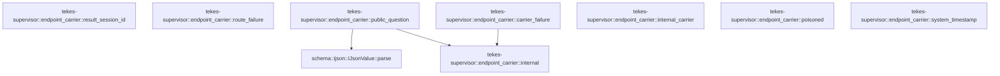

```mermaid
flowchart TD
  n0["endpoint::all_session::AllSessionMux::open_with_replay"]
  n1["endpoint::hub::HostFrame::new"]
  n2["endpoint::journal::EndpointJournal::open"]
  n3["endpoint::stream_queue::EndpointFrameQueue::new"]
  n4["schema::ijson::IJsonValue::parse"]
  n5["schema::ijson::IJsonValue::parse_str"]
  n6["store::atomic::AtomicPublisher::replace"]
  n7["store::platform::NamedLock::exclusive"]
  n8["store::tail::scan_valid_prefix"]
  n9["tekes-supervisor::endpoint_carrier::ProductionCarrierStreams::live_sessions"]
  n10["tekes-supervisor::endpoint_carrier::ProductionCarrierStreams::attach_everywhere"]
  n11["tekes-supervisor::endpoint_carrier::ProductionCarrierStreams::attach_everywhere_with"]
  n12["tekes-supervisor::endpoint_carrier::ProductionCarrierStreams::lacks_registration"]
  n13["tekes-supervisor::endpoint_carrier::ProductionCarrierStreams::touch"]
  n14["tekes-supervisor::endpoint_carrier::ProductionCarrierStreams::pinned_sessions"]
  n15["tekes-supervisor::endpoint_carrier::ProductionCarrierStreams::claim_journal"]
  n16["tekes-supervisor::endpoint_carrier::ProductionCarrierStreams::detach_for_archive"]
  n17["tekes-supervisor::endpoint_carrier::ProductionCarrierStreams::publish_host_frame"]
  n18["tekes-supervisor::endpoint_carrier::ProductionCarrierStreams::publish_session_frame"]
  n19["tekes-supervisor::endpoint_carrier::ProductionCarrierStreams::publish_queue_snapshot"]
  n20["tekes-supervisor::endpoint_carrier::ProductionCarrierStreams::publish_queue_projection_for_delivery"]
  n21["tekes-supervisor::endpoint_carrier::ProductionCarrierStreams::attach_for_publish"]
  n22["tekes-supervisor::endpoint_carrier::ProductionCarrierStreams::update_control_cache"]
  n23["tekes-supervisor::endpoint_carrier::ProductionCarrierStreams::update_control_frames"]
  n24["tekes-supervisor::endpoint_carrier::ProductionCarrierStreams::publish_durable_session_event"]
  n25["tekes-supervisor::endpoint_carrier::ProductionCarrierStreams::publish_durable_session_event_from_journal"]
  n26["tekes-supervisor::endpoint_carrier::ProductionCarrierStreams::close_mux_generations"]
  n27["tekes-supervisor::endpoint_carrier::ProductionCarrierStreams::open_legacy_mux"]
  n28["tekes-supervisor::endpoint_carrier::ProductionCarrierStreams::open_host"]
  n29["tekes-supervisor::endpoint_carrier::ProductionCarrierStreams::next_rpc_id"]
  n30["tekes-supervisor::endpoint_carrier::ProductionCarrierStreams::refresh_all_context_projections"]
  n31["tekes-supervisor::endpoint_carrier::ProductionCarrierStreams::refresh_context_projection"]
  n32["tekes-supervisor::endpoint_carrier::active_session_ids"]
  n33["tekes-supervisor::endpoint_carrier::load_mux_session"]
  n34["tekes-supervisor::endpoint_carrier::poisoned"]
  n35["tekes-supervisor::endpoint_carrier::read_queue_projection"]
  n36["tekes-supervisor::endpoint_carrier::queue_projection_is_older_than"]
  n37["tekes-supervisor::endpoint_carrier::public_queue_items"]
  n11 --> n12
  n11 --> n13
  n11 --> n14
  n11 --> n29
  n11 --> n33
  n11 --> n34
  n12 --> n34
  n14 --> n9
  n15 --> n14
  n15 --> n34
  n16 --> n1
  n16 --> n4
  n16 --> n5
  n16 --> n17
  n16 --> n34
  n17 --> n29
  n17 --> n34
  n18 --> n21
  n18 --> n22
  n18 --> n29
  n19 --> n8
  n19 --> n20
  n20 --> n6
  n20 --> n7
  n20 --> n18
  n20 --> n35
  n20 --> n36
  n20 --> n37
  n21 --> n10
  n22 --> n23
  n23 --> n4
  n23 --> n5
  n23 --> n34
  n24 --> n2
  n24 --> n25
  n25 --> n29
  n26 --> n34
  n27 --> n0
  n27 --> n34
  n28 --> n3
  n28 --> n34
  n30 --> n14
  n30 --> n31
  n30 --> n32
  n30 --> n34
```

```mermaid
flowchart TD
  n0["endpoint::all_session::AllSessionMux::open"]
  n1["endpoint::journal::EndpointJournal::open"]
  n2["endpoint::mux::frozen_history_page"]
  n3["endpoint::service::NativeEndpoint::open"]
  n4["endpoint::session_operations::SessionOperations::open_sessions"]
  n5["endpoint::types::validate_session_id"]
  n6["schema::ijson::IJsonValue::parse"]
  n7["schema::ijson::IJsonValue::parse_str"]
  n8["tekes-supervisor::context_usage::sample"]
  n9["tekes-supervisor::context_usage::publish"]
  n10["tekes-supervisor::context_usage::saved_control_item"]
  n11["tekes-supervisor::endpoint_carrier::ProductionCarrierStreams::session_authority"]
  n12["tekes-supervisor::endpoint_carrier::ProductionCarrierStreams::live_sessions"]
  n13["tekes-supervisor::endpoint_carrier::ProductionCarrierStreams::claim_journal"]
  n14["tekes-supervisor::endpoint_carrier::ProductionCarrierStreams::publish_queue_snapshot"]
  n15["tekes-supervisor::endpoint_carrier::ProductionCarrierStreams::update_control_frames"]
  n16["tekes-supervisor::endpoint_carrier::ProductionCarrierStreams::open_legacy_mux"]
  n17["tekes-supervisor::endpoint_carrier::ProductionCarrierStreams::open_host"]
  n18["tekes-supervisor::endpoint_carrier::ProductionCarrierStreams::next_rpc_id"]
  n19["tekes-supervisor::endpoint_carrier::ProductionCarrierStreams::refresh_context_projection"]
  n20["tekes-supervisor::endpoint_carrier::ProductionCarrierStreams::refresh_context_projection_shared"]
  n21["tekes-supervisor::endpoint_carrier::ProductionCarrierStreams::refresh_context_projection_locked"]
  n22["tekes-supervisor::endpoint_carrier::ProductionCarrierStreams::session_items"]
  n23["tekes-supervisor::endpoint_carrier::ProductionCarrierStreams::inventory_baseline"]
  n24["tekes-supervisor::endpoint_carrier::ProductionCarrierStreams::inventory_row"]
  n25["tekes-supervisor::endpoint_carrier::ProductionCarrierStreams::control_baseline"]
  n26["tekes-supervisor::endpoint_carrier::ProductionCarrierStreams::actionables_baseline"]
  n27["tekes-supervisor::endpoint_carrier::ProductionCarrierStreams::index_holds"]
  n28["tekes-supervisor::endpoint_carrier::ProductionCarrierStreams::sessions_with_published_requests"]
  n29["tekes-supervisor::endpoint_carrier::ProductionCarrierStreams::requests"]
  n30["tekes-supervisor::endpoint_carrier::ProductionCarrierStreams::index_catalog_holds"]
  n31["tekes-supervisor::endpoint_carrier::ProductionCarrierStreams::index_unverified_and_archived"]
  n32["tekes-supervisor::endpoint_carrier::ProductionCarrierStreams::examine"]
  n33["tekes-supervisor::endpoint_carrier::ProductionCarrierStreams::fold_into_index"]
  n34["tekes-supervisor::endpoint_carrier::ProductionCarrierStreams::verify_session_carrier"]
  n35["tekes-supervisor::endpoint_carrier::ProductionCarrierStreams::verify_session"]
  n36["tekes-supervisor::endpoint_carrier::ProductionCarrierStreams::open_mux_journal"]
  n37["tekes-supervisor::endpoint_carrier::ProductionCarrierStreams::snapshot_projections"]
  n38["tekes-supervisor::endpoint_carrier::ProductionCarrierStreams::open_mux"]
  n39["tekes-supervisor::endpoint_carrier::active_session_ids"]
  n40["tekes-supervisor::endpoint_carrier::load_mux_session"]
  n41["tekes-supervisor::endpoint_carrier::inventory_row"]
  n42["tekes-supervisor::endpoint_carrier::semantic_projection"]
  n43["tekes-supervisor::endpoint_carrier::session_requests_mode"]
  n44["tekes-supervisor::endpoint_carrier::pending_session_requests_mode"]
  n45["tekes-supervisor::endpoint_carrier::poisoned"]
  n46["tekes-supervisor::endpoint_carrier::read_queue_projection"]
  n47["tekes-supervisor::endpoint_carrier::ProductionCarrierStreams::recover_actionables"]
  n48["tekes-supervisor::request_index::ledger_signature"]
  n49["tekes-supervisor::request_index::children_may_hold_requests"]
  n50["tekes-supervisor::request_index::may_hold_requests"]
  n19 --> n1
  n19 --> n5
  n19 --> n21
  n19 --> n42
  n19 --> n45
  n20 --> n5
  n20 --> n21
  n20 --> n45
  n21 --> n3
  n21 --> n6
  n21 --> n8
  n21 --> n9
  n21 --> n15
  n21 --> n18
  n21 --> n45
  n22 --> n3
  n22 --> n11
  n22 --> n12
  n23 --> n4
  n23 --> n22
  n23 --> n41
  n24 --> n4
  n24 --> n11
  n24 --> n41
  n25 --> n7
  n25 --> n10
  n25 --> n11
  n25 --> n14
  n25 --> n19
  n25 --> n39
  n25 --> n45
  n25 --> n46
  n26 --> n11
  n26 --> n27
  n26 --> n28
  n26 --> n39
  n26 --> n44
  n26 --> n47
  n26 --> n50
  n30 --> n11
  n30 --> n27
  n31 --> n5
  n31 --> n11
  n31 --> n32
  n31 --> n39
  n32 --> n33
  n32 --> n48
  n32 --> n49
  n32 --> n50
  n33 --> n43
  n34 --> n11
  n35 --> n34
  n36 --> n0
  n36 --> n2
  n36 --> n3
  n36 --> n11
  n36 --> n13
  n36 --> n18
  n36 --> n34
  n36 --> n37
  n36 --> n40
  n37 --> n6
  n37 --> n10
  n37 --> n45
  n38 --> n16
  n38 --> n17
  n38 --> n23
  n38 --> n25
  n38 --> n26
  n38 --> n36
```

```mermaid
flowchart TD
  n0["endpoint::carrier_adapter::JournalRespondHandler::new"]
  n1["endpoint::carrier_adapter::ComposedEndpointCarrierHost::new"]
  n2["endpoint::host::StreamFailure::internal"]
  n3["endpoint::idempotency::RpcRegistry::open"]
  n4["endpoint::mux::frozen_history_page"]
  n5["endpoint::service::NativeEndpoint::open"]
  n6["schema::ijson::IJsonValue::parse"]
  n7["tekes-supervisor::endpoint_carrier::ProductionCarrierStreams::with_description"]
  n8["tekes-supervisor::endpoint_carrier::ProductionRespondAuthority::open"]
  n9["tekes-supervisor::endpoint_carrier::ProductionCarrierStreams::verify_session_carrier"]
  n10["tekes-supervisor::endpoint_carrier::ProductionCarrierStreams::mux_journal_page"]
  n11["tekes-supervisor::endpoint_carrier::ProductionStream::map_source"]
  n12["tekes-supervisor::endpoint_carrier::ProductionStream::recv"]
  n13["tekes-supervisor::endpoint_carrier::ProductionCarrierStreams::open_stream"]
  n14["tekes-supervisor::endpoint_carrier::ProductionCarrierStreams::stream_error"]
  n15["tekes-supervisor::endpoint_carrier::ProductionCarrierStreams::mux_description"]
  n16["tekes-supervisor::endpoint_carrier::ProductionCarrierStreams::open_mux_stream"]
  n17["tekes-supervisor::endpoint_carrier::ProductionCarrierStreams::journal_page"]
  n18["tekes-supervisor::endpoint_carrier::LeasedStream::recv"]
  n19["tekes-supervisor::endpoint_carrier::LeasedStream::drop"]
  n20["tekes-supervisor::endpoint_carrier::LifecycleCarrierHost::new"]
  n21["tekes-supervisor::endpoint_carrier::LifecycleCarrierHost::capabilities"]
  n22["tekes-supervisor::endpoint_carrier::LifecycleCarrierHost::extension_capabilities"]
  n23["tekes-supervisor::endpoint_carrier::LifecycleCarrierHost::method_class"]
  n24["tekes-supervisor::endpoint_carrier::LifecycleCarrierHost::validate_request"]
  n25["tekes-supervisor::endpoint_carrier::LifecycleCarrierHost::call"]
  n26["tekes-supervisor::endpoint_carrier::lifecycle_target"]
  n27["tekes-supervisor::endpoint_carrier::ProductionCarrierAssembly::assemble"]
  n28["tekes-supervisor::endpoint_carrier::ProductionCarrierAssembly::host"]
  n29["tekes-supervisor::endpoint_carrier::ProductionCarrierAssembly::with_file_changes"]
  n30["tekes-supervisor::endpoint_carrier::load_mux_session"]
  n31["tekes-supervisor::endpoint_carrier::payload_session_id"]
  n32["tekes-supervisor::endpoint_carrier::poisoned"]
  n33["tekes-supervisor::file_leases::SessionFileTransfer::open"]
  n34["transport::server::TransportServer::new"]
  n10 --> n4
  n10 --> n5
  n10 --> n9
  n10 --> n30
  n11 --> n32
  n12 --> n2
  n14 --> n6
  n25 --> n26
  n26 --> n31
  n27 --> n0
  n27 --> n1
  n27 --> n3
  n27 --> n7
  n27 --> n8
  n27 --> n20
  n27 --> n33
  n27 --> n34
```

```mermaid
flowchart TD
  n0["endpoint::journal::EndpointJournal::open"]
  n1["endpoint::requests::PendingRequest::derive"]
  n2["endpoint::requests::RequestState::resolved"]
  n3["endpoint::types::validate_session_id"]
  n4["engine::lifecycle::classify"]
  n5["schema::ijson::IJsonValue::parse"]
  n6["store::tail::scan_valid_prefix"]
  n7["tekes-supervisor::endpoint_carrier::ProductionCarrierAssembly::streams"]
  n8["tekes-supervisor::endpoint_carrier::ProductionCarrierAssembly::server"]
  n9["tekes-supervisor::endpoint_carrier::ProductionCarrierAssembly::into_server"]
  n10["tekes-supervisor::endpoint_carrier::ProductionCarrierAssembly::mark_ready"]
  n11["tekes-supervisor::endpoint_carrier::ProductionCarrierAssembly::finish_recovery"]
  n12["tekes-supervisor::endpoint_carrier::ProductionCarrierAssembly::begin_drain"]
  n13["tekes-supervisor::endpoint_carrier::active_session_ids"]
  n14["tekes-supervisor::endpoint_carrier::load_mux_session"]
  n15["tekes-supervisor::endpoint_carrier::inventory_row"]
  n16["tekes-supervisor::endpoint_carrier::semantic_projection"]
  n17["tekes-supervisor::endpoint_carrier::semantic_line_projection"]
  n18["tekes-supervisor::endpoint_carrier::semantic_line_projection_mode"]
  n19["tekes-supervisor::endpoint_carrier::line_requests"]
  n20["tekes-supervisor::endpoint_carrier::session_requests_mode"]
  n21["tekes-supervisor::endpoint_carrier::pending_session_requests_mode"]
  n22["tekes-supervisor::endpoint_carrier::actionable_projection"]
  n23["tekes-supervisor::endpoint_carrier::actionable_projection_mode"]
  n24["tekes-supervisor::endpoint_carrier::validate_request_binding"]
  n25["tekes-supervisor::endpoint_carrier::unresolved_hold_turn"]
  n26["tekes-supervisor::endpoint_carrier::payload_session_id"]
  n27["tekes-supervisor::endpoint_carrier::internal"]
  n11 --> n10
  n13 --> n3
  n14 --> n0
  n14 --> n3
  n14 --> n21
  n15 --> n4
  n15 --> n5
  n16 --> n17
  n17 --> n18
  n18 --> n3
  n18 --> n6
  n18 --> n27
  n19 --> n1
  n19 --> n2
  n19 --> n5
  n19 --> n27
  n20 --> n3
  n20 --> n18
  n20 --> n19
  n20 --> n27
  n21 --> n20
  n22 --> n23
  n23 --> n18
  n23 --> n27
```

# tekes-supervisor::endpoint_carrier

[Package atlas](index.md) · [Source](../../src/endpoint_carrier.rs)

## Declarations

Visibility is the declaration spelling; trait members and reexports require their enclosing interface. `cfg` is not evaluated.

| Symbol | Kind | Visibility | Test / cfg |
|---|---|---|---|
| [tekes-supervisor::endpoint_carrier::HOST_STREAM_MAX_FRAMES](../../src/endpoint_carrier.rs#L46) | const_item | `private` |  |
| [tekes-supervisor::endpoint_carrier::HOST_STREAM_MAX_BYTES](../../src/endpoint_carrier.rs#L47) | const_item | `private` |  |
| [tekes-supervisor::endpoint_carrier::SupervisorSessionAuthority](../../src/endpoint_carrier.rs#L61) | trait_item | `pub` |  |
| [tekes-supervisor::endpoint_carrier::SupervisorSessionAuthority::live_sessions](../../src/endpoint_carrier.rs#L63) | function_signature_item | `private` |  |
| [tekes-supervisor::endpoint_carrier::SupervisorSessionAuthority::reconcile_projection](../../src/endpoint_carrier.rs#L68) | function_signature_item | `private` |  |
| [tekes-supervisor::endpoint_carrier::SupervisorSessionAuthority::inventory_items](../../src/endpoint_carrier.rs#L73) | function_item | `private` |  |
| [tekes-supervisor::endpoint_carrier::SupervisorSessionAuthority::inventory_item](../../src/endpoint_carrier.rs#L81) | function_item | `private` |  |
| [tekes-supervisor::endpoint_carrier::SupervisorSessionAuthority::ensure_verified](../../src/endpoint_carrier.rs#L90) | function_item | `private` |  |
| [tekes-supervisor::endpoint_carrier::SupervisorSessionAuthority::has_catalog](../../src/endpoint_carrier.rs#L96) | function_item | `private` |  |
| [tekes-supervisor::endpoint_carrier::SupervisorSessionAuthority::hold_catalog](../../src/endpoint_carrier.rs#L102) | function_item | `private` |  |
| [tekes-supervisor::endpoint_carrier::SessionGateError](../../src/endpoint_carrier.rs#L109) | enum_item | `pub` |  |
| [tekes-supervisor::endpoint_carrier::HoldRef](../../src/endpoint_carrier.rs#L118) | struct_item | `pub` |  |
| [tekes-supervisor::endpoint_carrier::VerifiedHolds](../../src/endpoint_carrier.rs#L127) | struct_item | `pub` |  |
| [tekes-supervisor::endpoint_carrier::HoldCatalog](../../src/endpoint_carrier.rs#L136) | struct_item | `pub` |  |
| [tekes-supervisor::endpoint_carrier::LiveRespondAuthority](../../src/endpoint_carrier.rs#L150) | trait_item | `pub` |  |
| [tekes-supervisor::endpoint_carrier::LiveRespondAuthority::deliver_if_live](../../src/endpoint_carrier.rs#L151) | function_signature_item | `private` |  |
| [tekes-supervisor::endpoint_carrier::LiveRespondAuthority::ensure_after_locked_append](../../src/endpoint_carrier.rs#L160) | function_item | `private` |  |
| [tekes-supervisor::endpoint_carrier::CarrierClock](../../src/endpoint_carrier.rs#L165) | type_item | `pub` |  |
| [tekes-supervisor::endpoint_carrier::ProductionRespondAuthority](../../src/endpoint_carrier.rs#L167) | struct_item | `pub` |  |
| [tekes-supervisor::endpoint_carrier::ProductionRespondAuthority::open](../../src/endpoint_carrier.rs#L182) | function_item | `pub` |  |
| [tekes-supervisor::endpoint_carrier::ProductionRespondAuthority::open_with_clock](../../src/endpoint_carrier.rs#L190) | function_item | `pub` |  |
| [tekes-supervisor::endpoint_carrier::ProductionRespondAuthority::with_streams](../../src/endpoint_carrier.rs#L213) | function_item | `pub` |  |
| [tekes-supervisor::endpoint_carrier::ProductionRespondAuthority::reconcile_after_response](../../src/endpoint_carrier.rs#L224) | function_item | `private` |  |
| [tekes-supervisor::endpoint_carrier::ProductionRespondAuthority::locate_once](../../src/endpoint_carrier.rs#L242) | function_item | `private` |  |
| [tekes-supervisor::endpoint_carrier::ProductionRespondAuthority::locate_indexed](../../src/endpoint_carrier.rs#L264) | function_item | `private` |  |
| [tekes-supervisor::endpoint_carrier::ProductionRespondAuthority::locate_by_scan](../../src/endpoint_carrier.rs#L290) | function_item | `private` |  |
| [tekes-supervisor::endpoint_carrier::ProductionRespondAuthority::locate_in_folder](../../src/endpoint_carrier.rs#L319) | function_item | `private` |  |
| [tekes-supervisor::endpoint_carrier::ProductionRespondAuthority::worker_message](../../src/endpoint_carrier.rs#L360) | function_item | `private` |  |
| [tekes-supervisor::endpoint_carrier::ProductionRespondAuthority::live_delivery](../../src/endpoint_carrier.rs#L376) | function_item | `private` |  |
| [tekes-supervisor::endpoint_carrier::ProductionRespondAuthority::locked_append](../../src/endpoint_carrier.rs#L399) | function_item | `private` |  |
| [tekes-supervisor::endpoint_carrier::ProductionRespondAuthority::locate](../../src/endpoint_carrier.rs#L472) | function_item | `private` |  |
| [tekes-supervisor::endpoint_carrier::ProductionRespondAuthority::author](../../src/endpoint_carrier.rs#L476) | function_item | `private` |  |
| [tekes-supervisor::endpoint_carrier::ProductionCarrierStreams](../../src/endpoint_carrier.rs#L534) | struct_item | `pub` |  |
| [tekes-supervisor::endpoint_carrier::CarrierStreamsInner](../../src/endpoint_carrier.rs#L538) | struct_item | `private` |  |
| [tekes-supervisor::endpoint_carrier::Attachments](../../src/endpoint_carrier.rs#L560) | struct_item | `private` |  |
| [tekes-supervisor::endpoint_carrier::SavedQueueProjection](../../src/endpoint_carrier.rs#L571) | struct_item | `private` |  |
| [tekes-supervisor::endpoint_carrier::read_queue_projection](../../src/endpoint_carrier.rs#L578) | function_item | `private` |  |
| [tekes-supervisor::endpoint_carrier::queue_projection_is_older_than](../../src/endpoint_carrier.rs#L585) | function_item | `private` |  |
| [tekes-supervisor::endpoint_carrier::public_queue_items](../../src/endpoint_carrier.rs#L593) | function_item | `private` |  |
| [tekes-supervisor::endpoint_carrier::public_queue_projection_tests::projection](../../src/endpoint_carrier.rs#L639) | function_item | `private` | test; #[cfg(test)] |
| [tekes-supervisor::endpoint_carrier::public_queue_projection_tests::ledger_recovery_starts_a_new_queue_generation](../../src/endpoint_carrier.rs#L675) | function_item | `private` | test; #[cfg(test)] |
| [tekes-supervisor::endpoint_carrier::public_queue_projection_tests::queue_snapshot_uses_only_live_inputs_and_preserves_public_message_source](../../src/endpoint_carrier.rs#L688) | function_item | `private` | test; #[cfg(test)] |
| [tekes-supervisor::endpoint_carrier::JournalLease](../../src/endpoint_carrier.rs#L723) | struct_item | `pub(crate)` |  |
| [tekes-supervisor::endpoint_carrier::JournalLease::drop](../../src/endpoint_carrier.rs#L729) | function_item | `private` |  |
| [tekes-supervisor::endpoint_carrier::PublishedActionables](../../src/endpoint_carrier.rs#L754) | type_item | `private` |  |
| [tekes-supervisor::endpoint_carrier::StreamGenerations](../../src/endpoint_carrier.rs#L757) | struct_item | `private` |  |
| [tekes-supervisor::endpoint_carrier::TrackedMux](../../src/endpoint_carrier.rs#L762) | struct_item | `private` |  |
| [tekes-supervisor::endpoint_carrier::TrackedHost](../../src/endpoint_carrier.rs#L767) | struct_item | `private` |  |
| [tekes-supervisor::endpoint_carrier::ProjectionReplay](../../src/endpoint_carrier.rs#L773) | struct_item | `private` |  |
| [tekes-supervisor::endpoint_carrier::ProductionCarrierStreams::recover_actionables](../../src/endpoint_carrier.rs#L780) | function_item | `private` |  |
| [tekes-supervisor::endpoint_carrier::ProductionCarrierStreams::reconcile_actionables](../../src/endpoint_carrier.rs#L817) | function_item | `pub(crate)` |  |
| [tekes-supervisor::endpoint_carrier::ProductionCarrierStreams::reconcile_actionables_main](../../src/endpoint_carrier.rs#L831) | function_item | `pub(crate)` |  |
| [tekes-supervisor::endpoint_carrier::ProductionCarrierStreams::reconcile_actionables_from](../../src/endpoint_carrier.rs#L846) | function_item | `private` |  |
| [tekes-supervisor::endpoint_carrier::ProductionCarrierStreams::note_pending_line](../../src/endpoint_carrier.rs#L922) | function_item | `private` |  |
| [tekes-supervisor::endpoint_carrier::ProductionCarrierStreams::forget_session](../../src/endpoint_carrier.rs#L939) | function_item | `pub(crate)` |  |
| [tekes-supervisor::endpoint_carrier::ProductionCarrierStreams::actionable_ids_for_test](../../src/endpoint_carrier.rs#L957) | function_item | `pub(crate)` | test; #[cfg(test)] #[cfg_attr(not(target_os = "macos"), allow(dead_code))] |
| [tekes-supervisor::endpoint_carrier::ProductionCarrierStreams::published_pending_for_test](../../src/endpoint_carrier.rs#L969) | function_item | `pub(crate)` | test; #[cfg(test)] #[cfg_attr(not(target_os = "macos"), allow(dead_code))] |
| [tekes-supervisor::endpoint_carrier::ProductionCarrierStreams::new](../../src/endpoint_carrier.rs#L984) | function_item | `pub` |  |
| [tekes-supervisor::endpoint_carrier::ProductionCarrierStreams::with_description](../../src/endpoint_carrier.rs#L1005) | function_item | `pub` |  |
| [tekes-supervisor::endpoint_carrier::ProductionCarrierStreams::attach_session_authority](../../src/endpoint_carrier.rs#L1027) | function_item | `pub` |  |
| [tekes-supervisor::endpoint_carrier::ProductionCarrierStreams::attach_session_admission](../../src/endpoint_carrier.rs#L1035) | function_item | `pub` |  |
| [tekes-supervisor::endpoint_carrier::ProductionCarrierStreams::archive_session](../../src/endpoint_carrier.rs#L1045) | function_item | `pub` |  |
| [tekes-supervisor::endpoint_carrier::ProductionCarrierStreams::session_authority](../../src/endpoint_carrier.rs#L1078) | function_item | `private` |  |
| [tekes-supervisor::endpoint_carrier::ProductionCarrierStreams::live_sessions](../../src/endpoint_carrier.rs#L1087) | function_item | `private` |  |
| [tekes-supervisor::endpoint_carrier::ProductionCarrierStreams::publish_session_status](../../src/endpoint_carrier.rs#L1097) | function_item | `pub` |  |
| [tekes-supervisor::endpoint_carrier::ProductionCarrierStreams::publish_workspace_changed](../../src/endpoint_carrier.rs#L1112) | function_item | `pub` |  |
| [tekes-supervisor::endpoint_carrier::ProductionCarrierStreams::attach_session](../../src/endpoint_carrier.rs#L1124) | function_item | `pub` |  |
| [tekes-supervisor::endpoint_carrier::ProductionCarrierStreams::attach_everywhere](../../src/endpoint_carrier.rs#L1149) | function_item | `pub(crate)` |  |
| [tekes-supervisor::endpoint_carrier::ProductionCarrierStreams::attach_everywhere_with](../../src/endpoint_carrier.rs#L1154) | function_item | `pub(crate)` |  |
| [tekes-supervisor::endpoint_carrier::ProductionCarrierStreams::lacks_registration](../../src/endpoint_carrier.rs#L1250) | function_item | `private` |  |
| [tekes-supervisor::endpoint_carrier::ProductionCarrierStreams::touch](../../src/endpoint_carrier.rs#L1263) | function_item | `private` |  |
| [tekes-supervisor::endpoint_carrier::ProductionCarrierStreams::pinned_sessions](../../src/endpoint_carrier.rs#L1276) | function_item | `private` |  |
| [tekes-supervisor::endpoint_carrier::ProductionCarrierStreams::claim_journal](../../src/endpoint_carrier.rs#L1295) | function_item | `private` |  |
| [tekes-supervisor::endpoint_carrier::ProductionCarrierStreams::detach_for_archive](../../src/endpoint_carrier.rs#L1316) | function_item | `pub` |  |
| [tekes-supervisor::endpoint_carrier::ProductionCarrierStreams::publish_host_frame](../../src/endpoint_carrier.rs#L1339) | function_item | `pub` |  |
| [tekes-supervisor::endpoint_carrier::ProductionCarrierStreams::publish_session_frame](../../src/endpoint_carrier.rs#L1368) | function_item | `pub` |  |
| [tekes-supervisor::endpoint_carrier::ProductionCarrierStreams::publish_queue_snapshot](../../src/endpoint_carrier.rs#L1384) | function_item | `pub` |  |
| [tekes-supervisor::endpoint_carrier::ProductionCarrierStreams::publish_queue_projection_for_delivery](../../src/endpoint_carrier.rs#L1411) | function_item | `pub(crate)` |  |
| [tekes-supervisor::endpoint_carrier::ProductionCarrierStreams::attach_for_publish](../../src/endpoint_carrier.rs#L1475) | function_item | `private` |  |
| [tekes-supervisor::endpoint_carrier::ProductionCarrierStreams::update_control_cache](../../src/endpoint_carrier.rs#L1486) | function_item | `private` |  |
| [tekes-supervisor::endpoint_carrier::ProductionCarrierStreams::update_control_frames](../../src/endpoint_carrier.rs#L1493) | function_item | `private` |  |
| [tekes-supervisor::endpoint_carrier::ProductionCarrierStreams::publish_durable_session_event](../../src/endpoint_carrier.rs#L1539) | function_item | `pub` |  |
| [tekes-supervisor::endpoint_carrier::ProductionCarrierStreams::publish_durable_session_event_from_journal](../../src/endpoint_carrier.rs#L1552) | function_item | `pub` |  |
| [tekes-supervisor::endpoint_carrier::ProductionCarrierStreams::close_mux_generations](../../src/endpoint_carrier.rs#L1568) | function_item | `pub` |  |
| [tekes-supervisor::endpoint_carrier::ProductionCarrierStreams::open_legacy_mux](../../src/endpoint_carrier.rs#L1579) | function_item | `private` |  |
| [tekes-supervisor::endpoint_carrier::ProductionCarrierStreams::open_host](../../src/endpoint_carrier.rs#L1598) | function_item | `private` |  |
| [tekes-supervisor::endpoint_carrier::ProductionCarrierStreams::next_rpc_id](../../src/endpoint_carrier.rs#L1617) | function_item | `private` |  |
| [tekes-supervisor::endpoint_carrier::ProductionCarrierStreams::refresh_all_context_projections](../../src/endpoint_carrier.rs#L1626) | function_item | `pub(crate)` |  |
| [tekes-supervisor::endpoint_carrier::ProductionCarrierStreams::refresh_context_projection](../../src/endpoint_carrier.rs#L1665) | function_item | `pub(crate)` |  |
| [tekes-supervisor::endpoint_carrier::ProductionCarrierStreams::refresh_context_projection_shared](../../src/endpoint_carrier.rs#L1685) | function_item | `pub(crate)` |  |
| [tekes-supervisor::endpoint_carrier::ProductionCarrierStreams::refresh_context_projection_locked](../../src/endpoint_carrier.rs#L1701) | function_item | `private` |  |
| [tekes-supervisor::endpoint_carrier::ProductionCarrierStreams::session_items](../../src/endpoint_carrier.rs#L1759) | function_item | `private` |  |
| [tekes-supervisor::endpoint_carrier::ProductionCarrierStreams::inventory_baseline](../../src/endpoint_carrier.rs#L1776) | function_item | `private` |  |
| [tekes-supervisor::endpoint_carrier::ProductionCarrierStreams::inventory_row](../../src/endpoint_carrier.rs#L1802) | function_item | `private` |  |
| [tekes-supervisor::endpoint_carrier::ProductionCarrierStreams::control_baseline](../../src/endpoint_carrier.rs#L1820) | function_item | `private` |  |
| [tekes-supervisor::endpoint_carrier::ProductionCarrierStreams::actionables_baseline](../../src/endpoint_carrier.rs#L1915) | function_item | `private` |  |
| [tekes-supervisor::endpoint_carrier::ProductionCarrierStreams::index_holds](../../src/endpoint_carrier.rs#L1995) | function_item | `private` |  |
| [tekes-supervisor::endpoint_carrier::ProductionCarrierStreams::sessions_with_published_requests](../../src/endpoint_carrier.rs#L2009) | function_item | `private` |  |
| [tekes-supervisor::endpoint_carrier::ProductionCarrierStreams::requests](../../src/endpoint_carrier.rs#L2025) | function_item | `pub(crate)` |  |
| [tekes-supervisor::endpoint_carrier::ProductionCarrierStreams::index_catalog_holds](../../src/endpoint_carrier.rs#L2031) | function_item | `pub(crate)` |  |
| [tekes-supervisor::endpoint_carrier::ProductionCarrierStreams::index_unverified_and_archived](../../src/endpoint_carrier.rs#L2042) | function_item | `pub(crate)` |  |
| [tekes-supervisor::endpoint_carrier::ProductionCarrierStreams::examine](../../src/endpoint_carrier.rs#L2087) | function_item | `private` |  |
| [tekes-supervisor::endpoint_carrier::ProductionCarrierStreams::fold_into_index](../../src/endpoint_carrier.rs#L2113) | function_item | `private` |  |
| [tekes-supervisor::endpoint_carrier::ProductionCarrierStreams::verify_session_carrier](../../src/endpoint_carrier.rs#L2137) | function_item | `pub(crate)` |  |
| [tekes-supervisor::endpoint_carrier::ProductionCarrierStreams::verify_session](../../src/endpoint_carrier.rs#L2156) | function_item | `pub(crate)` |  |
| [tekes-supervisor::endpoint_carrier::ProductionCarrierStreams::open_mux_journal](../../src/endpoint_carrier.rs#L2161) | function_item | `private` |  |
| [tekes-supervisor::endpoint_carrier::ProductionCarrierStreams::snapshot_projections](../../src/endpoint_carrier.rs#L2262) | function_item | `private` |  |
| [tekes-supervisor::endpoint_carrier::ProductionCarrierStreams::open_mux](../../src/endpoint_carrier.rs#L2317) | function_item | `pub(crate)` |  |
| [tekes-supervisor::endpoint_carrier::ProductionCarrierStreams::mux_journal_page](../../src/endpoint_carrier.rs#L2386) | function_item | `private` |  |
| [tekes-supervisor::endpoint_carrier::ProductionStreamKind](../../src/endpoint_carrier.rs#L2427) | enum_item | `private` |  |
| [tekes-supervisor::endpoint_carrier::ProductionStream](../../src/endpoint_carrier.rs#L2439) | struct_item | `private` |  |
| [tekes-supervisor::endpoint_carrier::ProductionStream::map_source](../../src/endpoint_carrier.rs#L2450) | function_item | `private` |  |
| [tekes-supervisor::endpoint_carrier::ProductionStream::recv](../../src/endpoint_carrier.rs#L2656) | function_item | `private` |  |
| [tekes-supervisor::endpoint_carrier::ProductionCarrierStreams::open_stream](../../src/endpoint_carrier.rs#L2683) | function_item | `private` |  |
| [tekes-supervisor::endpoint_carrier::ProductionCarrierStreams::stream_error](../../src/endpoint_carrier.rs#L2693) | function_item | `private` |  |
| [tekes-supervisor::endpoint_carrier::ProductionCarrierStreams::mux_description](../../src/endpoint_carrier.rs#L2720) | function_item | `private` |  |
| [tekes-supervisor::endpoint_carrier::ProductionCarrierStreams::open_mux_stream](../../src/endpoint_carrier.rs#L2727) | function_item | `private` |  |
| [tekes-supervisor::endpoint_carrier::ProductionCarrierStreams::journal_page](../../src/endpoint_carrier.rs#L2737) | function_item | `private` |  |
| [tekes-supervisor::endpoint_carrier::LeasedStream](../../src/endpoint_carrier.rs#L2747) | struct_item | `private` |  |
| [tekes-supervisor::endpoint_carrier::StreamDrop](../../src/endpoint_carrier.rs#L2754) | enum_item | `private` |  |
| [tekes-supervisor::endpoint_carrier::LeasedStream::recv](../../src/endpoint_carrier.rs#L2760) | function_item | `private` |  |
| [tekes-supervisor::endpoint_carrier::LeasedStream::drop](../../src/endpoint_carrier.rs#L2766) | function_item | `private` |  |
| [tekes-supervisor::endpoint_carrier::LifecycleCarrierHost](../../src/endpoint_carrier.rs#L2778) | struct_item | `pub` |  |
| [tekes-supervisor::endpoint_carrier::LifecycleCarrierHost::new](../../src/endpoint_carrier.rs#L2785) | function_item | `pub` |  |
| [tekes-supervisor::endpoint_carrier::LifecycleCarrierHost::capabilities](../../src/endpoint_carrier.rs#L2791) | function_item | `private` |  |
| [tekes-supervisor::endpoint_carrier::LifecycleCarrierHost::extension_capabilities](../../src/endpoint_carrier.rs#L2795) | function_item | `private` |  |
| [tekes-supervisor::endpoint_carrier::LifecycleCarrierHost::method_class](../../src/endpoint_carrier.rs#L2799) | function_item | `private` |  |
| [tekes-supervisor::endpoint_carrier::LifecycleCarrierHost::validate_request](../../src/endpoint_carrier.rs#L2803) | function_item | `private` |  |
| [tekes-supervisor::endpoint_carrier::LifecycleCarrierHost::call](../../src/endpoint_carrier.rs#L2807) | function_item | `private` |  |
| [tekes-supervisor::endpoint_carrier::LifecycleTarget](../../src/endpoint_carrier.rs#L2845) | enum_item | `private` |  |
| [tekes-supervisor::endpoint_carrier::lifecycle_target](../../src/endpoint_carrier.rs#L2851) | function_item | `private` |  |
| [tekes-supervisor::endpoint_carrier::ProductionCarrierHost](../../src/endpoint_carrier.rs#L2862) | type_item | `pub` |  |
| [tekes-supervisor::endpoint_carrier::ProductionCarrierAssembly](../../src/endpoint_carrier.rs#L2868) | struct_item | `pub` |  |
| [tekes-supervisor::endpoint_carrier::ProductionCarrierAssembly::assemble](../../src/endpoint_carrier.rs#L2875) | function_item | `pub` |  |
| [tekes-supervisor::endpoint_carrier::ProductionCarrierAssembly::host](../../src/endpoint_carrier.rs#L2912) | function_item | `pub` |  |
| [tekes-supervisor::endpoint_carrier::ProductionCarrierAssembly::with_file_changes](../../src/endpoint_carrier.rs#L2916) | function_item | `pub` |  |
| [tekes-supervisor::endpoint_carrier::ProductionCarrierAssembly::streams](../../src/endpoint_carrier.rs#L2922) | function_item | `pub` |  |
| [tekes-supervisor::endpoint_carrier::ProductionCarrierAssembly::server](../../src/endpoint_carrier.rs#L2927) | function_item | `pub` |  |
| [tekes-supervisor::endpoint_carrier::ProductionCarrierAssembly::into_server](../../src/endpoint_carrier.rs#L2932) | function_item | `pub` |  |
| [tekes-supervisor::endpoint_carrier::ProductionCarrierAssembly::mark_ready](../../src/endpoint_carrier.rs#L2939) | function_item | `pub` |  |
| [tekes-supervisor::endpoint_carrier::ProductionCarrierAssembly::finish_recovery](../../src/endpoint_carrier.rs#L2944) | function_item | `pub` |  |
| [tekes-supervisor::endpoint_carrier::ProductionCarrierAssembly::begin_drain](../../src/endpoint_carrier.rs#L2949) | function_item | `pub` |  |
| [tekes-supervisor::endpoint_carrier::MuxSession](../../src/endpoint_carrier.rs#L2955) | struct_item | `private` |  |
| [tekes-supervisor::endpoint_carrier::active_session_ids](../../src/endpoint_carrier.rs#L2961) | function_item | `private` |  |
| [tekes-supervisor::endpoint_carrier::load_mux_session](../../src/endpoint_carrier.rs#L2974) | function_item | `private` |  |
| [tekes-supervisor::endpoint_carrier::inventory_row](../../src/endpoint_carrier.rs#L2990) | function_item | `private` |  |
| [tekes-supervisor::endpoint_carrier::folder_inventory_tests::inventory_uses_only_its_own_recorded_execution_cwd](../../src/endpoint_carrier.rs#L3034) | function_item | `private` | test; #[cfg(test)] |
| [tekes-supervisor::endpoint_carrier::semantic_projection](../../src/endpoint_carrier.rs#L3074) | function_item | `private` |  |
| [tekes-supervisor::endpoint_carrier::semantic_line_projection](../../src/endpoint_carrier.rs#L3078) | function_item | `private` |  |
| [tekes-supervisor::endpoint_carrier::semantic_line_projection_mode](../../src/endpoint_carrier.rs#L3089) | function_item | `private` |  |
| [tekes-supervisor::endpoint_carrier::line_requests](../../src/endpoint_carrier.rs#L3122) | function_item | `pub(crate)` |  |
| [tekes-supervisor::endpoint_carrier::session_requests_mode](../../src/endpoint_carrier.rs#L3225) | function_item | `private` |  |
| [tekes-supervisor::endpoint_carrier::pending_session_requests_mode](../../src/endpoint_carrier.rs#L3266) | function_item | `private` |  |
| [tekes-supervisor::endpoint_carrier::actionable_projection](../../src/endpoint_carrier.rs#L3280) | function_item | `private` |  |
| [tekes-supervisor::endpoint_carrier::actionable_projection_mode](../../src/endpoint_carrier.rs#L3288) | function_item | `private` |  |
| [tekes-supervisor::endpoint_carrier::validate_request_binding](../../src/endpoint_carrier.rs#L3351) | function_item | `private` |  |
| [tekes-supervisor::endpoint_carrier::unresolved_hold_turn](../../src/endpoint_carrier.rs#L3385) | function_item | `private` |  |
| [tekes-supervisor::endpoint_carrier::payload_session_id](../../src/endpoint_carrier.rs#L3410) | function_item | `private` |  |
| [tekes-supervisor::endpoint_carrier::result_session_id](../../src/endpoint_carrier.rs#L3418) | function_item | `private` |  |
| [tekes-supervisor::endpoint_carrier::route_failure](../../src/endpoint_carrier.rs#L3426) | function_item | `private` |  |
| [tekes-supervisor::endpoint_carrier::public_question](../../src/endpoint_carrier.rs#L3438) | function_item | `private` |  |
| [tekes-supervisor::endpoint_carrier::internal](../../src/endpoint_carrier.rs#L3462) | function_item | `private` |  |
| [tekes-supervisor::endpoint_carrier::carrier_failure](../../src/endpoint_carrier.rs#L3467) | function_item | `private` |  |
| [tekes-supervisor::endpoint_carrier::internal_carrier](../../src/endpoint_carrier.rs#L3477) | function_item | `private` |  |
| [tekes-supervisor::endpoint_carrier::poisoned](../../src/endpoint_carrier.rs#L3481) | function_item | `private` |  |
| [tekes-supervisor::endpoint_carrier::system_timestamp](../../src/endpoint_carrier.rs#L3485) | function_item | `private` |  |
| [tekes-supervisor::endpoint_carrier::ProductionCarrierError](../../src/endpoint_carrier.rs#L3517) | enum_item | `pub` |  |
| [tekes-supervisor::endpoint_carrier::question_cancellation_tests::question_denial_projects_as_cancelled_and_answer_as_answered](../../src/endpoint_carrier.rs#L3557) | function_item | `private` | test; #[cfg(test)] |
| [tekes-supervisor::endpoint_carrier::lazy_registration_tests::TS](../../src/endpoint_carrier.rs#L3612) | const_item | `private` | test; #[cfg(test)] |
| [tekes-supervisor::endpoint_carrier::lazy_registration_tests::blank_thread](../../src/endpoint_carrier.rs#L3614) | function_item | `private` | test; #[cfg(test)] |
| [tekes-supervisor::endpoint_carrier::lazy_registration_tests::id](../../src/endpoint_carrier.rs#L3624) | function_item | `private` | test; #[cfg(test)] |
| [tekes-supervisor::endpoint_carrier::lazy_registration_tests::registered](../../src/endpoint_carrier.rs#L3628) | function_item | `private` | test; #[cfg(test)] |
| [tekes-supervisor::endpoint_carrier::lazy_registration_tests::first_touches_load_in_parallel_and_do_not_hold_up_live_frames](../../src/endpoint_carrier.rs#L3645) | function_item | `private` | test; #[cfg(test)] |
| [tekes-supervisor::endpoint_carrier::lazy_registration_tests::a_context_refresh_serves_the_open_thread_first_and_registers_no_idle_session](../../src/endpoint_carrier.rs#L3726) | function_item | `private` | test; #[cfg(test)] |

## Imports / reexports

| Local name | Source path | Visibility |
|---|---|---|
| `BTreeMap` | `std::collections::BTreeMap` | `private` |
| `BTreeSet` | `std::collections::BTreeSet` | `private` |
| `HashMap` | `std::collections::HashMap` | `private` |
| `HashSet` | `std::collections::HashSet` | `private` |
| `VecDeque` | `std::collections::VecDeque` | `private` |
| `fs` | `std::fs` | `private` |
| `Path` | `std::path::Path` | `private` |
| `PathBuf` | `std::path::PathBuf` | `private` |
| `AtomicU64` | `std::sync::atomic::AtomicU64` | `private` |
| `Ordering` | `std::sync::atomic::Ordering` | `private` |
| `Arc` | `std::sync::Arc` | `private` |
| `Mutex` | `std::sync::Mutex` | `private` |
| `Weak` | `std::sync::Weak` | `private` |
| `SystemTime` | `std::time::SystemTime` | `private` |
| `UNIX_EPOCH` | `std::time::UNIX_EPOCH` | `private` |
| `AllSessionMux` | `endpoint::AllSessionMux` | `private` |
| `AllSessionMuxHandle` | `endpoint::AllSessionMuxHandle` | `private` |
| `CarrierHostFuture` | `endpoint::CarrierHostFuture` | `private` |
| `CarrierStreamHandler` | `endpoint::CarrierStreamHandler` | `private` |
| `ComposedEndpointCarrierHost` | `endpoint::ComposedEndpointCarrierHost` | `private` |
| `EndpointCarrierHost` | `endpoint::EndpointCarrierHost` | `private` |
| `EndpointFrameQueue` | `endpoint::EndpointFrameQueue` | `private` |
| `EndpointHost` | `endpoint::EndpointHost` | `private` |
| `EndpointHostCall` | `endpoint::EndpointHostCall` | `private` |
| `EndpointHostFuture` | `endpoint::EndpointHostFuture` | `private` |
| `EndpointJournal` | `endpoint::EndpointJournal` | `private` |
| `EndpointStream` | `endpoint::EndpointStream` | `private` |
| `EndpointStreamReceiver` | `endpoint::EndpointStreamReceiver` | `private` |
| `EndpointSubscriptionHub` | `endpoint::EndpointSubscriptionHub` | `private` |
| `HostFailure` | `endpoint::HostFailure` | `private` |
| `HostFrame` | `endpoint::HostFrame` | `private` |
| `HostFrameKind` | `endpoint::HostFrameKind` | `private` |
| `HostReadiness` | `endpoint::HostReadiness` | `private` |
| `JournalRespondHandler` | `endpoint::JournalRespondHandler` | `private` |
| `LocatedRespond` | `endpoint::LocatedRespond` | `private` |
| `MuxHostDescription` | `endpoint::MuxHostDescription` | `private` |
| `PendingRequest` | `endpoint::PendingRequest` | `private` |
| `RequestFrameType` | `endpoint::RequestFrameType` | `private` |
| `RequestState` | `endpoint::RequestState` | `private` |
| `RespondAuthorReceipt` | `endpoint::RespondAuthorReceipt` | `private` |
| `RespondAuthority` | `endpoint::RespondAuthority` | `private` |
| `RespondAuthorization` | `endpoint::RespondAuthorization` | `private` |
| `RespondDelivery` | `endpoint::RespondDelivery` | `private` |
| `RespondPrepareContext` | `endpoint::RespondPrepareContext` | `private` |
| `RpcRegistry` | `endpoint::RpcRegistry` | `private` |
| `ServerRequest` | `endpoint::ServerRequest` | `private` |
| `SessionActionable` | `endpoint::SessionActionable` | `private` |
| `SessionActionableKind` | `endpoint::SessionActionableKind` | `private` |
| `SessionAddress` | `endpoint::SessionAddress` | `private` |
| `SessionControlItem` | `endpoint::SessionControlItem` | `private` |
| `SessionJournalPage` | `endpoint::SessionJournalPage` | `private` |
| `SessionJournalSnapshot` | `endpoint::SessionJournalSnapshot` | `private` |
| `SessionMuxClientFrame` | `endpoint::SessionMuxClientFrame` | `private` |
| `SessionStream` | `endpoint::SessionStream` | `private` |
| `SessionStreamReceiver` | `endpoint::SessionStreamReceiver` | `private` |
| `SessionStreamTarget` | `endpoint::SessionStreamTarget` | `private` |
| `SessionSummary` | `endpoint::SessionSummary` | `private` |
| `SessionSyncFrame` | `endpoint::SessionSyncFrame` | `private` |
| `StreamChannel` | `endpoint::StreamChannel` | `private` |
| `StreamErrorCode` | `endpoint::StreamErrorCode` | `private` |
| `StreamFailure` | `endpoint::StreamFailure` | `private` |
| `LockFacts` | `engine::LockFacts` | `private` |
| `classify` | `engine::classify` | `private` |
| `Event` | `schema::Event` | `private` |
| `EventKind` | `schema::EventKind` | `private` |
| `IJsonValue` | `schema::IJsonValue` | `private` |
| `OriginTuple` | `schema::OriginTuple` | `private` |
| `Value` | `serde_json::Value` | `private` |
| `json` | `serde_json::json` | `private` |
| `AtomicPublisher` | `store::AtomicPublisher` | `private` |
| `NamedLock` | `store::NamedLock` | `private` |
| `StoreError` | `store::StoreError` | `private` |
| `ThreadStore` | `store::ThreadStore` | `private` |
| `scan_valid_prefix` | `store::scan_valid_prefix` | `private` |
| `Error` | `thiserror::Error` | `private` |
| `TransportConfig` | `transport::TransportConfig` | `private` |
| `TransportConfigError` | `transport::TransportConfigError` | `private` |
| `TransportServer` | `transport::TransportServer` | `private` |
| `ApprovalResponse` | `worker_control::ApprovalResponse` | `private` |
| `Receipt` | `worker_control::Receipt` | `private` |
| `ProductionEndpointHost` | `crate::endpoint_host::ProductionEndpointHost` | `private` |
| `ProductionRouteFailure` | `crate::endpoint_host::ProductionRouteFailure` | `private` |
| `SessionAdmissionGates` | `crate::endpoint_host::SessionAdmissionGates` | `private` |
| `SessionInputAdmissionAuthority` | `crate::endpoint_host::SessionInputAdmissionAuthority` | `private` |
| `RequestIndex` | `crate::request_index::RequestIndex` | `private` |
| `children_may_hold_requests` | `crate::request_index::children_may_hold_requests` | `private` |
| `ledger_signature` | `crate::request_index::ledger_signature` | `private` |
| `may_hold_requests` | `crate::request_index::may_hold_requests` | `private` |
| `FrozenLegacyHistory` | `legacy_history::FrozenLegacyHistory` | `private` |
| `*` | `super::*` | `private` |
| `*` | `super::*` | `private` |
| `*` | `super::*` | `private` |
| `*` | `super::*` | `private` |
| `AtomicBool` | `std::sync::atomic::AtomicBool` | `private` |

## Module declarations

| Module | Visibility | Attributes |
|---|---|---|
| `tekes-supervisor::endpoint_carrier::legacy_history` | `private` |  |
| `tekes-supervisor::endpoint_carrier::public_queue_projection_tests` | `private` | #[cfg(test)] |
| `tekes-supervisor::endpoint_carrier::folder_inventory_tests` | `private` | #[cfg(test)] |
| `tekes-supervisor::endpoint_carrier::question_cancellation_tests` | `private` | #[cfg(test)] |
| `tekes-supervisor::endpoint_carrier::lazy_registration_tests` | `private` | #[cfg(test)] |

## Function call graphs

Edges below are syntactically resolved calls only, including private functions. Graphs partition callers into groups of 20; they are not execution order. All unresolved sites are listed below and in the JSON inventory.

Functions 1–20: 18 direct edges

Functions 21–40: 30 direct edges

Functions 41–60: 45 direct edges

Functions 61–80: 70 direct edges

Functions 81–100: 17 direct edges

Functions 101–120: 24 direct edges

Functions 121–128: 3 direct edges

## Call sites

Includes test functions (marked in declarations). Receiver-type-required sites need type analysis/manual tracing. Calls in closures are attributed to their enclosing function; their occurrence here does not mean the closure executes immediately.

| Caller | Callee expression | Source lines | Target / classification |
|---|---|---|---|
| `ensure_verified` | `Ok` | [91](../../src/endpoint_carrier.rs#L91) | external-constructor-callback-or-unresolved |
| `ensure_after_locked_append` | `Ok` | [161](../../src/endpoint_carrier.rs#L161) | external-constructor-callback-or-unresolved |
| `open` | `Self::open_with_clock` | [187](../../src/endpoint_carrier.rs#L187) | [tekes-supervisor::endpoint_carrier::ProductionRespondAuthority::open_with_clock](../../src/endpoint_carrier.rs#L190) |
| `open` | `Arc::new` | [187](../../src/endpoint_carrier.rs#L187) | external-constructor-callback-or-unresolved |
| `open_with_clock` | `root.as_ref().to_path_buf` | [196](../../src/endpoint_carrier.rs#L196) | receiver-type-required |
| `open_with_clock` | `root.as_ref` | [196](../../src/endpoint_carrier.rs#L196) | receiver-type-required |
| `open_with_clock` | `Ok` | [200](../../src/endpoint_carrier.rs#L200) | external-constructor-callback-or-unresolved |
| `open_with_clock` | `ThreadStore::open` | [201](../../src/endpoint_carrier.rs#L201) | [store::folder::ThreadStore::open](../../../store/src/folder.rs#L36) |
| `with_streams` | `Some` | [214](../../src/endpoint_carrier.rs#L214) | external-constructor-callback-or-unresolved |
| `reconcile_after_response` | `session_key             .split_once(':')             .map_or` | [228](../../src/endpoint_carrier.rs#L228) | receiver-type-required |
| `reconcile_after_response` | `session_key             .split_once` | [228](../../src/endpoint_carrier.rs#L228) | receiver-type-required |
| `reconcile_after_response` | `Some` | [231](../../src/endpoint_carrier.rs#L231) | external-constructor-callback-or-unresolved |
| `reconcile_after_response` | `streams.reconcile_actionables` | [233](../../src/endpoint_carrier.rs#L233) | receiver-type-required |
| `reconcile_after_response` | `line.as_deref` | [233](../../src/endpoint_carrier.rs#L233) | receiver-type-required |
| `locate_once` | `self.streams.as_ref` | [243](../../src/endpoint_carrier.rs#L243) | receiver-type-required |
| `locate_once` | `self.locate_by_scan` | [244](../../src/endpoint_carrier.rs#L244) | [tekes-supervisor::endpoint_carrier::ProductionRespondAuthority::locate_by_scan](../../src/endpoint_carrier.rs#L290) |
| `locate_once` | `self.locate_indexed` | [246](../../src/endpoint_carrier.rs#L246), [253](../../src/endpoint_carrier.rs#L253), [257](../../src/endpoint_carrier.rs#L257) | [tekes-supervisor::endpoint_carrier::ProductionRespondAuthority::locate_indexed](../../src/endpoint_carrier.rs#L264) |
| `locate_once` | `Ok` | [247](../../src/endpoint_carrier.rs#L247), [250](../../src/endpoint_carrier.rs#L250), [254](../../src/endpoint_carrier.rs#L254), [258](../../src/endpoint_carrier.rs#L258), [261](../../src/endpoint_carrier.rs#L261) | external-constructor-callback-or-unresolved |
| `locate_once` | `Some` | [247](../../src/endpoint_carrier.rs#L247), [254](../../src/endpoint_carrier.rs#L254), [258](../../src/endpoint_carrier.rs#L258) | external-constructor-callback-or-unresolved |
| `locate_once` | `streams.requests().is_known_missing` | [249](../../src/endpoint_carrier.rs#L249) | receiver-type-required |
| `locate_once` | `streams.requests` | [249](../../src/endpoint_carrier.rs#L249), [260](../../src/endpoint_carrier.rs#L260) | receiver-type-required |
| `locate_once` | `streams.index_catalog_holds` | [252](../../src/endpoint_carrier.rs#L252) | receiver-type-required |
| `locate_once` | `streams.index_unverified_and_archived` | [256](../../src/endpoint_carrier.rs#L256) | receiver-type-required |
| `locate_once` | `streams.requests().note_missing` | [260](../../src/endpoint_carrier.rs#L260) | receiver-type-required |
| `locate_indexed` | `streams.requests().lookup` | [269](../../src/endpoint_carrier.rs#L269) | receiver-type-required |
| `locate_indexed` | `streams.requests` | [269](../../src/endpoint_carrier.rs#L269), [283](../../src/endpoint_carrier.rs#L283) | receiver-type-required |
| `locate_indexed` | `Ok` | [270](../../src/endpoint_carrier.rs#L270), [285](../../src/endpoint_carrier.rs#L285) | external-constructor-callback-or-unresolved |
| `locate_indexed` | `streams.verify_session` | [273](../../src/endpoint_carrier.rs#L273) | receiver-type-required |
| `locate_indexed` | `self.root.join(area).join` | [276](../../src/endpoint_carrier.rs#L276) | receiver-type-required |
| `locate_indexed` | `self.root.join` | [276](../../src/endpoint_carrier.rs#L276) | receiver-type-required |
| `locate_indexed` | `folder.is_dir` | [277](../../src/endpoint_carrier.rs#L277) | receiver-type-required |
| `locate_indexed` | `self.locate_in_folder` | [278](../../src/endpoint_carrier.rs#L278) | [tekes-supervisor::endpoint_carrier::ProductionRespondAuthority::locate_in_folder](../../src/endpoint_carrier.rs#L319) |
| `locate_indexed` | `located.is_none` | [282](../../src/endpoint_carrier.rs#L282) | receiver-type-required |
| `locate_indexed` | `streams.requests().remove` | [283](../../src/endpoint_carrier.rs#L283) | receiver-type-required |
| `locate_by_scan` | `fs::read_dir(self.root.join(area))                 .map_err(internal)?                 .collect::<Result<Vec<_>, _>>()                 .map_err` | [292](../../src/endpoint_carrier.rs#L292) | receiver-type-required |
| `locate_by_scan` | `fs::read_dir(self.root.join(area))                 .map_err(internal)?                 .collect::<Result<Vec<_>, _>>` | [292](../../src/endpoint_carrier.rs#L292) | receiver-type-required |
| `locate_by_scan` | `fs::read_dir(self.root.join(area))                 .map_err` | [292](../../src/endpoint_carrier.rs#L292) | receiver-type-required |
| `locate_by_scan` | `fs::read_dir` | [292](../../src/endpoint_carrier.rs#L292) | external-constructor-callback-or-unresolved |
| `locate_by_scan` | `self.root.join` | [292](../../src/endpoint_carrier.rs#L292) | receiver-type-required |
| `locate_by_scan` | `folders.sort_by_key` | [296](../../src/endpoint_carrier.rs#L296) | receiver-type-required |
| `locate_by_scan` | `entry.file_type().map_err(internal)?.is_dir` | [298](../../src/endpoint_carrier.rs#L298) | receiver-type-required |
| `locate_by_scan` | `entry.file_type().map_err` | [298](../../src/endpoint_carrier.rs#L298) | receiver-type-required |
| `locate_by_scan` | `entry.file_type` | [298](../../src/endpoint_carrier.rs#L298) | receiver-type-required |
| `locate_by_scan` | `entry.file_name().to_string_lossy().into_owned` | [301](../../src/endpoint_carrier.rs#L301) | receiver-type-required |
| `locate_by_scan` | `entry.file_name().to_string_lossy` | [301](../../src/endpoint_carrier.rs#L301) | receiver-type-required |
| `locate_by_scan` | `entry.file_name` | [301](../../src/endpoint_carrier.rs#L301) | receiver-type-required |
| `locate_by_scan` | `endpoint::validate_session_id(&session).is_err` | [302](../../src/endpoint_carrier.rs#L302) | receiver-type-required |
| `locate_by_scan` | `endpoint::validate_session_id` | [302](../../src/endpoint_carrier.rs#L302) | [endpoint::types::validate_session_id](../../../endpoint/src/types.rs#L130) |
| `locate_by_scan` | `self.locate_in_folder` | [305](../../src/endpoint_carrier.rs#L305) | [tekes-supervisor::endpoint_carrier::ProductionRespondAuthority::locate_in_folder](../../src/endpoint_carrier.rs#L319) |
| `locate_by_scan` | `entry.path` | [305](../../src/endpoint_carrier.rs#L305) | receiver-type-required |
| `locate_by_scan` | `Ok` | [306](../../src/endpoint_carrier.rs#L306), [314](../../src/endpoint_carrier.rs#L314) | external-constructor-callback-or-unresolved |
| `locate_by_scan` | `Some` | [306](../../src/endpoint_carrier.rs#L306) | external-constructor-callback-or-unresolved |
| `locate_in_folder` | `session_requests_mode(folder, session, true)?             .into_iter()             .find` | [326](../../src/endpoint_carrier.rs#L326) | receiver-type-required |
| `locate_in_folder` | `session_requests_mode(folder, session, true)?             .into_iter` | [326](../../src/endpoint_carrier.rs#L326) | receiver-type-required |
| `locate_in_folder` | `session_requests_mode` | [326](../../src/endpoint_carrier.rs#L326) | [tekes-supervisor::endpoint_carrier::session_requests_mode](../../src/endpoint_carrier.rs#L3225) |
| `locate_in_folder` | `Ok` | [330](../../src/endpoint_carrier.rs#L330), [348](../../src/endpoint_carrier.rs#L348) | external-constructor-callback-or-unresolved |
| `locate_in_folder` | `actionable_projection_mode` | [332](../../src/endpoint_carrier.rs#L332) | [tekes-supervisor::endpoint_carrier::actionable_projection_mode](../../src/endpoint_carrier.rs#L3288) |
| `locate_in_folder` | `state.request.source_line.as_deref` | [335](../../src/endpoint_carrier.rs#L335) | receiver-type-required |
| `locate_in_folder` | `validate_request_binding` | [338](../../src/endpoint_carrier.rs#L338) | [tekes-supervisor::endpoint_carrier::validate_request_binding](../../src/endpoint_carrier.rs#L3351) |
| `locate_in_folder` | `self             .admission             .gate(&state.request.session_id)             .map_err` | [344](../../src/endpoint_carrier.rs#L344) | receiver-type-required |
| `locate_in_folder` | `self             .admission             .gate` | [344](../../src/endpoint_carrier.rs#L344) | receiver-type-required |
| `locate_in_folder` | `Some` | [348](../../src/endpoint_carrier.rs#L348) | external-constructor-callback-or-unresolved |
| `locate_in_folder` | `folder.to_path_buf` | [349](../../src/endpoint_carrier.rs#L349) | receiver-type-required |
| `worker_message` | `authorization.origin_key.clone` | [362](../../src/endpoint_carrier.rs#L362), [368](../../src/endpoint_carrier.rs#L368) | receiver-type-required |
| `worker_message` | `self.principal.clone` | [364](../../src/endpoint_carrier.rs#L364) | receiver-type-required |
| `worker_message` | `endpoint::ORIGIN_CLIENT.to_owned` | [365](../../src/endpoint_carrier.rs#L365) | receiver-type-required |
| `worker_message` | `authorization.session_id.clone` | [366](../../src/endpoint_carrier.rs#L366) | receiver-type-required |
| `worker_message` | `"respond".to_owned` | [367](../../src/endpoint_carrier.rs#L367) | receiver-type-required |
| `worker_message` | `authorization.call.clone` | [370](../../src/endpoint_carrier.rs#L370) | receiver-type-required |
| `worker_message` | `authorization.answer.clone` | [372](../../src/endpoint_carrier.rs#L372) | receiver-type-required |
| `live_delivery` | `self             .live             .deliver_if_live(&authorization.session_id, message)             .map_err` | [381](../../src/endpoint_carrier.rs#L381) | receiver-type-required |
| `live_delivery` | `self             .live             .deliver_if_live` | [381](../../src/endpoint_carrier.rs#L381) | receiver-type-required |
| `live_delivery` | `Ok` | [386](../../src/endpoint_carrier.rs#L386), [393](../../src/endpoint_carrier.rs#L393) | external-constructor-callback-or-unresolved |
| `live_delivery` | `Err` | [389](../../src/endpoint_carrier.rs#L389) | external-constructor-callback-or-unresolved |
| `live_delivery` | `HostFailure::Internal` | [389](../../src/endpoint_carrier.rs#L389) | external-constructor-callback-or-unresolved |
| `live_delivery` | `"live respond returned an invalid durable receipt".to_owned` | [390](../../src/endpoint_carrier.rs#L390) | receiver-type-required |
| `live_delivery` | `Some` | [393](../../src/endpoint_carrier.rs#L393) | external-constructor-callback-or-unresolved |
| `locked_append` | `(self.clock)` | [404](../../src/endpoint_carrier.rs#L404) | external-constructor-callback-or-unresolved |
| `locked_append` | `authorization.session_id.split_once(':').map_or` | [407](../../src/endpoint_carrier.rs#L407) | receiver-type-required |
| `locked_append` | `authorization.session_id.split_once` | [407](../../src/endpoint_carrier.rs#L407) | receiver-type-required |
| `locked_append` | `authorization.session_id.as_str` | [408](../../src/endpoint_carrier.rs#L408) | receiver-type-required |
| `locked_append` | `Some` | [409](../../src/endpoint_carrier.rs#L409) | external-constructor-callback-or-unresolved |
| `locked_append` | `line.map_or_else` | [412](../../src/endpoint_carrier.rs#L412) | receiver-type-required |
| `locked_append` | `"main.jsonl".to_owned` | [412](../../src/endpoint_carrier.rs#L412) | receiver-type-required |
| `locked_append` | `self.store.append_line_keyed_with_projection_if` | [413](../../src/endpoint_carrier.rs#L413) | receiver-type-required |
| `locked_append` | `Err` | [419](../../src/endpoint_carrier.rs#L419), [460](../../src/endpoint_carrier.rs#L460), [466](../../src/endpoint_carrier.rs#L466) | external-constructor-callback-or-unresolved |
| `locked_append` | `StoreError::Corruption` | [419](../../src/endpoint_carrier.rs#L419), [440](../../src/endpoint_carrier.rs#L440), [444](../../src/endpoint_carrier.rs#L444) | external-constructor-callback-or-unresolved |
| `locked_append` | `"stop became active before respond append".to_owned` | [420](../../src/endpoint_carrier.rs#L420) | receiver-type-required |
| `locked_append` | `unresolved_hold_turn` | [423](../../src/endpoint_carrier.rs#L423) | [tekes-supervisor::endpoint_carrier::unresolved_hold_turn](../../src/endpoint_carrier.rs#L3385) |
| `locked_append` | `value.as_object().expect("literal is object").clone` | [435](../../src/endpoint_carrier.rs#L435) | receiver-type-required |
| `locked_append` | `value.as_object().expect` | [435](../../src/endpoint_carrier.rs#L435) | receiver-type-required |
| `locked_append` | `value.as_object` | [435](../../src/endpoint_carrier.rs#L435) | receiver-type-required |
| `locked_append` | `authorization.answer.as_ref` | [436](../../src/endpoint_carrier.rs#L436) | receiver-type-required |
| `locked_append` | `object.insert` | [437](../../src/endpoint_carrier.rs#L437) | receiver-type-required |
| `locked_append` | `"answer".to_owned` | [438](../../src/endpoint_carrier.rs#L438) | receiver-type-required |
| `locked_append` | `serde_json::from_slice(&answer.canonical_bytes()?)                             .map_err` | [439](../../src/endpoint_carrier.rs#L439) | receiver-type-required |
| `locked_append` | `serde_json::from_slice` | [439](../../src/endpoint_carrier.rs#L439) | external-constructor-callback-or-unresolved |
| `locked_append` | `answer.canonical_bytes` | [439](../../src/endpoint_carrier.rs#L439) | receiver-type-required |
| `locked_append` | `error.to_string` | [440](../../src/endpoint_carrier.rs#L440), [444](../../src/endpoint_carrier.rs#L444) | receiver-type-required |
| `locked_append` | `serde_json_canonicalizer::to_vec(&Value::Object(object))                     .map_err` | [443](../../src/endpoint_carrier.rs#L443) | receiver-type-required |
| `locked_append` | `serde_json_canonicalizer::to_vec` | [443](../../src/endpoint_carrier.rs#L443) | external-constructor-callback-or-unresolved |
| `locked_append` | `Value::Object` | [443](../../src/endpoint_carrier.rs#L443) | external-constructor-callback-or-unresolved |
| `locked_append` | `Event::decode_canonical(&bytes)                     .map(Some)                     .map_err` | [445](../../src/endpoint_carrier.rs#L445) | receiver-type-required |
| `locked_append` | `Event::decode_canonical(&bytes)                     .map` | [445](../../src/endpoint_carrier.rs#L445) | receiver-type-required |
| `locked_append` | `Event::decode_canonical` | [445](../../src/endpoint_carrier.rs#L445) | [schema::event::Event::decode_canonical](../../../schema/src/event.rs#L171) |
| `locked_append` | `self.live                     .ensure_after_locked_append(&authorization.session_id)                     .map_err` | [452](../../src/endpoint_carrier.rs#L452) | receiver-type-required |
| `locked_append` | `self.live                     .ensure_after_locked_append` | [452](../../src/endpoint_carrier.rs#L452) | receiver-type-required |
| `locked_append` | `Ok` | [455](../../src/endpoint_carrier.rs#L455) | external-constructor-callback-or-unresolved |
| `locked_append` | `HostFailure::Internal` | [460](../../src/endpoint_carrier.rs#L460) | external-constructor-callback-or-unresolved |
| `locked_append` | `"approval append unexpectedly skipped".to_owned` | [461](../../src/endpoint_carrier.rs#L461) | receiver-type-required |
| `locked_append` | `self                 .live_delivery(authorization, message)?                 .ok_or` | [463](../../src/endpoint_carrier.rs#L463) | receiver-type-required |
| `locked_append` | `self                 .live_delivery` | [463](../../src/endpoint_carrier.rs#L463) | [tekes-supervisor::endpoint_carrier::ProductionRespondAuthority::live_delivery](../../src/endpoint_carrier.rs#L376) |
| `locked_append` | `internal` | [466](../../src/endpoint_carrier.rs#L466) | [tekes-supervisor::endpoint_carrier::internal](../../src/endpoint_carrier.rs#L3462) |
| `locate` | `self.locate_once` | [473](../../src/endpoint_carrier.rs#L473) | receiver-type-required |
| `author` | `authorization.session_id.contains` | [482](../../src/endpoint_carrier.rs#L482) | receiver-type-required |
| `author` | `self.root.join("threads").join` | [483](../../src/endpoint_carrier.rs#L483) | receiver-type-required |
| `author` | `self.root.join` | [483](../../src/endpoint_carrier.rs#L483) | receiver-type-required |
| `author` | `session_requests_mode(&folder, &authorization.session_id, true)?                 .into_iter()                 .find` | [484](../../src/endpoint_carrier.rs#L484) | receiver-type-required |
| `author` | `session_requests_mode(&folder, &authorization.session_id, true)?                 .into_iter` | [484](../../src/endpoint_carrier.rs#L484) | receiver-type-required |
| `author` | `session_requests_mode` | [484](../../src/endpoint_carrier.rs#L484) | [tekes-supervisor::endpoint_carrier::session_requests_mode](../../src/endpoint_carrier.rs#L3225) |
| `author` | `state.request.source_line.as_deref` | [488](../../src/endpoint_carrier.rs#L488) | receiver-type-required |
| `author` | `actionable_projection_mode` | [490](../../src/endpoint_carrier.rs#L490) | [tekes-supervisor::endpoint_carrier::actionable_projection_mode](../../src/endpoint_carrier.rs#L3288) |
| `author` | `Some` | [493](../../src/endpoint_carrier.rs#L493), [511](../../src/endpoint_carrier.rs#L511) | external-constructor-callback-or-unresolved |
| `author` | `Err` | [497](../../src/endpoint_carrier.rs#L497), [513](../../src/endpoint_carrier.rs#L513) | external-constructor-callback-or-unresolved |
| `author` | `internal` | [497](../../src/endpoint_carrier.rs#L497), [509](../../src/endpoint_carrier.rs#L509), [513](../../src/endpoint_carrier.rs#L513) | [tekes-supervisor::endpoint_carrier::internal](../../src/endpoint_carrier.rs#L3462) |
| `author` | `validate_request_binding` | [499](../../src/endpoint_carrier.rs#L499) | [tekes-supervisor::endpoint_carrier::validate_request_binding](../../src/endpoint_carrier.rs#L3351) |
| `author` | `projection                     .events                     .iter()                     .find(&#124;e&#124; e.seq() == state.request.causal_kernel_seq)                     .ok_or_else` | [505](../../src/endpoint_carrier.rs#L505) | receiver-type-required |
| `author` | `projection                     .events                     .iter()                     .find` | [505](../../src/endpoint_carrier.rs#L505) | receiver-type-required |
| `author` | `projection                     .events                     .iter` | [505](../../src/endpoint_carrier.rs#L505) | receiver-type-required |
| `author` | `e.seq` | [508](../../src/endpoint_carrier.rs#L508) | receiver-type-required |
| `author` | `held.string_field` | [511](../../src/endpoint_carrier.rs#L511) | receiver-type-required |
| `author` | `authorization.call.as_str` | [511](../../src/endpoint_carrier.rs#L511) | receiver-type-required |
| `author` | `self.worker_message` | [523](../../src/endpoint_carrier.rs#L523) | receiver-type-required |
| `author` | `self.live_delivery` | [524](../../src/endpoint_carrier.rs#L524) | receiver-type-required |
| `author` | `self.locked_append` | [526](../../src/endpoint_carrier.rs#L526) | receiver-type-required |
| `author` | `self.reconcile_after_response` | [528](../../src/endpoint_carrier.rs#L528) | receiver-type-required |
| `author` | `Ok` | [529](../../src/endpoint_carrier.rs#L529) | external-constructor-callback-or-unresolved |
| `read_queue_projection` | `serde_json::from_slice(&fs::read(folder.join("session-queue.projection.json")).ok()?)             .ok` | [580](../../src/endpoint_carrier.rs#L580) | receiver-type-required |
| `read_queue_projection` | `serde_json::from_slice` | [580](../../src/endpoint_carrier.rs#L580) | external-constructor-callback-or-unresolved |
| `read_queue_projection` | `fs::read(folder.join("session-queue.projection.json")).ok` | [580](../../src/endpoint_carrier.rs#L580) | receiver-type-required |
| `read_queue_projection` | `fs::read` | [580](../../src/endpoint_carrier.rs#L580) | external-constructor-callback-or-unresolved |
| `read_queue_projection` | `folder.join` | [580](../../src/endpoint_carrier.rs#L580) | receiver-type-required |
| `read_queue_projection` | `(saved.format == 1).then_some` | [582](../../src/endpoint_carrier.rs#L582) | receiver-type-required |
| `public_queue_items` | `projection         .lifecycle         .live_inputs         .iter()         .copied()         .collect::<BTreeSet<_>>` | [596](../../src/endpoint_carrier.rs#L596) | receiver-type-required |
| `public_queue_items` | `projection         .lifecycle         .live_inputs         .iter()         .copied` | [596](../../src/endpoint_carrier.rs#L596) | receiver-type-required |
| `public_queue_items` | `projection         .lifecycle         .live_inputs         .iter` | [596](../../src/endpoint_carrier.rs#L596) | receiver-type-required |
| `public_queue_items` | `Vec::with_capacity` | [602](../../src/endpoint_carrier.rs#L602) | external-constructor-callback-or-unresolved |
| `public_queue_items` | `live.len` | [602](../../src/endpoint_carrier.rs#L602) | receiver-type-required |
| `public_queue_items` | `projection         .events         .iter()         .filter` | [603](../../src/endpoint_carrier.rs#L603) | receiver-type-required |
| `public_queue_items` | `projection         .events         .iter` | [603](../../src/endpoint_carrier.rs#L603) | receiver-type-required |
| `public_queue_items` | `event.kind` | [606](../../src/endpoint_carrier.rs#L606) | receiver-type-required |
| `public_queue_items` | `live.contains` | [606](../../src/endpoint_carrier.rs#L606) | receiver-type-required |
| `public_queue_items` | `event.seq` | [606](../../src/endpoint_carrier.rs#L606), [609](../../src/endpoint_carrier.rs#L609) | receiver-type-required |
| `public_queue_items` | `serde_json::from_slice` | [608](../../src/endpoint_carrier.rs#L608) | external-constructor-callback-or-unresolved |
| `public_queue_items` | `event.raw().canonical_bytes` | [608](../../src/endpoint_carrier.rs#L608) | receiver-type-required |
| `public_queue_items` | `event.raw` | [608](../../src/endpoint_carrier.rs#L608) | receiver-type-required |
| `public_queue_items` | `value.get` | [618](../../src/endpoint_carrier.rs#L618) | receiver-type-required |
| `public_queue_items` | `rpc_id.clone` | [619](../../src/endpoint_carrier.rs#L619) | receiver-type-required |
| `public_queue_items` | `items.push` | [630](../../src/endpoint_carrier.rs#L630) | receiver-type-required |
| `public_queue_items` | `IJsonValue::parse` | [630](../../src/endpoint_carrier.rs#L630) | [schema::ijson::IJsonValue::parse](../../../schema/src/ijson.rs#L16) |
| `public_queue_items` | `serde_json::to_vec` | [630](../../src/endpoint_carrier.rs#L630) | external-constructor-callback-or-unresolved |
| `public_queue_items` | `Ok` | [632](../../src/endpoint_carrier.rs#L632) | external-constructor-callback-or-unresolved |
| `projection` | `schema::Event::decode(             br#"{"v":1,"seq":2,"kind":"input","ts":"2026-10-26T00:00:00.000Z","content":[{"type":"text","text":"queued"}],"source":"cross_thread","origin_key":"rpc-2","submission":{"provider":"fixture","model":"test"},"origin_tuple":{"principal":"p","client":"c","target":"session","op":"submit","key":"rpc-2"}}"#,         )         .expect` | [640](../../src/endpoint_carrier.rs#L640) | receiver-type-required |
| `projection` | `schema::Event::decode` | [640](../../src/endpoint_carrier.rs#L640) | [schema::event::Event::decode](../../../schema/src/event.rs#L166) |
| `projection` | `BTreeMap::new` | [651](../../src/endpoint_carrier.rs#L651), [652](../../src/endpoint_carrier.rs#L652) | external-constructor-callback-or-unresolved |
| `projection` | `live_inputs.clone` | [660](../../src/endpoint_carrier.rs#L660) | receiver-type-required |
| `projection` | `Vec::new` | [661](../../src/endpoint_carrier.rs#L661), [670](../../src/endpoint_carrier.rs#L670) | external-constructor-callback-or-unresolved |
| `ledger_recovery_starts_a_new_queue_generation` | `Vec::new` | [680](../../src/endpoint_carrier.rs#L680) | external-constructor-callback-or-unresolved |
| `queue_snapshot_uses_only_live_inputs_and_preserves_public_message_source` | `public_queue_items(&projection(vec![2])).expect` | [689](../../src/endpoint_carrier.rs#L689) | receiver-type-required |
| `queue_snapshot_uses_only_live_inputs_and_preserves_public_message_source` | `public_queue_items` | [689](../../src/endpoint_carrier.rs#L689) | external-constructor-callback-or-unresolved |
| `queue_snapshot_uses_only_live_inputs_and_preserves_public_message_source` | `projection` | [689](../../src/endpoint_carrier.rs#L689) | [tekes-supervisor::endpoint_carrier::public_queue_projection_tests::projection](../../src/endpoint_carrier.rs#L639) |
| `queue_snapshot_uses_only_live_inputs_and_preserves_public_message_source` | `serde_json::from_slice(&items[0].canonical_bytes().unwrap()).unwrap` | [690](../../src/endpoint_carrier.rs#L690) | receiver-type-required |
| `queue_snapshot_uses_only_live_inputs_and_preserves_public_message_source` | `serde_json::from_slice` | [690](../../src/endpoint_carrier.rs#L690) | external-constructor-callback-or-unresolved |
| `queue_snapshot_uses_only_live_inputs_and_preserves_public_message_source` | `items[0].canonical_bytes().unwrap` | [690](../../src/endpoint_carrier.rs#L690) | receiver-type-required |
| `queue_snapshot_uses_only_live_inputs_and_preserves_public_message_source` | `items[0].canonical_bytes` | [690](../../src/endpoint_carrier.rs#L690) | receiver-type-required |
| `queue_snapshot_uses_only_live_inputs_and_preserves_public_message_source` | `items             .iter()             .map(&#124;item&#124; serde_json::from_slice::<Value>(&item.canonical_bytes().unwrap()).unwrap())             .collect::<Vec<_>>` | [697](../../src/endpoint_carrier.rs#L697) | receiver-type-required |
| `queue_snapshot_uses_only_live_inputs_and_preserves_public_message_source` | `items             .iter()             .map` | [697](../../src/endpoint_carrier.rs#L697) | receiver-type-required |
| `queue_snapshot_uses_only_live_inputs_and_preserves_public_message_source` | `items             .iter` | [697](../../src/endpoint_carrier.rs#L697) | receiver-type-required |
| `queue_snapshot_uses_only_live_inputs_and_preserves_public_message_source` | `serde_json::from_slice::<Value>(&item.canonical_bytes().unwrap()).unwrap` | [699](../../src/endpoint_carrier.rs#L699) | receiver-type-required |
| `queue_snapshot_uses_only_live_inputs_and_preserves_public_message_source` | `serde_json::from_slice::<Value>` | [699](../../src/endpoint_carrier.rs#L699) | external-constructor-callback-or-unresolved |
| `queue_snapshot_uses_only_live_inputs_and_preserves_public_message_source` | `item.canonical_bytes().unwrap` | [699](../../src/endpoint_carrier.rs#L699) | receiver-type-required |
| `queue_snapshot_uses_only_live_inputs_and_preserves_public_message_source` | `item.canonical_bytes` | [699](../../src/endpoint_carrier.rs#L699) | receiver-type-required |
| `drop` | `self             .streams             .inner             .attachments             .lock()             .unwrap_or_else` | [730](../../src/endpoint_carrier.rs#L730) | receiver-type-required |
| `drop` | `self             .streams             .inner             .attachments             .lock` | [730](../../src/endpoint_carrier.rs#L730) | receiver-type-required |
| `drop` | `attachments.journal_leases.get_mut` | [736](../../src/endpoint_carrier.rs#L736) | receiver-type-required |
| `drop` | `count.saturating_sub` | [737](../../src/endpoint_carrier.rs#L737) | receiver-type-required |
| `drop` | `attachments.journal_leases.remove` | [739](../../src/endpoint_carrier.rs#L739) | receiver-type-required |
| `drop` | `self.streams                     .inner                     .legacy_histories                     .lock()                     .unwrap_or_else(std::sync::PoisonError::into_inner)                     .remove` | [740](../../src/endpoint_carrier.rs#L740) | receiver-type-required |
| `drop` | `self.streams                     .inner                     .legacy_histories                     .lock()                     .unwrap_or_else` | [740](../../src/endpoint_carrier.rs#L740) | receiver-type-required |
| `drop` | `self.streams                     .inner                     .legacy_histories                     .lock` | [740](../../src/endpoint_carrier.rs#L740) | receiver-type-required |
| `recover_actionables` | `self.inner.root.join("threads").join` | [781](../../src/endpoint_carrier.rs#L781) | receiver-type-required |
| `recover_actionables` | `self.inner.root.join` | [781](../../src/endpoint_carrier.rs#L781) | receiver-type-required |
| `recover_actionables` | `HashSet::new` | [783](../../src/endpoint_carrier.rs#L783) | external-constructor-callback-or-unresolved |
| `recover_actionables` | `pending.pop` | [784](../../src/endpoint_carrier.rs#L784) | receiver-type-required |
| `recover_actionables` | `visited.insert` | [785](../../src/endpoint_carrier.rs#L785) | receiver-type-required |
| `recover_actionables` | `line.clone` | [785](../../src/endpoint_carrier.rs#L785) | receiver-type-required |
| `recover_actionables` | `(line != "main.jsonl").then_some` | [788](../../src/endpoint_carrier.rs#L788) | receiver-type-required |
| `recover_actionables` | `line.as_str` | [788](../../src/endpoint_carrier.rs#L788) | receiver-type-required |
| `recover_actionables` | `actionable_projection_mode(&folder, session, source, true)                 .map_err` | [789](../../src/endpoint_carrier.rs#L789) | receiver-type-required |
| `recover_actionables` | `actionable_projection_mode` | [789](../../src/endpoint_carrier.rs#L789) | [tekes-supervisor::endpoint_carrier::actionable_projection_mode](../../src/endpoint_carrier.rs#L3288) |
| `recover_actionables` | `self.reconcile_actionables_from` | [791](../../src/endpoint_carrier.rs#L791) | [tekes-supervisor::endpoint_carrier::ProductionCarrierStreams::reconcile_actionables_from](../../src/endpoint_carrier.rs#L846) |
| `recover_actionables` | `projection                 .events                 .iter()                 .filter` | [792](../../src/endpoint_carrier.rs#L792) | receiver-type-required |
| `recover_actionables` | `projection                 .events                 .iter` | [792](../../src/endpoint_carrier.rs#L792) | receiver-type-required |
| `recover_actionables` | `e.kind` | [795](../../src/endpoint_carrier.rs#L795) | receiver-type-required |
| `recover_actionables` | `spawn                     .string_field("child")                     .ok_or_else` | [797](../../src/endpoint_carrier.rs#L797) | receiver-type-required |
| `recover_actionables` | `spawn                     .string_field` | [797](../../src/endpoint_carrier.rs#L797) | receiver-type-required |
| `recover_actionables` | `internal_carrier` | [799](../../src/endpoint_carrier.rs#L799), [804](../../src/endpoint_carrier.rs#L804) | [tekes-supervisor::endpoint_carrier::internal_carrier](../../src/endpoint_carrier.rs#L3477) |
| `recover_actionables` | `child                     .strip_suffix(".jsonl")                     .ok_or_else` | [802](../../src/endpoint_carrier.rs#L802) | receiver-type-required |
| `recover_actionables` | `child                     .strip_suffix` | [802](../../src/endpoint_carrier.rs#L802) | receiver-type-required |
| `recover_actionables` | `endpoint::validate_session_id(id).map_err` | [805](../../src/endpoint_carrier.rs#L805) | receiver-type-required |
| `recover_actionables` | `endpoint::validate_session_id` | [805](../../src/endpoint_carrier.rs#L805) | [endpoint::types::validate_session_id](../../../endpoint/src/types.rs#L130) |
| `recover_actionables` | `folder.join(child).exists` | [806](../../src/endpoint_carrier.rs#L806) | receiver-type-required |
| `recover_actionables` | `folder.join` | [806](../../src/endpoint_carrier.rs#L806) | receiver-type-required |
| `recover_actionables` | `pending.push` | [807](../../src/endpoint_carrier.rs#L807) | receiver-type-required |
| `recover_actionables` | `child.to_owned` | [807](../../src/endpoint_carrier.rs#L807) | receiver-type-required |
| `recover_actionables` | `Ok` | [811](../../src/endpoint_carrier.rs#L811) | external-constructor-callback-or-unresolved |
| `reconcile_actionables` | `self.inner.root.join("threads").join` | [822](../../src/endpoint_carrier.rs#L822) | receiver-type-required |
| `reconcile_actionables` | `self.inner.root.join` | [822](../../src/endpoint_carrier.rs#L822) | receiver-type-required |
| `reconcile_actionables` | `actionable_projection(&folder, session_id, source_line).map_err` | [824](../../src/endpoint_carrier.rs#L824) | receiver-type-required |
| `reconcile_actionables` | `actionable_projection` | [824](../../src/endpoint_carrier.rs#L824) | [tekes-supervisor::endpoint_carrier::actionable_projection](../../src/endpoint_carrier.rs#L3280) |
| `reconcile_actionables` | `self.reconcile_actionables_from` | [825](../../src/endpoint_carrier.rs#L825) | [tekes-supervisor::endpoint_carrier::ProductionCarrierStreams::reconcile_actionables_from](../../src/endpoint_carrier.rs#L846) |
| `reconcile_actionables_main` | `projection             .events             .first()             .ok_or_else` | [836](../../src/endpoint_carrier.rs#L836) | receiver-type-required |
| `reconcile_actionables_main` | `projection             .events             .first` | [836](../../src/endpoint_carrier.rs#L836) | receiver-type-required |
| `reconcile_actionables_main` | `internal_carrier` | [839](../../src/endpoint_carrier.rs#L839), [841](../../src/endpoint_carrier.rs#L841) | [tekes-supervisor::endpoint_carrier::internal_carrier](../../src/endpoint_carrier.rs#L3477) |
| `reconcile_actionables_main` | `genesis.string_field` | [840](../../src/endpoint_carrier.rs#L840) | receiver-type-required |
| `reconcile_actionables_main` | `Some` | [840](../../src/endpoint_carrier.rs#L840) | external-constructor-callback-or-unresolved |
| `reconcile_actionables_main` | `Err` | [841](../../src/endpoint_carrier.rs#L841) | external-constructor-callback-or-unresolved |
| `reconcile_actionables_main` | `self.reconcile_actionables_from` | [843](../../src/endpoint_carrier.rs#L843) | [tekes-supervisor::endpoint_carrier::ProductionCarrierStreams::reconcile_actionables_from](../../src/endpoint_carrier.rs#L846) |
| `reconcile_actionables_from` | `line_requests(session_id, source_line, projection).map_err` | [853](../../src/endpoint_carrier.rs#L853) | receiver-type-required |
| `reconcile_actionables_from` | `line_requests` | [853](../../src/endpoint_carrier.rs#L853) | [tekes-supervisor::endpoint_carrier::line_requests](../../src/endpoint_carrier.rs#L3122) |
| `reconcile_actionables_from` | `self.inner.requests.insert` | [855](../../src/endpoint_carrier.rs#L855) | receiver-type-required |
| `reconcile_actionables_from` | `requests             .iter()             .filter(&#124;(state, _)&#124; state.resolution.is_none())             .map(&#124;(state, _)&#124; state.request.rpc_id.clone())             .collect::<BTreeSet<_>>` | [863](../../src/endpoint_carrier.rs#L863) | receiver-type-required |
| `reconcile_actionables_from` | `requests             .iter()             .filter(&#124;(state, _)&#124; state.resolution.is_none())             .map` | [863](../../src/endpoint_carrier.rs#L863) | receiver-type-required |
| `reconcile_actionables_from` | `requests             .iter()             .filter` | [863](../../src/endpoint_carrier.rs#L863) | receiver-type-required |
| `reconcile_actionables_from` | `requests             .iter` | [863](../../src/endpoint_carrier.rs#L863) | receiver-type-required |
| `reconcile_actionables_from` | `state.resolution.is_none` | [865](../../src/endpoint_carrier.rs#L865) | receiver-type-required |
| `reconcile_actionables_from` | `state.request.rpc_id.clone` | [866](../../src/endpoint_carrier.rs#L866) | receiver-type-required |
| `reconcile_actionables_from` | `session_id.to_owned` | [868](../../src/endpoint_carrier.rs#L868) | receiver-type-required |
| `reconcile_actionables_from` | `source_line.map` | [868](../../src/endpoint_carrier.rs#L868) | receiver-type-required |
| `reconcile_actionables_from` | `self             .inner             .published_actionables             .lock()             .unwrap_or_else` | [869](../../src/endpoint_carrier.rs#L869) | receiver-type-required |
| `reconcile_actionables_from` | `self             .inner             .published_actionables             .lock` | [869](../../src/endpoint_carrier.rs#L869) | receiver-type-required |
| `reconcile_actionables_from` | `published.get(&key).cloned().unwrap_or_default` | [874](../../src/endpoint_carrier.rs#L874) | receiver-type-required |
| `reconcile_actionables_from` | `published.get(&key).cloned` | [874](../../src/endpoint_carrier.rs#L874) | receiver-type-required |
| `reconcile_actionables_from` | `published.get` | [874](../../src/endpoint_carrier.rs#L874), [910](../../src/endpoint_carrier.rs#L910) | receiver-type-required |
| `reconcile_actionables_from` | `Ok` | [878](../../src/endpoint_carrier.rs#L878), [919](../../src/endpoint_carrier.rs#L919) | external-constructor-callback-or-unresolved |
| `reconcile_actionables_from` | `self.note_pending_line` | [883](../../src/endpoint_carrier.rs#L883) | [tekes-supervisor::endpoint_carrier::ProductionCarrierStreams::note_pending_line](../../src/endpoint_carrier.rs#L922) |
| `reconcile_actionables_from` | `pending.is_empty` | [883](../../src/endpoint_carrier.rs#L883) | receiver-type-required |
| `reconcile_actionables_from` | `requests                 .into_iter()                 .filter(&#124;(state, _)&#124; {                     let id = &state.request.rpc_id;                     pending.contains(id) != previous.contains(id)                 })                 .map(&#124;(_, frame)&#124; frame)                 .collect::<Vec<_>>` | [884](../../src/endpoint_carrier.rs#L884) | receiver-type-required |
| `reconcile_actionables_from` | `requests                 .into_iter()                 .filter(&#124;(state, _)&#124; {                     let id = &state.request.rpc_id;                     pending.contains(id) != previous.contains(id)                 })                 .map` | [884](../../src/endpoint_carrier.rs#L884) | receiver-type-required |
| `reconcile_actionables_from` | `requests                 .into_iter()                 .filter` | [884](../../src/endpoint_carrier.rs#L884) | receiver-type-required |
| `reconcile_actionables_from` | `requests                 .into_iter` | [884](../../src/endpoint_carrier.rs#L884) | receiver-type-required |
| `reconcile_actionables_from` | `pending.contains` | [888](../../src/endpoint_carrier.rs#L888) | receiver-type-required |
| `reconcile_actionables_from` | `previous.contains` | [888](../../src/endpoint_carrier.rs#L888) | receiver-type-required |
| `reconcile_actionables_from` | `published.insert` | [893](../../src/endpoint_carrier.rs#L893), [911](../../src/endpoint_carrier.rs#L911), [917](../../src/endpoint_carrier.rs#L917) | receiver-type-required |
| `reconcile_actionables_from` | `key.clone` | [893](../../src/endpoint_carrier.rs#L893) | receiver-type-required |
| `reconcile_actionables_from` | `recorded.clone` | [893](../../src/endpoint_carrier.rs#L893) | receiver-type-required |
| `reconcile_actionables_from` | `drop` | [899](../../src/endpoint_carrier.rs#L899) | external-constructor-callback-or-unresolved |
| `reconcile_actionables_from` | `self.publish_session_frame` | [901](../../src/endpoint_carrier.rs#L901) | [tekes-supervisor::endpoint_carrier::ProductionCarrierStreams::publish_session_frame](../../src/endpoint_carrier.rs#L1368) |
| `reconcile_actionables_from` | `self                         .inner                         .published_actionables                         .lock()                         .unwrap_or_else` | [905](../../src/endpoint_carrier.rs#L905) | receiver-type-required |
| `reconcile_actionables_from` | `self                         .inner                         .published_actionables                         .lock` | [905](../../src/endpoint_carrier.rs#L905) | receiver-type-required |
| `reconcile_actionables_from` | `Some` | [910](../../src/endpoint_carrier.rs#L910) | external-constructor-callback-or-unresolved |
| `reconcile_actionables_from` | `Err` | [913](../../src/endpoint_carrier.rs#L913) | external-constructor-callback-or-unresolved |
| `note_pending_line` | `self             .inner             .attachments             .lock()             .unwrap_or_else` | [923](../../src/endpoint_carrier.rs#L923) | receiver-type-required |
| `note_pending_line` | `self             .inner             .attachments             .lock` | [923](../../src/endpoint_carrier.rs#L923) | receiver-type-required |
| `note_pending_line` | `attachments.pending_lines.insert` | [929](../../src/endpoint_carrier.rs#L929) | receiver-type-required |
| `note_pending_line` | `key.clone` | [929](../../src/endpoint_carrier.rs#L929) | receiver-type-required |
| `note_pending_line` | `attachments.pending_lines.remove` | [931](../../src/endpoint_carrier.rs#L931) | receiver-type-required |
| `forget_session` | `self.inner             .attachments             .lock()             .unwrap_or_else(std::sync::PoisonError::into_inner)             .pending_lines             .retain` | [940](../../src/endpoint_carrier.rs#L940) | receiver-type-required |
| `forget_session` | `self.inner             .attachments             .lock()             .unwrap_or_else` | [940](../../src/endpoint_carrier.rs#L940) | receiver-type-required |
| `forget_session` | `self.inner             .attachments             .lock` | [940](../../src/endpoint_carrier.rs#L940) | receiver-type-required |
| `forget_session` | `self.inner             .published_actionables             .lock()             .unwrap_or_else(std::sync::PoisonError::into_inner)             .retain` | [946](../../src/endpoint_carrier.rs#L946) | receiver-type-required |
| `forget_session` | `self.inner             .published_actionables             .lock()             .unwrap_or_else` | [946](../../src/endpoint_carrier.rs#L946) | receiver-type-required |
| `forget_session` | `self.inner             .published_actionables             .lock` | [946](../../src/endpoint_carrier.rs#L946) | receiver-type-required |
| `forget_session` | `self.inner.requests.forget_session` | [951](../../src/endpoint_carrier.rs#L951) | receiver-type-required |
| `actionable_ids_for_test` | `self.actionables_baseline` | [958](../../src/endpoint_carrier.rs#L958) | [tekes-supervisor::endpoint_carrier::ProductionCarrierStreams::actionables_baseline](../../src/endpoint_carrier.rs#L1915) |
| `actionable_ids_for_test` | `items.into_iter().map(&#124;item&#124; item.id).collect` | [960](../../src/endpoint_carrier.rs#L960) | receiver-type-required |
| `actionable_ids_for_test` | `items.into_iter().map` | [960](../../src/endpoint_carrier.rs#L960) | receiver-type-required |
| `actionable_ids_for_test` | `items.into_iter` | [960](../../src/endpoint_carrier.rs#L960) | receiver-type-required |
| `published_pending_for_test` | `self.inner             .published_actionables             .lock()             .unwrap_or_else(std::sync::PoisonError::into_inner)             .get(&(session_id.to_owned(), source_line.map(str::to_owned)))             .map(&#124;(_, pending)&#124; pending.clone())             .unwrap_or_default` | [974](../../src/endpoint_carrier.rs#L974) | receiver-type-required |
| `published_pending_for_test` | `self.inner             .published_actionables             .lock()             .unwrap_or_else(std::sync::PoisonError::into_inner)             .get(&(session_id.to_owned(), source_line.map(str::to_owned)))             .map` | [974](../../src/endpoint_carrier.rs#L974) | receiver-type-required |
| `published_pending_for_test` | `self.inner             .published_actionables             .lock()             .unwrap_or_else(std::sync::PoisonError::into_inner)             .get` | [974](../../src/endpoint_carrier.rs#L974) | receiver-type-required |
| `published_pending_for_test` | `self.inner             .published_actionables             .lock()             .unwrap_or_else` | [974](../../src/endpoint_carrier.rs#L974) | receiver-type-required |
| `published_pending_for_test` | `self.inner             .published_actionables             .lock` | [974](../../src/endpoint_carrier.rs#L974) | receiver-type-required |
| `published_pending_for_test` | `session_id.to_owned` | [978](../../src/endpoint_carrier.rs#L978) | receiver-type-required |
| `published_pending_for_test` | `source_line.map` | [978](../../src/endpoint_carrier.rs#L978) | receiver-type-required |
| `published_pending_for_test` | `pending.clone` | [979](../../src/endpoint_carrier.rs#L979) | receiver-type-required |
| `new` | `Self::with_description` | [985](../../src/endpoint_carrier.rs#L985) | [tekes-supervisor::endpoint_carrier::ProductionCarrierStreams::with_description](../../src/endpoint_carrier.rs#L1005) |
| `new` | `"TekesKernel".to_owned` | [990](../../src/endpoint_carrier.rs#L990) | receiver-type-required |
| `new` | `env!("CARGO_PKG_VERSION").to_owned` | [991](../../src/endpoint_carrier.rs#L991) | receiver-type-required |
| `new` | `endpoint::SessionEndpointCapability::required` | [993](../../src/endpoint_carrier.rs#L993) | [endpoint::mux::SessionEndpointCapability::required](../../../endpoint/src/mux.rs#L34) |
| `new` | `"/".to_owned` | [994](../../src/endpoint_carrier.rs#L994), [998](../../src/endpoint_carrier.rs#L998) | receiver-type-required |
| `with_description` | `Arc::new` | [1007](../../src/endpoint_carrier.rs#L1007) | external-constructor-callback-or-unresolved |
| `with_description` | `root.as_ref().to_path_buf` | [1008](../../src/endpoint_carrier.rs#L1008) | receiver-type-required |
| `with_description` | `root.as_ref` | [1008](../../src/endpoint_carrier.rs#L1008) | receiver-type-required |
| `with_description` | `EndpointSubscriptionHub::default` | [1010](../../src/endpoint_carrier.rs#L1010) | external-constructor-callback-or-unresolved |
| `with_description` | `Mutex::new` | [1011](../../src/endpoint_carrier.rs#L1011), [1012](../../src/endpoint_carrier.rs#L1012), [1013](../../src/endpoint_carrier.rs#L1013), [1014](../../src/endpoint_carrier.rs#L1014), [1015](../../src/endpoint_carrier.rs#L1015), [1016](../../src/endpoint_carrier.rs#L1016), [1018](../../src/endpoint_carrier.rs#L1018), [1020](../../src/endpoint_carrier.rs#L1020) | external-constructor-callback-or-unresolved |
| `with_description` | `StreamGenerations::default` | [1011](../../src/endpoint_carrier.rs#L1011) | external-constructor-callback-or-unresolved |
| `with_description` | `BTreeMap::new` | [1012](../../src/endpoint_carrier.rs#L1012) | external-constructor-callback-or-unresolved |
| `with_description` | `HashMap::new` | [1013](../../src/endpoint_carrier.rs#L1013), [1018](../../src/endpoint_carrier.rs#L1018) | external-constructor-callback-or-unresolved |
| `with_description` | `AtomicU64::new` | [1017](../../src/endpoint_carrier.rs#L1017) | external-constructor-callback-or-unresolved |
| `with_description` | `RequestIndex::default` | [1019](../../src/endpoint_carrier.rs#L1019) | external-constructor-callback-or-unresolved |
| `with_description` | `Attachments::default` | [1020](../../src/endpoint_carrier.rs#L1020) | external-constructor-callback-or-unresolved |
| `attach_session_authority` | `self             .inner             .session_authority             .lock()             .unwrap_or_else` | [1028](../../src/endpoint_carrier.rs#L1028) | receiver-type-required |
| `attach_session_authority` | `self             .inner             .session_authority             .lock` | [1028](../../src/endpoint_carrier.rs#L1028) | receiver-type-required |
| `attach_session_authority` | `Some` | [1032](../../src/endpoint_carrier.rs#L1032) | external-constructor-callback-or-unresolved |
| `attach_session_admission` | `self             .inner             .session_admission             .lock()             .unwrap_or_else` | [1036](../../src/endpoint_carrier.rs#L1036) | receiver-type-required |
| `attach_session_admission` | `self             .inner             .session_admission             .lock` | [1036](../../src/endpoint_carrier.rs#L1036) | receiver-type-required |
| `attach_session_admission` | `Some` | [1040](../../src/endpoint_carrier.rs#L1040) | external-constructor-callback-or-unresolved |
| `archive_session` | `self             .inner             .session_admission             .lock()             .map_err(&#124;_&#124; poisoned())?             .as_ref()             .cloned()             .ok_or_else` | [1052](../../src/endpoint_carrier.rs#L1052) | receiver-type-required |
| `archive_session` | `self             .inner             .session_admission             .lock()             .map_err(&#124;_&#124; poisoned())?             .as_ref()             .cloned` | [1052](../../src/endpoint_carrier.rs#L1052) | receiver-type-required |
| `archive_session` | `self             .inner             .session_admission             .lock()             .map_err(&#124;_&#124; poisoned())?             .as_ref` | [1052](../../src/endpoint_carrier.rs#L1052) | receiver-type-required |
| `archive_session` | `self             .inner             .session_admission             .lock()             .map_err` | [1052](../../src/endpoint_carrier.rs#L1052) | receiver-type-required |
| `archive_session` | `self             .inner             .session_admission             .lock` | [1052](../../src/endpoint_carrier.rs#L1052) | receiver-type-required |
| `archive_session` | `poisoned` | [1056](../../src/endpoint_carrier.rs#L1056) | [tekes-supervisor::endpoint_carrier::poisoned](../../src/endpoint_carrier.rs#L3481) |
| `archive_session` | `ProductionCarrierError::Lifecycle` | [1060](../../src/endpoint_carrier.rs#L1060), [1067](../../src/endpoint_carrier.rs#L1067) | external-constructor-callback-or-unresolved |
| `archive_session` | `"session archive admission authority is not attached".to_owned` | [1061](../../src/endpoint_carrier.rs#L1061) | receiver-type-required |
| `archive_session` | `admission.with_session_gate` | [1064](../../src/endpoint_carrier.rs#L1064) | receiver-type-required |
| `archive_session` | `endpoint::SessionOperations::open_sessions(&self.inner.root)?                     .archive_session` | [1070](../../src/endpoint_carrier.rs#L1070) | receiver-type-required |
| `archive_session` | `endpoint::SessionOperations::open_sessions` | [1070](../../src/endpoint_carrier.rs#L1070) | [endpoint::session_operations::SessionOperations::open_sessions](../../../endpoint/src/session_operations.rs#L364) |
| `archive_session` | `self.detach_for_archive` | [1072](../../src/endpoint_carrier.rs#L1072) | [tekes-supervisor::endpoint_carrier::ProductionCarrierStreams::detach_for_archive](../../src/endpoint_carrier.rs#L1316) |
| `archive_session` | `Ok` | [1073](../../src/endpoint_carrier.rs#L1073) | external-constructor-callback-or-unresolved |
| `session_authority` | `self.inner             .session_authority             .lock()             .unwrap_or_else(std::sync::PoisonError::into_inner)             .as_ref()             .and_then` | [1079](../../src/endpoint_carrier.rs#L1079) | receiver-type-required |
| `session_authority` | `self.inner             .session_authority             .lock()             .unwrap_or_else(std::sync::PoisonError::into_inner)             .as_ref` | [1079](../../src/endpoint_carrier.rs#L1079) | receiver-type-required |
| `session_authority` | `self.inner             .session_authority             .lock()             .unwrap_or_else` | [1079](../../src/endpoint_carrier.rs#L1079) | receiver-type-required |
| `session_authority` | `self.inner             .session_authority             .lock` | [1079](../../src/endpoint_carrier.rs#L1079) | receiver-type-required |
| `live_sessions` | `self.session_authority()             .map(&#124;authority&#124; authority.live_sessions())             .unwrap_or_default` | [1088](../../src/endpoint_carrier.rs#L1088) | receiver-type-required |
| `live_sessions` | `self.session_authority()             .map` | [1088](../../src/endpoint_carrier.rs#L1088) | receiver-type-required |
| `live_sessions` | `self.session_authority` | [1088](../../src/endpoint_carrier.rs#L1088) | [tekes-supervisor::endpoint_carrier::ProductionCarrierStreams::session_authority](../../src/endpoint_carrier.rs#L1078) |
| `live_sessions` | `authority.live_sessions` | [1089](../../src/endpoint_carrier.rs#L1089) | receiver-type-required |
| `publish_session_status` | `self.publish_host_frame` | [1102](../../src/endpoint_carrier.rs#L1102) | [tekes-supervisor::endpoint_carrier::ProductionCarrierStreams::publish_host_frame](../../src/endpoint_carrier.rs#L1339) |
| `publish_session_status` | `HostFrame::new` | [1102](../../src/endpoint_carrier.rs#L1102) | [endpoint::hub::HostFrame::new](../../../endpoint/src/hub.rs#L158) |
| `publish_session_status` | `IJsonValue::parse` | [1104](../../src/endpoint_carrier.rs#L1104) | [schema::ijson::IJsonValue::parse](../../../schema/src/ijson.rs#L16) |
| `publish_session_status` | `serde_json::to_vec` | [1104](../../src/endpoint_carrier.rs#L1104) | external-constructor-callback-or-unresolved |
| `publish_workspace_changed` | `self.publish_host_frame` | [1116](../../src/endpoint_carrier.rs#L1116) | [tekes-supervisor::endpoint_carrier::ProductionCarrierStreams::publish_host_frame](../../src/endpoint_carrier.rs#L1339) |
| `publish_workspace_changed` | `HostFrame::new` | [1116](../../src/endpoint_carrier.rs#L1116) | [endpoint::hub::HostFrame::new](../../../endpoint/src/hub.rs#L158) |
| `publish_workspace_changed` | `IJsonValue::parse` | [1118](../../src/endpoint_carrier.rs#L1118) | [schema::ijson::IJsonValue::parse](../../../schema/src/ijson.rs#L16) |
| `publish_workspace_changed` | `serde_json::to_vec` | [1118](../../src/endpoint_carrier.rs#L1118) | external-constructor-callback-or-unresolved |
| `attach_session` | `self.attach_everywhere` | [1125](../../src/endpoint_carrier.rs#L1125) | [tekes-supervisor::endpoint_carrier::ProductionCarrierStreams::attach_everywhere](../../src/endpoint_carrier.rs#L1149) |
| `attach_session` | `semantic_line_projection_mode(             &self.inner.root.join("threads").join(session_id),             "main.jsonl",             true,         )         .map_err` | [1126](../../src/endpoint_carrier.rs#L1126) | receiver-type-required |
| `attach_session` | `semantic_line_projection_mode` | [1126](../../src/endpoint_carrier.rs#L1126) | [tekes-supervisor::endpoint_carrier::semantic_line_projection_mode](../../src/endpoint_carrier.rs#L3089) |
| `attach_session` | `self.inner.root.join("threads").join` | [1127](../../src/endpoint_carrier.rs#L1127) | receiver-type-required |
| `attach_session` | `self.inner.root.join` | [1127](../../src/endpoint_carrier.rs#L1127) | receiver-type-required |
| `attach_session` | `self.publish_host_frame` | [1132](../../src/endpoint_carrier.rs#L1132) | [tekes-supervisor::endpoint_carrier::ProductionCarrierStreams::publish_host_frame](../../src/endpoint_carrier.rs#L1339) |
| `attach_session` | `HostFrame::new` | [1132](../../src/endpoint_carrier.rs#L1132) | [endpoint::hub::HostFrame::new](../../../endpoint/src/hub.rs#L158) |
| `attach_session` | `IJsonValue::parse` | [1134](../../src/endpoint_carrier.rs#L1134) | [schema::ijson::IJsonValue::parse](../../../schema/src/ijson.rs#L16) |
| `attach_session` | `serde_json::to_vec` | [1134](../../src/endpoint_carrier.rs#L1134) | external-constructor-callback-or-unresolved |
| `attach_session` | `Ok` | [1140](../../src/endpoint_carrier.rs#L1140) | external-constructor-callback-or-unresolved |
| `attach_everywhere` | `self.attach_everywhere_with` | [1150](../../src/endpoint_carrier.rs#L1150) | [tekes-supervisor::endpoint_carrier::ProductionCarrierStreams::attach_everywhere_with](../../src/endpoint_carrier.rs#L1154) |
| `attach_everywhere_with` | `self.lacks_registration` | [1159](../../src/endpoint_carrier.rs#L1159) | [tekes-supervisor::endpoint_carrier::ProductionCarrierStreams::lacks_registration](../../src/endpoint_carrier.rs#L1250) |
| `attach_everywhere_with` | `self.touch` | [1160](../../src/endpoint_carrier.rs#L1160), [1185](../../src/endpoint_carrier.rs#L1185), [1244](../../src/endpoint_carrier.rs#L1244) | [tekes-supervisor::endpoint_carrier::ProductionCarrierStreams::touch](../../src/endpoint_carrier.rs#L1263) |
| `attach_everywhere_with` | `Ok` | [1161](../../src/endpoint_carrier.rs#L1161), [1186](../../src/endpoint_carrier.rs#L1186), [1245](../../src/endpoint_carrier.rs#L1245) | external-constructor-callback-or-unresolved |
| `attach_everywhere_with` | `load_mux_session` | [1166](../../src/endpoint_carrier.rs#L1166) | [tekes-supervisor::endpoint_carrier::load_mux_session](../../src/endpoint_carrier.rs#L2974) |
| `attach_everywhere_with` | `after_load` | [1168](../../src/endpoint_carrier.rs#L1168) | external-constructor-callback-or-unresolved |
| `attach_everywhere_with` | `self.inner.generations.lock().map_err` | [1172](../../src/endpoint_carrier.rs#L1172) | receiver-type-required |
| `attach_everywhere_with` | `self.inner.generations.lock` | [1172](../../src/endpoint_carrier.rs#L1172) | receiver-type-required |
| `attach_everywhere_with` | `poisoned` | [1172](../../src/endpoint_carrier.rs#L1172), [1210](../../src/endpoint_carrier.rs#L1210), [1230](../../src/endpoint_carrier.rs#L1230) | [tekes-supervisor::endpoint_carrier::poisoned](../../src/endpoint_carrier.rs#L3481) |
| `attach_everywhere_with` | `generations                 .mux                 .retain` | [1173](../../src/endpoint_carrier.rs#L1173) | receiver-type-required |
| `attach_everywhere_with` | `generation.lease.strong_count` | [1175](../../src/endpoint_carrier.rs#L1175) | receiver-type-required |
| `attach_everywhere_with` | `Vec::new` | [1176](../../src/endpoint_carrier.rs#L1176) | external-constructor-callback-or-unresolved |
| `attach_everywhere_with` | `generations.mux.iter().enumerate` | [1177](../../src/endpoint_carrier.rs#L1177) | receiver-type-required |
| `attach_everywhere_with` | `generations.mux.iter` | [1177](../../src/endpoint_carrier.rs#L1177) | receiver-type-required |
| `attach_everywhere_with` | `generation.handle.contains` | [1178](../../src/endpoint_carrier.rs#L1178) | receiver-type-required |
| `attach_everywhere_with` | `missing.push` | [1179](../../src/endpoint_carrier.rs#L1179) | receiver-type-required |
| `attach_everywhere_with` | `missing.is_empty` | [1182](../../src/endpoint_carrier.rs#L1182) | receiver-type-required |
| `attach_everywhere_with` | `drop` | [1184](../../src/endpoint_carrier.rs#L1184), [1197](../../src/endpoint_carrier.rs#L1197), [1243](../../src/endpoint_carrier.rs#L1243) | external-constructor-callback-or-unresolved |
| `attach_everywhere_with` | `BTreeSet::new` | [1188](../../src/endpoint_carrier.rs#L1188) | external-constructor-callback-or-unresolved |
| `attach_everywhere_with` | `generation.handle.baselines` | [1190](../../src/endpoint_carrier.rs#L1190) | receiver-type-required |
| `attach_everywhere_with` | `attached.insert` | [1191](../../src/endpoint_carrier.rs#L1191) | receiver-type-required |
| `attach_everywhere_with` | `attached.contains` | [1194](../../src/endpoint_carrier.rs#L1194) | receiver-type-required |
| `attach_everywhere_with` | `attached.len` | [1194](../../src/endpoint_carrier.rs#L1194) | receiver-type-required |
| `attach_everywhere_with` | `pinned.as_ref` | [1195](../../src/endpoint_carrier.rs#L1195) | receiver-type-required |
| `attach_everywhere_with` | `Some` | [1198](../../src/endpoint_carrier.rs#L1198) | external-constructor-callback-or-unresolved |
| `attach_everywhere_with` | `self.pinned_sessions` | [1198](../../src/endpoint_carrier.rs#L1198) | [tekes-supervisor::endpoint_carrier::ProductionCarrierStreams::pinned_sessions](../../src/endpoint_carrier.rs#L1276) |
| `attach_everywhere_with` | `pinned_now.contains` | [1202](../../src/endpoint_carrier.rs#L1202), [1213](../../src/endpoint_carrier.rs#L1213) | receiver-type-required |
| `attach_everywhere_with` | `pinned_now.len` | [1203](../../src/endpoint_carrier.rs#L1203) | receiver-type-required |
| `attach_everywhere_with` | `Err` | [1205](../../src/endpoint_carrier.rs#L1205), [1220](../../src/endpoint_carrier.rs#L1220) | external-constructor-callback-or-unresolved |
| `attach_everywhere_with` | `ProductionCarrierError::ActiveSessionLimit` | [1205](../../src/endpoint_carrier.rs#L1205), [1220](../../src/endpoint_carrier.rs#L1220) | external-constructor-callback-or-unresolved |
| `attach_everywhere_with` | `self.inner.attachments.lock().map_err` | [1210](../../src/endpoint_carrier.rs#L1210) | receiver-type-required |
| `attach_everywhere_with` | `self.inner.attachments.lock` | [1210](../../src/endpoint_carrier.rs#L1210) | receiver-type-required |
| `attach_everywhere_with` | `attached                         .iter()                         .filter(&#124;candidate&#124; !pinned_now.contains(*candidate))                         .min_by_key(&#124;candidate&#124; {                             attachments.touched.get(*candidate).copied().unwrap_or(0)                         })                         .cloned` | [1211](../../src/endpoint_carrier.rs#L1211) | receiver-type-required |
| `attach_everywhere_with` | `attached                         .iter()                         .filter(&#124;candidate&#124; !pinned_now.contains(*candidate))                         .min_by_key` | [1211](../../src/endpoint_carrier.rs#L1211) | receiver-type-required |
| `attach_everywhere_with` | `attached                         .iter()                         .filter` | [1211](../../src/endpoint_carrier.rs#L1211) | receiver-type-required |
| `attach_everywhere_with` | `attached                         .iter` | [1211](../../src/endpoint_carrier.rs#L1211) | receiver-type-required |
| `attach_everywhere_with` | `attachments.touched.get(*candidate).copied().unwrap_or` | [1215](../../src/endpoint_carrier.rs#L1215) | receiver-type-required |
| `attach_everywhere_with` | `attachments.touched.get(*candidate).copied` | [1215](../../src/endpoint_carrier.rs#L1215) | receiver-type-required |
| `attach_everywhere_with` | `attachments.touched.get` | [1215](../../src/endpoint_carrier.rs#L1215) | receiver-type-required |
| `attach_everywhere_with` | `generation.handle.detach_for_archive` | [1225](../../src/endpoint_carrier.rs#L1225) | receiver-type-required |
| `attach_everywhere_with` | `self.inner                     .attachments                     .lock()                     .map_err(&#124;_&#124; poisoned())?                     .touched                     .remove` | [1227](../../src/endpoint_carrier.rs#L1227) | receiver-type-required |
| `attach_everywhere_with` | `self.inner                     .attachments                     .lock()                     .map_err` | [1227](../../src/endpoint_carrier.rs#L1227) | receiver-type-required |
| `attach_everywhere_with` | `self.inner                     .attachments                     .lock` | [1227](../../src/endpoint_carrier.rs#L1227) | receiver-type-required |
| `attach_everywhere_with` | `generations.mux[index].handle.attach_with_replay` | [1235](../../src/endpoint_carrier.rs#L1235) | receiver-type-required |
| `attach_everywhere_with` | `self.next_rpc_id` | [1239](../../src/endpoint_carrier.rs#L1239) | [tekes-supervisor::endpoint_carrier::ProductionCarrierStreams::next_rpc_id](../../src/endpoint_carrier.rs#L1617) |
| `lacks_registration` | `self.inner.generations.lock().map_err` | [1251](../../src/endpoint_carrier.rs#L1251) | receiver-type-required |
| `lacks_registration` | `self.inner.generations.lock` | [1251](../../src/endpoint_carrier.rs#L1251) | receiver-type-required |
| `lacks_registration` | `poisoned` | [1251](../../src/endpoint_carrier.rs#L1251) | [tekes-supervisor::endpoint_carrier::poisoned](../../src/endpoint_carrier.rs#L3481) |
| `lacks_registration` | `generations             .mux             .retain` | [1252](../../src/endpoint_carrier.rs#L1252) | receiver-type-required |
| `lacks_registration` | `generation.lease.strong_count` | [1254](../../src/endpoint_carrier.rs#L1254) | receiver-type-required |
| `lacks_registration` | `generation.handle.contains` | [1256](../../src/endpoint_carrier.rs#L1256) | receiver-type-required |
| `lacks_registration` | `Ok` | [1257](../../src/endpoint_carrier.rs#L1257), [1260](../../src/endpoint_carrier.rs#L1260) | external-constructor-callback-or-unresolved |
| `touch` | `self             .inner             .attachments             .lock()             .unwrap_or_else` | [1264](../../src/endpoint_carrier.rs#L1264) | receiver-type-required |
| `touch` | `self             .inner             .attachments             .lock` | [1264](../../src/endpoint_carrier.rs#L1264) | receiver-type-required |
| `touch` | `attachments.touched.insert` | [1271](../../src/endpoint_carrier.rs#L1271) | receiver-type-required |
| `touch` | `session_id.to_owned` | [1271](../../src/endpoint_carrier.rs#L1271) | receiver-type-required |
| `pinned_sessions` | `self.live_sessions` | [1277](../../src/endpoint_carrier.rs#L1277) | [tekes-supervisor::endpoint_carrier::ProductionCarrierStreams::live_sessions](../../src/endpoint_carrier.rs#L1087) |
| `pinned_sessions` | `self             .inner             .attachments             .lock()             .unwrap_or_else` | [1278](../../src/endpoint_carrier.rs#L1278) | receiver-type-required |
| `pinned_sessions` | `self             .inner             .attachments             .lock` | [1278](../../src/endpoint_carrier.rs#L1278) | receiver-type-required |
| `pinned_sessions` | `pinned.extend` | [1283](../../src/endpoint_carrier.rs#L1283), [1284](../../src/endpoint_carrier.rs#L1284) | receiver-type-required |
| `pinned_sessions` | `attachments.pending_lines.iter().map` | [1283](../../src/endpoint_carrier.rs#L1283) | receiver-type-required |
| `pinned_sessions` | `attachments.pending_lines.iter` | [1283](../../src/endpoint_carrier.rs#L1283) | receiver-type-required |
| `pinned_sessions` | `s.clone` | [1283](../../src/endpoint_carrier.rs#L1283) | receiver-type-required |
| `pinned_sessions` | `attachments                 .journal_leases                 .iter()                 .filter(&#124;(_, count)&#124; **count > 0)                 .map` | [1285](../../src/endpoint_carrier.rs#L1285) | receiver-type-required |
| `pinned_sessions` | `attachments                 .journal_leases                 .iter()                 .filter` | [1285](../../src/endpoint_carrier.rs#L1285) | receiver-type-required |
| `pinned_sessions` | `attachments                 .journal_leases                 .iter` | [1285](../../src/endpoint_carrier.rs#L1285) | receiver-type-required |
| `pinned_sessions` | `session.clone` | [1289](../../src/endpoint_carrier.rs#L1289) | receiver-type-required |
| `claim_journal` | `self.pinned_sessions` | [1296](../../src/endpoint_carrier.rs#L1296) | [tekes-supervisor::endpoint_carrier::ProductionCarrierStreams::pinned_sessions](../../src/endpoint_carrier.rs#L1276) |
| `claim_journal` | `pinned.contains` | [1297](../../src/endpoint_carrier.rs#L1297) | receiver-type-required |
| `claim_journal` | `pinned.len` | [1297](../../src/endpoint_carrier.rs#L1297) | receiver-type-required |
| `claim_journal` | `Err` | [1298](../../src/endpoint_carrier.rs#L1298) | external-constructor-callback-or-unresolved |
| `claim_journal` | `ProductionCarrierError::ActiveSessionLimit` | [1298](../../src/endpoint_carrier.rs#L1298) | external-constructor-callback-or-unresolved |
| `claim_journal` | `self             .inner             .attachments             .lock()             .map_err(&#124;_&#124; poisoned())?             .journal_leases             .entry(session_id.to_owned())             .or_default` | [1302](../../src/endpoint_carrier.rs#L1302) | receiver-type-required |
| `claim_journal` | `self             .inner             .attachments             .lock()             .map_err(&#124;_&#124; poisoned())?             .journal_leases             .entry` | [1302](../../src/endpoint_carrier.rs#L1302) | receiver-type-required |
| `claim_journal` | `self             .inner             .attachments             .lock()             .map_err` | [1302](../../src/endpoint_carrier.rs#L1302) | receiver-type-required |
| `claim_journal` | `self             .inner             .attachments             .lock` | [1302](../../src/endpoint_carrier.rs#L1302) | receiver-type-required |
| `claim_journal` | `poisoned` | [1306](../../src/endpoint_carrier.rs#L1306) | [tekes-supervisor::endpoint_carrier::poisoned](../../src/endpoint_carrier.rs#L3481) |
| `claim_journal` | `session_id.to_owned` | [1308](../../src/endpoint_carrier.rs#L1308), [1312](../../src/endpoint_carrier.rs#L1312) | receiver-type-required |
| `claim_journal` | `Ok` | [1310](../../src/endpoint_carrier.rs#L1310) | external-constructor-callback-or-unresolved |
| `claim_journal` | `self.clone` | [1311](../../src/endpoint_carrier.rs#L1311) | receiver-type-required |
| `detach_for_archive` | `self.inner.generations.lock().map_err` | [1317](../../src/endpoint_carrier.rs#L1317) | receiver-type-required |
| `detach_for_archive` | `self.inner.generations.lock` | [1317](../../src/endpoint_carrier.rs#L1317) | receiver-type-required |
| `detach_for_archive` | `poisoned` | [1317](../../src/endpoint_carrier.rs#L1317) | [tekes-supervisor::endpoint_carrier::poisoned](../../src/endpoint_carrier.rs#L3481) |
| `detach_for_archive` | `generations             .mux             .retain` | [1318](../../src/endpoint_carrier.rs#L1318) | receiver-type-required |
| `detach_for_archive` | `generation.lease.strong_count` | [1320](../../src/endpoint_carrier.rs#L1320) | receiver-type-required |
| `detach_for_archive` | `generation.handle.detach_for_archive` | [1322](../../src/endpoint_carrier.rs#L1322) | receiver-type-required |
| `detach_for_archive` | `drop` | [1324](../../src/endpoint_carrier.rs#L1324) | external-constructor-callback-or-unresolved |
| `detach_for_archive` | `self.publish_host_frame` | [1325](../../src/endpoint_carrier.rs#L1325), [1332](../../src/endpoint_carrier.rs#L1332) | [tekes-supervisor::endpoint_carrier::ProductionCarrierStreams::publish_host_frame](../../src/endpoint_carrier.rs#L1339) |
| `detach_for_archive` | `HostFrame::new` | [1325](../../src/endpoint_carrier.rs#L1325), [1332](../../src/endpoint_carrier.rs#L1332) | [endpoint::hub::HostFrame::new](../../../endpoint/src/hub.rs#L158) |
| `detach_for_archive` | `IJsonValue::parse` | [1327](../../src/endpoint_carrier.rs#L1327) | [schema::ijson::IJsonValue::parse](../../../schema/src/ijson.rs#L16) |
| `detach_for_archive` | `serde_json::to_vec` | [1327](../../src/endpoint_carrier.rs#L1327) | external-constructor-callback-or-unresolved |
| `detach_for_archive` | `IJsonValue::parse_str` | [1334](../../src/endpoint_carrier.rs#L1334) | [schema::ijson::IJsonValue::parse_str](../../../schema/src/ijson.rs#L23) |
| `detach_for_archive` | `Ok` | [1336](../../src/endpoint_carrier.rs#L1336) | external-constructor-callback-or-unresolved |
| `publish_host_frame` | `frame.into_envelope` | [1340](../../src/endpoint_carrier.rs#L1340) | receiver-type-required |
| `publish_host_frame` | `self.next_rpc_id` | [1340](../../src/endpoint_carrier.rs#L1340) | [tekes-supervisor::endpoint_carrier::ProductionCarrierStreams::next_rpc_id](../../src/endpoint_carrier.rs#L1617) |
| `publish_host_frame` | `self.inner.generations.lock().map_err` | [1341](../../src/endpoint_carrier.rs#L1341) | receiver-type-required |
| `publish_host_frame` | `self.inner.generations.lock` | [1341](../../src/endpoint_carrier.rs#L1341) | receiver-type-required |
| `publish_host_frame` | `poisoned` | [1341](../../src/endpoint_carrier.rs#L1341) | [tekes-supervisor::endpoint_carrier::poisoned](../../src/endpoint_carrier.rs#L3481) |
| `publish_host_frame` | `generations             .host             .retain` | [1342](../../src/endpoint_carrier.rs#L1342), [1347](../../src/endpoint_carrier.rs#L1347) | receiver-type-required |
| `publish_host_frame` | `generation.lease.strong_count` | [1344](../../src/endpoint_carrier.rs#L1344) | receiver-type-required |
| `publish_host_frame` | `generation.queue.push` | [1349](../../src/endpoint_carrier.rs#L1349) | receiver-type-required |
| `publish_host_frame` | `envelope.clone` | [1349](../../src/endpoint_carrier.rs#L1349) | receiver-type-required |
| `publish_host_frame` | `Some` | [1358](../../src/endpoint_carrier.rs#L1358) | external-constructor-callback-or-unresolved |
| `publish_host_frame` | `Err` | [1363](../../src/endpoint_carrier.rs#L1363) | external-constructor-callback-or-unresolved |
| `publish_host_frame` | `error.into` | [1363](../../src/endpoint_carrier.rs#L1363) | receiver-type-required |
| `publish_host_frame` | `Ok` | [1365](../../src/endpoint_carrier.rs#L1365) | external-constructor-callback-or-unresolved |
| `publish_session_frame` | `self.update_control_cache` | [1373](../../src/endpoint_carrier.rs#L1373) | [tekes-supervisor::endpoint_carrier::ProductionCarrierStreams::update_control_cache](../../src/endpoint_carrier.rs#L1486) |
| `publish_session_frame` | `self.attach_for_publish` | [1374](../../src/endpoint_carrier.rs#L1374) | [tekes-supervisor::endpoint_carrier::ProductionCarrierStreams::attach_for_publish](../../src/endpoint_carrier.rs#L1475) |
| `publish_session_frame` | `Ok` | [1375](../../src/endpoint_carrier.rs#L1375) | external-constructor-callback-or-unresolved |
| `publish_session_frame` | `self             .inner             .hub             .publish_frame` | [1375](../../src/endpoint_carrier.rs#L1375) | receiver-type-required |
| `publish_session_frame` | `self.next_rpc_id` | [1378](../../src/endpoint_carrier.rs#L1378) | [tekes-supervisor::endpoint_carrier::ProductionCarrierStreams::next_rpc_id](../../src/endpoint_carrier.rs#L1617) |
| `publish_queue_snapshot` | `self.inner.root.join("threads").join` | [1388](../../src/endpoint_carrier.rs#L1388) | receiver-type-required |
| `publish_queue_snapshot` | `self.inner.root.join` | [1388](../../src/endpoint_carrier.rs#L1388) | receiver-type-required |
| `publish_queue_snapshot` | `folder.join` | [1389](../../src/endpoint_carrier.rs#L1389) | receiver-type-required |
| `publish_queue_snapshot` | `fs::symlink_metadata(&ledger)?.file_type().is_file` | [1390](../../src/endpoint_carrier.rs#L1390) | receiver-type-required |
| `publish_queue_snapshot` | `fs::symlink_metadata(&ledger)?.file_type` | [1390](../../src/endpoint_carrier.rs#L1390) | receiver-type-required |
| `publish_queue_snapshot` | `fs::symlink_metadata` | [1390](../../src/endpoint_carrier.rs#L1390) | external-constructor-callback-or-unresolved |
| `publish_queue_snapshot` | `Err` | [1391](../../src/endpoint_carrier.rs#L1391) | external-constructor-callback-or-unresolved |
| `publish_queue_snapshot` | `ProductionCarrierError::Lifecycle` | [1391](../../src/endpoint_carrier.rs#L1391), [1401](../../src/endpoint_carrier.rs#L1401) | external-constructor-callback-or-unresolved |
| `publish_queue_snapshot` | `"queue ledger must be a regular file".to_owned` | [1392](../../src/endpoint_carrier.rs#L1392) | receiver-type-required |
| `publish_queue_snapshot` | `fs::read` | [1397](../../src/endpoint_carrier.rs#L1397) | external-constructor-callback-or-unresolved |
| `publish_queue_snapshot` | `scan_valid_prefix(&contents, schema::READER_VERSION)             .projection             .ok_or_else` | [1398](../../src/endpoint_carrier.rs#L1398) | receiver-type-required |
| `publish_queue_snapshot` | `scan_valid_prefix` | [1398](../../src/endpoint_carrier.rs#L1398) | [store::tail::scan_valid_prefix](../../../store/src/tail.rs#L37) |
| `publish_queue_snapshot` | `"queue ledger has no valid prefix".to_owned` | [1401](../../src/endpoint_carrier.rs#L1401) | receiver-type-required |
| `publish_queue_snapshot` | `self.publish_queue_projection_for_delivery` | [1403](../../src/endpoint_carrier.rs#L1403) | [tekes-supervisor::endpoint_carrier::ProductionCarrierStreams::publish_queue_projection_for_delivery](../../src/endpoint_carrier.rs#L1411) |
| `publish_queue_snapshot` | `contents.len` | [1407](../../src/endpoint_carrier.rs#L1407) | receiver-type-required |
| `publish_queue_projection_for_delivery` | `NamedLock::exclusive` | [1418](../../src/endpoint_carrier.rs#L1418) | [store::platform::NamedLock::exclusive](../../../store/src/platform.rs#L103) |
| `publish_queue_projection_for_delivery` | `folder.join` | [1418](../../src/endpoint_carrier.rs#L1418), [1419](../../src/endpoint_carrier.rs#L1419), [1450](../../src/endpoint_carrier.rs#L1450), [1461](../../src/endpoint_carrier.rs#L1461) | receiver-type-required |
| `publish_queue_projection_for_delivery` | `fs::metadata(folder.join("main.jsonl"))?.len` | [1419](../../src/endpoint_carrier.rs#L1419) | receiver-type-required |
| `publish_queue_projection_for_delivery` | `fs::metadata` | [1419](../../src/endpoint_carrier.rs#L1419) | external-constructor-callback-or-unresolved |
| `publish_queue_projection_for_delivery` | `Err` | [1421](../../src/endpoint_carrier.rs#L1421), [1436](../../src/endpoint_carrier.rs#L1436) | external-constructor-callback-or-unresolved |
| `publish_queue_projection_for_delivery` | `ProductionCarrierError::Lifecycle` | [1421](../../src/endpoint_carrier.rs#L1421), [1436](../../src/endpoint_carrier.rs#L1436), [1451](../../src/endpoint_carrier.rs#L1451), [1462](../../src/endpoint_carrier.rs#L1462) | external-constructor-callback-or-unresolved |
| `publish_queue_projection_for_delivery` | `"queue ledger changed during snapshot projection".to_owned` | [1422](../../src/endpoint_carrier.rs#L1422) | receiver-type-required |
| `publish_queue_projection_for_delivery` | `public_queue_items` | [1425](../../src/endpoint_carrier.rs#L1425) | [tekes-supervisor::endpoint_carrier::public_queue_items](../../src/endpoint_carrier.rs#L593) |
| `publish_queue_projection_for_delivery` | `read_queue_projection` | [1427](../../src/endpoint_carrier.rs#L1427) | [tekes-supervisor::endpoint_carrier::read_queue_projection](../../src/endpoint_carrier.rs#L578) |
| `publish_queue_projection_for_delivery` | `queue_projection_is_older_than` | [1432](../../src/endpoint_carrier.rs#L1432) | [tekes-supervisor::endpoint_carrier::queue_projection_is_older_than](../../src/endpoint_carrier.rs#L585) |
| `publish_queue_projection_for_delivery` | `Ok` | [1433](../../src/endpoint_carrier.rs#L1433), [1442](../../src/endpoint_carrier.rs#L1442), [1452](../../src/endpoint_carrier.rs#L1452) | external-constructor-callback-or-unresolved |
| `publish_queue_projection_for_delivery` | `"queue projection changed at an unchanged ledger sequence".to_owned` | [1437](../../src/endpoint_carrier.rs#L1437) | receiver-type-required |
| `publish_queue_projection_for_delivery` | `serde_json::to_vec` | [1444](../../src/endpoint_carrier.rs#L1444), [1455](../../src/endpoint_carrier.rs#L1455) | external-constructor-callback-or-unresolved |
| `publish_queue_projection_for_delivery` | `AtomicPublisher::replace(folder.join("session-queue.projection.json"), &bytes)                     .map_err` | [1450](../../src/endpoint_carrier.rs#L1450) | receiver-type-required |
| `publish_queue_projection_for_delivery` | `AtomicPublisher::replace` | [1450](../../src/endpoint_carrier.rs#L1450), [1461](../../src/endpoint_carrier.rs#L1461) | [store::atomic::AtomicPublisher::replace](../../../store/src/atomic.rs#L16) |
| `publish_queue_projection_for_delivery` | `error.to_string` | [1451](../../src/endpoint_carrier.rs#L1451), [1462](../../src/endpoint_carrier.rs#L1462) | receiver-type-required |
| `publish_queue_projection_for_delivery` | `items.clone` | [1459](../../src/endpoint_carrier.rs#L1459) | receiver-type-required |
| `publish_queue_projection_for_delivery` | `AtomicPublisher::replace(folder.join("session-queue.projection.json"), &bytes)             .map_err` | [1461](../../src/endpoint_carrier.rs#L1461) | receiver-type-required |
| `publish_queue_projection_for_delivery` | `self.publish_session_frame` | [1463](../../src/endpoint_carrier.rs#L1463) | [tekes-supervisor::endpoint_carrier::ProductionCarrierStreams::publish_session_frame](../../src/endpoint_carrier.rs#L1368) |
| `publish_queue_projection_for_delivery` | `session_id.to_owned` | [1466](../../src/endpoint_carrier.rs#L1466) | receiver-type-required |
| `attach_for_publish` | `self.attach_everywhere` | [1476](../../src/endpoint_carrier.rs#L1476) | [tekes-supervisor::endpoint_carrier::ProductionCarrierStreams::attach_everywhere](../../src/endpoint_carrier.rs#L1149) |
| `attach_for_publish` | `Err` | [1477](../../src/endpoint_carrier.rs#L1477) | external-constructor-callback-or-unresolved |
| `attach_for_publish` | `Ok` | [1480](../../src/endpoint_carrier.rs#L1480), [1482](../../src/endpoint_carrier.rs#L1482) | external-constructor-callback-or-unresolved |
| `update_control_cache` | `self.update_control_frames` | [1490](../../src/endpoint_carrier.rs#L1490) | [tekes-supervisor::endpoint_carrier::ProductionCarrierStreams::update_control_frames](../../src/endpoint_carrier.rs#L1493) |
| `update_control_cache` | `std::slice::from_ref` | [1490](../../src/endpoint_carrier.rs#L1490) | external-constructor-callback-or-unresolved |
| `update_control_frames` | `self.inner.controls.lock().map_err` | [1497](../../src/endpoint_carrier.rs#L1497) | receiver-type-required |
| `update_control_frames` | `self.inner.controls.lock` | [1497](../../src/endpoint_carrier.rs#L1497) | receiver-type-required |
| `update_control_frames` | `poisoned` | [1497](../../src/endpoint_carrier.rs#L1497) | [tekes-supervisor::endpoint_carrier::poisoned](../../src/endpoint_carrier.rs#L3481) |
| `update_control_frames` | `frame.session_id` | [1499](../../src/endpoint_carrier.rs#L1499) | receiver-type-required |
| `update_control_frames` | `controls                     .entry(session_id.to_owned())                     .or_insert_with` | [1503](../../src/endpoint_carrier.rs#L1503) | receiver-type-required |
| `update_control_frames` | `controls                     .entry` | [1503](../../src/endpoint_carrier.rs#L1503) | receiver-type-required |
| `update_control_frames` | `session_id.to_owned` | [1504](../../src/endpoint_carrier.rs#L1504), [1506](../../src/endpoint_carrier.rs#L1506) | receiver-type-required |
| `update_control_frames` | `Vec::new` | [1507](../../src/endpoint_carrier.rs#L1507), [1508](../../src/endpoint_carrier.rs#L1508) | external-constructor-callback-or-unresolved |
| `update_control_frames` | `IJsonValue::parse_str(r#"{"asOfSeq":-1,"values":{}}"#)                             .expect` | [1509](../../src/endpoint_carrier.rs#L1509) | receiver-type-required |
| `update_control_frames` | `IJsonValue::parse_str` | [1509](../../src/endpoint_carrier.rs#L1509) | [schema::ijson::IJsonValue::parse_str](../../../schema/src/ijson.rs#L23) |
| `update_control_frames` | `control.queue.clone_from` | [1513](../../src/endpoint_carrier.rs#L1513) | receiver-type-required |
| `update_control_frames` | `control.jobs.clone_from` | [1514](../../src/endpoint_carrier.rs#L1514) | receiver-type-required |
| `update_control_frames` | `serde_json::from_slice` | [1518](../../src/endpoint_carrier.rs#L1518), [1525](../../src/endpoint_carrier.rs#L1525) | external-constructor-callback-or-unresolved |
| `update_control_frames` | `control                             .projections                             .canonical_bytes()                             .map_err` | [1519](../../src/endpoint_carrier.rs#L1519) | receiver-type-required |
| `update_control_frames` | `control                             .projections                             .canonical_bytes` | [1519](../../src/endpoint_carrier.rs#L1519) | receiver-type-required |
| `update_control_frames` | `Value::from` | [1524](../../src/endpoint_carrier.rs#L1524) | external-constructor-callback-or-unresolved |
| `update_control_frames` | `value.canonical_bytes().map_err` | [1526](../../src/endpoint_carrier.rs#L1526) | receiver-type-required |
| `update_control_frames` | `value.canonical_bytes` | [1526](../../src/endpoint_carrier.rs#L1526) | receiver-type-required |
| `update_control_frames` | `IJsonValue::parse` | [1528](../../src/endpoint_carrier.rs#L1528) | [schema::ijson::IJsonValue::parse](../../../schema/src/ijson.rs#L16) |
| `update_control_frames` | `serde_json::to_vec` | [1528](../../src/endpoint_carrier.rs#L1528) | external-constructor-callback-or-unresolved |
| `update_control_frames` | `Ok` | [1533](../../src/endpoint_carrier.rs#L1533) | external-constructor-callback-or-unresolved |
| `publish_durable_session_event` | `EndpointJournal::open` | [1545](../../src/endpoint_carrier.rs#L1545) | [endpoint::journal::EndpointJournal::open](../../../endpoint/src/journal.rs#L165) |
| `publish_durable_session_event` | `self.inner.root.join("threads").join` | [1545](../../src/endpoint_carrier.rs#L1545) | receiver-type-required |
| `publish_durable_session_event` | `self.inner.root.join` | [1545](../../src/endpoint_carrier.rs#L1545) | receiver-type-required |
| `publish_durable_session_event` | `self.publish_durable_session_event_from_journal` | [1546](../../src/endpoint_carrier.rs#L1546) | [tekes-supervisor::endpoint_carrier::ProductionCarrierStreams::publish_durable_session_event_from_journal](../../src/endpoint_carrier.rs#L1552) |
| `publish_durable_session_event_from_journal` | `Ok` | [1559](../../src/endpoint_carrier.rs#L1559) | external-constructor-callback-or-unresolved |
| `publish_durable_session_event_from_journal` | `self.inner.hub.publish_event` | [1559](../../src/endpoint_carrier.rs#L1559) | receiver-type-required |
| `publish_durable_session_event_from_journal` | `self.next_rpc_id` | [1562](../../src/endpoint_carrier.rs#L1562) | [tekes-supervisor::endpoint_carrier::ProductionCarrierStreams::next_rpc_id](../../src/endpoint_carrier.rs#L1617) |
| `close_mux_generations` | `self.inner.generations.lock().map_err` | [1569](../../src/endpoint_carrier.rs#L1569) | receiver-type-required |
| `close_mux_generations` | `self.inner.generations.lock` | [1569](../../src/endpoint_carrier.rs#L1569) | receiver-type-required |
| `close_mux_generations` | `poisoned` | [1569](../../src/endpoint_carrier.rs#L1569) | [tekes-supervisor::endpoint_carrier::poisoned](../../src/endpoint_carrier.rs#L3481) |
| `close_mux_generations` | `generations.mux.drain` | [1570](../../src/endpoint_carrier.rs#L1570) | receiver-type-required |
| `close_mux_generations` | `generation.handle.close` | [1571](../../src/endpoint_carrier.rs#L1571) | receiver-type-required |
| `close_mux_generations` | `Ok` | [1573](../../src/endpoint_carrier.rs#L1573) | external-constructor-callback-or-unresolved |
| `open_legacy_mux` | `self.inner.generations.lock().map_err` | [1580](../../src/endpoint_carrier.rs#L1580) | receiver-type-required |
| `open_legacy_mux` | `self.inner.generations.lock` | [1580](../../src/endpoint_carrier.rs#L1580) | receiver-type-required |
| `open_legacy_mux` | `poisoned` | [1580](../../src/endpoint_carrier.rs#L1580) | [tekes-supervisor::endpoint_carrier::poisoned](../../src/endpoint_carrier.rs#L3481) |
| `open_legacy_mux` | `generations             .mux             .retain` | [1581](../../src/endpoint_carrier.rs#L1581) | receiver-type-required |
| `open_legacy_mux` | `generation.lease.strong_count` | [1583](../../src/endpoint_carrier.rs#L1583) | receiver-type-required |
| `open_legacy_mux` | `AllSessionMux::open_with_replay(&self.inner.hub, &[])?.into_stream` | [1585](../../src/endpoint_carrier.rs#L1585) | receiver-type-required |
| `open_legacy_mux` | `AllSessionMux::open_with_replay` | [1585](../../src/endpoint_carrier.rs#L1585) | [endpoint::all_session::AllSessionMux::open_with_replay](../../../endpoint/src/all_session.rs#L39) |
| `open_legacy_mux` | `Arc::new` | [1586](../../src/endpoint_carrier.rs#L1586) | external-constructor-callback-or-unresolved |
| `open_legacy_mux` | `generations.mux.push` | [1587](../../src/endpoint_carrier.rs#L1587) | receiver-type-required |
| `open_legacy_mux` | `handle.clone` | [1588](../../src/endpoint_carrier.rs#L1588) | receiver-type-required |
| `open_legacy_mux` | `Arc::downgrade` | [1589](../../src/endpoint_carrier.rs#L1589) | external-constructor-callback-or-unresolved |
| `open_legacy_mux` | `Ok` | [1591](../../src/endpoint_carrier.rs#L1591) | external-constructor-callback-or-unresolved |
| `open_legacy_mux` | `Box::new` | [1591](../../src/endpoint_carrier.rs#L1591) | external-constructor-callback-or-unresolved |
| `open_legacy_mux` | `StreamDrop::Mux` | [1594](../../src/endpoint_carrier.rs#L1594) | external-constructor-callback-or-unresolved |
| `open_host` | `EndpointFrameQueue::new` | [1599](../../src/endpoint_carrier.rs#L1599) | [endpoint::stream_queue::EndpointFrameQueue::new](../../../endpoint/src/stream_queue.rs#L30) |
| `open_host` | `queue.receiver` | [1600](../../src/endpoint_carrier.rs#L1600) | receiver-type-required |
| `open_host` | `Arc::new` | [1601](../../src/endpoint_carrier.rs#L1601) | external-constructor-callback-or-unresolved |
| `open_host` | `self.inner.generations.lock().map_err` | [1602](../../src/endpoint_carrier.rs#L1602) | receiver-type-required |
| `open_host` | `self.inner.generations.lock` | [1602](../../src/endpoint_carrier.rs#L1602) | receiver-type-required |
| `open_host` | `poisoned` | [1602](../../src/endpoint_carrier.rs#L1602) | [tekes-supervisor::endpoint_carrier::poisoned](../../src/endpoint_carrier.rs#L3481) |
| `open_host` | `generations             .host             .retain` | [1603](../../src/endpoint_carrier.rs#L1603) | receiver-type-required |
| `open_host` | `generation.lease.strong_count` | [1605](../../src/endpoint_carrier.rs#L1605) | receiver-type-required |
| `open_host` | `generations.host.push` | [1606](../../src/endpoint_carrier.rs#L1606) | receiver-type-required |
| `open_host` | `queue.clone` | [1607](../../src/endpoint_carrier.rs#L1607) | receiver-type-required |
| `open_host` | `Arc::downgrade` | [1608](../../src/endpoint_carrier.rs#L1608) | external-constructor-callback-or-unresolved |
| `open_host` | `Ok` | [1610](../../src/endpoint_carrier.rs#L1610) | external-constructor-callback-or-unresolved |
| `open_host` | `Box::new` | [1610](../../src/endpoint_carrier.rs#L1610) | external-constructor-callback-or-unresolved |
| `open_host` | `StreamDrop::Host` | [1613](../../src/endpoint_carrier.rs#L1613) | external-constructor-callback-or-unresolved |
| `next_rpc_id` | `self.inner.next_rpc.fetch_add` | [1618](../../src/endpoint_carrier.rs#L1618) | receiver-type-required |
| `refresh_all_context_projections` | `active_session_ids` | [1627](../../src/endpoint_carrier.rs#L1627) | [tekes-supervisor::endpoint_carrier::active_session_ids](../../src/endpoint_carrier.rs#L2961) |
| `refresh_all_context_projections` | `self.pinned_sessions` | [1630](../../src/endpoint_carrier.rs#L1630) | [tekes-supervisor::endpoint_carrier::ProductionCarrierStreams::pinned_sessions](../../src/endpoint_carrier.rs#L1276) |
| `refresh_all_context_projections` | `self.inner.generations.lock().map_err` | [1632](../../src/endpoint_carrier.rs#L1632) | receiver-type-required |
| `refresh_all_context_projections` | `self.inner.generations.lock` | [1632](../../src/endpoint_carrier.rs#L1632) | receiver-type-required |
| `refresh_all_context_projections` | `poisoned` | [1632](../../src/endpoint_carrier.rs#L1632) | [tekes-supervisor::endpoint_carrier::poisoned](../../src/endpoint_carrier.rs#L3481) |
| `refresh_all_context_projections` | `HashSet::new` | [1633](../../src/endpoint_carrier.rs#L1633) | external-constructor-callback-or-unresolved |
| `refresh_all_context_projections` | `generation.handle.baselines` | [1635](../../src/endpoint_carrier.rs#L1635) | receiver-type-required |
| `refresh_all_context_projections` | `attached.insert` | [1636](../../src/endpoint_carrier.rs#L1636) | receiver-type-required |
| `refresh_all_context_projections` | `ids             .into_iter()             .partition` | [1641](../../src/endpoint_carrier.rs#L1641) | receiver-type-required |
| `refresh_all_context_projections` | `ids             .into_iter` | [1641](../../src/endpoint_carrier.rs#L1641) | receiver-type-required |
| `refresh_all_context_projections` | `pinned.contains` | [1643](../../src/endpoint_carrier.rs#L1643) | receiver-type-required |
| `refresh_all_context_projections` | `attached.contains` | [1643](../../src/endpoint_carrier.rs#L1643) | receiver-type-required |
| `refresh_all_context_projections` | `self.refresh_context_projection` | [1645](../../src/endpoint_carrier.rs#L1645) | [tekes-supervisor::endpoint_carrier::ProductionCarrierStreams::refresh_context_projection](../../src/endpoint_carrier.rs#L1665) |
| `refresh_all_context_projections` | `later.is_empty` | [1649](../../src/endpoint_carrier.rs#L1649) | receiver-type-required |
| `refresh_all_context_projections` | `self.clone` | [1650](../../src/endpoint_carrier.rs#L1650) | receiver-type-required |
| `refresh_all_context_projections` | `std::thread::spawn` | [1651](../../src/endpoint_carrier.rs#L1651) | external-constructor-callback-or-unresolved |
| `refresh_all_context_projections` | `streams.refresh_context_projection` | [1653](../../src/endpoint_carrier.rs#L1653) | receiver-type-required |
| `refresh_all_context_projections` | `std::thread::sleep` | [1658](../../src/endpoint_carrier.rs#L1658) | external-constructor-callback-or-unresolved |
| `refresh_all_context_projections` | `std::time::Duration::from_millis` | [1658](../../src/endpoint_carrier.rs#L1658) | external-constructor-callback-or-unresolved |
| `refresh_all_context_projections` | `Ok` | [1662](../../src/endpoint_carrier.rs#L1662) | external-constructor-callback-or-unresolved |
| `refresh_context_projection` | `endpoint::validate_session_id(session_id).map_err` | [1669](../../src/endpoint_carrier.rs#L1669) | receiver-type-required |
| `refresh_context_projection` | `endpoint::validate_session_id` | [1669](../../src/endpoint_carrier.rs#L1669) | [endpoint::types::validate_session_id](../../../endpoint/src/types.rs#L130) |
| `refresh_context_projection` | `self             .inner             .context_projection_lock             .lock()             .map_err` | [1670](../../src/endpoint_carrier.rs#L1670) | receiver-type-required |
| `refresh_context_projection` | `self             .inner             .context_projection_lock             .lock` | [1670](../../src/endpoint_carrier.rs#L1670) | receiver-type-required |
| `refresh_context_projection` | `poisoned` | [1674](../../src/endpoint_carrier.rs#L1674) | [tekes-supervisor::endpoint_carrier::poisoned](../../src/endpoint_carrier.rs#L3481) |
| `refresh_context_projection` | `self.inner.root.join("threads").join` | [1675](../../src/endpoint_carrier.rs#L1675) | receiver-type-required |
| `refresh_context_projection` | `self.inner.root.join` | [1675](../../src/endpoint_carrier.rs#L1675) | receiver-type-required |
| `refresh_context_projection` | `semantic_projection(&folder).map_err` | [1676](../../src/endpoint_carrier.rs#L1676) | receiver-type-required |
| `refresh_context_projection` | `semantic_projection` | [1676](../../src/endpoint_carrier.rs#L1676) | [tekes-supervisor::endpoint_carrier::semantic_projection](../../src/endpoint_carrier.rs#L3074) |
| `refresh_context_projection` | `EndpointJournal::open` | [1677](../../src/endpoint_carrier.rs#L1677) | [endpoint::journal::EndpointJournal::open](../../../endpoint/src/journal.rs#L165) |
| `refresh_context_projection` | `self.refresh_context_projection_locked` | [1678](../../src/endpoint_carrier.rs#L1678) | [tekes-supervisor::endpoint_carrier::ProductionCarrierStreams::refresh_context_projection_locked](../../src/endpoint_carrier.rs#L1701) |
| `refresh_context_projection_shared` | `endpoint::validate_session_id(session_id).map_err` | [1691](../../src/endpoint_carrier.rs#L1691) | receiver-type-required |
| `refresh_context_projection_shared` | `endpoint::validate_session_id` | [1691](../../src/endpoint_carrier.rs#L1691) | [endpoint::types::validate_session_id](../../../endpoint/src/types.rs#L130) |
| `refresh_context_projection_shared` | `self             .inner             .context_projection_lock             .lock()             .map_err` | [1692](../../src/endpoint_carrier.rs#L1692) | receiver-type-required |
| `refresh_context_projection_shared` | `self             .inner             .context_projection_lock             .lock` | [1692](../../src/endpoint_carrier.rs#L1692) | receiver-type-required |
| `refresh_context_projection_shared` | `poisoned` | [1696](../../src/endpoint_carrier.rs#L1696) | [tekes-supervisor::endpoint_carrier::poisoned](../../src/endpoint_carrier.rs#L3481) |
| `refresh_context_projection_shared` | `self.inner.root.join("threads").join` | [1697](../../src/endpoint_carrier.rs#L1697) | receiver-type-required |
| `refresh_context_projection_shared` | `self.inner.root.join` | [1697](../../src/endpoint_carrier.rs#L1697) | receiver-type-required |
| `refresh_context_projection_shared` | `self.refresh_context_projection_locked` | [1698](../../src/endpoint_carrier.rs#L1698) | [tekes-supervisor::endpoint_carrier::ProductionCarrierStreams::refresh_context_projection_locked](../../src/endpoint_carrier.rs#L1701) |
| `refresh_context_projection_locked` | `endpoint::NativeEndpoint::open` | [1708](../../src/endpoint_carrier.rs#L1708) | [endpoint::service::NativeEndpoint::open](../../../endpoint/src/service.rs#L263) |
| `refresh_context_projection_locked` | `endpoint.session_config_snapshot(session_id).ok` | [1709](../../src/endpoint_carrier.rs#L1709) | receiver-type-required |
| `refresh_context_projection_locked` | `endpoint.session_config_snapshot` | [1709](../../src/endpoint_carrier.rs#L1709) | receiver-type-required |
| `refresh_context_projection_locked` | `crate::context_usage::sample` | [1710](../../src/endpoint_carrier.rs#L1710) | [tekes-supervisor::context_usage::sample](../../src/context_usage.rs#L209) |
| `refresh_context_projection_locked` | `config.as_ref` | [1710](../../src/endpoint_carrier.rs#L1710) | receiver-type-required |
| `refresh_context_projection_locked` | `journal.last_seq()?.map_or` | [1711](../../src/endpoint_carrier.rs#L1711) | receiver-type-required |
| `refresh_context_projection_locked` | `journal.last_seq` | [1711](../../src/endpoint_carrier.rs#L1711) | receiver-type-required |
| `refresh_context_projection_locked` | `seq.saturating_add` | [1711](../../src/endpoint_carrier.rs#L1711) | receiver-type-required |
| `refresh_context_projection_locked` | `self             .inner             .controls             .lock()             .map_err(&#124;_&#124; poisoned())?             .get(session_id)             .and_then(&#124;item&#124; {                 serde_json::from_slice::<Value>(&item.projections.canonical_bytes().ok()?).ok()             })             .and_then(&#124;value&#124; value["asOfSeq"].as_u64())             .unwrap_or` | [1712](../../src/endpoint_carrier.rs#L1712) | receiver-type-required |
| `refresh_context_projection_locked` | `self             .inner             .controls             .lock()             .map_err(&#124;_&#124; poisoned())?             .get(session_id)             .and_then(&#124;item&#124; {                 serde_json::from_slice::<Value>(&item.projections.canonical_bytes().ok()?).ok()             })             .and_then` | [1712](../../src/endpoint_carrier.rs#L1712) | receiver-type-required |
| `refresh_context_projection_locked` | `self             .inner             .controls             .lock()             .map_err(&#124;_&#124; poisoned())?             .get(session_id)             .and_then` | [1712](../../src/endpoint_carrier.rs#L1712) | receiver-type-required |
| `refresh_context_projection_locked` | `self             .inner             .controls             .lock()             .map_err(&#124;_&#124; poisoned())?             .get` | [1712](../../src/endpoint_carrier.rs#L1712) | receiver-type-required |
| `refresh_context_projection_locked` | `self             .inner             .controls             .lock()             .map_err` | [1712](../../src/endpoint_carrier.rs#L1712) | receiver-type-required |
| `refresh_context_projection_locked` | `self             .inner             .controls             .lock` | [1712](../../src/endpoint_carrier.rs#L1712) | receiver-type-required |
| `refresh_context_projection_locked` | `poisoned` | [1716](../../src/endpoint_carrier.rs#L1716) | [tekes-supervisor::endpoint_carrier::poisoned](../../src/endpoint_carrier.rs#L3481) |
| `refresh_context_projection_locked` | `serde_json::from_slice::<Value>(&item.projections.canonical_bytes().ok()?).ok` | [1719](../../src/endpoint_carrier.rs#L1719) | receiver-type-required |
| `refresh_context_projection_locked` | `serde_json::from_slice::<Value>` | [1719](../../src/endpoint_carrier.rs#L1719) | external-constructor-callback-or-unresolved |
| `refresh_context_projection_locked` | `item.projections.canonical_bytes().ok` | [1719](../../src/endpoint_carrier.rs#L1719) | receiver-type-required |
| `refresh_context_projection_locked` | `item.projections.canonical_bytes` | [1719](../../src/endpoint_carrier.rs#L1719) | receiver-type-required |
| `refresh_context_projection_locked` | `value["asOfSeq"].as_u64` | [1721](../../src/endpoint_carrier.rs#L1721) | receiver-type-required |
| `refresh_context_projection_locked` | `crate::context_usage::publish(             folder,             value.clone(),             journal_sequence.max(control_sequence),         )         .map_err` | [1723](../../src/endpoint_carrier.rs#L1723) | receiver-type-required |
| `refresh_context_projection_locked` | `crate::context_usage::publish` | [1723](../../src/endpoint_carrier.rs#L1723) | [tekes-supervisor::context_usage::publish](../../src/context_usage.rs#L24) |
| `refresh_context_projection_locked` | `value.clone` | [1725](../../src/endpoint_carrier.rs#L1725) | receiver-type-required |
| `refresh_context_projection_locked` | `journal_sequence.max` | [1726](../../src/endpoint_carrier.rs#L1726) | receiver-type-required |
| `refresh_context_projection_locked` | `["contextDetails", "contextUsage"]             .map(&#124;key&#124; {                 Ok(endpoint::MuxFrame::Projection {                     session_id: session_id.to_owned(),                     key: key.to_owned(),                     value: IJsonValue::parse(&serde_json::to_vec(&value[key])?)?,                     seq,                 })             })             .into_iter()             .collect::<Result<Vec<_>, ProductionCarrierError>>` | [1729](../../src/endpoint_carrier.rs#L1729) | receiver-type-required |
| `refresh_context_projection_locked` | `["contextDetails", "contextUsage"]             .map(&#124;key&#124; {                 Ok(endpoint::MuxFrame::Projection {                     session_id: session_id.to_owned(),                     key: key.to_owned(),                     value: IJsonValue::parse(&serde_json::to_vec(&value[key])?)?,                     seq,                 })             })             .into_iter` | [1729](../../src/endpoint_carrier.rs#L1729) | receiver-type-required |
| `refresh_context_projection_locked` | `["contextDetails", "contextUsage"]             .map` | [1729](../../src/endpoint_carrier.rs#L1729) | receiver-type-required |
| `refresh_context_projection_locked` | `Ok` | [1731](../../src/endpoint_carrier.rs#L1731), [1754](../../src/endpoint_carrier.rs#L1754) | external-constructor-callback-or-unresolved |
| `refresh_context_projection_locked` | `session_id.to_owned` | [1732](../../src/endpoint_carrier.rs#L1732) | receiver-type-required |
| `refresh_context_projection_locked` | `key.to_owned` | [1733](../../src/endpoint_carrier.rs#L1733) | receiver-type-required |
| `refresh_context_projection_locked` | `IJsonValue::parse` | [1734](../../src/endpoint_carrier.rs#L1734) | [schema::ijson::IJsonValue::parse](../../../schema/src/ijson.rs#L16) |
| `refresh_context_projection_locked` | `serde_json::to_vec` | [1734](../../src/endpoint_carrier.rs#L1734) | external-constructor-callback-or-unresolved |
| `refresh_context_projection_locked` | `self.update_control_frames` | [1742](../../src/endpoint_carrier.rs#L1742) | [tekes-supervisor::endpoint_carrier::ProductionCarrierStreams::update_control_frames](../../src/endpoint_carrier.rs#L1493) |
| `refresh_context_projection_locked` | `self.inner                     .hub                     .publish_frame` | [1749](../../src/endpoint_carrier.rs#L1749) | receiver-type-required |
| `refresh_context_projection_locked` | `self.next_rpc_id` | [1751](../../src/endpoint_carrier.rs#L1751) | [tekes-supervisor::endpoint_carrier::ProductionCarrierStreams::next_rpc_id](../../src/endpoint_carrier.rs#L1617) |
| `session_items` | `self.session_authority` | [1763](../../src/endpoint_carrier.rs#L1763) | [tekes-supervisor::endpoint_carrier::ProductionCarrierStreams::session_authority](../../src/endpoint_carrier.rs#L1078) |
| `session_items` | `authority.inventory_items` | [1764](../../src/endpoint_carrier.rs#L1764) | receiver-type-required |
| `session_items` | `items.map_err` | [1766](../../src/endpoint_carrier.rs#L1766) | receiver-type-required |
| `session_items` | `endpoint::NativeEndpoint::open` | [1768](../../src/endpoint_carrier.rs#L1768) | [endpoint::service::NativeEndpoint::open](../../../endpoint/src/service.rs#L263) |
| `session_items` | `Ok` | [1769](../../src/endpoint_carrier.rs#L1769) | external-constructor-callback-or-unresolved |
| `session_items` | `endpoint             .list_sessions(&self.live_sessions())?             .into_iter()             .filter(&#124;session&#124; include_archived &#124;&#124; !session.archived)             .collect` | [1769](../../src/endpoint_carrier.rs#L1769) | receiver-type-required |
| `session_items` | `endpoint             .list_sessions(&self.live_sessions())?             .into_iter()             .filter` | [1769](../../src/endpoint_carrier.rs#L1769) | receiver-type-required |
| `session_items` | `endpoint             .list_sessions(&self.live_sessions())?             .into_iter` | [1769](../../src/endpoint_carrier.rs#L1769) | receiver-type-required |
| `session_items` | `endpoint             .list_sessions` | [1769](../../src/endpoint_carrier.rs#L1769) | receiver-type-required |
| `session_items` | `self.live_sessions` | [1770](../../src/endpoint_carrier.rs#L1770) | [tekes-supervisor::endpoint_carrier::ProductionCarrierStreams::live_sessions](../../src/endpoint_carrier.rs#L1087) |
| `inventory_baseline` | `endpoint::SessionOperations::open_sessions` | [1780](../../src/endpoint_carrier.rs#L1780) | [endpoint::session_operations::SessionOperations::open_sessions](../../../endpoint/src/session_operations.rs#L364) |
| `inventory_baseline` | `management.completed_fork_lineage` | [1781](../../src/endpoint_carrier.rs#L1781) | receiver-type-required |
| `inventory_baseline` | `self             .session_items(false)?             .into_iter()             .filter(&#124;session&#124; !session.archived)             .map(&#124;session&#124; inventory_row(session, &lineage))             .collect::<Result<Vec<_>, endpoint::SessionOperationError>>` | [1782](../../src/endpoint_carrier.rs#L1782) | receiver-type-required |
| `inventory_baseline` | `self             .session_items(false)?             .into_iter()             .filter(&#124;session&#124; !session.archived)             .map` | [1782](../../src/endpoint_carrier.rs#L1782) | receiver-type-required |
| `inventory_baseline` | `self             .session_items(false)?             .into_iter()             .filter` | [1782](../../src/endpoint_carrier.rs#L1782) | receiver-type-required |
| `inventory_baseline` | `self             .session_items(false)?             .into_iter` | [1782](../../src/endpoint_carrier.rs#L1782) | receiver-type-required |
| `inventory_baseline` | `self             .session_items` | [1782](../../src/endpoint_carrier.rs#L1782) | [tekes-supervisor::endpoint_carrier::ProductionCarrierStreams::session_items](../../src/endpoint_carrier.rs#L1759) |
| `inventory_baseline` | `inventory_row` | [1786](../../src/endpoint_carrier.rs#L1786) | [tekes-supervisor::endpoint_carrier::inventory_row](../../src/endpoint_carrier.rs#L2990) |
| `inventory_baseline` | `sessions.sort_by` | [1788](../../src/endpoint_carrier.rs#L1788) | receiver-type-required |
| `inventory_baseline` | `right                 .updated_at                 .cmp(&left.updated_at)                 .then_with` | [1789](../../src/endpoint_carrier.rs#L1789) | receiver-type-required |
| `inventory_baseline` | `right                 .updated_at                 .cmp` | [1789](../../src/endpoint_carrier.rs#L1789) | receiver-type-required |
| `inventory_baseline` | `left.session_id.cmp` | [1792](../../src/endpoint_carrier.rs#L1792) | receiver-type-required |
| `inventory_baseline` | `Ok` | [1794](../../src/endpoint_carrier.rs#L1794) | external-constructor-callback-or-unresolved |
| `inventory_row` | `self.session_authority` | [1806](../../src/endpoint_carrier.rs#L1806) | [tekes-supervisor::endpoint_carrier::ProductionCarrierStreams::session_authority](../../src/endpoint_carrier.rs#L1078) |
| `inventory_row` | `Ok` | [1807](../../src/endpoint_carrier.rs#L1807), [1810](../../src/endpoint_carrier.rs#L1810), [1813](../../src/endpoint_carrier.rs#L1813), [1817](../../src/endpoint_carrier.rs#L1817) | external-constructor-callback-or-unresolved |
| `inventory_row` | `authority.inventory_item` | [1809](../../src/endpoint_carrier.rs#L1809) | receiver-type-required |
| `inventory_row` | `item.map_err` | [1812](../../src/endpoint_carrier.rs#L1812) | receiver-type-required |
| `inventory_row` | `Some` | [1813](../../src/endpoint_carrier.rs#L1813), [1817](../../src/endpoint_carrier.rs#L1817) | external-constructor-callback-or-unresolved |
| `inventory_row` | `endpoint::SessionOperations::open_sessions` | [1815](../../src/endpoint_carrier.rs#L1815) | [endpoint::session_operations::SessionOperations::open_sessions](../../../endpoint/src/session_operations.rs#L364) |
| `inventory_row` | `management.completed_fork_lineage` | [1816](../../src/endpoint_carrier.rs#L1816) | receiver-type-required |
| `inventory_row` | `inventory_row` | [1817](../../src/endpoint_carrier.rs#L1817) | [tekes-supervisor::endpoint_carrier::inventory_row](../../src/endpoint_carrier.rs#L2990) |
| `control_baseline` | `self             .session_authority()             .is_some_and` | [1828](../../src/endpoint_carrier.rs#L1828) | receiver-type-required |
| `control_baseline` | `self             .session_authority` | [1828](../../src/endpoint_carrier.rs#L1828) | [tekes-supervisor::endpoint_carrier::ProductionCarrierStreams::session_authority](../../src/endpoint_carrier.rs#L1078) |
| `control_baseline` | `authority.has_catalog` | [1830](../../src/endpoint_carrier.rs#L1830) | receiver-type-required |
| `control_baseline` | `Vec::new` | [1831](../../src/endpoint_carrier.rs#L1831), [1832](../../src/endpoint_carrier.rs#L1832), [1870](../../src/endpoint_carrier.rs#L1870), [1871](../../src/endpoint_carrier.rs#L1871) | external-constructor-callback-or-unresolved |
| `control_baseline` | `self.inner.controls.lock().map_err` | [1834](../../src/endpoint_carrier.rs#L1834) | receiver-type-required |
| `control_baseline` | `self.inner.controls.lock` | [1834](../../src/endpoint_carrier.rs#L1834) | receiver-type-required |
| `control_baseline` | `poisoned` | [1834](../../src/endpoint_carrier.rs#L1834), [1908](../../src/endpoint_carrier.rs#L1908) | [tekes-supervisor::endpoint_carrier::poisoned](../../src/endpoint_carrier.rs#L3481) |
| `control_baseline` | `active_session_ids` | [1835](../../src/endpoint_carrier.rs#L1835) | [tekes-supervisor::endpoint_carrier::active_session_ids](../../src/endpoint_carrier.rs#L2961) |
| `control_baseline` | `controls.contains_key` | [1836](../../src/endpoint_carrier.rs#L1836), [1837](../../src/endpoint_carrier.rs#L1837) | receiver-type-required |
| `control_baseline` | `unprojected.push` | [1842](../../src/endpoint_carrier.rs#L1842), [1850](../../src/endpoint_carrier.rs#L1850) | receiver-type-required |
| `control_baseline` | `session.clone` | [1842](../../src/endpoint_carrier.rs#L1842), [1848](../../src/endpoint_carrier.rs#L1848), [1850](../../src/endpoint_carrier.rs#L1850), [1867](../../src/endpoint_carrier.rs#L1867), [1869](../../src/endpoint_carrier.rs#L1869) | receiver-type-required |
| `control_baseline` | `self.inner.root.join("threads").join` | [1844](../../src/endpoint_carrier.rs#L1844), [1859](../../src/endpoint_carrier.rs#L1859) | receiver-type-required |
| `control_baseline` | `self.inner.root.join` | [1844](../../src/endpoint_carrier.rs#L1844), [1859](../../src/endpoint_carrier.rs#L1859) | receiver-type-required |
| `control_baseline` | `crate::context_usage::saved_control_item` | [1845](../../src/endpoint_carrier.rs#L1845) | [tekes-supervisor::context_usage::saved_control_item](../../src/context_usage.rs#L72) |
| `control_baseline` | `controls.insert` | [1848](../../src/endpoint_carrier.rs#L1848) | receiver-type-required |
| `control_baseline` | `read_queue_projection(&folder).filter` | [1860](../../src/endpoint_carrier.rs#L1860) | receiver-type-required |
| `control_baseline` | `read_queue_projection` | [1860](../../src/endpoint_carrier.rs#L1860) | [tekes-supervisor::endpoint_carrier::read_queue_projection](../../src/endpoint_carrier.rs#L578) |
| `control_baseline` | `fs::metadata(folder.join("main.jsonl"))                         .is_ok_and` | [1861](../../src/endpoint_carrier.rs#L1861) | receiver-type-required |
| `control_baseline` | `fs::metadata` | [1861](../../src/endpoint_carrier.rs#L1861) | external-constructor-callback-or-unresolved |
| `control_baseline` | `folder.join` | [1861](../../src/endpoint_carrier.rs#L1861) | receiver-type-required |
| `control_baseline` | `metadata.len` | [1862](../../src/endpoint_carrier.rs#L1862) | receiver-type-required |
| `control_baseline` | `controls                                 .entry(session.clone())                                 .or_insert_with` | [1866](../../src/endpoint_carrier.rs#L1866) | receiver-type-required |
| `control_baseline` | `controls                                 .entry` | [1866](../../src/endpoint_carrier.rs#L1866) | receiver-type-required |
| `control_baseline` | `IJsonValue::parse_str(                                         r#"{"asOfSeq":-1,"values":{}}"#,                                     )                                     .expect` | [1872](../../src/endpoint_carrier.rs#L1872) | receiver-type-required |
| `control_baseline` | `IJsonValue::parse_str` | [1872](../../src/endpoint_carrier.rs#L1872) | [schema::ijson::IJsonValue::parse_str](../../../schema/src/ijson.rs#L23) |
| `control_baseline` | `queue_unprojected.push` | [1879](../../src/endpoint_carrier.rs#L1879) | receiver-type-required |
| `control_baseline` | `self.refresh_context_projection` | [1889](../../src/endpoint_carrier.rs#L1889) | [tekes-supervisor::endpoint_carrier::ProductionCarrierStreams::refresh_context_projection](../../src/endpoint_carrier.rs#L1665) |
| `control_baseline` | `self.publish_queue_snapshot(&session).map_err` | [1898](../../src/endpoint_carrier.rs#L1898) | receiver-type-required |
| `control_baseline` | `self.publish_queue_snapshot` | [1898](../../src/endpoint_carrier.rs#L1898) | [tekes-supervisor::endpoint_carrier::ProductionCarrierStreams::publish_queue_snapshot](../../src/endpoint_carrier.rs#L1384) |
| `control_baseline` | `ProductionCarrierError::Lifecycle` | [1899](../../src/endpoint_carrier.rs#L1899) | external-constructor-callback-or-unresolved |
| `control_baseline` | `self             .inner             .controls             .lock()             .map_err(&#124;_&#124; poisoned())?             .values()             .cloned()             .collect` | [1904](../../src/endpoint_carrier.rs#L1904) | receiver-type-required |
| `control_baseline` | `self             .inner             .controls             .lock()             .map_err(&#124;_&#124; poisoned())?             .values()             .cloned` | [1904](../../src/endpoint_carrier.rs#L1904) | receiver-type-required |
| `control_baseline` | `self             .inner             .controls             .lock()             .map_err(&#124;_&#124; poisoned())?             .values` | [1904](../../src/endpoint_carrier.rs#L1904) | receiver-type-required |
| `control_baseline` | `self             .inner             .controls             .lock()             .map_err` | [1904](../../src/endpoint_carrier.rs#L1904) | receiver-type-required |
| `control_baseline` | `self             .inner             .controls             .lock` | [1904](../../src/endpoint_carrier.rs#L1904) | receiver-type-required |
| `control_baseline` | `Ok` | [1912](../../src/endpoint_carrier.rs#L1912) | external-constructor-callback-or-unresolved |
| `actionables_baseline` | `BTreeSet::new` | [1921](../../src/endpoint_carrier.rs#L1921) | external-constructor-callback-or-unresolved |
| `actionables_baseline` | `self.session_authority().and_then` | [1922](../../src/endpoint_carrier.rs#L1922) | receiver-type-required |
| `actionables_baseline` | `self.session_authority` | [1922](../../src/endpoint_carrier.rs#L1922) | [tekes-supervisor::endpoint_carrier::ProductionCarrierStreams::session_authority](../../src/endpoint_carrier.rs#L1078) |
| `actionables_baseline` | `a.hold_catalog` | [1922](../../src/endpoint_carrier.rs#L1922) | receiver-type-required |
| `actionables_baseline` | `self.index_holds` | [1925](../../src/endpoint_carrier.rs#L1925) | [tekes-supervisor::endpoint_carrier::ProductionCarrierStreams::index_holds](../../src/endpoint_carrier.rs#L1995) |
| `actionables_baseline` | `verified.holds.iter().any` | [1926](../../src/endpoint_carrier.rs#L1926) | receiver-type-required |
| `actionables_baseline` | `verified.holds.iter` | [1926](../../src/endpoint_carrier.rs#L1926) | receiver-type-required |
| `actionables_baseline` | `candidates.insert` | [1927](../../src/endpoint_carrier.rs#L1927), [1933](../../src/endpoint_carrier.rs#L1933), [1939](../../src/endpoint_carrier.rs#L1939), [1947](../../src/endpoint_carrier.rs#L1947) | receiver-type-required |
| `actionables_baseline` | `self.inner.root.join("threads").join` | [1931](../../src/endpoint_carrier.rs#L1931), [1937](../../src/endpoint_carrier.rs#L1937), [1945](../../src/endpoint_carrier.rs#L1945), [1958](../../src/endpoint_carrier.rs#L1958) | receiver-type-required |
| `actionables_baseline` | `self.inner.root.join` | [1931](../../src/endpoint_carrier.rs#L1931), [1937](../../src/endpoint_carrier.rs#L1937), [1945](../../src/endpoint_carrier.rs#L1945), [1958](../../src/endpoint_carrier.rs#L1958) | receiver-type-required |
| `actionables_baseline` | `may_hold_requests` | [1932](../../src/endpoint_carrier.rs#L1932), [1946](../../src/endpoint_carrier.rs#L1946) | [tekes-supervisor::request_index::may_hold_requests](../../src/request_index.rs#L235) |
| `actionables_baseline` | `self.inner.requests.children_may_hold` | [1938](../../src/endpoint_carrier.rs#L1938) | receiver-type-required |
| `actionables_baseline` | `active_session_ids` | [1944](../../src/endpoint_carrier.rs#L1944) | [tekes-supervisor::endpoint_carrier::active_session_ids](../../src/endpoint_carrier.rs#L2961) |
| `actionables_baseline` | `candidates.extend` | [1954](../../src/endpoint_carrier.rs#L1954) | receiver-type-required |
| `actionables_baseline` | `self.sessions_with_published_requests` | [1954](../../src/endpoint_carrier.rs#L1954) | [tekes-supervisor::endpoint_carrier::ProductionCarrierStreams::sessions_with_published_requests](../../src/endpoint_carrier.rs#L2009) |
| `actionables_baseline` | `Vec::new` | [1955](../../src/endpoint_carrier.rs#L1955) | external-constructor-callback-or-unresolved |
| `actionables_baseline` | `self                 .recover_actionables(&session)                 .map_err(&#124;error&#124; error.to_string())                 .and_then` | [1959](../../src/endpoint_carrier.rs#L1959) | receiver-type-required |
| `actionables_baseline` | `self                 .recover_actionables(&session)                 .map_err` | [1959](../../src/endpoint_carrier.rs#L1959) | receiver-type-required |
| `actionables_baseline` | `self                 .recover_actionables` | [1959](../../src/endpoint_carrier.rs#L1959) | [tekes-supervisor::endpoint_carrier::ProductionCarrierStreams::recover_actionables](../../src/endpoint_carrier.rs#L780) |
| `actionables_baseline` | `error.to_string` | [1961](../../src/endpoint_carrier.rs#L1961), [1964](../../src/endpoint_carrier.rs#L1964) | receiver-type-required |
| `actionables_baseline` | `pending_session_requests_mode(&folder, &session, true)                         .map_err` | [1963](../../src/endpoint_carrier.rs#L1963) | receiver-type-required |
| `actionables_baseline` | `pending_session_requests_mode` | [1963](../../src/endpoint_carrier.rs#L1963) | [tekes-supervisor::endpoint_carrier::pending_session_requests_mode](../../src/endpoint_carrier.rs#L3266) |
| `actionables_baseline` | `items.push` | [1982](../../src/endpoint_carrier.rs#L1982) | receiver-type-required |
| `actionables_baseline` | `items.sort_by` | [1991](../../src/endpoint_carrier.rs#L1991) | receiver-type-required |
| `actionables_baseline` | `left.id.cmp` | [1991](../../src/endpoint_carrier.rs#L1991) | receiver-type-required |
| `actionables_baseline` | `Ok` | [1992](../../src/endpoint_carrier.rs#L1992) | external-constructor-callback-or-unresolved |
| `index_holds` | `self.inner.requests.insert` | [1997](../../src/endpoint_carrier.rs#L1997) | receiver-type-required |
| `index_holds` | `hold.line.as_deref` | [1999](../../src/endpoint_carrier.rs#L1999) | receiver-type-required |
| `sessions_with_published_requests` | `self             .inner             .attachments             .lock()             .unwrap_or_else` | [2010](../../src/endpoint_carrier.rs#L2010) | receiver-type-required |
| `sessions_with_published_requests` | `self             .inner             .attachments             .lock` | [2010](../../src/endpoint_carrier.rs#L2010) | receiver-type-required |
| `sessions_with_published_requests` | `attachments             .pending_lines             .iter()             .map(&#124;(session, _)&#124; session.clone())             .collect::<Vec<_>>` | [2015](../../src/endpoint_carrier.rs#L2015) | receiver-type-required |
| `sessions_with_published_requests` | `attachments             .pending_lines             .iter()             .map` | [2015](../../src/endpoint_carrier.rs#L2015) | receiver-type-required |
| `sessions_with_published_requests` | `attachments             .pending_lines             .iter` | [2015](../../src/endpoint_carrier.rs#L2015) | receiver-type-required |
| `sessions_with_published_requests` | `session.clone` | [2018](../../src/endpoint_carrier.rs#L2018) | receiver-type-required |
| `sessions_with_published_requests` | `sessions.sort` | [2020](../../src/endpoint_carrier.rs#L2020) | receiver-type-required |
| `sessions_with_published_requests` | `sessions.dedup` | [2021](../../src/endpoint_carrier.rs#L2021) | receiver-type-required |
| `index_catalog_holds` | `self.session_authority().and_then` | [2032](../../src/endpoint_carrier.rs#L2032) | receiver-type-required |
| `index_catalog_holds` | `self.session_authority` | [2032](../../src/endpoint_carrier.rs#L2032) | [tekes-supervisor::endpoint_carrier::ProductionCarrierStreams::session_authority](../../src/endpoint_carrier.rs#L1078) |
| `index_catalog_holds` | `a.hold_catalog` | [2032](../../src/endpoint_carrier.rs#L2032) | receiver-type-required |
| `index_catalog_holds` | `self.index_holds` | [2034](../../src/endpoint_carrier.rs#L2034) | [tekes-supervisor::endpoint_carrier::ProductionCarrierStreams::index_holds](../../src/endpoint_carrier.rs#L1995) |
| `index_unverified_and_archived` | `self.session_authority().and_then` | [2044](../../src/endpoint_carrier.rs#L2044) | receiver-type-required |
| `index_unverified_and_archived` | `self.session_authority` | [2044](../../src/endpoint_carrier.rs#L2044) | [tekes-supervisor::endpoint_carrier::ProductionCarrierStreams::session_authority](../../src/endpoint_carrier.rs#L1078) |
| `index_unverified_and_archived` | `a.hold_catalog` | [2044](../../src/endpoint_carrier.rs#L2044) | receiver-type-required |
| `index_unverified_and_archived` | `active_session_ids(&self.inner.root).unwrap_or_default` | [2047](../../src/endpoint_carrier.rs#L2047) | receiver-type-required |
| `index_unverified_and_archived` | `active_session_ids` | [2047](../../src/endpoint_carrier.rs#L2047) | [tekes-supervisor::endpoint_carrier::active_session_ids](../../src/endpoint_carrier.rs#L2961) |
| `index_unverified_and_archived` | `Vec::new` | [2048](../../src/endpoint_carrier.rs#L2048) | external-constructor-callback-or-unresolved |
| `index_unverified_and_archived` | `self.inner.root.join("threads").join` | [2052](../../src/endpoint_carrier.rs#L2052), [2059](../../src/endpoint_carrier.rs#L2059) | receiver-type-required |
| `index_unverified_and_archived` | `self.inner.root.join` | [2052](../../src/endpoint_carrier.rs#L2052), [2059](../../src/endpoint_carrier.rs#L2059), [2065](../../src/endpoint_carrier.rs#L2065), [2076](../../src/endpoint_carrier.rs#L2076) | receiver-type-required |
| `index_unverified_and_archived` | `self.examine` | [2053](../../src/endpoint_carrier.rs#L2053), [2060](../../src/endpoint_carrier.rs#L2060), [2077](../../src/endpoint_carrier.rs#L2077) | [tekes-supervisor::endpoint_carrier::ProductionCarrierStreams::examine](../../src/endpoint_carrier.rs#L2087) |
| `index_unverified_and_archived` | `self.inner.requests.lookup(rpc_id).is_some` | [2054](../../src/endpoint_carrier.rs#L2054), [2061](../../src/endpoint_carrier.rs#L2061), [2078](../../src/endpoint_carrier.rs#L2078) | receiver-type-required |
| `index_unverified_and_archived` | `self.inner.requests.lookup` | [2054](../../src/endpoint_carrier.rs#L2054), [2061](../../src/endpoint_carrier.rs#L2061), [2078](../../src/endpoint_carrier.rs#L2078) | receiver-type-required |
| `index_unverified_and_archived` | `fs::read_dir` | [2065](../../src/endpoint_carrier.rs#L2065) | external-constructor-callback-or-unresolved |
| `index_unverified_and_archived` | `entries             .flatten()             .filter(&#124;entry&#124; entry.file_type().is_ok_and(&#124;kind&#124; kind.is_dir()))             .map(&#124;entry&#124; entry.file_name().to_string_lossy().into_owned())             .filter(&#124;name&#124; endpoint::validate_session_id(name).is_ok())             .collect::<Vec<_>>` | [2068](../../src/endpoint_carrier.rs#L2068) | receiver-type-required |
| `index_unverified_and_archived` | `entries             .flatten()             .filter(&#124;entry&#124; entry.file_type().is_ok_and(&#124;kind&#124; kind.is_dir()))             .map(&#124;entry&#124; entry.file_name().to_string_lossy().into_owned())             .filter` | [2068](../../src/endpoint_carrier.rs#L2068) | receiver-type-required |
| `index_unverified_and_archived` | `entries             .flatten()             .filter(&#124;entry&#124; entry.file_type().is_ok_and(&#124;kind&#124; kind.is_dir()))             .map` | [2068](../../src/endpoint_carrier.rs#L2068) | receiver-type-required |
| `index_unverified_and_archived` | `entries             .flatten()             .filter` | [2068](../../src/endpoint_carrier.rs#L2068) | receiver-type-required |
| `index_unverified_and_archived` | `entries             .flatten` | [2068](../../src/endpoint_carrier.rs#L2068) | receiver-type-required |
| `index_unverified_and_archived` | `entry.file_type().is_ok_and` | [2070](../../src/endpoint_carrier.rs#L2070) | receiver-type-required |
| `index_unverified_and_archived` | `entry.file_type` | [2070](../../src/endpoint_carrier.rs#L2070) | receiver-type-required |
| `index_unverified_and_archived` | `kind.is_dir` | [2070](../../src/endpoint_carrier.rs#L2070) | receiver-type-required |
| `index_unverified_and_archived` | `entry.file_name().to_string_lossy().into_owned` | [2071](../../src/endpoint_carrier.rs#L2071) | receiver-type-required |
| `index_unverified_and_archived` | `entry.file_name().to_string_lossy` | [2071](../../src/endpoint_carrier.rs#L2071) | receiver-type-required |
| `index_unverified_and_archived` | `entry.file_name` | [2071](../../src/endpoint_carrier.rs#L2071) | receiver-type-required |
| `index_unverified_and_archived` | `endpoint::validate_session_id(name).is_ok` | [2072](../../src/endpoint_carrier.rs#L2072) | receiver-type-required |
| `index_unverified_and_archived` | `endpoint::validate_session_id` | [2072](../../src/endpoint_carrier.rs#L2072) | [endpoint::types::validate_session_id](../../../endpoint/src/types.rs#L130) |
| `index_unverified_and_archived` | `archived.sort` | [2074](../../src/endpoint_carrier.rs#L2074) | receiver-type-required |
| `index_unverified_and_archived` | `self.inner.root.join("archive").join` | [2076](../../src/endpoint_carrier.rs#L2076) | receiver-type-required |
| `examine` | `ledger_signature` | [2088](../../src/endpoint_carrier.rs#L2088) | [tekes-supervisor::request_index::ledger_signature](../../src/request_index.rs#L192) |
| `examine` | `session.to_owned` | [2096](../../src/endpoint_carrier.rs#L2096) | receiver-type-required |
| `examine` | `self.inner.requests.examined` | [2098](../../src/endpoint_carrier.rs#L2098) | receiver-type-required |
| `examine` | `children_may_hold_requests` | [2102](../../src/endpoint_carrier.rs#L2102) | [tekes-supervisor::request_index::children_may_hold_requests](../../src/request_index.rs#L227) |
| `examine` | `may_hold_requests` | [2104](../../src/endpoint_carrier.rs#L2104) | [tekes-supervisor::request_index::may_hold_requests](../../src/request_index.rs#L235) |
| `examine` | `self.fold_into_index` | [2107](../../src/endpoint_carrier.rs#L2107) | [tekes-supervisor::endpoint_carrier::ProductionCarrierStreams::fold_into_index](../../src/endpoint_carrier.rs#L2113) |
| `examine` | `self.inner.requests.note_examined` | [2109](../../src/endpoint_carrier.rs#L2109) | receiver-type-required |
| `fold_into_index` | `self.inner.root.join(area).join` | [2115](../../src/endpoint_carrier.rs#L2115) | receiver-type-required |
| `fold_into_index` | `self.inner.root.join` | [2115](../../src/endpoint_carrier.rs#L2115) | receiver-type-required |
| `fold_into_index` | `session_requests_mode` | [2116](../../src/endpoint_carrier.rs#L2116) | [tekes-supervisor::endpoint_carrier::session_requests_mode](../../src/endpoint_carrier.rs#L3225) |
| `fold_into_index` | `self.inner.requests.insert` | [2119](../../src/endpoint_carrier.rs#L2119) | receiver-type-required |
| `fold_into_index` | `state.request.source_line.as_deref` | [2121](../../src/endpoint_carrier.rs#L2121) | receiver-type-required |
| `fold_into_index` | `states.is_empty` | [2127](../../src/endpoint_carrier.rs#L2127) | receiver-type-required |
| `verify_session_carrier` | `self.session_authority` | [2141](../../src/endpoint_carrier.rs#L2141) | [tekes-supervisor::endpoint_carrier::ProductionCarrierStreams::session_authority](../../src/endpoint_carrier.rs#L1078) |
| `verify_session_carrier` | `Ok` | [2142](../../src/endpoint_carrier.rs#L2142), [2145](../../src/endpoint_carrier.rs#L2145), [2151](../../src/endpoint_carrier.rs#L2151) | external-constructor-callback-or-unresolved |
| `verify_session_carrier` | `authority.ensure_verified` | [2144](../../src/endpoint_carrier.rs#L2144) | receiver-type-required |
| `verify_session_carrier` | `Err` | [2147](../../src/endpoint_carrier.rs#L2147) | external-constructor-callback-or-unresolved |
| `verify_session_carrier` | `ProductionCarrierError::Quarantined` | [2147](../../src/endpoint_carrier.rs#L2147) | external-constructor-callback-or-unresolved |
| `verify_session` | `self.verify_session_carrier(session_id)             .map_err` | [2157](../../src/endpoint_carrier.rs#L2157) | receiver-type-required |
| `verify_session` | `self.verify_session_carrier` | [2157](../../src/endpoint_carrier.rs#L2157) | [tekes-supervisor::endpoint_carrier::ProductionCarrierStreams::verify_session_carrier](../../src/endpoint_carrier.rs#L2137) |
| `open_mux_journal` | `self.claim_journal` | [2167](../../src/endpoint_carrier.rs#L2167) | [tekes-supervisor::endpoint_carrier::ProductionCarrierStreams::claim_journal](../../src/endpoint_carrier.rs#L1295) |
| `open_mux_journal` | `self.verify_session_carrier` | [2168](../../src/endpoint_carrier.rs#L2168) | [tekes-supervisor::endpoint_carrier::ProductionCarrierStreams::verify_session_carrier](../../src/endpoint_carrier.rs#L2137) |
| `open_mux_journal` | `self                     .open_legacy_journal(generation, address, max_messages, lease)                     .map_err` | [2172](../../src/endpoint_carrier.rs#L2172) | receiver-type-required |
| `open_mux_journal` | `self                     .open_legacy_journal` | [2172](../../src/endpoint_carrier.rs#L2172) | receiver-type-required |
| `open_mux_journal` | `Err` | [2176](../../src/endpoint_carrier.rs#L2176) | external-constructor-callback-or-unresolved |
| `open_mux_journal` | `self.session_authority` | [2181](../../src/endpoint_carrier.rs#L2181) | [tekes-supervisor::endpoint_carrier::ProductionCarrierStreams::session_authority](../../src/endpoint_carrier.rs#L1078) |
| `open_mux_journal` | `authority.reconcile_projection` | [2182](../../src/endpoint_carrier.rs#L2182) | receiver-type-required |
| `open_mux_journal` | `load_mux_session` | [2189](../../src/endpoint_carrier.rs#L2189) | [tekes-supervisor::endpoint_carrier::load_mux_session](../../src/endpoint_carrier.rs#L2974) |
| `open_mux_journal` | `self.next_rpc_id` | [2190](../../src/endpoint_carrier.rs#L2190) | [tekes-supervisor::endpoint_carrier::ProductionCarrierStreams::next_rpc_id](../../src/endpoint_carrier.rs#L1617) |
| `open_mux_journal` | `AllSessionMux::open` | [2191](../../src/endpoint_carrier.rs#L2191) | [endpoint::all_session::AllSessionMux::open](../../../endpoint/src/all_session.rs#L27) |
| `open_mux_journal` | `mux             .baselines()             .first()             .ok_or_else` | [2199](../../src/endpoint_carrier.rs#L2199) | receiver-type-required |
| `open_mux_journal` | `mux             .baselines()             .first` | [2199](../../src/endpoint_carrier.rs#L2199) | receiver-type-required |
| `open_mux_journal` | `mux             .baselines` | [2199](../../src/endpoint_carrier.rs#L2199) | receiver-type-required |
| `open_mux_journal` | `ProductionCarrierError::Lifecycle` | [2203](../../src/endpoint_carrier.rs#L2203), [2210](../../src/endpoint_carrier.rs#L2210) | external-constructor-callback-or-unresolved |
| `open_mux_journal` | `"journal follow did not establish a baseline".to_owned` | [2204](../../src/endpoint_carrier.rs#L2204) | receiver-type-required |
| `open_mux_journal` | `endpoint::frozen_history_page(&session.endpoint, through_sequence, None, max_messages)                 .map_err` | [2209](../../src/endpoint_carrier.rs#L2209) | receiver-type-required |
| `open_mux_journal` | `endpoint::frozen_history_page` | [2209](../../src/endpoint_carrier.rs#L2209) | [endpoint::mux::frozen_history_page](../../../endpoint/src/mux.rs#L713) |
| `open_mux_journal` | `error.to_string` | [2210](../../src/endpoint_carrier.rs#L2210) | receiver-type-required |
| `open_mux_journal` | `endpoint::NativeEndpoint::open(&self.inner.root)?             .hydrate_historical_submissions` | [2211](../../src/endpoint_carrier.rs#L2211) | receiver-type-required |
| `open_mux_journal` | `endpoint::NativeEndpoint::open` | [2211](../../src/endpoint_carrier.rs#L2211) | [endpoint::service::NativeEndpoint::open](../../../endpoint/src/service.rs#L263) |
| `open_mux_journal` | `self.snapshot_projections` | [2214](../../src/endpoint_carrier.rs#L2214) | [tekes-supervisor::endpoint_carrier::ProductionCarrierStreams::snapshot_projections](../../src/endpoint_carrier.rs#L2262) |
| `open_mux_journal` | `mux.into_stream` | [2215](../../src/endpoint_carrier.rs#L2215) | receiver-type-required |
| `open_mux_journal` | `VecDeque::from` | [2219](../../src/endpoint_carrier.rs#L2219) | external-constructor-callback-or-unresolved |
| `open_mux_journal` | `address.clone` | [2223](../../src/endpoint_carrier.rs#L2223), [2235](../../src/endpoint_carrier.rs#L2235) | receiver-type-required |
| `open_mux_journal` | `pending.extend` | [2230](../../src/endpoint_carrier.rs#L2230) | receiver-type-required |
| `open_mux_journal` | `replay                 .into_iter()                 .map` | [2231](../../src/endpoint_carrier.rs#L2231) | receiver-type-required |
| `open_mux_journal` | `replay                 .into_iter` | [2231](../../src/endpoint_carrier.rs#L2231) | receiver-type-required |
| `open_mux_journal` | `Ok` | [2241](../../src/endpoint_carrier.rs#L2241) | external-constructor-callback-or-unresolved |
| `open_mux_journal` | `Box::new` | [2241](../../src/endpoint_carrier.rs#L2241) | external-constructor-callback-or-unresolved |
| `open_mux_journal` | `Some` | [2242](../../src/endpoint_carrier.rs#L2242), [2247](../../src/endpoint_carrier.rs#L2247) | external-constructor-callback-or-unresolved |
| `open_mux_journal` | `self.clone` | [2243](../../src/endpoint_carrier.rs#L2243) | receiver-type-required |
| `open_mux_journal` | `ProductionStreamKind::Journal` | [2245](../../src/endpoint_carrier.rs#L2245) | external-constructor-callback-or-unresolved |
| `snapshot_projections` | `self             .inner             .controls             .lock()             .map_err(&#124;_&#124; poisoned())?             .get(session_id)             .cloned` | [2267](../../src/endpoint_carrier.rs#L2267) | receiver-type-required |
| `snapshot_projections` | `self             .inner             .controls             .lock()             .map_err(&#124;_&#124; poisoned())?             .get` | [2267](../../src/endpoint_carrier.rs#L2267) | receiver-type-required |
| `snapshot_projections` | `self             .inner             .controls             .lock()             .map_err` | [2267](../../src/endpoint_carrier.rs#L2267) | receiver-type-required |
| `snapshot_projections` | `self             .inner             .controls             .lock` | [2267](../../src/endpoint_carrier.rs#L2267) | receiver-type-required |
| `snapshot_projections` | `poisoned` | [2271](../../src/endpoint_carrier.rs#L2271) | [tekes-supervisor::endpoint_carrier::poisoned](../../src/endpoint_carrier.rs#L3481) |
| `snapshot_projections` | `cached.or_else` | [2274](../../src/endpoint_carrier.rs#L2274) | receiver-type-required |
| `snapshot_projections` | `crate::context_usage::saved_control_item` | [2275](../../src/endpoint_carrier.rs#L2275) | [tekes-supervisor::context_usage::saved_control_item](../../src/context_usage.rs#L72) |
| `snapshot_projections` | `self.inner.root.join("threads").join` | [2276](../../src/endpoint_carrier.rs#L2276) | receiver-type-required |
| `snapshot_projections` | `self.inner.root.join` | [2276](../../src/endpoint_carrier.rs#L2276) | receiver-type-required |
| `snapshot_projections` | `Vec::new` | [2282](../../src/endpoint_carrier.rs#L2282) | external-constructor-callback-or-unresolved |
| `snapshot_projections` | `serde_json::from_slice` | [2284](../../src/endpoint_carrier.rs#L2284) | external-constructor-callback-or-unresolved |
| `snapshot_projections` | `item.projections.canonical_bytes` | [2284](../../src/endpoint_carrier.rs#L2284) | receiver-type-required |
| `snapshot_projections` | `known["asOfSeq"].as_i64().unwrap_or` | [2289](../../src/endpoint_carrier.rs#L2289) | receiver-type-required |
| `snapshot_projections` | `known["asOfSeq"].as_i64` | [2289](../../src/endpoint_carrier.rs#L2289) | receiver-type-required |
| `snapshot_projections` | `true_sequence.min` | [2290](../../src/endpoint_carrier.rs#L2290) | receiver-type-required |
| `snapshot_projections` | `known["values"].is_object` | [2291](../../src/endpoint_carrier.rs#L2291) | receiver-type-required |
| `snapshot_projections` | `known["values"].clone` | [2292](../../src/endpoint_carrier.rs#L2292) | receiver-type-required |
| `snapshot_projections` | `u64::try_from` | [2295](../../src/endpoint_carrier.rs#L2295) | external-constructor-callback-or-unresolved |
| `snapshot_projections` | `values.get` | [2298](../../src/endpoint_carrier.rs#L2298) | receiver-type-required |
| `snapshot_projections` | `replay.push` | [2299](../../src/endpoint_carrier.rs#L2299) | receiver-type-required |
| `snapshot_projections` | `key.to_owned` | [2300](../../src/endpoint_carrier.rs#L2300) | receiver-type-required |
| `snapshot_projections` | `IJsonValue::parse` | [2301](../../src/endpoint_carrier.rs#L2301), [2309](../../src/endpoint_carrier.rs#L2309) | [schema::ijson::IJsonValue::parse](../../../schema/src/ijson.rs#L16) |
| `snapshot_projections` | `serde_json::to_vec` | [2301](../../src/endpoint_carrier.rs#L2301), [2309](../../src/endpoint_carrier.rs#L2309) | external-constructor-callback-or-unresolved |
| `snapshot_projections` | `Ok` | [2308](../../src/endpoint_carrier.rs#L2308) | external-constructor-callback-or-unresolved |
| `open_mux` | `Err` | [2323](../../src/endpoint_carrier.rs#L2323), [2332](../../src/endpoint_carrier.rs#L2332) | external-constructor-callback-or-unresolved |
| `open_mux` | `ProductionCarrierError::Lifecycle` | [2323](../../src/endpoint_carrier.rs#L2323), [2332](../../src/endpoint_carrier.rs#L2332) | external-constructor-callback-or-unresolved |
| `open_mux` | `"V3 generation must be positive".to_owned` | [2324](../../src/endpoint_carrier.rs#L2324) | receiver-type-required |
| `open_mux` | `self.open_mux_journal` | [2331](../../src/endpoint_carrier.rs#L2331) | [tekes-supervisor::endpoint_carrier::ProductionCarrierStreams::open_mux_journal](../../src/endpoint_carrier.rs#L2161) |
| `open_mux` | `"workspace streams are not supported".into` | [2333](../../src/endpoint_carrier.rs#L2333) | receiver-type-required |
| `open_mux` | `self.inventory_baseline` | [2336](../../src/endpoint_carrier.rs#L2336) | [tekes-supervisor::endpoint_carrier::ProductionCarrierStreams::inventory_baseline](../../src/endpoint_carrier.rs#L1776) |
| `open_mux` | `Ok` | [2340](../../src/endpoint_carrier.rs#L2340), [2355](../../src/endpoint_carrier.rs#L2355), [2368](../../src/endpoint_carrier.rs#L2368) | external-constructor-callback-or-unresolved |
| `open_mux` | `Box::new` | [2340](../../src/endpoint_carrier.rs#L2340), [2355](../../src/endpoint_carrier.rs#L2355), [2368](../../src/endpoint_carrier.rs#L2368) | external-constructor-callback-or-unresolved |
| `open_mux` | `self.clone` | [2342](../../src/endpoint_carrier.rs#L2342), [2357](../../src/endpoint_carrier.rs#L2357), [2370](../../src/endpoint_carrier.rs#L2370) | receiver-type-required |
| `open_mux` | `items                             .iter()                             .cloned()                             .map(&#124;item&#124; (item.session_id.clone(), item))                             .collect` | [2345](../../src/endpoint_carrier.rs#L2345) | receiver-type-required |
| `open_mux` | `items                             .iter()                             .cloned()                             .map` | [2345](../../src/endpoint_carrier.rs#L2345), [2373](../../src/endpoint_carrier.rs#L2373) | receiver-type-required |
| `open_mux` | `items                             .iter()                             .cloned` | [2345](../../src/endpoint_carrier.rs#L2345), [2373](../../src/endpoint_carrier.rs#L2373) | receiver-type-required |
| `open_mux` | `items                             .iter` | [2345](../../src/endpoint_carrier.rs#L2345), [2373](../../src/endpoint_carrier.rs#L2373) | receiver-type-required |
| `open_mux` | `item.session_id.clone` | [2348](../../src/endpoint_carrier.rs#L2348) | receiver-type-required |
| `open_mux` | `[baseline].into_iter().collect` | [2351](../../src/endpoint_carrier.rs#L2351), [2379](../../src/endpoint_carrier.rs#L2379) | receiver-type-required |
| `open_mux` | `[baseline].into_iter` | [2351](../../src/endpoint_carrier.rs#L2351), [2379](../../src/endpoint_carrier.rs#L2379) | receiver-type-required |
| `open_mux` | `Some` | [2352](../../src/endpoint_carrier.rs#L2352), [2361](../../src/endpoint_carrier.rs#L2361), [2380](../../src/endpoint_carrier.rs#L2380) | external-constructor-callback-or-unresolved |
| `open_mux` | `self.open_host` | [2352](../../src/endpoint_carrier.rs#L2352) | [tekes-supervisor::endpoint_carrier::ProductionCarrierStreams::open_host](../../src/endpoint_carrier.rs#L1598) |
| `open_mux` | `[self.control_baseline(generation)?].into_iter().collect` | [2360](../../src/endpoint_carrier.rs#L2360) | receiver-type-required |
| `open_mux` | `[self.control_baseline(generation)?].into_iter` | [2360](../../src/endpoint_carrier.rs#L2360) | receiver-type-required |
| `open_mux` | `self.control_baseline` | [2360](../../src/endpoint_carrier.rs#L2360) | [tekes-supervisor::endpoint_carrier::ProductionCarrierStreams::control_baseline](../../src/endpoint_carrier.rs#L1820) |
| `open_mux` | `self.open_legacy_mux` | [2361](../../src/endpoint_carrier.rs#L2361), [2380](../../src/endpoint_carrier.rs#L2380) | [tekes-supervisor::endpoint_carrier::ProductionCarrierStreams::open_legacy_mux](../../src/endpoint_carrier.rs#L1579) |
| `open_mux` | `self.actionables_baseline` | [2364](../../src/endpoint_carrier.rs#L2364) | [tekes-supervisor::endpoint_carrier::ProductionCarrierStreams::actionables_baseline](../../src/endpoint_carrier.rs#L1915) |
| `open_mux` | `items                             .iter()                             .cloned()                             .map(&#124;item&#124; (item.id.clone(), item))                             .collect` | [2373](../../src/endpoint_carrier.rs#L2373) | receiver-type-required |
| `open_mux` | `item.id.clone` | [2376](../../src/endpoint_carrier.rs#L2376) | receiver-type-required |
| `mux_journal_page` | `Err` | [2398](../../src/endpoint_carrier.rs#L2398) | external-constructor-callback-or-unresolved |
| `mux_journal_page` | `ProductionCarrierError::Lifecycle` | [2398](../../src/endpoint_carrier.rs#L2398), [2415](../../src/endpoint_carrier.rs#L2415) | external-constructor-callback-or-unresolved |
| `mux_journal_page` | `"expected a V3 journal-page request".to_owned` | [2399](../../src/endpoint_carrier.rs#L2399) | receiver-type-required |
| `mux_journal_page` | `self.legacy_journal_page` | [2403](../../src/endpoint_carrier.rs#L2403) | receiver-type-required |
| `mux_journal_page` | `Ok` | [2405](../../src/endpoint_carrier.rs#L2405), [2418](../../src/endpoint_carrier.rs#L2418) | external-constructor-callback-or-unresolved |
| `mux_journal_page` | `self.verify_session_carrier` | [2407](../../src/endpoint_carrier.rs#L2407) | [tekes-supervisor::endpoint_carrier::ProductionCarrierStreams::verify_session_carrier](../../src/endpoint_carrier.rs#L2137) |
| `mux_journal_page` | `load_mux_session` | [2408](../../src/endpoint_carrier.rs#L2408) | [tekes-supervisor::endpoint_carrier::load_mux_session](../../src/endpoint_carrier.rs#L2974) |
| `mux_journal_page` | `endpoint::frozen_history_page(             &session.endpoint,             through_sequence,             before_sequence,             max_messages,         )         .map_err` | [2409](../../src/endpoint_carrier.rs#L2409) | receiver-type-required |
| `mux_journal_page` | `endpoint::frozen_history_page` | [2409](../../src/endpoint_carrier.rs#L2409) | [endpoint::mux::frozen_history_page](../../../endpoint/src/mux.rs#L713) |
| `mux_journal_page` | `error.to_string` | [2415](../../src/endpoint_carrier.rs#L2415) | receiver-type-required |
| `mux_journal_page` | `endpoint::NativeEndpoint::open(&self.inner.root)?             .hydrate_historical_submissions` | [2416](../../src/endpoint_carrier.rs#L2416) | receiver-type-required |
| `mux_journal_page` | `endpoint::NativeEndpoint::open` | [2416](../../src/endpoint_carrier.rs#L2416) | [endpoint::service::NativeEndpoint::open](../../../endpoint/src/service.rs#L263) |
| `map_source` | `Ok` | [2455](../../src/endpoint_carrier.rs#L2455), [2535](../../src/endpoint_carrier.rs#L2535), [2537](../../src/endpoint_carrier.rs#L2537), [2549](../../src/endpoint_carrier.rs#L2549), [2559](../../src/endpoint_carrier.rs#L2559), [2571](../../src/endpoint_carrier.rs#L2571), [2579](../../src/endpoint_carrier.rs#L2579), [2586](../../src/endpoint_carrier.rs#L2586), [2594](../../src/endpoint_carrier.rs#L2594), [2597](../../src/endpoint_carrier.rs#L2597), [2646](../../src/endpoint_carrier.rs#L2646), [2648](../../src/endpoint_carrier.rs#L2648) | external-constructor-callback-or-unresolved |
| `map_source` | `serde_json::from_slice` | [2457](../../src/endpoint_carrier.rs#L2457), [2542](../../src/endpoint_carrier.rs#L2542), [2584](../../src/endpoint_carrier.rs#L2584), [2606](../../src/endpoint_carrier.rs#L2606) | external-constructor-callback-or-unresolved |
| `map_source` | `envelope.payload.canonical_bytes` | [2457](../../src/endpoint_carrier.rs#L2457), [2542](../../src/endpoint_carrier.rs#L2542), [2584](../../src/endpoint_carrier.rs#L2584), [2606](../../src/endpoint_carrier.rs#L2606) | receiver-type-required |
| `map_source` | `value                     .get("type")                     .and_then(Value::as_str)                     .unwrap_or_default` | [2458](../../src/endpoint_carrier.rs#L2458) | receiver-type-required |
| `map_source` | `value                     .get("type")                     .and_then` | [2458](../../src/endpoint_carrier.rs#L2458) | receiver-type-required |
| `map_source` | `value                     .get` | [2458](../../src/endpoint_carrier.rs#L2458) | receiver-type-required |
| `map_source` | `matches!(                         kind,                         "host/session-added" &#124; "host/session-status" &#124; "host/session-removed"                     )                     .then(&#124;&#124; {                         value                             .get("sessionId")                             .and_then(Value::as_str)                             .map(str::to_owned)                     })                     .flatten` | [2472](../../src/endpoint_carrier.rs#L2472) | receiver-type-required |
| `map_source` | `matches!(                         kind,                         "host/session-added" &#124; "host/session-status" &#124; "host/session-removed"                     )                     .then` | [2472](../../src/endpoint_carrier.rs#L2472) | receiver-type-required |
| `map_source` | `value                             .get("sessionId")                             .and_then(Value::as_str)                             .map` | [2477](../../src/endpoint_carrier.rs#L2477) | receiver-type-required |
| `map_source` | `value                             .get("sessionId")                             .and_then` | [2477](../../src/endpoint_carrier.rs#L2477) | receiver-type-required |
| `map_source` | `value                             .get` | [2477](../../src/endpoint_carrier.rs#L2477) | receiver-type-required |
| `map_source` | `items.clone` | [2485](../../src/endpoint_carrier.rs#L2485), [2490](../../src/endpoint_carrier.rs#L2490) | receiver-type-required |
| `map_source` | `next.remove` | [2486](../../src/endpoint_carrier.rs#L2486), [2496](../../src/endpoint_carrier.rs#L2496) | receiver-type-required |
| `map_source` | `Some` | [2487](../../src/endpoint_carrier.rs#L2487), [2525](../../src/endpoint_carrier.rs#L2525), [2549](../../src/endpoint_carrier.rs#L2549), [2559](../../src/endpoint_carrier.rs#L2559), [2571](../../src/endpoint_carrier.rs#L2571), [2636](../../src/endpoint_carrier.rs#L2636) | external-constructor-callback-or-unresolved |
| `map_source` | `self.owner.inventory_row(id)?.map` | [2489](../../src/endpoint_carrier.rs#L2489) | receiver-type-required |
| `map_source` | `self.owner.inventory_row` | [2489](../../src/endpoint_carrier.rs#L2489) | receiver-type-required |
| `map_source` | `next.insert` | [2493](../../src/endpoint_carrier.rs#L2493) | receiver-type-required |
| `map_source` | `id.clone` | [2493](../../src/endpoint_carrier.rs#L2493), [2521](../../src/endpoint_carrier.rs#L2521), [2630](../../src/endpoint_carrier.rs#L2630) | receiver-type-required |
| `map_source` | `self.owner.inventory_baseline` | [2508](../../src/endpoint_carrier.rs#L2508) | receiver-type-required |
| `map_source` | `next_items                             .into_iter()                             .map(&#124;item&#124; (item.session_id.clone(), item))                             .collect::<BTreeMap<_, _>>` | [2512](../../src/endpoint_carrier.rs#L2512) | receiver-type-required |
| `map_source` | `next_items                             .into_iter()                             .map` | [2512](../../src/endpoint_carrier.rs#L2512) | receiver-type-required |
| `map_source` | `next_items                             .into_iter` | [2512](../../src/endpoint_carrier.rs#L2512) | receiver-type-required |
| `map_source` | `item.session_id.clone` | [2514](../../src/endpoint_carrier.rs#L2514) | receiver-type-required |
| `map_source` | `VecDeque::new` | [2517](../../src/endpoint_carrier.rs#L2517), [2625](../../src/endpoint_carrier.rs#L2625) | external-constructor-callback-or-unresolved |
| `map_source` | `items.keys().filter` | [2518](../../src/endpoint_carrier.rs#L2518) | receiver-type-required |
| `map_source` | `items.keys` | [2518](../../src/endpoint_carrier.rs#L2518) | receiver-type-required |
| `map_source` | `next_items.contains_key` | [2518](../../src/endpoint_carrier.rs#L2518) | receiver-type-required |
| `map_source` | `deltas.push_back` | [2519](../../src/endpoint_carrier.rs#L2519), [2526](../../src/endpoint_carrier.rs#L2526), [2628](../../src/endpoint_carrier.rs#L2628), [2637](../../src/endpoint_carrier.rs#L2637) | receiver-type-required |
| `map_source` | `items.get` | [2525](../../src/endpoint_carrier.rs#L2525), [2636](../../src/endpoint_carrier.rs#L2636) | receiver-type-required |
| `map_source` | `session.clone` | [2528](../../src/endpoint_carrier.rs#L2528) | receiver-type-required |
| `map_source` | `deltas.pop_front` | [2533](../../src/endpoint_carrier.rs#L2533), [2644](../../src/endpoint_carrier.rs#L2644) | receiver-type-required |
| `map_source` | `self.pending.extend` | [2534](../../src/endpoint_carrier.rs#L2534), [2645](../../src/endpoint_carrier.rs#L2645) | receiver-type-required |
| `map_source` | `address.clone` | [2551](../../src/endpoint_carrier.rs#L2551), [2561](../../src/endpoint_carrier.rs#L2561), [2573](../../src/endpoint_carrier.rs#L2573) | receiver-type-required |
| `map_source` | `frame.session_id` | [2585](../../src/endpoint_carrier.rs#L2585) | receiver-type-required |
| `map_source` | `self.owner.inner.controls.lock().map_err` | [2596](../../src/endpoint_carrier.rs#L2596) | receiver-type-required |
| `map_source` | `self.owner.inner.controls.lock` | [2596](../../src/endpoint_carrier.rs#L2596) | receiver-type-required |
| `map_source` | `poisoned` | [2596](../../src/endpoint_carrier.rs#L2596) | [tekes-supervisor::endpoint_carrier::poisoned](../../src/endpoint_carrier.rs#L3481) |
| `map_source` | `controls.get(session_id).cloned().map` | [2597](../../src/endpoint_carrier.rs#L2597) | receiver-type-required |
| `map_source` | `controls.get(session_id).cloned` | [2597](../../src/endpoint_carrier.rs#L2597) | receiver-type-required |
| `map_source` | `controls.get` | [2597](../../src/endpoint_carrier.rs#L2597) | receiver-type-required |
| `map_source` | `self.owner.actionables_baseline` | [2614](../../src/endpoint_carrier.rs#L2614) | receiver-type-required |
| `map_source` | `next_items                         .into_iter()                         .map(&#124;item&#124; (item.id.clone(), item))                         .collect` | [2621](../../src/endpoint_carrier.rs#L2621) | receiver-type-required |
| `map_source` | `next_items                         .into_iter()                         .map` | [2621](../../src/endpoint_carrier.rs#L2621) | receiver-type-required |
| `map_source` | `next_items                         .into_iter` | [2621](../../src/endpoint_carrier.rs#L2621) | receiver-type-required |
| `map_source` | `item.id.clone` | [2623](../../src/endpoint_carrier.rs#L2623) | receiver-type-required |
| `map_source` | `items.iter` | [2626](../../src/endpoint_carrier.rs#L2626) | receiver-type-required |
| `map_source` | `next.contains_key` | [2627](../../src/endpoint_carrier.rs#L2627) | receiver-type-required |
| `map_source` | `actionable.clone` | [2639](../../src/endpoint_carrier.rs#L2639) | receiver-type-required |
| `recv` | `Box::pin` | [2657](../../src/endpoint_carrier.rs#L2657) | external-constructor-callback-or-unresolved |
| `recv` | `self.pending.pop_front` | [2658](../../src/endpoint_carrier.rs#L2658) | receiver-type-required |
| `recv` | `Some` | [2659](../../src/endpoint_carrier.rs#L2659), [2670](../../src/endpoint_carrier.rs#L2670), [2673](../../src/endpoint_carrier.rs#L2673), [2675](../../src/endpoint_carrier.rs#L2675) | external-constructor-callback-or-unresolved |
| `recv` | `Ok` | [2659](../../src/endpoint_carrier.rs#L2659), [2673](../../src/endpoint_carrier.rs#L2673) | external-constructor-callback-or-unresolved |
| `recv` | `std::future::pending` | [2664](../../src/endpoint_carrier.rs#L2664) | external-constructor-callback-or-unresolved |
| `recv` | `self.source.as_mut` | [2667](../../src/endpoint_carrier.rs#L2667) | receiver-type-required |
| `recv` | `source.recv` | [2668](../../src/endpoint_carrier.rs#L2668) | receiver-type-required |
| `recv` | `Err` | [2670](../../src/endpoint_carrier.rs#L2670), [2675](../../src/endpoint_carrier.rs#L2675) | external-constructor-callback-or-unresolved |
| `recv` | `self.map_source` | [2672](../../src/endpoint_carrier.rs#L2672) | receiver-type-required |
| `recv` | `StreamFailure::internal` | [2675](../../src/endpoint_carrier.rs#L2675) | [endpoint::host::StreamFailure::internal](../../../endpoint/src/host.rs#L304) |
| `recv` | `error.to_string` | [2675](../../src/endpoint_carrier.rs#L2675) | receiver-type-required |
| `open_stream` | `Box::pin` | [2687](../../src/endpoint_carrier.rs#L2687) | external-constructor-callback-or-unresolved |
| `open_stream` | `std::future::ready` | [2687](../../src/endpoint_carrier.rs#L2687) | external-constructor-callback-or-unresolved |
| `open_stream` | `self.open_legacy_mux().map_err` | [2688](../../src/endpoint_carrier.rs#L2688) | receiver-type-required |
| `open_stream` | `self.open_legacy_mux` | [2688](../../src/endpoint_carrier.rs#L2688) | receiver-type-required |
| `open_stream` | `self.open_host().map_err` | [2689](../../src/endpoint_carrier.rs#L2689) | receiver-type-required |
| `open_stream` | `self.open_host` | [2689](../../src/endpoint_carrier.rs#L2689) | receiver-type-required |
| `stream_error` | `Ok` | [2705](../../src/endpoint_carrier.rs#L2705) | external-constructor-callback-or-unresolved |
| `stream_error` | `"server-request".to_owned` | [2706](../../src/endpoint_carrier.rs#L2706) | receiver-type-required |
| `stream_error` | `self.next_rpc_id` | [2707](../../src/endpoint_carrier.rs#L2707) | receiver-type-required |
| `stream_error` | `"stream/error".to_owned` | [2708](../../src/endpoint_carrier.rs#L2708) | receiver-type-required |
| `stream_error` | `IJsonValue::parse(                 &serde_json::to_vec(&json!({                     "type":"stream/error",                     "error":{"code":code.code(),"message":message,"details":{}}                 }))                 .map_err(internal)?,             )             .map_err` | [2709](../../src/endpoint_carrier.rs#L2709) | receiver-type-required |
| `stream_error` | `IJsonValue::parse` | [2709](../../src/endpoint_carrier.rs#L2709) | [schema::ijson::IJsonValue::parse](../../../schema/src/ijson.rs#L16) |
| `stream_error` | `serde_json::to_vec(&json!({                     "type":"stream/error",                     "error":{"code":code.code(),"message":message,"details":{}}                 }))                 .map_err` | [2710](../../src/endpoint_carrier.rs#L2710) | receiver-type-required |
| `stream_error` | `serde_json::to_vec` | [2710](../../src/endpoint_carrier.rs#L2710) | external-constructor-callback-or-unresolved |
| `mux_description` | `self.inner.description.validate().map_err` | [2721](../../src/endpoint_carrier.rs#L2721) | receiver-type-required |
| `mux_description` | `self.inner.description.validate` | [2721](../../src/endpoint_carrier.rs#L2721) | receiver-type-required |
| `mux_description` | `HostFailure::Protocol` | [2722](../../src/endpoint_carrier.rs#L2722) | external-constructor-callback-or-unresolved |
| `mux_description` | `Ok` | [2724](../../src/endpoint_carrier.rs#L2724) | external-constructor-callback-or-unresolved |
| `mux_description` | `self.inner.description.clone` | [2724](../../src/endpoint_carrier.rs#L2724) | receiver-type-required |
| `open_mux_stream` | `Box::pin` | [2732](../../src/endpoint_carrier.rs#L2732) | external-constructor-callback-or-unresolved |
| `open_mux_stream` | `std::future::ready` | [2732](../../src/endpoint_carrier.rs#L2732) | external-constructor-callback-or-unresolved |
| `open_mux_stream` | `self.open_mux(generation, target).map_err` | [2733](../../src/endpoint_carrier.rs#L2733) | receiver-type-required |
| `open_mux_stream` | `self.open_mux` | [2733](../../src/endpoint_carrier.rs#L2733) | receiver-type-required |
| `journal_page` | `Box::pin` | [2741](../../src/endpoint_carrier.rs#L2741) | external-constructor-callback-or-unresolved |
| `journal_page` | `std::future::ready` | [2741](../../src/endpoint_carrier.rs#L2741) | external-constructor-callback-or-unresolved |
| `journal_page` | `self.mux_journal_page(request).map_err` | [2742](../../src/endpoint_carrier.rs#L2742) | receiver-type-required |
| `journal_page` | `self.mux_journal_page` | [2742](../../src/endpoint_carrier.rs#L2742) | receiver-type-required |
| `recv` | `self.receiver.recv` | [2761](../../src/endpoint_carrier.rs#L2761) | receiver-type-required |
| `drop` | `handle.close` | [2769](../../src/endpoint_carrier.rs#L2769) | receiver-type-required |
| `drop` | `queue.close` | [2772](../../src/endpoint_carrier.rs#L2772) | receiver-type-required |
| `capabilities` | `self.unary.capabilities` | [2792](../../src/endpoint_carrier.rs#L2792) | receiver-type-required |
| `extension_capabilities` | `self.unary.extension_capabilities` | [2796](../../src/endpoint_carrier.rs#L2796) | receiver-type-required |
| `method_class` | `self.unary.method_class` | [2800](../../src/endpoint_carrier.rs#L2800) | receiver-type-required |
| `validate_request` | `self.unary.validate_request` | [2804](../../src/endpoint_carrier.rs#L2804) | receiver-type-required |
| `call` | `Box::pin` | [2808](../../src/endpoint_carrier.rs#L2808) | external-constructor-callback-or-unresolved |
| `call` | `self.unary.method_class` | [2809](../../src/endpoint_carrier.rs#L2809) | receiver-type-required |
| `call` | `self.streams.legacy_mutation_failure` | [2810](../../src/endpoint_carrier.rs#L2810) | receiver-type-required |
| `call` | `lifecycle_target` | [2814](../../src/endpoint_carrier.rs#L2814) | [tekes-supervisor::endpoint_carrier::lifecycle_target](../../src/endpoint_carrier.rs#L2851) |
| `call` | `self.unary.call` | [2815](../../src/endpoint_carrier.rs#L2815) | receiver-type-required |
| `call` | `self.streams.attach_session` | [2819](../../src/endpoint_carrier.rs#L2819), [2833](../../src/endpoint_carrier.rs#L2833) | receiver-type-required |
| `call` | `self.streams.detach_for_archive` | [2822](../../src/endpoint_carrier.rs#L2822) | receiver-type-required |
| `call` | `result                         .value                         .as_ref()                         .and_then(result_session_id)                         .ok_or_else(&#124;&#124; {                             ProductionCarrierError::Lifecycle(                                 "session.create success omitted sessionId".to_owned(),                             )                         })                         .and_then` | [2824](../../src/endpoint_carrier.rs#L2824) | receiver-type-required |
| `call` | `result                         .value                         .as_ref()                         .and_then(result_session_id)                         .ok_or_else` | [2824](../../src/endpoint_carrier.rs#L2824) | receiver-type-required |
| `call` | `result                         .value                         .as_ref()                         .and_then` | [2824](../../src/endpoint_carrier.rs#L2824) | receiver-type-required |
| `call` | `result                         .value                         .as_ref` | [2824](../../src/endpoint_carrier.rs#L2824) | receiver-type-required |
| `call` | `ProductionCarrierError::Lifecycle` | [2829](../../src/endpoint_carrier.rs#L2829) | external-constructor-callback-or-unresolved |
| `call` | `"session.create success omitted sessionId".to_owned` | [2830](../../src/endpoint_carrier.rs#L2830) | receiver-type-required |
| `call` | `Ok` | [2834](../../src/endpoint_carrier.rs#L2834) | external-constructor-callback-or-unresolved |
| `call` | `hook.is_err` | [2836](../../src/endpoint_carrier.rs#L2836) | receiver-type-required |
| `call` | `self.streams.close_mux_generations` | [2837](../../src/endpoint_carrier.rs#L2837) | receiver-type-required |
| `lifecycle_target` | `request.operation.as_str` | [2852](../../src/endpoint_carrier.rs#L2852) | receiver-type-required |
| `lifecycle_target` | `payload_session_id(&request.payload).map` | [2854](../../src/endpoint_carrier.rs#L2854), [2856](../../src/endpoint_carrier.rs#L2856) | receiver-type-required |
| `lifecycle_target` | `payload_session_id` | [2854](../../src/endpoint_carrier.rs#L2854), [2856](../../src/endpoint_carrier.rs#L2856) | [tekes-supervisor::endpoint_carrier::payload_session_id](../../src/endpoint_carrier.rs#L3410) |
| `lifecycle_target` | `Some` | [2857](../../src/endpoint_carrier.rs#L2857) | external-constructor-callback-or-unresolved |
| `assemble` | `root.as_ref` | [2881](../../src/endpoint_carrier.rs#L2881) | receiver-type-required |
| `assemble` | `unary.admission_gates` | [2882](../../src/endpoint_carrier.rs#L2882) | receiver-type-required |
| `assemble` | `unary.session_admission_authority` | [2883](../../src/endpoint_carrier.rs#L2883) | receiver-type-required |
| `assemble` | `ProductionCarrierStreams::with_description` | [2884](../../src/endpoint_carrier.rs#L2884) | [tekes-supervisor::endpoint_carrier::ProductionCarrierStreams::with_description](../../src/endpoint_carrier.rs#L1005) |
| `assemble` | `unary.mux_description` | [2884](../../src/endpoint_carrier.rs#L2884) | receiver-type-required |
| `assemble` | `streams.attach_session_admission` | [2885](../../src/endpoint_carrier.rs#L2885) | receiver-type-required |
| `assemble` | `JournalRespondHandler::new` | [2886](../../src/endpoint_carrier.rs#L2886) | [endpoint::carrier_adapter::JournalRespondHandler::new](../../../endpoint/src/carrier_adapter.rs#L105) |
| `assemble` | `ProductionRespondAuthority::open(root, admission, live_respond)?                 .with_streams` | [2887](../../src/endpoint_carrier.rs#L2887) | receiver-type-required |
| `assemble` | `ProductionRespondAuthority::open` | [2887](../../src/endpoint_carrier.rs#L2887) | [tekes-supervisor::endpoint_carrier::ProductionRespondAuthority::open](../../src/endpoint_carrier.rs#L182) |
| `assemble` | `streams.clone` | [2888](../../src/endpoint_carrier.rs#L2888), [2892](../../src/endpoint_carrier.rs#L2892), [2895](../../src/endpoint_carrier.rs#L2895) | receiver-type-required |
| `assemble` | `RpcRegistry::open` | [2889](../../src/endpoint_carrier.rs#L2889), [2893](../../src/endpoint_carrier.rs#L2893) | [endpoint::idempotency::RpcRegistry::open](../../../endpoint/src/idempotency.rs#L123) |
| `assemble` | `Arc::new` | [2891](../../src/endpoint_carrier.rs#L2891), [2900](../../src/endpoint_carrier.rs#L2900) | external-constructor-callback-or-unresolved |
| `assemble` | `ComposedEndpointCarrierHost::new` | [2891](../../src/endpoint_carrier.rs#L2891) | [endpoint::carrier_adapter::ComposedEndpointCarrierHost::new](../../../endpoint/src/carrier_adapter.rs#L430) |
| `assemble` | `LifecycleCarrierHost::new` | [2892](../../src/endpoint_carrier.rs#L2892) | [tekes-supervisor::endpoint_carrier::LifecycleCarrierHost::new](../../src/endpoint_carrier.rs#L2785) |
| `assemble` | `host.set_readiness` | [2897](../../src/endpoint_carrier.rs#L2897) | receiver-type-required |
| `assemble` | `TransportServer::new(Arc::clone(&host) as Arc<dyn EndpointCarrierHost>, config)?                 .with_file_transfer` | [2899](../../src/endpoint_carrier.rs#L2899) | receiver-type-required |
| `assemble` | `TransportServer::new` | [2899](../../src/endpoint_carrier.rs#L2899) | [transport::server::TransportServer::new](../../../transport/src/server.rs#L293) |
| `assemble` | `Arc::clone` | [2899](../../src/endpoint_carrier.rs#L2899) | external-constructor-callback-or-unresolved |
| `assemble` | `crate::file_leases::SessionFileTransfer::open(root)                         .map_err` | [2901](../../src/endpoint_carrier.rs#L2901) | receiver-type-required |
| `assemble` | `crate::file_leases::SessionFileTransfer::open` | [2901](../../src/endpoint_carrier.rs#L2901) | [tekes-supervisor::file_leases::SessionFileTransfer::open](../../src/file_leases.rs#L29) |
| `assemble` | `Ok` | [2904](../../src/endpoint_carrier.rs#L2904) | external-constructor-callback-or-unresolved |
| `host` | `Arc::clone` | [2913](../../src/endpoint_carrier.rs#L2913) | external-constructor-callback-or-unresolved |
| `with_file_changes` | `self.server.set_file_changes` | [2917](../../src/endpoint_carrier.rs#L2917) | receiver-type-required |
| `mark_ready` | `self.host.set_readiness` | [2940](../../src/endpoint_carrier.rs#L2940) | receiver-type-required |
| `finish_recovery` | `self.mark_ready` | [2945](../../src/endpoint_carrier.rs#L2945) | [tekes-supervisor::endpoint_carrier::ProductionCarrierAssembly::mark_ready](../../src/endpoint_carrier.rs#L2939) |
| `finish_recovery` | `Ok` | [2946](../../src/endpoint_carrier.rs#L2946) | external-constructor-callback-or-unresolved |
| `begin_drain` | `self.host.set_readiness` | [2950](../../src/endpoint_carrier.rs#L2950) | receiver-type-required |
| `begin_drain` | `self.server.handle().begin_drain` | [2951](../../src/endpoint_carrier.rs#L2951) | receiver-type-required |
| `begin_drain` | `self.server.handle` | [2951](../../src/endpoint_carrier.rs#L2951) | receiver-type-required |
| `active_session_ids` | `Vec::new` | [2962](../../src/endpoint_carrier.rs#L2962) | external-constructor-callback-or-unresolved |
| `active_session_ids` | `fs::read_dir` | [2963](../../src/endpoint_carrier.rs#L2963) | external-constructor-callback-or-unresolved |
| `active_session_ids` | `root.join` | [2963](../../src/endpoint_carrier.rs#L2963) | receiver-type-required |
| `active_session_ids` | `entry.file_name().to_string_lossy().into_owned` | [2965](../../src/endpoint_carrier.rs#L2965) | receiver-type-required |
| `active_session_ids` | `entry.file_name().to_string_lossy` | [2965](../../src/endpoint_carrier.rs#L2965) | receiver-type-required |
| `active_session_ids` | `entry.file_name` | [2965](../../src/endpoint_carrier.rs#L2965) | receiver-type-required |
| `active_session_ids` | `entry.file_type()?.is_dir` | [2966](../../src/endpoint_carrier.rs#L2966) | receiver-type-required |
| `active_session_ids` | `entry.file_type` | [2966](../../src/endpoint_carrier.rs#L2966) | receiver-type-required |
| `active_session_ids` | `endpoint::validate_session_id(&name).is_ok` | [2966](../../src/endpoint_carrier.rs#L2966) | receiver-type-required |
| `active_session_ids` | `endpoint::validate_session_id` | [2966](../../src/endpoint_carrier.rs#L2966) | [endpoint::types::validate_session_id](../../../endpoint/src/types.rs#L130) |
| `active_session_ids` | `ids.push` | [2967](../../src/endpoint_carrier.rs#L2967) | receiver-type-required |
| `active_session_ids` | `ids.sort` | [2970](../../src/endpoint_carrier.rs#L2970) | receiver-type-required |
| `active_session_ids` | `Ok` | [2971](../../src/endpoint_carrier.rs#L2971) | external-constructor-callback-or-unresolved |
| `load_mux_session` | `endpoint::validate_session_id(session_id)         .map_err` | [2975](../../src/endpoint_carrier.rs#L2975) | receiver-type-required |
| `load_mux_session` | `endpoint::validate_session_id` | [2975](../../src/endpoint_carrier.rs#L2975) | [endpoint::types::validate_session_id](../../../endpoint/src/types.rs#L130) |
| `load_mux_session` | `ProductionCarrierError::Lifecycle` | [2976](../../src/endpoint_carrier.rs#L2976) | external-constructor-callback-or-unresolved |
| `load_mux_session` | `error.to_string` | [2976](../../src/endpoint_carrier.rs#L2976) | receiver-type-required |
| `load_mux_session` | `root.join("threads").join` | [2977](../../src/endpoint_carrier.rs#L2977) | receiver-type-required |
| `load_mux_session` | `root.join` | [2977](../../src/endpoint_carrier.rs#L2977) | receiver-type-required |
| `load_mux_session` | `EndpointJournal::open` | [2978](../../src/endpoint_carrier.rs#L2978) | [endpoint::journal::EndpointJournal::open](../../../endpoint/src/journal.rs#L165) |
| `load_mux_session` | `pending_session_requests_mode(&folder, session_id, true)         .map_err(internal_carrier)?         .into_iter()         .map(&#124;request&#124; request.envelope)         .collect` | [2979](../../src/endpoint_carrier.rs#L2979) | receiver-type-required |
| `load_mux_session` | `pending_session_requests_mode(&folder, session_id, true)         .map_err(internal_carrier)?         .into_iter()         .map` | [2979](../../src/endpoint_carrier.rs#L2979) | receiver-type-required |
| `load_mux_session` | `pending_session_requests_mode(&folder, session_id, true)         .map_err(internal_carrier)?         .into_iter` | [2979](../../src/endpoint_carrier.rs#L2979) | receiver-type-required |
| `load_mux_session` | `pending_session_requests_mode(&folder, session_id, true)         .map_err` | [2979](../../src/endpoint_carrier.rs#L2979) | receiver-type-required |
| `load_mux_session` | `pending_session_requests_mode` | [2979](../../src/endpoint_carrier.rs#L2979) | [tekes-supervisor::endpoint_carrier::pending_session_requests_mode](../../src/endpoint_carrier.rs#L3266) |
| `load_mux_session` | `Ok` | [2984](../../src/endpoint_carrier.rs#L2984) | external-constructor-callback-or-unresolved |
| `inventory_row` | `session.cwd.clone` | [2994](../../src/endpoint_carrier.rs#L2994) | receiver-type-required |
| `inventory_row` | `session.title.map` | [2995](../../src/endpoint_carrier.rs#L2995) | receiver-type-required |
| `inventory_row` | `IJsonValue::parse(             &serde_json::to_vec(&json!({                 "asOfSeq":session.as_of_seq,                 "values":{"sessionTitle":{"title":title}},             }))             .expect("session summary projection serializes"),         )         .expect` | [2996](../../src/endpoint_carrier.rs#L2996) | receiver-type-required |
| `inventory_row` | `IJsonValue::parse` | [2996](../../src/endpoint_carrier.rs#L2996) | [schema::ijson::IJsonValue::parse](../../../schema/src/ijson.rs#L16) |
| `inventory_row` | `serde_json::to_vec(&json!({                 "asOfSeq":session.as_of_seq,                 "values":{"sessionTitle":{"title":title}},             }))             .expect` | [2997](../../src/endpoint_carrier.rs#L2997) | receiver-type-required |
| `inventory_row` | `serde_json::to_vec` | [2997](../../src/endpoint_carrier.rs#L2997) | external-constructor-callback-or-unresolved |
| `inventory_row` | `classify` | [3010](../../src/endpoint_carrier.rs#L3010) | [engine::lifecycle::classify](../../../engine/src/lifecycle.rs#L84) |
| `inventory_row` | `lineage.get` | [3011](../../src/endpoint_carrier.rs#L3011) | receiver-type-required |
| `inventory_row` | `Ok` | [3012](../../src/endpoint_carrier.rs#L3012) | external-constructor-callback-or-unresolved |
| `inventory_row` | `fork.map` | [3014](../../src/endpoint_carrier.rs#L3014), [3015](../../src/endpoint_carrier.rs#L3015) | receiver-type-required |
| `inventory_row` | `fork.source.clone` | [3014](../../src/endpoint_carrier.rs#L3014) | receiver-type-required |
| `inventory_row` | `"fork".to_owned` | [3015](../../src/endpoint_carrier.rs#L3015) | receiver-type-required |
| `inventory_row` | `tail.as_str().to_owned` | [3020](../../src/endpoint_carrier.rs#L3020) | receiver-type-required |
| `inventory_row` | `tail.as_str` | [3020](../../src/endpoint_carrier.rs#L3020) | receiver-type-required |
| `inventory_row` | `Some` | [3023](../../src/endpoint_carrier.rs#L3023) | external-constructor-callback-or-unresolved |
| `inventory_uses_only_its_own_recorded_execution_cwd` | `"session".into` | [3036](../../src/endpoint_carrier.rs#L3036) | receiver-type-required |
| `inventory_uses_only_its_own_recorded_execution_cwd` | `"/recorded/second".into` | [3037](../../src/endpoint_carrier.rs#L3037) | receiver-type-required |
| `inventory_uses_only_its_own_recorded_execution_cwd` | `Vec::new` | [3051](../../src/endpoint_carrier.rs#L3051), [3052](../../src/endpoint_carrier.rs#L3052), [3053](../../src/endpoint_carrier.rs#L3053) | external-constructor-callback-or-unresolved |
| `inventory_uses_only_its_own_recorded_execution_cwd` | `"workspace-write".into` | [3061](../../src/endpoint_carrier.rs#L3061) | receiver-type-required |
| `inventory_uses_only_its_own_recorded_execution_cwd` | `Default::default` | [3066](../../src/endpoint_carrier.rs#L3066) | external-constructor-callback-or-unresolved |
| `semantic_projection` | `semantic_line_projection` | [3075](../../src/endpoint_carrier.rs#L3075) | [tekes-supervisor::endpoint_carrier::semantic_line_projection](../../src/endpoint_carrier.rs#L3078) |
| `semantic_line_projection` | `semantic_line_projection_mode` | [3082](../../src/endpoint_carrier.rs#L3082) | [tekes-supervisor::endpoint_carrier::semantic_line_projection_mode](../../src/endpoint_carrier.rs#L3089) |
| `semantic_line_projection_mode` | `line             .strip_suffix(".jsonl")             .ok_or_else` | [3095](../../src/endpoint_carrier.rs#L3095) | receiver-type-required |
| `semantic_line_projection_mode` | `line             .strip_suffix` | [3095](../../src/endpoint_carrier.rs#L3095) | receiver-type-required |
| `semantic_line_projection_mode` | `internal` | [3097](../../src/endpoint_carrier.rs#L3097), [3106](../../src/endpoint_carrier.rs#L3106) | [tekes-supervisor::endpoint_carrier::internal](../../src/endpoint_carrier.rs#L3462) |
| `semantic_line_projection_mode` | `endpoint::validate_session_id(id).map_err` | [3098](../../src/endpoint_carrier.rs#L3098) | receiver-type-required |
| `semantic_line_projection_mode` | `endpoint::validate_session_id` | [3098](../../src/endpoint_carrier.rs#L3098) | [endpoint::types::validate_session_id](../../../endpoint/src/types.rs#L130) |
| `semantic_line_projection_mode` | `folder.join` | [3100](../../src/endpoint_carrier.rs#L3100) | receiver-type-required |
| `semantic_line_projection_mode` | `fs::symlink_metadata(&path)         .map_err(internal)?         .file_type()         .is_file` | [3101](../../src/endpoint_carrier.rs#L3101) | receiver-type-required |
| `semantic_line_projection_mode` | `fs::symlink_metadata(&path)         .map_err(internal)?         .file_type` | [3101](../../src/endpoint_carrier.rs#L3101) | receiver-type-required |
| `semantic_line_projection_mode` | `fs::symlink_metadata(&path)         .map_err` | [3101](../../src/endpoint_carrier.rs#L3101) | receiver-type-required |
| `semantic_line_projection_mode` | `fs::symlink_metadata` | [3101](../../src/endpoint_carrier.rs#L3101) | external-constructor-callback-or-unresolved |
| `semantic_line_projection_mode` | `Err` | [3106](../../src/endpoint_carrier.rs#L3106), [3111](../../src/endpoint_carrier.rs#L3111) | external-constructor-callback-or-unresolved |
| `semantic_line_projection_mode` | `fs::read(path).map_err` | [3108](../../src/endpoint_carrier.rs#L3108) | receiver-type-required |
| `semantic_line_projection_mode` | `fs::read` | [3108](../../src/endpoint_carrier.rs#L3108) | external-constructor-callback-or-unresolved |
| `semantic_line_projection_mode` | `scan_valid_prefix` | [3109](../../src/endpoint_carrier.rs#L3109) | [store::tail::scan_valid_prefix](../../../store/src/tail.rs#L37) |
| `semantic_line_projection_mode` | `scan.needs_repair` | [3110](../../src/endpoint_carrier.rs#L3110) | receiver-type-required |
| `semantic_line_projection_mode` | `HostFailure::Internal` | [3111](../../src/endpoint_carrier.rs#L3111), [3116](../../src/endpoint_carrier.rs#L3116) | external-constructor-callback-or-unresolved |
| `semantic_line_projection_mode` | `"respond semantic ledger requires tail recovery".to_owned` | [3112](../../src/endpoint_carrier.rs#L3112) | receiver-type-required |
| `semantic_line_projection_mode` | `scan.projection         .ok_or_else` | [3115](../../src/endpoint_carrier.rs#L3115) | receiver-type-required |
| `semantic_line_projection_mode` | `"respond semantic ledger is empty".to_owned` | [3116](../../src/endpoint_carrier.rs#L3116) | receiver-type-required |
| `line_requests` | `Vec::new` | [3127](../../src/endpoint_carrier.rs#L3127) | external-constructor-callback-or-unresolved |
| `line_requests` | `projection         .events         .iter()         .filter` | [3128](../../src/endpoint_carrier.rs#L3128) | receiver-type-required |
| `line_requests` | `projection         .events         .iter` | [3128](../../src/endpoint_carrier.rs#L3128) | receiver-type-required |
| `line_requests` | `e.kind` | [3131](../../src/endpoint_carrier.rs#L3131), [3139](../../src/endpoint_carrier.rs#L3139), [3179](../../src/endpoint_carrier.rs#L3179), [3199](../../src/endpoint_carrier.rs#L3199) | receiver-type-required |
| `line_requests` | `hold             .string_field("call")             .ok_or_else` | [3133](../../src/endpoint_carrier.rs#L3133) | receiver-type-required |
| `line_requests` | `hold             .string_field` | [3133](../../src/endpoint_carrier.rs#L3133) | receiver-type-required |
| `line_requests` | `internal` | [3135](../../src/endpoint_carrier.rs#L3135), [3140](../../src/endpoint_carrier.rs#L3140), [3162](../../src/endpoint_carrier.rs#L3162) | [tekes-supervisor::endpoint_carrier::internal](../../src/endpoint_carrier.rs#L3462) |
| `line_requests` | `projection             .events             .iter()             .find(&#124;e&#124; e.kind() == &EventKind::ToolCall && e.string_field("call") == Some(call))             .ok_or_else` | [3136](../../src/endpoint_carrier.rs#L3136) | receiver-type-required |
| `line_requests` | `projection             .events             .iter()             .find` | [3136](../../src/endpoint_carrier.rs#L3136) | receiver-type-required |
| `line_requests` | `projection             .events             .iter` | [3136](../../src/endpoint_carrier.rs#L3136) | receiver-type-required |
| `line_requests` | `e.string_field` | [3139](../../src/endpoint_carrier.rs#L3139), [3180](../../src/endpoint_carrier.rs#L3180), [3200](../../src/endpoint_carrier.rs#L3200) | receiver-type-required |
| `line_requests` | `Some` | [3139](../../src/endpoint_carrier.rs#L3139), [3141](../../src/endpoint_carrier.rs#L3141), [3164](../../src/endpoint_carrier.rs#L3164), [3180](../../src/endpoint_carrier.rs#L3180), [3200](../../src/endpoint_carrier.rs#L3200) | external-constructor-callback-or-unresolved |
| `line_requests` | `hold.string_field` | [3141](../../src/endpoint_carrier.rs#L3141), [3165](../../src/endpoint_carrier.rs#L3165) | receiver-type-required |
| `line_requests` | `hold.has_field` | [3141](../../src/endpoint_carrier.rs#L3141) | receiver-type-required |
| `line_requests` | `serde_json::to_value(hold.raw()).map_err` | [3143](../../src/endpoint_carrier.rs#L3143) | receiver-type-required |
| `line_requests` | `serde_json::to_value` | [3143](../../src/endpoint_carrier.rs#L3143), [3183](../../src/endpoint_carrier.rs#L3183), [3201](../../src/endpoint_carrier.rs#L3201) | external-constructor-callback-or-unresolved |
| `line_requests` | `hold.raw` | [3143](../../src/endpoint_carrier.rs#L3143) | receiver-type-required |
| `line_requests` | `session_id.to_owned` | [3149](../../src/endpoint_carrier.rs#L3149), [3158](../../src/endpoint_carrier.rs#L3158) | receiver-type-required |
| `line_requests` | `tool                     .string_field("name")                     .ok_or_else(&#124;&#124; internal("tool lacks name"))?                     .to_owned` | [3160](../../src/endpoint_carrier.rs#L3160) | receiver-type-required |
| `line_requests` | `tool                     .string_field("name")                     .ok_or_else` | [3160](../../src/endpoint_carrier.rs#L3160) | receiver-type-required |
| `line_requests` | `tool                     .string_field` | [3160](../../src/endpoint_carrier.rs#L3160) | receiver-type-required |
| `line_requests` | `call.to_owned` | [3164](../../src/endpoint_carrier.rs#L3164) | receiver-type-required |
| `line_requests` | `hold.string_field("scope").map` | [3165](../../src/endpoint_carrier.rs#L3165) | receiver-type-required |
| `line_requests` | `IJsonValue::parse(&serde_json::to_vec(&frame).map_err(internal)?).map_err` | [3169](../../src/endpoint_carrier.rs#L3169) | receiver-type-required |
| `line_requests` | `IJsonValue::parse` | [3169](../../src/endpoint_carrier.rs#L3169) | [schema::ijson::IJsonValue::parse](../../../schema/src/ijson.rs#L16) |
| `line_requests` | `serde_json::to_vec(&frame).map_err` | [3169](../../src/endpoint_carrier.rs#L3169) | receiver-type-required |
| `line_requests` | `serde_json::to_vec` | [3169](../../src/endpoint_carrier.rs#L3169) | external-constructor-callback-or-unresolved |
| `line_requests` | `PendingRequest::derive(session_id, source_line, kind, hold.seq(), payload)             .map_err` | [3175](../../src/endpoint_carrier.rs#L3175) | receiver-type-required |
| `line_requests` | `PendingRequest::derive` | [3175](../../src/endpoint_carrier.rs#L3175) | [endpoint::requests::PendingRequest::derive](../../../endpoint/src/requests.rs#L62) |
| `line_requests` | `hold.seq` | [3175](../../src/endpoint_carrier.rs#L3175), [3178](../../src/endpoint_carrier.rs#L3178), [3198](../../src/endpoint_carrier.rs#L3198) | receiver-type-required |
| `line_requests` | `projection.events.iter().find` | [3177](../../src/endpoint_carrier.rs#L3177), [3197](../../src/endpoint_carrier.rs#L3197) | receiver-type-required |
| `line_requests` | `projection.events.iter` | [3177](../../src/endpoint_carrier.rs#L3177), [3197](../../src/endpoint_carrier.rs#L3197) | receiver-type-required |
| `line_requests` | `e.seq` | [3178](../../src/endpoint_carrier.rs#L3178), [3198](../../src/endpoint_carrier.rs#L3198) | receiver-type-required |
| `line_requests` | `serde_json::to_value(response.raw()).map_err` | [3183](../../src/endpoint_carrier.rs#L3183) | receiver-type-required |
| `line_requests` | `response.raw` | [3183](../../src/endpoint_carrier.rs#L3183) | receiver-type-required |
| `line_requests` | `RequestState::resolved(request, response.seq(), outcome).map_err` | [3196](../../src/endpoint_carrier.rs#L3196) | receiver-type-required |
| `line_requests` | `RequestState::resolved` | [3196](../../src/endpoint_carrier.rs#L3196), [3205](../../src/endpoint_carrier.rs#L3205) | [endpoint::requests::RequestState::resolved](../../../endpoint/src/requests.rs#L97) |
| `line_requests` | `response.seq` | [3196](../../src/endpoint_carrier.rs#L3196) | receiver-type-required |
| `line_requests` | `serde_json::to_value(e.raw())                     .ok()                     .is_some_and` | [3201](../../src/endpoint_carrier.rs#L3201) | receiver-type-required |
| `line_requests` | `serde_json::to_value(e.raw())                     .ok` | [3201](../../src/endpoint_carrier.rs#L3201) | receiver-type-required |
| `line_requests` | `e.raw` | [3201](../../src/endpoint_carrier.rs#L3201) | receiver-type-required |
| `line_requests` | `value["outcome"].get("aborted").is_some` | [3203](../../src/endpoint_carrier.rs#L3203) | receiver-type-required |
| `line_requests` | `value["outcome"].get` | [3203](../../src/endpoint_carrier.rs#L3203) | receiver-type-required |
| `line_requests` | `RequestState::resolved(                 request,                 aborted.seq(),                 endpoint::ResolutionOutcome::Cancelled,             )             .map_err` | [3205](../../src/endpoint_carrier.rs#L3205) | receiver-type-required |
| `line_requests` | `aborted.seq` | [3207](../../src/endpoint_carrier.rs#L3207) | receiver-type-required |
| `line_requests` | `requests.push` | [3217](../../src/endpoint_carrier.rs#L3217) | receiver-type-required |
| `line_requests` | `Ok` | [3219](../../src/endpoint_carrier.rs#L3219) | external-constructor-callback-or-unresolved |
| `session_requests_mode` | `Vec::new` | [3230](../../src/endpoint_carrier.rs#L3230) | external-constructor-callback-or-unresolved |
| `session_requests_mode` | `HashSet::new` | [3232](../../src/endpoint_carrier.rs#L3232) | external-constructor-callback-or-unresolved |
| `session_requests_mode` | `pending.pop` | [3233](../../src/endpoint_carrier.rs#L3233) | receiver-type-required |
| `session_requests_mode` | `visited.insert` | [3234](../../src/endpoint_carrier.rs#L3234) | receiver-type-required |
| `session_requests_mode` | `line.clone` | [3234](../../src/endpoint_carrier.rs#L3234) | receiver-type-required |
| `session_requests_mode` | `(line != "main.jsonl").then_some` | [3237](../../src/endpoint_carrier.rs#L3237) | receiver-type-required |
| `session_requests_mode` | `line.as_str` | [3237](../../src/endpoint_carrier.rs#L3237) | receiver-type-required |
| `session_requests_mode` | `semantic_line_projection_mode` | [3238](../../src/endpoint_carrier.rs#L3238) | [tekes-supervisor::endpoint_carrier::semantic_line_projection_mode](../../src/endpoint_carrier.rs#L3089) |
| `session_requests_mode` | `states.extend` | [3239](../../src/endpoint_carrier.rs#L3239) | receiver-type-required |
| `session_requests_mode` | `line_requests(session, source, &projection)?                 .into_iter()                 .map` | [3240](../../src/endpoint_carrier.rs#L3240) | receiver-type-required |
| `session_requests_mode` | `line_requests(session, source, &projection)?                 .into_iter` | [3240](../../src/endpoint_carrier.rs#L3240) | receiver-type-required |
| `session_requests_mode` | `line_requests` | [3240](../../src/endpoint_carrier.rs#L3240) | [tekes-supervisor::endpoint_carrier::line_requests](../../src/endpoint_carrier.rs#L3122) |
| `session_requests_mode` | `projection             .events             .iter()             .filter` | [3244](../../src/endpoint_carrier.rs#L3244) | receiver-type-required |
| `session_requests_mode` | `projection             .events             .iter` | [3244](../../src/endpoint_carrier.rs#L3244) | receiver-type-required |
| `session_requests_mode` | `e.kind` | [3247](../../src/endpoint_carrier.rs#L3247) | receiver-type-required |
| `session_requests_mode` | `spawn                 .string_field("child")                 .ok_or_else` | [3249](../../src/endpoint_carrier.rs#L3249) | receiver-type-required |
| `session_requests_mode` | `spawn                 .string_field` | [3249](../../src/endpoint_carrier.rs#L3249) | receiver-type-required |
| `session_requests_mode` | `internal` | [3251](../../src/endpoint_carrier.rs#L3251), [3254](../../src/endpoint_carrier.rs#L3254) | [tekes-supervisor::endpoint_carrier::internal](../../src/endpoint_carrier.rs#L3462) |
| `session_requests_mode` | `child                 .strip_suffix(".jsonl")                 .ok_or_else` | [3252](../../src/endpoint_carrier.rs#L3252) | receiver-type-required |
| `session_requests_mode` | `child                 .strip_suffix` | [3252](../../src/endpoint_carrier.rs#L3252) | receiver-type-required |
| `session_requests_mode` | `endpoint::validate_session_id(id).map_err` | [3255](../../src/endpoint_carrier.rs#L3255) | receiver-type-required |
| `session_requests_mode` | `endpoint::validate_session_id` | [3255](../../src/endpoint_carrier.rs#L3255) | [endpoint::types::validate_session_id](../../../endpoint/src/types.rs#L130) |
| `session_requests_mode` | `folder.join(child).exists` | [3256](../../src/endpoint_carrier.rs#L3256) | receiver-type-required |
| `session_requests_mode` | `folder.join` | [3256](../../src/endpoint_carrier.rs#L3256) | receiver-type-required |
| `session_requests_mode` | `pending.push` | [3257](../../src/endpoint_carrier.rs#L3257) | receiver-type-required |
| `session_requests_mode` | `child.to_owned` | [3257](../../src/endpoint_carrier.rs#L3257) | receiver-type-required |
| `session_requests_mode` | `states.sort_by_key` | [3261](../../src/endpoint_carrier.rs#L3261) | receiver-type-required |
| `session_requests_mode` | `Ok` | [3262](../../src/endpoint_carrier.rs#L3262) | external-constructor-callback-or-unresolved |
| `pending_session_requests_mode` | `Ok` | [3271](../../src/endpoint_carrier.rs#L3271) | external-constructor-callback-or-unresolved |
| `pending_session_requests_mode` | `session_requests_mode(folder, session, tolerant)?         .into_iter()         .filter(&#124;state&#124; state.resolution.is_none())         .map(&#124;state&#124; state.request)         .collect` | [3271](../../src/endpoint_carrier.rs#L3271) | receiver-type-required |
| `pending_session_requests_mode` | `session_requests_mode(folder, session, tolerant)?         .into_iter()         .filter(&#124;state&#124; state.resolution.is_none())         .map` | [3271](../../src/endpoint_carrier.rs#L3271) | receiver-type-required |
| `pending_session_requests_mode` | `session_requests_mode(folder, session, tolerant)?         .into_iter()         .filter` | [3271](../../src/endpoint_carrier.rs#L3271) | receiver-type-required |
| `pending_session_requests_mode` | `session_requests_mode(folder, session, tolerant)?         .into_iter` | [3271](../../src/endpoint_carrier.rs#L3271) | receiver-type-required |
| `pending_session_requests_mode` | `session_requests_mode` | [3271](../../src/endpoint_carrier.rs#L3271) | [tekes-supervisor::endpoint_carrier::session_requests_mode](../../src/endpoint_carrier.rs#L3225) |
| `pending_session_requests_mode` | `state.resolution.is_none` | [3273](../../src/endpoint_carrier.rs#L3273) | receiver-type-required |
| `actionable_projection` | `actionable_projection_mode` | [3285](../../src/endpoint_carrier.rs#L3285) | [tekes-supervisor::endpoint_carrier::actionable_projection_mode](../../src/endpoint_carrier.rs#L3288) |
| `actionable_projection_mode` | `source_line.unwrap_or` | [3294](../../src/endpoint_carrier.rs#L3294) | receiver-type-required |
| `actionable_projection_mode` | `semantic_line_projection_mode` | [3295](../../src/endpoint_carrier.rs#L3295), [3332](../../src/endpoint_carrier.rs#L3332) | [tekes-supervisor::endpoint_carrier::semantic_line_projection_mode](../../src/endpoint_carrier.rs#L3089) |
| `actionable_projection_mode` | `projection.clone` | [3296](../../src/endpoint_carrier.rs#L3296) | receiver-type-required |
| `actionable_projection_mode` | `line.to_owned` | [3297](../../src/endpoint_carrier.rs#L3297) | receiver-type-required |
| `actionable_projection_mode` | `HashSet::new` | [3298](../../src/endpoint_carrier.rs#L3298) | external-constructor-callback-or-unresolved |
| `actionable_projection_mode` | `visited.insert` | [3301](../../src/endpoint_carrier.rs#L3301) | receiver-type-required |
| `actionable_projection_mode` | `current_line.clone` | [3301](../../src/endpoint_carrier.rs#L3301) | receiver-type-required |
| `actionable_projection_mode` | `Err` | [3302](../../src/endpoint_carrier.rs#L3302), [3316](../../src/endpoint_carrier.rs#L3316), [3342](../../src/endpoint_carrier.rs#L3342) | external-constructor-callback-or-unresolved |
| `actionable_projection_mode` | `internal` | [3302](../../src/endpoint_carrier.rs#L3302), [3307](../../src/endpoint_carrier.rs#L3307), [3316](../../src/endpoint_carrier.rs#L3316), [3325](../../src/endpoint_carrier.rs#L3325), [3328](../../src/endpoint_carrier.rs#L3328), [3331](../../src/endpoint_carrier.rs#L3331), [3337](../../src/endpoint_carrier.rs#L3337), [3342](../../src/endpoint_carrier.rs#L3342) | [tekes-supervisor::endpoint_carrier::internal](../../src/endpoint_carrier.rs#L3462) |
| `actionable_projection_mode` | `current             .events             .first()             .ok_or_else` | [3304](../../src/endpoint_carrier.rs#L3304) | receiver-type-required |
| `actionable_projection_mode` | `current             .events             .first` | [3304](../../src/endpoint_carrier.rs#L3304) | receiver-type-required |
| `actionable_projection_mode` | `current_line                 .strip_suffix(".jsonl")                 .expect` | [3311](../../src/endpoint_carrier.rs#L3311) | receiver-type-required |
| `actionable_projection_mode` | `current_line                 .strip_suffix` | [3311](../../src/endpoint_carrier.rs#L3311) | receiver-type-required |
| `actionable_projection_mode` | `genesis.string_field` | [3315](../../src/endpoint_carrier.rs#L3315) | receiver-type-required |
| `actionable_projection_mode` | `Some` | [3315](../../src/endpoint_carrier.rs#L3315), [3339](../../src/endpoint_carrier.rs#L3339), [3340](../../src/endpoint_carrier.rs#L3340) | external-constructor-callback-or-unresolved |
| `actionable_projection_mode` | `serde_json::to_value(genesis.raw()).map_err` | [3321](../../src/endpoint_carrier.rs#L3321) | receiver-type-required |
| `actionable_projection_mode` | `serde_json::to_value` | [3321](../../src/endpoint_carrier.rs#L3321) | external-constructor-callback-or-unresolved |
| `actionable_projection_mode` | `genesis.raw` | [3321](../../src/endpoint_carrier.rs#L3321) | receiver-type-required |
| `actionable_projection_mode` | `parent["file"]             .as_str()             .ok_or_else` | [3323](../../src/endpoint_carrier.rs#L3323) | receiver-type-required |
| `actionable_projection_mode` | `parent["file"]             .as_str` | [3323](../../src/endpoint_carrier.rs#L3323) | receiver-type-required |
| `actionable_projection_mode` | `parent["seq"]             .as_u64()             .ok_or_else` | [3326](../../src/endpoint_carrier.rs#L3326) | receiver-type-required |
| `actionable_projection_mode` | `parent["seq"]             .as_u64` | [3326](../../src/endpoint_carrier.rs#L3326) | receiver-type-required |
| `actionable_projection_mode` | `parent["spawn_id"]             .as_str()             .ok_or_else` | [3329](../../src/endpoint_carrier.rs#L3329) | receiver-type-required |
| `actionable_projection_mode` | `parent["spawn_id"]             .as_str` | [3329](../../src/endpoint_carrier.rs#L3329) | receiver-type-required |
| `actionable_projection_mode` | `parent_projection             .events             .iter()             .find(&#124;e&#124; e.seq() == parent_seq)             .ok_or_else` | [3333](../../src/endpoint_carrier.rs#L3333) | receiver-type-required |
| `actionable_projection_mode` | `parent_projection             .events             .iter()             .find` | [3333](../../src/endpoint_carrier.rs#L3333) | receiver-type-required |
| `actionable_projection_mode` | `parent_projection             .events             .iter` | [3333](../../src/endpoint_carrier.rs#L3333) | receiver-type-required |
| `actionable_projection_mode` | `e.seq` | [3336](../../src/endpoint_carrier.rs#L3336) | receiver-type-required |
| `actionable_projection_mode` | `spawn.kind` | [3338](../../src/endpoint_carrier.rs#L3338) | receiver-type-required |
| `actionable_projection_mode` | `spawn.string_field` | [3339](../../src/endpoint_carrier.rs#L3339), [3340](../../src/endpoint_carrier.rs#L3340) | receiver-type-required |
| `actionable_projection_mode` | `current_line.as_str` | [3339](../../src/endpoint_carrier.rs#L3339) | receiver-type-required |
| `actionable_projection_mode` | `parent_line.to_owned` | [3345](../../src/endpoint_carrier.rs#L3345) | receiver-type-required |
| `actionable_projection_mode` | `Ok` | [3348](../../src/endpoint_carrier.rs#L3348) | external-constructor-callback-or-unresolved |
| `validate_request_binding` | `events         .iter()         .find(&#124;event&#124; event.seq() == causal_seq && event.kind() == &EventKind::ApprovalRequest)         .ok_or_else` | [3357](../../src/endpoint_carrier.rs#L3357) | receiver-type-required |
| `validate_request_binding` | `events         .iter()         .find` | [3357](../../src/endpoint_carrier.rs#L3357) | receiver-type-required |
| `validate_request_binding` | `events         .iter` | [3357](../../src/endpoint_carrier.rs#L3357) | receiver-type-required |
| `validate_request_binding` | `event.seq` | [3359](../../src/endpoint_carrier.rs#L3359) | receiver-type-required |
| `validate_request_binding` | `event.kind` | [3359](../../src/endpoint_carrier.rs#L3359) | receiver-type-required |
| `validate_request_binding` | `HostFailure::Internal` | [3360](../../src/endpoint_carrier.rs#L3360), [3363](../../src/endpoint_carrier.rs#L3363), [3373](../../src/endpoint_carrier.rs#L3373), [3377](../../src/endpoint_carrier.rs#L3377) | external-constructor-callback-or-unresolved |
| `validate_request_binding` | `"ledger lacks the causal approval hold".to_owned` | [3360](../../src/endpoint_carrier.rs#L3360) | receiver-type-required |
| `validate_request_binding` | `event         .string_field("call")         .ok_or_else` | [3361](../../src/endpoint_carrier.rs#L3361) | receiver-type-required |
| `validate_request_binding` | `event         .string_field` | [3361](../../src/endpoint_carrier.rs#L3361) | receiver-type-required |
| `validate_request_binding` | `"causal approval hold lacks its call".to_owned` | [3363](../../src/endpoint_carrier.rs#L3363) | receiver-type-required |
| `validate_request_binding` | `serde_json::from_slice(&payload.canonical_bytes().map_err(internal)?).map_err` | [3365](../../src/endpoint_carrier.rs#L3365) | receiver-type-required |
| `validate_request_binding` | `serde_json::from_slice` | [3365](../../src/endpoint_carrier.rs#L3365) | external-constructor-callback-or-unresolved |
| `validate_request_binding` | `payload.canonical_bytes().map_err` | [3365](../../src/endpoint_carrier.rs#L3365) | receiver-type-required |
| `validate_request_binding` | `payload.canonical_bytes` | [3365](../../src/endpoint_carrier.rs#L3365) | receiver-type-required |
| `validate_request_binding` | `event.string_field` | [3368](../../src/endpoint_carrier.rs#L3368) | receiver-type-required |
| `validate_request_binding` | `Some` | [3368](../../src/endpoint_carrier.rs#L3368), [3371](../../src/endpoint_carrier.rs#L3371), [3380](../../src/endpoint_carrier.rs#L3380) | external-constructor-callback-or-unresolved |
| `validate_request_binding` | `event.has_field` | [3368](../../src/endpoint_carrier.rs#L3368) | receiver-type-required |
| `validate_request_binding` | `payload.get("callId").and_then` | [3371](../../src/endpoint_carrier.rs#L3371) | receiver-type-required |
| `validate_request_binding` | `payload.get` | [3371](../../src/endpoint_carrier.rs#L3371) | receiver-type-required |
| `validate_request_binding` | `Err` | [3373](../../src/endpoint_carrier.rs#L3373), [3377](../../src/endpoint_carrier.rs#L3377) | external-constructor-callback-or-unresolved |
| `validate_request_binding` | `"approval request disagrees with its semantic hold".to_owned` | [3374](../../src/endpoint_carrier.rs#L3374) | receiver-type-required |
| `validate_request_binding` | `"question request disagrees with its semantic hold".to_owned` | [3378](../../src/endpoint_carrier.rs#L3378) | receiver-type-required |
| `validate_request_binding` | `Ok` | [3380](../../src/endpoint_carrier.rs#L3380), [3381](../../src/endpoint_carrier.rs#L3381) | external-constructor-callback-or-unresolved |
| `validate_request_binding` | `call.to_owned` | [3380](../../src/endpoint_carrier.rs#L3380) | receiver-type-required |
| `unresolved_hold_turn` | `events         .iter()         .rev()         .find(&#124;event&#124; {             event.kind() == &EventKind::ApprovalRequest && event.string_field("call") == Some(call)         })         .ok_or_else` | [3386](../../src/endpoint_carrier.rs#L3386) | receiver-type-required |
| `unresolved_hold_turn` | `events         .iter()         .rev()         .find` | [3386](../../src/endpoint_carrier.rs#L3386) | receiver-type-required |
| `unresolved_hold_turn` | `events         .iter()         .rev` | [3386](../../src/endpoint_carrier.rs#L3386) | receiver-type-required |
| `unresolved_hold_turn` | `events         .iter` | [3386](../../src/endpoint_carrier.rs#L3386) | receiver-type-required |
| `unresolved_hold_turn` | `event.kind` | [3390](../../src/endpoint_carrier.rs#L3390) | receiver-type-required |
| `unresolved_hold_turn` | `event.string_field` | [3390](../../src/endpoint_carrier.rs#L3390), [3399](../../src/endpoint_carrier.rs#L3399) | receiver-type-required |
| `unresolved_hold_turn` | `Some` | [3390](../../src/endpoint_carrier.rs#L3390), [3399](../../src/endpoint_carrier.rs#L3399) | external-constructor-callback-or-unresolved |
| `unresolved_hold_turn` | `StoreError::Corruption` | [3392](../../src/endpoint_carrier.rs#L3392), [3401](../../src/endpoint_carrier.rs#L3401), [3407](../../src/endpoint_carrier.rs#L3407) | external-constructor-callback-or-unresolved |
| `unresolved_hold_turn` | `"respond hold is missing".to_owned` | [3392](../../src/endpoint_carrier.rs#L3392) | receiver-type-required |
| `unresolved_hold_turn` | `events.iter().any` | [3393](../../src/endpoint_carrier.rs#L3393) | receiver-type-required |
| `unresolved_hold_turn` | `events.iter` | [3393](../../src/endpoint_carrier.rs#L3393) | receiver-type-required |
| `unresolved_hold_turn` | `event.seq` | [3394](../../src/endpoint_carrier.rs#L3394) | receiver-type-required |
| `unresolved_hold_turn` | `request.seq` | [3394](../../src/endpoint_carrier.rs#L3394) | receiver-type-required |
| `unresolved_hold_turn` | `Err` | [3401](../../src/endpoint_carrier.rs#L3401) | external-constructor-callback-or-unresolved |
| `unresolved_hold_turn` | `"respond hold is already resolved".to_owned` | [3402](../../src/endpoint_carrier.rs#L3402) | receiver-type-required |
| `unresolved_hold_turn` | `request         .turn()         .ok_or_else` | [3405](../../src/endpoint_carrier.rs#L3405) | receiver-type-required |
| `unresolved_hold_turn` | `request         .turn` | [3405](../../src/endpoint_carrier.rs#L3405) | receiver-type-required |
| `unresolved_hold_turn` | `"respond hold has no turn".to_owned` | [3407](../../src/endpoint_carrier.rs#L3407) | receiver-type-required |
| `payload_session_id` | `serde_json::from_slice::<Value>(&payload.canonical_bytes().ok()?)         .ok()?         .get("sessionId")?         .as_str()         .map` | [3411](../../src/endpoint_carrier.rs#L3411) | receiver-type-required |
| `payload_session_id` | `serde_json::from_slice::<Value>(&payload.canonical_bytes().ok()?)         .ok()?         .get("sessionId")?         .as_str` | [3411](../../src/endpoint_carrier.rs#L3411) | receiver-type-required |
| `payload_session_id` | `serde_json::from_slice::<Value>(&payload.canonical_bytes().ok()?)         .ok()?         .get` | [3411](../../src/endpoint_carrier.rs#L3411) | receiver-type-required |
| `payload_session_id` | `serde_json::from_slice::<Value>(&payload.canonical_bytes().ok()?)         .ok` | [3411](../../src/endpoint_carrier.rs#L3411) | receiver-type-required |
| `payload_session_id` | `serde_json::from_slice::<Value>` | [3411](../../src/endpoint_carrier.rs#L3411) | external-constructor-callback-or-unresolved |
| `payload_session_id` | `payload.canonical_bytes().ok` | [3411](../../src/endpoint_carrier.rs#L3411) | receiver-type-required |
| `payload_session_id` | `payload.canonical_bytes` | [3411](../../src/endpoint_carrier.rs#L3411) | receiver-type-required |
| `result_session_id` | `serde_json::from_slice::<Value>(&value.canonical_bytes().ok()?)         .ok()?         .get("sessionId")?         .as_str()         .map` | [3419](../../src/endpoint_carrier.rs#L3419) | receiver-type-required |
| `result_session_id` | `serde_json::from_slice::<Value>(&value.canonical_bytes().ok()?)         .ok()?         .get("sessionId")?         .as_str` | [3419](../../src/endpoint_carrier.rs#L3419) | receiver-type-required |
| `result_session_id` | `serde_json::from_slice::<Value>(&value.canonical_bytes().ok()?)         .ok()?         .get` | [3419](../../src/endpoint_carrier.rs#L3419) | receiver-type-required |
| `result_session_id` | `serde_json::from_slice::<Value>(&value.canonical_bytes().ok()?)         .ok` | [3419](../../src/endpoint_carrier.rs#L3419) | receiver-type-required |
| `result_session_id` | `serde_json::from_slice::<Value>` | [3419](../../src/endpoint_carrier.rs#L3419) | external-constructor-callback-or-unresolved |
| `result_session_id` | `value.canonical_bytes().ok` | [3419](../../src/endpoint_carrier.rs#L3419) | receiver-type-required |
| `result_session_id` | `value.canonical_bytes` | [3419](../../src/endpoint_carrier.rs#L3419) | receiver-type-required |
| `route_failure` | `HostFailure::Internal` | [3427](../../src/endpoint_carrier.rs#L3427) | external-constructor-callback-or-unresolved |
| `public_question` | `invocation["question"]         .as_str()         .ok_or_else` | [3439](../../src/endpoint_carrier.rs#L3439) | receiver-type-required |
| `public_question` | `invocation["question"]         .as_str` | [3439](../../src/endpoint_carrier.rs#L3439) | receiver-type-required |
| `public_question` | `internal` | [3441](../../src/endpoint_carrier.rs#L3441) | [tekes-supervisor::endpoint_carrier::internal](../../src/endpoint_carrier.rs#L3462) |
| `public_question` | `invocation["options"]         .as_array()         .map(&#124;options&#124; {             options                 .iter()                 .filter_map(Value::as_str)                 .map(&#124;label&#124; json!({ "label": label }))                 .collect::<Vec<_>>()         })         .unwrap_or_default` | [3442](../../src/endpoint_carrier.rs#L3442) | receiver-type-required |
| `public_question` | `invocation["options"]         .as_array()         .map` | [3442](../../src/endpoint_carrier.rs#L3442) | receiver-type-required |
| `public_question` | `invocation["options"]         .as_array` | [3442](../../src/endpoint_carrier.rs#L3442) | receiver-type-required |
| `public_question` | `options                 .iter()                 .filter_map(Value::as_str)                 .map(&#124;label&#124; json!({ "label": label }))                 .collect::<Vec<_>>` | [3445](../../src/endpoint_carrier.rs#L3445) | receiver-type-required |
| `public_question` | `options                 .iter()                 .filter_map(Value::as_str)                 .map` | [3445](../../src/endpoint_carrier.rs#L3445) | receiver-type-required |
| `public_question` | `options                 .iter()                 .filter_map` | [3445](../../src/endpoint_carrier.rs#L3445) | receiver-type-required |
| `public_question` | `options                 .iter` | [3445](../../src/endpoint_carrier.rs#L3445) | receiver-type-required |
| `public_question` | `IJsonValue::parse(&serde_json::to_vec(&row).map_err(internal)?).map_err` | [3459](../../src/endpoint_carrier.rs#L3459) | receiver-type-required |
| `public_question` | `IJsonValue::parse` | [3459](../../src/endpoint_carrier.rs#L3459) | [schema::ijson::IJsonValue::parse](../../../schema/src/ijson.rs#L16) |
| `public_question` | `serde_json::to_vec(&row).map_err` | [3459](../../src/endpoint_carrier.rs#L3459) | receiver-type-required |
| `public_question` | `serde_json::to_vec` | [3459](../../src/endpoint_carrier.rs#L3459) | external-constructor-callback-or-unresolved |
| `internal` | `HostFailure::Internal` | [3463](../../src/endpoint_carrier.rs#L3463) | external-constructor-callback-or-unresolved |
| `internal` | `error.to_string` | [3463](../../src/endpoint_carrier.rs#L3463) | receiver-type-required |
| `carrier_failure` | `HostFailure::Quarantined` | [3472](../../src/endpoint_carrier.rs#L3472) | external-constructor-callback-or-unresolved |
| `carrier_failure` | `internal` | [3473](../../src/endpoint_carrier.rs#L3473) | [tekes-supervisor::endpoint_carrier::internal](../../src/endpoint_carrier.rs#L3462) |
| `internal_carrier` | `ProductionCarrierError::Lifecycle` | [3478](../../src/endpoint_carrier.rs#L3478) | external-constructor-callback-or-unresolved |
| `internal_carrier` | `error.to_string` | [3478](../../src/endpoint_carrier.rs#L3478) | receiver-type-required |
| `poisoned` | `ProductionCarrierError::Lifecycle` | [3482](../../src/endpoint_carrier.rs#L3482) | external-constructor-callback-or-unresolved |
| `poisoned` | `"carrier generation mutex poisoned".to_owned` | [3482](../../src/endpoint_carrier.rs#L3482) | receiver-type-required |
| `system_timestamp` | `SystemTime::now()         .duration_since(UNIX_EPOCH)         .map_err` | [3486](../../src/endpoint_carrier.rs#L3486) | receiver-type-required |
| `system_timestamp` | `SystemTime::now()         .duration_since` | [3486](../../src/endpoint_carrier.rs#L3486) | receiver-type-required |
| `system_timestamp` | `SystemTime::now` | [3486](../../src/endpoint_carrier.rs#L3486) | external-constructor-callback-or-unresolved |
| `system_timestamp` | `now.as_secs` | [3489](../../src/endpoint_carrier.rs#L3489) | receiver-type-required |
| `system_timestamp` | `now.subsec_millis` | [3490](../../src/endpoint_carrier.rs#L3490) | receiver-type-required |
| `system_timestamp` | `i64::try_from(seconds / 86_400).map_err` | [3495](../../src/endpoint_carrier.rs#L3495) | receiver-type-required |
| `system_timestamp` | `i64::try_from` | [3495](../../src/endpoint_carrier.rs#L3495) | external-constructor-callback-or-unresolved |
| `system_timestamp` | `i64::from` | [3507](../../src/endpoint_carrier.rs#L3507) | external-constructor-callback-or-unresolved |
| `system_timestamp` | `Ok` | [3508](../../src/endpoint_carrier.rs#L3508) | external-constructor-callback-or-unresolved |
| `question_denial_projects_as_cancelled_and_answer_as_answered` | `request.clone` | [3570](../../src/endpoint_carrier.rs#L3570) | receiver-type-required |
| `question_denial_projects_as_cancelled_and_answer_as_answered` | `Vec::new` | [3580](../../src/endpoint_carrier.rs#L3580) | external-constructor-callback-or-unresolved |
| `question_denial_projects_as_cancelled_and_answer_as_answered` | `bytes.extend` | [3582](../../src/endpoint_carrier.rs#L3582) | receiver-type-required |
| `question_denial_projects_as_cancelled_and_answer_as_answered` | `serde_json_canonicalizer::to_vec(&event).expect` | [3582](../../src/endpoint_carrier.rs#L3582) | receiver-type-required |
| `question_denial_projects_as_cancelled_and_answer_as_answered` | `serde_json_canonicalizer::to_vec` | [3582](../../src/endpoint_carrier.rs#L3582) | external-constructor-callback-or-unresolved |
| `question_denial_projects_as_cancelled_and_answer_as_answered` | `bytes.push` | [3583](../../src/endpoint_carrier.rs#L3583) | receiver-type-required |
| `question_denial_projects_as_cancelled_and_answer_as_answered` | `schema::validate_ledger(&bytes, schema::READER_VERSION).expect` | [3585](../../src/endpoint_carrier.rs#L3585) | receiver-type-required |
| `question_denial_projects_as_cancelled_and_answer_as_answered` | `schema::validate_ledger` | [3585](../../src/endpoint_carrier.rs#L3585) | [schema::fold::validate_ledger](../../../schema/src/fold.rs#L1092) |
| `question_denial_projects_as_cancelled_and_answer_as_answered` | `ledger` | [3587](../../src/endpoint_carrier.rs#L3587), [3596](../../src/endpoint_carrier.rs#L3596) | external-constructor-callback-or-unresolved |
| `question_denial_projects_as_cancelled_and_answer_as_answered` | `line_requests(thread, None, &cancelled).expect` | [3590](../../src/endpoint_carrier.rs#L3590) | receiver-type-required |
| `question_denial_projects_as_cancelled_and_answer_as_answered` | `line_requests` | [3590](../../src/endpoint_carrier.rs#L3590), [3599](../../src/endpoint_carrier.rs#L3599) | external-constructor-callback-or-unresolved |
| `question_denial_projects_as_cancelled_and_answer_as_answered` | `line_requests(thread, None, &answered).expect` | [3599](../../src/endpoint_carrier.rs#L3599) | receiver-type-required |
| `blank_thread` | `ThreadStore::open(root).expect` | [3618](../../src/endpoint_carrier.rs#L3618) | receiver-type-required |
| `blank_thread` | `ThreadStore::open` | [3618](../../src/endpoint_carrier.rs#L3618) | external-constructor-callback-or-unresolved |
| `blank_thread` | `root.join("threads").join` | [3619](../../src/endpoint_carrier.rs#L3619) | receiver-type-required |
| `blank_thread` | `root.join` | [3619](../../src/endpoint_carrier.rs#L3619) | receiver-type-required |
| `blank_thread` | `fs::create_dir_all(folder.join("assets")).expect` | [3620](../../src/endpoint_carrier.rs#L3620) | receiver-type-required |
| `blank_thread` | `fs::create_dir_all` | [3620](../../src/endpoint_carrier.rs#L3620) | external-constructor-callback-or-unresolved |
| `blank_thread` | `folder.join` | [3620](../../src/endpoint_carrier.rs#L3620), [3621](../../src/endpoint_carrier.rs#L3621) | receiver-type-required |
| `blank_thread` | `fs::write(folder.join("main.jsonl"), genesis + "\n").expect` | [3621](../../src/endpoint_carrier.rs#L3621) | receiver-type-required |
| `blank_thread` | `fs::write` | [3621](../../src/endpoint_carrier.rs#L3621) | external-constructor-callback-or-unresolved |
| `registered` | `streams.inner.generations.lock().expect` | [3629](../../src/endpoint_carrier.rs#L3629) | receiver-type-required |
| `registered` | `streams.inner.generations.lock` | [3629](../../src/endpoint_carrier.rs#L3629) | receiver-type-required |
| `registered` | `BTreeSet::new` | [3631](../../src/endpoint_carrier.rs#L3631) | external-constructor-callback-or-unresolved |
| `registered` | `generation.handle.baselines().expect` | [3633](../../src/endpoint_carrier.rs#L3633) | receiver-type-required |
| `registered` | `generation.handle.baselines` | [3633](../../src/endpoint_carrier.rs#L3633) | receiver-type-required |
| `registered` | `all.insert` | [3634](../../src/endpoint_carrier.rs#L3634) | receiver-type-required |
| `registered` | `all.len` | [3637](../../src/endpoint_carrier.rs#L3637) | receiver-type-required |
| `first_touches_load_in_parallel_and_do_not_hold_up_live_frames` | `tempfile::tempdir().expect` | [3646](../../src/endpoint_carrier.rs#L3646) | receiver-type-required |
| `first_touches_load_in_parallel_and_do_not_hold_up_live_frames` | `tempfile::tempdir` | [3646](../../src/endpoint_carrier.rs#L3646) | external-constructor-callback-or-unresolved |
| `first_touches_load_in_parallel_and_do_not_hold_up_live_frames` | `id` | [3647](../../src/endpoint_carrier.rs#L3647) | [tekes-supervisor::endpoint_carrier::lazy_registration_tests::id](../../src/endpoint_carrier.rs#L3624) |
| `first_touches_load_in_parallel_and_do_not_hold_up_live_frames` | `blank_thread` | [3649](../../src/endpoint_carrier.rs#L3649) | [tekes-supervisor::endpoint_carrier::lazy_registration_tests::blank_thread](../../src/endpoint_carrier.rs#L3614) |
| `first_touches_load_in_parallel_and_do_not_hold_up_live_frames` | `root.path` | [3649](../../src/endpoint_carrier.rs#L3649), [3651](../../src/endpoint_carrier.rs#L3651) | receiver-type-required |
| `first_touches_load_in_parallel_and_do_not_hold_up_live_frames` | `ProductionCarrierStreams::new` | [3651](../../src/endpoint_carrier.rs#L3651) | external-constructor-callback-or-unresolved |
| `first_touches_load_in_parallel_and_do_not_hold_up_live_frames` | `streams.open_legacy_mux().expect` | [3652](../../src/endpoint_carrier.rs#L3652) | receiver-type-required |
| `first_touches_load_in_parallel_and_do_not_hold_up_live_frames` | `streams.open_legacy_mux` | [3652](../../src/endpoint_carrier.rs#L3652) | receiver-type-required |
| `first_touches_load_in_parallel_and_do_not_hold_up_live_frames` | `streams             .attach_everywhere(&live)             .expect` | [3653](../../src/endpoint_carrier.rs#L3653) | receiver-type-required |
| `first_touches_load_in_parallel_and_do_not_hold_up_live_frames` | `streams             .attach_everywhere` | [3653](../../src/endpoint_carrier.rs#L3653) | receiver-type-required |
| `first_touches_load_in_parallel_and_do_not_hold_up_live_frames` | `std::sync::atomic::AtomicUsize::new` | [3657](../../src/endpoint_carrier.rs#L3657) | external-constructor-callback-or-unresolved |
| `first_touches_load_in_parallel_and_do_not_hold_up_live_frames` | `std::thread::scope` | [3658](../../src/endpoint_carrier.rs#L3658), [3685](../../src/endpoint_carrier.rs#L3685) | external-constructor-callback-or-unresolved |
| `first_touches_load_in_parallel_and_do_not_hold_up_live_frames` | `scope.spawn` | [3661](../../src/endpoint_carrier.rs#L3661), [3687](../../src/endpoint_carrier.rs#L3687) | receiver-type-required |
| `first_touches_load_in_parallel_and_do_not_hold_up_live_frames` | `arrived.fetch_add` | [3663](../../src/endpoint_carrier.rs#L3663) | receiver-type-required |
| `first_touches_load_in_parallel_and_do_not_hold_up_live_frames` | `std::time::Instant::now` | [3665](../../src/endpoint_carrier.rs#L3665), [3690](../../src/endpoint_carrier.rs#L3690), [3700](../../src/endpoint_carrier.rs#L3700) | external-constructor-callback-or-unresolved |
| `first_touches_load_in_parallel_and_do_not_hold_up_live_frames` | `std::time::Duration::from_secs` | [3665](../../src/endpoint_carrier.rs#L3665), [3690](../../src/endpoint_carrier.rs#L3690), [3700](../../src/endpoint_carrier.rs#L3700) | external-constructor-callback-or-unresolved |
| `first_touches_load_in_parallel_and_do_not_hold_up_live_frames` | `arrived.load` | [3666](../../src/endpoint_carrier.rs#L3666) | receiver-type-required |
| `first_touches_load_in_parallel_and_do_not_hold_up_live_frames` | `std::thread::sleep` | [3671](../../src/endpoint_carrier.rs#L3671), [3693](../../src/endpoint_carrier.rs#L3693), [3706](../../src/endpoint_carrier.rs#L3706) | external-constructor-callback-or-unresolved |
| `first_touches_load_in_parallel_and_do_not_hold_up_live_frames` | `std::time::Duration::from_millis` | [3671](../../src/endpoint_carrier.rs#L3671), [3693](../../src/endpoint_carrier.rs#L3693), [3706](../../src/endpoint_carrier.rs#L3706) | external-constructor-callback-or-unresolved |
| `first_touches_load_in_parallel_and_do_not_hold_up_live_frames` | `streams                         .attach_everywhere_with(session, Some(&rendezvous))                         .expect` | [3674](../../src/endpoint_carrier.rs#L3674) | receiver-type-required |
| `first_touches_load_in_parallel_and_do_not_hold_up_live_frames` | `streams                         .attach_everywhere_with` | [3674](../../src/endpoint_carrier.rs#L3674) | receiver-type-required |
| `first_touches_load_in_parallel_and_do_not_hold_up_live_frames` | `Some` | [3675](../../src/endpoint_carrier.rs#L3675), [3697](../../src/endpoint_carrier.rs#L3697) | external-constructor-callback-or-unresolved |
| `first_touches_load_in_parallel_and_do_not_hold_up_live_frames` | `AtomicBool::new` | [3683](../../src/endpoint_carrier.rs#L3683), [3684](../../src/endpoint_carrier.rs#L3684) | external-constructor-callback-or-unresolved |
| `first_touches_load_in_parallel_and_do_not_hold_up_live_frames` | `holding.store` | [3689](../../src/endpoint_carrier.rs#L3689) | receiver-type-required |
| `first_touches_load_in_parallel_and_do_not_hold_up_live_frames` | `release.load` | [3691](../../src/endpoint_carrier.rs#L3691) | receiver-type-required |
| `first_touches_load_in_parallel_and_do_not_hold_up_live_frames` | `streams_ref                     .attach_everywhere_with(c_ref, Some(&hold))                     .expect` | [3696](../../src/endpoint_carrier.rs#L3696) | receiver-type-required |
| `first_touches_load_in_parallel_and_do_not_hold_up_live_frames` | `streams_ref                     .attach_everywhere_with` | [3696](../../src/endpoint_carrier.rs#L3696) | receiver-type-required |
| `first_touches_load_in_parallel_and_do_not_hold_up_live_frames` | `holding.load` | [3701](../../src/endpoint_carrier.rs#L3701) | receiver-type-required |
| `first_touches_load_in_parallel_and_do_not_hold_up_live_frames` | `streams                 .publish_session_frame(                     &live,                     endpoint::MuxFrame::Queue {                         session_id: live.clone(),                         items: Vec::new(),                     },                 )                 .expect` | [3708](../../src/endpoint_carrier.rs#L3708) | receiver-type-required |
| `first_touches_load_in_parallel_and_do_not_hold_up_live_frames` | `streams                 .publish_session_frame` | [3708](../../src/endpoint_carrier.rs#L3708) | receiver-type-required |
| `first_touches_load_in_parallel_and_do_not_hold_up_live_frames` | `live.clone` | [3712](../../src/endpoint_carrier.rs#L3712) | receiver-type-required |
| `first_touches_load_in_parallel_and_do_not_hold_up_live_frames` | `Vec::new` | [3713](../../src/endpoint_carrier.rs#L3713) | external-constructor-callback-or-unresolved |
| `first_touches_load_in_parallel_and_do_not_hold_up_live_frames` | `release.store` | [3717](../../src/endpoint_carrier.rs#L3717) | receiver-type-required |
| `first_touches_load_in_parallel_and_do_not_hold_up_live_frames` | `slow.join().expect` | [3718](../../src/endpoint_carrier.rs#L3718) | receiver-type-required |
| `first_touches_load_in_parallel_and_do_not_hold_up_live_frames` | `slow.join` | [3718](../../src/endpoint_carrier.rs#L3718) | receiver-type-required |
| `a_context_refresh_serves_the_open_thread_first_and_registers_no_idle_session` | `tempfile::tempdir().expect` | [3727](../../src/endpoint_carrier.rs#L3727) | receiver-type-required |
| `a_context_refresh_serves_the_open_thread_first_and_registers_no_idle_session` | `tempfile::tempdir` | [3727](../../src/endpoint_carrier.rs#L3727) | external-constructor-callback-or-unresolved |
| `a_context_refresh_serves_the_open_thread_first_and_registers_no_idle_session` | `(10..70).map(id).collect::<Vec<_>>` | [3728](../../src/endpoint_carrier.rs#L3728) | receiver-type-required |
| `a_context_refresh_serves_the_open_thread_first_and_registers_no_idle_session` | `(10..70).map` | [3728](../../src/endpoint_carrier.rs#L3728) | receiver-type-required |
| `a_context_refresh_serves_the_open_thread_first_and_registers_no_idle_session` | `blank_thread` | [3730](../../src/endpoint_carrier.rs#L3730) | [tekes-supervisor::endpoint_carrier::lazy_registration_tests::blank_thread](../../src/endpoint_carrier.rs#L3614) |
| `a_context_refresh_serves_the_open_thread_first_and_registers_no_idle_session` | `root.path` | [3730](../../src/endpoint_carrier.rs#L3730), [3732](../../src/endpoint_carrier.rs#L3732), [3737](../../src/endpoint_carrier.rs#L3737) | receiver-type-required |
| `a_context_refresh_serves_the_open_thread_first_and_registers_no_idle_session` | `ProductionCarrierStreams::new` | [3732](../../src/endpoint_carrier.rs#L3732) | external-constructor-callback-or-unresolved |
| `a_context_refresh_serves_the_open_thread_first_and_registers_no_idle_session` | `streams.open_legacy_mux().expect` | [3733](../../src/endpoint_carrier.rs#L3733) | receiver-type-required |
| `a_context_refresh_serves_the_open_thread_first_and_registers_no_idle_session` | `streams.open_legacy_mux` | [3733](../../src/endpoint_carrier.rs#L3733) | receiver-type-required |
| `a_context_refresh_serves_the_open_thread_first_and_registers_no_idle_session` | `streams.claim_journal(open).expect` | [3735](../../src/endpoint_carrier.rs#L3735) | receiver-type-required |
| `a_context_refresh_serves_the_open_thread_first_and_registers_no_idle_session` | `streams.claim_journal` | [3735](../../src/endpoint_carrier.rs#L3735) | receiver-type-required |
| `a_context_refresh_serves_the_open_thread_first_and_registers_no_idle_session` | `root.path()                 .join("threads")                 .join(session)                 .join` | [3737](../../src/endpoint_carrier.rs#L3737) | receiver-type-required |
| `a_context_refresh_serves_the_open_thread_first_and_registers_no_idle_session` | `root.path()                 .join("threads")                 .join` | [3737](../../src/endpoint_carrier.rs#L3737) | receiver-type-required |
| `a_context_refresh_serves_the_open_thread_first_and_registers_no_idle_session` | `root.path()                 .join` | [3737](../../src/endpoint_carrier.rs#L3737) | receiver-type-required |
| `a_context_refresh_serves_the_open_thread_first_and_registers_no_idle_session` | `streams             .refresh_all_context_projections()             .expect` | [3743](../../src/endpoint_carrier.rs#L3743) | receiver-type-required |
| `a_context_refresh_serves_the_open_thread_first_and_registers_no_idle_session` | `streams             .refresh_all_context_projections` | [3743](../../src/endpoint_carrier.rs#L3743) | receiver-type-required |
| `a_context_refresh_serves_the_open_thread_first_and_registers_no_idle_session` | `std::time::Instant::now` | [3752](../../src/endpoint_carrier.rs#L3752) | external-constructor-callback-or-unresolved |
| `a_context_refresh_serves_the_open_thread_first_and_registers_no_idle_session` | `std::time::Duration::from_secs` | [3752](../../src/endpoint_carrier.rs#L3752) | external-constructor-callback-or-unresolved |
| `a_context_refresh_serves_the_open_thread_first_and_registers_no_idle_session` | `sessions.iter().all` | [3753](../../src/endpoint_carrier.rs#L3753) | receiver-type-required |
| `a_context_refresh_serves_the_open_thread_first_and_registers_no_idle_session` | `sessions.iter` | [3753](../../src/endpoint_carrier.rs#L3753) | receiver-type-required |
| `a_context_refresh_serves_the_open_thread_first_and_registers_no_idle_session` | `projection(session).exists` | [3753](../../src/endpoint_carrier.rs#L3753) | receiver-type-required |
| `a_context_refresh_serves_the_open_thread_first_and_registers_no_idle_session` | `projection` | [3753](../../src/endpoint_carrier.rs#L3753) | external-constructor-callback-or-unresolved |
| `a_context_refresh_serves_the_open_thread_first_and_registers_no_idle_session` | `std::thread::sleep` | [3758](../../src/endpoint_carrier.rs#L3758) | external-constructor-callback-or-unresolved |
| `a_context_refresh_serves_the_open_thread_first_and_registers_no_idle_session` | `std::time::Duration::from_millis` | [3758](../../src/endpoint_carrier.rs#L3758) | external-constructor-callback-or-unresolved |
