```mermaid
flowchart TD
  n0["endpoint::hub::HostFrame::new"]
  n1["endpoint::mux::SessionEndpointCapability::required"]
  n2["endpoint::types::validate_session_id"]
  n3["schema::ijson::IJsonValue::parse"]
  n4["schema::ijson::IJsonValue::parse_str"]
  n5["tekes-supervisor::endpoint_carrier::ProductionCarrierStreams::lacks_registration"]
  n6["tekes-supervisor::endpoint_carrier::ProductionCarrierStreams::touch"]
  n7["tekes-supervisor::endpoint_carrier::ProductionCarrierStreams::pinned_sessions"]
  n8["tekes-supervisor::endpoint_carrier::ProductionCarrierStreams::claim_journal"]
  n9["tekes-supervisor::endpoint_carrier::ProductionCarrierStreams::detach_for_archive"]
  n10["tekes-supervisor::endpoint_carrier::ProductionCarrierStreams::publish_host_frame"]
  n11["tekes-supervisor::endpoint_carrier::ProductionCarrierStreams::publish_session_frame"]
  n12["tekes-supervisor::endpoint_carrier::ProductionCarrierStreams::next_rpc_id"]
  n13["tekes-supervisor::endpoint_carrier::load_mux_session"]
  n14["tekes-supervisor::endpoint_carrier::semantic_line_projection_mode"]
  n15["tekes-supervisor::endpoint_carrier::line_requests"]
  n16["tekes-supervisor::endpoint_carrier::actionable_projection"]
  n17["tekes-supervisor::endpoint_carrier::actionable_projection_mode"]
  n18["tekes-supervisor::endpoint_carrier::internal_carrier"]
  n19["tekes-supervisor::endpoint_carrier::poisoned"]
  n20["tekes-supervisor::endpoint_carrier::ProductionCarrierStreams::recover_actionables"]
  n21["tekes-supervisor::endpoint_carrier::ProductionCarrierStreams::reconcile_actionables"]
  n22["tekes-supervisor::endpoint_carrier::ProductionCarrierStreams::reconcile_actionables_main"]
  n23["tekes-supervisor::endpoint_carrier::ProductionCarrierStreams::reconcile_actionables_from"]
  n24["tekes-supervisor::endpoint_carrier::ProductionCarrierStreams::note_pending_line"]
  n25["tekes-supervisor::endpoint_carrier::ProductionCarrierStreams::forget_session"]
  n26["tekes-supervisor::endpoint_carrier::ProductionCarrierStreams::new"]
  n27["tekes-supervisor::endpoint_carrier::ProductionCarrierStreams::with_description"]
  n28["tekes-supervisor::endpoint_carrier::ProductionCarrierStreams::attach_session_authority"]
  n29["tekes-supervisor::endpoint_carrier::ProductionCarrierStreams::session_authority"]
  n30["tekes-supervisor::endpoint_carrier::ProductionCarrierStreams::live_sessions"]
  n31["tekes-supervisor::endpoint_carrier::ProductionCarrierStreams::publish_session_status"]
  n32["tekes-supervisor::endpoint_carrier::ProductionCarrierStreams::attach_session"]
  n33["tekes-supervisor::endpoint_carrier::ProductionCarrierStreams::attach_everywhere"]
  n34["tekes-supervisor::endpoint_carrier::ProductionCarrierStreams::attach_everywhere_with"]
  n5 --> n19
  n7 --> n30
  n8 --> n7
  n8 --> n19
  n9 --> n0
  n9 --> n3
  n9 --> n4
  n9 --> n10
  n9 --> n19
  n20 --> n2
  n20 --> n17
  n20 --> n18
  n20 --> n23
  n21 --> n16
  n21 --> n23
  n22 --> n18
  n22 --> n23
  n23 --> n11
  n23 --> n15
  n23 --> n24
  n26 --> n1
  n26 --> n27
  n30 --> n29
  n31 --> n0
  n31 --> n3
  n31 --> n10
  n32 --> n0
  n32 --> n3
  n32 --> n10
  n32 --> n14
  n32 --> n33
  n33 --> n34
  n34 --> n5
  n34 --> n6
  n34 --> n7
  n34 --> n12
  n34 --> n13
  n34 --> n19
```

```mermaid
flowchart TD
  n0["endpoint::all_session::AllSessionMux::open_with_replay"]
  n1["endpoint::journal::EndpointJournal::open"]
  n2["endpoint::management::ManagementStore::open_light"]
  n3["endpoint::service::NativeEndpoint::open"]
  n4["endpoint::stream_queue::EndpointFrameQueue::new"]
  n5["endpoint::types::validate_session_id"]
  n6["schema::ijson::IJsonValue::parse"]
  n7["schema::ijson::IJsonValue::parse_str"]
  n8["tekes-supervisor::context_usage::sample"]
  n9["tekes-supervisor::context_usage::publish"]
  n10["tekes-supervisor::context_usage::saved_control_item"]
  n11["tekes-supervisor::endpoint_carrier::ProductionCarrierStreams::pinned_sessions"]
  n12["tekes-supervisor::endpoint_carrier::ProductionCarrierStreams::publish_host_frame"]
  n13["tekes-supervisor::endpoint_carrier::ProductionCarrierStreams::publish_session_frame"]
  n14["tekes-supervisor::endpoint_carrier::ProductionCarrierStreams::attach_for_publish"]
  n15["tekes-supervisor::endpoint_carrier::ProductionCarrierStreams::update_control_cache"]
  n16["tekes-supervisor::endpoint_carrier::ProductionCarrierStreams::update_control_frames"]
  n17["tekes-supervisor::endpoint_carrier::ProductionCarrierStreams::publish_durable_session_event"]
  n18["tekes-supervisor::endpoint_carrier::ProductionCarrierStreams::publish_durable_session_event_from_journal"]
  n19["tekes-supervisor::endpoint_carrier::ProductionCarrierStreams::close_mux_generations"]
  n20["tekes-supervisor::endpoint_carrier::ProductionCarrierStreams::open_legacy_mux"]
  n21["tekes-supervisor::endpoint_carrier::ProductionCarrierStreams::open_host"]
  n22["tekes-supervisor::endpoint_carrier::ProductionCarrierStreams::next_rpc_id"]
  n23["tekes-supervisor::endpoint_carrier::ProductionCarrierStreams::refresh_all_context_projections"]
  n24["tekes-supervisor::endpoint_carrier::ProductionCarrierStreams::refresh_context_projection"]
  n25["tekes-supervisor::endpoint_carrier::ProductionCarrierStreams::refresh_context_projection_shared"]
  n26["tekes-supervisor::endpoint_carrier::ProductionCarrierStreams::refresh_context_projection_locked"]
  n27["tekes-supervisor::endpoint_carrier::ProductionCarrierStreams::session_items"]
  n28["tekes-supervisor::endpoint_carrier::ProductionCarrierStreams::workspace_baseline"]
  n29["tekes-supervisor::endpoint_carrier::ProductionCarrierStreams::inventory_baseline"]
  n30["tekes-supervisor::endpoint_carrier::ProductionCarrierStreams::inventory_row"]
  n31["tekes-supervisor::endpoint_carrier::ProductionCarrierStreams::control_baseline"]
  n32["tekes-supervisor::endpoint_carrier::active_session_ids"]
  n33["tekes-supervisor::endpoint_carrier::inventory_row"]
  n34["tekes-supervisor::endpoint_carrier::semantic_projection"]
  n35["tekes-supervisor::endpoint_carrier::poisoned"]
  n36["tekes-supervisor::endpoint_carrier::ProductionCarrierStreams::session_authority"]
  n37["tekes-supervisor::endpoint_carrier::ProductionCarrierStreams::live_sessions"]
  n38["tekes-supervisor::endpoint_carrier::ProductionCarrierStreams::attach_everywhere"]
  n12 --> n22
  n12 --> n35
  n13 --> n14
  n13 --> n15
  n13 --> n22
  n14 --> n38
  n15 --> n16
  n16 --> n6
  n16 --> n7
  n16 --> n35
  n17 --> n1
  n17 --> n18
  n18 --> n22
  n19 --> n35
  n20 --> n0
  n20 --> n35
  n21 --> n4
  n21 --> n35
  n23 --> n11
  n23 --> n24
  n23 --> n32
  n23 --> n35
  n24 --> n1
  n24 --> n5
  n24 --> n26
  n24 --> n34
  n24 --> n35
  n25 --> n5
  n25 --> n26
  n25 --> n35
  n26 --> n3
  n26 --> n6
  n26 --> n8
  n26 --> n9
  n26 --> n16
  n26 --> n22
  n26 --> n35
  n27 --> n3
  n27 --> n36
  n27 --> n37
  n28 --> n2
  n28 --> n27
  n29 --> n2
  n29 --> n27
  n29 --> n33
  n30 --> n2
  n30 --> n33
  n30 --> n36
  n31 --> n10
  n31 --> n24
  n31 --> n32
  n31 --> n35
  n31 --> n36
```

```mermaid
flowchart TD
  n0["endpoint::journal::EndpointJournal::open"]
  n1["endpoint::requests::PendingRequest::derive"]
  n2["endpoint::requests::RequestState::resolved"]
  n3["endpoint::types::validate_session_id"]
  n4["engine::lifecycle::classify"]
  n5["schema::ijson::IJsonValue::parse"]
  n6["store::tail::scan_valid_prefix"]
  n7["tekes-supervisor::endpoint_carrier::load_mux_session"]
  n8["tekes-supervisor::endpoint_carrier::inventory_row"]
  n9["tekes-supervisor::endpoint_carrier::semantic_projection"]
  n10["tekes-supervisor::endpoint_carrier::semantic_line_projection"]
  n11["tekes-supervisor::endpoint_carrier::semantic_line_projection_mode"]
  n12["tekes-supervisor::endpoint_carrier::line_requests"]
  n13["tekes-supervisor::endpoint_carrier::session_requests_mode"]
  n14["tekes-supervisor::endpoint_carrier::pending_session_requests_mode"]
  n15["tekes-supervisor::endpoint_carrier::actionable_projection"]
  n16["tekes-supervisor::endpoint_carrier::actionable_projection_mode"]
  n17["tekes-supervisor::endpoint_carrier::validate_request_binding"]
  n18["tekes-supervisor::endpoint_carrier::unresolved_hold_turn"]
  n19["tekes-supervisor::endpoint_carrier::payload_session_id"]
  n20["tekes-supervisor::endpoint_carrier::result_session_id"]
  n21["tekes-supervisor::endpoint_carrier::route_failure"]
  n22["tekes-supervisor::endpoint_carrier::public_question"]
  n23["tekes-supervisor::endpoint_carrier::internal"]
  n24["tekes-supervisor::endpoint_carrier::carrier_failure"]
  n25["tekes-supervisor::endpoint_carrier::internal_carrier"]
  n26["tekes-supervisor::endpoint_carrier::poisoned"]
  n7 --> n0
  n7 --> n3
  n7 --> n14
  n8 --> n4
  n8 --> n5
  n9 --> n10
  n10 --> n11
  n11 --> n3
  n11 --> n6
  n11 --> n23
  n12 --> n1
  n12 --> n2
  n12 --> n5
  n12 --> n23
  n13 --> n3
  n13 --> n11
  n13 --> n12
  n13 --> n23
  n14 --> n13
  n15 --> n16
  n16 --> n11
  n16 --> n23
  n22 --> n5
  n22 --> n23
  n24 --> n23
```

# tekes-supervisor::endpoint_carrier

[Package atlas](index.md) · [Source](../../src/endpoint_carrier.rs)

## Declarations

Visibility is the declaration spelling; trait members and reexports require their enclosing interface. `cfg` is not evaluated.

| Symbol | Kind | Visibility | Test / cfg |
|---|---|---|---|
| [tekes-supervisor::endpoint_carrier::HOST_STREAM_MAX_FRAMES](../../src/endpoint_carrier.rs#L41) | const_item | `private` |  |
| [tekes-supervisor::endpoint_carrier::HOST_STREAM_MAX_BYTES](../../src/endpoint_carrier.rs#L42) | const_item | `private` |  |
| [tekes-supervisor::endpoint_carrier::SupervisorSessionAuthority](../../src/endpoint_carrier.rs#L56) | trait_item | `pub` |  |
| [tekes-supervisor::endpoint_carrier::SupervisorSessionAuthority::live_sessions](../../src/endpoint_carrier.rs#L58) | function_signature_item | `private` |  |
| [tekes-supervisor::endpoint_carrier::SupervisorSessionAuthority::reconcile_projection](../../src/endpoint_carrier.rs#L63) | function_signature_item | `private` |  |
| [tekes-supervisor::endpoint_carrier::SupervisorSessionAuthority::inventory_items](../../src/endpoint_carrier.rs#L68) | function_item | `private` |  |
| [tekes-supervisor::endpoint_carrier::SupervisorSessionAuthority::inventory_item](../../src/endpoint_carrier.rs#L76) | function_item | `private` |  |
| [tekes-supervisor::endpoint_carrier::SupervisorSessionAuthority::ensure_verified](../../src/endpoint_carrier.rs#L85) | function_item | `private` |  |
| [tekes-supervisor::endpoint_carrier::SupervisorSessionAuthority::has_catalog](../../src/endpoint_carrier.rs#L91) | function_item | `private` |  |
| [tekes-supervisor::endpoint_carrier::SupervisorSessionAuthority::hold_catalog](../../src/endpoint_carrier.rs#L97) | function_item | `private` |  |
| [tekes-supervisor::endpoint_carrier::SessionGateError](../../src/endpoint_carrier.rs#L104) | enum_item | `pub` |  |
| [tekes-supervisor::endpoint_carrier::HoldRef](../../src/endpoint_carrier.rs#L113) | struct_item | `pub` |  |
| [tekes-supervisor::endpoint_carrier::VerifiedHolds](../../src/endpoint_carrier.rs#L122) | struct_item | `pub` |  |
| [tekes-supervisor::endpoint_carrier::HoldCatalog](../../src/endpoint_carrier.rs#L131) | struct_item | `pub` |  |
| [tekes-supervisor::endpoint_carrier::LiveRespondAuthority](../../src/endpoint_carrier.rs#L145) | trait_item | `pub` |  |
| [tekes-supervisor::endpoint_carrier::LiveRespondAuthority::deliver_if_live](../../src/endpoint_carrier.rs#L146) | function_signature_item | `private` |  |
| [tekes-supervisor::endpoint_carrier::LiveRespondAuthority::ensure_after_locked_append](../../src/endpoint_carrier.rs#L155) | function_item | `private` |  |
| [tekes-supervisor::endpoint_carrier::CarrierClock](../../src/endpoint_carrier.rs#L160) | type_item | `pub` |  |
| [tekes-supervisor::endpoint_carrier::ProductionRespondAuthority](../../src/endpoint_carrier.rs#L162) | struct_item | `pub` |  |
| [tekes-supervisor::endpoint_carrier::ProductionRespondAuthority::open](../../src/endpoint_carrier.rs#L177) | function_item | `pub` |  |
| [tekes-supervisor::endpoint_carrier::ProductionRespondAuthority::open_with_clock](../../src/endpoint_carrier.rs#L185) | function_item | `pub` |  |
| [tekes-supervisor::endpoint_carrier::ProductionRespondAuthority::with_streams](../../src/endpoint_carrier.rs#L208) | function_item | `pub` |  |
| [tekes-supervisor::endpoint_carrier::ProductionRespondAuthority::reconcile_after_response](../../src/endpoint_carrier.rs#L219) | function_item | `private` |  |
| [tekes-supervisor::endpoint_carrier::ProductionRespondAuthority::locate_once](../../src/endpoint_carrier.rs#L237) | function_item | `private` |  |
| [tekes-supervisor::endpoint_carrier::ProductionRespondAuthority::locate_indexed](../../src/endpoint_carrier.rs#L259) | function_item | `private` |  |
| [tekes-supervisor::endpoint_carrier::ProductionRespondAuthority::locate_by_scan](../../src/endpoint_carrier.rs#L285) | function_item | `private` |  |
| [tekes-supervisor::endpoint_carrier::ProductionRespondAuthority::locate_in_folder](../../src/endpoint_carrier.rs#L314) | function_item | `private` |  |
| [tekes-supervisor::endpoint_carrier::ProductionRespondAuthority::worker_message](../../src/endpoint_carrier.rs#L355) | function_item | `private` |  |
| [tekes-supervisor::endpoint_carrier::ProductionRespondAuthority::live_delivery](../../src/endpoint_carrier.rs#L371) | function_item | `private` |  |
| [tekes-supervisor::endpoint_carrier::ProductionRespondAuthority::locked_append](../../src/endpoint_carrier.rs#L394) | function_item | `private` |  |
| [tekes-supervisor::endpoint_carrier::ProductionRespondAuthority::locate](../../src/endpoint_carrier.rs#L467) | function_item | `private` |  |
| [tekes-supervisor::endpoint_carrier::ProductionRespondAuthority::author](../../src/endpoint_carrier.rs#L471) | function_item | `private` |  |
| [tekes-supervisor::endpoint_carrier::ProductionCarrierStreams](../../src/endpoint_carrier.rs#L529) | struct_item | `pub` |  |
| [tekes-supervisor::endpoint_carrier::CarrierStreamsInner](../../src/endpoint_carrier.rs#L533) | struct_item | `private` |  |
| [tekes-supervisor::endpoint_carrier::Attachments](../../src/endpoint_carrier.rs#L553) | struct_item | `private` |  |
| [tekes-supervisor::endpoint_carrier::JournalLease](../../src/endpoint_carrier.rs#L563) | struct_item | `pub(crate)` |  |
| [tekes-supervisor::endpoint_carrier::JournalLease::drop](../../src/endpoint_carrier.rs#L569) | function_item | `private` |  |
| [tekes-supervisor::endpoint_carrier::PublishedActionables](../../src/endpoint_carrier.rs#L588) | type_item | `private` |  |
| [tekes-supervisor::endpoint_carrier::StreamGenerations](../../src/endpoint_carrier.rs#L591) | struct_item | `private` |  |
| [tekes-supervisor::endpoint_carrier::TrackedMux](../../src/endpoint_carrier.rs#L596) | struct_item | `private` |  |
| [tekes-supervisor::endpoint_carrier::TrackedHost](../../src/endpoint_carrier.rs#L601) | struct_item | `private` |  |
| [tekes-supervisor::endpoint_carrier::ProductionCarrierStreams::recover_actionables](../../src/endpoint_carrier.rs#L607) | function_item | `private` |  |
| [tekes-supervisor::endpoint_carrier::ProductionCarrierStreams::reconcile_actionables](../../src/endpoint_carrier.rs#L644) | function_item | `pub(crate)` |  |
| [tekes-supervisor::endpoint_carrier::ProductionCarrierStreams::reconcile_actionables_main](../../src/endpoint_carrier.rs#L658) | function_item | `pub(crate)` |  |
| [tekes-supervisor::endpoint_carrier::ProductionCarrierStreams::reconcile_actionables_from](../../src/endpoint_carrier.rs#L673) | function_item | `private` |  |
| [tekes-supervisor::endpoint_carrier::ProductionCarrierStreams::note_pending_line](../../src/endpoint_carrier.rs#L735) | function_item | `private` |  |
| [tekes-supervisor::endpoint_carrier::ProductionCarrierStreams::forget_session](../../src/endpoint_carrier.rs#L752) | function_item | `pub(crate)` |  |
| [tekes-supervisor::endpoint_carrier::ProductionCarrierStreams::actionable_ids_for_test](../../src/endpoint_carrier.rs#L770) | function_item | `pub(crate)` | test; #[cfg(test)] #[cfg_attr(not(target_os = "macos"), allow(dead_code))] |
| [tekes-supervisor::endpoint_carrier::ProductionCarrierStreams::published_pending_for_test](../../src/endpoint_carrier.rs#L782) | function_item | `pub(crate)` | test; #[cfg(test)] #[cfg_attr(not(target_os = "macos"), allow(dead_code))] |
| [tekes-supervisor::endpoint_carrier::ProductionCarrierStreams::new](../../src/endpoint_carrier.rs#L797) | function_item | `pub` |  |
| [tekes-supervisor::endpoint_carrier::ProductionCarrierStreams::with_description](../../src/endpoint_carrier.rs#L818) | function_item | `pub` |  |
| [tekes-supervisor::endpoint_carrier::ProductionCarrierStreams::attach_session_authority](../../src/endpoint_carrier.rs#L838) | function_item | `pub` |  |
| [tekes-supervisor::endpoint_carrier::ProductionCarrierStreams::session_authority](../../src/endpoint_carrier.rs#L846) | function_item | `private` |  |
| [tekes-supervisor::endpoint_carrier::ProductionCarrierStreams::live_sessions](../../src/endpoint_carrier.rs#L855) | function_item | `private` |  |
| [tekes-supervisor::endpoint_carrier::ProductionCarrierStreams::publish_session_status](../../src/endpoint_carrier.rs#L865) | function_item | `pub` |  |
| [tekes-supervisor::endpoint_carrier::ProductionCarrierStreams::attach_session](../../src/endpoint_carrier.rs#L880) | function_item | `pub` |  |
| [tekes-supervisor::endpoint_carrier::ProductionCarrierStreams::attach_everywhere](../../src/endpoint_carrier.rs#L905) | function_item | `pub(crate)` |  |
| [tekes-supervisor::endpoint_carrier::ProductionCarrierStreams::attach_everywhere_with](../../src/endpoint_carrier.rs#L910) | function_item | `pub(crate)` |  |
| [tekes-supervisor::endpoint_carrier::ProductionCarrierStreams::lacks_registration](../../src/endpoint_carrier.rs#L1006) | function_item | `private` |  |
| [tekes-supervisor::endpoint_carrier::ProductionCarrierStreams::touch](../../src/endpoint_carrier.rs#L1019) | function_item | `private` |  |
| [tekes-supervisor::endpoint_carrier::ProductionCarrierStreams::pinned_sessions](../../src/endpoint_carrier.rs#L1032) | function_item | `private` |  |
| [tekes-supervisor::endpoint_carrier::ProductionCarrierStreams::claim_journal](../../src/endpoint_carrier.rs#L1051) | function_item | `private` |  |
| [tekes-supervisor::endpoint_carrier::ProductionCarrierStreams::detach_for_archive](../../src/endpoint_carrier.rs#L1072) | function_item | `pub` |  |
| [tekes-supervisor::endpoint_carrier::ProductionCarrierStreams::publish_host_frame](../../src/endpoint_carrier.rs#L1095) | function_item | `pub` |  |
| [tekes-supervisor::endpoint_carrier::ProductionCarrierStreams::publish_session_frame](../../src/endpoint_carrier.rs#L1124) | function_item | `pub` |  |
| [tekes-supervisor::endpoint_carrier::ProductionCarrierStreams::attach_for_publish](../../src/endpoint_carrier.rs#L1140) | function_item | `private` |  |
| [tekes-supervisor::endpoint_carrier::ProductionCarrierStreams::update_control_cache](../../src/endpoint_carrier.rs#L1151) | function_item | `private` |  |
| [tekes-supervisor::endpoint_carrier::ProductionCarrierStreams::update_control_frames](../../src/endpoint_carrier.rs#L1158) | function_item | `private` |  |
| [tekes-supervisor::endpoint_carrier::ProductionCarrierStreams::publish_durable_session_event](../../src/endpoint_carrier.rs#L1204) | function_item | `pub` |  |
| [tekes-supervisor::endpoint_carrier::ProductionCarrierStreams::publish_durable_session_event_from_journal](../../src/endpoint_carrier.rs#L1217) | function_item | `pub` |  |
| [tekes-supervisor::endpoint_carrier::ProductionCarrierStreams::close_mux_generations](../../src/endpoint_carrier.rs#L1233) | function_item | `pub` |  |
| [tekes-supervisor::endpoint_carrier::ProductionCarrierStreams::open_legacy_mux](../../src/endpoint_carrier.rs#L1244) | function_item | `private` |  |
| [tekes-supervisor::endpoint_carrier::ProductionCarrierStreams::open_host](../../src/endpoint_carrier.rs#L1263) | function_item | `private` |  |
| [tekes-supervisor::endpoint_carrier::ProductionCarrierStreams::next_rpc_id](../../src/endpoint_carrier.rs#L1282) | function_item | `private` |  |
| [tekes-supervisor::endpoint_carrier::ProductionCarrierStreams::refresh_all_context_projections](../../src/endpoint_carrier.rs#L1291) | function_item | `pub(crate)` |  |
| [tekes-supervisor::endpoint_carrier::ProductionCarrierStreams::refresh_context_projection](../../src/endpoint_carrier.rs#L1330) | function_item | `pub(crate)` |  |
| [tekes-supervisor::endpoint_carrier::ProductionCarrierStreams::refresh_context_projection_shared](../../src/endpoint_carrier.rs#L1350) | function_item | `pub(crate)` |  |
| [tekes-supervisor::endpoint_carrier::ProductionCarrierStreams::refresh_context_projection_locked](../../src/endpoint_carrier.rs#L1366) | function_item | `private` |  |
| [tekes-supervisor::endpoint_carrier::ProductionCarrierStreams::session_items](../../src/endpoint_carrier.rs#L1424) | function_item | `private` |  |
| [tekes-supervisor::endpoint_carrier::ProductionCarrierStreams::workspace_baseline](../../src/endpoint_carrier.rs#L1441) | function_item | `private` |  |
| [tekes-supervisor::endpoint_carrier::ProductionCarrierStreams::inventory_baseline](../../src/endpoint_carrier.rs#L1468) | function_item | `private` |  |
| [tekes-supervisor::endpoint_carrier::ProductionCarrierStreams::inventory_row](../../src/endpoint_carrier.rs#L1495) | function_item | `private` |  |
| [tekes-supervisor::endpoint_carrier::ProductionCarrierStreams::control_baseline](../../src/endpoint_carrier.rs#L1514) | function_item | `private` |  |
| [tekes-supervisor::endpoint_carrier::ProductionCarrierStreams::actionables_baseline](../../src/endpoint_carrier.rs#L1568) | function_item | `private` |  |
| [tekes-supervisor::endpoint_carrier::ProductionCarrierStreams::index_holds](../../src/endpoint_carrier.rs#L1648) | function_item | `private` |  |
| [tekes-supervisor::endpoint_carrier::ProductionCarrierStreams::sessions_with_published_requests](../../src/endpoint_carrier.rs#L1662) | function_item | `private` |  |
| [tekes-supervisor::endpoint_carrier::ProductionCarrierStreams::requests](../../src/endpoint_carrier.rs#L1678) | function_item | `pub(crate)` |  |
| [tekes-supervisor::endpoint_carrier::ProductionCarrierStreams::index_catalog_holds](../../src/endpoint_carrier.rs#L1684) | function_item | `pub(crate)` |  |
| [tekes-supervisor::endpoint_carrier::ProductionCarrierStreams::index_unverified_and_archived](../../src/endpoint_carrier.rs#L1695) | function_item | `pub(crate)` |  |
| [tekes-supervisor::endpoint_carrier::ProductionCarrierStreams::examine](../../src/endpoint_carrier.rs#L1740) | function_item | `private` |  |
| [tekes-supervisor::endpoint_carrier::ProductionCarrierStreams::fold_into_index](../../src/endpoint_carrier.rs#L1766) | function_item | `private` |  |
| [tekes-supervisor::endpoint_carrier::ProductionCarrierStreams::verify_session_carrier](../../src/endpoint_carrier.rs#L1790) | function_item | `pub(crate)` |  |
| [tekes-supervisor::endpoint_carrier::ProductionCarrierStreams::verify_session](../../src/endpoint_carrier.rs#L1809) | function_item | `pub(crate)` |  |
| [tekes-supervisor::endpoint_carrier::ProductionCarrierStreams::open_mux_journal](../../src/endpoint_carrier.rs#L1814) | function_item | `private` |  |
| [tekes-supervisor::endpoint_carrier::ProductionCarrierStreams::snapshot_projections](../../src/endpoint_carrier.rs#L1885) | function_item | `private` |  |
| [tekes-supervisor::endpoint_carrier::ProductionCarrierStreams::open_mux](../../src/endpoint_carrier.rs#L1927) | function_item | `pub(crate)` |  |
| [tekes-supervisor::endpoint_carrier::ProductionCarrierStreams::mux_journal_page](../../src/endpoint_carrier.rs#L2017) | function_item | `private` |  |
| [tekes-supervisor::endpoint_carrier::ProductionStreamKind](../../src/endpoint_carrier.rs#L2052) | enum_item | `private` |  |
| [tekes-supervisor::endpoint_carrier::ProductionStream](../../src/endpoint_carrier.rs#L2068) | struct_item | `private` |  |
| [tekes-supervisor::endpoint_carrier::ProductionStream::map_source](../../src/endpoint_carrier.rs#L2079) | function_item | `private` |  |
| [tekes-supervisor::endpoint_carrier::ProductionStream::recv](../../src/endpoint_carrier.rs#L2351) | function_item | `private` |  |
| [tekes-supervisor::endpoint_carrier::ProductionCarrierStreams::open_stream](../../src/endpoint_carrier.rs#L2373) | function_item | `private` |  |
| [tekes-supervisor::endpoint_carrier::ProductionCarrierStreams::stream_error](../../src/endpoint_carrier.rs#L2383) | function_item | `private` |  |
| [tekes-supervisor::endpoint_carrier::ProductionCarrierStreams::mux_description](../../src/endpoint_carrier.rs#L2410) | function_item | `private` |  |
| [tekes-supervisor::endpoint_carrier::ProductionCarrierStreams::open_mux_stream](../../src/endpoint_carrier.rs#L2417) | function_item | `private` |  |
| [tekes-supervisor::endpoint_carrier::ProductionCarrierStreams::journal_page](../../src/endpoint_carrier.rs#L2427) | function_item | `private` |  |
| [tekes-supervisor::endpoint_carrier::LeasedStream](../../src/endpoint_carrier.rs#L2437) | struct_item | `private` |  |
| [tekes-supervisor::endpoint_carrier::StreamDrop](../../src/endpoint_carrier.rs#L2444) | enum_item | `private` |  |
| [tekes-supervisor::endpoint_carrier::LeasedStream::recv](../../src/endpoint_carrier.rs#L2450) | function_item | `private` |  |
| [tekes-supervisor::endpoint_carrier::LeasedStream::drop](../../src/endpoint_carrier.rs#L2456) | function_item | `private` |  |
| [tekes-supervisor::endpoint_carrier::LifecycleCarrierHost](../../src/endpoint_carrier.rs#L2468) | struct_item | `pub` |  |
| [tekes-supervisor::endpoint_carrier::LifecycleCarrierHost::new](../../src/endpoint_carrier.rs#L2475) | function_item | `pub` |  |
| [tekes-supervisor::endpoint_carrier::LifecycleCarrierHost::capabilities](../../src/endpoint_carrier.rs#L2481) | function_item | `private` |  |
| [tekes-supervisor::endpoint_carrier::LifecycleCarrierHost::extension_capabilities](../../src/endpoint_carrier.rs#L2485) | function_item | `private` |  |
| [tekes-supervisor::endpoint_carrier::LifecycleCarrierHost::method_class](../../src/endpoint_carrier.rs#L2489) | function_item | `private` |  |
| [tekes-supervisor::endpoint_carrier::LifecycleCarrierHost::validate_request](../../src/endpoint_carrier.rs#L2493) | function_item | `private` |  |
| [tekes-supervisor::endpoint_carrier::LifecycleCarrierHost::call](../../src/endpoint_carrier.rs#L2497) | function_item | `private` |  |
| [tekes-supervisor::endpoint_carrier::LifecycleTarget](../../src/endpoint_carrier.rs#L2530) | enum_item | `private` |  |
| [tekes-supervisor::endpoint_carrier::lifecycle_target](../../src/endpoint_carrier.rs#L2536) | function_item | `private` |  |
| [tekes-supervisor::endpoint_carrier::ProductionCarrierHost](../../src/endpoint_carrier.rs#L2549) | type_item | `pub` |  |
| [tekes-supervisor::endpoint_carrier::ProductionCarrierAssembly](../../src/endpoint_carrier.rs#L2555) | struct_item | `pub` |  |
| [tekes-supervisor::endpoint_carrier::ProductionCarrierAssembly::assemble](../../src/endpoint_carrier.rs#L2562) | function_item | `pub` |  |
| [tekes-supervisor::endpoint_carrier::ProductionCarrierAssembly::host](../../src/endpoint_carrier.rs#L2597) | function_item | `pub` |  |
| [tekes-supervisor::endpoint_carrier::ProductionCarrierAssembly::with_file_changes](../../src/endpoint_carrier.rs#L2601) | function_item | `pub` |  |
| [tekes-supervisor::endpoint_carrier::ProductionCarrierAssembly::streams](../../src/endpoint_carrier.rs#L2607) | function_item | `pub` |  |
| [tekes-supervisor::endpoint_carrier::ProductionCarrierAssembly::server](../../src/endpoint_carrier.rs#L2612) | function_item | `pub` |  |
| [tekes-supervisor::endpoint_carrier::ProductionCarrierAssembly::into_server](../../src/endpoint_carrier.rs#L2617) | function_item | `pub` |  |
| [tekes-supervisor::endpoint_carrier::ProductionCarrierAssembly::mark_ready](../../src/endpoint_carrier.rs#L2624) | function_item | `pub` |  |
| [tekes-supervisor::endpoint_carrier::ProductionCarrierAssembly::finish_recovery](../../src/endpoint_carrier.rs#L2629) | function_item | `pub` |  |
| [tekes-supervisor::endpoint_carrier::ProductionCarrierAssembly::begin_drain](../../src/endpoint_carrier.rs#L2634) | function_item | `pub` |  |
| [tekes-supervisor::endpoint_carrier::MuxSession](../../src/endpoint_carrier.rs#L2640) | struct_item | `private` |  |
| [tekes-supervisor::endpoint_carrier::active_session_ids](../../src/endpoint_carrier.rs#L2646) | function_item | `private` |  |
| [tekes-supervisor::endpoint_carrier::load_mux_session](../../src/endpoint_carrier.rs#L2659) | function_item | `private` |  |
| [tekes-supervisor::endpoint_carrier::inventory_row](../../src/endpoint_carrier.rs#L2675) | function_item | `private` |  |
| [tekes-supervisor::endpoint_carrier::semantic_projection](../../src/endpoint_carrier.rs#L2718) | function_item | `private` |  |
| [tekes-supervisor::endpoint_carrier::semantic_line_projection](../../src/endpoint_carrier.rs#L2722) | function_item | `private` |  |
| [tekes-supervisor::endpoint_carrier::semantic_line_projection_mode](../../src/endpoint_carrier.rs#L2733) | function_item | `private` |  |
| [tekes-supervisor::endpoint_carrier::line_requests](../../src/endpoint_carrier.rs#L2766) | function_item | `pub(crate)` |  |
| [tekes-supervisor::endpoint_carrier::session_requests_mode](../../src/endpoint_carrier.rs#L2869) | function_item | `private` |  |
| [tekes-supervisor::endpoint_carrier::pending_session_requests_mode](../../src/endpoint_carrier.rs#L2910) | function_item | `private` |  |
| [tekes-supervisor::endpoint_carrier::actionable_projection](../../src/endpoint_carrier.rs#L2924) | function_item | `private` |  |
| [tekes-supervisor::endpoint_carrier::actionable_projection_mode](../../src/endpoint_carrier.rs#L2932) | function_item | `private` |  |
| [tekes-supervisor::endpoint_carrier::validate_request_binding](../../src/endpoint_carrier.rs#L2995) | function_item | `private` |  |
| [tekes-supervisor::endpoint_carrier::unresolved_hold_turn](../../src/endpoint_carrier.rs#L3029) | function_item | `private` |  |
| [tekes-supervisor::endpoint_carrier::payload_session_id](../../src/endpoint_carrier.rs#L3054) | function_item | `private` |  |
| [tekes-supervisor::endpoint_carrier::result_session_id](../../src/endpoint_carrier.rs#L3062) | function_item | `private` |  |
| [tekes-supervisor::endpoint_carrier::route_failure](../../src/endpoint_carrier.rs#L3070) | function_item | `private` |  |
| [tekes-supervisor::endpoint_carrier::public_question](../../src/endpoint_carrier.rs#L3082) | function_item | `private` |  |
| [tekes-supervisor::endpoint_carrier::internal](../../src/endpoint_carrier.rs#L3106) | function_item | `private` |  |
| [tekes-supervisor::endpoint_carrier::carrier_failure](../../src/endpoint_carrier.rs#L3111) | function_item | `private` |  |
| [tekes-supervisor::endpoint_carrier::internal_carrier](../../src/endpoint_carrier.rs#L3121) | function_item | `private` |  |
| [tekes-supervisor::endpoint_carrier::poisoned](../../src/endpoint_carrier.rs#L3125) | function_item | `private` |  |
| [tekes-supervisor::endpoint_carrier::system_timestamp](../../src/endpoint_carrier.rs#L3129) | function_item | `private` |  |
| [tekes-supervisor::endpoint_carrier::ProductionCarrierError](../../src/endpoint_carrier.rs#L3161) | enum_item | `pub` |  |
| [tekes-supervisor::endpoint_carrier::question_cancellation_tests::question_denial_projects_as_cancelled_and_answer_as_answered](../../src/endpoint_carrier.rs#L3201) | function_item | `private` | test; #[cfg(test)] |
| [tekes-supervisor::endpoint_carrier::lazy_registration_tests::TS](../../src/endpoint_carrier.rs#L3256) | const_item | `private` | test; #[cfg(test)] |
| [tekes-supervisor::endpoint_carrier::lazy_registration_tests::blank_thread](../../src/endpoint_carrier.rs#L3258) | function_item | `private` | test; #[cfg(test)] |
| [tekes-supervisor::endpoint_carrier::lazy_registration_tests::id](../../src/endpoint_carrier.rs#L3268) | function_item | `private` | test; #[cfg(test)] |
| [tekes-supervisor::endpoint_carrier::lazy_registration_tests::registered](../../src/endpoint_carrier.rs#L3272) | function_item | `private` | test; #[cfg(test)] |
| [tekes-supervisor::endpoint_carrier::lazy_registration_tests::first_touches_load_in_parallel_and_do_not_hold_up_live_frames](../../src/endpoint_carrier.rs#L3289) | function_item | `private` | test; #[cfg(test)] |
| [tekes-supervisor::endpoint_carrier::lazy_registration_tests::a_context_refresh_serves_the_open_thread_first_and_registers_no_idle_session](../../src/endpoint_carrier.rs#L3370) | function_item | `private` | test; #[cfg(test)] |

## Imports / reexports

| Local name | Source path | Visibility |
|---|---|---|
| `BTreeMap` | `std::collections::BTreeMap` | `private` |
| `BTreeSet` | `std::collections::BTreeSet` | `private` |
| `HashMap` | `std::collections::HashMap` | `private` |
| `HashSet` | `std::collections::HashSet` | `private` |
| `VecDeque` | `std::collections::VecDeque` | `private` |
| `fs` | `std::fs` | `private` |
| `Path` | `std::path::Path` | `private` |
| `PathBuf` | `std::path::PathBuf` | `private` |
| `AtomicU64` | `std::sync::atomic::AtomicU64` | `private` |
| `Ordering` | `std::sync::atomic::Ordering` | `private` |
| `Arc` | `std::sync::Arc` | `private` |
| `Mutex` | `std::sync::Mutex` | `private` |
| `Weak` | `std::sync::Weak` | `private` |
| `SystemTime` | `std::time::SystemTime` | `private` |
| `UNIX_EPOCH` | `std::time::UNIX_EPOCH` | `private` |
| `AllSessionMux` | `endpoint::AllSessionMux` | `private` |
| `AllSessionMuxHandle` | `endpoint::AllSessionMuxHandle` | `private` |
| `CarrierHostFuture` | `endpoint::CarrierHostFuture` | `private` |
| `CarrierStreamHandler` | `endpoint::CarrierStreamHandler` | `private` |
| `ComposedEndpointCarrierHost` | `endpoint::ComposedEndpointCarrierHost` | `private` |
| `EndpointCarrierHost` | `endpoint::EndpointCarrierHost` | `private` |
| `EndpointFrameQueue` | `endpoint::EndpointFrameQueue` | `private` |
| `EndpointHost` | `endpoint::EndpointHost` | `private` |
| `EndpointHostCall` | `endpoint::EndpointHostCall` | `private` |
| `EndpointHostFuture` | `endpoint::EndpointHostFuture` | `private` |
| `EndpointJournal` | `endpoint::EndpointJournal` | `private` |
| `EndpointStream` | `endpoint::EndpointStream` | `private` |
| `EndpointStreamReceiver` | `endpoint::EndpointStreamReceiver` | `private` |
| `EndpointSubscriptionHub` | `endpoint::EndpointSubscriptionHub` | `private` |
| `HostFailure` | `endpoint::HostFailure` | `private` |
| `HostFrame` | `endpoint::HostFrame` | `private` |
| `HostFrameKind` | `endpoint::HostFrameKind` | `private` |
| `HostReadiness` | `endpoint::HostReadiness` | `private` |
| `JournalRespondHandler` | `endpoint::JournalRespondHandler` | `private` |
| `LocatedRespond` | `endpoint::LocatedRespond` | `private` |
| `MuxHostDescription` | `endpoint::MuxHostDescription` | `private` |
| `PendingRequest` | `endpoint::PendingRequest` | `private` |
| `RequestFrameType` | `endpoint::RequestFrameType` | `private` |
| `RequestState` | `endpoint::RequestState` | `private` |
| `RespondAuthorReceipt` | `endpoint::RespondAuthorReceipt` | `private` |
| `RespondAuthority` | `endpoint::RespondAuthority` | `private` |
| `RespondAuthorization` | `endpoint::RespondAuthorization` | `private` |
| `RespondDelivery` | `endpoint::RespondDelivery` | `private` |
| `RespondPrepareContext` | `endpoint::RespondPrepareContext` | `private` |
| `RpcRegistry` | `endpoint::RpcRegistry` | `private` |
| `ServerRequest` | `endpoint::ServerRequest` | `private` |
| `SessionActionable` | `endpoint::SessionActionable` | `private` |
| `SessionActionableKind` | `endpoint::SessionActionableKind` | `private` |
| `SessionAddress` | `endpoint::SessionAddress` | `private` |
| `SessionControlItem` | `endpoint::SessionControlItem` | `private` |
| `SessionJournalPage` | `endpoint::SessionJournalPage` | `private` |
| `SessionJournalSnapshot` | `endpoint::SessionJournalSnapshot` | `private` |
| `SessionMuxClientFrame` | `endpoint::SessionMuxClientFrame` | `private` |
| `SessionStream` | `endpoint::SessionStream` | `private` |
| `SessionStreamReceiver` | `endpoint::SessionStreamReceiver` | `private` |
| `SessionStreamTarget` | `endpoint::SessionStreamTarget` | `private` |
| `SessionSummary` | `endpoint::SessionSummary` | `private` |
| `SessionSyncFrame` | `endpoint::SessionSyncFrame` | `private` |
| `StreamChannel` | `endpoint::StreamChannel` | `private` |
| `StreamErrorCode` | `endpoint::StreamErrorCode` | `private` |
| `StreamFailure` | `endpoint::StreamFailure` | `private` |
| `WorkspaceBaseline` | `endpoint::WorkspaceBaseline` | `private` |
| `WorkspaceSummary` | `endpoint::WorkspaceSummary` | `private` |
| `LockFacts` | `engine::LockFacts` | `private` |
| `classify` | `engine::classify` | `private` |
| `Event` | `schema::Event` | `private` |
| `EventKind` | `schema::EventKind` | `private` |
| `IJsonValue` | `schema::IJsonValue` | `private` |
| `OriginTuple` | `schema::OriginTuple` | `private` |
| `Value` | `serde_json::Value` | `private` |
| `json` | `serde_json::json` | `private` |
| `StoreError` | `store::StoreError` | `private` |
| `ThreadStore` | `store::ThreadStore` | `private` |
| `scan_valid_prefix` | `store::scan_valid_prefix` | `private` |
| `Error` | `thiserror::Error` | `private` |
| `TransportConfig` | `transport::TransportConfig` | `private` |
| `TransportConfigError` | `transport::TransportConfigError` | `private` |
| `TransportServer` | `transport::TransportServer` | `private` |
| `ApprovalResponse` | `worker_control::ApprovalResponse` | `private` |
| `Receipt` | `worker_control::Receipt` | `private` |
| `ProductionEndpointHost` | `crate::endpoint_host::ProductionEndpointHost` | `private` |
| `ProductionRouteFailure` | `crate::endpoint_host::ProductionRouteFailure` | `private` |
| `SessionAdmissionGates` | `crate::endpoint_host::SessionAdmissionGates` | `private` |
| `RequestIndex` | `crate::request_index::RequestIndex` | `private` |
| `children_may_hold_requests` | `crate::request_index::children_may_hold_requests` | `private` |
| `ledger_signature` | `crate::request_index::ledger_signature` | `private` |
| `may_hold_requests` | `crate::request_index::may_hold_requests` | `private` |
| `*` | `super::*` | `private` |
| `*` | `super::*` | `private` |
| `AtomicBool` | `std::sync::atomic::AtomicBool` | `private` |

## Module declarations

| Module | Visibility | Attributes |
|---|---|---|
| `tekes-supervisor::endpoint_carrier::question_cancellation_tests` | `private` | #[cfg(test)] |
| `tekes-supervisor::endpoint_carrier::lazy_registration_tests` | `private` | #[cfg(test)] |

## Function call graphs

Edges below are syntactically resolved calls only, including private functions. Graphs partition callers into groups of 20; they are not execution order. All unresolved sites are listed below and in the JSON inventory.

Functions 1–20: 18 direct edges

Functions 21–40: 38 direct edges

Functions 41–60: 53 direct edges

Functions 61–80: 46 direct edges

Functions 81–100: 12 direct edges

Functions 101–120: 25 direct edges

Functions 121–121: 0 direct edges

## Call sites

Includes test functions (marked in declarations). Receiver-type-required sites need type analysis/manual tracing. Calls in closures are attributed to their enclosing function; their occurrence here does not mean the closure executes immediately.

| Caller | Callee expression | Source lines | Target / classification |
|---|---|---|---|
| `ensure_verified` | `Ok` | [86](../../src/endpoint_carrier.rs#L86) | external-constructor-callback-or-unresolved |
| `ensure_after_locked_append` | `Ok` | [156](../../src/endpoint_carrier.rs#L156) | external-constructor-callback-or-unresolved |
| `open` | `Self::open_with_clock` | [182](../../src/endpoint_carrier.rs#L182) | [tekes-supervisor::endpoint_carrier::ProductionRespondAuthority::open_with_clock](../../src/endpoint_carrier.rs#L185) |
| `open` | `Arc::new` | [182](../../src/endpoint_carrier.rs#L182) | external-constructor-callback-or-unresolved |
| `open_with_clock` | `root.as_ref().to_path_buf` | [191](../../src/endpoint_carrier.rs#L191) | receiver-type-required |
| `open_with_clock` | `root.as_ref` | [191](../../src/endpoint_carrier.rs#L191) | receiver-type-required |
| `open_with_clock` | `Ok` | [195](../../src/endpoint_carrier.rs#L195) | external-constructor-callback-or-unresolved |
| `open_with_clock` | `ThreadStore::open` | [196](../../src/endpoint_carrier.rs#L196) | [store::folder::ThreadStore::open](../../../store/src/folder.rs#L36) |
| `with_streams` | `Some` | [209](../../src/endpoint_carrier.rs#L209) | external-constructor-callback-or-unresolved |
| `reconcile_after_response` | `session_key             .split_once(':')             .map_or` | [223](../../src/endpoint_carrier.rs#L223) | receiver-type-required |
| `reconcile_after_response` | `session_key             .split_once` | [223](../../src/endpoint_carrier.rs#L223) | receiver-type-required |
| `reconcile_after_response` | `Some` | [226](../../src/endpoint_carrier.rs#L226) | external-constructor-callback-or-unresolved |
| `reconcile_after_response` | `streams.reconcile_actionables` | [228](../../src/endpoint_carrier.rs#L228) | receiver-type-required |
| `reconcile_after_response` | `line.as_deref` | [228](../../src/endpoint_carrier.rs#L228) | receiver-type-required |
| `locate_once` | `self.streams.as_ref` | [238](../../src/endpoint_carrier.rs#L238) | receiver-type-required |
| `locate_once` | `self.locate_by_scan` | [239](../../src/endpoint_carrier.rs#L239) | [tekes-supervisor::endpoint_carrier::ProductionRespondAuthority::locate_by_scan](../../src/endpoint_carrier.rs#L285) |
| `locate_once` | `self.locate_indexed` | [241](../../src/endpoint_carrier.rs#L241), [248](../../src/endpoint_carrier.rs#L248), [252](../../src/endpoint_carrier.rs#L252) | [tekes-supervisor::endpoint_carrier::ProductionRespondAuthority::locate_indexed](../../src/endpoint_carrier.rs#L259) |
| `locate_once` | `Ok` | [242](../../src/endpoint_carrier.rs#L242), [245](../../src/endpoint_carrier.rs#L245), [249](../../src/endpoint_carrier.rs#L249), [253](../../src/endpoint_carrier.rs#L253), [256](../../src/endpoint_carrier.rs#L256) | external-constructor-callback-or-unresolved |
| `locate_once` | `Some` | [242](../../src/endpoint_carrier.rs#L242), [249](../../src/endpoint_carrier.rs#L249), [253](../../src/endpoint_carrier.rs#L253) | external-constructor-callback-or-unresolved |
| `locate_once` | `streams.requests().is_known_missing` | [244](../../src/endpoint_carrier.rs#L244) | receiver-type-required |
| `locate_once` | `streams.requests` | [244](../../src/endpoint_carrier.rs#L244), [255](../../src/endpoint_carrier.rs#L255) | receiver-type-required |
| `locate_once` | `streams.index_catalog_holds` | [247](../../src/endpoint_carrier.rs#L247) | receiver-type-required |
| `locate_once` | `streams.index_unverified_and_archived` | [251](../../src/endpoint_carrier.rs#L251) | receiver-type-required |
| `locate_once` | `streams.requests().note_missing` | [255](../../src/endpoint_carrier.rs#L255) | receiver-type-required |
| `locate_indexed` | `streams.requests().lookup` | [264](../../src/endpoint_carrier.rs#L264) | receiver-type-required |
| `locate_indexed` | `streams.requests` | [264](../../src/endpoint_carrier.rs#L264), [278](../../src/endpoint_carrier.rs#L278) | receiver-type-required |
| `locate_indexed` | `Ok` | [265](../../src/endpoint_carrier.rs#L265), [280](../../src/endpoint_carrier.rs#L280) | external-constructor-callback-or-unresolved |
| `locate_indexed` | `streams.verify_session` | [268](../../src/endpoint_carrier.rs#L268) | receiver-type-required |
| `locate_indexed` | `self.root.join(area).join` | [271](../../src/endpoint_carrier.rs#L271) | receiver-type-required |
| `locate_indexed` | `self.root.join` | [271](../../src/endpoint_carrier.rs#L271) | receiver-type-required |
| `locate_indexed` | `folder.is_dir` | [272](../../src/endpoint_carrier.rs#L272) | receiver-type-required |
| `locate_indexed` | `self.locate_in_folder` | [273](../../src/endpoint_carrier.rs#L273) | [tekes-supervisor::endpoint_carrier::ProductionRespondAuthority::locate_in_folder](../../src/endpoint_carrier.rs#L314) |
| `locate_indexed` | `located.is_none` | [277](../../src/endpoint_carrier.rs#L277) | receiver-type-required |
| `locate_indexed` | `streams.requests().remove` | [278](../../src/endpoint_carrier.rs#L278) | receiver-type-required |
| `locate_by_scan` | `fs::read_dir(self.root.join(area))                 .map_err(internal)?                 .collect::<Result<Vec<_>, _>>()                 .map_err` | [287](../../src/endpoint_carrier.rs#L287) | receiver-type-required |
| `locate_by_scan` | `fs::read_dir(self.root.join(area))                 .map_err(internal)?                 .collect::<Result<Vec<_>, _>>` | [287](../../src/endpoint_carrier.rs#L287) | receiver-type-required |
| `locate_by_scan` | `fs::read_dir(self.root.join(area))                 .map_err` | [287](../../src/endpoint_carrier.rs#L287) | receiver-type-required |
| `locate_by_scan` | `fs::read_dir` | [287](../../src/endpoint_carrier.rs#L287) | external-constructor-callback-or-unresolved |
| `locate_by_scan` | `self.root.join` | [287](../../src/endpoint_carrier.rs#L287) | receiver-type-required |
| `locate_by_scan` | `folders.sort_by_key` | [291](../../src/endpoint_carrier.rs#L291) | receiver-type-required |
| `locate_by_scan` | `entry.file_type().map_err(internal)?.is_dir` | [293](../../src/endpoint_carrier.rs#L293) | receiver-type-required |
| `locate_by_scan` | `entry.file_type().map_err` | [293](../../src/endpoint_carrier.rs#L293) | receiver-type-required |
| `locate_by_scan` | `entry.file_type` | [293](../../src/endpoint_carrier.rs#L293) | receiver-type-required |
| `locate_by_scan` | `entry.file_name().to_string_lossy().into_owned` | [296](../../src/endpoint_carrier.rs#L296) | receiver-type-required |
| `locate_by_scan` | `entry.file_name().to_string_lossy` | [296](../../src/endpoint_carrier.rs#L296) | receiver-type-required |
| `locate_by_scan` | `entry.file_name` | [296](../../src/endpoint_carrier.rs#L296) | receiver-type-required |
| `locate_by_scan` | `endpoint::validate_session_id(&session).is_err` | [297](../../src/endpoint_carrier.rs#L297) | receiver-type-required |
| `locate_by_scan` | `endpoint::validate_session_id` | [297](../../src/endpoint_carrier.rs#L297) | [endpoint::types::validate_session_id](../../../endpoint/src/types.rs#L130) |
| `locate_by_scan` | `self.locate_in_folder` | [300](../../src/endpoint_carrier.rs#L300) | [tekes-supervisor::endpoint_carrier::ProductionRespondAuthority::locate_in_folder](../../src/endpoint_carrier.rs#L314) |
| `locate_by_scan` | `entry.path` | [300](../../src/endpoint_carrier.rs#L300) | receiver-type-required |
| `locate_by_scan` | `Ok` | [301](../../src/endpoint_carrier.rs#L301), [309](../../src/endpoint_carrier.rs#L309) | external-constructor-callback-or-unresolved |
| `locate_by_scan` | `Some` | [301](../../src/endpoint_carrier.rs#L301) | external-constructor-callback-or-unresolved |
| `locate_in_folder` | `session_requests_mode(folder, session, true)?             .into_iter()             .find` | [321](../../src/endpoint_carrier.rs#L321) | receiver-type-required |
| `locate_in_folder` | `session_requests_mode(folder, session, true)?             .into_iter` | [321](../../src/endpoint_carrier.rs#L321) | receiver-type-required |
| `locate_in_folder` | `session_requests_mode` | [321](../../src/endpoint_carrier.rs#L321) | [tekes-supervisor::endpoint_carrier::session_requests_mode](../../src/endpoint_carrier.rs#L2869) |
| `locate_in_folder` | `Ok` | [325](../../src/endpoint_carrier.rs#L325), [343](../../src/endpoint_carrier.rs#L343) | external-constructor-callback-or-unresolved |
| `locate_in_folder` | `actionable_projection_mode` | [327](../../src/endpoint_carrier.rs#L327) | [tekes-supervisor::endpoint_carrier::actionable_projection_mode](../../src/endpoint_carrier.rs#L2932) |
| `locate_in_folder` | `state.request.source_line.as_deref` | [330](../../src/endpoint_carrier.rs#L330) | receiver-type-required |
| `locate_in_folder` | `validate_request_binding` | [333](../../src/endpoint_carrier.rs#L333) | [tekes-supervisor::endpoint_carrier::validate_request_binding](../../src/endpoint_carrier.rs#L2995) |
| `locate_in_folder` | `self             .admission             .gate(&state.request.session_id)             .map_err` | [339](../../src/endpoint_carrier.rs#L339) | receiver-type-required |
| `locate_in_folder` | `self             .admission             .gate` | [339](../../src/endpoint_carrier.rs#L339) | receiver-type-required |
| `locate_in_folder` | `Some` | [343](../../src/endpoint_carrier.rs#L343) | external-constructor-callback-or-unresolved |
| `locate_in_folder` | `folder.to_path_buf` | [344](../../src/endpoint_carrier.rs#L344) | receiver-type-required |
| `worker_message` | `authorization.origin_key.clone` | [357](../../src/endpoint_carrier.rs#L357), [363](../../src/endpoint_carrier.rs#L363) | receiver-type-required |
| `worker_message` | `self.principal.clone` | [359](../../src/endpoint_carrier.rs#L359) | receiver-type-required |
| `worker_message` | `endpoint::ORIGIN_CLIENT.to_owned` | [360](../../src/endpoint_carrier.rs#L360) | receiver-type-required |
| `worker_message` | `authorization.session_id.clone` | [361](../../src/endpoint_carrier.rs#L361) | receiver-type-required |
| `worker_message` | `"respond".to_owned` | [362](../../src/endpoint_carrier.rs#L362) | receiver-type-required |
| `worker_message` | `authorization.call.clone` | [365](../../src/endpoint_carrier.rs#L365) | receiver-type-required |
| `worker_message` | `authorization.answer.clone` | [367](../../src/endpoint_carrier.rs#L367) | receiver-type-required |
| `live_delivery` | `self             .live             .deliver_if_live(&authorization.session_id, message)             .map_err` | [376](../../src/endpoint_carrier.rs#L376) | receiver-type-required |
| `live_delivery` | `self             .live             .deliver_if_live` | [376](../../src/endpoint_carrier.rs#L376) | receiver-type-required |
| `live_delivery` | `Ok` | [381](../../src/endpoint_carrier.rs#L381), [388](../../src/endpoint_carrier.rs#L388) | external-constructor-callback-or-unresolved |
| `live_delivery` | `Err` | [384](../../src/endpoint_carrier.rs#L384) | external-constructor-callback-or-unresolved |
| `live_delivery` | `HostFailure::Internal` | [384](../../src/endpoint_carrier.rs#L384) | external-constructor-callback-or-unresolved |
| `live_delivery` | `"live respond returned an invalid durable receipt".to_owned` | [385](../../src/endpoint_carrier.rs#L385) | receiver-type-required |
| `live_delivery` | `Some` | [388](../../src/endpoint_carrier.rs#L388) | external-constructor-callback-or-unresolved |
| `locked_append` | `(self.clock)` | [399](../../src/endpoint_carrier.rs#L399) | external-constructor-callback-or-unresolved |
| `locked_append` | `authorization.session_id.split_once(':').map_or` | [402](../../src/endpoint_carrier.rs#L402) | receiver-type-required |
| `locked_append` | `authorization.session_id.split_once` | [402](../../src/endpoint_carrier.rs#L402) | receiver-type-required |
| `locked_append` | `authorization.session_id.as_str` | [403](../../src/endpoint_carrier.rs#L403) | receiver-type-required |
| `locked_append` | `Some` | [404](../../src/endpoint_carrier.rs#L404) | external-constructor-callback-or-unresolved |
| `locked_append` | `line.map_or_else` | [407](../../src/endpoint_carrier.rs#L407) | receiver-type-required |
| `locked_append` | `"main.jsonl".to_owned` | [407](../../src/endpoint_carrier.rs#L407) | receiver-type-required |
| `locked_append` | `self.store.append_line_keyed_with_projection_if` | [408](../../src/endpoint_carrier.rs#L408) | receiver-type-required |
| `locked_append` | `Err` | [414](../../src/endpoint_carrier.rs#L414), [455](../../src/endpoint_carrier.rs#L455), [461](../../src/endpoint_carrier.rs#L461) | external-constructor-callback-or-unresolved |
| `locked_append` | `StoreError::Corruption` | [414](../../src/endpoint_carrier.rs#L414), [435](../../src/endpoint_carrier.rs#L435), [439](../../src/endpoint_carrier.rs#L439) | external-constructor-callback-or-unresolved |
| `locked_append` | `"stop became active before respond append".to_owned` | [415](../../src/endpoint_carrier.rs#L415) | receiver-type-required |
| `locked_append` | `unresolved_hold_turn` | [418](../../src/endpoint_carrier.rs#L418) | [tekes-supervisor::endpoint_carrier::unresolved_hold_turn](../../src/endpoint_carrier.rs#L3029) |
| `locked_append` | `value.as_object().expect("literal is object").clone` | [430](../../src/endpoint_carrier.rs#L430) | receiver-type-required |
| `locked_append` | `value.as_object().expect` | [430](../../src/endpoint_carrier.rs#L430) | receiver-type-required |
| `locked_append` | `value.as_object` | [430](../../src/endpoint_carrier.rs#L430) | receiver-type-required |
| `locked_append` | `authorization.answer.as_ref` | [431](../../src/endpoint_carrier.rs#L431) | receiver-type-required |
| `locked_append` | `object.insert` | [432](../../src/endpoint_carrier.rs#L432) | receiver-type-required |
| `locked_append` | `"answer".to_owned` | [433](../../src/endpoint_carrier.rs#L433) | receiver-type-required |
| `locked_append` | `serde_json::from_slice(&answer.canonical_bytes()?)                             .map_err` | [434](../../src/endpoint_carrier.rs#L434) | receiver-type-required |
| `locked_append` | `serde_json::from_slice` | [434](../../src/endpoint_carrier.rs#L434) | external-constructor-callback-or-unresolved |
| `locked_append` | `answer.canonical_bytes` | [434](../../src/endpoint_carrier.rs#L434) | receiver-type-required |
| `locked_append` | `error.to_string` | [435](../../src/endpoint_carrier.rs#L435), [439](../../src/endpoint_carrier.rs#L439) | receiver-type-required |
| `locked_append` | `serde_json_canonicalizer::to_vec(&Value::Object(object))                     .map_err` | [438](../../src/endpoint_carrier.rs#L438) | receiver-type-required |
| `locked_append` | `serde_json_canonicalizer::to_vec` | [438](../../src/endpoint_carrier.rs#L438) | external-constructor-callback-or-unresolved |
| `locked_append` | `Value::Object` | [438](../../src/endpoint_carrier.rs#L438) | external-constructor-callback-or-unresolved |
| `locked_append` | `Event::decode_canonical(&bytes)                     .map(Some)                     .map_err` | [440](../../src/endpoint_carrier.rs#L440) | receiver-type-required |
| `locked_append` | `Event::decode_canonical(&bytes)                     .map` | [440](../../src/endpoint_carrier.rs#L440) | receiver-type-required |
| `locked_append` | `Event::decode_canonical` | [440](../../src/endpoint_carrier.rs#L440) | [schema::event::Event::decode_canonical](../../../schema/src/event.rs#L168) |
| `locked_append` | `self.live                     .ensure_after_locked_append(&authorization.session_id)                     .map_err` | [447](../../src/endpoint_carrier.rs#L447) | receiver-type-required |
| `locked_append` | `self.live                     .ensure_after_locked_append` | [447](../../src/endpoint_carrier.rs#L447) | receiver-type-required |
| `locked_append` | `Ok` | [450](../../src/endpoint_carrier.rs#L450) | external-constructor-callback-or-unresolved |
| `locked_append` | `HostFailure::Internal` | [455](../../src/endpoint_carrier.rs#L455) | external-constructor-callback-or-unresolved |
| `locked_append` | `"approval append unexpectedly skipped".to_owned` | [456](../../src/endpoint_carrier.rs#L456) | receiver-type-required |
| `locked_append` | `self                 .live_delivery(authorization, message)?                 .ok_or` | [458](../../src/endpoint_carrier.rs#L458) | receiver-type-required |
| `locked_append` | `self                 .live_delivery` | [458](../../src/endpoint_carrier.rs#L458) | [tekes-supervisor::endpoint_carrier::ProductionRespondAuthority::live_delivery](../../src/endpoint_carrier.rs#L371) |
| `locked_append` | `internal` | [461](../../src/endpoint_carrier.rs#L461) | [tekes-supervisor::endpoint_carrier::internal](../../src/endpoint_carrier.rs#L3106) |
| `locate` | `self.locate_once` | [468](../../src/endpoint_carrier.rs#L468) | receiver-type-required |
| `author` | `authorization.session_id.contains` | [477](../../src/endpoint_carrier.rs#L477) | receiver-type-required |
| `author` | `self.root.join("threads").join` | [478](../../src/endpoint_carrier.rs#L478) | receiver-type-required |
| `author` | `self.root.join` | [478](../../src/endpoint_carrier.rs#L478) | receiver-type-required |
| `author` | `session_requests_mode(&folder, &authorization.session_id, true)?                 .into_iter()                 .find` | [479](../../src/endpoint_carrier.rs#L479) | receiver-type-required |
| `author` | `session_requests_mode(&folder, &authorization.session_id, true)?                 .into_iter` | [479](../../src/endpoint_carrier.rs#L479) | receiver-type-required |
| `author` | `session_requests_mode` | [479](../../src/endpoint_carrier.rs#L479) | [tekes-supervisor::endpoint_carrier::session_requests_mode](../../src/endpoint_carrier.rs#L2869) |
| `author` | `state.request.source_line.as_deref` | [483](../../src/endpoint_carrier.rs#L483) | receiver-type-required |
| `author` | `actionable_projection_mode` | [484](../../src/endpoint_carrier.rs#L484) | [tekes-supervisor::endpoint_carrier::actionable_projection_mode](../../src/endpoint_carrier.rs#L2932) |
| `author` | `Some` | [487](../../src/endpoint_carrier.rs#L487), [505](../../src/endpoint_carrier.rs#L505) | external-constructor-callback-or-unresolved |
| `author` | `Err` | [491](../../src/endpoint_carrier.rs#L491), [507](../../src/endpoint_carrier.rs#L507) | external-constructor-callback-or-unresolved |
| `author` | `internal` | [491](../../src/endpoint_carrier.rs#L491), [503](../../src/endpoint_carrier.rs#L503), [507](../../src/endpoint_carrier.rs#L507) | [tekes-supervisor::endpoint_carrier::internal](../../src/endpoint_carrier.rs#L3106) |
| `author` | `validate_request_binding` | [493](../../src/endpoint_carrier.rs#L493) | [tekes-supervisor::endpoint_carrier::validate_request_binding](../../src/endpoint_carrier.rs#L2995) |
| `author` | `projection                         .events                         .iter()                         .find(&#124;e&#124; e.seq() == state.request.causal_kernel_seq)                         .ok_or_else` | [499](../../src/endpoint_carrier.rs#L499) | receiver-type-required |
| `author` | `projection                         .events                         .iter()                         .find` | [499](../../src/endpoint_carrier.rs#L499) | receiver-type-required |
| `author` | `projection                         .events                         .iter` | [499](../../src/endpoint_carrier.rs#L499) | receiver-type-required |
| `author` | `e.seq` | [502](../../src/endpoint_carrier.rs#L502) | receiver-type-required |
| `author` | `held.string_field` | [505](../../src/endpoint_carrier.rs#L505) | receiver-type-required |
| `author` | `authorization.call.as_str` | [505](../../src/endpoint_carrier.rs#L505) | receiver-type-required |
| `author` | `self.worker_message` | [518](../../src/endpoint_carrier.rs#L518) | receiver-type-required |
| `author` | `self.live_delivery` | [519](../../src/endpoint_carrier.rs#L519) | receiver-type-required |
| `author` | `self.locked_append` | [521](../../src/endpoint_carrier.rs#L521) | receiver-type-required |
| `author` | `self.reconcile_after_response` | [523](../../src/endpoint_carrier.rs#L523) | receiver-type-required |
| `author` | `Ok` | [524](../../src/endpoint_carrier.rs#L524) | external-constructor-callback-or-unresolved |
| `drop` | `self             .streams             .inner             .attachments             .lock()             .unwrap_or_else` | [570](../../src/endpoint_carrier.rs#L570) | receiver-type-required |
| `drop` | `self             .streams             .inner             .attachments             .lock` | [570](../../src/endpoint_carrier.rs#L570) | receiver-type-required |
| `drop` | `attachments.journal_leases.get_mut` | [576](../../src/endpoint_carrier.rs#L576) | receiver-type-required |
| `drop` | `count.saturating_sub` | [577](../../src/endpoint_carrier.rs#L577) | receiver-type-required |
| `drop` | `attachments.journal_leases.remove` | [579](../../src/endpoint_carrier.rs#L579) | receiver-type-required |
| `recover_actionables` | `self.inner.root.join("threads").join` | [608](../../src/endpoint_carrier.rs#L608) | receiver-type-required |
| `recover_actionables` | `self.inner.root.join` | [608](../../src/endpoint_carrier.rs#L608) | receiver-type-required |
| `recover_actionables` | `HashSet::new` | [610](../../src/endpoint_carrier.rs#L610) | external-constructor-callback-or-unresolved |
| `recover_actionables` | `pending.pop` | [611](../../src/endpoint_carrier.rs#L611) | receiver-type-required |
| `recover_actionables` | `visited.insert` | [612](../../src/endpoint_carrier.rs#L612) | receiver-type-required |
| `recover_actionables` | `line.clone` | [612](../../src/endpoint_carrier.rs#L612) | receiver-type-required |
| `recover_actionables` | `(line != "main.jsonl").then_some` | [615](../../src/endpoint_carrier.rs#L615) | receiver-type-required |
| `recover_actionables` | `line.as_str` | [615](../../src/endpoint_carrier.rs#L615) | receiver-type-required |
| `recover_actionables` | `actionable_projection_mode(&folder, session, source, true)                 .map_err` | [616](../../src/endpoint_carrier.rs#L616) | receiver-type-required |
| `recover_actionables` | `actionable_projection_mode` | [616](../../src/endpoint_carrier.rs#L616) | [tekes-supervisor::endpoint_carrier::actionable_projection_mode](../../src/endpoint_carrier.rs#L2932) |
| `recover_actionables` | `self.reconcile_actionables_from` | [618](../../src/endpoint_carrier.rs#L618) | [tekes-supervisor::endpoint_carrier::ProductionCarrierStreams::reconcile_actionables_from](../../src/endpoint_carrier.rs#L673) |
| `recover_actionables` | `projection                 .events                 .iter()                 .filter` | [619](../../src/endpoint_carrier.rs#L619) | receiver-type-required |
| `recover_actionables` | `projection                 .events                 .iter` | [619](../../src/endpoint_carrier.rs#L619) | receiver-type-required |
| `recover_actionables` | `e.kind` | [622](../../src/endpoint_carrier.rs#L622) | receiver-type-required |
| `recover_actionables` | `spawn                     .string_field("child")                     .ok_or_else` | [624](../../src/endpoint_carrier.rs#L624) | receiver-type-required |
| `recover_actionables` | `spawn                     .string_field` | [624](../../src/endpoint_carrier.rs#L624) | receiver-type-required |
| `recover_actionables` | `internal_carrier` | [626](../../src/endpoint_carrier.rs#L626), [631](../../src/endpoint_carrier.rs#L631) | [tekes-supervisor::endpoint_carrier::internal_carrier](../../src/endpoint_carrier.rs#L3121) |
| `recover_actionables` | `child                     .strip_suffix(".jsonl")                     .ok_or_else` | [629](../../src/endpoint_carrier.rs#L629) | receiver-type-required |
| `recover_actionables` | `child                     .strip_suffix` | [629](../../src/endpoint_carrier.rs#L629) | receiver-type-required |
| `recover_actionables` | `endpoint::validate_session_id(id).map_err` | [632](../../src/endpoint_carrier.rs#L632) | receiver-type-required |
| `recover_actionables` | `endpoint::validate_session_id` | [632](../../src/endpoint_carrier.rs#L632) | [endpoint::types::validate_session_id](../../../endpoint/src/types.rs#L130) |
| `recover_actionables` | `folder.join(child).exists` | [633](../../src/endpoint_carrier.rs#L633) | receiver-type-required |
| `recover_actionables` | `folder.join` | [633](../../src/endpoint_carrier.rs#L633) | receiver-type-required |
| `recover_actionables` | `pending.push` | [634](../../src/endpoint_carrier.rs#L634) | receiver-type-required |
| `recover_actionables` | `child.to_owned` | [634](../../src/endpoint_carrier.rs#L634) | receiver-type-required |
| `recover_actionables` | `Ok` | [638](../../src/endpoint_carrier.rs#L638) | external-constructor-callback-or-unresolved |
| `reconcile_actionables` | `self.inner.root.join("threads").join` | [649](../../src/endpoint_carrier.rs#L649) | receiver-type-required |
| `reconcile_actionables` | `self.inner.root.join` | [649](../../src/endpoint_carrier.rs#L649) | receiver-type-required |
| `reconcile_actionables` | `actionable_projection(&folder, session_id, source_line).map_err` | [651](../../src/endpoint_carrier.rs#L651) | receiver-type-required |
| `reconcile_actionables` | `actionable_projection` | [651](../../src/endpoint_carrier.rs#L651) | [tekes-supervisor::endpoint_carrier::actionable_projection](../../src/endpoint_carrier.rs#L2924) |
| `reconcile_actionables` | `self.reconcile_actionables_from` | [652](../../src/endpoint_carrier.rs#L652) | [tekes-supervisor::endpoint_carrier::ProductionCarrierStreams::reconcile_actionables_from](../../src/endpoint_carrier.rs#L673) |
| `reconcile_actionables_main` | `projection             .events             .first()             .ok_or_else` | [663](../../src/endpoint_carrier.rs#L663) | receiver-type-required |
| `reconcile_actionables_main` | `projection             .events             .first` | [663](../../src/endpoint_carrier.rs#L663) | receiver-type-required |
| `reconcile_actionables_main` | `internal_carrier` | [666](../../src/endpoint_carrier.rs#L666), [668](../../src/endpoint_carrier.rs#L668) | [tekes-supervisor::endpoint_carrier::internal_carrier](../../src/endpoint_carrier.rs#L3121) |
| `reconcile_actionables_main` | `genesis.string_field` | [667](../../src/endpoint_carrier.rs#L667) | receiver-type-required |
| `reconcile_actionables_main` | `Some` | [667](../../src/endpoint_carrier.rs#L667) | external-constructor-callback-or-unresolved |
| `reconcile_actionables_main` | `Err` | [668](../../src/endpoint_carrier.rs#L668) | external-constructor-callback-or-unresolved |
| `reconcile_actionables_main` | `self.reconcile_actionables_from` | [670](../../src/endpoint_carrier.rs#L670) | [tekes-supervisor::endpoint_carrier::ProductionCarrierStreams::reconcile_actionables_from](../../src/endpoint_carrier.rs#L673) |
| `reconcile_actionables_from` | `line_requests(session_id, source_line, projection).map_err` | [680](../../src/endpoint_carrier.rs#L680) | receiver-type-required |
| `reconcile_actionables_from` | `line_requests` | [680](../../src/endpoint_carrier.rs#L680) | [tekes-supervisor::endpoint_carrier::line_requests](../../src/endpoint_carrier.rs#L2766) |
| `reconcile_actionables_from` | `self.inner.requests.insert` | [682](../../src/endpoint_carrier.rs#L682) | receiver-type-required |
| `reconcile_actionables_from` | `requests             .iter()             .filter(&#124;(state, _)&#124; state.resolution.is_none())             .map(&#124;(state, _)&#124; state.request.rpc_id.clone())             .collect::<BTreeSet<_>>` | [690](../../src/endpoint_carrier.rs#L690) | receiver-type-required |
| `reconcile_actionables_from` | `requests             .iter()             .filter(&#124;(state, _)&#124; state.resolution.is_none())             .map` | [690](../../src/endpoint_carrier.rs#L690) | receiver-type-required |
| `reconcile_actionables_from` | `requests             .iter()             .filter` | [690](../../src/endpoint_carrier.rs#L690) | receiver-type-required |
| `reconcile_actionables_from` | `requests             .iter` | [690](../../src/endpoint_carrier.rs#L690) | receiver-type-required |
| `reconcile_actionables_from` | `state.resolution.is_none` | [692](../../src/endpoint_carrier.rs#L692) | receiver-type-required |
| `reconcile_actionables_from` | `state.request.rpc_id.clone` | [693](../../src/endpoint_carrier.rs#L693) | receiver-type-required |
| `reconcile_actionables_from` | `session_id.to_owned` | [695](../../src/endpoint_carrier.rs#L695) | receiver-type-required |
| `reconcile_actionables_from` | `source_line.map` | [695](../../src/endpoint_carrier.rs#L695) | receiver-type-required |
| `reconcile_actionables_from` | `self             .inner             .published_actionables             .lock()             .unwrap_or_else` | [696](../../src/endpoint_carrier.rs#L696) | receiver-type-required |
| `reconcile_actionables_from` | `self             .inner             .published_actionables             .lock` | [696](../../src/endpoint_carrier.rs#L696) | receiver-type-required |
| `reconcile_actionables_from` | `published.get(&key).cloned().unwrap_or_default` | [701](../../src/endpoint_carrier.rs#L701) | receiver-type-required |
| `reconcile_actionables_from` | `published.get(&key).cloned` | [701](../../src/endpoint_carrier.rs#L701) | receiver-type-required |
| `reconcile_actionables_from` | `published.get` | [701](../../src/endpoint_carrier.rs#L701) | receiver-type-required |
| `reconcile_actionables_from` | `Ok` | [705](../../src/endpoint_carrier.rs#L705), [732](../../src/endpoint_carrier.rs#L732) | external-constructor-callback-or-unresolved |
| `reconcile_actionables_from` | `self.note_pending_line` | [710](../../src/endpoint_carrier.rs#L710) | [tekes-supervisor::endpoint_carrier::ProductionCarrierStreams::note_pending_line](../../src/endpoint_carrier.rs#L735) |
| `reconcile_actionables_from` | `pending.is_empty` | [710](../../src/endpoint_carrier.rs#L710) | receiver-type-required |
| `reconcile_actionables_from` | `requests                 .into_iter()                 .filter(&#124;(state, _)&#124; {                     let id = &state.request.rpc_id;                     pending.contains(id) != previous.contains(id)                 })                 .map(&#124;(_, frame)&#124; frame)                 .collect::<Vec<_>>` | [711](../../src/endpoint_carrier.rs#L711) | receiver-type-required |
| `reconcile_actionables_from` | `requests                 .into_iter()                 .filter(&#124;(state, _)&#124; {                     let id = &state.request.rpc_id;                     pending.contains(id) != previous.contains(id)                 })                 .map` | [711](../../src/endpoint_carrier.rs#L711) | receiver-type-required |
| `reconcile_actionables_from` | `requests                 .into_iter()                 .filter` | [711](../../src/endpoint_carrier.rs#L711) | receiver-type-required |
| `reconcile_actionables_from` | `requests                 .into_iter` | [711](../../src/endpoint_carrier.rs#L711) | receiver-type-required |
| `reconcile_actionables_from` | `pending.contains` | [715](../../src/endpoint_carrier.rs#L715) | receiver-type-required |
| `reconcile_actionables_from` | `previous.contains` | [715](../../src/endpoint_carrier.rs#L715) | receiver-type-required |
| `reconcile_actionables_from` | `published.insert` | [719](../../src/endpoint_carrier.rs#L719), [730](../../src/endpoint_carrier.rs#L730) | receiver-type-required |
| `reconcile_actionables_from` | `drop` | [725](../../src/endpoint_carrier.rs#L725) | external-constructor-callback-or-unresolved |
| `reconcile_actionables_from` | `self.publish_session_frame` | [727](../../src/endpoint_carrier.rs#L727) | [tekes-supervisor::endpoint_carrier::ProductionCarrierStreams::publish_session_frame](../../src/endpoint_carrier.rs#L1124) |
| `note_pending_line` | `self             .inner             .attachments             .lock()             .unwrap_or_else` | [736](../../src/endpoint_carrier.rs#L736) | receiver-type-required |
| `note_pending_line` | `self             .inner             .attachments             .lock` | [736](../../src/endpoint_carrier.rs#L736) | receiver-type-required |
| `note_pending_line` | `attachments.pending_lines.insert` | [742](../../src/endpoint_carrier.rs#L742) | receiver-type-required |
| `note_pending_line` | `key.clone` | [742](../../src/endpoint_carrier.rs#L742) | receiver-type-required |
| `note_pending_line` | `attachments.pending_lines.remove` | [744](../../src/endpoint_carrier.rs#L744) | receiver-type-required |
| `forget_session` | `self.inner             .attachments             .lock()             .unwrap_or_else(std::sync::PoisonError::into_inner)             .pending_lines             .retain` | [753](../../src/endpoint_carrier.rs#L753) | receiver-type-required |
| `forget_session` | `self.inner             .attachments             .lock()             .unwrap_or_else` | [753](../../src/endpoint_carrier.rs#L753) | receiver-type-required |
| `forget_session` | `self.inner             .attachments             .lock` | [753](../../src/endpoint_carrier.rs#L753) | receiver-type-required |
| `forget_session` | `self.inner             .published_actionables             .lock()             .unwrap_or_else(std::sync::PoisonError::into_inner)             .retain` | [759](../../src/endpoint_carrier.rs#L759) | receiver-type-required |
| `forget_session` | `self.inner             .published_actionables             .lock()             .unwrap_or_else` | [759](../../src/endpoint_carrier.rs#L759) | receiver-type-required |
| `forget_session` | `self.inner             .published_actionables             .lock` | [759](../../src/endpoint_carrier.rs#L759) | receiver-type-required |
| `forget_session` | `self.inner.requests.forget_session` | [764](../../src/endpoint_carrier.rs#L764) | receiver-type-required |
| `actionable_ids_for_test` | `self.actionables_baseline` | [771](../../src/endpoint_carrier.rs#L771) | [tekes-supervisor::endpoint_carrier::ProductionCarrierStreams::actionables_baseline](../../src/endpoint_carrier.rs#L1568) |
| `actionable_ids_for_test` | `items.into_iter().map(&#124;item&#124; item.id).collect` | [773](../../src/endpoint_carrier.rs#L773) | receiver-type-required |
| `actionable_ids_for_test` | `items.into_iter().map` | [773](../../src/endpoint_carrier.rs#L773) | receiver-type-required |
| `actionable_ids_for_test` | `items.into_iter` | [773](../../src/endpoint_carrier.rs#L773) | receiver-type-required |
| `published_pending_for_test` | `self.inner             .published_actionables             .lock()             .unwrap_or_else(std::sync::PoisonError::into_inner)             .get(&(session_id.to_owned(), source_line.map(str::to_owned)))             .map(&#124;(_, pending)&#124; pending.clone())             .unwrap_or_default` | [787](../../src/endpoint_carrier.rs#L787) | receiver-type-required |
| `published_pending_for_test` | `self.inner             .published_actionables             .lock()             .unwrap_or_else(std::sync::PoisonError::into_inner)             .get(&(session_id.to_owned(), source_line.map(str::to_owned)))             .map` | [787](../../src/endpoint_carrier.rs#L787) | receiver-type-required |
| `published_pending_for_test` | `self.inner             .published_actionables             .lock()             .unwrap_or_else(std::sync::PoisonError::into_inner)             .get` | [787](../../src/endpoint_carrier.rs#L787) | receiver-type-required |
| `published_pending_for_test` | `self.inner             .published_actionables             .lock()             .unwrap_or_else` | [787](../../src/endpoint_carrier.rs#L787) | receiver-type-required |
| `published_pending_for_test` | `self.inner             .published_actionables             .lock` | [787](../../src/endpoint_carrier.rs#L787) | receiver-type-required |
| `published_pending_for_test` | `session_id.to_owned` | [791](../../src/endpoint_carrier.rs#L791) | receiver-type-required |
| `published_pending_for_test` | `source_line.map` | [791](../../src/endpoint_carrier.rs#L791) | receiver-type-required |
| `published_pending_for_test` | `pending.clone` | [792](../../src/endpoint_carrier.rs#L792) | receiver-type-required |
| `new` | `Self::with_description` | [798](../../src/endpoint_carrier.rs#L798) | [tekes-supervisor::endpoint_carrier::ProductionCarrierStreams::with_description](../../src/endpoint_carrier.rs#L818) |
| `new` | `"TekesKernel".to_owned` | [803](../../src/endpoint_carrier.rs#L803) | receiver-type-required |
| `new` | `env!("CARGO_PKG_VERSION").to_owned` | [804](../../src/endpoint_carrier.rs#L804) | receiver-type-required |
| `new` | `endpoint::SessionEndpointCapability::required` | [806](../../src/endpoint_carrier.rs#L806) | [endpoint::mux::SessionEndpointCapability::required](../../../endpoint/src/mux.rs#L34) |
| `new` | `"/".to_owned` | [807](../../src/endpoint_carrier.rs#L807), [811](../../src/endpoint_carrier.rs#L811) | receiver-type-required |
| `with_description` | `Arc::new` | [820](../../src/endpoint_carrier.rs#L820) | external-constructor-callback-or-unresolved |
| `with_description` | `root.as_ref().to_path_buf` | [821](../../src/endpoint_carrier.rs#L821) | receiver-type-required |
| `with_description` | `root.as_ref` | [821](../../src/endpoint_carrier.rs#L821) | receiver-type-required |
| `with_description` | `EndpointSubscriptionHub::default` | [823](../../src/endpoint_carrier.rs#L823) | external-constructor-callback-or-unresolved |
| `with_description` | `Mutex::new` | [824](../../src/endpoint_carrier.rs#L824), [825](../../src/endpoint_carrier.rs#L825), [826](../../src/endpoint_carrier.rs#L826), [827](../../src/endpoint_carrier.rs#L827), [829](../../src/endpoint_carrier.rs#L829), [831](../../src/endpoint_carrier.rs#L831) | external-constructor-callback-or-unresolved |
| `with_description` | `StreamGenerations::default` | [824](../../src/endpoint_carrier.rs#L824) | external-constructor-callback-or-unresolved |
| `with_description` | `BTreeMap::new` | [825](../../src/endpoint_carrier.rs#L825) | external-constructor-callback-or-unresolved |
| `with_description` | `AtomicU64::new` | [828](../../src/endpoint_carrier.rs#L828) | external-constructor-callback-or-unresolved |
| `with_description` | `HashMap::new` | [829](../../src/endpoint_carrier.rs#L829) | external-constructor-callback-or-unresolved |
| `with_description` | `RequestIndex::default` | [830](../../src/endpoint_carrier.rs#L830) | external-constructor-callback-or-unresolved |
| `with_description` | `Attachments::default` | [831](../../src/endpoint_carrier.rs#L831) | external-constructor-callback-or-unresolved |
| `attach_session_authority` | `self             .inner             .session_authority             .lock()             .unwrap_or_else` | [839](../../src/endpoint_carrier.rs#L839) | receiver-type-required |
| `attach_session_authority` | `self             .inner             .session_authority             .lock` | [839](../../src/endpoint_carrier.rs#L839) | receiver-type-required |
| `attach_session_authority` | `Some` | [843](../../src/endpoint_carrier.rs#L843) | external-constructor-callback-or-unresolved |
| `session_authority` | `self.inner             .session_authority             .lock()             .unwrap_or_else(std::sync::PoisonError::into_inner)             .as_ref()             .and_then` | [847](../../src/endpoint_carrier.rs#L847) | receiver-type-required |
| `session_authority` | `self.inner             .session_authority             .lock()             .unwrap_or_else(std::sync::PoisonError::into_inner)             .as_ref` | [847](../../src/endpoint_carrier.rs#L847) | receiver-type-required |
| `session_authority` | `self.inner             .session_authority             .lock()             .unwrap_or_else` | [847](../../src/endpoint_carrier.rs#L847) | receiver-type-required |
| `session_authority` | `self.inner             .session_authority             .lock` | [847](../../src/endpoint_carrier.rs#L847) | receiver-type-required |
| `live_sessions` | `self.session_authority()             .map(&#124;authority&#124; authority.live_sessions())             .unwrap_or_default` | [856](../../src/endpoint_carrier.rs#L856) | receiver-type-required |
| `live_sessions` | `self.session_authority()             .map` | [856](../../src/endpoint_carrier.rs#L856) | receiver-type-required |
| `live_sessions` | `self.session_authority` | [856](../../src/endpoint_carrier.rs#L856) | [tekes-supervisor::endpoint_carrier::ProductionCarrierStreams::session_authority](../../src/endpoint_carrier.rs#L846) |
| `live_sessions` | `authority.live_sessions` | [857](../../src/endpoint_carrier.rs#L857) | receiver-type-required |
| `publish_session_status` | `self.publish_host_frame` | [870](../../src/endpoint_carrier.rs#L870) | [tekes-supervisor::endpoint_carrier::ProductionCarrierStreams::publish_host_frame](../../src/endpoint_carrier.rs#L1095) |
| `publish_session_status` | `HostFrame::new` | [870](../../src/endpoint_carrier.rs#L870) | [endpoint::hub::HostFrame::new](../../../endpoint/src/hub.rs#L158) |
| `publish_session_status` | `IJsonValue::parse` | [872](../../src/endpoint_carrier.rs#L872) | [schema::ijson::IJsonValue::parse](../../../schema/src/ijson.rs#L16) |
| `publish_session_status` | `serde_json::to_vec` | [872](../../src/endpoint_carrier.rs#L872) | external-constructor-callback-or-unresolved |
| `attach_session` | `self.attach_everywhere` | [881](../../src/endpoint_carrier.rs#L881) | [tekes-supervisor::endpoint_carrier::ProductionCarrierStreams::attach_everywhere](../../src/endpoint_carrier.rs#L905) |
| `attach_session` | `semantic_line_projection_mode(             &self.inner.root.join("threads").join(session_id),             "main.jsonl",             true,         )         .map_err` | [882](../../src/endpoint_carrier.rs#L882) | receiver-type-required |
| `attach_session` | `semantic_line_projection_mode` | [882](../../src/endpoint_carrier.rs#L882) | [tekes-supervisor::endpoint_carrier::semantic_line_projection_mode](../../src/endpoint_carrier.rs#L2733) |
| `attach_session` | `self.inner.root.join("threads").join` | [883](../../src/endpoint_carrier.rs#L883) | receiver-type-required |
| `attach_session` | `self.inner.root.join` | [883](../../src/endpoint_carrier.rs#L883) | receiver-type-required |
| `attach_session` | `self.publish_host_frame` | [888](../../src/endpoint_carrier.rs#L888) | [tekes-supervisor::endpoint_carrier::ProductionCarrierStreams::publish_host_frame](../../src/endpoint_carrier.rs#L1095) |
| `attach_session` | `HostFrame::new` | [888](../../src/endpoint_carrier.rs#L888) | [endpoint::hub::HostFrame::new](../../../endpoint/src/hub.rs#L158) |
| `attach_session` | `IJsonValue::parse` | [890](../../src/endpoint_carrier.rs#L890) | [schema::ijson::IJsonValue::parse](../../../schema/src/ijson.rs#L16) |
| `attach_session` | `serde_json::to_vec` | [890](../../src/endpoint_carrier.rs#L890) | external-constructor-callback-or-unresolved |
| `attach_session` | `Ok` | [896](../../src/endpoint_carrier.rs#L896) | external-constructor-callback-or-unresolved |
| `attach_everywhere` | `self.attach_everywhere_with` | [906](../../src/endpoint_carrier.rs#L906) | [tekes-supervisor::endpoint_carrier::ProductionCarrierStreams::attach_everywhere_with](../../src/endpoint_carrier.rs#L910) |
| `attach_everywhere_with` | `self.lacks_registration` | [915](../../src/endpoint_carrier.rs#L915) | [tekes-supervisor::endpoint_carrier::ProductionCarrierStreams::lacks_registration](../../src/endpoint_carrier.rs#L1006) |
| `attach_everywhere_with` | `self.touch` | [916](../../src/endpoint_carrier.rs#L916), [941](../../src/endpoint_carrier.rs#L941), [1000](../../src/endpoint_carrier.rs#L1000) | [tekes-supervisor::endpoint_carrier::ProductionCarrierStreams::touch](../../src/endpoint_carrier.rs#L1019) |
| `attach_everywhere_with` | `Ok` | [917](../../src/endpoint_carrier.rs#L917), [942](../../src/endpoint_carrier.rs#L942), [1001](../../src/endpoint_carrier.rs#L1001) | external-constructor-callback-or-unresolved |
| `attach_everywhere_with` | `load_mux_session` | [922](../../src/endpoint_carrier.rs#L922) | [tekes-supervisor::endpoint_carrier::load_mux_session](../../src/endpoint_carrier.rs#L2659) |
| `attach_everywhere_with` | `after_load` | [924](../../src/endpoint_carrier.rs#L924) | external-constructor-callback-or-unresolved |
| `attach_everywhere_with` | `self.inner.generations.lock().map_err` | [928](../../src/endpoint_carrier.rs#L928) | receiver-type-required |
| `attach_everywhere_with` | `self.inner.generations.lock` | [928](../../src/endpoint_carrier.rs#L928) | receiver-type-required |
| `attach_everywhere_with` | `poisoned` | [928](../../src/endpoint_carrier.rs#L928), [966](../../src/endpoint_carrier.rs#L966), [986](../../src/endpoint_carrier.rs#L986) | [tekes-supervisor::endpoint_carrier::poisoned](../../src/endpoint_carrier.rs#L3125) |
| `attach_everywhere_with` | `generations                 .mux                 .retain` | [929](../../src/endpoint_carrier.rs#L929) | receiver-type-required |
| `attach_everywhere_with` | `generation.lease.strong_count` | [931](../../src/endpoint_carrier.rs#L931) | receiver-type-required |
| `attach_everywhere_with` | `Vec::new` | [932](../../src/endpoint_carrier.rs#L932) | external-constructor-callback-or-unresolved |
| `attach_everywhere_with` | `generations.mux.iter().enumerate` | [933](../../src/endpoint_carrier.rs#L933) | receiver-type-required |
| `attach_everywhere_with` | `generations.mux.iter` | [933](../../src/endpoint_carrier.rs#L933) | receiver-type-required |
| `attach_everywhere_with` | `generation.handle.contains` | [934](../../src/endpoint_carrier.rs#L934) | receiver-type-required |
| `attach_everywhere_with` | `missing.push` | [935](../../src/endpoint_carrier.rs#L935) | receiver-type-required |
| `attach_everywhere_with` | `missing.is_empty` | [938](../../src/endpoint_carrier.rs#L938) | receiver-type-required |
| `attach_everywhere_with` | `drop` | [940](../../src/endpoint_carrier.rs#L940), [953](../../src/endpoint_carrier.rs#L953), [999](../../src/endpoint_carrier.rs#L999) | external-constructor-callback-or-unresolved |
| `attach_everywhere_with` | `BTreeSet::new` | [944](../../src/endpoint_carrier.rs#L944) | external-constructor-callback-or-unresolved |
| `attach_everywhere_with` | `generation.handle.baselines` | [946](../../src/endpoint_carrier.rs#L946) | receiver-type-required |
| `attach_everywhere_with` | `attached.insert` | [947](../../src/endpoint_carrier.rs#L947) | receiver-type-required |
| `attach_everywhere_with` | `attached.contains` | [950](../../src/endpoint_carrier.rs#L950) | receiver-type-required |
| `attach_everywhere_with` | `attached.len` | [950](../../src/endpoint_carrier.rs#L950) | receiver-type-required |
| `attach_everywhere_with` | `pinned.as_ref` | [951](../../src/endpoint_carrier.rs#L951) | receiver-type-required |
| `attach_everywhere_with` | `Some` | [954](../../src/endpoint_carrier.rs#L954) | external-constructor-callback-or-unresolved |
| `attach_everywhere_with` | `self.pinned_sessions` | [954](../../src/endpoint_carrier.rs#L954) | [tekes-supervisor::endpoint_carrier::ProductionCarrierStreams::pinned_sessions](../../src/endpoint_carrier.rs#L1032) |
| `attach_everywhere_with` | `pinned_now.contains` | [958](../../src/endpoint_carrier.rs#L958), [969](../../src/endpoint_carrier.rs#L969) | receiver-type-required |
| `attach_everywhere_with` | `pinned_now.len` | [959](../../src/endpoint_carrier.rs#L959) | receiver-type-required |
| `attach_everywhere_with` | `Err` | [961](../../src/endpoint_carrier.rs#L961), [976](../../src/endpoint_carrier.rs#L976) | external-constructor-callback-or-unresolved |
| `attach_everywhere_with` | `ProductionCarrierError::ActiveSessionLimit` | [961](../../src/endpoint_carrier.rs#L961), [976](../../src/endpoint_carrier.rs#L976) | external-constructor-callback-or-unresolved |
| `attach_everywhere_with` | `self.inner.attachments.lock().map_err` | [966](../../src/endpoint_carrier.rs#L966) | receiver-type-required |
| `attach_everywhere_with` | `self.inner.attachments.lock` | [966](../../src/endpoint_carrier.rs#L966) | receiver-type-required |
| `attach_everywhere_with` | `attached                         .iter()                         .filter(&#124;candidate&#124; !pinned_now.contains(*candidate))                         .min_by_key(&#124;candidate&#124; {                             attachments.touched.get(*candidate).copied().unwrap_or(0)                         })                         .cloned` | [967](../../src/endpoint_carrier.rs#L967) | receiver-type-required |
| `attach_everywhere_with` | `attached                         .iter()                         .filter(&#124;candidate&#124; !pinned_now.contains(*candidate))                         .min_by_key` | [967](../../src/endpoint_carrier.rs#L967) | receiver-type-required |
| `attach_everywhere_with` | `attached                         .iter()                         .filter` | [967](../../src/endpoint_carrier.rs#L967) | receiver-type-required |
| `attach_everywhere_with` | `attached                         .iter` | [967](../../src/endpoint_carrier.rs#L967) | receiver-type-required |
| `attach_everywhere_with` | `attachments.touched.get(*candidate).copied().unwrap_or` | [971](../../src/endpoint_carrier.rs#L971) | receiver-type-required |
| `attach_everywhere_with` | `attachments.touched.get(*candidate).copied` | [971](../../src/endpoint_carrier.rs#L971) | receiver-type-required |
| `attach_everywhere_with` | `attachments.touched.get` | [971](../../src/endpoint_carrier.rs#L971) | receiver-type-required |
| `attach_everywhere_with` | `generation.handle.detach_for_archive` | [981](../../src/endpoint_carrier.rs#L981) | receiver-type-required |
| `attach_everywhere_with` | `self.inner                     .attachments                     .lock()                     .map_err(&#124;_&#124; poisoned())?                     .touched                     .remove` | [983](../../src/endpoint_carrier.rs#L983) | receiver-type-required |
| `attach_everywhere_with` | `self.inner                     .attachments                     .lock()                     .map_err` | [983](../../src/endpoint_carrier.rs#L983) | receiver-type-required |
| `attach_everywhere_with` | `self.inner                     .attachments                     .lock` | [983](../../src/endpoint_carrier.rs#L983) | receiver-type-required |
| `attach_everywhere_with` | `generations.mux[index].handle.attach_with_replay` | [991](../../src/endpoint_carrier.rs#L991) | receiver-type-required |
| `attach_everywhere_with` | `self.next_rpc_id` | [995](../../src/endpoint_carrier.rs#L995) | [tekes-supervisor::endpoint_carrier::ProductionCarrierStreams::next_rpc_id](../../src/endpoint_carrier.rs#L1282) |
| `lacks_registration` | `self.inner.generations.lock().map_err` | [1007](../../src/endpoint_carrier.rs#L1007) | receiver-type-required |
| `lacks_registration` | `self.inner.generations.lock` | [1007](../../src/endpoint_carrier.rs#L1007) | receiver-type-required |
| `lacks_registration` | `poisoned` | [1007](../../src/endpoint_carrier.rs#L1007) | [tekes-supervisor::endpoint_carrier::poisoned](../../src/endpoint_carrier.rs#L3125) |
| `lacks_registration` | `generations             .mux             .retain` | [1008](../../src/endpoint_carrier.rs#L1008) | receiver-type-required |
| `lacks_registration` | `generation.lease.strong_count` | [1010](../../src/endpoint_carrier.rs#L1010) | receiver-type-required |
| `lacks_registration` | `generation.handle.contains` | [1012](../../src/endpoint_carrier.rs#L1012) | receiver-type-required |
| `lacks_registration` | `Ok` | [1013](../../src/endpoint_carrier.rs#L1013), [1016](../../src/endpoint_carrier.rs#L1016) | external-constructor-callback-or-unresolved |
| `touch` | `self             .inner             .attachments             .lock()             .unwrap_or_else` | [1020](../../src/endpoint_carrier.rs#L1020) | receiver-type-required |
| `touch` | `self             .inner             .attachments             .lock` | [1020](../../src/endpoint_carrier.rs#L1020) | receiver-type-required |
| `touch` | `attachments.touched.insert` | [1027](../../src/endpoint_carrier.rs#L1027) | receiver-type-required |
| `touch` | `session_id.to_owned` | [1027](../../src/endpoint_carrier.rs#L1027) | receiver-type-required |
| `pinned_sessions` | `self.live_sessions` | [1033](../../src/endpoint_carrier.rs#L1033) | [tekes-supervisor::endpoint_carrier::ProductionCarrierStreams::live_sessions](../../src/endpoint_carrier.rs#L855) |
| `pinned_sessions` | `self             .inner             .attachments             .lock()             .unwrap_or_else` | [1034](../../src/endpoint_carrier.rs#L1034) | receiver-type-required |
| `pinned_sessions` | `self             .inner             .attachments             .lock` | [1034](../../src/endpoint_carrier.rs#L1034) | receiver-type-required |
| `pinned_sessions` | `pinned.extend` | [1039](../../src/endpoint_carrier.rs#L1039), [1040](../../src/endpoint_carrier.rs#L1040) | receiver-type-required |
| `pinned_sessions` | `attachments.pending_lines.iter().map` | [1039](../../src/endpoint_carrier.rs#L1039) | receiver-type-required |
| `pinned_sessions` | `attachments.pending_lines.iter` | [1039](../../src/endpoint_carrier.rs#L1039) | receiver-type-required |
| `pinned_sessions` | `s.clone` | [1039](../../src/endpoint_carrier.rs#L1039) | receiver-type-required |
| `pinned_sessions` | `attachments                 .journal_leases                 .iter()                 .filter(&#124;(_, count)&#124; **count > 0)                 .map` | [1041](../../src/endpoint_carrier.rs#L1041) | receiver-type-required |
| `pinned_sessions` | `attachments                 .journal_leases                 .iter()                 .filter` | [1041](../../src/endpoint_carrier.rs#L1041) | receiver-type-required |
| `pinned_sessions` | `attachments                 .journal_leases                 .iter` | [1041](../../src/endpoint_carrier.rs#L1041) | receiver-type-required |
| `pinned_sessions` | `session.clone` | [1045](../../src/endpoint_carrier.rs#L1045) | receiver-type-required |
| `claim_journal` | `self.pinned_sessions` | [1052](../../src/endpoint_carrier.rs#L1052) | [tekes-supervisor::endpoint_carrier::ProductionCarrierStreams::pinned_sessions](../../src/endpoint_carrier.rs#L1032) |
| `claim_journal` | `pinned.contains` | [1053](../../src/endpoint_carrier.rs#L1053) | receiver-type-required |
| `claim_journal` | `pinned.len` | [1053](../../src/endpoint_carrier.rs#L1053) | receiver-type-required |
| `claim_journal` | `Err` | [1054](../../src/endpoint_carrier.rs#L1054) | external-constructor-callback-or-unresolved |
| `claim_journal` | `ProductionCarrierError::ActiveSessionLimit` | [1054](../../src/endpoint_carrier.rs#L1054) | external-constructor-callback-or-unresolved |
| `claim_journal` | `self             .inner             .attachments             .lock()             .map_err(&#124;_&#124; poisoned())?             .journal_leases             .entry(session_id.to_owned())             .or_default` | [1058](../../src/endpoint_carrier.rs#L1058) | receiver-type-required |
| `claim_journal` | `self             .inner             .attachments             .lock()             .map_err(&#124;_&#124; poisoned())?             .journal_leases             .entry` | [1058](../../src/endpoint_carrier.rs#L1058) | receiver-type-required |
| `claim_journal` | `self             .inner             .attachments             .lock()             .map_err` | [1058](../../src/endpoint_carrier.rs#L1058) | receiver-type-required |
| `claim_journal` | `self             .inner             .attachments             .lock` | [1058](../../src/endpoint_carrier.rs#L1058) | receiver-type-required |
| `claim_journal` | `poisoned` | [1062](../../src/endpoint_carrier.rs#L1062) | [tekes-supervisor::endpoint_carrier::poisoned](../../src/endpoint_carrier.rs#L3125) |
| `claim_journal` | `session_id.to_owned` | [1064](../../src/endpoint_carrier.rs#L1064), [1068](../../src/endpoint_carrier.rs#L1068) | receiver-type-required |
| `claim_journal` | `Ok` | [1066](../../src/endpoint_carrier.rs#L1066) | external-constructor-callback-or-unresolved |
| `claim_journal` | `self.clone` | [1067](../../src/endpoint_carrier.rs#L1067) | receiver-type-required |
| `detach_for_archive` | `self.inner.generations.lock().map_err` | [1073](../../src/endpoint_carrier.rs#L1073) | receiver-type-required |
| `detach_for_archive` | `self.inner.generations.lock` | [1073](../../src/endpoint_carrier.rs#L1073) | receiver-type-required |
| `detach_for_archive` | `poisoned` | [1073](../../src/endpoint_carrier.rs#L1073) | [tekes-supervisor::endpoint_carrier::poisoned](../../src/endpoint_carrier.rs#L3125) |
| `detach_for_archive` | `generations             .mux             .retain` | [1074](../../src/endpoint_carrier.rs#L1074) | receiver-type-required |
| `detach_for_archive` | `generation.lease.strong_count` | [1076](../../src/endpoint_carrier.rs#L1076) | receiver-type-required |
| `detach_for_archive` | `generation.handle.detach_for_archive` | [1078](../../src/endpoint_carrier.rs#L1078) | receiver-type-required |
| `detach_for_archive` | `drop` | [1080](../../src/endpoint_carrier.rs#L1080) | external-constructor-callback-or-unresolved |
| `detach_for_archive` | `self.publish_host_frame` | [1081](../../src/endpoint_carrier.rs#L1081), [1088](../../src/endpoint_carrier.rs#L1088) | [tekes-supervisor::endpoint_carrier::ProductionCarrierStreams::publish_host_frame](../../src/endpoint_carrier.rs#L1095) |
| `detach_for_archive` | `HostFrame::new` | [1081](../../src/endpoint_carrier.rs#L1081), [1088](../../src/endpoint_carrier.rs#L1088) | [endpoint::hub::HostFrame::new](../../../endpoint/src/hub.rs#L158) |
| `detach_for_archive` | `IJsonValue::parse` | [1083](../../src/endpoint_carrier.rs#L1083) | [schema::ijson::IJsonValue::parse](../../../schema/src/ijson.rs#L16) |
| `detach_for_archive` | `serde_json::to_vec` | [1083](../../src/endpoint_carrier.rs#L1083) | external-constructor-callback-or-unresolved |
| `detach_for_archive` | `IJsonValue::parse_str` | [1090](../../src/endpoint_carrier.rs#L1090) | [schema::ijson::IJsonValue::parse_str](../../../schema/src/ijson.rs#L23) |
| `detach_for_archive` | `Ok` | [1092](../../src/endpoint_carrier.rs#L1092) | external-constructor-callback-or-unresolved |
| `publish_host_frame` | `frame.into_envelope` | [1096](../../src/endpoint_carrier.rs#L1096) | receiver-type-required |
| `publish_host_frame` | `self.next_rpc_id` | [1096](../../src/endpoint_carrier.rs#L1096) | [tekes-supervisor::endpoint_carrier::ProductionCarrierStreams::next_rpc_id](../../src/endpoint_carrier.rs#L1282) |
| `publish_host_frame` | `self.inner.generations.lock().map_err` | [1097](../../src/endpoint_carrier.rs#L1097) | receiver-type-required |
| `publish_host_frame` | `self.inner.generations.lock` | [1097](../../src/endpoint_carrier.rs#L1097) | receiver-type-required |
| `publish_host_frame` | `poisoned` | [1097](../../src/endpoint_carrier.rs#L1097) | [tekes-supervisor::endpoint_carrier::poisoned](../../src/endpoint_carrier.rs#L3125) |
| `publish_host_frame` | `generations             .host             .retain` | [1098](../../src/endpoint_carrier.rs#L1098), [1103](../../src/endpoint_carrier.rs#L1103) | receiver-type-required |
| `publish_host_frame` | `generation.lease.strong_count` | [1100](../../src/endpoint_carrier.rs#L1100) | receiver-type-required |
| `publish_host_frame` | `generation.queue.push` | [1105](../../src/endpoint_carrier.rs#L1105) | receiver-type-required |
| `publish_host_frame` | `envelope.clone` | [1105](../../src/endpoint_carrier.rs#L1105) | receiver-type-required |
| `publish_host_frame` | `Some` | [1114](../../src/endpoint_carrier.rs#L1114) | external-constructor-callback-or-unresolved |
| `publish_host_frame` | `Err` | [1119](../../src/endpoint_carrier.rs#L1119) | external-constructor-callback-or-unresolved |
| `publish_host_frame` | `error.into` | [1119](../../src/endpoint_carrier.rs#L1119) | receiver-type-required |
| `publish_host_frame` | `Ok` | [1121](../../src/endpoint_carrier.rs#L1121) | external-constructor-callback-or-unresolved |
| `publish_session_frame` | `self.update_control_cache` | [1129](../../src/endpoint_carrier.rs#L1129) | [tekes-supervisor::endpoint_carrier::ProductionCarrierStreams::update_control_cache](../../src/endpoint_carrier.rs#L1151) |
| `publish_session_frame` | `self.attach_for_publish` | [1130](../../src/endpoint_carrier.rs#L1130) | [tekes-supervisor::endpoint_carrier::ProductionCarrierStreams::attach_for_publish](../../src/endpoint_carrier.rs#L1140) |
| `publish_session_frame` | `Ok` | [1131](../../src/endpoint_carrier.rs#L1131) | external-constructor-callback-or-unresolved |
| `publish_session_frame` | `self             .inner             .hub             .publish_frame` | [1131](../../src/endpoint_carrier.rs#L1131) | receiver-type-required |
| `publish_session_frame` | `self.next_rpc_id` | [1134](../../src/endpoint_carrier.rs#L1134) | [tekes-supervisor::endpoint_carrier::ProductionCarrierStreams::next_rpc_id](../../src/endpoint_carrier.rs#L1282) |
| `attach_for_publish` | `self.attach_everywhere` | [1141](../../src/endpoint_carrier.rs#L1141) | [tekes-supervisor::endpoint_carrier::ProductionCarrierStreams::attach_everywhere](../../src/endpoint_carrier.rs#L905) |
| `attach_for_publish` | `Err` | [1142](../../src/endpoint_carrier.rs#L1142) | external-constructor-callback-or-unresolved |
| `attach_for_publish` | `Ok` | [1145](../../src/endpoint_carrier.rs#L1145), [1147](../../src/endpoint_carrier.rs#L1147) | external-constructor-callback-or-unresolved |
| `update_control_cache` | `self.update_control_frames` | [1155](../../src/endpoint_carrier.rs#L1155) | [tekes-supervisor::endpoint_carrier::ProductionCarrierStreams::update_control_frames](../../src/endpoint_carrier.rs#L1158) |
| `update_control_cache` | `std::slice::from_ref` | [1155](../../src/endpoint_carrier.rs#L1155) | external-constructor-callback-or-unresolved |
| `update_control_frames` | `self.inner.controls.lock().map_err` | [1162](../../src/endpoint_carrier.rs#L1162) | receiver-type-required |
| `update_control_frames` | `self.inner.controls.lock` | [1162](../../src/endpoint_carrier.rs#L1162) | receiver-type-required |
| `update_control_frames` | `poisoned` | [1162](../../src/endpoint_carrier.rs#L1162) | [tekes-supervisor::endpoint_carrier::poisoned](../../src/endpoint_carrier.rs#L3125) |
| `update_control_frames` | `frame.session_id` | [1164](../../src/endpoint_carrier.rs#L1164) | receiver-type-required |
| `update_control_frames` | `controls                     .entry(session_id.to_owned())                     .or_insert_with` | [1168](../../src/endpoint_carrier.rs#L1168) | receiver-type-required |
| `update_control_frames` | `controls                     .entry` | [1168](../../src/endpoint_carrier.rs#L1168) | receiver-type-required |
| `update_control_frames` | `session_id.to_owned` | [1169](../../src/endpoint_carrier.rs#L1169), [1171](../../src/endpoint_carrier.rs#L1171) | receiver-type-required |
| `update_control_frames` | `Vec::new` | [1172](../../src/endpoint_carrier.rs#L1172), [1173](../../src/endpoint_carrier.rs#L1173) | external-constructor-callback-or-unresolved |
| `update_control_frames` | `IJsonValue::parse_str(r#"{"asOfSeq":-1,"values":{}}"#)                             .expect` | [1174](../../src/endpoint_carrier.rs#L1174) | receiver-type-required |
| `update_control_frames` | `IJsonValue::parse_str` | [1174](../../src/endpoint_carrier.rs#L1174) | [schema::ijson::IJsonValue::parse_str](../../../schema/src/ijson.rs#L23) |
| `update_control_frames` | `control.queue.clone_from` | [1178](../../src/endpoint_carrier.rs#L1178) | receiver-type-required |
| `update_control_frames` | `control.jobs.clone_from` | [1179](../../src/endpoint_carrier.rs#L1179) | receiver-type-required |
| `update_control_frames` | `serde_json::from_slice` | [1183](../../src/endpoint_carrier.rs#L1183), [1190](../../src/endpoint_carrier.rs#L1190) | external-constructor-callback-or-unresolved |
| `update_control_frames` | `control                             .projections                             .canonical_bytes()                             .map_err` | [1184](../../src/endpoint_carrier.rs#L1184) | receiver-type-required |
| `update_control_frames` | `control                             .projections                             .canonical_bytes` | [1184](../../src/endpoint_carrier.rs#L1184) | receiver-type-required |
| `update_control_frames` | `Value::from` | [1189](../../src/endpoint_carrier.rs#L1189) | external-constructor-callback-or-unresolved |
| `update_control_frames` | `value.canonical_bytes().map_err` | [1191](../../src/endpoint_carrier.rs#L1191) | receiver-type-required |
| `update_control_frames` | `value.canonical_bytes` | [1191](../../src/endpoint_carrier.rs#L1191) | receiver-type-required |
| `update_control_frames` | `IJsonValue::parse` | [1193](../../src/endpoint_carrier.rs#L1193) | [schema::ijson::IJsonValue::parse](../../../schema/src/ijson.rs#L16) |
| `update_control_frames` | `serde_json::to_vec` | [1193](../../src/endpoint_carrier.rs#L1193) | external-constructor-callback-or-unresolved |
| `update_control_frames` | `Ok` | [1198](../../src/endpoint_carrier.rs#L1198) | external-constructor-callback-or-unresolved |
| `publish_durable_session_event` | `EndpointJournal::open` | [1210](../../src/endpoint_carrier.rs#L1210) | [endpoint::journal::EndpointJournal::open](../../../endpoint/src/journal.rs#L165) |
| `publish_durable_session_event` | `self.inner.root.join("threads").join` | [1210](../../src/endpoint_carrier.rs#L1210) | receiver-type-required |
| `publish_durable_session_event` | `self.inner.root.join` | [1210](../../src/endpoint_carrier.rs#L1210) | receiver-type-required |
| `publish_durable_session_event` | `self.publish_durable_session_event_from_journal` | [1211](../../src/endpoint_carrier.rs#L1211) | [tekes-supervisor::endpoint_carrier::ProductionCarrierStreams::publish_durable_session_event_from_journal](../../src/endpoint_carrier.rs#L1217) |
| `publish_durable_session_event_from_journal` | `Ok` | [1224](../../src/endpoint_carrier.rs#L1224) | external-constructor-callback-or-unresolved |
| `publish_durable_session_event_from_journal` | `self.inner.hub.publish_event` | [1224](../../src/endpoint_carrier.rs#L1224) | receiver-type-required |
| `publish_durable_session_event_from_journal` | `self.next_rpc_id` | [1227](../../src/endpoint_carrier.rs#L1227) | [tekes-supervisor::endpoint_carrier::ProductionCarrierStreams::next_rpc_id](../../src/endpoint_carrier.rs#L1282) |
| `close_mux_generations` | `self.inner.generations.lock().map_err` | [1234](../../src/endpoint_carrier.rs#L1234) | receiver-type-required |
| `close_mux_generations` | `self.inner.generations.lock` | [1234](../../src/endpoint_carrier.rs#L1234) | receiver-type-required |
| `close_mux_generations` | `poisoned` | [1234](../../src/endpoint_carrier.rs#L1234) | [tekes-supervisor::endpoint_carrier::poisoned](../../src/endpoint_carrier.rs#L3125) |
| `close_mux_generations` | `generations.mux.drain` | [1235](../../src/endpoint_carrier.rs#L1235) | receiver-type-required |
| `close_mux_generations` | `generation.handle.close` | [1236](../../src/endpoint_carrier.rs#L1236) | receiver-type-required |
| `close_mux_generations` | `Ok` | [1238](../../src/endpoint_carrier.rs#L1238) | external-constructor-callback-or-unresolved |
| `open_legacy_mux` | `self.inner.generations.lock().map_err` | [1245](../../src/endpoint_carrier.rs#L1245) | receiver-type-required |
| `open_legacy_mux` | `self.inner.generations.lock` | [1245](../../src/endpoint_carrier.rs#L1245) | receiver-type-required |
| `open_legacy_mux` | `poisoned` | [1245](../../src/endpoint_carrier.rs#L1245) | [tekes-supervisor::endpoint_carrier::poisoned](../../src/endpoint_carrier.rs#L3125) |
| `open_legacy_mux` | `generations             .mux             .retain` | [1246](../../src/endpoint_carrier.rs#L1246) | receiver-type-required |
| `open_legacy_mux` | `generation.lease.strong_count` | [1248](../../src/endpoint_carrier.rs#L1248) | receiver-type-required |
| `open_legacy_mux` | `AllSessionMux::open_with_replay(&self.inner.hub, &[])?.into_stream` | [1250](../../src/endpoint_carrier.rs#L1250) | receiver-type-required |
| `open_legacy_mux` | `AllSessionMux::open_with_replay` | [1250](../../src/endpoint_carrier.rs#L1250) | [endpoint::all_session::AllSessionMux::open_with_replay](../../../endpoint/src/all_session.rs#L39) |
| `open_legacy_mux` | `Arc::new` | [1251](../../src/endpoint_carrier.rs#L1251) | external-constructor-callback-or-unresolved |
| `open_legacy_mux` | `generations.mux.push` | [1252](../../src/endpoint_carrier.rs#L1252) | receiver-type-required |
| `open_legacy_mux` | `handle.clone` | [1253](../../src/endpoint_carrier.rs#L1253) | receiver-type-required |
| `open_legacy_mux` | `Arc::downgrade` | [1254](../../src/endpoint_carrier.rs#L1254) | external-constructor-callback-or-unresolved |
| `open_legacy_mux` | `Ok` | [1256](../../src/endpoint_carrier.rs#L1256) | external-constructor-callback-or-unresolved |
| `open_legacy_mux` | `Box::new` | [1256](../../src/endpoint_carrier.rs#L1256) | external-constructor-callback-or-unresolved |
| `open_legacy_mux` | `StreamDrop::Mux` | [1259](../../src/endpoint_carrier.rs#L1259) | external-constructor-callback-or-unresolved |
| `open_host` | `EndpointFrameQueue::new` | [1264](../../src/endpoint_carrier.rs#L1264) | [endpoint::stream_queue::EndpointFrameQueue::new](../../../endpoint/src/stream_queue.rs#L30) |
| `open_host` | `queue.receiver` | [1265](../../src/endpoint_carrier.rs#L1265) | receiver-type-required |
| `open_host` | `Arc::new` | [1266](../../src/endpoint_carrier.rs#L1266) | external-constructor-callback-or-unresolved |
| `open_host` | `self.inner.generations.lock().map_err` | [1267](../../src/endpoint_carrier.rs#L1267) | receiver-type-required |
| `open_host` | `self.inner.generations.lock` | [1267](../../src/endpoint_carrier.rs#L1267) | receiver-type-required |
| `open_host` | `poisoned` | [1267](../../src/endpoint_carrier.rs#L1267) | [tekes-supervisor::endpoint_carrier::poisoned](../../src/endpoint_carrier.rs#L3125) |
| `open_host` | `generations             .host             .retain` | [1268](../../src/endpoint_carrier.rs#L1268) | receiver-type-required |
| `open_host` | `generation.lease.strong_count` | [1270](../../src/endpoint_carrier.rs#L1270) | receiver-type-required |
| `open_host` | `generations.host.push` | [1271](../../src/endpoint_carrier.rs#L1271) | receiver-type-required |
| `open_host` | `queue.clone` | [1272](../../src/endpoint_carrier.rs#L1272) | receiver-type-required |
| `open_host` | `Arc::downgrade` | [1273](../../src/endpoint_carrier.rs#L1273) | external-constructor-callback-or-unresolved |
| `open_host` | `Ok` | [1275](../../src/endpoint_carrier.rs#L1275) | external-constructor-callback-or-unresolved |
| `open_host` | `Box::new` | [1275](../../src/endpoint_carrier.rs#L1275) | external-constructor-callback-or-unresolved |
| `open_host` | `StreamDrop::Host` | [1278](../../src/endpoint_carrier.rs#L1278) | external-constructor-callback-or-unresolved |
| `next_rpc_id` | `self.inner.next_rpc.fetch_add` | [1283](../../src/endpoint_carrier.rs#L1283) | receiver-type-required |
| `refresh_all_context_projections` | `active_session_ids` | [1292](../../src/endpoint_carrier.rs#L1292) | [tekes-supervisor::endpoint_carrier::active_session_ids](../../src/endpoint_carrier.rs#L2646) |
| `refresh_all_context_projections` | `self.pinned_sessions` | [1295](../../src/endpoint_carrier.rs#L1295) | [tekes-supervisor::endpoint_carrier::ProductionCarrierStreams::pinned_sessions](../../src/endpoint_carrier.rs#L1032) |
| `refresh_all_context_projections` | `self.inner.generations.lock().map_err` | [1297](../../src/endpoint_carrier.rs#L1297) | receiver-type-required |
| `refresh_all_context_projections` | `self.inner.generations.lock` | [1297](../../src/endpoint_carrier.rs#L1297) | receiver-type-required |
| `refresh_all_context_projections` | `poisoned` | [1297](../../src/endpoint_carrier.rs#L1297) | [tekes-supervisor::endpoint_carrier::poisoned](../../src/endpoint_carrier.rs#L3125) |
| `refresh_all_context_projections` | `HashSet::new` | [1298](../../src/endpoint_carrier.rs#L1298) | external-constructor-callback-or-unresolved |
| `refresh_all_context_projections` | `generation.handle.baselines` | [1300](../../src/endpoint_carrier.rs#L1300) | receiver-type-required |
| `refresh_all_context_projections` | `attached.insert` | [1301](../../src/endpoint_carrier.rs#L1301) | receiver-type-required |
| `refresh_all_context_projections` | `ids             .into_iter()             .partition` | [1306](../../src/endpoint_carrier.rs#L1306) | receiver-type-required |
| `refresh_all_context_projections` | `ids             .into_iter` | [1306](../../src/endpoint_carrier.rs#L1306) | receiver-type-required |
| `refresh_all_context_projections` | `pinned.contains` | [1308](../../src/endpoint_carrier.rs#L1308) | receiver-type-required |
| `refresh_all_context_projections` | `attached.contains` | [1308](../../src/endpoint_carrier.rs#L1308) | receiver-type-required |
| `refresh_all_context_projections` | `self.refresh_context_projection` | [1310](../../src/endpoint_carrier.rs#L1310) | [tekes-supervisor::endpoint_carrier::ProductionCarrierStreams::refresh_context_projection](../../src/endpoint_carrier.rs#L1330) |
| `refresh_all_context_projections` | `later.is_empty` | [1314](../../src/endpoint_carrier.rs#L1314) | receiver-type-required |
| `refresh_all_context_projections` | `self.clone` | [1315](../../src/endpoint_carrier.rs#L1315) | receiver-type-required |
| `refresh_all_context_projections` | `std::thread::spawn` | [1316](../../src/endpoint_carrier.rs#L1316) | external-constructor-callback-or-unresolved |
| `refresh_all_context_projections` | `streams.refresh_context_projection` | [1318](../../src/endpoint_carrier.rs#L1318) | receiver-type-required |
| `refresh_all_context_projections` | `std::thread::sleep` | [1323](../../src/endpoint_carrier.rs#L1323) | external-constructor-callback-or-unresolved |
| `refresh_all_context_projections` | `std::time::Duration::from_millis` | [1323](../../src/endpoint_carrier.rs#L1323) | external-constructor-callback-or-unresolved |
| `refresh_all_context_projections` | `Ok` | [1327](../../src/endpoint_carrier.rs#L1327) | external-constructor-callback-or-unresolved |
| `refresh_context_projection` | `endpoint::validate_session_id(session_id).map_err` | [1334](../../src/endpoint_carrier.rs#L1334) | receiver-type-required |
| `refresh_context_projection` | `endpoint::validate_session_id` | [1334](../../src/endpoint_carrier.rs#L1334) | [endpoint::types::validate_session_id](../../../endpoint/src/types.rs#L130) |
| `refresh_context_projection` | `self             .inner             .context_projection_lock             .lock()             .map_err` | [1335](../../src/endpoint_carrier.rs#L1335) | receiver-type-required |
| `refresh_context_projection` | `self             .inner             .context_projection_lock             .lock` | [1335](../../src/endpoint_carrier.rs#L1335) | receiver-type-required |
| `refresh_context_projection` | `poisoned` | [1339](../../src/endpoint_carrier.rs#L1339) | [tekes-supervisor::endpoint_carrier::poisoned](../../src/endpoint_carrier.rs#L3125) |
| `refresh_context_projection` | `self.inner.root.join("threads").join` | [1340](../../src/endpoint_carrier.rs#L1340) | receiver-type-required |
| `refresh_context_projection` | `self.inner.root.join` | [1340](../../src/endpoint_carrier.rs#L1340) | receiver-type-required |
| `refresh_context_projection` | `semantic_projection(&folder).map_err` | [1341](../../src/endpoint_carrier.rs#L1341) | receiver-type-required |
| `refresh_context_projection` | `semantic_projection` | [1341](../../src/endpoint_carrier.rs#L1341) | [tekes-supervisor::endpoint_carrier::semantic_projection](../../src/endpoint_carrier.rs#L2718) |
| `refresh_context_projection` | `EndpointJournal::open` | [1342](../../src/endpoint_carrier.rs#L1342) | [endpoint::journal::EndpointJournal::open](../../../endpoint/src/journal.rs#L165) |
| `refresh_context_projection` | `self.refresh_context_projection_locked` | [1343](../../src/endpoint_carrier.rs#L1343) | [tekes-supervisor::endpoint_carrier::ProductionCarrierStreams::refresh_context_projection_locked](../../src/endpoint_carrier.rs#L1366) |
| `refresh_context_projection_shared` | `endpoint::validate_session_id(session_id).map_err` | [1356](../../src/endpoint_carrier.rs#L1356) | receiver-type-required |
| `refresh_context_projection_shared` | `endpoint::validate_session_id` | [1356](../../src/endpoint_carrier.rs#L1356) | [endpoint::types::validate_session_id](../../../endpoint/src/types.rs#L130) |
| `refresh_context_projection_shared` | `self             .inner             .context_projection_lock             .lock()             .map_err` | [1357](../../src/endpoint_carrier.rs#L1357) | receiver-type-required |
| `refresh_context_projection_shared` | `self             .inner             .context_projection_lock             .lock` | [1357](../../src/endpoint_carrier.rs#L1357) | receiver-type-required |
| `refresh_context_projection_shared` | `poisoned` | [1361](../../src/endpoint_carrier.rs#L1361) | [tekes-supervisor::endpoint_carrier::poisoned](../../src/endpoint_carrier.rs#L3125) |
| `refresh_context_projection_shared` | `self.inner.root.join("threads").join` | [1362](../../src/endpoint_carrier.rs#L1362) | receiver-type-required |
| `refresh_context_projection_shared` | `self.inner.root.join` | [1362](../../src/endpoint_carrier.rs#L1362) | receiver-type-required |
| `refresh_context_projection_shared` | `self.refresh_context_projection_locked` | [1363](../../src/endpoint_carrier.rs#L1363) | [tekes-supervisor::endpoint_carrier::ProductionCarrierStreams::refresh_context_projection_locked](../../src/endpoint_carrier.rs#L1366) |
| `refresh_context_projection_locked` | `endpoint::NativeEndpoint::open` | [1373](../../src/endpoint_carrier.rs#L1373) | [endpoint::service::NativeEndpoint::open](../../../endpoint/src/service.rs#L248) |
| `refresh_context_projection_locked` | `endpoint.session_config_snapshot(session_id).ok` | [1374](../../src/endpoint_carrier.rs#L1374) | receiver-type-required |
| `refresh_context_projection_locked` | `endpoint.session_config_snapshot` | [1374](../../src/endpoint_carrier.rs#L1374) | receiver-type-required |
| `refresh_context_projection_locked` | `crate::context_usage::sample` | [1375](../../src/endpoint_carrier.rs#L1375) | [tekes-supervisor::context_usage::sample](../../src/context_usage.rs#L208) |
| `refresh_context_projection_locked` | `config.as_ref` | [1375](../../src/endpoint_carrier.rs#L1375) | receiver-type-required |
| `refresh_context_projection_locked` | `journal.last_seq()?.map_or` | [1376](../../src/endpoint_carrier.rs#L1376) | receiver-type-required |
| `refresh_context_projection_locked` | `journal.last_seq` | [1376](../../src/endpoint_carrier.rs#L1376) | receiver-type-required |
| `refresh_context_projection_locked` | `seq.saturating_add` | [1376](../../src/endpoint_carrier.rs#L1376) | receiver-type-required |
| `refresh_context_projection_locked` | `self             .inner             .controls             .lock()             .map_err(&#124;_&#124; poisoned())?             .get(session_id)             .and_then(&#124;item&#124; {                 serde_json::from_slice::<Value>(&item.projections.canonical_bytes().ok()?).ok()             })             .and_then(&#124;value&#124; value["asOfSeq"].as_u64())             .unwrap_or` | [1377](../../src/endpoint_carrier.rs#L1377) | receiver-type-required |
| `refresh_context_projection_locked` | `self             .inner             .controls             .lock()             .map_err(&#124;_&#124; poisoned())?             .get(session_id)             .and_then(&#124;item&#124; {                 serde_json::from_slice::<Value>(&item.projections.canonical_bytes().ok()?).ok()             })             .and_then` | [1377](../../src/endpoint_carrier.rs#L1377) | receiver-type-required |
| `refresh_context_projection_locked` | `self             .inner             .controls             .lock()             .map_err(&#124;_&#124; poisoned())?             .get(session_id)             .and_then` | [1377](../../src/endpoint_carrier.rs#L1377) | receiver-type-required |
| `refresh_context_projection_locked` | `self             .inner             .controls             .lock()             .map_err(&#124;_&#124; poisoned())?             .get` | [1377](../../src/endpoint_carrier.rs#L1377) | receiver-type-required |
| `refresh_context_projection_locked` | `self             .inner             .controls             .lock()             .map_err` | [1377](../../src/endpoint_carrier.rs#L1377) | receiver-type-required |
| `refresh_context_projection_locked` | `self             .inner             .controls             .lock` | [1377](../../src/endpoint_carrier.rs#L1377) | receiver-type-required |
| `refresh_context_projection_locked` | `poisoned` | [1381](../../src/endpoint_carrier.rs#L1381) | [tekes-supervisor::endpoint_carrier::poisoned](../../src/endpoint_carrier.rs#L3125) |
| `refresh_context_projection_locked` | `serde_json::from_slice::<Value>(&item.projections.canonical_bytes().ok()?).ok` | [1384](../../src/endpoint_carrier.rs#L1384) | receiver-type-required |
| `refresh_context_projection_locked` | `serde_json::from_slice::<Value>` | [1384](../../src/endpoint_carrier.rs#L1384) | external-constructor-callback-or-unresolved |
| `refresh_context_projection_locked` | `item.projections.canonical_bytes().ok` | [1384](../../src/endpoint_carrier.rs#L1384) | receiver-type-required |
| `refresh_context_projection_locked` | `item.projections.canonical_bytes` | [1384](../../src/endpoint_carrier.rs#L1384) | receiver-type-required |
| `refresh_context_projection_locked` | `value["asOfSeq"].as_u64` | [1386](../../src/endpoint_carrier.rs#L1386) | receiver-type-required |
| `refresh_context_projection_locked` | `crate::context_usage::publish(             folder,             value.clone(),             journal_sequence.max(control_sequence),         )         .map_err` | [1388](../../src/endpoint_carrier.rs#L1388) | receiver-type-required |
| `refresh_context_projection_locked` | `crate::context_usage::publish` | [1388](../../src/endpoint_carrier.rs#L1388) | [tekes-supervisor::context_usage::publish](../../src/context_usage.rs#L24) |
| `refresh_context_projection_locked` | `value.clone` | [1390](../../src/endpoint_carrier.rs#L1390) | receiver-type-required |
| `refresh_context_projection_locked` | `journal_sequence.max` | [1391](../../src/endpoint_carrier.rs#L1391) | receiver-type-required |
| `refresh_context_projection_locked` | `["contextDetails", "contextUsage"]             .map(&#124;key&#124; {                 Ok(endpoint::MuxFrame::Projection {                     session_id: session_id.to_owned(),                     key: key.to_owned(),                     value: IJsonValue::parse(&serde_json::to_vec(&value[key])?)?,                     seq,                 })             })             .into_iter()             .collect::<Result<Vec<_>, ProductionCarrierError>>` | [1394](../../src/endpoint_carrier.rs#L1394) | receiver-type-required |
| `refresh_context_projection_locked` | `["contextDetails", "contextUsage"]             .map(&#124;key&#124; {                 Ok(endpoint::MuxFrame::Projection {                     session_id: session_id.to_owned(),                     key: key.to_owned(),                     value: IJsonValue::parse(&serde_json::to_vec(&value[key])?)?,                     seq,                 })             })             .into_iter` | [1394](../../src/endpoint_carrier.rs#L1394) | receiver-type-required |
| `refresh_context_projection_locked` | `["contextDetails", "contextUsage"]             .map` | [1394](../../src/endpoint_carrier.rs#L1394) | receiver-type-required |
| `refresh_context_projection_locked` | `Ok` | [1396](../../src/endpoint_carrier.rs#L1396), [1419](../../src/endpoint_carrier.rs#L1419) | external-constructor-callback-or-unresolved |
| `refresh_context_projection_locked` | `session_id.to_owned` | [1397](../../src/endpoint_carrier.rs#L1397) | receiver-type-required |
| `refresh_context_projection_locked` | `key.to_owned` | [1398](../../src/endpoint_carrier.rs#L1398) | receiver-type-required |
| `refresh_context_projection_locked` | `IJsonValue::parse` | [1399](../../src/endpoint_carrier.rs#L1399) | [schema::ijson::IJsonValue::parse](../../../schema/src/ijson.rs#L16) |
| `refresh_context_projection_locked` | `serde_json::to_vec` | [1399](../../src/endpoint_carrier.rs#L1399) | external-constructor-callback-or-unresolved |
| `refresh_context_projection_locked` | `self.update_control_frames` | [1407](../../src/endpoint_carrier.rs#L1407) | [tekes-supervisor::endpoint_carrier::ProductionCarrierStreams::update_control_frames](../../src/endpoint_carrier.rs#L1158) |
| `refresh_context_projection_locked` | `self.inner                     .hub                     .publish_frame` | [1414](../../src/endpoint_carrier.rs#L1414) | receiver-type-required |
| `refresh_context_projection_locked` | `self.next_rpc_id` | [1416](../../src/endpoint_carrier.rs#L1416) | [tekes-supervisor::endpoint_carrier::ProductionCarrierStreams::next_rpc_id](../../src/endpoint_carrier.rs#L1282) |
| `session_items` | `self.session_authority` | [1428](../../src/endpoint_carrier.rs#L1428) | [tekes-supervisor::endpoint_carrier::ProductionCarrierStreams::session_authority](../../src/endpoint_carrier.rs#L846) |
| `session_items` | `authority.inventory_items` | [1429](../../src/endpoint_carrier.rs#L1429) | receiver-type-required |
| `session_items` | `items.map_err` | [1430](../../src/endpoint_carrier.rs#L1430) | receiver-type-required |
| `session_items` | `endpoint::NativeEndpoint::open` | [1433](../../src/endpoint_carrier.rs#L1433) | [endpoint::service::NativeEndpoint::open](../../../endpoint/src/service.rs#L248) |
| `session_items` | `Ok` | [1434](../../src/endpoint_carrier.rs#L1434) | external-constructor-callback-or-unresolved |
| `session_items` | `endpoint             .list_sessions(&self.live_sessions())?             .into_iter()             .filter(&#124;session&#124; include_archived &#124;&#124; !session.archived)             .collect` | [1434](../../src/endpoint_carrier.rs#L1434) | receiver-type-required |
| `session_items` | `endpoint             .list_sessions(&self.live_sessions())?             .into_iter()             .filter` | [1434](../../src/endpoint_carrier.rs#L1434) | receiver-type-required |
| `session_items` | `endpoint             .list_sessions(&self.live_sessions())?             .into_iter` | [1434](../../src/endpoint_carrier.rs#L1434) | receiver-type-required |
| `session_items` | `endpoint             .list_sessions` | [1434](../../src/endpoint_carrier.rs#L1434) | receiver-type-required |
| `session_items` | `self.live_sessions` | [1435](../../src/endpoint_carrier.rs#L1435) | [tekes-supervisor::endpoint_carrier::ProductionCarrierStreams::live_sessions](../../src/endpoint_carrier.rs#L855) |
| `workspace_baseline` | `self.session_items` | [1445](../../src/endpoint_carrier.rs#L1445) | [tekes-supervisor::endpoint_carrier::ProductionCarrierStreams::session_items](../../src/endpoint_carrier.rs#L1424) |
| `workspace_baseline` | `endpoint::ManagementStore::open_light` | [1446](../../src/endpoint_carrier.rs#L1446) | [endpoint::management::ManagementStore::open_light](../../../endpoint/src/management.rs#L422) |
| `workspace_baseline` | `management.list_workspaces` | [1447](../../src/endpoint_carrier.rs#L1447) | receiver-type-required |
| `workspace_baseline` | `Ok` | [1448](../../src/endpoint_carrier.rs#L1448) | external-constructor-callback-or-unresolved |
| `workspace_baseline` | `list                     .items                     .into_iter()                     .map(&#124;workspace&#124; WorkspaceSummary {                         id: workspace.workspace_id,                         path: workspace.path,                         title: workspace.title,                         session_ids: workspace.session_ids,                         created_at: workspace.created_at,                         updated_at: workspace.updated_at,                     })                     .collect` | [1451](../../src/endpoint_carrier.rs#L1451) | receiver-type-required |
| `workspace_baseline` | `list                     .items                     .into_iter()                     .map` | [1451](../../src/endpoint_carrier.rs#L1451) | receiver-type-required |
| `workspace_baseline` | `list                     .items                     .into_iter` | [1451](../../src/endpoint_carrier.rs#L1451) | receiver-type-required |
| `inventory_baseline` | `endpoint::ManagementStore::open_light` | [1472](../../src/endpoint_carrier.rs#L1472) | [endpoint::management::ManagementStore::open_light](../../../endpoint/src/management.rs#L422) |
| `inventory_baseline` | `management.completed_fork_lineage` | [1473](../../src/endpoint_carrier.rs#L1473) | receiver-type-required |
| `inventory_baseline` | `management.workspace_paths` | [1474](../../src/endpoint_carrier.rs#L1474) | receiver-type-required |
| `inventory_baseline` | `self             .session_items(false)?             .into_iter()             .filter(&#124;session&#124; !session.archived)             .map(&#124;session&#124; inventory_row(session, &paths, &lineage))             .collect::<Result<Vec<_>, endpoint::ManagementError>>` | [1475](../../src/endpoint_carrier.rs#L1475) | receiver-type-required |
| `inventory_baseline` | `self             .session_items(false)?             .into_iter()             .filter(&#124;session&#124; !session.archived)             .map` | [1475](../../src/endpoint_carrier.rs#L1475) | receiver-type-required |
| `inventory_baseline` | `self             .session_items(false)?             .into_iter()             .filter` | [1475](../../src/endpoint_carrier.rs#L1475) | receiver-type-required |
| `inventory_baseline` | `self             .session_items(false)?             .into_iter` | [1475](../../src/endpoint_carrier.rs#L1475) | receiver-type-required |
| `inventory_baseline` | `self             .session_items` | [1475](../../src/endpoint_carrier.rs#L1475) | [tekes-supervisor::endpoint_carrier::ProductionCarrierStreams::session_items](../../src/endpoint_carrier.rs#L1424) |
| `inventory_baseline` | `inventory_row` | [1479](../../src/endpoint_carrier.rs#L1479) | [tekes-supervisor::endpoint_carrier::inventory_row](../../src/endpoint_carrier.rs#L2675) |
| `inventory_baseline` | `sessions.sort_by` | [1481](../../src/endpoint_carrier.rs#L1481) | receiver-type-required |
| `inventory_baseline` | `right                 .updated_at                 .cmp(&left.updated_at)                 .then_with` | [1482](../../src/endpoint_carrier.rs#L1482) | receiver-type-required |
| `inventory_baseline` | `right                 .updated_at                 .cmp` | [1482](../../src/endpoint_carrier.rs#L1482) | receiver-type-required |
| `inventory_baseline` | `left.session_id.cmp` | [1485](../../src/endpoint_carrier.rs#L1485) | receiver-type-required |
| `inventory_baseline` | `Ok` | [1487](../../src/endpoint_carrier.rs#L1487) | external-constructor-callback-or-unresolved |
| `inventory_row` | `self.session_authority` | [1499](../../src/endpoint_carrier.rs#L1499) | [tekes-supervisor::endpoint_carrier::ProductionCarrierStreams::session_authority](../../src/endpoint_carrier.rs#L846) |
| `inventory_row` | `Ok` | [1500](../../src/endpoint_carrier.rs#L1500), [1503](../../src/endpoint_carrier.rs#L1503), [1506](../../src/endpoint_carrier.rs#L1506), [1511](../../src/endpoint_carrier.rs#L1511) | external-constructor-callback-or-unresolved |
| `inventory_row` | `authority.inventory_item` | [1502](../../src/endpoint_carrier.rs#L1502) | receiver-type-required |
| `inventory_row` | `item.map_err` | [1505](../../src/endpoint_carrier.rs#L1505) | receiver-type-required |
| `inventory_row` | `Some` | [1506](../../src/endpoint_carrier.rs#L1506), [1511](../../src/endpoint_carrier.rs#L1511) | external-constructor-callback-or-unresolved |
| `inventory_row` | `endpoint::ManagementStore::open_light` | [1508](../../src/endpoint_carrier.rs#L1508) | [endpoint::management::ManagementStore::open_light](../../../endpoint/src/management.rs#L422) |
| `inventory_row` | `management.completed_fork_lineage` | [1509](../../src/endpoint_carrier.rs#L1509) | receiver-type-required |
| `inventory_row` | `management.workspace_paths` | [1510](../../src/endpoint_carrier.rs#L1510) | receiver-type-required |
| `inventory_row` | `inventory_row` | [1511](../../src/endpoint_carrier.rs#L1511) | [tekes-supervisor::endpoint_carrier::inventory_row](../../src/endpoint_carrier.rs#L2675) |
| `control_baseline` | `self             .session_authority()             .is_some_and` | [1522](../../src/endpoint_carrier.rs#L1522) | receiver-type-required |
| `control_baseline` | `self             .session_authority` | [1522](../../src/endpoint_carrier.rs#L1522) | [tekes-supervisor::endpoint_carrier::ProductionCarrierStreams::session_authority](../../src/endpoint_carrier.rs#L846) |
| `control_baseline` | `authority.has_catalog` | [1524](../../src/endpoint_carrier.rs#L1524) | receiver-type-required |
| `control_baseline` | `Vec::new` | [1525](../../src/endpoint_carrier.rs#L1525) | external-constructor-callback-or-unresolved |
| `control_baseline` | `self.inner.controls.lock().map_err` | [1527](../../src/endpoint_carrier.rs#L1527) | receiver-type-required |
| `control_baseline` | `self.inner.controls.lock` | [1527](../../src/endpoint_carrier.rs#L1527) | receiver-type-required |
| `control_baseline` | `poisoned` | [1527](../../src/endpoint_carrier.rs#L1527), [1561](../../src/endpoint_carrier.rs#L1561) | [tekes-supervisor::endpoint_carrier::poisoned](../../src/endpoint_carrier.rs#L3125) |
| `control_baseline` | `active_session_ids` | [1528](../../src/endpoint_carrier.rs#L1528) | [tekes-supervisor::endpoint_carrier::active_session_ids](../../src/endpoint_carrier.rs#L2646) |
| `control_baseline` | `controls.contains_key` | [1529](../../src/endpoint_carrier.rs#L1529) | receiver-type-required |
| `control_baseline` | `unprojected.push` | [1534](../../src/endpoint_carrier.rs#L1534), [1542](../../src/endpoint_carrier.rs#L1542) | receiver-type-required |
| `control_baseline` | `self.inner.root.join("threads").join` | [1537](../../src/endpoint_carrier.rs#L1537) | receiver-type-required |
| `control_baseline` | `self.inner.root.join` | [1537](../../src/endpoint_carrier.rs#L1537) | receiver-type-required |
| `control_baseline` | `crate::context_usage::saved_control_item` | [1538](../../src/endpoint_carrier.rs#L1538) | [tekes-supervisor::context_usage::saved_control_item](../../src/context_usage.rs#L71) |
| `control_baseline` | `controls.insert` | [1540](../../src/endpoint_carrier.rs#L1540) | receiver-type-required |
| `control_baseline` | `self.refresh_context_projection` | [1552](../../src/endpoint_carrier.rs#L1552) | [tekes-supervisor::endpoint_carrier::ProductionCarrierStreams::refresh_context_projection](../../src/endpoint_carrier.rs#L1330) |
| `control_baseline` | `self             .inner             .controls             .lock()             .map_err(&#124;_&#124; poisoned())?             .values()             .cloned()             .collect` | [1557](../../src/endpoint_carrier.rs#L1557) | receiver-type-required |
| `control_baseline` | `self             .inner             .controls             .lock()             .map_err(&#124;_&#124; poisoned())?             .values()             .cloned` | [1557](../../src/endpoint_carrier.rs#L1557) | receiver-type-required |
| `control_baseline` | `self             .inner             .controls             .lock()             .map_err(&#124;_&#124; poisoned())?             .values` | [1557](../../src/endpoint_carrier.rs#L1557) | receiver-type-required |
| `control_baseline` | `self             .inner             .controls             .lock()             .map_err` | [1557](../../src/endpoint_carrier.rs#L1557) | receiver-type-required |
| `control_baseline` | `self             .inner             .controls             .lock` | [1557](../../src/endpoint_carrier.rs#L1557) | receiver-type-required |
| `control_baseline` | `Ok` | [1565](../../src/endpoint_carrier.rs#L1565) | external-constructor-callback-or-unresolved |
| `actionables_baseline` | `BTreeSet::new` | [1574](../../src/endpoint_carrier.rs#L1574) | external-constructor-callback-or-unresolved |
| `actionables_baseline` | `self.session_authority().and_then` | [1575](../../src/endpoint_carrier.rs#L1575) | receiver-type-required |
| `actionables_baseline` | `self.session_authority` | [1575](../../src/endpoint_carrier.rs#L1575) | [tekes-supervisor::endpoint_carrier::ProductionCarrierStreams::session_authority](../../src/endpoint_carrier.rs#L846) |
| `actionables_baseline` | `a.hold_catalog` | [1575](../../src/endpoint_carrier.rs#L1575) | receiver-type-required |
| `actionables_baseline` | `self.index_holds` | [1578](../../src/endpoint_carrier.rs#L1578) | [tekes-supervisor::endpoint_carrier::ProductionCarrierStreams::index_holds](../../src/endpoint_carrier.rs#L1648) |
| `actionables_baseline` | `verified.holds.iter().any` | [1579](../../src/endpoint_carrier.rs#L1579) | receiver-type-required |
| `actionables_baseline` | `verified.holds.iter` | [1579](../../src/endpoint_carrier.rs#L1579) | receiver-type-required |
| `actionables_baseline` | `candidates.insert` | [1580](../../src/endpoint_carrier.rs#L1580), [1586](../../src/endpoint_carrier.rs#L1586), [1592](../../src/endpoint_carrier.rs#L1592), [1600](../../src/endpoint_carrier.rs#L1600) | receiver-type-required |
| `actionables_baseline` | `self.inner.root.join("threads").join` | [1584](../../src/endpoint_carrier.rs#L1584), [1590](../../src/endpoint_carrier.rs#L1590), [1598](../../src/endpoint_carrier.rs#L1598), [1611](../../src/endpoint_carrier.rs#L1611) | receiver-type-required |
| `actionables_baseline` | `self.inner.root.join` | [1584](../../src/endpoint_carrier.rs#L1584), [1590](../../src/endpoint_carrier.rs#L1590), [1598](../../src/endpoint_carrier.rs#L1598), [1611](../../src/endpoint_carrier.rs#L1611) | receiver-type-required |
| `actionables_baseline` | `may_hold_requests` | [1585](../../src/endpoint_carrier.rs#L1585), [1599](../../src/endpoint_carrier.rs#L1599) | [tekes-supervisor::request_index::may_hold_requests](../../src/request_index.rs#L182) |
| `actionables_baseline` | `children_may_hold_requests` | [1591](../../src/endpoint_carrier.rs#L1591) | [tekes-supervisor::request_index::children_may_hold_requests](../../src/request_index.rs#L174) |
| `actionables_baseline` | `active_session_ids` | [1597](../../src/endpoint_carrier.rs#L1597) | [tekes-supervisor::endpoint_carrier::active_session_ids](../../src/endpoint_carrier.rs#L2646) |
| `actionables_baseline` | `candidates.extend` | [1607](../../src/endpoint_carrier.rs#L1607) | receiver-type-required |
| `actionables_baseline` | `self.sessions_with_published_requests` | [1607](../../src/endpoint_carrier.rs#L1607) | [tekes-supervisor::endpoint_carrier::ProductionCarrierStreams::sessions_with_published_requests](../../src/endpoint_carrier.rs#L1662) |
| `actionables_baseline` | `Vec::new` | [1608](../../src/endpoint_carrier.rs#L1608) | external-constructor-callback-or-unresolved |
| `actionables_baseline` | `self                 .recover_actionables(&session)                 .map_err(&#124;error&#124; error.to_string())                 .and_then` | [1612](../../src/endpoint_carrier.rs#L1612) | receiver-type-required |
| `actionables_baseline` | `self                 .recover_actionables(&session)                 .map_err` | [1612](../../src/endpoint_carrier.rs#L1612) | receiver-type-required |
| `actionables_baseline` | `self                 .recover_actionables` | [1612](../../src/endpoint_carrier.rs#L1612) | [tekes-supervisor::endpoint_carrier::ProductionCarrierStreams::recover_actionables](../../src/endpoint_carrier.rs#L607) |
| `actionables_baseline` | `error.to_string` | [1614](../../src/endpoint_carrier.rs#L1614), [1617](../../src/endpoint_carrier.rs#L1617) | receiver-type-required |
| `actionables_baseline` | `pending_session_requests_mode(&folder, &session, true)                         .map_err` | [1616](../../src/endpoint_carrier.rs#L1616) | receiver-type-required |
| `actionables_baseline` | `pending_session_requests_mode` | [1616](../../src/endpoint_carrier.rs#L1616) | [tekes-supervisor::endpoint_carrier::pending_session_requests_mode](../../src/endpoint_carrier.rs#L2910) |
| `actionables_baseline` | `items.push` | [1635](../../src/endpoint_carrier.rs#L1635) | receiver-type-required |
| `actionables_baseline` | `items.sort_by` | [1644](../../src/endpoint_carrier.rs#L1644) | receiver-type-required |
| `actionables_baseline` | `left.id.cmp` | [1644](../../src/endpoint_carrier.rs#L1644) | receiver-type-required |
| `actionables_baseline` | `Ok` | [1645](../../src/endpoint_carrier.rs#L1645) | external-constructor-callback-or-unresolved |
| `index_holds` | `self.inner.requests.insert` | [1650](../../src/endpoint_carrier.rs#L1650) | receiver-type-required |
| `index_holds` | `hold.line.as_deref` | [1652](../../src/endpoint_carrier.rs#L1652) | receiver-type-required |
| `sessions_with_published_requests` | `self             .inner             .attachments             .lock()             .unwrap_or_else` | [1663](../../src/endpoint_carrier.rs#L1663) | receiver-type-required |
| `sessions_with_published_requests` | `self             .inner             .attachments             .lock` | [1663](../../src/endpoint_carrier.rs#L1663) | receiver-type-required |
| `sessions_with_published_requests` | `attachments             .pending_lines             .iter()             .map(&#124;(session, _)&#124; session.clone())             .collect::<Vec<_>>` | [1668](../../src/endpoint_carrier.rs#L1668) | receiver-type-required |
| `sessions_with_published_requests` | `attachments             .pending_lines             .iter()             .map` | [1668](../../src/endpoint_carrier.rs#L1668) | receiver-type-required |
| `sessions_with_published_requests` | `attachments             .pending_lines             .iter` | [1668](../../src/endpoint_carrier.rs#L1668) | receiver-type-required |
| `sessions_with_published_requests` | `session.clone` | [1671](../../src/endpoint_carrier.rs#L1671) | receiver-type-required |
| `sessions_with_published_requests` | `sessions.sort` | [1673](../../src/endpoint_carrier.rs#L1673) | receiver-type-required |
| `sessions_with_published_requests` | `sessions.dedup` | [1674](../../src/endpoint_carrier.rs#L1674) | receiver-type-required |
| `index_catalog_holds` | `self.session_authority().and_then` | [1685](../../src/endpoint_carrier.rs#L1685) | receiver-type-required |
| `index_catalog_holds` | `self.session_authority` | [1685](../../src/endpoint_carrier.rs#L1685) | [tekes-supervisor::endpoint_carrier::ProductionCarrierStreams::session_authority](../../src/endpoint_carrier.rs#L846) |
| `index_catalog_holds` | `a.hold_catalog` | [1685](../../src/endpoint_carrier.rs#L1685) | receiver-type-required |
| `index_catalog_holds` | `self.index_holds` | [1687](../../src/endpoint_carrier.rs#L1687) | [tekes-supervisor::endpoint_carrier::ProductionCarrierStreams::index_holds](../../src/endpoint_carrier.rs#L1648) |
| `index_unverified_and_archived` | `self.session_authority().and_then` | [1697](../../src/endpoint_carrier.rs#L1697) | receiver-type-required |
| `index_unverified_and_archived` | `self.session_authority` | [1697](../../src/endpoint_carrier.rs#L1697) | [tekes-supervisor::endpoint_carrier::ProductionCarrierStreams::session_authority](../../src/endpoint_carrier.rs#L846) |
| `index_unverified_and_archived` | `a.hold_catalog` | [1697](../../src/endpoint_carrier.rs#L1697) | receiver-type-required |
| `index_unverified_and_archived` | `active_session_ids(&self.inner.root).unwrap_or_default` | [1700](../../src/endpoint_carrier.rs#L1700) | receiver-type-required |
| `index_unverified_and_archived` | `active_session_ids` | [1700](../../src/endpoint_carrier.rs#L1700) | [tekes-supervisor::endpoint_carrier::active_session_ids](../../src/endpoint_carrier.rs#L2646) |
| `index_unverified_and_archived` | `Vec::new` | [1701](../../src/endpoint_carrier.rs#L1701) | external-constructor-callback-or-unresolved |
| `index_unverified_and_archived` | `self.inner.root.join("threads").join` | [1705](../../src/endpoint_carrier.rs#L1705), [1712](../../src/endpoint_carrier.rs#L1712) | receiver-type-required |
| `index_unverified_and_archived` | `self.inner.root.join` | [1705](../../src/endpoint_carrier.rs#L1705), [1712](../../src/endpoint_carrier.rs#L1712), [1718](../../src/endpoint_carrier.rs#L1718), [1729](../../src/endpoint_carrier.rs#L1729) | receiver-type-required |
| `index_unverified_and_archived` | `self.examine` | [1706](../../src/endpoint_carrier.rs#L1706), [1713](../../src/endpoint_carrier.rs#L1713), [1730](../../src/endpoint_carrier.rs#L1730) | [tekes-supervisor::endpoint_carrier::ProductionCarrierStreams::examine](../../src/endpoint_carrier.rs#L1740) |
| `index_unverified_and_archived` | `self.inner.requests.lookup(rpc_id).is_some` | [1707](../../src/endpoint_carrier.rs#L1707), [1714](../../src/endpoint_carrier.rs#L1714), [1731](../../src/endpoint_carrier.rs#L1731) | receiver-type-required |
| `index_unverified_and_archived` | `self.inner.requests.lookup` | [1707](../../src/endpoint_carrier.rs#L1707), [1714](../../src/endpoint_carrier.rs#L1714), [1731](../../src/endpoint_carrier.rs#L1731) | receiver-type-required |
| `index_unverified_and_archived` | `fs::read_dir` | [1718](../../src/endpoint_carrier.rs#L1718) | external-constructor-callback-or-unresolved |
| `index_unverified_and_archived` | `entries             .flatten()             .filter(&#124;entry&#124; entry.file_type().is_ok_and(&#124;kind&#124; kind.is_dir()))             .map(&#124;entry&#124; entry.file_name().to_string_lossy().into_owned())             .filter(&#124;name&#124; endpoint::validate_session_id(name).is_ok())             .collect::<Vec<_>>` | [1721](../../src/endpoint_carrier.rs#L1721) | receiver-type-required |
| `index_unverified_and_archived` | `entries             .flatten()             .filter(&#124;entry&#124; entry.file_type().is_ok_and(&#124;kind&#124; kind.is_dir()))             .map(&#124;entry&#124; entry.file_name().to_string_lossy().into_owned())             .filter` | [1721](../../src/endpoint_carrier.rs#L1721) | receiver-type-required |
| `index_unverified_and_archived` | `entries             .flatten()             .filter(&#124;entry&#124; entry.file_type().is_ok_and(&#124;kind&#124; kind.is_dir()))             .map` | [1721](../../src/endpoint_carrier.rs#L1721) | receiver-type-required |
| `index_unverified_and_archived` | `entries             .flatten()             .filter` | [1721](../../src/endpoint_carrier.rs#L1721) | receiver-type-required |
| `index_unverified_and_archived` | `entries             .flatten` | [1721](../../src/endpoint_carrier.rs#L1721) | receiver-type-required |
| `index_unverified_and_archived` | `entry.file_type().is_ok_and` | [1723](../../src/endpoint_carrier.rs#L1723) | receiver-type-required |
| `index_unverified_and_archived` | `entry.file_type` | [1723](../../src/endpoint_carrier.rs#L1723) | receiver-type-required |
| `index_unverified_and_archived` | `kind.is_dir` | [1723](../../src/endpoint_carrier.rs#L1723) | receiver-type-required |
| `index_unverified_and_archived` | `entry.file_name().to_string_lossy().into_owned` | [1724](../../src/endpoint_carrier.rs#L1724) | receiver-type-required |
| `index_unverified_and_archived` | `entry.file_name().to_string_lossy` | [1724](../../src/endpoint_carrier.rs#L1724) | receiver-type-required |
| `index_unverified_and_archived` | `entry.file_name` | [1724](../../src/endpoint_carrier.rs#L1724) | receiver-type-required |
| `index_unverified_and_archived` | `endpoint::validate_session_id(name).is_ok` | [1725](../../src/endpoint_carrier.rs#L1725) | receiver-type-required |
| `index_unverified_and_archived` | `endpoint::validate_session_id` | [1725](../../src/endpoint_carrier.rs#L1725) | [endpoint::types::validate_session_id](../../../endpoint/src/types.rs#L130) |
| `index_unverified_and_archived` | `archived.sort` | [1727](../../src/endpoint_carrier.rs#L1727) | receiver-type-required |
| `index_unverified_and_archived` | `self.inner.root.join("archive").join` | [1729](../../src/endpoint_carrier.rs#L1729) | receiver-type-required |
| `examine` | `ledger_signature` | [1741](../../src/endpoint_carrier.rs#L1741) | [tekes-supervisor::request_index::ledger_signature](../../src/request_index.rs#L152) |
| `examine` | `session.to_owned` | [1749](../../src/endpoint_carrier.rs#L1749) | receiver-type-required |
| `examine` | `self.inner.requests.examined` | [1751](../../src/endpoint_carrier.rs#L1751) | receiver-type-required |
| `examine` | `children_may_hold_requests` | [1755](../../src/endpoint_carrier.rs#L1755) | [tekes-supervisor::request_index::children_may_hold_requests](../../src/request_index.rs#L174) |
| `examine` | `may_hold_requests` | [1757](../../src/endpoint_carrier.rs#L1757) | [tekes-supervisor::request_index::may_hold_requests](../../src/request_index.rs#L182) |
| `examine` | `self.fold_into_index` | [1760](../../src/endpoint_carrier.rs#L1760) | [tekes-supervisor::endpoint_carrier::ProductionCarrierStreams::fold_into_index](../../src/endpoint_carrier.rs#L1766) |
| `examine` | `self.inner.requests.note_examined` | [1762](../../src/endpoint_carrier.rs#L1762) | receiver-type-required |
| `fold_into_index` | `self.inner.root.join(area).join` | [1768](../../src/endpoint_carrier.rs#L1768) | receiver-type-required |
| `fold_into_index` | `self.inner.root.join` | [1768](../../src/endpoint_carrier.rs#L1768) | receiver-type-required |
| `fold_into_index` | `session_requests_mode` | [1769](../../src/endpoint_carrier.rs#L1769) | [tekes-supervisor::endpoint_carrier::session_requests_mode](../../src/endpoint_carrier.rs#L2869) |
| `fold_into_index` | `self.inner.requests.insert` | [1772](../../src/endpoint_carrier.rs#L1772) | receiver-type-required |
| `fold_into_index` | `state.request.source_line.as_deref` | [1774](../../src/endpoint_carrier.rs#L1774) | receiver-type-required |
| `fold_into_index` | `states.is_empty` | [1780](../../src/endpoint_carrier.rs#L1780) | receiver-type-required |
| `verify_session_carrier` | `self.session_authority` | [1794](../../src/endpoint_carrier.rs#L1794) | [tekes-supervisor::endpoint_carrier::ProductionCarrierStreams::session_authority](../../src/endpoint_carrier.rs#L846) |
| `verify_session_carrier` | `Ok` | [1795](../../src/endpoint_carrier.rs#L1795), [1798](../../src/endpoint_carrier.rs#L1798), [1804](../../src/endpoint_carrier.rs#L1804) | external-constructor-callback-or-unresolved |
| `verify_session_carrier` | `authority.ensure_verified` | [1797](../../src/endpoint_carrier.rs#L1797) | receiver-type-required |
| `verify_session_carrier` | `Err` | [1800](../../src/endpoint_carrier.rs#L1800) | external-constructor-callback-or-unresolved |
| `verify_session_carrier` | `ProductionCarrierError::Quarantined` | [1800](../../src/endpoint_carrier.rs#L1800) | external-constructor-callback-or-unresolved |
| `verify_session` | `self.verify_session_carrier(session_id)             .map_err` | [1810](../../src/endpoint_carrier.rs#L1810) | receiver-type-required |
| `verify_session` | `self.verify_session_carrier` | [1810](../../src/endpoint_carrier.rs#L1810) | [tekes-supervisor::endpoint_carrier::ProductionCarrierStreams::verify_session_carrier](../../src/endpoint_carrier.rs#L1790) |
| `open_mux_journal` | `self.claim_journal` | [1820](../../src/endpoint_carrier.rs#L1820) | [tekes-supervisor::endpoint_carrier::ProductionCarrierStreams::claim_journal](../../src/endpoint_carrier.rs#L1051) |
| `open_mux_journal` | `self.verify_session_carrier` | [1821](../../src/endpoint_carrier.rs#L1821) | [tekes-supervisor::endpoint_carrier::ProductionCarrierStreams::verify_session_carrier](../../src/endpoint_carrier.rs#L1790) |
| `open_mux_journal` | `self.session_authority` | [1825](../../src/endpoint_carrier.rs#L1825) | [tekes-supervisor::endpoint_carrier::ProductionCarrierStreams::session_authority](../../src/endpoint_carrier.rs#L846) |
| `open_mux_journal` | `authority.reconcile_projection` | [1826](../../src/endpoint_carrier.rs#L1826) | receiver-type-required |
| `open_mux_journal` | `load_mux_session` | [1833](../../src/endpoint_carrier.rs#L1833) | [tekes-supervisor::endpoint_carrier::load_mux_session](../../src/endpoint_carrier.rs#L2659) |
| `open_mux_journal` | `self.next_rpc_id` | [1834](../../src/endpoint_carrier.rs#L1834) | [tekes-supervisor::endpoint_carrier::ProductionCarrierStreams::next_rpc_id](../../src/endpoint_carrier.rs#L1282) |
| `open_mux_journal` | `AllSessionMux::open` | [1835](../../src/endpoint_carrier.rs#L1835) | [endpoint::all_session::AllSessionMux::open](../../../endpoint/src/all_session.rs#L27) |
| `open_mux_journal` | `mux             .baselines()             .first()             .ok_or_else` | [1843](../../src/endpoint_carrier.rs#L1843) | receiver-type-required |
| `open_mux_journal` | `mux             .baselines()             .first` | [1843](../../src/endpoint_carrier.rs#L1843) | receiver-type-required |
| `open_mux_journal` | `mux             .baselines` | [1843](../../src/endpoint_carrier.rs#L1843) | receiver-type-required |
| `open_mux_journal` | `ProductionCarrierError::Lifecycle` | [1847](../../src/endpoint_carrier.rs#L1847), [1854](../../src/endpoint_carrier.rs#L1854) | external-constructor-callback-or-unresolved |
| `open_mux_journal` | `"journal follow did not establish a baseline".to_owned` | [1848](../../src/endpoint_carrier.rs#L1848) | receiver-type-required |
| `open_mux_journal` | `endpoint::frozen_history_page(&session.endpoint, through_sequence, None, max_messages)                 .map_err` | [1853](../../src/endpoint_carrier.rs#L1853) | receiver-type-required |
| `open_mux_journal` | `endpoint::frozen_history_page` | [1853](../../src/endpoint_carrier.rs#L1853) | [endpoint::mux::frozen_history_page](../../../endpoint/src/mux.rs#L710) |
| `open_mux_journal` | `error.to_string` | [1854](../../src/endpoint_carrier.rs#L1854) | receiver-type-required |
| `open_mux_journal` | `endpoint::NativeEndpoint::open(&self.inner.root)?             .hydrate_historical_submissions` | [1855](../../src/endpoint_carrier.rs#L1855) | receiver-type-required |
| `open_mux_journal` | `endpoint::NativeEndpoint::open` | [1855](../../src/endpoint_carrier.rs#L1855) | [endpoint::service::NativeEndpoint::open](../../../endpoint/src/service.rs#L248) |
| `open_mux_journal` | `self.snapshot_projections` | [1857](../../src/endpoint_carrier.rs#L1857) | [tekes-supervisor::endpoint_carrier::ProductionCarrierStreams::snapshot_projections](../../src/endpoint_carrier.rs#L1885) |
| `open_mux_journal` | `mux.into_stream` | [1858](../../src/endpoint_carrier.rs#L1858) | receiver-type-required |
| `open_mux_journal` | `Ok` | [1859](../../src/endpoint_carrier.rs#L1859) | external-constructor-callback-or-unresolved |
| `open_mux_journal` | `Box::new` | [1859](../../src/endpoint_carrier.rs#L1859) | external-constructor-callback-or-unresolved |
| `open_mux_journal` | `Some` | [1860](../../src/endpoint_carrier.rs#L1860), [1877](../../src/endpoint_carrier.rs#L1877) | external-constructor-callback-or-unresolved |
| `open_mux_journal` | `self.clone` | [1861](../../src/endpoint_carrier.rs#L1861) | receiver-type-required |
| `open_mux_journal` | `ProductionStreamKind::Journal` | [1863](../../src/endpoint_carrier.rs#L1863) | external-constructor-callback-or-unresolved |
| `open_mux_journal` | `address.clone` | [1863](../../src/endpoint_carrier.rs#L1863) | receiver-type-required |
| `open_mux_journal` | `[SessionSyncFrame::JournalSnapshot {                 generation,                 snapshot: SessionJournalSnapshot {                     window_limit: max_messages,                     address,                     through_sequence,                     entries: page.events,                     has_more_before: page.has_more,                     projections,                 },             }]             .into_iter()             .collect` | [1864](../../src/endpoint_carrier.rs#L1864) | receiver-type-required |
| `open_mux_journal` | `[SessionSyncFrame::JournalSnapshot {                 generation,                 snapshot: SessionJournalSnapshot {                     window_limit: max_messages,                     address,                     through_sequence,                     entries: page.events,                     has_more_before: page.has_more,                     projections,                 },             }]             .into_iter` | [1864](../../src/endpoint_carrier.rs#L1864) | receiver-type-required |
| `snapshot_projections` | `self             .inner             .controls             .lock()             .map_err(&#124;_&#124; poisoned())?             .get(session_id)             .cloned` | [1890](../../src/endpoint_carrier.rs#L1890) | receiver-type-required |
| `snapshot_projections` | `self             .inner             .controls             .lock()             .map_err(&#124;_&#124; poisoned())?             .get` | [1890](../../src/endpoint_carrier.rs#L1890) | receiver-type-required |
| `snapshot_projections` | `self             .inner             .controls             .lock()             .map_err` | [1890](../../src/endpoint_carrier.rs#L1890) | receiver-type-required |
| `snapshot_projections` | `self             .inner             .controls             .lock` | [1890](../../src/endpoint_carrier.rs#L1890) | receiver-type-required |
| `snapshot_projections` | `poisoned` | [1894](../../src/endpoint_carrier.rs#L1894) | [tekes-supervisor::endpoint_carrier::poisoned](../../src/endpoint_carrier.rs#L3125) |
| `snapshot_projections` | `cached.or_else` | [1897](../../src/endpoint_carrier.rs#L1897) | receiver-type-required |
| `snapshot_projections` | `crate::context_usage::saved_control_item` | [1898](../../src/endpoint_carrier.rs#L1898) | [tekes-supervisor::context_usage::saved_control_item](../../src/context_usage.rs#L71) |
| `snapshot_projections` | `self.inner.root.join("threads").join` | [1899](../../src/endpoint_carrier.rs#L1899) | receiver-type-required |
| `snapshot_projections` | `self.inner.root.join` | [1899](../../src/endpoint_carrier.rs#L1899) | receiver-type-required |
| `snapshot_projections` | `serde_json::from_slice` | [1906](../../src/endpoint_carrier.rs#L1906) | external-constructor-callback-or-unresolved |
| `snapshot_projections` | `item.projections.canonical_bytes` | [1906](../../src/endpoint_carrier.rs#L1906) | receiver-type-required |
| `snapshot_projections` | `known["asOfSeq"]                 .as_i64()                 .unwrap_or(-1)                 .min` | [1913](../../src/endpoint_carrier.rs#L1913) | receiver-type-required |
| `snapshot_projections` | `known["asOfSeq"]                 .as_i64()                 .unwrap_or` | [1913](../../src/endpoint_carrier.rs#L1913) | receiver-type-required |
| `snapshot_projections` | `known["asOfSeq"]                 .as_i64` | [1913](../../src/endpoint_carrier.rs#L1913) | receiver-type-required |
| `snapshot_projections` | `known["values"].is_object` | [1917](../../src/endpoint_carrier.rs#L1917) | receiver-type-required |
| `snapshot_projections` | `known["values"].clone` | [1918](../../src/endpoint_carrier.rs#L1918) | receiver-type-required |
| `snapshot_projections` | `Ok` | [1921](../../src/endpoint_carrier.rs#L1921) | external-constructor-callback-or-unresolved |
| `snapshot_projections` | `IJsonValue::parse` | [1921](../../src/endpoint_carrier.rs#L1921) | [schema::ijson::IJsonValue::parse](../../../schema/src/ijson.rs#L16) |
| `snapshot_projections` | `serde_json::to_vec` | [1921](../../src/endpoint_carrier.rs#L1921) | external-constructor-callback-or-unresolved |
| `open_mux` | `Err` | [1933](../../src/endpoint_carrier.rs#L1933) | external-constructor-callback-or-unresolved |
| `open_mux` | `ProductionCarrierError::Lifecycle` | [1933](../../src/endpoint_carrier.rs#L1933) | external-constructor-callback-or-unresolved |
| `open_mux` | `"V3 generation must be positive".to_owned` | [1934](../../src/endpoint_carrier.rs#L1934) | receiver-type-required |
| `open_mux` | `self.open_mux_journal` | [1941](../../src/endpoint_carrier.rs#L1941) | [tekes-supervisor::endpoint_carrier::ProductionCarrierStreams::open_mux_journal](../../src/endpoint_carrier.rs#L1814) |
| `open_mux` | `self.workspace_baseline` | [1943](../../src/endpoint_carrier.rs#L1943) | [tekes-supervisor::endpoint_carrier::ProductionCarrierStreams::workspace_baseline](../../src/endpoint_carrier.rs#L1441) |
| `open_mux` | `baseline                         .items                         .iter()                         .cloned()                         .map(&#124;item&#124; (item.id.clone(), item))                         .collect` | [1948](../../src/endpoint_carrier.rs#L1948) | receiver-type-required |
| `open_mux` | `baseline                         .items                         .iter()                         .cloned()                         .map` | [1948](../../src/endpoint_carrier.rs#L1948) | receiver-type-required |
| `open_mux` | `baseline                         .items                         .iter()                         .cloned` | [1948](../../src/endpoint_carrier.rs#L1948) | receiver-type-required |
| `open_mux` | `baseline                         .items                         .iter` | [1948](../../src/endpoint_carrier.rs#L1948) | receiver-type-required |
| `open_mux` | `item.id.clone` | [1952](../../src/endpoint_carrier.rs#L1952), [1954](../../src/endpoint_carrier.rs#L1954), [2007](../../src/endpoint_carrier.rs#L2007) | receiver-type-required |
| `open_mux` | `baseline.items.iter().map(&#124;item&#124; item.id.clone()).collect` | [1954](../../src/endpoint_carrier.rs#L1954) | receiver-type-required |
| `open_mux` | `baseline.items.iter().map` | [1954](../../src/endpoint_carrier.rs#L1954) | receiver-type-required |
| `open_mux` | `baseline.items.iter` | [1954](../../src/endpoint_carrier.rs#L1954) | receiver-type-required |
| `open_mux` | `baseline.archived_session_ids.clone` | [1955](../../src/endpoint_carrier.rs#L1955) | receiver-type-required |
| `open_mux` | `Ok` | [1957](../../src/endpoint_carrier.rs#L1957), [1971](../../src/endpoint_carrier.rs#L1971), [1986](../../src/endpoint_carrier.rs#L1986), [1999](../../src/endpoint_carrier.rs#L1999) | external-constructor-callback-or-unresolved |
| `open_mux` | `Box::new` | [1957](../../src/endpoint_carrier.rs#L1957), [1971](../../src/endpoint_carrier.rs#L1971), [1986](../../src/endpoint_carrier.rs#L1986), [1999](../../src/endpoint_carrier.rs#L1999) | external-constructor-callback-or-unresolved |
| `open_mux` | `self.clone` | [1959](../../src/endpoint_carrier.rs#L1959), [1973](../../src/endpoint_carrier.rs#L1973), [1988](../../src/endpoint_carrier.rs#L1988), [2001](../../src/endpoint_carrier.rs#L2001) | receiver-type-required |
| `open_mux` | `[frame].into_iter().collect` | [1962](../../src/endpoint_carrier.rs#L1962) | receiver-type-required |
| `open_mux` | `[frame].into_iter` | [1962](../../src/endpoint_carrier.rs#L1962) | receiver-type-required |
| `open_mux` | `Some` | [1963](../../src/endpoint_carrier.rs#L1963), [1983](../../src/endpoint_carrier.rs#L1983), [1992](../../src/endpoint_carrier.rs#L1992), [2011](../../src/endpoint_carrier.rs#L2011) | external-constructor-callback-or-unresolved |
| `open_mux` | `self.open_host` | [1963](../../src/endpoint_carrier.rs#L1963), [1983](../../src/endpoint_carrier.rs#L1983) | [tekes-supervisor::endpoint_carrier::ProductionCarrierStreams::open_host](../../src/endpoint_carrier.rs#L1263) |
| `open_mux` | `self.inventory_baseline` | [1967](../../src/endpoint_carrier.rs#L1967) | [tekes-supervisor::endpoint_carrier::ProductionCarrierStreams::inventory_baseline](../../src/endpoint_carrier.rs#L1468) |
| `open_mux` | `items                             .iter()                             .cloned()                             .map(&#124;item&#124; (item.session_id.clone(), item))                             .collect` | [1976](../../src/endpoint_carrier.rs#L1976) | receiver-type-required |
| `open_mux` | `items                             .iter()                             .cloned()                             .map` | [1976](../../src/endpoint_carrier.rs#L1976), [2004](../../src/endpoint_carrier.rs#L2004) | receiver-type-required |
| `open_mux` | `items                             .iter()                             .cloned` | [1976](../../src/endpoint_carrier.rs#L1976), [2004](../../src/endpoint_carrier.rs#L2004) | receiver-type-required |
| `open_mux` | `items                             .iter` | [1976](../../src/endpoint_carrier.rs#L1976), [2004](../../src/endpoint_carrier.rs#L2004) | receiver-type-required |
| `open_mux` | `item.session_id.clone` | [1979](../../src/endpoint_carrier.rs#L1979) | receiver-type-required |
| `open_mux` | `[baseline].into_iter().collect` | [1982](../../src/endpoint_carrier.rs#L1982), [2010](../../src/endpoint_carrier.rs#L2010) | receiver-type-required |
| `open_mux` | `[baseline].into_iter` | [1982](../../src/endpoint_carrier.rs#L1982), [2010](../../src/endpoint_carrier.rs#L2010) | receiver-type-required |
| `open_mux` | `[self.control_baseline(generation)?].into_iter().collect` | [1991](../../src/endpoint_carrier.rs#L1991) | receiver-type-required |
| `open_mux` | `[self.control_baseline(generation)?].into_iter` | [1991](../../src/endpoint_carrier.rs#L1991) | receiver-type-required |
| `open_mux` | `self.control_baseline` | [1991](../../src/endpoint_carrier.rs#L1991) | [tekes-supervisor::endpoint_carrier::ProductionCarrierStreams::control_baseline](../../src/endpoint_carrier.rs#L1514) |
| `open_mux` | `self.open_legacy_mux` | [1992](../../src/endpoint_carrier.rs#L1992), [2011](../../src/endpoint_carrier.rs#L2011) | [tekes-supervisor::endpoint_carrier::ProductionCarrierStreams::open_legacy_mux](../../src/endpoint_carrier.rs#L1244) |
| `open_mux` | `self.actionables_baseline` | [1995](../../src/endpoint_carrier.rs#L1995) | [tekes-supervisor::endpoint_carrier::ProductionCarrierStreams::actionables_baseline](../../src/endpoint_carrier.rs#L1568) |
| `open_mux` | `items                             .iter()                             .cloned()                             .map(&#124;item&#124; (item.id.clone(), item))                             .collect` | [2004](../../src/endpoint_carrier.rs#L2004) | receiver-type-required |
| `mux_journal_page` | `Err` | [2029](../../src/endpoint_carrier.rs#L2029) | external-constructor-callback-or-unresolved |
| `mux_journal_page` | `ProductionCarrierError::Lifecycle` | [2029](../../src/endpoint_carrier.rs#L2029), [2040](../../src/endpoint_carrier.rs#L2040) | external-constructor-callback-or-unresolved |
| `mux_journal_page` | `"expected a V3 journal-page request".to_owned` | [2030](../../src/endpoint_carrier.rs#L2030) | receiver-type-required |
| `mux_journal_page` | `load_mux_session` | [2033](../../src/endpoint_carrier.rs#L2033) | [tekes-supervisor::endpoint_carrier::load_mux_session](../../src/endpoint_carrier.rs#L2659) |
| `mux_journal_page` | `endpoint::frozen_history_page(             &session.endpoint,             through_sequence,             before_sequence,             max_messages,         )         .map_err` | [2034](../../src/endpoint_carrier.rs#L2034) | receiver-type-required |
| `mux_journal_page` | `endpoint::frozen_history_page` | [2034](../../src/endpoint_carrier.rs#L2034) | [endpoint::mux::frozen_history_page](../../../endpoint/src/mux.rs#L710) |
| `mux_journal_page` | `error.to_string` | [2040](../../src/endpoint_carrier.rs#L2040) | receiver-type-required |
| `mux_journal_page` | `endpoint::NativeEndpoint::open(&self.inner.root)?             .hydrate_historical_submissions` | [2041](../../src/endpoint_carrier.rs#L2041) | receiver-type-required |
| `mux_journal_page` | `endpoint::NativeEndpoint::open` | [2041](../../src/endpoint_carrier.rs#L2041) | [endpoint::service::NativeEndpoint::open](../../../endpoint/src/service.rs#L248) |
| `mux_journal_page` | `Ok` | [2043](../../src/endpoint_carrier.rs#L2043) | external-constructor-callback-or-unresolved |
| `map_source` | `serde_json::from_slice` | [2089](../../src/endpoint_carrier.rs#L2089), [2152](../../src/endpoint_carrier.rs#L2152), [2237](../../src/endpoint_carrier.rs#L2237), [2279](../../src/endpoint_carrier.rs#L2279), [2301](../../src/endpoint_carrier.rs#L2301) | external-constructor-callback-or-unresolved |
| `map_source` | `envelope.payload.canonical_bytes` | [2089](../../src/endpoint_carrier.rs#L2089), [2152](../../src/endpoint_carrier.rs#L2152), [2237](../../src/endpoint_carrier.rs#L2237), [2279](../../src/endpoint_carrier.rs#L2279), [2301](../../src/endpoint_carrier.rs#L2301) | receiver-type-required |
| `map_source` | `value                     .get("type")                     .and_then(Value::as_str)                     .unwrap_or_default` | [2090](../../src/endpoint_carrier.rs#L2090), [2153](../../src/endpoint_carrier.rs#L2153) | receiver-type-required |
| `map_source` | `value                     .get("type")                     .and_then` | [2090](../../src/endpoint_carrier.rs#L2090), [2153](../../src/endpoint_carrier.rs#L2153) | receiver-type-required |
| `map_source` | `value                     .get` | [2090](../../src/endpoint_carrier.rs#L2090), [2153](../../src/endpoint_carrier.rs#L2153) | receiver-type-required |
| `map_source` | `self.owner.workspace_baseline` | [2104](../../src/endpoint_carrier.rs#L2104) | receiver-type-required |
| `map_source` | `baseline                         .items                         .into_iter()                         .map(&#124;item&#124; (item.id.clone(), item))                         .collect::<BTreeMap<_, _>>` | [2108](../../src/endpoint_carrier.rs#L2108) | receiver-type-required |
| `map_source` | `baseline                         .items                         .into_iter()                         .map` | [2108](../../src/endpoint_carrier.rs#L2108) | receiver-type-required |
| `map_source` | `baseline                         .items                         .into_iter` | [2108](../../src/endpoint_carrier.rs#L2108) | receiver-type-required |
| `map_source` | `item.id.clone` | [2111](../../src/endpoint_carrier.rs#L2111), [2318](../../src/endpoint_carrier.rs#L2318) | receiver-type-required |
| `map_source` | `next_items.keys().cloned().collect::<Vec<_>>` | [2113](../../src/endpoint_carrier.rs#L2113) | receiver-type-required |
| `map_source` | `next_items.keys().cloned` | [2113](../../src/endpoint_carrier.rs#L2113) | receiver-type-required |
| `map_source` | `next_items.keys` | [2113](../../src/endpoint_carrier.rs#L2113) | receiver-type-required |
| `map_source` | `VecDeque::new` | [2114](../../src/endpoint_carrier.rs#L2114), [2212](../../src/endpoint_carrier.rs#L2212), [2320](../../src/endpoint_carrier.rs#L2320) | external-constructor-callback-or-unresolved |
| `map_source` | `items.keys().filter` | [2115](../../src/endpoint_carrier.rs#L2115), [2213](../../src/endpoint_carrier.rs#L2213) | receiver-type-required |
| `map_source` | `items.keys` | [2115](../../src/endpoint_carrier.rs#L2115), [2213](../../src/endpoint_carrier.rs#L2213) | receiver-type-required |
| `map_source` | `next_items.contains_key` | [2115](../../src/endpoint_carrier.rs#L2115), [2213](../../src/endpoint_carrier.rs#L2213) | receiver-type-required |
| `map_source` | `deltas.push_back` | [2116](../../src/endpoint_carrier.rs#L2116), [2123](../../src/endpoint_carrier.rs#L2123), [2130](../../src/endpoint_carrier.rs#L2130), [2136](../../src/endpoint_carrier.rs#L2136), [2214](../../src/endpoint_carrier.rs#L2214), [2221](../../src/endpoint_carrier.rs#L2221), [2323](../../src/endpoint_carrier.rs#L2323), [2332](../../src/endpoint_carrier.rs#L2332) | receiver-type-required |
| `map_source` | `id.clone` | [2118](../../src/endpoint_carrier.rs#L2118), [2188](../../src/endpoint_carrier.rs#L2188), [2216](../../src/endpoint_carrier.rs#L2216), [2325](../../src/endpoint_carrier.rs#L2325) | receiver-type-required |
| `map_source` | `items.get` | [2122](../../src/endpoint_carrier.rs#L2122), [2220](../../src/endpoint_carrier.rs#L2220), [2331](../../src/endpoint_carrier.rs#L2331) | receiver-type-required |
| `map_source` | `Some` | [2122](../../src/endpoint_carrier.rs#L2122), [2182](../../src/endpoint_carrier.rs#L2182), [2220](../../src/endpoint_carrier.rs#L2220), [2244](../../src/endpoint_carrier.rs#L2244), [2254](../../src/endpoint_carrier.rs#L2254), [2266](../../src/endpoint_carrier.rs#L2266), [2331](../../src/endpoint_carrier.rs#L2331) | external-constructor-callback-or-unresolved |
| `map_source` | `workspace.clone` | [2125](../../src/endpoint_carrier.rs#L2125) | receiver-type-required |
| `map_source` | `next_order.clone` | [2132](../../src/endpoint_carrier.rs#L2132) | receiver-type-required |
| `map_source` | `baseline.archived_session_ids.clone` | [2138](../../src/endpoint_carrier.rs#L2138) | receiver-type-required |
| `map_source` | `deltas.pop_front` | [2144](../../src/endpoint_carrier.rs#L2144), [2228](../../src/endpoint_carrier.rs#L2228), [2339](../../src/endpoint_carrier.rs#L2339) | receiver-type-required |
| `map_source` | `self.pending.extend` | [2145](../../src/endpoint_carrier.rs#L2145), [2229](../../src/endpoint_carrier.rs#L2229), [2340](../../src/endpoint_carrier.rs#L2340) | receiver-type-required |
| `map_source` | `Ok` | [2146](../../src/endpoint_carrier.rs#L2146), [2148](../../src/endpoint_carrier.rs#L2148), [2230](../../src/endpoint_carrier.rs#L2230), [2232](../../src/endpoint_carrier.rs#L2232), [2244](../../src/endpoint_carrier.rs#L2244), [2254](../../src/endpoint_carrier.rs#L2254), [2266](../../src/endpoint_carrier.rs#L2266), [2274](../../src/endpoint_carrier.rs#L2274), [2281](../../src/endpoint_carrier.rs#L2281), [2289](../../src/endpoint_carrier.rs#L2289), [2292](../../src/endpoint_carrier.rs#L2292), [2341](../../src/endpoint_carrier.rs#L2341), [2343](../../src/endpoint_carrier.rs#L2343) | external-constructor-callback-or-unresolved |
| `map_source` | `matches!(                         kind,                         "host/session-added" &#124; "host/session-status" &#124; "host/session-removed"                     )                     .then(&#124;&#124; {                         value                             .get("sessionId")                             .and_then(Value::as_str)                             .map(str::to_owned)                     })                     .flatten` | [2167](../../src/endpoint_carrier.rs#L2167) | receiver-type-required |
| `map_source` | `matches!(                         kind,                         "host/session-added" &#124; "host/session-status" &#124; "host/session-removed"                     )                     .then` | [2167](../../src/endpoint_carrier.rs#L2167) | receiver-type-required |
| `map_source` | `value                             .get("sessionId")                             .and_then(Value::as_str)                             .map` | [2172](../../src/endpoint_carrier.rs#L2172) | receiver-type-required |
| `map_source` | `value                             .get("sessionId")                             .and_then` | [2172](../../src/endpoint_carrier.rs#L2172) | receiver-type-required |
| `map_source` | `value                             .get` | [2172](../../src/endpoint_carrier.rs#L2172) | receiver-type-required |
| `map_source` | `items.clone` | [2180](../../src/endpoint_carrier.rs#L2180), [2185](../../src/endpoint_carrier.rs#L2185) | receiver-type-required |
| `map_source` | `next.remove` | [2181](../../src/endpoint_carrier.rs#L2181), [2191](../../src/endpoint_carrier.rs#L2191) | receiver-type-required |
| `map_source` | `self.owner.inventory_row(id)?.map` | [2184](../../src/endpoint_carrier.rs#L2184) | receiver-type-required |
| `map_source` | `self.owner.inventory_row` | [2184](../../src/endpoint_carrier.rs#L2184) | receiver-type-required |
| `map_source` | `next.insert` | [2188](../../src/endpoint_carrier.rs#L2188) | receiver-type-required |
| `map_source` | `self.owner.inventory_baseline` | [2203](../../src/endpoint_carrier.rs#L2203) | receiver-type-required |
| `map_source` | `next_items                             .into_iter()                             .map(&#124;item&#124; (item.session_id.clone(), item))                             .collect::<BTreeMap<_, _>>` | [2207](../../src/endpoint_carrier.rs#L2207) | receiver-type-required |
| `map_source` | `next_items                             .into_iter()                             .map` | [2207](../../src/endpoint_carrier.rs#L2207) | receiver-type-required |
| `map_source` | `next_items                             .into_iter` | [2207](../../src/endpoint_carrier.rs#L2207) | receiver-type-required |
| `map_source` | `item.session_id.clone` | [2209](../../src/endpoint_carrier.rs#L2209) | receiver-type-required |
| `map_source` | `session.clone` | [2223](../../src/endpoint_carrier.rs#L2223) | receiver-type-required |
| `map_source` | `address.clone` | [2246](../../src/endpoint_carrier.rs#L2246), [2256](../../src/endpoint_carrier.rs#L2256), [2268](../../src/endpoint_carrier.rs#L2268) | receiver-type-required |
| `map_source` | `frame.session_id` | [2280](../../src/endpoint_carrier.rs#L2280) | receiver-type-required |
| `map_source` | `self.owner.inner.controls.lock().map_err` | [2291](../../src/endpoint_carrier.rs#L2291) | receiver-type-required |
| `map_source` | `self.owner.inner.controls.lock` | [2291](../../src/endpoint_carrier.rs#L2291) | receiver-type-required |
| `map_source` | `poisoned` | [2291](../../src/endpoint_carrier.rs#L2291) | [tekes-supervisor::endpoint_carrier::poisoned](../../src/endpoint_carrier.rs#L3125) |
| `map_source` | `controls.get(session_id).cloned().map` | [2292](../../src/endpoint_carrier.rs#L2292) | receiver-type-required |
| `map_source` | `controls.get(session_id).cloned` | [2292](../../src/endpoint_carrier.rs#L2292) | receiver-type-required |
| `map_source` | `controls.get` | [2292](../../src/endpoint_carrier.rs#L2292) | receiver-type-required |
| `map_source` | `self.owner.actionables_baseline` | [2309](../../src/endpoint_carrier.rs#L2309) | receiver-type-required |
| `map_source` | `next_items                         .into_iter()                         .map(&#124;item&#124; (item.id.clone(), item))                         .collect` | [2316](../../src/endpoint_carrier.rs#L2316) | receiver-type-required |
| `map_source` | `next_items                         .into_iter()                         .map` | [2316](../../src/endpoint_carrier.rs#L2316) | receiver-type-required |
| `map_source` | `next_items                         .into_iter` | [2316](../../src/endpoint_carrier.rs#L2316) | receiver-type-required |
| `map_source` | `items.iter` | [2321](../../src/endpoint_carrier.rs#L2321) | receiver-type-required |
| `map_source` | `next.contains_key` | [2322](../../src/endpoint_carrier.rs#L2322) | receiver-type-required |
| `map_source` | `actionable.clone` | [2334](../../src/endpoint_carrier.rs#L2334) | receiver-type-required |
| `recv` | `Box::pin` | [2352](../../src/endpoint_carrier.rs#L2352) | external-constructor-callback-or-unresolved |
| `recv` | `self.pending.pop_front` | [2353](../../src/endpoint_carrier.rs#L2353) | receiver-type-required |
| `recv` | `Some` | [2354](../../src/endpoint_carrier.rs#L2354), [2360](../../src/endpoint_carrier.rs#L2360), [2363](../../src/endpoint_carrier.rs#L2363), [2365](../../src/endpoint_carrier.rs#L2365) | external-constructor-callback-or-unresolved |
| `recv` | `Ok` | [2354](../../src/endpoint_carrier.rs#L2354), [2363](../../src/endpoint_carrier.rs#L2363) | external-constructor-callback-or-unresolved |
| `recv` | `self.source.as_mut` | [2357](../../src/endpoint_carrier.rs#L2357) | receiver-type-required |
| `recv` | `source.recv` | [2358](../../src/endpoint_carrier.rs#L2358) | receiver-type-required |
| `recv` | `Err` | [2360](../../src/endpoint_carrier.rs#L2360), [2365](../../src/endpoint_carrier.rs#L2365) | external-constructor-callback-or-unresolved |
| `recv` | `self.map_source` | [2362](../../src/endpoint_carrier.rs#L2362) | receiver-type-required |
| `recv` | `StreamFailure::internal` | [2365](../../src/endpoint_carrier.rs#L2365) | [endpoint::host::StreamFailure::internal](../../../endpoint/src/host.rs#L304) |
| `recv` | `error.to_string` | [2365](../../src/endpoint_carrier.rs#L2365) | receiver-type-required |
| `open_stream` | `Box::pin` | [2377](../../src/endpoint_carrier.rs#L2377) | external-constructor-callback-or-unresolved |
| `open_stream` | `std::future::ready` | [2377](../../src/endpoint_carrier.rs#L2377) | external-constructor-callback-or-unresolved |
| `open_stream` | `self.open_legacy_mux().map_err` | [2378](../../src/endpoint_carrier.rs#L2378) | receiver-type-required |
| `open_stream` | `self.open_legacy_mux` | [2378](../../src/endpoint_carrier.rs#L2378) | receiver-type-required |
| `open_stream` | `self.open_host().map_err` | [2379](../../src/endpoint_carrier.rs#L2379) | receiver-type-required |
| `open_stream` | `self.open_host` | [2379](../../src/endpoint_carrier.rs#L2379) | receiver-type-required |
| `stream_error` | `Ok` | [2395](../../src/endpoint_carrier.rs#L2395) | external-constructor-callback-or-unresolved |
| `stream_error` | `"server-request".to_owned` | [2396](../../src/endpoint_carrier.rs#L2396) | receiver-type-required |
| `stream_error` | `self.next_rpc_id` | [2397](../../src/endpoint_carrier.rs#L2397) | receiver-type-required |
| `stream_error` | `"stream/error".to_owned` | [2398](../../src/endpoint_carrier.rs#L2398) | receiver-type-required |
| `stream_error` | `IJsonValue::parse(                 &serde_json::to_vec(&json!({                     "type":"stream/error",                     "error":{"code":code.code(),"message":message,"details":{}}                 }))                 .map_err(internal)?,             )             .map_err` | [2399](../../src/endpoint_carrier.rs#L2399) | receiver-type-required |
| `stream_error` | `IJsonValue::parse` | [2399](../../src/endpoint_carrier.rs#L2399) | [schema::ijson::IJsonValue::parse](../../../schema/src/ijson.rs#L16) |
| `stream_error` | `serde_json::to_vec(&json!({                     "type":"stream/error",                     "error":{"code":code.code(),"message":message,"details":{}}                 }))                 .map_err` | [2400](../../src/endpoint_carrier.rs#L2400) | receiver-type-required |
| `stream_error` | `serde_json::to_vec` | [2400](../../src/endpoint_carrier.rs#L2400) | external-constructor-callback-or-unresolved |
| `mux_description` | `self.inner.description.validate().map_err` | [2411](../../src/endpoint_carrier.rs#L2411) | receiver-type-required |
| `mux_description` | `self.inner.description.validate` | [2411](../../src/endpoint_carrier.rs#L2411) | receiver-type-required |
| `mux_description` | `HostFailure::Protocol` | [2412](../../src/endpoint_carrier.rs#L2412) | external-constructor-callback-or-unresolved |
| `mux_description` | `Ok` | [2414](../../src/endpoint_carrier.rs#L2414) | external-constructor-callback-or-unresolved |
| `mux_description` | `self.inner.description.clone` | [2414](../../src/endpoint_carrier.rs#L2414) | receiver-type-required |
| `open_mux_stream` | `Box::pin` | [2422](../../src/endpoint_carrier.rs#L2422) | external-constructor-callback-or-unresolved |
| `open_mux_stream` | `std::future::ready` | [2422](../../src/endpoint_carrier.rs#L2422) | external-constructor-callback-or-unresolved |
| `open_mux_stream` | `self.open_mux(generation, target).map_err` | [2423](../../src/endpoint_carrier.rs#L2423) | receiver-type-required |
| `open_mux_stream` | `self.open_mux` | [2423](../../src/endpoint_carrier.rs#L2423) | receiver-type-required |
| `journal_page` | `Box::pin` | [2431](../../src/endpoint_carrier.rs#L2431) | external-constructor-callback-or-unresolved |
| `journal_page` | `std::future::ready` | [2431](../../src/endpoint_carrier.rs#L2431) | external-constructor-callback-or-unresolved |
| `journal_page` | `self.mux_journal_page(request).map_err` | [2432](../../src/endpoint_carrier.rs#L2432) | receiver-type-required |
| `journal_page` | `self.mux_journal_page` | [2432](../../src/endpoint_carrier.rs#L2432) | receiver-type-required |
| `recv` | `self.receiver.recv` | [2451](../../src/endpoint_carrier.rs#L2451) | receiver-type-required |
| `drop` | `handle.close` | [2459](../../src/endpoint_carrier.rs#L2459) | receiver-type-required |
| `drop` | `queue.close` | [2462](../../src/endpoint_carrier.rs#L2462) | receiver-type-required |
| `capabilities` | `self.unary.capabilities` | [2482](../../src/endpoint_carrier.rs#L2482) | receiver-type-required |
| `extension_capabilities` | `self.unary.extension_capabilities` | [2486](../../src/endpoint_carrier.rs#L2486) | receiver-type-required |
| `method_class` | `self.unary.method_class` | [2490](../../src/endpoint_carrier.rs#L2490) | receiver-type-required |
| `validate_request` | `self.unary.validate_request` | [2494](../../src/endpoint_carrier.rs#L2494) | receiver-type-required |
| `call` | `Box::pin` | [2498](../../src/endpoint_carrier.rs#L2498) | external-constructor-callback-or-unresolved |
| `call` | `lifecycle_target` | [2499](../../src/endpoint_carrier.rs#L2499) | [tekes-supervisor::endpoint_carrier::lifecycle_target](../../src/endpoint_carrier.rs#L2536) |
| `call` | `self.unary.call` | [2500](../../src/endpoint_carrier.rs#L2500) | receiver-type-required |
| `call` | `self.streams.attach_session` | [2504](../../src/endpoint_carrier.rs#L2504), [2518](../../src/endpoint_carrier.rs#L2518) | receiver-type-required |
| `call` | `self.streams.detach_for_archive` | [2507](../../src/endpoint_carrier.rs#L2507) | receiver-type-required |
| `call` | `result                         .value                         .as_ref()                         .and_then(result_session_id)                         .ok_or_else(&#124;&#124; {                             ProductionCarrierError::Lifecycle(                                 "session.create success omitted sessionId".to_owned(),                             )                         })                         .and_then` | [2509](../../src/endpoint_carrier.rs#L2509) | receiver-type-required |
| `call` | `result                         .value                         .as_ref()                         .and_then(result_session_id)                         .ok_or_else` | [2509](../../src/endpoint_carrier.rs#L2509) | receiver-type-required |
| `call` | `result                         .value                         .as_ref()                         .and_then` | [2509](../../src/endpoint_carrier.rs#L2509) | receiver-type-required |
| `call` | `result                         .value                         .as_ref` | [2509](../../src/endpoint_carrier.rs#L2509) | receiver-type-required |
| `call` | `ProductionCarrierError::Lifecycle` | [2514](../../src/endpoint_carrier.rs#L2514) | external-constructor-callback-or-unresolved |
| `call` | `"session.create success omitted sessionId".to_owned` | [2515](../../src/endpoint_carrier.rs#L2515) | receiver-type-required |
| `call` | `Ok` | [2519](../../src/endpoint_carrier.rs#L2519) | external-constructor-callback-or-unresolved |
| `call` | `hook.is_err` | [2521](../../src/endpoint_carrier.rs#L2521) | receiver-type-required |
| `call` | `self.streams.close_mux_generations` | [2522](../../src/endpoint_carrier.rs#L2522) | receiver-type-required |
| `lifecycle_target` | `request.operation.as_str` | [2537](../../src/endpoint_carrier.rs#L2537) | receiver-type-required |
| `lifecycle_target` | `payload_session_id(&request.payload).map` | [2539](../../src/endpoint_carrier.rs#L2539), [2542](../../src/endpoint_carrier.rs#L2542) | receiver-type-required |
| `lifecycle_target` | `payload_session_id` | [2539](../../src/endpoint_carrier.rs#L2539), [2542](../../src/endpoint_carrier.rs#L2542) | [tekes-supervisor::endpoint_carrier::payload_session_id](../../src/endpoint_carrier.rs#L3054) |
| `lifecycle_target` | `Some` | [2544](../../src/endpoint_carrier.rs#L2544) | external-constructor-callback-or-unresolved |
| `assemble` | `root.as_ref` | [2568](../../src/endpoint_carrier.rs#L2568) | receiver-type-required |
| `assemble` | `unary.admission_gates` | [2569](../../src/endpoint_carrier.rs#L2569) | receiver-type-required |
| `assemble` | `ProductionCarrierStreams::with_description` | [2570](../../src/endpoint_carrier.rs#L2570) | [tekes-supervisor::endpoint_carrier::ProductionCarrierStreams::with_description](../../src/endpoint_carrier.rs#L818) |
| `assemble` | `unary.mux_description` | [2570](../../src/endpoint_carrier.rs#L2570) | receiver-type-required |
| `assemble` | `JournalRespondHandler::new` | [2571](../../src/endpoint_carrier.rs#L2571) | [endpoint::carrier_adapter::JournalRespondHandler::new](../../../endpoint/src/carrier_adapter.rs#L108) |
| `assemble` | `ProductionRespondAuthority::open(root, admission, live_respond)?                 .with_streams` | [2572](../../src/endpoint_carrier.rs#L2572) | receiver-type-required |
| `assemble` | `ProductionRespondAuthority::open` | [2572](../../src/endpoint_carrier.rs#L2572) | [tekes-supervisor::endpoint_carrier::ProductionRespondAuthority::open](../../src/endpoint_carrier.rs#L177) |
| `assemble` | `streams.clone` | [2573](../../src/endpoint_carrier.rs#L2573), [2577](../../src/endpoint_carrier.rs#L2577), [2580](../../src/endpoint_carrier.rs#L2580) | receiver-type-required |
| `assemble` | `RpcRegistry::open` | [2574](../../src/endpoint_carrier.rs#L2574), [2578](../../src/endpoint_carrier.rs#L2578) | [endpoint::idempotency::RpcRegistry::open](../../../endpoint/src/idempotency.rs#L121) |
| `assemble` | `Arc::new` | [2576](../../src/endpoint_carrier.rs#L2576), [2585](../../src/endpoint_carrier.rs#L2585) | external-constructor-callback-or-unresolved |
| `assemble` | `ComposedEndpointCarrierHost::new` | [2576](../../src/endpoint_carrier.rs#L2576) | [endpoint::carrier_adapter::ComposedEndpointCarrierHost::new](../../../endpoint/src/carrier_adapter.rs#L433) |
| `assemble` | `LifecycleCarrierHost::new` | [2577](../../src/endpoint_carrier.rs#L2577) | [tekes-supervisor::endpoint_carrier::LifecycleCarrierHost::new](../../src/endpoint_carrier.rs#L2475) |
| `assemble` | `host.set_readiness` | [2582](../../src/endpoint_carrier.rs#L2582) | receiver-type-required |
| `assemble` | `TransportServer::new(Arc::clone(&host) as Arc<dyn EndpointCarrierHost>, config)?                 .with_file_transfer` | [2584](../../src/endpoint_carrier.rs#L2584) | receiver-type-required |
| `assemble` | `TransportServer::new` | [2584](../../src/endpoint_carrier.rs#L2584) | [transport::server::TransportServer::new](../../../transport/src/server.rs#L296) |
| `assemble` | `Arc::clone` | [2584](../../src/endpoint_carrier.rs#L2584) | external-constructor-callback-or-unresolved |
| `assemble` | `crate::file_leases::WorkspaceFileTransfer::open(root)                         .map_err` | [2586](../../src/endpoint_carrier.rs#L2586) | receiver-type-required |
| `assemble` | `crate::file_leases::WorkspaceFileTransfer::open` | [2586](../../src/endpoint_carrier.rs#L2586) | [tekes-supervisor::file_leases::WorkspaceFileTransfer::open](../../src/file_leases.rs#L29) |
| `assemble` | `Ok` | [2589](../../src/endpoint_carrier.rs#L2589) | external-constructor-callback-or-unresolved |
| `host` | `Arc::clone` | [2598](../../src/endpoint_carrier.rs#L2598) | external-constructor-callback-or-unresolved |
| `with_file_changes` | `self.server.set_file_changes` | [2602](../../src/endpoint_carrier.rs#L2602) | receiver-type-required |
| `mark_ready` | `self.host.set_readiness` | [2625](../../src/endpoint_carrier.rs#L2625) | receiver-type-required |
| `finish_recovery` | `self.mark_ready` | [2630](../../src/endpoint_carrier.rs#L2630) | [tekes-supervisor::endpoint_carrier::ProductionCarrierAssembly::mark_ready](../../src/endpoint_carrier.rs#L2624) |
| `finish_recovery` | `Ok` | [2631](../../src/endpoint_carrier.rs#L2631) | external-constructor-callback-or-unresolved |
| `begin_drain` | `self.host.set_readiness` | [2635](../../src/endpoint_carrier.rs#L2635) | receiver-type-required |
| `begin_drain` | `self.server.handle().begin_drain` | [2636](../../src/endpoint_carrier.rs#L2636) | receiver-type-required |
| `begin_drain` | `self.server.handle` | [2636](../../src/endpoint_carrier.rs#L2636) | receiver-type-required |
| `active_session_ids` | `Vec::new` | [2647](../../src/endpoint_carrier.rs#L2647) | external-constructor-callback-or-unresolved |
| `active_session_ids` | `fs::read_dir` | [2648](../../src/endpoint_carrier.rs#L2648) | external-constructor-callback-or-unresolved |
| `active_session_ids` | `root.join` | [2648](../../src/endpoint_carrier.rs#L2648) | receiver-type-required |
| `active_session_ids` | `entry.file_name().to_string_lossy().into_owned` | [2650](../../src/endpoint_carrier.rs#L2650) | receiver-type-required |
| `active_session_ids` | `entry.file_name().to_string_lossy` | [2650](../../src/endpoint_carrier.rs#L2650) | receiver-type-required |
| `active_session_ids` | `entry.file_name` | [2650](../../src/endpoint_carrier.rs#L2650) | receiver-type-required |
| `active_session_ids` | `entry.file_type()?.is_dir` | [2651](../../src/endpoint_carrier.rs#L2651) | receiver-type-required |
| `active_session_ids` | `entry.file_type` | [2651](../../src/endpoint_carrier.rs#L2651) | receiver-type-required |
| `active_session_ids` | `endpoint::validate_session_id(&name).is_ok` | [2651](../../src/endpoint_carrier.rs#L2651) | receiver-type-required |
| `active_session_ids` | `endpoint::validate_session_id` | [2651](../../src/endpoint_carrier.rs#L2651) | [endpoint::types::validate_session_id](../../../endpoint/src/types.rs#L130) |
| `active_session_ids` | `ids.push` | [2652](../../src/endpoint_carrier.rs#L2652) | receiver-type-required |
| `active_session_ids` | `ids.sort` | [2655](../../src/endpoint_carrier.rs#L2655) | receiver-type-required |
| `active_session_ids` | `Ok` | [2656](../../src/endpoint_carrier.rs#L2656) | external-constructor-callback-or-unresolved |
| `load_mux_session` | `endpoint::validate_session_id(session_id)         .map_err` | [2660](../../src/endpoint_carrier.rs#L2660) | receiver-type-required |
| `load_mux_session` | `endpoint::validate_session_id` | [2660](../../src/endpoint_carrier.rs#L2660) | [endpoint::types::validate_session_id](../../../endpoint/src/types.rs#L130) |
| `load_mux_session` | `ProductionCarrierError::Lifecycle` | [2661](../../src/endpoint_carrier.rs#L2661) | external-constructor-callback-or-unresolved |
| `load_mux_session` | `error.to_string` | [2661](../../src/endpoint_carrier.rs#L2661) | receiver-type-required |
| `load_mux_session` | `root.join("threads").join` | [2662](../../src/endpoint_carrier.rs#L2662) | receiver-type-required |
| `load_mux_session` | `root.join` | [2662](../../src/endpoint_carrier.rs#L2662) | receiver-type-required |
| `load_mux_session` | `EndpointJournal::open` | [2663](../../src/endpoint_carrier.rs#L2663) | [endpoint::journal::EndpointJournal::open](../../../endpoint/src/journal.rs#L165) |
| `load_mux_session` | `pending_session_requests_mode(&folder, session_id, true)         .map_err(internal_carrier)?         .into_iter()         .map(&#124;request&#124; request.envelope)         .collect` | [2664](../../src/endpoint_carrier.rs#L2664) | receiver-type-required |
| `load_mux_session` | `pending_session_requests_mode(&folder, session_id, true)         .map_err(internal_carrier)?         .into_iter()         .map` | [2664](../../src/endpoint_carrier.rs#L2664) | receiver-type-required |
| `load_mux_session` | `pending_session_requests_mode(&folder, session_id, true)         .map_err(internal_carrier)?         .into_iter` | [2664](../../src/endpoint_carrier.rs#L2664) | receiver-type-required |
| `load_mux_session` | `pending_session_requests_mode(&folder, session_id, true)         .map_err` | [2664](../../src/endpoint_carrier.rs#L2664) | receiver-type-required |
| `load_mux_session` | `pending_session_requests_mode` | [2664](../../src/endpoint_carrier.rs#L2664) | [tekes-supervisor::endpoint_carrier::pending_session_requests_mode](../../src/endpoint_carrier.rs#L2910) |
| `load_mux_session` | `Ok` | [2669](../../src/endpoint_carrier.rs#L2669) | external-constructor-callback-or-unresolved |
| `inventory_row` | `session.title.map` | [2680](../../src/endpoint_carrier.rs#L2680) | receiver-type-required |
| `inventory_row` | `IJsonValue::parse(             &serde_json::to_vec(&json!({                 "asOfSeq":session.as_of_seq,                 "values":{"sessionTitle":{"title":title}},             }))             .expect("session summary projection serializes"),         )         .expect` | [2681](../../src/endpoint_carrier.rs#L2681) | receiver-type-required |
| `inventory_row` | `IJsonValue::parse` | [2681](../../src/endpoint_carrier.rs#L2681) | [schema::ijson::IJsonValue::parse](../../../schema/src/ijson.rs#L16) |
| `inventory_row` | `serde_json::to_vec(&json!({                 "asOfSeq":session.as_of_seq,                 "values":{"sessionTitle":{"title":title}},             }))             .expect` | [2682](../../src/endpoint_carrier.rs#L2682) | receiver-type-required |
| `inventory_row` | `serde_json::to_vec` | [2682](../../src/endpoint_carrier.rs#L2682) | external-constructor-callback-or-unresolved |
| `inventory_row` | `classify` | [2695](../../src/endpoint_carrier.rs#L2695) | [engine::lifecycle::classify](../../../engine/src/lifecycle.rs#L84) |
| `inventory_row` | `lineage.get` | [2696](../../src/endpoint_carrier.rs#L2696) | receiver-type-required |
| `inventory_row` | `Ok` | [2697](../../src/endpoint_carrier.rs#L2697) | external-constructor-callback-or-unresolved |
| `inventory_row` | `workspace_paths             .get(&session.workspace_id)             .cloned()             .ok_or_else` | [2698](../../src/endpoint_carrier.rs#L2698) | receiver-type-required |
| `inventory_row` | `workspace_paths             .get(&session.workspace_id)             .cloned` | [2698](../../src/endpoint_carrier.rs#L2698) | receiver-type-required |
| `inventory_row` | `workspace_paths             .get` | [2698](../../src/endpoint_carrier.rs#L2698) | receiver-type-required |
| `inventory_row` | `endpoint::ManagementError::WorkspaceNotFound` | [2702](../../src/endpoint_carrier.rs#L2702) | external-constructor-callback-or-unresolved |
| `inventory_row` | `session.workspace_id.clone` | [2702](../../src/endpoint_carrier.rs#L2702) | receiver-type-required |
| `inventory_row` | `fork.map` | [2704](../../src/endpoint_carrier.rs#L2704), [2705](../../src/endpoint_carrier.rs#L2705) | receiver-type-required |
| `inventory_row` | `fork.source.clone` | [2704](../../src/endpoint_carrier.rs#L2704) | receiver-type-required |
| `inventory_row` | `"fork".to_owned` | [2705](../../src/endpoint_carrier.rs#L2705) | receiver-type-required |
| `inventory_row` | `tail.as_str().to_owned` | [2710](../../src/endpoint_carrier.rs#L2710) | receiver-type-required |
| `inventory_row` | `tail.as_str` | [2710](../../src/endpoint_carrier.rs#L2710) | receiver-type-required |
| `inventory_row` | `Some` | [2713](../../src/endpoint_carrier.rs#L2713) | external-constructor-callback-or-unresolved |
| `semantic_projection` | `semantic_line_projection` | [2719](../../src/endpoint_carrier.rs#L2719) | [tekes-supervisor::endpoint_carrier::semantic_line_projection](../../src/endpoint_carrier.rs#L2722) |
| `semantic_line_projection` | `semantic_line_projection_mode` | [2726](../../src/endpoint_carrier.rs#L2726) | [tekes-supervisor::endpoint_carrier::semantic_line_projection_mode](../../src/endpoint_carrier.rs#L2733) |
| `semantic_line_projection_mode` | `line             .strip_suffix(".jsonl")             .ok_or_else` | [2739](../../src/endpoint_carrier.rs#L2739) | receiver-type-required |
| `semantic_line_projection_mode` | `line             .strip_suffix` | [2739](../../src/endpoint_carrier.rs#L2739) | receiver-type-required |
| `semantic_line_projection_mode` | `internal` | [2741](../../src/endpoint_carrier.rs#L2741), [2750](../../src/endpoint_carrier.rs#L2750) | [tekes-supervisor::endpoint_carrier::internal](../../src/endpoint_carrier.rs#L3106) |
| `semantic_line_projection_mode` | `endpoint::validate_session_id(id).map_err` | [2742](../../src/endpoint_carrier.rs#L2742) | receiver-type-required |
| `semantic_line_projection_mode` | `endpoint::validate_session_id` | [2742](../../src/endpoint_carrier.rs#L2742) | [endpoint::types::validate_session_id](../../../endpoint/src/types.rs#L130) |
| `semantic_line_projection_mode` | `folder.join` | [2744](../../src/endpoint_carrier.rs#L2744) | receiver-type-required |
| `semantic_line_projection_mode` | `fs::symlink_metadata(&path)         .map_err(internal)?         .file_type()         .is_file` | [2745](../../src/endpoint_carrier.rs#L2745) | receiver-type-required |
| `semantic_line_projection_mode` | `fs::symlink_metadata(&path)         .map_err(internal)?         .file_type` | [2745](../../src/endpoint_carrier.rs#L2745) | receiver-type-required |
| `semantic_line_projection_mode` | `fs::symlink_metadata(&path)         .map_err` | [2745](../../src/endpoint_carrier.rs#L2745) | receiver-type-required |
| `semantic_line_projection_mode` | `fs::symlink_metadata` | [2745](../../src/endpoint_carrier.rs#L2745) | external-constructor-callback-or-unresolved |
| `semantic_line_projection_mode` | `Err` | [2750](../../src/endpoint_carrier.rs#L2750), [2755](../../src/endpoint_carrier.rs#L2755) | external-constructor-callback-or-unresolved |
| `semantic_line_projection_mode` | `fs::read(path).map_err` | [2752](../../src/endpoint_carrier.rs#L2752) | receiver-type-required |
| `semantic_line_projection_mode` | `fs::read` | [2752](../../src/endpoint_carrier.rs#L2752) | external-constructor-callback-or-unresolved |
| `semantic_line_projection_mode` | `scan_valid_prefix` | [2753](../../src/endpoint_carrier.rs#L2753) | [store::tail::scan_valid_prefix](../../../store/src/tail.rs#L37) |
| `semantic_line_projection_mode` | `scan.needs_repair` | [2754](../../src/endpoint_carrier.rs#L2754) | receiver-type-required |
| `semantic_line_projection_mode` | `HostFailure::Internal` | [2755](../../src/endpoint_carrier.rs#L2755), [2760](../../src/endpoint_carrier.rs#L2760) | external-constructor-callback-or-unresolved |
| `semantic_line_projection_mode` | `"respond semantic ledger requires tail recovery".to_owned` | [2756](../../src/endpoint_carrier.rs#L2756) | receiver-type-required |
| `semantic_line_projection_mode` | `scan.projection         .ok_or_else` | [2759](../../src/endpoint_carrier.rs#L2759) | receiver-type-required |
| `semantic_line_projection_mode` | `"respond semantic ledger is empty".to_owned` | [2760](../../src/endpoint_carrier.rs#L2760) | receiver-type-required |
| `line_requests` | `Vec::new` | [2771](../../src/endpoint_carrier.rs#L2771) | external-constructor-callback-or-unresolved |
| `line_requests` | `projection         .events         .iter()         .filter` | [2772](../../src/endpoint_carrier.rs#L2772) | receiver-type-required |
| `line_requests` | `projection         .events         .iter` | [2772](../../src/endpoint_carrier.rs#L2772) | receiver-type-required |
| `line_requests` | `e.kind` | [2775](../../src/endpoint_carrier.rs#L2775), [2783](../../src/endpoint_carrier.rs#L2783), [2823](../../src/endpoint_carrier.rs#L2823), [2843](../../src/endpoint_carrier.rs#L2843) | receiver-type-required |
| `line_requests` | `hold             .string_field("call")             .ok_or_else` | [2777](../../src/endpoint_carrier.rs#L2777) | receiver-type-required |
| `line_requests` | `hold             .string_field` | [2777](../../src/endpoint_carrier.rs#L2777) | receiver-type-required |
| `line_requests` | `internal` | [2779](../../src/endpoint_carrier.rs#L2779), [2784](../../src/endpoint_carrier.rs#L2784), [2806](../../src/endpoint_carrier.rs#L2806) | [tekes-supervisor::endpoint_carrier::internal](../../src/endpoint_carrier.rs#L3106) |
| `line_requests` | `projection             .events             .iter()             .find(&#124;e&#124; e.kind() == &EventKind::ToolCall && e.string_field("call") == Some(call))             .ok_or_else` | [2780](../../src/endpoint_carrier.rs#L2780) | receiver-type-required |
| `line_requests` | `projection             .events             .iter()             .find` | [2780](../../src/endpoint_carrier.rs#L2780) | receiver-type-required |
| `line_requests` | `projection             .events             .iter` | [2780](../../src/endpoint_carrier.rs#L2780) | receiver-type-required |
| `line_requests` | `e.string_field` | [2783](../../src/endpoint_carrier.rs#L2783), [2824](../../src/endpoint_carrier.rs#L2824), [2844](../../src/endpoint_carrier.rs#L2844) | receiver-type-required |
| `line_requests` | `Some` | [2783](../../src/endpoint_carrier.rs#L2783), [2785](../../src/endpoint_carrier.rs#L2785), [2808](../../src/endpoint_carrier.rs#L2808), [2824](../../src/endpoint_carrier.rs#L2824), [2844](../../src/endpoint_carrier.rs#L2844) | external-constructor-callback-or-unresolved |
| `line_requests` | `hold.string_field` | [2785](../../src/endpoint_carrier.rs#L2785), [2809](../../src/endpoint_carrier.rs#L2809) | receiver-type-required |
| `line_requests` | `hold.has_field` | [2785](../../src/endpoint_carrier.rs#L2785) | receiver-type-required |
| `line_requests` | `serde_json::to_value(hold.raw()).map_err` | [2787](../../src/endpoint_carrier.rs#L2787) | receiver-type-required |
| `line_requests` | `serde_json::to_value` | [2787](../../src/endpoint_carrier.rs#L2787), [2827](../../src/endpoint_carrier.rs#L2827), [2845](../../src/endpoint_carrier.rs#L2845) | external-constructor-callback-or-unresolved |
| `line_requests` | `hold.raw` | [2787](../../src/endpoint_carrier.rs#L2787) | receiver-type-required |
| `line_requests` | `session_id.to_owned` | [2793](../../src/endpoint_carrier.rs#L2793), [2802](../../src/endpoint_carrier.rs#L2802) | receiver-type-required |
| `line_requests` | `tool                     .string_field("name")                     .ok_or_else(&#124;&#124; internal("tool lacks name"))?                     .to_owned` | [2804](../../src/endpoint_carrier.rs#L2804) | receiver-type-required |
| `line_requests` | `tool                     .string_field("name")                     .ok_or_else` | [2804](../../src/endpoint_carrier.rs#L2804) | receiver-type-required |
| `line_requests` | `tool                     .string_field` | [2804](../../src/endpoint_carrier.rs#L2804) | receiver-type-required |
| `line_requests` | `call.to_owned` | [2808](../../src/endpoint_carrier.rs#L2808) | receiver-type-required |
| `line_requests` | `hold.string_field("scope").map` | [2809](../../src/endpoint_carrier.rs#L2809) | receiver-type-required |
| `line_requests` | `IJsonValue::parse(&serde_json::to_vec(&frame).map_err(internal)?).map_err` | [2813](../../src/endpoint_carrier.rs#L2813) | receiver-type-required |
| `line_requests` | `IJsonValue::parse` | [2813](../../src/endpoint_carrier.rs#L2813) | [schema::ijson::IJsonValue::parse](../../../schema/src/ijson.rs#L16) |
| `line_requests` | `serde_json::to_vec(&frame).map_err` | [2813](../../src/endpoint_carrier.rs#L2813) | receiver-type-required |
| `line_requests` | `serde_json::to_vec` | [2813](../../src/endpoint_carrier.rs#L2813) | external-constructor-callback-or-unresolved |
| `line_requests` | `PendingRequest::derive(session_id, source_line, kind, hold.seq(), payload)             .map_err` | [2819](../../src/endpoint_carrier.rs#L2819) | receiver-type-required |
| `line_requests` | `PendingRequest::derive` | [2819](../../src/endpoint_carrier.rs#L2819) | [endpoint::requests::PendingRequest::derive](../../../endpoint/src/requests.rs#L62) |
| `line_requests` | `hold.seq` | [2819](../../src/endpoint_carrier.rs#L2819), [2822](../../src/endpoint_carrier.rs#L2822), [2842](../../src/endpoint_carrier.rs#L2842) | receiver-type-required |
| `line_requests` | `projection.events.iter().find` | [2821](../../src/endpoint_carrier.rs#L2821), [2841](../../src/endpoint_carrier.rs#L2841) | receiver-type-required |
| `line_requests` | `projection.events.iter` | [2821](../../src/endpoint_carrier.rs#L2821), [2841](../../src/endpoint_carrier.rs#L2841) | receiver-type-required |
| `line_requests` | `e.seq` | [2822](../../src/endpoint_carrier.rs#L2822), [2842](../../src/endpoint_carrier.rs#L2842) | receiver-type-required |
| `line_requests` | `serde_json::to_value(response.raw()).map_err` | [2827](../../src/endpoint_carrier.rs#L2827) | receiver-type-required |
| `line_requests` | `response.raw` | [2827](../../src/endpoint_carrier.rs#L2827) | receiver-type-required |
| `line_requests` | `RequestState::resolved(request, response.seq(), outcome).map_err` | [2840](../../src/endpoint_carrier.rs#L2840) | receiver-type-required |
| `line_requests` | `RequestState::resolved` | [2840](../../src/endpoint_carrier.rs#L2840), [2849](../../src/endpoint_carrier.rs#L2849) | [endpoint::requests::RequestState::resolved](../../../endpoint/src/requests.rs#L97) |
| `line_requests` | `response.seq` | [2840](../../src/endpoint_carrier.rs#L2840) | receiver-type-required |
| `line_requests` | `serde_json::to_value(e.raw())                     .ok()                     .is_some_and` | [2845](../../src/endpoint_carrier.rs#L2845) | receiver-type-required |
| `line_requests` | `serde_json::to_value(e.raw())                     .ok` | [2845](../../src/endpoint_carrier.rs#L2845) | receiver-type-required |
| `line_requests` | `e.raw` | [2845](../../src/endpoint_carrier.rs#L2845) | receiver-type-required |
| `line_requests` | `value["outcome"].get("aborted").is_some` | [2847](../../src/endpoint_carrier.rs#L2847) | receiver-type-required |
| `line_requests` | `value["outcome"].get` | [2847](../../src/endpoint_carrier.rs#L2847) | receiver-type-required |
| `line_requests` | `RequestState::resolved(                 request,                 aborted.seq(),                 endpoint::ResolutionOutcome::Cancelled,             )             .map_err` | [2849](../../src/endpoint_carrier.rs#L2849) | receiver-type-required |
| `line_requests` | `aborted.seq` | [2851](../../src/endpoint_carrier.rs#L2851) | receiver-type-required |
| `line_requests` | `requests.push` | [2861](../../src/endpoint_carrier.rs#L2861) | receiver-type-required |
| `line_requests` | `Ok` | [2863](../../src/endpoint_carrier.rs#L2863) | external-constructor-callback-or-unresolved |
| `session_requests_mode` | `Vec::new` | [2874](../../src/endpoint_carrier.rs#L2874) | external-constructor-callback-or-unresolved |
| `session_requests_mode` | `HashSet::new` | [2876](../../src/endpoint_carrier.rs#L2876) | external-constructor-callback-or-unresolved |
| `session_requests_mode` | `pending.pop` | [2877](../../src/endpoint_carrier.rs#L2877) | receiver-type-required |
| `session_requests_mode` | `visited.insert` | [2878](../../src/endpoint_carrier.rs#L2878) | receiver-type-required |
| `session_requests_mode` | `line.clone` | [2878](../../src/endpoint_carrier.rs#L2878) | receiver-type-required |
| `session_requests_mode` | `(line != "main.jsonl").then_some` | [2881](../../src/endpoint_carrier.rs#L2881) | receiver-type-required |
| `session_requests_mode` | `line.as_str` | [2881](../../src/endpoint_carrier.rs#L2881) | receiver-type-required |
| `session_requests_mode` | `semantic_line_projection_mode` | [2882](../../src/endpoint_carrier.rs#L2882) | [tekes-supervisor::endpoint_carrier::semantic_line_projection_mode](../../src/endpoint_carrier.rs#L2733) |
| `session_requests_mode` | `states.extend` | [2883](../../src/endpoint_carrier.rs#L2883) | receiver-type-required |
| `session_requests_mode` | `line_requests(session, source, &projection)?                 .into_iter()                 .map` | [2884](../../src/endpoint_carrier.rs#L2884) | receiver-type-required |
| `session_requests_mode` | `line_requests(session, source, &projection)?                 .into_iter` | [2884](../../src/endpoint_carrier.rs#L2884) | receiver-type-required |
| `session_requests_mode` | `line_requests` | [2884](../../src/endpoint_carrier.rs#L2884) | [tekes-supervisor::endpoint_carrier::line_requests](../../src/endpoint_carrier.rs#L2766) |
| `session_requests_mode` | `projection             .events             .iter()             .filter` | [2888](../../src/endpoint_carrier.rs#L2888) | receiver-type-required |
| `session_requests_mode` | `projection             .events             .iter` | [2888](../../src/endpoint_carrier.rs#L2888) | receiver-type-required |
| `session_requests_mode` | `e.kind` | [2891](../../src/endpoint_carrier.rs#L2891) | receiver-type-required |
| `session_requests_mode` | `spawn                 .string_field("child")                 .ok_or_else` | [2893](../../src/endpoint_carrier.rs#L2893) | receiver-type-required |
| `session_requests_mode` | `spawn                 .string_field` | [2893](../../src/endpoint_carrier.rs#L2893) | receiver-type-required |
| `session_requests_mode` | `internal` | [2895](../../src/endpoint_carrier.rs#L2895), [2898](../../src/endpoint_carrier.rs#L2898) | [tekes-supervisor::endpoint_carrier::internal](../../src/endpoint_carrier.rs#L3106) |
| `session_requests_mode` | `child                 .strip_suffix(".jsonl")                 .ok_or_else` | [2896](../../src/endpoint_carrier.rs#L2896) | receiver-type-required |
| `session_requests_mode` | `child                 .strip_suffix` | [2896](../../src/endpoint_carrier.rs#L2896) | receiver-type-required |
| `session_requests_mode` | `endpoint::validate_session_id(id).map_err` | [2899](../../src/endpoint_carrier.rs#L2899) | receiver-type-required |
| `session_requests_mode` | `endpoint::validate_session_id` | [2899](../../src/endpoint_carrier.rs#L2899) | [endpoint::types::validate_session_id](../../../endpoint/src/types.rs#L130) |
| `session_requests_mode` | `folder.join(child).exists` | [2900](../../src/endpoint_carrier.rs#L2900) | receiver-type-required |
| `session_requests_mode` | `folder.join` | [2900](../../src/endpoint_carrier.rs#L2900) | receiver-type-required |
| `session_requests_mode` | `pending.push` | [2901](../../src/endpoint_carrier.rs#L2901) | receiver-type-required |
| `session_requests_mode` | `child.to_owned` | [2901](../../src/endpoint_carrier.rs#L2901) | receiver-type-required |
| `session_requests_mode` | `states.sort_by_key` | [2905](../../src/endpoint_carrier.rs#L2905) | receiver-type-required |
| `session_requests_mode` | `Ok` | [2906](../../src/endpoint_carrier.rs#L2906) | external-constructor-callback-or-unresolved |
| `pending_session_requests_mode` | `Ok` | [2915](../../src/endpoint_carrier.rs#L2915) | external-constructor-callback-or-unresolved |
| `pending_session_requests_mode` | `session_requests_mode(folder, session, tolerant)?         .into_iter()         .filter(&#124;state&#124; state.resolution.is_none())         .map(&#124;state&#124; state.request)         .collect` | [2915](../../src/endpoint_carrier.rs#L2915) | receiver-type-required |
| `pending_session_requests_mode` | `session_requests_mode(folder, session, tolerant)?         .into_iter()         .filter(&#124;state&#124; state.resolution.is_none())         .map` | [2915](../../src/endpoint_carrier.rs#L2915) | receiver-type-required |
| `pending_session_requests_mode` | `session_requests_mode(folder, session, tolerant)?         .into_iter()         .filter` | [2915](../../src/endpoint_carrier.rs#L2915) | receiver-type-required |
| `pending_session_requests_mode` | `session_requests_mode(folder, session, tolerant)?         .into_iter` | [2915](../../src/endpoint_carrier.rs#L2915) | receiver-type-required |
| `pending_session_requests_mode` | `session_requests_mode` | [2915](../../src/endpoint_carrier.rs#L2915) | [tekes-supervisor::endpoint_carrier::session_requests_mode](../../src/endpoint_carrier.rs#L2869) |
| `pending_session_requests_mode` | `state.resolution.is_none` | [2917](../../src/endpoint_carrier.rs#L2917) | receiver-type-required |
| `actionable_projection` | `actionable_projection_mode` | [2929](../../src/endpoint_carrier.rs#L2929) | [tekes-supervisor::endpoint_carrier::actionable_projection_mode](../../src/endpoint_carrier.rs#L2932) |
| `actionable_projection_mode` | `source_line.unwrap_or` | [2938](../../src/endpoint_carrier.rs#L2938) | receiver-type-required |
| `actionable_projection_mode` | `semantic_line_projection_mode` | [2939](../../src/endpoint_carrier.rs#L2939), [2976](../../src/endpoint_carrier.rs#L2976) | [tekes-supervisor::endpoint_carrier::semantic_line_projection_mode](../../src/endpoint_carrier.rs#L2733) |
| `actionable_projection_mode` | `projection.clone` | [2940](../../src/endpoint_carrier.rs#L2940) | receiver-type-required |
| `actionable_projection_mode` | `line.to_owned` | [2941](../../src/endpoint_carrier.rs#L2941) | receiver-type-required |
| `actionable_projection_mode` | `HashSet::new` | [2942](../../src/endpoint_carrier.rs#L2942) | external-constructor-callback-or-unresolved |
| `actionable_projection_mode` | `visited.insert` | [2945](../../src/endpoint_carrier.rs#L2945) | receiver-type-required |
| `actionable_projection_mode` | `current_line.clone` | [2945](../../src/endpoint_carrier.rs#L2945) | receiver-type-required |
| `actionable_projection_mode` | `Err` | [2946](../../src/endpoint_carrier.rs#L2946), [2960](../../src/endpoint_carrier.rs#L2960), [2986](../../src/endpoint_carrier.rs#L2986) | external-constructor-callback-or-unresolved |
| `actionable_projection_mode` | `internal` | [2946](../../src/endpoint_carrier.rs#L2946), [2951](../../src/endpoint_carrier.rs#L2951), [2960](../../src/endpoint_carrier.rs#L2960), [2969](../../src/endpoint_carrier.rs#L2969), [2972](../../src/endpoint_carrier.rs#L2972), [2975](../../src/endpoint_carrier.rs#L2975), [2981](../../src/endpoint_carrier.rs#L2981), [2986](../../src/endpoint_carrier.rs#L2986) | [tekes-supervisor::endpoint_carrier::internal](../../src/endpoint_carrier.rs#L3106) |
| `actionable_projection_mode` | `current             .events             .first()             .ok_or_else` | [2948](../../src/endpoint_carrier.rs#L2948) | receiver-type-required |
| `actionable_projection_mode` | `current             .events             .first` | [2948](../../src/endpoint_carrier.rs#L2948) | receiver-type-required |
| `actionable_projection_mode` | `current_line                 .strip_suffix(".jsonl")                 .expect` | [2955](../../src/endpoint_carrier.rs#L2955) | receiver-type-required |
| `actionable_projection_mode` | `current_line                 .strip_suffix` | [2955](../../src/endpoint_carrier.rs#L2955) | receiver-type-required |
| `actionable_projection_mode` | `genesis.string_field` | [2959](../../src/endpoint_carrier.rs#L2959) | receiver-type-required |
| `actionable_projection_mode` | `Some` | [2959](../../src/endpoint_carrier.rs#L2959), [2983](../../src/endpoint_carrier.rs#L2983), [2984](../../src/endpoint_carrier.rs#L2984) | external-constructor-callback-or-unresolved |
| `actionable_projection_mode` | `serde_json::to_value(genesis.raw()).map_err` | [2965](../../src/endpoint_carrier.rs#L2965) | receiver-type-required |
| `actionable_projection_mode` | `serde_json::to_value` | [2965](../../src/endpoint_carrier.rs#L2965) | external-constructor-callback-or-unresolved |
| `actionable_projection_mode` | `genesis.raw` | [2965](../../src/endpoint_carrier.rs#L2965) | receiver-type-required |
| `actionable_projection_mode` | `parent["file"]             .as_str()             .ok_or_else` | [2967](../../src/endpoint_carrier.rs#L2967) | receiver-type-required |
| `actionable_projection_mode` | `parent["file"]             .as_str` | [2967](../../src/endpoint_carrier.rs#L2967) | receiver-type-required |
| `actionable_projection_mode` | `parent["seq"]             .as_u64()             .ok_or_else` | [2970](../../src/endpoint_carrier.rs#L2970) | receiver-type-required |
| `actionable_projection_mode` | `parent["seq"]             .as_u64` | [2970](../../src/endpoint_carrier.rs#L2970) | receiver-type-required |
| `actionable_projection_mode` | `parent["spawn_id"]             .as_str()             .ok_or_else` | [2973](../../src/endpoint_carrier.rs#L2973) | receiver-type-required |
| `actionable_projection_mode` | `parent["spawn_id"]             .as_str` | [2973](../../src/endpoint_carrier.rs#L2973) | receiver-type-required |
| `actionable_projection_mode` | `parent_projection             .events             .iter()             .find(&#124;e&#124; e.seq() == parent_seq)             .ok_or_else` | [2977](../../src/endpoint_carrier.rs#L2977) | receiver-type-required |
| `actionable_projection_mode` | `parent_projection             .events             .iter()             .find` | [2977](../../src/endpoint_carrier.rs#L2977) | receiver-type-required |
| `actionable_projection_mode` | `parent_projection             .events             .iter` | [2977](../../src/endpoint_carrier.rs#L2977) | receiver-type-required |
| `actionable_projection_mode` | `e.seq` | [2980](../../src/endpoint_carrier.rs#L2980) | receiver-type-required |
| `actionable_projection_mode` | `spawn.kind` | [2982](../../src/endpoint_carrier.rs#L2982) | receiver-type-required |
| `actionable_projection_mode` | `spawn.string_field` | [2983](../../src/endpoint_carrier.rs#L2983), [2984](../../src/endpoint_carrier.rs#L2984) | receiver-type-required |
| `actionable_projection_mode` | `current_line.as_str` | [2983](../../src/endpoint_carrier.rs#L2983) | receiver-type-required |
| `actionable_projection_mode` | `parent_line.to_owned` | [2989](../../src/endpoint_carrier.rs#L2989) | receiver-type-required |
| `actionable_projection_mode` | `Ok` | [2992](../../src/endpoint_carrier.rs#L2992) | external-constructor-callback-or-unresolved |
| `validate_request_binding` | `events         .iter()         .find(&#124;event&#124; event.seq() == causal_seq && event.kind() == &EventKind::ApprovalRequest)         .ok_or_else` | [3001](../../src/endpoint_carrier.rs#L3001) | receiver-type-required |
| `validate_request_binding` | `events         .iter()         .find` | [3001](../../src/endpoint_carrier.rs#L3001) | receiver-type-required |
| `validate_request_binding` | `events         .iter` | [3001](../../src/endpoint_carrier.rs#L3001) | receiver-type-required |
| `validate_request_binding` | `event.seq` | [3003](../../src/endpoint_carrier.rs#L3003) | receiver-type-required |
| `validate_request_binding` | `event.kind` | [3003](../../src/endpoint_carrier.rs#L3003) | receiver-type-required |
| `validate_request_binding` | `HostFailure::Internal` | [3004](../../src/endpoint_carrier.rs#L3004), [3007](../../src/endpoint_carrier.rs#L3007), [3017](../../src/endpoint_carrier.rs#L3017), [3021](../../src/endpoint_carrier.rs#L3021) | external-constructor-callback-or-unresolved |
| `validate_request_binding` | `"ledger lacks the causal approval hold".to_owned` | [3004](../../src/endpoint_carrier.rs#L3004) | receiver-type-required |
| `validate_request_binding` | `event         .string_field("call")         .ok_or_else` | [3005](../../src/endpoint_carrier.rs#L3005) | receiver-type-required |
| `validate_request_binding` | `event         .string_field` | [3005](../../src/endpoint_carrier.rs#L3005) | receiver-type-required |
| `validate_request_binding` | `"causal approval hold lacks its call".to_owned` | [3007](../../src/endpoint_carrier.rs#L3007) | receiver-type-required |
| `validate_request_binding` | `serde_json::from_slice(&payload.canonical_bytes().map_err(internal)?).map_err` | [3009](../../src/endpoint_carrier.rs#L3009) | receiver-type-required |
| `validate_request_binding` | `serde_json::from_slice` | [3009](../../src/endpoint_carrier.rs#L3009) | external-constructor-callback-or-unresolved |
| `validate_request_binding` | `payload.canonical_bytes().map_err` | [3009](../../src/endpoint_carrier.rs#L3009) | receiver-type-required |
| `validate_request_binding` | `payload.canonical_bytes` | [3009](../../src/endpoint_carrier.rs#L3009) | receiver-type-required |
| `validate_request_binding` | `event.string_field` | [3012](../../src/endpoint_carrier.rs#L3012) | receiver-type-required |
| `validate_request_binding` | `Some` | [3012](../../src/endpoint_carrier.rs#L3012), [3015](../../src/endpoint_carrier.rs#L3015), [3024](../../src/endpoint_carrier.rs#L3024) | external-constructor-callback-or-unresolved |
| `validate_request_binding` | `event.has_field` | [3012](../../src/endpoint_carrier.rs#L3012) | receiver-type-required |
| `validate_request_binding` | `payload.get("callId").and_then` | [3015](../../src/endpoint_carrier.rs#L3015) | receiver-type-required |
| `validate_request_binding` | `payload.get` | [3015](../../src/endpoint_carrier.rs#L3015) | receiver-type-required |
| `validate_request_binding` | `Err` | [3017](../../src/endpoint_carrier.rs#L3017), [3021](../../src/endpoint_carrier.rs#L3021) | external-constructor-callback-or-unresolved |
| `validate_request_binding` | `"approval request disagrees with its semantic hold".to_owned` | [3018](../../src/endpoint_carrier.rs#L3018) | receiver-type-required |
| `validate_request_binding` | `"question request disagrees with its semantic hold".to_owned` | [3022](../../src/endpoint_carrier.rs#L3022) | receiver-type-required |
| `validate_request_binding` | `Ok` | [3024](../../src/endpoint_carrier.rs#L3024), [3025](../../src/endpoint_carrier.rs#L3025) | external-constructor-callback-or-unresolved |
| `validate_request_binding` | `call.to_owned` | [3024](../../src/endpoint_carrier.rs#L3024) | receiver-type-required |
| `unresolved_hold_turn` | `events         .iter()         .rev()         .find(&#124;event&#124; {             event.kind() == &EventKind::ApprovalRequest && event.string_field("call") == Some(call)         })         .ok_or_else` | [3030](../../src/endpoint_carrier.rs#L3030) | receiver-type-required |
| `unresolved_hold_turn` | `events         .iter()         .rev()         .find` | [3030](../../src/endpoint_carrier.rs#L3030) | receiver-type-required |
| `unresolved_hold_turn` | `events         .iter()         .rev` | [3030](../../src/endpoint_carrier.rs#L3030) | receiver-type-required |
| `unresolved_hold_turn` | `events         .iter` | [3030](../../src/endpoint_carrier.rs#L3030) | receiver-type-required |
| `unresolved_hold_turn` | `event.kind` | [3034](../../src/endpoint_carrier.rs#L3034) | receiver-type-required |
| `unresolved_hold_turn` | `event.string_field` | [3034](../../src/endpoint_carrier.rs#L3034), [3043](../../src/endpoint_carrier.rs#L3043) | receiver-type-required |
| `unresolved_hold_turn` | `Some` | [3034](../../src/endpoint_carrier.rs#L3034), [3043](../../src/endpoint_carrier.rs#L3043) | external-constructor-callback-or-unresolved |
| `unresolved_hold_turn` | `StoreError::Corruption` | [3036](../../src/endpoint_carrier.rs#L3036), [3045](../../src/endpoint_carrier.rs#L3045), [3051](../../src/endpoint_carrier.rs#L3051) | external-constructor-callback-or-unresolved |
| `unresolved_hold_turn` | `"respond hold is missing".to_owned` | [3036](../../src/endpoint_carrier.rs#L3036) | receiver-type-required |
| `unresolved_hold_turn` | `events.iter().any` | [3037](../../src/endpoint_carrier.rs#L3037) | receiver-type-required |
| `unresolved_hold_turn` | `events.iter` | [3037](../../src/endpoint_carrier.rs#L3037) | receiver-type-required |
| `unresolved_hold_turn` | `event.seq` | [3038](../../src/endpoint_carrier.rs#L3038) | receiver-type-required |
| `unresolved_hold_turn` | `request.seq` | [3038](../../src/endpoint_carrier.rs#L3038) | receiver-type-required |
| `unresolved_hold_turn` | `Err` | [3045](../../src/endpoint_carrier.rs#L3045) | external-constructor-callback-or-unresolved |
| `unresolved_hold_turn` | `"respond hold is already resolved".to_owned` | [3046](../../src/endpoint_carrier.rs#L3046) | receiver-type-required |
| `unresolved_hold_turn` | `request         .turn()         .ok_or_else` | [3049](../../src/endpoint_carrier.rs#L3049) | receiver-type-required |
| `unresolved_hold_turn` | `request         .turn` | [3049](../../src/endpoint_carrier.rs#L3049) | receiver-type-required |
| `unresolved_hold_turn` | `"respond hold has no turn".to_owned` | [3051](../../src/endpoint_carrier.rs#L3051) | receiver-type-required |
| `payload_session_id` | `serde_json::from_slice::<Value>(&payload.canonical_bytes().ok()?)         .ok()?         .get("sessionId")?         .as_str()         .map` | [3055](../../src/endpoint_carrier.rs#L3055) | receiver-type-required |
| `payload_session_id` | `serde_json::from_slice::<Value>(&payload.canonical_bytes().ok()?)         .ok()?         .get("sessionId")?         .as_str` | [3055](../../src/endpoint_carrier.rs#L3055) | receiver-type-required |
| `payload_session_id` | `serde_json::from_slice::<Value>(&payload.canonical_bytes().ok()?)         .ok()?         .get` | [3055](../../src/endpoint_carrier.rs#L3055) | receiver-type-required |
| `payload_session_id` | `serde_json::from_slice::<Value>(&payload.canonical_bytes().ok()?)         .ok` | [3055](../../src/endpoint_carrier.rs#L3055) | receiver-type-required |
| `payload_session_id` | `serde_json::from_slice::<Value>` | [3055](../../src/endpoint_carrier.rs#L3055) | external-constructor-callback-or-unresolved |
| `payload_session_id` | `payload.canonical_bytes().ok` | [3055](../../src/endpoint_carrier.rs#L3055) | receiver-type-required |
| `payload_session_id` | `payload.canonical_bytes` | [3055](../../src/endpoint_carrier.rs#L3055) | receiver-type-required |
| `result_session_id` | `serde_json::from_slice::<Value>(&value.canonical_bytes().ok()?)         .ok()?         .get("sessionId")?         .as_str()         .map` | [3063](../../src/endpoint_carrier.rs#L3063) | receiver-type-required |
| `result_session_id` | `serde_json::from_slice::<Value>(&value.canonical_bytes().ok()?)         .ok()?         .get("sessionId")?         .as_str` | [3063](../../src/endpoint_carrier.rs#L3063) | receiver-type-required |
| `result_session_id` | `serde_json::from_slice::<Value>(&value.canonical_bytes().ok()?)         .ok()?         .get` | [3063](../../src/endpoint_carrier.rs#L3063) | receiver-type-required |
| `result_session_id` | `serde_json::from_slice::<Value>(&value.canonical_bytes().ok()?)         .ok` | [3063](../../src/endpoint_carrier.rs#L3063) | receiver-type-required |
| `result_session_id` | `serde_json::from_slice::<Value>` | [3063](../../src/endpoint_carrier.rs#L3063) | external-constructor-callback-or-unresolved |
| `result_session_id` | `value.canonical_bytes().ok` | [3063](../../src/endpoint_carrier.rs#L3063) | receiver-type-required |
| `result_session_id` | `value.canonical_bytes` | [3063](../../src/endpoint_carrier.rs#L3063) | receiver-type-required |
| `route_failure` | `HostFailure::Internal` | [3071](../../src/endpoint_carrier.rs#L3071) | external-constructor-callback-or-unresolved |
| `public_question` | `invocation["question"]         .as_str()         .ok_or_else` | [3083](../../src/endpoint_carrier.rs#L3083) | receiver-type-required |
| `public_question` | `invocation["question"]         .as_str` | [3083](../../src/endpoint_carrier.rs#L3083) | receiver-type-required |
| `public_question` | `internal` | [3085](../../src/endpoint_carrier.rs#L3085) | [tekes-supervisor::endpoint_carrier::internal](../../src/endpoint_carrier.rs#L3106) |
| `public_question` | `invocation["options"]         .as_array()         .map(&#124;options&#124; {             options                 .iter()                 .filter_map(Value::as_str)                 .map(&#124;label&#124; json!({ "label": label }))                 .collect::<Vec<_>>()         })         .unwrap_or_default` | [3086](../../src/endpoint_carrier.rs#L3086) | receiver-type-required |
| `public_question` | `invocation["options"]         .as_array()         .map` | [3086](../../src/endpoint_carrier.rs#L3086) | receiver-type-required |
| `public_question` | `invocation["options"]         .as_array` | [3086](../../src/endpoint_carrier.rs#L3086) | receiver-type-required |
| `public_question` | `options                 .iter()                 .filter_map(Value::as_str)                 .map(&#124;label&#124; json!({ "label": label }))                 .collect::<Vec<_>>` | [3089](../../src/endpoint_carrier.rs#L3089) | receiver-type-required |
| `public_question` | `options                 .iter()                 .filter_map(Value::as_str)                 .map` | [3089](../../src/endpoint_carrier.rs#L3089) | receiver-type-required |
| `public_question` | `options                 .iter()                 .filter_map` | [3089](../../src/endpoint_carrier.rs#L3089) | receiver-type-required |
| `public_question` | `options                 .iter` | [3089](../../src/endpoint_carrier.rs#L3089) | receiver-type-required |
| `public_question` | `IJsonValue::parse(&serde_json::to_vec(&row).map_err(internal)?).map_err` | [3103](../../src/endpoint_carrier.rs#L3103) | receiver-type-required |
| `public_question` | `IJsonValue::parse` | [3103](../../src/endpoint_carrier.rs#L3103) | [schema::ijson::IJsonValue::parse](../../../schema/src/ijson.rs#L16) |
| `public_question` | `serde_json::to_vec(&row).map_err` | [3103](../../src/endpoint_carrier.rs#L3103) | receiver-type-required |
| `public_question` | `serde_json::to_vec` | [3103](../../src/endpoint_carrier.rs#L3103) | external-constructor-callback-or-unresolved |
| `internal` | `HostFailure::Internal` | [3107](../../src/endpoint_carrier.rs#L3107) | external-constructor-callback-or-unresolved |
| `internal` | `error.to_string` | [3107](../../src/endpoint_carrier.rs#L3107) | receiver-type-required |
| `carrier_failure` | `HostFailure::Quarantined` | [3116](../../src/endpoint_carrier.rs#L3116) | external-constructor-callback-or-unresolved |
| `carrier_failure` | `internal` | [3117](../../src/endpoint_carrier.rs#L3117) | [tekes-supervisor::endpoint_carrier::internal](../../src/endpoint_carrier.rs#L3106) |
| `internal_carrier` | `ProductionCarrierError::Lifecycle` | [3122](../../src/endpoint_carrier.rs#L3122) | external-constructor-callback-or-unresolved |
| `internal_carrier` | `error.to_string` | [3122](../../src/endpoint_carrier.rs#L3122) | receiver-type-required |
| `poisoned` | `ProductionCarrierError::Lifecycle` | [3126](../../src/endpoint_carrier.rs#L3126) | external-constructor-callback-or-unresolved |
| `poisoned` | `"carrier generation mutex poisoned".to_owned` | [3126](../../src/endpoint_carrier.rs#L3126) | receiver-type-required |
| `system_timestamp` | `SystemTime::now()         .duration_since(UNIX_EPOCH)         .map_err` | [3130](../../src/endpoint_carrier.rs#L3130) | receiver-type-required |
| `system_timestamp` | `SystemTime::now()         .duration_since` | [3130](../../src/endpoint_carrier.rs#L3130) | receiver-type-required |
| `system_timestamp` | `SystemTime::now` | [3130](../../src/endpoint_carrier.rs#L3130) | external-constructor-callback-or-unresolved |
| `system_timestamp` | `now.as_secs` | [3133](../../src/endpoint_carrier.rs#L3133) | receiver-type-required |
| `system_timestamp` | `now.subsec_millis` | [3134](../../src/endpoint_carrier.rs#L3134) | receiver-type-required |
| `system_timestamp` | `i64::try_from(seconds / 86_400).map_err` | [3139](../../src/endpoint_carrier.rs#L3139) | receiver-type-required |
| `system_timestamp` | `i64::try_from` | [3139](../../src/endpoint_carrier.rs#L3139) | external-constructor-callback-or-unresolved |
| `system_timestamp` | `i64::from` | [3151](../../src/endpoint_carrier.rs#L3151) | external-constructor-callback-or-unresolved |
| `system_timestamp` | `Ok` | [3152](../../src/endpoint_carrier.rs#L3152) | external-constructor-callback-or-unresolved |
| `question_denial_projects_as_cancelled_and_answer_as_answered` | `request.clone` | [3214](../../src/endpoint_carrier.rs#L3214) | receiver-type-required |
| `question_denial_projects_as_cancelled_and_answer_as_answered` | `Vec::new` | [3224](../../src/endpoint_carrier.rs#L3224) | external-constructor-callback-or-unresolved |
| `question_denial_projects_as_cancelled_and_answer_as_answered` | `bytes.extend` | [3226](../../src/endpoint_carrier.rs#L3226) | receiver-type-required |
| `question_denial_projects_as_cancelled_and_answer_as_answered` | `serde_json_canonicalizer::to_vec(&event).expect` | [3226](../../src/endpoint_carrier.rs#L3226) | receiver-type-required |
| `question_denial_projects_as_cancelled_and_answer_as_answered` | `serde_json_canonicalizer::to_vec` | [3226](../../src/endpoint_carrier.rs#L3226) | external-constructor-callback-or-unresolved |
| `question_denial_projects_as_cancelled_and_answer_as_answered` | `bytes.push` | [3227](../../src/endpoint_carrier.rs#L3227) | receiver-type-required |
| `question_denial_projects_as_cancelled_and_answer_as_answered` | `schema::validate_ledger(&bytes, 1).expect` | [3229](../../src/endpoint_carrier.rs#L3229) | receiver-type-required |
| `question_denial_projects_as_cancelled_and_answer_as_answered` | `schema::validate_ledger` | [3229](../../src/endpoint_carrier.rs#L3229) | [schema::fold::validate_ledger](../../../schema/src/fold.rs#L1054) |
| `question_denial_projects_as_cancelled_and_answer_as_answered` | `ledger` | [3231](../../src/endpoint_carrier.rs#L3231), [3240](../../src/endpoint_carrier.rs#L3240) | external-constructor-callback-or-unresolved |
| `question_denial_projects_as_cancelled_and_answer_as_answered` | `line_requests(thread, None, &cancelled).expect` | [3234](../../src/endpoint_carrier.rs#L3234) | receiver-type-required |
| `question_denial_projects_as_cancelled_and_answer_as_answered` | `line_requests` | [3234](../../src/endpoint_carrier.rs#L3234), [3243](../../src/endpoint_carrier.rs#L3243) | external-constructor-callback-or-unresolved |
| `question_denial_projects_as_cancelled_and_answer_as_answered` | `line_requests(thread, None, &answered).expect` | [3243](../../src/endpoint_carrier.rs#L3243) | receiver-type-required |
| `blank_thread` | `ThreadStore::open(root).expect` | [3262](../../src/endpoint_carrier.rs#L3262) | receiver-type-required |
| `blank_thread` | `ThreadStore::open` | [3262](../../src/endpoint_carrier.rs#L3262) | external-constructor-callback-or-unresolved |
| `blank_thread` | `root.join("threads").join` | [3263](../../src/endpoint_carrier.rs#L3263) | receiver-type-required |
| `blank_thread` | `root.join` | [3263](../../src/endpoint_carrier.rs#L3263) | receiver-type-required |
| `blank_thread` | `fs::create_dir_all(folder.join("assets")).expect` | [3264](../../src/endpoint_carrier.rs#L3264) | receiver-type-required |
| `blank_thread` | `fs::create_dir_all` | [3264](../../src/endpoint_carrier.rs#L3264) | external-constructor-callback-or-unresolved |
| `blank_thread` | `folder.join` | [3264](../../src/endpoint_carrier.rs#L3264), [3265](../../src/endpoint_carrier.rs#L3265) | receiver-type-required |
| `blank_thread` | `fs::write(folder.join("main.jsonl"), genesis + "\n").expect` | [3265](../../src/endpoint_carrier.rs#L3265) | receiver-type-required |
| `blank_thread` | `fs::write` | [3265](../../src/endpoint_carrier.rs#L3265) | external-constructor-callback-or-unresolved |
| `registered` | `streams.inner.generations.lock().expect` | [3273](../../src/endpoint_carrier.rs#L3273) | receiver-type-required |
| `registered` | `streams.inner.generations.lock` | [3273](../../src/endpoint_carrier.rs#L3273) | receiver-type-required |
| `registered` | `BTreeSet::new` | [3275](../../src/endpoint_carrier.rs#L3275) | external-constructor-callback-or-unresolved |
| `registered` | `generation.handle.baselines().expect` | [3277](../../src/endpoint_carrier.rs#L3277) | receiver-type-required |
| `registered` | `generation.handle.baselines` | [3277](../../src/endpoint_carrier.rs#L3277) | receiver-type-required |
| `registered` | `all.insert` | [3278](../../src/endpoint_carrier.rs#L3278) | receiver-type-required |
| `registered` | `all.len` | [3281](../../src/endpoint_carrier.rs#L3281) | receiver-type-required |
| `first_touches_load_in_parallel_and_do_not_hold_up_live_frames` | `tempfile::tempdir().expect` | [3290](../../src/endpoint_carrier.rs#L3290) | receiver-type-required |
| `first_touches_load_in_parallel_and_do_not_hold_up_live_frames` | `tempfile::tempdir` | [3290](../../src/endpoint_carrier.rs#L3290) | external-constructor-callback-or-unresolved |
| `first_touches_load_in_parallel_and_do_not_hold_up_live_frames` | `id` | [3291](../../src/endpoint_carrier.rs#L3291) | [tekes-supervisor::endpoint_carrier::lazy_registration_tests::id](../../src/endpoint_carrier.rs#L3268) |
| `first_touches_load_in_parallel_and_do_not_hold_up_live_frames` | `blank_thread` | [3293](../../src/endpoint_carrier.rs#L3293) | [tekes-supervisor::endpoint_carrier::lazy_registration_tests::blank_thread](../../src/endpoint_carrier.rs#L3258) |
| `first_touches_load_in_parallel_and_do_not_hold_up_live_frames` | `root.path` | [3293](../../src/endpoint_carrier.rs#L3293), [3295](../../src/endpoint_carrier.rs#L3295) | receiver-type-required |
| `first_touches_load_in_parallel_and_do_not_hold_up_live_frames` | `ProductionCarrierStreams::new` | [3295](../../src/endpoint_carrier.rs#L3295) | external-constructor-callback-or-unresolved |
| `first_touches_load_in_parallel_and_do_not_hold_up_live_frames` | `streams.open_legacy_mux().expect` | [3296](../../src/endpoint_carrier.rs#L3296) | receiver-type-required |
| `first_touches_load_in_parallel_and_do_not_hold_up_live_frames` | `streams.open_legacy_mux` | [3296](../../src/endpoint_carrier.rs#L3296) | receiver-type-required |
| `first_touches_load_in_parallel_and_do_not_hold_up_live_frames` | `streams             .attach_everywhere(&live)             .expect` | [3297](../../src/endpoint_carrier.rs#L3297) | receiver-type-required |
| `first_touches_load_in_parallel_and_do_not_hold_up_live_frames` | `streams             .attach_everywhere` | [3297](../../src/endpoint_carrier.rs#L3297) | receiver-type-required |
| `first_touches_load_in_parallel_and_do_not_hold_up_live_frames` | `std::sync::atomic::AtomicUsize::new` | [3301](../../src/endpoint_carrier.rs#L3301) | external-constructor-callback-or-unresolved |
| `first_touches_load_in_parallel_and_do_not_hold_up_live_frames` | `std::thread::scope` | [3302](../../src/endpoint_carrier.rs#L3302), [3329](../../src/endpoint_carrier.rs#L3329) | external-constructor-callback-or-unresolved |
| `first_touches_load_in_parallel_and_do_not_hold_up_live_frames` | `scope.spawn` | [3305](../../src/endpoint_carrier.rs#L3305), [3331](../../src/endpoint_carrier.rs#L3331) | receiver-type-required |
| `first_touches_load_in_parallel_and_do_not_hold_up_live_frames` | `arrived.fetch_add` | [3307](../../src/endpoint_carrier.rs#L3307) | receiver-type-required |
| `first_touches_load_in_parallel_and_do_not_hold_up_live_frames` | `std::time::Instant::now` | [3309](../../src/endpoint_carrier.rs#L3309), [3334](../../src/endpoint_carrier.rs#L3334), [3344](../../src/endpoint_carrier.rs#L3344) | external-constructor-callback-or-unresolved |
| `first_touches_load_in_parallel_and_do_not_hold_up_live_frames` | `std::time::Duration::from_secs` | [3309](../../src/endpoint_carrier.rs#L3309), [3334](../../src/endpoint_carrier.rs#L3334), [3344](../../src/endpoint_carrier.rs#L3344) | external-constructor-callback-or-unresolved |
| `first_touches_load_in_parallel_and_do_not_hold_up_live_frames` | `arrived.load` | [3310](../../src/endpoint_carrier.rs#L3310) | receiver-type-required |
| `first_touches_load_in_parallel_and_do_not_hold_up_live_frames` | `std::thread::sleep` | [3315](../../src/endpoint_carrier.rs#L3315), [3337](../../src/endpoint_carrier.rs#L3337), [3350](../../src/endpoint_carrier.rs#L3350) | external-constructor-callback-or-unresolved |
| `first_touches_load_in_parallel_and_do_not_hold_up_live_frames` | `std::time::Duration::from_millis` | [3315](../../src/endpoint_carrier.rs#L3315), [3337](../../src/endpoint_carrier.rs#L3337), [3350](../../src/endpoint_carrier.rs#L3350) | external-constructor-callback-or-unresolved |
| `first_touches_load_in_parallel_and_do_not_hold_up_live_frames` | `streams                         .attach_everywhere_with(session, Some(&rendezvous))                         .expect` | [3318](../../src/endpoint_carrier.rs#L3318) | receiver-type-required |
| `first_touches_load_in_parallel_and_do_not_hold_up_live_frames` | `streams                         .attach_everywhere_with` | [3318](../../src/endpoint_carrier.rs#L3318) | receiver-type-required |
| `first_touches_load_in_parallel_and_do_not_hold_up_live_frames` | `Some` | [3319](../../src/endpoint_carrier.rs#L3319), [3341](../../src/endpoint_carrier.rs#L3341) | external-constructor-callback-or-unresolved |
| `first_touches_load_in_parallel_and_do_not_hold_up_live_frames` | `AtomicBool::new` | [3327](../../src/endpoint_carrier.rs#L3327), [3328](../../src/endpoint_carrier.rs#L3328) | external-constructor-callback-or-unresolved |
| `first_touches_load_in_parallel_and_do_not_hold_up_live_frames` | `holding.store` | [3333](../../src/endpoint_carrier.rs#L3333) | receiver-type-required |
| `first_touches_load_in_parallel_and_do_not_hold_up_live_frames` | `release.load` | [3335](../../src/endpoint_carrier.rs#L3335) | receiver-type-required |
| `first_touches_load_in_parallel_and_do_not_hold_up_live_frames` | `streams_ref                     .attach_everywhere_with(c_ref, Some(&hold))                     .expect` | [3340](../../src/endpoint_carrier.rs#L3340) | receiver-type-required |
| `first_touches_load_in_parallel_and_do_not_hold_up_live_frames` | `streams_ref                     .attach_everywhere_with` | [3340](../../src/endpoint_carrier.rs#L3340) | receiver-type-required |
| `first_touches_load_in_parallel_and_do_not_hold_up_live_frames` | `holding.load` | [3345](../../src/endpoint_carrier.rs#L3345) | receiver-type-required |
| `first_touches_load_in_parallel_and_do_not_hold_up_live_frames` | `streams                 .publish_session_frame(                     &live,                     endpoint::MuxFrame::Queue {                         session_id: live.clone(),                         items: Vec::new(),                     },                 )                 .expect` | [3352](../../src/endpoint_carrier.rs#L3352) | receiver-type-required |
| `first_touches_load_in_parallel_and_do_not_hold_up_live_frames` | `streams                 .publish_session_frame` | [3352](../../src/endpoint_carrier.rs#L3352) | receiver-type-required |
| `first_touches_load_in_parallel_and_do_not_hold_up_live_frames` | `live.clone` | [3356](../../src/endpoint_carrier.rs#L3356) | receiver-type-required |
| `first_touches_load_in_parallel_and_do_not_hold_up_live_frames` | `Vec::new` | [3357](../../src/endpoint_carrier.rs#L3357) | external-constructor-callback-or-unresolved |
| `first_touches_load_in_parallel_and_do_not_hold_up_live_frames` | `release.store` | [3361](../../src/endpoint_carrier.rs#L3361) | receiver-type-required |
| `first_touches_load_in_parallel_and_do_not_hold_up_live_frames` | `slow.join().expect` | [3362](../../src/endpoint_carrier.rs#L3362) | receiver-type-required |
| `first_touches_load_in_parallel_and_do_not_hold_up_live_frames` | `slow.join` | [3362](../../src/endpoint_carrier.rs#L3362) | receiver-type-required |
| `a_context_refresh_serves_the_open_thread_first_and_registers_no_idle_session` | `tempfile::tempdir().expect` | [3371](../../src/endpoint_carrier.rs#L3371) | receiver-type-required |
| `a_context_refresh_serves_the_open_thread_first_and_registers_no_idle_session` | `tempfile::tempdir` | [3371](../../src/endpoint_carrier.rs#L3371) | external-constructor-callback-or-unresolved |
| `a_context_refresh_serves_the_open_thread_first_and_registers_no_idle_session` | `(10..70).map(id).collect::<Vec<_>>` | [3372](../../src/endpoint_carrier.rs#L3372) | receiver-type-required |
| `a_context_refresh_serves_the_open_thread_first_and_registers_no_idle_session` | `(10..70).map` | [3372](../../src/endpoint_carrier.rs#L3372) | receiver-type-required |
| `a_context_refresh_serves_the_open_thread_first_and_registers_no_idle_session` | `blank_thread` | [3374](../../src/endpoint_carrier.rs#L3374) | [tekes-supervisor::endpoint_carrier::lazy_registration_tests::blank_thread](../../src/endpoint_carrier.rs#L3258) |
| `a_context_refresh_serves_the_open_thread_first_and_registers_no_idle_session` | `root.path` | [3374](../../src/endpoint_carrier.rs#L3374), [3376](../../src/endpoint_carrier.rs#L3376), [3381](../../src/endpoint_carrier.rs#L3381) | receiver-type-required |
| `a_context_refresh_serves_the_open_thread_first_and_registers_no_idle_session` | `ProductionCarrierStreams::new` | [3376](../../src/endpoint_carrier.rs#L3376) | external-constructor-callback-or-unresolved |
| `a_context_refresh_serves_the_open_thread_first_and_registers_no_idle_session` | `streams.open_legacy_mux().expect` | [3377](../../src/endpoint_carrier.rs#L3377) | receiver-type-required |
| `a_context_refresh_serves_the_open_thread_first_and_registers_no_idle_session` | `streams.open_legacy_mux` | [3377](../../src/endpoint_carrier.rs#L3377) | receiver-type-required |
| `a_context_refresh_serves_the_open_thread_first_and_registers_no_idle_session` | `streams.claim_journal(open).expect` | [3379](../../src/endpoint_carrier.rs#L3379) | receiver-type-required |
| `a_context_refresh_serves_the_open_thread_first_and_registers_no_idle_session` | `streams.claim_journal` | [3379](../../src/endpoint_carrier.rs#L3379) | receiver-type-required |
| `a_context_refresh_serves_the_open_thread_first_and_registers_no_idle_session` | `root.path()                 .join("threads")                 .join(session)                 .join` | [3381](../../src/endpoint_carrier.rs#L3381) | receiver-type-required |
| `a_context_refresh_serves_the_open_thread_first_and_registers_no_idle_session` | `root.path()                 .join("threads")                 .join` | [3381](../../src/endpoint_carrier.rs#L3381) | receiver-type-required |
| `a_context_refresh_serves_the_open_thread_first_and_registers_no_idle_session` | `root.path()                 .join` | [3381](../../src/endpoint_carrier.rs#L3381) | receiver-type-required |
| `a_context_refresh_serves_the_open_thread_first_and_registers_no_idle_session` | `streams             .refresh_all_context_projections()             .expect` | [3387](../../src/endpoint_carrier.rs#L3387) | receiver-type-required |
| `a_context_refresh_serves_the_open_thread_first_and_registers_no_idle_session` | `streams             .refresh_all_context_projections` | [3387](../../src/endpoint_carrier.rs#L3387) | receiver-type-required |
| `a_context_refresh_serves_the_open_thread_first_and_registers_no_idle_session` | `std::time::Instant::now` | [3396](../../src/endpoint_carrier.rs#L3396) | external-constructor-callback-or-unresolved |
| `a_context_refresh_serves_the_open_thread_first_and_registers_no_idle_session` | `std::time::Duration::from_secs` | [3396](../../src/endpoint_carrier.rs#L3396) | external-constructor-callback-or-unresolved |
| `a_context_refresh_serves_the_open_thread_first_and_registers_no_idle_session` | `sessions.iter().all` | [3397](../../src/endpoint_carrier.rs#L3397) | receiver-type-required |
| `a_context_refresh_serves_the_open_thread_first_and_registers_no_idle_session` | `sessions.iter` | [3397](../../src/endpoint_carrier.rs#L3397) | receiver-type-required |
| `a_context_refresh_serves_the_open_thread_first_and_registers_no_idle_session` | `projection(session).exists` | [3397](../../src/endpoint_carrier.rs#L3397) | receiver-type-required |
| `a_context_refresh_serves_the_open_thread_first_and_registers_no_idle_session` | `projection` | [3397](../../src/endpoint_carrier.rs#L3397) | external-constructor-callback-or-unresolved |
| `a_context_refresh_serves_the_open_thread_first_and_registers_no_idle_session` | `std::thread::sleep` | [3402](../../src/endpoint_carrier.rs#L3402) | external-constructor-callback-or-unresolved |
| `a_context_refresh_serves_the_open_thread_first_and_registers_no_idle_session` | `std::time::Duration::from_millis` | [3402](../../src/endpoint_carrier.rs#L3402) | external-constructor-callback-or-unresolved |
