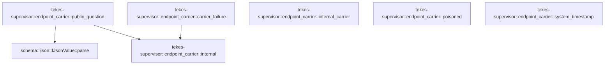

```mermaid
flowchart TD
  n0["endpoint::hub::HostFrame::new"]
  n1["endpoint::mux::SessionEndpointCapability::required"]
  n2["endpoint::types::validate_session_id"]
  n3["schema::ijson::IJsonValue::parse"]
  n4["tekes-supervisor::endpoint_carrier::ProductionCarrierStreams::with_description"]
  n5["tekes-supervisor::endpoint_carrier::ProductionCarrierStreams::attach_session_authority"]
  n6["tekes-supervisor::endpoint_carrier::ProductionCarrierStreams::session_authority"]
  n7["tekes-supervisor::endpoint_carrier::ProductionCarrierStreams::live_sessions"]
  n8["tekes-supervisor::endpoint_carrier::ProductionCarrierStreams::publish_session_status"]
  n9["tekes-supervisor::endpoint_carrier::ProductionCarrierStreams::publish_workspace_changed"]
  n10["tekes-supervisor::endpoint_carrier::ProductionCarrierStreams::attach_session"]
  n11["tekes-supervisor::endpoint_carrier::ProductionCarrierStreams::attach_everywhere"]
  n12["tekes-supervisor::endpoint_carrier::ProductionCarrierStreams::attach_everywhere_with"]
  n13["tekes-supervisor::endpoint_carrier::ProductionCarrierStreams::lacks_registration"]
  n14["tekes-supervisor::endpoint_carrier::ProductionCarrierStreams::touch"]
  n15["tekes-supervisor::endpoint_carrier::ProductionCarrierStreams::pinned_sessions"]
  n16["tekes-supervisor::endpoint_carrier::ProductionCarrierStreams::publish_host_frame"]
  n17["tekes-supervisor::endpoint_carrier::ProductionCarrierStreams::publish_session_frame"]
  n18["tekes-supervisor::endpoint_carrier::ProductionCarrierStreams::next_rpc_id"]
  n19["tekes-supervisor::endpoint_carrier::load_mux_session"]
  n20["tekes-supervisor::endpoint_carrier::semantic_line_projection_mode"]
  n21["tekes-supervisor::endpoint_carrier::line_requests"]
  n22["tekes-supervisor::endpoint_carrier::actionable_projection"]
  n23["tekes-supervisor::endpoint_carrier::actionable_projection_mode"]
  n24["tekes-supervisor::endpoint_carrier::internal_carrier"]
  n25["tekes-supervisor::endpoint_carrier::poisoned"]
  n26["tekes-supervisor::endpoint_carrier::queue_projection_is_older_than"]
  n27["tekes-supervisor::endpoint_carrier::public_queue_items"]
  n28["tekes-supervisor::endpoint_carrier::JournalLease::drop"]
  n29["tekes-supervisor::endpoint_carrier::ProductionCarrierStreams::recover_actionables"]
  n30["tekes-supervisor::endpoint_carrier::ProductionCarrierStreams::reconcile_actionables"]
  n31["tekes-supervisor::endpoint_carrier::ProductionCarrierStreams::reconcile_actionables_main"]
  n32["tekes-supervisor::endpoint_carrier::ProductionCarrierStreams::reconcile_actionables_from"]
  n33["tekes-supervisor::endpoint_carrier::ProductionCarrierStreams::note_pending_line"]
  n34["tekes-supervisor::endpoint_carrier::ProductionCarrierStreams::forget_session"]
  n35["tekes-supervisor::endpoint_carrier::ProductionCarrierStreams::new"]
  n7 --> n6
  n8 --> n0
  n8 --> n3
  n8 --> n16
  n9 --> n0
  n9 --> n3
  n9 --> n16
  n10 --> n0
  n10 --> n3
  n10 --> n11
  n10 --> n16
  n10 --> n20
  n11 --> n12
  n12 --> n13
  n12 --> n14
  n12 --> n15
  n12 --> n18
  n12 --> n19
  n12 --> n25
  n13 --> n25
  n27 --> n3
  n29 --> n2
  n29 --> n23
  n29 --> n24
  n29 --> n32
  n30 --> n22
  n30 --> n32
  n31 --> n24
  n31 --> n32
  n32 --> n17
  n32 --> n21
  n32 --> n33
  n35 --> n1
  n35 --> n4
```

```mermaid
flowchart TD
  n0["endpoint::all_session::AllSessionMux::open_with_replay"]
  n1["endpoint::hub::HostFrame::new"]
  n2["endpoint::journal::EndpointJournal::open"]
  n3["endpoint::stream_queue::EndpointFrameQueue::new"]
  n4["endpoint::types::validate_session_id"]
  n5["schema::ijson::IJsonValue::parse"]
  n6["schema::ijson::IJsonValue::parse_str"]
  n7["store::atomic::AtomicPublisher::replace"]
  n8["store::platform::NamedLock::exclusive"]
  n9["store::tail::scan_valid_prefix"]
  n10["tekes-supervisor::endpoint_carrier::ProductionCarrierStreams::live_sessions"]
  n11["tekes-supervisor::endpoint_carrier::ProductionCarrierStreams::attach_everywhere"]
  n12["tekes-supervisor::endpoint_carrier::ProductionCarrierStreams::touch"]
  n13["tekes-supervisor::endpoint_carrier::ProductionCarrierStreams::pinned_sessions"]
  n14["tekes-supervisor::endpoint_carrier::ProductionCarrierStreams::claim_journal"]
  n15["tekes-supervisor::endpoint_carrier::ProductionCarrierStreams::detach_for_archive"]
  n16["tekes-supervisor::endpoint_carrier::ProductionCarrierStreams::publish_host_frame"]
  n17["tekes-supervisor::endpoint_carrier::ProductionCarrierStreams::publish_session_frame"]
  n18["tekes-supervisor::endpoint_carrier::ProductionCarrierStreams::publish_queue_snapshot"]
  n19["tekes-supervisor::endpoint_carrier::ProductionCarrierStreams::publish_queue_projection_for_delivery"]
  n20["tekes-supervisor::endpoint_carrier::ProductionCarrierStreams::attach_for_publish"]
  n21["tekes-supervisor::endpoint_carrier::ProductionCarrierStreams::update_control_cache"]
  n22["tekes-supervisor::endpoint_carrier::ProductionCarrierStreams::update_control_frames"]
  n23["tekes-supervisor::endpoint_carrier::ProductionCarrierStreams::publish_durable_session_event"]
  n24["tekes-supervisor::endpoint_carrier::ProductionCarrierStreams::publish_durable_session_event_from_journal"]
  n25["tekes-supervisor::endpoint_carrier::ProductionCarrierStreams::close_mux_generations"]
  n26["tekes-supervisor::endpoint_carrier::ProductionCarrierStreams::open_legacy_mux"]
  n27["tekes-supervisor::endpoint_carrier::ProductionCarrierStreams::open_host"]
  n28["tekes-supervisor::endpoint_carrier::ProductionCarrierStreams::next_rpc_id"]
  n29["tekes-supervisor::endpoint_carrier::ProductionCarrierStreams::refresh_all_context_projections"]
  n30["tekes-supervisor::endpoint_carrier::ProductionCarrierStreams::refresh_context_projection"]
  n31["tekes-supervisor::endpoint_carrier::ProductionCarrierStreams::refresh_context_projection_shared"]
  n32["tekes-supervisor::endpoint_carrier::ProductionCarrierStreams::refresh_context_projection_locked"]
  n33["tekes-supervisor::endpoint_carrier::active_session_ids"]
  n34["tekes-supervisor::endpoint_carrier::semantic_projection"]
  n35["tekes-supervisor::endpoint_carrier::poisoned"]
  n36["tekes-supervisor::endpoint_carrier::read_queue_projection"]
  n37["tekes-supervisor::endpoint_carrier::queue_projection_is_older_than"]
  n38["tekes-supervisor::endpoint_carrier::public_queue_items"]
  n13 --> n10
  n14 --> n13
  n14 --> n35
  n15 --> n1
  n15 --> n5
  n15 --> n6
  n15 --> n16
  n15 --> n35
  n16 --> n28
  n16 --> n35
  n17 --> n20
  n17 --> n21
  n17 --> n28
  n18 --> n9
  n18 --> n19
  n19 --> n7
  n19 --> n8
  n19 --> n17
  n19 --> n36
  n19 --> n37
  n19 --> n38
  n20 --> n11
  n21 --> n22
  n22 --> n5
  n22 --> n6
  n22 --> n35
  n23 --> n2
  n23 --> n24
  n24 --> n28
  n25 --> n35
  n26 --> n0
  n26 --> n35
  n27 --> n3
  n27 --> n35
  n29 --> n13
  n29 --> n30
  n29 --> n33
  n29 --> n35
  n30 --> n2
  n30 --> n4
  n30 --> n32
  n30 --> n34
  n30 --> n35
  n31 --> n4
  n31 --> n32
  n31 --> n35
```

```mermaid
flowchart TD
  n0["endpoint::all_session::AllSessionMux::open"]
  n1["endpoint::mux::frozen_history_page"]
  n2["endpoint::service::NativeEndpoint::open"]
  n3["endpoint::session_operations::SessionOperations::open_sessions"]
  n4["endpoint::types::validate_session_id"]
  n5["schema::ijson::IJsonValue::parse"]
  n6["schema::ijson::IJsonValue::parse_str"]
  n7["tekes-supervisor::context_usage::sample"]
  n8["tekes-supervisor::context_usage::publish"]
  n9["tekes-supervisor::context_usage::saved_control_item"]
  n10["tekes-supervisor::endpoint_carrier::ProductionCarrierStreams::session_authority"]
  n11["tekes-supervisor::endpoint_carrier::ProductionCarrierStreams::live_sessions"]
  n12["tekes-supervisor::endpoint_carrier::ProductionCarrierStreams::claim_journal"]
  n13["tekes-supervisor::endpoint_carrier::ProductionCarrierStreams::publish_queue_snapshot"]
  n14["tekes-supervisor::endpoint_carrier::ProductionCarrierStreams::update_control_frames"]
  n15["tekes-supervisor::endpoint_carrier::ProductionCarrierStreams::open_legacy_mux"]
  n16["tekes-supervisor::endpoint_carrier::ProductionCarrierStreams::open_host"]
  n17["tekes-supervisor::endpoint_carrier::ProductionCarrierStreams::next_rpc_id"]
  n18["tekes-supervisor::endpoint_carrier::ProductionCarrierStreams::refresh_context_projection"]
  n19["tekes-supervisor::endpoint_carrier::ProductionCarrierStreams::refresh_context_projection_locked"]
  n20["tekes-supervisor::endpoint_carrier::ProductionCarrierStreams::session_items"]
  n21["tekes-supervisor::endpoint_carrier::ProductionCarrierStreams::inventory_baseline"]
  n22["tekes-supervisor::endpoint_carrier::ProductionCarrierStreams::inventory_row"]
  n23["tekes-supervisor::endpoint_carrier::ProductionCarrierStreams::control_baseline"]
  n24["tekes-supervisor::endpoint_carrier::ProductionCarrierStreams::actionables_baseline"]
  n25["tekes-supervisor::endpoint_carrier::ProductionCarrierStreams::index_holds"]
  n26["tekes-supervisor::endpoint_carrier::ProductionCarrierStreams::sessions_with_published_requests"]
  n27["tekes-supervisor::endpoint_carrier::ProductionCarrierStreams::requests"]
  n28["tekes-supervisor::endpoint_carrier::ProductionCarrierStreams::index_catalog_holds"]
  n29["tekes-supervisor::endpoint_carrier::ProductionCarrierStreams::index_unverified_and_archived"]
  n30["tekes-supervisor::endpoint_carrier::ProductionCarrierStreams::examine"]
  n31["tekes-supervisor::endpoint_carrier::ProductionCarrierStreams::fold_into_index"]
  n32["tekes-supervisor::endpoint_carrier::ProductionCarrierStreams::verify_session_carrier"]
  n33["tekes-supervisor::endpoint_carrier::ProductionCarrierStreams::verify_session"]
  n34["tekes-supervisor::endpoint_carrier::ProductionCarrierStreams::open_mux_journal"]
  n35["tekes-supervisor::endpoint_carrier::ProductionCarrierStreams::snapshot_projections"]
  n36["tekes-supervisor::endpoint_carrier::ProductionCarrierStreams::open_mux"]
  n37["tekes-supervisor::endpoint_carrier::ProductionCarrierStreams::mux_journal_page"]
  n38["tekes-supervisor::endpoint_carrier::ProductionStream::map_source"]
  n39["tekes-supervisor::endpoint_carrier::active_session_ids"]
  n40["tekes-supervisor::endpoint_carrier::load_mux_session"]
  n41["tekes-supervisor::endpoint_carrier::inventory_row"]
  n42["tekes-supervisor::endpoint_carrier::session_requests_mode"]
  n43["tekes-supervisor::endpoint_carrier::pending_session_requests_mode"]
  n44["tekes-supervisor::endpoint_carrier::poisoned"]
  n45["tekes-supervisor::endpoint_carrier::read_queue_projection"]
  n46["tekes-supervisor::endpoint_carrier::ProductionCarrierStreams::recover_actionables"]
  n47["tekes-supervisor::request_index::ledger_signature"]
  n48["tekes-supervisor::request_index::children_may_hold_requests"]
  n49["tekes-supervisor::request_index::may_hold_requests"]
  n19 --> n2
  n19 --> n5
  n19 --> n7
  n19 --> n8
  n19 --> n14
  n19 --> n17
  n19 --> n44
  n20 --> n2
  n20 --> n10
  n20 --> n11
  n21 --> n3
  n21 --> n20
  n21 --> n41
  n22 --> n3
  n22 --> n10
  n22 --> n41
  n23 --> n6
  n23 --> n9
  n23 --> n10
  n23 --> n13
  n23 --> n18
  n23 --> n39
  n23 --> n44
  n23 --> n45
  n24 --> n10
  n24 --> n25
  n24 --> n26
  n24 --> n39
  n24 --> n43
  n24 --> n46
  n24 --> n49
  n28 --> n10
  n28 --> n25
  n29 --> n4
  n29 --> n10
  n29 --> n30
  n29 --> n39
  n30 --> n31
  n30 --> n47
  n30 --> n48
  n30 --> n49
  n31 --> n42
  n32 --> n10
  n33 --> n32
  n34 --> n0
  n34 --> n1
  n34 --> n2
  n34 --> n10
  n34 --> n12
  n34 --> n17
  n34 --> n32
  n34 --> n35
  n34 --> n40
  n35 --> n5
  n35 --> n9
  n35 --> n44
  n36 --> n15
  n36 --> n16
  n36 --> n21
  n36 --> n23
  n36 --> n24
  n36 --> n34
  n37 --> n1
  n37 --> n2
  n37 --> n32
  n37 --> n40
  n38 --> n44
```

```mermaid
flowchart TD
  n0["endpoint::journal::EndpointJournal::open"]
  n1["endpoint::requests::PendingRequest::derive"]
  n2["endpoint::requests::RequestState::resolved"]
  n3["endpoint::types::validate_session_id"]
  n4["engine::lifecycle::classify"]
  n5["schema::ijson::IJsonValue::parse"]
  n6["store::tail::scan_valid_prefix"]
  n7["tekes-supervisor::endpoint_carrier::ProductionCarrierAssembly::into_server"]
  n8["tekes-supervisor::endpoint_carrier::ProductionCarrierAssembly::mark_ready"]
  n9["tekes-supervisor::endpoint_carrier::ProductionCarrierAssembly::finish_recovery"]
  n10["tekes-supervisor::endpoint_carrier::ProductionCarrierAssembly::begin_drain"]
  n11["tekes-supervisor::endpoint_carrier::active_session_ids"]
  n12["tekes-supervisor::endpoint_carrier::load_mux_session"]
  n13["tekes-supervisor::endpoint_carrier::inventory_row"]
  n14["tekes-supervisor::endpoint_carrier::semantic_projection"]
  n15["tekes-supervisor::endpoint_carrier::semantic_line_projection"]
  n16["tekes-supervisor::endpoint_carrier::semantic_line_projection_mode"]
  n17["tekes-supervisor::endpoint_carrier::line_requests"]
  n18["tekes-supervisor::endpoint_carrier::session_requests_mode"]
  n19["tekes-supervisor::endpoint_carrier::pending_session_requests_mode"]
  n20["tekes-supervisor::endpoint_carrier::actionable_projection"]
  n21["tekes-supervisor::endpoint_carrier::actionable_projection_mode"]
  n22["tekes-supervisor::endpoint_carrier::validate_request_binding"]
  n23["tekes-supervisor::endpoint_carrier::unresolved_hold_turn"]
  n24["tekes-supervisor::endpoint_carrier::payload_session_id"]
  n25["tekes-supervisor::endpoint_carrier::result_session_id"]
  n26["tekes-supervisor::endpoint_carrier::route_failure"]
  n27["tekes-supervisor::endpoint_carrier::internal"]
  n9 --> n8
  n11 --> n3
  n12 --> n0
  n12 --> n3
  n12 --> n19
  n13 --> n4
  n13 --> n5
  n14 --> n15
  n15 --> n16
  n16 --> n3
  n16 --> n6
  n16 --> n27
  n17 --> n1
  n17 --> n2
  n17 --> n5
  n17 --> n27
  n18 --> n3
  n18 --> n16
  n18 --> n17
  n18 --> n27
  n19 --> n18
  n20 --> n21
  n21 --> n16
  n21 --> n27
```

# tekes-supervisor::endpoint_carrier

[Package atlas](index.md) · [Source](../../src/endpoint_carrier.rs)

## Declarations

Visibility is the declaration spelling; trait members and reexports require their enclosing interface. `cfg` is not evaluated.

| Symbol | Kind | Visibility | Test / cfg |
|---|---|---|---|
| [tekes-supervisor::endpoint_carrier::HOST_STREAM_MAX_FRAMES](../../src/endpoint_carrier.rs#L43) | const_item | `private` |  |
| [tekes-supervisor::endpoint_carrier::HOST_STREAM_MAX_BYTES](../../src/endpoint_carrier.rs#L44) | const_item | `private` |  |
| [tekes-supervisor::endpoint_carrier::SupervisorSessionAuthority](../../src/endpoint_carrier.rs#L58) | trait_item | `pub` |  |
| [tekes-supervisor::endpoint_carrier::SupervisorSessionAuthority::live_sessions](../../src/endpoint_carrier.rs#L60) | function_signature_item | `private` |  |
| [tekes-supervisor::endpoint_carrier::SupervisorSessionAuthority::reconcile_projection](../../src/endpoint_carrier.rs#L65) | function_signature_item | `private` |  |
| [tekes-supervisor::endpoint_carrier::SupervisorSessionAuthority::inventory_items](../../src/endpoint_carrier.rs#L70) | function_item | `private` |  |
| [tekes-supervisor::endpoint_carrier::SupervisorSessionAuthority::inventory_item](../../src/endpoint_carrier.rs#L78) | function_item | `private` |  |
| [tekes-supervisor::endpoint_carrier::SupervisorSessionAuthority::ensure_verified](../../src/endpoint_carrier.rs#L87) | function_item | `private` |  |
| [tekes-supervisor::endpoint_carrier::SupervisorSessionAuthority::has_catalog](../../src/endpoint_carrier.rs#L93) | function_item | `private` |  |
| [tekes-supervisor::endpoint_carrier::SupervisorSessionAuthority::hold_catalog](../../src/endpoint_carrier.rs#L99) | function_item | `private` |  |
| [tekes-supervisor::endpoint_carrier::SessionGateError](../../src/endpoint_carrier.rs#L106) | enum_item | `pub` |  |
| [tekes-supervisor::endpoint_carrier::HoldRef](../../src/endpoint_carrier.rs#L115) | struct_item | `pub` |  |
| [tekes-supervisor::endpoint_carrier::VerifiedHolds](../../src/endpoint_carrier.rs#L124) | struct_item | `pub` |  |
| [tekes-supervisor::endpoint_carrier::HoldCatalog](../../src/endpoint_carrier.rs#L133) | struct_item | `pub` |  |
| [tekes-supervisor::endpoint_carrier::LiveRespondAuthority](../../src/endpoint_carrier.rs#L147) | trait_item | `pub` |  |
| [tekes-supervisor::endpoint_carrier::LiveRespondAuthority::deliver_if_live](../../src/endpoint_carrier.rs#L148) | function_signature_item | `private` |  |
| [tekes-supervisor::endpoint_carrier::LiveRespondAuthority::ensure_after_locked_append](../../src/endpoint_carrier.rs#L157) | function_item | `private` |  |
| [tekes-supervisor::endpoint_carrier::CarrierClock](../../src/endpoint_carrier.rs#L162) | type_item | `pub` |  |
| [tekes-supervisor::endpoint_carrier::ProductionRespondAuthority](../../src/endpoint_carrier.rs#L164) | struct_item | `pub` |  |
| [tekes-supervisor::endpoint_carrier::ProductionRespondAuthority::open](../../src/endpoint_carrier.rs#L179) | function_item | `pub` |  |
| [tekes-supervisor::endpoint_carrier::ProductionRespondAuthority::open_with_clock](../../src/endpoint_carrier.rs#L187) | function_item | `pub` |  |
| [tekes-supervisor::endpoint_carrier::ProductionRespondAuthority::with_streams](../../src/endpoint_carrier.rs#L210) | function_item | `pub` |  |
| [tekes-supervisor::endpoint_carrier::ProductionRespondAuthority::reconcile_after_response](../../src/endpoint_carrier.rs#L221) | function_item | `private` |  |
| [tekes-supervisor::endpoint_carrier::ProductionRespondAuthority::locate_once](../../src/endpoint_carrier.rs#L239) | function_item | `private` |  |
| [tekes-supervisor::endpoint_carrier::ProductionRespondAuthority::locate_indexed](../../src/endpoint_carrier.rs#L261) | function_item | `private` |  |
| [tekes-supervisor::endpoint_carrier::ProductionRespondAuthority::locate_by_scan](../../src/endpoint_carrier.rs#L287) | function_item | `private` |  |
| [tekes-supervisor::endpoint_carrier::ProductionRespondAuthority::locate_in_folder](../../src/endpoint_carrier.rs#L316) | function_item | `private` |  |
| [tekes-supervisor::endpoint_carrier::ProductionRespondAuthority::worker_message](../../src/endpoint_carrier.rs#L357) | function_item | `private` |  |
| [tekes-supervisor::endpoint_carrier::ProductionRespondAuthority::live_delivery](../../src/endpoint_carrier.rs#L373) | function_item | `private` |  |
| [tekes-supervisor::endpoint_carrier::ProductionRespondAuthority::locked_append](../../src/endpoint_carrier.rs#L396) | function_item | `private` |  |
| [tekes-supervisor::endpoint_carrier::ProductionRespondAuthority::locate](../../src/endpoint_carrier.rs#L469) | function_item | `private` |  |
| [tekes-supervisor::endpoint_carrier::ProductionRespondAuthority::author](../../src/endpoint_carrier.rs#L473) | function_item | `private` |  |
| [tekes-supervisor::endpoint_carrier::ProductionCarrierStreams](../../src/endpoint_carrier.rs#L531) | struct_item | `pub` |  |
| [tekes-supervisor::endpoint_carrier::CarrierStreamsInner](../../src/endpoint_carrier.rs#L535) | struct_item | `private` |  |
| [tekes-supervisor::endpoint_carrier::Attachments](../../src/endpoint_carrier.rs#L556) | struct_item | `private` |  |
| [tekes-supervisor::endpoint_carrier::SavedQueueProjection](../../src/endpoint_carrier.rs#L567) | struct_item | `private` |  |
| [tekes-supervisor::endpoint_carrier::read_queue_projection](../../src/endpoint_carrier.rs#L574) | function_item | `private` |  |
| [tekes-supervisor::endpoint_carrier::queue_projection_is_older_than](../../src/endpoint_carrier.rs#L581) | function_item | `private` |  |
| [tekes-supervisor::endpoint_carrier::public_queue_items](../../src/endpoint_carrier.rs#L589) | function_item | `private` |  |
| [tekes-supervisor::endpoint_carrier::public_queue_projection_tests::projection](../../src/endpoint_carrier.rs#L635) | function_item | `private` | test; #[cfg(test)] |
| [tekes-supervisor::endpoint_carrier::public_queue_projection_tests::ledger_recovery_starts_a_new_queue_generation](../../src/endpoint_carrier.rs#L671) | function_item | `private` | test; #[cfg(test)] |
| [tekes-supervisor::endpoint_carrier::public_queue_projection_tests::queue_snapshot_uses_only_live_inputs_and_preserves_public_message_source](../../src/endpoint_carrier.rs#L684) | function_item | `private` | test; #[cfg(test)] |
| [tekes-supervisor::endpoint_carrier::JournalLease](../../src/endpoint_carrier.rs#L719) | struct_item | `pub(crate)` |  |
| [tekes-supervisor::endpoint_carrier::JournalLease::drop](../../src/endpoint_carrier.rs#L725) | function_item | `private` |  |
| [tekes-supervisor::endpoint_carrier::PublishedActionables](../../src/endpoint_carrier.rs#L750) | type_item | `private` |  |
| [tekes-supervisor::endpoint_carrier::StreamGenerations](../../src/endpoint_carrier.rs#L753) | struct_item | `private` |  |
| [tekes-supervisor::endpoint_carrier::TrackedMux](../../src/endpoint_carrier.rs#L758) | struct_item | `private` |  |
| [tekes-supervisor::endpoint_carrier::TrackedHost](../../src/endpoint_carrier.rs#L763) | struct_item | `private` |  |
| [tekes-supervisor::endpoint_carrier::ProjectionReplay](../../src/endpoint_carrier.rs#L769) | struct_item | `private` |  |
| [tekes-supervisor::endpoint_carrier::ProductionCarrierStreams::recover_actionables](../../src/endpoint_carrier.rs#L776) | function_item | `private` |  |
| [tekes-supervisor::endpoint_carrier::ProductionCarrierStreams::reconcile_actionables](../../src/endpoint_carrier.rs#L813) | function_item | `pub(crate)` |  |
| [tekes-supervisor::endpoint_carrier::ProductionCarrierStreams::reconcile_actionables_main](../../src/endpoint_carrier.rs#L827) | function_item | `pub(crate)` |  |
| [tekes-supervisor::endpoint_carrier::ProductionCarrierStreams::reconcile_actionables_from](../../src/endpoint_carrier.rs#L842) | function_item | `private` |  |
| [tekes-supervisor::endpoint_carrier::ProductionCarrierStreams::note_pending_line](../../src/endpoint_carrier.rs#L918) | function_item | `private` |  |
| [tekes-supervisor::endpoint_carrier::ProductionCarrierStreams::forget_session](../../src/endpoint_carrier.rs#L935) | function_item | `pub(crate)` |  |
| [tekes-supervisor::endpoint_carrier::ProductionCarrierStreams::actionable_ids_for_test](../../src/endpoint_carrier.rs#L953) | function_item | `pub(crate)` | test; #[cfg(test)] #[cfg_attr(not(target_os = "macos"), allow(dead_code))] |
| [tekes-supervisor::endpoint_carrier::ProductionCarrierStreams::published_pending_for_test](../../src/endpoint_carrier.rs#L965) | function_item | `pub(crate)` | test; #[cfg(test)] #[cfg_attr(not(target_os = "macos"), allow(dead_code))] |
| [tekes-supervisor::endpoint_carrier::ProductionCarrierStreams::new](../../src/endpoint_carrier.rs#L980) | function_item | `pub` |  |
| [tekes-supervisor::endpoint_carrier::ProductionCarrierStreams::with_description](../../src/endpoint_carrier.rs#L1001) | function_item | `pub` |  |
| [tekes-supervisor::endpoint_carrier::ProductionCarrierStreams::attach_session_authority](../../src/endpoint_carrier.rs#L1022) | function_item | `pub` |  |
| [tekes-supervisor::endpoint_carrier::ProductionCarrierStreams::session_authority](../../src/endpoint_carrier.rs#L1030) | function_item | `private` |  |
| [tekes-supervisor::endpoint_carrier::ProductionCarrierStreams::live_sessions](../../src/endpoint_carrier.rs#L1039) | function_item | `private` |  |
| [tekes-supervisor::endpoint_carrier::ProductionCarrierStreams::publish_session_status](../../src/endpoint_carrier.rs#L1049) | function_item | `pub` |  |
| [tekes-supervisor::endpoint_carrier::ProductionCarrierStreams::publish_workspace_changed](../../src/endpoint_carrier.rs#L1064) | function_item | `pub` |  |
| [tekes-supervisor::endpoint_carrier::ProductionCarrierStreams::attach_session](../../src/endpoint_carrier.rs#L1076) | function_item | `pub` |  |
| [tekes-supervisor::endpoint_carrier::ProductionCarrierStreams::attach_everywhere](../../src/endpoint_carrier.rs#L1101) | function_item | `pub(crate)` |  |
| [tekes-supervisor::endpoint_carrier::ProductionCarrierStreams::attach_everywhere_with](../../src/endpoint_carrier.rs#L1106) | function_item | `pub(crate)` |  |
| [tekes-supervisor::endpoint_carrier::ProductionCarrierStreams::lacks_registration](../../src/endpoint_carrier.rs#L1202) | function_item | `private` |  |
| [tekes-supervisor::endpoint_carrier::ProductionCarrierStreams::touch](../../src/endpoint_carrier.rs#L1215) | function_item | `private` |  |
| [tekes-supervisor::endpoint_carrier::ProductionCarrierStreams::pinned_sessions](../../src/endpoint_carrier.rs#L1228) | function_item | `private` |  |
| [tekes-supervisor::endpoint_carrier::ProductionCarrierStreams::claim_journal](../../src/endpoint_carrier.rs#L1247) | function_item | `private` |  |
| [tekes-supervisor::endpoint_carrier::ProductionCarrierStreams::detach_for_archive](../../src/endpoint_carrier.rs#L1268) | function_item | `pub` |  |
| [tekes-supervisor::endpoint_carrier::ProductionCarrierStreams::publish_host_frame](../../src/endpoint_carrier.rs#L1291) | function_item | `pub` |  |
| [tekes-supervisor::endpoint_carrier::ProductionCarrierStreams::publish_session_frame](../../src/endpoint_carrier.rs#L1320) | function_item | `pub` |  |
| [tekes-supervisor::endpoint_carrier::ProductionCarrierStreams::publish_queue_snapshot](../../src/endpoint_carrier.rs#L1336) | function_item | `pub` |  |
| [tekes-supervisor::endpoint_carrier::ProductionCarrierStreams::publish_queue_projection_for_delivery](../../src/endpoint_carrier.rs#L1363) | function_item | `pub(crate)` |  |
| [tekes-supervisor::endpoint_carrier::ProductionCarrierStreams::attach_for_publish](../../src/endpoint_carrier.rs#L1427) | function_item | `private` |  |
| [tekes-supervisor::endpoint_carrier::ProductionCarrierStreams::update_control_cache](../../src/endpoint_carrier.rs#L1438) | function_item | `private` |  |
| [tekes-supervisor::endpoint_carrier::ProductionCarrierStreams::update_control_frames](../../src/endpoint_carrier.rs#L1445) | function_item | `private` |  |
| [tekes-supervisor::endpoint_carrier::ProductionCarrierStreams::publish_durable_session_event](../../src/endpoint_carrier.rs#L1491) | function_item | `pub` |  |
| [tekes-supervisor::endpoint_carrier::ProductionCarrierStreams::publish_durable_session_event_from_journal](../../src/endpoint_carrier.rs#L1504) | function_item | `pub` |  |
| [tekes-supervisor::endpoint_carrier::ProductionCarrierStreams::close_mux_generations](../../src/endpoint_carrier.rs#L1520) | function_item | `pub` |  |
| [tekes-supervisor::endpoint_carrier::ProductionCarrierStreams::open_legacy_mux](../../src/endpoint_carrier.rs#L1531) | function_item | `private` |  |
| [tekes-supervisor::endpoint_carrier::ProductionCarrierStreams::open_host](../../src/endpoint_carrier.rs#L1550) | function_item | `private` |  |
| [tekes-supervisor::endpoint_carrier::ProductionCarrierStreams::next_rpc_id](../../src/endpoint_carrier.rs#L1569) | function_item | `private` |  |
| [tekes-supervisor::endpoint_carrier::ProductionCarrierStreams::refresh_all_context_projections](../../src/endpoint_carrier.rs#L1578) | function_item | `pub(crate)` |  |
| [tekes-supervisor::endpoint_carrier::ProductionCarrierStreams::refresh_context_projection](../../src/endpoint_carrier.rs#L1617) | function_item | `pub(crate)` |  |
| [tekes-supervisor::endpoint_carrier::ProductionCarrierStreams::refresh_context_projection_shared](../../src/endpoint_carrier.rs#L1637) | function_item | `pub(crate)` |  |
| [tekes-supervisor::endpoint_carrier::ProductionCarrierStreams::refresh_context_projection_locked](../../src/endpoint_carrier.rs#L1653) | function_item | `private` |  |
| [tekes-supervisor::endpoint_carrier::ProductionCarrierStreams::session_items](../../src/endpoint_carrier.rs#L1711) | function_item | `private` |  |
| [tekes-supervisor::endpoint_carrier::ProductionCarrierStreams::inventory_baseline](../../src/endpoint_carrier.rs#L1728) | function_item | `private` |  |
| [tekes-supervisor::endpoint_carrier::ProductionCarrierStreams::inventory_row](../../src/endpoint_carrier.rs#L1754) | function_item | `private` |  |
| [tekes-supervisor::endpoint_carrier::ProductionCarrierStreams::control_baseline](../../src/endpoint_carrier.rs#L1772) | function_item | `private` |  |
| [tekes-supervisor::endpoint_carrier::ProductionCarrierStreams::actionables_baseline](../../src/endpoint_carrier.rs#L1867) | function_item | `private` |  |
| [tekes-supervisor::endpoint_carrier::ProductionCarrierStreams::index_holds](../../src/endpoint_carrier.rs#L1947) | function_item | `private` |  |
| [tekes-supervisor::endpoint_carrier::ProductionCarrierStreams::sessions_with_published_requests](../../src/endpoint_carrier.rs#L1961) | function_item | `private` |  |
| [tekes-supervisor::endpoint_carrier::ProductionCarrierStreams::requests](../../src/endpoint_carrier.rs#L1977) | function_item | `pub(crate)` |  |
| [tekes-supervisor::endpoint_carrier::ProductionCarrierStreams::index_catalog_holds](../../src/endpoint_carrier.rs#L1983) | function_item | `pub(crate)` |  |
| [tekes-supervisor::endpoint_carrier::ProductionCarrierStreams::index_unverified_and_archived](../../src/endpoint_carrier.rs#L1994) | function_item | `pub(crate)` |  |
| [tekes-supervisor::endpoint_carrier::ProductionCarrierStreams::examine](../../src/endpoint_carrier.rs#L2039) | function_item | `private` |  |
| [tekes-supervisor::endpoint_carrier::ProductionCarrierStreams::fold_into_index](../../src/endpoint_carrier.rs#L2065) | function_item | `private` |  |
| [tekes-supervisor::endpoint_carrier::ProductionCarrierStreams::verify_session_carrier](../../src/endpoint_carrier.rs#L2089) | function_item | `pub(crate)` |  |
| [tekes-supervisor::endpoint_carrier::ProductionCarrierStreams::verify_session](../../src/endpoint_carrier.rs#L2108) | function_item | `pub(crate)` |  |
| [tekes-supervisor::endpoint_carrier::ProductionCarrierStreams::open_mux_journal](../../src/endpoint_carrier.rs#L2113) | function_item | `private` |  |
| [tekes-supervisor::endpoint_carrier::ProductionCarrierStreams::snapshot_projections](../../src/endpoint_carrier.rs#L2214) | function_item | `private` |  |
| [tekes-supervisor::endpoint_carrier::ProductionCarrierStreams::open_mux](../../src/endpoint_carrier.rs#L2269) | function_item | `pub(crate)` |  |
| [tekes-supervisor::endpoint_carrier::ProductionCarrierStreams::mux_journal_page](../../src/endpoint_carrier.rs#L2338) | function_item | `private` |  |
| [tekes-supervisor::endpoint_carrier::ProductionStreamKind](../../src/endpoint_carrier.rs#L2379) | enum_item | `private` |  |
| [tekes-supervisor::endpoint_carrier::ProductionStream](../../src/endpoint_carrier.rs#L2391) | struct_item | `private` |  |
| [tekes-supervisor::endpoint_carrier::ProductionStream::map_source](../../src/endpoint_carrier.rs#L2402) | function_item | `private` |  |
| [tekes-supervisor::endpoint_carrier::ProductionStream::recv](../../src/endpoint_carrier.rs#L2608) | function_item | `private` |  |
| [tekes-supervisor::endpoint_carrier::ProductionCarrierStreams::open_stream](../../src/endpoint_carrier.rs#L2635) | function_item | `private` |  |
| [tekes-supervisor::endpoint_carrier::ProductionCarrierStreams::stream_error](../../src/endpoint_carrier.rs#L2645) | function_item | `private` |  |
| [tekes-supervisor::endpoint_carrier::ProductionCarrierStreams::mux_description](../../src/endpoint_carrier.rs#L2672) | function_item | `private` |  |
| [tekes-supervisor::endpoint_carrier::ProductionCarrierStreams::open_mux_stream](../../src/endpoint_carrier.rs#L2679) | function_item | `private` |  |
| [tekes-supervisor::endpoint_carrier::ProductionCarrierStreams::journal_page](../../src/endpoint_carrier.rs#L2689) | function_item | `private` |  |
| [tekes-supervisor::endpoint_carrier::LeasedStream](../../src/endpoint_carrier.rs#L2699) | struct_item | `private` |  |
| [tekes-supervisor::endpoint_carrier::StreamDrop](../../src/endpoint_carrier.rs#L2706) | enum_item | `private` |  |
| [tekes-supervisor::endpoint_carrier::LeasedStream::recv](../../src/endpoint_carrier.rs#L2712) | function_item | `private` |  |
| [tekes-supervisor::endpoint_carrier::LeasedStream::drop](../../src/endpoint_carrier.rs#L2718) | function_item | `private` |  |
| [tekes-supervisor::endpoint_carrier::LifecycleCarrierHost](../../src/endpoint_carrier.rs#L2730) | struct_item | `pub` |  |
| [tekes-supervisor::endpoint_carrier::LifecycleCarrierHost::new](../../src/endpoint_carrier.rs#L2737) | function_item | `pub` |  |
| [tekes-supervisor::endpoint_carrier::LifecycleCarrierHost::capabilities](../../src/endpoint_carrier.rs#L2743) | function_item | `private` |  |
| [tekes-supervisor::endpoint_carrier::LifecycleCarrierHost::extension_capabilities](../../src/endpoint_carrier.rs#L2747) | function_item | `private` |  |
| [tekes-supervisor::endpoint_carrier::LifecycleCarrierHost::method_class](../../src/endpoint_carrier.rs#L2751) | function_item | `private` |  |
| [tekes-supervisor::endpoint_carrier::LifecycleCarrierHost::validate_request](../../src/endpoint_carrier.rs#L2755) | function_item | `private` |  |
| [tekes-supervisor::endpoint_carrier::LifecycleCarrierHost::call](../../src/endpoint_carrier.rs#L2759) | function_item | `private` |  |
| [tekes-supervisor::endpoint_carrier::LifecycleTarget](../../src/endpoint_carrier.rs#L2797) | enum_item | `private` |  |
| [tekes-supervisor::endpoint_carrier::lifecycle_target](../../src/endpoint_carrier.rs#L2803) | function_item | `private` |  |
| [tekes-supervisor::endpoint_carrier::ProductionCarrierHost](../../src/endpoint_carrier.rs#L2814) | type_item | `pub` |  |
| [tekes-supervisor::endpoint_carrier::ProductionCarrierAssembly](../../src/endpoint_carrier.rs#L2820) | struct_item | `pub` |  |
| [tekes-supervisor::endpoint_carrier::ProductionCarrierAssembly::assemble](../../src/endpoint_carrier.rs#L2827) | function_item | `pub` |  |
| [tekes-supervisor::endpoint_carrier::ProductionCarrierAssembly::host](../../src/endpoint_carrier.rs#L2862) | function_item | `pub` |  |
| [tekes-supervisor::endpoint_carrier::ProductionCarrierAssembly::with_file_changes](../../src/endpoint_carrier.rs#L2866) | function_item | `pub` |  |
| [tekes-supervisor::endpoint_carrier::ProductionCarrierAssembly::streams](../../src/endpoint_carrier.rs#L2872) | function_item | `pub` |  |
| [tekes-supervisor::endpoint_carrier::ProductionCarrierAssembly::server](../../src/endpoint_carrier.rs#L2877) | function_item | `pub` |  |
| [tekes-supervisor::endpoint_carrier::ProductionCarrierAssembly::into_server](../../src/endpoint_carrier.rs#L2882) | function_item | `pub` |  |
| [tekes-supervisor::endpoint_carrier::ProductionCarrierAssembly::mark_ready](../../src/endpoint_carrier.rs#L2889) | function_item | `pub` |  |
| [tekes-supervisor::endpoint_carrier::ProductionCarrierAssembly::finish_recovery](../../src/endpoint_carrier.rs#L2894) | function_item | `pub` |  |
| [tekes-supervisor::endpoint_carrier::ProductionCarrierAssembly::begin_drain](../../src/endpoint_carrier.rs#L2899) | function_item | `pub` |  |
| [tekes-supervisor::endpoint_carrier::MuxSession](../../src/endpoint_carrier.rs#L2905) | struct_item | `private` |  |
| [tekes-supervisor::endpoint_carrier::active_session_ids](../../src/endpoint_carrier.rs#L2911) | function_item | `private` |  |
| [tekes-supervisor::endpoint_carrier::load_mux_session](../../src/endpoint_carrier.rs#L2924) | function_item | `private` |  |
| [tekes-supervisor::endpoint_carrier::inventory_row](../../src/endpoint_carrier.rs#L2940) | function_item | `private` |  |
| [tekes-supervisor::endpoint_carrier::folder_inventory_tests::inventory_uses_only_its_own_recorded_execution_cwd](../../src/endpoint_carrier.rs#L2984) | function_item | `private` | test; #[cfg(test)] |
| [tekes-supervisor::endpoint_carrier::semantic_projection](../../src/endpoint_carrier.rs#L3024) | function_item | `private` |  |
| [tekes-supervisor::endpoint_carrier::semantic_line_projection](../../src/endpoint_carrier.rs#L3028) | function_item | `private` |  |
| [tekes-supervisor::endpoint_carrier::semantic_line_projection_mode](../../src/endpoint_carrier.rs#L3039) | function_item | `private` |  |
| [tekes-supervisor::endpoint_carrier::line_requests](../../src/endpoint_carrier.rs#L3072) | function_item | `pub(crate)` |  |
| [tekes-supervisor::endpoint_carrier::session_requests_mode](../../src/endpoint_carrier.rs#L3175) | function_item | `private` |  |
| [tekes-supervisor::endpoint_carrier::pending_session_requests_mode](../../src/endpoint_carrier.rs#L3216) | function_item | `private` |  |
| [tekes-supervisor::endpoint_carrier::actionable_projection](../../src/endpoint_carrier.rs#L3230) | function_item | `private` |  |
| [tekes-supervisor::endpoint_carrier::actionable_projection_mode](../../src/endpoint_carrier.rs#L3238) | function_item | `private` |  |
| [tekes-supervisor::endpoint_carrier::validate_request_binding](../../src/endpoint_carrier.rs#L3301) | function_item | `private` |  |
| [tekes-supervisor::endpoint_carrier::unresolved_hold_turn](../../src/endpoint_carrier.rs#L3335) | function_item | `private` |  |
| [tekes-supervisor::endpoint_carrier::payload_session_id](../../src/endpoint_carrier.rs#L3360) | function_item | `private` |  |
| [tekes-supervisor::endpoint_carrier::result_session_id](../../src/endpoint_carrier.rs#L3368) | function_item | `private` |  |
| [tekes-supervisor::endpoint_carrier::route_failure](../../src/endpoint_carrier.rs#L3376) | function_item | `private` |  |
| [tekes-supervisor::endpoint_carrier::public_question](../../src/endpoint_carrier.rs#L3388) | function_item | `private` |  |
| [tekes-supervisor::endpoint_carrier::internal](../../src/endpoint_carrier.rs#L3412) | function_item | `private` |  |
| [tekes-supervisor::endpoint_carrier::carrier_failure](../../src/endpoint_carrier.rs#L3417) | function_item | `private` |  |
| [tekes-supervisor::endpoint_carrier::internal_carrier](../../src/endpoint_carrier.rs#L3427) | function_item | `private` |  |
| [tekes-supervisor::endpoint_carrier::poisoned](../../src/endpoint_carrier.rs#L3431) | function_item | `private` |  |
| [tekes-supervisor::endpoint_carrier::system_timestamp](../../src/endpoint_carrier.rs#L3435) | function_item | `private` |  |
| [tekes-supervisor::endpoint_carrier::ProductionCarrierError](../../src/endpoint_carrier.rs#L3467) | enum_item | `pub` |  |
| [tekes-supervisor::endpoint_carrier::question_cancellation_tests::question_denial_projects_as_cancelled_and_answer_as_answered](../../src/endpoint_carrier.rs#L3507) | function_item | `private` | test; #[cfg(test)] |
| [tekes-supervisor::endpoint_carrier::lazy_registration_tests::TS](../../src/endpoint_carrier.rs#L3562) | const_item | `private` | test; #[cfg(test)] |
| [tekes-supervisor::endpoint_carrier::lazy_registration_tests::blank_thread](../../src/endpoint_carrier.rs#L3564) | function_item | `private` | test; #[cfg(test)] |
| [tekes-supervisor::endpoint_carrier::lazy_registration_tests::id](../../src/endpoint_carrier.rs#L3574) | function_item | `private` | test; #[cfg(test)] |
| [tekes-supervisor::endpoint_carrier::lazy_registration_tests::registered](../../src/endpoint_carrier.rs#L3578) | function_item | `private` | test; #[cfg(test)] |
| [tekes-supervisor::endpoint_carrier::lazy_registration_tests::first_touches_load_in_parallel_and_do_not_hold_up_live_frames](../../src/endpoint_carrier.rs#L3595) | function_item | `private` | test; #[cfg(test)] |
| [tekes-supervisor::endpoint_carrier::lazy_registration_tests::a_context_refresh_serves_the_open_thread_first_and_registers_no_idle_session](../../src/endpoint_carrier.rs#L3676) | function_item | `private` | test; #[cfg(test)] |

## Imports / reexports

| Local name | Source path | Visibility |
|---|---|---|
| `BTreeMap` | `std::collections::BTreeMap` | `private` |
| `BTreeSet` | `std::collections::BTreeSet` | `private` |
| `HashMap` | `std::collections::HashMap` | `private` |
| `HashSet` | `std::collections::HashSet` | `private` |
| `VecDeque` | `std::collections::VecDeque` | `private` |
| `fs` | `std::fs` | `private` |
| `Path` | `std::path::Path` | `private` |
| `PathBuf` | `std::path::PathBuf` | `private` |
| `AtomicU64` | `std::sync::atomic::AtomicU64` | `private` |
| `Ordering` | `std::sync::atomic::Ordering` | `private` |
| `Arc` | `std::sync::Arc` | `private` |
| `Mutex` | `std::sync::Mutex` | `private` |
| `Weak` | `std::sync::Weak` | `private` |
| `SystemTime` | `std::time::SystemTime` | `private` |
| `UNIX_EPOCH` | `std::time::UNIX_EPOCH` | `private` |
| `AllSessionMux` | `endpoint::AllSessionMux` | `private` |
| `AllSessionMuxHandle` | `endpoint::AllSessionMuxHandle` | `private` |
| `CarrierHostFuture` | `endpoint::CarrierHostFuture` | `private` |
| `CarrierStreamHandler` | `endpoint::CarrierStreamHandler` | `private` |
| `ComposedEndpointCarrierHost` | `endpoint::ComposedEndpointCarrierHost` | `private` |
| `EndpointCarrierHost` | `endpoint::EndpointCarrierHost` | `private` |
| `EndpointFrameQueue` | `endpoint::EndpointFrameQueue` | `private` |
| `EndpointHost` | `endpoint::EndpointHost` | `private` |
| `EndpointHostCall` | `endpoint::EndpointHostCall` | `private` |
| `EndpointHostFuture` | `endpoint::EndpointHostFuture` | `private` |
| `EndpointJournal` | `endpoint::EndpointJournal` | `private` |
| `EndpointStream` | `endpoint::EndpointStream` | `private` |
| `EndpointStreamReceiver` | `endpoint::EndpointStreamReceiver` | `private` |
| `EndpointSubscriptionHub` | `endpoint::EndpointSubscriptionHub` | `private` |
| `HostFailure` | `endpoint::HostFailure` | `private` |
| `HostFrame` | `endpoint::HostFrame` | `private` |
| `HostFrameKind` | `endpoint::HostFrameKind` | `private` |
| `HostReadiness` | `endpoint::HostReadiness` | `private` |
| `JournalRespondHandler` | `endpoint::JournalRespondHandler` | `private` |
| `LocatedRespond` | `endpoint::LocatedRespond` | `private` |
| `MuxHostDescription` | `endpoint::MuxHostDescription` | `private` |
| `PendingRequest` | `endpoint::PendingRequest` | `private` |
| `RequestFrameType` | `endpoint::RequestFrameType` | `private` |
| `RequestState` | `endpoint::RequestState` | `private` |
| `RespondAuthorReceipt` | `endpoint::RespondAuthorReceipt` | `private` |
| `RespondAuthority` | `endpoint::RespondAuthority` | `private` |
| `RespondAuthorization` | `endpoint::RespondAuthorization` | `private` |
| `RespondDelivery` | `endpoint::RespondDelivery` | `private` |
| `RespondPrepareContext` | `endpoint::RespondPrepareContext` | `private` |
| `RpcRegistry` | `endpoint::RpcRegistry` | `private` |
| `ServerRequest` | `endpoint::ServerRequest` | `private` |
| `SessionActionable` | `endpoint::SessionActionable` | `private` |
| `SessionActionableKind` | `endpoint::SessionActionableKind` | `private` |
| `SessionAddress` | `endpoint::SessionAddress` | `private` |
| `SessionControlItem` | `endpoint::SessionControlItem` | `private` |
| `SessionJournalPage` | `endpoint::SessionJournalPage` | `private` |
| `SessionJournalSnapshot` | `endpoint::SessionJournalSnapshot` | `private` |
| `SessionMuxClientFrame` | `endpoint::SessionMuxClientFrame` | `private` |
| `SessionStream` | `endpoint::SessionStream` | `private` |
| `SessionStreamReceiver` | `endpoint::SessionStreamReceiver` | `private` |
| `SessionStreamTarget` | `endpoint::SessionStreamTarget` | `private` |
| `SessionSummary` | `endpoint::SessionSummary` | `private` |
| `SessionSyncFrame` | `endpoint::SessionSyncFrame` | `private` |
| `StreamChannel` | `endpoint::StreamChannel` | `private` |
| `StreamErrorCode` | `endpoint::StreamErrorCode` | `private` |
| `StreamFailure` | `endpoint::StreamFailure` | `private` |
| `LockFacts` | `engine::LockFacts` | `private` |
| `classify` | `engine::classify` | `private` |
| `Event` | `schema::Event` | `private` |
| `EventKind` | `schema::EventKind` | `private` |
| `IJsonValue` | `schema::IJsonValue` | `private` |
| `OriginTuple` | `schema::OriginTuple` | `private` |
| `Value` | `serde_json::Value` | `private` |
| `json` | `serde_json::json` | `private` |
| `AtomicPublisher` | `store::AtomicPublisher` | `private` |
| `NamedLock` | `store::NamedLock` | `private` |
| `StoreError` | `store::StoreError` | `private` |
| `ThreadStore` | `store::ThreadStore` | `private` |
| `scan_valid_prefix` | `store::scan_valid_prefix` | `private` |
| `Error` | `thiserror::Error` | `private` |
| `TransportConfig` | `transport::TransportConfig` | `private` |
| `TransportConfigError` | `transport::TransportConfigError` | `private` |
| `TransportServer` | `transport::TransportServer` | `private` |
| `ApprovalResponse` | `worker_control::ApprovalResponse` | `private` |
| `Receipt` | `worker_control::Receipt` | `private` |
| `ProductionEndpointHost` | `crate::endpoint_host::ProductionEndpointHost` | `private` |
| `ProductionRouteFailure` | `crate::endpoint_host::ProductionRouteFailure` | `private` |
| `SessionAdmissionGates` | `crate::endpoint_host::SessionAdmissionGates` | `private` |
| `RequestIndex` | `crate::request_index::RequestIndex` | `private` |
| `children_may_hold_requests` | `crate::request_index::children_may_hold_requests` | `private` |
| `ledger_signature` | `crate::request_index::ledger_signature` | `private` |
| `may_hold_requests` | `crate::request_index::may_hold_requests` | `private` |
| `FrozenLegacyHistory` | `legacy_history::FrozenLegacyHistory` | `private` |
| `*` | `super::*` | `private` |
| `*` | `super::*` | `private` |
| `*` | `super::*` | `private` |
| `*` | `super::*` | `private` |
| `AtomicBool` | `std::sync::atomic::AtomicBool` | `private` |

## Module declarations

| Module | Visibility | Attributes |
|---|---|---|
| `tekes-supervisor::endpoint_carrier::legacy_history` | `private` |  |
| `tekes-supervisor::endpoint_carrier::public_queue_projection_tests` | `private` | #[cfg(test)] |
| `tekes-supervisor::endpoint_carrier::folder_inventory_tests` | `private` | #[cfg(test)] |
| `tekes-supervisor::endpoint_carrier::question_cancellation_tests` | `private` | #[cfg(test)] |
| `tekes-supervisor::endpoint_carrier::lazy_registration_tests` | `private` | #[cfg(test)] |

## Function call graphs

Edges below are syntactically resolved calls only, including private functions. Graphs partition callers into groups of 20; they are not execution order. All unresolved sites are listed below and in the JSON inventory.

Functions 1–20: 18 direct edges

Functions 21–40: 34 direct edges

Functions 41–60: 46 direct edges

Functions 61–80: 67 direct edges

Functions 81–100: 12 direct edges

Functions 101–120: 24 direct edges

Functions 121–126: 3 direct edges

## Call sites

Includes test functions (marked in declarations). Receiver-type-required sites need type analysis/manual tracing. Calls in closures are attributed to their enclosing function; their occurrence here does not mean the closure executes immediately.

| Caller | Callee expression | Source lines | Target / classification |
|---|---|---|---|
| `ensure_verified` | `Ok` | [88](../../src/endpoint_carrier.rs#L88) | external-constructor-callback-or-unresolved |
| `ensure_after_locked_append` | `Ok` | [158](../../src/endpoint_carrier.rs#L158) | external-constructor-callback-or-unresolved |
| `open` | `Self::open_with_clock` | [184](../../src/endpoint_carrier.rs#L184) | [tekes-supervisor::endpoint_carrier::ProductionRespondAuthority::open_with_clock](../../src/endpoint_carrier.rs#L187) |
| `open` | `Arc::new` | [184](../../src/endpoint_carrier.rs#L184) | external-constructor-callback-or-unresolved |
| `open_with_clock` | `root.as_ref().to_path_buf` | [193](../../src/endpoint_carrier.rs#L193) | receiver-type-required |
| `open_with_clock` | `root.as_ref` | [193](../../src/endpoint_carrier.rs#L193) | receiver-type-required |
| `open_with_clock` | `Ok` | [197](../../src/endpoint_carrier.rs#L197) | external-constructor-callback-or-unresolved |
| `open_with_clock` | `ThreadStore::open` | [198](../../src/endpoint_carrier.rs#L198) | [store::folder::ThreadStore::open](../../../store/src/folder.rs#L36) |
| `with_streams` | `Some` | [211](../../src/endpoint_carrier.rs#L211) | external-constructor-callback-or-unresolved |
| `reconcile_after_response` | `session_key             .split_once(':')             .map_or` | [225](../../src/endpoint_carrier.rs#L225) | receiver-type-required |
| `reconcile_after_response` | `session_key             .split_once` | [225](../../src/endpoint_carrier.rs#L225) | receiver-type-required |
| `reconcile_after_response` | `Some` | [228](../../src/endpoint_carrier.rs#L228) | external-constructor-callback-or-unresolved |
| `reconcile_after_response` | `streams.reconcile_actionables` | [230](../../src/endpoint_carrier.rs#L230) | receiver-type-required |
| `reconcile_after_response` | `line.as_deref` | [230](../../src/endpoint_carrier.rs#L230) | receiver-type-required |
| `locate_once` | `self.streams.as_ref` | [240](../../src/endpoint_carrier.rs#L240) | receiver-type-required |
| `locate_once` | `self.locate_by_scan` | [241](../../src/endpoint_carrier.rs#L241) | [tekes-supervisor::endpoint_carrier::ProductionRespondAuthority::locate_by_scan](../../src/endpoint_carrier.rs#L287) |
| `locate_once` | `self.locate_indexed` | [243](../../src/endpoint_carrier.rs#L243), [250](../../src/endpoint_carrier.rs#L250), [254](../../src/endpoint_carrier.rs#L254) | [tekes-supervisor::endpoint_carrier::ProductionRespondAuthority::locate_indexed](../../src/endpoint_carrier.rs#L261) |
| `locate_once` | `Ok` | [244](../../src/endpoint_carrier.rs#L244), [247](../../src/endpoint_carrier.rs#L247), [251](../../src/endpoint_carrier.rs#L251), [255](../../src/endpoint_carrier.rs#L255), [258](../../src/endpoint_carrier.rs#L258) | external-constructor-callback-or-unresolved |
| `locate_once` | `Some` | [244](../../src/endpoint_carrier.rs#L244), [251](../../src/endpoint_carrier.rs#L251), [255](../../src/endpoint_carrier.rs#L255) | external-constructor-callback-or-unresolved |
| `locate_once` | `streams.requests().is_known_missing` | [246](../../src/endpoint_carrier.rs#L246) | receiver-type-required |
| `locate_once` | `streams.requests` | [246](../../src/endpoint_carrier.rs#L246), [257](../../src/endpoint_carrier.rs#L257) | receiver-type-required |
| `locate_once` | `streams.index_catalog_holds` | [249](../../src/endpoint_carrier.rs#L249) | receiver-type-required |
| `locate_once` | `streams.index_unverified_and_archived` | [253](../../src/endpoint_carrier.rs#L253) | receiver-type-required |
| `locate_once` | `streams.requests().note_missing` | [257](../../src/endpoint_carrier.rs#L257) | receiver-type-required |
| `locate_indexed` | `streams.requests().lookup` | [266](../../src/endpoint_carrier.rs#L266) | receiver-type-required |
| `locate_indexed` | `streams.requests` | [266](../../src/endpoint_carrier.rs#L266), [280](../../src/endpoint_carrier.rs#L280) | receiver-type-required |
| `locate_indexed` | `Ok` | [267](../../src/endpoint_carrier.rs#L267), [282](../../src/endpoint_carrier.rs#L282) | external-constructor-callback-or-unresolved |
| `locate_indexed` | `streams.verify_session` | [270](../../src/endpoint_carrier.rs#L270) | receiver-type-required |
| `locate_indexed` | `self.root.join(area).join` | [273](../../src/endpoint_carrier.rs#L273) | receiver-type-required |
| `locate_indexed` | `self.root.join` | [273](../../src/endpoint_carrier.rs#L273) | receiver-type-required |
| `locate_indexed` | `folder.is_dir` | [274](../../src/endpoint_carrier.rs#L274) | receiver-type-required |
| `locate_indexed` | `self.locate_in_folder` | [275](../../src/endpoint_carrier.rs#L275) | [tekes-supervisor::endpoint_carrier::ProductionRespondAuthority::locate_in_folder](../../src/endpoint_carrier.rs#L316) |
| `locate_indexed` | `located.is_none` | [279](../../src/endpoint_carrier.rs#L279) | receiver-type-required |
| `locate_indexed` | `streams.requests().remove` | [280](../../src/endpoint_carrier.rs#L280) | receiver-type-required |
| `locate_by_scan` | `fs::read_dir(self.root.join(area))                 .map_err(internal)?                 .collect::<Result<Vec<_>, _>>()                 .map_err` | [289](../../src/endpoint_carrier.rs#L289) | receiver-type-required |
| `locate_by_scan` | `fs::read_dir(self.root.join(area))                 .map_err(internal)?                 .collect::<Result<Vec<_>, _>>` | [289](../../src/endpoint_carrier.rs#L289) | receiver-type-required |
| `locate_by_scan` | `fs::read_dir(self.root.join(area))                 .map_err` | [289](../../src/endpoint_carrier.rs#L289) | receiver-type-required |
| `locate_by_scan` | `fs::read_dir` | [289](../../src/endpoint_carrier.rs#L289) | external-constructor-callback-or-unresolved |
| `locate_by_scan` | `self.root.join` | [289](../../src/endpoint_carrier.rs#L289) | receiver-type-required |
| `locate_by_scan` | `folders.sort_by_key` | [293](../../src/endpoint_carrier.rs#L293) | receiver-type-required |
| `locate_by_scan` | `entry.file_type().map_err(internal)?.is_dir` | [295](../../src/endpoint_carrier.rs#L295) | receiver-type-required |
| `locate_by_scan` | `entry.file_type().map_err` | [295](../../src/endpoint_carrier.rs#L295) | receiver-type-required |
| `locate_by_scan` | `entry.file_type` | [295](../../src/endpoint_carrier.rs#L295) | receiver-type-required |
| `locate_by_scan` | `entry.file_name().to_string_lossy().into_owned` | [298](../../src/endpoint_carrier.rs#L298) | receiver-type-required |
| `locate_by_scan` | `entry.file_name().to_string_lossy` | [298](../../src/endpoint_carrier.rs#L298) | receiver-type-required |
| `locate_by_scan` | `entry.file_name` | [298](../../src/endpoint_carrier.rs#L298) | receiver-type-required |
| `locate_by_scan` | `endpoint::validate_session_id(&session).is_err` | [299](../../src/endpoint_carrier.rs#L299) | receiver-type-required |
| `locate_by_scan` | `endpoint::validate_session_id` | [299](../../src/endpoint_carrier.rs#L299) | [endpoint::types::validate_session_id](../../../endpoint/src/types.rs#L130) |
| `locate_by_scan` | `self.locate_in_folder` | [302](../../src/endpoint_carrier.rs#L302) | [tekes-supervisor::endpoint_carrier::ProductionRespondAuthority::locate_in_folder](../../src/endpoint_carrier.rs#L316) |
| `locate_by_scan` | `entry.path` | [302](../../src/endpoint_carrier.rs#L302) | receiver-type-required |
| `locate_by_scan` | `Ok` | [303](../../src/endpoint_carrier.rs#L303), [311](../../src/endpoint_carrier.rs#L311) | external-constructor-callback-or-unresolved |
| `locate_by_scan` | `Some` | [303](../../src/endpoint_carrier.rs#L303) | external-constructor-callback-or-unresolved |
| `locate_in_folder` | `session_requests_mode(folder, session, true)?             .into_iter()             .find` | [323](../../src/endpoint_carrier.rs#L323) | receiver-type-required |
| `locate_in_folder` | `session_requests_mode(folder, session, true)?             .into_iter` | [323](../../src/endpoint_carrier.rs#L323) | receiver-type-required |
| `locate_in_folder` | `session_requests_mode` | [323](../../src/endpoint_carrier.rs#L323) | [tekes-supervisor::endpoint_carrier::session_requests_mode](../../src/endpoint_carrier.rs#L3175) |
| `locate_in_folder` | `Ok` | [327](../../src/endpoint_carrier.rs#L327), [345](../../src/endpoint_carrier.rs#L345) | external-constructor-callback-or-unresolved |
| `locate_in_folder` | `actionable_projection_mode` | [329](../../src/endpoint_carrier.rs#L329) | [tekes-supervisor::endpoint_carrier::actionable_projection_mode](../../src/endpoint_carrier.rs#L3238) |
| `locate_in_folder` | `state.request.source_line.as_deref` | [332](../../src/endpoint_carrier.rs#L332) | receiver-type-required |
| `locate_in_folder` | `validate_request_binding` | [335](../../src/endpoint_carrier.rs#L335) | [tekes-supervisor::endpoint_carrier::validate_request_binding](../../src/endpoint_carrier.rs#L3301) |
| `locate_in_folder` | `self             .admission             .gate(&state.request.session_id)             .map_err` | [341](../../src/endpoint_carrier.rs#L341) | receiver-type-required |
| `locate_in_folder` | `self             .admission             .gate` | [341](../../src/endpoint_carrier.rs#L341) | receiver-type-required |
| `locate_in_folder` | `Some` | [345](../../src/endpoint_carrier.rs#L345) | external-constructor-callback-or-unresolved |
| `locate_in_folder` | `folder.to_path_buf` | [346](../../src/endpoint_carrier.rs#L346) | receiver-type-required |
| `worker_message` | `authorization.origin_key.clone` | [359](../../src/endpoint_carrier.rs#L359), [365](../../src/endpoint_carrier.rs#L365) | receiver-type-required |
| `worker_message` | `self.principal.clone` | [361](../../src/endpoint_carrier.rs#L361) | receiver-type-required |
| `worker_message` | `endpoint::ORIGIN_CLIENT.to_owned` | [362](../../src/endpoint_carrier.rs#L362) | receiver-type-required |
| `worker_message` | `authorization.session_id.clone` | [363](../../src/endpoint_carrier.rs#L363) | receiver-type-required |
| `worker_message` | `"respond".to_owned` | [364](../../src/endpoint_carrier.rs#L364) | receiver-type-required |
| `worker_message` | `authorization.call.clone` | [367](../../src/endpoint_carrier.rs#L367) | receiver-type-required |
| `worker_message` | `authorization.answer.clone` | [369](../../src/endpoint_carrier.rs#L369) | receiver-type-required |
| `live_delivery` | `self             .live             .deliver_if_live(&authorization.session_id, message)             .map_err` | [378](../../src/endpoint_carrier.rs#L378) | receiver-type-required |
| `live_delivery` | `self             .live             .deliver_if_live` | [378](../../src/endpoint_carrier.rs#L378) | receiver-type-required |
| `live_delivery` | `Ok` | [383](../../src/endpoint_carrier.rs#L383), [390](../../src/endpoint_carrier.rs#L390) | external-constructor-callback-or-unresolved |
| `live_delivery` | `Err` | [386](../../src/endpoint_carrier.rs#L386) | external-constructor-callback-or-unresolved |
| `live_delivery` | `HostFailure::Internal` | [386](../../src/endpoint_carrier.rs#L386) | external-constructor-callback-or-unresolved |
| `live_delivery` | `"live respond returned an invalid durable receipt".to_owned` | [387](../../src/endpoint_carrier.rs#L387) | receiver-type-required |
| `live_delivery` | `Some` | [390](../../src/endpoint_carrier.rs#L390) | external-constructor-callback-or-unresolved |
| `locked_append` | `(self.clock)` | [401](../../src/endpoint_carrier.rs#L401) | external-constructor-callback-or-unresolved |
| `locked_append` | `authorization.session_id.split_once(':').map_or` | [404](../../src/endpoint_carrier.rs#L404) | receiver-type-required |
| `locked_append` | `authorization.session_id.split_once` | [404](../../src/endpoint_carrier.rs#L404) | receiver-type-required |
| `locked_append` | `authorization.session_id.as_str` | [405](../../src/endpoint_carrier.rs#L405) | receiver-type-required |
| `locked_append` | `Some` | [406](../../src/endpoint_carrier.rs#L406) | external-constructor-callback-or-unresolved |
| `locked_append` | `line.map_or_else` | [409](../../src/endpoint_carrier.rs#L409) | receiver-type-required |
| `locked_append` | `"main.jsonl".to_owned` | [409](../../src/endpoint_carrier.rs#L409) | receiver-type-required |
| `locked_append` | `self.store.append_line_keyed_with_projection_if` | [410](../../src/endpoint_carrier.rs#L410) | receiver-type-required |
| `locked_append` | `Err` | [416](../../src/endpoint_carrier.rs#L416), [457](../../src/endpoint_carrier.rs#L457), [463](../../src/endpoint_carrier.rs#L463) | external-constructor-callback-or-unresolved |
| `locked_append` | `StoreError::Corruption` | [416](../../src/endpoint_carrier.rs#L416), [437](../../src/endpoint_carrier.rs#L437), [441](../../src/endpoint_carrier.rs#L441) | external-constructor-callback-or-unresolved |
| `locked_append` | `"stop became active before respond append".to_owned` | [417](../../src/endpoint_carrier.rs#L417) | receiver-type-required |
| `locked_append` | `unresolved_hold_turn` | [420](../../src/endpoint_carrier.rs#L420) | [tekes-supervisor::endpoint_carrier::unresolved_hold_turn](../../src/endpoint_carrier.rs#L3335) |
| `locked_append` | `value.as_object().expect("literal is object").clone` | [432](../../src/endpoint_carrier.rs#L432) | receiver-type-required |
| `locked_append` | `value.as_object().expect` | [432](../../src/endpoint_carrier.rs#L432) | receiver-type-required |
| `locked_append` | `value.as_object` | [432](../../src/endpoint_carrier.rs#L432) | receiver-type-required |
| `locked_append` | `authorization.answer.as_ref` | [433](../../src/endpoint_carrier.rs#L433) | receiver-type-required |
| `locked_append` | `object.insert` | [434](../../src/endpoint_carrier.rs#L434) | receiver-type-required |
| `locked_append` | `"answer".to_owned` | [435](../../src/endpoint_carrier.rs#L435) | receiver-type-required |
| `locked_append` | `serde_json::from_slice(&answer.canonical_bytes()?)                             .map_err` | [436](../../src/endpoint_carrier.rs#L436) | receiver-type-required |
| `locked_append` | `serde_json::from_slice` | [436](../../src/endpoint_carrier.rs#L436) | external-constructor-callback-or-unresolved |
| `locked_append` | `answer.canonical_bytes` | [436](../../src/endpoint_carrier.rs#L436) | receiver-type-required |
| `locked_append` | `error.to_string` | [437](../../src/endpoint_carrier.rs#L437), [441](../../src/endpoint_carrier.rs#L441) | receiver-type-required |
| `locked_append` | `serde_json_canonicalizer::to_vec(&Value::Object(object))                     .map_err` | [440](../../src/endpoint_carrier.rs#L440) | receiver-type-required |
| `locked_append` | `serde_json_canonicalizer::to_vec` | [440](../../src/endpoint_carrier.rs#L440) | external-constructor-callback-or-unresolved |
| `locked_append` | `Value::Object` | [440](../../src/endpoint_carrier.rs#L440) | external-constructor-callback-or-unresolved |
| `locked_append` | `Event::decode_canonical(&bytes)                     .map(Some)                     .map_err` | [442](../../src/endpoint_carrier.rs#L442) | receiver-type-required |
| `locked_append` | `Event::decode_canonical(&bytes)                     .map` | [442](../../src/endpoint_carrier.rs#L442) | receiver-type-required |
| `locked_append` | `Event::decode_canonical` | [442](../../src/endpoint_carrier.rs#L442) | [schema::event::Event::decode_canonical](../../../schema/src/event.rs#L171) |
| `locked_append` | `self.live                     .ensure_after_locked_append(&authorization.session_id)                     .map_err` | [449](../../src/endpoint_carrier.rs#L449) | receiver-type-required |
| `locked_append` | `self.live                     .ensure_after_locked_append` | [449](../../src/endpoint_carrier.rs#L449) | receiver-type-required |
| `locked_append` | `Ok` | [452](../../src/endpoint_carrier.rs#L452) | external-constructor-callback-or-unresolved |
| `locked_append` | `HostFailure::Internal` | [457](../../src/endpoint_carrier.rs#L457) | external-constructor-callback-or-unresolved |
| `locked_append` | `"approval append unexpectedly skipped".to_owned` | [458](../../src/endpoint_carrier.rs#L458) | receiver-type-required |
| `locked_append` | `self                 .live_delivery(authorization, message)?                 .ok_or` | [460](../../src/endpoint_carrier.rs#L460) | receiver-type-required |
| `locked_append` | `self                 .live_delivery` | [460](../../src/endpoint_carrier.rs#L460) | [tekes-supervisor::endpoint_carrier::ProductionRespondAuthority::live_delivery](../../src/endpoint_carrier.rs#L373) |
| `locked_append` | `internal` | [463](../../src/endpoint_carrier.rs#L463) | [tekes-supervisor::endpoint_carrier::internal](../../src/endpoint_carrier.rs#L3412) |
| `locate` | `self.locate_once` | [470](../../src/endpoint_carrier.rs#L470) | receiver-type-required |
| `author` | `authorization.session_id.contains` | [479](../../src/endpoint_carrier.rs#L479) | receiver-type-required |
| `author` | `self.root.join("threads").join` | [480](../../src/endpoint_carrier.rs#L480) | receiver-type-required |
| `author` | `self.root.join` | [480](../../src/endpoint_carrier.rs#L480) | receiver-type-required |
| `author` | `session_requests_mode(&folder, &authorization.session_id, true)?                 .into_iter()                 .find` | [481](../../src/endpoint_carrier.rs#L481) | receiver-type-required |
| `author` | `session_requests_mode(&folder, &authorization.session_id, true)?                 .into_iter` | [481](../../src/endpoint_carrier.rs#L481) | receiver-type-required |
| `author` | `session_requests_mode` | [481](../../src/endpoint_carrier.rs#L481) | [tekes-supervisor::endpoint_carrier::session_requests_mode](../../src/endpoint_carrier.rs#L3175) |
| `author` | `state.request.source_line.as_deref` | [485](../../src/endpoint_carrier.rs#L485) | receiver-type-required |
| `author` | `actionable_projection_mode` | [487](../../src/endpoint_carrier.rs#L487) | [tekes-supervisor::endpoint_carrier::actionable_projection_mode](../../src/endpoint_carrier.rs#L3238) |
| `author` | `Some` | [490](../../src/endpoint_carrier.rs#L490), [508](../../src/endpoint_carrier.rs#L508) | external-constructor-callback-or-unresolved |
| `author` | `Err` | [494](../../src/endpoint_carrier.rs#L494), [510](../../src/endpoint_carrier.rs#L510) | external-constructor-callback-or-unresolved |
| `author` | `internal` | [494](../../src/endpoint_carrier.rs#L494), [506](../../src/endpoint_carrier.rs#L506), [510](../../src/endpoint_carrier.rs#L510) | [tekes-supervisor::endpoint_carrier::internal](../../src/endpoint_carrier.rs#L3412) |
| `author` | `validate_request_binding` | [496](../../src/endpoint_carrier.rs#L496) | [tekes-supervisor::endpoint_carrier::validate_request_binding](../../src/endpoint_carrier.rs#L3301) |
| `author` | `projection                     .events                     .iter()                     .find(&#124;e&#124; e.seq() == state.request.causal_kernel_seq)                     .ok_or_else` | [502](../../src/endpoint_carrier.rs#L502) | receiver-type-required |
| `author` | `projection                     .events                     .iter()                     .find` | [502](../../src/endpoint_carrier.rs#L502) | receiver-type-required |
| `author` | `projection                     .events                     .iter` | [502](../../src/endpoint_carrier.rs#L502) | receiver-type-required |
| `author` | `e.seq` | [505](../../src/endpoint_carrier.rs#L505) | receiver-type-required |
| `author` | `held.string_field` | [508](../../src/endpoint_carrier.rs#L508) | receiver-type-required |
| `author` | `authorization.call.as_str` | [508](../../src/endpoint_carrier.rs#L508) | receiver-type-required |
| `author` | `self.worker_message` | [520](../../src/endpoint_carrier.rs#L520) | receiver-type-required |
| `author` | `self.live_delivery` | [521](../../src/endpoint_carrier.rs#L521) | receiver-type-required |
| `author` | `self.locked_append` | [523](../../src/endpoint_carrier.rs#L523) | receiver-type-required |
| `author` | `self.reconcile_after_response` | [525](../../src/endpoint_carrier.rs#L525) | receiver-type-required |
| `author` | `Ok` | [526](../../src/endpoint_carrier.rs#L526) | external-constructor-callback-or-unresolved |
| `read_queue_projection` | `serde_json::from_slice(&fs::read(folder.join("session-queue.projection.json")).ok()?)             .ok` | [576](../../src/endpoint_carrier.rs#L576) | receiver-type-required |
| `read_queue_projection` | `serde_json::from_slice` | [576](../../src/endpoint_carrier.rs#L576) | external-constructor-callback-or-unresolved |
| `read_queue_projection` | `fs::read(folder.join("session-queue.projection.json")).ok` | [576](../../src/endpoint_carrier.rs#L576) | receiver-type-required |
| `read_queue_projection` | `fs::read` | [576](../../src/endpoint_carrier.rs#L576) | external-constructor-callback-or-unresolved |
| `read_queue_projection` | `folder.join` | [576](../../src/endpoint_carrier.rs#L576) | receiver-type-required |
| `read_queue_projection` | `(saved.format == 1).then_some` | [578](../../src/endpoint_carrier.rs#L578) | receiver-type-required |
| `public_queue_items` | `projection         .lifecycle         .live_inputs         .iter()         .copied()         .collect::<BTreeSet<_>>` | [592](../../src/endpoint_carrier.rs#L592) | receiver-type-required |
| `public_queue_items` | `projection         .lifecycle         .live_inputs         .iter()         .copied` | [592](../../src/endpoint_carrier.rs#L592) | receiver-type-required |
| `public_queue_items` | `projection         .lifecycle         .live_inputs         .iter` | [592](../../src/endpoint_carrier.rs#L592) | receiver-type-required |
| `public_queue_items` | `Vec::with_capacity` | [598](../../src/endpoint_carrier.rs#L598) | external-constructor-callback-or-unresolved |
| `public_queue_items` | `live.len` | [598](../../src/endpoint_carrier.rs#L598) | receiver-type-required |
| `public_queue_items` | `projection         .events         .iter()         .filter` | [599](../../src/endpoint_carrier.rs#L599) | receiver-type-required |
| `public_queue_items` | `projection         .events         .iter` | [599](../../src/endpoint_carrier.rs#L599) | receiver-type-required |
| `public_queue_items` | `event.kind` | [602](../../src/endpoint_carrier.rs#L602) | receiver-type-required |
| `public_queue_items` | `live.contains` | [602](../../src/endpoint_carrier.rs#L602) | receiver-type-required |
| `public_queue_items` | `event.seq` | [602](../../src/endpoint_carrier.rs#L602), [605](../../src/endpoint_carrier.rs#L605) | receiver-type-required |
| `public_queue_items` | `serde_json::from_slice` | [604](../../src/endpoint_carrier.rs#L604) | external-constructor-callback-or-unresolved |
| `public_queue_items` | `event.raw().canonical_bytes` | [604](../../src/endpoint_carrier.rs#L604) | receiver-type-required |
| `public_queue_items` | `event.raw` | [604](../../src/endpoint_carrier.rs#L604) | receiver-type-required |
| `public_queue_items` | `value.get` | [614](../../src/endpoint_carrier.rs#L614) | receiver-type-required |
| `public_queue_items` | `rpc_id.clone` | [615](../../src/endpoint_carrier.rs#L615) | receiver-type-required |
| `public_queue_items` | `items.push` | [626](../../src/endpoint_carrier.rs#L626) | receiver-type-required |
| `public_queue_items` | `IJsonValue::parse` | [626](../../src/endpoint_carrier.rs#L626) | [schema::ijson::IJsonValue::parse](../../../schema/src/ijson.rs#L16) |
| `public_queue_items` | `serde_json::to_vec` | [626](../../src/endpoint_carrier.rs#L626) | external-constructor-callback-or-unresolved |
| `public_queue_items` | `Ok` | [628](../../src/endpoint_carrier.rs#L628) | external-constructor-callback-or-unresolved |
| `projection` | `schema::Event::decode(             br#"{"v":1,"seq":2,"kind":"input","ts":"2026-10-26T00:00:00.000Z","content":[{"type":"text","text":"queued"}],"source":"cross_thread","origin_key":"rpc-2","submission":{"provider":"fixture","model":"test"},"origin_tuple":{"principal":"p","client":"c","target":"session","op":"submit","key":"rpc-2"}}"#,         )         .expect` | [636](../../src/endpoint_carrier.rs#L636) | receiver-type-required |
| `projection` | `schema::Event::decode` | [636](../../src/endpoint_carrier.rs#L636) | [schema::event::Event::decode](../../../schema/src/event.rs#L166) |
| `projection` | `BTreeMap::new` | [647](../../src/endpoint_carrier.rs#L647), [648](../../src/endpoint_carrier.rs#L648) | external-constructor-callback-or-unresolved |
| `projection` | `live_inputs.clone` | [656](../../src/endpoint_carrier.rs#L656) | receiver-type-required |
| `projection` | `Vec::new` | [657](../../src/endpoint_carrier.rs#L657), [666](../../src/endpoint_carrier.rs#L666) | external-constructor-callback-or-unresolved |
| `ledger_recovery_starts_a_new_queue_generation` | `Vec::new` | [676](../../src/endpoint_carrier.rs#L676) | external-constructor-callback-or-unresolved |
| `queue_snapshot_uses_only_live_inputs_and_preserves_public_message_source` | `public_queue_items(&projection(vec![2])).expect` | [685](../../src/endpoint_carrier.rs#L685) | receiver-type-required |
| `queue_snapshot_uses_only_live_inputs_and_preserves_public_message_source` | `public_queue_items` | [685](../../src/endpoint_carrier.rs#L685) | external-constructor-callback-or-unresolved |
| `queue_snapshot_uses_only_live_inputs_and_preserves_public_message_source` | `projection` | [685](../../src/endpoint_carrier.rs#L685) | [tekes-supervisor::endpoint_carrier::public_queue_projection_tests::projection](../../src/endpoint_carrier.rs#L635) |
| `queue_snapshot_uses_only_live_inputs_and_preserves_public_message_source` | `serde_json::from_slice(&items[0].canonical_bytes().unwrap()).unwrap` | [686](../../src/endpoint_carrier.rs#L686) | receiver-type-required |
| `queue_snapshot_uses_only_live_inputs_and_preserves_public_message_source` | `serde_json::from_slice` | [686](../../src/endpoint_carrier.rs#L686) | external-constructor-callback-or-unresolved |
| `queue_snapshot_uses_only_live_inputs_and_preserves_public_message_source` | `items[0].canonical_bytes().unwrap` | [686](../../src/endpoint_carrier.rs#L686) | receiver-type-required |
| `queue_snapshot_uses_only_live_inputs_and_preserves_public_message_source` | `items[0].canonical_bytes` | [686](../../src/endpoint_carrier.rs#L686) | receiver-type-required |
| `queue_snapshot_uses_only_live_inputs_and_preserves_public_message_source` | `items             .iter()             .map(&#124;item&#124; serde_json::from_slice::<Value>(&item.canonical_bytes().unwrap()).unwrap())             .collect::<Vec<_>>` | [693](../../src/endpoint_carrier.rs#L693) | receiver-type-required |
| `queue_snapshot_uses_only_live_inputs_and_preserves_public_message_source` | `items             .iter()             .map` | [693](../../src/endpoint_carrier.rs#L693) | receiver-type-required |
| `queue_snapshot_uses_only_live_inputs_and_preserves_public_message_source` | `items             .iter` | [693](../../src/endpoint_carrier.rs#L693) | receiver-type-required |
| `queue_snapshot_uses_only_live_inputs_and_preserves_public_message_source` | `serde_json::from_slice::<Value>(&item.canonical_bytes().unwrap()).unwrap` | [695](../../src/endpoint_carrier.rs#L695) | receiver-type-required |
| `queue_snapshot_uses_only_live_inputs_and_preserves_public_message_source` | `serde_json::from_slice::<Value>` | [695](../../src/endpoint_carrier.rs#L695) | external-constructor-callback-or-unresolved |
| `queue_snapshot_uses_only_live_inputs_and_preserves_public_message_source` | `item.canonical_bytes().unwrap` | [695](../../src/endpoint_carrier.rs#L695) | receiver-type-required |
| `queue_snapshot_uses_only_live_inputs_and_preserves_public_message_source` | `item.canonical_bytes` | [695](../../src/endpoint_carrier.rs#L695) | receiver-type-required |
| `drop` | `self             .streams             .inner             .attachments             .lock()             .unwrap_or_else` | [726](../../src/endpoint_carrier.rs#L726) | receiver-type-required |
| `drop` | `self             .streams             .inner             .attachments             .lock` | [726](../../src/endpoint_carrier.rs#L726) | receiver-type-required |
| `drop` | `attachments.journal_leases.get_mut` | [732](../../src/endpoint_carrier.rs#L732) | receiver-type-required |
| `drop` | `count.saturating_sub` | [733](../../src/endpoint_carrier.rs#L733) | receiver-type-required |
| `drop` | `attachments.journal_leases.remove` | [735](../../src/endpoint_carrier.rs#L735) | receiver-type-required |
| `drop` | `self.streams                     .inner                     .legacy_histories                     .lock()                     .unwrap_or_else(std::sync::PoisonError::into_inner)                     .remove` | [736](../../src/endpoint_carrier.rs#L736) | receiver-type-required |
| `drop` | `self.streams                     .inner                     .legacy_histories                     .lock()                     .unwrap_or_else` | [736](../../src/endpoint_carrier.rs#L736) | receiver-type-required |
| `drop` | `self.streams                     .inner                     .legacy_histories                     .lock` | [736](../../src/endpoint_carrier.rs#L736) | receiver-type-required |
| `recover_actionables` | `self.inner.root.join("threads").join` | [777](../../src/endpoint_carrier.rs#L777) | receiver-type-required |
| `recover_actionables` | `self.inner.root.join` | [777](../../src/endpoint_carrier.rs#L777) | receiver-type-required |
| `recover_actionables` | `HashSet::new` | [779](../../src/endpoint_carrier.rs#L779) | external-constructor-callback-or-unresolved |
| `recover_actionables` | `pending.pop` | [780](../../src/endpoint_carrier.rs#L780) | receiver-type-required |
| `recover_actionables` | `visited.insert` | [781](../../src/endpoint_carrier.rs#L781) | receiver-type-required |
| `recover_actionables` | `line.clone` | [781](../../src/endpoint_carrier.rs#L781) | receiver-type-required |
| `recover_actionables` | `(line != "main.jsonl").then_some` | [784](../../src/endpoint_carrier.rs#L784) | receiver-type-required |
| `recover_actionables` | `line.as_str` | [784](../../src/endpoint_carrier.rs#L784) | receiver-type-required |
| `recover_actionables` | `actionable_projection_mode(&folder, session, source, true)                 .map_err` | [785](../../src/endpoint_carrier.rs#L785) | receiver-type-required |
| `recover_actionables` | `actionable_projection_mode` | [785](../../src/endpoint_carrier.rs#L785) | [tekes-supervisor::endpoint_carrier::actionable_projection_mode](../../src/endpoint_carrier.rs#L3238) |
| `recover_actionables` | `self.reconcile_actionables_from` | [787](../../src/endpoint_carrier.rs#L787) | [tekes-supervisor::endpoint_carrier::ProductionCarrierStreams::reconcile_actionables_from](../../src/endpoint_carrier.rs#L842) |
| `recover_actionables` | `projection                 .events                 .iter()                 .filter` | [788](../../src/endpoint_carrier.rs#L788) | receiver-type-required |
| `recover_actionables` | `projection                 .events                 .iter` | [788](../../src/endpoint_carrier.rs#L788) | receiver-type-required |
| `recover_actionables` | `e.kind` | [791](../../src/endpoint_carrier.rs#L791) | receiver-type-required |
| `recover_actionables` | `spawn                     .string_field("child")                     .ok_or_else` | [793](../../src/endpoint_carrier.rs#L793) | receiver-type-required |
| `recover_actionables` | `spawn                     .string_field` | [793](../../src/endpoint_carrier.rs#L793) | receiver-type-required |
| `recover_actionables` | `internal_carrier` | [795](../../src/endpoint_carrier.rs#L795), [800](../../src/endpoint_carrier.rs#L800) | [tekes-supervisor::endpoint_carrier::internal_carrier](../../src/endpoint_carrier.rs#L3427) |
| `recover_actionables` | `child                     .strip_suffix(".jsonl")                     .ok_or_else` | [798](../../src/endpoint_carrier.rs#L798) | receiver-type-required |
| `recover_actionables` | `child                     .strip_suffix` | [798](../../src/endpoint_carrier.rs#L798) | receiver-type-required |
| `recover_actionables` | `endpoint::validate_session_id(id).map_err` | [801](../../src/endpoint_carrier.rs#L801) | receiver-type-required |
| `recover_actionables` | `endpoint::validate_session_id` | [801](../../src/endpoint_carrier.rs#L801) | [endpoint::types::validate_session_id](../../../endpoint/src/types.rs#L130) |
| `recover_actionables` | `folder.join(child).exists` | [802](../../src/endpoint_carrier.rs#L802) | receiver-type-required |
| `recover_actionables` | `folder.join` | [802](../../src/endpoint_carrier.rs#L802) | receiver-type-required |
| `recover_actionables` | `pending.push` | [803](../../src/endpoint_carrier.rs#L803) | receiver-type-required |
| `recover_actionables` | `child.to_owned` | [803](../../src/endpoint_carrier.rs#L803) | receiver-type-required |
| `recover_actionables` | `Ok` | [807](../../src/endpoint_carrier.rs#L807) | external-constructor-callback-or-unresolved |
| `reconcile_actionables` | `self.inner.root.join("threads").join` | [818](../../src/endpoint_carrier.rs#L818) | receiver-type-required |
| `reconcile_actionables` | `self.inner.root.join` | [818](../../src/endpoint_carrier.rs#L818) | receiver-type-required |
| `reconcile_actionables` | `actionable_projection(&folder, session_id, source_line).map_err` | [820](../../src/endpoint_carrier.rs#L820) | receiver-type-required |
| `reconcile_actionables` | `actionable_projection` | [820](../../src/endpoint_carrier.rs#L820) | [tekes-supervisor::endpoint_carrier::actionable_projection](../../src/endpoint_carrier.rs#L3230) |
| `reconcile_actionables` | `self.reconcile_actionables_from` | [821](../../src/endpoint_carrier.rs#L821) | [tekes-supervisor::endpoint_carrier::ProductionCarrierStreams::reconcile_actionables_from](../../src/endpoint_carrier.rs#L842) |
| `reconcile_actionables_main` | `projection             .events             .first()             .ok_or_else` | [832](../../src/endpoint_carrier.rs#L832) | receiver-type-required |
| `reconcile_actionables_main` | `projection             .events             .first` | [832](../../src/endpoint_carrier.rs#L832) | receiver-type-required |
| `reconcile_actionables_main` | `internal_carrier` | [835](../../src/endpoint_carrier.rs#L835), [837](../../src/endpoint_carrier.rs#L837) | [tekes-supervisor::endpoint_carrier::internal_carrier](../../src/endpoint_carrier.rs#L3427) |
| `reconcile_actionables_main` | `genesis.string_field` | [836](../../src/endpoint_carrier.rs#L836) | receiver-type-required |
| `reconcile_actionables_main` | `Some` | [836](../../src/endpoint_carrier.rs#L836) | external-constructor-callback-or-unresolved |
| `reconcile_actionables_main` | `Err` | [837](../../src/endpoint_carrier.rs#L837) | external-constructor-callback-or-unresolved |
| `reconcile_actionables_main` | `self.reconcile_actionables_from` | [839](../../src/endpoint_carrier.rs#L839) | [tekes-supervisor::endpoint_carrier::ProductionCarrierStreams::reconcile_actionables_from](../../src/endpoint_carrier.rs#L842) |
| `reconcile_actionables_from` | `line_requests(session_id, source_line, projection).map_err` | [849](../../src/endpoint_carrier.rs#L849) | receiver-type-required |
| `reconcile_actionables_from` | `line_requests` | [849](../../src/endpoint_carrier.rs#L849) | [tekes-supervisor::endpoint_carrier::line_requests](../../src/endpoint_carrier.rs#L3072) |
| `reconcile_actionables_from` | `self.inner.requests.insert` | [851](../../src/endpoint_carrier.rs#L851) | receiver-type-required |
| `reconcile_actionables_from` | `requests             .iter()             .filter(&#124;(state, _)&#124; state.resolution.is_none())             .map(&#124;(state, _)&#124; state.request.rpc_id.clone())             .collect::<BTreeSet<_>>` | [859](../../src/endpoint_carrier.rs#L859) | receiver-type-required |
| `reconcile_actionables_from` | `requests             .iter()             .filter(&#124;(state, _)&#124; state.resolution.is_none())             .map` | [859](../../src/endpoint_carrier.rs#L859) | receiver-type-required |
| `reconcile_actionables_from` | `requests             .iter()             .filter` | [859](../../src/endpoint_carrier.rs#L859) | receiver-type-required |
| `reconcile_actionables_from` | `requests             .iter` | [859](../../src/endpoint_carrier.rs#L859) | receiver-type-required |
| `reconcile_actionables_from` | `state.resolution.is_none` | [861](../../src/endpoint_carrier.rs#L861) | receiver-type-required |
| `reconcile_actionables_from` | `state.request.rpc_id.clone` | [862](../../src/endpoint_carrier.rs#L862) | receiver-type-required |
| `reconcile_actionables_from` | `session_id.to_owned` | [864](../../src/endpoint_carrier.rs#L864) | receiver-type-required |
| `reconcile_actionables_from` | `source_line.map` | [864](../../src/endpoint_carrier.rs#L864) | receiver-type-required |
| `reconcile_actionables_from` | `self             .inner             .published_actionables             .lock()             .unwrap_or_else` | [865](../../src/endpoint_carrier.rs#L865) | receiver-type-required |
| `reconcile_actionables_from` | `self             .inner             .published_actionables             .lock` | [865](../../src/endpoint_carrier.rs#L865) | receiver-type-required |
| `reconcile_actionables_from` | `published.get(&key).cloned().unwrap_or_default` | [870](../../src/endpoint_carrier.rs#L870) | receiver-type-required |
| `reconcile_actionables_from` | `published.get(&key).cloned` | [870](../../src/endpoint_carrier.rs#L870) | receiver-type-required |
| `reconcile_actionables_from` | `published.get` | [870](../../src/endpoint_carrier.rs#L870), [906](../../src/endpoint_carrier.rs#L906) | receiver-type-required |
| `reconcile_actionables_from` | `Ok` | [874](../../src/endpoint_carrier.rs#L874), [915](../../src/endpoint_carrier.rs#L915) | external-constructor-callback-or-unresolved |
| `reconcile_actionables_from` | `self.note_pending_line` | [879](../../src/endpoint_carrier.rs#L879) | [tekes-supervisor::endpoint_carrier::ProductionCarrierStreams::note_pending_line](../../src/endpoint_carrier.rs#L918) |
| `reconcile_actionables_from` | `pending.is_empty` | [879](../../src/endpoint_carrier.rs#L879) | receiver-type-required |
| `reconcile_actionables_from` | `requests                 .into_iter()                 .filter(&#124;(state, _)&#124; {                     let id = &state.request.rpc_id;                     pending.contains(id) != previous.contains(id)                 })                 .map(&#124;(_, frame)&#124; frame)                 .collect::<Vec<_>>` | [880](../../src/endpoint_carrier.rs#L880) | receiver-type-required |
| `reconcile_actionables_from` | `requests                 .into_iter()                 .filter(&#124;(state, _)&#124; {                     let id = &state.request.rpc_id;                     pending.contains(id) != previous.contains(id)                 })                 .map` | [880](../../src/endpoint_carrier.rs#L880) | receiver-type-required |
| `reconcile_actionables_from` | `requests                 .into_iter()                 .filter` | [880](../../src/endpoint_carrier.rs#L880) | receiver-type-required |
| `reconcile_actionables_from` | `requests                 .into_iter` | [880](../../src/endpoint_carrier.rs#L880) | receiver-type-required |
| `reconcile_actionables_from` | `pending.contains` | [884](../../src/endpoint_carrier.rs#L884) | receiver-type-required |
| `reconcile_actionables_from` | `previous.contains` | [884](../../src/endpoint_carrier.rs#L884) | receiver-type-required |
| `reconcile_actionables_from` | `published.insert` | [889](../../src/endpoint_carrier.rs#L889), [907](../../src/endpoint_carrier.rs#L907), [913](../../src/endpoint_carrier.rs#L913) | receiver-type-required |
| `reconcile_actionables_from` | `key.clone` | [889](../../src/endpoint_carrier.rs#L889) | receiver-type-required |
| `reconcile_actionables_from` | `recorded.clone` | [889](../../src/endpoint_carrier.rs#L889) | receiver-type-required |
| `reconcile_actionables_from` | `drop` | [895](../../src/endpoint_carrier.rs#L895) | external-constructor-callback-or-unresolved |
| `reconcile_actionables_from` | `self.publish_session_frame` | [897](../../src/endpoint_carrier.rs#L897) | [tekes-supervisor::endpoint_carrier::ProductionCarrierStreams::publish_session_frame](../../src/endpoint_carrier.rs#L1320) |
| `reconcile_actionables_from` | `self                         .inner                         .published_actionables                         .lock()                         .unwrap_or_else` | [901](../../src/endpoint_carrier.rs#L901) | receiver-type-required |
| `reconcile_actionables_from` | `self                         .inner                         .published_actionables                         .lock` | [901](../../src/endpoint_carrier.rs#L901) | receiver-type-required |
| `reconcile_actionables_from` | `Some` | [906](../../src/endpoint_carrier.rs#L906) | external-constructor-callback-or-unresolved |
| `reconcile_actionables_from` | `Err` | [909](../../src/endpoint_carrier.rs#L909) | external-constructor-callback-or-unresolved |
| `note_pending_line` | `self             .inner             .attachments             .lock()             .unwrap_or_else` | [919](../../src/endpoint_carrier.rs#L919) | receiver-type-required |
| `note_pending_line` | `self             .inner             .attachments             .lock` | [919](../../src/endpoint_carrier.rs#L919) | receiver-type-required |
| `note_pending_line` | `attachments.pending_lines.insert` | [925](../../src/endpoint_carrier.rs#L925) | receiver-type-required |
| `note_pending_line` | `key.clone` | [925](../../src/endpoint_carrier.rs#L925) | receiver-type-required |
| `note_pending_line` | `attachments.pending_lines.remove` | [927](../../src/endpoint_carrier.rs#L927) | receiver-type-required |
| `forget_session` | `self.inner             .attachments             .lock()             .unwrap_or_else(std::sync::PoisonError::into_inner)             .pending_lines             .retain` | [936](../../src/endpoint_carrier.rs#L936) | receiver-type-required |
| `forget_session` | `self.inner             .attachments             .lock()             .unwrap_or_else` | [936](../../src/endpoint_carrier.rs#L936) | receiver-type-required |
| `forget_session` | `self.inner             .attachments             .lock` | [936](../../src/endpoint_carrier.rs#L936) | receiver-type-required |
| `forget_session` | `self.inner             .published_actionables             .lock()             .unwrap_or_else(std::sync::PoisonError::into_inner)             .retain` | [942](../../src/endpoint_carrier.rs#L942) | receiver-type-required |
| `forget_session` | `self.inner             .published_actionables             .lock()             .unwrap_or_else` | [942](../../src/endpoint_carrier.rs#L942) | receiver-type-required |
| `forget_session` | `self.inner             .published_actionables             .lock` | [942](../../src/endpoint_carrier.rs#L942) | receiver-type-required |
| `forget_session` | `self.inner.requests.forget_session` | [947](../../src/endpoint_carrier.rs#L947) | receiver-type-required |
| `actionable_ids_for_test` | `self.actionables_baseline` | [954](../../src/endpoint_carrier.rs#L954) | [tekes-supervisor::endpoint_carrier::ProductionCarrierStreams::actionables_baseline](../../src/endpoint_carrier.rs#L1867) |
| `actionable_ids_for_test` | `items.into_iter().map(&#124;item&#124; item.id).collect` | [956](../../src/endpoint_carrier.rs#L956) | receiver-type-required |
| `actionable_ids_for_test` | `items.into_iter().map` | [956](../../src/endpoint_carrier.rs#L956) | receiver-type-required |
| `actionable_ids_for_test` | `items.into_iter` | [956](../../src/endpoint_carrier.rs#L956) | receiver-type-required |
| `published_pending_for_test` | `self.inner             .published_actionables             .lock()             .unwrap_or_else(std::sync::PoisonError::into_inner)             .get(&(session_id.to_owned(), source_line.map(str::to_owned)))             .map(&#124;(_, pending)&#124; pending.clone())             .unwrap_or_default` | [970](../../src/endpoint_carrier.rs#L970) | receiver-type-required |
| `published_pending_for_test` | `self.inner             .published_actionables             .lock()             .unwrap_or_else(std::sync::PoisonError::into_inner)             .get(&(session_id.to_owned(), source_line.map(str::to_owned)))             .map` | [970](../../src/endpoint_carrier.rs#L970) | receiver-type-required |
| `published_pending_for_test` | `self.inner             .published_actionables             .lock()             .unwrap_or_else(std::sync::PoisonError::into_inner)             .get` | [970](../../src/endpoint_carrier.rs#L970) | receiver-type-required |
| `published_pending_for_test` | `self.inner             .published_actionables             .lock()             .unwrap_or_else` | [970](../../src/endpoint_carrier.rs#L970) | receiver-type-required |
| `published_pending_for_test` | `self.inner             .published_actionables             .lock` | [970](../../src/endpoint_carrier.rs#L970) | receiver-type-required |
| `published_pending_for_test` | `session_id.to_owned` | [974](../../src/endpoint_carrier.rs#L974) | receiver-type-required |
| `published_pending_for_test` | `source_line.map` | [974](../../src/endpoint_carrier.rs#L974) | receiver-type-required |
| `published_pending_for_test` | `pending.clone` | [975](../../src/endpoint_carrier.rs#L975) | receiver-type-required |
| `new` | `Self::with_description` | [981](../../src/endpoint_carrier.rs#L981) | [tekes-supervisor::endpoint_carrier::ProductionCarrierStreams::with_description](../../src/endpoint_carrier.rs#L1001) |
| `new` | `"TekesKernel".to_owned` | [986](../../src/endpoint_carrier.rs#L986) | receiver-type-required |
| `new` | `env!("CARGO_PKG_VERSION").to_owned` | [987](../../src/endpoint_carrier.rs#L987) | receiver-type-required |
| `new` | `endpoint::SessionEndpointCapability::required` | [989](../../src/endpoint_carrier.rs#L989) | [endpoint::mux::SessionEndpointCapability::required](../../../endpoint/src/mux.rs#L34) |
| `new` | `"/".to_owned` | [990](../../src/endpoint_carrier.rs#L990), [994](../../src/endpoint_carrier.rs#L994) | receiver-type-required |
| `with_description` | `Arc::new` | [1003](../../src/endpoint_carrier.rs#L1003) | external-constructor-callback-or-unresolved |
| `with_description` | `root.as_ref().to_path_buf` | [1004](../../src/endpoint_carrier.rs#L1004) | receiver-type-required |
| `with_description` | `root.as_ref` | [1004](../../src/endpoint_carrier.rs#L1004) | receiver-type-required |
| `with_description` | `EndpointSubscriptionHub::default` | [1006](../../src/endpoint_carrier.rs#L1006) | external-constructor-callback-or-unresolved |
| `with_description` | `Mutex::new` | [1007](../../src/endpoint_carrier.rs#L1007), [1008](../../src/endpoint_carrier.rs#L1008), [1009](../../src/endpoint_carrier.rs#L1009), [1010](../../src/endpoint_carrier.rs#L1010), [1011](../../src/endpoint_carrier.rs#L1011), [1013](../../src/endpoint_carrier.rs#L1013), [1015](../../src/endpoint_carrier.rs#L1015) | external-constructor-callback-or-unresolved |
| `with_description` | `StreamGenerations::default` | [1007](../../src/endpoint_carrier.rs#L1007) | external-constructor-callback-or-unresolved |
| `with_description` | `BTreeMap::new` | [1008](../../src/endpoint_carrier.rs#L1008) | external-constructor-callback-or-unresolved |
| `with_description` | `HashMap::new` | [1009](../../src/endpoint_carrier.rs#L1009), [1013](../../src/endpoint_carrier.rs#L1013) | external-constructor-callback-or-unresolved |
| `with_description` | `AtomicU64::new` | [1012](../../src/endpoint_carrier.rs#L1012) | external-constructor-callback-or-unresolved |
| `with_description` | `RequestIndex::default` | [1014](../../src/endpoint_carrier.rs#L1014) | external-constructor-callback-or-unresolved |
| `with_description` | `Attachments::default` | [1015](../../src/endpoint_carrier.rs#L1015) | external-constructor-callback-or-unresolved |
| `attach_session_authority` | `self             .inner             .session_authority             .lock()             .unwrap_or_else` | [1023](../../src/endpoint_carrier.rs#L1023) | receiver-type-required |
| `attach_session_authority` | `self             .inner             .session_authority             .lock` | [1023](../../src/endpoint_carrier.rs#L1023) | receiver-type-required |
| `attach_session_authority` | `Some` | [1027](../../src/endpoint_carrier.rs#L1027) | external-constructor-callback-or-unresolved |
| `session_authority` | `self.inner             .session_authority             .lock()             .unwrap_or_else(std::sync::PoisonError::into_inner)             .as_ref()             .and_then` | [1031](../../src/endpoint_carrier.rs#L1031) | receiver-type-required |
| `session_authority` | `self.inner             .session_authority             .lock()             .unwrap_or_else(std::sync::PoisonError::into_inner)             .as_ref` | [1031](../../src/endpoint_carrier.rs#L1031) | receiver-type-required |
| `session_authority` | `self.inner             .session_authority             .lock()             .unwrap_or_else` | [1031](../../src/endpoint_carrier.rs#L1031) | receiver-type-required |
| `session_authority` | `self.inner             .session_authority             .lock` | [1031](../../src/endpoint_carrier.rs#L1031) | receiver-type-required |
| `live_sessions` | `self.session_authority()             .map(&#124;authority&#124; authority.live_sessions())             .unwrap_or_default` | [1040](../../src/endpoint_carrier.rs#L1040) | receiver-type-required |
| `live_sessions` | `self.session_authority()             .map` | [1040](../../src/endpoint_carrier.rs#L1040) | receiver-type-required |
| `live_sessions` | `self.session_authority` | [1040](../../src/endpoint_carrier.rs#L1040) | [tekes-supervisor::endpoint_carrier::ProductionCarrierStreams::session_authority](../../src/endpoint_carrier.rs#L1030) |
| `live_sessions` | `authority.live_sessions` | [1041](../../src/endpoint_carrier.rs#L1041) | receiver-type-required |
| `publish_session_status` | `self.publish_host_frame` | [1054](../../src/endpoint_carrier.rs#L1054) | [tekes-supervisor::endpoint_carrier::ProductionCarrierStreams::publish_host_frame](../../src/endpoint_carrier.rs#L1291) |
| `publish_session_status` | `HostFrame::new` | [1054](../../src/endpoint_carrier.rs#L1054) | [endpoint::hub::HostFrame::new](../../../endpoint/src/hub.rs#L158) |
| `publish_session_status` | `IJsonValue::parse` | [1056](../../src/endpoint_carrier.rs#L1056) | [schema::ijson::IJsonValue::parse](../../../schema/src/ijson.rs#L16) |
| `publish_session_status` | `serde_json::to_vec` | [1056](../../src/endpoint_carrier.rs#L1056) | external-constructor-callback-or-unresolved |
| `publish_workspace_changed` | `self.publish_host_frame` | [1068](../../src/endpoint_carrier.rs#L1068) | [tekes-supervisor::endpoint_carrier::ProductionCarrierStreams::publish_host_frame](../../src/endpoint_carrier.rs#L1291) |
| `publish_workspace_changed` | `HostFrame::new` | [1068](../../src/endpoint_carrier.rs#L1068) | [endpoint::hub::HostFrame::new](../../../endpoint/src/hub.rs#L158) |
| `publish_workspace_changed` | `IJsonValue::parse` | [1070](../../src/endpoint_carrier.rs#L1070) | [schema::ijson::IJsonValue::parse](../../../schema/src/ijson.rs#L16) |
| `publish_workspace_changed` | `serde_json::to_vec` | [1070](../../src/endpoint_carrier.rs#L1070) | external-constructor-callback-or-unresolved |
| `attach_session` | `self.attach_everywhere` | [1077](../../src/endpoint_carrier.rs#L1077) | [tekes-supervisor::endpoint_carrier::ProductionCarrierStreams::attach_everywhere](../../src/endpoint_carrier.rs#L1101) |
| `attach_session` | `semantic_line_projection_mode(             &self.inner.root.join("threads").join(session_id),             "main.jsonl",             true,         )         .map_err` | [1078](../../src/endpoint_carrier.rs#L1078) | receiver-type-required |
| `attach_session` | `semantic_line_projection_mode` | [1078](../../src/endpoint_carrier.rs#L1078) | [tekes-supervisor::endpoint_carrier::semantic_line_projection_mode](../../src/endpoint_carrier.rs#L3039) |
| `attach_session` | `self.inner.root.join("threads").join` | [1079](../../src/endpoint_carrier.rs#L1079) | receiver-type-required |
| `attach_session` | `self.inner.root.join` | [1079](../../src/endpoint_carrier.rs#L1079) | receiver-type-required |
| `attach_session` | `self.publish_host_frame` | [1084](../../src/endpoint_carrier.rs#L1084) | [tekes-supervisor::endpoint_carrier::ProductionCarrierStreams::publish_host_frame](../../src/endpoint_carrier.rs#L1291) |
| `attach_session` | `HostFrame::new` | [1084](../../src/endpoint_carrier.rs#L1084) | [endpoint::hub::HostFrame::new](../../../endpoint/src/hub.rs#L158) |
| `attach_session` | `IJsonValue::parse` | [1086](../../src/endpoint_carrier.rs#L1086) | [schema::ijson::IJsonValue::parse](../../../schema/src/ijson.rs#L16) |
| `attach_session` | `serde_json::to_vec` | [1086](../../src/endpoint_carrier.rs#L1086) | external-constructor-callback-or-unresolved |
| `attach_session` | `Ok` | [1092](../../src/endpoint_carrier.rs#L1092) | external-constructor-callback-or-unresolved |
| `attach_everywhere` | `self.attach_everywhere_with` | [1102](../../src/endpoint_carrier.rs#L1102) | [tekes-supervisor::endpoint_carrier::ProductionCarrierStreams::attach_everywhere_with](../../src/endpoint_carrier.rs#L1106) |
| `attach_everywhere_with` | `self.lacks_registration` | [1111](../../src/endpoint_carrier.rs#L1111) | [tekes-supervisor::endpoint_carrier::ProductionCarrierStreams::lacks_registration](../../src/endpoint_carrier.rs#L1202) |
| `attach_everywhere_with` | `self.touch` | [1112](../../src/endpoint_carrier.rs#L1112), [1137](../../src/endpoint_carrier.rs#L1137), [1196](../../src/endpoint_carrier.rs#L1196) | [tekes-supervisor::endpoint_carrier::ProductionCarrierStreams::touch](../../src/endpoint_carrier.rs#L1215) |
| `attach_everywhere_with` | `Ok` | [1113](../../src/endpoint_carrier.rs#L1113), [1138](../../src/endpoint_carrier.rs#L1138), [1197](../../src/endpoint_carrier.rs#L1197) | external-constructor-callback-or-unresolved |
| `attach_everywhere_with` | `load_mux_session` | [1118](../../src/endpoint_carrier.rs#L1118) | [tekes-supervisor::endpoint_carrier::load_mux_session](../../src/endpoint_carrier.rs#L2924) |
| `attach_everywhere_with` | `after_load` | [1120](../../src/endpoint_carrier.rs#L1120) | external-constructor-callback-or-unresolved |
| `attach_everywhere_with` | `self.inner.generations.lock().map_err` | [1124](../../src/endpoint_carrier.rs#L1124) | receiver-type-required |
| `attach_everywhere_with` | `self.inner.generations.lock` | [1124](../../src/endpoint_carrier.rs#L1124) | receiver-type-required |
| `attach_everywhere_with` | `poisoned` | [1124](../../src/endpoint_carrier.rs#L1124), [1162](../../src/endpoint_carrier.rs#L1162), [1182](../../src/endpoint_carrier.rs#L1182) | [tekes-supervisor::endpoint_carrier::poisoned](../../src/endpoint_carrier.rs#L3431) |
| `attach_everywhere_with` | `generations                 .mux                 .retain` | [1125](../../src/endpoint_carrier.rs#L1125) | receiver-type-required |
| `attach_everywhere_with` | `generation.lease.strong_count` | [1127](../../src/endpoint_carrier.rs#L1127) | receiver-type-required |
| `attach_everywhere_with` | `Vec::new` | [1128](../../src/endpoint_carrier.rs#L1128) | external-constructor-callback-or-unresolved |
| `attach_everywhere_with` | `generations.mux.iter().enumerate` | [1129](../../src/endpoint_carrier.rs#L1129) | receiver-type-required |
| `attach_everywhere_with` | `generations.mux.iter` | [1129](../../src/endpoint_carrier.rs#L1129) | receiver-type-required |
| `attach_everywhere_with` | `generation.handle.contains` | [1130](../../src/endpoint_carrier.rs#L1130) | receiver-type-required |
| `attach_everywhere_with` | `missing.push` | [1131](../../src/endpoint_carrier.rs#L1131) | receiver-type-required |
| `attach_everywhere_with` | `missing.is_empty` | [1134](../../src/endpoint_carrier.rs#L1134) | receiver-type-required |
| `attach_everywhere_with` | `drop` | [1136](../../src/endpoint_carrier.rs#L1136), [1149](../../src/endpoint_carrier.rs#L1149), [1195](../../src/endpoint_carrier.rs#L1195) | external-constructor-callback-or-unresolved |
| `attach_everywhere_with` | `BTreeSet::new` | [1140](../../src/endpoint_carrier.rs#L1140) | external-constructor-callback-or-unresolved |
| `attach_everywhere_with` | `generation.handle.baselines` | [1142](../../src/endpoint_carrier.rs#L1142) | receiver-type-required |
| `attach_everywhere_with` | `attached.insert` | [1143](../../src/endpoint_carrier.rs#L1143) | receiver-type-required |
| `attach_everywhere_with` | `attached.contains` | [1146](../../src/endpoint_carrier.rs#L1146) | receiver-type-required |
| `attach_everywhere_with` | `attached.len` | [1146](../../src/endpoint_carrier.rs#L1146) | receiver-type-required |
| `attach_everywhere_with` | `pinned.as_ref` | [1147](../../src/endpoint_carrier.rs#L1147) | receiver-type-required |
| `attach_everywhere_with` | `Some` | [1150](../../src/endpoint_carrier.rs#L1150) | external-constructor-callback-or-unresolved |
| `attach_everywhere_with` | `self.pinned_sessions` | [1150](../../src/endpoint_carrier.rs#L1150) | [tekes-supervisor::endpoint_carrier::ProductionCarrierStreams::pinned_sessions](../../src/endpoint_carrier.rs#L1228) |
| `attach_everywhere_with` | `pinned_now.contains` | [1154](../../src/endpoint_carrier.rs#L1154), [1165](../../src/endpoint_carrier.rs#L1165) | receiver-type-required |
| `attach_everywhere_with` | `pinned_now.len` | [1155](../../src/endpoint_carrier.rs#L1155) | receiver-type-required |
| `attach_everywhere_with` | `Err` | [1157](../../src/endpoint_carrier.rs#L1157), [1172](../../src/endpoint_carrier.rs#L1172) | external-constructor-callback-or-unresolved |
| `attach_everywhere_with` | `ProductionCarrierError::ActiveSessionLimit` | [1157](../../src/endpoint_carrier.rs#L1157), [1172](../../src/endpoint_carrier.rs#L1172) | external-constructor-callback-or-unresolved |
| `attach_everywhere_with` | `self.inner.attachments.lock().map_err` | [1162](../../src/endpoint_carrier.rs#L1162) | receiver-type-required |
| `attach_everywhere_with` | `self.inner.attachments.lock` | [1162](../../src/endpoint_carrier.rs#L1162) | receiver-type-required |
| `attach_everywhere_with` | `attached                         .iter()                         .filter(&#124;candidate&#124; !pinned_now.contains(*candidate))                         .min_by_key(&#124;candidate&#124; {                             attachments.touched.get(*candidate).copied().unwrap_or(0)                         })                         .cloned` | [1163](../../src/endpoint_carrier.rs#L1163) | receiver-type-required |
| `attach_everywhere_with` | `attached                         .iter()                         .filter(&#124;candidate&#124; !pinned_now.contains(*candidate))                         .min_by_key` | [1163](../../src/endpoint_carrier.rs#L1163) | receiver-type-required |
| `attach_everywhere_with` | `attached                         .iter()                         .filter` | [1163](../../src/endpoint_carrier.rs#L1163) | receiver-type-required |
| `attach_everywhere_with` | `attached                         .iter` | [1163](../../src/endpoint_carrier.rs#L1163) | receiver-type-required |
| `attach_everywhere_with` | `attachments.touched.get(*candidate).copied().unwrap_or` | [1167](../../src/endpoint_carrier.rs#L1167) | receiver-type-required |
| `attach_everywhere_with` | `attachments.touched.get(*candidate).copied` | [1167](../../src/endpoint_carrier.rs#L1167) | receiver-type-required |
| `attach_everywhere_with` | `attachments.touched.get` | [1167](../../src/endpoint_carrier.rs#L1167) | receiver-type-required |
| `attach_everywhere_with` | `generation.handle.detach_for_archive` | [1177](../../src/endpoint_carrier.rs#L1177) | receiver-type-required |
| `attach_everywhere_with` | `self.inner                     .attachments                     .lock()                     .map_err(&#124;_&#124; poisoned())?                     .touched                     .remove` | [1179](../../src/endpoint_carrier.rs#L1179) | receiver-type-required |
| `attach_everywhere_with` | `self.inner                     .attachments                     .lock()                     .map_err` | [1179](../../src/endpoint_carrier.rs#L1179) | receiver-type-required |
| `attach_everywhere_with` | `self.inner                     .attachments                     .lock` | [1179](../../src/endpoint_carrier.rs#L1179) | receiver-type-required |
| `attach_everywhere_with` | `generations.mux[index].handle.attach_with_replay` | [1187](../../src/endpoint_carrier.rs#L1187) | receiver-type-required |
| `attach_everywhere_with` | `self.next_rpc_id` | [1191](../../src/endpoint_carrier.rs#L1191) | [tekes-supervisor::endpoint_carrier::ProductionCarrierStreams::next_rpc_id](../../src/endpoint_carrier.rs#L1569) |
| `lacks_registration` | `self.inner.generations.lock().map_err` | [1203](../../src/endpoint_carrier.rs#L1203) | receiver-type-required |
| `lacks_registration` | `self.inner.generations.lock` | [1203](../../src/endpoint_carrier.rs#L1203) | receiver-type-required |
| `lacks_registration` | `poisoned` | [1203](../../src/endpoint_carrier.rs#L1203) | [tekes-supervisor::endpoint_carrier::poisoned](../../src/endpoint_carrier.rs#L3431) |
| `lacks_registration` | `generations             .mux             .retain` | [1204](../../src/endpoint_carrier.rs#L1204) | receiver-type-required |
| `lacks_registration` | `generation.lease.strong_count` | [1206](../../src/endpoint_carrier.rs#L1206) | receiver-type-required |
| `lacks_registration` | `generation.handle.contains` | [1208](../../src/endpoint_carrier.rs#L1208) | receiver-type-required |
| `lacks_registration` | `Ok` | [1209](../../src/endpoint_carrier.rs#L1209), [1212](../../src/endpoint_carrier.rs#L1212) | external-constructor-callback-or-unresolved |
| `touch` | `self             .inner             .attachments             .lock()             .unwrap_or_else` | [1216](../../src/endpoint_carrier.rs#L1216) | receiver-type-required |
| `touch` | `self             .inner             .attachments             .lock` | [1216](../../src/endpoint_carrier.rs#L1216) | receiver-type-required |
| `touch` | `attachments.touched.insert` | [1223](../../src/endpoint_carrier.rs#L1223) | receiver-type-required |
| `touch` | `session_id.to_owned` | [1223](../../src/endpoint_carrier.rs#L1223) | receiver-type-required |
| `pinned_sessions` | `self.live_sessions` | [1229](../../src/endpoint_carrier.rs#L1229) | [tekes-supervisor::endpoint_carrier::ProductionCarrierStreams::live_sessions](../../src/endpoint_carrier.rs#L1039) |
| `pinned_sessions` | `self             .inner             .attachments             .lock()             .unwrap_or_else` | [1230](../../src/endpoint_carrier.rs#L1230) | receiver-type-required |
| `pinned_sessions` | `self             .inner             .attachments             .lock` | [1230](../../src/endpoint_carrier.rs#L1230) | receiver-type-required |
| `pinned_sessions` | `pinned.extend` | [1235](../../src/endpoint_carrier.rs#L1235), [1236](../../src/endpoint_carrier.rs#L1236) | receiver-type-required |
| `pinned_sessions` | `attachments.pending_lines.iter().map` | [1235](../../src/endpoint_carrier.rs#L1235) | receiver-type-required |
| `pinned_sessions` | `attachments.pending_lines.iter` | [1235](../../src/endpoint_carrier.rs#L1235) | receiver-type-required |
| `pinned_sessions` | `s.clone` | [1235](../../src/endpoint_carrier.rs#L1235) | receiver-type-required |
| `pinned_sessions` | `attachments                 .journal_leases                 .iter()                 .filter(&#124;(_, count)&#124; **count > 0)                 .map` | [1237](../../src/endpoint_carrier.rs#L1237) | receiver-type-required |
| `pinned_sessions` | `attachments                 .journal_leases                 .iter()                 .filter` | [1237](../../src/endpoint_carrier.rs#L1237) | receiver-type-required |
| `pinned_sessions` | `attachments                 .journal_leases                 .iter` | [1237](../../src/endpoint_carrier.rs#L1237) | receiver-type-required |
| `pinned_sessions` | `session.clone` | [1241](../../src/endpoint_carrier.rs#L1241) | receiver-type-required |
| `claim_journal` | `self.pinned_sessions` | [1248](../../src/endpoint_carrier.rs#L1248) | [tekes-supervisor::endpoint_carrier::ProductionCarrierStreams::pinned_sessions](../../src/endpoint_carrier.rs#L1228) |
| `claim_journal` | `pinned.contains` | [1249](../../src/endpoint_carrier.rs#L1249) | receiver-type-required |
| `claim_journal` | `pinned.len` | [1249](../../src/endpoint_carrier.rs#L1249) | receiver-type-required |
| `claim_journal` | `Err` | [1250](../../src/endpoint_carrier.rs#L1250) | external-constructor-callback-or-unresolved |
| `claim_journal` | `ProductionCarrierError::ActiveSessionLimit` | [1250](../../src/endpoint_carrier.rs#L1250) | external-constructor-callback-or-unresolved |
| `claim_journal` | `self             .inner             .attachments             .lock()             .map_err(&#124;_&#124; poisoned())?             .journal_leases             .entry(session_id.to_owned())             .or_default` | [1254](../../src/endpoint_carrier.rs#L1254) | receiver-type-required |
| `claim_journal` | `self             .inner             .attachments             .lock()             .map_err(&#124;_&#124; poisoned())?             .journal_leases             .entry` | [1254](../../src/endpoint_carrier.rs#L1254) | receiver-type-required |
| `claim_journal` | `self             .inner             .attachments             .lock()             .map_err` | [1254](../../src/endpoint_carrier.rs#L1254) | receiver-type-required |
| `claim_journal` | `self             .inner             .attachments             .lock` | [1254](../../src/endpoint_carrier.rs#L1254) | receiver-type-required |
| `claim_journal` | `poisoned` | [1258](../../src/endpoint_carrier.rs#L1258) | [tekes-supervisor::endpoint_carrier::poisoned](../../src/endpoint_carrier.rs#L3431) |
| `claim_journal` | `session_id.to_owned` | [1260](../../src/endpoint_carrier.rs#L1260), [1264](../../src/endpoint_carrier.rs#L1264) | receiver-type-required |
| `claim_journal` | `Ok` | [1262](../../src/endpoint_carrier.rs#L1262) | external-constructor-callback-or-unresolved |
| `claim_journal` | `self.clone` | [1263](../../src/endpoint_carrier.rs#L1263) | receiver-type-required |
| `detach_for_archive` | `self.inner.generations.lock().map_err` | [1269](../../src/endpoint_carrier.rs#L1269) | receiver-type-required |
| `detach_for_archive` | `self.inner.generations.lock` | [1269](../../src/endpoint_carrier.rs#L1269) | receiver-type-required |
| `detach_for_archive` | `poisoned` | [1269](../../src/endpoint_carrier.rs#L1269) | [tekes-supervisor::endpoint_carrier::poisoned](../../src/endpoint_carrier.rs#L3431) |
| `detach_for_archive` | `generations             .mux             .retain` | [1270](../../src/endpoint_carrier.rs#L1270) | receiver-type-required |
| `detach_for_archive` | `generation.lease.strong_count` | [1272](../../src/endpoint_carrier.rs#L1272) | receiver-type-required |
| `detach_for_archive` | `generation.handle.detach_for_archive` | [1274](../../src/endpoint_carrier.rs#L1274) | receiver-type-required |
| `detach_for_archive` | `drop` | [1276](../../src/endpoint_carrier.rs#L1276) | external-constructor-callback-or-unresolved |
| `detach_for_archive` | `self.publish_host_frame` | [1277](../../src/endpoint_carrier.rs#L1277), [1284](../../src/endpoint_carrier.rs#L1284) | [tekes-supervisor::endpoint_carrier::ProductionCarrierStreams::publish_host_frame](../../src/endpoint_carrier.rs#L1291) |
| `detach_for_archive` | `HostFrame::new` | [1277](../../src/endpoint_carrier.rs#L1277), [1284](../../src/endpoint_carrier.rs#L1284) | [endpoint::hub::HostFrame::new](../../../endpoint/src/hub.rs#L158) |
| `detach_for_archive` | `IJsonValue::parse` | [1279](../../src/endpoint_carrier.rs#L1279) | [schema::ijson::IJsonValue::parse](../../../schema/src/ijson.rs#L16) |
| `detach_for_archive` | `serde_json::to_vec` | [1279](../../src/endpoint_carrier.rs#L1279) | external-constructor-callback-or-unresolved |
| `detach_for_archive` | `IJsonValue::parse_str` | [1286](../../src/endpoint_carrier.rs#L1286) | [schema::ijson::IJsonValue::parse_str](../../../schema/src/ijson.rs#L23) |
| `detach_for_archive` | `Ok` | [1288](../../src/endpoint_carrier.rs#L1288) | external-constructor-callback-or-unresolved |
| `publish_host_frame` | `frame.into_envelope` | [1292](../../src/endpoint_carrier.rs#L1292) | receiver-type-required |
| `publish_host_frame` | `self.next_rpc_id` | [1292](../../src/endpoint_carrier.rs#L1292) | [tekes-supervisor::endpoint_carrier::ProductionCarrierStreams::next_rpc_id](../../src/endpoint_carrier.rs#L1569) |
| `publish_host_frame` | `self.inner.generations.lock().map_err` | [1293](../../src/endpoint_carrier.rs#L1293) | receiver-type-required |
| `publish_host_frame` | `self.inner.generations.lock` | [1293](../../src/endpoint_carrier.rs#L1293) | receiver-type-required |
| `publish_host_frame` | `poisoned` | [1293](../../src/endpoint_carrier.rs#L1293) | [tekes-supervisor::endpoint_carrier::poisoned](../../src/endpoint_carrier.rs#L3431) |
| `publish_host_frame` | `generations             .host             .retain` | [1294](../../src/endpoint_carrier.rs#L1294), [1299](../../src/endpoint_carrier.rs#L1299) | receiver-type-required |
| `publish_host_frame` | `generation.lease.strong_count` | [1296](../../src/endpoint_carrier.rs#L1296) | receiver-type-required |
| `publish_host_frame` | `generation.queue.push` | [1301](../../src/endpoint_carrier.rs#L1301) | receiver-type-required |
| `publish_host_frame` | `envelope.clone` | [1301](../../src/endpoint_carrier.rs#L1301) | receiver-type-required |
| `publish_host_frame` | `Some` | [1310](../../src/endpoint_carrier.rs#L1310) | external-constructor-callback-or-unresolved |
| `publish_host_frame` | `Err` | [1315](../../src/endpoint_carrier.rs#L1315) | external-constructor-callback-or-unresolved |
| `publish_host_frame` | `error.into` | [1315](../../src/endpoint_carrier.rs#L1315) | receiver-type-required |
| `publish_host_frame` | `Ok` | [1317](../../src/endpoint_carrier.rs#L1317) | external-constructor-callback-or-unresolved |
| `publish_session_frame` | `self.update_control_cache` | [1325](../../src/endpoint_carrier.rs#L1325) | [tekes-supervisor::endpoint_carrier::ProductionCarrierStreams::update_control_cache](../../src/endpoint_carrier.rs#L1438) |
| `publish_session_frame` | `self.attach_for_publish` | [1326](../../src/endpoint_carrier.rs#L1326) | [tekes-supervisor::endpoint_carrier::ProductionCarrierStreams::attach_for_publish](../../src/endpoint_carrier.rs#L1427) |
| `publish_session_frame` | `Ok` | [1327](../../src/endpoint_carrier.rs#L1327) | external-constructor-callback-or-unresolved |
| `publish_session_frame` | `self             .inner             .hub             .publish_frame` | [1327](../../src/endpoint_carrier.rs#L1327) | receiver-type-required |
| `publish_session_frame` | `self.next_rpc_id` | [1330](../../src/endpoint_carrier.rs#L1330) | [tekes-supervisor::endpoint_carrier::ProductionCarrierStreams::next_rpc_id](../../src/endpoint_carrier.rs#L1569) |
| `publish_queue_snapshot` | `self.inner.root.join("threads").join` | [1340](../../src/endpoint_carrier.rs#L1340) | receiver-type-required |
| `publish_queue_snapshot` | `self.inner.root.join` | [1340](../../src/endpoint_carrier.rs#L1340) | receiver-type-required |
| `publish_queue_snapshot` | `folder.join` | [1341](../../src/endpoint_carrier.rs#L1341) | receiver-type-required |
| `publish_queue_snapshot` | `fs::symlink_metadata(&ledger)?.file_type().is_file` | [1342](../../src/endpoint_carrier.rs#L1342) | receiver-type-required |
| `publish_queue_snapshot` | `fs::symlink_metadata(&ledger)?.file_type` | [1342](../../src/endpoint_carrier.rs#L1342) | receiver-type-required |
| `publish_queue_snapshot` | `fs::symlink_metadata` | [1342](../../src/endpoint_carrier.rs#L1342) | external-constructor-callback-or-unresolved |
| `publish_queue_snapshot` | `Err` | [1343](../../src/endpoint_carrier.rs#L1343) | external-constructor-callback-or-unresolved |
| `publish_queue_snapshot` | `ProductionCarrierError::Lifecycle` | [1343](../../src/endpoint_carrier.rs#L1343), [1353](../../src/endpoint_carrier.rs#L1353) | external-constructor-callback-or-unresolved |
| `publish_queue_snapshot` | `"queue ledger must be a regular file".to_owned` | [1344](../../src/endpoint_carrier.rs#L1344) | receiver-type-required |
| `publish_queue_snapshot` | `fs::read` | [1349](../../src/endpoint_carrier.rs#L1349) | external-constructor-callback-or-unresolved |
| `publish_queue_snapshot` | `scan_valid_prefix(&contents, schema::READER_VERSION)             .projection             .ok_or_else` | [1350](../../src/endpoint_carrier.rs#L1350) | receiver-type-required |
| `publish_queue_snapshot` | `scan_valid_prefix` | [1350](../../src/endpoint_carrier.rs#L1350) | [store::tail::scan_valid_prefix](../../../store/src/tail.rs#L37) |
| `publish_queue_snapshot` | `"queue ledger has no valid prefix".to_owned` | [1353](../../src/endpoint_carrier.rs#L1353) | receiver-type-required |
| `publish_queue_snapshot` | `self.publish_queue_projection_for_delivery` | [1355](../../src/endpoint_carrier.rs#L1355) | [tekes-supervisor::endpoint_carrier::ProductionCarrierStreams::publish_queue_projection_for_delivery](../../src/endpoint_carrier.rs#L1363) |
| `publish_queue_snapshot` | `contents.len` | [1359](../../src/endpoint_carrier.rs#L1359) | receiver-type-required |
| `publish_queue_projection_for_delivery` | `NamedLock::exclusive` | [1370](../../src/endpoint_carrier.rs#L1370) | [store::platform::NamedLock::exclusive](../../../store/src/platform.rs#L103) |
| `publish_queue_projection_for_delivery` | `folder.join` | [1370](../../src/endpoint_carrier.rs#L1370), [1371](../../src/endpoint_carrier.rs#L1371), [1402](../../src/endpoint_carrier.rs#L1402), [1413](../../src/endpoint_carrier.rs#L1413) | receiver-type-required |
| `publish_queue_projection_for_delivery` | `fs::metadata(folder.join("main.jsonl"))?.len` | [1371](../../src/endpoint_carrier.rs#L1371) | receiver-type-required |
| `publish_queue_projection_for_delivery` | `fs::metadata` | [1371](../../src/endpoint_carrier.rs#L1371) | external-constructor-callback-or-unresolved |
| `publish_queue_projection_for_delivery` | `Err` | [1373](../../src/endpoint_carrier.rs#L1373), [1388](../../src/endpoint_carrier.rs#L1388) | external-constructor-callback-or-unresolved |
| `publish_queue_projection_for_delivery` | `ProductionCarrierError::Lifecycle` | [1373](../../src/endpoint_carrier.rs#L1373), [1388](../../src/endpoint_carrier.rs#L1388), [1403](../../src/endpoint_carrier.rs#L1403), [1414](../../src/endpoint_carrier.rs#L1414) | external-constructor-callback-or-unresolved |
| `publish_queue_projection_for_delivery` | `"queue ledger changed during snapshot projection".to_owned` | [1374](../../src/endpoint_carrier.rs#L1374) | receiver-type-required |
| `publish_queue_projection_for_delivery` | `public_queue_items` | [1377](../../src/endpoint_carrier.rs#L1377) | [tekes-supervisor::endpoint_carrier::public_queue_items](../../src/endpoint_carrier.rs#L589) |
| `publish_queue_projection_for_delivery` | `read_queue_projection` | [1379](../../src/endpoint_carrier.rs#L1379) | [tekes-supervisor::endpoint_carrier::read_queue_projection](../../src/endpoint_carrier.rs#L574) |
| `publish_queue_projection_for_delivery` | `queue_projection_is_older_than` | [1384](../../src/endpoint_carrier.rs#L1384) | [tekes-supervisor::endpoint_carrier::queue_projection_is_older_than](../../src/endpoint_carrier.rs#L581) |
| `publish_queue_projection_for_delivery` | `Ok` | [1385](../../src/endpoint_carrier.rs#L1385), [1394](../../src/endpoint_carrier.rs#L1394), [1404](../../src/endpoint_carrier.rs#L1404) | external-constructor-callback-or-unresolved |
| `publish_queue_projection_for_delivery` | `"queue projection changed at an unchanged ledger sequence".to_owned` | [1389](../../src/endpoint_carrier.rs#L1389) | receiver-type-required |
| `publish_queue_projection_for_delivery` | `serde_json::to_vec` | [1396](../../src/endpoint_carrier.rs#L1396), [1407](../../src/endpoint_carrier.rs#L1407) | external-constructor-callback-or-unresolved |
| `publish_queue_projection_for_delivery` | `AtomicPublisher::replace(folder.join("session-queue.projection.json"), &bytes)                     .map_err` | [1402](../../src/endpoint_carrier.rs#L1402) | receiver-type-required |
| `publish_queue_projection_for_delivery` | `AtomicPublisher::replace` | [1402](../../src/endpoint_carrier.rs#L1402), [1413](../../src/endpoint_carrier.rs#L1413) | [store::atomic::AtomicPublisher::replace](../../../store/src/atomic.rs#L16) |
| `publish_queue_projection_for_delivery` | `error.to_string` | [1403](../../src/endpoint_carrier.rs#L1403), [1414](../../src/endpoint_carrier.rs#L1414) | receiver-type-required |
| `publish_queue_projection_for_delivery` | `items.clone` | [1411](../../src/endpoint_carrier.rs#L1411) | receiver-type-required |
| `publish_queue_projection_for_delivery` | `AtomicPublisher::replace(folder.join("session-queue.projection.json"), &bytes)             .map_err` | [1413](../../src/endpoint_carrier.rs#L1413) | receiver-type-required |
| `publish_queue_projection_for_delivery` | `self.publish_session_frame` | [1415](../../src/endpoint_carrier.rs#L1415) | [tekes-supervisor::endpoint_carrier::ProductionCarrierStreams::publish_session_frame](../../src/endpoint_carrier.rs#L1320) |
| `publish_queue_projection_for_delivery` | `session_id.to_owned` | [1418](../../src/endpoint_carrier.rs#L1418) | receiver-type-required |
| `attach_for_publish` | `self.attach_everywhere` | [1428](../../src/endpoint_carrier.rs#L1428) | [tekes-supervisor::endpoint_carrier::ProductionCarrierStreams::attach_everywhere](../../src/endpoint_carrier.rs#L1101) |
| `attach_for_publish` | `Err` | [1429](../../src/endpoint_carrier.rs#L1429) | external-constructor-callback-or-unresolved |
| `attach_for_publish` | `Ok` | [1432](../../src/endpoint_carrier.rs#L1432), [1434](../../src/endpoint_carrier.rs#L1434) | external-constructor-callback-or-unresolved |
| `update_control_cache` | `self.update_control_frames` | [1442](../../src/endpoint_carrier.rs#L1442) | [tekes-supervisor::endpoint_carrier::ProductionCarrierStreams::update_control_frames](../../src/endpoint_carrier.rs#L1445) |
| `update_control_cache` | `std::slice::from_ref` | [1442](../../src/endpoint_carrier.rs#L1442) | external-constructor-callback-or-unresolved |
| `update_control_frames` | `self.inner.controls.lock().map_err` | [1449](../../src/endpoint_carrier.rs#L1449) | receiver-type-required |
| `update_control_frames` | `self.inner.controls.lock` | [1449](../../src/endpoint_carrier.rs#L1449) | receiver-type-required |
| `update_control_frames` | `poisoned` | [1449](../../src/endpoint_carrier.rs#L1449) | [tekes-supervisor::endpoint_carrier::poisoned](../../src/endpoint_carrier.rs#L3431) |
| `update_control_frames` | `frame.session_id` | [1451](../../src/endpoint_carrier.rs#L1451) | receiver-type-required |
| `update_control_frames` | `controls                     .entry(session_id.to_owned())                     .or_insert_with` | [1455](../../src/endpoint_carrier.rs#L1455) | receiver-type-required |
| `update_control_frames` | `controls                     .entry` | [1455](../../src/endpoint_carrier.rs#L1455) | receiver-type-required |
| `update_control_frames` | `session_id.to_owned` | [1456](../../src/endpoint_carrier.rs#L1456), [1458](../../src/endpoint_carrier.rs#L1458) | receiver-type-required |
| `update_control_frames` | `Vec::new` | [1459](../../src/endpoint_carrier.rs#L1459), [1460](../../src/endpoint_carrier.rs#L1460) | external-constructor-callback-or-unresolved |
| `update_control_frames` | `IJsonValue::parse_str(r#"{"asOfSeq":-1,"values":{}}"#)                             .expect` | [1461](../../src/endpoint_carrier.rs#L1461) | receiver-type-required |
| `update_control_frames` | `IJsonValue::parse_str` | [1461](../../src/endpoint_carrier.rs#L1461) | [schema::ijson::IJsonValue::parse_str](../../../schema/src/ijson.rs#L23) |
| `update_control_frames` | `control.queue.clone_from` | [1465](../../src/endpoint_carrier.rs#L1465) | receiver-type-required |
| `update_control_frames` | `control.jobs.clone_from` | [1466](../../src/endpoint_carrier.rs#L1466) | receiver-type-required |
| `update_control_frames` | `serde_json::from_slice` | [1470](../../src/endpoint_carrier.rs#L1470), [1477](../../src/endpoint_carrier.rs#L1477) | external-constructor-callback-or-unresolved |
| `update_control_frames` | `control                             .projections                             .canonical_bytes()                             .map_err` | [1471](../../src/endpoint_carrier.rs#L1471) | receiver-type-required |
| `update_control_frames` | `control                             .projections                             .canonical_bytes` | [1471](../../src/endpoint_carrier.rs#L1471) | receiver-type-required |
| `update_control_frames` | `Value::from` | [1476](../../src/endpoint_carrier.rs#L1476) | external-constructor-callback-or-unresolved |
| `update_control_frames` | `value.canonical_bytes().map_err` | [1478](../../src/endpoint_carrier.rs#L1478) | receiver-type-required |
| `update_control_frames` | `value.canonical_bytes` | [1478](../../src/endpoint_carrier.rs#L1478) | receiver-type-required |
| `update_control_frames` | `IJsonValue::parse` | [1480](../../src/endpoint_carrier.rs#L1480) | [schema::ijson::IJsonValue::parse](../../../schema/src/ijson.rs#L16) |
| `update_control_frames` | `serde_json::to_vec` | [1480](../../src/endpoint_carrier.rs#L1480) | external-constructor-callback-or-unresolved |
| `update_control_frames` | `Ok` | [1485](../../src/endpoint_carrier.rs#L1485) | external-constructor-callback-or-unresolved |
| `publish_durable_session_event` | `EndpointJournal::open` | [1497](../../src/endpoint_carrier.rs#L1497) | [endpoint::journal::EndpointJournal::open](../../../endpoint/src/journal.rs#L165) |
| `publish_durable_session_event` | `self.inner.root.join("threads").join` | [1497](../../src/endpoint_carrier.rs#L1497) | receiver-type-required |
| `publish_durable_session_event` | `self.inner.root.join` | [1497](../../src/endpoint_carrier.rs#L1497) | receiver-type-required |
| `publish_durable_session_event` | `self.publish_durable_session_event_from_journal` | [1498](../../src/endpoint_carrier.rs#L1498) | [tekes-supervisor::endpoint_carrier::ProductionCarrierStreams::publish_durable_session_event_from_journal](../../src/endpoint_carrier.rs#L1504) |
| `publish_durable_session_event_from_journal` | `Ok` | [1511](../../src/endpoint_carrier.rs#L1511) | external-constructor-callback-or-unresolved |
| `publish_durable_session_event_from_journal` | `self.inner.hub.publish_event` | [1511](../../src/endpoint_carrier.rs#L1511) | receiver-type-required |
| `publish_durable_session_event_from_journal` | `self.next_rpc_id` | [1514](../../src/endpoint_carrier.rs#L1514) | [tekes-supervisor::endpoint_carrier::ProductionCarrierStreams::next_rpc_id](../../src/endpoint_carrier.rs#L1569) |
| `close_mux_generations` | `self.inner.generations.lock().map_err` | [1521](../../src/endpoint_carrier.rs#L1521) | receiver-type-required |
| `close_mux_generations` | `self.inner.generations.lock` | [1521](../../src/endpoint_carrier.rs#L1521) | receiver-type-required |
| `close_mux_generations` | `poisoned` | [1521](../../src/endpoint_carrier.rs#L1521) | [tekes-supervisor::endpoint_carrier::poisoned](../../src/endpoint_carrier.rs#L3431) |
| `close_mux_generations` | `generations.mux.drain` | [1522](../../src/endpoint_carrier.rs#L1522) | receiver-type-required |
| `close_mux_generations` | `generation.handle.close` | [1523](../../src/endpoint_carrier.rs#L1523) | receiver-type-required |
| `close_mux_generations` | `Ok` | [1525](../../src/endpoint_carrier.rs#L1525) | external-constructor-callback-or-unresolved |
| `open_legacy_mux` | `self.inner.generations.lock().map_err` | [1532](../../src/endpoint_carrier.rs#L1532) | receiver-type-required |
| `open_legacy_mux` | `self.inner.generations.lock` | [1532](../../src/endpoint_carrier.rs#L1532) | receiver-type-required |
| `open_legacy_mux` | `poisoned` | [1532](../../src/endpoint_carrier.rs#L1532) | [tekes-supervisor::endpoint_carrier::poisoned](../../src/endpoint_carrier.rs#L3431) |
| `open_legacy_mux` | `generations             .mux             .retain` | [1533](../../src/endpoint_carrier.rs#L1533) | receiver-type-required |
| `open_legacy_mux` | `generation.lease.strong_count` | [1535](../../src/endpoint_carrier.rs#L1535) | receiver-type-required |
| `open_legacy_mux` | `AllSessionMux::open_with_replay(&self.inner.hub, &[])?.into_stream` | [1537](../../src/endpoint_carrier.rs#L1537) | receiver-type-required |
| `open_legacy_mux` | `AllSessionMux::open_with_replay` | [1537](../../src/endpoint_carrier.rs#L1537) | [endpoint::all_session::AllSessionMux::open_with_replay](../../../endpoint/src/all_session.rs#L39) |
| `open_legacy_mux` | `Arc::new` | [1538](../../src/endpoint_carrier.rs#L1538) | external-constructor-callback-or-unresolved |
| `open_legacy_mux` | `generations.mux.push` | [1539](../../src/endpoint_carrier.rs#L1539) | receiver-type-required |
| `open_legacy_mux` | `handle.clone` | [1540](../../src/endpoint_carrier.rs#L1540) | receiver-type-required |
| `open_legacy_mux` | `Arc::downgrade` | [1541](../../src/endpoint_carrier.rs#L1541) | external-constructor-callback-or-unresolved |
| `open_legacy_mux` | `Ok` | [1543](../../src/endpoint_carrier.rs#L1543) | external-constructor-callback-or-unresolved |
| `open_legacy_mux` | `Box::new` | [1543](../../src/endpoint_carrier.rs#L1543) | external-constructor-callback-or-unresolved |
| `open_legacy_mux` | `StreamDrop::Mux` | [1546](../../src/endpoint_carrier.rs#L1546) | external-constructor-callback-or-unresolved |
| `open_host` | `EndpointFrameQueue::new` | [1551](../../src/endpoint_carrier.rs#L1551) | [endpoint::stream_queue::EndpointFrameQueue::new](../../../endpoint/src/stream_queue.rs#L30) |
| `open_host` | `queue.receiver` | [1552](../../src/endpoint_carrier.rs#L1552) | receiver-type-required |
| `open_host` | `Arc::new` | [1553](../../src/endpoint_carrier.rs#L1553) | external-constructor-callback-or-unresolved |
| `open_host` | `self.inner.generations.lock().map_err` | [1554](../../src/endpoint_carrier.rs#L1554) | receiver-type-required |
| `open_host` | `self.inner.generations.lock` | [1554](../../src/endpoint_carrier.rs#L1554) | receiver-type-required |
| `open_host` | `poisoned` | [1554](../../src/endpoint_carrier.rs#L1554) | [tekes-supervisor::endpoint_carrier::poisoned](../../src/endpoint_carrier.rs#L3431) |
| `open_host` | `generations             .host             .retain` | [1555](../../src/endpoint_carrier.rs#L1555) | receiver-type-required |
| `open_host` | `generation.lease.strong_count` | [1557](../../src/endpoint_carrier.rs#L1557) | receiver-type-required |
| `open_host` | `generations.host.push` | [1558](../../src/endpoint_carrier.rs#L1558) | receiver-type-required |
| `open_host` | `queue.clone` | [1559](../../src/endpoint_carrier.rs#L1559) | receiver-type-required |
| `open_host` | `Arc::downgrade` | [1560](../../src/endpoint_carrier.rs#L1560) | external-constructor-callback-or-unresolved |
| `open_host` | `Ok` | [1562](../../src/endpoint_carrier.rs#L1562) | external-constructor-callback-or-unresolved |
| `open_host` | `Box::new` | [1562](../../src/endpoint_carrier.rs#L1562) | external-constructor-callback-or-unresolved |
| `open_host` | `StreamDrop::Host` | [1565](../../src/endpoint_carrier.rs#L1565) | external-constructor-callback-or-unresolved |
| `next_rpc_id` | `self.inner.next_rpc.fetch_add` | [1570](../../src/endpoint_carrier.rs#L1570) | receiver-type-required |
| `refresh_all_context_projections` | `active_session_ids` | [1579](../../src/endpoint_carrier.rs#L1579) | [tekes-supervisor::endpoint_carrier::active_session_ids](../../src/endpoint_carrier.rs#L2911) |
| `refresh_all_context_projections` | `self.pinned_sessions` | [1582](../../src/endpoint_carrier.rs#L1582) | [tekes-supervisor::endpoint_carrier::ProductionCarrierStreams::pinned_sessions](../../src/endpoint_carrier.rs#L1228) |
| `refresh_all_context_projections` | `self.inner.generations.lock().map_err` | [1584](../../src/endpoint_carrier.rs#L1584) | receiver-type-required |
| `refresh_all_context_projections` | `self.inner.generations.lock` | [1584](../../src/endpoint_carrier.rs#L1584) | receiver-type-required |
| `refresh_all_context_projections` | `poisoned` | [1584](../../src/endpoint_carrier.rs#L1584) | [tekes-supervisor::endpoint_carrier::poisoned](../../src/endpoint_carrier.rs#L3431) |
| `refresh_all_context_projections` | `HashSet::new` | [1585](../../src/endpoint_carrier.rs#L1585) | external-constructor-callback-or-unresolved |
| `refresh_all_context_projections` | `generation.handle.baselines` | [1587](../../src/endpoint_carrier.rs#L1587) | receiver-type-required |
| `refresh_all_context_projections` | `attached.insert` | [1588](../../src/endpoint_carrier.rs#L1588) | receiver-type-required |
| `refresh_all_context_projections` | `ids             .into_iter()             .partition` | [1593](../../src/endpoint_carrier.rs#L1593) | receiver-type-required |
| `refresh_all_context_projections` | `ids             .into_iter` | [1593](../../src/endpoint_carrier.rs#L1593) | receiver-type-required |
| `refresh_all_context_projections` | `pinned.contains` | [1595](../../src/endpoint_carrier.rs#L1595) | receiver-type-required |
| `refresh_all_context_projections` | `attached.contains` | [1595](../../src/endpoint_carrier.rs#L1595) | receiver-type-required |
| `refresh_all_context_projections` | `self.refresh_context_projection` | [1597](../../src/endpoint_carrier.rs#L1597) | [tekes-supervisor::endpoint_carrier::ProductionCarrierStreams::refresh_context_projection](../../src/endpoint_carrier.rs#L1617) |
| `refresh_all_context_projections` | `later.is_empty` | [1601](../../src/endpoint_carrier.rs#L1601) | receiver-type-required |
| `refresh_all_context_projections` | `self.clone` | [1602](../../src/endpoint_carrier.rs#L1602) | receiver-type-required |
| `refresh_all_context_projections` | `std::thread::spawn` | [1603](../../src/endpoint_carrier.rs#L1603) | external-constructor-callback-or-unresolved |
| `refresh_all_context_projections` | `streams.refresh_context_projection` | [1605](../../src/endpoint_carrier.rs#L1605) | receiver-type-required |
| `refresh_all_context_projections` | `std::thread::sleep` | [1610](../../src/endpoint_carrier.rs#L1610) | external-constructor-callback-or-unresolved |
| `refresh_all_context_projections` | `std::time::Duration::from_millis` | [1610](../../src/endpoint_carrier.rs#L1610) | external-constructor-callback-or-unresolved |
| `refresh_all_context_projections` | `Ok` | [1614](../../src/endpoint_carrier.rs#L1614) | external-constructor-callback-or-unresolved |
| `refresh_context_projection` | `endpoint::validate_session_id(session_id).map_err` | [1621](../../src/endpoint_carrier.rs#L1621) | receiver-type-required |
| `refresh_context_projection` | `endpoint::validate_session_id` | [1621](../../src/endpoint_carrier.rs#L1621) | [endpoint::types::validate_session_id](../../../endpoint/src/types.rs#L130) |
| `refresh_context_projection` | `self             .inner             .context_projection_lock             .lock()             .map_err` | [1622](../../src/endpoint_carrier.rs#L1622) | receiver-type-required |
| `refresh_context_projection` | `self             .inner             .context_projection_lock             .lock` | [1622](../../src/endpoint_carrier.rs#L1622) | receiver-type-required |
| `refresh_context_projection` | `poisoned` | [1626](../../src/endpoint_carrier.rs#L1626) | [tekes-supervisor::endpoint_carrier::poisoned](../../src/endpoint_carrier.rs#L3431) |
| `refresh_context_projection` | `self.inner.root.join("threads").join` | [1627](../../src/endpoint_carrier.rs#L1627) | receiver-type-required |
| `refresh_context_projection` | `self.inner.root.join` | [1627](../../src/endpoint_carrier.rs#L1627) | receiver-type-required |
| `refresh_context_projection` | `semantic_projection(&folder).map_err` | [1628](../../src/endpoint_carrier.rs#L1628) | receiver-type-required |
| `refresh_context_projection` | `semantic_projection` | [1628](../../src/endpoint_carrier.rs#L1628) | [tekes-supervisor::endpoint_carrier::semantic_projection](../../src/endpoint_carrier.rs#L3024) |
| `refresh_context_projection` | `EndpointJournal::open` | [1629](../../src/endpoint_carrier.rs#L1629) | [endpoint::journal::EndpointJournal::open](../../../endpoint/src/journal.rs#L165) |
| `refresh_context_projection` | `self.refresh_context_projection_locked` | [1630](../../src/endpoint_carrier.rs#L1630) | [tekes-supervisor::endpoint_carrier::ProductionCarrierStreams::refresh_context_projection_locked](../../src/endpoint_carrier.rs#L1653) |
| `refresh_context_projection_shared` | `endpoint::validate_session_id(session_id).map_err` | [1643](../../src/endpoint_carrier.rs#L1643) | receiver-type-required |
| `refresh_context_projection_shared` | `endpoint::validate_session_id` | [1643](../../src/endpoint_carrier.rs#L1643) | [endpoint::types::validate_session_id](../../../endpoint/src/types.rs#L130) |
| `refresh_context_projection_shared` | `self             .inner             .context_projection_lock             .lock()             .map_err` | [1644](../../src/endpoint_carrier.rs#L1644) | receiver-type-required |
| `refresh_context_projection_shared` | `self             .inner             .context_projection_lock             .lock` | [1644](../../src/endpoint_carrier.rs#L1644) | receiver-type-required |
| `refresh_context_projection_shared` | `poisoned` | [1648](../../src/endpoint_carrier.rs#L1648) | [tekes-supervisor::endpoint_carrier::poisoned](../../src/endpoint_carrier.rs#L3431) |
| `refresh_context_projection_shared` | `self.inner.root.join("threads").join` | [1649](../../src/endpoint_carrier.rs#L1649) | receiver-type-required |
| `refresh_context_projection_shared` | `self.inner.root.join` | [1649](../../src/endpoint_carrier.rs#L1649) | receiver-type-required |
| `refresh_context_projection_shared` | `self.refresh_context_projection_locked` | [1650](../../src/endpoint_carrier.rs#L1650) | [tekes-supervisor::endpoint_carrier::ProductionCarrierStreams::refresh_context_projection_locked](../../src/endpoint_carrier.rs#L1653) |
| `refresh_context_projection_locked` | `endpoint::NativeEndpoint::open` | [1660](../../src/endpoint_carrier.rs#L1660) | [endpoint::service::NativeEndpoint::open](../../../endpoint/src/service.rs#L263) |
| `refresh_context_projection_locked` | `endpoint.session_config_snapshot(session_id).ok` | [1661](../../src/endpoint_carrier.rs#L1661) | receiver-type-required |
| `refresh_context_projection_locked` | `endpoint.session_config_snapshot` | [1661](../../src/endpoint_carrier.rs#L1661) | receiver-type-required |
| `refresh_context_projection_locked` | `crate::context_usage::sample` | [1662](../../src/endpoint_carrier.rs#L1662) | [tekes-supervisor::context_usage::sample](../../src/context_usage.rs#L209) |
| `refresh_context_projection_locked` | `config.as_ref` | [1662](../../src/endpoint_carrier.rs#L1662) | receiver-type-required |
| `refresh_context_projection_locked` | `journal.last_seq()?.map_or` | [1663](../../src/endpoint_carrier.rs#L1663) | receiver-type-required |
| `refresh_context_projection_locked` | `journal.last_seq` | [1663](../../src/endpoint_carrier.rs#L1663) | receiver-type-required |
| `refresh_context_projection_locked` | `seq.saturating_add` | [1663](../../src/endpoint_carrier.rs#L1663) | receiver-type-required |
| `refresh_context_projection_locked` | `self             .inner             .controls             .lock()             .map_err(&#124;_&#124; poisoned())?             .get(session_id)             .and_then(&#124;item&#124; {                 serde_json::from_slice::<Value>(&item.projections.canonical_bytes().ok()?).ok()             })             .and_then(&#124;value&#124; value["asOfSeq"].as_u64())             .unwrap_or` | [1664](../../src/endpoint_carrier.rs#L1664) | receiver-type-required |
| `refresh_context_projection_locked` | `self             .inner             .controls             .lock()             .map_err(&#124;_&#124; poisoned())?             .get(session_id)             .and_then(&#124;item&#124; {                 serde_json::from_slice::<Value>(&item.projections.canonical_bytes().ok()?).ok()             })             .and_then` | [1664](../../src/endpoint_carrier.rs#L1664) | receiver-type-required |
| `refresh_context_projection_locked` | `self             .inner             .controls             .lock()             .map_err(&#124;_&#124; poisoned())?             .get(session_id)             .and_then` | [1664](../../src/endpoint_carrier.rs#L1664) | receiver-type-required |
| `refresh_context_projection_locked` | `self             .inner             .controls             .lock()             .map_err(&#124;_&#124; poisoned())?             .get` | [1664](../../src/endpoint_carrier.rs#L1664) | receiver-type-required |
| `refresh_context_projection_locked` | `self             .inner             .controls             .lock()             .map_err` | [1664](../../src/endpoint_carrier.rs#L1664) | receiver-type-required |
| `refresh_context_projection_locked` | `self             .inner             .controls             .lock` | [1664](../../src/endpoint_carrier.rs#L1664) | receiver-type-required |
| `refresh_context_projection_locked` | `poisoned` | [1668](../../src/endpoint_carrier.rs#L1668) | [tekes-supervisor::endpoint_carrier::poisoned](../../src/endpoint_carrier.rs#L3431) |
| `refresh_context_projection_locked` | `serde_json::from_slice::<Value>(&item.projections.canonical_bytes().ok()?).ok` | [1671](../../src/endpoint_carrier.rs#L1671) | receiver-type-required |
| `refresh_context_projection_locked` | `serde_json::from_slice::<Value>` | [1671](../../src/endpoint_carrier.rs#L1671) | external-constructor-callback-or-unresolved |
| `refresh_context_projection_locked` | `item.projections.canonical_bytes().ok` | [1671](../../src/endpoint_carrier.rs#L1671) | receiver-type-required |
| `refresh_context_projection_locked` | `item.projections.canonical_bytes` | [1671](../../src/endpoint_carrier.rs#L1671) | receiver-type-required |
| `refresh_context_projection_locked` | `value["asOfSeq"].as_u64` | [1673](../../src/endpoint_carrier.rs#L1673) | receiver-type-required |
| `refresh_context_projection_locked` | `crate::context_usage::publish(             folder,             value.clone(),             journal_sequence.max(control_sequence),         )         .map_err` | [1675](../../src/endpoint_carrier.rs#L1675) | receiver-type-required |
| `refresh_context_projection_locked` | `crate::context_usage::publish` | [1675](../../src/endpoint_carrier.rs#L1675) | [tekes-supervisor::context_usage::publish](../../src/context_usage.rs#L24) |
| `refresh_context_projection_locked` | `value.clone` | [1677](../../src/endpoint_carrier.rs#L1677) | receiver-type-required |
| `refresh_context_projection_locked` | `journal_sequence.max` | [1678](../../src/endpoint_carrier.rs#L1678) | receiver-type-required |
| `refresh_context_projection_locked` | `["contextDetails", "contextUsage"]             .map(&#124;key&#124; {                 Ok(endpoint::MuxFrame::Projection {                     session_id: session_id.to_owned(),                     key: key.to_owned(),                     value: IJsonValue::parse(&serde_json::to_vec(&value[key])?)?,                     seq,                 })             })             .into_iter()             .collect::<Result<Vec<_>, ProductionCarrierError>>` | [1681](../../src/endpoint_carrier.rs#L1681) | receiver-type-required |
| `refresh_context_projection_locked` | `["contextDetails", "contextUsage"]             .map(&#124;key&#124; {                 Ok(endpoint::MuxFrame::Projection {                     session_id: session_id.to_owned(),                     key: key.to_owned(),                     value: IJsonValue::parse(&serde_json::to_vec(&value[key])?)?,                     seq,                 })             })             .into_iter` | [1681](../../src/endpoint_carrier.rs#L1681) | receiver-type-required |
| `refresh_context_projection_locked` | `["contextDetails", "contextUsage"]             .map` | [1681](../../src/endpoint_carrier.rs#L1681) | receiver-type-required |
| `refresh_context_projection_locked` | `Ok` | [1683](../../src/endpoint_carrier.rs#L1683), [1706](../../src/endpoint_carrier.rs#L1706) | external-constructor-callback-or-unresolved |
| `refresh_context_projection_locked` | `session_id.to_owned` | [1684](../../src/endpoint_carrier.rs#L1684) | receiver-type-required |
| `refresh_context_projection_locked` | `key.to_owned` | [1685](../../src/endpoint_carrier.rs#L1685) | receiver-type-required |
| `refresh_context_projection_locked` | `IJsonValue::parse` | [1686](../../src/endpoint_carrier.rs#L1686) | [schema::ijson::IJsonValue::parse](../../../schema/src/ijson.rs#L16) |
| `refresh_context_projection_locked` | `serde_json::to_vec` | [1686](../../src/endpoint_carrier.rs#L1686) | external-constructor-callback-or-unresolved |
| `refresh_context_projection_locked` | `self.update_control_frames` | [1694](../../src/endpoint_carrier.rs#L1694) | [tekes-supervisor::endpoint_carrier::ProductionCarrierStreams::update_control_frames](../../src/endpoint_carrier.rs#L1445) |
| `refresh_context_projection_locked` | `self.inner                     .hub                     .publish_frame` | [1701](../../src/endpoint_carrier.rs#L1701) | receiver-type-required |
| `refresh_context_projection_locked` | `self.next_rpc_id` | [1703](../../src/endpoint_carrier.rs#L1703) | [tekes-supervisor::endpoint_carrier::ProductionCarrierStreams::next_rpc_id](../../src/endpoint_carrier.rs#L1569) |
| `session_items` | `self.session_authority` | [1715](../../src/endpoint_carrier.rs#L1715) | [tekes-supervisor::endpoint_carrier::ProductionCarrierStreams::session_authority](../../src/endpoint_carrier.rs#L1030) |
| `session_items` | `authority.inventory_items` | [1716](../../src/endpoint_carrier.rs#L1716) | receiver-type-required |
| `session_items` | `items.map_err` | [1718](../../src/endpoint_carrier.rs#L1718) | receiver-type-required |
| `session_items` | `endpoint::NativeEndpoint::open` | [1720](../../src/endpoint_carrier.rs#L1720) | [endpoint::service::NativeEndpoint::open](../../../endpoint/src/service.rs#L263) |
| `session_items` | `Ok` | [1721](../../src/endpoint_carrier.rs#L1721) | external-constructor-callback-or-unresolved |
| `session_items` | `endpoint             .list_sessions(&self.live_sessions())?             .into_iter()             .filter(&#124;session&#124; include_archived &#124;&#124; !session.archived)             .collect` | [1721](../../src/endpoint_carrier.rs#L1721) | receiver-type-required |
| `session_items` | `endpoint             .list_sessions(&self.live_sessions())?             .into_iter()             .filter` | [1721](../../src/endpoint_carrier.rs#L1721) | receiver-type-required |
| `session_items` | `endpoint             .list_sessions(&self.live_sessions())?             .into_iter` | [1721](../../src/endpoint_carrier.rs#L1721) | receiver-type-required |
| `session_items` | `endpoint             .list_sessions` | [1721](../../src/endpoint_carrier.rs#L1721) | receiver-type-required |
| `session_items` | `self.live_sessions` | [1722](../../src/endpoint_carrier.rs#L1722) | [tekes-supervisor::endpoint_carrier::ProductionCarrierStreams::live_sessions](../../src/endpoint_carrier.rs#L1039) |
| `inventory_baseline` | `endpoint::SessionOperations::open_sessions` | [1732](../../src/endpoint_carrier.rs#L1732) | [endpoint::session_operations::SessionOperations::open_sessions](../../../endpoint/src/session_operations.rs#L364) |
| `inventory_baseline` | `management.completed_fork_lineage` | [1733](../../src/endpoint_carrier.rs#L1733) | receiver-type-required |
| `inventory_baseline` | `self             .session_items(false)?             .into_iter()             .filter(&#124;session&#124; !session.archived)             .map(&#124;session&#124; inventory_row(session, &lineage))             .collect::<Result<Vec<_>, endpoint::SessionOperationError>>` | [1734](../../src/endpoint_carrier.rs#L1734) | receiver-type-required |
| `inventory_baseline` | `self             .session_items(false)?             .into_iter()             .filter(&#124;session&#124; !session.archived)             .map` | [1734](../../src/endpoint_carrier.rs#L1734) | receiver-type-required |
| `inventory_baseline` | `self             .session_items(false)?             .into_iter()             .filter` | [1734](../../src/endpoint_carrier.rs#L1734) | receiver-type-required |
| `inventory_baseline` | `self             .session_items(false)?             .into_iter` | [1734](../../src/endpoint_carrier.rs#L1734) | receiver-type-required |
| `inventory_baseline` | `self             .session_items` | [1734](../../src/endpoint_carrier.rs#L1734) | [tekes-supervisor::endpoint_carrier::ProductionCarrierStreams::session_items](../../src/endpoint_carrier.rs#L1711) |
| `inventory_baseline` | `inventory_row` | [1738](../../src/endpoint_carrier.rs#L1738) | [tekes-supervisor::endpoint_carrier::inventory_row](../../src/endpoint_carrier.rs#L2940) |
| `inventory_baseline` | `sessions.sort_by` | [1740](../../src/endpoint_carrier.rs#L1740) | receiver-type-required |
| `inventory_baseline` | `right                 .updated_at                 .cmp(&left.updated_at)                 .then_with` | [1741](../../src/endpoint_carrier.rs#L1741) | receiver-type-required |
| `inventory_baseline` | `right                 .updated_at                 .cmp` | [1741](../../src/endpoint_carrier.rs#L1741) | receiver-type-required |
| `inventory_baseline` | `left.session_id.cmp` | [1744](../../src/endpoint_carrier.rs#L1744) | receiver-type-required |
| `inventory_baseline` | `Ok` | [1746](../../src/endpoint_carrier.rs#L1746) | external-constructor-callback-or-unresolved |
| `inventory_row` | `self.session_authority` | [1758](../../src/endpoint_carrier.rs#L1758) | [tekes-supervisor::endpoint_carrier::ProductionCarrierStreams::session_authority](../../src/endpoint_carrier.rs#L1030) |
| `inventory_row` | `Ok` | [1759](../../src/endpoint_carrier.rs#L1759), [1762](../../src/endpoint_carrier.rs#L1762), [1765](../../src/endpoint_carrier.rs#L1765), [1769](../../src/endpoint_carrier.rs#L1769) | external-constructor-callback-or-unresolved |
| `inventory_row` | `authority.inventory_item` | [1761](../../src/endpoint_carrier.rs#L1761) | receiver-type-required |
| `inventory_row` | `item.map_err` | [1764](../../src/endpoint_carrier.rs#L1764) | receiver-type-required |
| `inventory_row` | `Some` | [1765](../../src/endpoint_carrier.rs#L1765), [1769](../../src/endpoint_carrier.rs#L1769) | external-constructor-callback-or-unresolved |
| `inventory_row` | `endpoint::SessionOperations::open_sessions` | [1767](../../src/endpoint_carrier.rs#L1767) | [endpoint::session_operations::SessionOperations::open_sessions](../../../endpoint/src/session_operations.rs#L364) |
| `inventory_row` | `management.completed_fork_lineage` | [1768](../../src/endpoint_carrier.rs#L1768) | receiver-type-required |
| `inventory_row` | `inventory_row` | [1769](../../src/endpoint_carrier.rs#L1769) | [tekes-supervisor::endpoint_carrier::inventory_row](../../src/endpoint_carrier.rs#L2940) |
| `control_baseline` | `self             .session_authority()             .is_some_and` | [1780](../../src/endpoint_carrier.rs#L1780) | receiver-type-required |
| `control_baseline` | `self             .session_authority` | [1780](../../src/endpoint_carrier.rs#L1780) | [tekes-supervisor::endpoint_carrier::ProductionCarrierStreams::session_authority](../../src/endpoint_carrier.rs#L1030) |
| `control_baseline` | `authority.has_catalog` | [1782](../../src/endpoint_carrier.rs#L1782) | receiver-type-required |
| `control_baseline` | `Vec::new` | [1783](../../src/endpoint_carrier.rs#L1783), [1784](../../src/endpoint_carrier.rs#L1784), [1822](../../src/endpoint_carrier.rs#L1822), [1823](../../src/endpoint_carrier.rs#L1823) | external-constructor-callback-or-unresolved |
| `control_baseline` | `self.inner.controls.lock().map_err` | [1786](../../src/endpoint_carrier.rs#L1786) | receiver-type-required |
| `control_baseline` | `self.inner.controls.lock` | [1786](../../src/endpoint_carrier.rs#L1786) | receiver-type-required |
| `control_baseline` | `poisoned` | [1786](../../src/endpoint_carrier.rs#L1786), [1860](../../src/endpoint_carrier.rs#L1860) | [tekes-supervisor::endpoint_carrier::poisoned](../../src/endpoint_carrier.rs#L3431) |
| `control_baseline` | `active_session_ids` | [1787](../../src/endpoint_carrier.rs#L1787) | [tekes-supervisor::endpoint_carrier::active_session_ids](../../src/endpoint_carrier.rs#L2911) |
| `control_baseline` | `controls.contains_key` | [1788](../../src/endpoint_carrier.rs#L1788), [1789](../../src/endpoint_carrier.rs#L1789) | receiver-type-required |
| `control_baseline` | `unprojected.push` | [1794](../../src/endpoint_carrier.rs#L1794), [1802](../../src/endpoint_carrier.rs#L1802) | receiver-type-required |
| `control_baseline` | `session.clone` | [1794](../../src/endpoint_carrier.rs#L1794), [1800](../../src/endpoint_carrier.rs#L1800), [1802](../../src/endpoint_carrier.rs#L1802), [1819](../../src/endpoint_carrier.rs#L1819), [1821](../../src/endpoint_carrier.rs#L1821) | receiver-type-required |
| `control_baseline` | `self.inner.root.join("threads").join` | [1796](../../src/endpoint_carrier.rs#L1796), [1811](../../src/endpoint_carrier.rs#L1811) | receiver-type-required |
| `control_baseline` | `self.inner.root.join` | [1796](../../src/endpoint_carrier.rs#L1796), [1811](../../src/endpoint_carrier.rs#L1811) | receiver-type-required |
| `control_baseline` | `crate::context_usage::saved_control_item` | [1797](../../src/endpoint_carrier.rs#L1797) | [tekes-supervisor::context_usage::saved_control_item](../../src/context_usage.rs#L72) |
| `control_baseline` | `controls.insert` | [1800](../../src/endpoint_carrier.rs#L1800) | receiver-type-required |
| `control_baseline` | `read_queue_projection(&folder).filter` | [1812](../../src/endpoint_carrier.rs#L1812) | receiver-type-required |
| `control_baseline` | `read_queue_projection` | [1812](../../src/endpoint_carrier.rs#L1812) | [tekes-supervisor::endpoint_carrier::read_queue_projection](../../src/endpoint_carrier.rs#L574) |
| `control_baseline` | `fs::metadata(folder.join("main.jsonl"))                         .is_ok_and` | [1813](../../src/endpoint_carrier.rs#L1813) | receiver-type-required |
| `control_baseline` | `fs::metadata` | [1813](../../src/endpoint_carrier.rs#L1813) | external-constructor-callback-or-unresolved |
| `control_baseline` | `folder.join` | [1813](../../src/endpoint_carrier.rs#L1813) | receiver-type-required |
| `control_baseline` | `metadata.len` | [1814](../../src/endpoint_carrier.rs#L1814) | receiver-type-required |
| `control_baseline` | `controls                                 .entry(session.clone())                                 .or_insert_with` | [1818](../../src/endpoint_carrier.rs#L1818) | receiver-type-required |
| `control_baseline` | `controls                                 .entry` | [1818](../../src/endpoint_carrier.rs#L1818) | receiver-type-required |
| `control_baseline` | `IJsonValue::parse_str(                                         r#"{"asOfSeq":-1,"values":{}}"#,                                     )                                     .expect` | [1824](../../src/endpoint_carrier.rs#L1824) | receiver-type-required |
| `control_baseline` | `IJsonValue::parse_str` | [1824](../../src/endpoint_carrier.rs#L1824) | [schema::ijson::IJsonValue::parse_str](../../../schema/src/ijson.rs#L23) |
| `control_baseline` | `queue_unprojected.push` | [1831](../../src/endpoint_carrier.rs#L1831) | receiver-type-required |
| `control_baseline` | `self.refresh_context_projection` | [1841](../../src/endpoint_carrier.rs#L1841) | [tekes-supervisor::endpoint_carrier::ProductionCarrierStreams::refresh_context_projection](../../src/endpoint_carrier.rs#L1617) |
| `control_baseline` | `self.publish_queue_snapshot(&session).map_err` | [1850](../../src/endpoint_carrier.rs#L1850) | receiver-type-required |
| `control_baseline` | `self.publish_queue_snapshot` | [1850](../../src/endpoint_carrier.rs#L1850) | [tekes-supervisor::endpoint_carrier::ProductionCarrierStreams::publish_queue_snapshot](../../src/endpoint_carrier.rs#L1336) |
| `control_baseline` | `ProductionCarrierError::Lifecycle` | [1851](../../src/endpoint_carrier.rs#L1851) | external-constructor-callback-or-unresolved |
| `control_baseline` | `self             .inner             .controls             .lock()             .map_err(&#124;_&#124; poisoned())?             .values()             .cloned()             .collect` | [1856](../../src/endpoint_carrier.rs#L1856) | receiver-type-required |
| `control_baseline` | `self             .inner             .controls             .lock()             .map_err(&#124;_&#124; poisoned())?             .values()             .cloned` | [1856](../../src/endpoint_carrier.rs#L1856) | receiver-type-required |
| `control_baseline` | `self             .inner             .controls             .lock()             .map_err(&#124;_&#124; poisoned())?             .values` | [1856](../../src/endpoint_carrier.rs#L1856) | receiver-type-required |
| `control_baseline` | `self             .inner             .controls             .lock()             .map_err` | [1856](../../src/endpoint_carrier.rs#L1856) | receiver-type-required |
| `control_baseline` | `self             .inner             .controls             .lock` | [1856](../../src/endpoint_carrier.rs#L1856) | receiver-type-required |
| `control_baseline` | `Ok` | [1864](../../src/endpoint_carrier.rs#L1864) | external-constructor-callback-or-unresolved |
| `actionables_baseline` | `BTreeSet::new` | [1873](../../src/endpoint_carrier.rs#L1873) | external-constructor-callback-or-unresolved |
| `actionables_baseline` | `self.session_authority().and_then` | [1874](../../src/endpoint_carrier.rs#L1874) | receiver-type-required |
| `actionables_baseline` | `self.session_authority` | [1874](../../src/endpoint_carrier.rs#L1874) | [tekes-supervisor::endpoint_carrier::ProductionCarrierStreams::session_authority](../../src/endpoint_carrier.rs#L1030) |
| `actionables_baseline` | `a.hold_catalog` | [1874](../../src/endpoint_carrier.rs#L1874) | receiver-type-required |
| `actionables_baseline` | `self.index_holds` | [1877](../../src/endpoint_carrier.rs#L1877) | [tekes-supervisor::endpoint_carrier::ProductionCarrierStreams::index_holds](../../src/endpoint_carrier.rs#L1947) |
| `actionables_baseline` | `verified.holds.iter().any` | [1878](../../src/endpoint_carrier.rs#L1878) | receiver-type-required |
| `actionables_baseline` | `verified.holds.iter` | [1878](../../src/endpoint_carrier.rs#L1878) | receiver-type-required |
| `actionables_baseline` | `candidates.insert` | [1879](../../src/endpoint_carrier.rs#L1879), [1885](../../src/endpoint_carrier.rs#L1885), [1891](../../src/endpoint_carrier.rs#L1891), [1899](../../src/endpoint_carrier.rs#L1899) | receiver-type-required |
| `actionables_baseline` | `self.inner.root.join("threads").join` | [1883](../../src/endpoint_carrier.rs#L1883), [1889](../../src/endpoint_carrier.rs#L1889), [1897](../../src/endpoint_carrier.rs#L1897), [1910](../../src/endpoint_carrier.rs#L1910) | receiver-type-required |
| `actionables_baseline` | `self.inner.root.join` | [1883](../../src/endpoint_carrier.rs#L1883), [1889](../../src/endpoint_carrier.rs#L1889), [1897](../../src/endpoint_carrier.rs#L1897), [1910](../../src/endpoint_carrier.rs#L1910) | receiver-type-required |
| `actionables_baseline` | `may_hold_requests` | [1884](../../src/endpoint_carrier.rs#L1884), [1898](../../src/endpoint_carrier.rs#L1898) | [tekes-supervisor::request_index::may_hold_requests](../../src/request_index.rs#L235) |
| `actionables_baseline` | `self.inner.requests.children_may_hold` | [1890](../../src/endpoint_carrier.rs#L1890) | receiver-type-required |
| `actionables_baseline` | `active_session_ids` | [1896](../../src/endpoint_carrier.rs#L1896) | [tekes-supervisor::endpoint_carrier::active_session_ids](../../src/endpoint_carrier.rs#L2911) |
| `actionables_baseline` | `candidates.extend` | [1906](../../src/endpoint_carrier.rs#L1906) | receiver-type-required |
| `actionables_baseline` | `self.sessions_with_published_requests` | [1906](../../src/endpoint_carrier.rs#L1906) | [tekes-supervisor::endpoint_carrier::ProductionCarrierStreams::sessions_with_published_requests](../../src/endpoint_carrier.rs#L1961) |
| `actionables_baseline` | `Vec::new` | [1907](../../src/endpoint_carrier.rs#L1907) | external-constructor-callback-or-unresolved |
| `actionables_baseline` | `self                 .recover_actionables(&session)                 .map_err(&#124;error&#124; error.to_string())                 .and_then` | [1911](../../src/endpoint_carrier.rs#L1911) | receiver-type-required |
| `actionables_baseline` | `self                 .recover_actionables(&session)                 .map_err` | [1911](../../src/endpoint_carrier.rs#L1911) | receiver-type-required |
| `actionables_baseline` | `self                 .recover_actionables` | [1911](../../src/endpoint_carrier.rs#L1911) | [tekes-supervisor::endpoint_carrier::ProductionCarrierStreams::recover_actionables](../../src/endpoint_carrier.rs#L776) |
| `actionables_baseline` | `error.to_string` | [1913](../../src/endpoint_carrier.rs#L1913), [1916](../../src/endpoint_carrier.rs#L1916) | receiver-type-required |
| `actionables_baseline` | `pending_session_requests_mode(&folder, &session, true)                         .map_err` | [1915](../../src/endpoint_carrier.rs#L1915) | receiver-type-required |
| `actionables_baseline` | `pending_session_requests_mode` | [1915](../../src/endpoint_carrier.rs#L1915) | [tekes-supervisor::endpoint_carrier::pending_session_requests_mode](../../src/endpoint_carrier.rs#L3216) |
| `actionables_baseline` | `items.push` | [1934](../../src/endpoint_carrier.rs#L1934) | receiver-type-required |
| `actionables_baseline` | `items.sort_by` | [1943](../../src/endpoint_carrier.rs#L1943) | receiver-type-required |
| `actionables_baseline` | `left.id.cmp` | [1943](../../src/endpoint_carrier.rs#L1943) | receiver-type-required |
| `actionables_baseline` | `Ok` | [1944](../../src/endpoint_carrier.rs#L1944) | external-constructor-callback-or-unresolved |
| `index_holds` | `self.inner.requests.insert` | [1949](../../src/endpoint_carrier.rs#L1949) | receiver-type-required |
| `index_holds` | `hold.line.as_deref` | [1951](../../src/endpoint_carrier.rs#L1951) | receiver-type-required |
| `sessions_with_published_requests` | `self             .inner             .attachments             .lock()             .unwrap_or_else` | [1962](../../src/endpoint_carrier.rs#L1962) | receiver-type-required |
| `sessions_with_published_requests` | `self             .inner             .attachments             .lock` | [1962](../../src/endpoint_carrier.rs#L1962) | receiver-type-required |
| `sessions_with_published_requests` | `attachments             .pending_lines             .iter()             .map(&#124;(session, _)&#124; session.clone())             .collect::<Vec<_>>` | [1967](../../src/endpoint_carrier.rs#L1967) | receiver-type-required |
| `sessions_with_published_requests` | `attachments             .pending_lines             .iter()             .map` | [1967](../../src/endpoint_carrier.rs#L1967) | receiver-type-required |
| `sessions_with_published_requests` | `attachments             .pending_lines             .iter` | [1967](../../src/endpoint_carrier.rs#L1967) | receiver-type-required |
| `sessions_with_published_requests` | `session.clone` | [1970](../../src/endpoint_carrier.rs#L1970) | receiver-type-required |
| `sessions_with_published_requests` | `sessions.sort` | [1972](../../src/endpoint_carrier.rs#L1972) | receiver-type-required |
| `sessions_with_published_requests` | `sessions.dedup` | [1973](../../src/endpoint_carrier.rs#L1973) | receiver-type-required |
| `index_catalog_holds` | `self.session_authority().and_then` | [1984](../../src/endpoint_carrier.rs#L1984) | receiver-type-required |
| `index_catalog_holds` | `self.session_authority` | [1984](../../src/endpoint_carrier.rs#L1984) | [tekes-supervisor::endpoint_carrier::ProductionCarrierStreams::session_authority](../../src/endpoint_carrier.rs#L1030) |
| `index_catalog_holds` | `a.hold_catalog` | [1984](../../src/endpoint_carrier.rs#L1984) | receiver-type-required |
| `index_catalog_holds` | `self.index_holds` | [1986](../../src/endpoint_carrier.rs#L1986) | [tekes-supervisor::endpoint_carrier::ProductionCarrierStreams::index_holds](../../src/endpoint_carrier.rs#L1947) |
| `index_unverified_and_archived` | `self.session_authority().and_then` | [1996](../../src/endpoint_carrier.rs#L1996) | receiver-type-required |
| `index_unverified_and_archived` | `self.session_authority` | [1996](../../src/endpoint_carrier.rs#L1996) | [tekes-supervisor::endpoint_carrier::ProductionCarrierStreams::session_authority](../../src/endpoint_carrier.rs#L1030) |
| `index_unverified_and_archived` | `a.hold_catalog` | [1996](../../src/endpoint_carrier.rs#L1996) | receiver-type-required |
| `index_unverified_and_archived` | `active_session_ids(&self.inner.root).unwrap_or_default` | [1999](../../src/endpoint_carrier.rs#L1999) | receiver-type-required |
| `index_unverified_and_archived` | `active_session_ids` | [1999](../../src/endpoint_carrier.rs#L1999) | [tekes-supervisor::endpoint_carrier::active_session_ids](../../src/endpoint_carrier.rs#L2911) |
| `index_unverified_and_archived` | `Vec::new` | [2000](../../src/endpoint_carrier.rs#L2000) | external-constructor-callback-or-unresolved |
| `index_unverified_and_archived` | `self.inner.root.join("threads").join` | [2004](../../src/endpoint_carrier.rs#L2004), [2011](../../src/endpoint_carrier.rs#L2011) | receiver-type-required |
| `index_unverified_and_archived` | `self.inner.root.join` | [2004](../../src/endpoint_carrier.rs#L2004), [2011](../../src/endpoint_carrier.rs#L2011), [2017](../../src/endpoint_carrier.rs#L2017), [2028](../../src/endpoint_carrier.rs#L2028) | receiver-type-required |
| `index_unverified_and_archived` | `self.examine` | [2005](../../src/endpoint_carrier.rs#L2005), [2012](../../src/endpoint_carrier.rs#L2012), [2029](../../src/endpoint_carrier.rs#L2029) | [tekes-supervisor::endpoint_carrier::ProductionCarrierStreams::examine](../../src/endpoint_carrier.rs#L2039) |
| `index_unverified_and_archived` | `self.inner.requests.lookup(rpc_id).is_some` | [2006](../../src/endpoint_carrier.rs#L2006), [2013](../../src/endpoint_carrier.rs#L2013), [2030](../../src/endpoint_carrier.rs#L2030) | receiver-type-required |
| `index_unverified_and_archived` | `self.inner.requests.lookup` | [2006](../../src/endpoint_carrier.rs#L2006), [2013](../../src/endpoint_carrier.rs#L2013), [2030](../../src/endpoint_carrier.rs#L2030) | receiver-type-required |
| `index_unverified_and_archived` | `fs::read_dir` | [2017](../../src/endpoint_carrier.rs#L2017) | external-constructor-callback-or-unresolved |
| `index_unverified_and_archived` | `entries             .flatten()             .filter(&#124;entry&#124; entry.file_type().is_ok_and(&#124;kind&#124; kind.is_dir()))             .map(&#124;entry&#124; entry.file_name().to_string_lossy().into_owned())             .filter(&#124;name&#124; endpoint::validate_session_id(name).is_ok())             .collect::<Vec<_>>` | [2020](../../src/endpoint_carrier.rs#L2020) | receiver-type-required |
| `index_unverified_and_archived` | `entries             .flatten()             .filter(&#124;entry&#124; entry.file_type().is_ok_and(&#124;kind&#124; kind.is_dir()))             .map(&#124;entry&#124; entry.file_name().to_string_lossy().into_owned())             .filter` | [2020](../../src/endpoint_carrier.rs#L2020) | receiver-type-required |
| `index_unverified_and_archived` | `entries             .flatten()             .filter(&#124;entry&#124; entry.file_type().is_ok_and(&#124;kind&#124; kind.is_dir()))             .map` | [2020](../../src/endpoint_carrier.rs#L2020) | receiver-type-required |
| `index_unverified_and_archived` | `entries             .flatten()             .filter` | [2020](../../src/endpoint_carrier.rs#L2020) | receiver-type-required |
| `index_unverified_and_archived` | `entries             .flatten` | [2020](../../src/endpoint_carrier.rs#L2020) | receiver-type-required |
| `index_unverified_and_archived` | `entry.file_type().is_ok_and` | [2022](../../src/endpoint_carrier.rs#L2022) | receiver-type-required |
| `index_unverified_and_archived` | `entry.file_type` | [2022](../../src/endpoint_carrier.rs#L2022) | receiver-type-required |
| `index_unverified_and_archived` | `kind.is_dir` | [2022](../../src/endpoint_carrier.rs#L2022) | receiver-type-required |
| `index_unverified_and_archived` | `entry.file_name().to_string_lossy().into_owned` | [2023](../../src/endpoint_carrier.rs#L2023) | receiver-type-required |
| `index_unverified_and_archived` | `entry.file_name().to_string_lossy` | [2023](../../src/endpoint_carrier.rs#L2023) | receiver-type-required |
| `index_unverified_and_archived` | `entry.file_name` | [2023](../../src/endpoint_carrier.rs#L2023) | receiver-type-required |
| `index_unverified_and_archived` | `endpoint::validate_session_id(name).is_ok` | [2024](../../src/endpoint_carrier.rs#L2024) | receiver-type-required |
| `index_unverified_and_archived` | `endpoint::validate_session_id` | [2024](../../src/endpoint_carrier.rs#L2024) | [endpoint::types::validate_session_id](../../../endpoint/src/types.rs#L130) |
| `index_unverified_and_archived` | `archived.sort` | [2026](../../src/endpoint_carrier.rs#L2026) | receiver-type-required |
| `index_unverified_and_archived` | `self.inner.root.join("archive").join` | [2028](../../src/endpoint_carrier.rs#L2028) | receiver-type-required |
| `examine` | `ledger_signature` | [2040](../../src/endpoint_carrier.rs#L2040) | [tekes-supervisor::request_index::ledger_signature](../../src/request_index.rs#L192) |
| `examine` | `session.to_owned` | [2048](../../src/endpoint_carrier.rs#L2048) | receiver-type-required |
| `examine` | `self.inner.requests.examined` | [2050](../../src/endpoint_carrier.rs#L2050) | receiver-type-required |
| `examine` | `children_may_hold_requests` | [2054](../../src/endpoint_carrier.rs#L2054) | [tekes-supervisor::request_index::children_may_hold_requests](../../src/request_index.rs#L227) |
| `examine` | `may_hold_requests` | [2056](../../src/endpoint_carrier.rs#L2056) | [tekes-supervisor::request_index::may_hold_requests](../../src/request_index.rs#L235) |
| `examine` | `self.fold_into_index` | [2059](../../src/endpoint_carrier.rs#L2059) | [tekes-supervisor::endpoint_carrier::ProductionCarrierStreams::fold_into_index](../../src/endpoint_carrier.rs#L2065) |
| `examine` | `self.inner.requests.note_examined` | [2061](../../src/endpoint_carrier.rs#L2061) | receiver-type-required |
| `fold_into_index` | `self.inner.root.join(area).join` | [2067](../../src/endpoint_carrier.rs#L2067) | receiver-type-required |
| `fold_into_index` | `self.inner.root.join` | [2067](../../src/endpoint_carrier.rs#L2067) | receiver-type-required |
| `fold_into_index` | `session_requests_mode` | [2068](../../src/endpoint_carrier.rs#L2068) | [tekes-supervisor::endpoint_carrier::session_requests_mode](../../src/endpoint_carrier.rs#L3175) |
| `fold_into_index` | `self.inner.requests.insert` | [2071](../../src/endpoint_carrier.rs#L2071) | receiver-type-required |
| `fold_into_index` | `state.request.source_line.as_deref` | [2073](../../src/endpoint_carrier.rs#L2073) | receiver-type-required |
| `fold_into_index` | `states.is_empty` | [2079](../../src/endpoint_carrier.rs#L2079) | receiver-type-required |
| `verify_session_carrier` | `self.session_authority` | [2093](../../src/endpoint_carrier.rs#L2093) | [tekes-supervisor::endpoint_carrier::ProductionCarrierStreams::session_authority](../../src/endpoint_carrier.rs#L1030) |
| `verify_session_carrier` | `Ok` | [2094](../../src/endpoint_carrier.rs#L2094), [2097](../../src/endpoint_carrier.rs#L2097), [2103](../../src/endpoint_carrier.rs#L2103) | external-constructor-callback-or-unresolved |
| `verify_session_carrier` | `authority.ensure_verified` | [2096](../../src/endpoint_carrier.rs#L2096) | receiver-type-required |
| `verify_session_carrier` | `Err` | [2099](../../src/endpoint_carrier.rs#L2099) | external-constructor-callback-or-unresolved |
| `verify_session_carrier` | `ProductionCarrierError::Quarantined` | [2099](../../src/endpoint_carrier.rs#L2099) | external-constructor-callback-or-unresolved |
| `verify_session` | `self.verify_session_carrier(session_id)             .map_err` | [2109](../../src/endpoint_carrier.rs#L2109) | receiver-type-required |
| `verify_session` | `self.verify_session_carrier` | [2109](../../src/endpoint_carrier.rs#L2109) | [tekes-supervisor::endpoint_carrier::ProductionCarrierStreams::verify_session_carrier](../../src/endpoint_carrier.rs#L2089) |
| `open_mux_journal` | `self.claim_journal` | [2119](../../src/endpoint_carrier.rs#L2119) | [tekes-supervisor::endpoint_carrier::ProductionCarrierStreams::claim_journal](../../src/endpoint_carrier.rs#L1247) |
| `open_mux_journal` | `self.verify_session_carrier` | [2120](../../src/endpoint_carrier.rs#L2120) | [tekes-supervisor::endpoint_carrier::ProductionCarrierStreams::verify_session_carrier](../../src/endpoint_carrier.rs#L2089) |
| `open_mux_journal` | `self                     .open_legacy_journal(generation, address, max_messages, lease)                     .map_err` | [2124](../../src/endpoint_carrier.rs#L2124) | receiver-type-required |
| `open_mux_journal` | `self                     .open_legacy_journal` | [2124](../../src/endpoint_carrier.rs#L2124) | receiver-type-required |
| `open_mux_journal` | `Err` | [2128](../../src/endpoint_carrier.rs#L2128) | external-constructor-callback-or-unresolved |
| `open_mux_journal` | `self.session_authority` | [2133](../../src/endpoint_carrier.rs#L2133) | [tekes-supervisor::endpoint_carrier::ProductionCarrierStreams::session_authority](../../src/endpoint_carrier.rs#L1030) |
| `open_mux_journal` | `authority.reconcile_projection` | [2134](../../src/endpoint_carrier.rs#L2134) | receiver-type-required |
| `open_mux_journal` | `load_mux_session` | [2141](../../src/endpoint_carrier.rs#L2141) | [tekes-supervisor::endpoint_carrier::load_mux_session](../../src/endpoint_carrier.rs#L2924) |
| `open_mux_journal` | `self.next_rpc_id` | [2142](../../src/endpoint_carrier.rs#L2142) | [tekes-supervisor::endpoint_carrier::ProductionCarrierStreams::next_rpc_id](../../src/endpoint_carrier.rs#L1569) |
| `open_mux_journal` | `AllSessionMux::open` | [2143](../../src/endpoint_carrier.rs#L2143) | [endpoint::all_session::AllSessionMux::open](../../../endpoint/src/all_session.rs#L27) |
| `open_mux_journal` | `mux             .baselines()             .first()             .ok_or_else` | [2151](../../src/endpoint_carrier.rs#L2151) | receiver-type-required |
| `open_mux_journal` | `mux             .baselines()             .first` | [2151](../../src/endpoint_carrier.rs#L2151) | receiver-type-required |
| `open_mux_journal` | `mux             .baselines` | [2151](../../src/endpoint_carrier.rs#L2151) | receiver-type-required |
| `open_mux_journal` | `ProductionCarrierError::Lifecycle` | [2155](../../src/endpoint_carrier.rs#L2155), [2162](../../src/endpoint_carrier.rs#L2162) | external-constructor-callback-or-unresolved |
| `open_mux_journal` | `"journal follow did not establish a baseline".to_owned` | [2156](../../src/endpoint_carrier.rs#L2156) | receiver-type-required |
| `open_mux_journal` | `endpoint::frozen_history_page(&session.endpoint, through_sequence, None, max_messages)                 .map_err` | [2161](../../src/endpoint_carrier.rs#L2161) | receiver-type-required |
| `open_mux_journal` | `endpoint::frozen_history_page` | [2161](../../src/endpoint_carrier.rs#L2161) | [endpoint::mux::frozen_history_page](../../../endpoint/src/mux.rs#L713) |
| `open_mux_journal` | `error.to_string` | [2162](../../src/endpoint_carrier.rs#L2162) | receiver-type-required |
| `open_mux_journal` | `endpoint::NativeEndpoint::open(&self.inner.root)?             .hydrate_historical_submissions` | [2163](../../src/endpoint_carrier.rs#L2163) | receiver-type-required |
| `open_mux_journal` | `endpoint::NativeEndpoint::open` | [2163](../../src/endpoint_carrier.rs#L2163) | [endpoint::service::NativeEndpoint::open](../../../endpoint/src/service.rs#L263) |
| `open_mux_journal` | `self.snapshot_projections` | [2166](../../src/endpoint_carrier.rs#L2166) | [tekes-supervisor::endpoint_carrier::ProductionCarrierStreams::snapshot_projections](../../src/endpoint_carrier.rs#L2214) |
| `open_mux_journal` | `mux.into_stream` | [2167](../../src/endpoint_carrier.rs#L2167) | receiver-type-required |
| `open_mux_journal` | `VecDeque::from` | [2171](../../src/endpoint_carrier.rs#L2171) | external-constructor-callback-or-unresolved |
| `open_mux_journal` | `address.clone` | [2175](../../src/endpoint_carrier.rs#L2175), [2187](../../src/endpoint_carrier.rs#L2187) | receiver-type-required |
| `open_mux_journal` | `pending.extend` | [2182](../../src/endpoint_carrier.rs#L2182) | receiver-type-required |
| `open_mux_journal` | `replay                 .into_iter()                 .map` | [2183](../../src/endpoint_carrier.rs#L2183) | receiver-type-required |
| `open_mux_journal` | `replay                 .into_iter` | [2183](../../src/endpoint_carrier.rs#L2183) | receiver-type-required |
| `open_mux_journal` | `Ok` | [2193](../../src/endpoint_carrier.rs#L2193) | external-constructor-callback-or-unresolved |
| `open_mux_journal` | `Box::new` | [2193](../../src/endpoint_carrier.rs#L2193) | external-constructor-callback-or-unresolved |
| `open_mux_journal` | `Some` | [2194](../../src/endpoint_carrier.rs#L2194), [2199](../../src/endpoint_carrier.rs#L2199) | external-constructor-callback-or-unresolved |
| `open_mux_journal` | `self.clone` | [2195](../../src/endpoint_carrier.rs#L2195) | receiver-type-required |
| `open_mux_journal` | `ProductionStreamKind::Journal` | [2197](../../src/endpoint_carrier.rs#L2197) | external-constructor-callback-or-unresolved |
| `snapshot_projections` | `self             .inner             .controls             .lock()             .map_err(&#124;_&#124; poisoned())?             .get(session_id)             .cloned` | [2219](../../src/endpoint_carrier.rs#L2219) | receiver-type-required |
| `snapshot_projections` | `self             .inner             .controls             .lock()             .map_err(&#124;_&#124; poisoned())?             .get` | [2219](../../src/endpoint_carrier.rs#L2219) | receiver-type-required |
| `snapshot_projections` | `self             .inner             .controls             .lock()             .map_err` | [2219](../../src/endpoint_carrier.rs#L2219) | receiver-type-required |
| `snapshot_projections` | `self             .inner             .controls             .lock` | [2219](../../src/endpoint_carrier.rs#L2219) | receiver-type-required |
| `snapshot_projections` | `poisoned` | [2223](../../src/endpoint_carrier.rs#L2223) | [tekes-supervisor::endpoint_carrier::poisoned](../../src/endpoint_carrier.rs#L3431) |
| `snapshot_projections` | `cached.or_else` | [2226](../../src/endpoint_carrier.rs#L2226) | receiver-type-required |
| `snapshot_projections` | `crate::context_usage::saved_control_item` | [2227](../../src/endpoint_carrier.rs#L2227) | [tekes-supervisor::context_usage::saved_control_item](../../src/context_usage.rs#L72) |
| `snapshot_projections` | `self.inner.root.join("threads").join` | [2228](../../src/endpoint_carrier.rs#L2228) | receiver-type-required |
| `snapshot_projections` | `self.inner.root.join` | [2228](../../src/endpoint_carrier.rs#L2228) | receiver-type-required |
| `snapshot_projections` | `Vec::new` | [2234](../../src/endpoint_carrier.rs#L2234) | external-constructor-callback-or-unresolved |
| `snapshot_projections` | `serde_json::from_slice` | [2236](../../src/endpoint_carrier.rs#L2236) | external-constructor-callback-or-unresolved |
| `snapshot_projections` | `item.projections.canonical_bytes` | [2236](../../src/endpoint_carrier.rs#L2236) | receiver-type-required |
| `snapshot_projections` | `known["asOfSeq"].as_i64().unwrap_or` | [2241](../../src/endpoint_carrier.rs#L2241) | receiver-type-required |
| `snapshot_projections` | `known["asOfSeq"].as_i64` | [2241](../../src/endpoint_carrier.rs#L2241) | receiver-type-required |
| `snapshot_projections` | `true_sequence.min` | [2242](../../src/endpoint_carrier.rs#L2242) | receiver-type-required |
| `snapshot_projections` | `known["values"].is_object` | [2243](../../src/endpoint_carrier.rs#L2243) | receiver-type-required |
| `snapshot_projections` | `known["values"].clone` | [2244](../../src/endpoint_carrier.rs#L2244) | receiver-type-required |
| `snapshot_projections` | `u64::try_from` | [2247](../../src/endpoint_carrier.rs#L2247) | external-constructor-callback-or-unresolved |
| `snapshot_projections` | `values.get` | [2250](../../src/endpoint_carrier.rs#L2250) | receiver-type-required |
| `snapshot_projections` | `replay.push` | [2251](../../src/endpoint_carrier.rs#L2251) | receiver-type-required |
| `snapshot_projections` | `key.to_owned` | [2252](../../src/endpoint_carrier.rs#L2252) | receiver-type-required |
| `snapshot_projections` | `IJsonValue::parse` | [2253](../../src/endpoint_carrier.rs#L2253), [2261](../../src/endpoint_carrier.rs#L2261) | [schema::ijson::IJsonValue::parse](../../../schema/src/ijson.rs#L16) |
| `snapshot_projections` | `serde_json::to_vec` | [2253](../../src/endpoint_carrier.rs#L2253), [2261](../../src/endpoint_carrier.rs#L2261) | external-constructor-callback-or-unresolved |
| `snapshot_projections` | `Ok` | [2260](../../src/endpoint_carrier.rs#L2260) | external-constructor-callback-or-unresolved |
| `open_mux` | `Err` | [2275](../../src/endpoint_carrier.rs#L2275), [2284](../../src/endpoint_carrier.rs#L2284) | external-constructor-callback-or-unresolved |
| `open_mux` | `ProductionCarrierError::Lifecycle` | [2275](../../src/endpoint_carrier.rs#L2275), [2284](../../src/endpoint_carrier.rs#L2284) | external-constructor-callback-or-unresolved |
| `open_mux` | `"V3 generation must be positive".to_owned` | [2276](../../src/endpoint_carrier.rs#L2276) | receiver-type-required |
| `open_mux` | `self.open_mux_journal` | [2283](../../src/endpoint_carrier.rs#L2283) | [tekes-supervisor::endpoint_carrier::ProductionCarrierStreams::open_mux_journal](../../src/endpoint_carrier.rs#L2113) |
| `open_mux` | `"workspace streams are not supported".into` | [2285](../../src/endpoint_carrier.rs#L2285) | receiver-type-required |
| `open_mux` | `self.inventory_baseline` | [2288](../../src/endpoint_carrier.rs#L2288) | [tekes-supervisor::endpoint_carrier::ProductionCarrierStreams::inventory_baseline](../../src/endpoint_carrier.rs#L1728) |
| `open_mux` | `Ok` | [2292](../../src/endpoint_carrier.rs#L2292), [2307](../../src/endpoint_carrier.rs#L2307), [2320](../../src/endpoint_carrier.rs#L2320) | external-constructor-callback-or-unresolved |
| `open_mux` | `Box::new` | [2292](../../src/endpoint_carrier.rs#L2292), [2307](../../src/endpoint_carrier.rs#L2307), [2320](../../src/endpoint_carrier.rs#L2320) | external-constructor-callback-or-unresolved |
| `open_mux` | `self.clone` | [2294](../../src/endpoint_carrier.rs#L2294), [2309](../../src/endpoint_carrier.rs#L2309), [2322](../../src/endpoint_carrier.rs#L2322) | receiver-type-required |
| `open_mux` | `items                             .iter()                             .cloned()                             .map(&#124;item&#124; (item.session_id.clone(), item))                             .collect` | [2297](../../src/endpoint_carrier.rs#L2297) | receiver-type-required |
| `open_mux` | `items                             .iter()                             .cloned()                             .map` | [2297](../../src/endpoint_carrier.rs#L2297), [2325](../../src/endpoint_carrier.rs#L2325) | receiver-type-required |
| `open_mux` | `items                             .iter()                             .cloned` | [2297](../../src/endpoint_carrier.rs#L2297), [2325](../../src/endpoint_carrier.rs#L2325) | receiver-type-required |
| `open_mux` | `items                             .iter` | [2297](../../src/endpoint_carrier.rs#L2297), [2325](../../src/endpoint_carrier.rs#L2325) | receiver-type-required |
| `open_mux` | `item.session_id.clone` | [2300](../../src/endpoint_carrier.rs#L2300) | receiver-type-required |
| `open_mux` | `[baseline].into_iter().collect` | [2303](../../src/endpoint_carrier.rs#L2303), [2331](../../src/endpoint_carrier.rs#L2331) | receiver-type-required |
| `open_mux` | `[baseline].into_iter` | [2303](../../src/endpoint_carrier.rs#L2303), [2331](../../src/endpoint_carrier.rs#L2331) | receiver-type-required |
| `open_mux` | `Some` | [2304](../../src/endpoint_carrier.rs#L2304), [2313](../../src/endpoint_carrier.rs#L2313), [2332](../../src/endpoint_carrier.rs#L2332) | external-constructor-callback-or-unresolved |
| `open_mux` | `self.open_host` | [2304](../../src/endpoint_carrier.rs#L2304) | [tekes-supervisor::endpoint_carrier::ProductionCarrierStreams::open_host](../../src/endpoint_carrier.rs#L1550) |
| `open_mux` | `[self.control_baseline(generation)?].into_iter().collect` | [2312](../../src/endpoint_carrier.rs#L2312) | receiver-type-required |
| `open_mux` | `[self.control_baseline(generation)?].into_iter` | [2312](../../src/endpoint_carrier.rs#L2312) | receiver-type-required |
| `open_mux` | `self.control_baseline` | [2312](../../src/endpoint_carrier.rs#L2312) | [tekes-supervisor::endpoint_carrier::ProductionCarrierStreams::control_baseline](../../src/endpoint_carrier.rs#L1772) |
| `open_mux` | `self.open_legacy_mux` | [2313](../../src/endpoint_carrier.rs#L2313), [2332](../../src/endpoint_carrier.rs#L2332) | [tekes-supervisor::endpoint_carrier::ProductionCarrierStreams::open_legacy_mux](../../src/endpoint_carrier.rs#L1531) |
| `open_mux` | `self.actionables_baseline` | [2316](../../src/endpoint_carrier.rs#L2316) | [tekes-supervisor::endpoint_carrier::ProductionCarrierStreams::actionables_baseline](../../src/endpoint_carrier.rs#L1867) |
| `open_mux` | `items                             .iter()                             .cloned()                             .map(&#124;item&#124; (item.id.clone(), item))                             .collect` | [2325](../../src/endpoint_carrier.rs#L2325) | receiver-type-required |
| `open_mux` | `item.id.clone` | [2328](../../src/endpoint_carrier.rs#L2328) | receiver-type-required |
| `mux_journal_page` | `Err` | [2350](../../src/endpoint_carrier.rs#L2350) | external-constructor-callback-or-unresolved |
| `mux_journal_page` | `ProductionCarrierError::Lifecycle` | [2350](../../src/endpoint_carrier.rs#L2350), [2367](../../src/endpoint_carrier.rs#L2367) | external-constructor-callback-or-unresolved |
| `mux_journal_page` | `"expected a V3 journal-page request".to_owned` | [2351](../../src/endpoint_carrier.rs#L2351) | receiver-type-required |
| `mux_journal_page` | `self.legacy_journal_page` | [2355](../../src/endpoint_carrier.rs#L2355) | receiver-type-required |
| `mux_journal_page` | `Ok` | [2357](../../src/endpoint_carrier.rs#L2357), [2370](../../src/endpoint_carrier.rs#L2370) | external-constructor-callback-or-unresolved |
| `mux_journal_page` | `self.verify_session_carrier` | [2359](../../src/endpoint_carrier.rs#L2359) | [tekes-supervisor::endpoint_carrier::ProductionCarrierStreams::verify_session_carrier](../../src/endpoint_carrier.rs#L2089) |
| `mux_journal_page` | `load_mux_session` | [2360](../../src/endpoint_carrier.rs#L2360) | [tekes-supervisor::endpoint_carrier::load_mux_session](../../src/endpoint_carrier.rs#L2924) |
| `mux_journal_page` | `endpoint::frozen_history_page(             &session.endpoint,             through_sequence,             before_sequence,             max_messages,         )         .map_err` | [2361](../../src/endpoint_carrier.rs#L2361) | receiver-type-required |
| `mux_journal_page` | `endpoint::frozen_history_page` | [2361](../../src/endpoint_carrier.rs#L2361) | [endpoint::mux::frozen_history_page](../../../endpoint/src/mux.rs#L713) |
| `mux_journal_page` | `error.to_string` | [2367](../../src/endpoint_carrier.rs#L2367) | receiver-type-required |
| `mux_journal_page` | `endpoint::NativeEndpoint::open(&self.inner.root)?             .hydrate_historical_submissions` | [2368](../../src/endpoint_carrier.rs#L2368) | receiver-type-required |
| `mux_journal_page` | `endpoint::NativeEndpoint::open` | [2368](../../src/endpoint_carrier.rs#L2368) | [endpoint::service::NativeEndpoint::open](../../../endpoint/src/service.rs#L263) |
| `map_source` | `Ok` | [2407](../../src/endpoint_carrier.rs#L2407), [2487](../../src/endpoint_carrier.rs#L2487), [2489](../../src/endpoint_carrier.rs#L2489), [2501](../../src/endpoint_carrier.rs#L2501), [2511](../../src/endpoint_carrier.rs#L2511), [2523](../../src/endpoint_carrier.rs#L2523), [2531](../../src/endpoint_carrier.rs#L2531), [2538](../../src/endpoint_carrier.rs#L2538), [2546](../../src/endpoint_carrier.rs#L2546), [2549](../../src/endpoint_carrier.rs#L2549), [2598](../../src/endpoint_carrier.rs#L2598), [2600](../../src/endpoint_carrier.rs#L2600) | external-constructor-callback-or-unresolved |
| `map_source` | `serde_json::from_slice` | [2409](../../src/endpoint_carrier.rs#L2409), [2494](../../src/endpoint_carrier.rs#L2494), [2536](../../src/endpoint_carrier.rs#L2536), [2558](../../src/endpoint_carrier.rs#L2558) | external-constructor-callback-or-unresolved |
| `map_source` | `envelope.payload.canonical_bytes` | [2409](../../src/endpoint_carrier.rs#L2409), [2494](../../src/endpoint_carrier.rs#L2494), [2536](../../src/endpoint_carrier.rs#L2536), [2558](../../src/endpoint_carrier.rs#L2558) | receiver-type-required |
| `map_source` | `value                     .get("type")                     .and_then(Value::as_str)                     .unwrap_or_default` | [2410](../../src/endpoint_carrier.rs#L2410) | receiver-type-required |
| `map_source` | `value                     .get("type")                     .and_then` | [2410](../../src/endpoint_carrier.rs#L2410) | receiver-type-required |
| `map_source` | `value                     .get` | [2410](../../src/endpoint_carrier.rs#L2410) | receiver-type-required |
| `map_source` | `matches!(                         kind,                         "host/session-added" &#124; "host/session-status" &#124; "host/session-removed"                     )                     .then(&#124;&#124; {                         value                             .get("sessionId")                             .and_then(Value::as_str)                             .map(str::to_owned)                     })                     .flatten` | [2424](../../src/endpoint_carrier.rs#L2424) | receiver-type-required |
| `map_source` | `matches!(                         kind,                         "host/session-added" &#124; "host/session-status" &#124; "host/session-removed"                     )                     .then` | [2424](../../src/endpoint_carrier.rs#L2424) | receiver-type-required |
| `map_source` | `value                             .get("sessionId")                             .and_then(Value::as_str)                             .map` | [2429](../../src/endpoint_carrier.rs#L2429) | receiver-type-required |
| `map_source` | `value                             .get("sessionId")                             .and_then` | [2429](../../src/endpoint_carrier.rs#L2429) | receiver-type-required |
| `map_source` | `value                             .get` | [2429](../../src/endpoint_carrier.rs#L2429) | receiver-type-required |
| `map_source` | `items.clone` | [2437](../../src/endpoint_carrier.rs#L2437), [2442](../../src/endpoint_carrier.rs#L2442) | receiver-type-required |
| `map_source` | `next.remove` | [2438](../../src/endpoint_carrier.rs#L2438), [2448](../../src/endpoint_carrier.rs#L2448) | receiver-type-required |
| `map_source` | `Some` | [2439](../../src/endpoint_carrier.rs#L2439), [2477](../../src/endpoint_carrier.rs#L2477), [2501](../../src/endpoint_carrier.rs#L2501), [2511](../../src/endpoint_carrier.rs#L2511), [2523](../../src/endpoint_carrier.rs#L2523), [2588](../../src/endpoint_carrier.rs#L2588) | external-constructor-callback-or-unresolved |
| `map_source` | `self.owner.inventory_row(id)?.map` | [2441](../../src/endpoint_carrier.rs#L2441) | receiver-type-required |
| `map_source` | `self.owner.inventory_row` | [2441](../../src/endpoint_carrier.rs#L2441) | receiver-type-required |
| `map_source` | `next.insert` | [2445](../../src/endpoint_carrier.rs#L2445) | receiver-type-required |
| `map_source` | `id.clone` | [2445](../../src/endpoint_carrier.rs#L2445), [2473](../../src/endpoint_carrier.rs#L2473), [2582](../../src/endpoint_carrier.rs#L2582) | receiver-type-required |
| `map_source` | `self.owner.inventory_baseline` | [2460](../../src/endpoint_carrier.rs#L2460) | receiver-type-required |
| `map_source` | `next_items                             .into_iter()                             .map(&#124;item&#124; (item.session_id.clone(), item))                             .collect::<BTreeMap<_, _>>` | [2464](../../src/endpoint_carrier.rs#L2464) | receiver-type-required |
| `map_source` | `next_items                             .into_iter()                             .map` | [2464](../../src/endpoint_carrier.rs#L2464) | receiver-type-required |
| `map_source` | `next_items                             .into_iter` | [2464](../../src/endpoint_carrier.rs#L2464) | receiver-type-required |
| `map_source` | `item.session_id.clone` | [2466](../../src/endpoint_carrier.rs#L2466) | receiver-type-required |
| `map_source` | `VecDeque::new` | [2469](../../src/endpoint_carrier.rs#L2469), [2577](../../src/endpoint_carrier.rs#L2577) | external-constructor-callback-or-unresolved |
| `map_source` | `items.keys().filter` | [2470](../../src/endpoint_carrier.rs#L2470) | receiver-type-required |
| `map_source` | `items.keys` | [2470](../../src/endpoint_carrier.rs#L2470) | receiver-type-required |
| `map_source` | `next_items.contains_key` | [2470](../../src/endpoint_carrier.rs#L2470) | receiver-type-required |
| `map_source` | `deltas.push_back` | [2471](../../src/endpoint_carrier.rs#L2471), [2478](../../src/endpoint_carrier.rs#L2478), [2580](../../src/endpoint_carrier.rs#L2580), [2589](../../src/endpoint_carrier.rs#L2589) | receiver-type-required |
| `map_source` | `items.get` | [2477](../../src/endpoint_carrier.rs#L2477), [2588](../../src/endpoint_carrier.rs#L2588) | receiver-type-required |
| `map_source` | `session.clone` | [2480](../../src/endpoint_carrier.rs#L2480) | receiver-type-required |
| `map_source` | `deltas.pop_front` | [2485](../../src/endpoint_carrier.rs#L2485), [2596](../../src/endpoint_carrier.rs#L2596) | receiver-type-required |
| `map_source` | `self.pending.extend` | [2486](../../src/endpoint_carrier.rs#L2486), [2597](../../src/endpoint_carrier.rs#L2597) | receiver-type-required |
| `map_source` | `address.clone` | [2503](../../src/endpoint_carrier.rs#L2503), [2513](../../src/endpoint_carrier.rs#L2513), [2525](../../src/endpoint_carrier.rs#L2525) | receiver-type-required |
| `map_source` | `frame.session_id` | [2537](../../src/endpoint_carrier.rs#L2537) | receiver-type-required |
| `map_source` | `self.owner.inner.controls.lock().map_err` | [2548](../../src/endpoint_carrier.rs#L2548) | receiver-type-required |
| `map_source` | `self.owner.inner.controls.lock` | [2548](../../src/endpoint_carrier.rs#L2548) | receiver-type-required |
| `map_source` | `poisoned` | [2548](../../src/endpoint_carrier.rs#L2548) | [tekes-supervisor::endpoint_carrier::poisoned](../../src/endpoint_carrier.rs#L3431) |
| `map_source` | `controls.get(session_id).cloned().map` | [2549](../../src/endpoint_carrier.rs#L2549) | receiver-type-required |
| `map_source` | `controls.get(session_id).cloned` | [2549](../../src/endpoint_carrier.rs#L2549) | receiver-type-required |
| `map_source` | `controls.get` | [2549](../../src/endpoint_carrier.rs#L2549) | receiver-type-required |
| `map_source` | `self.owner.actionables_baseline` | [2566](../../src/endpoint_carrier.rs#L2566) | receiver-type-required |
| `map_source` | `next_items                         .into_iter()                         .map(&#124;item&#124; (item.id.clone(), item))                         .collect` | [2573](../../src/endpoint_carrier.rs#L2573) | receiver-type-required |
| `map_source` | `next_items                         .into_iter()                         .map` | [2573](../../src/endpoint_carrier.rs#L2573) | receiver-type-required |
| `map_source` | `next_items                         .into_iter` | [2573](../../src/endpoint_carrier.rs#L2573) | receiver-type-required |
| `map_source` | `item.id.clone` | [2575](../../src/endpoint_carrier.rs#L2575) | receiver-type-required |
| `map_source` | `items.iter` | [2578](../../src/endpoint_carrier.rs#L2578) | receiver-type-required |
| `map_source` | `next.contains_key` | [2579](../../src/endpoint_carrier.rs#L2579) | receiver-type-required |
| `map_source` | `actionable.clone` | [2591](../../src/endpoint_carrier.rs#L2591) | receiver-type-required |
| `recv` | `Box::pin` | [2609](../../src/endpoint_carrier.rs#L2609) | external-constructor-callback-or-unresolved |
| `recv` | `self.pending.pop_front` | [2610](../../src/endpoint_carrier.rs#L2610) | receiver-type-required |
| `recv` | `Some` | [2611](../../src/endpoint_carrier.rs#L2611), [2622](../../src/endpoint_carrier.rs#L2622), [2625](../../src/endpoint_carrier.rs#L2625), [2627](../../src/endpoint_carrier.rs#L2627) | external-constructor-callback-or-unresolved |
| `recv` | `Ok` | [2611](../../src/endpoint_carrier.rs#L2611), [2625](../../src/endpoint_carrier.rs#L2625) | external-constructor-callback-or-unresolved |
| `recv` | `std::future::pending` | [2616](../../src/endpoint_carrier.rs#L2616) | external-constructor-callback-or-unresolved |
| `recv` | `self.source.as_mut` | [2619](../../src/endpoint_carrier.rs#L2619) | receiver-type-required |
| `recv` | `source.recv` | [2620](../../src/endpoint_carrier.rs#L2620) | receiver-type-required |
| `recv` | `Err` | [2622](../../src/endpoint_carrier.rs#L2622), [2627](../../src/endpoint_carrier.rs#L2627) | external-constructor-callback-or-unresolved |
| `recv` | `self.map_source` | [2624](../../src/endpoint_carrier.rs#L2624) | receiver-type-required |
| `recv` | `StreamFailure::internal` | [2627](../../src/endpoint_carrier.rs#L2627) | [endpoint::host::StreamFailure::internal](../../../endpoint/src/host.rs#L304) |
| `recv` | `error.to_string` | [2627](../../src/endpoint_carrier.rs#L2627) | receiver-type-required |
| `open_stream` | `Box::pin` | [2639](../../src/endpoint_carrier.rs#L2639) | external-constructor-callback-or-unresolved |
| `open_stream` | `std::future::ready` | [2639](../../src/endpoint_carrier.rs#L2639) | external-constructor-callback-or-unresolved |
| `open_stream` | `self.open_legacy_mux().map_err` | [2640](../../src/endpoint_carrier.rs#L2640) | receiver-type-required |
| `open_stream` | `self.open_legacy_mux` | [2640](../../src/endpoint_carrier.rs#L2640) | receiver-type-required |
| `open_stream` | `self.open_host().map_err` | [2641](../../src/endpoint_carrier.rs#L2641) | receiver-type-required |
| `open_stream` | `self.open_host` | [2641](../../src/endpoint_carrier.rs#L2641) | receiver-type-required |
| `stream_error` | `Ok` | [2657](../../src/endpoint_carrier.rs#L2657) | external-constructor-callback-or-unresolved |
| `stream_error` | `"server-request".to_owned` | [2658](../../src/endpoint_carrier.rs#L2658) | receiver-type-required |
| `stream_error` | `self.next_rpc_id` | [2659](../../src/endpoint_carrier.rs#L2659) | receiver-type-required |
| `stream_error` | `"stream/error".to_owned` | [2660](../../src/endpoint_carrier.rs#L2660) | receiver-type-required |
| `stream_error` | `IJsonValue::parse(                 &serde_json::to_vec(&json!({                     "type":"stream/error",                     "error":{"code":code.code(),"message":message,"details":{}}                 }))                 .map_err(internal)?,             )             .map_err` | [2661](../../src/endpoint_carrier.rs#L2661) | receiver-type-required |
| `stream_error` | `IJsonValue::parse` | [2661](../../src/endpoint_carrier.rs#L2661) | [schema::ijson::IJsonValue::parse](../../../schema/src/ijson.rs#L16) |
| `stream_error` | `serde_json::to_vec(&json!({                     "type":"stream/error",                     "error":{"code":code.code(),"message":message,"details":{}}                 }))                 .map_err` | [2662](../../src/endpoint_carrier.rs#L2662) | receiver-type-required |
| `stream_error` | `serde_json::to_vec` | [2662](../../src/endpoint_carrier.rs#L2662) | external-constructor-callback-or-unresolved |
| `mux_description` | `self.inner.description.validate().map_err` | [2673](../../src/endpoint_carrier.rs#L2673) | receiver-type-required |
| `mux_description` | `self.inner.description.validate` | [2673](../../src/endpoint_carrier.rs#L2673) | receiver-type-required |
| `mux_description` | `HostFailure::Protocol` | [2674](../../src/endpoint_carrier.rs#L2674) | external-constructor-callback-or-unresolved |
| `mux_description` | `Ok` | [2676](../../src/endpoint_carrier.rs#L2676) | external-constructor-callback-or-unresolved |
| `mux_description` | `self.inner.description.clone` | [2676](../../src/endpoint_carrier.rs#L2676) | receiver-type-required |
| `open_mux_stream` | `Box::pin` | [2684](../../src/endpoint_carrier.rs#L2684) | external-constructor-callback-or-unresolved |
| `open_mux_stream` | `std::future::ready` | [2684](../../src/endpoint_carrier.rs#L2684) | external-constructor-callback-or-unresolved |
| `open_mux_stream` | `self.open_mux(generation, target).map_err` | [2685](../../src/endpoint_carrier.rs#L2685) | receiver-type-required |
| `open_mux_stream` | `self.open_mux` | [2685](../../src/endpoint_carrier.rs#L2685) | receiver-type-required |
| `journal_page` | `Box::pin` | [2693](../../src/endpoint_carrier.rs#L2693) | external-constructor-callback-or-unresolved |
| `journal_page` | `std::future::ready` | [2693](../../src/endpoint_carrier.rs#L2693) | external-constructor-callback-or-unresolved |
| `journal_page` | `self.mux_journal_page(request).map_err` | [2694](../../src/endpoint_carrier.rs#L2694) | receiver-type-required |
| `journal_page` | `self.mux_journal_page` | [2694](../../src/endpoint_carrier.rs#L2694) | receiver-type-required |
| `recv` | `self.receiver.recv` | [2713](../../src/endpoint_carrier.rs#L2713) | receiver-type-required |
| `drop` | `handle.close` | [2721](../../src/endpoint_carrier.rs#L2721) | receiver-type-required |
| `drop` | `queue.close` | [2724](../../src/endpoint_carrier.rs#L2724) | receiver-type-required |
| `capabilities` | `self.unary.capabilities` | [2744](../../src/endpoint_carrier.rs#L2744) | receiver-type-required |
| `extension_capabilities` | `self.unary.extension_capabilities` | [2748](../../src/endpoint_carrier.rs#L2748) | receiver-type-required |
| `method_class` | `self.unary.method_class` | [2752](../../src/endpoint_carrier.rs#L2752) | receiver-type-required |
| `validate_request` | `self.unary.validate_request` | [2756](../../src/endpoint_carrier.rs#L2756) | receiver-type-required |
| `call` | `Box::pin` | [2760](../../src/endpoint_carrier.rs#L2760) | external-constructor-callback-or-unresolved |
| `call` | `self.unary.method_class` | [2761](../../src/endpoint_carrier.rs#L2761) | receiver-type-required |
| `call` | `self.streams.legacy_mutation_failure` | [2762](../../src/endpoint_carrier.rs#L2762) | receiver-type-required |
| `call` | `lifecycle_target` | [2766](../../src/endpoint_carrier.rs#L2766) | [tekes-supervisor::endpoint_carrier::lifecycle_target](../../src/endpoint_carrier.rs#L2803) |
| `call` | `self.unary.call` | [2767](../../src/endpoint_carrier.rs#L2767) | receiver-type-required |
| `call` | `self.streams.attach_session` | [2771](../../src/endpoint_carrier.rs#L2771), [2785](../../src/endpoint_carrier.rs#L2785) | receiver-type-required |
| `call` | `self.streams.detach_for_archive` | [2774](../../src/endpoint_carrier.rs#L2774) | receiver-type-required |
| `call` | `result                         .value                         .as_ref()                         .and_then(result_session_id)                         .ok_or_else(&#124;&#124; {                             ProductionCarrierError::Lifecycle(                                 "session.create success omitted sessionId".to_owned(),                             )                         })                         .and_then` | [2776](../../src/endpoint_carrier.rs#L2776) | receiver-type-required |
| `call` | `result                         .value                         .as_ref()                         .and_then(result_session_id)                         .ok_or_else` | [2776](../../src/endpoint_carrier.rs#L2776) | receiver-type-required |
| `call` | `result                         .value                         .as_ref()                         .and_then` | [2776](../../src/endpoint_carrier.rs#L2776) | receiver-type-required |
| `call` | `result                         .value                         .as_ref` | [2776](../../src/endpoint_carrier.rs#L2776) | receiver-type-required |
| `call` | `ProductionCarrierError::Lifecycle` | [2781](../../src/endpoint_carrier.rs#L2781) | external-constructor-callback-or-unresolved |
| `call` | `"session.create success omitted sessionId".to_owned` | [2782](../../src/endpoint_carrier.rs#L2782) | receiver-type-required |
| `call` | `Ok` | [2786](../../src/endpoint_carrier.rs#L2786) | external-constructor-callback-or-unresolved |
| `call` | `hook.is_err` | [2788](../../src/endpoint_carrier.rs#L2788) | receiver-type-required |
| `call` | `self.streams.close_mux_generations` | [2789](../../src/endpoint_carrier.rs#L2789) | receiver-type-required |
| `lifecycle_target` | `request.operation.as_str` | [2804](../../src/endpoint_carrier.rs#L2804) | receiver-type-required |
| `lifecycle_target` | `payload_session_id(&request.payload).map` | [2806](../../src/endpoint_carrier.rs#L2806), [2808](../../src/endpoint_carrier.rs#L2808) | receiver-type-required |
| `lifecycle_target` | `payload_session_id` | [2806](../../src/endpoint_carrier.rs#L2806), [2808](../../src/endpoint_carrier.rs#L2808) | [tekes-supervisor::endpoint_carrier::payload_session_id](../../src/endpoint_carrier.rs#L3360) |
| `lifecycle_target` | `Some` | [2809](../../src/endpoint_carrier.rs#L2809) | external-constructor-callback-or-unresolved |
| `assemble` | `root.as_ref` | [2833](../../src/endpoint_carrier.rs#L2833) | receiver-type-required |
| `assemble` | `unary.admission_gates` | [2834](../../src/endpoint_carrier.rs#L2834) | receiver-type-required |
| `assemble` | `ProductionCarrierStreams::with_description` | [2835](../../src/endpoint_carrier.rs#L2835) | [tekes-supervisor::endpoint_carrier::ProductionCarrierStreams::with_description](../../src/endpoint_carrier.rs#L1001) |
| `assemble` | `unary.mux_description` | [2835](../../src/endpoint_carrier.rs#L2835) | receiver-type-required |
| `assemble` | `JournalRespondHandler::new` | [2836](../../src/endpoint_carrier.rs#L2836) | [endpoint::carrier_adapter::JournalRespondHandler::new](../../../endpoint/src/carrier_adapter.rs#L105) |
| `assemble` | `ProductionRespondAuthority::open(root, admission, live_respond)?                 .with_streams` | [2837](../../src/endpoint_carrier.rs#L2837) | receiver-type-required |
| `assemble` | `ProductionRespondAuthority::open` | [2837](../../src/endpoint_carrier.rs#L2837) | [tekes-supervisor::endpoint_carrier::ProductionRespondAuthority::open](../../src/endpoint_carrier.rs#L179) |
| `assemble` | `streams.clone` | [2838](../../src/endpoint_carrier.rs#L2838), [2842](../../src/endpoint_carrier.rs#L2842), [2845](../../src/endpoint_carrier.rs#L2845) | receiver-type-required |
| `assemble` | `RpcRegistry::open` | [2839](../../src/endpoint_carrier.rs#L2839), [2843](../../src/endpoint_carrier.rs#L2843) | [endpoint::idempotency::RpcRegistry::open](../../../endpoint/src/idempotency.rs#L123) |
| `assemble` | `Arc::new` | [2841](../../src/endpoint_carrier.rs#L2841), [2850](../../src/endpoint_carrier.rs#L2850) | external-constructor-callback-or-unresolved |
| `assemble` | `ComposedEndpointCarrierHost::new` | [2841](../../src/endpoint_carrier.rs#L2841) | [endpoint::carrier_adapter::ComposedEndpointCarrierHost::new](../../../endpoint/src/carrier_adapter.rs#L430) |
| `assemble` | `LifecycleCarrierHost::new` | [2842](../../src/endpoint_carrier.rs#L2842) | [tekes-supervisor::endpoint_carrier::LifecycleCarrierHost::new](../../src/endpoint_carrier.rs#L2737) |
| `assemble` | `host.set_readiness` | [2847](../../src/endpoint_carrier.rs#L2847) | receiver-type-required |
| `assemble` | `TransportServer::new(Arc::clone(&host) as Arc<dyn EndpointCarrierHost>, config)?                 .with_file_transfer` | [2849](../../src/endpoint_carrier.rs#L2849) | receiver-type-required |
| `assemble` | `TransportServer::new` | [2849](../../src/endpoint_carrier.rs#L2849) | [transport::server::TransportServer::new](../../../transport/src/server.rs#L293) |
| `assemble` | `Arc::clone` | [2849](../../src/endpoint_carrier.rs#L2849) | external-constructor-callback-or-unresolved |
| `assemble` | `crate::file_leases::SessionFileTransfer::open(root)                         .map_err` | [2851](../../src/endpoint_carrier.rs#L2851) | receiver-type-required |
| `assemble` | `crate::file_leases::SessionFileTransfer::open` | [2851](../../src/endpoint_carrier.rs#L2851) | [tekes-supervisor::file_leases::SessionFileTransfer::open](../../src/file_leases.rs#L29) |
| `assemble` | `Ok` | [2854](../../src/endpoint_carrier.rs#L2854) | external-constructor-callback-or-unresolved |
| `host` | `Arc::clone` | [2863](../../src/endpoint_carrier.rs#L2863) | external-constructor-callback-or-unresolved |
| `with_file_changes` | `self.server.set_file_changes` | [2867](../../src/endpoint_carrier.rs#L2867) | receiver-type-required |
| `mark_ready` | `self.host.set_readiness` | [2890](../../src/endpoint_carrier.rs#L2890) | receiver-type-required |
| `finish_recovery` | `self.mark_ready` | [2895](../../src/endpoint_carrier.rs#L2895) | [tekes-supervisor::endpoint_carrier::ProductionCarrierAssembly::mark_ready](../../src/endpoint_carrier.rs#L2889) |
| `finish_recovery` | `Ok` | [2896](../../src/endpoint_carrier.rs#L2896) | external-constructor-callback-or-unresolved |
| `begin_drain` | `self.host.set_readiness` | [2900](../../src/endpoint_carrier.rs#L2900) | receiver-type-required |
| `begin_drain` | `self.server.handle().begin_drain` | [2901](../../src/endpoint_carrier.rs#L2901) | receiver-type-required |
| `begin_drain` | `self.server.handle` | [2901](../../src/endpoint_carrier.rs#L2901) | receiver-type-required |
| `active_session_ids` | `Vec::new` | [2912](../../src/endpoint_carrier.rs#L2912) | external-constructor-callback-or-unresolved |
| `active_session_ids` | `fs::read_dir` | [2913](../../src/endpoint_carrier.rs#L2913) | external-constructor-callback-or-unresolved |
| `active_session_ids` | `root.join` | [2913](../../src/endpoint_carrier.rs#L2913) | receiver-type-required |
| `active_session_ids` | `entry.file_name().to_string_lossy().into_owned` | [2915](../../src/endpoint_carrier.rs#L2915) | receiver-type-required |
| `active_session_ids` | `entry.file_name().to_string_lossy` | [2915](../../src/endpoint_carrier.rs#L2915) | receiver-type-required |
| `active_session_ids` | `entry.file_name` | [2915](../../src/endpoint_carrier.rs#L2915) | receiver-type-required |
| `active_session_ids` | `entry.file_type()?.is_dir` | [2916](../../src/endpoint_carrier.rs#L2916) | receiver-type-required |
| `active_session_ids` | `entry.file_type` | [2916](../../src/endpoint_carrier.rs#L2916) | receiver-type-required |
| `active_session_ids` | `endpoint::validate_session_id(&name).is_ok` | [2916](../../src/endpoint_carrier.rs#L2916) | receiver-type-required |
| `active_session_ids` | `endpoint::validate_session_id` | [2916](../../src/endpoint_carrier.rs#L2916) | [endpoint::types::validate_session_id](../../../endpoint/src/types.rs#L130) |
| `active_session_ids` | `ids.push` | [2917](../../src/endpoint_carrier.rs#L2917) | receiver-type-required |
| `active_session_ids` | `ids.sort` | [2920](../../src/endpoint_carrier.rs#L2920) | receiver-type-required |
| `active_session_ids` | `Ok` | [2921](../../src/endpoint_carrier.rs#L2921) | external-constructor-callback-or-unresolved |
| `load_mux_session` | `endpoint::validate_session_id(session_id)         .map_err` | [2925](../../src/endpoint_carrier.rs#L2925) | receiver-type-required |
| `load_mux_session` | `endpoint::validate_session_id` | [2925](../../src/endpoint_carrier.rs#L2925) | [endpoint::types::validate_session_id](../../../endpoint/src/types.rs#L130) |
| `load_mux_session` | `ProductionCarrierError::Lifecycle` | [2926](../../src/endpoint_carrier.rs#L2926) | external-constructor-callback-or-unresolved |
| `load_mux_session` | `error.to_string` | [2926](../../src/endpoint_carrier.rs#L2926) | receiver-type-required |
| `load_mux_session` | `root.join("threads").join` | [2927](../../src/endpoint_carrier.rs#L2927) | receiver-type-required |
| `load_mux_session` | `root.join` | [2927](../../src/endpoint_carrier.rs#L2927) | receiver-type-required |
| `load_mux_session` | `EndpointJournal::open` | [2928](../../src/endpoint_carrier.rs#L2928) | [endpoint::journal::EndpointJournal::open](../../../endpoint/src/journal.rs#L165) |
| `load_mux_session` | `pending_session_requests_mode(&folder, session_id, true)         .map_err(internal_carrier)?         .into_iter()         .map(&#124;request&#124; request.envelope)         .collect` | [2929](../../src/endpoint_carrier.rs#L2929) | receiver-type-required |
| `load_mux_session` | `pending_session_requests_mode(&folder, session_id, true)         .map_err(internal_carrier)?         .into_iter()         .map` | [2929](../../src/endpoint_carrier.rs#L2929) | receiver-type-required |
| `load_mux_session` | `pending_session_requests_mode(&folder, session_id, true)         .map_err(internal_carrier)?         .into_iter` | [2929](../../src/endpoint_carrier.rs#L2929) | receiver-type-required |
| `load_mux_session` | `pending_session_requests_mode(&folder, session_id, true)         .map_err` | [2929](../../src/endpoint_carrier.rs#L2929) | receiver-type-required |
| `load_mux_session` | `pending_session_requests_mode` | [2929](../../src/endpoint_carrier.rs#L2929) | [tekes-supervisor::endpoint_carrier::pending_session_requests_mode](../../src/endpoint_carrier.rs#L3216) |
| `load_mux_session` | `Ok` | [2934](../../src/endpoint_carrier.rs#L2934) | external-constructor-callback-or-unresolved |
| `inventory_row` | `session.cwd.clone` | [2944](../../src/endpoint_carrier.rs#L2944) | receiver-type-required |
| `inventory_row` | `session.title.map` | [2945](../../src/endpoint_carrier.rs#L2945) | receiver-type-required |
| `inventory_row` | `IJsonValue::parse(             &serde_json::to_vec(&json!({                 "asOfSeq":session.as_of_seq,                 "values":{"sessionTitle":{"title":title}},             }))             .expect("session summary projection serializes"),         )         .expect` | [2946](../../src/endpoint_carrier.rs#L2946) | receiver-type-required |
| `inventory_row` | `IJsonValue::parse` | [2946](../../src/endpoint_carrier.rs#L2946) | [schema::ijson::IJsonValue::parse](../../../schema/src/ijson.rs#L16) |
| `inventory_row` | `serde_json::to_vec(&json!({                 "asOfSeq":session.as_of_seq,                 "values":{"sessionTitle":{"title":title}},             }))             .expect` | [2947](../../src/endpoint_carrier.rs#L2947) | receiver-type-required |
| `inventory_row` | `serde_json::to_vec` | [2947](../../src/endpoint_carrier.rs#L2947) | external-constructor-callback-or-unresolved |
| `inventory_row` | `classify` | [2960](../../src/endpoint_carrier.rs#L2960) | [engine::lifecycle::classify](../../../engine/src/lifecycle.rs#L84) |
| `inventory_row` | `lineage.get` | [2961](../../src/endpoint_carrier.rs#L2961) | receiver-type-required |
| `inventory_row` | `Ok` | [2962](../../src/endpoint_carrier.rs#L2962) | external-constructor-callback-or-unresolved |
| `inventory_row` | `fork.map` | [2964](../../src/endpoint_carrier.rs#L2964), [2965](../../src/endpoint_carrier.rs#L2965) | receiver-type-required |
| `inventory_row` | `fork.source.clone` | [2964](../../src/endpoint_carrier.rs#L2964) | receiver-type-required |
| `inventory_row` | `"fork".to_owned` | [2965](../../src/endpoint_carrier.rs#L2965) | receiver-type-required |
| `inventory_row` | `tail.as_str().to_owned` | [2970](../../src/endpoint_carrier.rs#L2970) | receiver-type-required |
| `inventory_row` | `tail.as_str` | [2970](../../src/endpoint_carrier.rs#L2970) | receiver-type-required |
| `inventory_row` | `Some` | [2973](../../src/endpoint_carrier.rs#L2973) | external-constructor-callback-or-unresolved |
| `inventory_uses_only_its_own_recorded_execution_cwd` | `"session".into` | [2986](../../src/endpoint_carrier.rs#L2986) | receiver-type-required |
| `inventory_uses_only_its_own_recorded_execution_cwd` | `"/recorded/second".into` | [2987](../../src/endpoint_carrier.rs#L2987) | receiver-type-required |
| `inventory_uses_only_its_own_recorded_execution_cwd` | `Vec::new` | [3001](../../src/endpoint_carrier.rs#L3001), [3002](../../src/endpoint_carrier.rs#L3002), [3003](../../src/endpoint_carrier.rs#L3003) | external-constructor-callback-or-unresolved |
| `inventory_uses_only_its_own_recorded_execution_cwd` | `"workspace-write".into` | [3011](../../src/endpoint_carrier.rs#L3011) | receiver-type-required |
| `inventory_uses_only_its_own_recorded_execution_cwd` | `Default::default` | [3016](../../src/endpoint_carrier.rs#L3016) | external-constructor-callback-or-unresolved |
| `semantic_projection` | `semantic_line_projection` | [3025](../../src/endpoint_carrier.rs#L3025) | [tekes-supervisor::endpoint_carrier::semantic_line_projection](../../src/endpoint_carrier.rs#L3028) |
| `semantic_line_projection` | `semantic_line_projection_mode` | [3032](../../src/endpoint_carrier.rs#L3032) | [tekes-supervisor::endpoint_carrier::semantic_line_projection_mode](../../src/endpoint_carrier.rs#L3039) |
| `semantic_line_projection_mode` | `line             .strip_suffix(".jsonl")             .ok_or_else` | [3045](../../src/endpoint_carrier.rs#L3045) | receiver-type-required |
| `semantic_line_projection_mode` | `line             .strip_suffix` | [3045](../../src/endpoint_carrier.rs#L3045) | receiver-type-required |
| `semantic_line_projection_mode` | `internal` | [3047](../../src/endpoint_carrier.rs#L3047), [3056](../../src/endpoint_carrier.rs#L3056) | [tekes-supervisor::endpoint_carrier::internal](../../src/endpoint_carrier.rs#L3412) |
| `semantic_line_projection_mode` | `endpoint::validate_session_id(id).map_err` | [3048](../../src/endpoint_carrier.rs#L3048) | receiver-type-required |
| `semantic_line_projection_mode` | `endpoint::validate_session_id` | [3048](../../src/endpoint_carrier.rs#L3048) | [endpoint::types::validate_session_id](../../../endpoint/src/types.rs#L130) |
| `semantic_line_projection_mode` | `folder.join` | [3050](../../src/endpoint_carrier.rs#L3050) | receiver-type-required |
| `semantic_line_projection_mode` | `fs::symlink_metadata(&path)         .map_err(internal)?         .file_type()         .is_file` | [3051](../../src/endpoint_carrier.rs#L3051) | receiver-type-required |
| `semantic_line_projection_mode` | `fs::symlink_metadata(&path)         .map_err(internal)?         .file_type` | [3051](../../src/endpoint_carrier.rs#L3051) | receiver-type-required |
| `semantic_line_projection_mode` | `fs::symlink_metadata(&path)         .map_err` | [3051](../../src/endpoint_carrier.rs#L3051) | receiver-type-required |
| `semantic_line_projection_mode` | `fs::symlink_metadata` | [3051](../../src/endpoint_carrier.rs#L3051) | external-constructor-callback-or-unresolved |
| `semantic_line_projection_mode` | `Err` | [3056](../../src/endpoint_carrier.rs#L3056), [3061](../../src/endpoint_carrier.rs#L3061) | external-constructor-callback-or-unresolved |
| `semantic_line_projection_mode` | `fs::read(path).map_err` | [3058](../../src/endpoint_carrier.rs#L3058) | receiver-type-required |
| `semantic_line_projection_mode` | `fs::read` | [3058](../../src/endpoint_carrier.rs#L3058) | external-constructor-callback-or-unresolved |
| `semantic_line_projection_mode` | `scan_valid_prefix` | [3059](../../src/endpoint_carrier.rs#L3059) | [store::tail::scan_valid_prefix](../../../store/src/tail.rs#L37) |
| `semantic_line_projection_mode` | `scan.needs_repair` | [3060](../../src/endpoint_carrier.rs#L3060) | receiver-type-required |
| `semantic_line_projection_mode` | `HostFailure::Internal` | [3061](../../src/endpoint_carrier.rs#L3061), [3066](../../src/endpoint_carrier.rs#L3066) | external-constructor-callback-or-unresolved |
| `semantic_line_projection_mode` | `"respond semantic ledger requires tail recovery".to_owned` | [3062](../../src/endpoint_carrier.rs#L3062) | receiver-type-required |
| `semantic_line_projection_mode` | `scan.projection         .ok_or_else` | [3065](../../src/endpoint_carrier.rs#L3065) | receiver-type-required |
| `semantic_line_projection_mode` | `"respond semantic ledger is empty".to_owned` | [3066](../../src/endpoint_carrier.rs#L3066) | receiver-type-required |
| `line_requests` | `Vec::new` | [3077](../../src/endpoint_carrier.rs#L3077) | external-constructor-callback-or-unresolved |
| `line_requests` | `projection         .events         .iter()         .filter` | [3078](../../src/endpoint_carrier.rs#L3078) | receiver-type-required |
| `line_requests` | `projection         .events         .iter` | [3078](../../src/endpoint_carrier.rs#L3078) | receiver-type-required |
| `line_requests` | `e.kind` | [3081](../../src/endpoint_carrier.rs#L3081), [3089](../../src/endpoint_carrier.rs#L3089), [3129](../../src/endpoint_carrier.rs#L3129), [3149](../../src/endpoint_carrier.rs#L3149) | receiver-type-required |
| `line_requests` | `hold             .string_field("call")             .ok_or_else` | [3083](../../src/endpoint_carrier.rs#L3083) | receiver-type-required |
| `line_requests` | `hold             .string_field` | [3083](../../src/endpoint_carrier.rs#L3083) | receiver-type-required |
| `line_requests` | `internal` | [3085](../../src/endpoint_carrier.rs#L3085), [3090](../../src/endpoint_carrier.rs#L3090), [3112](../../src/endpoint_carrier.rs#L3112) | [tekes-supervisor::endpoint_carrier::internal](../../src/endpoint_carrier.rs#L3412) |
| `line_requests` | `projection             .events             .iter()             .find(&#124;e&#124; e.kind() == &EventKind::ToolCall && e.string_field("call") == Some(call))             .ok_or_else` | [3086](../../src/endpoint_carrier.rs#L3086) | receiver-type-required |
| `line_requests` | `projection             .events             .iter()             .find` | [3086](../../src/endpoint_carrier.rs#L3086) | receiver-type-required |
| `line_requests` | `projection             .events             .iter` | [3086](../../src/endpoint_carrier.rs#L3086) | receiver-type-required |
| `line_requests` | `e.string_field` | [3089](../../src/endpoint_carrier.rs#L3089), [3130](../../src/endpoint_carrier.rs#L3130), [3150](../../src/endpoint_carrier.rs#L3150) | receiver-type-required |
| `line_requests` | `Some` | [3089](../../src/endpoint_carrier.rs#L3089), [3091](../../src/endpoint_carrier.rs#L3091), [3114](../../src/endpoint_carrier.rs#L3114), [3130](../../src/endpoint_carrier.rs#L3130), [3150](../../src/endpoint_carrier.rs#L3150) | external-constructor-callback-or-unresolved |
| `line_requests` | `hold.string_field` | [3091](../../src/endpoint_carrier.rs#L3091), [3115](../../src/endpoint_carrier.rs#L3115) | receiver-type-required |
| `line_requests` | `hold.has_field` | [3091](../../src/endpoint_carrier.rs#L3091) | receiver-type-required |
| `line_requests` | `serde_json::to_value(hold.raw()).map_err` | [3093](../../src/endpoint_carrier.rs#L3093) | receiver-type-required |
| `line_requests` | `serde_json::to_value` | [3093](../../src/endpoint_carrier.rs#L3093), [3133](../../src/endpoint_carrier.rs#L3133), [3151](../../src/endpoint_carrier.rs#L3151) | external-constructor-callback-or-unresolved |
| `line_requests` | `hold.raw` | [3093](../../src/endpoint_carrier.rs#L3093) | receiver-type-required |
| `line_requests` | `session_id.to_owned` | [3099](../../src/endpoint_carrier.rs#L3099), [3108](../../src/endpoint_carrier.rs#L3108) | receiver-type-required |
| `line_requests` | `tool                     .string_field("name")                     .ok_or_else(&#124;&#124; internal("tool lacks name"))?                     .to_owned` | [3110](../../src/endpoint_carrier.rs#L3110) | receiver-type-required |
| `line_requests` | `tool                     .string_field("name")                     .ok_or_else` | [3110](../../src/endpoint_carrier.rs#L3110) | receiver-type-required |
| `line_requests` | `tool                     .string_field` | [3110](../../src/endpoint_carrier.rs#L3110) | receiver-type-required |
| `line_requests` | `call.to_owned` | [3114](../../src/endpoint_carrier.rs#L3114) | receiver-type-required |
| `line_requests` | `hold.string_field("scope").map` | [3115](../../src/endpoint_carrier.rs#L3115) | receiver-type-required |
| `line_requests` | `IJsonValue::parse(&serde_json::to_vec(&frame).map_err(internal)?).map_err` | [3119](../../src/endpoint_carrier.rs#L3119) | receiver-type-required |
| `line_requests` | `IJsonValue::parse` | [3119](../../src/endpoint_carrier.rs#L3119) | [schema::ijson::IJsonValue::parse](../../../schema/src/ijson.rs#L16) |
| `line_requests` | `serde_json::to_vec(&frame).map_err` | [3119](../../src/endpoint_carrier.rs#L3119) | receiver-type-required |
| `line_requests` | `serde_json::to_vec` | [3119](../../src/endpoint_carrier.rs#L3119) | external-constructor-callback-or-unresolved |
| `line_requests` | `PendingRequest::derive(session_id, source_line, kind, hold.seq(), payload)             .map_err` | [3125](../../src/endpoint_carrier.rs#L3125) | receiver-type-required |
| `line_requests` | `PendingRequest::derive` | [3125](../../src/endpoint_carrier.rs#L3125) | [endpoint::requests::PendingRequest::derive](../../../endpoint/src/requests.rs#L62) |
| `line_requests` | `hold.seq` | [3125](../../src/endpoint_carrier.rs#L3125), [3128](../../src/endpoint_carrier.rs#L3128), [3148](../../src/endpoint_carrier.rs#L3148) | receiver-type-required |
| `line_requests` | `projection.events.iter().find` | [3127](../../src/endpoint_carrier.rs#L3127), [3147](../../src/endpoint_carrier.rs#L3147) | receiver-type-required |
| `line_requests` | `projection.events.iter` | [3127](../../src/endpoint_carrier.rs#L3127), [3147](../../src/endpoint_carrier.rs#L3147) | receiver-type-required |
| `line_requests` | `e.seq` | [3128](../../src/endpoint_carrier.rs#L3128), [3148](../../src/endpoint_carrier.rs#L3148) | receiver-type-required |
| `line_requests` | `serde_json::to_value(response.raw()).map_err` | [3133](../../src/endpoint_carrier.rs#L3133) | receiver-type-required |
| `line_requests` | `response.raw` | [3133](../../src/endpoint_carrier.rs#L3133) | receiver-type-required |
| `line_requests` | `RequestState::resolved(request, response.seq(), outcome).map_err` | [3146](../../src/endpoint_carrier.rs#L3146) | receiver-type-required |
| `line_requests` | `RequestState::resolved` | [3146](../../src/endpoint_carrier.rs#L3146), [3155](../../src/endpoint_carrier.rs#L3155) | [endpoint::requests::RequestState::resolved](../../../endpoint/src/requests.rs#L97) |
| `line_requests` | `response.seq` | [3146](../../src/endpoint_carrier.rs#L3146) | receiver-type-required |
| `line_requests` | `serde_json::to_value(e.raw())                     .ok()                     .is_some_and` | [3151](../../src/endpoint_carrier.rs#L3151) | receiver-type-required |
| `line_requests` | `serde_json::to_value(e.raw())                     .ok` | [3151](../../src/endpoint_carrier.rs#L3151) | receiver-type-required |
| `line_requests` | `e.raw` | [3151](../../src/endpoint_carrier.rs#L3151) | receiver-type-required |
| `line_requests` | `value["outcome"].get("aborted").is_some` | [3153](../../src/endpoint_carrier.rs#L3153) | receiver-type-required |
| `line_requests` | `value["outcome"].get` | [3153](../../src/endpoint_carrier.rs#L3153) | receiver-type-required |
| `line_requests` | `RequestState::resolved(                 request,                 aborted.seq(),                 endpoint::ResolutionOutcome::Cancelled,             )             .map_err` | [3155](../../src/endpoint_carrier.rs#L3155) | receiver-type-required |
| `line_requests` | `aborted.seq` | [3157](../../src/endpoint_carrier.rs#L3157) | receiver-type-required |
| `line_requests` | `requests.push` | [3167](../../src/endpoint_carrier.rs#L3167) | receiver-type-required |
| `line_requests` | `Ok` | [3169](../../src/endpoint_carrier.rs#L3169) | external-constructor-callback-or-unresolved |
| `session_requests_mode` | `Vec::new` | [3180](../../src/endpoint_carrier.rs#L3180) | external-constructor-callback-or-unresolved |
| `session_requests_mode` | `HashSet::new` | [3182](../../src/endpoint_carrier.rs#L3182) | external-constructor-callback-or-unresolved |
| `session_requests_mode` | `pending.pop` | [3183](../../src/endpoint_carrier.rs#L3183) | receiver-type-required |
| `session_requests_mode` | `visited.insert` | [3184](../../src/endpoint_carrier.rs#L3184) | receiver-type-required |
| `session_requests_mode` | `line.clone` | [3184](../../src/endpoint_carrier.rs#L3184) | receiver-type-required |
| `session_requests_mode` | `(line != "main.jsonl").then_some` | [3187](../../src/endpoint_carrier.rs#L3187) | receiver-type-required |
| `session_requests_mode` | `line.as_str` | [3187](../../src/endpoint_carrier.rs#L3187) | receiver-type-required |
| `session_requests_mode` | `semantic_line_projection_mode` | [3188](../../src/endpoint_carrier.rs#L3188) | [tekes-supervisor::endpoint_carrier::semantic_line_projection_mode](../../src/endpoint_carrier.rs#L3039) |
| `session_requests_mode` | `states.extend` | [3189](../../src/endpoint_carrier.rs#L3189) | receiver-type-required |
| `session_requests_mode` | `line_requests(session, source, &projection)?                 .into_iter()                 .map` | [3190](../../src/endpoint_carrier.rs#L3190) | receiver-type-required |
| `session_requests_mode` | `line_requests(session, source, &projection)?                 .into_iter` | [3190](../../src/endpoint_carrier.rs#L3190) | receiver-type-required |
| `session_requests_mode` | `line_requests` | [3190](../../src/endpoint_carrier.rs#L3190) | [tekes-supervisor::endpoint_carrier::line_requests](../../src/endpoint_carrier.rs#L3072) |
| `session_requests_mode` | `projection             .events             .iter()             .filter` | [3194](../../src/endpoint_carrier.rs#L3194) | receiver-type-required |
| `session_requests_mode` | `projection             .events             .iter` | [3194](../../src/endpoint_carrier.rs#L3194) | receiver-type-required |
| `session_requests_mode` | `e.kind` | [3197](../../src/endpoint_carrier.rs#L3197) | receiver-type-required |
| `session_requests_mode` | `spawn                 .string_field("child")                 .ok_or_else` | [3199](../../src/endpoint_carrier.rs#L3199) | receiver-type-required |
| `session_requests_mode` | `spawn                 .string_field` | [3199](../../src/endpoint_carrier.rs#L3199) | receiver-type-required |
| `session_requests_mode` | `internal` | [3201](../../src/endpoint_carrier.rs#L3201), [3204](../../src/endpoint_carrier.rs#L3204) | [tekes-supervisor::endpoint_carrier::internal](../../src/endpoint_carrier.rs#L3412) |
| `session_requests_mode` | `child                 .strip_suffix(".jsonl")                 .ok_or_else` | [3202](../../src/endpoint_carrier.rs#L3202) | receiver-type-required |
| `session_requests_mode` | `child                 .strip_suffix` | [3202](../../src/endpoint_carrier.rs#L3202) | receiver-type-required |
| `session_requests_mode` | `endpoint::validate_session_id(id).map_err` | [3205](../../src/endpoint_carrier.rs#L3205) | receiver-type-required |
| `session_requests_mode` | `endpoint::validate_session_id` | [3205](../../src/endpoint_carrier.rs#L3205) | [endpoint::types::validate_session_id](../../../endpoint/src/types.rs#L130) |
| `session_requests_mode` | `folder.join(child).exists` | [3206](../../src/endpoint_carrier.rs#L3206) | receiver-type-required |
| `session_requests_mode` | `folder.join` | [3206](../../src/endpoint_carrier.rs#L3206) | receiver-type-required |
| `session_requests_mode` | `pending.push` | [3207](../../src/endpoint_carrier.rs#L3207) | receiver-type-required |
| `session_requests_mode` | `child.to_owned` | [3207](../../src/endpoint_carrier.rs#L3207) | receiver-type-required |
| `session_requests_mode` | `states.sort_by_key` | [3211](../../src/endpoint_carrier.rs#L3211) | receiver-type-required |
| `session_requests_mode` | `Ok` | [3212](../../src/endpoint_carrier.rs#L3212) | external-constructor-callback-or-unresolved |
| `pending_session_requests_mode` | `Ok` | [3221](../../src/endpoint_carrier.rs#L3221) | external-constructor-callback-or-unresolved |
| `pending_session_requests_mode` | `session_requests_mode(folder, session, tolerant)?         .into_iter()         .filter(&#124;state&#124; state.resolution.is_none())         .map(&#124;state&#124; state.request)         .collect` | [3221](../../src/endpoint_carrier.rs#L3221) | receiver-type-required |
| `pending_session_requests_mode` | `session_requests_mode(folder, session, tolerant)?         .into_iter()         .filter(&#124;state&#124; state.resolution.is_none())         .map` | [3221](../../src/endpoint_carrier.rs#L3221) | receiver-type-required |
| `pending_session_requests_mode` | `session_requests_mode(folder, session, tolerant)?         .into_iter()         .filter` | [3221](../../src/endpoint_carrier.rs#L3221) | receiver-type-required |
| `pending_session_requests_mode` | `session_requests_mode(folder, session, tolerant)?         .into_iter` | [3221](../../src/endpoint_carrier.rs#L3221) | receiver-type-required |
| `pending_session_requests_mode` | `session_requests_mode` | [3221](../../src/endpoint_carrier.rs#L3221) | [tekes-supervisor::endpoint_carrier::session_requests_mode](../../src/endpoint_carrier.rs#L3175) |
| `pending_session_requests_mode` | `state.resolution.is_none` | [3223](../../src/endpoint_carrier.rs#L3223) | receiver-type-required |
| `actionable_projection` | `actionable_projection_mode` | [3235](../../src/endpoint_carrier.rs#L3235) | [tekes-supervisor::endpoint_carrier::actionable_projection_mode](../../src/endpoint_carrier.rs#L3238) |
| `actionable_projection_mode` | `source_line.unwrap_or` | [3244](../../src/endpoint_carrier.rs#L3244) | receiver-type-required |
| `actionable_projection_mode` | `semantic_line_projection_mode` | [3245](../../src/endpoint_carrier.rs#L3245), [3282](../../src/endpoint_carrier.rs#L3282) | [tekes-supervisor::endpoint_carrier::semantic_line_projection_mode](../../src/endpoint_carrier.rs#L3039) |
| `actionable_projection_mode` | `projection.clone` | [3246](../../src/endpoint_carrier.rs#L3246) | receiver-type-required |
| `actionable_projection_mode` | `line.to_owned` | [3247](../../src/endpoint_carrier.rs#L3247) | receiver-type-required |
| `actionable_projection_mode` | `HashSet::new` | [3248](../../src/endpoint_carrier.rs#L3248) | external-constructor-callback-or-unresolved |
| `actionable_projection_mode` | `visited.insert` | [3251](../../src/endpoint_carrier.rs#L3251) | receiver-type-required |
| `actionable_projection_mode` | `current_line.clone` | [3251](../../src/endpoint_carrier.rs#L3251) | receiver-type-required |
| `actionable_projection_mode` | `Err` | [3252](../../src/endpoint_carrier.rs#L3252), [3266](../../src/endpoint_carrier.rs#L3266), [3292](../../src/endpoint_carrier.rs#L3292) | external-constructor-callback-or-unresolved |
| `actionable_projection_mode` | `internal` | [3252](../../src/endpoint_carrier.rs#L3252), [3257](../../src/endpoint_carrier.rs#L3257), [3266](../../src/endpoint_carrier.rs#L3266), [3275](../../src/endpoint_carrier.rs#L3275), [3278](../../src/endpoint_carrier.rs#L3278), [3281](../../src/endpoint_carrier.rs#L3281), [3287](../../src/endpoint_carrier.rs#L3287), [3292](../../src/endpoint_carrier.rs#L3292) | [tekes-supervisor::endpoint_carrier::internal](../../src/endpoint_carrier.rs#L3412) |
| `actionable_projection_mode` | `current             .events             .first()             .ok_or_else` | [3254](../../src/endpoint_carrier.rs#L3254) | receiver-type-required |
| `actionable_projection_mode` | `current             .events             .first` | [3254](../../src/endpoint_carrier.rs#L3254) | receiver-type-required |
| `actionable_projection_mode` | `current_line                 .strip_suffix(".jsonl")                 .expect` | [3261](../../src/endpoint_carrier.rs#L3261) | receiver-type-required |
| `actionable_projection_mode` | `current_line                 .strip_suffix` | [3261](../../src/endpoint_carrier.rs#L3261) | receiver-type-required |
| `actionable_projection_mode` | `genesis.string_field` | [3265](../../src/endpoint_carrier.rs#L3265) | receiver-type-required |
| `actionable_projection_mode` | `Some` | [3265](../../src/endpoint_carrier.rs#L3265), [3289](../../src/endpoint_carrier.rs#L3289), [3290](../../src/endpoint_carrier.rs#L3290) | external-constructor-callback-or-unresolved |
| `actionable_projection_mode` | `serde_json::to_value(genesis.raw()).map_err` | [3271](../../src/endpoint_carrier.rs#L3271) | receiver-type-required |
| `actionable_projection_mode` | `serde_json::to_value` | [3271](../../src/endpoint_carrier.rs#L3271) | external-constructor-callback-or-unresolved |
| `actionable_projection_mode` | `genesis.raw` | [3271](../../src/endpoint_carrier.rs#L3271) | receiver-type-required |
| `actionable_projection_mode` | `parent["file"]             .as_str()             .ok_or_else` | [3273](../../src/endpoint_carrier.rs#L3273) | receiver-type-required |
| `actionable_projection_mode` | `parent["file"]             .as_str` | [3273](../../src/endpoint_carrier.rs#L3273) | receiver-type-required |
| `actionable_projection_mode` | `parent["seq"]             .as_u64()             .ok_or_else` | [3276](../../src/endpoint_carrier.rs#L3276) | receiver-type-required |
| `actionable_projection_mode` | `parent["seq"]             .as_u64` | [3276](../../src/endpoint_carrier.rs#L3276) | receiver-type-required |
| `actionable_projection_mode` | `parent["spawn_id"]             .as_str()             .ok_or_else` | [3279](../../src/endpoint_carrier.rs#L3279) | receiver-type-required |
| `actionable_projection_mode` | `parent["spawn_id"]             .as_str` | [3279](../../src/endpoint_carrier.rs#L3279) | receiver-type-required |
| `actionable_projection_mode` | `parent_projection             .events             .iter()             .find(&#124;e&#124; e.seq() == parent_seq)             .ok_or_else` | [3283](../../src/endpoint_carrier.rs#L3283) | receiver-type-required |
| `actionable_projection_mode` | `parent_projection             .events             .iter()             .find` | [3283](../../src/endpoint_carrier.rs#L3283) | receiver-type-required |
| `actionable_projection_mode` | `parent_projection             .events             .iter` | [3283](../../src/endpoint_carrier.rs#L3283) | receiver-type-required |
| `actionable_projection_mode` | `e.seq` | [3286](../../src/endpoint_carrier.rs#L3286) | receiver-type-required |
| `actionable_projection_mode` | `spawn.kind` | [3288](../../src/endpoint_carrier.rs#L3288) | receiver-type-required |
| `actionable_projection_mode` | `spawn.string_field` | [3289](../../src/endpoint_carrier.rs#L3289), [3290](../../src/endpoint_carrier.rs#L3290) | receiver-type-required |
| `actionable_projection_mode` | `current_line.as_str` | [3289](../../src/endpoint_carrier.rs#L3289) | receiver-type-required |
| `actionable_projection_mode` | `parent_line.to_owned` | [3295](../../src/endpoint_carrier.rs#L3295) | receiver-type-required |
| `actionable_projection_mode` | `Ok` | [3298](../../src/endpoint_carrier.rs#L3298) | external-constructor-callback-or-unresolved |
| `validate_request_binding` | `events         .iter()         .find(&#124;event&#124; event.seq() == causal_seq && event.kind() == &EventKind::ApprovalRequest)         .ok_or_else` | [3307](../../src/endpoint_carrier.rs#L3307) | receiver-type-required |
| `validate_request_binding` | `events         .iter()         .find` | [3307](../../src/endpoint_carrier.rs#L3307) | receiver-type-required |
| `validate_request_binding` | `events         .iter` | [3307](../../src/endpoint_carrier.rs#L3307) | receiver-type-required |
| `validate_request_binding` | `event.seq` | [3309](../../src/endpoint_carrier.rs#L3309) | receiver-type-required |
| `validate_request_binding` | `event.kind` | [3309](../../src/endpoint_carrier.rs#L3309) | receiver-type-required |
| `validate_request_binding` | `HostFailure::Internal` | [3310](../../src/endpoint_carrier.rs#L3310), [3313](../../src/endpoint_carrier.rs#L3313), [3323](../../src/endpoint_carrier.rs#L3323), [3327](../../src/endpoint_carrier.rs#L3327) | external-constructor-callback-or-unresolved |
| `validate_request_binding` | `"ledger lacks the causal approval hold".to_owned` | [3310](../../src/endpoint_carrier.rs#L3310) | receiver-type-required |
| `validate_request_binding` | `event         .string_field("call")         .ok_or_else` | [3311](../../src/endpoint_carrier.rs#L3311) | receiver-type-required |
| `validate_request_binding` | `event         .string_field` | [3311](../../src/endpoint_carrier.rs#L3311) | receiver-type-required |
| `validate_request_binding` | `"causal approval hold lacks its call".to_owned` | [3313](../../src/endpoint_carrier.rs#L3313) | receiver-type-required |
| `validate_request_binding` | `serde_json::from_slice(&payload.canonical_bytes().map_err(internal)?).map_err` | [3315](../../src/endpoint_carrier.rs#L3315) | receiver-type-required |
| `validate_request_binding` | `serde_json::from_slice` | [3315](../../src/endpoint_carrier.rs#L3315) | external-constructor-callback-or-unresolved |
| `validate_request_binding` | `payload.canonical_bytes().map_err` | [3315](../../src/endpoint_carrier.rs#L3315) | receiver-type-required |
| `validate_request_binding` | `payload.canonical_bytes` | [3315](../../src/endpoint_carrier.rs#L3315) | receiver-type-required |
| `validate_request_binding` | `event.string_field` | [3318](../../src/endpoint_carrier.rs#L3318) | receiver-type-required |
| `validate_request_binding` | `Some` | [3318](../../src/endpoint_carrier.rs#L3318), [3321](../../src/endpoint_carrier.rs#L3321), [3330](../../src/endpoint_carrier.rs#L3330) | external-constructor-callback-or-unresolved |
| `validate_request_binding` | `event.has_field` | [3318](../../src/endpoint_carrier.rs#L3318) | receiver-type-required |
| `validate_request_binding` | `payload.get("callId").and_then` | [3321](../../src/endpoint_carrier.rs#L3321) | receiver-type-required |
| `validate_request_binding` | `payload.get` | [3321](../../src/endpoint_carrier.rs#L3321) | receiver-type-required |
| `validate_request_binding` | `Err` | [3323](../../src/endpoint_carrier.rs#L3323), [3327](../../src/endpoint_carrier.rs#L3327) | external-constructor-callback-or-unresolved |
| `validate_request_binding` | `"approval request disagrees with its semantic hold".to_owned` | [3324](../../src/endpoint_carrier.rs#L3324) | receiver-type-required |
| `validate_request_binding` | `"question request disagrees with its semantic hold".to_owned` | [3328](../../src/endpoint_carrier.rs#L3328) | receiver-type-required |
| `validate_request_binding` | `Ok` | [3330](../../src/endpoint_carrier.rs#L3330), [3331](../../src/endpoint_carrier.rs#L3331) | external-constructor-callback-or-unresolved |
| `validate_request_binding` | `call.to_owned` | [3330](../../src/endpoint_carrier.rs#L3330) | receiver-type-required |
| `unresolved_hold_turn` | `events         .iter()         .rev()         .find(&#124;event&#124; {             event.kind() == &EventKind::ApprovalRequest && event.string_field("call") == Some(call)         })         .ok_or_else` | [3336](../../src/endpoint_carrier.rs#L3336) | receiver-type-required |
| `unresolved_hold_turn` | `events         .iter()         .rev()         .find` | [3336](../../src/endpoint_carrier.rs#L3336) | receiver-type-required |
| `unresolved_hold_turn` | `events         .iter()         .rev` | [3336](../../src/endpoint_carrier.rs#L3336) | receiver-type-required |
| `unresolved_hold_turn` | `events         .iter` | [3336](../../src/endpoint_carrier.rs#L3336) | receiver-type-required |
| `unresolved_hold_turn` | `event.kind` | [3340](../../src/endpoint_carrier.rs#L3340) | receiver-type-required |
| `unresolved_hold_turn` | `event.string_field` | [3340](../../src/endpoint_carrier.rs#L3340), [3349](../../src/endpoint_carrier.rs#L3349) | receiver-type-required |
| `unresolved_hold_turn` | `Some` | [3340](../../src/endpoint_carrier.rs#L3340), [3349](../../src/endpoint_carrier.rs#L3349) | external-constructor-callback-or-unresolved |
| `unresolved_hold_turn` | `StoreError::Corruption` | [3342](../../src/endpoint_carrier.rs#L3342), [3351](../../src/endpoint_carrier.rs#L3351), [3357](../../src/endpoint_carrier.rs#L3357) | external-constructor-callback-or-unresolved |
| `unresolved_hold_turn` | `"respond hold is missing".to_owned` | [3342](../../src/endpoint_carrier.rs#L3342) | receiver-type-required |
| `unresolved_hold_turn` | `events.iter().any` | [3343](../../src/endpoint_carrier.rs#L3343) | receiver-type-required |
| `unresolved_hold_turn` | `events.iter` | [3343](../../src/endpoint_carrier.rs#L3343) | receiver-type-required |
| `unresolved_hold_turn` | `event.seq` | [3344](../../src/endpoint_carrier.rs#L3344) | receiver-type-required |
| `unresolved_hold_turn` | `request.seq` | [3344](../../src/endpoint_carrier.rs#L3344) | receiver-type-required |
| `unresolved_hold_turn` | `Err` | [3351](../../src/endpoint_carrier.rs#L3351) | external-constructor-callback-or-unresolved |
| `unresolved_hold_turn` | `"respond hold is already resolved".to_owned` | [3352](../../src/endpoint_carrier.rs#L3352) | receiver-type-required |
| `unresolved_hold_turn` | `request         .turn()         .ok_or_else` | [3355](../../src/endpoint_carrier.rs#L3355) | receiver-type-required |
| `unresolved_hold_turn` | `request         .turn` | [3355](../../src/endpoint_carrier.rs#L3355) | receiver-type-required |
| `unresolved_hold_turn` | `"respond hold has no turn".to_owned` | [3357](../../src/endpoint_carrier.rs#L3357) | receiver-type-required |
| `payload_session_id` | `serde_json::from_slice::<Value>(&payload.canonical_bytes().ok()?)         .ok()?         .get("sessionId")?         .as_str()         .map` | [3361](../../src/endpoint_carrier.rs#L3361) | receiver-type-required |
| `payload_session_id` | `serde_json::from_slice::<Value>(&payload.canonical_bytes().ok()?)         .ok()?         .get("sessionId")?         .as_str` | [3361](../../src/endpoint_carrier.rs#L3361) | receiver-type-required |
| `payload_session_id` | `serde_json::from_slice::<Value>(&payload.canonical_bytes().ok()?)         .ok()?         .get` | [3361](../../src/endpoint_carrier.rs#L3361) | receiver-type-required |
| `payload_session_id` | `serde_json::from_slice::<Value>(&payload.canonical_bytes().ok()?)         .ok` | [3361](../../src/endpoint_carrier.rs#L3361) | receiver-type-required |
| `payload_session_id` | `serde_json::from_slice::<Value>` | [3361](../../src/endpoint_carrier.rs#L3361) | external-constructor-callback-or-unresolved |
| `payload_session_id` | `payload.canonical_bytes().ok` | [3361](../../src/endpoint_carrier.rs#L3361) | receiver-type-required |
| `payload_session_id` | `payload.canonical_bytes` | [3361](../../src/endpoint_carrier.rs#L3361) | receiver-type-required |
| `result_session_id` | `serde_json::from_slice::<Value>(&value.canonical_bytes().ok()?)         .ok()?         .get("sessionId")?         .as_str()         .map` | [3369](../../src/endpoint_carrier.rs#L3369) | receiver-type-required |
| `result_session_id` | `serde_json::from_slice::<Value>(&value.canonical_bytes().ok()?)         .ok()?         .get("sessionId")?         .as_str` | [3369](../../src/endpoint_carrier.rs#L3369) | receiver-type-required |
| `result_session_id` | `serde_json::from_slice::<Value>(&value.canonical_bytes().ok()?)         .ok()?         .get` | [3369](../../src/endpoint_carrier.rs#L3369) | receiver-type-required |
| `result_session_id` | `serde_json::from_slice::<Value>(&value.canonical_bytes().ok()?)         .ok` | [3369](../../src/endpoint_carrier.rs#L3369) | receiver-type-required |
| `result_session_id` | `serde_json::from_slice::<Value>` | [3369](../../src/endpoint_carrier.rs#L3369) | external-constructor-callback-or-unresolved |
| `result_session_id` | `value.canonical_bytes().ok` | [3369](../../src/endpoint_carrier.rs#L3369) | receiver-type-required |
| `result_session_id` | `value.canonical_bytes` | [3369](../../src/endpoint_carrier.rs#L3369) | receiver-type-required |
| `route_failure` | `HostFailure::Internal` | [3377](../../src/endpoint_carrier.rs#L3377) | external-constructor-callback-or-unresolved |
| `public_question` | `invocation["question"]         .as_str()         .ok_or_else` | [3389](../../src/endpoint_carrier.rs#L3389) | receiver-type-required |
| `public_question` | `invocation["question"]         .as_str` | [3389](../../src/endpoint_carrier.rs#L3389) | receiver-type-required |
| `public_question` | `internal` | [3391](../../src/endpoint_carrier.rs#L3391) | [tekes-supervisor::endpoint_carrier::internal](../../src/endpoint_carrier.rs#L3412) |
| `public_question` | `invocation["options"]         .as_array()         .map(&#124;options&#124; {             options                 .iter()                 .filter_map(Value::as_str)                 .map(&#124;label&#124; json!({ "label": label }))                 .collect::<Vec<_>>()         })         .unwrap_or_default` | [3392](../../src/endpoint_carrier.rs#L3392) | receiver-type-required |
| `public_question` | `invocation["options"]         .as_array()         .map` | [3392](../../src/endpoint_carrier.rs#L3392) | receiver-type-required |
| `public_question` | `invocation["options"]         .as_array` | [3392](../../src/endpoint_carrier.rs#L3392) | receiver-type-required |
| `public_question` | `options                 .iter()                 .filter_map(Value::as_str)                 .map(&#124;label&#124; json!({ "label": label }))                 .collect::<Vec<_>>` | [3395](../../src/endpoint_carrier.rs#L3395) | receiver-type-required |
| `public_question` | `options                 .iter()                 .filter_map(Value::as_str)                 .map` | [3395](../../src/endpoint_carrier.rs#L3395) | receiver-type-required |
| `public_question` | `options                 .iter()                 .filter_map` | [3395](../../src/endpoint_carrier.rs#L3395) | receiver-type-required |
| `public_question` | `options                 .iter` | [3395](../../src/endpoint_carrier.rs#L3395) | receiver-type-required |
| `public_question` | `IJsonValue::parse(&serde_json::to_vec(&row).map_err(internal)?).map_err` | [3409](../../src/endpoint_carrier.rs#L3409) | receiver-type-required |
| `public_question` | `IJsonValue::parse` | [3409](../../src/endpoint_carrier.rs#L3409) | [schema::ijson::IJsonValue::parse](../../../schema/src/ijson.rs#L16) |
| `public_question` | `serde_json::to_vec(&row).map_err` | [3409](../../src/endpoint_carrier.rs#L3409) | receiver-type-required |
| `public_question` | `serde_json::to_vec` | [3409](../../src/endpoint_carrier.rs#L3409) | external-constructor-callback-or-unresolved |
| `internal` | `HostFailure::Internal` | [3413](../../src/endpoint_carrier.rs#L3413) | external-constructor-callback-or-unresolved |
| `internal` | `error.to_string` | [3413](../../src/endpoint_carrier.rs#L3413) | receiver-type-required |
| `carrier_failure` | `HostFailure::Quarantined` | [3422](../../src/endpoint_carrier.rs#L3422) | external-constructor-callback-or-unresolved |
| `carrier_failure` | `internal` | [3423](../../src/endpoint_carrier.rs#L3423) | [tekes-supervisor::endpoint_carrier::internal](../../src/endpoint_carrier.rs#L3412) |
| `internal_carrier` | `ProductionCarrierError::Lifecycle` | [3428](../../src/endpoint_carrier.rs#L3428) | external-constructor-callback-or-unresolved |
| `internal_carrier` | `error.to_string` | [3428](../../src/endpoint_carrier.rs#L3428) | receiver-type-required |
| `poisoned` | `ProductionCarrierError::Lifecycle` | [3432](../../src/endpoint_carrier.rs#L3432) | external-constructor-callback-or-unresolved |
| `poisoned` | `"carrier generation mutex poisoned".to_owned` | [3432](../../src/endpoint_carrier.rs#L3432) | receiver-type-required |
| `system_timestamp` | `SystemTime::now()         .duration_since(UNIX_EPOCH)         .map_err` | [3436](../../src/endpoint_carrier.rs#L3436) | receiver-type-required |
| `system_timestamp` | `SystemTime::now()         .duration_since` | [3436](../../src/endpoint_carrier.rs#L3436) | receiver-type-required |
| `system_timestamp` | `SystemTime::now` | [3436](../../src/endpoint_carrier.rs#L3436) | external-constructor-callback-or-unresolved |
| `system_timestamp` | `now.as_secs` | [3439](../../src/endpoint_carrier.rs#L3439) | receiver-type-required |
| `system_timestamp` | `now.subsec_millis` | [3440](../../src/endpoint_carrier.rs#L3440) | receiver-type-required |
| `system_timestamp` | `i64::try_from(seconds / 86_400).map_err` | [3445](../../src/endpoint_carrier.rs#L3445) | receiver-type-required |
| `system_timestamp` | `i64::try_from` | [3445](../../src/endpoint_carrier.rs#L3445) | external-constructor-callback-or-unresolved |
| `system_timestamp` | `i64::from` | [3457](../../src/endpoint_carrier.rs#L3457) | external-constructor-callback-or-unresolved |
| `system_timestamp` | `Ok` | [3458](../../src/endpoint_carrier.rs#L3458) | external-constructor-callback-or-unresolved |
| `question_denial_projects_as_cancelled_and_answer_as_answered` | `request.clone` | [3520](../../src/endpoint_carrier.rs#L3520) | receiver-type-required |
| `question_denial_projects_as_cancelled_and_answer_as_answered` | `Vec::new` | [3530](../../src/endpoint_carrier.rs#L3530) | external-constructor-callback-or-unresolved |
| `question_denial_projects_as_cancelled_and_answer_as_answered` | `bytes.extend` | [3532](../../src/endpoint_carrier.rs#L3532) | receiver-type-required |
| `question_denial_projects_as_cancelled_and_answer_as_answered` | `serde_json_canonicalizer::to_vec(&event).expect` | [3532](../../src/endpoint_carrier.rs#L3532) | receiver-type-required |
| `question_denial_projects_as_cancelled_and_answer_as_answered` | `serde_json_canonicalizer::to_vec` | [3532](../../src/endpoint_carrier.rs#L3532) | external-constructor-callback-or-unresolved |
| `question_denial_projects_as_cancelled_and_answer_as_answered` | `bytes.push` | [3533](../../src/endpoint_carrier.rs#L3533) | receiver-type-required |
| `question_denial_projects_as_cancelled_and_answer_as_answered` | `schema::validate_ledger(&bytes, schema::READER_VERSION).expect` | [3535](../../src/endpoint_carrier.rs#L3535) | receiver-type-required |
| `question_denial_projects_as_cancelled_and_answer_as_answered` | `schema::validate_ledger` | [3535](../../src/endpoint_carrier.rs#L3535) | [schema::fold::validate_ledger](../../../schema/src/fold.rs#L1092) |
| `question_denial_projects_as_cancelled_and_answer_as_answered` | `ledger` | [3537](../../src/endpoint_carrier.rs#L3537), [3546](../../src/endpoint_carrier.rs#L3546) | external-constructor-callback-or-unresolved |
| `question_denial_projects_as_cancelled_and_answer_as_answered` | `line_requests(thread, None, &cancelled).expect` | [3540](../../src/endpoint_carrier.rs#L3540) | receiver-type-required |
| `question_denial_projects_as_cancelled_and_answer_as_answered` | `line_requests` | [3540](../../src/endpoint_carrier.rs#L3540), [3549](../../src/endpoint_carrier.rs#L3549) | external-constructor-callback-or-unresolved |
| `question_denial_projects_as_cancelled_and_answer_as_answered` | `line_requests(thread, None, &answered).expect` | [3549](../../src/endpoint_carrier.rs#L3549) | receiver-type-required |
| `blank_thread` | `ThreadStore::open(root).expect` | [3568](../../src/endpoint_carrier.rs#L3568) | receiver-type-required |
| `blank_thread` | `ThreadStore::open` | [3568](../../src/endpoint_carrier.rs#L3568) | external-constructor-callback-or-unresolved |
| `blank_thread` | `root.join("threads").join` | [3569](../../src/endpoint_carrier.rs#L3569) | receiver-type-required |
| `blank_thread` | `root.join` | [3569](../../src/endpoint_carrier.rs#L3569) | receiver-type-required |
| `blank_thread` | `fs::create_dir_all(folder.join("assets")).expect` | [3570](../../src/endpoint_carrier.rs#L3570) | receiver-type-required |
| `blank_thread` | `fs::create_dir_all` | [3570](../../src/endpoint_carrier.rs#L3570) | external-constructor-callback-or-unresolved |
| `blank_thread` | `folder.join` | [3570](../../src/endpoint_carrier.rs#L3570), [3571](../../src/endpoint_carrier.rs#L3571) | receiver-type-required |
| `blank_thread` | `fs::write(folder.join("main.jsonl"), genesis + "\n").expect` | [3571](../../src/endpoint_carrier.rs#L3571) | receiver-type-required |
| `blank_thread` | `fs::write` | [3571](../../src/endpoint_carrier.rs#L3571) | external-constructor-callback-or-unresolved |
| `registered` | `streams.inner.generations.lock().expect` | [3579](../../src/endpoint_carrier.rs#L3579) | receiver-type-required |
| `registered` | `streams.inner.generations.lock` | [3579](../../src/endpoint_carrier.rs#L3579) | receiver-type-required |
| `registered` | `BTreeSet::new` | [3581](../../src/endpoint_carrier.rs#L3581) | external-constructor-callback-or-unresolved |
| `registered` | `generation.handle.baselines().expect` | [3583](../../src/endpoint_carrier.rs#L3583) | receiver-type-required |
| `registered` | `generation.handle.baselines` | [3583](../../src/endpoint_carrier.rs#L3583) | receiver-type-required |
| `registered` | `all.insert` | [3584](../../src/endpoint_carrier.rs#L3584) | receiver-type-required |
| `registered` | `all.len` | [3587](../../src/endpoint_carrier.rs#L3587) | receiver-type-required |
| `first_touches_load_in_parallel_and_do_not_hold_up_live_frames` | `tempfile::tempdir().expect` | [3596](../../src/endpoint_carrier.rs#L3596) | receiver-type-required |
| `first_touches_load_in_parallel_and_do_not_hold_up_live_frames` | `tempfile::tempdir` | [3596](../../src/endpoint_carrier.rs#L3596) | external-constructor-callback-or-unresolved |
| `first_touches_load_in_parallel_and_do_not_hold_up_live_frames` | `id` | [3597](../../src/endpoint_carrier.rs#L3597) | [tekes-supervisor::endpoint_carrier::lazy_registration_tests::id](../../src/endpoint_carrier.rs#L3574) |
| `first_touches_load_in_parallel_and_do_not_hold_up_live_frames` | `blank_thread` | [3599](../../src/endpoint_carrier.rs#L3599) | [tekes-supervisor::endpoint_carrier::lazy_registration_tests::blank_thread](../../src/endpoint_carrier.rs#L3564) |
| `first_touches_load_in_parallel_and_do_not_hold_up_live_frames` | `root.path` | [3599](../../src/endpoint_carrier.rs#L3599), [3601](../../src/endpoint_carrier.rs#L3601) | receiver-type-required |
| `first_touches_load_in_parallel_and_do_not_hold_up_live_frames` | `ProductionCarrierStreams::new` | [3601](../../src/endpoint_carrier.rs#L3601) | external-constructor-callback-or-unresolved |
| `first_touches_load_in_parallel_and_do_not_hold_up_live_frames` | `streams.open_legacy_mux().expect` | [3602](../../src/endpoint_carrier.rs#L3602) | receiver-type-required |
| `first_touches_load_in_parallel_and_do_not_hold_up_live_frames` | `streams.open_legacy_mux` | [3602](../../src/endpoint_carrier.rs#L3602) | receiver-type-required |
| `first_touches_load_in_parallel_and_do_not_hold_up_live_frames` | `streams             .attach_everywhere(&live)             .expect` | [3603](../../src/endpoint_carrier.rs#L3603) | receiver-type-required |
| `first_touches_load_in_parallel_and_do_not_hold_up_live_frames` | `streams             .attach_everywhere` | [3603](../../src/endpoint_carrier.rs#L3603) | receiver-type-required |
| `first_touches_load_in_parallel_and_do_not_hold_up_live_frames` | `std::sync::atomic::AtomicUsize::new` | [3607](../../src/endpoint_carrier.rs#L3607) | external-constructor-callback-or-unresolved |
| `first_touches_load_in_parallel_and_do_not_hold_up_live_frames` | `std::thread::scope` | [3608](../../src/endpoint_carrier.rs#L3608), [3635](../../src/endpoint_carrier.rs#L3635) | external-constructor-callback-or-unresolved |
| `first_touches_load_in_parallel_and_do_not_hold_up_live_frames` | `scope.spawn` | [3611](../../src/endpoint_carrier.rs#L3611), [3637](../../src/endpoint_carrier.rs#L3637) | receiver-type-required |
| `first_touches_load_in_parallel_and_do_not_hold_up_live_frames` | `arrived.fetch_add` | [3613](../../src/endpoint_carrier.rs#L3613) | receiver-type-required |
| `first_touches_load_in_parallel_and_do_not_hold_up_live_frames` | `std::time::Instant::now` | [3615](../../src/endpoint_carrier.rs#L3615), [3640](../../src/endpoint_carrier.rs#L3640), [3650](../../src/endpoint_carrier.rs#L3650) | external-constructor-callback-or-unresolved |
| `first_touches_load_in_parallel_and_do_not_hold_up_live_frames` | `std::time::Duration::from_secs` | [3615](../../src/endpoint_carrier.rs#L3615), [3640](../../src/endpoint_carrier.rs#L3640), [3650](../../src/endpoint_carrier.rs#L3650) | external-constructor-callback-or-unresolved |
| `first_touches_load_in_parallel_and_do_not_hold_up_live_frames` | `arrived.load` | [3616](../../src/endpoint_carrier.rs#L3616) | receiver-type-required |
| `first_touches_load_in_parallel_and_do_not_hold_up_live_frames` | `std::thread::sleep` | [3621](../../src/endpoint_carrier.rs#L3621), [3643](../../src/endpoint_carrier.rs#L3643), [3656](../../src/endpoint_carrier.rs#L3656) | external-constructor-callback-or-unresolved |
| `first_touches_load_in_parallel_and_do_not_hold_up_live_frames` | `std::time::Duration::from_millis` | [3621](../../src/endpoint_carrier.rs#L3621), [3643](../../src/endpoint_carrier.rs#L3643), [3656](../../src/endpoint_carrier.rs#L3656) | external-constructor-callback-or-unresolved |
| `first_touches_load_in_parallel_and_do_not_hold_up_live_frames` | `streams                         .attach_everywhere_with(session, Some(&rendezvous))                         .expect` | [3624](../../src/endpoint_carrier.rs#L3624) | receiver-type-required |
| `first_touches_load_in_parallel_and_do_not_hold_up_live_frames` | `streams                         .attach_everywhere_with` | [3624](../../src/endpoint_carrier.rs#L3624) | receiver-type-required |
| `first_touches_load_in_parallel_and_do_not_hold_up_live_frames` | `Some` | [3625](../../src/endpoint_carrier.rs#L3625), [3647](../../src/endpoint_carrier.rs#L3647) | external-constructor-callback-or-unresolved |
| `first_touches_load_in_parallel_and_do_not_hold_up_live_frames` | `AtomicBool::new` | [3633](../../src/endpoint_carrier.rs#L3633), [3634](../../src/endpoint_carrier.rs#L3634) | external-constructor-callback-or-unresolved |
| `first_touches_load_in_parallel_and_do_not_hold_up_live_frames` | `holding.store` | [3639](../../src/endpoint_carrier.rs#L3639) | receiver-type-required |
| `first_touches_load_in_parallel_and_do_not_hold_up_live_frames` | `release.load` | [3641](../../src/endpoint_carrier.rs#L3641) | receiver-type-required |
| `first_touches_load_in_parallel_and_do_not_hold_up_live_frames` | `streams_ref                     .attach_everywhere_with(c_ref, Some(&hold))                     .expect` | [3646](../../src/endpoint_carrier.rs#L3646) | receiver-type-required |
| `first_touches_load_in_parallel_and_do_not_hold_up_live_frames` | `streams_ref                     .attach_everywhere_with` | [3646](../../src/endpoint_carrier.rs#L3646) | receiver-type-required |
| `first_touches_load_in_parallel_and_do_not_hold_up_live_frames` | `holding.load` | [3651](../../src/endpoint_carrier.rs#L3651) | receiver-type-required |
| `first_touches_load_in_parallel_and_do_not_hold_up_live_frames` | `streams                 .publish_session_frame(                     &live,                     endpoint::MuxFrame::Queue {                         session_id: live.clone(),                         items: Vec::new(),                     },                 )                 .expect` | [3658](../../src/endpoint_carrier.rs#L3658) | receiver-type-required |
| `first_touches_load_in_parallel_and_do_not_hold_up_live_frames` | `streams                 .publish_session_frame` | [3658](../../src/endpoint_carrier.rs#L3658) | receiver-type-required |
| `first_touches_load_in_parallel_and_do_not_hold_up_live_frames` | `live.clone` | [3662](../../src/endpoint_carrier.rs#L3662) | receiver-type-required |
| `first_touches_load_in_parallel_and_do_not_hold_up_live_frames` | `Vec::new` | [3663](../../src/endpoint_carrier.rs#L3663) | external-constructor-callback-or-unresolved |
| `first_touches_load_in_parallel_and_do_not_hold_up_live_frames` | `release.store` | [3667](../../src/endpoint_carrier.rs#L3667) | receiver-type-required |
| `first_touches_load_in_parallel_and_do_not_hold_up_live_frames` | `slow.join().expect` | [3668](../../src/endpoint_carrier.rs#L3668) | receiver-type-required |
| `first_touches_load_in_parallel_and_do_not_hold_up_live_frames` | `slow.join` | [3668](../../src/endpoint_carrier.rs#L3668) | receiver-type-required |
| `a_context_refresh_serves_the_open_thread_first_and_registers_no_idle_session` | `tempfile::tempdir().expect` | [3677](../../src/endpoint_carrier.rs#L3677) | receiver-type-required |
| `a_context_refresh_serves_the_open_thread_first_and_registers_no_idle_session` | `tempfile::tempdir` | [3677](../../src/endpoint_carrier.rs#L3677) | external-constructor-callback-or-unresolved |
| `a_context_refresh_serves_the_open_thread_first_and_registers_no_idle_session` | `(10..70).map(id).collect::<Vec<_>>` | [3678](../../src/endpoint_carrier.rs#L3678) | receiver-type-required |
| `a_context_refresh_serves_the_open_thread_first_and_registers_no_idle_session` | `(10..70).map` | [3678](../../src/endpoint_carrier.rs#L3678) | receiver-type-required |
| `a_context_refresh_serves_the_open_thread_first_and_registers_no_idle_session` | `blank_thread` | [3680](../../src/endpoint_carrier.rs#L3680) | [tekes-supervisor::endpoint_carrier::lazy_registration_tests::blank_thread](../../src/endpoint_carrier.rs#L3564) |
| `a_context_refresh_serves_the_open_thread_first_and_registers_no_idle_session` | `root.path` | [3680](../../src/endpoint_carrier.rs#L3680), [3682](../../src/endpoint_carrier.rs#L3682), [3687](../../src/endpoint_carrier.rs#L3687) | receiver-type-required |
| `a_context_refresh_serves_the_open_thread_first_and_registers_no_idle_session` | `ProductionCarrierStreams::new` | [3682](../../src/endpoint_carrier.rs#L3682) | external-constructor-callback-or-unresolved |
| `a_context_refresh_serves_the_open_thread_first_and_registers_no_idle_session` | `streams.open_legacy_mux().expect` | [3683](../../src/endpoint_carrier.rs#L3683) | receiver-type-required |
| `a_context_refresh_serves_the_open_thread_first_and_registers_no_idle_session` | `streams.open_legacy_mux` | [3683](../../src/endpoint_carrier.rs#L3683) | receiver-type-required |
| `a_context_refresh_serves_the_open_thread_first_and_registers_no_idle_session` | `streams.claim_journal(open).expect` | [3685](../../src/endpoint_carrier.rs#L3685) | receiver-type-required |
| `a_context_refresh_serves_the_open_thread_first_and_registers_no_idle_session` | `streams.claim_journal` | [3685](../../src/endpoint_carrier.rs#L3685) | receiver-type-required |
| `a_context_refresh_serves_the_open_thread_first_and_registers_no_idle_session` | `root.path()                 .join("threads")                 .join(session)                 .join` | [3687](../../src/endpoint_carrier.rs#L3687) | receiver-type-required |
| `a_context_refresh_serves_the_open_thread_first_and_registers_no_idle_session` | `root.path()                 .join("threads")                 .join` | [3687](../../src/endpoint_carrier.rs#L3687) | receiver-type-required |
| `a_context_refresh_serves_the_open_thread_first_and_registers_no_idle_session` | `root.path()                 .join` | [3687](../../src/endpoint_carrier.rs#L3687) | receiver-type-required |
| `a_context_refresh_serves_the_open_thread_first_and_registers_no_idle_session` | `streams             .refresh_all_context_projections()             .expect` | [3693](../../src/endpoint_carrier.rs#L3693) | receiver-type-required |
| `a_context_refresh_serves_the_open_thread_first_and_registers_no_idle_session` | `streams             .refresh_all_context_projections` | [3693](../../src/endpoint_carrier.rs#L3693) | receiver-type-required |
| `a_context_refresh_serves_the_open_thread_first_and_registers_no_idle_session` | `std::time::Instant::now` | [3702](../../src/endpoint_carrier.rs#L3702) | external-constructor-callback-or-unresolved |
| `a_context_refresh_serves_the_open_thread_first_and_registers_no_idle_session` | `std::time::Duration::from_secs` | [3702](../../src/endpoint_carrier.rs#L3702) | external-constructor-callback-or-unresolved |
| `a_context_refresh_serves_the_open_thread_first_and_registers_no_idle_session` | `sessions.iter().all` | [3703](../../src/endpoint_carrier.rs#L3703) | receiver-type-required |
| `a_context_refresh_serves_the_open_thread_first_and_registers_no_idle_session` | `sessions.iter` | [3703](../../src/endpoint_carrier.rs#L3703) | receiver-type-required |
| `a_context_refresh_serves_the_open_thread_first_and_registers_no_idle_session` | `projection(session).exists` | [3703](../../src/endpoint_carrier.rs#L3703) | receiver-type-required |
| `a_context_refresh_serves_the_open_thread_first_and_registers_no_idle_session` | `projection` | [3703](../../src/endpoint_carrier.rs#L3703) | external-constructor-callback-or-unresolved |
| `a_context_refresh_serves_the_open_thread_first_and_registers_no_idle_session` | `std::thread::sleep` | [3708](../../src/endpoint_carrier.rs#L3708) | external-constructor-callback-or-unresolved |
| `a_context_refresh_serves_the_open_thread_first_and_registers_no_idle_session` | `std::time::Duration::from_millis` | [3708](../../src/endpoint_carrier.rs#L3708) | external-constructor-callback-or-unresolved |
