```mermaid
flowchart TD
  n0["endpoint::hub::HostFrame::new"]
  n1["endpoint::mux::SessionEndpointCapability::required"]
  n2["endpoint::types::validate_session_id"]
  n3["schema::ijson::IJsonValue::parse"]
  n4["schema::ijson::IJsonValue::parse_str"]
  n5["tekes-supervisor::endpoint_carrier::ProductionCarrierStreams::lacks_registration"]
  n6["tekes-supervisor::endpoint_carrier::ProductionCarrierStreams::touch"]
  n7["tekes-supervisor::endpoint_carrier::ProductionCarrierStreams::pinned_sessions"]
  n8["tekes-supervisor::endpoint_carrier::ProductionCarrierStreams::claim_journal"]
  n9["tekes-supervisor::endpoint_carrier::ProductionCarrierStreams::detach_for_archive"]
  n10["tekes-supervisor::endpoint_carrier::ProductionCarrierStreams::publish_host_frame"]
  n11["tekes-supervisor::endpoint_carrier::ProductionCarrierStreams::publish_session_frame"]
  n12["tekes-supervisor::endpoint_carrier::ProductionCarrierStreams::next_rpc_id"]
  n13["tekes-supervisor::endpoint_carrier::load_mux_session"]
  n14["tekes-supervisor::endpoint_carrier::semantic_line_projection_mode"]
  n15["tekes-supervisor::endpoint_carrier::line_requests"]
  n16["tekes-supervisor::endpoint_carrier::actionable_projection"]
  n17["tekes-supervisor::endpoint_carrier::actionable_projection_mode"]
  n18["tekes-supervisor::endpoint_carrier::internal_carrier"]
  n19["tekes-supervisor::endpoint_carrier::poisoned"]
  n20["tekes-supervisor::endpoint_carrier::ProductionCarrierStreams::recover_actionables"]
  n21["tekes-supervisor::endpoint_carrier::ProductionCarrierStreams::reconcile_actionables"]
  n22["tekes-supervisor::endpoint_carrier::ProductionCarrierStreams::reconcile_actionables_main"]
  n23["tekes-supervisor::endpoint_carrier::ProductionCarrierStreams::reconcile_actionables_from"]
  n24["tekes-supervisor::endpoint_carrier::ProductionCarrierStreams::note_pending_line"]
  n25["tekes-supervisor::endpoint_carrier::ProductionCarrierStreams::forget_session"]
  n26["tekes-supervisor::endpoint_carrier::ProductionCarrierStreams::new"]
  n27["tekes-supervisor::endpoint_carrier::ProductionCarrierStreams::with_description"]
  n28["tekes-supervisor::endpoint_carrier::ProductionCarrierStreams::attach_session_authority"]
  n29["tekes-supervisor::endpoint_carrier::ProductionCarrierStreams::session_authority"]
  n30["tekes-supervisor::endpoint_carrier::ProductionCarrierStreams::live_sessions"]
  n31["tekes-supervisor::endpoint_carrier::ProductionCarrierStreams::publish_session_status"]
  n32["tekes-supervisor::endpoint_carrier::ProductionCarrierStreams::attach_session"]
  n33["tekes-supervisor::endpoint_carrier::ProductionCarrierStreams::attach_everywhere"]
  n34["tekes-supervisor::endpoint_carrier::ProductionCarrierStreams::attach_everywhere_with"]
  n5 --> n19
  n7 --> n30
  n8 --> n7
  n8 --> n19
  n9 --> n0
  n9 --> n3
  n9 --> n4
  n9 --> n10
  n9 --> n19
  n20 --> n2
  n20 --> n17
  n20 --> n18
  n20 --> n23
  n21 --> n16
  n21 --> n23
  n22 --> n18
  n22 --> n23
  n23 --> n11
  n23 --> n15
  n23 --> n24
  n26 --> n1
  n26 --> n27
  n30 --> n29
  n31 --> n0
  n31 --> n3
  n31 --> n10
  n32 --> n0
  n32 --> n3
  n32 --> n10
  n32 --> n14
  n32 --> n33
  n33 --> n34
  n34 --> n5
  n34 --> n6
  n34 --> n7
  n34 --> n12
  n34 --> n13
  n34 --> n19
```

```mermaid
flowchart TD
  n0["endpoint::all_session::AllSessionMux::open_with_replay"]
  n1["endpoint::journal::EndpointJournal::open"]
  n2["endpoint::management::ManagementStore::open_light"]
  n3["endpoint::service::NativeEndpoint::open"]
  n4["endpoint::stream_queue::EndpointFrameQueue::new"]
  n5["endpoint::types::validate_session_id"]
  n6["schema::ijson::IJsonValue::parse"]
  n7["schema::ijson::IJsonValue::parse_str"]
  n8["tekes-supervisor::context_usage::sample"]
  n9["tekes-supervisor::context_usage::publish"]
  n10["tekes-supervisor::context_usage::saved_control_item"]
  n11["tekes-supervisor::endpoint_carrier::ProductionCarrierStreams::pinned_sessions"]
  n12["tekes-supervisor::endpoint_carrier::ProductionCarrierStreams::publish_host_frame"]
  n13["tekes-supervisor::endpoint_carrier::ProductionCarrierStreams::publish_session_frame"]
  n14["tekes-supervisor::endpoint_carrier::ProductionCarrierStreams::attach_for_publish"]
  n15["tekes-supervisor::endpoint_carrier::ProductionCarrierStreams::update_control_cache"]
  n16["tekes-supervisor::endpoint_carrier::ProductionCarrierStreams::update_control_frames"]
  n17["tekes-supervisor::endpoint_carrier::ProductionCarrierStreams::publish_durable_session_event"]
  n18["tekes-supervisor::endpoint_carrier::ProductionCarrierStreams::publish_durable_session_event_from_journal"]
  n19["tekes-supervisor::endpoint_carrier::ProductionCarrierStreams::close_mux_generations"]
  n20["tekes-supervisor::endpoint_carrier::ProductionCarrierStreams::open_legacy_mux"]
  n21["tekes-supervisor::endpoint_carrier::ProductionCarrierStreams::open_host"]
  n22["tekes-supervisor::endpoint_carrier::ProductionCarrierStreams::next_rpc_id"]
  n23["tekes-supervisor::endpoint_carrier::ProductionCarrierStreams::refresh_all_context_projections"]
  n24["tekes-supervisor::endpoint_carrier::ProductionCarrierStreams::refresh_context_projection"]
  n25["tekes-supervisor::endpoint_carrier::ProductionCarrierStreams::refresh_context_projection_shared"]
  n26["tekes-supervisor::endpoint_carrier::ProductionCarrierStreams::refresh_context_projection_locked"]
  n27["tekes-supervisor::endpoint_carrier::ProductionCarrierStreams::session_items"]
  n28["tekes-supervisor::endpoint_carrier::ProductionCarrierStreams::workspace_baseline"]
  n29["tekes-supervisor::endpoint_carrier::ProductionCarrierStreams::inventory_baseline"]
  n30["tekes-supervisor::endpoint_carrier::ProductionCarrierStreams::inventory_row"]
  n31["tekes-supervisor::endpoint_carrier::ProductionCarrierStreams::control_baseline"]
  n32["tekes-supervisor::endpoint_carrier::active_session_ids"]
  n33["tekes-supervisor::endpoint_carrier::inventory_row"]
  n34["tekes-supervisor::endpoint_carrier::semantic_projection"]
  n35["tekes-supervisor::endpoint_carrier::poisoned"]
  n36["tekes-supervisor::endpoint_carrier::ProductionCarrierStreams::session_authority"]
  n37["tekes-supervisor::endpoint_carrier::ProductionCarrierStreams::live_sessions"]
  n38["tekes-supervisor::endpoint_carrier::ProductionCarrierStreams::attach_everywhere"]
  n12 --> n22
  n12 --> n35
  n13 --> n14
  n13 --> n15
  n13 --> n22
  n14 --> n38
  n15 --> n16
  n16 --> n6
  n16 --> n7
  n16 --> n35
  n17 --> n1
  n17 --> n18
  n18 --> n22
  n19 --> n35
  n20 --> n0
  n20 --> n35
  n21 --> n4
  n21 --> n35
  n23 --> n11
  n23 --> n24
  n23 --> n32
  n23 --> n35
  n24 --> n1
  n24 --> n5
  n24 --> n26
  n24 --> n34
  n24 --> n35
  n25 --> n5
  n25 --> n26
  n25 --> n35
  n26 --> n3
  n26 --> n6
  n26 --> n8
  n26 --> n9
  n26 --> n16
  n26 --> n22
  n26 --> n35
  n27 --> n3
  n27 --> n36
  n27 --> n37
  n28 --> n2
  n28 --> n27
  n29 --> n2
  n29 --> n27
  n29 --> n33
  n30 --> n2
  n30 --> n33
  n30 --> n36
  n31 --> n10
  n31 --> n24
  n31 --> n32
  n31 --> n35
  n31 --> n36
```

```mermaid
flowchart TD
  n0["endpoint::journal::EndpointJournal::open"]
  n1["endpoint::requests::PendingRequest::derive"]
  n2["endpoint::requests::RequestState::resolved"]
  n3["endpoint::types::validate_session_id"]
  n4["engine::lifecycle::classify"]
  n5["schema::ijson::IJsonValue::parse"]
  n6["store::tail::scan_valid_prefix"]
  n7["tekes-supervisor::endpoint_carrier::load_mux_session"]
  n8["tekes-supervisor::endpoint_carrier::inventory_row"]
  n9["tekes-supervisor::endpoint_carrier::semantic_projection"]
  n10["tekes-supervisor::endpoint_carrier::semantic_line_projection"]
  n11["tekes-supervisor::endpoint_carrier::semantic_line_projection_mode"]
  n12["tekes-supervisor::endpoint_carrier::line_requests"]
  n13["tekes-supervisor::endpoint_carrier::session_requests_mode"]
  n14["tekes-supervisor::endpoint_carrier::pending_session_requests_mode"]
  n15["tekes-supervisor::endpoint_carrier::actionable_projection"]
  n16["tekes-supervisor::endpoint_carrier::actionable_projection_mode"]
  n17["tekes-supervisor::endpoint_carrier::validate_request_binding"]
  n18["tekes-supervisor::endpoint_carrier::unresolved_hold_turn"]
  n19["tekes-supervisor::endpoint_carrier::payload_session_id"]
  n20["tekes-supervisor::endpoint_carrier::result_session_id"]
  n21["tekes-supervisor::endpoint_carrier::route_failure"]
  n22["tekes-supervisor::endpoint_carrier::public_question"]
  n23["tekes-supervisor::endpoint_carrier::internal"]
  n24["tekes-supervisor::endpoint_carrier::carrier_failure"]
  n25["tekes-supervisor::endpoint_carrier::internal_carrier"]
  n26["tekes-supervisor::endpoint_carrier::poisoned"]
  n7 --> n0
  n7 --> n3
  n7 --> n14
  n8 --> n4
  n8 --> n5
  n9 --> n10
  n10 --> n11
  n11 --> n3
  n11 --> n6
  n11 --> n23
  n12 --> n1
  n12 --> n2
  n12 --> n5
  n12 --> n23
  n13 --> n3
  n13 --> n11
  n13 --> n12
  n13 --> n23
  n14 --> n13
  n15 --> n16
  n16 --> n11
  n16 --> n23
  n22 --> n5
  n22 --> n23
  n24 --> n23
```

# tekes-supervisor::endpoint_carrier

[Package atlas](index.md) · [Source](../../src/endpoint_carrier.rs)

## Declarations

Visibility is the declaration spelling; trait members and reexports require their enclosing interface. `cfg` is not evaluated.

| Symbol | Kind | Visibility | Test / cfg |
|---|---|---|---|
| [tekes-supervisor::endpoint_carrier::HOST_STREAM_MAX_FRAMES](../../src/endpoint_carrier.rs#L41) | const_item | `private` |  |
| [tekes-supervisor::endpoint_carrier::HOST_STREAM_MAX_BYTES](../../src/endpoint_carrier.rs#L42) | const_item | `private` |  |
| [tekes-supervisor::endpoint_carrier::SupervisorSessionAuthority](../../src/endpoint_carrier.rs#L56) | trait_item | `pub` |  |
| [tekes-supervisor::endpoint_carrier::SupervisorSessionAuthority::live_sessions](../../src/endpoint_carrier.rs#L58) | function_signature_item | `private` |  |
| [tekes-supervisor::endpoint_carrier::SupervisorSessionAuthority::reconcile_projection](../../src/endpoint_carrier.rs#L63) | function_signature_item | `private` |  |
| [tekes-supervisor::endpoint_carrier::SupervisorSessionAuthority::inventory_items](../../src/endpoint_carrier.rs#L68) | function_item | `private` |  |
| [tekes-supervisor::endpoint_carrier::SupervisorSessionAuthority::inventory_item](../../src/endpoint_carrier.rs#L76) | function_item | `private` |  |
| [tekes-supervisor::endpoint_carrier::SupervisorSessionAuthority::ensure_verified](../../src/endpoint_carrier.rs#L85) | function_item | `private` |  |
| [tekes-supervisor::endpoint_carrier::SupervisorSessionAuthority::has_catalog](../../src/endpoint_carrier.rs#L91) | function_item | `private` |  |
| [tekes-supervisor::endpoint_carrier::SupervisorSessionAuthority::hold_catalog](../../src/endpoint_carrier.rs#L97) | function_item | `private` |  |
| [tekes-supervisor::endpoint_carrier::SessionGateError](../../src/endpoint_carrier.rs#L104) | enum_item | `pub` |  |
| [tekes-supervisor::endpoint_carrier::HoldRef](../../src/endpoint_carrier.rs#L113) | struct_item | `pub` |  |
| [tekes-supervisor::endpoint_carrier::VerifiedHolds](../../src/endpoint_carrier.rs#L122) | struct_item | `pub` |  |
| [tekes-supervisor::endpoint_carrier::HoldCatalog](../../src/endpoint_carrier.rs#L131) | struct_item | `pub` |  |
| [tekes-supervisor::endpoint_carrier::LiveRespondAuthority](../../src/endpoint_carrier.rs#L145) | trait_item | `pub` |  |
| [tekes-supervisor::endpoint_carrier::LiveRespondAuthority::deliver_if_live](../../src/endpoint_carrier.rs#L146) | function_signature_item | `private` |  |
| [tekes-supervisor::endpoint_carrier::LiveRespondAuthority::ensure_after_locked_append](../../src/endpoint_carrier.rs#L155) | function_item | `private` |  |
| [tekes-supervisor::endpoint_carrier::CarrierClock](../../src/endpoint_carrier.rs#L160) | type_item | `pub` |  |
| [tekes-supervisor::endpoint_carrier::ProductionRespondAuthority](../../src/endpoint_carrier.rs#L162) | struct_item | `pub` |  |
| [tekes-supervisor::endpoint_carrier::ProductionRespondAuthority::open](../../src/endpoint_carrier.rs#L177) | function_item | `pub` |  |
| [tekes-supervisor::endpoint_carrier::ProductionRespondAuthority::open_with_clock](../../src/endpoint_carrier.rs#L185) | function_item | `pub` |  |
| [tekes-supervisor::endpoint_carrier::ProductionRespondAuthority::with_streams](../../src/endpoint_carrier.rs#L208) | function_item | `pub` |  |
| [tekes-supervisor::endpoint_carrier::ProductionRespondAuthority::reconcile_after_response](../../src/endpoint_carrier.rs#L219) | function_item | `private` |  |
| [tekes-supervisor::endpoint_carrier::ProductionRespondAuthority::locate_once](../../src/endpoint_carrier.rs#L237) | function_item | `private` |  |
| [tekes-supervisor::endpoint_carrier::ProductionRespondAuthority::locate_indexed](../../src/endpoint_carrier.rs#L259) | function_item | `private` |  |
| [tekes-supervisor::endpoint_carrier::ProductionRespondAuthority::locate_by_scan](../../src/endpoint_carrier.rs#L285) | function_item | `private` |  |
| [tekes-supervisor::endpoint_carrier::ProductionRespondAuthority::locate_in_folder](../../src/endpoint_carrier.rs#L314) | function_item | `private` |  |
| [tekes-supervisor::endpoint_carrier::ProductionRespondAuthority::worker_message](../../src/endpoint_carrier.rs#L355) | function_item | `private` |  |
| [tekes-supervisor::endpoint_carrier::ProductionRespondAuthority::live_delivery](../../src/endpoint_carrier.rs#L371) | function_item | `private` |  |
| [tekes-supervisor::endpoint_carrier::ProductionRespondAuthority::locked_append](../../src/endpoint_carrier.rs#L394) | function_item | `private` |  |
| [tekes-supervisor::endpoint_carrier::ProductionRespondAuthority::locate](../../src/endpoint_carrier.rs#L467) | function_item | `private` |  |
| [tekes-supervisor::endpoint_carrier::ProductionRespondAuthority::author](../../src/endpoint_carrier.rs#L471) | function_item | `private` |  |
| [tekes-supervisor::endpoint_carrier::ProductionCarrierStreams](../../src/endpoint_carrier.rs#L529) | struct_item | `pub` |  |
| [tekes-supervisor::endpoint_carrier::CarrierStreamsInner](../../src/endpoint_carrier.rs#L533) | struct_item | `private` |  |
| [tekes-supervisor::endpoint_carrier::Attachments](../../src/endpoint_carrier.rs#L553) | struct_item | `private` |  |
| [tekes-supervisor::endpoint_carrier::JournalLease](../../src/endpoint_carrier.rs#L563) | struct_item | `pub(crate)` |  |
| [tekes-supervisor::endpoint_carrier::JournalLease::drop](../../src/endpoint_carrier.rs#L569) | function_item | `private` |  |
| [tekes-supervisor::endpoint_carrier::PublishedActionables](../../src/endpoint_carrier.rs#L588) | type_item | `private` |  |
| [tekes-supervisor::endpoint_carrier::StreamGenerations](../../src/endpoint_carrier.rs#L591) | struct_item | `private` |  |
| [tekes-supervisor::endpoint_carrier::TrackedMux](../../src/endpoint_carrier.rs#L596) | struct_item | `private` |  |
| [tekes-supervisor::endpoint_carrier::TrackedHost](../../src/endpoint_carrier.rs#L601) | struct_item | `private` |  |
| [tekes-supervisor::endpoint_carrier::ProductionCarrierStreams::recover_actionables](../../src/endpoint_carrier.rs#L607) | function_item | `private` |  |
| [tekes-supervisor::endpoint_carrier::ProductionCarrierStreams::reconcile_actionables](../../src/endpoint_carrier.rs#L644) | function_item | `pub(crate)` |  |
| [tekes-supervisor::endpoint_carrier::ProductionCarrierStreams::reconcile_actionables_main](../../src/endpoint_carrier.rs#L658) | function_item | `pub(crate)` |  |
| [tekes-supervisor::endpoint_carrier::ProductionCarrierStreams::reconcile_actionables_from](../../src/endpoint_carrier.rs#L673) | function_item | `private` |  |
| [tekes-supervisor::endpoint_carrier::ProductionCarrierStreams::note_pending_line](../../src/endpoint_carrier.rs#L735) | function_item | `private` |  |
| [tekes-supervisor::endpoint_carrier::ProductionCarrierStreams::forget_session](../../src/endpoint_carrier.rs#L752) | function_item | `pub(crate)` |  |
| [tekes-supervisor::endpoint_carrier::ProductionCarrierStreams::actionable_ids_for_test](../../src/endpoint_carrier.rs#L769) | function_item | `pub(crate)` | test; #[cfg(test)] |
| [tekes-supervisor::endpoint_carrier::ProductionCarrierStreams::published_pending_for_test](../../src/endpoint_carrier.rs#L780) | function_item | `pub(crate)` | test; #[cfg(test)] |
| [tekes-supervisor::endpoint_carrier::ProductionCarrierStreams::new](../../src/endpoint_carrier.rs#L795) | function_item | `pub` |  |
| [tekes-supervisor::endpoint_carrier::ProductionCarrierStreams::with_description](../../src/endpoint_carrier.rs#L816) | function_item | `pub` |  |
| [tekes-supervisor::endpoint_carrier::ProductionCarrierStreams::attach_session_authority](../../src/endpoint_carrier.rs#L836) | function_item | `pub` |  |
| [tekes-supervisor::endpoint_carrier::ProductionCarrierStreams::session_authority](../../src/endpoint_carrier.rs#L844) | function_item | `private` |  |
| [tekes-supervisor::endpoint_carrier::ProductionCarrierStreams::live_sessions](../../src/endpoint_carrier.rs#L853) | function_item | `private` |  |
| [tekes-supervisor::endpoint_carrier::ProductionCarrierStreams::publish_session_status](../../src/endpoint_carrier.rs#L863) | function_item | `pub` |  |
| [tekes-supervisor::endpoint_carrier::ProductionCarrierStreams::attach_session](../../src/endpoint_carrier.rs#L878) | function_item | `pub` |  |
| [tekes-supervisor::endpoint_carrier::ProductionCarrierStreams::attach_everywhere](../../src/endpoint_carrier.rs#L903) | function_item | `pub(crate)` |  |
| [tekes-supervisor::endpoint_carrier::ProductionCarrierStreams::attach_everywhere_with](../../src/endpoint_carrier.rs#L908) | function_item | `pub(crate)` |  |
| [tekes-supervisor::endpoint_carrier::ProductionCarrierStreams::lacks_registration](../../src/endpoint_carrier.rs#L1004) | function_item | `private` |  |
| [tekes-supervisor::endpoint_carrier::ProductionCarrierStreams::touch](../../src/endpoint_carrier.rs#L1017) | function_item | `private` |  |
| [tekes-supervisor::endpoint_carrier::ProductionCarrierStreams::pinned_sessions](../../src/endpoint_carrier.rs#L1030) | function_item | `private` |  |
| [tekes-supervisor::endpoint_carrier::ProductionCarrierStreams::claim_journal](../../src/endpoint_carrier.rs#L1049) | function_item | `private` |  |
| [tekes-supervisor::endpoint_carrier::ProductionCarrierStreams::detach_for_archive](../../src/endpoint_carrier.rs#L1070) | function_item | `pub` |  |
| [tekes-supervisor::endpoint_carrier::ProductionCarrierStreams::publish_host_frame](../../src/endpoint_carrier.rs#L1093) | function_item | `pub` |  |
| [tekes-supervisor::endpoint_carrier::ProductionCarrierStreams::publish_session_frame](../../src/endpoint_carrier.rs#L1122) | function_item | `pub` |  |
| [tekes-supervisor::endpoint_carrier::ProductionCarrierStreams::attach_for_publish](../../src/endpoint_carrier.rs#L1138) | function_item | `private` |  |
| [tekes-supervisor::endpoint_carrier::ProductionCarrierStreams::update_control_cache](../../src/endpoint_carrier.rs#L1149) | function_item | `private` |  |
| [tekes-supervisor::endpoint_carrier::ProductionCarrierStreams::update_control_frames](../../src/endpoint_carrier.rs#L1156) | function_item | `private` |  |
| [tekes-supervisor::endpoint_carrier::ProductionCarrierStreams::publish_durable_session_event](../../src/endpoint_carrier.rs#L1202) | function_item | `pub` |  |
| [tekes-supervisor::endpoint_carrier::ProductionCarrierStreams::publish_durable_session_event_from_journal](../../src/endpoint_carrier.rs#L1215) | function_item | `pub` |  |
| [tekes-supervisor::endpoint_carrier::ProductionCarrierStreams::close_mux_generations](../../src/endpoint_carrier.rs#L1231) | function_item | `pub` |  |
| [tekes-supervisor::endpoint_carrier::ProductionCarrierStreams::open_legacy_mux](../../src/endpoint_carrier.rs#L1242) | function_item | `private` |  |
| [tekes-supervisor::endpoint_carrier::ProductionCarrierStreams::open_host](../../src/endpoint_carrier.rs#L1261) | function_item | `private` |  |
| [tekes-supervisor::endpoint_carrier::ProductionCarrierStreams::next_rpc_id](../../src/endpoint_carrier.rs#L1280) | function_item | `private` |  |
| [tekes-supervisor::endpoint_carrier::ProductionCarrierStreams::refresh_all_context_projections](../../src/endpoint_carrier.rs#L1289) | function_item | `pub(crate)` |  |
| [tekes-supervisor::endpoint_carrier::ProductionCarrierStreams::refresh_context_projection](../../src/endpoint_carrier.rs#L1328) | function_item | `pub(crate)` |  |
| [tekes-supervisor::endpoint_carrier::ProductionCarrierStreams::refresh_context_projection_shared](../../src/endpoint_carrier.rs#L1348) | function_item | `pub(crate)` |  |
| [tekes-supervisor::endpoint_carrier::ProductionCarrierStreams::refresh_context_projection_locked](../../src/endpoint_carrier.rs#L1364) | function_item | `private` |  |
| [tekes-supervisor::endpoint_carrier::ProductionCarrierStreams::session_items](../../src/endpoint_carrier.rs#L1422) | function_item | `private` |  |
| [tekes-supervisor::endpoint_carrier::ProductionCarrierStreams::workspace_baseline](../../src/endpoint_carrier.rs#L1439) | function_item | `private` |  |
| [tekes-supervisor::endpoint_carrier::ProductionCarrierStreams::inventory_baseline](../../src/endpoint_carrier.rs#L1466) | function_item | `private` |  |
| [tekes-supervisor::endpoint_carrier::ProductionCarrierStreams::inventory_row](../../src/endpoint_carrier.rs#L1493) | function_item | `private` |  |
| [tekes-supervisor::endpoint_carrier::ProductionCarrierStreams::control_baseline](../../src/endpoint_carrier.rs#L1512) | function_item | `private` |  |
| [tekes-supervisor::endpoint_carrier::ProductionCarrierStreams::actionables_baseline](../../src/endpoint_carrier.rs#L1566) | function_item | `private` |  |
| [tekes-supervisor::endpoint_carrier::ProductionCarrierStreams::index_holds](../../src/endpoint_carrier.rs#L1646) | function_item | `private` |  |
| [tekes-supervisor::endpoint_carrier::ProductionCarrierStreams::sessions_with_published_requests](../../src/endpoint_carrier.rs#L1660) | function_item | `private` |  |
| [tekes-supervisor::endpoint_carrier::ProductionCarrierStreams::requests](../../src/endpoint_carrier.rs#L1676) | function_item | `pub(crate)` |  |
| [tekes-supervisor::endpoint_carrier::ProductionCarrierStreams::index_catalog_holds](../../src/endpoint_carrier.rs#L1682) | function_item | `pub(crate)` |  |
| [tekes-supervisor::endpoint_carrier::ProductionCarrierStreams::index_unverified_and_archived](../../src/endpoint_carrier.rs#L1693) | function_item | `pub(crate)` |  |
| [tekes-supervisor::endpoint_carrier::ProductionCarrierStreams::examine](../../src/endpoint_carrier.rs#L1738) | function_item | `private` |  |
| [tekes-supervisor::endpoint_carrier::ProductionCarrierStreams::fold_into_index](../../src/endpoint_carrier.rs#L1764) | function_item | `private` |  |
| [tekes-supervisor::endpoint_carrier::ProductionCarrierStreams::verify_session_carrier](../../src/endpoint_carrier.rs#L1788) | function_item | `pub(crate)` |  |
| [tekes-supervisor::endpoint_carrier::ProductionCarrierStreams::verify_session](../../src/endpoint_carrier.rs#L1807) | function_item | `pub(crate)` |  |
| [tekes-supervisor::endpoint_carrier::ProductionCarrierStreams::open_mux_journal](../../src/endpoint_carrier.rs#L1812) | function_item | `private` |  |
| [tekes-supervisor::endpoint_carrier::ProductionCarrierStreams::snapshot_projections](../../src/endpoint_carrier.rs#L1883) | function_item | `private` |  |
| [tekes-supervisor::endpoint_carrier::ProductionCarrierStreams::open_mux](../../src/endpoint_carrier.rs#L1925) | function_item | `pub(crate)` |  |
| [tekes-supervisor::endpoint_carrier::ProductionCarrierStreams::mux_journal_page](../../src/endpoint_carrier.rs#L2015) | function_item | `private` |  |
| [tekes-supervisor::endpoint_carrier::ProductionStreamKind](../../src/endpoint_carrier.rs#L2050) | enum_item | `private` |  |
| [tekes-supervisor::endpoint_carrier::ProductionStream](../../src/endpoint_carrier.rs#L2066) | struct_item | `private` |  |
| [tekes-supervisor::endpoint_carrier::ProductionStream::map_source](../../src/endpoint_carrier.rs#L2077) | function_item | `private` |  |
| [tekes-supervisor::endpoint_carrier::ProductionStream::recv](../../src/endpoint_carrier.rs#L2349) | function_item | `private` |  |
| [tekes-supervisor::endpoint_carrier::ProductionCarrierStreams::open_stream](../../src/endpoint_carrier.rs#L2371) | function_item | `private` |  |
| [tekes-supervisor::endpoint_carrier::ProductionCarrierStreams::stream_error](../../src/endpoint_carrier.rs#L2381) | function_item | `private` |  |
| [tekes-supervisor::endpoint_carrier::ProductionCarrierStreams::mux_description](../../src/endpoint_carrier.rs#L2408) | function_item | `private` |  |
| [tekes-supervisor::endpoint_carrier::ProductionCarrierStreams::open_mux_stream](../../src/endpoint_carrier.rs#L2415) | function_item | `private` |  |
| [tekes-supervisor::endpoint_carrier::ProductionCarrierStreams::journal_page](../../src/endpoint_carrier.rs#L2425) | function_item | `private` |  |
| [tekes-supervisor::endpoint_carrier::LeasedStream](../../src/endpoint_carrier.rs#L2435) | struct_item | `private` |  |
| [tekes-supervisor::endpoint_carrier::StreamDrop](../../src/endpoint_carrier.rs#L2442) | enum_item | `private` |  |
| [tekes-supervisor::endpoint_carrier::LeasedStream::recv](../../src/endpoint_carrier.rs#L2448) | function_item | `private` |  |
| [tekes-supervisor::endpoint_carrier::LeasedStream::drop](../../src/endpoint_carrier.rs#L2454) | function_item | `private` |  |
| [tekes-supervisor::endpoint_carrier::LifecycleCarrierHost](../../src/endpoint_carrier.rs#L2466) | struct_item | `pub` |  |
| [tekes-supervisor::endpoint_carrier::LifecycleCarrierHost::new](../../src/endpoint_carrier.rs#L2473) | function_item | `pub` |  |
| [tekes-supervisor::endpoint_carrier::LifecycleCarrierHost::capabilities](../../src/endpoint_carrier.rs#L2479) | function_item | `private` |  |
| [tekes-supervisor::endpoint_carrier::LifecycleCarrierHost::extension_capabilities](../../src/endpoint_carrier.rs#L2483) | function_item | `private` |  |
| [tekes-supervisor::endpoint_carrier::LifecycleCarrierHost::method_class](../../src/endpoint_carrier.rs#L2487) | function_item | `private` |  |
| [tekes-supervisor::endpoint_carrier::LifecycleCarrierHost::validate_request](../../src/endpoint_carrier.rs#L2491) | function_item | `private` |  |
| [tekes-supervisor::endpoint_carrier::LifecycleCarrierHost::call](../../src/endpoint_carrier.rs#L2495) | function_item | `private` |  |
| [tekes-supervisor::endpoint_carrier::LifecycleTarget](../../src/endpoint_carrier.rs#L2528) | enum_item | `private` |  |
| [tekes-supervisor::endpoint_carrier::lifecycle_target](../../src/endpoint_carrier.rs#L2534) | function_item | `private` |  |
| [tekes-supervisor::endpoint_carrier::ProductionCarrierHost](../../src/endpoint_carrier.rs#L2547) | type_item | `pub` |  |
| [tekes-supervisor::endpoint_carrier::ProductionCarrierAssembly](../../src/endpoint_carrier.rs#L2553) | struct_item | `pub` |  |
| [tekes-supervisor::endpoint_carrier::ProductionCarrierAssembly::assemble](../../src/endpoint_carrier.rs#L2560) | function_item | `pub` |  |
| [tekes-supervisor::endpoint_carrier::ProductionCarrierAssembly::host](../../src/endpoint_carrier.rs#L2595) | function_item | `pub` |  |
| [tekes-supervisor::endpoint_carrier::ProductionCarrierAssembly::with_file_changes](../../src/endpoint_carrier.rs#L2599) | function_item | `pub` |  |
| [tekes-supervisor::endpoint_carrier::ProductionCarrierAssembly::streams](../../src/endpoint_carrier.rs#L2605) | function_item | `pub` |  |
| [tekes-supervisor::endpoint_carrier::ProductionCarrierAssembly::server](../../src/endpoint_carrier.rs#L2610) | function_item | `pub` |  |
| [tekes-supervisor::endpoint_carrier::ProductionCarrierAssembly::into_server](../../src/endpoint_carrier.rs#L2615) | function_item | `pub` |  |
| [tekes-supervisor::endpoint_carrier::ProductionCarrierAssembly::mark_ready](../../src/endpoint_carrier.rs#L2622) | function_item | `pub` |  |
| [tekes-supervisor::endpoint_carrier::ProductionCarrierAssembly::finish_recovery](../../src/endpoint_carrier.rs#L2627) | function_item | `pub` |  |
| [tekes-supervisor::endpoint_carrier::ProductionCarrierAssembly::begin_drain](../../src/endpoint_carrier.rs#L2632) | function_item | `pub` |  |
| [tekes-supervisor::endpoint_carrier::MuxSession](../../src/endpoint_carrier.rs#L2638) | struct_item | `private` |  |
| [tekes-supervisor::endpoint_carrier::active_session_ids](../../src/endpoint_carrier.rs#L2644) | function_item | `private` |  |
| [tekes-supervisor::endpoint_carrier::load_mux_session](../../src/endpoint_carrier.rs#L2657) | function_item | `private` |  |
| [tekes-supervisor::endpoint_carrier::inventory_row](../../src/endpoint_carrier.rs#L2673) | function_item | `private` |  |
| [tekes-supervisor::endpoint_carrier::semantic_projection](../../src/endpoint_carrier.rs#L2716) | function_item | `private` |  |
| [tekes-supervisor::endpoint_carrier::semantic_line_projection](../../src/endpoint_carrier.rs#L2720) | function_item | `private` |  |
| [tekes-supervisor::endpoint_carrier::semantic_line_projection_mode](../../src/endpoint_carrier.rs#L2731) | function_item | `private` |  |
| [tekes-supervisor::endpoint_carrier::line_requests](../../src/endpoint_carrier.rs#L2764) | function_item | `pub(crate)` |  |
| [tekes-supervisor::endpoint_carrier::session_requests_mode](../../src/endpoint_carrier.rs#L2867) | function_item | `private` |  |
| [tekes-supervisor::endpoint_carrier::pending_session_requests_mode](../../src/endpoint_carrier.rs#L2908) | function_item | `private` |  |
| [tekes-supervisor::endpoint_carrier::actionable_projection](../../src/endpoint_carrier.rs#L2922) | function_item | `private` |  |
| [tekes-supervisor::endpoint_carrier::actionable_projection_mode](../../src/endpoint_carrier.rs#L2930) | function_item | `private` |  |
| [tekes-supervisor::endpoint_carrier::validate_request_binding](../../src/endpoint_carrier.rs#L2993) | function_item | `private` |  |
| [tekes-supervisor::endpoint_carrier::unresolved_hold_turn](../../src/endpoint_carrier.rs#L3027) | function_item | `private` |  |
| [tekes-supervisor::endpoint_carrier::payload_session_id](../../src/endpoint_carrier.rs#L3052) | function_item | `private` |  |
| [tekes-supervisor::endpoint_carrier::result_session_id](../../src/endpoint_carrier.rs#L3060) | function_item | `private` |  |
| [tekes-supervisor::endpoint_carrier::route_failure](../../src/endpoint_carrier.rs#L3068) | function_item | `private` |  |
| [tekes-supervisor::endpoint_carrier::public_question](../../src/endpoint_carrier.rs#L3080) | function_item | `private` |  |
| [tekes-supervisor::endpoint_carrier::internal](../../src/endpoint_carrier.rs#L3104) | function_item | `private` |  |
| [tekes-supervisor::endpoint_carrier::carrier_failure](../../src/endpoint_carrier.rs#L3109) | function_item | `private` |  |
| [tekes-supervisor::endpoint_carrier::internal_carrier](../../src/endpoint_carrier.rs#L3119) | function_item | `private` |  |
| [tekes-supervisor::endpoint_carrier::poisoned](../../src/endpoint_carrier.rs#L3123) | function_item | `private` |  |
| [tekes-supervisor::endpoint_carrier::system_timestamp](../../src/endpoint_carrier.rs#L3127) | function_item | `private` |  |
| [tekes-supervisor::endpoint_carrier::ProductionCarrierError](../../src/endpoint_carrier.rs#L3159) | enum_item | `pub` |  |
| [tekes-supervisor::endpoint_carrier::question_cancellation_tests::question_denial_projects_as_cancelled_and_answer_as_answered](../../src/endpoint_carrier.rs#L3199) | function_item | `private` | test; #[cfg(test)] |
| [tekes-supervisor::endpoint_carrier::lazy_registration_tests::TS](../../src/endpoint_carrier.rs#L3254) | const_item | `private` | test; #[cfg(test)] |
| [tekes-supervisor::endpoint_carrier::lazy_registration_tests::blank_thread](../../src/endpoint_carrier.rs#L3256) | function_item | `private` | test; #[cfg(test)] |
| [tekes-supervisor::endpoint_carrier::lazy_registration_tests::id](../../src/endpoint_carrier.rs#L3266) | function_item | `private` | test; #[cfg(test)] |
| [tekes-supervisor::endpoint_carrier::lazy_registration_tests::registered](../../src/endpoint_carrier.rs#L3270) | function_item | `private` | test; #[cfg(test)] |
| [tekes-supervisor::endpoint_carrier::lazy_registration_tests::first_touches_load_in_parallel_and_do_not_hold_up_live_frames](../../src/endpoint_carrier.rs#L3287) | function_item | `private` | test; #[cfg(test)] |
| [tekes-supervisor::endpoint_carrier::lazy_registration_tests::a_context_refresh_serves_the_open_thread_first_and_registers_no_idle_session](../../src/endpoint_carrier.rs#L3368) | function_item | `private` | test; #[cfg(test)] |

## Imports / reexports

| Local name | Source path | Visibility |
|---|---|---|
| `BTreeMap` | `std::collections::BTreeMap` | `private` |
| `BTreeSet` | `std::collections::BTreeSet` | `private` |
| `HashMap` | `std::collections::HashMap` | `private` |
| `HashSet` | `std::collections::HashSet` | `private` |
| `VecDeque` | `std::collections::VecDeque` | `private` |
| `fs` | `std::fs` | `private` |
| `Path` | `std::path::Path` | `private` |
| `PathBuf` | `std::path::PathBuf` | `private` |
| `AtomicU64` | `std::sync::atomic::AtomicU64` | `private` |
| `Ordering` | `std::sync::atomic::Ordering` | `private` |
| `Arc` | `std::sync::Arc` | `private` |
| `Mutex` | `std::sync::Mutex` | `private` |
| `Weak` | `std::sync::Weak` | `private` |
| `SystemTime` | `std::time::SystemTime` | `private` |
| `UNIX_EPOCH` | `std::time::UNIX_EPOCH` | `private` |
| `AllSessionMux` | `endpoint::AllSessionMux` | `private` |
| `AllSessionMuxHandle` | `endpoint::AllSessionMuxHandle` | `private` |
| `CarrierHostFuture` | `endpoint::CarrierHostFuture` | `private` |
| `CarrierStreamHandler` | `endpoint::CarrierStreamHandler` | `private` |
| `ComposedEndpointCarrierHost` | `endpoint::ComposedEndpointCarrierHost` | `private` |
| `EndpointCarrierHost` | `endpoint::EndpointCarrierHost` | `private` |
| `EndpointFrameQueue` | `endpoint::EndpointFrameQueue` | `private` |
| `EndpointHost` | `endpoint::EndpointHost` | `private` |
| `EndpointHostCall` | `endpoint::EndpointHostCall` | `private` |
| `EndpointHostFuture` | `endpoint::EndpointHostFuture` | `private` |
| `EndpointJournal` | `endpoint::EndpointJournal` | `private` |
| `EndpointStream` | `endpoint::EndpointStream` | `private` |
| `EndpointStreamReceiver` | `endpoint::EndpointStreamReceiver` | `private` |
| `EndpointSubscriptionHub` | `endpoint::EndpointSubscriptionHub` | `private` |
| `HostFailure` | `endpoint::HostFailure` | `private` |
| `HostFrame` | `endpoint::HostFrame` | `private` |
| `HostFrameKind` | `endpoint::HostFrameKind` | `private` |
| `HostReadiness` | `endpoint::HostReadiness` | `private` |
| `JournalRespondHandler` | `endpoint::JournalRespondHandler` | `private` |
| `LocatedRespond` | `endpoint::LocatedRespond` | `private` |
| `MuxHostDescription` | `endpoint::MuxHostDescription` | `private` |
| `PendingRequest` | `endpoint::PendingRequest` | `private` |
| `RequestFrameType` | `endpoint::RequestFrameType` | `private` |
| `RequestState` | `endpoint::RequestState` | `private` |
| `RespondAuthorReceipt` | `endpoint::RespondAuthorReceipt` | `private` |
| `RespondAuthority` | `endpoint::RespondAuthority` | `private` |
| `RespondAuthorization` | `endpoint::RespondAuthorization` | `private` |
| `RespondDelivery` | `endpoint::RespondDelivery` | `private` |
| `RespondPrepareContext` | `endpoint::RespondPrepareContext` | `private` |
| `RpcRegistry` | `endpoint::RpcRegistry` | `private` |
| `ServerRequest` | `endpoint::ServerRequest` | `private` |
| `SessionActionable` | `endpoint::SessionActionable` | `private` |
| `SessionActionableKind` | `endpoint::SessionActionableKind` | `private` |
| `SessionAddress` | `endpoint::SessionAddress` | `private` |
| `SessionControlItem` | `endpoint::SessionControlItem` | `private` |
| `SessionJournalPage` | `endpoint::SessionJournalPage` | `private` |
| `SessionJournalSnapshot` | `endpoint::SessionJournalSnapshot` | `private` |
| `SessionMuxClientFrame` | `endpoint::SessionMuxClientFrame` | `private` |
| `SessionStream` | `endpoint::SessionStream` | `private` |
| `SessionStreamReceiver` | `endpoint::SessionStreamReceiver` | `private` |
| `SessionStreamTarget` | `endpoint::SessionStreamTarget` | `private` |
| `SessionSummary` | `endpoint::SessionSummary` | `private` |
| `SessionSyncFrame` | `endpoint::SessionSyncFrame` | `private` |
| `StreamChannel` | `endpoint::StreamChannel` | `private` |
| `StreamErrorCode` | `endpoint::StreamErrorCode` | `private` |
| `StreamFailure` | `endpoint::StreamFailure` | `private` |
| `WorkspaceBaseline` | `endpoint::WorkspaceBaseline` | `private` |
| `WorkspaceSummary` | `endpoint::WorkspaceSummary` | `private` |
| `LockFacts` | `engine::LockFacts` | `private` |
| `classify` | `engine::classify` | `private` |
| `Event` | `schema::Event` | `private` |
| `EventKind` | `schema::EventKind` | `private` |
| `IJsonValue` | `schema::IJsonValue` | `private` |
| `OriginTuple` | `schema::OriginTuple` | `private` |
| `Value` | `serde_json::Value` | `private` |
| `json` | `serde_json::json` | `private` |
| `StoreError` | `store::StoreError` | `private` |
| `ThreadStore` | `store::ThreadStore` | `private` |
| `scan_valid_prefix` | `store::scan_valid_prefix` | `private` |
| `Error` | `thiserror::Error` | `private` |
| `TransportConfig` | `transport::TransportConfig` | `private` |
| `TransportConfigError` | `transport::TransportConfigError` | `private` |
| `TransportServer` | `transport::TransportServer` | `private` |
| `ApprovalResponse` | `worker_control::ApprovalResponse` | `private` |
| `Receipt` | `worker_control::Receipt` | `private` |
| `ProductionEndpointHost` | `crate::endpoint_host::ProductionEndpointHost` | `private` |
| `ProductionRouteFailure` | `crate::endpoint_host::ProductionRouteFailure` | `private` |
| `SessionAdmissionGates` | `crate::endpoint_host::SessionAdmissionGates` | `private` |
| `RequestIndex` | `crate::request_index::RequestIndex` | `private` |
| `children_may_hold_requests` | `crate::request_index::children_may_hold_requests` | `private` |
| `ledger_signature` | `crate::request_index::ledger_signature` | `private` |
| `may_hold_requests` | `crate::request_index::may_hold_requests` | `private` |
| `*` | `super::*` | `private` |
| `*` | `super::*` | `private` |
| `AtomicBool` | `std::sync::atomic::AtomicBool` | `private` |

## Module declarations

| Module | Visibility | Attributes |
|---|---|---|
| `tekes-supervisor::endpoint_carrier::question_cancellation_tests` | `private` | #[cfg(test)] |
| `tekes-supervisor::endpoint_carrier::lazy_registration_tests` | `private` | #[cfg(test)] |

## Function call graphs

Edges below are syntactically resolved calls only, including private functions. Graphs partition callers into groups of 20; they are not execution order. All unresolved sites are listed below and in the JSON inventory.

Functions 1–20: 18 direct edges

Functions 21–40: 38 direct edges

Functions 41–60: 53 direct edges

Functions 61–80: 46 direct edges

Functions 81–100: 12 direct edges

Functions 101–120: 25 direct edges

Functions 121–121: 0 direct edges

## Call sites

Includes test functions (marked in declarations). Receiver-type-required sites need type analysis/manual tracing. Calls in closures are attributed to their enclosing function; their occurrence here does not mean the closure executes immediately.

| Caller | Callee expression | Source lines | Target / classification |
|---|---|---|---|
| `ensure_verified` | `Ok` | [86](../../src/endpoint_carrier.rs#L86) | external-constructor-callback-or-unresolved |
| `ensure_after_locked_append` | `Ok` | [156](../../src/endpoint_carrier.rs#L156) | external-constructor-callback-or-unresolved |
| `open` | `Self::open_with_clock` | [182](../../src/endpoint_carrier.rs#L182) | [tekes-supervisor::endpoint_carrier::ProductionRespondAuthority::open_with_clock](../../src/endpoint_carrier.rs#L185) |
| `open` | `Arc::new` | [182](../../src/endpoint_carrier.rs#L182) | external-constructor-callback-or-unresolved |
| `open_with_clock` | `root.as_ref().to_path_buf` | [191](../../src/endpoint_carrier.rs#L191) | receiver-type-required |
| `open_with_clock` | `root.as_ref` | [191](../../src/endpoint_carrier.rs#L191) | receiver-type-required |
| `open_with_clock` | `Ok` | [195](../../src/endpoint_carrier.rs#L195) | external-constructor-callback-or-unresolved |
| `open_with_clock` | `ThreadStore::open` | [196](../../src/endpoint_carrier.rs#L196) | [store::folder::ThreadStore::open](../../../store/src/folder.rs#L36) |
| `with_streams` | `Some` | [209](../../src/endpoint_carrier.rs#L209) | external-constructor-callback-or-unresolved |
| `reconcile_after_response` | `session_key             .split_once(':')             .map_or` | [223](../../src/endpoint_carrier.rs#L223) | receiver-type-required |
| `reconcile_after_response` | `session_key             .split_once` | [223](../../src/endpoint_carrier.rs#L223) | receiver-type-required |
| `reconcile_after_response` | `Some` | [226](../../src/endpoint_carrier.rs#L226) | external-constructor-callback-or-unresolved |
| `reconcile_after_response` | `streams.reconcile_actionables` | [228](../../src/endpoint_carrier.rs#L228) | receiver-type-required |
| `reconcile_after_response` | `line.as_deref` | [228](../../src/endpoint_carrier.rs#L228) | receiver-type-required |
| `locate_once` | `self.streams.as_ref` | [238](../../src/endpoint_carrier.rs#L238) | receiver-type-required |
| `locate_once` | `self.locate_by_scan` | [239](../../src/endpoint_carrier.rs#L239) | [tekes-supervisor::endpoint_carrier::ProductionRespondAuthority::locate_by_scan](../../src/endpoint_carrier.rs#L285) |
| `locate_once` | `self.locate_indexed` | [241](../../src/endpoint_carrier.rs#L241), [248](../../src/endpoint_carrier.rs#L248), [252](../../src/endpoint_carrier.rs#L252) | [tekes-supervisor::endpoint_carrier::ProductionRespondAuthority::locate_indexed](../../src/endpoint_carrier.rs#L259) |
| `locate_once` | `Ok` | [242](../../src/endpoint_carrier.rs#L242), [245](../../src/endpoint_carrier.rs#L245), [249](../../src/endpoint_carrier.rs#L249), [253](../../src/endpoint_carrier.rs#L253), [256](../../src/endpoint_carrier.rs#L256) | external-constructor-callback-or-unresolved |
| `locate_once` | `Some` | [242](../../src/endpoint_carrier.rs#L242), [249](../../src/endpoint_carrier.rs#L249), [253](../../src/endpoint_carrier.rs#L253) | external-constructor-callback-or-unresolved |
| `locate_once` | `streams.requests().is_known_missing` | [244](../../src/endpoint_carrier.rs#L244) | receiver-type-required |
| `locate_once` | `streams.requests` | [244](../../src/endpoint_carrier.rs#L244), [255](../../src/endpoint_carrier.rs#L255) | receiver-type-required |
| `locate_once` | `streams.index_catalog_holds` | [247](../../src/endpoint_carrier.rs#L247) | receiver-type-required |
| `locate_once` | `streams.index_unverified_and_archived` | [251](../../src/endpoint_carrier.rs#L251) | receiver-type-required |
| `locate_once` | `streams.requests().note_missing` | [255](../../src/endpoint_carrier.rs#L255) | receiver-type-required |
| `locate_indexed` | `streams.requests().lookup` | [264](../../src/endpoint_carrier.rs#L264) | receiver-type-required |
| `locate_indexed` | `streams.requests` | [264](../../src/endpoint_carrier.rs#L264), [278](../../src/endpoint_carrier.rs#L278) | receiver-type-required |
| `locate_indexed` | `Ok` | [265](../../src/endpoint_carrier.rs#L265), [280](../../src/endpoint_carrier.rs#L280) | external-constructor-callback-or-unresolved |
| `locate_indexed` | `streams.verify_session` | [268](../../src/endpoint_carrier.rs#L268) | receiver-type-required |
| `locate_indexed` | `self.root.join(area).join` | [271](../../src/endpoint_carrier.rs#L271) | receiver-type-required |
| `locate_indexed` | `self.root.join` | [271](../../src/endpoint_carrier.rs#L271) | receiver-type-required |
| `locate_indexed` | `folder.is_dir` | [272](../../src/endpoint_carrier.rs#L272) | receiver-type-required |
| `locate_indexed` | `self.locate_in_folder` | [273](../../src/endpoint_carrier.rs#L273) | [tekes-supervisor::endpoint_carrier::ProductionRespondAuthority::locate_in_folder](../../src/endpoint_carrier.rs#L314) |
| `locate_indexed` | `located.is_none` | [277](../../src/endpoint_carrier.rs#L277) | receiver-type-required |
| `locate_indexed` | `streams.requests().remove` | [278](../../src/endpoint_carrier.rs#L278) | receiver-type-required |
| `locate_by_scan` | `fs::read_dir(self.root.join(area))                 .map_err(internal)?                 .collect::<Result<Vec<_>, _>>()                 .map_err` | [287](../../src/endpoint_carrier.rs#L287) | receiver-type-required |
| `locate_by_scan` | `fs::read_dir(self.root.join(area))                 .map_err(internal)?                 .collect::<Result<Vec<_>, _>>` | [287](../../src/endpoint_carrier.rs#L287) | receiver-type-required |
| `locate_by_scan` | `fs::read_dir(self.root.join(area))                 .map_err` | [287](../../src/endpoint_carrier.rs#L287) | receiver-type-required |
| `locate_by_scan` | `fs::read_dir` | [287](../../src/endpoint_carrier.rs#L287) | external-constructor-callback-or-unresolved |
| `locate_by_scan` | `self.root.join` | [287](../../src/endpoint_carrier.rs#L287) | receiver-type-required |
| `locate_by_scan` | `folders.sort_by_key` | [291](../../src/endpoint_carrier.rs#L291) | receiver-type-required |
| `locate_by_scan` | `entry.file_type().map_err(internal)?.is_dir` | [293](../../src/endpoint_carrier.rs#L293) | receiver-type-required |
| `locate_by_scan` | `entry.file_type().map_err` | [293](../../src/endpoint_carrier.rs#L293) | receiver-type-required |
| `locate_by_scan` | `entry.file_type` | [293](../../src/endpoint_carrier.rs#L293) | receiver-type-required |
| `locate_by_scan` | `entry.file_name().to_string_lossy().into_owned` | [296](../../src/endpoint_carrier.rs#L296) | receiver-type-required |
| `locate_by_scan` | `entry.file_name().to_string_lossy` | [296](../../src/endpoint_carrier.rs#L296) | receiver-type-required |
| `locate_by_scan` | `entry.file_name` | [296](../../src/endpoint_carrier.rs#L296) | receiver-type-required |
| `locate_by_scan` | `endpoint::validate_session_id(&session).is_err` | [297](../../src/endpoint_carrier.rs#L297) | receiver-type-required |
| `locate_by_scan` | `endpoint::validate_session_id` | [297](../../src/endpoint_carrier.rs#L297) | [endpoint::types::validate_session_id](../../../endpoint/src/types.rs#L130) |
| `locate_by_scan` | `self.locate_in_folder` | [300](../../src/endpoint_carrier.rs#L300) | [tekes-supervisor::endpoint_carrier::ProductionRespondAuthority::locate_in_folder](../../src/endpoint_carrier.rs#L314) |
| `locate_by_scan` | `entry.path` | [300](../../src/endpoint_carrier.rs#L300) | receiver-type-required |
| `locate_by_scan` | `Ok` | [301](../../src/endpoint_carrier.rs#L301), [309](../../src/endpoint_carrier.rs#L309) | external-constructor-callback-or-unresolved |
| `locate_by_scan` | `Some` | [301](../../src/endpoint_carrier.rs#L301) | external-constructor-callback-or-unresolved |
| `locate_in_folder` | `session_requests_mode(folder, session, true)?             .into_iter()             .find` | [321](../../src/endpoint_carrier.rs#L321) | receiver-type-required |
| `locate_in_folder` | `session_requests_mode(folder, session, true)?             .into_iter` | [321](../../src/endpoint_carrier.rs#L321) | receiver-type-required |
| `locate_in_folder` | `session_requests_mode` | [321](../../src/endpoint_carrier.rs#L321) | [tekes-supervisor::endpoint_carrier::session_requests_mode](../../src/endpoint_carrier.rs#L2867) |
| `locate_in_folder` | `Ok` | [325](../../src/endpoint_carrier.rs#L325), [343](../../src/endpoint_carrier.rs#L343) | external-constructor-callback-or-unresolved |
| `locate_in_folder` | `actionable_projection_mode` | [327](../../src/endpoint_carrier.rs#L327) | [tekes-supervisor::endpoint_carrier::actionable_projection_mode](../../src/endpoint_carrier.rs#L2930) |
| `locate_in_folder` | `state.request.source_line.as_deref` | [330](../../src/endpoint_carrier.rs#L330) | receiver-type-required |
| `locate_in_folder` | `validate_request_binding` | [333](../../src/endpoint_carrier.rs#L333) | [tekes-supervisor::endpoint_carrier::validate_request_binding](../../src/endpoint_carrier.rs#L2993) |
| `locate_in_folder` | `self             .admission             .gate(&state.request.session_id)             .map_err` | [339](../../src/endpoint_carrier.rs#L339) | receiver-type-required |
| `locate_in_folder` | `self             .admission             .gate` | [339](../../src/endpoint_carrier.rs#L339) | receiver-type-required |
| `locate_in_folder` | `Some` | [343](../../src/endpoint_carrier.rs#L343) | external-constructor-callback-or-unresolved |
| `locate_in_folder` | `folder.to_path_buf` | [344](../../src/endpoint_carrier.rs#L344) | receiver-type-required |
| `worker_message` | `authorization.origin_key.clone` | [357](../../src/endpoint_carrier.rs#L357), [363](../../src/endpoint_carrier.rs#L363) | receiver-type-required |
| `worker_message` | `self.principal.clone` | [359](../../src/endpoint_carrier.rs#L359) | receiver-type-required |
| `worker_message` | `endpoint::ORIGIN_CLIENT.to_owned` | [360](../../src/endpoint_carrier.rs#L360) | receiver-type-required |
| `worker_message` | `authorization.session_id.clone` | [361](../../src/endpoint_carrier.rs#L361) | receiver-type-required |
| `worker_message` | `"respond".to_owned` | [362](../../src/endpoint_carrier.rs#L362) | receiver-type-required |
| `worker_message` | `authorization.call.clone` | [365](../../src/endpoint_carrier.rs#L365) | receiver-type-required |
| `worker_message` | `authorization.answer.clone` | [367](../../src/endpoint_carrier.rs#L367) | receiver-type-required |
| `live_delivery` | `self             .live             .deliver_if_live(&authorization.session_id, message)             .map_err` | [376](../../src/endpoint_carrier.rs#L376) | receiver-type-required |
| `live_delivery` | `self             .live             .deliver_if_live` | [376](../../src/endpoint_carrier.rs#L376) | receiver-type-required |
| `live_delivery` | `Ok` | [381](../../src/endpoint_carrier.rs#L381), [388](../../src/endpoint_carrier.rs#L388) | external-constructor-callback-or-unresolved |
| `live_delivery` | `Err` | [384](../../src/endpoint_carrier.rs#L384) | external-constructor-callback-or-unresolved |
| `live_delivery` | `HostFailure::Internal` | [384](../../src/endpoint_carrier.rs#L384) | external-constructor-callback-or-unresolved |
| `live_delivery` | `"live respond returned an invalid durable receipt".to_owned` | [385](../../src/endpoint_carrier.rs#L385) | receiver-type-required |
| `live_delivery` | `Some` | [388](../../src/endpoint_carrier.rs#L388) | external-constructor-callback-or-unresolved |
| `locked_append` | `(self.clock)` | [399](../../src/endpoint_carrier.rs#L399) | external-constructor-callback-or-unresolved |
| `locked_append` | `authorization.session_id.split_once(':').map_or` | [402](../../src/endpoint_carrier.rs#L402) | receiver-type-required |
| `locked_append` | `authorization.session_id.split_once` | [402](../../src/endpoint_carrier.rs#L402) | receiver-type-required |
| `locked_append` | `authorization.session_id.as_str` | [403](../../src/endpoint_carrier.rs#L403) | receiver-type-required |
| `locked_append` | `Some` | [404](../../src/endpoint_carrier.rs#L404) | external-constructor-callback-or-unresolved |
| `locked_append` | `line.map_or_else` | [407](../../src/endpoint_carrier.rs#L407) | receiver-type-required |
| `locked_append` | `"main.jsonl".to_owned` | [407](../../src/endpoint_carrier.rs#L407) | receiver-type-required |
| `locked_append` | `self.store.append_line_keyed_with_projection_if` | [408](../../src/endpoint_carrier.rs#L408) | receiver-type-required |
| `locked_append` | `Err` | [414](../../src/endpoint_carrier.rs#L414), [455](../../src/endpoint_carrier.rs#L455), [461](../../src/endpoint_carrier.rs#L461) | external-constructor-callback-or-unresolved |
| `locked_append` | `StoreError::Corruption` | [414](../../src/endpoint_carrier.rs#L414), [435](../../src/endpoint_carrier.rs#L435), [439](../../src/endpoint_carrier.rs#L439) | external-constructor-callback-or-unresolved |
| `locked_append` | `"stop became active before respond append".to_owned` | [415](../../src/endpoint_carrier.rs#L415) | receiver-type-required |
| `locked_append` | `unresolved_hold_turn` | [418](../../src/endpoint_carrier.rs#L418) | [tekes-supervisor::endpoint_carrier::unresolved_hold_turn](../../src/endpoint_carrier.rs#L3027) |
| `locked_append` | `value.as_object().expect("literal is object").clone` | [430](../../src/endpoint_carrier.rs#L430) | receiver-type-required |
| `locked_append` | `value.as_object().expect` | [430](../../src/endpoint_carrier.rs#L430) | receiver-type-required |
| `locked_append` | `value.as_object` | [430](../../src/endpoint_carrier.rs#L430) | receiver-type-required |
| `locked_append` | `authorization.answer.as_ref` | [431](../../src/endpoint_carrier.rs#L431) | receiver-type-required |
| `locked_append` | `object.insert` | [432](../../src/endpoint_carrier.rs#L432) | receiver-type-required |
| `locked_append` | `"answer".to_owned` | [433](../../src/endpoint_carrier.rs#L433) | receiver-type-required |
| `locked_append` | `serde_json::from_slice(&answer.canonical_bytes()?)                             .map_err` | [434](../../src/endpoint_carrier.rs#L434) | receiver-type-required |
| `locked_append` | `serde_json::from_slice` | [434](../../src/endpoint_carrier.rs#L434) | external-constructor-callback-or-unresolved |
| `locked_append` | `answer.canonical_bytes` | [434](../../src/endpoint_carrier.rs#L434) | receiver-type-required |
| `locked_append` | `error.to_string` | [435](../../src/endpoint_carrier.rs#L435), [439](../../src/endpoint_carrier.rs#L439) | receiver-type-required |
| `locked_append` | `serde_json_canonicalizer::to_vec(&Value::Object(object))                     .map_err` | [438](../../src/endpoint_carrier.rs#L438) | receiver-type-required |
| `locked_append` | `serde_json_canonicalizer::to_vec` | [438](../../src/endpoint_carrier.rs#L438) | external-constructor-callback-or-unresolved |
| `locked_append` | `Value::Object` | [438](../../src/endpoint_carrier.rs#L438) | external-constructor-callback-or-unresolved |
| `locked_append` | `Event::decode_canonical(&bytes)                     .map(Some)                     .map_err` | [440](../../src/endpoint_carrier.rs#L440) | receiver-type-required |
| `locked_append` | `Event::decode_canonical(&bytes)                     .map` | [440](../../src/endpoint_carrier.rs#L440) | receiver-type-required |
| `locked_append` | `Event::decode_canonical` | [440](../../src/endpoint_carrier.rs#L440) | [schema::event::Event::decode_canonical](../../../schema/src/event.rs#L168) |
| `locked_append` | `self.live                     .ensure_after_locked_append(&authorization.session_id)                     .map_err` | [447](../../src/endpoint_carrier.rs#L447) | receiver-type-required |
| `locked_append` | `self.live                     .ensure_after_locked_append` | [447](../../src/endpoint_carrier.rs#L447) | receiver-type-required |
| `locked_append` | `Ok` | [450](../../src/endpoint_carrier.rs#L450) | external-constructor-callback-or-unresolved |
| `locked_append` | `HostFailure::Internal` | [455](../../src/endpoint_carrier.rs#L455) | external-constructor-callback-or-unresolved |
| `locked_append` | `"approval append unexpectedly skipped".to_owned` | [456](../../src/endpoint_carrier.rs#L456) | receiver-type-required |
| `locked_append` | `self                 .live_delivery(authorization, message)?                 .ok_or` | [458](../../src/endpoint_carrier.rs#L458) | receiver-type-required |
| `locked_append` | `self                 .live_delivery` | [458](../../src/endpoint_carrier.rs#L458) | [tekes-supervisor::endpoint_carrier::ProductionRespondAuthority::live_delivery](../../src/endpoint_carrier.rs#L371) |
| `locked_append` | `internal` | [461](../../src/endpoint_carrier.rs#L461) | [tekes-supervisor::endpoint_carrier::internal](../../src/endpoint_carrier.rs#L3104) |
| `locate` | `self.locate_once` | [468](../../src/endpoint_carrier.rs#L468) | receiver-type-required |
| `author` | `authorization.session_id.contains` | [477](../../src/endpoint_carrier.rs#L477) | receiver-type-required |
| `author` | `self.root.join("threads").join` | [478](../../src/endpoint_carrier.rs#L478) | receiver-type-required |
| `author` | `self.root.join` | [478](../../src/endpoint_carrier.rs#L478) | receiver-type-required |
| `author` | `session_requests_mode(&folder, &authorization.session_id, true)?                 .into_iter()                 .find` | [479](../../src/endpoint_carrier.rs#L479) | receiver-type-required |
| `author` | `session_requests_mode(&folder, &authorization.session_id, true)?                 .into_iter` | [479](../../src/endpoint_carrier.rs#L479) | receiver-type-required |
| `author` | `session_requests_mode` | [479](../../src/endpoint_carrier.rs#L479) | [tekes-supervisor::endpoint_carrier::session_requests_mode](../../src/endpoint_carrier.rs#L2867) |
| `author` | `state.request.source_line.as_deref` | [483](../../src/endpoint_carrier.rs#L483) | receiver-type-required |
| `author` | `actionable_projection_mode` | [484](../../src/endpoint_carrier.rs#L484) | [tekes-supervisor::endpoint_carrier::actionable_projection_mode](../../src/endpoint_carrier.rs#L2930) |
| `author` | `Some` | [487](../../src/endpoint_carrier.rs#L487), [505](../../src/endpoint_carrier.rs#L505) | external-constructor-callback-or-unresolved |
| `author` | `Err` | [491](../../src/endpoint_carrier.rs#L491), [507](../../src/endpoint_carrier.rs#L507) | external-constructor-callback-or-unresolved |
| `author` | `internal` | [491](../../src/endpoint_carrier.rs#L491), [503](../../src/endpoint_carrier.rs#L503), [507](../../src/endpoint_carrier.rs#L507) | [tekes-supervisor::endpoint_carrier::internal](../../src/endpoint_carrier.rs#L3104) |
| `author` | `validate_request_binding` | [493](../../src/endpoint_carrier.rs#L493) | [tekes-supervisor::endpoint_carrier::validate_request_binding](../../src/endpoint_carrier.rs#L2993) |
| `author` | `projection                         .events                         .iter()                         .find(&#124;e&#124; e.seq() == state.request.causal_kernel_seq)                         .ok_or_else` | [499](../../src/endpoint_carrier.rs#L499) | receiver-type-required |
| `author` | `projection                         .events                         .iter()                         .find` | [499](../../src/endpoint_carrier.rs#L499) | receiver-type-required |
| `author` | `projection                         .events                         .iter` | [499](../../src/endpoint_carrier.rs#L499) | receiver-type-required |
| `author` | `e.seq` | [502](../../src/endpoint_carrier.rs#L502) | receiver-type-required |
| `author` | `held.string_field` | [505](../../src/endpoint_carrier.rs#L505) | receiver-type-required |
| `author` | `authorization.call.as_str` | [505](../../src/endpoint_carrier.rs#L505) | receiver-type-required |
| `author` | `self.worker_message` | [518](../../src/endpoint_carrier.rs#L518) | receiver-type-required |
| `author` | `self.live_delivery` | [519](../../src/endpoint_carrier.rs#L519) | receiver-type-required |
| `author` | `self.locked_append` | [521](../../src/endpoint_carrier.rs#L521) | receiver-type-required |
| `author` | `self.reconcile_after_response` | [523](../../src/endpoint_carrier.rs#L523) | receiver-type-required |
| `author` | `Ok` | [524](../../src/endpoint_carrier.rs#L524) | external-constructor-callback-or-unresolved |
| `drop` | `self             .streams             .inner             .attachments             .lock()             .unwrap_or_else` | [570](../../src/endpoint_carrier.rs#L570) | receiver-type-required |
| `drop` | `self             .streams             .inner             .attachments             .lock` | [570](../../src/endpoint_carrier.rs#L570) | receiver-type-required |
| `drop` | `attachments.journal_leases.get_mut` | [576](../../src/endpoint_carrier.rs#L576) | receiver-type-required |
| `drop` | `count.saturating_sub` | [577](../../src/endpoint_carrier.rs#L577) | receiver-type-required |
| `drop` | `attachments.journal_leases.remove` | [579](../../src/endpoint_carrier.rs#L579) | receiver-type-required |
| `recover_actionables` | `self.inner.root.join("threads").join` | [608](../../src/endpoint_carrier.rs#L608) | receiver-type-required |
| `recover_actionables` | `self.inner.root.join` | [608](../../src/endpoint_carrier.rs#L608) | receiver-type-required |
| `recover_actionables` | `HashSet::new` | [610](../../src/endpoint_carrier.rs#L610) | external-constructor-callback-or-unresolved |
| `recover_actionables` | `pending.pop` | [611](../../src/endpoint_carrier.rs#L611) | receiver-type-required |
| `recover_actionables` | `visited.insert` | [612](../../src/endpoint_carrier.rs#L612) | receiver-type-required |
| `recover_actionables` | `line.clone` | [612](../../src/endpoint_carrier.rs#L612) | receiver-type-required |
| `recover_actionables` | `(line != "main.jsonl").then_some` | [615](../../src/endpoint_carrier.rs#L615) | receiver-type-required |
| `recover_actionables` | `line.as_str` | [615](../../src/endpoint_carrier.rs#L615) | receiver-type-required |
| `recover_actionables` | `actionable_projection_mode(&folder, session, source, true)                 .map_err` | [616](../../src/endpoint_carrier.rs#L616) | receiver-type-required |
| `recover_actionables` | `actionable_projection_mode` | [616](../../src/endpoint_carrier.rs#L616) | [tekes-supervisor::endpoint_carrier::actionable_projection_mode](../../src/endpoint_carrier.rs#L2930) |
| `recover_actionables` | `self.reconcile_actionables_from` | [618](../../src/endpoint_carrier.rs#L618) | [tekes-supervisor::endpoint_carrier::ProductionCarrierStreams::reconcile_actionables_from](../../src/endpoint_carrier.rs#L673) |
| `recover_actionables` | `projection                 .events                 .iter()                 .filter` | [619](../../src/endpoint_carrier.rs#L619) | receiver-type-required |
| `recover_actionables` | `projection                 .events                 .iter` | [619](../../src/endpoint_carrier.rs#L619) | receiver-type-required |
| `recover_actionables` | `e.kind` | [622](../../src/endpoint_carrier.rs#L622) | receiver-type-required |
| `recover_actionables` | `spawn                     .string_field("child")                     .ok_or_else` | [624](../../src/endpoint_carrier.rs#L624) | receiver-type-required |
| `recover_actionables` | `spawn                     .string_field` | [624](../../src/endpoint_carrier.rs#L624) | receiver-type-required |
| `recover_actionables` | `internal_carrier` | [626](../../src/endpoint_carrier.rs#L626), [631](../../src/endpoint_carrier.rs#L631) | [tekes-supervisor::endpoint_carrier::internal_carrier](../../src/endpoint_carrier.rs#L3119) |
| `recover_actionables` | `child                     .strip_suffix(".jsonl")                     .ok_or_else` | [629](../../src/endpoint_carrier.rs#L629) | receiver-type-required |
| `recover_actionables` | `child                     .strip_suffix` | [629](../../src/endpoint_carrier.rs#L629) | receiver-type-required |
| `recover_actionables` | `endpoint::validate_session_id(id).map_err` | [632](../../src/endpoint_carrier.rs#L632) | receiver-type-required |
| `recover_actionables` | `endpoint::validate_session_id` | [632](../../src/endpoint_carrier.rs#L632) | [endpoint::types::validate_session_id](../../../endpoint/src/types.rs#L130) |
| `recover_actionables` | `folder.join(child).exists` | [633](../../src/endpoint_carrier.rs#L633) | receiver-type-required |
| `recover_actionables` | `folder.join` | [633](../../src/endpoint_carrier.rs#L633) | receiver-type-required |
| `recover_actionables` | `pending.push` | [634](../../src/endpoint_carrier.rs#L634) | receiver-type-required |
| `recover_actionables` | `child.to_owned` | [634](../../src/endpoint_carrier.rs#L634) | receiver-type-required |
| `recover_actionables` | `Ok` | [638](../../src/endpoint_carrier.rs#L638) | external-constructor-callback-or-unresolved |
| `reconcile_actionables` | `self.inner.root.join("threads").join` | [649](../../src/endpoint_carrier.rs#L649) | receiver-type-required |
| `reconcile_actionables` | `self.inner.root.join` | [649](../../src/endpoint_carrier.rs#L649) | receiver-type-required |
| `reconcile_actionables` | `actionable_projection(&folder, session_id, source_line).map_err` | [651](../../src/endpoint_carrier.rs#L651) | receiver-type-required |
| `reconcile_actionables` | `actionable_projection` | [651](../../src/endpoint_carrier.rs#L651) | [tekes-supervisor::endpoint_carrier::actionable_projection](../../src/endpoint_carrier.rs#L2922) |
| `reconcile_actionables` | `self.reconcile_actionables_from` | [652](../../src/endpoint_carrier.rs#L652) | [tekes-supervisor::endpoint_carrier::ProductionCarrierStreams::reconcile_actionables_from](../../src/endpoint_carrier.rs#L673) |
| `reconcile_actionables_main` | `projection             .events             .first()             .ok_or_else` | [663](../../src/endpoint_carrier.rs#L663) | receiver-type-required |
| `reconcile_actionables_main` | `projection             .events             .first` | [663](../../src/endpoint_carrier.rs#L663) | receiver-type-required |
| `reconcile_actionables_main` | `internal_carrier` | [666](../../src/endpoint_carrier.rs#L666), [668](../../src/endpoint_carrier.rs#L668) | [tekes-supervisor::endpoint_carrier::internal_carrier](../../src/endpoint_carrier.rs#L3119) |
| `reconcile_actionables_main` | `genesis.string_field` | [667](../../src/endpoint_carrier.rs#L667) | receiver-type-required |
| `reconcile_actionables_main` | `Some` | [667](../../src/endpoint_carrier.rs#L667) | external-constructor-callback-or-unresolved |
| `reconcile_actionables_main` | `Err` | [668](../../src/endpoint_carrier.rs#L668) | external-constructor-callback-or-unresolved |
| `reconcile_actionables_main` | `self.reconcile_actionables_from` | [670](../../src/endpoint_carrier.rs#L670) | [tekes-supervisor::endpoint_carrier::ProductionCarrierStreams::reconcile_actionables_from](../../src/endpoint_carrier.rs#L673) |
| `reconcile_actionables_from` | `line_requests(session_id, source_line, projection).map_err` | [680](../../src/endpoint_carrier.rs#L680) | receiver-type-required |
| `reconcile_actionables_from` | `line_requests` | [680](../../src/endpoint_carrier.rs#L680) | [tekes-supervisor::endpoint_carrier::line_requests](../../src/endpoint_carrier.rs#L2764) |
| `reconcile_actionables_from` | `self.inner.requests.insert` | [682](../../src/endpoint_carrier.rs#L682) | receiver-type-required |
| `reconcile_actionables_from` | `requests             .iter()             .filter(&#124;(state, _)&#124; state.resolution.is_none())             .map(&#124;(state, _)&#124; state.request.rpc_id.clone())             .collect::<BTreeSet<_>>` | [690](../../src/endpoint_carrier.rs#L690) | receiver-type-required |
| `reconcile_actionables_from` | `requests             .iter()             .filter(&#124;(state, _)&#124; state.resolution.is_none())             .map` | [690](../../src/endpoint_carrier.rs#L690) | receiver-type-required |
| `reconcile_actionables_from` | `requests             .iter()             .filter` | [690](../../src/endpoint_carrier.rs#L690) | receiver-type-required |
| `reconcile_actionables_from` | `requests             .iter` | [690](../../src/endpoint_carrier.rs#L690) | receiver-type-required |
| `reconcile_actionables_from` | `state.resolution.is_none` | [692](../../src/endpoint_carrier.rs#L692) | receiver-type-required |
| `reconcile_actionables_from` | `state.request.rpc_id.clone` | [693](../../src/endpoint_carrier.rs#L693) | receiver-type-required |
| `reconcile_actionables_from` | `session_id.to_owned` | [695](../../src/endpoint_carrier.rs#L695) | receiver-type-required |
| `reconcile_actionables_from` | `source_line.map` | [695](../../src/endpoint_carrier.rs#L695) | receiver-type-required |
| `reconcile_actionables_from` | `self             .inner             .published_actionables             .lock()             .unwrap_or_else` | [696](../../src/endpoint_carrier.rs#L696) | receiver-type-required |
| `reconcile_actionables_from` | `self             .inner             .published_actionables             .lock` | [696](../../src/endpoint_carrier.rs#L696) | receiver-type-required |
| `reconcile_actionables_from` | `published.get(&key).cloned().unwrap_or_default` | [701](../../src/endpoint_carrier.rs#L701) | receiver-type-required |
| `reconcile_actionables_from` | `published.get(&key).cloned` | [701](../../src/endpoint_carrier.rs#L701) | receiver-type-required |
| `reconcile_actionables_from` | `published.get` | [701](../../src/endpoint_carrier.rs#L701) | receiver-type-required |
| `reconcile_actionables_from` | `Ok` | [705](../../src/endpoint_carrier.rs#L705), [732](../../src/endpoint_carrier.rs#L732) | external-constructor-callback-or-unresolved |
| `reconcile_actionables_from` | `self.note_pending_line` | [710](../../src/endpoint_carrier.rs#L710) | [tekes-supervisor::endpoint_carrier::ProductionCarrierStreams::note_pending_line](../../src/endpoint_carrier.rs#L735) |
| `reconcile_actionables_from` | `pending.is_empty` | [710](../../src/endpoint_carrier.rs#L710) | receiver-type-required |
| `reconcile_actionables_from` | `requests                 .into_iter()                 .filter(&#124;(state, _)&#124; {                     let id = &state.request.rpc_id;                     pending.contains(id) != previous.contains(id)                 })                 .map(&#124;(_, frame)&#124; frame)                 .collect::<Vec<_>>` | [711](../../src/endpoint_carrier.rs#L711) | receiver-type-required |
| `reconcile_actionables_from` | `requests                 .into_iter()                 .filter(&#124;(state, _)&#124; {                     let id = &state.request.rpc_id;                     pending.contains(id) != previous.contains(id)                 })                 .map` | [711](../../src/endpoint_carrier.rs#L711) | receiver-type-required |
| `reconcile_actionables_from` | `requests                 .into_iter()                 .filter` | [711](../../src/endpoint_carrier.rs#L711) | receiver-type-required |
| `reconcile_actionables_from` | `requests                 .into_iter` | [711](../../src/endpoint_carrier.rs#L711) | receiver-type-required |
| `reconcile_actionables_from` | `pending.contains` | [715](../../src/endpoint_carrier.rs#L715) | receiver-type-required |
| `reconcile_actionables_from` | `previous.contains` | [715](../../src/endpoint_carrier.rs#L715) | receiver-type-required |
| `reconcile_actionables_from` | `published.insert` | [719](../../src/endpoint_carrier.rs#L719), [730](../../src/endpoint_carrier.rs#L730) | receiver-type-required |
| `reconcile_actionables_from` | `drop` | [725](../../src/endpoint_carrier.rs#L725) | external-constructor-callback-or-unresolved |
| `reconcile_actionables_from` | `self.publish_session_frame` | [727](../../src/endpoint_carrier.rs#L727) | [tekes-supervisor::endpoint_carrier::ProductionCarrierStreams::publish_session_frame](../../src/endpoint_carrier.rs#L1122) |
| `note_pending_line` | `self             .inner             .attachments             .lock()             .unwrap_or_else` | [736](../../src/endpoint_carrier.rs#L736) | receiver-type-required |
| `note_pending_line` | `self             .inner             .attachments             .lock` | [736](../../src/endpoint_carrier.rs#L736) | receiver-type-required |
| `note_pending_line` | `attachments.pending_lines.insert` | [742](../../src/endpoint_carrier.rs#L742) | receiver-type-required |
| `note_pending_line` | `key.clone` | [742](../../src/endpoint_carrier.rs#L742) | receiver-type-required |
| `note_pending_line` | `attachments.pending_lines.remove` | [744](../../src/endpoint_carrier.rs#L744) | receiver-type-required |
| `forget_session` | `self.inner             .attachments             .lock()             .unwrap_or_else(std::sync::PoisonError::into_inner)             .pending_lines             .retain` | [753](../../src/endpoint_carrier.rs#L753) | receiver-type-required |
| `forget_session` | `self.inner             .attachments             .lock()             .unwrap_or_else` | [753](../../src/endpoint_carrier.rs#L753) | receiver-type-required |
| `forget_session` | `self.inner             .attachments             .lock` | [753](../../src/endpoint_carrier.rs#L753) | receiver-type-required |
| `forget_session` | `self.inner             .published_actionables             .lock()             .unwrap_or_else(std::sync::PoisonError::into_inner)             .retain` | [759](../../src/endpoint_carrier.rs#L759) | receiver-type-required |
| `forget_session` | `self.inner             .published_actionables             .lock()             .unwrap_or_else` | [759](../../src/endpoint_carrier.rs#L759) | receiver-type-required |
| `forget_session` | `self.inner             .published_actionables             .lock` | [759](../../src/endpoint_carrier.rs#L759) | receiver-type-required |
| `forget_session` | `self.inner.requests.forget_session` | [764](../../src/endpoint_carrier.rs#L764) | receiver-type-required |
| `actionable_ids_for_test` | `self.actionables_baseline` | [770](../../src/endpoint_carrier.rs#L770) | [tekes-supervisor::endpoint_carrier::ProductionCarrierStreams::actionables_baseline](../../src/endpoint_carrier.rs#L1566) |
| `actionable_ids_for_test` | `items.into_iter().map(&#124;item&#124; item.id).collect` | [772](../../src/endpoint_carrier.rs#L772) | receiver-type-required |
| `actionable_ids_for_test` | `items.into_iter().map` | [772](../../src/endpoint_carrier.rs#L772) | receiver-type-required |
| `actionable_ids_for_test` | `items.into_iter` | [772](../../src/endpoint_carrier.rs#L772) | receiver-type-required |
| `published_pending_for_test` | `self.inner             .published_actionables             .lock()             .unwrap_or_else(std::sync::PoisonError::into_inner)             .get(&(session_id.to_owned(), source_line.map(str::to_owned)))             .map(&#124;(_, pending)&#124; pending.clone())             .unwrap_or_default` | [785](../../src/endpoint_carrier.rs#L785) | receiver-type-required |
| `published_pending_for_test` | `self.inner             .published_actionables             .lock()             .unwrap_or_else(std::sync::PoisonError::into_inner)             .get(&(session_id.to_owned(), source_line.map(str::to_owned)))             .map` | [785](../../src/endpoint_carrier.rs#L785) | receiver-type-required |
| `published_pending_for_test` | `self.inner             .published_actionables             .lock()             .unwrap_or_else(std::sync::PoisonError::into_inner)             .get` | [785](../../src/endpoint_carrier.rs#L785) | receiver-type-required |
| `published_pending_for_test` | `self.inner             .published_actionables             .lock()             .unwrap_or_else` | [785](../../src/endpoint_carrier.rs#L785) | receiver-type-required |
| `published_pending_for_test` | `self.inner             .published_actionables             .lock` | [785](../../src/endpoint_carrier.rs#L785) | receiver-type-required |
| `published_pending_for_test` | `session_id.to_owned` | [789](../../src/endpoint_carrier.rs#L789) | receiver-type-required |
| `published_pending_for_test` | `source_line.map` | [789](../../src/endpoint_carrier.rs#L789) | receiver-type-required |
| `published_pending_for_test` | `pending.clone` | [790](../../src/endpoint_carrier.rs#L790) | receiver-type-required |
| `new` | `Self::with_description` | [796](../../src/endpoint_carrier.rs#L796) | [tekes-supervisor::endpoint_carrier::ProductionCarrierStreams::with_description](../../src/endpoint_carrier.rs#L816) |
| `new` | `"TekesKernel".to_owned` | [801](../../src/endpoint_carrier.rs#L801) | receiver-type-required |
| `new` | `env!("CARGO_PKG_VERSION").to_owned` | [802](../../src/endpoint_carrier.rs#L802) | receiver-type-required |
| `new` | `endpoint::SessionEndpointCapability::required` | [804](../../src/endpoint_carrier.rs#L804) | [endpoint::mux::SessionEndpointCapability::required](../../../endpoint/src/mux.rs#L34) |
| `new` | `"/".to_owned` | [805](../../src/endpoint_carrier.rs#L805), [809](../../src/endpoint_carrier.rs#L809) | receiver-type-required |
| `with_description` | `Arc::new` | [818](../../src/endpoint_carrier.rs#L818) | external-constructor-callback-or-unresolved |
| `with_description` | `root.as_ref().to_path_buf` | [819](../../src/endpoint_carrier.rs#L819) | receiver-type-required |
| `with_description` | `root.as_ref` | [819](../../src/endpoint_carrier.rs#L819) | receiver-type-required |
| `with_description` | `EndpointSubscriptionHub::default` | [821](../../src/endpoint_carrier.rs#L821) | external-constructor-callback-or-unresolved |
| `with_description` | `Mutex::new` | [822](../../src/endpoint_carrier.rs#L822), [823](../../src/endpoint_carrier.rs#L823), [824](../../src/endpoint_carrier.rs#L824), [825](../../src/endpoint_carrier.rs#L825), [827](../../src/endpoint_carrier.rs#L827), [829](../../src/endpoint_carrier.rs#L829) | external-constructor-callback-or-unresolved |
| `with_description` | `StreamGenerations::default` | [822](../../src/endpoint_carrier.rs#L822) | external-constructor-callback-or-unresolved |
| `with_description` | `BTreeMap::new` | [823](../../src/endpoint_carrier.rs#L823) | external-constructor-callback-or-unresolved |
| `with_description` | `AtomicU64::new` | [826](../../src/endpoint_carrier.rs#L826) | external-constructor-callback-or-unresolved |
| `with_description` | `HashMap::new` | [827](../../src/endpoint_carrier.rs#L827) | external-constructor-callback-or-unresolved |
| `with_description` | `RequestIndex::default` | [828](../../src/endpoint_carrier.rs#L828) | external-constructor-callback-or-unresolved |
| `with_description` | `Attachments::default` | [829](../../src/endpoint_carrier.rs#L829) | external-constructor-callback-or-unresolved |
| `attach_session_authority` | `self             .inner             .session_authority             .lock()             .unwrap_or_else` | [837](../../src/endpoint_carrier.rs#L837) | receiver-type-required |
| `attach_session_authority` | `self             .inner             .session_authority             .lock` | [837](../../src/endpoint_carrier.rs#L837) | receiver-type-required |
| `attach_session_authority` | `Some` | [841](../../src/endpoint_carrier.rs#L841) | external-constructor-callback-or-unresolved |
| `session_authority` | `self.inner             .session_authority             .lock()             .unwrap_or_else(std::sync::PoisonError::into_inner)             .as_ref()             .and_then` | [845](../../src/endpoint_carrier.rs#L845) | receiver-type-required |
| `session_authority` | `self.inner             .session_authority             .lock()             .unwrap_or_else(std::sync::PoisonError::into_inner)             .as_ref` | [845](../../src/endpoint_carrier.rs#L845) | receiver-type-required |
| `session_authority` | `self.inner             .session_authority             .lock()             .unwrap_or_else` | [845](../../src/endpoint_carrier.rs#L845) | receiver-type-required |
| `session_authority` | `self.inner             .session_authority             .lock` | [845](../../src/endpoint_carrier.rs#L845) | receiver-type-required |
| `live_sessions` | `self.session_authority()             .map(&#124;authority&#124; authority.live_sessions())             .unwrap_or_default` | [854](../../src/endpoint_carrier.rs#L854) | receiver-type-required |
| `live_sessions` | `self.session_authority()             .map` | [854](../../src/endpoint_carrier.rs#L854) | receiver-type-required |
| `live_sessions` | `self.session_authority` | [854](../../src/endpoint_carrier.rs#L854) | [tekes-supervisor::endpoint_carrier::ProductionCarrierStreams::session_authority](../../src/endpoint_carrier.rs#L844) |
| `live_sessions` | `authority.live_sessions` | [855](../../src/endpoint_carrier.rs#L855) | receiver-type-required |
| `publish_session_status` | `self.publish_host_frame` | [868](../../src/endpoint_carrier.rs#L868) | [tekes-supervisor::endpoint_carrier::ProductionCarrierStreams::publish_host_frame](../../src/endpoint_carrier.rs#L1093) |
| `publish_session_status` | `HostFrame::new` | [868](../../src/endpoint_carrier.rs#L868) | [endpoint::hub::HostFrame::new](../../../endpoint/src/hub.rs#L158) |
| `publish_session_status` | `IJsonValue::parse` | [870](../../src/endpoint_carrier.rs#L870) | [schema::ijson::IJsonValue::parse](../../../schema/src/ijson.rs#L16) |
| `publish_session_status` | `serde_json::to_vec` | [870](../../src/endpoint_carrier.rs#L870) | external-constructor-callback-or-unresolved |
| `attach_session` | `self.attach_everywhere` | [879](../../src/endpoint_carrier.rs#L879) | [tekes-supervisor::endpoint_carrier::ProductionCarrierStreams::attach_everywhere](../../src/endpoint_carrier.rs#L903) |
| `attach_session` | `semantic_line_projection_mode(             &self.inner.root.join("threads").join(session_id),             "main.jsonl",             true,         )         .map_err` | [880](../../src/endpoint_carrier.rs#L880) | receiver-type-required |
| `attach_session` | `semantic_line_projection_mode` | [880](../../src/endpoint_carrier.rs#L880) | [tekes-supervisor::endpoint_carrier::semantic_line_projection_mode](../../src/endpoint_carrier.rs#L2731) |
| `attach_session` | `self.inner.root.join("threads").join` | [881](../../src/endpoint_carrier.rs#L881) | receiver-type-required |
| `attach_session` | `self.inner.root.join` | [881](../../src/endpoint_carrier.rs#L881) | receiver-type-required |
| `attach_session` | `self.publish_host_frame` | [886](../../src/endpoint_carrier.rs#L886) | [tekes-supervisor::endpoint_carrier::ProductionCarrierStreams::publish_host_frame](../../src/endpoint_carrier.rs#L1093) |
| `attach_session` | `HostFrame::new` | [886](../../src/endpoint_carrier.rs#L886) | [endpoint::hub::HostFrame::new](../../../endpoint/src/hub.rs#L158) |
| `attach_session` | `IJsonValue::parse` | [888](../../src/endpoint_carrier.rs#L888) | [schema::ijson::IJsonValue::parse](../../../schema/src/ijson.rs#L16) |
| `attach_session` | `serde_json::to_vec` | [888](../../src/endpoint_carrier.rs#L888) | external-constructor-callback-or-unresolved |
| `attach_session` | `Ok` | [894](../../src/endpoint_carrier.rs#L894) | external-constructor-callback-or-unresolved |
| `attach_everywhere` | `self.attach_everywhere_with` | [904](../../src/endpoint_carrier.rs#L904) | [tekes-supervisor::endpoint_carrier::ProductionCarrierStreams::attach_everywhere_with](../../src/endpoint_carrier.rs#L908) |
| `attach_everywhere_with` | `self.lacks_registration` | [913](../../src/endpoint_carrier.rs#L913) | [tekes-supervisor::endpoint_carrier::ProductionCarrierStreams::lacks_registration](../../src/endpoint_carrier.rs#L1004) |
| `attach_everywhere_with` | `self.touch` | [914](../../src/endpoint_carrier.rs#L914), [939](../../src/endpoint_carrier.rs#L939), [998](../../src/endpoint_carrier.rs#L998) | [tekes-supervisor::endpoint_carrier::ProductionCarrierStreams::touch](../../src/endpoint_carrier.rs#L1017) |
| `attach_everywhere_with` | `Ok` | [915](../../src/endpoint_carrier.rs#L915), [940](../../src/endpoint_carrier.rs#L940), [999](../../src/endpoint_carrier.rs#L999) | external-constructor-callback-or-unresolved |
| `attach_everywhere_with` | `load_mux_session` | [920](../../src/endpoint_carrier.rs#L920) | [tekes-supervisor::endpoint_carrier::load_mux_session](../../src/endpoint_carrier.rs#L2657) |
| `attach_everywhere_with` | `after_load` | [922](../../src/endpoint_carrier.rs#L922) | external-constructor-callback-or-unresolved |
| `attach_everywhere_with` | `self.inner.generations.lock().map_err` | [926](../../src/endpoint_carrier.rs#L926) | receiver-type-required |
| `attach_everywhere_with` | `self.inner.generations.lock` | [926](../../src/endpoint_carrier.rs#L926) | receiver-type-required |
| `attach_everywhere_with` | `poisoned` | [926](../../src/endpoint_carrier.rs#L926), [964](../../src/endpoint_carrier.rs#L964), [984](../../src/endpoint_carrier.rs#L984) | [tekes-supervisor::endpoint_carrier::poisoned](../../src/endpoint_carrier.rs#L3123) |
| `attach_everywhere_with` | `generations                 .mux                 .retain` | [927](../../src/endpoint_carrier.rs#L927) | receiver-type-required |
| `attach_everywhere_with` | `generation.lease.strong_count` | [929](../../src/endpoint_carrier.rs#L929) | receiver-type-required |
| `attach_everywhere_with` | `Vec::new` | [930](../../src/endpoint_carrier.rs#L930) | external-constructor-callback-or-unresolved |
| `attach_everywhere_with` | `generations.mux.iter().enumerate` | [931](../../src/endpoint_carrier.rs#L931) | receiver-type-required |
| `attach_everywhere_with` | `generations.mux.iter` | [931](../../src/endpoint_carrier.rs#L931) | receiver-type-required |
| `attach_everywhere_with` | `generation.handle.contains` | [932](../../src/endpoint_carrier.rs#L932) | receiver-type-required |
| `attach_everywhere_with` | `missing.push` | [933](../../src/endpoint_carrier.rs#L933) | receiver-type-required |
| `attach_everywhere_with` | `missing.is_empty` | [936](../../src/endpoint_carrier.rs#L936) | receiver-type-required |
| `attach_everywhere_with` | `drop` | [938](../../src/endpoint_carrier.rs#L938), [951](../../src/endpoint_carrier.rs#L951), [997](../../src/endpoint_carrier.rs#L997) | external-constructor-callback-or-unresolved |
| `attach_everywhere_with` | `BTreeSet::new` | [942](../../src/endpoint_carrier.rs#L942) | external-constructor-callback-or-unresolved |
| `attach_everywhere_with` | `generation.handle.baselines` | [944](../../src/endpoint_carrier.rs#L944) | receiver-type-required |
| `attach_everywhere_with` | `attached.insert` | [945](../../src/endpoint_carrier.rs#L945) | receiver-type-required |
| `attach_everywhere_with` | `attached.contains` | [948](../../src/endpoint_carrier.rs#L948) | receiver-type-required |
| `attach_everywhere_with` | `attached.len` | [948](../../src/endpoint_carrier.rs#L948) | receiver-type-required |
| `attach_everywhere_with` | `pinned.as_ref` | [949](../../src/endpoint_carrier.rs#L949) | receiver-type-required |
| `attach_everywhere_with` | `Some` | [952](../../src/endpoint_carrier.rs#L952) | external-constructor-callback-or-unresolved |
| `attach_everywhere_with` | `self.pinned_sessions` | [952](../../src/endpoint_carrier.rs#L952) | [tekes-supervisor::endpoint_carrier::ProductionCarrierStreams::pinned_sessions](../../src/endpoint_carrier.rs#L1030) |
| `attach_everywhere_with` | `pinned_now.contains` | [956](../../src/endpoint_carrier.rs#L956), [967](../../src/endpoint_carrier.rs#L967) | receiver-type-required |
| `attach_everywhere_with` | `pinned_now.len` | [957](../../src/endpoint_carrier.rs#L957) | receiver-type-required |
| `attach_everywhere_with` | `Err` | [959](../../src/endpoint_carrier.rs#L959), [974](../../src/endpoint_carrier.rs#L974) | external-constructor-callback-or-unresolved |
| `attach_everywhere_with` | `ProductionCarrierError::ActiveSessionLimit` | [959](../../src/endpoint_carrier.rs#L959), [974](../../src/endpoint_carrier.rs#L974) | external-constructor-callback-or-unresolved |
| `attach_everywhere_with` | `self.inner.attachments.lock().map_err` | [964](../../src/endpoint_carrier.rs#L964) | receiver-type-required |
| `attach_everywhere_with` | `self.inner.attachments.lock` | [964](../../src/endpoint_carrier.rs#L964) | receiver-type-required |
| `attach_everywhere_with` | `attached                         .iter()                         .filter(&#124;candidate&#124; !pinned_now.contains(*candidate))                         .min_by_key(&#124;candidate&#124; {                             attachments.touched.get(*candidate).copied().unwrap_or(0)                         })                         .cloned` | [965](../../src/endpoint_carrier.rs#L965) | receiver-type-required |
| `attach_everywhere_with` | `attached                         .iter()                         .filter(&#124;candidate&#124; !pinned_now.contains(*candidate))                         .min_by_key` | [965](../../src/endpoint_carrier.rs#L965) | receiver-type-required |
| `attach_everywhere_with` | `attached                         .iter()                         .filter` | [965](../../src/endpoint_carrier.rs#L965) | receiver-type-required |
| `attach_everywhere_with` | `attached                         .iter` | [965](../../src/endpoint_carrier.rs#L965) | receiver-type-required |
| `attach_everywhere_with` | `attachments.touched.get(*candidate).copied().unwrap_or` | [969](../../src/endpoint_carrier.rs#L969) | receiver-type-required |
| `attach_everywhere_with` | `attachments.touched.get(*candidate).copied` | [969](../../src/endpoint_carrier.rs#L969) | receiver-type-required |
| `attach_everywhere_with` | `attachments.touched.get` | [969](../../src/endpoint_carrier.rs#L969) | receiver-type-required |
| `attach_everywhere_with` | `generation.handle.detach_for_archive` | [979](../../src/endpoint_carrier.rs#L979) | receiver-type-required |
| `attach_everywhere_with` | `self.inner                     .attachments                     .lock()                     .map_err(&#124;_&#124; poisoned())?                     .touched                     .remove` | [981](../../src/endpoint_carrier.rs#L981) | receiver-type-required |
| `attach_everywhere_with` | `self.inner                     .attachments                     .lock()                     .map_err` | [981](../../src/endpoint_carrier.rs#L981) | receiver-type-required |
| `attach_everywhere_with` | `self.inner                     .attachments                     .lock` | [981](../../src/endpoint_carrier.rs#L981) | receiver-type-required |
| `attach_everywhere_with` | `generations.mux[index].handle.attach_with_replay` | [989](../../src/endpoint_carrier.rs#L989) | receiver-type-required |
| `attach_everywhere_with` | `self.next_rpc_id` | [993](../../src/endpoint_carrier.rs#L993) | [tekes-supervisor::endpoint_carrier::ProductionCarrierStreams::next_rpc_id](../../src/endpoint_carrier.rs#L1280) |
| `lacks_registration` | `self.inner.generations.lock().map_err` | [1005](../../src/endpoint_carrier.rs#L1005) | receiver-type-required |
| `lacks_registration` | `self.inner.generations.lock` | [1005](../../src/endpoint_carrier.rs#L1005) | receiver-type-required |
| `lacks_registration` | `poisoned` | [1005](../../src/endpoint_carrier.rs#L1005) | [tekes-supervisor::endpoint_carrier::poisoned](../../src/endpoint_carrier.rs#L3123) |
| `lacks_registration` | `generations             .mux             .retain` | [1006](../../src/endpoint_carrier.rs#L1006) | receiver-type-required |
| `lacks_registration` | `generation.lease.strong_count` | [1008](../../src/endpoint_carrier.rs#L1008) | receiver-type-required |
| `lacks_registration` | `generation.handle.contains` | [1010](../../src/endpoint_carrier.rs#L1010) | receiver-type-required |
| `lacks_registration` | `Ok` | [1011](../../src/endpoint_carrier.rs#L1011), [1014](../../src/endpoint_carrier.rs#L1014) | external-constructor-callback-or-unresolved |
| `touch` | `self             .inner             .attachments             .lock()             .unwrap_or_else` | [1018](../../src/endpoint_carrier.rs#L1018) | receiver-type-required |
| `touch` | `self             .inner             .attachments             .lock` | [1018](../../src/endpoint_carrier.rs#L1018) | receiver-type-required |
| `touch` | `attachments.touched.insert` | [1025](../../src/endpoint_carrier.rs#L1025) | receiver-type-required |
| `touch` | `session_id.to_owned` | [1025](../../src/endpoint_carrier.rs#L1025) | receiver-type-required |
| `pinned_sessions` | `self.live_sessions` | [1031](../../src/endpoint_carrier.rs#L1031) | [tekes-supervisor::endpoint_carrier::ProductionCarrierStreams::live_sessions](../../src/endpoint_carrier.rs#L853) |
| `pinned_sessions` | `self             .inner             .attachments             .lock()             .unwrap_or_else` | [1032](../../src/endpoint_carrier.rs#L1032) | receiver-type-required |
| `pinned_sessions` | `self             .inner             .attachments             .lock` | [1032](../../src/endpoint_carrier.rs#L1032) | receiver-type-required |
| `pinned_sessions` | `pinned.extend` | [1037](../../src/endpoint_carrier.rs#L1037), [1038](../../src/endpoint_carrier.rs#L1038) | receiver-type-required |
| `pinned_sessions` | `attachments.pending_lines.iter().map` | [1037](../../src/endpoint_carrier.rs#L1037) | receiver-type-required |
| `pinned_sessions` | `attachments.pending_lines.iter` | [1037](../../src/endpoint_carrier.rs#L1037) | receiver-type-required |
| `pinned_sessions` | `s.clone` | [1037](../../src/endpoint_carrier.rs#L1037) | receiver-type-required |
| `pinned_sessions` | `attachments                 .journal_leases                 .iter()                 .filter(&#124;(_, count)&#124; **count > 0)                 .map` | [1039](../../src/endpoint_carrier.rs#L1039) | receiver-type-required |
| `pinned_sessions` | `attachments                 .journal_leases                 .iter()                 .filter` | [1039](../../src/endpoint_carrier.rs#L1039) | receiver-type-required |
| `pinned_sessions` | `attachments                 .journal_leases                 .iter` | [1039](../../src/endpoint_carrier.rs#L1039) | receiver-type-required |
| `pinned_sessions` | `session.clone` | [1043](../../src/endpoint_carrier.rs#L1043) | receiver-type-required |
| `claim_journal` | `self.pinned_sessions` | [1050](../../src/endpoint_carrier.rs#L1050) | [tekes-supervisor::endpoint_carrier::ProductionCarrierStreams::pinned_sessions](../../src/endpoint_carrier.rs#L1030) |
| `claim_journal` | `pinned.contains` | [1051](../../src/endpoint_carrier.rs#L1051) | receiver-type-required |
| `claim_journal` | `pinned.len` | [1051](../../src/endpoint_carrier.rs#L1051) | receiver-type-required |
| `claim_journal` | `Err` | [1052](../../src/endpoint_carrier.rs#L1052) | external-constructor-callback-or-unresolved |
| `claim_journal` | `ProductionCarrierError::ActiveSessionLimit` | [1052](../../src/endpoint_carrier.rs#L1052) | external-constructor-callback-or-unresolved |
| `claim_journal` | `self             .inner             .attachments             .lock()             .map_err(&#124;_&#124; poisoned())?             .journal_leases             .entry(session_id.to_owned())             .or_default` | [1056](../../src/endpoint_carrier.rs#L1056) | receiver-type-required |
| `claim_journal` | `self             .inner             .attachments             .lock()             .map_err(&#124;_&#124; poisoned())?             .journal_leases             .entry` | [1056](../../src/endpoint_carrier.rs#L1056) | receiver-type-required |
| `claim_journal` | `self             .inner             .attachments             .lock()             .map_err` | [1056](../../src/endpoint_carrier.rs#L1056) | receiver-type-required |
| `claim_journal` | `self             .inner             .attachments             .lock` | [1056](../../src/endpoint_carrier.rs#L1056) | receiver-type-required |
| `claim_journal` | `poisoned` | [1060](../../src/endpoint_carrier.rs#L1060) | [tekes-supervisor::endpoint_carrier::poisoned](../../src/endpoint_carrier.rs#L3123) |
| `claim_journal` | `session_id.to_owned` | [1062](../../src/endpoint_carrier.rs#L1062), [1066](../../src/endpoint_carrier.rs#L1066) | receiver-type-required |
| `claim_journal` | `Ok` | [1064](../../src/endpoint_carrier.rs#L1064) | external-constructor-callback-or-unresolved |
| `claim_journal` | `self.clone` | [1065](../../src/endpoint_carrier.rs#L1065) | receiver-type-required |
| `detach_for_archive` | `self.inner.generations.lock().map_err` | [1071](../../src/endpoint_carrier.rs#L1071) | receiver-type-required |
| `detach_for_archive` | `self.inner.generations.lock` | [1071](../../src/endpoint_carrier.rs#L1071) | receiver-type-required |
| `detach_for_archive` | `poisoned` | [1071](../../src/endpoint_carrier.rs#L1071) | [tekes-supervisor::endpoint_carrier::poisoned](../../src/endpoint_carrier.rs#L3123) |
| `detach_for_archive` | `generations             .mux             .retain` | [1072](../../src/endpoint_carrier.rs#L1072) | receiver-type-required |
| `detach_for_archive` | `generation.lease.strong_count` | [1074](../../src/endpoint_carrier.rs#L1074) | receiver-type-required |
| `detach_for_archive` | `generation.handle.detach_for_archive` | [1076](../../src/endpoint_carrier.rs#L1076) | receiver-type-required |
| `detach_for_archive` | `drop` | [1078](../../src/endpoint_carrier.rs#L1078) | external-constructor-callback-or-unresolved |
| `detach_for_archive` | `self.publish_host_frame` | [1079](../../src/endpoint_carrier.rs#L1079), [1086](../../src/endpoint_carrier.rs#L1086) | [tekes-supervisor::endpoint_carrier::ProductionCarrierStreams::publish_host_frame](../../src/endpoint_carrier.rs#L1093) |
| `detach_for_archive` | `HostFrame::new` | [1079](../../src/endpoint_carrier.rs#L1079), [1086](../../src/endpoint_carrier.rs#L1086) | [endpoint::hub::HostFrame::new](../../../endpoint/src/hub.rs#L158) |
| `detach_for_archive` | `IJsonValue::parse` | [1081](../../src/endpoint_carrier.rs#L1081) | [schema::ijson::IJsonValue::parse](../../../schema/src/ijson.rs#L16) |
| `detach_for_archive` | `serde_json::to_vec` | [1081](../../src/endpoint_carrier.rs#L1081) | external-constructor-callback-or-unresolved |
| `detach_for_archive` | `IJsonValue::parse_str` | [1088](../../src/endpoint_carrier.rs#L1088) | [schema::ijson::IJsonValue::parse_str](../../../schema/src/ijson.rs#L23) |
| `detach_for_archive` | `Ok` | [1090](../../src/endpoint_carrier.rs#L1090) | external-constructor-callback-or-unresolved |
| `publish_host_frame` | `frame.into_envelope` | [1094](../../src/endpoint_carrier.rs#L1094) | receiver-type-required |
| `publish_host_frame` | `self.next_rpc_id` | [1094](../../src/endpoint_carrier.rs#L1094) | [tekes-supervisor::endpoint_carrier::ProductionCarrierStreams::next_rpc_id](../../src/endpoint_carrier.rs#L1280) |
| `publish_host_frame` | `self.inner.generations.lock().map_err` | [1095](../../src/endpoint_carrier.rs#L1095) | receiver-type-required |
| `publish_host_frame` | `self.inner.generations.lock` | [1095](../../src/endpoint_carrier.rs#L1095) | receiver-type-required |
| `publish_host_frame` | `poisoned` | [1095](../../src/endpoint_carrier.rs#L1095) | [tekes-supervisor::endpoint_carrier::poisoned](../../src/endpoint_carrier.rs#L3123) |
| `publish_host_frame` | `generations             .host             .retain` | [1096](../../src/endpoint_carrier.rs#L1096), [1101](../../src/endpoint_carrier.rs#L1101) | receiver-type-required |
| `publish_host_frame` | `generation.lease.strong_count` | [1098](../../src/endpoint_carrier.rs#L1098) | receiver-type-required |
| `publish_host_frame` | `generation.queue.push` | [1103](../../src/endpoint_carrier.rs#L1103) | receiver-type-required |
| `publish_host_frame` | `envelope.clone` | [1103](../../src/endpoint_carrier.rs#L1103) | receiver-type-required |
| `publish_host_frame` | `Some` | [1112](../../src/endpoint_carrier.rs#L1112) | external-constructor-callback-or-unresolved |
| `publish_host_frame` | `Err` | [1117](../../src/endpoint_carrier.rs#L1117) | external-constructor-callback-or-unresolved |
| `publish_host_frame` | `error.into` | [1117](../../src/endpoint_carrier.rs#L1117) | receiver-type-required |
| `publish_host_frame` | `Ok` | [1119](../../src/endpoint_carrier.rs#L1119) | external-constructor-callback-or-unresolved |
| `publish_session_frame` | `self.update_control_cache` | [1127](../../src/endpoint_carrier.rs#L1127) | [tekes-supervisor::endpoint_carrier::ProductionCarrierStreams::update_control_cache](../../src/endpoint_carrier.rs#L1149) |
| `publish_session_frame` | `self.attach_for_publish` | [1128](../../src/endpoint_carrier.rs#L1128) | [tekes-supervisor::endpoint_carrier::ProductionCarrierStreams::attach_for_publish](../../src/endpoint_carrier.rs#L1138) |
| `publish_session_frame` | `Ok` | [1129](../../src/endpoint_carrier.rs#L1129) | external-constructor-callback-or-unresolved |
| `publish_session_frame` | `self             .inner             .hub             .publish_frame` | [1129](../../src/endpoint_carrier.rs#L1129) | receiver-type-required |
| `publish_session_frame` | `self.next_rpc_id` | [1132](../../src/endpoint_carrier.rs#L1132) | [tekes-supervisor::endpoint_carrier::ProductionCarrierStreams::next_rpc_id](../../src/endpoint_carrier.rs#L1280) |
| `attach_for_publish` | `self.attach_everywhere` | [1139](../../src/endpoint_carrier.rs#L1139) | [tekes-supervisor::endpoint_carrier::ProductionCarrierStreams::attach_everywhere](../../src/endpoint_carrier.rs#L903) |
| `attach_for_publish` | `Err` | [1140](../../src/endpoint_carrier.rs#L1140) | external-constructor-callback-or-unresolved |
| `attach_for_publish` | `Ok` | [1143](../../src/endpoint_carrier.rs#L1143), [1145](../../src/endpoint_carrier.rs#L1145) | external-constructor-callback-or-unresolved |
| `update_control_cache` | `self.update_control_frames` | [1153](../../src/endpoint_carrier.rs#L1153) | [tekes-supervisor::endpoint_carrier::ProductionCarrierStreams::update_control_frames](../../src/endpoint_carrier.rs#L1156) |
| `update_control_cache` | `std::slice::from_ref` | [1153](../../src/endpoint_carrier.rs#L1153) | external-constructor-callback-or-unresolved |
| `update_control_frames` | `self.inner.controls.lock().map_err` | [1160](../../src/endpoint_carrier.rs#L1160) | receiver-type-required |
| `update_control_frames` | `self.inner.controls.lock` | [1160](../../src/endpoint_carrier.rs#L1160) | receiver-type-required |
| `update_control_frames` | `poisoned` | [1160](../../src/endpoint_carrier.rs#L1160) | [tekes-supervisor::endpoint_carrier::poisoned](../../src/endpoint_carrier.rs#L3123) |
| `update_control_frames` | `frame.session_id` | [1162](../../src/endpoint_carrier.rs#L1162) | receiver-type-required |
| `update_control_frames` | `controls                     .entry(session_id.to_owned())                     .or_insert_with` | [1166](../../src/endpoint_carrier.rs#L1166) | receiver-type-required |
| `update_control_frames` | `controls                     .entry` | [1166](../../src/endpoint_carrier.rs#L1166) | receiver-type-required |
| `update_control_frames` | `session_id.to_owned` | [1167](../../src/endpoint_carrier.rs#L1167), [1169](../../src/endpoint_carrier.rs#L1169) | receiver-type-required |
| `update_control_frames` | `Vec::new` | [1170](../../src/endpoint_carrier.rs#L1170), [1171](../../src/endpoint_carrier.rs#L1171) | external-constructor-callback-or-unresolved |
| `update_control_frames` | `IJsonValue::parse_str(r#"{"asOfSeq":-1,"values":{}}"#)                             .expect` | [1172](../../src/endpoint_carrier.rs#L1172) | receiver-type-required |
| `update_control_frames` | `IJsonValue::parse_str` | [1172](../../src/endpoint_carrier.rs#L1172) | [schema::ijson::IJsonValue::parse_str](../../../schema/src/ijson.rs#L23) |
| `update_control_frames` | `control.queue.clone_from` | [1176](../../src/endpoint_carrier.rs#L1176) | receiver-type-required |
| `update_control_frames` | `control.jobs.clone_from` | [1177](../../src/endpoint_carrier.rs#L1177) | receiver-type-required |
| `update_control_frames` | `serde_json::from_slice` | [1181](../../src/endpoint_carrier.rs#L1181), [1188](../../src/endpoint_carrier.rs#L1188) | external-constructor-callback-or-unresolved |
| `update_control_frames` | `control                             .projections                             .canonical_bytes()                             .map_err` | [1182](../../src/endpoint_carrier.rs#L1182) | receiver-type-required |
| `update_control_frames` | `control                             .projections                             .canonical_bytes` | [1182](../../src/endpoint_carrier.rs#L1182) | receiver-type-required |
| `update_control_frames` | `Value::from` | [1187](../../src/endpoint_carrier.rs#L1187) | external-constructor-callback-or-unresolved |
| `update_control_frames` | `value.canonical_bytes().map_err` | [1189](../../src/endpoint_carrier.rs#L1189) | receiver-type-required |
| `update_control_frames` | `value.canonical_bytes` | [1189](../../src/endpoint_carrier.rs#L1189) | receiver-type-required |
| `update_control_frames` | `IJsonValue::parse` | [1191](../../src/endpoint_carrier.rs#L1191) | [schema::ijson::IJsonValue::parse](../../../schema/src/ijson.rs#L16) |
| `update_control_frames` | `serde_json::to_vec` | [1191](../../src/endpoint_carrier.rs#L1191) | external-constructor-callback-or-unresolved |
| `update_control_frames` | `Ok` | [1196](../../src/endpoint_carrier.rs#L1196) | external-constructor-callback-or-unresolved |
| `publish_durable_session_event` | `EndpointJournal::open` | [1208](../../src/endpoint_carrier.rs#L1208) | [endpoint::journal::EndpointJournal::open](../../../endpoint/src/journal.rs#L165) |
| `publish_durable_session_event` | `self.inner.root.join("threads").join` | [1208](../../src/endpoint_carrier.rs#L1208) | receiver-type-required |
| `publish_durable_session_event` | `self.inner.root.join` | [1208](../../src/endpoint_carrier.rs#L1208) | receiver-type-required |
| `publish_durable_session_event` | `self.publish_durable_session_event_from_journal` | [1209](../../src/endpoint_carrier.rs#L1209) | [tekes-supervisor::endpoint_carrier::ProductionCarrierStreams::publish_durable_session_event_from_journal](../../src/endpoint_carrier.rs#L1215) |
| `publish_durable_session_event_from_journal` | `Ok` | [1222](../../src/endpoint_carrier.rs#L1222) | external-constructor-callback-or-unresolved |
| `publish_durable_session_event_from_journal` | `self.inner.hub.publish_event` | [1222](../../src/endpoint_carrier.rs#L1222) | receiver-type-required |
| `publish_durable_session_event_from_journal` | `self.next_rpc_id` | [1225](../../src/endpoint_carrier.rs#L1225) | [tekes-supervisor::endpoint_carrier::ProductionCarrierStreams::next_rpc_id](../../src/endpoint_carrier.rs#L1280) |
| `close_mux_generations` | `self.inner.generations.lock().map_err` | [1232](../../src/endpoint_carrier.rs#L1232) | receiver-type-required |
| `close_mux_generations` | `self.inner.generations.lock` | [1232](../../src/endpoint_carrier.rs#L1232) | receiver-type-required |
| `close_mux_generations` | `poisoned` | [1232](../../src/endpoint_carrier.rs#L1232) | [tekes-supervisor::endpoint_carrier::poisoned](../../src/endpoint_carrier.rs#L3123) |
| `close_mux_generations` | `generations.mux.drain` | [1233](../../src/endpoint_carrier.rs#L1233) | receiver-type-required |
| `close_mux_generations` | `generation.handle.close` | [1234](../../src/endpoint_carrier.rs#L1234) | receiver-type-required |
| `close_mux_generations` | `Ok` | [1236](../../src/endpoint_carrier.rs#L1236) | external-constructor-callback-or-unresolved |
| `open_legacy_mux` | `self.inner.generations.lock().map_err` | [1243](../../src/endpoint_carrier.rs#L1243) | receiver-type-required |
| `open_legacy_mux` | `self.inner.generations.lock` | [1243](../../src/endpoint_carrier.rs#L1243) | receiver-type-required |
| `open_legacy_mux` | `poisoned` | [1243](../../src/endpoint_carrier.rs#L1243) | [tekes-supervisor::endpoint_carrier::poisoned](../../src/endpoint_carrier.rs#L3123) |
| `open_legacy_mux` | `generations             .mux             .retain` | [1244](../../src/endpoint_carrier.rs#L1244) | receiver-type-required |
| `open_legacy_mux` | `generation.lease.strong_count` | [1246](../../src/endpoint_carrier.rs#L1246) | receiver-type-required |
| `open_legacy_mux` | `AllSessionMux::open_with_replay(&self.inner.hub, &[])?.into_stream` | [1248](../../src/endpoint_carrier.rs#L1248) | receiver-type-required |
| `open_legacy_mux` | `AllSessionMux::open_with_replay` | [1248](../../src/endpoint_carrier.rs#L1248) | [endpoint::all_session::AllSessionMux::open_with_replay](../../../endpoint/src/all_session.rs#L39) |
| `open_legacy_mux` | `Arc::new` | [1249](../../src/endpoint_carrier.rs#L1249) | external-constructor-callback-or-unresolved |
| `open_legacy_mux` | `generations.mux.push` | [1250](../../src/endpoint_carrier.rs#L1250) | receiver-type-required |
| `open_legacy_mux` | `handle.clone` | [1251](../../src/endpoint_carrier.rs#L1251) | receiver-type-required |
| `open_legacy_mux` | `Arc::downgrade` | [1252](../../src/endpoint_carrier.rs#L1252) | external-constructor-callback-or-unresolved |
| `open_legacy_mux` | `Ok` | [1254](../../src/endpoint_carrier.rs#L1254) | external-constructor-callback-or-unresolved |
| `open_legacy_mux` | `Box::new` | [1254](../../src/endpoint_carrier.rs#L1254) | external-constructor-callback-or-unresolved |
| `open_legacy_mux` | `StreamDrop::Mux` | [1257](../../src/endpoint_carrier.rs#L1257) | external-constructor-callback-or-unresolved |
| `open_host` | `EndpointFrameQueue::new` | [1262](../../src/endpoint_carrier.rs#L1262) | [endpoint::stream_queue::EndpointFrameQueue::new](../../../endpoint/src/stream_queue.rs#L30) |
| `open_host` | `queue.receiver` | [1263](../../src/endpoint_carrier.rs#L1263) | receiver-type-required |
| `open_host` | `Arc::new` | [1264](../../src/endpoint_carrier.rs#L1264) | external-constructor-callback-or-unresolved |
| `open_host` | `self.inner.generations.lock().map_err` | [1265](../../src/endpoint_carrier.rs#L1265) | receiver-type-required |
| `open_host` | `self.inner.generations.lock` | [1265](../../src/endpoint_carrier.rs#L1265) | receiver-type-required |
| `open_host` | `poisoned` | [1265](../../src/endpoint_carrier.rs#L1265) | [tekes-supervisor::endpoint_carrier::poisoned](../../src/endpoint_carrier.rs#L3123) |
| `open_host` | `generations             .host             .retain` | [1266](../../src/endpoint_carrier.rs#L1266) | receiver-type-required |
| `open_host` | `generation.lease.strong_count` | [1268](../../src/endpoint_carrier.rs#L1268) | receiver-type-required |
| `open_host` | `generations.host.push` | [1269](../../src/endpoint_carrier.rs#L1269) | receiver-type-required |
| `open_host` | `queue.clone` | [1270](../../src/endpoint_carrier.rs#L1270) | receiver-type-required |
| `open_host` | `Arc::downgrade` | [1271](../../src/endpoint_carrier.rs#L1271) | external-constructor-callback-or-unresolved |
| `open_host` | `Ok` | [1273](../../src/endpoint_carrier.rs#L1273) | external-constructor-callback-or-unresolved |
| `open_host` | `Box::new` | [1273](../../src/endpoint_carrier.rs#L1273) | external-constructor-callback-or-unresolved |
| `open_host` | `StreamDrop::Host` | [1276](../../src/endpoint_carrier.rs#L1276) | external-constructor-callback-or-unresolved |
| `next_rpc_id` | `self.inner.next_rpc.fetch_add` | [1281](../../src/endpoint_carrier.rs#L1281) | receiver-type-required |
| `refresh_all_context_projections` | `active_session_ids` | [1290](../../src/endpoint_carrier.rs#L1290) | [tekes-supervisor::endpoint_carrier::active_session_ids](../../src/endpoint_carrier.rs#L2644) |
| `refresh_all_context_projections` | `self.pinned_sessions` | [1293](../../src/endpoint_carrier.rs#L1293) | [tekes-supervisor::endpoint_carrier::ProductionCarrierStreams::pinned_sessions](../../src/endpoint_carrier.rs#L1030) |
| `refresh_all_context_projections` | `self.inner.generations.lock().map_err` | [1295](../../src/endpoint_carrier.rs#L1295) | receiver-type-required |
| `refresh_all_context_projections` | `self.inner.generations.lock` | [1295](../../src/endpoint_carrier.rs#L1295) | receiver-type-required |
| `refresh_all_context_projections` | `poisoned` | [1295](../../src/endpoint_carrier.rs#L1295) | [tekes-supervisor::endpoint_carrier::poisoned](../../src/endpoint_carrier.rs#L3123) |
| `refresh_all_context_projections` | `HashSet::new` | [1296](../../src/endpoint_carrier.rs#L1296) | external-constructor-callback-or-unresolved |
| `refresh_all_context_projections` | `generation.handle.baselines` | [1298](../../src/endpoint_carrier.rs#L1298) | receiver-type-required |
| `refresh_all_context_projections` | `attached.insert` | [1299](../../src/endpoint_carrier.rs#L1299) | receiver-type-required |
| `refresh_all_context_projections` | `ids             .into_iter()             .partition` | [1304](../../src/endpoint_carrier.rs#L1304) | receiver-type-required |
| `refresh_all_context_projections` | `ids             .into_iter` | [1304](../../src/endpoint_carrier.rs#L1304) | receiver-type-required |
| `refresh_all_context_projections` | `pinned.contains` | [1306](../../src/endpoint_carrier.rs#L1306) | receiver-type-required |
| `refresh_all_context_projections` | `attached.contains` | [1306](../../src/endpoint_carrier.rs#L1306) | receiver-type-required |
| `refresh_all_context_projections` | `self.refresh_context_projection` | [1308](../../src/endpoint_carrier.rs#L1308) | [tekes-supervisor::endpoint_carrier::ProductionCarrierStreams::refresh_context_projection](../../src/endpoint_carrier.rs#L1328) |
| `refresh_all_context_projections` | `later.is_empty` | [1312](../../src/endpoint_carrier.rs#L1312) | receiver-type-required |
| `refresh_all_context_projections` | `self.clone` | [1313](../../src/endpoint_carrier.rs#L1313) | receiver-type-required |
| `refresh_all_context_projections` | `std::thread::spawn` | [1314](../../src/endpoint_carrier.rs#L1314) | external-constructor-callback-or-unresolved |
| `refresh_all_context_projections` | `streams.refresh_context_projection` | [1316](../../src/endpoint_carrier.rs#L1316) | receiver-type-required |
| `refresh_all_context_projections` | `std::thread::sleep` | [1321](../../src/endpoint_carrier.rs#L1321) | external-constructor-callback-or-unresolved |
| `refresh_all_context_projections` | `std::time::Duration::from_millis` | [1321](../../src/endpoint_carrier.rs#L1321) | external-constructor-callback-or-unresolved |
| `refresh_all_context_projections` | `Ok` | [1325](../../src/endpoint_carrier.rs#L1325) | external-constructor-callback-or-unresolved |
| `refresh_context_projection` | `endpoint::validate_session_id(session_id).map_err` | [1332](../../src/endpoint_carrier.rs#L1332) | receiver-type-required |
| `refresh_context_projection` | `endpoint::validate_session_id` | [1332](../../src/endpoint_carrier.rs#L1332) | [endpoint::types::validate_session_id](../../../endpoint/src/types.rs#L130) |
| `refresh_context_projection` | `self             .inner             .context_projection_lock             .lock()             .map_err` | [1333](../../src/endpoint_carrier.rs#L1333) | receiver-type-required |
| `refresh_context_projection` | `self             .inner             .context_projection_lock             .lock` | [1333](../../src/endpoint_carrier.rs#L1333) | receiver-type-required |
| `refresh_context_projection` | `poisoned` | [1337](../../src/endpoint_carrier.rs#L1337) | [tekes-supervisor::endpoint_carrier::poisoned](../../src/endpoint_carrier.rs#L3123) |
| `refresh_context_projection` | `self.inner.root.join("threads").join` | [1338](../../src/endpoint_carrier.rs#L1338) | receiver-type-required |
| `refresh_context_projection` | `self.inner.root.join` | [1338](../../src/endpoint_carrier.rs#L1338) | receiver-type-required |
| `refresh_context_projection` | `semantic_projection(&folder).map_err` | [1339](../../src/endpoint_carrier.rs#L1339) | receiver-type-required |
| `refresh_context_projection` | `semantic_projection` | [1339](../../src/endpoint_carrier.rs#L1339) | [tekes-supervisor::endpoint_carrier::semantic_projection](../../src/endpoint_carrier.rs#L2716) |
| `refresh_context_projection` | `EndpointJournal::open` | [1340](../../src/endpoint_carrier.rs#L1340) | [endpoint::journal::EndpointJournal::open](../../../endpoint/src/journal.rs#L165) |
| `refresh_context_projection` | `self.refresh_context_projection_locked` | [1341](../../src/endpoint_carrier.rs#L1341) | [tekes-supervisor::endpoint_carrier::ProductionCarrierStreams::refresh_context_projection_locked](../../src/endpoint_carrier.rs#L1364) |
| `refresh_context_projection_shared` | `endpoint::validate_session_id(session_id).map_err` | [1354](../../src/endpoint_carrier.rs#L1354) | receiver-type-required |
| `refresh_context_projection_shared` | `endpoint::validate_session_id` | [1354](../../src/endpoint_carrier.rs#L1354) | [endpoint::types::validate_session_id](../../../endpoint/src/types.rs#L130) |
| `refresh_context_projection_shared` | `self             .inner             .context_projection_lock             .lock()             .map_err` | [1355](../../src/endpoint_carrier.rs#L1355) | receiver-type-required |
| `refresh_context_projection_shared` | `self             .inner             .context_projection_lock             .lock` | [1355](../../src/endpoint_carrier.rs#L1355) | receiver-type-required |
| `refresh_context_projection_shared` | `poisoned` | [1359](../../src/endpoint_carrier.rs#L1359) | [tekes-supervisor::endpoint_carrier::poisoned](../../src/endpoint_carrier.rs#L3123) |
| `refresh_context_projection_shared` | `self.inner.root.join("threads").join` | [1360](../../src/endpoint_carrier.rs#L1360) | receiver-type-required |
| `refresh_context_projection_shared` | `self.inner.root.join` | [1360](../../src/endpoint_carrier.rs#L1360) | receiver-type-required |
| `refresh_context_projection_shared` | `self.refresh_context_projection_locked` | [1361](../../src/endpoint_carrier.rs#L1361) | [tekes-supervisor::endpoint_carrier::ProductionCarrierStreams::refresh_context_projection_locked](../../src/endpoint_carrier.rs#L1364) |
| `refresh_context_projection_locked` | `endpoint::NativeEndpoint::open` | [1371](../../src/endpoint_carrier.rs#L1371) | [endpoint::service::NativeEndpoint::open](../../../endpoint/src/service.rs#L248) |
| `refresh_context_projection_locked` | `endpoint.session_config_snapshot(session_id).ok` | [1372](../../src/endpoint_carrier.rs#L1372) | receiver-type-required |
| `refresh_context_projection_locked` | `endpoint.session_config_snapshot` | [1372](../../src/endpoint_carrier.rs#L1372) | receiver-type-required |
| `refresh_context_projection_locked` | `crate::context_usage::sample` | [1373](../../src/endpoint_carrier.rs#L1373) | [tekes-supervisor::context_usage::sample](../../src/context_usage.rs#L208) |
| `refresh_context_projection_locked` | `config.as_ref` | [1373](../../src/endpoint_carrier.rs#L1373) | receiver-type-required |
| `refresh_context_projection_locked` | `journal.last_seq()?.map_or` | [1374](../../src/endpoint_carrier.rs#L1374) | receiver-type-required |
| `refresh_context_projection_locked` | `journal.last_seq` | [1374](../../src/endpoint_carrier.rs#L1374) | receiver-type-required |
| `refresh_context_projection_locked` | `seq.saturating_add` | [1374](../../src/endpoint_carrier.rs#L1374) | receiver-type-required |
| `refresh_context_projection_locked` | `self             .inner             .controls             .lock()             .map_err(&#124;_&#124; poisoned())?             .get(session_id)             .and_then(&#124;item&#124; {                 serde_json::from_slice::<Value>(&item.projections.canonical_bytes().ok()?).ok()             })             .and_then(&#124;value&#124; value["asOfSeq"].as_u64())             .unwrap_or` | [1375](../../src/endpoint_carrier.rs#L1375) | receiver-type-required |
| `refresh_context_projection_locked` | `self             .inner             .controls             .lock()             .map_err(&#124;_&#124; poisoned())?             .get(session_id)             .and_then(&#124;item&#124; {                 serde_json::from_slice::<Value>(&item.projections.canonical_bytes().ok()?).ok()             })             .and_then` | [1375](../../src/endpoint_carrier.rs#L1375) | receiver-type-required |
| `refresh_context_projection_locked` | `self             .inner             .controls             .lock()             .map_err(&#124;_&#124; poisoned())?             .get(session_id)             .and_then` | [1375](../../src/endpoint_carrier.rs#L1375) | receiver-type-required |
| `refresh_context_projection_locked` | `self             .inner             .controls             .lock()             .map_err(&#124;_&#124; poisoned())?             .get` | [1375](../../src/endpoint_carrier.rs#L1375) | receiver-type-required |
| `refresh_context_projection_locked` | `self             .inner             .controls             .lock()             .map_err` | [1375](../../src/endpoint_carrier.rs#L1375) | receiver-type-required |
| `refresh_context_projection_locked` | `self             .inner             .controls             .lock` | [1375](../../src/endpoint_carrier.rs#L1375) | receiver-type-required |
| `refresh_context_projection_locked` | `poisoned` | [1379](../../src/endpoint_carrier.rs#L1379) | [tekes-supervisor::endpoint_carrier::poisoned](../../src/endpoint_carrier.rs#L3123) |
| `refresh_context_projection_locked` | `serde_json::from_slice::<Value>(&item.projections.canonical_bytes().ok()?).ok` | [1382](../../src/endpoint_carrier.rs#L1382) | receiver-type-required |
| `refresh_context_projection_locked` | `serde_json::from_slice::<Value>` | [1382](../../src/endpoint_carrier.rs#L1382) | external-constructor-callback-or-unresolved |
| `refresh_context_projection_locked` | `item.projections.canonical_bytes().ok` | [1382](../../src/endpoint_carrier.rs#L1382) | receiver-type-required |
| `refresh_context_projection_locked` | `item.projections.canonical_bytes` | [1382](../../src/endpoint_carrier.rs#L1382) | receiver-type-required |
| `refresh_context_projection_locked` | `value["asOfSeq"].as_u64` | [1384](../../src/endpoint_carrier.rs#L1384) | receiver-type-required |
| `refresh_context_projection_locked` | `crate::context_usage::publish(             folder,             value.clone(),             journal_sequence.max(control_sequence),         )         .map_err` | [1386](../../src/endpoint_carrier.rs#L1386) | receiver-type-required |
| `refresh_context_projection_locked` | `crate::context_usage::publish` | [1386](../../src/endpoint_carrier.rs#L1386) | [tekes-supervisor::context_usage::publish](../../src/context_usage.rs#L24) |
| `refresh_context_projection_locked` | `value.clone` | [1388](../../src/endpoint_carrier.rs#L1388) | receiver-type-required |
| `refresh_context_projection_locked` | `journal_sequence.max` | [1389](../../src/endpoint_carrier.rs#L1389) | receiver-type-required |
| `refresh_context_projection_locked` | `["contextDetails", "contextUsage"]             .map(&#124;key&#124; {                 Ok(endpoint::MuxFrame::Projection {                     session_id: session_id.to_owned(),                     key: key.to_owned(),                     value: IJsonValue::parse(&serde_json::to_vec(&value[key])?)?,                     seq,                 })             })             .into_iter()             .collect::<Result<Vec<_>, ProductionCarrierError>>` | [1392](../../src/endpoint_carrier.rs#L1392) | receiver-type-required |
| `refresh_context_projection_locked` | `["contextDetails", "contextUsage"]             .map(&#124;key&#124; {                 Ok(endpoint::MuxFrame::Projection {                     session_id: session_id.to_owned(),                     key: key.to_owned(),                     value: IJsonValue::parse(&serde_json::to_vec(&value[key])?)?,                     seq,                 })             })             .into_iter` | [1392](../../src/endpoint_carrier.rs#L1392) | receiver-type-required |
| `refresh_context_projection_locked` | `["contextDetails", "contextUsage"]             .map` | [1392](../../src/endpoint_carrier.rs#L1392) | receiver-type-required |
| `refresh_context_projection_locked` | `Ok` | [1394](../../src/endpoint_carrier.rs#L1394), [1417](../../src/endpoint_carrier.rs#L1417) | external-constructor-callback-or-unresolved |
| `refresh_context_projection_locked` | `session_id.to_owned` | [1395](../../src/endpoint_carrier.rs#L1395) | receiver-type-required |
| `refresh_context_projection_locked` | `key.to_owned` | [1396](../../src/endpoint_carrier.rs#L1396) | receiver-type-required |
| `refresh_context_projection_locked` | `IJsonValue::parse` | [1397](../../src/endpoint_carrier.rs#L1397) | [schema::ijson::IJsonValue::parse](../../../schema/src/ijson.rs#L16) |
| `refresh_context_projection_locked` | `serde_json::to_vec` | [1397](../../src/endpoint_carrier.rs#L1397) | external-constructor-callback-or-unresolved |
| `refresh_context_projection_locked` | `self.update_control_frames` | [1405](../../src/endpoint_carrier.rs#L1405) | [tekes-supervisor::endpoint_carrier::ProductionCarrierStreams::update_control_frames](../../src/endpoint_carrier.rs#L1156) |
| `refresh_context_projection_locked` | `self.inner                     .hub                     .publish_frame` | [1412](../../src/endpoint_carrier.rs#L1412) | receiver-type-required |
| `refresh_context_projection_locked` | `self.next_rpc_id` | [1414](../../src/endpoint_carrier.rs#L1414) | [tekes-supervisor::endpoint_carrier::ProductionCarrierStreams::next_rpc_id](../../src/endpoint_carrier.rs#L1280) |
| `session_items` | `self.session_authority` | [1426](../../src/endpoint_carrier.rs#L1426) | [tekes-supervisor::endpoint_carrier::ProductionCarrierStreams::session_authority](../../src/endpoint_carrier.rs#L844) |
| `session_items` | `authority.inventory_items` | [1427](../../src/endpoint_carrier.rs#L1427) | receiver-type-required |
| `session_items` | `items.map_err` | [1428](../../src/endpoint_carrier.rs#L1428) | receiver-type-required |
| `session_items` | `endpoint::NativeEndpoint::open` | [1431](../../src/endpoint_carrier.rs#L1431) | [endpoint::service::NativeEndpoint::open](../../../endpoint/src/service.rs#L248) |
| `session_items` | `Ok` | [1432](../../src/endpoint_carrier.rs#L1432) | external-constructor-callback-or-unresolved |
| `session_items` | `endpoint             .list_sessions(&self.live_sessions())?             .into_iter()             .filter(&#124;session&#124; include_archived &#124;&#124; !session.archived)             .collect` | [1432](../../src/endpoint_carrier.rs#L1432) | receiver-type-required |
| `session_items` | `endpoint             .list_sessions(&self.live_sessions())?             .into_iter()             .filter` | [1432](../../src/endpoint_carrier.rs#L1432) | receiver-type-required |
| `session_items` | `endpoint             .list_sessions(&self.live_sessions())?             .into_iter` | [1432](../../src/endpoint_carrier.rs#L1432) | receiver-type-required |
| `session_items` | `endpoint             .list_sessions` | [1432](../../src/endpoint_carrier.rs#L1432) | receiver-type-required |
| `session_items` | `self.live_sessions` | [1433](../../src/endpoint_carrier.rs#L1433) | [tekes-supervisor::endpoint_carrier::ProductionCarrierStreams::live_sessions](../../src/endpoint_carrier.rs#L853) |
| `workspace_baseline` | `self.session_items` | [1443](../../src/endpoint_carrier.rs#L1443) | [tekes-supervisor::endpoint_carrier::ProductionCarrierStreams::session_items](../../src/endpoint_carrier.rs#L1422) |
| `workspace_baseline` | `endpoint::ManagementStore::open_light` | [1444](../../src/endpoint_carrier.rs#L1444) | [endpoint::management::ManagementStore::open_light](../../../endpoint/src/management.rs#L422) |
| `workspace_baseline` | `management.list_workspaces` | [1445](../../src/endpoint_carrier.rs#L1445) | receiver-type-required |
| `workspace_baseline` | `Ok` | [1446](../../src/endpoint_carrier.rs#L1446) | external-constructor-callback-or-unresolved |
| `workspace_baseline` | `list                     .items                     .into_iter()                     .map(&#124;workspace&#124; WorkspaceSummary {                         id: workspace.workspace_id,                         path: workspace.path,                         title: workspace.title,                         session_ids: workspace.session_ids,                         created_at: workspace.created_at,                         updated_at: workspace.updated_at,                     })                     .collect` | [1449](../../src/endpoint_carrier.rs#L1449) | receiver-type-required |
| `workspace_baseline` | `list                     .items                     .into_iter()                     .map` | [1449](../../src/endpoint_carrier.rs#L1449) | receiver-type-required |
| `workspace_baseline` | `list                     .items                     .into_iter` | [1449](../../src/endpoint_carrier.rs#L1449) | receiver-type-required |
| `inventory_baseline` | `endpoint::ManagementStore::open_light` | [1470](../../src/endpoint_carrier.rs#L1470) | [endpoint::management::ManagementStore::open_light](../../../endpoint/src/management.rs#L422) |
| `inventory_baseline` | `management.completed_fork_lineage` | [1471](../../src/endpoint_carrier.rs#L1471) | receiver-type-required |
| `inventory_baseline` | `management.workspace_paths` | [1472](../../src/endpoint_carrier.rs#L1472) | receiver-type-required |
| `inventory_baseline` | `self             .session_items(false)?             .into_iter()             .filter(&#124;session&#124; !session.archived)             .map(&#124;session&#124; inventory_row(session, &paths, &lineage))             .collect::<Result<Vec<_>, endpoint::ManagementError>>` | [1473](../../src/endpoint_carrier.rs#L1473) | receiver-type-required |
| `inventory_baseline` | `self             .session_items(false)?             .into_iter()             .filter(&#124;session&#124; !session.archived)             .map` | [1473](../../src/endpoint_carrier.rs#L1473) | receiver-type-required |
| `inventory_baseline` | `self             .session_items(false)?             .into_iter()             .filter` | [1473](../../src/endpoint_carrier.rs#L1473) | receiver-type-required |
| `inventory_baseline` | `self             .session_items(false)?             .into_iter` | [1473](../../src/endpoint_carrier.rs#L1473) | receiver-type-required |
| `inventory_baseline` | `self             .session_items` | [1473](../../src/endpoint_carrier.rs#L1473) | [tekes-supervisor::endpoint_carrier::ProductionCarrierStreams::session_items](../../src/endpoint_carrier.rs#L1422) |
| `inventory_baseline` | `inventory_row` | [1477](../../src/endpoint_carrier.rs#L1477) | [tekes-supervisor::endpoint_carrier::inventory_row](../../src/endpoint_carrier.rs#L2673) |
| `inventory_baseline` | `sessions.sort_by` | [1479](../../src/endpoint_carrier.rs#L1479) | receiver-type-required |
| `inventory_baseline` | `right                 .updated_at                 .cmp(&left.updated_at)                 .then_with` | [1480](../../src/endpoint_carrier.rs#L1480) | receiver-type-required |
| `inventory_baseline` | `right                 .updated_at                 .cmp` | [1480](../../src/endpoint_carrier.rs#L1480) | receiver-type-required |
| `inventory_baseline` | `left.session_id.cmp` | [1483](../../src/endpoint_carrier.rs#L1483) | receiver-type-required |
| `inventory_baseline` | `Ok` | [1485](../../src/endpoint_carrier.rs#L1485) | external-constructor-callback-or-unresolved |
| `inventory_row` | `self.session_authority` | [1497](../../src/endpoint_carrier.rs#L1497) | [tekes-supervisor::endpoint_carrier::ProductionCarrierStreams::session_authority](../../src/endpoint_carrier.rs#L844) |
| `inventory_row` | `Ok` | [1498](../../src/endpoint_carrier.rs#L1498), [1501](../../src/endpoint_carrier.rs#L1501), [1504](../../src/endpoint_carrier.rs#L1504), [1509](../../src/endpoint_carrier.rs#L1509) | external-constructor-callback-or-unresolved |
| `inventory_row` | `authority.inventory_item` | [1500](../../src/endpoint_carrier.rs#L1500) | receiver-type-required |
| `inventory_row` | `item.map_err` | [1503](../../src/endpoint_carrier.rs#L1503) | receiver-type-required |
| `inventory_row` | `Some` | [1504](../../src/endpoint_carrier.rs#L1504), [1509](../../src/endpoint_carrier.rs#L1509) | external-constructor-callback-or-unresolved |
| `inventory_row` | `endpoint::ManagementStore::open_light` | [1506](../../src/endpoint_carrier.rs#L1506) | [endpoint::management::ManagementStore::open_light](../../../endpoint/src/management.rs#L422) |
| `inventory_row` | `management.completed_fork_lineage` | [1507](../../src/endpoint_carrier.rs#L1507) | receiver-type-required |
| `inventory_row` | `management.workspace_paths` | [1508](../../src/endpoint_carrier.rs#L1508) | receiver-type-required |
| `inventory_row` | `inventory_row` | [1509](../../src/endpoint_carrier.rs#L1509) | [tekes-supervisor::endpoint_carrier::inventory_row](../../src/endpoint_carrier.rs#L2673) |
| `control_baseline` | `self             .session_authority()             .is_some_and` | [1520](../../src/endpoint_carrier.rs#L1520) | receiver-type-required |
| `control_baseline` | `self             .session_authority` | [1520](../../src/endpoint_carrier.rs#L1520) | [tekes-supervisor::endpoint_carrier::ProductionCarrierStreams::session_authority](../../src/endpoint_carrier.rs#L844) |
| `control_baseline` | `authority.has_catalog` | [1522](../../src/endpoint_carrier.rs#L1522) | receiver-type-required |
| `control_baseline` | `Vec::new` | [1523](../../src/endpoint_carrier.rs#L1523) | external-constructor-callback-or-unresolved |
| `control_baseline` | `self.inner.controls.lock().map_err` | [1525](../../src/endpoint_carrier.rs#L1525) | receiver-type-required |
| `control_baseline` | `self.inner.controls.lock` | [1525](../../src/endpoint_carrier.rs#L1525) | receiver-type-required |
| `control_baseline` | `poisoned` | [1525](../../src/endpoint_carrier.rs#L1525), [1559](../../src/endpoint_carrier.rs#L1559) | [tekes-supervisor::endpoint_carrier::poisoned](../../src/endpoint_carrier.rs#L3123) |
| `control_baseline` | `active_session_ids` | [1526](../../src/endpoint_carrier.rs#L1526) | [tekes-supervisor::endpoint_carrier::active_session_ids](../../src/endpoint_carrier.rs#L2644) |
| `control_baseline` | `controls.contains_key` | [1527](../../src/endpoint_carrier.rs#L1527) | receiver-type-required |
| `control_baseline` | `unprojected.push` | [1532](../../src/endpoint_carrier.rs#L1532), [1540](../../src/endpoint_carrier.rs#L1540) | receiver-type-required |
| `control_baseline` | `self.inner.root.join("threads").join` | [1535](../../src/endpoint_carrier.rs#L1535) | receiver-type-required |
| `control_baseline` | `self.inner.root.join` | [1535](../../src/endpoint_carrier.rs#L1535) | receiver-type-required |
| `control_baseline` | `crate::context_usage::saved_control_item` | [1536](../../src/endpoint_carrier.rs#L1536) | [tekes-supervisor::context_usage::saved_control_item](../../src/context_usage.rs#L71) |
| `control_baseline` | `controls.insert` | [1538](../../src/endpoint_carrier.rs#L1538) | receiver-type-required |
| `control_baseline` | `self.refresh_context_projection` | [1550](../../src/endpoint_carrier.rs#L1550) | [tekes-supervisor::endpoint_carrier::ProductionCarrierStreams::refresh_context_projection](../../src/endpoint_carrier.rs#L1328) |
| `control_baseline` | `self             .inner             .controls             .lock()             .map_err(&#124;_&#124; poisoned())?             .values()             .cloned()             .collect` | [1555](../../src/endpoint_carrier.rs#L1555) | receiver-type-required |
| `control_baseline` | `self             .inner             .controls             .lock()             .map_err(&#124;_&#124; poisoned())?             .values()             .cloned` | [1555](../../src/endpoint_carrier.rs#L1555) | receiver-type-required |
| `control_baseline` | `self             .inner             .controls             .lock()             .map_err(&#124;_&#124; poisoned())?             .values` | [1555](../../src/endpoint_carrier.rs#L1555) | receiver-type-required |
| `control_baseline` | `self             .inner             .controls             .lock()             .map_err` | [1555](../../src/endpoint_carrier.rs#L1555) | receiver-type-required |
| `control_baseline` | `self             .inner             .controls             .lock` | [1555](../../src/endpoint_carrier.rs#L1555) | receiver-type-required |
| `control_baseline` | `Ok` | [1563](../../src/endpoint_carrier.rs#L1563) | external-constructor-callback-or-unresolved |
| `actionables_baseline` | `BTreeSet::new` | [1572](../../src/endpoint_carrier.rs#L1572) | external-constructor-callback-or-unresolved |
| `actionables_baseline` | `self.session_authority().and_then` | [1573](../../src/endpoint_carrier.rs#L1573) | receiver-type-required |
| `actionables_baseline` | `self.session_authority` | [1573](../../src/endpoint_carrier.rs#L1573) | [tekes-supervisor::endpoint_carrier::ProductionCarrierStreams::session_authority](../../src/endpoint_carrier.rs#L844) |
| `actionables_baseline` | `a.hold_catalog` | [1573](../../src/endpoint_carrier.rs#L1573) | receiver-type-required |
| `actionables_baseline` | `self.index_holds` | [1576](../../src/endpoint_carrier.rs#L1576) | [tekes-supervisor::endpoint_carrier::ProductionCarrierStreams::index_holds](../../src/endpoint_carrier.rs#L1646) |
| `actionables_baseline` | `verified.holds.iter().any` | [1577](../../src/endpoint_carrier.rs#L1577) | receiver-type-required |
| `actionables_baseline` | `verified.holds.iter` | [1577](../../src/endpoint_carrier.rs#L1577) | receiver-type-required |
| `actionables_baseline` | `candidates.insert` | [1578](../../src/endpoint_carrier.rs#L1578), [1584](../../src/endpoint_carrier.rs#L1584), [1590](../../src/endpoint_carrier.rs#L1590), [1598](../../src/endpoint_carrier.rs#L1598) | receiver-type-required |
| `actionables_baseline` | `self.inner.root.join("threads").join` | [1582](../../src/endpoint_carrier.rs#L1582), [1588](../../src/endpoint_carrier.rs#L1588), [1596](../../src/endpoint_carrier.rs#L1596), [1609](../../src/endpoint_carrier.rs#L1609) | receiver-type-required |
| `actionables_baseline` | `self.inner.root.join` | [1582](../../src/endpoint_carrier.rs#L1582), [1588](../../src/endpoint_carrier.rs#L1588), [1596](../../src/endpoint_carrier.rs#L1596), [1609](../../src/endpoint_carrier.rs#L1609) | receiver-type-required |
| `actionables_baseline` | `may_hold_requests` | [1583](../../src/endpoint_carrier.rs#L1583), [1597](../../src/endpoint_carrier.rs#L1597) | [tekes-supervisor::request_index::may_hold_requests](../../src/request_index.rs#L182) |
| `actionables_baseline` | `children_may_hold_requests` | [1589](../../src/endpoint_carrier.rs#L1589) | [tekes-supervisor::request_index::children_may_hold_requests](../../src/request_index.rs#L174) |
| `actionables_baseline` | `active_session_ids` | [1595](../../src/endpoint_carrier.rs#L1595) | [tekes-supervisor::endpoint_carrier::active_session_ids](../../src/endpoint_carrier.rs#L2644) |
| `actionables_baseline` | `candidates.extend` | [1605](../../src/endpoint_carrier.rs#L1605) | receiver-type-required |
| `actionables_baseline` | `self.sessions_with_published_requests` | [1605](../../src/endpoint_carrier.rs#L1605) | [tekes-supervisor::endpoint_carrier::ProductionCarrierStreams::sessions_with_published_requests](../../src/endpoint_carrier.rs#L1660) |
| `actionables_baseline` | `Vec::new` | [1606](../../src/endpoint_carrier.rs#L1606) | external-constructor-callback-or-unresolved |
| `actionables_baseline` | `self                 .recover_actionables(&session)                 .map_err(&#124;error&#124; error.to_string())                 .and_then` | [1610](../../src/endpoint_carrier.rs#L1610) | receiver-type-required |
| `actionables_baseline` | `self                 .recover_actionables(&session)                 .map_err` | [1610](../../src/endpoint_carrier.rs#L1610) | receiver-type-required |
| `actionables_baseline` | `self                 .recover_actionables` | [1610](../../src/endpoint_carrier.rs#L1610) | [tekes-supervisor::endpoint_carrier::ProductionCarrierStreams::recover_actionables](../../src/endpoint_carrier.rs#L607) |
| `actionables_baseline` | `error.to_string` | [1612](../../src/endpoint_carrier.rs#L1612), [1615](../../src/endpoint_carrier.rs#L1615) | receiver-type-required |
| `actionables_baseline` | `pending_session_requests_mode(&folder, &session, true)                         .map_err` | [1614](../../src/endpoint_carrier.rs#L1614) | receiver-type-required |
| `actionables_baseline` | `pending_session_requests_mode` | [1614](../../src/endpoint_carrier.rs#L1614) | [tekes-supervisor::endpoint_carrier::pending_session_requests_mode](../../src/endpoint_carrier.rs#L2908) |
| `actionables_baseline` | `items.push` | [1633](../../src/endpoint_carrier.rs#L1633) | receiver-type-required |
| `actionables_baseline` | `items.sort_by` | [1642](../../src/endpoint_carrier.rs#L1642) | receiver-type-required |
| `actionables_baseline` | `left.id.cmp` | [1642](../../src/endpoint_carrier.rs#L1642) | receiver-type-required |
| `actionables_baseline` | `Ok` | [1643](../../src/endpoint_carrier.rs#L1643) | external-constructor-callback-or-unresolved |
| `index_holds` | `self.inner.requests.insert` | [1648](../../src/endpoint_carrier.rs#L1648) | receiver-type-required |
| `index_holds` | `hold.line.as_deref` | [1650](../../src/endpoint_carrier.rs#L1650) | receiver-type-required |
| `sessions_with_published_requests` | `self             .inner             .attachments             .lock()             .unwrap_or_else` | [1661](../../src/endpoint_carrier.rs#L1661) | receiver-type-required |
| `sessions_with_published_requests` | `self             .inner             .attachments             .lock` | [1661](../../src/endpoint_carrier.rs#L1661) | receiver-type-required |
| `sessions_with_published_requests` | `attachments             .pending_lines             .iter()             .map(&#124;(session, _)&#124; session.clone())             .collect::<Vec<_>>` | [1666](../../src/endpoint_carrier.rs#L1666) | receiver-type-required |
| `sessions_with_published_requests` | `attachments             .pending_lines             .iter()             .map` | [1666](../../src/endpoint_carrier.rs#L1666) | receiver-type-required |
| `sessions_with_published_requests` | `attachments             .pending_lines             .iter` | [1666](../../src/endpoint_carrier.rs#L1666) | receiver-type-required |
| `sessions_with_published_requests` | `session.clone` | [1669](../../src/endpoint_carrier.rs#L1669) | receiver-type-required |
| `sessions_with_published_requests` | `sessions.sort` | [1671](../../src/endpoint_carrier.rs#L1671) | receiver-type-required |
| `sessions_with_published_requests` | `sessions.dedup` | [1672](../../src/endpoint_carrier.rs#L1672) | receiver-type-required |
| `index_catalog_holds` | `self.session_authority().and_then` | [1683](../../src/endpoint_carrier.rs#L1683) | receiver-type-required |
| `index_catalog_holds` | `self.session_authority` | [1683](../../src/endpoint_carrier.rs#L1683) | [tekes-supervisor::endpoint_carrier::ProductionCarrierStreams::session_authority](../../src/endpoint_carrier.rs#L844) |
| `index_catalog_holds` | `a.hold_catalog` | [1683](../../src/endpoint_carrier.rs#L1683) | receiver-type-required |
| `index_catalog_holds` | `self.index_holds` | [1685](../../src/endpoint_carrier.rs#L1685) | [tekes-supervisor::endpoint_carrier::ProductionCarrierStreams::index_holds](../../src/endpoint_carrier.rs#L1646) |
| `index_unverified_and_archived` | `self.session_authority().and_then` | [1695](../../src/endpoint_carrier.rs#L1695) | receiver-type-required |
| `index_unverified_and_archived` | `self.session_authority` | [1695](../../src/endpoint_carrier.rs#L1695) | [tekes-supervisor::endpoint_carrier::ProductionCarrierStreams::session_authority](../../src/endpoint_carrier.rs#L844) |
| `index_unverified_and_archived` | `a.hold_catalog` | [1695](../../src/endpoint_carrier.rs#L1695) | receiver-type-required |
| `index_unverified_and_archived` | `active_session_ids(&self.inner.root).unwrap_or_default` | [1698](../../src/endpoint_carrier.rs#L1698) | receiver-type-required |
| `index_unverified_and_archived` | `active_session_ids` | [1698](../../src/endpoint_carrier.rs#L1698) | [tekes-supervisor::endpoint_carrier::active_session_ids](../../src/endpoint_carrier.rs#L2644) |
| `index_unverified_and_archived` | `Vec::new` | [1699](../../src/endpoint_carrier.rs#L1699) | external-constructor-callback-or-unresolved |
| `index_unverified_and_archived` | `self.inner.root.join("threads").join` | [1703](../../src/endpoint_carrier.rs#L1703), [1710](../../src/endpoint_carrier.rs#L1710) | receiver-type-required |
| `index_unverified_and_archived` | `self.inner.root.join` | [1703](../../src/endpoint_carrier.rs#L1703), [1710](../../src/endpoint_carrier.rs#L1710), [1716](../../src/endpoint_carrier.rs#L1716), [1727](../../src/endpoint_carrier.rs#L1727) | receiver-type-required |
| `index_unverified_and_archived` | `self.examine` | [1704](../../src/endpoint_carrier.rs#L1704), [1711](../../src/endpoint_carrier.rs#L1711), [1728](../../src/endpoint_carrier.rs#L1728) | [tekes-supervisor::endpoint_carrier::ProductionCarrierStreams::examine](../../src/endpoint_carrier.rs#L1738) |
| `index_unverified_and_archived` | `self.inner.requests.lookup(rpc_id).is_some` | [1705](../../src/endpoint_carrier.rs#L1705), [1712](../../src/endpoint_carrier.rs#L1712), [1729](../../src/endpoint_carrier.rs#L1729) | receiver-type-required |
| `index_unverified_and_archived` | `self.inner.requests.lookup` | [1705](../../src/endpoint_carrier.rs#L1705), [1712](../../src/endpoint_carrier.rs#L1712), [1729](../../src/endpoint_carrier.rs#L1729) | receiver-type-required |
| `index_unverified_and_archived` | `fs::read_dir` | [1716](../../src/endpoint_carrier.rs#L1716) | external-constructor-callback-or-unresolved |
| `index_unverified_and_archived` | `entries             .flatten()             .filter(&#124;entry&#124; entry.file_type().is_ok_and(&#124;kind&#124; kind.is_dir()))             .map(&#124;entry&#124; entry.file_name().to_string_lossy().into_owned())             .filter(&#124;name&#124; endpoint::validate_session_id(name).is_ok())             .collect::<Vec<_>>` | [1719](../../src/endpoint_carrier.rs#L1719) | receiver-type-required |
| `index_unverified_and_archived` | `entries             .flatten()             .filter(&#124;entry&#124; entry.file_type().is_ok_and(&#124;kind&#124; kind.is_dir()))             .map(&#124;entry&#124; entry.file_name().to_string_lossy().into_owned())             .filter` | [1719](../../src/endpoint_carrier.rs#L1719) | receiver-type-required |
| `index_unverified_and_archived` | `entries             .flatten()             .filter(&#124;entry&#124; entry.file_type().is_ok_and(&#124;kind&#124; kind.is_dir()))             .map` | [1719](../../src/endpoint_carrier.rs#L1719) | receiver-type-required |
| `index_unverified_and_archived` | `entries             .flatten()             .filter` | [1719](../../src/endpoint_carrier.rs#L1719) | receiver-type-required |
| `index_unverified_and_archived` | `entries             .flatten` | [1719](../../src/endpoint_carrier.rs#L1719) | receiver-type-required |
| `index_unverified_and_archived` | `entry.file_type().is_ok_and` | [1721](../../src/endpoint_carrier.rs#L1721) | receiver-type-required |
| `index_unverified_and_archived` | `entry.file_type` | [1721](../../src/endpoint_carrier.rs#L1721) | receiver-type-required |
| `index_unverified_and_archived` | `kind.is_dir` | [1721](../../src/endpoint_carrier.rs#L1721) | receiver-type-required |
| `index_unverified_and_archived` | `entry.file_name().to_string_lossy().into_owned` | [1722](../../src/endpoint_carrier.rs#L1722) | receiver-type-required |
| `index_unverified_and_archived` | `entry.file_name().to_string_lossy` | [1722](../../src/endpoint_carrier.rs#L1722) | receiver-type-required |
| `index_unverified_and_archived` | `entry.file_name` | [1722](../../src/endpoint_carrier.rs#L1722) | receiver-type-required |
| `index_unverified_and_archived` | `endpoint::validate_session_id(name).is_ok` | [1723](../../src/endpoint_carrier.rs#L1723) | receiver-type-required |
| `index_unverified_and_archived` | `endpoint::validate_session_id` | [1723](../../src/endpoint_carrier.rs#L1723) | [endpoint::types::validate_session_id](../../../endpoint/src/types.rs#L130) |
| `index_unverified_and_archived` | `archived.sort` | [1725](../../src/endpoint_carrier.rs#L1725) | receiver-type-required |
| `index_unverified_and_archived` | `self.inner.root.join("archive").join` | [1727](../../src/endpoint_carrier.rs#L1727) | receiver-type-required |
| `examine` | `ledger_signature` | [1739](../../src/endpoint_carrier.rs#L1739) | [tekes-supervisor::request_index::ledger_signature](../../src/request_index.rs#L152) |
| `examine` | `session.to_owned` | [1747](../../src/endpoint_carrier.rs#L1747) | receiver-type-required |
| `examine` | `self.inner.requests.examined` | [1749](../../src/endpoint_carrier.rs#L1749) | receiver-type-required |
| `examine` | `children_may_hold_requests` | [1753](../../src/endpoint_carrier.rs#L1753) | [tekes-supervisor::request_index::children_may_hold_requests](../../src/request_index.rs#L174) |
| `examine` | `may_hold_requests` | [1755](../../src/endpoint_carrier.rs#L1755) | [tekes-supervisor::request_index::may_hold_requests](../../src/request_index.rs#L182) |
| `examine` | `self.fold_into_index` | [1758](../../src/endpoint_carrier.rs#L1758) | [tekes-supervisor::endpoint_carrier::ProductionCarrierStreams::fold_into_index](../../src/endpoint_carrier.rs#L1764) |
| `examine` | `self.inner.requests.note_examined` | [1760](../../src/endpoint_carrier.rs#L1760) | receiver-type-required |
| `fold_into_index` | `self.inner.root.join(area).join` | [1766](../../src/endpoint_carrier.rs#L1766) | receiver-type-required |
| `fold_into_index` | `self.inner.root.join` | [1766](../../src/endpoint_carrier.rs#L1766) | receiver-type-required |
| `fold_into_index` | `session_requests_mode` | [1767](../../src/endpoint_carrier.rs#L1767) | [tekes-supervisor::endpoint_carrier::session_requests_mode](../../src/endpoint_carrier.rs#L2867) |
| `fold_into_index` | `self.inner.requests.insert` | [1770](../../src/endpoint_carrier.rs#L1770) | receiver-type-required |
| `fold_into_index` | `state.request.source_line.as_deref` | [1772](../../src/endpoint_carrier.rs#L1772) | receiver-type-required |
| `fold_into_index` | `states.is_empty` | [1778](../../src/endpoint_carrier.rs#L1778) | receiver-type-required |
| `verify_session_carrier` | `self.session_authority` | [1792](../../src/endpoint_carrier.rs#L1792) | [tekes-supervisor::endpoint_carrier::ProductionCarrierStreams::session_authority](../../src/endpoint_carrier.rs#L844) |
| `verify_session_carrier` | `Ok` | [1793](../../src/endpoint_carrier.rs#L1793), [1796](../../src/endpoint_carrier.rs#L1796), [1802](../../src/endpoint_carrier.rs#L1802) | external-constructor-callback-or-unresolved |
| `verify_session_carrier` | `authority.ensure_verified` | [1795](../../src/endpoint_carrier.rs#L1795) | receiver-type-required |
| `verify_session_carrier` | `Err` | [1798](../../src/endpoint_carrier.rs#L1798) | external-constructor-callback-or-unresolved |
| `verify_session_carrier` | `ProductionCarrierError::Quarantined` | [1798](../../src/endpoint_carrier.rs#L1798) | external-constructor-callback-or-unresolved |
| `verify_session` | `self.verify_session_carrier(session_id)             .map_err` | [1808](../../src/endpoint_carrier.rs#L1808) | receiver-type-required |
| `verify_session` | `self.verify_session_carrier` | [1808](../../src/endpoint_carrier.rs#L1808) | [tekes-supervisor::endpoint_carrier::ProductionCarrierStreams::verify_session_carrier](../../src/endpoint_carrier.rs#L1788) |
| `open_mux_journal` | `self.claim_journal` | [1818](../../src/endpoint_carrier.rs#L1818) | [tekes-supervisor::endpoint_carrier::ProductionCarrierStreams::claim_journal](../../src/endpoint_carrier.rs#L1049) |
| `open_mux_journal` | `self.verify_session_carrier` | [1819](../../src/endpoint_carrier.rs#L1819) | [tekes-supervisor::endpoint_carrier::ProductionCarrierStreams::verify_session_carrier](../../src/endpoint_carrier.rs#L1788) |
| `open_mux_journal` | `self.session_authority` | [1823](../../src/endpoint_carrier.rs#L1823) | [tekes-supervisor::endpoint_carrier::ProductionCarrierStreams::session_authority](../../src/endpoint_carrier.rs#L844) |
| `open_mux_journal` | `authority.reconcile_projection` | [1824](../../src/endpoint_carrier.rs#L1824) | receiver-type-required |
| `open_mux_journal` | `load_mux_session` | [1831](../../src/endpoint_carrier.rs#L1831) | [tekes-supervisor::endpoint_carrier::load_mux_session](../../src/endpoint_carrier.rs#L2657) |
| `open_mux_journal` | `self.next_rpc_id` | [1832](../../src/endpoint_carrier.rs#L1832) | [tekes-supervisor::endpoint_carrier::ProductionCarrierStreams::next_rpc_id](../../src/endpoint_carrier.rs#L1280) |
| `open_mux_journal` | `AllSessionMux::open` | [1833](../../src/endpoint_carrier.rs#L1833) | [endpoint::all_session::AllSessionMux::open](../../../endpoint/src/all_session.rs#L27) |
| `open_mux_journal` | `mux             .baselines()             .first()             .ok_or_else` | [1841](../../src/endpoint_carrier.rs#L1841) | receiver-type-required |
| `open_mux_journal` | `mux             .baselines()             .first` | [1841](../../src/endpoint_carrier.rs#L1841) | receiver-type-required |
| `open_mux_journal` | `mux             .baselines` | [1841](../../src/endpoint_carrier.rs#L1841) | receiver-type-required |
| `open_mux_journal` | `ProductionCarrierError::Lifecycle` | [1845](../../src/endpoint_carrier.rs#L1845), [1852](../../src/endpoint_carrier.rs#L1852) | external-constructor-callback-or-unresolved |
| `open_mux_journal` | `"journal follow did not establish a baseline".to_owned` | [1846](../../src/endpoint_carrier.rs#L1846) | receiver-type-required |
| `open_mux_journal` | `endpoint::frozen_history_page(&session.endpoint, through_sequence, None, max_messages)                 .map_err` | [1851](../../src/endpoint_carrier.rs#L1851) | receiver-type-required |
| `open_mux_journal` | `endpoint::frozen_history_page` | [1851](../../src/endpoint_carrier.rs#L1851) | [endpoint::mux::frozen_history_page](../../../endpoint/src/mux.rs#L710) |
| `open_mux_journal` | `error.to_string` | [1852](../../src/endpoint_carrier.rs#L1852) | receiver-type-required |
| `open_mux_journal` | `endpoint::NativeEndpoint::open(&self.inner.root)?             .hydrate_historical_submissions` | [1853](../../src/endpoint_carrier.rs#L1853) | receiver-type-required |
| `open_mux_journal` | `endpoint::NativeEndpoint::open` | [1853](../../src/endpoint_carrier.rs#L1853) | [endpoint::service::NativeEndpoint::open](../../../endpoint/src/service.rs#L248) |
| `open_mux_journal` | `self.snapshot_projections` | [1855](../../src/endpoint_carrier.rs#L1855) | [tekes-supervisor::endpoint_carrier::ProductionCarrierStreams::snapshot_projections](../../src/endpoint_carrier.rs#L1883) |
| `open_mux_journal` | `mux.into_stream` | [1856](../../src/endpoint_carrier.rs#L1856) | receiver-type-required |
| `open_mux_journal` | `Ok` | [1857](../../src/endpoint_carrier.rs#L1857) | external-constructor-callback-or-unresolved |
| `open_mux_journal` | `Box::new` | [1857](../../src/endpoint_carrier.rs#L1857) | external-constructor-callback-or-unresolved |
| `open_mux_journal` | `Some` | [1858](../../src/endpoint_carrier.rs#L1858), [1875](../../src/endpoint_carrier.rs#L1875) | external-constructor-callback-or-unresolved |
| `open_mux_journal` | `self.clone` | [1859](../../src/endpoint_carrier.rs#L1859) | receiver-type-required |
| `open_mux_journal` | `ProductionStreamKind::Journal` | [1861](../../src/endpoint_carrier.rs#L1861) | external-constructor-callback-or-unresolved |
| `open_mux_journal` | `address.clone` | [1861](../../src/endpoint_carrier.rs#L1861) | receiver-type-required |
| `open_mux_journal` | `[SessionSyncFrame::JournalSnapshot {                 generation,                 snapshot: SessionJournalSnapshot {                     window_limit: max_messages,                     address,                     through_sequence,                     entries: page.events,                     has_more_before: page.has_more,                     projections,                 },             }]             .into_iter()             .collect` | [1862](../../src/endpoint_carrier.rs#L1862) | receiver-type-required |
| `open_mux_journal` | `[SessionSyncFrame::JournalSnapshot {                 generation,                 snapshot: SessionJournalSnapshot {                     window_limit: max_messages,                     address,                     through_sequence,                     entries: page.events,                     has_more_before: page.has_more,                     projections,                 },             }]             .into_iter` | [1862](../../src/endpoint_carrier.rs#L1862) | receiver-type-required |
| `snapshot_projections` | `self             .inner             .controls             .lock()             .map_err(&#124;_&#124; poisoned())?             .get(session_id)             .cloned` | [1888](../../src/endpoint_carrier.rs#L1888) | receiver-type-required |
| `snapshot_projections` | `self             .inner             .controls             .lock()             .map_err(&#124;_&#124; poisoned())?             .get` | [1888](../../src/endpoint_carrier.rs#L1888) | receiver-type-required |
| `snapshot_projections` | `self             .inner             .controls             .lock()             .map_err` | [1888](../../src/endpoint_carrier.rs#L1888) | receiver-type-required |
| `snapshot_projections` | `self             .inner             .controls             .lock` | [1888](../../src/endpoint_carrier.rs#L1888) | receiver-type-required |
| `snapshot_projections` | `poisoned` | [1892](../../src/endpoint_carrier.rs#L1892) | [tekes-supervisor::endpoint_carrier::poisoned](../../src/endpoint_carrier.rs#L3123) |
| `snapshot_projections` | `cached.or_else` | [1895](../../src/endpoint_carrier.rs#L1895) | receiver-type-required |
| `snapshot_projections` | `crate::context_usage::saved_control_item` | [1896](../../src/endpoint_carrier.rs#L1896) | [tekes-supervisor::context_usage::saved_control_item](../../src/context_usage.rs#L71) |
| `snapshot_projections` | `self.inner.root.join("threads").join` | [1897](../../src/endpoint_carrier.rs#L1897) | receiver-type-required |
| `snapshot_projections` | `self.inner.root.join` | [1897](../../src/endpoint_carrier.rs#L1897) | receiver-type-required |
| `snapshot_projections` | `serde_json::from_slice` | [1904](../../src/endpoint_carrier.rs#L1904) | external-constructor-callback-or-unresolved |
| `snapshot_projections` | `item.projections.canonical_bytes` | [1904](../../src/endpoint_carrier.rs#L1904) | receiver-type-required |
| `snapshot_projections` | `known["asOfSeq"]                 .as_i64()                 .unwrap_or(-1)                 .min` | [1911](../../src/endpoint_carrier.rs#L1911) | receiver-type-required |
| `snapshot_projections` | `known["asOfSeq"]                 .as_i64()                 .unwrap_or` | [1911](../../src/endpoint_carrier.rs#L1911) | receiver-type-required |
| `snapshot_projections` | `known["asOfSeq"]                 .as_i64` | [1911](../../src/endpoint_carrier.rs#L1911) | receiver-type-required |
| `snapshot_projections` | `known["values"].is_object` | [1915](../../src/endpoint_carrier.rs#L1915) | receiver-type-required |
| `snapshot_projections` | `known["values"].clone` | [1916](../../src/endpoint_carrier.rs#L1916) | receiver-type-required |
| `snapshot_projections` | `Ok` | [1919](../../src/endpoint_carrier.rs#L1919) | external-constructor-callback-or-unresolved |
| `snapshot_projections` | `IJsonValue::parse` | [1919](../../src/endpoint_carrier.rs#L1919) | [schema::ijson::IJsonValue::parse](../../../schema/src/ijson.rs#L16) |
| `snapshot_projections` | `serde_json::to_vec` | [1919](../../src/endpoint_carrier.rs#L1919) | external-constructor-callback-or-unresolved |
| `open_mux` | `Err` | [1931](../../src/endpoint_carrier.rs#L1931) | external-constructor-callback-or-unresolved |
| `open_mux` | `ProductionCarrierError::Lifecycle` | [1931](../../src/endpoint_carrier.rs#L1931) | external-constructor-callback-or-unresolved |
| `open_mux` | `"V3 generation must be positive".to_owned` | [1932](../../src/endpoint_carrier.rs#L1932) | receiver-type-required |
| `open_mux` | `self.open_mux_journal` | [1939](../../src/endpoint_carrier.rs#L1939) | [tekes-supervisor::endpoint_carrier::ProductionCarrierStreams::open_mux_journal](../../src/endpoint_carrier.rs#L1812) |
| `open_mux` | `self.workspace_baseline` | [1941](../../src/endpoint_carrier.rs#L1941) | [tekes-supervisor::endpoint_carrier::ProductionCarrierStreams::workspace_baseline](../../src/endpoint_carrier.rs#L1439) |
| `open_mux` | `baseline                         .items                         .iter()                         .cloned()                         .map(&#124;item&#124; (item.id.clone(), item))                         .collect` | [1946](../../src/endpoint_carrier.rs#L1946) | receiver-type-required |
| `open_mux` | `baseline                         .items                         .iter()                         .cloned()                         .map` | [1946](../../src/endpoint_carrier.rs#L1946) | receiver-type-required |
| `open_mux` | `baseline                         .items                         .iter()                         .cloned` | [1946](../../src/endpoint_carrier.rs#L1946) | receiver-type-required |
| `open_mux` | `baseline                         .items                         .iter` | [1946](../../src/endpoint_carrier.rs#L1946) | receiver-type-required |
| `open_mux` | `item.id.clone` | [1950](../../src/endpoint_carrier.rs#L1950), [1952](../../src/endpoint_carrier.rs#L1952), [2005](../../src/endpoint_carrier.rs#L2005) | receiver-type-required |
| `open_mux` | `baseline.items.iter().map(&#124;item&#124; item.id.clone()).collect` | [1952](../../src/endpoint_carrier.rs#L1952) | receiver-type-required |
| `open_mux` | `baseline.items.iter().map` | [1952](../../src/endpoint_carrier.rs#L1952) | receiver-type-required |
| `open_mux` | `baseline.items.iter` | [1952](../../src/endpoint_carrier.rs#L1952) | receiver-type-required |
| `open_mux` | `baseline.archived_session_ids.clone` | [1953](../../src/endpoint_carrier.rs#L1953) | receiver-type-required |
| `open_mux` | `Ok` | [1955](../../src/endpoint_carrier.rs#L1955), [1969](../../src/endpoint_carrier.rs#L1969), [1984](../../src/endpoint_carrier.rs#L1984), [1997](../../src/endpoint_carrier.rs#L1997) | external-constructor-callback-or-unresolved |
| `open_mux` | `Box::new` | [1955](../../src/endpoint_carrier.rs#L1955), [1969](../../src/endpoint_carrier.rs#L1969), [1984](../../src/endpoint_carrier.rs#L1984), [1997](../../src/endpoint_carrier.rs#L1997) | external-constructor-callback-or-unresolved |
| `open_mux` | `self.clone` | [1957](../../src/endpoint_carrier.rs#L1957), [1971](../../src/endpoint_carrier.rs#L1971), [1986](../../src/endpoint_carrier.rs#L1986), [1999](../../src/endpoint_carrier.rs#L1999) | receiver-type-required |
| `open_mux` | `[frame].into_iter().collect` | [1960](../../src/endpoint_carrier.rs#L1960) | receiver-type-required |
| `open_mux` | `[frame].into_iter` | [1960](../../src/endpoint_carrier.rs#L1960) | receiver-type-required |
| `open_mux` | `Some` | [1961](../../src/endpoint_carrier.rs#L1961), [1981](../../src/endpoint_carrier.rs#L1981), [1990](../../src/endpoint_carrier.rs#L1990), [2009](../../src/endpoint_carrier.rs#L2009) | external-constructor-callback-or-unresolved |
| `open_mux` | `self.open_host` | [1961](../../src/endpoint_carrier.rs#L1961), [1981](../../src/endpoint_carrier.rs#L1981) | [tekes-supervisor::endpoint_carrier::ProductionCarrierStreams::open_host](../../src/endpoint_carrier.rs#L1261) |
| `open_mux` | `self.inventory_baseline` | [1965](../../src/endpoint_carrier.rs#L1965) | [tekes-supervisor::endpoint_carrier::ProductionCarrierStreams::inventory_baseline](../../src/endpoint_carrier.rs#L1466) |
| `open_mux` | `items                             .iter()                             .cloned()                             .map(&#124;item&#124; (item.session_id.clone(), item))                             .collect` | [1974](../../src/endpoint_carrier.rs#L1974) | receiver-type-required |
| `open_mux` | `items                             .iter()                             .cloned()                             .map` | [1974](../../src/endpoint_carrier.rs#L1974), [2002](../../src/endpoint_carrier.rs#L2002) | receiver-type-required |
| `open_mux` | `items                             .iter()                             .cloned` | [1974](../../src/endpoint_carrier.rs#L1974), [2002](../../src/endpoint_carrier.rs#L2002) | receiver-type-required |
| `open_mux` | `items                             .iter` | [1974](../../src/endpoint_carrier.rs#L1974), [2002](../../src/endpoint_carrier.rs#L2002) | receiver-type-required |
| `open_mux` | `item.session_id.clone` | [1977](../../src/endpoint_carrier.rs#L1977) | receiver-type-required |
| `open_mux` | `[baseline].into_iter().collect` | [1980](../../src/endpoint_carrier.rs#L1980), [2008](../../src/endpoint_carrier.rs#L2008) | receiver-type-required |
| `open_mux` | `[baseline].into_iter` | [1980](../../src/endpoint_carrier.rs#L1980), [2008](../../src/endpoint_carrier.rs#L2008) | receiver-type-required |
| `open_mux` | `[self.control_baseline(generation)?].into_iter().collect` | [1989](../../src/endpoint_carrier.rs#L1989) | receiver-type-required |
| `open_mux` | `[self.control_baseline(generation)?].into_iter` | [1989](../../src/endpoint_carrier.rs#L1989) | receiver-type-required |
| `open_mux` | `self.control_baseline` | [1989](../../src/endpoint_carrier.rs#L1989) | [tekes-supervisor::endpoint_carrier::ProductionCarrierStreams::control_baseline](../../src/endpoint_carrier.rs#L1512) |
| `open_mux` | `self.open_legacy_mux` | [1990](../../src/endpoint_carrier.rs#L1990), [2009](../../src/endpoint_carrier.rs#L2009) | [tekes-supervisor::endpoint_carrier::ProductionCarrierStreams::open_legacy_mux](../../src/endpoint_carrier.rs#L1242) |
| `open_mux` | `self.actionables_baseline` | [1993](../../src/endpoint_carrier.rs#L1993) | [tekes-supervisor::endpoint_carrier::ProductionCarrierStreams::actionables_baseline](../../src/endpoint_carrier.rs#L1566) |
| `open_mux` | `items                             .iter()                             .cloned()                             .map(&#124;item&#124; (item.id.clone(), item))                             .collect` | [2002](../../src/endpoint_carrier.rs#L2002) | receiver-type-required |
| `mux_journal_page` | `Err` | [2027](../../src/endpoint_carrier.rs#L2027) | external-constructor-callback-or-unresolved |
| `mux_journal_page` | `ProductionCarrierError::Lifecycle` | [2027](../../src/endpoint_carrier.rs#L2027), [2038](../../src/endpoint_carrier.rs#L2038) | external-constructor-callback-or-unresolved |
| `mux_journal_page` | `"expected a V3 journal-page request".to_owned` | [2028](../../src/endpoint_carrier.rs#L2028) | receiver-type-required |
| `mux_journal_page` | `load_mux_session` | [2031](../../src/endpoint_carrier.rs#L2031) | [tekes-supervisor::endpoint_carrier::load_mux_session](../../src/endpoint_carrier.rs#L2657) |
| `mux_journal_page` | `endpoint::frozen_history_page(             &session.endpoint,             through_sequence,             before_sequence,             max_messages,         )         .map_err` | [2032](../../src/endpoint_carrier.rs#L2032) | receiver-type-required |
| `mux_journal_page` | `endpoint::frozen_history_page` | [2032](../../src/endpoint_carrier.rs#L2032) | [endpoint::mux::frozen_history_page](../../../endpoint/src/mux.rs#L710) |
| `mux_journal_page` | `error.to_string` | [2038](../../src/endpoint_carrier.rs#L2038) | receiver-type-required |
| `mux_journal_page` | `endpoint::NativeEndpoint::open(&self.inner.root)?             .hydrate_historical_submissions` | [2039](../../src/endpoint_carrier.rs#L2039) | receiver-type-required |
| `mux_journal_page` | `endpoint::NativeEndpoint::open` | [2039](../../src/endpoint_carrier.rs#L2039) | [endpoint::service::NativeEndpoint::open](../../../endpoint/src/service.rs#L248) |
| `mux_journal_page` | `Ok` | [2041](../../src/endpoint_carrier.rs#L2041) | external-constructor-callback-or-unresolved |
| `map_source` | `serde_json::from_slice` | [2087](../../src/endpoint_carrier.rs#L2087), [2150](../../src/endpoint_carrier.rs#L2150), [2235](../../src/endpoint_carrier.rs#L2235), [2277](../../src/endpoint_carrier.rs#L2277), [2299](../../src/endpoint_carrier.rs#L2299) | external-constructor-callback-or-unresolved |
| `map_source` | `envelope.payload.canonical_bytes` | [2087](../../src/endpoint_carrier.rs#L2087), [2150](../../src/endpoint_carrier.rs#L2150), [2235](../../src/endpoint_carrier.rs#L2235), [2277](../../src/endpoint_carrier.rs#L2277), [2299](../../src/endpoint_carrier.rs#L2299) | receiver-type-required |
| `map_source` | `value                     .get("type")                     .and_then(Value::as_str)                     .unwrap_or_default` | [2088](../../src/endpoint_carrier.rs#L2088), [2151](../../src/endpoint_carrier.rs#L2151) | receiver-type-required |
| `map_source` | `value                     .get("type")                     .and_then` | [2088](../../src/endpoint_carrier.rs#L2088), [2151](../../src/endpoint_carrier.rs#L2151) | receiver-type-required |
| `map_source` | `value                     .get` | [2088](../../src/endpoint_carrier.rs#L2088), [2151](../../src/endpoint_carrier.rs#L2151) | receiver-type-required |
| `map_source` | `self.owner.workspace_baseline` | [2102](../../src/endpoint_carrier.rs#L2102) | receiver-type-required |
| `map_source` | `baseline                         .items                         .into_iter()                         .map(&#124;item&#124; (item.id.clone(), item))                         .collect::<BTreeMap<_, _>>` | [2106](../../src/endpoint_carrier.rs#L2106) | receiver-type-required |
| `map_source` | `baseline                         .items                         .into_iter()                         .map` | [2106](../../src/endpoint_carrier.rs#L2106) | receiver-type-required |
| `map_source` | `baseline                         .items                         .into_iter` | [2106](../../src/endpoint_carrier.rs#L2106) | receiver-type-required |
| `map_source` | `item.id.clone` | [2109](../../src/endpoint_carrier.rs#L2109), [2316](../../src/endpoint_carrier.rs#L2316) | receiver-type-required |
| `map_source` | `next_items.keys().cloned().collect::<Vec<_>>` | [2111](../../src/endpoint_carrier.rs#L2111) | receiver-type-required |
| `map_source` | `next_items.keys().cloned` | [2111](../../src/endpoint_carrier.rs#L2111) | receiver-type-required |
| `map_source` | `next_items.keys` | [2111](../../src/endpoint_carrier.rs#L2111) | receiver-type-required |
| `map_source` | `VecDeque::new` | [2112](../../src/endpoint_carrier.rs#L2112), [2210](../../src/endpoint_carrier.rs#L2210), [2318](../../src/endpoint_carrier.rs#L2318) | external-constructor-callback-or-unresolved |
| `map_source` | `items.keys().filter` | [2113](../../src/endpoint_carrier.rs#L2113), [2211](../../src/endpoint_carrier.rs#L2211) | receiver-type-required |
| `map_source` | `items.keys` | [2113](../../src/endpoint_carrier.rs#L2113), [2211](../../src/endpoint_carrier.rs#L2211) | receiver-type-required |
| `map_source` | `next_items.contains_key` | [2113](../../src/endpoint_carrier.rs#L2113), [2211](../../src/endpoint_carrier.rs#L2211) | receiver-type-required |
| `map_source` | `deltas.push_back` | [2114](../../src/endpoint_carrier.rs#L2114), [2121](../../src/endpoint_carrier.rs#L2121), [2128](../../src/endpoint_carrier.rs#L2128), [2134](../../src/endpoint_carrier.rs#L2134), [2212](../../src/endpoint_carrier.rs#L2212), [2219](../../src/endpoint_carrier.rs#L2219), [2321](../../src/endpoint_carrier.rs#L2321), [2330](../../src/endpoint_carrier.rs#L2330) | receiver-type-required |
| `map_source` | `id.clone` | [2116](../../src/endpoint_carrier.rs#L2116), [2186](../../src/endpoint_carrier.rs#L2186), [2214](../../src/endpoint_carrier.rs#L2214), [2323](../../src/endpoint_carrier.rs#L2323) | receiver-type-required |
| `map_source` | `items.get` | [2120](../../src/endpoint_carrier.rs#L2120), [2218](../../src/endpoint_carrier.rs#L2218), [2329](../../src/endpoint_carrier.rs#L2329) | receiver-type-required |
| `map_source` | `Some` | [2120](../../src/endpoint_carrier.rs#L2120), [2180](../../src/endpoint_carrier.rs#L2180), [2218](../../src/endpoint_carrier.rs#L2218), [2242](../../src/endpoint_carrier.rs#L2242), [2252](../../src/endpoint_carrier.rs#L2252), [2264](../../src/endpoint_carrier.rs#L2264), [2329](../../src/endpoint_carrier.rs#L2329) | external-constructor-callback-or-unresolved |
| `map_source` | `workspace.clone` | [2123](../../src/endpoint_carrier.rs#L2123) | receiver-type-required |
| `map_source` | `next_order.clone` | [2130](../../src/endpoint_carrier.rs#L2130) | receiver-type-required |
| `map_source` | `baseline.archived_session_ids.clone` | [2136](../../src/endpoint_carrier.rs#L2136) | receiver-type-required |
| `map_source` | `deltas.pop_front` | [2142](../../src/endpoint_carrier.rs#L2142), [2226](../../src/endpoint_carrier.rs#L2226), [2337](../../src/endpoint_carrier.rs#L2337) | receiver-type-required |
| `map_source` | `self.pending.extend` | [2143](../../src/endpoint_carrier.rs#L2143), [2227](../../src/endpoint_carrier.rs#L2227), [2338](../../src/endpoint_carrier.rs#L2338) | receiver-type-required |
| `map_source` | `Ok` | [2144](../../src/endpoint_carrier.rs#L2144), [2146](../../src/endpoint_carrier.rs#L2146), [2228](../../src/endpoint_carrier.rs#L2228), [2230](../../src/endpoint_carrier.rs#L2230), [2242](../../src/endpoint_carrier.rs#L2242), [2252](../../src/endpoint_carrier.rs#L2252), [2264](../../src/endpoint_carrier.rs#L2264), [2272](../../src/endpoint_carrier.rs#L2272), [2279](../../src/endpoint_carrier.rs#L2279), [2287](../../src/endpoint_carrier.rs#L2287), [2290](../../src/endpoint_carrier.rs#L2290), [2339](../../src/endpoint_carrier.rs#L2339), [2341](../../src/endpoint_carrier.rs#L2341) | external-constructor-callback-or-unresolved |
| `map_source` | `matches!(                         kind,                         "host/session-added" &#124; "host/session-status" &#124; "host/session-removed"                     )                     .then(&#124;&#124; {                         value                             .get("sessionId")                             .and_then(Value::as_str)                             .map(str::to_owned)                     })                     .flatten` | [2165](../../src/endpoint_carrier.rs#L2165) | receiver-type-required |
| `map_source` | `matches!(                         kind,                         "host/session-added" &#124; "host/session-status" &#124; "host/session-removed"                     )                     .then` | [2165](../../src/endpoint_carrier.rs#L2165) | receiver-type-required |
| `map_source` | `value                             .get("sessionId")                             .and_then(Value::as_str)                             .map` | [2170](../../src/endpoint_carrier.rs#L2170) | receiver-type-required |
| `map_source` | `value                             .get("sessionId")                             .and_then` | [2170](../../src/endpoint_carrier.rs#L2170) | receiver-type-required |
| `map_source` | `value                             .get` | [2170](../../src/endpoint_carrier.rs#L2170) | receiver-type-required |
| `map_source` | `items.clone` | [2178](../../src/endpoint_carrier.rs#L2178), [2183](../../src/endpoint_carrier.rs#L2183) | receiver-type-required |
| `map_source` | `next.remove` | [2179](../../src/endpoint_carrier.rs#L2179), [2189](../../src/endpoint_carrier.rs#L2189) | receiver-type-required |
| `map_source` | `self.owner.inventory_row(id)?.map` | [2182](../../src/endpoint_carrier.rs#L2182) | receiver-type-required |
| `map_source` | `self.owner.inventory_row` | [2182](../../src/endpoint_carrier.rs#L2182) | receiver-type-required |
| `map_source` | `next.insert` | [2186](../../src/endpoint_carrier.rs#L2186) | receiver-type-required |
| `map_source` | `self.owner.inventory_baseline` | [2201](../../src/endpoint_carrier.rs#L2201) | receiver-type-required |
| `map_source` | `next_items                             .into_iter()                             .map(&#124;item&#124; (item.session_id.clone(), item))                             .collect::<BTreeMap<_, _>>` | [2205](../../src/endpoint_carrier.rs#L2205) | receiver-type-required |
| `map_source` | `next_items                             .into_iter()                             .map` | [2205](../../src/endpoint_carrier.rs#L2205) | receiver-type-required |
| `map_source` | `next_items                             .into_iter` | [2205](../../src/endpoint_carrier.rs#L2205) | receiver-type-required |
| `map_source` | `item.session_id.clone` | [2207](../../src/endpoint_carrier.rs#L2207) | receiver-type-required |
| `map_source` | `session.clone` | [2221](../../src/endpoint_carrier.rs#L2221) | receiver-type-required |
| `map_source` | `address.clone` | [2244](../../src/endpoint_carrier.rs#L2244), [2254](../../src/endpoint_carrier.rs#L2254), [2266](../../src/endpoint_carrier.rs#L2266) | receiver-type-required |
| `map_source` | `frame.session_id` | [2278](../../src/endpoint_carrier.rs#L2278) | receiver-type-required |
| `map_source` | `self.owner.inner.controls.lock().map_err` | [2289](../../src/endpoint_carrier.rs#L2289) | receiver-type-required |
| `map_source` | `self.owner.inner.controls.lock` | [2289](../../src/endpoint_carrier.rs#L2289) | receiver-type-required |
| `map_source` | `poisoned` | [2289](../../src/endpoint_carrier.rs#L2289) | [tekes-supervisor::endpoint_carrier::poisoned](../../src/endpoint_carrier.rs#L3123) |
| `map_source` | `controls.get(session_id).cloned().map` | [2290](../../src/endpoint_carrier.rs#L2290) | receiver-type-required |
| `map_source` | `controls.get(session_id).cloned` | [2290](../../src/endpoint_carrier.rs#L2290) | receiver-type-required |
| `map_source` | `controls.get` | [2290](../../src/endpoint_carrier.rs#L2290) | receiver-type-required |
| `map_source` | `self.owner.actionables_baseline` | [2307](../../src/endpoint_carrier.rs#L2307) | receiver-type-required |
| `map_source` | `next_items                         .into_iter()                         .map(&#124;item&#124; (item.id.clone(), item))                         .collect` | [2314](../../src/endpoint_carrier.rs#L2314) | receiver-type-required |
| `map_source` | `next_items                         .into_iter()                         .map` | [2314](../../src/endpoint_carrier.rs#L2314) | receiver-type-required |
| `map_source` | `next_items                         .into_iter` | [2314](../../src/endpoint_carrier.rs#L2314) | receiver-type-required |
| `map_source` | `items.iter` | [2319](../../src/endpoint_carrier.rs#L2319) | receiver-type-required |
| `map_source` | `next.contains_key` | [2320](../../src/endpoint_carrier.rs#L2320) | receiver-type-required |
| `map_source` | `actionable.clone` | [2332](../../src/endpoint_carrier.rs#L2332) | receiver-type-required |
| `recv` | `Box::pin` | [2350](../../src/endpoint_carrier.rs#L2350) | external-constructor-callback-or-unresolved |
| `recv` | `self.pending.pop_front` | [2351](../../src/endpoint_carrier.rs#L2351) | receiver-type-required |
| `recv` | `Some` | [2352](../../src/endpoint_carrier.rs#L2352), [2358](../../src/endpoint_carrier.rs#L2358), [2361](../../src/endpoint_carrier.rs#L2361), [2363](../../src/endpoint_carrier.rs#L2363) | external-constructor-callback-or-unresolved |
| `recv` | `Ok` | [2352](../../src/endpoint_carrier.rs#L2352), [2361](../../src/endpoint_carrier.rs#L2361) | external-constructor-callback-or-unresolved |
| `recv` | `self.source.as_mut` | [2355](../../src/endpoint_carrier.rs#L2355) | receiver-type-required |
| `recv` | `source.recv` | [2356](../../src/endpoint_carrier.rs#L2356) | receiver-type-required |
| `recv` | `Err` | [2358](../../src/endpoint_carrier.rs#L2358), [2363](../../src/endpoint_carrier.rs#L2363) | external-constructor-callback-or-unresolved |
| `recv` | `self.map_source` | [2360](../../src/endpoint_carrier.rs#L2360) | receiver-type-required |
| `recv` | `StreamFailure::internal` | [2363](../../src/endpoint_carrier.rs#L2363) | [endpoint::host::StreamFailure::internal](../../../endpoint/src/host.rs#L304) |
| `recv` | `error.to_string` | [2363](../../src/endpoint_carrier.rs#L2363) | receiver-type-required |
| `open_stream` | `Box::pin` | [2375](../../src/endpoint_carrier.rs#L2375) | external-constructor-callback-or-unresolved |
| `open_stream` | `std::future::ready` | [2375](../../src/endpoint_carrier.rs#L2375) | external-constructor-callback-or-unresolved |
| `open_stream` | `self.open_legacy_mux().map_err` | [2376](../../src/endpoint_carrier.rs#L2376) | receiver-type-required |
| `open_stream` | `self.open_legacy_mux` | [2376](../../src/endpoint_carrier.rs#L2376) | receiver-type-required |
| `open_stream` | `self.open_host().map_err` | [2377](../../src/endpoint_carrier.rs#L2377) | receiver-type-required |
| `open_stream` | `self.open_host` | [2377](../../src/endpoint_carrier.rs#L2377) | receiver-type-required |
| `stream_error` | `Ok` | [2393](../../src/endpoint_carrier.rs#L2393) | external-constructor-callback-or-unresolved |
| `stream_error` | `"server-request".to_owned` | [2394](../../src/endpoint_carrier.rs#L2394) | receiver-type-required |
| `stream_error` | `self.next_rpc_id` | [2395](../../src/endpoint_carrier.rs#L2395) | receiver-type-required |
| `stream_error` | `"stream/error".to_owned` | [2396](../../src/endpoint_carrier.rs#L2396) | receiver-type-required |
| `stream_error` | `IJsonValue::parse(                 &serde_json::to_vec(&json!({                     "type":"stream/error",                     "error":{"code":code.code(),"message":message,"details":{}}                 }))                 .map_err(internal)?,             )             .map_err` | [2397](../../src/endpoint_carrier.rs#L2397) | receiver-type-required |
| `stream_error` | `IJsonValue::parse` | [2397](../../src/endpoint_carrier.rs#L2397) | [schema::ijson::IJsonValue::parse](../../../schema/src/ijson.rs#L16) |
| `stream_error` | `serde_json::to_vec(&json!({                     "type":"stream/error",                     "error":{"code":code.code(),"message":message,"details":{}}                 }))                 .map_err` | [2398](../../src/endpoint_carrier.rs#L2398) | receiver-type-required |
| `stream_error` | `serde_json::to_vec` | [2398](../../src/endpoint_carrier.rs#L2398) | external-constructor-callback-or-unresolved |
| `mux_description` | `self.inner.description.validate().map_err` | [2409](../../src/endpoint_carrier.rs#L2409) | receiver-type-required |
| `mux_description` | `self.inner.description.validate` | [2409](../../src/endpoint_carrier.rs#L2409) | receiver-type-required |
| `mux_description` | `HostFailure::Protocol` | [2410](../../src/endpoint_carrier.rs#L2410) | external-constructor-callback-or-unresolved |
| `mux_description` | `Ok` | [2412](../../src/endpoint_carrier.rs#L2412) | external-constructor-callback-or-unresolved |
| `mux_description` | `self.inner.description.clone` | [2412](../../src/endpoint_carrier.rs#L2412) | receiver-type-required |
| `open_mux_stream` | `Box::pin` | [2420](../../src/endpoint_carrier.rs#L2420) | external-constructor-callback-or-unresolved |
| `open_mux_stream` | `std::future::ready` | [2420](../../src/endpoint_carrier.rs#L2420) | external-constructor-callback-or-unresolved |
| `open_mux_stream` | `self.open_mux(generation, target).map_err` | [2421](../../src/endpoint_carrier.rs#L2421) | receiver-type-required |
| `open_mux_stream` | `self.open_mux` | [2421](../../src/endpoint_carrier.rs#L2421) | receiver-type-required |
| `journal_page` | `Box::pin` | [2429](../../src/endpoint_carrier.rs#L2429) | external-constructor-callback-or-unresolved |
| `journal_page` | `std::future::ready` | [2429](../../src/endpoint_carrier.rs#L2429) | external-constructor-callback-or-unresolved |
| `journal_page` | `self.mux_journal_page(request).map_err` | [2430](../../src/endpoint_carrier.rs#L2430) | receiver-type-required |
| `journal_page` | `self.mux_journal_page` | [2430](../../src/endpoint_carrier.rs#L2430) | receiver-type-required |
| `recv` | `self.receiver.recv` | [2449](../../src/endpoint_carrier.rs#L2449) | receiver-type-required |
| `drop` | `handle.close` | [2457](../../src/endpoint_carrier.rs#L2457) | receiver-type-required |
| `drop` | `queue.close` | [2460](../../src/endpoint_carrier.rs#L2460) | receiver-type-required |
| `capabilities` | `self.unary.capabilities` | [2480](../../src/endpoint_carrier.rs#L2480) | receiver-type-required |
| `extension_capabilities` | `self.unary.extension_capabilities` | [2484](../../src/endpoint_carrier.rs#L2484) | receiver-type-required |
| `method_class` | `self.unary.method_class` | [2488](../../src/endpoint_carrier.rs#L2488) | receiver-type-required |
| `validate_request` | `self.unary.validate_request` | [2492](../../src/endpoint_carrier.rs#L2492) | receiver-type-required |
| `call` | `Box::pin` | [2496](../../src/endpoint_carrier.rs#L2496) | external-constructor-callback-or-unresolved |
| `call` | `lifecycle_target` | [2497](../../src/endpoint_carrier.rs#L2497) | [tekes-supervisor::endpoint_carrier::lifecycle_target](../../src/endpoint_carrier.rs#L2534) |
| `call` | `self.unary.call` | [2498](../../src/endpoint_carrier.rs#L2498) | receiver-type-required |
| `call` | `self.streams.attach_session` | [2502](../../src/endpoint_carrier.rs#L2502), [2516](../../src/endpoint_carrier.rs#L2516) | receiver-type-required |
| `call` | `self.streams.detach_for_archive` | [2505](../../src/endpoint_carrier.rs#L2505) | receiver-type-required |
| `call` | `result                         .value                         .as_ref()                         .and_then(result_session_id)                         .ok_or_else(&#124;&#124; {                             ProductionCarrierError::Lifecycle(                                 "session.create success omitted sessionId".to_owned(),                             )                         })                         .and_then` | [2507](../../src/endpoint_carrier.rs#L2507) | receiver-type-required |
| `call` | `result                         .value                         .as_ref()                         .and_then(result_session_id)                         .ok_or_else` | [2507](../../src/endpoint_carrier.rs#L2507) | receiver-type-required |
| `call` | `result                         .value                         .as_ref()                         .and_then` | [2507](../../src/endpoint_carrier.rs#L2507) | receiver-type-required |
| `call` | `result                         .value                         .as_ref` | [2507](../../src/endpoint_carrier.rs#L2507) | receiver-type-required |
| `call` | `ProductionCarrierError::Lifecycle` | [2512](../../src/endpoint_carrier.rs#L2512) | external-constructor-callback-or-unresolved |
| `call` | `"session.create success omitted sessionId".to_owned` | [2513](../../src/endpoint_carrier.rs#L2513) | receiver-type-required |
| `call` | `Ok` | [2517](../../src/endpoint_carrier.rs#L2517) | external-constructor-callback-or-unresolved |
| `call` | `hook.is_err` | [2519](../../src/endpoint_carrier.rs#L2519) | receiver-type-required |
| `call` | `self.streams.close_mux_generations` | [2520](../../src/endpoint_carrier.rs#L2520) | receiver-type-required |
| `lifecycle_target` | `request.operation.as_str` | [2535](../../src/endpoint_carrier.rs#L2535) | receiver-type-required |
| `lifecycle_target` | `payload_session_id(&request.payload).map` | [2537](../../src/endpoint_carrier.rs#L2537), [2540](../../src/endpoint_carrier.rs#L2540) | receiver-type-required |
| `lifecycle_target` | `payload_session_id` | [2537](../../src/endpoint_carrier.rs#L2537), [2540](../../src/endpoint_carrier.rs#L2540) | [tekes-supervisor::endpoint_carrier::payload_session_id](../../src/endpoint_carrier.rs#L3052) |
| `lifecycle_target` | `Some` | [2542](../../src/endpoint_carrier.rs#L2542) | external-constructor-callback-or-unresolved |
| `assemble` | `root.as_ref` | [2566](../../src/endpoint_carrier.rs#L2566) | receiver-type-required |
| `assemble` | `unary.admission_gates` | [2567](../../src/endpoint_carrier.rs#L2567) | receiver-type-required |
| `assemble` | `ProductionCarrierStreams::with_description` | [2568](../../src/endpoint_carrier.rs#L2568) | [tekes-supervisor::endpoint_carrier::ProductionCarrierStreams::with_description](../../src/endpoint_carrier.rs#L816) |
| `assemble` | `unary.mux_description` | [2568](../../src/endpoint_carrier.rs#L2568) | receiver-type-required |
| `assemble` | `JournalRespondHandler::new` | [2569](../../src/endpoint_carrier.rs#L2569) | [endpoint::carrier_adapter::JournalRespondHandler::new](../../../endpoint/src/carrier_adapter.rs#L108) |
| `assemble` | `ProductionRespondAuthority::open(root, admission, live_respond)?                 .with_streams` | [2570](../../src/endpoint_carrier.rs#L2570) | receiver-type-required |
| `assemble` | `ProductionRespondAuthority::open` | [2570](../../src/endpoint_carrier.rs#L2570) | [tekes-supervisor::endpoint_carrier::ProductionRespondAuthority::open](../../src/endpoint_carrier.rs#L177) |
| `assemble` | `streams.clone` | [2571](../../src/endpoint_carrier.rs#L2571), [2575](../../src/endpoint_carrier.rs#L2575), [2578](../../src/endpoint_carrier.rs#L2578) | receiver-type-required |
| `assemble` | `RpcRegistry::open` | [2572](../../src/endpoint_carrier.rs#L2572), [2576](../../src/endpoint_carrier.rs#L2576) | [endpoint::idempotency::RpcRegistry::open](../../../endpoint/src/idempotency.rs#L121) |
| `assemble` | `Arc::new` | [2574](../../src/endpoint_carrier.rs#L2574), [2583](../../src/endpoint_carrier.rs#L2583) | external-constructor-callback-or-unresolved |
| `assemble` | `ComposedEndpointCarrierHost::new` | [2574](../../src/endpoint_carrier.rs#L2574) | [endpoint::carrier_adapter::ComposedEndpointCarrierHost::new](../../../endpoint/src/carrier_adapter.rs#L433) |
| `assemble` | `LifecycleCarrierHost::new` | [2575](../../src/endpoint_carrier.rs#L2575) | [tekes-supervisor::endpoint_carrier::LifecycleCarrierHost::new](../../src/endpoint_carrier.rs#L2473) |
| `assemble` | `host.set_readiness` | [2580](../../src/endpoint_carrier.rs#L2580) | receiver-type-required |
| `assemble` | `TransportServer::new(Arc::clone(&host) as Arc<dyn EndpointCarrierHost>, config)?                 .with_file_transfer` | [2582](../../src/endpoint_carrier.rs#L2582) | receiver-type-required |
| `assemble` | `TransportServer::new` | [2582](../../src/endpoint_carrier.rs#L2582) | [transport::server::TransportServer::new](../../../transport/src/server.rs#L296) |
| `assemble` | `Arc::clone` | [2582](../../src/endpoint_carrier.rs#L2582) | external-constructor-callback-or-unresolved |
| `assemble` | `crate::file_leases::WorkspaceFileTransfer::open(root)                         .map_err` | [2584](../../src/endpoint_carrier.rs#L2584) | receiver-type-required |
| `assemble` | `crate::file_leases::WorkspaceFileTransfer::open` | [2584](../../src/endpoint_carrier.rs#L2584) | [tekes-supervisor::file_leases::WorkspaceFileTransfer::open](../../src/file_leases.rs#L29) |
| `assemble` | `Ok` | [2587](../../src/endpoint_carrier.rs#L2587) | external-constructor-callback-or-unresolved |
| `host` | `Arc::clone` | [2596](../../src/endpoint_carrier.rs#L2596) | external-constructor-callback-or-unresolved |
| `with_file_changes` | `self.server.set_file_changes` | [2600](../../src/endpoint_carrier.rs#L2600) | receiver-type-required |
| `mark_ready` | `self.host.set_readiness` | [2623](../../src/endpoint_carrier.rs#L2623) | receiver-type-required |
| `finish_recovery` | `self.mark_ready` | [2628](../../src/endpoint_carrier.rs#L2628) | [tekes-supervisor::endpoint_carrier::ProductionCarrierAssembly::mark_ready](../../src/endpoint_carrier.rs#L2622) |
| `finish_recovery` | `Ok` | [2629](../../src/endpoint_carrier.rs#L2629) | external-constructor-callback-or-unresolved |
| `begin_drain` | `self.host.set_readiness` | [2633](../../src/endpoint_carrier.rs#L2633) | receiver-type-required |
| `begin_drain` | `self.server.handle().begin_drain` | [2634](../../src/endpoint_carrier.rs#L2634) | receiver-type-required |
| `begin_drain` | `self.server.handle` | [2634](../../src/endpoint_carrier.rs#L2634) | receiver-type-required |
| `active_session_ids` | `Vec::new` | [2645](../../src/endpoint_carrier.rs#L2645) | external-constructor-callback-or-unresolved |
| `active_session_ids` | `fs::read_dir` | [2646](../../src/endpoint_carrier.rs#L2646) | external-constructor-callback-or-unresolved |
| `active_session_ids` | `root.join` | [2646](../../src/endpoint_carrier.rs#L2646) | receiver-type-required |
| `active_session_ids` | `entry.file_name().to_string_lossy().into_owned` | [2648](../../src/endpoint_carrier.rs#L2648) | receiver-type-required |
| `active_session_ids` | `entry.file_name().to_string_lossy` | [2648](../../src/endpoint_carrier.rs#L2648) | receiver-type-required |
| `active_session_ids` | `entry.file_name` | [2648](../../src/endpoint_carrier.rs#L2648) | receiver-type-required |
| `active_session_ids` | `entry.file_type()?.is_dir` | [2649](../../src/endpoint_carrier.rs#L2649) | receiver-type-required |
| `active_session_ids` | `entry.file_type` | [2649](../../src/endpoint_carrier.rs#L2649) | receiver-type-required |
| `active_session_ids` | `endpoint::validate_session_id(&name).is_ok` | [2649](../../src/endpoint_carrier.rs#L2649) | receiver-type-required |
| `active_session_ids` | `endpoint::validate_session_id` | [2649](../../src/endpoint_carrier.rs#L2649) | [endpoint::types::validate_session_id](../../../endpoint/src/types.rs#L130) |
| `active_session_ids` | `ids.push` | [2650](../../src/endpoint_carrier.rs#L2650) | receiver-type-required |
| `active_session_ids` | `ids.sort` | [2653](../../src/endpoint_carrier.rs#L2653) | receiver-type-required |
| `active_session_ids` | `Ok` | [2654](../../src/endpoint_carrier.rs#L2654) | external-constructor-callback-or-unresolved |
| `load_mux_session` | `endpoint::validate_session_id(session_id)         .map_err` | [2658](../../src/endpoint_carrier.rs#L2658) | receiver-type-required |
| `load_mux_session` | `endpoint::validate_session_id` | [2658](../../src/endpoint_carrier.rs#L2658) | [endpoint::types::validate_session_id](../../../endpoint/src/types.rs#L130) |
| `load_mux_session` | `ProductionCarrierError::Lifecycle` | [2659](../../src/endpoint_carrier.rs#L2659) | external-constructor-callback-or-unresolved |
| `load_mux_session` | `error.to_string` | [2659](../../src/endpoint_carrier.rs#L2659) | receiver-type-required |
| `load_mux_session` | `root.join("threads").join` | [2660](../../src/endpoint_carrier.rs#L2660) | receiver-type-required |
| `load_mux_session` | `root.join` | [2660](../../src/endpoint_carrier.rs#L2660) | receiver-type-required |
| `load_mux_session` | `EndpointJournal::open` | [2661](../../src/endpoint_carrier.rs#L2661) | [endpoint::journal::EndpointJournal::open](../../../endpoint/src/journal.rs#L165) |
| `load_mux_session` | `pending_session_requests_mode(&folder, session_id, true)         .map_err(internal_carrier)?         .into_iter()         .map(&#124;request&#124; request.envelope)         .collect` | [2662](../../src/endpoint_carrier.rs#L2662) | receiver-type-required |
| `load_mux_session` | `pending_session_requests_mode(&folder, session_id, true)         .map_err(internal_carrier)?         .into_iter()         .map` | [2662](../../src/endpoint_carrier.rs#L2662) | receiver-type-required |
| `load_mux_session` | `pending_session_requests_mode(&folder, session_id, true)         .map_err(internal_carrier)?         .into_iter` | [2662](../../src/endpoint_carrier.rs#L2662) | receiver-type-required |
| `load_mux_session` | `pending_session_requests_mode(&folder, session_id, true)         .map_err` | [2662](../../src/endpoint_carrier.rs#L2662) | receiver-type-required |
| `load_mux_session` | `pending_session_requests_mode` | [2662](../../src/endpoint_carrier.rs#L2662) | [tekes-supervisor::endpoint_carrier::pending_session_requests_mode](../../src/endpoint_carrier.rs#L2908) |
| `load_mux_session` | `Ok` | [2667](../../src/endpoint_carrier.rs#L2667) | external-constructor-callback-or-unresolved |
| `inventory_row` | `session.title.map` | [2678](../../src/endpoint_carrier.rs#L2678) | receiver-type-required |
| `inventory_row` | `IJsonValue::parse(             &serde_json::to_vec(&json!({                 "asOfSeq":session.as_of_seq,                 "values":{"sessionTitle":{"title":title}},             }))             .expect("session summary projection serializes"),         )         .expect` | [2679](../../src/endpoint_carrier.rs#L2679) | receiver-type-required |
| `inventory_row` | `IJsonValue::parse` | [2679](../../src/endpoint_carrier.rs#L2679) | [schema::ijson::IJsonValue::parse](../../../schema/src/ijson.rs#L16) |
| `inventory_row` | `serde_json::to_vec(&json!({                 "asOfSeq":session.as_of_seq,                 "values":{"sessionTitle":{"title":title}},             }))             .expect` | [2680](../../src/endpoint_carrier.rs#L2680) | receiver-type-required |
| `inventory_row` | `serde_json::to_vec` | [2680](../../src/endpoint_carrier.rs#L2680) | external-constructor-callback-or-unresolved |
| `inventory_row` | `classify` | [2693](../../src/endpoint_carrier.rs#L2693) | [engine::lifecycle::classify](../../../engine/src/lifecycle.rs#L84) |
| `inventory_row` | `lineage.get` | [2694](../../src/endpoint_carrier.rs#L2694) | receiver-type-required |
| `inventory_row` | `Ok` | [2695](../../src/endpoint_carrier.rs#L2695) | external-constructor-callback-or-unresolved |
| `inventory_row` | `workspace_paths             .get(&session.workspace_id)             .cloned()             .ok_or_else` | [2696](../../src/endpoint_carrier.rs#L2696) | receiver-type-required |
| `inventory_row` | `workspace_paths             .get(&session.workspace_id)             .cloned` | [2696](../../src/endpoint_carrier.rs#L2696) | receiver-type-required |
| `inventory_row` | `workspace_paths             .get` | [2696](../../src/endpoint_carrier.rs#L2696) | receiver-type-required |
| `inventory_row` | `endpoint::ManagementError::WorkspaceNotFound` | [2700](../../src/endpoint_carrier.rs#L2700) | external-constructor-callback-or-unresolved |
| `inventory_row` | `session.workspace_id.clone` | [2700](../../src/endpoint_carrier.rs#L2700) | receiver-type-required |
| `inventory_row` | `fork.map` | [2702](../../src/endpoint_carrier.rs#L2702), [2703](../../src/endpoint_carrier.rs#L2703) | receiver-type-required |
| `inventory_row` | `fork.source.clone` | [2702](../../src/endpoint_carrier.rs#L2702) | receiver-type-required |
| `inventory_row` | `"fork".to_owned` | [2703](../../src/endpoint_carrier.rs#L2703) | receiver-type-required |
| `inventory_row` | `tail.as_str().to_owned` | [2708](../../src/endpoint_carrier.rs#L2708) | receiver-type-required |
| `inventory_row` | `tail.as_str` | [2708](../../src/endpoint_carrier.rs#L2708) | receiver-type-required |
| `inventory_row` | `Some` | [2711](../../src/endpoint_carrier.rs#L2711) | external-constructor-callback-or-unresolved |
| `semantic_projection` | `semantic_line_projection` | [2717](../../src/endpoint_carrier.rs#L2717) | [tekes-supervisor::endpoint_carrier::semantic_line_projection](../../src/endpoint_carrier.rs#L2720) |
| `semantic_line_projection` | `semantic_line_projection_mode` | [2724](../../src/endpoint_carrier.rs#L2724) | [tekes-supervisor::endpoint_carrier::semantic_line_projection_mode](../../src/endpoint_carrier.rs#L2731) |
| `semantic_line_projection_mode` | `line             .strip_suffix(".jsonl")             .ok_or_else` | [2737](../../src/endpoint_carrier.rs#L2737) | receiver-type-required |
| `semantic_line_projection_mode` | `line             .strip_suffix` | [2737](../../src/endpoint_carrier.rs#L2737) | receiver-type-required |
| `semantic_line_projection_mode` | `internal` | [2739](../../src/endpoint_carrier.rs#L2739), [2748](../../src/endpoint_carrier.rs#L2748) | [tekes-supervisor::endpoint_carrier::internal](../../src/endpoint_carrier.rs#L3104) |
| `semantic_line_projection_mode` | `endpoint::validate_session_id(id).map_err` | [2740](../../src/endpoint_carrier.rs#L2740) | receiver-type-required |
| `semantic_line_projection_mode` | `endpoint::validate_session_id` | [2740](../../src/endpoint_carrier.rs#L2740) | [endpoint::types::validate_session_id](../../../endpoint/src/types.rs#L130) |
| `semantic_line_projection_mode` | `folder.join` | [2742](../../src/endpoint_carrier.rs#L2742) | receiver-type-required |
| `semantic_line_projection_mode` | `fs::symlink_metadata(&path)         .map_err(internal)?         .file_type()         .is_file` | [2743](../../src/endpoint_carrier.rs#L2743) | receiver-type-required |
| `semantic_line_projection_mode` | `fs::symlink_metadata(&path)         .map_err(internal)?         .file_type` | [2743](../../src/endpoint_carrier.rs#L2743) | receiver-type-required |
| `semantic_line_projection_mode` | `fs::symlink_metadata(&path)         .map_err` | [2743](../../src/endpoint_carrier.rs#L2743) | receiver-type-required |
| `semantic_line_projection_mode` | `fs::symlink_metadata` | [2743](../../src/endpoint_carrier.rs#L2743) | external-constructor-callback-or-unresolved |
| `semantic_line_projection_mode` | `Err` | [2748](../../src/endpoint_carrier.rs#L2748), [2753](../../src/endpoint_carrier.rs#L2753) | external-constructor-callback-or-unresolved |
| `semantic_line_projection_mode` | `fs::read(path).map_err` | [2750](../../src/endpoint_carrier.rs#L2750) | receiver-type-required |
| `semantic_line_projection_mode` | `fs::read` | [2750](../../src/endpoint_carrier.rs#L2750) | external-constructor-callback-or-unresolved |
| `semantic_line_projection_mode` | `scan_valid_prefix` | [2751](../../src/endpoint_carrier.rs#L2751) | [store::tail::scan_valid_prefix](../../../store/src/tail.rs#L37) |
| `semantic_line_projection_mode` | `scan.needs_repair` | [2752](../../src/endpoint_carrier.rs#L2752) | receiver-type-required |
| `semantic_line_projection_mode` | `HostFailure::Internal` | [2753](../../src/endpoint_carrier.rs#L2753), [2758](../../src/endpoint_carrier.rs#L2758) | external-constructor-callback-or-unresolved |
| `semantic_line_projection_mode` | `"respond semantic ledger requires tail recovery".to_owned` | [2754](../../src/endpoint_carrier.rs#L2754) | receiver-type-required |
| `semantic_line_projection_mode` | `scan.projection         .ok_or_else` | [2757](../../src/endpoint_carrier.rs#L2757) | receiver-type-required |
| `semantic_line_projection_mode` | `"respond semantic ledger is empty".to_owned` | [2758](../../src/endpoint_carrier.rs#L2758) | receiver-type-required |
| `line_requests` | `Vec::new` | [2769](../../src/endpoint_carrier.rs#L2769) | external-constructor-callback-or-unresolved |
| `line_requests` | `projection         .events         .iter()         .filter` | [2770](../../src/endpoint_carrier.rs#L2770) | receiver-type-required |
| `line_requests` | `projection         .events         .iter` | [2770](../../src/endpoint_carrier.rs#L2770) | receiver-type-required |
| `line_requests` | `e.kind` | [2773](../../src/endpoint_carrier.rs#L2773), [2781](../../src/endpoint_carrier.rs#L2781), [2821](../../src/endpoint_carrier.rs#L2821), [2841](../../src/endpoint_carrier.rs#L2841) | receiver-type-required |
| `line_requests` | `hold             .string_field("call")             .ok_or_else` | [2775](../../src/endpoint_carrier.rs#L2775) | receiver-type-required |
| `line_requests` | `hold             .string_field` | [2775](../../src/endpoint_carrier.rs#L2775) | receiver-type-required |
| `line_requests` | `internal` | [2777](../../src/endpoint_carrier.rs#L2777), [2782](../../src/endpoint_carrier.rs#L2782), [2804](../../src/endpoint_carrier.rs#L2804) | [tekes-supervisor::endpoint_carrier::internal](../../src/endpoint_carrier.rs#L3104) |
| `line_requests` | `projection             .events             .iter()             .find(&#124;e&#124; e.kind() == &EventKind::ToolCall && e.string_field("call") == Some(call))             .ok_or_else` | [2778](../../src/endpoint_carrier.rs#L2778) | receiver-type-required |
| `line_requests` | `projection             .events             .iter()             .find` | [2778](../../src/endpoint_carrier.rs#L2778) | receiver-type-required |
| `line_requests` | `projection             .events             .iter` | [2778](../../src/endpoint_carrier.rs#L2778) | receiver-type-required |
| `line_requests` | `e.string_field` | [2781](../../src/endpoint_carrier.rs#L2781), [2822](../../src/endpoint_carrier.rs#L2822), [2842](../../src/endpoint_carrier.rs#L2842) | receiver-type-required |
| `line_requests` | `Some` | [2781](../../src/endpoint_carrier.rs#L2781), [2783](../../src/endpoint_carrier.rs#L2783), [2806](../../src/endpoint_carrier.rs#L2806), [2822](../../src/endpoint_carrier.rs#L2822), [2842](../../src/endpoint_carrier.rs#L2842) | external-constructor-callback-or-unresolved |
| `line_requests` | `hold.string_field` | [2783](../../src/endpoint_carrier.rs#L2783), [2807](../../src/endpoint_carrier.rs#L2807) | receiver-type-required |
| `line_requests` | `hold.has_field` | [2783](../../src/endpoint_carrier.rs#L2783) | receiver-type-required |
| `line_requests` | `serde_json::to_value(hold.raw()).map_err` | [2785](../../src/endpoint_carrier.rs#L2785) | receiver-type-required |
| `line_requests` | `serde_json::to_value` | [2785](../../src/endpoint_carrier.rs#L2785), [2825](../../src/endpoint_carrier.rs#L2825), [2843](../../src/endpoint_carrier.rs#L2843) | external-constructor-callback-or-unresolved |
| `line_requests` | `hold.raw` | [2785](../../src/endpoint_carrier.rs#L2785) | receiver-type-required |
| `line_requests` | `session_id.to_owned` | [2791](../../src/endpoint_carrier.rs#L2791), [2800](../../src/endpoint_carrier.rs#L2800) | receiver-type-required |
| `line_requests` | `tool                     .string_field("name")                     .ok_or_else(&#124;&#124; internal("tool lacks name"))?                     .to_owned` | [2802](../../src/endpoint_carrier.rs#L2802) | receiver-type-required |
| `line_requests` | `tool                     .string_field("name")                     .ok_or_else` | [2802](../../src/endpoint_carrier.rs#L2802) | receiver-type-required |
| `line_requests` | `tool                     .string_field` | [2802](../../src/endpoint_carrier.rs#L2802) | receiver-type-required |
| `line_requests` | `call.to_owned` | [2806](../../src/endpoint_carrier.rs#L2806) | receiver-type-required |
| `line_requests` | `hold.string_field("scope").map` | [2807](../../src/endpoint_carrier.rs#L2807) | receiver-type-required |
| `line_requests` | `IJsonValue::parse(&serde_json::to_vec(&frame).map_err(internal)?).map_err` | [2811](../../src/endpoint_carrier.rs#L2811) | receiver-type-required |
| `line_requests` | `IJsonValue::parse` | [2811](../../src/endpoint_carrier.rs#L2811) | [schema::ijson::IJsonValue::parse](../../../schema/src/ijson.rs#L16) |
| `line_requests` | `serde_json::to_vec(&frame).map_err` | [2811](../../src/endpoint_carrier.rs#L2811) | receiver-type-required |
| `line_requests` | `serde_json::to_vec` | [2811](../../src/endpoint_carrier.rs#L2811) | external-constructor-callback-or-unresolved |
| `line_requests` | `PendingRequest::derive(session_id, source_line, kind, hold.seq(), payload)             .map_err` | [2817](../../src/endpoint_carrier.rs#L2817) | receiver-type-required |
| `line_requests` | `PendingRequest::derive` | [2817](../../src/endpoint_carrier.rs#L2817) | [endpoint::requests::PendingRequest::derive](../../../endpoint/src/requests.rs#L62) |
| `line_requests` | `hold.seq` | [2817](../../src/endpoint_carrier.rs#L2817), [2820](../../src/endpoint_carrier.rs#L2820), [2840](../../src/endpoint_carrier.rs#L2840) | receiver-type-required |
| `line_requests` | `projection.events.iter().find` | [2819](../../src/endpoint_carrier.rs#L2819), [2839](../../src/endpoint_carrier.rs#L2839) | receiver-type-required |
| `line_requests` | `projection.events.iter` | [2819](../../src/endpoint_carrier.rs#L2819), [2839](../../src/endpoint_carrier.rs#L2839) | receiver-type-required |
| `line_requests` | `e.seq` | [2820](../../src/endpoint_carrier.rs#L2820), [2840](../../src/endpoint_carrier.rs#L2840) | receiver-type-required |
| `line_requests` | `serde_json::to_value(response.raw()).map_err` | [2825](../../src/endpoint_carrier.rs#L2825) | receiver-type-required |
| `line_requests` | `response.raw` | [2825](../../src/endpoint_carrier.rs#L2825) | receiver-type-required |
| `line_requests` | `RequestState::resolved(request, response.seq(), outcome).map_err` | [2838](../../src/endpoint_carrier.rs#L2838) | receiver-type-required |
| `line_requests` | `RequestState::resolved` | [2838](../../src/endpoint_carrier.rs#L2838), [2847](../../src/endpoint_carrier.rs#L2847) | [endpoint::requests::RequestState::resolved](../../../endpoint/src/requests.rs#L97) |
| `line_requests` | `response.seq` | [2838](../../src/endpoint_carrier.rs#L2838) | receiver-type-required |
| `line_requests` | `serde_json::to_value(e.raw())                     .ok()                     .is_some_and` | [2843](../../src/endpoint_carrier.rs#L2843) | receiver-type-required |
| `line_requests` | `serde_json::to_value(e.raw())                     .ok` | [2843](../../src/endpoint_carrier.rs#L2843) | receiver-type-required |
| `line_requests` | `e.raw` | [2843](../../src/endpoint_carrier.rs#L2843) | receiver-type-required |
| `line_requests` | `value["outcome"].get("aborted").is_some` | [2845](../../src/endpoint_carrier.rs#L2845) | receiver-type-required |
| `line_requests` | `value["outcome"].get` | [2845](../../src/endpoint_carrier.rs#L2845) | receiver-type-required |
| `line_requests` | `RequestState::resolved(                 request,                 aborted.seq(),                 endpoint::ResolutionOutcome::Cancelled,             )             .map_err` | [2847](../../src/endpoint_carrier.rs#L2847) | receiver-type-required |
| `line_requests` | `aborted.seq` | [2849](../../src/endpoint_carrier.rs#L2849) | receiver-type-required |
| `line_requests` | `requests.push` | [2859](../../src/endpoint_carrier.rs#L2859) | receiver-type-required |
| `line_requests` | `Ok` | [2861](../../src/endpoint_carrier.rs#L2861) | external-constructor-callback-or-unresolved |
| `session_requests_mode` | `Vec::new` | [2872](../../src/endpoint_carrier.rs#L2872) | external-constructor-callback-or-unresolved |
| `session_requests_mode` | `HashSet::new` | [2874](../../src/endpoint_carrier.rs#L2874) | external-constructor-callback-or-unresolved |
| `session_requests_mode` | `pending.pop` | [2875](../../src/endpoint_carrier.rs#L2875) | receiver-type-required |
| `session_requests_mode` | `visited.insert` | [2876](../../src/endpoint_carrier.rs#L2876) | receiver-type-required |
| `session_requests_mode` | `line.clone` | [2876](../../src/endpoint_carrier.rs#L2876) | receiver-type-required |
| `session_requests_mode` | `(line != "main.jsonl").then_some` | [2879](../../src/endpoint_carrier.rs#L2879) | receiver-type-required |
| `session_requests_mode` | `line.as_str` | [2879](../../src/endpoint_carrier.rs#L2879) | receiver-type-required |
| `session_requests_mode` | `semantic_line_projection_mode` | [2880](../../src/endpoint_carrier.rs#L2880) | [tekes-supervisor::endpoint_carrier::semantic_line_projection_mode](../../src/endpoint_carrier.rs#L2731) |
| `session_requests_mode` | `states.extend` | [2881](../../src/endpoint_carrier.rs#L2881) | receiver-type-required |
| `session_requests_mode` | `line_requests(session, source, &projection)?                 .into_iter()                 .map` | [2882](../../src/endpoint_carrier.rs#L2882) | receiver-type-required |
| `session_requests_mode` | `line_requests(session, source, &projection)?                 .into_iter` | [2882](../../src/endpoint_carrier.rs#L2882) | receiver-type-required |
| `session_requests_mode` | `line_requests` | [2882](../../src/endpoint_carrier.rs#L2882) | [tekes-supervisor::endpoint_carrier::line_requests](../../src/endpoint_carrier.rs#L2764) |
| `session_requests_mode` | `projection             .events             .iter()             .filter` | [2886](../../src/endpoint_carrier.rs#L2886) | receiver-type-required |
| `session_requests_mode` | `projection             .events             .iter` | [2886](../../src/endpoint_carrier.rs#L2886) | receiver-type-required |
| `session_requests_mode` | `e.kind` | [2889](../../src/endpoint_carrier.rs#L2889) | receiver-type-required |
| `session_requests_mode` | `spawn                 .string_field("child")                 .ok_or_else` | [2891](../../src/endpoint_carrier.rs#L2891) | receiver-type-required |
| `session_requests_mode` | `spawn                 .string_field` | [2891](../../src/endpoint_carrier.rs#L2891) | receiver-type-required |
| `session_requests_mode` | `internal` | [2893](../../src/endpoint_carrier.rs#L2893), [2896](../../src/endpoint_carrier.rs#L2896) | [tekes-supervisor::endpoint_carrier::internal](../../src/endpoint_carrier.rs#L3104) |
| `session_requests_mode` | `child                 .strip_suffix(".jsonl")                 .ok_or_else` | [2894](../../src/endpoint_carrier.rs#L2894) | receiver-type-required |
| `session_requests_mode` | `child                 .strip_suffix` | [2894](../../src/endpoint_carrier.rs#L2894) | receiver-type-required |
| `session_requests_mode` | `endpoint::validate_session_id(id).map_err` | [2897](../../src/endpoint_carrier.rs#L2897) | receiver-type-required |
| `session_requests_mode` | `endpoint::validate_session_id` | [2897](../../src/endpoint_carrier.rs#L2897) | [endpoint::types::validate_session_id](../../../endpoint/src/types.rs#L130) |
| `session_requests_mode` | `folder.join(child).exists` | [2898](../../src/endpoint_carrier.rs#L2898) | receiver-type-required |
| `session_requests_mode` | `folder.join` | [2898](../../src/endpoint_carrier.rs#L2898) | receiver-type-required |
| `session_requests_mode` | `pending.push` | [2899](../../src/endpoint_carrier.rs#L2899) | receiver-type-required |
| `session_requests_mode` | `child.to_owned` | [2899](../../src/endpoint_carrier.rs#L2899) | receiver-type-required |
| `session_requests_mode` | `states.sort_by_key` | [2903](../../src/endpoint_carrier.rs#L2903) | receiver-type-required |
| `session_requests_mode` | `Ok` | [2904](../../src/endpoint_carrier.rs#L2904) | external-constructor-callback-or-unresolved |
| `pending_session_requests_mode` | `Ok` | [2913](../../src/endpoint_carrier.rs#L2913) | external-constructor-callback-or-unresolved |
| `pending_session_requests_mode` | `session_requests_mode(folder, session, tolerant)?         .into_iter()         .filter(&#124;state&#124; state.resolution.is_none())         .map(&#124;state&#124; state.request)         .collect` | [2913](../../src/endpoint_carrier.rs#L2913) | receiver-type-required |
| `pending_session_requests_mode` | `session_requests_mode(folder, session, tolerant)?         .into_iter()         .filter(&#124;state&#124; state.resolution.is_none())         .map` | [2913](../../src/endpoint_carrier.rs#L2913) | receiver-type-required |
| `pending_session_requests_mode` | `session_requests_mode(folder, session, tolerant)?         .into_iter()         .filter` | [2913](../../src/endpoint_carrier.rs#L2913) | receiver-type-required |
| `pending_session_requests_mode` | `session_requests_mode(folder, session, tolerant)?         .into_iter` | [2913](../../src/endpoint_carrier.rs#L2913) | receiver-type-required |
| `pending_session_requests_mode` | `session_requests_mode` | [2913](../../src/endpoint_carrier.rs#L2913) | [tekes-supervisor::endpoint_carrier::session_requests_mode](../../src/endpoint_carrier.rs#L2867) |
| `pending_session_requests_mode` | `state.resolution.is_none` | [2915](../../src/endpoint_carrier.rs#L2915) | receiver-type-required |
| `actionable_projection` | `actionable_projection_mode` | [2927](../../src/endpoint_carrier.rs#L2927) | [tekes-supervisor::endpoint_carrier::actionable_projection_mode](../../src/endpoint_carrier.rs#L2930) |
| `actionable_projection_mode` | `source_line.unwrap_or` | [2936](../../src/endpoint_carrier.rs#L2936) | receiver-type-required |
| `actionable_projection_mode` | `semantic_line_projection_mode` | [2937](../../src/endpoint_carrier.rs#L2937), [2974](../../src/endpoint_carrier.rs#L2974) | [tekes-supervisor::endpoint_carrier::semantic_line_projection_mode](../../src/endpoint_carrier.rs#L2731) |
| `actionable_projection_mode` | `projection.clone` | [2938](../../src/endpoint_carrier.rs#L2938) | receiver-type-required |
| `actionable_projection_mode` | `line.to_owned` | [2939](../../src/endpoint_carrier.rs#L2939) | receiver-type-required |
| `actionable_projection_mode` | `HashSet::new` | [2940](../../src/endpoint_carrier.rs#L2940) | external-constructor-callback-or-unresolved |
| `actionable_projection_mode` | `visited.insert` | [2943](../../src/endpoint_carrier.rs#L2943) | receiver-type-required |
| `actionable_projection_mode` | `current_line.clone` | [2943](../../src/endpoint_carrier.rs#L2943) | receiver-type-required |
| `actionable_projection_mode` | `Err` | [2944](../../src/endpoint_carrier.rs#L2944), [2958](../../src/endpoint_carrier.rs#L2958), [2984](../../src/endpoint_carrier.rs#L2984) | external-constructor-callback-or-unresolved |
| `actionable_projection_mode` | `internal` | [2944](../../src/endpoint_carrier.rs#L2944), [2949](../../src/endpoint_carrier.rs#L2949), [2958](../../src/endpoint_carrier.rs#L2958), [2967](../../src/endpoint_carrier.rs#L2967), [2970](../../src/endpoint_carrier.rs#L2970), [2973](../../src/endpoint_carrier.rs#L2973), [2979](../../src/endpoint_carrier.rs#L2979), [2984](../../src/endpoint_carrier.rs#L2984) | [tekes-supervisor::endpoint_carrier::internal](../../src/endpoint_carrier.rs#L3104) |
| `actionable_projection_mode` | `current             .events             .first()             .ok_or_else` | [2946](../../src/endpoint_carrier.rs#L2946) | receiver-type-required |
| `actionable_projection_mode` | `current             .events             .first` | [2946](../../src/endpoint_carrier.rs#L2946) | receiver-type-required |
| `actionable_projection_mode` | `current_line                 .strip_suffix(".jsonl")                 .expect` | [2953](../../src/endpoint_carrier.rs#L2953) | receiver-type-required |
| `actionable_projection_mode` | `current_line                 .strip_suffix` | [2953](../../src/endpoint_carrier.rs#L2953) | receiver-type-required |
| `actionable_projection_mode` | `genesis.string_field` | [2957](../../src/endpoint_carrier.rs#L2957) | receiver-type-required |
| `actionable_projection_mode` | `Some` | [2957](../../src/endpoint_carrier.rs#L2957), [2981](../../src/endpoint_carrier.rs#L2981), [2982](../../src/endpoint_carrier.rs#L2982) | external-constructor-callback-or-unresolved |
| `actionable_projection_mode` | `serde_json::to_value(genesis.raw()).map_err` | [2963](../../src/endpoint_carrier.rs#L2963) | receiver-type-required |
| `actionable_projection_mode` | `serde_json::to_value` | [2963](../../src/endpoint_carrier.rs#L2963) | external-constructor-callback-or-unresolved |
| `actionable_projection_mode` | `genesis.raw` | [2963](../../src/endpoint_carrier.rs#L2963) | receiver-type-required |
| `actionable_projection_mode` | `parent["file"]             .as_str()             .ok_or_else` | [2965](../../src/endpoint_carrier.rs#L2965) | receiver-type-required |
| `actionable_projection_mode` | `parent["file"]             .as_str` | [2965](../../src/endpoint_carrier.rs#L2965) | receiver-type-required |
| `actionable_projection_mode` | `parent["seq"]             .as_u64()             .ok_or_else` | [2968](../../src/endpoint_carrier.rs#L2968) | receiver-type-required |
| `actionable_projection_mode` | `parent["seq"]             .as_u64` | [2968](../../src/endpoint_carrier.rs#L2968) | receiver-type-required |
| `actionable_projection_mode` | `parent["spawn_id"]             .as_str()             .ok_or_else` | [2971](../../src/endpoint_carrier.rs#L2971) | receiver-type-required |
| `actionable_projection_mode` | `parent["spawn_id"]             .as_str` | [2971](../../src/endpoint_carrier.rs#L2971) | receiver-type-required |
| `actionable_projection_mode` | `parent_projection             .events             .iter()             .find(&#124;e&#124; e.seq() == parent_seq)             .ok_or_else` | [2975](../../src/endpoint_carrier.rs#L2975) | receiver-type-required |
| `actionable_projection_mode` | `parent_projection             .events             .iter()             .find` | [2975](../../src/endpoint_carrier.rs#L2975) | receiver-type-required |
| `actionable_projection_mode` | `parent_projection             .events             .iter` | [2975](../../src/endpoint_carrier.rs#L2975) | receiver-type-required |
| `actionable_projection_mode` | `e.seq` | [2978](../../src/endpoint_carrier.rs#L2978) | receiver-type-required |
| `actionable_projection_mode` | `spawn.kind` | [2980](../../src/endpoint_carrier.rs#L2980) | receiver-type-required |
| `actionable_projection_mode` | `spawn.string_field` | [2981](../../src/endpoint_carrier.rs#L2981), [2982](../../src/endpoint_carrier.rs#L2982) | receiver-type-required |
| `actionable_projection_mode` | `current_line.as_str` | [2981](../../src/endpoint_carrier.rs#L2981) | receiver-type-required |
| `actionable_projection_mode` | `parent_line.to_owned` | [2987](../../src/endpoint_carrier.rs#L2987) | receiver-type-required |
| `actionable_projection_mode` | `Ok` | [2990](../../src/endpoint_carrier.rs#L2990) | external-constructor-callback-or-unresolved |
| `validate_request_binding` | `events         .iter()         .find(&#124;event&#124; event.seq() == causal_seq && event.kind() == &EventKind::ApprovalRequest)         .ok_or_else` | [2999](../../src/endpoint_carrier.rs#L2999) | receiver-type-required |
| `validate_request_binding` | `events         .iter()         .find` | [2999](../../src/endpoint_carrier.rs#L2999) | receiver-type-required |
| `validate_request_binding` | `events         .iter` | [2999](../../src/endpoint_carrier.rs#L2999) | receiver-type-required |
| `validate_request_binding` | `event.seq` | [3001](../../src/endpoint_carrier.rs#L3001) | receiver-type-required |
| `validate_request_binding` | `event.kind` | [3001](../../src/endpoint_carrier.rs#L3001) | receiver-type-required |
| `validate_request_binding` | `HostFailure::Internal` | [3002](../../src/endpoint_carrier.rs#L3002), [3005](../../src/endpoint_carrier.rs#L3005), [3015](../../src/endpoint_carrier.rs#L3015), [3019](../../src/endpoint_carrier.rs#L3019) | external-constructor-callback-or-unresolved |
| `validate_request_binding` | `"ledger lacks the causal approval hold".to_owned` | [3002](../../src/endpoint_carrier.rs#L3002) | receiver-type-required |
| `validate_request_binding` | `event         .string_field("call")         .ok_or_else` | [3003](../../src/endpoint_carrier.rs#L3003) | receiver-type-required |
| `validate_request_binding` | `event         .string_field` | [3003](../../src/endpoint_carrier.rs#L3003) | receiver-type-required |
| `validate_request_binding` | `"causal approval hold lacks its call".to_owned` | [3005](../../src/endpoint_carrier.rs#L3005) | receiver-type-required |
| `validate_request_binding` | `serde_json::from_slice(&payload.canonical_bytes().map_err(internal)?).map_err` | [3007](../../src/endpoint_carrier.rs#L3007) | receiver-type-required |
| `validate_request_binding` | `serde_json::from_slice` | [3007](../../src/endpoint_carrier.rs#L3007) | external-constructor-callback-or-unresolved |
| `validate_request_binding` | `payload.canonical_bytes().map_err` | [3007](../../src/endpoint_carrier.rs#L3007) | receiver-type-required |
| `validate_request_binding` | `payload.canonical_bytes` | [3007](../../src/endpoint_carrier.rs#L3007) | receiver-type-required |
| `validate_request_binding` | `event.string_field` | [3010](../../src/endpoint_carrier.rs#L3010) | receiver-type-required |
| `validate_request_binding` | `Some` | [3010](../../src/endpoint_carrier.rs#L3010), [3013](../../src/endpoint_carrier.rs#L3013), [3022](../../src/endpoint_carrier.rs#L3022) | external-constructor-callback-or-unresolved |
| `validate_request_binding` | `event.has_field` | [3010](../../src/endpoint_carrier.rs#L3010) | receiver-type-required |
| `validate_request_binding` | `payload.get("callId").and_then` | [3013](../../src/endpoint_carrier.rs#L3013) | receiver-type-required |
| `validate_request_binding` | `payload.get` | [3013](../../src/endpoint_carrier.rs#L3013) | receiver-type-required |
| `validate_request_binding` | `Err` | [3015](../../src/endpoint_carrier.rs#L3015), [3019](../../src/endpoint_carrier.rs#L3019) | external-constructor-callback-or-unresolved |
| `validate_request_binding` | `"approval request disagrees with its semantic hold".to_owned` | [3016](../../src/endpoint_carrier.rs#L3016) | receiver-type-required |
| `validate_request_binding` | `"question request disagrees with its semantic hold".to_owned` | [3020](../../src/endpoint_carrier.rs#L3020) | receiver-type-required |
| `validate_request_binding` | `Ok` | [3022](../../src/endpoint_carrier.rs#L3022), [3023](../../src/endpoint_carrier.rs#L3023) | external-constructor-callback-or-unresolved |
| `validate_request_binding` | `call.to_owned` | [3022](../../src/endpoint_carrier.rs#L3022) | receiver-type-required |
| `unresolved_hold_turn` | `events         .iter()         .rev()         .find(&#124;event&#124; {             event.kind() == &EventKind::ApprovalRequest && event.string_field("call") == Some(call)         })         .ok_or_else` | [3028](../../src/endpoint_carrier.rs#L3028) | receiver-type-required |
| `unresolved_hold_turn` | `events         .iter()         .rev()         .find` | [3028](../../src/endpoint_carrier.rs#L3028) | receiver-type-required |
| `unresolved_hold_turn` | `events         .iter()         .rev` | [3028](../../src/endpoint_carrier.rs#L3028) | receiver-type-required |
| `unresolved_hold_turn` | `events         .iter` | [3028](../../src/endpoint_carrier.rs#L3028) | receiver-type-required |
| `unresolved_hold_turn` | `event.kind` | [3032](../../src/endpoint_carrier.rs#L3032) | receiver-type-required |
| `unresolved_hold_turn` | `event.string_field` | [3032](../../src/endpoint_carrier.rs#L3032), [3041](../../src/endpoint_carrier.rs#L3041) | receiver-type-required |
| `unresolved_hold_turn` | `Some` | [3032](../../src/endpoint_carrier.rs#L3032), [3041](../../src/endpoint_carrier.rs#L3041) | external-constructor-callback-or-unresolved |
| `unresolved_hold_turn` | `StoreError::Corruption` | [3034](../../src/endpoint_carrier.rs#L3034), [3043](../../src/endpoint_carrier.rs#L3043), [3049](../../src/endpoint_carrier.rs#L3049) | external-constructor-callback-or-unresolved |
| `unresolved_hold_turn` | `"respond hold is missing".to_owned` | [3034](../../src/endpoint_carrier.rs#L3034) | receiver-type-required |
| `unresolved_hold_turn` | `events.iter().any` | [3035](../../src/endpoint_carrier.rs#L3035) | receiver-type-required |
| `unresolved_hold_turn` | `events.iter` | [3035](../../src/endpoint_carrier.rs#L3035) | receiver-type-required |
| `unresolved_hold_turn` | `event.seq` | [3036](../../src/endpoint_carrier.rs#L3036) | receiver-type-required |
| `unresolved_hold_turn` | `request.seq` | [3036](../../src/endpoint_carrier.rs#L3036) | receiver-type-required |
| `unresolved_hold_turn` | `Err` | [3043](../../src/endpoint_carrier.rs#L3043) | external-constructor-callback-or-unresolved |
| `unresolved_hold_turn` | `"respond hold is already resolved".to_owned` | [3044](../../src/endpoint_carrier.rs#L3044) | receiver-type-required |
| `unresolved_hold_turn` | `request         .turn()         .ok_or_else` | [3047](../../src/endpoint_carrier.rs#L3047) | receiver-type-required |
| `unresolved_hold_turn` | `request         .turn` | [3047](../../src/endpoint_carrier.rs#L3047) | receiver-type-required |
| `unresolved_hold_turn` | `"respond hold has no turn".to_owned` | [3049](../../src/endpoint_carrier.rs#L3049) | receiver-type-required |
| `payload_session_id` | `serde_json::from_slice::<Value>(&payload.canonical_bytes().ok()?)         .ok()?         .get("sessionId")?         .as_str()         .map` | [3053](../../src/endpoint_carrier.rs#L3053) | receiver-type-required |
| `payload_session_id` | `serde_json::from_slice::<Value>(&payload.canonical_bytes().ok()?)         .ok()?         .get("sessionId")?         .as_str` | [3053](../../src/endpoint_carrier.rs#L3053) | receiver-type-required |
| `payload_session_id` | `serde_json::from_slice::<Value>(&payload.canonical_bytes().ok()?)         .ok()?         .get` | [3053](../../src/endpoint_carrier.rs#L3053) | receiver-type-required |
| `payload_session_id` | `serde_json::from_slice::<Value>(&payload.canonical_bytes().ok()?)         .ok` | [3053](../../src/endpoint_carrier.rs#L3053) | receiver-type-required |
| `payload_session_id` | `serde_json::from_slice::<Value>` | [3053](../../src/endpoint_carrier.rs#L3053) | external-constructor-callback-or-unresolved |
| `payload_session_id` | `payload.canonical_bytes().ok` | [3053](../../src/endpoint_carrier.rs#L3053) | receiver-type-required |
| `payload_session_id` | `payload.canonical_bytes` | [3053](../../src/endpoint_carrier.rs#L3053) | receiver-type-required |
| `result_session_id` | `serde_json::from_slice::<Value>(&value.canonical_bytes().ok()?)         .ok()?         .get("sessionId")?         .as_str()         .map` | [3061](../../src/endpoint_carrier.rs#L3061) | receiver-type-required |
| `result_session_id` | `serde_json::from_slice::<Value>(&value.canonical_bytes().ok()?)         .ok()?         .get("sessionId")?         .as_str` | [3061](../../src/endpoint_carrier.rs#L3061) | receiver-type-required |
| `result_session_id` | `serde_json::from_slice::<Value>(&value.canonical_bytes().ok()?)         .ok()?         .get` | [3061](../../src/endpoint_carrier.rs#L3061) | receiver-type-required |
| `result_session_id` | `serde_json::from_slice::<Value>(&value.canonical_bytes().ok()?)         .ok` | [3061](../../src/endpoint_carrier.rs#L3061) | receiver-type-required |
| `result_session_id` | `serde_json::from_slice::<Value>` | [3061](../../src/endpoint_carrier.rs#L3061) | external-constructor-callback-or-unresolved |
| `result_session_id` | `value.canonical_bytes().ok` | [3061](../../src/endpoint_carrier.rs#L3061) | receiver-type-required |
| `result_session_id` | `value.canonical_bytes` | [3061](../../src/endpoint_carrier.rs#L3061) | receiver-type-required |
| `route_failure` | `HostFailure::Internal` | [3069](../../src/endpoint_carrier.rs#L3069) | external-constructor-callback-or-unresolved |
| `public_question` | `invocation["question"]         .as_str()         .ok_or_else` | [3081](../../src/endpoint_carrier.rs#L3081) | receiver-type-required |
| `public_question` | `invocation["question"]         .as_str` | [3081](../../src/endpoint_carrier.rs#L3081) | receiver-type-required |
| `public_question` | `internal` | [3083](../../src/endpoint_carrier.rs#L3083) | [tekes-supervisor::endpoint_carrier::internal](../../src/endpoint_carrier.rs#L3104) |
| `public_question` | `invocation["options"]         .as_array()         .map(&#124;options&#124; {             options                 .iter()                 .filter_map(Value::as_str)                 .map(&#124;label&#124; json!({ "label": label }))                 .collect::<Vec<_>>()         })         .unwrap_or_default` | [3084](../../src/endpoint_carrier.rs#L3084) | receiver-type-required |
| `public_question` | `invocation["options"]         .as_array()         .map` | [3084](../../src/endpoint_carrier.rs#L3084) | receiver-type-required |
| `public_question` | `invocation["options"]         .as_array` | [3084](../../src/endpoint_carrier.rs#L3084) | receiver-type-required |
| `public_question` | `options                 .iter()                 .filter_map(Value::as_str)                 .map(&#124;label&#124; json!({ "label": label }))                 .collect::<Vec<_>>` | [3087](../../src/endpoint_carrier.rs#L3087) | receiver-type-required |
| `public_question` | `options                 .iter()                 .filter_map(Value::as_str)                 .map` | [3087](../../src/endpoint_carrier.rs#L3087) | receiver-type-required |
| `public_question` | `options                 .iter()                 .filter_map` | [3087](../../src/endpoint_carrier.rs#L3087) | receiver-type-required |
| `public_question` | `options                 .iter` | [3087](../../src/endpoint_carrier.rs#L3087) | receiver-type-required |
| `public_question` | `IJsonValue::parse(&serde_json::to_vec(&row).map_err(internal)?).map_err` | [3101](../../src/endpoint_carrier.rs#L3101) | receiver-type-required |
| `public_question` | `IJsonValue::parse` | [3101](../../src/endpoint_carrier.rs#L3101) | [schema::ijson::IJsonValue::parse](../../../schema/src/ijson.rs#L16) |
| `public_question` | `serde_json::to_vec(&row).map_err` | [3101](../../src/endpoint_carrier.rs#L3101) | receiver-type-required |
| `public_question` | `serde_json::to_vec` | [3101](../../src/endpoint_carrier.rs#L3101) | external-constructor-callback-or-unresolved |
| `internal` | `HostFailure::Internal` | [3105](../../src/endpoint_carrier.rs#L3105) | external-constructor-callback-or-unresolved |
| `internal` | `error.to_string` | [3105](../../src/endpoint_carrier.rs#L3105) | receiver-type-required |
| `carrier_failure` | `HostFailure::Quarantined` | [3114](../../src/endpoint_carrier.rs#L3114) | external-constructor-callback-or-unresolved |
| `carrier_failure` | `internal` | [3115](../../src/endpoint_carrier.rs#L3115) | [tekes-supervisor::endpoint_carrier::internal](../../src/endpoint_carrier.rs#L3104) |
| `internal_carrier` | `ProductionCarrierError::Lifecycle` | [3120](../../src/endpoint_carrier.rs#L3120) | external-constructor-callback-or-unresolved |
| `internal_carrier` | `error.to_string` | [3120](../../src/endpoint_carrier.rs#L3120) | receiver-type-required |
| `poisoned` | `ProductionCarrierError::Lifecycle` | [3124](../../src/endpoint_carrier.rs#L3124) | external-constructor-callback-or-unresolved |
| `poisoned` | `"carrier generation mutex poisoned".to_owned` | [3124](../../src/endpoint_carrier.rs#L3124) | receiver-type-required |
| `system_timestamp` | `SystemTime::now()         .duration_since(UNIX_EPOCH)         .map_err` | [3128](../../src/endpoint_carrier.rs#L3128) | receiver-type-required |
| `system_timestamp` | `SystemTime::now()         .duration_since` | [3128](../../src/endpoint_carrier.rs#L3128) | receiver-type-required |
| `system_timestamp` | `SystemTime::now` | [3128](../../src/endpoint_carrier.rs#L3128) | external-constructor-callback-or-unresolved |
| `system_timestamp` | `now.as_secs` | [3131](../../src/endpoint_carrier.rs#L3131) | receiver-type-required |
| `system_timestamp` | `now.subsec_millis` | [3132](../../src/endpoint_carrier.rs#L3132) | receiver-type-required |
| `system_timestamp` | `i64::try_from(seconds / 86_400).map_err` | [3137](../../src/endpoint_carrier.rs#L3137) | receiver-type-required |
| `system_timestamp` | `i64::try_from` | [3137](../../src/endpoint_carrier.rs#L3137) | external-constructor-callback-or-unresolved |
| `system_timestamp` | `i64::from` | [3149](../../src/endpoint_carrier.rs#L3149) | external-constructor-callback-or-unresolved |
| `system_timestamp` | `Ok` | [3150](../../src/endpoint_carrier.rs#L3150) | external-constructor-callback-or-unresolved |
| `question_denial_projects_as_cancelled_and_answer_as_answered` | `request.clone` | [3212](../../src/endpoint_carrier.rs#L3212) | receiver-type-required |
| `question_denial_projects_as_cancelled_and_answer_as_answered` | `Vec::new` | [3222](../../src/endpoint_carrier.rs#L3222) | external-constructor-callback-or-unresolved |
| `question_denial_projects_as_cancelled_and_answer_as_answered` | `bytes.extend` | [3224](../../src/endpoint_carrier.rs#L3224) | receiver-type-required |
| `question_denial_projects_as_cancelled_and_answer_as_answered` | `serde_json_canonicalizer::to_vec(&event).expect` | [3224](../../src/endpoint_carrier.rs#L3224) | receiver-type-required |
| `question_denial_projects_as_cancelled_and_answer_as_answered` | `serde_json_canonicalizer::to_vec` | [3224](../../src/endpoint_carrier.rs#L3224) | external-constructor-callback-or-unresolved |
| `question_denial_projects_as_cancelled_and_answer_as_answered` | `bytes.push` | [3225](../../src/endpoint_carrier.rs#L3225) | receiver-type-required |
| `question_denial_projects_as_cancelled_and_answer_as_answered` | `schema::validate_ledger(&bytes, 1).expect` | [3227](../../src/endpoint_carrier.rs#L3227) | receiver-type-required |
| `question_denial_projects_as_cancelled_and_answer_as_answered` | `schema::validate_ledger` | [3227](../../src/endpoint_carrier.rs#L3227) | [schema::fold::validate_ledger](../../../schema/src/fold.rs#L1054) |
| `question_denial_projects_as_cancelled_and_answer_as_answered` | `ledger` | [3229](../../src/endpoint_carrier.rs#L3229), [3238](../../src/endpoint_carrier.rs#L3238) | external-constructor-callback-or-unresolved |
| `question_denial_projects_as_cancelled_and_answer_as_answered` | `line_requests(thread, None, &cancelled).expect` | [3232](../../src/endpoint_carrier.rs#L3232) | receiver-type-required |
| `question_denial_projects_as_cancelled_and_answer_as_answered` | `line_requests` | [3232](../../src/endpoint_carrier.rs#L3232), [3241](../../src/endpoint_carrier.rs#L3241) | external-constructor-callback-or-unresolved |
| `question_denial_projects_as_cancelled_and_answer_as_answered` | `line_requests(thread, None, &answered).expect` | [3241](../../src/endpoint_carrier.rs#L3241) | receiver-type-required |
| `blank_thread` | `ThreadStore::open(root).expect` | [3260](../../src/endpoint_carrier.rs#L3260) | receiver-type-required |
| `blank_thread` | `ThreadStore::open` | [3260](../../src/endpoint_carrier.rs#L3260) | external-constructor-callback-or-unresolved |
| `blank_thread` | `root.join("threads").join` | [3261](../../src/endpoint_carrier.rs#L3261) | receiver-type-required |
| `blank_thread` | `root.join` | [3261](../../src/endpoint_carrier.rs#L3261) | receiver-type-required |
| `blank_thread` | `fs::create_dir_all(folder.join("assets")).expect` | [3262](../../src/endpoint_carrier.rs#L3262) | receiver-type-required |
| `blank_thread` | `fs::create_dir_all` | [3262](../../src/endpoint_carrier.rs#L3262) | external-constructor-callback-or-unresolved |
| `blank_thread` | `folder.join` | [3262](../../src/endpoint_carrier.rs#L3262), [3263](../../src/endpoint_carrier.rs#L3263) | receiver-type-required |
| `blank_thread` | `fs::write(folder.join("main.jsonl"), genesis + "\n").expect` | [3263](../../src/endpoint_carrier.rs#L3263) | receiver-type-required |
| `blank_thread` | `fs::write` | [3263](../../src/endpoint_carrier.rs#L3263) | external-constructor-callback-or-unresolved |
| `registered` | `streams.inner.generations.lock().expect` | [3271](../../src/endpoint_carrier.rs#L3271) | receiver-type-required |
| `registered` | `streams.inner.generations.lock` | [3271](../../src/endpoint_carrier.rs#L3271) | receiver-type-required |
| `registered` | `BTreeSet::new` | [3273](../../src/endpoint_carrier.rs#L3273) | external-constructor-callback-or-unresolved |
| `registered` | `generation.handle.baselines().expect` | [3275](../../src/endpoint_carrier.rs#L3275) | receiver-type-required |
| `registered` | `generation.handle.baselines` | [3275](../../src/endpoint_carrier.rs#L3275) | receiver-type-required |
| `registered` | `all.insert` | [3276](../../src/endpoint_carrier.rs#L3276) | receiver-type-required |
| `registered` | `all.len` | [3279](../../src/endpoint_carrier.rs#L3279) | receiver-type-required |
| `first_touches_load_in_parallel_and_do_not_hold_up_live_frames` | `tempfile::tempdir().expect` | [3288](../../src/endpoint_carrier.rs#L3288) | receiver-type-required |
| `first_touches_load_in_parallel_and_do_not_hold_up_live_frames` | `tempfile::tempdir` | [3288](../../src/endpoint_carrier.rs#L3288) | external-constructor-callback-or-unresolved |
| `first_touches_load_in_parallel_and_do_not_hold_up_live_frames` | `id` | [3289](../../src/endpoint_carrier.rs#L3289) | [tekes-supervisor::endpoint_carrier::lazy_registration_tests::id](../../src/endpoint_carrier.rs#L3266) |
| `first_touches_load_in_parallel_and_do_not_hold_up_live_frames` | `blank_thread` | [3291](../../src/endpoint_carrier.rs#L3291) | [tekes-supervisor::endpoint_carrier::lazy_registration_tests::blank_thread](../../src/endpoint_carrier.rs#L3256) |
| `first_touches_load_in_parallel_and_do_not_hold_up_live_frames` | `root.path` | [3291](../../src/endpoint_carrier.rs#L3291), [3293](../../src/endpoint_carrier.rs#L3293) | receiver-type-required |
| `first_touches_load_in_parallel_and_do_not_hold_up_live_frames` | `ProductionCarrierStreams::new` | [3293](../../src/endpoint_carrier.rs#L3293) | external-constructor-callback-or-unresolved |
| `first_touches_load_in_parallel_and_do_not_hold_up_live_frames` | `streams.open_legacy_mux().expect` | [3294](../../src/endpoint_carrier.rs#L3294) | receiver-type-required |
| `first_touches_load_in_parallel_and_do_not_hold_up_live_frames` | `streams.open_legacy_mux` | [3294](../../src/endpoint_carrier.rs#L3294) | receiver-type-required |
| `first_touches_load_in_parallel_and_do_not_hold_up_live_frames` | `streams             .attach_everywhere(&live)             .expect` | [3295](../../src/endpoint_carrier.rs#L3295) | receiver-type-required |
| `first_touches_load_in_parallel_and_do_not_hold_up_live_frames` | `streams             .attach_everywhere` | [3295](../../src/endpoint_carrier.rs#L3295) | receiver-type-required |
| `first_touches_load_in_parallel_and_do_not_hold_up_live_frames` | `std::sync::atomic::AtomicUsize::new` | [3299](../../src/endpoint_carrier.rs#L3299) | external-constructor-callback-or-unresolved |
| `first_touches_load_in_parallel_and_do_not_hold_up_live_frames` | `std::thread::scope` | [3300](../../src/endpoint_carrier.rs#L3300), [3327](../../src/endpoint_carrier.rs#L3327) | external-constructor-callback-or-unresolved |
| `first_touches_load_in_parallel_and_do_not_hold_up_live_frames` | `scope.spawn` | [3303](../../src/endpoint_carrier.rs#L3303), [3329](../../src/endpoint_carrier.rs#L3329) | receiver-type-required |
| `first_touches_load_in_parallel_and_do_not_hold_up_live_frames` | `arrived.fetch_add` | [3305](../../src/endpoint_carrier.rs#L3305) | receiver-type-required |
| `first_touches_load_in_parallel_and_do_not_hold_up_live_frames` | `std::time::Instant::now` | [3307](../../src/endpoint_carrier.rs#L3307), [3332](../../src/endpoint_carrier.rs#L3332), [3342](../../src/endpoint_carrier.rs#L3342) | external-constructor-callback-or-unresolved |
| `first_touches_load_in_parallel_and_do_not_hold_up_live_frames` | `std::time::Duration::from_secs` | [3307](../../src/endpoint_carrier.rs#L3307), [3332](../../src/endpoint_carrier.rs#L3332), [3342](../../src/endpoint_carrier.rs#L3342) | external-constructor-callback-or-unresolved |
| `first_touches_load_in_parallel_and_do_not_hold_up_live_frames` | `arrived.load` | [3308](../../src/endpoint_carrier.rs#L3308) | receiver-type-required |
| `first_touches_load_in_parallel_and_do_not_hold_up_live_frames` | `std::thread::sleep` | [3313](../../src/endpoint_carrier.rs#L3313), [3335](../../src/endpoint_carrier.rs#L3335), [3348](../../src/endpoint_carrier.rs#L3348) | external-constructor-callback-or-unresolved |
| `first_touches_load_in_parallel_and_do_not_hold_up_live_frames` | `std::time::Duration::from_millis` | [3313](../../src/endpoint_carrier.rs#L3313), [3335](../../src/endpoint_carrier.rs#L3335), [3348](../../src/endpoint_carrier.rs#L3348) | external-constructor-callback-or-unresolved |
| `first_touches_load_in_parallel_and_do_not_hold_up_live_frames` | `streams                         .attach_everywhere_with(session, Some(&rendezvous))                         .expect` | [3316](../../src/endpoint_carrier.rs#L3316) | receiver-type-required |
| `first_touches_load_in_parallel_and_do_not_hold_up_live_frames` | `streams                         .attach_everywhere_with` | [3316](../../src/endpoint_carrier.rs#L3316) | receiver-type-required |
| `first_touches_load_in_parallel_and_do_not_hold_up_live_frames` | `Some` | [3317](../../src/endpoint_carrier.rs#L3317), [3339](../../src/endpoint_carrier.rs#L3339) | external-constructor-callback-or-unresolved |
| `first_touches_load_in_parallel_and_do_not_hold_up_live_frames` | `AtomicBool::new` | [3325](../../src/endpoint_carrier.rs#L3325), [3326](../../src/endpoint_carrier.rs#L3326) | external-constructor-callback-or-unresolved |
| `first_touches_load_in_parallel_and_do_not_hold_up_live_frames` | `holding.store` | [3331](../../src/endpoint_carrier.rs#L3331) | receiver-type-required |
| `first_touches_load_in_parallel_and_do_not_hold_up_live_frames` | `release.load` | [3333](../../src/endpoint_carrier.rs#L3333) | receiver-type-required |
| `first_touches_load_in_parallel_and_do_not_hold_up_live_frames` | `streams_ref                     .attach_everywhere_with(c_ref, Some(&hold))                     .expect` | [3338](../../src/endpoint_carrier.rs#L3338) | receiver-type-required |
| `first_touches_load_in_parallel_and_do_not_hold_up_live_frames` | `streams_ref                     .attach_everywhere_with` | [3338](../../src/endpoint_carrier.rs#L3338) | receiver-type-required |
| `first_touches_load_in_parallel_and_do_not_hold_up_live_frames` | `holding.load` | [3343](../../src/endpoint_carrier.rs#L3343) | receiver-type-required |
| `first_touches_load_in_parallel_and_do_not_hold_up_live_frames` | `streams                 .publish_session_frame(                     &live,                     endpoint::MuxFrame::Queue {                         session_id: live.clone(),                         items: Vec::new(),                     },                 )                 .expect` | [3350](../../src/endpoint_carrier.rs#L3350) | receiver-type-required |
| `first_touches_load_in_parallel_and_do_not_hold_up_live_frames` | `streams                 .publish_session_frame` | [3350](../../src/endpoint_carrier.rs#L3350) | receiver-type-required |
| `first_touches_load_in_parallel_and_do_not_hold_up_live_frames` | `live.clone` | [3354](../../src/endpoint_carrier.rs#L3354) | receiver-type-required |
| `first_touches_load_in_parallel_and_do_not_hold_up_live_frames` | `Vec::new` | [3355](../../src/endpoint_carrier.rs#L3355) | external-constructor-callback-or-unresolved |
| `first_touches_load_in_parallel_and_do_not_hold_up_live_frames` | `release.store` | [3359](../../src/endpoint_carrier.rs#L3359) | receiver-type-required |
| `first_touches_load_in_parallel_and_do_not_hold_up_live_frames` | `slow.join().expect` | [3360](../../src/endpoint_carrier.rs#L3360) | receiver-type-required |
| `first_touches_load_in_parallel_and_do_not_hold_up_live_frames` | `slow.join` | [3360](../../src/endpoint_carrier.rs#L3360) | receiver-type-required |
| `a_context_refresh_serves_the_open_thread_first_and_registers_no_idle_session` | `tempfile::tempdir().expect` | [3369](../../src/endpoint_carrier.rs#L3369) | receiver-type-required |
| `a_context_refresh_serves_the_open_thread_first_and_registers_no_idle_session` | `tempfile::tempdir` | [3369](../../src/endpoint_carrier.rs#L3369) | external-constructor-callback-or-unresolved |
| `a_context_refresh_serves_the_open_thread_first_and_registers_no_idle_session` | `(10..70).map(id).collect::<Vec<_>>` | [3370](../../src/endpoint_carrier.rs#L3370) | receiver-type-required |
| `a_context_refresh_serves_the_open_thread_first_and_registers_no_idle_session` | `(10..70).map` | [3370](../../src/endpoint_carrier.rs#L3370) | receiver-type-required |
| `a_context_refresh_serves_the_open_thread_first_and_registers_no_idle_session` | `blank_thread` | [3372](../../src/endpoint_carrier.rs#L3372) | [tekes-supervisor::endpoint_carrier::lazy_registration_tests::blank_thread](../../src/endpoint_carrier.rs#L3256) |
| `a_context_refresh_serves_the_open_thread_first_and_registers_no_idle_session` | `root.path` | [3372](../../src/endpoint_carrier.rs#L3372), [3374](../../src/endpoint_carrier.rs#L3374), [3379](../../src/endpoint_carrier.rs#L3379) | receiver-type-required |
| `a_context_refresh_serves_the_open_thread_first_and_registers_no_idle_session` | `ProductionCarrierStreams::new` | [3374](../../src/endpoint_carrier.rs#L3374) | external-constructor-callback-or-unresolved |
| `a_context_refresh_serves_the_open_thread_first_and_registers_no_idle_session` | `streams.open_legacy_mux().expect` | [3375](../../src/endpoint_carrier.rs#L3375) | receiver-type-required |
| `a_context_refresh_serves_the_open_thread_first_and_registers_no_idle_session` | `streams.open_legacy_mux` | [3375](../../src/endpoint_carrier.rs#L3375) | receiver-type-required |
| `a_context_refresh_serves_the_open_thread_first_and_registers_no_idle_session` | `streams.claim_journal(open).expect` | [3377](../../src/endpoint_carrier.rs#L3377) | receiver-type-required |
| `a_context_refresh_serves_the_open_thread_first_and_registers_no_idle_session` | `streams.claim_journal` | [3377](../../src/endpoint_carrier.rs#L3377) | receiver-type-required |
| `a_context_refresh_serves_the_open_thread_first_and_registers_no_idle_session` | `root.path()                 .join("threads")                 .join(session)                 .join` | [3379](../../src/endpoint_carrier.rs#L3379) | receiver-type-required |
| `a_context_refresh_serves_the_open_thread_first_and_registers_no_idle_session` | `root.path()                 .join("threads")                 .join` | [3379](../../src/endpoint_carrier.rs#L3379) | receiver-type-required |
| `a_context_refresh_serves_the_open_thread_first_and_registers_no_idle_session` | `root.path()                 .join` | [3379](../../src/endpoint_carrier.rs#L3379) | receiver-type-required |
| `a_context_refresh_serves_the_open_thread_first_and_registers_no_idle_session` | `streams             .refresh_all_context_projections()             .expect` | [3385](../../src/endpoint_carrier.rs#L3385) | receiver-type-required |
| `a_context_refresh_serves_the_open_thread_first_and_registers_no_idle_session` | `streams             .refresh_all_context_projections` | [3385](../../src/endpoint_carrier.rs#L3385) | receiver-type-required |
| `a_context_refresh_serves_the_open_thread_first_and_registers_no_idle_session` | `std::time::Instant::now` | [3394](../../src/endpoint_carrier.rs#L3394) | external-constructor-callback-or-unresolved |
| `a_context_refresh_serves_the_open_thread_first_and_registers_no_idle_session` | `std::time::Duration::from_secs` | [3394](../../src/endpoint_carrier.rs#L3394) | external-constructor-callback-or-unresolved |
| `a_context_refresh_serves_the_open_thread_first_and_registers_no_idle_session` | `sessions.iter().all` | [3395](../../src/endpoint_carrier.rs#L3395) | receiver-type-required |
| `a_context_refresh_serves_the_open_thread_first_and_registers_no_idle_session` | `sessions.iter` | [3395](../../src/endpoint_carrier.rs#L3395) | receiver-type-required |
| `a_context_refresh_serves_the_open_thread_first_and_registers_no_idle_session` | `projection(session).exists` | [3395](../../src/endpoint_carrier.rs#L3395) | receiver-type-required |
| `a_context_refresh_serves_the_open_thread_first_and_registers_no_idle_session` | `projection` | [3395](../../src/endpoint_carrier.rs#L3395) | external-constructor-callback-or-unresolved |
| `a_context_refresh_serves_the_open_thread_first_and_registers_no_idle_session` | `std::thread::sleep` | [3400](../../src/endpoint_carrier.rs#L3400) | external-constructor-callback-or-unresolved |
| `a_context_refresh_serves_the_open_thread_first_and_registers_no_idle_session` | `std::time::Duration::from_millis` | [3400](../../src/endpoint_carrier.rs#L3400) | external-constructor-callback-or-unresolved |
