```mermaid
flowchart TD
  n0["endpoint::hub::HostFrame::new"]
  n1["endpoint::mux::SessionEndpointCapability::required"]
  n2["endpoint::types::validate_session_id"]
  n3["schema::ijson::IJsonValue::parse"]
  n4["schema::ijson::IJsonValue::parse_str"]
  n5["tekes-supervisor::endpoint_carrier::ProductionCarrierStreams::pinned_sessions"]
  n6["tekes-supervisor::endpoint_carrier::ProductionCarrierStreams::claim_journal"]
  n7["tekes-supervisor::endpoint_carrier::ProductionCarrierStreams::detach_for_archive"]
  n8["tekes-supervisor::endpoint_carrier::ProductionCarrierStreams::publish_host_frame"]
  n9["tekes-supervisor::endpoint_carrier::ProductionCarrierStreams::publish_session_frame"]
  n10["tekes-supervisor::endpoint_carrier::ProductionCarrierStreams::next_rpc_id"]
  n11["tekes-supervisor::endpoint_carrier::load_mux_session"]
  n12["tekes-supervisor::endpoint_carrier::semantic_line_projection_mode"]
  n13["tekes-supervisor::endpoint_carrier::line_requests"]
  n14["tekes-supervisor::endpoint_carrier::actionable_projection"]
  n15["tekes-supervisor::endpoint_carrier::actionable_projection_mode"]
  n16["tekes-supervisor::endpoint_carrier::internal_carrier"]
  n17["tekes-supervisor::endpoint_carrier::poisoned"]
  n18["tekes-supervisor::endpoint_carrier::ProductionCarrierStreams::recover_actionables"]
  n19["tekes-supervisor::endpoint_carrier::ProductionCarrierStreams::reconcile_actionables"]
  n20["tekes-supervisor::endpoint_carrier::ProductionCarrierStreams::reconcile_actionables_main"]
  n21["tekes-supervisor::endpoint_carrier::ProductionCarrierStreams::reconcile_actionables_from"]
  n22["tekes-supervisor::endpoint_carrier::ProductionCarrierStreams::note_pending_line"]
  n23["tekes-supervisor::endpoint_carrier::ProductionCarrierStreams::forget_session"]
  n24["tekes-supervisor::endpoint_carrier::ProductionCarrierStreams::new"]
  n25["tekes-supervisor::endpoint_carrier::ProductionCarrierStreams::with_description"]
  n26["tekes-supervisor::endpoint_carrier::ProductionCarrierStreams::attach_session_authority"]
  n27["tekes-supervisor::endpoint_carrier::ProductionCarrierStreams::session_authority"]
  n28["tekes-supervisor::endpoint_carrier::ProductionCarrierStreams::live_sessions"]
  n29["tekes-supervisor::endpoint_carrier::ProductionCarrierStreams::publish_session_status"]
  n30["tekes-supervisor::endpoint_carrier::ProductionCarrierStreams::attach_session"]
  n31["tekes-supervisor::endpoint_carrier::ProductionCarrierStreams::attach_everywhere"]
  n32["tekes-supervisor::endpoint_carrier::ProductionCarrierStreams::attach_everywhere_with"]
  n33["tekes-supervisor::endpoint_carrier::ProductionCarrierStreams::lacks_registration"]
  n34["tekes-supervisor::endpoint_carrier::ProductionCarrierStreams::touch"]
  n5 --> n28
  n6 --> n5
  n6 --> n17
  n7 --> n0
  n7 --> n3
  n7 --> n4
  n7 --> n8
  n7 --> n17
  n18 --> n2
  n18 --> n15
  n18 --> n16
  n18 --> n21
  n19 --> n14
  n19 --> n21
  n20 --> n16
  n20 --> n21
  n21 --> n9
  n21 --> n13
  n21 --> n22
  n24 --> n1
  n24 --> n25
  n28 --> n27
  n29 --> n0
  n29 --> n3
  n29 --> n8
  n30 --> n0
  n30 --> n3
  n30 --> n8
  n30 --> n12
  n30 --> n31
  n31 --> n32
  n32 --> n5
  n32 --> n10
  n32 --> n11
  n32 --> n17
  n32 --> n33
  n32 --> n34
  n33 --> n17
```

```mermaid
flowchart TD
  n0["endpoint::all_session::AllSessionMux::open_with_replay"]
  n1["endpoint::journal::EndpointJournal::open"]
  n2["endpoint::management::ManagementStore::open_light"]
  n3["endpoint::service::NativeEndpoint::open"]
  n4["endpoint::stream_queue::EndpointFrameQueue::new"]
  n5["endpoint::types::validate_session_id"]
  n6["schema::ijson::IJsonValue::parse"]
  n7["schema::ijson::IJsonValue::parse_str"]
  n8["tekes-supervisor::context_usage::sample"]
  n9["tekes-supervisor::context_usage::publish"]
  n10["tekes-supervisor::context_usage::saved_control_item"]
  n11["tekes-supervisor::endpoint_carrier::ProductionCarrierStreams::pinned_sessions"]
  n12["tekes-supervisor::endpoint_carrier::ProductionCarrierStreams::publish_host_frame"]
  n13["tekes-supervisor::endpoint_carrier::ProductionCarrierStreams::publish_session_frame"]
  n14["tekes-supervisor::endpoint_carrier::ProductionCarrierStreams::attach_for_publish"]
  n15["tekes-supervisor::endpoint_carrier::ProductionCarrierStreams::update_control_cache"]
  n16["tekes-supervisor::endpoint_carrier::ProductionCarrierStreams::update_control_frames"]
  n17["tekes-supervisor::endpoint_carrier::ProductionCarrierStreams::publish_durable_session_event"]
  n18["tekes-supervisor::endpoint_carrier::ProductionCarrierStreams::publish_durable_session_event_from_journal"]
  n19["tekes-supervisor::endpoint_carrier::ProductionCarrierStreams::close_mux_generations"]
  n20["tekes-supervisor::endpoint_carrier::ProductionCarrierStreams::open_legacy_mux"]
  n21["tekes-supervisor::endpoint_carrier::ProductionCarrierStreams::open_host"]
  n22["tekes-supervisor::endpoint_carrier::ProductionCarrierStreams::next_rpc_id"]
  n23["tekes-supervisor::endpoint_carrier::ProductionCarrierStreams::refresh_all_context_projections"]
  n24["tekes-supervisor::endpoint_carrier::ProductionCarrierStreams::refresh_context_projection"]
  n25["tekes-supervisor::endpoint_carrier::ProductionCarrierStreams::refresh_context_projection_shared"]
  n26["tekes-supervisor::endpoint_carrier::ProductionCarrierStreams::refresh_context_projection_locked"]
  n27["tekes-supervisor::endpoint_carrier::ProductionCarrierStreams::session_items"]
  n28["tekes-supervisor::endpoint_carrier::ProductionCarrierStreams::workspace_baseline"]
  n29["tekes-supervisor::endpoint_carrier::ProductionCarrierStreams::inventory_baseline"]
  n30["tekes-supervisor::endpoint_carrier::ProductionCarrierStreams::inventory_row"]
  n31["tekes-supervisor::endpoint_carrier::ProductionCarrierStreams::control_baseline"]
  n32["tekes-supervisor::endpoint_carrier::active_session_ids"]
  n33["tekes-supervisor::endpoint_carrier::inventory_row"]
  n34["tekes-supervisor::endpoint_carrier::semantic_projection"]
  n35["tekes-supervisor::endpoint_carrier::poisoned"]
  n36["tekes-supervisor::endpoint_carrier::ProductionCarrierStreams::session_authority"]
  n37["tekes-supervisor::endpoint_carrier::ProductionCarrierStreams::live_sessions"]
  n38["tekes-supervisor::endpoint_carrier::ProductionCarrierStreams::attach_everywhere"]
  n12 --> n22
  n12 --> n35
  n13 --> n14
  n13 --> n15
  n13 --> n22
  n14 --> n38
  n15 --> n16
  n16 --> n6
  n16 --> n7
  n16 --> n35
  n17 --> n1
  n17 --> n18
  n18 --> n22
  n19 --> n35
  n20 --> n0
  n20 --> n35
  n21 --> n4
  n21 --> n35
  n23 --> n11
  n23 --> n24
  n23 --> n32
  n23 --> n35
  n24 --> n1
  n24 --> n5
  n24 --> n26
  n24 --> n34
  n24 --> n35
  n25 --> n5
  n25 --> n26
  n25 --> n35
  n26 --> n3
  n26 --> n6
  n26 --> n8
  n26 --> n9
  n26 --> n16
  n26 --> n22
  n26 --> n35
  n27 --> n3
  n27 --> n36
  n27 --> n37
  n28 --> n2
  n28 --> n27
  n29 --> n2
  n29 --> n27
  n29 --> n33
  n30 --> n2
  n30 --> n33
  n30 --> n36
  n31 --> n10
  n31 --> n24
  n31 --> n32
  n31 --> n35
  n31 --> n36
```

```mermaid
flowchart TD
  n0["endpoint::all_session::AllSessionMux::open"]
  n1["endpoint::host::StreamFailure::internal"]
  n2["endpoint::mux::frozen_history_page"]
  n3["endpoint::service::NativeEndpoint::open"]
  n4["endpoint::types::validate_session_id"]
  n5["schema::ijson::IJsonValue::parse"]
  n6["tekes-supervisor::context_usage::saved_control_item"]
  n7["tekes-supervisor::endpoint_carrier::ProductionCarrierStreams::claim_journal"]
  n8["tekes-supervisor::endpoint_carrier::ProductionCarrierStreams::open_legacy_mux"]
  n9["tekes-supervisor::endpoint_carrier::ProductionCarrierStreams::open_host"]
  n10["tekes-supervisor::endpoint_carrier::ProductionCarrierStreams::next_rpc_id"]
  n11["tekes-supervisor::endpoint_carrier::ProductionCarrierStreams::workspace_baseline"]
  n12["tekes-supervisor::endpoint_carrier::ProductionCarrierStreams::inventory_baseline"]
  n13["tekes-supervisor::endpoint_carrier::ProductionCarrierStreams::control_baseline"]
  n14["tekes-supervisor::endpoint_carrier::ProductionCarrierStreams::actionables_baseline"]
  n15["tekes-supervisor::endpoint_carrier::ProductionCarrierStreams::index_holds"]
  n16["tekes-supervisor::endpoint_carrier::ProductionCarrierStreams::requests"]
  n17["tekes-supervisor::endpoint_carrier::ProductionCarrierStreams::index_catalog_holds"]
  n18["tekes-supervisor::endpoint_carrier::ProductionCarrierStreams::index_unverified_and_archived"]
  n19["tekes-supervisor::endpoint_carrier::ProductionCarrierStreams::examine"]
  n20["tekes-supervisor::endpoint_carrier::ProductionCarrierStreams::fold_into_index"]
  n21["tekes-supervisor::endpoint_carrier::ProductionCarrierStreams::verify_session_carrier"]
  n22["tekes-supervisor::endpoint_carrier::ProductionCarrierStreams::verify_session"]
  n23["tekes-supervisor::endpoint_carrier::ProductionCarrierStreams::open_mux_journal"]
  n24["tekes-supervisor::endpoint_carrier::ProductionCarrierStreams::snapshot_projections"]
  n25["tekes-supervisor::endpoint_carrier::ProductionCarrierStreams::open_mux"]
  n26["tekes-supervisor::endpoint_carrier::ProductionCarrierStreams::mux_journal_page"]
  n27["tekes-supervisor::endpoint_carrier::ProductionStream::map_source"]
  n28["tekes-supervisor::endpoint_carrier::ProductionStream::recv"]
  n29["tekes-supervisor::endpoint_carrier::ProductionCarrierStreams::open_stream"]
  n30["tekes-supervisor::endpoint_carrier::ProductionCarrierStreams::stream_error"]
  n31["tekes-supervisor::endpoint_carrier::ProductionCarrierStreams::mux_description"]
  n32["tekes-supervisor::endpoint_carrier::ProductionCarrierStreams::open_mux_stream"]
  n33["tekes-supervisor::endpoint_carrier::ProductionCarrierStreams::journal_page"]
  n34["tekes-supervisor::endpoint_carrier::active_session_ids"]
  n35["tekes-supervisor::endpoint_carrier::load_mux_session"]
  n36["tekes-supervisor::endpoint_carrier::session_requests_mode"]
  n37["tekes-supervisor::endpoint_carrier::pending_session_requests_mode"]
  n38["tekes-supervisor::endpoint_carrier::poisoned"]
  n39["tekes-supervisor::endpoint_carrier::ProductionCarrierStreams::recover_actionables"]
  n40["tekes-supervisor::endpoint_carrier::ProductionCarrierStreams::session_authority"]
  n41["tekes-supervisor::request_index::ledger_signature"]
  n42["tekes-supervisor::request_index::may_hold_requests"]
  n14 --> n15
  n14 --> n34
  n14 --> n37
  n14 --> n39
  n14 --> n40
  n14 --> n42
  n17 --> n15
  n17 --> n40
  n18 --> n4
  n18 --> n19
  n18 --> n34
  n18 --> n40
  n19 --> n20
  n19 --> n41
  n19 --> n42
  n20 --> n36
  n21 --> n40
  n22 --> n21
  n23 --> n0
  n23 --> n2
  n23 --> n3
  n23 --> n7
  n23 --> n10
  n23 --> n21
  n23 --> n24
  n23 --> n35
  n23 --> n40
  n24 --> n5
  n24 --> n6
  n24 --> n38
  n25 --> n8
  n25 --> n9
  n25 --> n11
  n25 --> n12
  n25 --> n13
  n25 --> n14
  n25 --> n23
  n26 --> n2
  n26 --> n3
  n26 --> n35
  n27 --> n38
  n28 --> n1
  n30 --> n5
```

# tekes-supervisor::endpoint_carrier

[Package atlas](index.md) · [Source](../../src/endpoint_carrier.rs)

## Declarations

Visibility is the declaration spelling; trait members and reexports require their enclosing interface. `cfg` is not evaluated.

| Symbol | Kind | Visibility | Test / cfg |
|---|---|---|---|
| [tekes-supervisor::endpoint_carrier::HOST_STREAM_MAX_FRAMES](../../src/endpoint_carrier.rs#L39) | const_item | `private` |  |
| [tekes-supervisor::endpoint_carrier::HOST_STREAM_MAX_BYTES](../../src/endpoint_carrier.rs#L40) | const_item | `private` |  |
| [tekes-supervisor::endpoint_carrier::SupervisorSessionAuthority](../../src/endpoint_carrier.rs#L54) | trait_item | `pub` |  |
| [tekes-supervisor::endpoint_carrier::SupervisorSessionAuthority::live_sessions](../../src/endpoint_carrier.rs#L56) | function_signature_item | `private` |  |
| [tekes-supervisor::endpoint_carrier::SupervisorSessionAuthority::reconcile_projection](../../src/endpoint_carrier.rs#L61) | function_signature_item | `private` |  |
| [tekes-supervisor::endpoint_carrier::SupervisorSessionAuthority::inventory_items](../../src/endpoint_carrier.rs#L66) | function_item | `private` |  |
| [tekes-supervisor::endpoint_carrier::SupervisorSessionAuthority::inventory_item](../../src/endpoint_carrier.rs#L74) | function_item | `private` |  |
| [tekes-supervisor::endpoint_carrier::SupervisorSessionAuthority::ensure_verified](../../src/endpoint_carrier.rs#L83) | function_item | `private` |  |
| [tekes-supervisor::endpoint_carrier::SupervisorSessionAuthority::has_catalog](../../src/endpoint_carrier.rs#L89) | function_item | `private` |  |
| [tekes-supervisor::endpoint_carrier::SupervisorSessionAuthority::hold_catalog](../../src/endpoint_carrier.rs#L95) | function_item | `private` |  |
| [tekes-supervisor::endpoint_carrier::SessionGateError](../../src/endpoint_carrier.rs#L102) | enum_item | `pub` |  |
| [tekes-supervisor::endpoint_carrier::HoldRef](../../src/endpoint_carrier.rs#L111) | struct_item | `pub` |  |
| [tekes-supervisor::endpoint_carrier::VerifiedHolds](../../src/endpoint_carrier.rs#L120) | struct_item | `pub` |  |
| [tekes-supervisor::endpoint_carrier::HoldCatalog](../../src/endpoint_carrier.rs#L129) | struct_item | `pub` |  |
| [tekes-supervisor::endpoint_carrier::LiveRespondAuthority](../../src/endpoint_carrier.rs#L140) | trait_item | `pub` |  |
| [tekes-supervisor::endpoint_carrier::LiveRespondAuthority::deliver_if_live](../../src/endpoint_carrier.rs#L141) | function_signature_item | `private` |  |
| [tekes-supervisor::endpoint_carrier::LiveRespondAuthority::ensure_after_locked_append](../../src/endpoint_carrier.rs#L150) | function_item | `private` |  |
| [tekes-supervisor::endpoint_carrier::CarrierClock](../../src/endpoint_carrier.rs#L155) | type_item | `pub` |  |
| [tekes-supervisor::endpoint_carrier::ProductionRespondAuthority](../../src/endpoint_carrier.rs#L157) | struct_item | `pub` |  |
| [tekes-supervisor::endpoint_carrier::ProductionRespondAuthority::open](../../src/endpoint_carrier.rs#L172) | function_item | `pub` |  |
| [tekes-supervisor::endpoint_carrier::ProductionRespondAuthority::open_with_clock](../../src/endpoint_carrier.rs#L180) | function_item | `pub` |  |
| [tekes-supervisor::endpoint_carrier::ProductionRespondAuthority::with_streams](../../src/endpoint_carrier.rs#L203) | function_item | `pub` |  |
| [tekes-supervisor::endpoint_carrier::ProductionRespondAuthority::reconcile_after_response](../../src/endpoint_carrier.rs#L214) | function_item | `private` |  |
| [tekes-supervisor::endpoint_carrier::ProductionRespondAuthority::locate_once](../../src/endpoint_carrier.rs#L232) | function_item | `private` |  |
| [tekes-supervisor::endpoint_carrier::ProductionRespondAuthority::locate_indexed](../../src/endpoint_carrier.rs#L254) | function_item | `private` |  |
| [tekes-supervisor::endpoint_carrier::ProductionRespondAuthority::locate_by_scan](../../src/endpoint_carrier.rs#L280) | function_item | `private` |  |
| [tekes-supervisor::endpoint_carrier::ProductionRespondAuthority::locate_in_folder](../../src/endpoint_carrier.rs#L309) | function_item | `private` |  |
| [tekes-supervisor::endpoint_carrier::ProductionRespondAuthority::worker_message](../../src/endpoint_carrier.rs#L350) | function_item | `private` |  |
| [tekes-supervisor::endpoint_carrier::ProductionRespondAuthority::live_delivery](../../src/endpoint_carrier.rs#L366) | function_item | `private` |  |
| [tekes-supervisor::endpoint_carrier::ProductionRespondAuthority::locked_append](../../src/endpoint_carrier.rs#L389) | function_item | `private` |  |
| [tekes-supervisor::endpoint_carrier::ProductionRespondAuthority::locate](../../src/endpoint_carrier.rs#L462) | function_item | `private` |  |
| [tekes-supervisor::endpoint_carrier::ProductionRespondAuthority::author](../../src/endpoint_carrier.rs#L466) | function_item | `private` |  |
| [tekes-supervisor::endpoint_carrier::ProductionCarrierStreams](../../src/endpoint_carrier.rs#L524) | struct_item | `pub` |  |
| [tekes-supervisor::endpoint_carrier::CarrierStreamsInner](../../src/endpoint_carrier.rs#L528) | struct_item | `private` |  |
| [tekes-supervisor::endpoint_carrier::Attachments](../../src/endpoint_carrier.rs#L548) | struct_item | `private` |  |
| [tekes-supervisor::endpoint_carrier::JournalLease](../../src/endpoint_carrier.rs#L558) | struct_item | `pub(crate)` |  |
| [tekes-supervisor::endpoint_carrier::JournalLease::drop](../../src/endpoint_carrier.rs#L564) | function_item | `private` |  |
| [tekes-supervisor::endpoint_carrier::PublishedActionables](../../src/endpoint_carrier.rs#L583) | type_item | `private` |  |
| [tekes-supervisor::endpoint_carrier::StreamGenerations](../../src/endpoint_carrier.rs#L586) | struct_item | `private` |  |
| [tekes-supervisor::endpoint_carrier::TrackedMux](../../src/endpoint_carrier.rs#L591) | struct_item | `private` |  |
| [tekes-supervisor::endpoint_carrier::TrackedHost](../../src/endpoint_carrier.rs#L596) | struct_item | `private` |  |
| [tekes-supervisor::endpoint_carrier::ProductionCarrierStreams::recover_actionables](../../src/endpoint_carrier.rs#L602) | function_item | `private` |  |
| [tekes-supervisor::endpoint_carrier::ProductionCarrierStreams::reconcile_actionables](../../src/endpoint_carrier.rs#L639) | function_item | `pub(crate)` |  |
| [tekes-supervisor::endpoint_carrier::ProductionCarrierStreams::reconcile_actionables_main](../../src/endpoint_carrier.rs#L653) | function_item | `pub(crate)` |  |
| [tekes-supervisor::endpoint_carrier::ProductionCarrierStreams::reconcile_actionables_from](../../src/endpoint_carrier.rs#L668) | function_item | `private` |  |
| [tekes-supervisor::endpoint_carrier::ProductionCarrierStreams::note_pending_line](../../src/endpoint_carrier.rs#L719) | function_item | `private` |  |
| [tekes-supervisor::endpoint_carrier::ProductionCarrierStreams::forget_session](../../src/endpoint_carrier.rs#L736) | function_item | `pub(crate)` |  |
| [tekes-supervisor::endpoint_carrier::ProductionCarrierStreams::published_pending_for_test](../../src/endpoint_carrier.rs#L753) | function_item | `pub(crate)` | test; #[cfg(test)] |
| [tekes-supervisor::endpoint_carrier::ProductionCarrierStreams::new](../../src/endpoint_carrier.rs#L768) | function_item | `pub` |  |
| [tekes-supervisor::endpoint_carrier::ProductionCarrierStreams::with_description](../../src/endpoint_carrier.rs#L789) | function_item | `pub` |  |
| [tekes-supervisor::endpoint_carrier::ProductionCarrierStreams::attach_session_authority](../../src/endpoint_carrier.rs#L809) | function_item | `pub` |  |
| [tekes-supervisor::endpoint_carrier::ProductionCarrierStreams::session_authority](../../src/endpoint_carrier.rs#L817) | function_item | `private` |  |
| [tekes-supervisor::endpoint_carrier::ProductionCarrierStreams::live_sessions](../../src/endpoint_carrier.rs#L826) | function_item | `private` |  |
| [tekes-supervisor::endpoint_carrier::ProductionCarrierStreams::publish_session_status](../../src/endpoint_carrier.rs#L836) | function_item | `pub` |  |
| [tekes-supervisor::endpoint_carrier::ProductionCarrierStreams::attach_session](../../src/endpoint_carrier.rs#L851) | function_item | `pub` |  |
| [tekes-supervisor::endpoint_carrier::ProductionCarrierStreams::attach_everywhere](../../src/endpoint_carrier.rs#L876) | function_item | `pub(crate)` |  |
| [tekes-supervisor::endpoint_carrier::ProductionCarrierStreams::attach_everywhere_with](../../src/endpoint_carrier.rs#L881) | function_item | `pub(crate)` |  |
| [tekes-supervisor::endpoint_carrier::ProductionCarrierStreams::lacks_registration](../../src/endpoint_carrier.rs#L977) | function_item | `private` |  |
| [tekes-supervisor::endpoint_carrier::ProductionCarrierStreams::touch](../../src/endpoint_carrier.rs#L990) | function_item | `private` |  |
| [tekes-supervisor::endpoint_carrier::ProductionCarrierStreams::pinned_sessions](../../src/endpoint_carrier.rs#L1003) | function_item | `private` |  |
| [tekes-supervisor::endpoint_carrier::ProductionCarrierStreams::claim_journal](../../src/endpoint_carrier.rs#L1022) | function_item | `private` |  |
| [tekes-supervisor::endpoint_carrier::ProductionCarrierStreams::detach_for_archive](../../src/endpoint_carrier.rs#L1043) | function_item | `pub` |  |
| [tekes-supervisor::endpoint_carrier::ProductionCarrierStreams::publish_host_frame](../../src/endpoint_carrier.rs#L1066) | function_item | `pub` |  |
| [tekes-supervisor::endpoint_carrier::ProductionCarrierStreams::publish_session_frame](../../src/endpoint_carrier.rs#L1095) | function_item | `pub` |  |
| [tekes-supervisor::endpoint_carrier::ProductionCarrierStreams::attach_for_publish](../../src/endpoint_carrier.rs#L1111) | function_item | `private` |  |
| [tekes-supervisor::endpoint_carrier::ProductionCarrierStreams::update_control_cache](../../src/endpoint_carrier.rs#L1122) | function_item | `private` |  |
| [tekes-supervisor::endpoint_carrier::ProductionCarrierStreams::update_control_frames](../../src/endpoint_carrier.rs#L1129) | function_item | `private` |  |
| [tekes-supervisor::endpoint_carrier::ProductionCarrierStreams::publish_durable_session_event](../../src/endpoint_carrier.rs#L1175) | function_item | `pub` |  |
| [tekes-supervisor::endpoint_carrier::ProductionCarrierStreams::publish_durable_session_event_from_journal](../../src/endpoint_carrier.rs#L1188) | function_item | `pub` |  |
| [tekes-supervisor::endpoint_carrier::ProductionCarrierStreams::close_mux_generations](../../src/endpoint_carrier.rs#L1204) | function_item | `pub` |  |
| [tekes-supervisor::endpoint_carrier::ProductionCarrierStreams::open_legacy_mux](../../src/endpoint_carrier.rs#L1215) | function_item | `private` |  |
| [tekes-supervisor::endpoint_carrier::ProductionCarrierStreams::open_host](../../src/endpoint_carrier.rs#L1234) | function_item | `private` |  |
| [tekes-supervisor::endpoint_carrier::ProductionCarrierStreams::next_rpc_id](../../src/endpoint_carrier.rs#L1253) | function_item | `private` |  |
| [tekes-supervisor::endpoint_carrier::ProductionCarrierStreams::refresh_all_context_projections](../../src/endpoint_carrier.rs#L1262) | function_item | `pub(crate)` |  |
| [tekes-supervisor::endpoint_carrier::ProductionCarrierStreams::refresh_context_projection](../../src/endpoint_carrier.rs#L1301) | function_item | `pub(crate)` |  |
| [tekes-supervisor::endpoint_carrier::ProductionCarrierStreams::refresh_context_projection_shared](../../src/endpoint_carrier.rs#L1321) | function_item | `pub(crate)` |  |
| [tekes-supervisor::endpoint_carrier::ProductionCarrierStreams::refresh_context_projection_locked](../../src/endpoint_carrier.rs#L1337) | function_item | `private` |  |
| [tekes-supervisor::endpoint_carrier::ProductionCarrierStreams::session_items](../../src/endpoint_carrier.rs#L1395) | function_item | `private` |  |
| [tekes-supervisor::endpoint_carrier::ProductionCarrierStreams::workspace_baseline](../../src/endpoint_carrier.rs#L1412) | function_item | `private` |  |
| [tekes-supervisor::endpoint_carrier::ProductionCarrierStreams::inventory_baseline](../../src/endpoint_carrier.rs#L1439) | function_item | `private` |  |
| [tekes-supervisor::endpoint_carrier::ProductionCarrierStreams::inventory_row](../../src/endpoint_carrier.rs#L1466) | function_item | `private` |  |
| [tekes-supervisor::endpoint_carrier::ProductionCarrierStreams::control_baseline](../../src/endpoint_carrier.rs#L1485) | function_item | `private` |  |
| [tekes-supervisor::endpoint_carrier::ProductionCarrierStreams::actionables_baseline](../../src/endpoint_carrier.rs#L1539) | function_item | `private` |  |
| [tekes-supervisor::endpoint_carrier::ProductionCarrierStreams::index_holds](../../src/endpoint_carrier.rs#L1610) | function_item | `private` |  |
| [tekes-supervisor::endpoint_carrier::ProductionCarrierStreams::requests](../../src/endpoint_carrier.rs#L1622) | function_item | `pub(crate)` |  |
| [tekes-supervisor::endpoint_carrier::ProductionCarrierStreams::index_catalog_holds](../../src/endpoint_carrier.rs#L1628) | function_item | `pub(crate)` |  |
| [tekes-supervisor::endpoint_carrier::ProductionCarrierStreams::index_unverified_and_archived](../../src/endpoint_carrier.rs#L1639) | function_item | `pub(crate)` |  |
| [tekes-supervisor::endpoint_carrier::ProductionCarrierStreams::examine](../../src/endpoint_carrier.rs#L1673) | function_item | `private` |  |
| [tekes-supervisor::endpoint_carrier::ProductionCarrierStreams::fold_into_index](../../src/endpoint_carrier.rs#L1687) | function_item | `private` |  |
| [tekes-supervisor::endpoint_carrier::ProductionCarrierStreams::verify_session_carrier](../../src/endpoint_carrier.rs#L1711) | function_item | `pub(crate)` |  |
| [tekes-supervisor::endpoint_carrier::ProductionCarrierStreams::verify_session](../../src/endpoint_carrier.rs#L1730) | function_item | `pub(crate)` |  |
| [tekes-supervisor::endpoint_carrier::ProductionCarrierStreams::open_mux_journal](../../src/endpoint_carrier.rs#L1735) | function_item | `private` |  |
| [tekes-supervisor::endpoint_carrier::ProductionCarrierStreams::snapshot_projections](../../src/endpoint_carrier.rs#L1806) | function_item | `private` |  |
| [tekes-supervisor::endpoint_carrier::ProductionCarrierStreams::open_mux](../../src/endpoint_carrier.rs#L1848) | function_item | `pub(crate)` |  |
| [tekes-supervisor::endpoint_carrier::ProductionCarrierStreams::mux_journal_page](../../src/endpoint_carrier.rs#L1938) | function_item | `private` |  |
| [tekes-supervisor::endpoint_carrier::ProductionStreamKind](../../src/endpoint_carrier.rs#L1973) | enum_item | `private` |  |
| [tekes-supervisor::endpoint_carrier::ProductionStream](../../src/endpoint_carrier.rs#L1989) | struct_item | `private` |  |
| [tekes-supervisor::endpoint_carrier::ProductionStream::map_source](../../src/endpoint_carrier.rs#L2000) | function_item | `private` |  |
| [tekes-supervisor::endpoint_carrier::ProductionStream::recv](../../src/endpoint_carrier.rs#L2272) | function_item | `private` |  |
| [tekes-supervisor::endpoint_carrier::ProductionCarrierStreams::open_stream](../../src/endpoint_carrier.rs#L2294) | function_item | `private` |  |
| [tekes-supervisor::endpoint_carrier::ProductionCarrierStreams::stream_error](../../src/endpoint_carrier.rs#L2304) | function_item | `private` |  |
| [tekes-supervisor::endpoint_carrier::ProductionCarrierStreams::mux_description](../../src/endpoint_carrier.rs#L2331) | function_item | `private` |  |
| [tekes-supervisor::endpoint_carrier::ProductionCarrierStreams::open_mux_stream](../../src/endpoint_carrier.rs#L2338) | function_item | `private` |  |
| [tekes-supervisor::endpoint_carrier::ProductionCarrierStreams::journal_page](../../src/endpoint_carrier.rs#L2348) | function_item | `private` |  |
| [tekes-supervisor::endpoint_carrier::LeasedStream](../../src/endpoint_carrier.rs#L2358) | struct_item | `private` |  |
| [tekes-supervisor::endpoint_carrier::StreamDrop](../../src/endpoint_carrier.rs#L2365) | enum_item | `private` |  |
| [tekes-supervisor::endpoint_carrier::LeasedStream::recv](../../src/endpoint_carrier.rs#L2371) | function_item | `private` |  |
| [tekes-supervisor::endpoint_carrier::LeasedStream::drop](../../src/endpoint_carrier.rs#L2377) | function_item | `private` |  |
| [tekes-supervisor::endpoint_carrier::LifecycleCarrierHost](../../src/endpoint_carrier.rs#L2389) | struct_item | `pub` |  |
| [tekes-supervisor::endpoint_carrier::LifecycleCarrierHost::new](../../src/endpoint_carrier.rs#L2396) | function_item | `pub` |  |
| [tekes-supervisor::endpoint_carrier::LifecycleCarrierHost::capabilities](../../src/endpoint_carrier.rs#L2402) | function_item | `private` |  |
| [tekes-supervisor::endpoint_carrier::LifecycleCarrierHost::extension_capabilities](../../src/endpoint_carrier.rs#L2406) | function_item | `private` |  |
| [tekes-supervisor::endpoint_carrier::LifecycleCarrierHost::method_class](../../src/endpoint_carrier.rs#L2410) | function_item | `private` |  |
| [tekes-supervisor::endpoint_carrier::LifecycleCarrierHost::validate_request](../../src/endpoint_carrier.rs#L2414) | function_item | `private` |  |
| [tekes-supervisor::endpoint_carrier::LifecycleCarrierHost::call](../../src/endpoint_carrier.rs#L2418) | function_item | `private` |  |
| [tekes-supervisor::endpoint_carrier::LifecycleTarget](../../src/endpoint_carrier.rs#L2451) | enum_item | `private` |  |
| [tekes-supervisor::endpoint_carrier::lifecycle_target](../../src/endpoint_carrier.rs#L2457) | function_item | `private` |  |
| [tekes-supervisor::endpoint_carrier::ProductionCarrierHost](../../src/endpoint_carrier.rs#L2470) | type_item | `pub` |  |
| [tekes-supervisor::endpoint_carrier::ProductionCarrierAssembly](../../src/endpoint_carrier.rs#L2476) | struct_item | `pub` |  |
| [tekes-supervisor::endpoint_carrier::ProductionCarrierAssembly::assemble](../../src/endpoint_carrier.rs#L2483) | function_item | `pub` |  |
| [tekes-supervisor::endpoint_carrier::ProductionCarrierAssembly::host](../../src/endpoint_carrier.rs#L2518) | function_item | `pub` |  |
| [tekes-supervisor::endpoint_carrier::ProductionCarrierAssembly::with_file_changes](../../src/endpoint_carrier.rs#L2522) | function_item | `pub` |  |
| [tekes-supervisor::endpoint_carrier::ProductionCarrierAssembly::streams](../../src/endpoint_carrier.rs#L2528) | function_item | `pub` |  |
| [tekes-supervisor::endpoint_carrier::ProductionCarrierAssembly::server](../../src/endpoint_carrier.rs#L2533) | function_item | `pub` |  |
| [tekes-supervisor::endpoint_carrier::ProductionCarrierAssembly::into_server](../../src/endpoint_carrier.rs#L2538) | function_item | `pub` |  |
| [tekes-supervisor::endpoint_carrier::ProductionCarrierAssembly::mark_ready](../../src/endpoint_carrier.rs#L2545) | function_item | `pub` |  |
| [tekes-supervisor::endpoint_carrier::ProductionCarrierAssembly::finish_recovery](../../src/endpoint_carrier.rs#L2550) | function_item | `pub` |  |
| [tekes-supervisor::endpoint_carrier::ProductionCarrierAssembly::begin_drain](../../src/endpoint_carrier.rs#L2555) | function_item | `pub` |  |
| [tekes-supervisor::endpoint_carrier::MuxSession](../../src/endpoint_carrier.rs#L2561) | struct_item | `private` |  |
| [tekes-supervisor::endpoint_carrier::active_session_ids](../../src/endpoint_carrier.rs#L2567) | function_item | `private` |  |
| [tekes-supervisor::endpoint_carrier::load_mux_session](../../src/endpoint_carrier.rs#L2580) | function_item | `private` |  |
| [tekes-supervisor::endpoint_carrier::inventory_row](../../src/endpoint_carrier.rs#L2596) | function_item | `private` |  |
| [tekes-supervisor::endpoint_carrier::semantic_projection](../../src/endpoint_carrier.rs#L2639) | function_item | `private` |  |
| [tekes-supervisor::endpoint_carrier::semantic_line_projection](../../src/endpoint_carrier.rs#L2643) | function_item | `private` |  |
| [tekes-supervisor::endpoint_carrier::semantic_line_projection_mode](../../src/endpoint_carrier.rs#L2654) | function_item | `private` |  |
| [tekes-supervisor::endpoint_carrier::line_requests](../../src/endpoint_carrier.rs#L2687) | function_item | `pub(crate)` |  |
| [tekes-supervisor::endpoint_carrier::session_requests_mode](../../src/endpoint_carrier.rs#L2790) | function_item | `private` |  |
| [tekes-supervisor::endpoint_carrier::pending_session_requests_mode](../../src/endpoint_carrier.rs#L2831) | function_item | `private` |  |
| [tekes-supervisor::endpoint_carrier::actionable_projection](../../src/endpoint_carrier.rs#L2845) | function_item | `private` |  |
| [tekes-supervisor::endpoint_carrier::actionable_projection_mode](../../src/endpoint_carrier.rs#L2853) | function_item | `private` |  |
| [tekes-supervisor::endpoint_carrier::validate_request_binding](../../src/endpoint_carrier.rs#L2916) | function_item | `private` |  |
| [tekes-supervisor::endpoint_carrier::unresolved_hold_turn](../../src/endpoint_carrier.rs#L2950) | function_item | `private` |  |
| [tekes-supervisor::endpoint_carrier::payload_session_id](../../src/endpoint_carrier.rs#L2975) | function_item | `private` |  |
| [tekes-supervisor::endpoint_carrier::result_session_id](../../src/endpoint_carrier.rs#L2983) | function_item | `private` |  |
| [tekes-supervisor::endpoint_carrier::route_failure](../../src/endpoint_carrier.rs#L2991) | function_item | `private` |  |
| [tekes-supervisor::endpoint_carrier::public_question](../../src/endpoint_carrier.rs#L3003) | function_item | `private` |  |
| [tekes-supervisor::endpoint_carrier::internal](../../src/endpoint_carrier.rs#L3027) | function_item | `private` |  |
| [tekes-supervisor::endpoint_carrier::carrier_failure](../../src/endpoint_carrier.rs#L3032) | function_item | `private` |  |
| [tekes-supervisor::endpoint_carrier::internal_carrier](../../src/endpoint_carrier.rs#L3042) | function_item | `private` |  |
| [tekes-supervisor::endpoint_carrier::poisoned](../../src/endpoint_carrier.rs#L3046) | function_item | `private` |  |
| [tekes-supervisor::endpoint_carrier::system_timestamp](../../src/endpoint_carrier.rs#L3050) | function_item | `private` |  |
| [tekes-supervisor::endpoint_carrier::ProductionCarrierError](../../src/endpoint_carrier.rs#L3082) | enum_item | `pub` |  |
| [tekes-supervisor::endpoint_carrier::question_cancellation_tests::question_denial_projects_as_cancelled_and_answer_as_answered](../../src/endpoint_carrier.rs#L3122) | function_item | `private` | test; #[cfg(test)] |
| [tekes-supervisor::endpoint_carrier::lazy_registration_tests::TS](../../src/endpoint_carrier.rs#L3177) | const_item | `private` | test; #[cfg(test)] |
| [tekes-supervisor::endpoint_carrier::lazy_registration_tests::blank_thread](../../src/endpoint_carrier.rs#L3179) | function_item | `private` | test; #[cfg(test)] |
| [tekes-supervisor::endpoint_carrier::lazy_registration_tests::id](../../src/endpoint_carrier.rs#L3189) | function_item | `private` | test; #[cfg(test)] |
| [tekes-supervisor::endpoint_carrier::lazy_registration_tests::registered](../../src/endpoint_carrier.rs#L3193) | function_item | `private` | test; #[cfg(test)] |
| [tekes-supervisor::endpoint_carrier::lazy_registration_tests::first_touches_load_in_parallel_and_do_not_hold_up_live_frames](../../src/endpoint_carrier.rs#L3210) | function_item | `private` | test; #[cfg(test)] |
| [tekes-supervisor::endpoint_carrier::lazy_registration_tests::a_context_refresh_serves_the_open_thread_first_and_registers_no_idle_session](../../src/endpoint_carrier.rs#L3291) | function_item | `private` | test; #[cfg(test)] |

## Imports / reexports

| Local name | Source path | Visibility |
|---|---|---|
| `BTreeMap` | `std::collections::BTreeMap` | `private` |
| `BTreeSet` | `std::collections::BTreeSet` | `private` |
| `HashMap` | `std::collections::HashMap` | `private` |
| `HashSet` | `std::collections::HashSet` | `private` |
| `VecDeque` | `std::collections::VecDeque` | `private` |
| `fs` | `std::fs` | `private` |
| `Path` | `std::path::Path` | `private` |
| `PathBuf` | `std::path::PathBuf` | `private` |
| `AtomicU64` | `std::sync::atomic::AtomicU64` | `private` |
| `Ordering` | `std::sync::atomic::Ordering` | `private` |
| `Arc` | `std::sync::Arc` | `private` |
| `Mutex` | `std::sync::Mutex` | `private` |
| `Weak` | `std::sync::Weak` | `private` |
| `SystemTime` | `std::time::SystemTime` | `private` |
| `UNIX_EPOCH` | `std::time::UNIX_EPOCH` | `private` |
| `AllSessionMux` | `endpoint::AllSessionMux` | `private` |
| `AllSessionMuxHandle` | `endpoint::AllSessionMuxHandle` | `private` |
| `CarrierHostFuture` | `endpoint::CarrierHostFuture` | `private` |
| `CarrierStreamHandler` | `endpoint::CarrierStreamHandler` | `private` |
| `ComposedEndpointCarrierHost` | `endpoint::ComposedEndpointCarrierHost` | `private` |
| `EndpointCarrierHost` | `endpoint::EndpointCarrierHost` | `private` |
| `EndpointFrameQueue` | `endpoint::EndpointFrameQueue` | `private` |
| `EndpointHost` | `endpoint::EndpointHost` | `private` |
| `EndpointHostCall` | `endpoint::EndpointHostCall` | `private` |
| `EndpointHostFuture` | `endpoint::EndpointHostFuture` | `private` |
| `EndpointJournal` | `endpoint::EndpointJournal` | `private` |
| `EndpointStream` | `endpoint::EndpointStream` | `private` |
| `EndpointStreamReceiver` | `endpoint::EndpointStreamReceiver` | `private` |
| `EndpointSubscriptionHub` | `endpoint::EndpointSubscriptionHub` | `private` |
| `HostFailure` | `endpoint::HostFailure` | `private` |
| `HostFrame` | `endpoint::HostFrame` | `private` |
| `HostFrameKind` | `endpoint::HostFrameKind` | `private` |
| `HostReadiness` | `endpoint::HostReadiness` | `private` |
| `JournalRespondHandler` | `endpoint::JournalRespondHandler` | `private` |
| `LocatedRespond` | `endpoint::LocatedRespond` | `private` |
| `MuxHostDescription` | `endpoint::MuxHostDescription` | `private` |
| `PendingRequest` | `endpoint::PendingRequest` | `private` |
| `RequestFrameType` | `endpoint::RequestFrameType` | `private` |
| `RequestState` | `endpoint::RequestState` | `private` |
| `RespondAuthorReceipt` | `endpoint::RespondAuthorReceipt` | `private` |
| `RespondAuthority` | `endpoint::RespondAuthority` | `private` |
| `RespondAuthorization` | `endpoint::RespondAuthorization` | `private` |
| `RespondDelivery` | `endpoint::RespondDelivery` | `private` |
| `RespondPrepareContext` | `endpoint::RespondPrepareContext` | `private` |
| `RpcRegistry` | `endpoint::RpcRegistry` | `private` |
| `ServerRequest` | `endpoint::ServerRequest` | `private` |
| `SessionActionable` | `endpoint::SessionActionable` | `private` |
| `SessionActionableKind` | `endpoint::SessionActionableKind` | `private` |
| `SessionAddress` | `endpoint::SessionAddress` | `private` |
| `SessionControlItem` | `endpoint::SessionControlItem` | `private` |
| `SessionJournalPage` | `endpoint::SessionJournalPage` | `private` |
| `SessionJournalSnapshot` | `endpoint::SessionJournalSnapshot` | `private` |
| `SessionMuxClientFrame` | `endpoint::SessionMuxClientFrame` | `private` |
| `SessionStream` | `endpoint::SessionStream` | `private` |
| `SessionStreamReceiver` | `endpoint::SessionStreamReceiver` | `private` |
| `SessionStreamTarget` | `endpoint::SessionStreamTarget` | `private` |
| `SessionSummary` | `endpoint::SessionSummary` | `private` |
| `SessionSyncFrame` | `endpoint::SessionSyncFrame` | `private` |
| `StreamChannel` | `endpoint::StreamChannel` | `private` |
| `StreamErrorCode` | `endpoint::StreamErrorCode` | `private` |
| `StreamFailure` | `endpoint::StreamFailure` | `private` |
| `WorkspaceBaseline` | `endpoint::WorkspaceBaseline` | `private` |
| `WorkspaceSummary` | `endpoint::WorkspaceSummary` | `private` |
| `LockFacts` | `engine::LockFacts` | `private` |
| `classify` | `engine::classify` | `private` |
| `Event` | `schema::Event` | `private` |
| `EventKind` | `schema::EventKind` | `private` |
| `IJsonValue` | `schema::IJsonValue` | `private` |
| `OriginTuple` | `schema::OriginTuple` | `private` |
| `Value` | `serde_json::Value` | `private` |
| `json` | `serde_json::json` | `private` |
| `StoreError` | `store::StoreError` | `private` |
| `ThreadStore` | `store::ThreadStore` | `private` |
| `scan_valid_prefix` | `store::scan_valid_prefix` | `private` |
| `Error` | `thiserror::Error` | `private` |
| `TransportConfig` | `transport::TransportConfig` | `private` |
| `TransportConfigError` | `transport::TransportConfigError` | `private` |
| `TransportServer` | `transport::TransportServer` | `private` |
| `ApprovalResponse` | `worker_control::ApprovalResponse` | `private` |
| `Receipt` | `worker_control::Receipt` | `private` |
| `ProductionEndpointHost` | `crate::endpoint_host::ProductionEndpointHost` | `private` |
| `ProductionRouteFailure` | `crate::endpoint_host::ProductionRouteFailure` | `private` |
| `SessionAdmissionGates` | `crate::endpoint_host::SessionAdmissionGates` | `private` |
| `RequestIndex` | `crate::request_index::RequestIndex` | `private` |
| `ledger_signature` | `crate::request_index::ledger_signature` | `private` |
| `may_hold_requests` | `crate::request_index::may_hold_requests` | `private` |
| `*` | `super::*` | `private` |
| `*` | `super::*` | `private` |
| `AtomicBool` | `std::sync::atomic::AtomicBool` | `private` |

## Module declarations

| Module | Visibility | Attributes |
|---|---|---|
| `tekes-supervisor::endpoint_carrier::question_cancellation_tests` | `private` | #[cfg(test)] |
| `tekes-supervisor::endpoint_carrier::lazy_registration_tests` | `private` | #[cfg(test)] |

## Function call graphs

Edges below are syntactically resolved calls only, including private functions. Graphs partition callers into groups of 20; they are not execution order. All unresolved sites are listed below and in the JSON inventory.

Functions 1–20: 18 direct edges

Functions 21–40: 38 direct edges

Functions 41–60: 53 direct edges

Functions 61–80: 43 direct edges

Functions 81–100: 15 direct edges

Functions 101–120: 22 direct edges

```mermaid
flowchart TD
  n0["endpoint::requests::PendingRequest::derive"]
  n1["endpoint::requests::RequestState::resolved"]
  n2["endpoint::types::validate_session_id"]
  n3["engine::lifecycle::classify"]
  n4["schema::ijson::IJsonValue::parse"]
  n5["store::tail::scan_valid_prefix"]
  n6["tekes-supervisor::endpoint_carrier::inventory_row"]
  n7["tekes-supervisor::endpoint_carrier::semantic_projection"]
  n8["tekes-supervisor::endpoint_carrier::semantic_line_projection"]
  n9["tekes-supervisor::endpoint_carrier::semantic_line_projection_mode"]
  n10["tekes-supervisor::endpoint_carrier::line_requests"]
  n11["tekes-supervisor::endpoint_carrier::session_requests_mode"]
  n12["tekes-supervisor::endpoint_carrier::pending_session_requests_mode"]
  n13["tekes-supervisor::endpoint_carrier::actionable_projection"]
  n14["tekes-supervisor::endpoint_carrier::actionable_projection_mode"]
  n15["tekes-supervisor::endpoint_carrier::validate_request_binding"]
  n16["tekes-supervisor::endpoint_carrier::unresolved_hold_turn"]
  n17["tekes-supervisor::endpoint_carrier::payload_session_id"]
  n18["tekes-supervisor::endpoint_carrier::result_session_id"]
  n19["tekes-supervisor::endpoint_carrier::route_failure"]
  n20["tekes-supervisor::endpoint_carrier::public_question"]
  n21["tekes-supervisor::endpoint_carrier::internal"]
  n22["tekes-supervisor::endpoint_carrier::carrier_failure"]
  n23["tekes-supervisor::endpoint_carrier::internal_carrier"]
  n24["tekes-supervisor::endpoint_carrier::poisoned"]
  n25["tekes-supervisor::endpoint_carrier::system_timestamp"]
  n6 --> n3
  n6 --> n4
  n7 --> n8
  n8 --> n9
  n9 --> n2
  n9 --> n5
  n9 --> n21
  n10 --> n0
  n10 --> n1
  n10 --> n4
  n10 --> n21
  n11 --> n2
  n11 --> n9
  n11 --> n10
  n11 --> n21
  n12 --> n11
  n13 --> n14
  n14 --> n9
  n14 --> n21
  n20 --> n4
  n20 --> n21
  n22 --> n21
```

## Call sites

Includes test functions (marked in declarations). Receiver-type-required sites need type analysis/manual tracing. Calls in closures are attributed to their enclosing function; their occurrence here does not mean the closure executes immediately.

| Caller | Callee expression | Source lines | Target / classification |
|---|---|---|---|
| `ensure_verified` | `Ok` | [84](../../src/endpoint_carrier.rs#L84) | external-constructor-callback-or-unresolved |
| `ensure_after_locked_append` | `Ok` | [151](../../src/endpoint_carrier.rs#L151) | external-constructor-callback-or-unresolved |
| `open` | `Self::open_with_clock` | [177](../../src/endpoint_carrier.rs#L177) | [tekes-supervisor::endpoint_carrier::ProductionRespondAuthority::open_with_clock](../../src/endpoint_carrier.rs#L180) |
| `open` | `Arc::new` | [177](../../src/endpoint_carrier.rs#L177) | external-constructor-callback-or-unresolved |
| `open_with_clock` | `root.as_ref().to_path_buf` | [186](../../src/endpoint_carrier.rs#L186) | receiver-type-required |
| `open_with_clock` | `root.as_ref` | [186](../../src/endpoint_carrier.rs#L186) | receiver-type-required |
| `open_with_clock` | `Ok` | [190](../../src/endpoint_carrier.rs#L190) | external-constructor-callback-or-unresolved |
| `open_with_clock` | `ThreadStore::open` | [191](../../src/endpoint_carrier.rs#L191) | [store::folder::ThreadStore::open](../../../store/src/folder.rs#L36) |
| `with_streams` | `Some` | [204](../../src/endpoint_carrier.rs#L204) | external-constructor-callback-or-unresolved |
| `reconcile_after_response` | `session_key             .split_once(':')             .map_or` | [218](../../src/endpoint_carrier.rs#L218) | receiver-type-required |
| `reconcile_after_response` | `session_key             .split_once` | [218](../../src/endpoint_carrier.rs#L218) | receiver-type-required |
| `reconcile_after_response` | `Some` | [221](../../src/endpoint_carrier.rs#L221) | external-constructor-callback-or-unresolved |
| `reconcile_after_response` | `streams.reconcile_actionables` | [223](../../src/endpoint_carrier.rs#L223) | receiver-type-required |
| `reconcile_after_response` | `line.as_deref` | [223](../../src/endpoint_carrier.rs#L223) | receiver-type-required |
| `locate_once` | `self.streams.as_ref` | [233](../../src/endpoint_carrier.rs#L233) | receiver-type-required |
| `locate_once` | `self.locate_by_scan` | [234](../../src/endpoint_carrier.rs#L234) | [tekes-supervisor::endpoint_carrier::ProductionRespondAuthority::locate_by_scan](../../src/endpoint_carrier.rs#L280) |
| `locate_once` | `self.locate_indexed` | [236](../../src/endpoint_carrier.rs#L236), [243](../../src/endpoint_carrier.rs#L243), [247](../../src/endpoint_carrier.rs#L247) | [tekes-supervisor::endpoint_carrier::ProductionRespondAuthority::locate_indexed](../../src/endpoint_carrier.rs#L254) |
| `locate_once` | `Ok` | [237](../../src/endpoint_carrier.rs#L237), [240](../../src/endpoint_carrier.rs#L240), [244](../../src/endpoint_carrier.rs#L244), [248](../../src/endpoint_carrier.rs#L248), [251](../../src/endpoint_carrier.rs#L251) | external-constructor-callback-or-unresolved |
| `locate_once` | `Some` | [237](../../src/endpoint_carrier.rs#L237), [244](../../src/endpoint_carrier.rs#L244), [248](../../src/endpoint_carrier.rs#L248) | external-constructor-callback-or-unresolved |
| `locate_once` | `streams.requests().is_known_missing` | [239](../../src/endpoint_carrier.rs#L239) | receiver-type-required |
| `locate_once` | `streams.requests` | [239](../../src/endpoint_carrier.rs#L239), [250](../../src/endpoint_carrier.rs#L250) | receiver-type-required |
| `locate_once` | `streams.index_catalog_holds` | [242](../../src/endpoint_carrier.rs#L242) | receiver-type-required |
| `locate_once` | `streams.index_unverified_and_archived` | [246](../../src/endpoint_carrier.rs#L246) | receiver-type-required |
| `locate_once` | `streams.requests().note_missing` | [250](../../src/endpoint_carrier.rs#L250) | receiver-type-required |
| `locate_indexed` | `streams.requests().lookup` | [259](../../src/endpoint_carrier.rs#L259) | receiver-type-required |
| `locate_indexed` | `streams.requests` | [259](../../src/endpoint_carrier.rs#L259), [273](../../src/endpoint_carrier.rs#L273) | receiver-type-required |
| `locate_indexed` | `Ok` | [260](../../src/endpoint_carrier.rs#L260), [275](../../src/endpoint_carrier.rs#L275) | external-constructor-callback-or-unresolved |
| `locate_indexed` | `streams.verify_session` | [263](../../src/endpoint_carrier.rs#L263) | receiver-type-required |
| `locate_indexed` | `self.root.join(area).join` | [266](../../src/endpoint_carrier.rs#L266) | receiver-type-required |
| `locate_indexed` | `self.root.join` | [266](../../src/endpoint_carrier.rs#L266) | receiver-type-required |
| `locate_indexed` | `folder.is_dir` | [267](../../src/endpoint_carrier.rs#L267) | receiver-type-required |
| `locate_indexed` | `self.locate_in_folder` | [268](../../src/endpoint_carrier.rs#L268) | [tekes-supervisor::endpoint_carrier::ProductionRespondAuthority::locate_in_folder](../../src/endpoint_carrier.rs#L309) |
| `locate_indexed` | `located.is_none` | [272](../../src/endpoint_carrier.rs#L272) | receiver-type-required |
| `locate_indexed` | `streams.requests().remove` | [273](../../src/endpoint_carrier.rs#L273) | receiver-type-required |
| `locate_by_scan` | `fs::read_dir(self.root.join(area))                 .map_err(internal)?                 .collect::<Result<Vec<_>, _>>()                 .map_err` | [282](../../src/endpoint_carrier.rs#L282) | receiver-type-required |
| `locate_by_scan` | `fs::read_dir(self.root.join(area))                 .map_err(internal)?                 .collect::<Result<Vec<_>, _>>` | [282](../../src/endpoint_carrier.rs#L282) | receiver-type-required |
| `locate_by_scan` | `fs::read_dir(self.root.join(area))                 .map_err` | [282](../../src/endpoint_carrier.rs#L282) | receiver-type-required |
| `locate_by_scan` | `fs::read_dir` | [282](../../src/endpoint_carrier.rs#L282) | external-constructor-callback-or-unresolved |
| `locate_by_scan` | `self.root.join` | [282](../../src/endpoint_carrier.rs#L282) | receiver-type-required |
| `locate_by_scan` | `folders.sort_by_key` | [286](../../src/endpoint_carrier.rs#L286) | receiver-type-required |
| `locate_by_scan` | `entry.file_type().map_err(internal)?.is_dir` | [288](../../src/endpoint_carrier.rs#L288) | receiver-type-required |
| `locate_by_scan` | `entry.file_type().map_err` | [288](../../src/endpoint_carrier.rs#L288) | receiver-type-required |
| `locate_by_scan` | `entry.file_type` | [288](../../src/endpoint_carrier.rs#L288) | receiver-type-required |
| `locate_by_scan` | `entry.file_name().to_string_lossy().into_owned` | [291](../../src/endpoint_carrier.rs#L291) | receiver-type-required |
| `locate_by_scan` | `entry.file_name().to_string_lossy` | [291](../../src/endpoint_carrier.rs#L291) | receiver-type-required |
| `locate_by_scan` | `entry.file_name` | [291](../../src/endpoint_carrier.rs#L291) | receiver-type-required |
| `locate_by_scan` | `endpoint::validate_session_id(&session).is_err` | [292](../../src/endpoint_carrier.rs#L292) | receiver-type-required |
| `locate_by_scan` | `endpoint::validate_session_id` | [292](../../src/endpoint_carrier.rs#L292) | [endpoint::types::validate_session_id](../../../endpoint/src/types.rs#L130) |
| `locate_by_scan` | `self.locate_in_folder` | [295](../../src/endpoint_carrier.rs#L295) | [tekes-supervisor::endpoint_carrier::ProductionRespondAuthority::locate_in_folder](../../src/endpoint_carrier.rs#L309) |
| `locate_by_scan` | `entry.path` | [295](../../src/endpoint_carrier.rs#L295) | receiver-type-required |
| `locate_by_scan` | `Ok` | [296](../../src/endpoint_carrier.rs#L296), [304](../../src/endpoint_carrier.rs#L304) | external-constructor-callback-or-unresolved |
| `locate_by_scan` | `Some` | [296](../../src/endpoint_carrier.rs#L296) | external-constructor-callback-or-unresolved |
| `locate_in_folder` | `session_requests_mode(folder, session, true)?             .into_iter()             .find` | [316](../../src/endpoint_carrier.rs#L316) | receiver-type-required |
| `locate_in_folder` | `session_requests_mode(folder, session, true)?             .into_iter` | [316](../../src/endpoint_carrier.rs#L316) | receiver-type-required |
| `locate_in_folder` | `session_requests_mode` | [316](../../src/endpoint_carrier.rs#L316) | [tekes-supervisor::endpoint_carrier::session_requests_mode](../../src/endpoint_carrier.rs#L2790) |
| `locate_in_folder` | `Ok` | [320](../../src/endpoint_carrier.rs#L320), [338](../../src/endpoint_carrier.rs#L338) | external-constructor-callback-or-unresolved |
| `locate_in_folder` | `actionable_projection_mode` | [322](../../src/endpoint_carrier.rs#L322) | [tekes-supervisor::endpoint_carrier::actionable_projection_mode](../../src/endpoint_carrier.rs#L2853) |
| `locate_in_folder` | `state.request.source_line.as_deref` | [325](../../src/endpoint_carrier.rs#L325) | receiver-type-required |
| `locate_in_folder` | `validate_request_binding` | [328](../../src/endpoint_carrier.rs#L328) | [tekes-supervisor::endpoint_carrier::validate_request_binding](../../src/endpoint_carrier.rs#L2916) |
| `locate_in_folder` | `self             .admission             .gate(&state.request.session_id)             .map_err` | [334](../../src/endpoint_carrier.rs#L334) | receiver-type-required |
| `locate_in_folder` | `self             .admission             .gate` | [334](../../src/endpoint_carrier.rs#L334) | receiver-type-required |
| `locate_in_folder` | `Some` | [338](../../src/endpoint_carrier.rs#L338) | external-constructor-callback-or-unresolved |
| `locate_in_folder` | `folder.to_path_buf` | [339](../../src/endpoint_carrier.rs#L339) | receiver-type-required |
| `worker_message` | `authorization.origin_key.clone` | [352](../../src/endpoint_carrier.rs#L352), [358](../../src/endpoint_carrier.rs#L358) | receiver-type-required |
| `worker_message` | `self.principal.clone` | [354](../../src/endpoint_carrier.rs#L354) | receiver-type-required |
| `worker_message` | `endpoint::ORIGIN_CLIENT.to_owned` | [355](../../src/endpoint_carrier.rs#L355) | receiver-type-required |
| `worker_message` | `authorization.session_id.clone` | [356](../../src/endpoint_carrier.rs#L356) | receiver-type-required |
| `worker_message` | `"respond".to_owned` | [357](../../src/endpoint_carrier.rs#L357) | receiver-type-required |
| `worker_message` | `authorization.call.clone` | [360](../../src/endpoint_carrier.rs#L360) | receiver-type-required |
| `worker_message` | `authorization.answer.clone` | [362](../../src/endpoint_carrier.rs#L362) | receiver-type-required |
| `live_delivery` | `self             .live             .deliver_if_live(&authorization.session_id, message)             .map_err` | [371](../../src/endpoint_carrier.rs#L371) | receiver-type-required |
| `live_delivery` | `self             .live             .deliver_if_live` | [371](../../src/endpoint_carrier.rs#L371) | receiver-type-required |
| `live_delivery` | `Ok` | [376](../../src/endpoint_carrier.rs#L376), [383](../../src/endpoint_carrier.rs#L383) | external-constructor-callback-or-unresolved |
| `live_delivery` | `Err` | [379](../../src/endpoint_carrier.rs#L379) | external-constructor-callback-or-unresolved |
| `live_delivery` | `HostFailure::Internal` | [379](../../src/endpoint_carrier.rs#L379) | external-constructor-callback-or-unresolved |
| `live_delivery` | `"live respond returned an invalid durable receipt".to_owned` | [380](../../src/endpoint_carrier.rs#L380) | receiver-type-required |
| `live_delivery` | `Some` | [383](../../src/endpoint_carrier.rs#L383) | external-constructor-callback-or-unresolved |
| `locked_append` | `(self.clock)` | [394](../../src/endpoint_carrier.rs#L394) | external-constructor-callback-or-unresolved |
| `locked_append` | `authorization.session_id.split_once(':').map_or` | [397](../../src/endpoint_carrier.rs#L397) | receiver-type-required |
| `locked_append` | `authorization.session_id.split_once` | [397](../../src/endpoint_carrier.rs#L397) | receiver-type-required |
| `locked_append` | `authorization.session_id.as_str` | [398](../../src/endpoint_carrier.rs#L398) | receiver-type-required |
| `locked_append` | `Some` | [399](../../src/endpoint_carrier.rs#L399) | external-constructor-callback-or-unresolved |
| `locked_append` | `line.map_or_else` | [402](../../src/endpoint_carrier.rs#L402) | receiver-type-required |
| `locked_append` | `"main.jsonl".to_owned` | [402](../../src/endpoint_carrier.rs#L402) | receiver-type-required |
| `locked_append` | `self.store.append_line_keyed_with_projection_if` | [403](../../src/endpoint_carrier.rs#L403) | receiver-type-required |
| `locked_append` | `Err` | [409](../../src/endpoint_carrier.rs#L409), [450](../../src/endpoint_carrier.rs#L450), [456](../../src/endpoint_carrier.rs#L456) | external-constructor-callback-or-unresolved |
| `locked_append` | `StoreError::Corruption` | [409](../../src/endpoint_carrier.rs#L409), [430](../../src/endpoint_carrier.rs#L430), [434](../../src/endpoint_carrier.rs#L434) | external-constructor-callback-or-unresolved |
| `locked_append` | `"stop became active before respond append".to_owned` | [410](../../src/endpoint_carrier.rs#L410) | receiver-type-required |
| `locked_append` | `unresolved_hold_turn` | [413](../../src/endpoint_carrier.rs#L413) | [tekes-supervisor::endpoint_carrier::unresolved_hold_turn](../../src/endpoint_carrier.rs#L2950) |
| `locked_append` | `value.as_object().expect("literal is object").clone` | [425](../../src/endpoint_carrier.rs#L425) | receiver-type-required |
| `locked_append` | `value.as_object().expect` | [425](../../src/endpoint_carrier.rs#L425) | receiver-type-required |
| `locked_append` | `value.as_object` | [425](../../src/endpoint_carrier.rs#L425) | receiver-type-required |
| `locked_append` | `authorization.answer.as_ref` | [426](../../src/endpoint_carrier.rs#L426) | receiver-type-required |
| `locked_append` | `object.insert` | [427](../../src/endpoint_carrier.rs#L427) | receiver-type-required |
| `locked_append` | `"answer".to_owned` | [428](../../src/endpoint_carrier.rs#L428) | receiver-type-required |
| `locked_append` | `serde_json::from_slice(&answer.canonical_bytes()?)                             .map_err` | [429](../../src/endpoint_carrier.rs#L429) | receiver-type-required |
| `locked_append` | `serde_json::from_slice` | [429](../../src/endpoint_carrier.rs#L429) | external-constructor-callback-or-unresolved |
| `locked_append` | `answer.canonical_bytes` | [429](../../src/endpoint_carrier.rs#L429) | receiver-type-required |
| `locked_append` | `error.to_string` | [430](../../src/endpoint_carrier.rs#L430), [434](../../src/endpoint_carrier.rs#L434) | receiver-type-required |
| `locked_append` | `serde_json_canonicalizer::to_vec(&Value::Object(object))                     .map_err` | [433](../../src/endpoint_carrier.rs#L433) | receiver-type-required |
| `locked_append` | `serde_json_canonicalizer::to_vec` | [433](../../src/endpoint_carrier.rs#L433) | external-constructor-callback-or-unresolved |
| `locked_append` | `Value::Object` | [433](../../src/endpoint_carrier.rs#L433) | external-constructor-callback-or-unresolved |
| `locked_append` | `Event::decode_canonical(&bytes)                     .map(Some)                     .map_err` | [435](../../src/endpoint_carrier.rs#L435) | receiver-type-required |
| `locked_append` | `Event::decode_canonical(&bytes)                     .map` | [435](../../src/endpoint_carrier.rs#L435) | receiver-type-required |
| `locked_append` | `Event::decode_canonical` | [435](../../src/endpoint_carrier.rs#L435) | [schema::event::Event::decode_canonical](../../../schema/src/event.rs#L168) |
| `locked_append` | `self.live                     .ensure_after_locked_append(&authorization.session_id)                     .map_err` | [442](../../src/endpoint_carrier.rs#L442) | receiver-type-required |
| `locked_append` | `self.live                     .ensure_after_locked_append` | [442](../../src/endpoint_carrier.rs#L442) | receiver-type-required |
| `locked_append` | `Ok` | [445](../../src/endpoint_carrier.rs#L445) | external-constructor-callback-or-unresolved |
| `locked_append` | `HostFailure::Internal` | [450](../../src/endpoint_carrier.rs#L450) | external-constructor-callback-or-unresolved |
| `locked_append` | `"approval append unexpectedly skipped".to_owned` | [451](../../src/endpoint_carrier.rs#L451) | receiver-type-required |
| `locked_append` | `self                 .live_delivery(authorization, message)?                 .ok_or` | [453](../../src/endpoint_carrier.rs#L453) | receiver-type-required |
| `locked_append` | `self                 .live_delivery` | [453](../../src/endpoint_carrier.rs#L453) | [tekes-supervisor::endpoint_carrier::ProductionRespondAuthority::live_delivery](../../src/endpoint_carrier.rs#L366) |
| `locked_append` | `internal` | [456](../../src/endpoint_carrier.rs#L456) | [tekes-supervisor::endpoint_carrier::internal](../../src/endpoint_carrier.rs#L3027) |
| `locate` | `self.locate_once` | [463](../../src/endpoint_carrier.rs#L463) | receiver-type-required |
| `author` | `authorization.session_id.contains` | [472](../../src/endpoint_carrier.rs#L472) | receiver-type-required |
| `author` | `self.root.join("threads").join` | [473](../../src/endpoint_carrier.rs#L473) | receiver-type-required |
| `author` | `self.root.join` | [473](../../src/endpoint_carrier.rs#L473) | receiver-type-required |
| `author` | `session_requests_mode(&folder, &authorization.session_id, true)?                 .into_iter()                 .find` | [474](../../src/endpoint_carrier.rs#L474) | receiver-type-required |
| `author` | `session_requests_mode(&folder, &authorization.session_id, true)?                 .into_iter` | [474](../../src/endpoint_carrier.rs#L474) | receiver-type-required |
| `author` | `session_requests_mode` | [474](../../src/endpoint_carrier.rs#L474) | [tekes-supervisor::endpoint_carrier::session_requests_mode](../../src/endpoint_carrier.rs#L2790) |
| `author` | `state.request.source_line.as_deref` | [478](../../src/endpoint_carrier.rs#L478) | receiver-type-required |
| `author` | `actionable_projection_mode` | [479](../../src/endpoint_carrier.rs#L479) | [tekes-supervisor::endpoint_carrier::actionable_projection_mode](../../src/endpoint_carrier.rs#L2853) |
| `author` | `Some` | [482](../../src/endpoint_carrier.rs#L482), [500](../../src/endpoint_carrier.rs#L500) | external-constructor-callback-or-unresolved |
| `author` | `Err` | [486](../../src/endpoint_carrier.rs#L486), [502](../../src/endpoint_carrier.rs#L502) | external-constructor-callback-or-unresolved |
| `author` | `internal` | [486](../../src/endpoint_carrier.rs#L486), [498](../../src/endpoint_carrier.rs#L498), [502](../../src/endpoint_carrier.rs#L502) | [tekes-supervisor::endpoint_carrier::internal](../../src/endpoint_carrier.rs#L3027) |
| `author` | `validate_request_binding` | [488](../../src/endpoint_carrier.rs#L488) | [tekes-supervisor::endpoint_carrier::validate_request_binding](../../src/endpoint_carrier.rs#L2916) |
| `author` | `projection                         .events                         .iter()                         .find(&#124;e&#124; e.seq() == state.request.causal_kernel_seq)                         .ok_or_else` | [494](../../src/endpoint_carrier.rs#L494) | receiver-type-required |
| `author` | `projection                         .events                         .iter()                         .find` | [494](../../src/endpoint_carrier.rs#L494) | receiver-type-required |
| `author` | `projection                         .events                         .iter` | [494](../../src/endpoint_carrier.rs#L494) | receiver-type-required |
| `author` | `e.seq` | [497](../../src/endpoint_carrier.rs#L497) | receiver-type-required |
| `author` | `held.string_field` | [500](../../src/endpoint_carrier.rs#L500) | receiver-type-required |
| `author` | `authorization.call.as_str` | [500](../../src/endpoint_carrier.rs#L500) | receiver-type-required |
| `author` | `self.worker_message` | [513](../../src/endpoint_carrier.rs#L513) | receiver-type-required |
| `author` | `self.live_delivery` | [514](../../src/endpoint_carrier.rs#L514) | receiver-type-required |
| `author` | `self.locked_append` | [516](../../src/endpoint_carrier.rs#L516) | receiver-type-required |
| `author` | `self.reconcile_after_response` | [518](../../src/endpoint_carrier.rs#L518) | receiver-type-required |
| `author` | `Ok` | [519](../../src/endpoint_carrier.rs#L519) | external-constructor-callback-or-unresolved |
| `drop` | `self             .streams             .inner             .attachments             .lock()             .unwrap_or_else` | [565](../../src/endpoint_carrier.rs#L565) | receiver-type-required |
| `drop` | `self             .streams             .inner             .attachments             .lock` | [565](../../src/endpoint_carrier.rs#L565) | receiver-type-required |
| `drop` | `attachments.journal_leases.get_mut` | [571](../../src/endpoint_carrier.rs#L571) | receiver-type-required |
| `drop` | `count.saturating_sub` | [572](../../src/endpoint_carrier.rs#L572) | receiver-type-required |
| `drop` | `attachments.journal_leases.remove` | [574](../../src/endpoint_carrier.rs#L574) | receiver-type-required |
| `recover_actionables` | `self.inner.root.join("threads").join` | [603](../../src/endpoint_carrier.rs#L603) | receiver-type-required |
| `recover_actionables` | `self.inner.root.join` | [603](../../src/endpoint_carrier.rs#L603) | receiver-type-required |
| `recover_actionables` | `HashSet::new` | [605](../../src/endpoint_carrier.rs#L605) | external-constructor-callback-or-unresolved |
| `recover_actionables` | `pending.pop` | [606](../../src/endpoint_carrier.rs#L606) | receiver-type-required |
| `recover_actionables` | `visited.insert` | [607](../../src/endpoint_carrier.rs#L607) | receiver-type-required |
| `recover_actionables` | `line.clone` | [607](../../src/endpoint_carrier.rs#L607) | receiver-type-required |
| `recover_actionables` | `(line != "main.jsonl").then_some` | [610](../../src/endpoint_carrier.rs#L610) | receiver-type-required |
| `recover_actionables` | `line.as_str` | [610](../../src/endpoint_carrier.rs#L610) | receiver-type-required |
| `recover_actionables` | `actionable_projection_mode(&folder, session, source, true)                 .map_err` | [611](../../src/endpoint_carrier.rs#L611) | receiver-type-required |
| `recover_actionables` | `actionable_projection_mode` | [611](../../src/endpoint_carrier.rs#L611) | [tekes-supervisor::endpoint_carrier::actionable_projection_mode](../../src/endpoint_carrier.rs#L2853) |
| `recover_actionables` | `self.reconcile_actionables_from` | [613](../../src/endpoint_carrier.rs#L613) | [tekes-supervisor::endpoint_carrier::ProductionCarrierStreams::reconcile_actionables_from](../../src/endpoint_carrier.rs#L668) |
| `recover_actionables` | `projection                 .events                 .iter()                 .filter` | [614](../../src/endpoint_carrier.rs#L614) | receiver-type-required |
| `recover_actionables` | `projection                 .events                 .iter` | [614](../../src/endpoint_carrier.rs#L614) | receiver-type-required |
| `recover_actionables` | `e.kind` | [617](../../src/endpoint_carrier.rs#L617) | receiver-type-required |
| `recover_actionables` | `spawn                     .string_field("child")                     .ok_or_else` | [619](../../src/endpoint_carrier.rs#L619) | receiver-type-required |
| `recover_actionables` | `spawn                     .string_field` | [619](../../src/endpoint_carrier.rs#L619) | receiver-type-required |
| `recover_actionables` | `internal_carrier` | [621](../../src/endpoint_carrier.rs#L621), [626](../../src/endpoint_carrier.rs#L626) | [tekes-supervisor::endpoint_carrier::internal_carrier](../../src/endpoint_carrier.rs#L3042) |
| `recover_actionables` | `child                     .strip_suffix(".jsonl")                     .ok_or_else` | [624](../../src/endpoint_carrier.rs#L624) | receiver-type-required |
| `recover_actionables` | `child                     .strip_suffix` | [624](../../src/endpoint_carrier.rs#L624) | receiver-type-required |
| `recover_actionables` | `endpoint::validate_session_id(id).map_err` | [627](../../src/endpoint_carrier.rs#L627) | receiver-type-required |
| `recover_actionables` | `endpoint::validate_session_id` | [627](../../src/endpoint_carrier.rs#L627) | [endpoint::types::validate_session_id](../../../endpoint/src/types.rs#L130) |
| `recover_actionables` | `folder.join(child).exists` | [628](../../src/endpoint_carrier.rs#L628) | receiver-type-required |
| `recover_actionables` | `folder.join` | [628](../../src/endpoint_carrier.rs#L628) | receiver-type-required |
| `recover_actionables` | `pending.push` | [629](../../src/endpoint_carrier.rs#L629) | receiver-type-required |
| `recover_actionables` | `child.to_owned` | [629](../../src/endpoint_carrier.rs#L629) | receiver-type-required |
| `recover_actionables` | `Ok` | [633](../../src/endpoint_carrier.rs#L633) | external-constructor-callback-or-unresolved |
| `reconcile_actionables` | `self.inner.root.join("threads").join` | [644](../../src/endpoint_carrier.rs#L644) | receiver-type-required |
| `reconcile_actionables` | `self.inner.root.join` | [644](../../src/endpoint_carrier.rs#L644) | receiver-type-required |
| `reconcile_actionables` | `actionable_projection(&folder, session_id, source_line).map_err` | [646](../../src/endpoint_carrier.rs#L646) | receiver-type-required |
| `reconcile_actionables` | `actionable_projection` | [646](../../src/endpoint_carrier.rs#L646) | [tekes-supervisor::endpoint_carrier::actionable_projection](../../src/endpoint_carrier.rs#L2845) |
| `reconcile_actionables` | `self.reconcile_actionables_from` | [647](../../src/endpoint_carrier.rs#L647) | [tekes-supervisor::endpoint_carrier::ProductionCarrierStreams::reconcile_actionables_from](../../src/endpoint_carrier.rs#L668) |
| `reconcile_actionables_main` | `projection             .events             .first()             .ok_or_else` | [658](../../src/endpoint_carrier.rs#L658) | receiver-type-required |
| `reconcile_actionables_main` | `projection             .events             .first` | [658](../../src/endpoint_carrier.rs#L658) | receiver-type-required |
| `reconcile_actionables_main` | `internal_carrier` | [661](../../src/endpoint_carrier.rs#L661), [663](../../src/endpoint_carrier.rs#L663) | [tekes-supervisor::endpoint_carrier::internal_carrier](../../src/endpoint_carrier.rs#L3042) |
| `reconcile_actionables_main` | `genesis.string_field` | [662](../../src/endpoint_carrier.rs#L662) | receiver-type-required |
| `reconcile_actionables_main` | `Some` | [662](../../src/endpoint_carrier.rs#L662) | external-constructor-callback-or-unresolved |
| `reconcile_actionables_main` | `Err` | [663](../../src/endpoint_carrier.rs#L663) | external-constructor-callback-or-unresolved |
| `reconcile_actionables_main` | `self.reconcile_actionables_from` | [665](../../src/endpoint_carrier.rs#L665) | [tekes-supervisor::endpoint_carrier::ProductionCarrierStreams::reconcile_actionables_from](../../src/endpoint_carrier.rs#L668) |
| `reconcile_actionables_from` | `line_requests(session_id, source_line, projection).map_err` | [675](../../src/endpoint_carrier.rs#L675) | receiver-type-required |
| `reconcile_actionables_from` | `line_requests` | [675](../../src/endpoint_carrier.rs#L675) | [tekes-supervisor::endpoint_carrier::line_requests](../../src/endpoint_carrier.rs#L2687) |
| `reconcile_actionables_from` | `self.inner.requests.insert` | [677](../../src/endpoint_carrier.rs#L677) | receiver-type-required |
| `reconcile_actionables_from` | `requests             .iter()             .filter(&#124;(state, _)&#124; state.resolution.is_none())             .map(&#124;(state, _)&#124; state.request.rpc_id.clone())             .collect::<BTreeSet<_>>` | [685](../../src/endpoint_carrier.rs#L685) | receiver-type-required |
| `reconcile_actionables_from` | `requests             .iter()             .filter(&#124;(state, _)&#124; state.resolution.is_none())             .map` | [685](../../src/endpoint_carrier.rs#L685) | receiver-type-required |
| `reconcile_actionables_from` | `requests             .iter()             .filter` | [685](../../src/endpoint_carrier.rs#L685) | receiver-type-required |
| `reconcile_actionables_from` | `requests             .iter` | [685](../../src/endpoint_carrier.rs#L685) | receiver-type-required |
| `reconcile_actionables_from` | `state.resolution.is_none` | [687](../../src/endpoint_carrier.rs#L687) | receiver-type-required |
| `reconcile_actionables_from` | `state.request.rpc_id.clone` | [688](../../src/endpoint_carrier.rs#L688) | receiver-type-required |
| `reconcile_actionables_from` | `session_id.to_owned` | [690](../../src/endpoint_carrier.rs#L690) | receiver-type-required |
| `reconcile_actionables_from` | `source_line.map` | [690](../../src/endpoint_carrier.rs#L690) | receiver-type-required |
| `reconcile_actionables_from` | `self             .inner             .published_actionables             .lock()             .unwrap_or_else` | [691](../../src/endpoint_carrier.rs#L691) | receiver-type-required |
| `reconcile_actionables_from` | `self             .inner             .published_actionables             .lock` | [691](../../src/endpoint_carrier.rs#L691) | receiver-type-required |
| `reconcile_actionables_from` | `published.get(&key).cloned().unwrap_or_default` | [696](../../src/endpoint_carrier.rs#L696) | receiver-type-required |
| `reconcile_actionables_from` | `published.get(&key).cloned` | [696](../../src/endpoint_carrier.rs#L696) | receiver-type-required |
| `reconcile_actionables_from` | `published.get` | [696](../../src/endpoint_carrier.rs#L696) | receiver-type-required |
| `reconcile_actionables_from` | `Ok` | [700](../../src/endpoint_carrier.rs#L700), [716](../../src/endpoint_carrier.rs#L716) | external-constructor-callback-or-unresolved |
| `reconcile_actionables_from` | `self.note_pending_line` | [705](../../src/endpoint_carrier.rs#L705) | [tekes-supervisor::endpoint_carrier::ProductionCarrierStreams::note_pending_line](../../src/endpoint_carrier.rs#L719) |
| `reconcile_actionables_from` | `pending.is_empty` | [705](../../src/endpoint_carrier.rs#L705) | receiver-type-required |
| `reconcile_actionables_from` | `pending.contains` | [708](../../src/endpoint_carrier.rs#L708) | receiver-type-required |
| `reconcile_actionables_from` | `previous.contains` | [708](../../src/endpoint_carrier.rs#L708) | receiver-type-required |
| `reconcile_actionables_from` | `self.publish_session_frame` | [709](../../src/endpoint_carrier.rs#L709) | [tekes-supervisor::endpoint_carrier::ProductionCarrierStreams::publish_session_frame](../../src/endpoint_carrier.rs#L1095) |
| `reconcile_actionables_from` | `published.insert` | [712](../../src/endpoint_carrier.rs#L712), [714](../../src/endpoint_carrier.rs#L714) | receiver-type-required |
| `note_pending_line` | `self             .inner             .attachments             .lock()             .unwrap_or_else` | [720](../../src/endpoint_carrier.rs#L720) | receiver-type-required |
| `note_pending_line` | `self             .inner             .attachments             .lock` | [720](../../src/endpoint_carrier.rs#L720) | receiver-type-required |
| `note_pending_line` | `attachments.pending_lines.insert` | [726](../../src/endpoint_carrier.rs#L726) | receiver-type-required |
| `note_pending_line` | `key.clone` | [726](../../src/endpoint_carrier.rs#L726) | receiver-type-required |
| `note_pending_line` | `attachments.pending_lines.remove` | [728](../../src/endpoint_carrier.rs#L728) | receiver-type-required |
| `forget_session` | `self.inner             .attachments             .lock()             .unwrap_or_else(std::sync::PoisonError::into_inner)             .pending_lines             .retain` | [737](../../src/endpoint_carrier.rs#L737) | receiver-type-required |
| `forget_session` | `self.inner             .attachments             .lock()             .unwrap_or_else` | [737](../../src/endpoint_carrier.rs#L737) | receiver-type-required |
| `forget_session` | `self.inner             .attachments             .lock` | [737](../../src/endpoint_carrier.rs#L737) | receiver-type-required |
| `forget_session` | `self.inner             .published_actionables             .lock()             .unwrap_or_else(std::sync::PoisonError::into_inner)             .retain` | [743](../../src/endpoint_carrier.rs#L743) | receiver-type-required |
| `forget_session` | `self.inner             .published_actionables             .lock()             .unwrap_or_else` | [743](../../src/endpoint_carrier.rs#L743) | receiver-type-required |
| `forget_session` | `self.inner             .published_actionables             .lock` | [743](../../src/endpoint_carrier.rs#L743) | receiver-type-required |
| `forget_session` | `self.inner.requests.forget_session` | [748](../../src/endpoint_carrier.rs#L748) | receiver-type-required |
| `published_pending_for_test` | `self.inner             .published_actionables             .lock()             .unwrap_or_else(std::sync::PoisonError::into_inner)             .get(&(session_id.to_owned(), source_line.map(str::to_owned)))             .map(&#124;(_, pending)&#124; pending.clone())             .unwrap_or_default` | [758](../../src/endpoint_carrier.rs#L758) | receiver-type-required |
| `published_pending_for_test` | `self.inner             .published_actionables             .lock()             .unwrap_or_else(std::sync::PoisonError::into_inner)             .get(&(session_id.to_owned(), source_line.map(str::to_owned)))             .map` | [758](../../src/endpoint_carrier.rs#L758) | receiver-type-required |
| `published_pending_for_test` | `self.inner             .published_actionables             .lock()             .unwrap_or_else(std::sync::PoisonError::into_inner)             .get` | [758](../../src/endpoint_carrier.rs#L758) | receiver-type-required |
| `published_pending_for_test` | `self.inner             .published_actionables             .lock()             .unwrap_or_else` | [758](../../src/endpoint_carrier.rs#L758) | receiver-type-required |
| `published_pending_for_test` | `self.inner             .published_actionables             .lock` | [758](../../src/endpoint_carrier.rs#L758) | receiver-type-required |
| `published_pending_for_test` | `session_id.to_owned` | [762](../../src/endpoint_carrier.rs#L762) | receiver-type-required |
| `published_pending_for_test` | `source_line.map` | [762](../../src/endpoint_carrier.rs#L762) | receiver-type-required |
| `published_pending_for_test` | `pending.clone` | [763](../../src/endpoint_carrier.rs#L763) | receiver-type-required |
| `new` | `Self::with_description` | [769](../../src/endpoint_carrier.rs#L769) | [tekes-supervisor::endpoint_carrier::ProductionCarrierStreams::with_description](../../src/endpoint_carrier.rs#L789) |
| `new` | `"TekesKernel".to_owned` | [774](../../src/endpoint_carrier.rs#L774) | receiver-type-required |
| `new` | `env!("CARGO_PKG_VERSION").to_owned` | [775](../../src/endpoint_carrier.rs#L775) | receiver-type-required |
| `new` | `endpoint::SessionEndpointCapability::required` | [777](../../src/endpoint_carrier.rs#L777) | [endpoint::mux::SessionEndpointCapability::required](../../../endpoint/src/mux.rs#L34) |
| `new` | `"/".to_owned` | [778](../../src/endpoint_carrier.rs#L778), [782](../../src/endpoint_carrier.rs#L782) | receiver-type-required |
| `with_description` | `Arc::new` | [791](../../src/endpoint_carrier.rs#L791) | external-constructor-callback-or-unresolved |
| `with_description` | `root.as_ref().to_path_buf` | [792](../../src/endpoint_carrier.rs#L792) | receiver-type-required |
| `with_description` | `root.as_ref` | [792](../../src/endpoint_carrier.rs#L792) | receiver-type-required |
| `with_description` | `EndpointSubscriptionHub::default` | [794](../../src/endpoint_carrier.rs#L794) | external-constructor-callback-or-unresolved |
| `with_description` | `Mutex::new` | [795](../../src/endpoint_carrier.rs#L795), [796](../../src/endpoint_carrier.rs#L796), [797](../../src/endpoint_carrier.rs#L797), [798](../../src/endpoint_carrier.rs#L798), [800](../../src/endpoint_carrier.rs#L800), [802](../../src/endpoint_carrier.rs#L802) | external-constructor-callback-or-unresolved |
| `with_description` | `StreamGenerations::default` | [795](../../src/endpoint_carrier.rs#L795) | external-constructor-callback-or-unresolved |
| `with_description` | `BTreeMap::new` | [796](../../src/endpoint_carrier.rs#L796) | external-constructor-callback-or-unresolved |
| `with_description` | `AtomicU64::new` | [799](../../src/endpoint_carrier.rs#L799) | external-constructor-callback-or-unresolved |
| `with_description` | `HashMap::new` | [800](../../src/endpoint_carrier.rs#L800) | external-constructor-callback-or-unresolved |
| `with_description` | `RequestIndex::default` | [801](../../src/endpoint_carrier.rs#L801) | external-constructor-callback-or-unresolved |
| `with_description` | `Attachments::default` | [802](../../src/endpoint_carrier.rs#L802) | external-constructor-callback-or-unresolved |
| `attach_session_authority` | `self             .inner             .session_authority             .lock()             .unwrap_or_else` | [810](../../src/endpoint_carrier.rs#L810) | receiver-type-required |
| `attach_session_authority` | `self             .inner             .session_authority             .lock` | [810](../../src/endpoint_carrier.rs#L810) | receiver-type-required |
| `attach_session_authority` | `Some` | [814](../../src/endpoint_carrier.rs#L814) | external-constructor-callback-or-unresolved |
| `session_authority` | `self.inner             .session_authority             .lock()             .unwrap_or_else(std::sync::PoisonError::into_inner)             .as_ref()             .and_then` | [818](../../src/endpoint_carrier.rs#L818) | receiver-type-required |
| `session_authority` | `self.inner             .session_authority             .lock()             .unwrap_or_else(std::sync::PoisonError::into_inner)             .as_ref` | [818](../../src/endpoint_carrier.rs#L818) | receiver-type-required |
| `session_authority` | `self.inner             .session_authority             .lock()             .unwrap_or_else` | [818](../../src/endpoint_carrier.rs#L818) | receiver-type-required |
| `session_authority` | `self.inner             .session_authority             .lock` | [818](../../src/endpoint_carrier.rs#L818) | receiver-type-required |
| `live_sessions` | `self.session_authority()             .map(&#124;authority&#124; authority.live_sessions())             .unwrap_or_default` | [827](../../src/endpoint_carrier.rs#L827) | receiver-type-required |
| `live_sessions` | `self.session_authority()             .map` | [827](../../src/endpoint_carrier.rs#L827) | receiver-type-required |
| `live_sessions` | `self.session_authority` | [827](../../src/endpoint_carrier.rs#L827) | [tekes-supervisor::endpoint_carrier::ProductionCarrierStreams::session_authority](../../src/endpoint_carrier.rs#L817) |
| `live_sessions` | `authority.live_sessions` | [828](../../src/endpoint_carrier.rs#L828) | receiver-type-required |
| `publish_session_status` | `self.publish_host_frame` | [841](../../src/endpoint_carrier.rs#L841) | [tekes-supervisor::endpoint_carrier::ProductionCarrierStreams::publish_host_frame](../../src/endpoint_carrier.rs#L1066) |
| `publish_session_status` | `HostFrame::new` | [841](../../src/endpoint_carrier.rs#L841) | [endpoint::hub::HostFrame::new](../../../endpoint/src/hub.rs#L158) |
| `publish_session_status` | `IJsonValue::parse` | [843](../../src/endpoint_carrier.rs#L843) | [schema::ijson::IJsonValue::parse](../../../schema/src/ijson.rs#L16) |
| `publish_session_status` | `serde_json::to_vec` | [843](../../src/endpoint_carrier.rs#L843) | external-constructor-callback-or-unresolved |
| `attach_session` | `self.attach_everywhere` | [852](../../src/endpoint_carrier.rs#L852) | [tekes-supervisor::endpoint_carrier::ProductionCarrierStreams::attach_everywhere](../../src/endpoint_carrier.rs#L876) |
| `attach_session` | `semantic_line_projection_mode(             &self.inner.root.join("threads").join(session_id),             "main.jsonl",             true,         )         .map_err` | [853](../../src/endpoint_carrier.rs#L853) | receiver-type-required |
| `attach_session` | `semantic_line_projection_mode` | [853](../../src/endpoint_carrier.rs#L853) | [tekes-supervisor::endpoint_carrier::semantic_line_projection_mode](../../src/endpoint_carrier.rs#L2654) |
| `attach_session` | `self.inner.root.join("threads").join` | [854](../../src/endpoint_carrier.rs#L854) | receiver-type-required |
| `attach_session` | `self.inner.root.join` | [854](../../src/endpoint_carrier.rs#L854) | receiver-type-required |
| `attach_session` | `self.publish_host_frame` | [859](../../src/endpoint_carrier.rs#L859) | [tekes-supervisor::endpoint_carrier::ProductionCarrierStreams::publish_host_frame](../../src/endpoint_carrier.rs#L1066) |
| `attach_session` | `HostFrame::new` | [859](../../src/endpoint_carrier.rs#L859) | [endpoint::hub::HostFrame::new](../../../endpoint/src/hub.rs#L158) |
| `attach_session` | `IJsonValue::parse` | [861](../../src/endpoint_carrier.rs#L861) | [schema::ijson::IJsonValue::parse](../../../schema/src/ijson.rs#L16) |
| `attach_session` | `serde_json::to_vec` | [861](../../src/endpoint_carrier.rs#L861) | external-constructor-callback-or-unresolved |
| `attach_session` | `Ok` | [867](../../src/endpoint_carrier.rs#L867) | external-constructor-callback-or-unresolved |
| `attach_everywhere` | `self.attach_everywhere_with` | [877](../../src/endpoint_carrier.rs#L877) | [tekes-supervisor::endpoint_carrier::ProductionCarrierStreams::attach_everywhere_with](../../src/endpoint_carrier.rs#L881) |
| `attach_everywhere_with` | `self.lacks_registration` | [886](../../src/endpoint_carrier.rs#L886) | [tekes-supervisor::endpoint_carrier::ProductionCarrierStreams::lacks_registration](../../src/endpoint_carrier.rs#L977) |
| `attach_everywhere_with` | `self.touch` | [887](../../src/endpoint_carrier.rs#L887), [912](../../src/endpoint_carrier.rs#L912), [971](../../src/endpoint_carrier.rs#L971) | [tekes-supervisor::endpoint_carrier::ProductionCarrierStreams::touch](../../src/endpoint_carrier.rs#L990) |
| `attach_everywhere_with` | `Ok` | [888](../../src/endpoint_carrier.rs#L888), [913](../../src/endpoint_carrier.rs#L913), [972](../../src/endpoint_carrier.rs#L972) | external-constructor-callback-or-unresolved |
| `attach_everywhere_with` | `load_mux_session` | [893](../../src/endpoint_carrier.rs#L893) | [tekes-supervisor::endpoint_carrier::load_mux_session](../../src/endpoint_carrier.rs#L2580) |
| `attach_everywhere_with` | `after_load` | [895](../../src/endpoint_carrier.rs#L895) | external-constructor-callback-or-unresolved |
| `attach_everywhere_with` | `self.inner.generations.lock().map_err` | [899](../../src/endpoint_carrier.rs#L899) | receiver-type-required |
| `attach_everywhere_with` | `self.inner.generations.lock` | [899](../../src/endpoint_carrier.rs#L899) | receiver-type-required |
| `attach_everywhere_with` | `poisoned` | [899](../../src/endpoint_carrier.rs#L899), [937](../../src/endpoint_carrier.rs#L937), [957](../../src/endpoint_carrier.rs#L957) | [tekes-supervisor::endpoint_carrier::poisoned](../../src/endpoint_carrier.rs#L3046) |
| `attach_everywhere_with` | `generations                 .mux                 .retain` | [900](../../src/endpoint_carrier.rs#L900) | receiver-type-required |
| `attach_everywhere_with` | `generation.lease.strong_count` | [902](../../src/endpoint_carrier.rs#L902) | receiver-type-required |
| `attach_everywhere_with` | `Vec::new` | [903](../../src/endpoint_carrier.rs#L903) | external-constructor-callback-or-unresolved |
| `attach_everywhere_with` | `generations.mux.iter().enumerate` | [904](../../src/endpoint_carrier.rs#L904) | receiver-type-required |
| `attach_everywhere_with` | `generations.mux.iter` | [904](../../src/endpoint_carrier.rs#L904) | receiver-type-required |
| `attach_everywhere_with` | `generation.handle.contains` | [905](../../src/endpoint_carrier.rs#L905) | receiver-type-required |
| `attach_everywhere_with` | `missing.push` | [906](../../src/endpoint_carrier.rs#L906) | receiver-type-required |
| `attach_everywhere_with` | `missing.is_empty` | [909](../../src/endpoint_carrier.rs#L909) | receiver-type-required |
| `attach_everywhere_with` | `drop` | [911](../../src/endpoint_carrier.rs#L911), [924](../../src/endpoint_carrier.rs#L924), [970](../../src/endpoint_carrier.rs#L970) | external-constructor-callback-or-unresolved |
| `attach_everywhere_with` | `BTreeSet::new` | [915](../../src/endpoint_carrier.rs#L915) | external-constructor-callback-or-unresolved |
| `attach_everywhere_with` | `generation.handle.baselines` | [917](../../src/endpoint_carrier.rs#L917) | receiver-type-required |
| `attach_everywhere_with` | `attached.insert` | [918](../../src/endpoint_carrier.rs#L918) | receiver-type-required |
| `attach_everywhere_with` | `attached.contains` | [921](../../src/endpoint_carrier.rs#L921) | receiver-type-required |
| `attach_everywhere_with` | `attached.len` | [921](../../src/endpoint_carrier.rs#L921) | receiver-type-required |
| `attach_everywhere_with` | `pinned.as_ref` | [922](../../src/endpoint_carrier.rs#L922) | receiver-type-required |
| `attach_everywhere_with` | `Some` | [925](../../src/endpoint_carrier.rs#L925) | external-constructor-callback-or-unresolved |
| `attach_everywhere_with` | `self.pinned_sessions` | [925](../../src/endpoint_carrier.rs#L925) | [tekes-supervisor::endpoint_carrier::ProductionCarrierStreams::pinned_sessions](../../src/endpoint_carrier.rs#L1003) |
| `attach_everywhere_with` | `pinned_now.contains` | [929](../../src/endpoint_carrier.rs#L929), [940](../../src/endpoint_carrier.rs#L940) | receiver-type-required |
| `attach_everywhere_with` | `pinned_now.len` | [930](../../src/endpoint_carrier.rs#L930) | receiver-type-required |
| `attach_everywhere_with` | `Err` | [932](../../src/endpoint_carrier.rs#L932), [947](../../src/endpoint_carrier.rs#L947) | external-constructor-callback-or-unresolved |
| `attach_everywhere_with` | `ProductionCarrierError::ActiveSessionLimit` | [932](../../src/endpoint_carrier.rs#L932), [947](../../src/endpoint_carrier.rs#L947) | external-constructor-callback-or-unresolved |
| `attach_everywhere_with` | `self.inner.attachments.lock().map_err` | [937](../../src/endpoint_carrier.rs#L937) | receiver-type-required |
| `attach_everywhere_with` | `self.inner.attachments.lock` | [937](../../src/endpoint_carrier.rs#L937) | receiver-type-required |
| `attach_everywhere_with` | `attached                         .iter()                         .filter(&#124;candidate&#124; !pinned_now.contains(*candidate))                         .min_by_key(&#124;candidate&#124; {                             attachments.touched.get(*candidate).copied().unwrap_or(0)                         })                         .cloned` | [938](../../src/endpoint_carrier.rs#L938) | receiver-type-required |
| `attach_everywhere_with` | `attached                         .iter()                         .filter(&#124;candidate&#124; !pinned_now.contains(*candidate))                         .min_by_key` | [938](../../src/endpoint_carrier.rs#L938) | receiver-type-required |
| `attach_everywhere_with` | `attached                         .iter()                         .filter` | [938](../../src/endpoint_carrier.rs#L938) | receiver-type-required |
| `attach_everywhere_with` | `attached                         .iter` | [938](../../src/endpoint_carrier.rs#L938) | receiver-type-required |
| `attach_everywhere_with` | `attachments.touched.get(*candidate).copied().unwrap_or` | [942](../../src/endpoint_carrier.rs#L942) | receiver-type-required |
| `attach_everywhere_with` | `attachments.touched.get(*candidate).copied` | [942](../../src/endpoint_carrier.rs#L942) | receiver-type-required |
| `attach_everywhere_with` | `attachments.touched.get` | [942](../../src/endpoint_carrier.rs#L942) | receiver-type-required |
| `attach_everywhere_with` | `generation.handle.detach_for_archive` | [952](../../src/endpoint_carrier.rs#L952) | receiver-type-required |
| `attach_everywhere_with` | `self.inner                     .attachments                     .lock()                     .map_err(&#124;_&#124; poisoned())?                     .touched                     .remove` | [954](../../src/endpoint_carrier.rs#L954) | receiver-type-required |
| `attach_everywhere_with` | `self.inner                     .attachments                     .lock()                     .map_err` | [954](../../src/endpoint_carrier.rs#L954) | receiver-type-required |
| `attach_everywhere_with` | `self.inner                     .attachments                     .lock` | [954](../../src/endpoint_carrier.rs#L954) | receiver-type-required |
| `attach_everywhere_with` | `generations.mux[index].handle.attach_with_replay` | [962](../../src/endpoint_carrier.rs#L962) | receiver-type-required |
| `attach_everywhere_with` | `self.next_rpc_id` | [966](../../src/endpoint_carrier.rs#L966) | [tekes-supervisor::endpoint_carrier::ProductionCarrierStreams::next_rpc_id](../../src/endpoint_carrier.rs#L1253) |
| `lacks_registration` | `self.inner.generations.lock().map_err` | [978](../../src/endpoint_carrier.rs#L978) | receiver-type-required |
| `lacks_registration` | `self.inner.generations.lock` | [978](../../src/endpoint_carrier.rs#L978) | receiver-type-required |
| `lacks_registration` | `poisoned` | [978](../../src/endpoint_carrier.rs#L978) | [tekes-supervisor::endpoint_carrier::poisoned](../../src/endpoint_carrier.rs#L3046) |
| `lacks_registration` | `generations             .mux             .retain` | [979](../../src/endpoint_carrier.rs#L979) | receiver-type-required |
| `lacks_registration` | `generation.lease.strong_count` | [981](../../src/endpoint_carrier.rs#L981) | receiver-type-required |
| `lacks_registration` | `generation.handle.contains` | [983](../../src/endpoint_carrier.rs#L983) | receiver-type-required |
| `lacks_registration` | `Ok` | [984](../../src/endpoint_carrier.rs#L984), [987](../../src/endpoint_carrier.rs#L987) | external-constructor-callback-or-unresolved |
| `touch` | `self             .inner             .attachments             .lock()             .unwrap_or_else` | [991](../../src/endpoint_carrier.rs#L991) | receiver-type-required |
| `touch` | `self             .inner             .attachments             .lock` | [991](../../src/endpoint_carrier.rs#L991) | receiver-type-required |
| `touch` | `attachments.touched.insert` | [998](../../src/endpoint_carrier.rs#L998) | receiver-type-required |
| `touch` | `session_id.to_owned` | [998](../../src/endpoint_carrier.rs#L998) | receiver-type-required |
| `pinned_sessions` | `self.live_sessions` | [1004](../../src/endpoint_carrier.rs#L1004) | [tekes-supervisor::endpoint_carrier::ProductionCarrierStreams::live_sessions](../../src/endpoint_carrier.rs#L826) |
| `pinned_sessions` | `self             .inner             .attachments             .lock()             .unwrap_or_else` | [1005](../../src/endpoint_carrier.rs#L1005) | receiver-type-required |
| `pinned_sessions` | `self             .inner             .attachments             .lock` | [1005](../../src/endpoint_carrier.rs#L1005) | receiver-type-required |
| `pinned_sessions` | `pinned.extend` | [1010](../../src/endpoint_carrier.rs#L1010), [1011](../../src/endpoint_carrier.rs#L1011) | receiver-type-required |
| `pinned_sessions` | `attachments.pending_lines.iter().map` | [1010](../../src/endpoint_carrier.rs#L1010) | receiver-type-required |
| `pinned_sessions` | `attachments.pending_lines.iter` | [1010](../../src/endpoint_carrier.rs#L1010) | receiver-type-required |
| `pinned_sessions` | `s.clone` | [1010](../../src/endpoint_carrier.rs#L1010) | receiver-type-required |
| `pinned_sessions` | `attachments                 .journal_leases                 .iter()                 .filter(&#124;(_, count)&#124; **count > 0)                 .map` | [1012](../../src/endpoint_carrier.rs#L1012) | receiver-type-required |
| `pinned_sessions` | `attachments                 .journal_leases                 .iter()                 .filter` | [1012](../../src/endpoint_carrier.rs#L1012) | receiver-type-required |
| `pinned_sessions` | `attachments                 .journal_leases                 .iter` | [1012](../../src/endpoint_carrier.rs#L1012) | receiver-type-required |
| `pinned_sessions` | `session.clone` | [1016](../../src/endpoint_carrier.rs#L1016) | receiver-type-required |
| `claim_journal` | `self.pinned_sessions` | [1023](../../src/endpoint_carrier.rs#L1023) | [tekes-supervisor::endpoint_carrier::ProductionCarrierStreams::pinned_sessions](../../src/endpoint_carrier.rs#L1003) |
| `claim_journal` | `pinned.contains` | [1024](../../src/endpoint_carrier.rs#L1024) | receiver-type-required |
| `claim_journal` | `pinned.len` | [1024](../../src/endpoint_carrier.rs#L1024) | receiver-type-required |
| `claim_journal` | `Err` | [1025](../../src/endpoint_carrier.rs#L1025) | external-constructor-callback-or-unresolved |
| `claim_journal` | `ProductionCarrierError::ActiveSessionLimit` | [1025](../../src/endpoint_carrier.rs#L1025) | external-constructor-callback-or-unresolved |
| `claim_journal` | `self             .inner             .attachments             .lock()             .map_err(&#124;_&#124; poisoned())?             .journal_leases             .entry(session_id.to_owned())             .or_default` | [1029](../../src/endpoint_carrier.rs#L1029) | receiver-type-required |
| `claim_journal` | `self             .inner             .attachments             .lock()             .map_err(&#124;_&#124; poisoned())?             .journal_leases             .entry` | [1029](../../src/endpoint_carrier.rs#L1029) | receiver-type-required |
| `claim_journal` | `self             .inner             .attachments             .lock()             .map_err` | [1029](../../src/endpoint_carrier.rs#L1029) | receiver-type-required |
| `claim_journal` | `self             .inner             .attachments             .lock` | [1029](../../src/endpoint_carrier.rs#L1029) | receiver-type-required |
| `claim_journal` | `poisoned` | [1033](../../src/endpoint_carrier.rs#L1033) | [tekes-supervisor::endpoint_carrier::poisoned](../../src/endpoint_carrier.rs#L3046) |
| `claim_journal` | `session_id.to_owned` | [1035](../../src/endpoint_carrier.rs#L1035), [1039](../../src/endpoint_carrier.rs#L1039) | receiver-type-required |
| `claim_journal` | `Ok` | [1037](../../src/endpoint_carrier.rs#L1037) | external-constructor-callback-or-unresolved |
| `claim_journal` | `self.clone` | [1038](../../src/endpoint_carrier.rs#L1038) | receiver-type-required |
| `detach_for_archive` | `self.inner.generations.lock().map_err` | [1044](../../src/endpoint_carrier.rs#L1044) | receiver-type-required |
| `detach_for_archive` | `self.inner.generations.lock` | [1044](../../src/endpoint_carrier.rs#L1044) | receiver-type-required |
| `detach_for_archive` | `poisoned` | [1044](../../src/endpoint_carrier.rs#L1044) | [tekes-supervisor::endpoint_carrier::poisoned](../../src/endpoint_carrier.rs#L3046) |
| `detach_for_archive` | `generations             .mux             .retain` | [1045](../../src/endpoint_carrier.rs#L1045) | receiver-type-required |
| `detach_for_archive` | `generation.lease.strong_count` | [1047](../../src/endpoint_carrier.rs#L1047) | receiver-type-required |
| `detach_for_archive` | `generation.handle.detach_for_archive` | [1049](../../src/endpoint_carrier.rs#L1049) | receiver-type-required |
| `detach_for_archive` | `drop` | [1051](../../src/endpoint_carrier.rs#L1051) | external-constructor-callback-or-unresolved |
| `detach_for_archive` | `self.publish_host_frame` | [1052](../../src/endpoint_carrier.rs#L1052), [1059](../../src/endpoint_carrier.rs#L1059) | [tekes-supervisor::endpoint_carrier::ProductionCarrierStreams::publish_host_frame](../../src/endpoint_carrier.rs#L1066) |
| `detach_for_archive` | `HostFrame::new` | [1052](../../src/endpoint_carrier.rs#L1052), [1059](../../src/endpoint_carrier.rs#L1059) | [endpoint::hub::HostFrame::new](../../../endpoint/src/hub.rs#L158) |
| `detach_for_archive` | `IJsonValue::parse` | [1054](../../src/endpoint_carrier.rs#L1054) | [schema::ijson::IJsonValue::parse](../../../schema/src/ijson.rs#L16) |
| `detach_for_archive` | `serde_json::to_vec` | [1054](../../src/endpoint_carrier.rs#L1054) | external-constructor-callback-or-unresolved |
| `detach_for_archive` | `IJsonValue::parse_str` | [1061](../../src/endpoint_carrier.rs#L1061) | [schema::ijson::IJsonValue::parse_str](../../../schema/src/ijson.rs#L23) |
| `detach_for_archive` | `Ok` | [1063](../../src/endpoint_carrier.rs#L1063) | external-constructor-callback-or-unresolved |
| `publish_host_frame` | `frame.into_envelope` | [1067](../../src/endpoint_carrier.rs#L1067) | receiver-type-required |
| `publish_host_frame` | `self.next_rpc_id` | [1067](../../src/endpoint_carrier.rs#L1067) | [tekes-supervisor::endpoint_carrier::ProductionCarrierStreams::next_rpc_id](../../src/endpoint_carrier.rs#L1253) |
| `publish_host_frame` | `self.inner.generations.lock().map_err` | [1068](../../src/endpoint_carrier.rs#L1068) | receiver-type-required |
| `publish_host_frame` | `self.inner.generations.lock` | [1068](../../src/endpoint_carrier.rs#L1068) | receiver-type-required |
| `publish_host_frame` | `poisoned` | [1068](../../src/endpoint_carrier.rs#L1068) | [tekes-supervisor::endpoint_carrier::poisoned](../../src/endpoint_carrier.rs#L3046) |
| `publish_host_frame` | `generations             .host             .retain` | [1069](../../src/endpoint_carrier.rs#L1069), [1074](../../src/endpoint_carrier.rs#L1074) | receiver-type-required |
| `publish_host_frame` | `generation.lease.strong_count` | [1071](../../src/endpoint_carrier.rs#L1071) | receiver-type-required |
| `publish_host_frame` | `generation.queue.push` | [1076](../../src/endpoint_carrier.rs#L1076) | receiver-type-required |
| `publish_host_frame` | `envelope.clone` | [1076](../../src/endpoint_carrier.rs#L1076) | receiver-type-required |
| `publish_host_frame` | `Some` | [1085](../../src/endpoint_carrier.rs#L1085) | external-constructor-callback-or-unresolved |
| `publish_host_frame` | `Err` | [1090](../../src/endpoint_carrier.rs#L1090) | external-constructor-callback-or-unresolved |
| `publish_host_frame` | `error.into` | [1090](../../src/endpoint_carrier.rs#L1090) | receiver-type-required |
| `publish_host_frame` | `Ok` | [1092](../../src/endpoint_carrier.rs#L1092) | external-constructor-callback-or-unresolved |
| `publish_session_frame` | `self.update_control_cache` | [1100](../../src/endpoint_carrier.rs#L1100) | [tekes-supervisor::endpoint_carrier::ProductionCarrierStreams::update_control_cache](../../src/endpoint_carrier.rs#L1122) |
| `publish_session_frame` | `self.attach_for_publish` | [1101](../../src/endpoint_carrier.rs#L1101) | [tekes-supervisor::endpoint_carrier::ProductionCarrierStreams::attach_for_publish](../../src/endpoint_carrier.rs#L1111) |
| `publish_session_frame` | `Ok` | [1102](../../src/endpoint_carrier.rs#L1102) | external-constructor-callback-or-unresolved |
| `publish_session_frame` | `self             .inner             .hub             .publish_frame` | [1102](../../src/endpoint_carrier.rs#L1102) | receiver-type-required |
| `publish_session_frame` | `self.next_rpc_id` | [1105](../../src/endpoint_carrier.rs#L1105) | [tekes-supervisor::endpoint_carrier::ProductionCarrierStreams::next_rpc_id](../../src/endpoint_carrier.rs#L1253) |
| `attach_for_publish` | `self.attach_everywhere` | [1112](../../src/endpoint_carrier.rs#L1112) | [tekes-supervisor::endpoint_carrier::ProductionCarrierStreams::attach_everywhere](../../src/endpoint_carrier.rs#L876) |
| `attach_for_publish` | `Err` | [1113](../../src/endpoint_carrier.rs#L1113) | external-constructor-callback-or-unresolved |
| `attach_for_publish` | `Ok` | [1116](../../src/endpoint_carrier.rs#L1116), [1118](../../src/endpoint_carrier.rs#L1118) | external-constructor-callback-or-unresolved |
| `update_control_cache` | `self.update_control_frames` | [1126](../../src/endpoint_carrier.rs#L1126) | [tekes-supervisor::endpoint_carrier::ProductionCarrierStreams::update_control_frames](../../src/endpoint_carrier.rs#L1129) |
| `update_control_cache` | `std::slice::from_ref` | [1126](../../src/endpoint_carrier.rs#L1126) | external-constructor-callback-or-unresolved |
| `update_control_frames` | `self.inner.controls.lock().map_err` | [1133](../../src/endpoint_carrier.rs#L1133) | receiver-type-required |
| `update_control_frames` | `self.inner.controls.lock` | [1133](../../src/endpoint_carrier.rs#L1133) | receiver-type-required |
| `update_control_frames` | `poisoned` | [1133](../../src/endpoint_carrier.rs#L1133) | [tekes-supervisor::endpoint_carrier::poisoned](../../src/endpoint_carrier.rs#L3046) |
| `update_control_frames` | `frame.session_id` | [1135](../../src/endpoint_carrier.rs#L1135) | receiver-type-required |
| `update_control_frames` | `controls                     .entry(session_id.to_owned())                     .or_insert_with` | [1139](../../src/endpoint_carrier.rs#L1139) | receiver-type-required |
| `update_control_frames` | `controls                     .entry` | [1139](../../src/endpoint_carrier.rs#L1139) | receiver-type-required |
| `update_control_frames` | `session_id.to_owned` | [1140](../../src/endpoint_carrier.rs#L1140), [1142](../../src/endpoint_carrier.rs#L1142) | receiver-type-required |
| `update_control_frames` | `Vec::new` | [1143](../../src/endpoint_carrier.rs#L1143), [1144](../../src/endpoint_carrier.rs#L1144) | external-constructor-callback-or-unresolved |
| `update_control_frames` | `IJsonValue::parse_str(r#"{"asOfSeq":-1,"values":{}}"#)                             .expect` | [1145](../../src/endpoint_carrier.rs#L1145) | receiver-type-required |
| `update_control_frames` | `IJsonValue::parse_str` | [1145](../../src/endpoint_carrier.rs#L1145) | [schema::ijson::IJsonValue::parse_str](../../../schema/src/ijson.rs#L23) |
| `update_control_frames` | `control.queue.clone_from` | [1149](../../src/endpoint_carrier.rs#L1149) | receiver-type-required |
| `update_control_frames` | `control.jobs.clone_from` | [1150](../../src/endpoint_carrier.rs#L1150) | receiver-type-required |
| `update_control_frames` | `serde_json::from_slice` | [1154](../../src/endpoint_carrier.rs#L1154), [1161](../../src/endpoint_carrier.rs#L1161) | external-constructor-callback-or-unresolved |
| `update_control_frames` | `control                             .projections                             .canonical_bytes()                             .map_err` | [1155](../../src/endpoint_carrier.rs#L1155) | receiver-type-required |
| `update_control_frames` | `control                             .projections                             .canonical_bytes` | [1155](../../src/endpoint_carrier.rs#L1155) | receiver-type-required |
| `update_control_frames` | `Value::from` | [1160](../../src/endpoint_carrier.rs#L1160) | external-constructor-callback-or-unresolved |
| `update_control_frames` | `value.canonical_bytes().map_err` | [1162](../../src/endpoint_carrier.rs#L1162) | receiver-type-required |
| `update_control_frames` | `value.canonical_bytes` | [1162](../../src/endpoint_carrier.rs#L1162) | receiver-type-required |
| `update_control_frames` | `IJsonValue::parse` | [1164](../../src/endpoint_carrier.rs#L1164) | [schema::ijson::IJsonValue::parse](../../../schema/src/ijson.rs#L16) |
| `update_control_frames` | `serde_json::to_vec` | [1164](../../src/endpoint_carrier.rs#L1164) | external-constructor-callback-or-unresolved |
| `update_control_frames` | `Ok` | [1169](../../src/endpoint_carrier.rs#L1169) | external-constructor-callback-or-unresolved |
| `publish_durable_session_event` | `EndpointJournal::open` | [1181](../../src/endpoint_carrier.rs#L1181) | [endpoint::journal::EndpointJournal::open](../../../endpoint/src/journal.rs#L165) |
| `publish_durable_session_event` | `self.inner.root.join("threads").join` | [1181](../../src/endpoint_carrier.rs#L1181) | receiver-type-required |
| `publish_durable_session_event` | `self.inner.root.join` | [1181](../../src/endpoint_carrier.rs#L1181) | receiver-type-required |
| `publish_durable_session_event` | `self.publish_durable_session_event_from_journal` | [1182](../../src/endpoint_carrier.rs#L1182) | [tekes-supervisor::endpoint_carrier::ProductionCarrierStreams::publish_durable_session_event_from_journal](../../src/endpoint_carrier.rs#L1188) |
| `publish_durable_session_event_from_journal` | `Ok` | [1195](../../src/endpoint_carrier.rs#L1195) | external-constructor-callback-or-unresolved |
| `publish_durable_session_event_from_journal` | `self.inner.hub.publish_event` | [1195](../../src/endpoint_carrier.rs#L1195) | receiver-type-required |
| `publish_durable_session_event_from_journal` | `self.next_rpc_id` | [1198](../../src/endpoint_carrier.rs#L1198) | [tekes-supervisor::endpoint_carrier::ProductionCarrierStreams::next_rpc_id](../../src/endpoint_carrier.rs#L1253) |
| `close_mux_generations` | `self.inner.generations.lock().map_err` | [1205](../../src/endpoint_carrier.rs#L1205) | receiver-type-required |
| `close_mux_generations` | `self.inner.generations.lock` | [1205](../../src/endpoint_carrier.rs#L1205) | receiver-type-required |
| `close_mux_generations` | `poisoned` | [1205](../../src/endpoint_carrier.rs#L1205) | [tekes-supervisor::endpoint_carrier::poisoned](../../src/endpoint_carrier.rs#L3046) |
| `close_mux_generations` | `generations.mux.drain` | [1206](../../src/endpoint_carrier.rs#L1206) | receiver-type-required |
| `close_mux_generations` | `generation.handle.close` | [1207](../../src/endpoint_carrier.rs#L1207) | receiver-type-required |
| `close_mux_generations` | `Ok` | [1209](../../src/endpoint_carrier.rs#L1209) | external-constructor-callback-or-unresolved |
| `open_legacy_mux` | `self.inner.generations.lock().map_err` | [1216](../../src/endpoint_carrier.rs#L1216) | receiver-type-required |
| `open_legacy_mux` | `self.inner.generations.lock` | [1216](../../src/endpoint_carrier.rs#L1216) | receiver-type-required |
| `open_legacy_mux` | `poisoned` | [1216](../../src/endpoint_carrier.rs#L1216) | [tekes-supervisor::endpoint_carrier::poisoned](../../src/endpoint_carrier.rs#L3046) |
| `open_legacy_mux` | `generations             .mux             .retain` | [1217](../../src/endpoint_carrier.rs#L1217) | receiver-type-required |
| `open_legacy_mux` | `generation.lease.strong_count` | [1219](../../src/endpoint_carrier.rs#L1219) | receiver-type-required |
| `open_legacy_mux` | `AllSessionMux::open_with_replay(&self.inner.hub, &[])?.into_stream` | [1221](../../src/endpoint_carrier.rs#L1221) | receiver-type-required |
| `open_legacy_mux` | `AllSessionMux::open_with_replay` | [1221](../../src/endpoint_carrier.rs#L1221) | [endpoint::all_session::AllSessionMux::open_with_replay](../../../endpoint/src/all_session.rs#L39) |
| `open_legacy_mux` | `Arc::new` | [1222](../../src/endpoint_carrier.rs#L1222) | external-constructor-callback-or-unresolved |
| `open_legacy_mux` | `generations.mux.push` | [1223](../../src/endpoint_carrier.rs#L1223) | receiver-type-required |
| `open_legacy_mux` | `handle.clone` | [1224](../../src/endpoint_carrier.rs#L1224) | receiver-type-required |
| `open_legacy_mux` | `Arc::downgrade` | [1225](../../src/endpoint_carrier.rs#L1225) | external-constructor-callback-or-unresolved |
| `open_legacy_mux` | `Ok` | [1227](../../src/endpoint_carrier.rs#L1227) | external-constructor-callback-or-unresolved |
| `open_legacy_mux` | `Box::new` | [1227](../../src/endpoint_carrier.rs#L1227) | external-constructor-callback-or-unresolved |
| `open_legacy_mux` | `StreamDrop::Mux` | [1230](../../src/endpoint_carrier.rs#L1230) | external-constructor-callback-or-unresolved |
| `open_host` | `EndpointFrameQueue::new` | [1235](../../src/endpoint_carrier.rs#L1235) | [endpoint::stream_queue::EndpointFrameQueue::new](../../../endpoint/src/stream_queue.rs#L30) |
| `open_host` | `queue.receiver` | [1236](../../src/endpoint_carrier.rs#L1236) | receiver-type-required |
| `open_host` | `Arc::new` | [1237](../../src/endpoint_carrier.rs#L1237) | external-constructor-callback-or-unresolved |
| `open_host` | `self.inner.generations.lock().map_err` | [1238](../../src/endpoint_carrier.rs#L1238) | receiver-type-required |
| `open_host` | `self.inner.generations.lock` | [1238](../../src/endpoint_carrier.rs#L1238) | receiver-type-required |
| `open_host` | `poisoned` | [1238](../../src/endpoint_carrier.rs#L1238) | [tekes-supervisor::endpoint_carrier::poisoned](../../src/endpoint_carrier.rs#L3046) |
| `open_host` | `generations             .host             .retain` | [1239](../../src/endpoint_carrier.rs#L1239) | receiver-type-required |
| `open_host` | `generation.lease.strong_count` | [1241](../../src/endpoint_carrier.rs#L1241) | receiver-type-required |
| `open_host` | `generations.host.push` | [1242](../../src/endpoint_carrier.rs#L1242) | receiver-type-required |
| `open_host` | `queue.clone` | [1243](../../src/endpoint_carrier.rs#L1243) | receiver-type-required |
| `open_host` | `Arc::downgrade` | [1244](../../src/endpoint_carrier.rs#L1244) | external-constructor-callback-or-unresolved |
| `open_host` | `Ok` | [1246](../../src/endpoint_carrier.rs#L1246) | external-constructor-callback-or-unresolved |
| `open_host` | `Box::new` | [1246](../../src/endpoint_carrier.rs#L1246) | external-constructor-callback-or-unresolved |
| `open_host` | `StreamDrop::Host` | [1249](../../src/endpoint_carrier.rs#L1249) | external-constructor-callback-or-unresolved |
| `next_rpc_id` | `self.inner.next_rpc.fetch_add` | [1254](../../src/endpoint_carrier.rs#L1254) | receiver-type-required |
| `refresh_all_context_projections` | `active_session_ids` | [1263](../../src/endpoint_carrier.rs#L1263) | [tekes-supervisor::endpoint_carrier::active_session_ids](../../src/endpoint_carrier.rs#L2567) |
| `refresh_all_context_projections` | `self.pinned_sessions` | [1266](../../src/endpoint_carrier.rs#L1266) | [tekes-supervisor::endpoint_carrier::ProductionCarrierStreams::pinned_sessions](../../src/endpoint_carrier.rs#L1003) |
| `refresh_all_context_projections` | `self.inner.generations.lock().map_err` | [1268](../../src/endpoint_carrier.rs#L1268) | receiver-type-required |
| `refresh_all_context_projections` | `self.inner.generations.lock` | [1268](../../src/endpoint_carrier.rs#L1268) | receiver-type-required |
| `refresh_all_context_projections` | `poisoned` | [1268](../../src/endpoint_carrier.rs#L1268) | [tekes-supervisor::endpoint_carrier::poisoned](../../src/endpoint_carrier.rs#L3046) |
| `refresh_all_context_projections` | `HashSet::new` | [1269](../../src/endpoint_carrier.rs#L1269) | external-constructor-callback-or-unresolved |
| `refresh_all_context_projections` | `generation.handle.baselines` | [1271](../../src/endpoint_carrier.rs#L1271) | receiver-type-required |
| `refresh_all_context_projections` | `attached.insert` | [1272](../../src/endpoint_carrier.rs#L1272) | receiver-type-required |
| `refresh_all_context_projections` | `ids             .into_iter()             .partition` | [1277](../../src/endpoint_carrier.rs#L1277) | receiver-type-required |
| `refresh_all_context_projections` | `ids             .into_iter` | [1277](../../src/endpoint_carrier.rs#L1277) | receiver-type-required |
| `refresh_all_context_projections` | `pinned.contains` | [1279](../../src/endpoint_carrier.rs#L1279) | receiver-type-required |
| `refresh_all_context_projections` | `attached.contains` | [1279](../../src/endpoint_carrier.rs#L1279) | receiver-type-required |
| `refresh_all_context_projections` | `self.refresh_context_projection` | [1281](../../src/endpoint_carrier.rs#L1281) | [tekes-supervisor::endpoint_carrier::ProductionCarrierStreams::refresh_context_projection](../../src/endpoint_carrier.rs#L1301) |
| `refresh_all_context_projections` | `later.is_empty` | [1285](../../src/endpoint_carrier.rs#L1285) | receiver-type-required |
| `refresh_all_context_projections` | `self.clone` | [1286](../../src/endpoint_carrier.rs#L1286) | receiver-type-required |
| `refresh_all_context_projections` | `std::thread::spawn` | [1287](../../src/endpoint_carrier.rs#L1287) | external-constructor-callback-or-unresolved |
| `refresh_all_context_projections` | `streams.refresh_context_projection` | [1289](../../src/endpoint_carrier.rs#L1289) | receiver-type-required |
| `refresh_all_context_projections` | `std::thread::sleep` | [1294](../../src/endpoint_carrier.rs#L1294) | external-constructor-callback-or-unresolved |
| `refresh_all_context_projections` | `std::time::Duration::from_millis` | [1294](../../src/endpoint_carrier.rs#L1294) | external-constructor-callback-or-unresolved |
| `refresh_all_context_projections` | `Ok` | [1298](../../src/endpoint_carrier.rs#L1298) | external-constructor-callback-or-unresolved |
| `refresh_context_projection` | `endpoint::validate_session_id(session_id).map_err` | [1305](../../src/endpoint_carrier.rs#L1305) | receiver-type-required |
| `refresh_context_projection` | `endpoint::validate_session_id` | [1305](../../src/endpoint_carrier.rs#L1305) | [endpoint::types::validate_session_id](../../../endpoint/src/types.rs#L130) |
| `refresh_context_projection` | `self             .inner             .context_projection_lock             .lock()             .map_err` | [1306](../../src/endpoint_carrier.rs#L1306) | receiver-type-required |
| `refresh_context_projection` | `self             .inner             .context_projection_lock             .lock` | [1306](../../src/endpoint_carrier.rs#L1306) | receiver-type-required |
| `refresh_context_projection` | `poisoned` | [1310](../../src/endpoint_carrier.rs#L1310) | [tekes-supervisor::endpoint_carrier::poisoned](../../src/endpoint_carrier.rs#L3046) |
| `refresh_context_projection` | `self.inner.root.join("threads").join` | [1311](../../src/endpoint_carrier.rs#L1311) | receiver-type-required |
| `refresh_context_projection` | `self.inner.root.join` | [1311](../../src/endpoint_carrier.rs#L1311) | receiver-type-required |
| `refresh_context_projection` | `semantic_projection(&folder).map_err` | [1312](../../src/endpoint_carrier.rs#L1312) | receiver-type-required |
| `refresh_context_projection` | `semantic_projection` | [1312](../../src/endpoint_carrier.rs#L1312) | [tekes-supervisor::endpoint_carrier::semantic_projection](../../src/endpoint_carrier.rs#L2639) |
| `refresh_context_projection` | `EndpointJournal::open` | [1313](../../src/endpoint_carrier.rs#L1313) | [endpoint::journal::EndpointJournal::open](../../../endpoint/src/journal.rs#L165) |
| `refresh_context_projection` | `self.refresh_context_projection_locked` | [1314](../../src/endpoint_carrier.rs#L1314) | [tekes-supervisor::endpoint_carrier::ProductionCarrierStreams::refresh_context_projection_locked](../../src/endpoint_carrier.rs#L1337) |
| `refresh_context_projection_shared` | `endpoint::validate_session_id(session_id).map_err` | [1327](../../src/endpoint_carrier.rs#L1327) | receiver-type-required |
| `refresh_context_projection_shared` | `endpoint::validate_session_id` | [1327](../../src/endpoint_carrier.rs#L1327) | [endpoint::types::validate_session_id](../../../endpoint/src/types.rs#L130) |
| `refresh_context_projection_shared` | `self             .inner             .context_projection_lock             .lock()             .map_err` | [1328](../../src/endpoint_carrier.rs#L1328) | receiver-type-required |
| `refresh_context_projection_shared` | `self             .inner             .context_projection_lock             .lock` | [1328](../../src/endpoint_carrier.rs#L1328) | receiver-type-required |
| `refresh_context_projection_shared` | `poisoned` | [1332](../../src/endpoint_carrier.rs#L1332) | [tekes-supervisor::endpoint_carrier::poisoned](../../src/endpoint_carrier.rs#L3046) |
| `refresh_context_projection_shared` | `self.inner.root.join("threads").join` | [1333](../../src/endpoint_carrier.rs#L1333) | receiver-type-required |
| `refresh_context_projection_shared` | `self.inner.root.join` | [1333](../../src/endpoint_carrier.rs#L1333) | receiver-type-required |
| `refresh_context_projection_shared` | `self.refresh_context_projection_locked` | [1334](../../src/endpoint_carrier.rs#L1334) | [tekes-supervisor::endpoint_carrier::ProductionCarrierStreams::refresh_context_projection_locked](../../src/endpoint_carrier.rs#L1337) |
| `refresh_context_projection_locked` | `endpoint::NativeEndpoint::open` | [1344](../../src/endpoint_carrier.rs#L1344) | [endpoint::service::NativeEndpoint::open](../../../endpoint/src/service.rs#L222) |
| `refresh_context_projection_locked` | `endpoint.session_config_snapshot(session_id).ok` | [1345](../../src/endpoint_carrier.rs#L1345) | receiver-type-required |
| `refresh_context_projection_locked` | `endpoint.session_config_snapshot` | [1345](../../src/endpoint_carrier.rs#L1345) | receiver-type-required |
| `refresh_context_projection_locked` | `crate::context_usage::sample` | [1346](../../src/endpoint_carrier.rs#L1346) | [tekes-supervisor::context_usage::sample](../../src/context_usage.rs#L208) |
| `refresh_context_projection_locked` | `config.as_ref` | [1346](../../src/endpoint_carrier.rs#L1346) | receiver-type-required |
| `refresh_context_projection_locked` | `journal.last_seq()?.map_or` | [1347](../../src/endpoint_carrier.rs#L1347) | receiver-type-required |
| `refresh_context_projection_locked` | `journal.last_seq` | [1347](../../src/endpoint_carrier.rs#L1347) | receiver-type-required |
| `refresh_context_projection_locked` | `seq.saturating_add` | [1347](../../src/endpoint_carrier.rs#L1347) | receiver-type-required |
| `refresh_context_projection_locked` | `self             .inner             .controls             .lock()             .map_err(&#124;_&#124; poisoned())?             .get(session_id)             .and_then(&#124;item&#124; {                 serde_json::from_slice::<Value>(&item.projections.canonical_bytes().ok()?).ok()             })             .and_then(&#124;value&#124; value["asOfSeq"].as_u64())             .unwrap_or` | [1348](../../src/endpoint_carrier.rs#L1348) | receiver-type-required |
| `refresh_context_projection_locked` | `self             .inner             .controls             .lock()             .map_err(&#124;_&#124; poisoned())?             .get(session_id)             .and_then(&#124;item&#124; {                 serde_json::from_slice::<Value>(&item.projections.canonical_bytes().ok()?).ok()             })             .and_then` | [1348](../../src/endpoint_carrier.rs#L1348) | receiver-type-required |
| `refresh_context_projection_locked` | `self             .inner             .controls             .lock()             .map_err(&#124;_&#124; poisoned())?             .get(session_id)             .and_then` | [1348](../../src/endpoint_carrier.rs#L1348) | receiver-type-required |
| `refresh_context_projection_locked` | `self             .inner             .controls             .lock()             .map_err(&#124;_&#124; poisoned())?             .get` | [1348](../../src/endpoint_carrier.rs#L1348) | receiver-type-required |
| `refresh_context_projection_locked` | `self             .inner             .controls             .lock()             .map_err` | [1348](../../src/endpoint_carrier.rs#L1348) | receiver-type-required |
| `refresh_context_projection_locked` | `self             .inner             .controls             .lock` | [1348](../../src/endpoint_carrier.rs#L1348) | receiver-type-required |
| `refresh_context_projection_locked` | `poisoned` | [1352](../../src/endpoint_carrier.rs#L1352) | [tekes-supervisor::endpoint_carrier::poisoned](../../src/endpoint_carrier.rs#L3046) |
| `refresh_context_projection_locked` | `serde_json::from_slice::<Value>(&item.projections.canonical_bytes().ok()?).ok` | [1355](../../src/endpoint_carrier.rs#L1355) | receiver-type-required |
| `refresh_context_projection_locked` | `serde_json::from_slice::<Value>` | [1355](../../src/endpoint_carrier.rs#L1355) | external-constructor-callback-or-unresolved |
| `refresh_context_projection_locked` | `item.projections.canonical_bytes().ok` | [1355](../../src/endpoint_carrier.rs#L1355) | receiver-type-required |
| `refresh_context_projection_locked` | `item.projections.canonical_bytes` | [1355](../../src/endpoint_carrier.rs#L1355) | receiver-type-required |
| `refresh_context_projection_locked` | `value["asOfSeq"].as_u64` | [1357](../../src/endpoint_carrier.rs#L1357) | receiver-type-required |
| `refresh_context_projection_locked` | `crate::context_usage::publish(             folder,             value.clone(),             journal_sequence.max(control_sequence),         )         .map_err` | [1359](../../src/endpoint_carrier.rs#L1359) | receiver-type-required |
| `refresh_context_projection_locked` | `crate::context_usage::publish` | [1359](../../src/endpoint_carrier.rs#L1359) | [tekes-supervisor::context_usage::publish](../../src/context_usage.rs#L24) |
| `refresh_context_projection_locked` | `value.clone` | [1361](../../src/endpoint_carrier.rs#L1361) | receiver-type-required |
| `refresh_context_projection_locked` | `journal_sequence.max` | [1362](../../src/endpoint_carrier.rs#L1362) | receiver-type-required |
| `refresh_context_projection_locked` | `["contextDetails", "contextUsage"]             .map(&#124;key&#124; {                 Ok(endpoint::MuxFrame::Projection {                     session_id: session_id.to_owned(),                     key: key.to_owned(),                     value: IJsonValue::parse(&serde_json::to_vec(&value[key])?)?,                     seq,                 })             })             .into_iter()             .collect::<Result<Vec<_>, ProductionCarrierError>>` | [1365](../../src/endpoint_carrier.rs#L1365) | receiver-type-required |
| `refresh_context_projection_locked` | `["contextDetails", "contextUsage"]             .map(&#124;key&#124; {                 Ok(endpoint::MuxFrame::Projection {                     session_id: session_id.to_owned(),                     key: key.to_owned(),                     value: IJsonValue::parse(&serde_json::to_vec(&value[key])?)?,                     seq,                 })             })             .into_iter` | [1365](../../src/endpoint_carrier.rs#L1365) | receiver-type-required |
| `refresh_context_projection_locked` | `["contextDetails", "contextUsage"]             .map` | [1365](../../src/endpoint_carrier.rs#L1365) | receiver-type-required |
| `refresh_context_projection_locked` | `Ok` | [1367](../../src/endpoint_carrier.rs#L1367), [1390](../../src/endpoint_carrier.rs#L1390) | external-constructor-callback-or-unresolved |
| `refresh_context_projection_locked` | `session_id.to_owned` | [1368](../../src/endpoint_carrier.rs#L1368) | receiver-type-required |
| `refresh_context_projection_locked` | `key.to_owned` | [1369](../../src/endpoint_carrier.rs#L1369) | receiver-type-required |
| `refresh_context_projection_locked` | `IJsonValue::parse` | [1370](../../src/endpoint_carrier.rs#L1370) | [schema::ijson::IJsonValue::parse](../../../schema/src/ijson.rs#L16) |
| `refresh_context_projection_locked` | `serde_json::to_vec` | [1370](../../src/endpoint_carrier.rs#L1370) | external-constructor-callback-or-unresolved |
| `refresh_context_projection_locked` | `self.update_control_frames` | [1378](../../src/endpoint_carrier.rs#L1378) | [tekes-supervisor::endpoint_carrier::ProductionCarrierStreams::update_control_frames](../../src/endpoint_carrier.rs#L1129) |
| `refresh_context_projection_locked` | `self.inner                     .hub                     .publish_frame` | [1385](../../src/endpoint_carrier.rs#L1385) | receiver-type-required |
| `refresh_context_projection_locked` | `self.next_rpc_id` | [1387](../../src/endpoint_carrier.rs#L1387) | [tekes-supervisor::endpoint_carrier::ProductionCarrierStreams::next_rpc_id](../../src/endpoint_carrier.rs#L1253) |
| `session_items` | `self.session_authority` | [1399](../../src/endpoint_carrier.rs#L1399) | [tekes-supervisor::endpoint_carrier::ProductionCarrierStreams::session_authority](../../src/endpoint_carrier.rs#L817) |
| `session_items` | `authority.inventory_items` | [1400](../../src/endpoint_carrier.rs#L1400) | receiver-type-required |
| `session_items` | `items.map_err` | [1401](../../src/endpoint_carrier.rs#L1401) | receiver-type-required |
| `session_items` | `endpoint::NativeEndpoint::open` | [1404](../../src/endpoint_carrier.rs#L1404) | [endpoint::service::NativeEndpoint::open](../../../endpoint/src/service.rs#L222) |
| `session_items` | `Ok` | [1405](../../src/endpoint_carrier.rs#L1405) | external-constructor-callback-or-unresolved |
| `session_items` | `endpoint             .list_sessions(&self.live_sessions())?             .into_iter()             .filter(&#124;session&#124; include_archived &#124;&#124; !session.archived)             .collect` | [1405](../../src/endpoint_carrier.rs#L1405) | receiver-type-required |
| `session_items` | `endpoint             .list_sessions(&self.live_sessions())?             .into_iter()             .filter` | [1405](../../src/endpoint_carrier.rs#L1405) | receiver-type-required |
| `session_items` | `endpoint             .list_sessions(&self.live_sessions())?             .into_iter` | [1405](../../src/endpoint_carrier.rs#L1405) | receiver-type-required |
| `session_items` | `endpoint             .list_sessions` | [1405](../../src/endpoint_carrier.rs#L1405) | receiver-type-required |
| `session_items` | `self.live_sessions` | [1406](../../src/endpoint_carrier.rs#L1406) | [tekes-supervisor::endpoint_carrier::ProductionCarrierStreams::live_sessions](../../src/endpoint_carrier.rs#L826) |
| `workspace_baseline` | `self.session_items` | [1416](../../src/endpoint_carrier.rs#L1416) | [tekes-supervisor::endpoint_carrier::ProductionCarrierStreams::session_items](../../src/endpoint_carrier.rs#L1395) |
| `workspace_baseline` | `endpoint::ManagementStore::open_light` | [1417](../../src/endpoint_carrier.rs#L1417) | [endpoint::management::ManagementStore::open_light](../../../endpoint/src/management.rs#L422) |
| `workspace_baseline` | `management.list_workspaces` | [1418](../../src/endpoint_carrier.rs#L1418) | receiver-type-required |
| `workspace_baseline` | `Ok` | [1419](../../src/endpoint_carrier.rs#L1419) | external-constructor-callback-or-unresolved |
| `workspace_baseline` | `list                     .items                     .into_iter()                     .map(&#124;workspace&#124; WorkspaceSummary {                         id: workspace.workspace_id,                         path: workspace.path,                         title: workspace.title,                         session_ids: workspace.session_ids,                         created_at: workspace.created_at,                         updated_at: workspace.updated_at,                     })                     .collect` | [1422](../../src/endpoint_carrier.rs#L1422) | receiver-type-required |
| `workspace_baseline` | `list                     .items                     .into_iter()                     .map` | [1422](../../src/endpoint_carrier.rs#L1422) | receiver-type-required |
| `workspace_baseline` | `list                     .items                     .into_iter` | [1422](../../src/endpoint_carrier.rs#L1422) | receiver-type-required |
| `inventory_baseline` | `endpoint::ManagementStore::open_light` | [1443](../../src/endpoint_carrier.rs#L1443) | [endpoint::management::ManagementStore::open_light](../../../endpoint/src/management.rs#L422) |
| `inventory_baseline` | `management.completed_fork_lineage` | [1444](../../src/endpoint_carrier.rs#L1444) | receiver-type-required |
| `inventory_baseline` | `management.workspace_paths` | [1445](../../src/endpoint_carrier.rs#L1445) | receiver-type-required |
| `inventory_baseline` | `self             .session_items(false)?             .into_iter()             .filter(&#124;session&#124; !session.archived)             .map(&#124;session&#124; inventory_row(session, &paths, &lineage))             .collect::<Result<Vec<_>, endpoint::ManagementError>>` | [1446](../../src/endpoint_carrier.rs#L1446) | receiver-type-required |
| `inventory_baseline` | `self             .session_items(false)?             .into_iter()             .filter(&#124;session&#124; !session.archived)             .map` | [1446](../../src/endpoint_carrier.rs#L1446) | receiver-type-required |
| `inventory_baseline` | `self             .session_items(false)?             .into_iter()             .filter` | [1446](../../src/endpoint_carrier.rs#L1446) | receiver-type-required |
| `inventory_baseline` | `self             .session_items(false)?             .into_iter` | [1446](../../src/endpoint_carrier.rs#L1446) | receiver-type-required |
| `inventory_baseline` | `self             .session_items` | [1446](../../src/endpoint_carrier.rs#L1446) | [tekes-supervisor::endpoint_carrier::ProductionCarrierStreams::session_items](../../src/endpoint_carrier.rs#L1395) |
| `inventory_baseline` | `inventory_row` | [1450](../../src/endpoint_carrier.rs#L1450) | [tekes-supervisor::endpoint_carrier::inventory_row](../../src/endpoint_carrier.rs#L2596) |
| `inventory_baseline` | `sessions.sort_by` | [1452](../../src/endpoint_carrier.rs#L1452) | receiver-type-required |
| `inventory_baseline` | `right                 .updated_at                 .cmp(&left.updated_at)                 .then_with` | [1453](../../src/endpoint_carrier.rs#L1453) | receiver-type-required |
| `inventory_baseline` | `right                 .updated_at                 .cmp` | [1453](../../src/endpoint_carrier.rs#L1453) | receiver-type-required |
| `inventory_baseline` | `left.session_id.cmp` | [1456](../../src/endpoint_carrier.rs#L1456) | receiver-type-required |
| `inventory_baseline` | `Ok` | [1458](../../src/endpoint_carrier.rs#L1458) | external-constructor-callback-or-unresolved |
| `inventory_row` | `self.session_authority` | [1470](../../src/endpoint_carrier.rs#L1470) | [tekes-supervisor::endpoint_carrier::ProductionCarrierStreams::session_authority](../../src/endpoint_carrier.rs#L817) |
| `inventory_row` | `Ok` | [1471](../../src/endpoint_carrier.rs#L1471), [1474](../../src/endpoint_carrier.rs#L1474), [1477](../../src/endpoint_carrier.rs#L1477), [1482](../../src/endpoint_carrier.rs#L1482) | external-constructor-callback-or-unresolved |
| `inventory_row` | `authority.inventory_item` | [1473](../../src/endpoint_carrier.rs#L1473) | receiver-type-required |
| `inventory_row` | `item.map_err` | [1476](../../src/endpoint_carrier.rs#L1476) | receiver-type-required |
| `inventory_row` | `Some` | [1477](../../src/endpoint_carrier.rs#L1477), [1482](../../src/endpoint_carrier.rs#L1482) | external-constructor-callback-or-unresolved |
| `inventory_row` | `endpoint::ManagementStore::open_light` | [1479](../../src/endpoint_carrier.rs#L1479) | [endpoint::management::ManagementStore::open_light](../../../endpoint/src/management.rs#L422) |
| `inventory_row` | `management.completed_fork_lineage` | [1480](../../src/endpoint_carrier.rs#L1480) | receiver-type-required |
| `inventory_row` | `management.workspace_paths` | [1481](../../src/endpoint_carrier.rs#L1481) | receiver-type-required |
| `inventory_row` | `inventory_row` | [1482](../../src/endpoint_carrier.rs#L1482) | [tekes-supervisor::endpoint_carrier::inventory_row](../../src/endpoint_carrier.rs#L2596) |
| `control_baseline` | `self             .session_authority()             .is_some_and` | [1493](../../src/endpoint_carrier.rs#L1493) | receiver-type-required |
| `control_baseline` | `self             .session_authority` | [1493](../../src/endpoint_carrier.rs#L1493) | [tekes-supervisor::endpoint_carrier::ProductionCarrierStreams::session_authority](../../src/endpoint_carrier.rs#L817) |
| `control_baseline` | `authority.has_catalog` | [1495](../../src/endpoint_carrier.rs#L1495) | receiver-type-required |
| `control_baseline` | `Vec::new` | [1496](../../src/endpoint_carrier.rs#L1496) | external-constructor-callback-or-unresolved |
| `control_baseline` | `self.inner.controls.lock().map_err` | [1498](../../src/endpoint_carrier.rs#L1498) | receiver-type-required |
| `control_baseline` | `self.inner.controls.lock` | [1498](../../src/endpoint_carrier.rs#L1498) | receiver-type-required |
| `control_baseline` | `poisoned` | [1498](../../src/endpoint_carrier.rs#L1498), [1532](../../src/endpoint_carrier.rs#L1532) | [tekes-supervisor::endpoint_carrier::poisoned](../../src/endpoint_carrier.rs#L3046) |
| `control_baseline` | `active_session_ids` | [1499](../../src/endpoint_carrier.rs#L1499) | [tekes-supervisor::endpoint_carrier::active_session_ids](../../src/endpoint_carrier.rs#L2567) |
| `control_baseline` | `controls.contains_key` | [1500](../../src/endpoint_carrier.rs#L1500) | receiver-type-required |
| `control_baseline` | `unprojected.push` | [1505](../../src/endpoint_carrier.rs#L1505), [1513](../../src/endpoint_carrier.rs#L1513) | receiver-type-required |
| `control_baseline` | `self.inner.root.join("threads").join` | [1508](../../src/endpoint_carrier.rs#L1508) | receiver-type-required |
| `control_baseline` | `self.inner.root.join` | [1508](../../src/endpoint_carrier.rs#L1508) | receiver-type-required |
| `control_baseline` | `crate::context_usage::saved_control_item` | [1509](../../src/endpoint_carrier.rs#L1509) | [tekes-supervisor::context_usage::saved_control_item](../../src/context_usage.rs#L71) |
| `control_baseline` | `controls.insert` | [1511](../../src/endpoint_carrier.rs#L1511) | receiver-type-required |
| `control_baseline` | `self.refresh_context_projection` | [1523](../../src/endpoint_carrier.rs#L1523) | [tekes-supervisor::endpoint_carrier::ProductionCarrierStreams::refresh_context_projection](../../src/endpoint_carrier.rs#L1301) |
| `control_baseline` | `self             .inner             .controls             .lock()             .map_err(&#124;_&#124; poisoned())?             .values()             .cloned()             .collect` | [1528](../../src/endpoint_carrier.rs#L1528) | receiver-type-required |
| `control_baseline` | `self             .inner             .controls             .lock()             .map_err(&#124;_&#124; poisoned())?             .values()             .cloned` | [1528](../../src/endpoint_carrier.rs#L1528) | receiver-type-required |
| `control_baseline` | `self             .inner             .controls             .lock()             .map_err(&#124;_&#124; poisoned())?             .values` | [1528](../../src/endpoint_carrier.rs#L1528) | receiver-type-required |
| `control_baseline` | `self             .inner             .controls             .lock()             .map_err` | [1528](../../src/endpoint_carrier.rs#L1528) | receiver-type-required |
| `control_baseline` | `self             .inner             .controls             .lock` | [1528](../../src/endpoint_carrier.rs#L1528) | receiver-type-required |
| `control_baseline` | `Ok` | [1536](../../src/endpoint_carrier.rs#L1536) | external-constructor-callback-or-unresolved |
| `actionables_baseline` | `BTreeSet::new` | [1545](../../src/endpoint_carrier.rs#L1545) | external-constructor-callback-or-unresolved |
| `actionables_baseline` | `self.session_authority().and_then` | [1546](../../src/endpoint_carrier.rs#L1546) | receiver-type-required |
| `actionables_baseline` | `self.session_authority` | [1546](../../src/endpoint_carrier.rs#L1546) | [tekes-supervisor::endpoint_carrier::ProductionCarrierStreams::session_authority](../../src/endpoint_carrier.rs#L817) |
| `actionables_baseline` | `a.hold_catalog` | [1546](../../src/endpoint_carrier.rs#L1546) | receiver-type-required |
| `actionables_baseline` | `self.index_holds` | [1549](../../src/endpoint_carrier.rs#L1549) | [tekes-supervisor::endpoint_carrier::ProductionCarrierStreams::index_holds](../../src/endpoint_carrier.rs#L1610) |
| `actionables_baseline` | `verified.holds.iter().any` | [1550](../../src/endpoint_carrier.rs#L1550) | receiver-type-required |
| `actionables_baseline` | `verified.holds.iter` | [1550](../../src/endpoint_carrier.rs#L1550) | receiver-type-required |
| `actionables_baseline` | `candidates.insert` | [1551](../../src/endpoint_carrier.rs#L1551), [1557](../../src/endpoint_carrier.rs#L1557), [1565](../../src/endpoint_carrier.rs#L1565) | receiver-type-required |
| `actionables_baseline` | `self.inner.root.join("threads").join` | [1555](../../src/endpoint_carrier.rs#L1555), [1563](../../src/endpoint_carrier.rs#L1563), [1573](../../src/endpoint_carrier.rs#L1573) | receiver-type-required |
| `actionables_baseline` | `self.inner.root.join` | [1555](../../src/endpoint_carrier.rs#L1555), [1563](../../src/endpoint_carrier.rs#L1563), [1573](../../src/endpoint_carrier.rs#L1573) | receiver-type-required |
| `actionables_baseline` | `may_hold_requests` | [1556](../../src/endpoint_carrier.rs#L1556), [1564](../../src/endpoint_carrier.rs#L1564) | [tekes-supervisor::request_index::may_hold_requests](../../src/request_index.rs#L175) |
| `actionables_baseline` | `active_session_ids` | [1562](../../src/endpoint_carrier.rs#L1562) | [tekes-supervisor::endpoint_carrier::active_session_ids](../../src/endpoint_carrier.rs#L2567) |
| `actionables_baseline` | `Vec::new` | [1570](../../src/endpoint_carrier.rs#L1570) | external-constructor-callback-or-unresolved |
| `actionables_baseline` | `self                 .recover_actionables(&session)                 .map_err(&#124;error&#124; error.to_string())                 .and_then` | [1574](../../src/endpoint_carrier.rs#L1574) | receiver-type-required |
| `actionables_baseline` | `self                 .recover_actionables(&session)                 .map_err` | [1574](../../src/endpoint_carrier.rs#L1574) | receiver-type-required |
| `actionables_baseline` | `self                 .recover_actionables` | [1574](../../src/endpoint_carrier.rs#L1574) | [tekes-supervisor::endpoint_carrier::ProductionCarrierStreams::recover_actionables](../../src/endpoint_carrier.rs#L602) |
| `actionables_baseline` | `error.to_string` | [1576](../../src/endpoint_carrier.rs#L1576), [1579](../../src/endpoint_carrier.rs#L1579) | receiver-type-required |
| `actionables_baseline` | `pending_session_requests_mode(&folder, &session, true)                         .map_err` | [1578](../../src/endpoint_carrier.rs#L1578) | receiver-type-required |
| `actionables_baseline` | `pending_session_requests_mode` | [1578](../../src/endpoint_carrier.rs#L1578) | [tekes-supervisor::endpoint_carrier::pending_session_requests_mode](../../src/endpoint_carrier.rs#L2831) |
| `actionables_baseline` | `items.push` | [1597](../../src/endpoint_carrier.rs#L1597) | receiver-type-required |
| `actionables_baseline` | `items.sort_by` | [1606](../../src/endpoint_carrier.rs#L1606) | receiver-type-required |
| `actionables_baseline` | `left.id.cmp` | [1606](../../src/endpoint_carrier.rs#L1606) | receiver-type-required |
| `actionables_baseline` | `Ok` | [1607](../../src/endpoint_carrier.rs#L1607) | external-constructor-callback-or-unresolved |
| `index_holds` | `self.inner.requests.insert` | [1612](../../src/endpoint_carrier.rs#L1612) | receiver-type-required |
| `index_holds` | `hold.line.as_deref` | [1614](../../src/endpoint_carrier.rs#L1614) | receiver-type-required |
| `index_catalog_holds` | `self.session_authority().and_then` | [1629](../../src/endpoint_carrier.rs#L1629) | receiver-type-required |
| `index_catalog_holds` | `self.session_authority` | [1629](../../src/endpoint_carrier.rs#L1629) | [tekes-supervisor::endpoint_carrier::ProductionCarrierStreams::session_authority](../../src/endpoint_carrier.rs#L817) |
| `index_catalog_holds` | `a.hold_catalog` | [1629](../../src/endpoint_carrier.rs#L1629) | receiver-type-required |
| `index_catalog_holds` | `self.index_holds` | [1631](../../src/endpoint_carrier.rs#L1631) | [tekes-supervisor::endpoint_carrier::ProductionCarrierStreams::index_holds](../../src/endpoint_carrier.rs#L1610) |
| `index_unverified_and_archived` | `self.session_authority().and_then` | [1640](../../src/endpoint_carrier.rs#L1640) | receiver-type-required |
| `index_unverified_and_archived` | `self.session_authority` | [1640](../../src/endpoint_carrier.rs#L1640) | [tekes-supervisor::endpoint_carrier::ProductionCarrierStreams::session_authority](../../src/endpoint_carrier.rs#L817) |
| `index_unverified_and_archived` | `a.hold_catalog` | [1640](../../src/endpoint_carrier.rs#L1640) | receiver-type-required |
| `index_unverified_and_archived` | `active_session_ids(&self.inner.root).unwrap_or_default` | [1642](../../src/endpoint_carrier.rs#L1642) | receiver-type-required |
| `index_unverified_and_archived` | `active_session_ids` | [1642](../../src/endpoint_carrier.rs#L1642) | [tekes-supervisor::endpoint_carrier::active_session_ids](../../src/endpoint_carrier.rs#L2567) |
| `index_unverified_and_archived` | `self.inner.root.join("threads").join` | [1645](../../src/endpoint_carrier.rs#L1645) | receiver-type-required |
| `index_unverified_and_archived` | `self.inner.root.join` | [1645](../../src/endpoint_carrier.rs#L1645), [1651](../../src/endpoint_carrier.rs#L1651), [1662](../../src/endpoint_carrier.rs#L1662) | receiver-type-required |
| `index_unverified_and_archived` | `self.examine` | [1646](../../src/endpoint_carrier.rs#L1646), [1663](../../src/endpoint_carrier.rs#L1663) | [tekes-supervisor::endpoint_carrier::ProductionCarrierStreams::examine](../../src/endpoint_carrier.rs#L1673) |
| `index_unverified_and_archived` | `self.inner.requests.lookup(rpc_id).is_some` | [1647](../../src/endpoint_carrier.rs#L1647), [1664](../../src/endpoint_carrier.rs#L1664) | receiver-type-required |
| `index_unverified_and_archived` | `self.inner.requests.lookup` | [1647](../../src/endpoint_carrier.rs#L1647), [1664](../../src/endpoint_carrier.rs#L1664) | receiver-type-required |
| `index_unverified_and_archived` | `fs::read_dir` | [1651](../../src/endpoint_carrier.rs#L1651) | external-constructor-callback-or-unresolved |
| `index_unverified_and_archived` | `entries             .flatten()             .filter(&#124;entry&#124; entry.file_type().is_ok_and(&#124;kind&#124; kind.is_dir()))             .map(&#124;entry&#124; entry.file_name().to_string_lossy().into_owned())             .filter(&#124;name&#124; endpoint::validate_session_id(name).is_ok())             .collect::<Vec<_>>` | [1654](../../src/endpoint_carrier.rs#L1654) | receiver-type-required |
| `index_unverified_and_archived` | `entries             .flatten()             .filter(&#124;entry&#124; entry.file_type().is_ok_and(&#124;kind&#124; kind.is_dir()))             .map(&#124;entry&#124; entry.file_name().to_string_lossy().into_owned())             .filter` | [1654](../../src/endpoint_carrier.rs#L1654) | receiver-type-required |
| `index_unverified_and_archived` | `entries             .flatten()             .filter(&#124;entry&#124; entry.file_type().is_ok_and(&#124;kind&#124; kind.is_dir()))             .map` | [1654](../../src/endpoint_carrier.rs#L1654) | receiver-type-required |
| `index_unverified_and_archived` | `entries             .flatten()             .filter` | [1654](../../src/endpoint_carrier.rs#L1654) | receiver-type-required |
| `index_unverified_and_archived` | `entries             .flatten` | [1654](../../src/endpoint_carrier.rs#L1654) | receiver-type-required |
| `index_unverified_and_archived` | `entry.file_type().is_ok_and` | [1656](../../src/endpoint_carrier.rs#L1656) | receiver-type-required |
| `index_unverified_and_archived` | `entry.file_type` | [1656](../../src/endpoint_carrier.rs#L1656) | receiver-type-required |
| `index_unverified_and_archived` | `kind.is_dir` | [1656](../../src/endpoint_carrier.rs#L1656) | receiver-type-required |
| `index_unverified_and_archived` | `entry.file_name().to_string_lossy().into_owned` | [1657](../../src/endpoint_carrier.rs#L1657) | receiver-type-required |
| `index_unverified_and_archived` | `entry.file_name().to_string_lossy` | [1657](../../src/endpoint_carrier.rs#L1657) | receiver-type-required |
| `index_unverified_and_archived` | `entry.file_name` | [1657](../../src/endpoint_carrier.rs#L1657) | receiver-type-required |
| `index_unverified_and_archived` | `endpoint::validate_session_id(name).is_ok` | [1658](../../src/endpoint_carrier.rs#L1658) | receiver-type-required |
| `index_unverified_and_archived` | `endpoint::validate_session_id` | [1658](../../src/endpoint_carrier.rs#L1658) | [endpoint::types::validate_session_id](../../../endpoint/src/types.rs#L130) |
| `index_unverified_and_archived` | `archived.sort` | [1660](../../src/endpoint_carrier.rs#L1660) | receiver-type-required |
| `index_unverified_and_archived` | `self.inner.root.join("archive").join` | [1662](../../src/endpoint_carrier.rs#L1662) | receiver-type-required |
| `examine` | `ledger_signature` | [1674](../../src/endpoint_carrier.rs#L1674) | [tekes-supervisor::request_index::ledger_signature](../../src/request_index.rs#L151) |
| `examine` | `self.inner.requests.examined` | [1677](../../src/endpoint_carrier.rs#L1677) | receiver-type-required |
| `examine` | `may_hold_requests` | [1680](../../src/endpoint_carrier.rs#L1680) | [tekes-supervisor::request_index::may_hold_requests](../../src/request_index.rs#L175) |
| `examine` | `self.fold_into_index` | [1681](../../src/endpoint_carrier.rs#L1681) | [tekes-supervisor::endpoint_carrier::ProductionCarrierStreams::fold_into_index](../../src/endpoint_carrier.rs#L1687) |
| `examine` | `self.inner.requests.note_examined` | [1683](../../src/endpoint_carrier.rs#L1683) | receiver-type-required |
| `fold_into_index` | `self.inner.root.join(area).join` | [1689](../../src/endpoint_carrier.rs#L1689) | receiver-type-required |
| `fold_into_index` | `self.inner.root.join` | [1689](../../src/endpoint_carrier.rs#L1689) | receiver-type-required |
| `fold_into_index` | `session_requests_mode` | [1690](../../src/endpoint_carrier.rs#L1690) | [tekes-supervisor::endpoint_carrier::session_requests_mode](../../src/endpoint_carrier.rs#L2790) |
| `fold_into_index` | `self.inner.requests.insert` | [1693](../../src/endpoint_carrier.rs#L1693) | receiver-type-required |
| `fold_into_index` | `state.request.source_line.as_deref` | [1695](../../src/endpoint_carrier.rs#L1695) | receiver-type-required |
| `fold_into_index` | `states.is_empty` | [1701](../../src/endpoint_carrier.rs#L1701) | receiver-type-required |
| `verify_session_carrier` | `self.session_authority` | [1715](../../src/endpoint_carrier.rs#L1715) | [tekes-supervisor::endpoint_carrier::ProductionCarrierStreams::session_authority](../../src/endpoint_carrier.rs#L817) |
| `verify_session_carrier` | `Ok` | [1716](../../src/endpoint_carrier.rs#L1716), [1719](../../src/endpoint_carrier.rs#L1719), [1725](../../src/endpoint_carrier.rs#L1725) | external-constructor-callback-or-unresolved |
| `verify_session_carrier` | `authority.ensure_verified` | [1718](../../src/endpoint_carrier.rs#L1718) | receiver-type-required |
| `verify_session_carrier` | `Err` | [1721](../../src/endpoint_carrier.rs#L1721) | external-constructor-callback-or-unresolved |
| `verify_session_carrier` | `ProductionCarrierError::Quarantined` | [1721](../../src/endpoint_carrier.rs#L1721) | external-constructor-callback-or-unresolved |
| `verify_session` | `self.verify_session_carrier(session_id)             .map_err` | [1731](../../src/endpoint_carrier.rs#L1731) | receiver-type-required |
| `verify_session` | `self.verify_session_carrier` | [1731](../../src/endpoint_carrier.rs#L1731) | [tekes-supervisor::endpoint_carrier::ProductionCarrierStreams::verify_session_carrier](../../src/endpoint_carrier.rs#L1711) |
| `open_mux_journal` | `self.claim_journal` | [1741](../../src/endpoint_carrier.rs#L1741) | [tekes-supervisor::endpoint_carrier::ProductionCarrierStreams::claim_journal](../../src/endpoint_carrier.rs#L1022) |
| `open_mux_journal` | `self.verify_session_carrier` | [1742](../../src/endpoint_carrier.rs#L1742) | [tekes-supervisor::endpoint_carrier::ProductionCarrierStreams::verify_session_carrier](../../src/endpoint_carrier.rs#L1711) |
| `open_mux_journal` | `self.session_authority` | [1746](../../src/endpoint_carrier.rs#L1746) | [tekes-supervisor::endpoint_carrier::ProductionCarrierStreams::session_authority](../../src/endpoint_carrier.rs#L817) |
| `open_mux_journal` | `authority.reconcile_projection` | [1747](../../src/endpoint_carrier.rs#L1747) | receiver-type-required |
| `open_mux_journal` | `load_mux_session` | [1754](../../src/endpoint_carrier.rs#L1754) | [tekes-supervisor::endpoint_carrier::load_mux_session](../../src/endpoint_carrier.rs#L2580) |
| `open_mux_journal` | `self.next_rpc_id` | [1755](../../src/endpoint_carrier.rs#L1755) | [tekes-supervisor::endpoint_carrier::ProductionCarrierStreams::next_rpc_id](../../src/endpoint_carrier.rs#L1253) |
| `open_mux_journal` | `AllSessionMux::open` | [1756](../../src/endpoint_carrier.rs#L1756) | [endpoint::all_session::AllSessionMux::open](../../../endpoint/src/all_session.rs#L27) |
| `open_mux_journal` | `mux             .baselines()             .first()             .ok_or_else` | [1764](../../src/endpoint_carrier.rs#L1764) | receiver-type-required |
| `open_mux_journal` | `mux             .baselines()             .first` | [1764](../../src/endpoint_carrier.rs#L1764) | receiver-type-required |
| `open_mux_journal` | `mux             .baselines` | [1764](../../src/endpoint_carrier.rs#L1764) | receiver-type-required |
| `open_mux_journal` | `ProductionCarrierError::Lifecycle` | [1768](../../src/endpoint_carrier.rs#L1768), [1775](../../src/endpoint_carrier.rs#L1775) | external-constructor-callback-or-unresolved |
| `open_mux_journal` | `"journal follow did not establish a baseline".to_owned` | [1769](../../src/endpoint_carrier.rs#L1769) | receiver-type-required |
| `open_mux_journal` | `endpoint::frozen_history_page(&session.endpoint, through_sequence, None, max_messages)                 .map_err` | [1774](../../src/endpoint_carrier.rs#L1774) | receiver-type-required |
| `open_mux_journal` | `endpoint::frozen_history_page` | [1774](../../src/endpoint_carrier.rs#L1774) | [endpoint::mux::frozen_history_page](../../../endpoint/src/mux.rs#L710) |
| `open_mux_journal` | `error.to_string` | [1775](../../src/endpoint_carrier.rs#L1775) | receiver-type-required |
| `open_mux_journal` | `endpoint::NativeEndpoint::open(&self.inner.root)?             .hydrate_historical_submissions` | [1776](../../src/endpoint_carrier.rs#L1776) | receiver-type-required |
| `open_mux_journal` | `endpoint::NativeEndpoint::open` | [1776](../../src/endpoint_carrier.rs#L1776) | [endpoint::service::NativeEndpoint::open](../../../endpoint/src/service.rs#L222) |
| `open_mux_journal` | `self.snapshot_projections` | [1778](../../src/endpoint_carrier.rs#L1778) | [tekes-supervisor::endpoint_carrier::ProductionCarrierStreams::snapshot_projections](../../src/endpoint_carrier.rs#L1806) |
| `open_mux_journal` | `mux.into_stream` | [1779](../../src/endpoint_carrier.rs#L1779) | receiver-type-required |
| `open_mux_journal` | `Ok` | [1780](../../src/endpoint_carrier.rs#L1780) | external-constructor-callback-or-unresolved |
| `open_mux_journal` | `Box::new` | [1780](../../src/endpoint_carrier.rs#L1780) | external-constructor-callback-or-unresolved |
| `open_mux_journal` | `Some` | [1781](../../src/endpoint_carrier.rs#L1781), [1798](../../src/endpoint_carrier.rs#L1798) | external-constructor-callback-or-unresolved |
| `open_mux_journal` | `self.clone` | [1782](../../src/endpoint_carrier.rs#L1782) | receiver-type-required |
| `open_mux_journal` | `ProductionStreamKind::Journal` | [1784](../../src/endpoint_carrier.rs#L1784) | external-constructor-callback-or-unresolved |
| `open_mux_journal` | `address.clone` | [1784](../../src/endpoint_carrier.rs#L1784) | receiver-type-required |
| `open_mux_journal` | `[SessionSyncFrame::JournalSnapshot {                 generation,                 snapshot: SessionJournalSnapshot {                     window_limit: max_messages,                     address,                     through_sequence,                     entries: page.events,                     has_more_before: page.has_more,                     projections,                 },             }]             .into_iter()             .collect` | [1785](../../src/endpoint_carrier.rs#L1785) | receiver-type-required |
| `open_mux_journal` | `[SessionSyncFrame::JournalSnapshot {                 generation,                 snapshot: SessionJournalSnapshot {                     window_limit: max_messages,                     address,                     through_sequence,                     entries: page.events,                     has_more_before: page.has_more,                     projections,                 },             }]             .into_iter` | [1785](../../src/endpoint_carrier.rs#L1785) | receiver-type-required |
| `snapshot_projections` | `self             .inner             .controls             .lock()             .map_err(&#124;_&#124; poisoned())?             .get(session_id)             .cloned` | [1811](../../src/endpoint_carrier.rs#L1811) | receiver-type-required |
| `snapshot_projections` | `self             .inner             .controls             .lock()             .map_err(&#124;_&#124; poisoned())?             .get` | [1811](../../src/endpoint_carrier.rs#L1811) | receiver-type-required |
| `snapshot_projections` | `self             .inner             .controls             .lock()             .map_err` | [1811](../../src/endpoint_carrier.rs#L1811) | receiver-type-required |
| `snapshot_projections` | `self             .inner             .controls             .lock` | [1811](../../src/endpoint_carrier.rs#L1811) | receiver-type-required |
| `snapshot_projections` | `poisoned` | [1815](../../src/endpoint_carrier.rs#L1815) | [tekes-supervisor::endpoint_carrier::poisoned](../../src/endpoint_carrier.rs#L3046) |
| `snapshot_projections` | `cached.or_else` | [1818](../../src/endpoint_carrier.rs#L1818) | receiver-type-required |
| `snapshot_projections` | `crate::context_usage::saved_control_item` | [1819](../../src/endpoint_carrier.rs#L1819) | [tekes-supervisor::context_usage::saved_control_item](../../src/context_usage.rs#L71) |
| `snapshot_projections` | `self.inner.root.join("threads").join` | [1820](../../src/endpoint_carrier.rs#L1820) | receiver-type-required |
| `snapshot_projections` | `self.inner.root.join` | [1820](../../src/endpoint_carrier.rs#L1820) | receiver-type-required |
| `snapshot_projections` | `serde_json::from_slice` | [1827](../../src/endpoint_carrier.rs#L1827) | external-constructor-callback-or-unresolved |
| `snapshot_projections` | `item.projections.canonical_bytes` | [1827](../../src/endpoint_carrier.rs#L1827) | receiver-type-required |
| `snapshot_projections` | `known["asOfSeq"]                 .as_i64()                 .unwrap_or(-1)                 .min` | [1834](../../src/endpoint_carrier.rs#L1834) | receiver-type-required |
| `snapshot_projections` | `known["asOfSeq"]                 .as_i64()                 .unwrap_or` | [1834](../../src/endpoint_carrier.rs#L1834) | receiver-type-required |
| `snapshot_projections` | `known["asOfSeq"]                 .as_i64` | [1834](../../src/endpoint_carrier.rs#L1834) | receiver-type-required |
| `snapshot_projections` | `known["values"].is_object` | [1838](../../src/endpoint_carrier.rs#L1838) | receiver-type-required |
| `snapshot_projections` | `known["values"].clone` | [1839](../../src/endpoint_carrier.rs#L1839) | receiver-type-required |
| `snapshot_projections` | `Ok` | [1842](../../src/endpoint_carrier.rs#L1842) | external-constructor-callback-or-unresolved |
| `snapshot_projections` | `IJsonValue::parse` | [1842](../../src/endpoint_carrier.rs#L1842) | [schema::ijson::IJsonValue::parse](../../../schema/src/ijson.rs#L16) |
| `snapshot_projections` | `serde_json::to_vec` | [1842](../../src/endpoint_carrier.rs#L1842) | external-constructor-callback-or-unresolved |
| `open_mux` | `Err` | [1854](../../src/endpoint_carrier.rs#L1854) | external-constructor-callback-or-unresolved |
| `open_mux` | `ProductionCarrierError::Lifecycle` | [1854](../../src/endpoint_carrier.rs#L1854) | external-constructor-callback-or-unresolved |
| `open_mux` | `"V3 generation must be positive".to_owned` | [1855](../../src/endpoint_carrier.rs#L1855) | receiver-type-required |
| `open_mux` | `self.open_mux_journal` | [1862](../../src/endpoint_carrier.rs#L1862) | [tekes-supervisor::endpoint_carrier::ProductionCarrierStreams::open_mux_journal](../../src/endpoint_carrier.rs#L1735) |
| `open_mux` | `self.workspace_baseline` | [1864](../../src/endpoint_carrier.rs#L1864) | [tekes-supervisor::endpoint_carrier::ProductionCarrierStreams::workspace_baseline](../../src/endpoint_carrier.rs#L1412) |
| `open_mux` | `baseline                         .items                         .iter()                         .cloned()                         .map(&#124;item&#124; (item.id.clone(), item))                         .collect` | [1869](../../src/endpoint_carrier.rs#L1869) | receiver-type-required |
| `open_mux` | `baseline                         .items                         .iter()                         .cloned()                         .map` | [1869](../../src/endpoint_carrier.rs#L1869) | receiver-type-required |
| `open_mux` | `baseline                         .items                         .iter()                         .cloned` | [1869](../../src/endpoint_carrier.rs#L1869) | receiver-type-required |
| `open_mux` | `baseline                         .items                         .iter` | [1869](../../src/endpoint_carrier.rs#L1869) | receiver-type-required |
| `open_mux` | `item.id.clone` | [1873](../../src/endpoint_carrier.rs#L1873), [1875](../../src/endpoint_carrier.rs#L1875), [1928](../../src/endpoint_carrier.rs#L1928) | receiver-type-required |
| `open_mux` | `baseline.items.iter().map(&#124;item&#124; item.id.clone()).collect` | [1875](../../src/endpoint_carrier.rs#L1875) | receiver-type-required |
| `open_mux` | `baseline.items.iter().map` | [1875](../../src/endpoint_carrier.rs#L1875) | receiver-type-required |
| `open_mux` | `baseline.items.iter` | [1875](../../src/endpoint_carrier.rs#L1875) | receiver-type-required |
| `open_mux` | `baseline.archived_session_ids.clone` | [1876](../../src/endpoint_carrier.rs#L1876) | receiver-type-required |
| `open_mux` | `Ok` | [1878](../../src/endpoint_carrier.rs#L1878), [1892](../../src/endpoint_carrier.rs#L1892), [1907](../../src/endpoint_carrier.rs#L1907), [1920](../../src/endpoint_carrier.rs#L1920) | external-constructor-callback-or-unresolved |
| `open_mux` | `Box::new` | [1878](../../src/endpoint_carrier.rs#L1878), [1892](../../src/endpoint_carrier.rs#L1892), [1907](../../src/endpoint_carrier.rs#L1907), [1920](../../src/endpoint_carrier.rs#L1920) | external-constructor-callback-or-unresolved |
| `open_mux` | `self.clone` | [1880](../../src/endpoint_carrier.rs#L1880), [1894](../../src/endpoint_carrier.rs#L1894), [1909](../../src/endpoint_carrier.rs#L1909), [1922](../../src/endpoint_carrier.rs#L1922) | receiver-type-required |
| `open_mux` | `[frame].into_iter().collect` | [1883](../../src/endpoint_carrier.rs#L1883) | receiver-type-required |
| `open_mux` | `[frame].into_iter` | [1883](../../src/endpoint_carrier.rs#L1883) | receiver-type-required |
| `open_mux` | `Some` | [1884](../../src/endpoint_carrier.rs#L1884), [1904](../../src/endpoint_carrier.rs#L1904), [1913](../../src/endpoint_carrier.rs#L1913), [1932](../../src/endpoint_carrier.rs#L1932) | external-constructor-callback-or-unresolved |
| `open_mux` | `self.open_host` | [1884](../../src/endpoint_carrier.rs#L1884), [1904](../../src/endpoint_carrier.rs#L1904) | [tekes-supervisor::endpoint_carrier::ProductionCarrierStreams::open_host](../../src/endpoint_carrier.rs#L1234) |
| `open_mux` | `self.inventory_baseline` | [1888](../../src/endpoint_carrier.rs#L1888) | [tekes-supervisor::endpoint_carrier::ProductionCarrierStreams::inventory_baseline](../../src/endpoint_carrier.rs#L1439) |
| `open_mux` | `items                             .iter()                             .cloned()                             .map(&#124;item&#124; (item.session_id.clone(), item))                             .collect` | [1897](../../src/endpoint_carrier.rs#L1897) | receiver-type-required |
| `open_mux` | `items                             .iter()                             .cloned()                             .map` | [1897](../../src/endpoint_carrier.rs#L1897), [1925](../../src/endpoint_carrier.rs#L1925) | receiver-type-required |
| `open_mux` | `items                             .iter()                             .cloned` | [1897](../../src/endpoint_carrier.rs#L1897), [1925](../../src/endpoint_carrier.rs#L1925) | receiver-type-required |
| `open_mux` | `items                             .iter` | [1897](../../src/endpoint_carrier.rs#L1897), [1925](../../src/endpoint_carrier.rs#L1925) | receiver-type-required |
| `open_mux` | `item.session_id.clone` | [1900](../../src/endpoint_carrier.rs#L1900) | receiver-type-required |
| `open_mux` | `[baseline].into_iter().collect` | [1903](../../src/endpoint_carrier.rs#L1903), [1931](../../src/endpoint_carrier.rs#L1931) | receiver-type-required |
| `open_mux` | `[baseline].into_iter` | [1903](../../src/endpoint_carrier.rs#L1903), [1931](../../src/endpoint_carrier.rs#L1931) | receiver-type-required |
| `open_mux` | `[self.control_baseline(generation)?].into_iter().collect` | [1912](../../src/endpoint_carrier.rs#L1912) | receiver-type-required |
| `open_mux` | `[self.control_baseline(generation)?].into_iter` | [1912](../../src/endpoint_carrier.rs#L1912) | receiver-type-required |
| `open_mux` | `self.control_baseline` | [1912](../../src/endpoint_carrier.rs#L1912) | [tekes-supervisor::endpoint_carrier::ProductionCarrierStreams::control_baseline](../../src/endpoint_carrier.rs#L1485) |
| `open_mux` | `self.open_legacy_mux` | [1913](../../src/endpoint_carrier.rs#L1913), [1932](../../src/endpoint_carrier.rs#L1932) | [tekes-supervisor::endpoint_carrier::ProductionCarrierStreams::open_legacy_mux](../../src/endpoint_carrier.rs#L1215) |
| `open_mux` | `self.actionables_baseline` | [1916](../../src/endpoint_carrier.rs#L1916) | [tekes-supervisor::endpoint_carrier::ProductionCarrierStreams::actionables_baseline](../../src/endpoint_carrier.rs#L1539) |
| `open_mux` | `items                             .iter()                             .cloned()                             .map(&#124;item&#124; (item.id.clone(), item))                             .collect` | [1925](../../src/endpoint_carrier.rs#L1925) | receiver-type-required |
| `mux_journal_page` | `Err` | [1950](../../src/endpoint_carrier.rs#L1950) | external-constructor-callback-or-unresolved |
| `mux_journal_page` | `ProductionCarrierError::Lifecycle` | [1950](../../src/endpoint_carrier.rs#L1950), [1961](../../src/endpoint_carrier.rs#L1961) | external-constructor-callback-or-unresolved |
| `mux_journal_page` | `"expected a V3 journal-page request".to_owned` | [1951](../../src/endpoint_carrier.rs#L1951) | receiver-type-required |
| `mux_journal_page` | `load_mux_session` | [1954](../../src/endpoint_carrier.rs#L1954) | [tekes-supervisor::endpoint_carrier::load_mux_session](../../src/endpoint_carrier.rs#L2580) |
| `mux_journal_page` | `endpoint::frozen_history_page(             &session.endpoint,             through_sequence,             before_sequence,             max_messages,         )         .map_err` | [1955](../../src/endpoint_carrier.rs#L1955) | receiver-type-required |
| `mux_journal_page` | `endpoint::frozen_history_page` | [1955](../../src/endpoint_carrier.rs#L1955) | [endpoint::mux::frozen_history_page](../../../endpoint/src/mux.rs#L710) |
| `mux_journal_page` | `error.to_string` | [1961](../../src/endpoint_carrier.rs#L1961) | receiver-type-required |
| `mux_journal_page` | `endpoint::NativeEndpoint::open(&self.inner.root)?             .hydrate_historical_submissions` | [1962](../../src/endpoint_carrier.rs#L1962) | receiver-type-required |
| `mux_journal_page` | `endpoint::NativeEndpoint::open` | [1962](../../src/endpoint_carrier.rs#L1962) | [endpoint::service::NativeEndpoint::open](../../../endpoint/src/service.rs#L222) |
| `mux_journal_page` | `Ok` | [1964](../../src/endpoint_carrier.rs#L1964) | external-constructor-callback-or-unresolved |
| `map_source` | `serde_json::from_slice` | [2010](../../src/endpoint_carrier.rs#L2010), [2073](../../src/endpoint_carrier.rs#L2073), [2158](../../src/endpoint_carrier.rs#L2158), [2200](../../src/endpoint_carrier.rs#L2200), [2222](../../src/endpoint_carrier.rs#L2222) | external-constructor-callback-or-unresolved |
| `map_source` | `envelope.payload.canonical_bytes` | [2010](../../src/endpoint_carrier.rs#L2010), [2073](../../src/endpoint_carrier.rs#L2073), [2158](../../src/endpoint_carrier.rs#L2158), [2200](../../src/endpoint_carrier.rs#L2200), [2222](../../src/endpoint_carrier.rs#L2222) | receiver-type-required |
| `map_source` | `value                     .get("type")                     .and_then(Value::as_str)                     .unwrap_or_default` | [2011](../../src/endpoint_carrier.rs#L2011), [2074](../../src/endpoint_carrier.rs#L2074) | receiver-type-required |
| `map_source` | `value                     .get("type")                     .and_then` | [2011](../../src/endpoint_carrier.rs#L2011), [2074](../../src/endpoint_carrier.rs#L2074) | receiver-type-required |
| `map_source` | `value                     .get` | [2011](../../src/endpoint_carrier.rs#L2011), [2074](../../src/endpoint_carrier.rs#L2074) | receiver-type-required |
| `map_source` | `self.owner.workspace_baseline` | [2025](../../src/endpoint_carrier.rs#L2025) | receiver-type-required |
| `map_source` | `baseline                         .items                         .into_iter()                         .map(&#124;item&#124; (item.id.clone(), item))                         .collect::<BTreeMap<_, _>>` | [2029](../../src/endpoint_carrier.rs#L2029) | receiver-type-required |
| `map_source` | `baseline                         .items                         .into_iter()                         .map` | [2029](../../src/endpoint_carrier.rs#L2029) | receiver-type-required |
| `map_source` | `baseline                         .items                         .into_iter` | [2029](../../src/endpoint_carrier.rs#L2029) | receiver-type-required |
| `map_source` | `item.id.clone` | [2032](../../src/endpoint_carrier.rs#L2032), [2239](../../src/endpoint_carrier.rs#L2239) | receiver-type-required |
| `map_source` | `next_items.keys().cloned().collect::<Vec<_>>` | [2034](../../src/endpoint_carrier.rs#L2034) | receiver-type-required |
| `map_source` | `next_items.keys().cloned` | [2034](../../src/endpoint_carrier.rs#L2034) | receiver-type-required |
| `map_source` | `next_items.keys` | [2034](../../src/endpoint_carrier.rs#L2034) | receiver-type-required |
| `map_source` | `VecDeque::new` | [2035](../../src/endpoint_carrier.rs#L2035), [2133](../../src/endpoint_carrier.rs#L2133), [2241](../../src/endpoint_carrier.rs#L2241) | external-constructor-callback-or-unresolved |
| `map_source` | `items.keys().filter` | [2036](../../src/endpoint_carrier.rs#L2036), [2134](../../src/endpoint_carrier.rs#L2134) | receiver-type-required |
| `map_source` | `items.keys` | [2036](../../src/endpoint_carrier.rs#L2036), [2134](../../src/endpoint_carrier.rs#L2134) | receiver-type-required |
| `map_source` | `next_items.contains_key` | [2036](../../src/endpoint_carrier.rs#L2036), [2134](../../src/endpoint_carrier.rs#L2134) | receiver-type-required |
| `map_source` | `deltas.push_back` | [2037](../../src/endpoint_carrier.rs#L2037), [2044](../../src/endpoint_carrier.rs#L2044), [2051](../../src/endpoint_carrier.rs#L2051), [2057](../../src/endpoint_carrier.rs#L2057), [2135](../../src/endpoint_carrier.rs#L2135), [2142](../../src/endpoint_carrier.rs#L2142), [2244](../../src/endpoint_carrier.rs#L2244), [2253](../../src/endpoint_carrier.rs#L2253) | receiver-type-required |
| `map_source` | `id.clone` | [2039](../../src/endpoint_carrier.rs#L2039), [2109](../../src/endpoint_carrier.rs#L2109), [2137](../../src/endpoint_carrier.rs#L2137), [2246](../../src/endpoint_carrier.rs#L2246) | receiver-type-required |
| `map_source` | `items.get` | [2043](../../src/endpoint_carrier.rs#L2043), [2141](../../src/endpoint_carrier.rs#L2141), [2252](../../src/endpoint_carrier.rs#L2252) | receiver-type-required |
| `map_source` | `Some` | [2043](../../src/endpoint_carrier.rs#L2043), [2103](../../src/endpoint_carrier.rs#L2103), [2141](../../src/endpoint_carrier.rs#L2141), [2165](../../src/endpoint_carrier.rs#L2165), [2175](../../src/endpoint_carrier.rs#L2175), [2187](../../src/endpoint_carrier.rs#L2187), [2252](../../src/endpoint_carrier.rs#L2252) | external-constructor-callback-or-unresolved |
| `map_source` | `workspace.clone` | [2046](../../src/endpoint_carrier.rs#L2046) | receiver-type-required |
| `map_source` | `next_order.clone` | [2053](../../src/endpoint_carrier.rs#L2053) | receiver-type-required |
| `map_source` | `baseline.archived_session_ids.clone` | [2059](../../src/endpoint_carrier.rs#L2059) | receiver-type-required |
| `map_source` | `deltas.pop_front` | [2065](../../src/endpoint_carrier.rs#L2065), [2149](../../src/endpoint_carrier.rs#L2149), [2260](../../src/endpoint_carrier.rs#L2260) | receiver-type-required |
| `map_source` | `self.pending.extend` | [2066](../../src/endpoint_carrier.rs#L2066), [2150](../../src/endpoint_carrier.rs#L2150), [2261](../../src/endpoint_carrier.rs#L2261) | receiver-type-required |
| `map_source` | `Ok` | [2067](../../src/endpoint_carrier.rs#L2067), [2069](../../src/endpoint_carrier.rs#L2069), [2151](../../src/endpoint_carrier.rs#L2151), [2153](../../src/endpoint_carrier.rs#L2153), [2165](../../src/endpoint_carrier.rs#L2165), [2175](../../src/endpoint_carrier.rs#L2175), [2187](../../src/endpoint_carrier.rs#L2187), [2195](../../src/endpoint_carrier.rs#L2195), [2202](../../src/endpoint_carrier.rs#L2202), [2210](../../src/endpoint_carrier.rs#L2210), [2213](../../src/endpoint_carrier.rs#L2213), [2262](../../src/endpoint_carrier.rs#L2262), [2264](../../src/endpoint_carrier.rs#L2264) | external-constructor-callback-or-unresolved |
| `map_source` | `matches!(                         kind,                         "host/session-added" &#124; "host/session-status" &#124; "host/session-removed"                     )                     .then(&#124;&#124; {                         value                             .get("sessionId")                             .and_then(Value::as_str)                             .map(str::to_owned)                     })                     .flatten` | [2088](../../src/endpoint_carrier.rs#L2088) | receiver-type-required |
| `map_source` | `matches!(                         kind,                         "host/session-added" &#124; "host/session-status" &#124; "host/session-removed"                     )                     .then` | [2088](../../src/endpoint_carrier.rs#L2088) | receiver-type-required |
| `map_source` | `value                             .get("sessionId")                             .and_then(Value::as_str)                             .map` | [2093](../../src/endpoint_carrier.rs#L2093) | receiver-type-required |
| `map_source` | `value                             .get("sessionId")                             .and_then` | [2093](../../src/endpoint_carrier.rs#L2093) | receiver-type-required |
| `map_source` | `value                             .get` | [2093](../../src/endpoint_carrier.rs#L2093) | receiver-type-required |
| `map_source` | `items.clone` | [2101](../../src/endpoint_carrier.rs#L2101), [2106](../../src/endpoint_carrier.rs#L2106) | receiver-type-required |
| `map_source` | `next.remove` | [2102](../../src/endpoint_carrier.rs#L2102), [2112](../../src/endpoint_carrier.rs#L2112) | receiver-type-required |
| `map_source` | `self.owner.inventory_row(id)?.map` | [2105](../../src/endpoint_carrier.rs#L2105) | receiver-type-required |
| `map_source` | `self.owner.inventory_row` | [2105](../../src/endpoint_carrier.rs#L2105) | receiver-type-required |
| `map_source` | `next.insert` | [2109](../../src/endpoint_carrier.rs#L2109) | receiver-type-required |
| `map_source` | `self.owner.inventory_baseline` | [2124](../../src/endpoint_carrier.rs#L2124) | receiver-type-required |
| `map_source` | `next_items                             .into_iter()                             .map(&#124;item&#124; (item.session_id.clone(), item))                             .collect::<BTreeMap<_, _>>` | [2128](../../src/endpoint_carrier.rs#L2128) | receiver-type-required |
| `map_source` | `next_items                             .into_iter()                             .map` | [2128](../../src/endpoint_carrier.rs#L2128) | receiver-type-required |
| `map_source` | `next_items                             .into_iter` | [2128](../../src/endpoint_carrier.rs#L2128) | receiver-type-required |
| `map_source` | `item.session_id.clone` | [2130](../../src/endpoint_carrier.rs#L2130) | receiver-type-required |
| `map_source` | `session.clone` | [2144](../../src/endpoint_carrier.rs#L2144) | receiver-type-required |
| `map_source` | `address.clone` | [2167](../../src/endpoint_carrier.rs#L2167), [2177](../../src/endpoint_carrier.rs#L2177), [2189](../../src/endpoint_carrier.rs#L2189) | receiver-type-required |
| `map_source` | `frame.session_id` | [2201](../../src/endpoint_carrier.rs#L2201) | receiver-type-required |
| `map_source` | `self.owner.inner.controls.lock().map_err` | [2212](../../src/endpoint_carrier.rs#L2212) | receiver-type-required |
| `map_source` | `self.owner.inner.controls.lock` | [2212](../../src/endpoint_carrier.rs#L2212) | receiver-type-required |
| `map_source` | `poisoned` | [2212](../../src/endpoint_carrier.rs#L2212) | [tekes-supervisor::endpoint_carrier::poisoned](../../src/endpoint_carrier.rs#L3046) |
| `map_source` | `controls.get(session_id).cloned().map` | [2213](../../src/endpoint_carrier.rs#L2213) | receiver-type-required |
| `map_source` | `controls.get(session_id).cloned` | [2213](../../src/endpoint_carrier.rs#L2213) | receiver-type-required |
| `map_source` | `controls.get` | [2213](../../src/endpoint_carrier.rs#L2213) | receiver-type-required |
| `map_source` | `self.owner.actionables_baseline` | [2230](../../src/endpoint_carrier.rs#L2230) | receiver-type-required |
| `map_source` | `next_items                         .into_iter()                         .map(&#124;item&#124; (item.id.clone(), item))                         .collect` | [2237](../../src/endpoint_carrier.rs#L2237) | receiver-type-required |
| `map_source` | `next_items                         .into_iter()                         .map` | [2237](../../src/endpoint_carrier.rs#L2237) | receiver-type-required |
| `map_source` | `next_items                         .into_iter` | [2237](../../src/endpoint_carrier.rs#L2237) | receiver-type-required |
| `map_source` | `items.iter` | [2242](../../src/endpoint_carrier.rs#L2242) | receiver-type-required |
| `map_source` | `next.contains_key` | [2243](../../src/endpoint_carrier.rs#L2243) | receiver-type-required |
| `map_source` | `actionable.clone` | [2255](../../src/endpoint_carrier.rs#L2255) | receiver-type-required |
| `recv` | `Box::pin` | [2273](../../src/endpoint_carrier.rs#L2273) | external-constructor-callback-or-unresolved |
| `recv` | `self.pending.pop_front` | [2274](../../src/endpoint_carrier.rs#L2274) | receiver-type-required |
| `recv` | `Some` | [2275](../../src/endpoint_carrier.rs#L2275), [2281](../../src/endpoint_carrier.rs#L2281), [2284](../../src/endpoint_carrier.rs#L2284), [2286](../../src/endpoint_carrier.rs#L2286) | external-constructor-callback-or-unresolved |
| `recv` | `Ok` | [2275](../../src/endpoint_carrier.rs#L2275), [2284](../../src/endpoint_carrier.rs#L2284) | external-constructor-callback-or-unresolved |
| `recv` | `self.source.as_mut` | [2278](../../src/endpoint_carrier.rs#L2278) | receiver-type-required |
| `recv` | `source.recv` | [2279](../../src/endpoint_carrier.rs#L2279) | receiver-type-required |
| `recv` | `Err` | [2281](../../src/endpoint_carrier.rs#L2281), [2286](../../src/endpoint_carrier.rs#L2286) | external-constructor-callback-or-unresolved |
| `recv` | `self.map_source` | [2283](../../src/endpoint_carrier.rs#L2283) | receiver-type-required |
| `recv` | `StreamFailure::internal` | [2286](../../src/endpoint_carrier.rs#L2286) | [endpoint::host::StreamFailure::internal](../../../endpoint/src/host.rs#L304) |
| `recv` | `error.to_string` | [2286](../../src/endpoint_carrier.rs#L2286) | receiver-type-required |
| `open_stream` | `Box::pin` | [2298](../../src/endpoint_carrier.rs#L2298) | external-constructor-callback-or-unresolved |
| `open_stream` | `std::future::ready` | [2298](../../src/endpoint_carrier.rs#L2298) | external-constructor-callback-or-unresolved |
| `open_stream` | `self.open_legacy_mux().map_err` | [2299](../../src/endpoint_carrier.rs#L2299) | receiver-type-required |
| `open_stream` | `self.open_legacy_mux` | [2299](../../src/endpoint_carrier.rs#L2299) | receiver-type-required |
| `open_stream` | `self.open_host().map_err` | [2300](../../src/endpoint_carrier.rs#L2300) | receiver-type-required |
| `open_stream` | `self.open_host` | [2300](../../src/endpoint_carrier.rs#L2300) | receiver-type-required |
| `stream_error` | `Ok` | [2316](../../src/endpoint_carrier.rs#L2316) | external-constructor-callback-or-unresolved |
| `stream_error` | `"server-request".to_owned` | [2317](../../src/endpoint_carrier.rs#L2317) | receiver-type-required |
| `stream_error` | `self.next_rpc_id` | [2318](../../src/endpoint_carrier.rs#L2318) | receiver-type-required |
| `stream_error` | `"stream/error".to_owned` | [2319](../../src/endpoint_carrier.rs#L2319) | receiver-type-required |
| `stream_error` | `IJsonValue::parse(                 &serde_json::to_vec(&json!({                     "type":"stream/error",                     "error":{"code":code.code(),"message":message,"details":{}}                 }))                 .map_err(internal)?,             )             .map_err` | [2320](../../src/endpoint_carrier.rs#L2320) | receiver-type-required |
| `stream_error` | `IJsonValue::parse` | [2320](../../src/endpoint_carrier.rs#L2320) | [schema::ijson::IJsonValue::parse](../../../schema/src/ijson.rs#L16) |
| `stream_error` | `serde_json::to_vec(&json!({                     "type":"stream/error",                     "error":{"code":code.code(),"message":message,"details":{}}                 }))                 .map_err` | [2321](../../src/endpoint_carrier.rs#L2321) | receiver-type-required |
| `stream_error` | `serde_json::to_vec` | [2321](../../src/endpoint_carrier.rs#L2321) | external-constructor-callback-or-unresolved |
| `mux_description` | `self.inner.description.validate().map_err` | [2332](../../src/endpoint_carrier.rs#L2332) | receiver-type-required |
| `mux_description` | `self.inner.description.validate` | [2332](../../src/endpoint_carrier.rs#L2332) | receiver-type-required |
| `mux_description` | `HostFailure::Protocol` | [2333](../../src/endpoint_carrier.rs#L2333) | external-constructor-callback-or-unresolved |
| `mux_description` | `Ok` | [2335](../../src/endpoint_carrier.rs#L2335) | external-constructor-callback-or-unresolved |
| `mux_description` | `self.inner.description.clone` | [2335](../../src/endpoint_carrier.rs#L2335) | receiver-type-required |
| `open_mux_stream` | `Box::pin` | [2343](../../src/endpoint_carrier.rs#L2343) | external-constructor-callback-or-unresolved |
| `open_mux_stream` | `std::future::ready` | [2343](../../src/endpoint_carrier.rs#L2343) | external-constructor-callback-or-unresolved |
| `open_mux_stream` | `self.open_mux(generation, target).map_err` | [2344](../../src/endpoint_carrier.rs#L2344) | receiver-type-required |
| `open_mux_stream` | `self.open_mux` | [2344](../../src/endpoint_carrier.rs#L2344) | receiver-type-required |
| `journal_page` | `Box::pin` | [2352](../../src/endpoint_carrier.rs#L2352) | external-constructor-callback-or-unresolved |
| `journal_page` | `std::future::ready` | [2352](../../src/endpoint_carrier.rs#L2352) | external-constructor-callback-or-unresolved |
| `journal_page` | `self.mux_journal_page(request).map_err` | [2353](../../src/endpoint_carrier.rs#L2353) | receiver-type-required |
| `journal_page` | `self.mux_journal_page` | [2353](../../src/endpoint_carrier.rs#L2353) | receiver-type-required |
| `recv` | `self.receiver.recv` | [2372](../../src/endpoint_carrier.rs#L2372) | receiver-type-required |
| `drop` | `handle.close` | [2380](../../src/endpoint_carrier.rs#L2380) | receiver-type-required |
| `drop` | `queue.close` | [2383](../../src/endpoint_carrier.rs#L2383) | receiver-type-required |
| `capabilities` | `self.unary.capabilities` | [2403](../../src/endpoint_carrier.rs#L2403) | receiver-type-required |
| `extension_capabilities` | `self.unary.extension_capabilities` | [2407](../../src/endpoint_carrier.rs#L2407) | receiver-type-required |
| `method_class` | `self.unary.method_class` | [2411](../../src/endpoint_carrier.rs#L2411) | receiver-type-required |
| `validate_request` | `self.unary.validate_request` | [2415](../../src/endpoint_carrier.rs#L2415) | receiver-type-required |
| `call` | `Box::pin` | [2419](../../src/endpoint_carrier.rs#L2419) | external-constructor-callback-or-unresolved |
| `call` | `lifecycle_target` | [2420](../../src/endpoint_carrier.rs#L2420) | [tekes-supervisor::endpoint_carrier::lifecycle_target](../../src/endpoint_carrier.rs#L2457) |
| `call` | `self.unary.call` | [2421](../../src/endpoint_carrier.rs#L2421) | receiver-type-required |
| `call` | `self.streams.attach_session` | [2425](../../src/endpoint_carrier.rs#L2425), [2439](../../src/endpoint_carrier.rs#L2439) | receiver-type-required |
| `call` | `self.streams.detach_for_archive` | [2428](../../src/endpoint_carrier.rs#L2428) | receiver-type-required |
| `call` | `result                         .value                         .as_ref()                         .and_then(result_session_id)                         .ok_or_else(&#124;&#124; {                             ProductionCarrierError::Lifecycle(                                 "session.create success omitted sessionId".to_owned(),                             )                         })                         .and_then` | [2430](../../src/endpoint_carrier.rs#L2430) | receiver-type-required |
| `call` | `result                         .value                         .as_ref()                         .and_then(result_session_id)                         .ok_or_else` | [2430](../../src/endpoint_carrier.rs#L2430) | receiver-type-required |
| `call` | `result                         .value                         .as_ref()                         .and_then` | [2430](../../src/endpoint_carrier.rs#L2430) | receiver-type-required |
| `call` | `result                         .value                         .as_ref` | [2430](../../src/endpoint_carrier.rs#L2430) | receiver-type-required |
| `call` | `ProductionCarrierError::Lifecycle` | [2435](../../src/endpoint_carrier.rs#L2435) | external-constructor-callback-or-unresolved |
| `call` | `"session.create success omitted sessionId".to_owned` | [2436](../../src/endpoint_carrier.rs#L2436) | receiver-type-required |
| `call` | `Ok` | [2440](../../src/endpoint_carrier.rs#L2440) | external-constructor-callback-or-unresolved |
| `call` | `hook.is_err` | [2442](../../src/endpoint_carrier.rs#L2442) | receiver-type-required |
| `call` | `self.streams.close_mux_generations` | [2443](../../src/endpoint_carrier.rs#L2443) | receiver-type-required |
| `lifecycle_target` | `request.operation.as_str` | [2458](../../src/endpoint_carrier.rs#L2458) | receiver-type-required |
| `lifecycle_target` | `payload_session_id(&request.payload).map` | [2460](../../src/endpoint_carrier.rs#L2460), [2463](../../src/endpoint_carrier.rs#L2463) | receiver-type-required |
| `lifecycle_target` | `payload_session_id` | [2460](../../src/endpoint_carrier.rs#L2460), [2463](../../src/endpoint_carrier.rs#L2463) | [tekes-supervisor::endpoint_carrier::payload_session_id](../../src/endpoint_carrier.rs#L2975) |
| `lifecycle_target` | `Some` | [2465](../../src/endpoint_carrier.rs#L2465) | external-constructor-callback-or-unresolved |
| `assemble` | `root.as_ref` | [2489](../../src/endpoint_carrier.rs#L2489) | receiver-type-required |
| `assemble` | `unary.admission_gates` | [2490](../../src/endpoint_carrier.rs#L2490) | receiver-type-required |
| `assemble` | `ProductionCarrierStreams::with_description` | [2491](../../src/endpoint_carrier.rs#L2491) | [tekes-supervisor::endpoint_carrier::ProductionCarrierStreams::with_description](../../src/endpoint_carrier.rs#L789) |
| `assemble` | `unary.mux_description` | [2491](../../src/endpoint_carrier.rs#L2491) | receiver-type-required |
| `assemble` | `JournalRespondHandler::new` | [2492](../../src/endpoint_carrier.rs#L2492) | [endpoint::carrier_adapter::JournalRespondHandler::new](../../../endpoint/src/carrier_adapter.rs#L108) |
| `assemble` | `ProductionRespondAuthority::open(root, admission, live_respond)?                 .with_streams` | [2493](../../src/endpoint_carrier.rs#L2493) | receiver-type-required |
| `assemble` | `ProductionRespondAuthority::open` | [2493](../../src/endpoint_carrier.rs#L2493) | [tekes-supervisor::endpoint_carrier::ProductionRespondAuthority::open](../../src/endpoint_carrier.rs#L172) |
| `assemble` | `streams.clone` | [2494](../../src/endpoint_carrier.rs#L2494), [2498](../../src/endpoint_carrier.rs#L2498), [2501](../../src/endpoint_carrier.rs#L2501) | receiver-type-required |
| `assemble` | `RpcRegistry::open` | [2495](../../src/endpoint_carrier.rs#L2495), [2499](../../src/endpoint_carrier.rs#L2499) | [endpoint::idempotency::RpcRegistry::open](../../../endpoint/src/idempotency.rs#L121) |
| `assemble` | `Arc::new` | [2497](../../src/endpoint_carrier.rs#L2497), [2506](../../src/endpoint_carrier.rs#L2506) | external-constructor-callback-or-unresolved |
| `assemble` | `ComposedEndpointCarrierHost::new` | [2497](../../src/endpoint_carrier.rs#L2497) | [endpoint::carrier_adapter::ComposedEndpointCarrierHost::new](../../../endpoint/src/carrier_adapter.rs#L433) |
| `assemble` | `LifecycleCarrierHost::new` | [2498](../../src/endpoint_carrier.rs#L2498) | [tekes-supervisor::endpoint_carrier::LifecycleCarrierHost::new](../../src/endpoint_carrier.rs#L2396) |
| `assemble` | `host.set_readiness` | [2503](../../src/endpoint_carrier.rs#L2503) | receiver-type-required |
| `assemble` | `TransportServer::new(Arc::clone(&host) as Arc<dyn EndpointCarrierHost>, config)?                 .with_file_transfer` | [2505](../../src/endpoint_carrier.rs#L2505) | receiver-type-required |
| `assemble` | `TransportServer::new` | [2505](../../src/endpoint_carrier.rs#L2505) | [transport::server::TransportServer::new](../../../transport/src/server.rs#L296) |
| `assemble` | `Arc::clone` | [2505](../../src/endpoint_carrier.rs#L2505) | external-constructor-callback-or-unresolved |
| `assemble` | `crate::file_leases::WorkspaceFileTransfer::open(root)                         .map_err` | [2507](../../src/endpoint_carrier.rs#L2507) | receiver-type-required |
| `assemble` | `crate::file_leases::WorkspaceFileTransfer::open` | [2507](../../src/endpoint_carrier.rs#L2507) | [tekes-supervisor::file_leases::WorkspaceFileTransfer::open](../../src/file_leases.rs#L29) |
| `assemble` | `Ok` | [2510](../../src/endpoint_carrier.rs#L2510) | external-constructor-callback-or-unresolved |
| `host` | `Arc::clone` | [2519](../../src/endpoint_carrier.rs#L2519) | external-constructor-callback-or-unresolved |
| `with_file_changes` | `self.server.set_file_changes` | [2523](../../src/endpoint_carrier.rs#L2523) | receiver-type-required |
| `mark_ready` | `self.host.set_readiness` | [2546](../../src/endpoint_carrier.rs#L2546) | receiver-type-required |
| `finish_recovery` | `self.mark_ready` | [2551](../../src/endpoint_carrier.rs#L2551) | [tekes-supervisor::endpoint_carrier::ProductionCarrierAssembly::mark_ready](../../src/endpoint_carrier.rs#L2545) |
| `finish_recovery` | `Ok` | [2552](../../src/endpoint_carrier.rs#L2552) | external-constructor-callback-or-unresolved |
| `begin_drain` | `self.host.set_readiness` | [2556](../../src/endpoint_carrier.rs#L2556) | receiver-type-required |
| `begin_drain` | `self.server.handle().begin_drain` | [2557](../../src/endpoint_carrier.rs#L2557) | receiver-type-required |
| `begin_drain` | `self.server.handle` | [2557](../../src/endpoint_carrier.rs#L2557) | receiver-type-required |
| `active_session_ids` | `Vec::new` | [2568](../../src/endpoint_carrier.rs#L2568) | external-constructor-callback-or-unresolved |
| `active_session_ids` | `fs::read_dir` | [2569](../../src/endpoint_carrier.rs#L2569) | external-constructor-callback-or-unresolved |
| `active_session_ids` | `root.join` | [2569](../../src/endpoint_carrier.rs#L2569) | receiver-type-required |
| `active_session_ids` | `entry.file_name().to_string_lossy().into_owned` | [2571](../../src/endpoint_carrier.rs#L2571) | receiver-type-required |
| `active_session_ids` | `entry.file_name().to_string_lossy` | [2571](../../src/endpoint_carrier.rs#L2571) | receiver-type-required |
| `active_session_ids` | `entry.file_name` | [2571](../../src/endpoint_carrier.rs#L2571) | receiver-type-required |
| `active_session_ids` | `entry.file_type()?.is_dir` | [2572](../../src/endpoint_carrier.rs#L2572) | receiver-type-required |
| `active_session_ids` | `entry.file_type` | [2572](../../src/endpoint_carrier.rs#L2572) | receiver-type-required |
| `active_session_ids` | `endpoint::validate_session_id(&name).is_ok` | [2572](../../src/endpoint_carrier.rs#L2572) | receiver-type-required |
| `active_session_ids` | `endpoint::validate_session_id` | [2572](../../src/endpoint_carrier.rs#L2572) | [endpoint::types::validate_session_id](../../../endpoint/src/types.rs#L130) |
| `active_session_ids` | `ids.push` | [2573](../../src/endpoint_carrier.rs#L2573) | receiver-type-required |
| `active_session_ids` | `ids.sort` | [2576](../../src/endpoint_carrier.rs#L2576) | receiver-type-required |
| `active_session_ids` | `Ok` | [2577](../../src/endpoint_carrier.rs#L2577) | external-constructor-callback-or-unresolved |
| `load_mux_session` | `endpoint::validate_session_id(session_id)         .map_err` | [2581](../../src/endpoint_carrier.rs#L2581) | receiver-type-required |
| `load_mux_session` | `endpoint::validate_session_id` | [2581](../../src/endpoint_carrier.rs#L2581) | [endpoint::types::validate_session_id](../../../endpoint/src/types.rs#L130) |
| `load_mux_session` | `ProductionCarrierError::Lifecycle` | [2582](../../src/endpoint_carrier.rs#L2582) | external-constructor-callback-or-unresolved |
| `load_mux_session` | `error.to_string` | [2582](../../src/endpoint_carrier.rs#L2582) | receiver-type-required |
| `load_mux_session` | `root.join("threads").join` | [2583](../../src/endpoint_carrier.rs#L2583) | receiver-type-required |
| `load_mux_session` | `root.join` | [2583](../../src/endpoint_carrier.rs#L2583) | receiver-type-required |
| `load_mux_session` | `EndpointJournal::open` | [2584](../../src/endpoint_carrier.rs#L2584) | [endpoint::journal::EndpointJournal::open](../../../endpoint/src/journal.rs#L165) |
| `load_mux_session` | `pending_session_requests_mode(&folder, session_id, true)         .map_err(internal_carrier)?         .into_iter()         .map(&#124;request&#124; request.envelope)         .collect` | [2585](../../src/endpoint_carrier.rs#L2585) | receiver-type-required |
| `load_mux_session` | `pending_session_requests_mode(&folder, session_id, true)         .map_err(internal_carrier)?         .into_iter()         .map` | [2585](../../src/endpoint_carrier.rs#L2585) | receiver-type-required |
| `load_mux_session` | `pending_session_requests_mode(&folder, session_id, true)         .map_err(internal_carrier)?         .into_iter` | [2585](../../src/endpoint_carrier.rs#L2585) | receiver-type-required |
| `load_mux_session` | `pending_session_requests_mode(&folder, session_id, true)         .map_err` | [2585](../../src/endpoint_carrier.rs#L2585) | receiver-type-required |
| `load_mux_session` | `pending_session_requests_mode` | [2585](../../src/endpoint_carrier.rs#L2585) | [tekes-supervisor::endpoint_carrier::pending_session_requests_mode](../../src/endpoint_carrier.rs#L2831) |
| `load_mux_session` | `Ok` | [2590](../../src/endpoint_carrier.rs#L2590) | external-constructor-callback-or-unresolved |
| `inventory_row` | `session.title.map` | [2601](../../src/endpoint_carrier.rs#L2601) | receiver-type-required |
| `inventory_row` | `IJsonValue::parse(             &serde_json::to_vec(&json!({                 "asOfSeq":session.as_of_seq,                 "values":{"sessionTitle":{"title":title}},             }))             .expect("session summary projection serializes"),         )         .expect` | [2602](../../src/endpoint_carrier.rs#L2602) | receiver-type-required |
| `inventory_row` | `IJsonValue::parse` | [2602](../../src/endpoint_carrier.rs#L2602) | [schema::ijson::IJsonValue::parse](../../../schema/src/ijson.rs#L16) |
| `inventory_row` | `serde_json::to_vec(&json!({                 "asOfSeq":session.as_of_seq,                 "values":{"sessionTitle":{"title":title}},             }))             .expect` | [2603](../../src/endpoint_carrier.rs#L2603) | receiver-type-required |
| `inventory_row` | `serde_json::to_vec` | [2603](../../src/endpoint_carrier.rs#L2603) | external-constructor-callback-or-unresolved |
| `inventory_row` | `classify` | [2616](../../src/endpoint_carrier.rs#L2616) | [engine::lifecycle::classify](../../../engine/src/lifecycle.rs#L84) |
| `inventory_row` | `lineage.get` | [2617](../../src/endpoint_carrier.rs#L2617) | receiver-type-required |
| `inventory_row` | `Ok` | [2618](../../src/endpoint_carrier.rs#L2618) | external-constructor-callback-or-unresolved |
| `inventory_row` | `workspace_paths             .get(&session.workspace_id)             .cloned()             .ok_or_else` | [2619](../../src/endpoint_carrier.rs#L2619) | receiver-type-required |
| `inventory_row` | `workspace_paths             .get(&session.workspace_id)             .cloned` | [2619](../../src/endpoint_carrier.rs#L2619) | receiver-type-required |
| `inventory_row` | `workspace_paths             .get` | [2619](../../src/endpoint_carrier.rs#L2619) | receiver-type-required |
| `inventory_row` | `endpoint::ManagementError::WorkspaceNotFound` | [2623](../../src/endpoint_carrier.rs#L2623) | external-constructor-callback-or-unresolved |
| `inventory_row` | `session.workspace_id.clone` | [2623](../../src/endpoint_carrier.rs#L2623) | receiver-type-required |
| `inventory_row` | `fork.map` | [2625](../../src/endpoint_carrier.rs#L2625), [2626](../../src/endpoint_carrier.rs#L2626) | receiver-type-required |
| `inventory_row` | `fork.source.clone` | [2625](../../src/endpoint_carrier.rs#L2625) | receiver-type-required |
| `inventory_row` | `"fork".to_owned` | [2626](../../src/endpoint_carrier.rs#L2626) | receiver-type-required |
| `inventory_row` | `tail.as_str().to_owned` | [2631](../../src/endpoint_carrier.rs#L2631) | receiver-type-required |
| `inventory_row` | `tail.as_str` | [2631](../../src/endpoint_carrier.rs#L2631) | receiver-type-required |
| `inventory_row` | `Some` | [2634](../../src/endpoint_carrier.rs#L2634) | external-constructor-callback-or-unresolved |
| `semantic_projection` | `semantic_line_projection` | [2640](../../src/endpoint_carrier.rs#L2640) | [tekes-supervisor::endpoint_carrier::semantic_line_projection](../../src/endpoint_carrier.rs#L2643) |
| `semantic_line_projection` | `semantic_line_projection_mode` | [2647](../../src/endpoint_carrier.rs#L2647) | [tekes-supervisor::endpoint_carrier::semantic_line_projection_mode](../../src/endpoint_carrier.rs#L2654) |
| `semantic_line_projection_mode` | `line             .strip_suffix(".jsonl")             .ok_or_else` | [2660](../../src/endpoint_carrier.rs#L2660) | receiver-type-required |
| `semantic_line_projection_mode` | `line             .strip_suffix` | [2660](../../src/endpoint_carrier.rs#L2660) | receiver-type-required |
| `semantic_line_projection_mode` | `internal` | [2662](../../src/endpoint_carrier.rs#L2662), [2671](../../src/endpoint_carrier.rs#L2671) | [tekes-supervisor::endpoint_carrier::internal](../../src/endpoint_carrier.rs#L3027) |
| `semantic_line_projection_mode` | `endpoint::validate_session_id(id).map_err` | [2663](../../src/endpoint_carrier.rs#L2663) | receiver-type-required |
| `semantic_line_projection_mode` | `endpoint::validate_session_id` | [2663](../../src/endpoint_carrier.rs#L2663) | [endpoint::types::validate_session_id](../../../endpoint/src/types.rs#L130) |
| `semantic_line_projection_mode` | `folder.join` | [2665](../../src/endpoint_carrier.rs#L2665) | receiver-type-required |
| `semantic_line_projection_mode` | `fs::symlink_metadata(&path)         .map_err(internal)?         .file_type()         .is_file` | [2666](../../src/endpoint_carrier.rs#L2666) | receiver-type-required |
| `semantic_line_projection_mode` | `fs::symlink_metadata(&path)         .map_err(internal)?         .file_type` | [2666](../../src/endpoint_carrier.rs#L2666) | receiver-type-required |
| `semantic_line_projection_mode` | `fs::symlink_metadata(&path)         .map_err` | [2666](../../src/endpoint_carrier.rs#L2666) | receiver-type-required |
| `semantic_line_projection_mode` | `fs::symlink_metadata` | [2666](../../src/endpoint_carrier.rs#L2666) | external-constructor-callback-or-unresolved |
| `semantic_line_projection_mode` | `Err` | [2671](../../src/endpoint_carrier.rs#L2671), [2676](../../src/endpoint_carrier.rs#L2676) | external-constructor-callback-or-unresolved |
| `semantic_line_projection_mode` | `fs::read(path).map_err` | [2673](../../src/endpoint_carrier.rs#L2673) | receiver-type-required |
| `semantic_line_projection_mode` | `fs::read` | [2673](../../src/endpoint_carrier.rs#L2673) | external-constructor-callback-or-unresolved |
| `semantic_line_projection_mode` | `scan_valid_prefix` | [2674](../../src/endpoint_carrier.rs#L2674) | [store::tail::scan_valid_prefix](../../../store/src/tail.rs#L37) |
| `semantic_line_projection_mode` | `scan.needs_repair` | [2675](../../src/endpoint_carrier.rs#L2675) | receiver-type-required |
| `semantic_line_projection_mode` | `HostFailure::Internal` | [2676](../../src/endpoint_carrier.rs#L2676), [2681](../../src/endpoint_carrier.rs#L2681) | external-constructor-callback-or-unresolved |
| `semantic_line_projection_mode` | `"respond semantic ledger requires tail recovery".to_owned` | [2677](../../src/endpoint_carrier.rs#L2677) | receiver-type-required |
| `semantic_line_projection_mode` | `scan.projection         .ok_or_else` | [2680](../../src/endpoint_carrier.rs#L2680) | receiver-type-required |
| `semantic_line_projection_mode` | `"respond semantic ledger is empty".to_owned` | [2681](../../src/endpoint_carrier.rs#L2681) | receiver-type-required |
| `line_requests` | `Vec::new` | [2692](../../src/endpoint_carrier.rs#L2692) | external-constructor-callback-or-unresolved |
| `line_requests` | `projection         .events         .iter()         .filter` | [2693](../../src/endpoint_carrier.rs#L2693) | receiver-type-required |
| `line_requests` | `projection         .events         .iter` | [2693](../../src/endpoint_carrier.rs#L2693) | receiver-type-required |
| `line_requests` | `e.kind` | [2696](../../src/endpoint_carrier.rs#L2696), [2704](../../src/endpoint_carrier.rs#L2704), [2744](../../src/endpoint_carrier.rs#L2744), [2764](../../src/endpoint_carrier.rs#L2764) | receiver-type-required |
| `line_requests` | `hold             .string_field("call")             .ok_or_else` | [2698](../../src/endpoint_carrier.rs#L2698) | receiver-type-required |
| `line_requests` | `hold             .string_field` | [2698](../../src/endpoint_carrier.rs#L2698) | receiver-type-required |
| `line_requests` | `internal` | [2700](../../src/endpoint_carrier.rs#L2700), [2705](../../src/endpoint_carrier.rs#L2705), [2727](../../src/endpoint_carrier.rs#L2727) | [tekes-supervisor::endpoint_carrier::internal](../../src/endpoint_carrier.rs#L3027) |
| `line_requests` | `projection             .events             .iter()             .find(&#124;e&#124; e.kind() == &EventKind::ToolCall && e.string_field("call") == Some(call))             .ok_or_else` | [2701](../../src/endpoint_carrier.rs#L2701) | receiver-type-required |
| `line_requests` | `projection             .events             .iter()             .find` | [2701](../../src/endpoint_carrier.rs#L2701) | receiver-type-required |
| `line_requests` | `projection             .events             .iter` | [2701](../../src/endpoint_carrier.rs#L2701) | receiver-type-required |
| `line_requests` | `e.string_field` | [2704](../../src/endpoint_carrier.rs#L2704), [2745](../../src/endpoint_carrier.rs#L2745), [2765](../../src/endpoint_carrier.rs#L2765) | receiver-type-required |
| `line_requests` | `Some` | [2704](../../src/endpoint_carrier.rs#L2704), [2706](../../src/endpoint_carrier.rs#L2706), [2729](../../src/endpoint_carrier.rs#L2729), [2745](../../src/endpoint_carrier.rs#L2745), [2765](../../src/endpoint_carrier.rs#L2765) | external-constructor-callback-or-unresolved |
| `line_requests` | `hold.string_field` | [2706](../../src/endpoint_carrier.rs#L2706), [2730](../../src/endpoint_carrier.rs#L2730) | receiver-type-required |
| `line_requests` | `hold.has_field` | [2706](../../src/endpoint_carrier.rs#L2706) | receiver-type-required |
| `line_requests` | `serde_json::to_value(hold.raw()).map_err` | [2708](../../src/endpoint_carrier.rs#L2708) | receiver-type-required |
| `line_requests` | `serde_json::to_value` | [2708](../../src/endpoint_carrier.rs#L2708), [2748](../../src/endpoint_carrier.rs#L2748), [2766](../../src/endpoint_carrier.rs#L2766) | external-constructor-callback-or-unresolved |
| `line_requests` | `hold.raw` | [2708](../../src/endpoint_carrier.rs#L2708) | receiver-type-required |
| `line_requests` | `session_id.to_owned` | [2714](../../src/endpoint_carrier.rs#L2714), [2723](../../src/endpoint_carrier.rs#L2723) | receiver-type-required |
| `line_requests` | `tool                     .string_field("name")                     .ok_or_else(&#124;&#124; internal("tool lacks name"))?                     .to_owned` | [2725](../../src/endpoint_carrier.rs#L2725) | receiver-type-required |
| `line_requests` | `tool                     .string_field("name")                     .ok_or_else` | [2725](../../src/endpoint_carrier.rs#L2725) | receiver-type-required |
| `line_requests` | `tool                     .string_field` | [2725](../../src/endpoint_carrier.rs#L2725) | receiver-type-required |
| `line_requests` | `call.to_owned` | [2729](../../src/endpoint_carrier.rs#L2729) | receiver-type-required |
| `line_requests` | `hold.string_field("scope").map` | [2730](../../src/endpoint_carrier.rs#L2730) | receiver-type-required |
| `line_requests` | `IJsonValue::parse(&serde_json::to_vec(&frame).map_err(internal)?).map_err` | [2734](../../src/endpoint_carrier.rs#L2734) | receiver-type-required |
| `line_requests` | `IJsonValue::parse` | [2734](../../src/endpoint_carrier.rs#L2734) | [schema::ijson::IJsonValue::parse](../../../schema/src/ijson.rs#L16) |
| `line_requests` | `serde_json::to_vec(&frame).map_err` | [2734](../../src/endpoint_carrier.rs#L2734) | receiver-type-required |
| `line_requests` | `serde_json::to_vec` | [2734](../../src/endpoint_carrier.rs#L2734) | external-constructor-callback-or-unresolved |
| `line_requests` | `PendingRequest::derive(session_id, source_line, kind, hold.seq(), payload)             .map_err` | [2740](../../src/endpoint_carrier.rs#L2740) | receiver-type-required |
| `line_requests` | `PendingRequest::derive` | [2740](../../src/endpoint_carrier.rs#L2740) | [endpoint::requests::PendingRequest::derive](../../../endpoint/src/requests.rs#L62) |
| `line_requests` | `hold.seq` | [2740](../../src/endpoint_carrier.rs#L2740), [2743](../../src/endpoint_carrier.rs#L2743), [2763](../../src/endpoint_carrier.rs#L2763) | receiver-type-required |
| `line_requests` | `projection.events.iter().find` | [2742](../../src/endpoint_carrier.rs#L2742), [2762](../../src/endpoint_carrier.rs#L2762) | receiver-type-required |
| `line_requests` | `projection.events.iter` | [2742](../../src/endpoint_carrier.rs#L2742), [2762](../../src/endpoint_carrier.rs#L2762) | receiver-type-required |
| `line_requests` | `e.seq` | [2743](../../src/endpoint_carrier.rs#L2743), [2763](../../src/endpoint_carrier.rs#L2763) | receiver-type-required |
| `line_requests` | `serde_json::to_value(response.raw()).map_err` | [2748](../../src/endpoint_carrier.rs#L2748) | receiver-type-required |
| `line_requests` | `response.raw` | [2748](../../src/endpoint_carrier.rs#L2748) | receiver-type-required |
| `line_requests` | `RequestState::resolved(request, response.seq(), outcome).map_err` | [2761](../../src/endpoint_carrier.rs#L2761) | receiver-type-required |
| `line_requests` | `RequestState::resolved` | [2761](../../src/endpoint_carrier.rs#L2761), [2770](../../src/endpoint_carrier.rs#L2770) | [endpoint::requests::RequestState::resolved](../../../endpoint/src/requests.rs#L97) |
| `line_requests` | `response.seq` | [2761](../../src/endpoint_carrier.rs#L2761) | receiver-type-required |
| `line_requests` | `serde_json::to_value(e.raw())                     .ok()                     .is_some_and` | [2766](../../src/endpoint_carrier.rs#L2766) | receiver-type-required |
| `line_requests` | `serde_json::to_value(e.raw())                     .ok` | [2766](../../src/endpoint_carrier.rs#L2766) | receiver-type-required |
| `line_requests` | `e.raw` | [2766](../../src/endpoint_carrier.rs#L2766) | receiver-type-required |
| `line_requests` | `value["outcome"].get("aborted").is_some` | [2768](../../src/endpoint_carrier.rs#L2768) | receiver-type-required |
| `line_requests` | `value["outcome"].get` | [2768](../../src/endpoint_carrier.rs#L2768) | receiver-type-required |
| `line_requests` | `RequestState::resolved(                 request,                 aborted.seq(),                 endpoint::ResolutionOutcome::Cancelled,             )             .map_err` | [2770](../../src/endpoint_carrier.rs#L2770) | receiver-type-required |
| `line_requests` | `aborted.seq` | [2772](../../src/endpoint_carrier.rs#L2772) | receiver-type-required |
| `line_requests` | `requests.push` | [2782](../../src/endpoint_carrier.rs#L2782) | receiver-type-required |
| `line_requests` | `Ok` | [2784](../../src/endpoint_carrier.rs#L2784) | external-constructor-callback-or-unresolved |
| `session_requests_mode` | `Vec::new` | [2795](../../src/endpoint_carrier.rs#L2795) | external-constructor-callback-or-unresolved |
| `session_requests_mode` | `HashSet::new` | [2797](../../src/endpoint_carrier.rs#L2797) | external-constructor-callback-or-unresolved |
| `session_requests_mode` | `pending.pop` | [2798](../../src/endpoint_carrier.rs#L2798) | receiver-type-required |
| `session_requests_mode` | `visited.insert` | [2799](../../src/endpoint_carrier.rs#L2799) | receiver-type-required |
| `session_requests_mode` | `line.clone` | [2799](../../src/endpoint_carrier.rs#L2799) | receiver-type-required |
| `session_requests_mode` | `(line != "main.jsonl").then_some` | [2802](../../src/endpoint_carrier.rs#L2802) | receiver-type-required |
| `session_requests_mode` | `line.as_str` | [2802](../../src/endpoint_carrier.rs#L2802) | receiver-type-required |
| `session_requests_mode` | `semantic_line_projection_mode` | [2803](../../src/endpoint_carrier.rs#L2803) | [tekes-supervisor::endpoint_carrier::semantic_line_projection_mode](../../src/endpoint_carrier.rs#L2654) |
| `session_requests_mode` | `states.extend` | [2804](../../src/endpoint_carrier.rs#L2804) | receiver-type-required |
| `session_requests_mode` | `line_requests(session, source, &projection)?                 .into_iter()                 .map` | [2805](../../src/endpoint_carrier.rs#L2805) | receiver-type-required |
| `session_requests_mode` | `line_requests(session, source, &projection)?                 .into_iter` | [2805](../../src/endpoint_carrier.rs#L2805) | receiver-type-required |
| `session_requests_mode` | `line_requests` | [2805](../../src/endpoint_carrier.rs#L2805) | [tekes-supervisor::endpoint_carrier::line_requests](../../src/endpoint_carrier.rs#L2687) |
| `session_requests_mode` | `projection             .events             .iter()             .filter` | [2809](../../src/endpoint_carrier.rs#L2809) | receiver-type-required |
| `session_requests_mode` | `projection             .events             .iter` | [2809](../../src/endpoint_carrier.rs#L2809) | receiver-type-required |
| `session_requests_mode` | `e.kind` | [2812](../../src/endpoint_carrier.rs#L2812) | receiver-type-required |
| `session_requests_mode` | `spawn                 .string_field("child")                 .ok_or_else` | [2814](../../src/endpoint_carrier.rs#L2814) | receiver-type-required |
| `session_requests_mode` | `spawn                 .string_field` | [2814](../../src/endpoint_carrier.rs#L2814) | receiver-type-required |
| `session_requests_mode` | `internal` | [2816](../../src/endpoint_carrier.rs#L2816), [2819](../../src/endpoint_carrier.rs#L2819) | [tekes-supervisor::endpoint_carrier::internal](../../src/endpoint_carrier.rs#L3027) |
| `session_requests_mode` | `child                 .strip_suffix(".jsonl")                 .ok_or_else` | [2817](../../src/endpoint_carrier.rs#L2817) | receiver-type-required |
| `session_requests_mode` | `child                 .strip_suffix` | [2817](../../src/endpoint_carrier.rs#L2817) | receiver-type-required |
| `session_requests_mode` | `endpoint::validate_session_id(id).map_err` | [2820](../../src/endpoint_carrier.rs#L2820) | receiver-type-required |
| `session_requests_mode` | `endpoint::validate_session_id` | [2820](../../src/endpoint_carrier.rs#L2820) | [endpoint::types::validate_session_id](../../../endpoint/src/types.rs#L130) |
| `session_requests_mode` | `folder.join(child).exists` | [2821](../../src/endpoint_carrier.rs#L2821) | receiver-type-required |
| `session_requests_mode` | `folder.join` | [2821](../../src/endpoint_carrier.rs#L2821) | receiver-type-required |
| `session_requests_mode` | `pending.push` | [2822](../../src/endpoint_carrier.rs#L2822) | receiver-type-required |
| `session_requests_mode` | `child.to_owned` | [2822](../../src/endpoint_carrier.rs#L2822) | receiver-type-required |
| `session_requests_mode` | `states.sort_by_key` | [2826](../../src/endpoint_carrier.rs#L2826) | receiver-type-required |
| `session_requests_mode` | `Ok` | [2827](../../src/endpoint_carrier.rs#L2827) | external-constructor-callback-or-unresolved |
| `pending_session_requests_mode` | `Ok` | [2836](../../src/endpoint_carrier.rs#L2836) | external-constructor-callback-or-unresolved |
| `pending_session_requests_mode` | `session_requests_mode(folder, session, tolerant)?         .into_iter()         .filter(&#124;state&#124; state.resolution.is_none())         .map(&#124;state&#124; state.request)         .collect` | [2836](../../src/endpoint_carrier.rs#L2836) | receiver-type-required |
| `pending_session_requests_mode` | `session_requests_mode(folder, session, tolerant)?         .into_iter()         .filter(&#124;state&#124; state.resolution.is_none())         .map` | [2836](../../src/endpoint_carrier.rs#L2836) | receiver-type-required |
| `pending_session_requests_mode` | `session_requests_mode(folder, session, tolerant)?         .into_iter()         .filter` | [2836](../../src/endpoint_carrier.rs#L2836) | receiver-type-required |
| `pending_session_requests_mode` | `session_requests_mode(folder, session, tolerant)?         .into_iter` | [2836](../../src/endpoint_carrier.rs#L2836) | receiver-type-required |
| `pending_session_requests_mode` | `session_requests_mode` | [2836](../../src/endpoint_carrier.rs#L2836) | [tekes-supervisor::endpoint_carrier::session_requests_mode](../../src/endpoint_carrier.rs#L2790) |
| `pending_session_requests_mode` | `state.resolution.is_none` | [2838](../../src/endpoint_carrier.rs#L2838) | receiver-type-required |
| `actionable_projection` | `actionable_projection_mode` | [2850](../../src/endpoint_carrier.rs#L2850) | [tekes-supervisor::endpoint_carrier::actionable_projection_mode](../../src/endpoint_carrier.rs#L2853) |
| `actionable_projection_mode` | `source_line.unwrap_or` | [2859](../../src/endpoint_carrier.rs#L2859) | receiver-type-required |
| `actionable_projection_mode` | `semantic_line_projection_mode` | [2860](../../src/endpoint_carrier.rs#L2860), [2897](../../src/endpoint_carrier.rs#L2897) | [tekes-supervisor::endpoint_carrier::semantic_line_projection_mode](../../src/endpoint_carrier.rs#L2654) |
| `actionable_projection_mode` | `projection.clone` | [2861](../../src/endpoint_carrier.rs#L2861) | receiver-type-required |
| `actionable_projection_mode` | `line.to_owned` | [2862](../../src/endpoint_carrier.rs#L2862) | receiver-type-required |
| `actionable_projection_mode` | `HashSet::new` | [2863](../../src/endpoint_carrier.rs#L2863) | external-constructor-callback-or-unresolved |
| `actionable_projection_mode` | `visited.insert` | [2866](../../src/endpoint_carrier.rs#L2866) | receiver-type-required |
| `actionable_projection_mode` | `current_line.clone` | [2866](../../src/endpoint_carrier.rs#L2866) | receiver-type-required |
| `actionable_projection_mode` | `Err` | [2867](../../src/endpoint_carrier.rs#L2867), [2881](../../src/endpoint_carrier.rs#L2881), [2907](../../src/endpoint_carrier.rs#L2907) | external-constructor-callback-or-unresolved |
| `actionable_projection_mode` | `internal` | [2867](../../src/endpoint_carrier.rs#L2867), [2872](../../src/endpoint_carrier.rs#L2872), [2881](../../src/endpoint_carrier.rs#L2881), [2890](../../src/endpoint_carrier.rs#L2890), [2893](../../src/endpoint_carrier.rs#L2893), [2896](../../src/endpoint_carrier.rs#L2896), [2902](../../src/endpoint_carrier.rs#L2902), [2907](../../src/endpoint_carrier.rs#L2907) | [tekes-supervisor::endpoint_carrier::internal](../../src/endpoint_carrier.rs#L3027) |
| `actionable_projection_mode` | `current             .events             .first()             .ok_or_else` | [2869](../../src/endpoint_carrier.rs#L2869) | receiver-type-required |
| `actionable_projection_mode` | `current             .events             .first` | [2869](../../src/endpoint_carrier.rs#L2869) | receiver-type-required |
| `actionable_projection_mode` | `current_line                 .strip_suffix(".jsonl")                 .expect` | [2876](../../src/endpoint_carrier.rs#L2876) | receiver-type-required |
| `actionable_projection_mode` | `current_line                 .strip_suffix` | [2876](../../src/endpoint_carrier.rs#L2876) | receiver-type-required |
| `actionable_projection_mode` | `genesis.string_field` | [2880](../../src/endpoint_carrier.rs#L2880) | receiver-type-required |
| `actionable_projection_mode` | `Some` | [2880](../../src/endpoint_carrier.rs#L2880), [2904](../../src/endpoint_carrier.rs#L2904), [2905](../../src/endpoint_carrier.rs#L2905) | external-constructor-callback-or-unresolved |
| `actionable_projection_mode` | `serde_json::to_value(genesis.raw()).map_err` | [2886](../../src/endpoint_carrier.rs#L2886) | receiver-type-required |
| `actionable_projection_mode` | `serde_json::to_value` | [2886](../../src/endpoint_carrier.rs#L2886) | external-constructor-callback-or-unresolved |
| `actionable_projection_mode` | `genesis.raw` | [2886](../../src/endpoint_carrier.rs#L2886) | receiver-type-required |
| `actionable_projection_mode` | `parent["file"]             .as_str()             .ok_or_else` | [2888](../../src/endpoint_carrier.rs#L2888) | receiver-type-required |
| `actionable_projection_mode` | `parent["file"]             .as_str` | [2888](../../src/endpoint_carrier.rs#L2888) | receiver-type-required |
| `actionable_projection_mode` | `parent["seq"]             .as_u64()             .ok_or_else` | [2891](../../src/endpoint_carrier.rs#L2891) | receiver-type-required |
| `actionable_projection_mode` | `parent["seq"]             .as_u64` | [2891](../../src/endpoint_carrier.rs#L2891) | receiver-type-required |
| `actionable_projection_mode` | `parent["spawn_id"]             .as_str()             .ok_or_else` | [2894](../../src/endpoint_carrier.rs#L2894) | receiver-type-required |
| `actionable_projection_mode` | `parent["spawn_id"]             .as_str` | [2894](../../src/endpoint_carrier.rs#L2894) | receiver-type-required |
| `actionable_projection_mode` | `parent_projection             .events             .iter()             .find(&#124;e&#124; e.seq() == parent_seq)             .ok_or_else` | [2898](../../src/endpoint_carrier.rs#L2898) | receiver-type-required |
| `actionable_projection_mode` | `parent_projection             .events             .iter()             .find` | [2898](../../src/endpoint_carrier.rs#L2898) | receiver-type-required |
| `actionable_projection_mode` | `parent_projection             .events             .iter` | [2898](../../src/endpoint_carrier.rs#L2898) | receiver-type-required |
| `actionable_projection_mode` | `e.seq` | [2901](../../src/endpoint_carrier.rs#L2901) | receiver-type-required |
| `actionable_projection_mode` | `spawn.kind` | [2903](../../src/endpoint_carrier.rs#L2903) | receiver-type-required |
| `actionable_projection_mode` | `spawn.string_field` | [2904](../../src/endpoint_carrier.rs#L2904), [2905](../../src/endpoint_carrier.rs#L2905) | receiver-type-required |
| `actionable_projection_mode` | `current_line.as_str` | [2904](../../src/endpoint_carrier.rs#L2904) | receiver-type-required |
| `actionable_projection_mode` | `parent_line.to_owned` | [2910](../../src/endpoint_carrier.rs#L2910) | receiver-type-required |
| `actionable_projection_mode` | `Ok` | [2913](../../src/endpoint_carrier.rs#L2913) | external-constructor-callback-or-unresolved |
| `validate_request_binding` | `events         .iter()         .find(&#124;event&#124; event.seq() == causal_seq && event.kind() == &EventKind::ApprovalRequest)         .ok_or_else` | [2922](../../src/endpoint_carrier.rs#L2922) | receiver-type-required |
| `validate_request_binding` | `events         .iter()         .find` | [2922](../../src/endpoint_carrier.rs#L2922) | receiver-type-required |
| `validate_request_binding` | `events         .iter` | [2922](../../src/endpoint_carrier.rs#L2922) | receiver-type-required |
| `validate_request_binding` | `event.seq` | [2924](../../src/endpoint_carrier.rs#L2924) | receiver-type-required |
| `validate_request_binding` | `event.kind` | [2924](../../src/endpoint_carrier.rs#L2924) | receiver-type-required |
| `validate_request_binding` | `HostFailure::Internal` | [2925](../../src/endpoint_carrier.rs#L2925), [2928](../../src/endpoint_carrier.rs#L2928), [2938](../../src/endpoint_carrier.rs#L2938), [2942](../../src/endpoint_carrier.rs#L2942) | external-constructor-callback-or-unresolved |
| `validate_request_binding` | `"ledger lacks the causal approval hold".to_owned` | [2925](../../src/endpoint_carrier.rs#L2925) | receiver-type-required |
| `validate_request_binding` | `event         .string_field("call")         .ok_or_else` | [2926](../../src/endpoint_carrier.rs#L2926) | receiver-type-required |
| `validate_request_binding` | `event         .string_field` | [2926](../../src/endpoint_carrier.rs#L2926) | receiver-type-required |
| `validate_request_binding` | `"causal approval hold lacks its call".to_owned` | [2928](../../src/endpoint_carrier.rs#L2928) | receiver-type-required |
| `validate_request_binding` | `serde_json::from_slice(&payload.canonical_bytes().map_err(internal)?).map_err` | [2930](../../src/endpoint_carrier.rs#L2930) | receiver-type-required |
| `validate_request_binding` | `serde_json::from_slice` | [2930](../../src/endpoint_carrier.rs#L2930) | external-constructor-callback-or-unresolved |
| `validate_request_binding` | `payload.canonical_bytes().map_err` | [2930](../../src/endpoint_carrier.rs#L2930) | receiver-type-required |
| `validate_request_binding` | `payload.canonical_bytes` | [2930](../../src/endpoint_carrier.rs#L2930) | receiver-type-required |
| `validate_request_binding` | `event.string_field` | [2933](../../src/endpoint_carrier.rs#L2933) | receiver-type-required |
| `validate_request_binding` | `Some` | [2933](../../src/endpoint_carrier.rs#L2933), [2936](../../src/endpoint_carrier.rs#L2936), [2945](../../src/endpoint_carrier.rs#L2945) | external-constructor-callback-or-unresolved |
| `validate_request_binding` | `event.has_field` | [2933](../../src/endpoint_carrier.rs#L2933) | receiver-type-required |
| `validate_request_binding` | `payload.get("callId").and_then` | [2936](../../src/endpoint_carrier.rs#L2936) | receiver-type-required |
| `validate_request_binding` | `payload.get` | [2936](../../src/endpoint_carrier.rs#L2936) | receiver-type-required |
| `validate_request_binding` | `Err` | [2938](../../src/endpoint_carrier.rs#L2938), [2942](../../src/endpoint_carrier.rs#L2942) | external-constructor-callback-or-unresolved |
| `validate_request_binding` | `"approval request disagrees with its semantic hold".to_owned` | [2939](../../src/endpoint_carrier.rs#L2939) | receiver-type-required |
| `validate_request_binding` | `"question request disagrees with its semantic hold".to_owned` | [2943](../../src/endpoint_carrier.rs#L2943) | receiver-type-required |
| `validate_request_binding` | `Ok` | [2945](../../src/endpoint_carrier.rs#L2945), [2946](../../src/endpoint_carrier.rs#L2946) | external-constructor-callback-or-unresolved |
| `validate_request_binding` | `call.to_owned` | [2945](../../src/endpoint_carrier.rs#L2945) | receiver-type-required |
| `unresolved_hold_turn` | `events         .iter()         .rev()         .find(&#124;event&#124; {             event.kind() == &EventKind::ApprovalRequest && event.string_field("call") == Some(call)         })         .ok_or_else` | [2951](../../src/endpoint_carrier.rs#L2951) | receiver-type-required |
| `unresolved_hold_turn` | `events         .iter()         .rev()         .find` | [2951](../../src/endpoint_carrier.rs#L2951) | receiver-type-required |
| `unresolved_hold_turn` | `events         .iter()         .rev` | [2951](../../src/endpoint_carrier.rs#L2951) | receiver-type-required |
| `unresolved_hold_turn` | `events         .iter` | [2951](../../src/endpoint_carrier.rs#L2951) | receiver-type-required |
| `unresolved_hold_turn` | `event.kind` | [2955](../../src/endpoint_carrier.rs#L2955) | receiver-type-required |
| `unresolved_hold_turn` | `event.string_field` | [2955](../../src/endpoint_carrier.rs#L2955), [2964](../../src/endpoint_carrier.rs#L2964) | receiver-type-required |
| `unresolved_hold_turn` | `Some` | [2955](../../src/endpoint_carrier.rs#L2955), [2964](../../src/endpoint_carrier.rs#L2964) | external-constructor-callback-or-unresolved |
| `unresolved_hold_turn` | `StoreError::Corruption` | [2957](../../src/endpoint_carrier.rs#L2957), [2966](../../src/endpoint_carrier.rs#L2966), [2972](../../src/endpoint_carrier.rs#L2972) | external-constructor-callback-or-unresolved |
| `unresolved_hold_turn` | `"respond hold is missing".to_owned` | [2957](../../src/endpoint_carrier.rs#L2957) | receiver-type-required |
| `unresolved_hold_turn` | `events.iter().any` | [2958](../../src/endpoint_carrier.rs#L2958) | receiver-type-required |
| `unresolved_hold_turn` | `events.iter` | [2958](../../src/endpoint_carrier.rs#L2958) | receiver-type-required |
| `unresolved_hold_turn` | `event.seq` | [2959](../../src/endpoint_carrier.rs#L2959) | receiver-type-required |
| `unresolved_hold_turn` | `request.seq` | [2959](../../src/endpoint_carrier.rs#L2959) | receiver-type-required |
| `unresolved_hold_turn` | `Err` | [2966](../../src/endpoint_carrier.rs#L2966) | external-constructor-callback-or-unresolved |
| `unresolved_hold_turn` | `"respond hold is already resolved".to_owned` | [2967](../../src/endpoint_carrier.rs#L2967) | receiver-type-required |
| `unresolved_hold_turn` | `request         .turn()         .ok_or_else` | [2970](../../src/endpoint_carrier.rs#L2970) | receiver-type-required |
| `unresolved_hold_turn` | `request         .turn` | [2970](../../src/endpoint_carrier.rs#L2970) | receiver-type-required |
| `unresolved_hold_turn` | `"respond hold has no turn".to_owned` | [2972](../../src/endpoint_carrier.rs#L2972) | receiver-type-required |
| `payload_session_id` | `serde_json::from_slice::<Value>(&payload.canonical_bytes().ok()?)         .ok()?         .get("sessionId")?         .as_str()         .map` | [2976](../../src/endpoint_carrier.rs#L2976) | receiver-type-required |
| `payload_session_id` | `serde_json::from_slice::<Value>(&payload.canonical_bytes().ok()?)         .ok()?         .get("sessionId")?         .as_str` | [2976](../../src/endpoint_carrier.rs#L2976) | receiver-type-required |
| `payload_session_id` | `serde_json::from_slice::<Value>(&payload.canonical_bytes().ok()?)         .ok()?         .get` | [2976](../../src/endpoint_carrier.rs#L2976) | receiver-type-required |
| `payload_session_id` | `serde_json::from_slice::<Value>(&payload.canonical_bytes().ok()?)         .ok` | [2976](../../src/endpoint_carrier.rs#L2976) | receiver-type-required |
| `payload_session_id` | `serde_json::from_slice::<Value>` | [2976](../../src/endpoint_carrier.rs#L2976) | external-constructor-callback-or-unresolved |
| `payload_session_id` | `payload.canonical_bytes().ok` | [2976](../../src/endpoint_carrier.rs#L2976) | receiver-type-required |
| `payload_session_id` | `payload.canonical_bytes` | [2976](../../src/endpoint_carrier.rs#L2976) | receiver-type-required |
| `result_session_id` | `serde_json::from_slice::<Value>(&value.canonical_bytes().ok()?)         .ok()?         .get("sessionId")?         .as_str()         .map` | [2984](../../src/endpoint_carrier.rs#L2984) | receiver-type-required |
| `result_session_id` | `serde_json::from_slice::<Value>(&value.canonical_bytes().ok()?)         .ok()?         .get("sessionId")?         .as_str` | [2984](../../src/endpoint_carrier.rs#L2984) | receiver-type-required |
| `result_session_id` | `serde_json::from_slice::<Value>(&value.canonical_bytes().ok()?)         .ok()?         .get` | [2984](../../src/endpoint_carrier.rs#L2984) | receiver-type-required |
| `result_session_id` | `serde_json::from_slice::<Value>(&value.canonical_bytes().ok()?)         .ok` | [2984](../../src/endpoint_carrier.rs#L2984) | receiver-type-required |
| `result_session_id` | `serde_json::from_slice::<Value>` | [2984](../../src/endpoint_carrier.rs#L2984) | external-constructor-callback-or-unresolved |
| `result_session_id` | `value.canonical_bytes().ok` | [2984](../../src/endpoint_carrier.rs#L2984) | receiver-type-required |
| `result_session_id` | `value.canonical_bytes` | [2984](../../src/endpoint_carrier.rs#L2984) | receiver-type-required |
| `route_failure` | `HostFailure::Internal` | [2992](../../src/endpoint_carrier.rs#L2992) | external-constructor-callback-or-unresolved |
| `public_question` | `invocation["question"]         .as_str()         .ok_or_else` | [3004](../../src/endpoint_carrier.rs#L3004) | receiver-type-required |
| `public_question` | `invocation["question"]         .as_str` | [3004](../../src/endpoint_carrier.rs#L3004) | receiver-type-required |
| `public_question` | `internal` | [3006](../../src/endpoint_carrier.rs#L3006) | [tekes-supervisor::endpoint_carrier::internal](../../src/endpoint_carrier.rs#L3027) |
| `public_question` | `invocation["options"]         .as_array()         .map(&#124;options&#124; {             options                 .iter()                 .filter_map(Value::as_str)                 .map(&#124;label&#124; json!({ "label": label }))                 .collect::<Vec<_>>()         })         .unwrap_or_default` | [3007](../../src/endpoint_carrier.rs#L3007) | receiver-type-required |
| `public_question` | `invocation["options"]         .as_array()         .map` | [3007](../../src/endpoint_carrier.rs#L3007) | receiver-type-required |
| `public_question` | `invocation["options"]         .as_array` | [3007](../../src/endpoint_carrier.rs#L3007) | receiver-type-required |
| `public_question` | `options                 .iter()                 .filter_map(Value::as_str)                 .map(&#124;label&#124; json!({ "label": label }))                 .collect::<Vec<_>>` | [3010](../../src/endpoint_carrier.rs#L3010) | receiver-type-required |
| `public_question` | `options                 .iter()                 .filter_map(Value::as_str)                 .map` | [3010](../../src/endpoint_carrier.rs#L3010) | receiver-type-required |
| `public_question` | `options                 .iter()                 .filter_map` | [3010](../../src/endpoint_carrier.rs#L3010) | receiver-type-required |
| `public_question` | `options                 .iter` | [3010](../../src/endpoint_carrier.rs#L3010) | receiver-type-required |
| `public_question` | `IJsonValue::parse(&serde_json::to_vec(&row).map_err(internal)?).map_err` | [3024](../../src/endpoint_carrier.rs#L3024) | receiver-type-required |
| `public_question` | `IJsonValue::parse` | [3024](../../src/endpoint_carrier.rs#L3024) | [schema::ijson::IJsonValue::parse](../../../schema/src/ijson.rs#L16) |
| `public_question` | `serde_json::to_vec(&row).map_err` | [3024](../../src/endpoint_carrier.rs#L3024) | receiver-type-required |
| `public_question` | `serde_json::to_vec` | [3024](../../src/endpoint_carrier.rs#L3024) | external-constructor-callback-or-unresolved |
| `internal` | `HostFailure::Internal` | [3028](../../src/endpoint_carrier.rs#L3028) | external-constructor-callback-or-unresolved |
| `internal` | `error.to_string` | [3028](../../src/endpoint_carrier.rs#L3028) | receiver-type-required |
| `carrier_failure` | `HostFailure::Quarantined` | [3037](../../src/endpoint_carrier.rs#L3037) | external-constructor-callback-or-unresolved |
| `carrier_failure` | `internal` | [3038](../../src/endpoint_carrier.rs#L3038) | [tekes-supervisor::endpoint_carrier::internal](../../src/endpoint_carrier.rs#L3027) |
| `internal_carrier` | `ProductionCarrierError::Lifecycle` | [3043](../../src/endpoint_carrier.rs#L3043) | external-constructor-callback-or-unresolved |
| `internal_carrier` | `error.to_string` | [3043](../../src/endpoint_carrier.rs#L3043) | receiver-type-required |
| `poisoned` | `ProductionCarrierError::Lifecycle` | [3047](../../src/endpoint_carrier.rs#L3047) | external-constructor-callback-or-unresolved |
| `poisoned` | `"carrier generation mutex poisoned".to_owned` | [3047](../../src/endpoint_carrier.rs#L3047) | receiver-type-required |
| `system_timestamp` | `SystemTime::now()         .duration_since(UNIX_EPOCH)         .map_err` | [3051](../../src/endpoint_carrier.rs#L3051) | receiver-type-required |
| `system_timestamp` | `SystemTime::now()         .duration_since` | [3051](../../src/endpoint_carrier.rs#L3051) | receiver-type-required |
| `system_timestamp` | `SystemTime::now` | [3051](../../src/endpoint_carrier.rs#L3051) | external-constructor-callback-or-unresolved |
| `system_timestamp` | `now.as_secs` | [3054](../../src/endpoint_carrier.rs#L3054) | receiver-type-required |
| `system_timestamp` | `now.subsec_millis` | [3055](../../src/endpoint_carrier.rs#L3055) | receiver-type-required |
| `system_timestamp` | `i64::try_from(seconds / 86_400).map_err` | [3060](../../src/endpoint_carrier.rs#L3060) | receiver-type-required |
| `system_timestamp` | `i64::try_from` | [3060](../../src/endpoint_carrier.rs#L3060) | external-constructor-callback-or-unresolved |
| `system_timestamp` | `i64::from` | [3072](../../src/endpoint_carrier.rs#L3072) | external-constructor-callback-or-unresolved |
| `system_timestamp` | `Ok` | [3073](../../src/endpoint_carrier.rs#L3073) | external-constructor-callback-or-unresolved |
| `question_denial_projects_as_cancelled_and_answer_as_answered` | `request.clone` | [3135](../../src/endpoint_carrier.rs#L3135) | receiver-type-required |
| `question_denial_projects_as_cancelled_and_answer_as_answered` | `Vec::new` | [3145](../../src/endpoint_carrier.rs#L3145) | external-constructor-callback-or-unresolved |
| `question_denial_projects_as_cancelled_and_answer_as_answered` | `bytes.extend` | [3147](../../src/endpoint_carrier.rs#L3147) | receiver-type-required |
| `question_denial_projects_as_cancelled_and_answer_as_answered` | `serde_json_canonicalizer::to_vec(&event).expect` | [3147](../../src/endpoint_carrier.rs#L3147) | receiver-type-required |
| `question_denial_projects_as_cancelled_and_answer_as_answered` | `serde_json_canonicalizer::to_vec` | [3147](../../src/endpoint_carrier.rs#L3147) | external-constructor-callback-or-unresolved |
| `question_denial_projects_as_cancelled_and_answer_as_answered` | `bytes.push` | [3148](../../src/endpoint_carrier.rs#L3148) | receiver-type-required |
| `question_denial_projects_as_cancelled_and_answer_as_answered` | `schema::validate_ledger(&bytes, 1).expect` | [3150](../../src/endpoint_carrier.rs#L3150) | receiver-type-required |
| `question_denial_projects_as_cancelled_and_answer_as_answered` | `schema::validate_ledger` | [3150](../../src/endpoint_carrier.rs#L3150) | [schema::fold::validate_ledger](../../../schema/src/fold.rs#L1054) |
| `question_denial_projects_as_cancelled_and_answer_as_answered` | `ledger` | [3152](../../src/endpoint_carrier.rs#L3152), [3161](../../src/endpoint_carrier.rs#L3161) | external-constructor-callback-or-unresolved |
| `question_denial_projects_as_cancelled_and_answer_as_answered` | `line_requests(thread, None, &cancelled).expect` | [3155](../../src/endpoint_carrier.rs#L3155) | receiver-type-required |
| `question_denial_projects_as_cancelled_and_answer_as_answered` | `line_requests` | [3155](../../src/endpoint_carrier.rs#L3155), [3164](../../src/endpoint_carrier.rs#L3164) | external-constructor-callback-or-unresolved |
| `question_denial_projects_as_cancelled_and_answer_as_answered` | `line_requests(thread, None, &answered).expect` | [3164](../../src/endpoint_carrier.rs#L3164) | receiver-type-required |
| `blank_thread` | `ThreadStore::open(root).expect` | [3183](../../src/endpoint_carrier.rs#L3183) | receiver-type-required |
| `blank_thread` | `ThreadStore::open` | [3183](../../src/endpoint_carrier.rs#L3183) | external-constructor-callback-or-unresolved |
| `blank_thread` | `root.join("threads").join` | [3184](../../src/endpoint_carrier.rs#L3184) | receiver-type-required |
| `blank_thread` | `root.join` | [3184](../../src/endpoint_carrier.rs#L3184) | receiver-type-required |
| `blank_thread` | `fs::create_dir_all(folder.join("assets")).expect` | [3185](../../src/endpoint_carrier.rs#L3185) | receiver-type-required |
| `blank_thread` | `fs::create_dir_all` | [3185](../../src/endpoint_carrier.rs#L3185) | external-constructor-callback-or-unresolved |
| `blank_thread` | `folder.join` | [3185](../../src/endpoint_carrier.rs#L3185), [3186](../../src/endpoint_carrier.rs#L3186) | receiver-type-required |
| `blank_thread` | `fs::write(folder.join("main.jsonl"), genesis + "\n").expect` | [3186](../../src/endpoint_carrier.rs#L3186) | receiver-type-required |
| `blank_thread` | `fs::write` | [3186](../../src/endpoint_carrier.rs#L3186) | external-constructor-callback-or-unresolved |
| `registered` | `streams.inner.generations.lock().expect` | [3194](../../src/endpoint_carrier.rs#L3194) | receiver-type-required |
| `registered` | `streams.inner.generations.lock` | [3194](../../src/endpoint_carrier.rs#L3194) | receiver-type-required |
| `registered` | `BTreeSet::new` | [3196](../../src/endpoint_carrier.rs#L3196) | external-constructor-callback-or-unresolved |
| `registered` | `generation.handle.baselines().expect` | [3198](../../src/endpoint_carrier.rs#L3198) | receiver-type-required |
| `registered` | `generation.handle.baselines` | [3198](../../src/endpoint_carrier.rs#L3198) | receiver-type-required |
| `registered` | `all.insert` | [3199](../../src/endpoint_carrier.rs#L3199) | receiver-type-required |
| `registered` | `all.len` | [3202](../../src/endpoint_carrier.rs#L3202) | receiver-type-required |
| `first_touches_load_in_parallel_and_do_not_hold_up_live_frames` | `tempfile::tempdir().expect` | [3211](../../src/endpoint_carrier.rs#L3211) | receiver-type-required |
| `first_touches_load_in_parallel_and_do_not_hold_up_live_frames` | `tempfile::tempdir` | [3211](../../src/endpoint_carrier.rs#L3211) | external-constructor-callback-or-unresolved |
| `first_touches_load_in_parallel_and_do_not_hold_up_live_frames` | `id` | [3212](../../src/endpoint_carrier.rs#L3212) | [tekes-supervisor::endpoint_carrier::lazy_registration_tests::id](../../src/endpoint_carrier.rs#L3189) |
| `first_touches_load_in_parallel_and_do_not_hold_up_live_frames` | `blank_thread` | [3214](../../src/endpoint_carrier.rs#L3214) | [tekes-supervisor::endpoint_carrier::lazy_registration_tests::blank_thread](../../src/endpoint_carrier.rs#L3179) |
| `first_touches_load_in_parallel_and_do_not_hold_up_live_frames` | `root.path` | [3214](../../src/endpoint_carrier.rs#L3214), [3216](../../src/endpoint_carrier.rs#L3216) | receiver-type-required |
| `first_touches_load_in_parallel_and_do_not_hold_up_live_frames` | `ProductionCarrierStreams::new` | [3216](../../src/endpoint_carrier.rs#L3216) | external-constructor-callback-or-unresolved |
| `first_touches_load_in_parallel_and_do_not_hold_up_live_frames` | `streams.open_legacy_mux().expect` | [3217](../../src/endpoint_carrier.rs#L3217) | receiver-type-required |
| `first_touches_load_in_parallel_and_do_not_hold_up_live_frames` | `streams.open_legacy_mux` | [3217](../../src/endpoint_carrier.rs#L3217) | receiver-type-required |
| `first_touches_load_in_parallel_and_do_not_hold_up_live_frames` | `streams             .attach_everywhere(&live)             .expect` | [3218](../../src/endpoint_carrier.rs#L3218) | receiver-type-required |
| `first_touches_load_in_parallel_and_do_not_hold_up_live_frames` | `streams             .attach_everywhere` | [3218](../../src/endpoint_carrier.rs#L3218) | receiver-type-required |
| `first_touches_load_in_parallel_and_do_not_hold_up_live_frames` | `std::sync::atomic::AtomicUsize::new` | [3222](../../src/endpoint_carrier.rs#L3222) | external-constructor-callback-or-unresolved |
| `first_touches_load_in_parallel_and_do_not_hold_up_live_frames` | `std::thread::scope` | [3223](../../src/endpoint_carrier.rs#L3223), [3250](../../src/endpoint_carrier.rs#L3250) | external-constructor-callback-or-unresolved |
| `first_touches_load_in_parallel_and_do_not_hold_up_live_frames` | `scope.spawn` | [3226](../../src/endpoint_carrier.rs#L3226), [3252](../../src/endpoint_carrier.rs#L3252) | receiver-type-required |
| `first_touches_load_in_parallel_and_do_not_hold_up_live_frames` | `arrived.fetch_add` | [3228](../../src/endpoint_carrier.rs#L3228) | receiver-type-required |
| `first_touches_load_in_parallel_and_do_not_hold_up_live_frames` | `std::time::Instant::now` | [3230](../../src/endpoint_carrier.rs#L3230), [3255](../../src/endpoint_carrier.rs#L3255), [3265](../../src/endpoint_carrier.rs#L3265) | external-constructor-callback-or-unresolved |
| `first_touches_load_in_parallel_and_do_not_hold_up_live_frames` | `std::time::Duration::from_secs` | [3230](../../src/endpoint_carrier.rs#L3230), [3255](../../src/endpoint_carrier.rs#L3255), [3265](../../src/endpoint_carrier.rs#L3265) | external-constructor-callback-or-unresolved |
| `first_touches_load_in_parallel_and_do_not_hold_up_live_frames` | `arrived.load` | [3231](../../src/endpoint_carrier.rs#L3231) | receiver-type-required |
| `first_touches_load_in_parallel_and_do_not_hold_up_live_frames` | `std::thread::sleep` | [3236](../../src/endpoint_carrier.rs#L3236), [3258](../../src/endpoint_carrier.rs#L3258), [3271](../../src/endpoint_carrier.rs#L3271) | external-constructor-callback-or-unresolved |
| `first_touches_load_in_parallel_and_do_not_hold_up_live_frames` | `std::time::Duration::from_millis` | [3236](../../src/endpoint_carrier.rs#L3236), [3258](../../src/endpoint_carrier.rs#L3258), [3271](../../src/endpoint_carrier.rs#L3271) | external-constructor-callback-or-unresolved |
| `first_touches_load_in_parallel_and_do_not_hold_up_live_frames` | `streams                         .attach_everywhere_with(session, Some(&rendezvous))                         .expect` | [3239](../../src/endpoint_carrier.rs#L3239) | receiver-type-required |
| `first_touches_load_in_parallel_and_do_not_hold_up_live_frames` | `streams                         .attach_everywhere_with` | [3239](../../src/endpoint_carrier.rs#L3239) | receiver-type-required |
| `first_touches_load_in_parallel_and_do_not_hold_up_live_frames` | `Some` | [3240](../../src/endpoint_carrier.rs#L3240), [3262](../../src/endpoint_carrier.rs#L3262) | external-constructor-callback-or-unresolved |
| `first_touches_load_in_parallel_and_do_not_hold_up_live_frames` | `AtomicBool::new` | [3248](../../src/endpoint_carrier.rs#L3248), [3249](../../src/endpoint_carrier.rs#L3249) | external-constructor-callback-or-unresolved |
| `first_touches_load_in_parallel_and_do_not_hold_up_live_frames` | `holding.store` | [3254](../../src/endpoint_carrier.rs#L3254) | receiver-type-required |
| `first_touches_load_in_parallel_and_do_not_hold_up_live_frames` | `release.load` | [3256](../../src/endpoint_carrier.rs#L3256) | receiver-type-required |
| `first_touches_load_in_parallel_and_do_not_hold_up_live_frames` | `streams_ref                     .attach_everywhere_with(c_ref, Some(&hold))                     .expect` | [3261](../../src/endpoint_carrier.rs#L3261) | receiver-type-required |
| `first_touches_load_in_parallel_and_do_not_hold_up_live_frames` | `streams_ref                     .attach_everywhere_with` | [3261](../../src/endpoint_carrier.rs#L3261) | receiver-type-required |
| `first_touches_load_in_parallel_and_do_not_hold_up_live_frames` | `holding.load` | [3266](../../src/endpoint_carrier.rs#L3266) | receiver-type-required |
| `first_touches_load_in_parallel_and_do_not_hold_up_live_frames` | `streams                 .publish_session_frame(                     &live,                     endpoint::MuxFrame::Queue {                         session_id: live.clone(),                         items: Vec::new(),                     },                 )                 .expect` | [3273](../../src/endpoint_carrier.rs#L3273) | receiver-type-required |
| `first_touches_load_in_parallel_and_do_not_hold_up_live_frames` | `streams                 .publish_session_frame` | [3273](../../src/endpoint_carrier.rs#L3273) | receiver-type-required |
| `first_touches_load_in_parallel_and_do_not_hold_up_live_frames` | `live.clone` | [3277](../../src/endpoint_carrier.rs#L3277) | receiver-type-required |
| `first_touches_load_in_parallel_and_do_not_hold_up_live_frames` | `Vec::new` | [3278](../../src/endpoint_carrier.rs#L3278) | external-constructor-callback-or-unresolved |
| `first_touches_load_in_parallel_and_do_not_hold_up_live_frames` | `release.store` | [3282](../../src/endpoint_carrier.rs#L3282) | receiver-type-required |
| `first_touches_load_in_parallel_and_do_not_hold_up_live_frames` | `slow.join().expect` | [3283](../../src/endpoint_carrier.rs#L3283) | receiver-type-required |
| `first_touches_load_in_parallel_and_do_not_hold_up_live_frames` | `slow.join` | [3283](../../src/endpoint_carrier.rs#L3283) | receiver-type-required |
| `a_context_refresh_serves_the_open_thread_first_and_registers_no_idle_session` | `tempfile::tempdir().expect` | [3292](../../src/endpoint_carrier.rs#L3292) | receiver-type-required |
| `a_context_refresh_serves_the_open_thread_first_and_registers_no_idle_session` | `tempfile::tempdir` | [3292](../../src/endpoint_carrier.rs#L3292) | external-constructor-callback-or-unresolved |
| `a_context_refresh_serves_the_open_thread_first_and_registers_no_idle_session` | `(10..70).map(id).collect::<Vec<_>>` | [3293](../../src/endpoint_carrier.rs#L3293) | receiver-type-required |
| `a_context_refresh_serves_the_open_thread_first_and_registers_no_idle_session` | `(10..70).map` | [3293](../../src/endpoint_carrier.rs#L3293) | receiver-type-required |
| `a_context_refresh_serves_the_open_thread_first_and_registers_no_idle_session` | `blank_thread` | [3295](../../src/endpoint_carrier.rs#L3295) | [tekes-supervisor::endpoint_carrier::lazy_registration_tests::blank_thread](../../src/endpoint_carrier.rs#L3179) |
| `a_context_refresh_serves_the_open_thread_first_and_registers_no_idle_session` | `root.path` | [3295](../../src/endpoint_carrier.rs#L3295), [3297](../../src/endpoint_carrier.rs#L3297), [3302](../../src/endpoint_carrier.rs#L3302) | receiver-type-required |
| `a_context_refresh_serves_the_open_thread_first_and_registers_no_idle_session` | `ProductionCarrierStreams::new` | [3297](../../src/endpoint_carrier.rs#L3297) | external-constructor-callback-or-unresolved |
| `a_context_refresh_serves_the_open_thread_first_and_registers_no_idle_session` | `streams.open_legacy_mux().expect` | [3298](../../src/endpoint_carrier.rs#L3298) | receiver-type-required |
| `a_context_refresh_serves_the_open_thread_first_and_registers_no_idle_session` | `streams.open_legacy_mux` | [3298](../../src/endpoint_carrier.rs#L3298) | receiver-type-required |
| `a_context_refresh_serves_the_open_thread_first_and_registers_no_idle_session` | `streams.claim_journal(open).expect` | [3300](../../src/endpoint_carrier.rs#L3300) | receiver-type-required |
| `a_context_refresh_serves_the_open_thread_first_and_registers_no_idle_session` | `streams.claim_journal` | [3300](../../src/endpoint_carrier.rs#L3300) | receiver-type-required |
| `a_context_refresh_serves_the_open_thread_first_and_registers_no_idle_session` | `root.path()                 .join("threads")                 .join(session)                 .join` | [3302](../../src/endpoint_carrier.rs#L3302) | receiver-type-required |
| `a_context_refresh_serves_the_open_thread_first_and_registers_no_idle_session` | `root.path()                 .join("threads")                 .join` | [3302](../../src/endpoint_carrier.rs#L3302) | receiver-type-required |
| `a_context_refresh_serves_the_open_thread_first_and_registers_no_idle_session` | `root.path()                 .join` | [3302](../../src/endpoint_carrier.rs#L3302) | receiver-type-required |
| `a_context_refresh_serves_the_open_thread_first_and_registers_no_idle_session` | `streams             .refresh_all_context_projections()             .expect` | [3308](../../src/endpoint_carrier.rs#L3308) | receiver-type-required |
| `a_context_refresh_serves_the_open_thread_first_and_registers_no_idle_session` | `streams             .refresh_all_context_projections` | [3308](../../src/endpoint_carrier.rs#L3308) | receiver-type-required |
| `a_context_refresh_serves_the_open_thread_first_and_registers_no_idle_session` | `std::time::Instant::now` | [3317](../../src/endpoint_carrier.rs#L3317) | external-constructor-callback-or-unresolved |
| `a_context_refresh_serves_the_open_thread_first_and_registers_no_idle_session` | `std::time::Duration::from_secs` | [3317](../../src/endpoint_carrier.rs#L3317) | external-constructor-callback-or-unresolved |
| `a_context_refresh_serves_the_open_thread_first_and_registers_no_idle_session` | `sessions.iter().all` | [3318](../../src/endpoint_carrier.rs#L3318) | receiver-type-required |
| `a_context_refresh_serves_the_open_thread_first_and_registers_no_idle_session` | `sessions.iter` | [3318](../../src/endpoint_carrier.rs#L3318) | receiver-type-required |
| `a_context_refresh_serves_the_open_thread_first_and_registers_no_idle_session` | `projection(session).exists` | [3318](../../src/endpoint_carrier.rs#L3318) | receiver-type-required |
| `a_context_refresh_serves_the_open_thread_first_and_registers_no_idle_session` | `projection` | [3318](../../src/endpoint_carrier.rs#L3318) | external-constructor-callback-or-unresolved |
| `a_context_refresh_serves_the_open_thread_first_and_registers_no_idle_session` | `std::thread::sleep` | [3323](../../src/endpoint_carrier.rs#L3323) | external-constructor-callback-or-unresolved |
| `a_context_refresh_serves_the_open_thread_first_and_registers_no_idle_session` | `std::time::Duration::from_millis` | [3323](../../src/endpoint_carrier.rs#L3323) | external-constructor-callback-or-unresolved |
