```mermaid
flowchart TD
  n0["endpoint::hub::HostFrame::new"]
  n1["endpoint::mux::SessionEndpointCapability::required"]
  n2["endpoint::types::validate_session_id"]
  n3["schema::ijson::IJsonValue::parse"]
  n4["tekes-supervisor::endpoint_carrier::ProductionCarrierStreams::lacks_registration"]
  n5["tekes-supervisor::endpoint_carrier::ProductionCarrierStreams::touch"]
  n6["tekes-supervisor::endpoint_carrier::ProductionCarrierStreams::pinned_sessions"]
  n7["tekes-supervisor::endpoint_carrier::ProductionCarrierStreams::claim_journal"]
  n8["tekes-supervisor::endpoint_carrier::ProductionCarrierStreams::publish_host_frame"]
  n9["tekes-supervisor::endpoint_carrier::ProductionCarrierStreams::publish_session_frame"]
  n10["tekes-supervisor::endpoint_carrier::ProductionCarrierStreams::next_rpc_id"]
  n11["tekes-supervisor::endpoint_carrier::load_mux_session"]
  n12["tekes-supervisor::endpoint_carrier::semantic_line_projection_mode"]
  n13["tekes-supervisor::endpoint_carrier::line_requests"]
  n14["tekes-supervisor::endpoint_carrier::actionable_projection"]
  n15["tekes-supervisor::endpoint_carrier::actionable_projection_mode"]
  n16["tekes-supervisor::endpoint_carrier::internal_carrier"]
  n17["tekes-supervisor::endpoint_carrier::poisoned"]
  n18["tekes-supervisor::endpoint_carrier::ProductionCarrierStreams::recover_actionables"]
  n19["tekes-supervisor::endpoint_carrier::ProductionCarrierStreams::reconcile_actionables"]
  n20["tekes-supervisor::endpoint_carrier::ProductionCarrierStreams::reconcile_actionables_main"]
  n21["tekes-supervisor::endpoint_carrier::ProductionCarrierStreams::reconcile_actionables_from"]
  n22["tekes-supervisor::endpoint_carrier::ProductionCarrierStreams::note_pending_line"]
  n23["tekes-supervisor::endpoint_carrier::ProductionCarrierStreams::forget_session"]
  n24["tekes-supervisor::endpoint_carrier::ProductionCarrierStreams::new"]
  n25["tekes-supervisor::endpoint_carrier::ProductionCarrierStreams::with_description"]
  n26["tekes-supervisor::endpoint_carrier::ProductionCarrierStreams::attach_session_authority"]
  n27["tekes-supervisor::endpoint_carrier::ProductionCarrierStreams::session_authority"]
  n28["tekes-supervisor::endpoint_carrier::ProductionCarrierStreams::live_sessions"]
  n29["tekes-supervisor::endpoint_carrier::ProductionCarrierStreams::publish_session_status"]
  n30["tekes-supervisor::endpoint_carrier::ProductionCarrierStreams::publish_workspace_changed"]
  n31["tekes-supervisor::endpoint_carrier::ProductionCarrierStreams::attach_session"]
  n32["tekes-supervisor::endpoint_carrier::ProductionCarrierStreams::attach_everywhere"]
  n33["tekes-supervisor::endpoint_carrier::ProductionCarrierStreams::attach_everywhere_with"]
  n4 --> n17
  n6 --> n28
  n7 --> n6
  n7 --> n17
  n18 --> n2
  n18 --> n15
  n18 --> n16
  n18 --> n21
  n19 --> n14
  n19 --> n21
  n20 --> n16
  n20 --> n21
  n21 --> n9
  n21 --> n13
  n21 --> n22
  n24 --> n1
  n24 --> n25
  n28 --> n27
  n29 --> n0
  n29 --> n3
  n29 --> n8
  n30 --> n0
  n30 --> n3
  n30 --> n8
  n31 --> n0
  n31 --> n3
  n31 --> n8
  n31 --> n12
  n31 --> n32
  n32 --> n33
  n33 --> n4
  n33 --> n5
  n33 --> n6
  n33 --> n10
  n33 --> n11
  n33 --> n17
```

```mermaid
flowchart TD
  n0["endpoint::all_session::AllSessionMux::open_with_replay"]
  n1["endpoint::hub::HostFrame::new"]
  n2["endpoint::journal::EndpointJournal::open"]
  n3["endpoint::management::ManagementStore::open_light"]
  n4["endpoint::service::NativeEndpoint::open"]
  n5["endpoint::stream_queue::EndpointFrameQueue::new"]
  n6["endpoint::types::validate_session_id"]
  n7["schema::ijson::IJsonValue::parse"]
  n8["schema::ijson::IJsonValue::parse_str"]
  n9["tekes-supervisor::context_usage::sample"]
  n10["tekes-supervisor::context_usage::publish"]
  n11["tekes-supervisor::endpoint_carrier::ProductionCarrierStreams::pinned_sessions"]
  n12["tekes-supervisor::endpoint_carrier::ProductionCarrierStreams::detach_for_archive"]
  n13["tekes-supervisor::endpoint_carrier::ProductionCarrierStreams::publish_host_frame"]
  n14["tekes-supervisor::endpoint_carrier::ProductionCarrierStreams::publish_session_frame"]
  n15["tekes-supervisor::endpoint_carrier::ProductionCarrierStreams::attach_for_publish"]
  n16["tekes-supervisor::endpoint_carrier::ProductionCarrierStreams::update_control_cache"]
  n17["tekes-supervisor::endpoint_carrier::ProductionCarrierStreams::update_control_frames"]
  n18["tekes-supervisor::endpoint_carrier::ProductionCarrierStreams::publish_durable_session_event"]
  n19["tekes-supervisor::endpoint_carrier::ProductionCarrierStreams::publish_durable_session_event_from_journal"]
  n20["tekes-supervisor::endpoint_carrier::ProductionCarrierStreams::close_mux_generations"]
  n21["tekes-supervisor::endpoint_carrier::ProductionCarrierStreams::open_legacy_mux"]
  n22["tekes-supervisor::endpoint_carrier::ProductionCarrierStreams::open_host"]
  n23["tekes-supervisor::endpoint_carrier::ProductionCarrierStreams::next_rpc_id"]
  n24["tekes-supervisor::endpoint_carrier::ProductionCarrierStreams::refresh_all_context_projections"]
  n25["tekes-supervisor::endpoint_carrier::ProductionCarrierStreams::refresh_context_projection"]
  n26["tekes-supervisor::endpoint_carrier::ProductionCarrierStreams::refresh_context_projection_shared"]
  n27["tekes-supervisor::endpoint_carrier::ProductionCarrierStreams::refresh_context_projection_locked"]
  n28["tekes-supervisor::endpoint_carrier::ProductionCarrierStreams::session_items"]
  n29["tekes-supervisor::endpoint_carrier::ProductionCarrierStreams::workspace_baseline"]
  n30["tekes-supervisor::endpoint_carrier::ProductionCarrierStreams::inventory_baseline"]
  n31["tekes-supervisor::endpoint_carrier::ProductionCarrierStreams::inventory_row"]
  n32["tekes-supervisor::endpoint_carrier::active_session_ids"]
  n33["tekes-supervisor::endpoint_carrier::inventory_row"]
  n34["tekes-supervisor::endpoint_carrier::semantic_projection"]
  n35["tekes-supervisor::endpoint_carrier::poisoned"]
  n36["tekes-supervisor::endpoint_carrier::ProductionCarrierStreams::session_authority"]
  n37["tekes-supervisor::endpoint_carrier::ProductionCarrierStreams::live_sessions"]
  n38["tekes-supervisor::endpoint_carrier::ProductionCarrierStreams::attach_everywhere"]
  n12 --> n1
  n12 --> n7
  n12 --> n8
  n12 --> n13
  n12 --> n35
  n13 --> n23
  n13 --> n35
  n14 --> n15
  n14 --> n16
  n14 --> n23
  n15 --> n38
  n16 --> n17
  n17 --> n7
  n17 --> n8
  n17 --> n35
  n18 --> n2
  n18 --> n19
  n19 --> n23
  n20 --> n35
  n21 --> n0
  n21 --> n35
  n22 --> n5
  n22 --> n35
  n24 --> n11
  n24 --> n25
  n24 --> n32
  n24 --> n35
  n25 --> n2
  n25 --> n6
  n25 --> n27
  n25 --> n34
  n25 --> n35
  n26 --> n6
  n26 --> n27
  n26 --> n35
  n27 --> n4
  n27 --> n7
  n27 --> n9
  n27 --> n10
  n27 --> n17
  n27 --> n23
  n27 --> n35
  n28 --> n4
  n28 --> n36
  n28 --> n37
  n29 --> n3
  n29 --> n28
  n30 --> n3
  n30 --> n28
  n30 --> n33
  n31 --> n3
  n31 --> n33
  n31 --> n36
```

```mermaid
flowchart TD
  n0["endpoint::all_session::AllSessionMux::open"]
  n1["endpoint::host::StreamFailure::internal"]
  n2["endpoint::mux::frozen_history_page"]
  n3["endpoint::service::NativeEndpoint::open"]
  n4["endpoint::types::validate_session_id"]
  n5["schema::ijson::IJsonValue::parse"]
  n6["tekes-supervisor::context_usage::saved_control_item"]
  n7["tekes-supervisor::endpoint_carrier::ProductionCarrierStreams::claim_journal"]
  n8["tekes-supervisor::endpoint_carrier::ProductionCarrierStreams::open_legacy_mux"]
  n9["tekes-supervisor::endpoint_carrier::ProductionCarrierStreams::open_host"]
  n10["tekes-supervisor::endpoint_carrier::ProductionCarrierStreams::next_rpc_id"]
  n11["tekes-supervisor::endpoint_carrier::ProductionCarrierStreams::refresh_context_projection"]
  n12["tekes-supervisor::endpoint_carrier::ProductionCarrierStreams::workspace_baseline"]
  n13["tekes-supervisor::endpoint_carrier::ProductionCarrierStreams::inventory_baseline"]
  n14["tekes-supervisor::endpoint_carrier::ProductionCarrierStreams::control_baseline"]
  n15["tekes-supervisor::endpoint_carrier::ProductionCarrierStreams::actionables_baseline"]
  n16["tekes-supervisor::endpoint_carrier::ProductionCarrierStreams::index_holds"]
  n17["tekes-supervisor::endpoint_carrier::ProductionCarrierStreams::sessions_with_published_requests"]
  n18["tekes-supervisor::endpoint_carrier::ProductionCarrierStreams::requests"]
  n19["tekes-supervisor::endpoint_carrier::ProductionCarrierStreams::index_catalog_holds"]
  n20["tekes-supervisor::endpoint_carrier::ProductionCarrierStreams::index_unverified_and_archived"]
  n21["tekes-supervisor::endpoint_carrier::ProductionCarrierStreams::examine"]
  n22["tekes-supervisor::endpoint_carrier::ProductionCarrierStreams::fold_into_index"]
  n23["tekes-supervisor::endpoint_carrier::ProductionCarrierStreams::verify_session_carrier"]
  n24["tekes-supervisor::endpoint_carrier::ProductionCarrierStreams::verify_session"]
  n25["tekes-supervisor::endpoint_carrier::ProductionCarrierStreams::open_mux_journal"]
  n26["tekes-supervisor::endpoint_carrier::ProductionCarrierStreams::snapshot_projections"]
  n27["tekes-supervisor::endpoint_carrier::ProductionCarrierStreams::open_mux"]
  n28["tekes-supervisor::endpoint_carrier::ProductionCarrierStreams::mux_journal_page"]
  n29["tekes-supervisor::endpoint_carrier::ProductionStream::map_source"]
  n30["tekes-supervisor::endpoint_carrier::ProductionStream::recv"]
  n31["tekes-supervisor::endpoint_carrier::ProductionCarrierStreams::open_stream"]
  n32["tekes-supervisor::endpoint_carrier::ProductionCarrierStreams::stream_error"]
  n33["tekes-supervisor::endpoint_carrier::ProductionCarrierStreams::mux_description"]
  n34["tekes-supervisor::endpoint_carrier::active_session_ids"]
  n35["tekes-supervisor::endpoint_carrier::load_mux_session"]
  n36["tekes-supervisor::endpoint_carrier::session_requests_mode"]
  n37["tekes-supervisor::endpoint_carrier::pending_session_requests_mode"]
  n38["tekes-supervisor::endpoint_carrier::poisoned"]
  n39["tekes-supervisor::endpoint_carrier::ProductionCarrierStreams::recover_actionables"]
  n40["tekes-supervisor::endpoint_carrier::ProductionCarrierStreams::session_authority"]
  n41["tekes-supervisor::request_index::ledger_signature"]
  n42["tekes-supervisor::request_index::children_may_hold_requests"]
  n43["tekes-supervisor::request_index::may_hold_requests"]
  n14 --> n6
  n14 --> n11
  n14 --> n34
  n14 --> n38
  n14 --> n40
  n15 --> n16
  n15 --> n17
  n15 --> n34
  n15 --> n37
  n15 --> n39
  n15 --> n40
  n15 --> n43
  n19 --> n16
  n19 --> n40
  n20 --> n4
  n20 --> n21
  n20 --> n34
  n20 --> n40
  n21 --> n22
  n21 --> n41
  n21 --> n42
  n21 --> n43
  n22 --> n36
  n23 --> n40
  n24 --> n23
  n25 --> n0
  n25 --> n2
  n25 --> n3
  n25 --> n7
  n25 --> n10
  n25 --> n23
  n25 --> n26
  n25 --> n35
  n25 --> n40
  n26 --> n5
  n26 --> n6
  n26 --> n38
  n27 --> n8
  n27 --> n9
  n27 --> n12
  n27 --> n13
  n27 --> n14
  n27 --> n15
  n27 --> n25
  n28 --> n2
  n28 --> n3
  n28 --> n35
  n29 --> n38
  n30 --> n1
  n32 --> n5
```

```mermaid
flowchart TD
  n0["endpoint::journal::EndpointJournal::open"]
  n1["endpoint::requests::PendingRequest::derive"]
  n2["endpoint::requests::RequestState::resolved"]
  n3["endpoint::types::validate_session_id"]
  n4["engine::lifecycle::classify"]
  n5["schema::ijson::IJsonValue::parse"]
  n6["store::tail::scan_valid_prefix"]
  n7["tekes-supervisor::endpoint_carrier::active_session_ids"]
  n8["tekes-supervisor::endpoint_carrier::load_mux_session"]
  n9["tekes-supervisor::endpoint_carrier::inventory_row"]
  n10["tekes-supervisor::endpoint_carrier::semantic_projection"]
  n11["tekes-supervisor::endpoint_carrier::semantic_line_projection"]
  n12["tekes-supervisor::endpoint_carrier::semantic_line_projection_mode"]
  n13["tekes-supervisor::endpoint_carrier::line_requests"]
  n14["tekes-supervisor::endpoint_carrier::session_requests_mode"]
  n15["tekes-supervisor::endpoint_carrier::pending_session_requests_mode"]
  n16["tekes-supervisor::endpoint_carrier::actionable_projection"]
  n17["tekes-supervisor::endpoint_carrier::actionable_projection_mode"]
  n18["tekes-supervisor::endpoint_carrier::validate_request_binding"]
  n19["tekes-supervisor::endpoint_carrier::unresolved_hold_turn"]
  n20["tekes-supervisor::endpoint_carrier::payload_session_id"]
  n21["tekes-supervisor::endpoint_carrier::result_session_id"]
  n22["tekes-supervisor::endpoint_carrier::route_failure"]
  n23["tekes-supervisor::endpoint_carrier::public_question"]
  n24["tekes-supervisor::endpoint_carrier::internal"]
  n25["tekes-supervisor::endpoint_carrier::carrier_failure"]
  n26["tekes-supervisor::endpoint_carrier::internal_carrier"]
  n7 --> n3
  n8 --> n0
  n8 --> n3
  n8 --> n15
  n9 --> n4
  n9 --> n5
  n10 --> n11
  n11 --> n12
  n12 --> n3
  n12 --> n6
  n12 --> n24
  n13 --> n1
  n13 --> n2
  n13 --> n5
  n13 --> n24
  n14 --> n3
  n14 --> n12
  n14 --> n13
  n14 --> n24
  n15 --> n14
  n16 --> n17
  n17 --> n12
  n17 --> n24
  n23 --> n5
  n23 --> n24
  n25 --> n24
```

# tekes-supervisor::endpoint_carrier

[Package atlas](index.md) · [Source](../../src/endpoint_carrier.rs)

## Declarations

Visibility is the declaration spelling; trait members and reexports require their enclosing interface. `cfg` is not evaluated.

| Symbol | Kind | Visibility | Test / cfg |
|---|---|---|---|
| [tekes-supervisor::endpoint_carrier::HOST_STREAM_MAX_FRAMES](../../src/endpoint_carrier.rs#L41) | const_item | `private` |  |
| [tekes-supervisor::endpoint_carrier::HOST_STREAM_MAX_BYTES](../../src/endpoint_carrier.rs#L42) | const_item | `private` |  |
| [tekes-supervisor::endpoint_carrier::SupervisorSessionAuthority](../../src/endpoint_carrier.rs#L56) | trait_item | `pub` |  |
| [tekes-supervisor::endpoint_carrier::SupervisorSessionAuthority::live_sessions](../../src/endpoint_carrier.rs#L58) | function_signature_item | `private` |  |
| [tekes-supervisor::endpoint_carrier::SupervisorSessionAuthority::reconcile_projection](../../src/endpoint_carrier.rs#L63) | function_signature_item | `private` |  |
| [tekes-supervisor::endpoint_carrier::SupervisorSessionAuthority::inventory_items](../../src/endpoint_carrier.rs#L68) | function_item | `private` |  |
| [tekes-supervisor::endpoint_carrier::SupervisorSessionAuthority::inventory_item](../../src/endpoint_carrier.rs#L76) | function_item | `private` |  |
| [tekes-supervisor::endpoint_carrier::SupervisorSessionAuthority::ensure_verified](../../src/endpoint_carrier.rs#L85) | function_item | `private` |  |
| [tekes-supervisor::endpoint_carrier::SupervisorSessionAuthority::has_catalog](../../src/endpoint_carrier.rs#L91) | function_item | `private` |  |
| [tekes-supervisor::endpoint_carrier::SupervisorSessionAuthority::hold_catalog](../../src/endpoint_carrier.rs#L97) | function_item | `private` |  |
| [tekes-supervisor::endpoint_carrier::SessionGateError](../../src/endpoint_carrier.rs#L104) | enum_item | `pub` |  |
| [tekes-supervisor::endpoint_carrier::HoldRef](../../src/endpoint_carrier.rs#L113) | struct_item | `pub` |  |
| [tekes-supervisor::endpoint_carrier::VerifiedHolds](../../src/endpoint_carrier.rs#L122) | struct_item | `pub` |  |
| [tekes-supervisor::endpoint_carrier::HoldCatalog](../../src/endpoint_carrier.rs#L131) | struct_item | `pub` |  |
| [tekes-supervisor::endpoint_carrier::LiveRespondAuthority](../../src/endpoint_carrier.rs#L145) | trait_item | `pub` |  |
| [tekes-supervisor::endpoint_carrier::LiveRespondAuthority::deliver_if_live](../../src/endpoint_carrier.rs#L146) | function_signature_item | `private` |  |
| [tekes-supervisor::endpoint_carrier::LiveRespondAuthority::ensure_after_locked_append](../../src/endpoint_carrier.rs#L155) | function_item | `private` |  |
| [tekes-supervisor::endpoint_carrier::CarrierClock](../../src/endpoint_carrier.rs#L160) | type_item | `pub` |  |
| [tekes-supervisor::endpoint_carrier::ProductionRespondAuthority](../../src/endpoint_carrier.rs#L162) | struct_item | `pub` |  |
| [tekes-supervisor::endpoint_carrier::ProductionRespondAuthority::open](../../src/endpoint_carrier.rs#L177) | function_item | `pub` |  |
| [tekes-supervisor::endpoint_carrier::ProductionRespondAuthority::open_with_clock](../../src/endpoint_carrier.rs#L185) | function_item | `pub` |  |
| [tekes-supervisor::endpoint_carrier::ProductionRespondAuthority::with_streams](../../src/endpoint_carrier.rs#L208) | function_item | `pub` |  |
| [tekes-supervisor::endpoint_carrier::ProductionRespondAuthority::reconcile_after_response](../../src/endpoint_carrier.rs#L219) | function_item | `private` |  |
| [tekes-supervisor::endpoint_carrier::ProductionRespondAuthority::locate_once](../../src/endpoint_carrier.rs#L237) | function_item | `private` |  |
| [tekes-supervisor::endpoint_carrier::ProductionRespondAuthority::locate_indexed](../../src/endpoint_carrier.rs#L259) | function_item | `private` |  |
| [tekes-supervisor::endpoint_carrier::ProductionRespondAuthority::locate_by_scan](../../src/endpoint_carrier.rs#L285) | function_item | `private` |  |
| [tekes-supervisor::endpoint_carrier::ProductionRespondAuthority::locate_in_folder](../../src/endpoint_carrier.rs#L314) | function_item | `private` |  |
| [tekes-supervisor::endpoint_carrier::ProductionRespondAuthority::worker_message](../../src/endpoint_carrier.rs#L355) | function_item | `private` |  |
| [tekes-supervisor::endpoint_carrier::ProductionRespondAuthority::live_delivery](../../src/endpoint_carrier.rs#L371) | function_item | `private` |  |
| [tekes-supervisor::endpoint_carrier::ProductionRespondAuthority::locked_append](../../src/endpoint_carrier.rs#L394) | function_item | `private` |  |
| [tekes-supervisor::endpoint_carrier::ProductionRespondAuthority::locate](../../src/endpoint_carrier.rs#L467) | function_item | `private` |  |
| [tekes-supervisor::endpoint_carrier::ProductionRespondAuthority::author](../../src/endpoint_carrier.rs#L471) | function_item | `private` |  |
| [tekes-supervisor::endpoint_carrier::ProductionCarrierStreams](../../src/endpoint_carrier.rs#L529) | struct_item | `pub` |  |
| [tekes-supervisor::endpoint_carrier::CarrierStreamsInner](../../src/endpoint_carrier.rs#L533) | struct_item | `private` |  |
| [tekes-supervisor::endpoint_carrier::Attachments](../../src/endpoint_carrier.rs#L553) | struct_item | `private` |  |
| [tekes-supervisor::endpoint_carrier::JournalLease](../../src/endpoint_carrier.rs#L563) | struct_item | `pub(crate)` |  |
| [tekes-supervisor::endpoint_carrier::JournalLease::drop](../../src/endpoint_carrier.rs#L569) | function_item | `private` |  |
| [tekes-supervisor::endpoint_carrier::PublishedActionables](../../src/endpoint_carrier.rs#L588) | type_item | `private` |  |
| [tekes-supervisor::endpoint_carrier::StreamGenerations](../../src/endpoint_carrier.rs#L591) | struct_item | `private` |  |
| [tekes-supervisor::endpoint_carrier::TrackedMux](../../src/endpoint_carrier.rs#L596) | struct_item | `private` |  |
| [tekes-supervisor::endpoint_carrier::TrackedHost](../../src/endpoint_carrier.rs#L601) | struct_item | `private` |  |
| [tekes-supervisor::endpoint_carrier::ProjectionReplay](../../src/endpoint_carrier.rs#L607) | struct_item | `private` |  |
| [tekes-supervisor::endpoint_carrier::ProductionCarrierStreams::recover_actionables](../../src/endpoint_carrier.rs#L614) | function_item | `private` |  |
| [tekes-supervisor::endpoint_carrier::ProductionCarrierStreams::reconcile_actionables](../../src/endpoint_carrier.rs#L651) | function_item | `pub(crate)` |  |
| [tekes-supervisor::endpoint_carrier::ProductionCarrierStreams::reconcile_actionables_main](../../src/endpoint_carrier.rs#L665) | function_item | `pub(crate)` |  |
| [tekes-supervisor::endpoint_carrier::ProductionCarrierStreams::reconcile_actionables_from](../../src/endpoint_carrier.rs#L680) | function_item | `private` |  |
| [tekes-supervisor::endpoint_carrier::ProductionCarrierStreams::note_pending_line](../../src/endpoint_carrier.rs#L756) | function_item | `private` |  |
| [tekes-supervisor::endpoint_carrier::ProductionCarrierStreams::forget_session](../../src/endpoint_carrier.rs#L773) | function_item | `pub(crate)` |  |
| [tekes-supervisor::endpoint_carrier::ProductionCarrierStreams::actionable_ids_for_test](../../src/endpoint_carrier.rs#L791) | function_item | `pub(crate)` | test; #[cfg(test)] #[cfg_attr(not(target_os = "macos"), allow(dead_code))] |
| [tekes-supervisor::endpoint_carrier::ProductionCarrierStreams::published_pending_for_test](../../src/endpoint_carrier.rs#L803) | function_item | `pub(crate)` | test; #[cfg(test)] #[cfg_attr(not(target_os = "macos"), allow(dead_code))] |
| [tekes-supervisor::endpoint_carrier::ProductionCarrierStreams::new](../../src/endpoint_carrier.rs#L818) | function_item | `pub` |  |
| [tekes-supervisor::endpoint_carrier::ProductionCarrierStreams::with_description](../../src/endpoint_carrier.rs#L839) | function_item | `pub` |  |
| [tekes-supervisor::endpoint_carrier::ProductionCarrierStreams::attach_session_authority](../../src/endpoint_carrier.rs#L859) | function_item | `pub` |  |
| [tekes-supervisor::endpoint_carrier::ProductionCarrierStreams::session_authority](../../src/endpoint_carrier.rs#L867) | function_item | `private` |  |
| [tekes-supervisor::endpoint_carrier::ProductionCarrierStreams::live_sessions](../../src/endpoint_carrier.rs#L876) | function_item | `private` |  |
| [tekes-supervisor::endpoint_carrier::ProductionCarrierStreams::publish_session_status](../../src/endpoint_carrier.rs#L886) | function_item | `pub` |  |
| [tekes-supervisor::endpoint_carrier::ProductionCarrierStreams::publish_workspace_changed](../../src/endpoint_carrier.rs#L901) | function_item | `pub` |  |
| [tekes-supervisor::endpoint_carrier::ProductionCarrierStreams::attach_session](../../src/endpoint_carrier.rs#L913) | function_item | `pub` |  |
| [tekes-supervisor::endpoint_carrier::ProductionCarrierStreams::attach_everywhere](../../src/endpoint_carrier.rs#L938) | function_item | `pub(crate)` |  |
| [tekes-supervisor::endpoint_carrier::ProductionCarrierStreams::attach_everywhere_with](../../src/endpoint_carrier.rs#L943) | function_item | `pub(crate)` |  |
| [tekes-supervisor::endpoint_carrier::ProductionCarrierStreams::lacks_registration](../../src/endpoint_carrier.rs#L1039) | function_item | `private` |  |
| [tekes-supervisor::endpoint_carrier::ProductionCarrierStreams::touch](../../src/endpoint_carrier.rs#L1052) | function_item | `private` |  |
| [tekes-supervisor::endpoint_carrier::ProductionCarrierStreams::pinned_sessions](../../src/endpoint_carrier.rs#L1065) | function_item | `private` |  |
| [tekes-supervisor::endpoint_carrier::ProductionCarrierStreams::claim_journal](../../src/endpoint_carrier.rs#L1084) | function_item | `private` |  |
| [tekes-supervisor::endpoint_carrier::ProductionCarrierStreams::detach_for_archive](../../src/endpoint_carrier.rs#L1105) | function_item | `pub` |  |
| [tekes-supervisor::endpoint_carrier::ProductionCarrierStreams::publish_host_frame](../../src/endpoint_carrier.rs#L1128) | function_item | `pub` |  |
| [tekes-supervisor::endpoint_carrier::ProductionCarrierStreams::publish_session_frame](../../src/endpoint_carrier.rs#L1157) | function_item | `pub` |  |
| [tekes-supervisor::endpoint_carrier::ProductionCarrierStreams::attach_for_publish](../../src/endpoint_carrier.rs#L1173) | function_item | `private` |  |
| [tekes-supervisor::endpoint_carrier::ProductionCarrierStreams::update_control_cache](../../src/endpoint_carrier.rs#L1184) | function_item | `private` |  |
| [tekes-supervisor::endpoint_carrier::ProductionCarrierStreams::update_control_frames](../../src/endpoint_carrier.rs#L1191) | function_item | `private` |  |
| [tekes-supervisor::endpoint_carrier::ProductionCarrierStreams::publish_durable_session_event](../../src/endpoint_carrier.rs#L1237) | function_item | `pub` |  |
| [tekes-supervisor::endpoint_carrier::ProductionCarrierStreams::publish_durable_session_event_from_journal](../../src/endpoint_carrier.rs#L1250) | function_item | `pub` |  |
| [tekes-supervisor::endpoint_carrier::ProductionCarrierStreams::close_mux_generations](../../src/endpoint_carrier.rs#L1266) | function_item | `pub` |  |
| [tekes-supervisor::endpoint_carrier::ProductionCarrierStreams::open_legacy_mux](../../src/endpoint_carrier.rs#L1277) | function_item | `private` |  |
| [tekes-supervisor::endpoint_carrier::ProductionCarrierStreams::open_host](../../src/endpoint_carrier.rs#L1296) | function_item | `private` |  |
| [tekes-supervisor::endpoint_carrier::ProductionCarrierStreams::next_rpc_id](../../src/endpoint_carrier.rs#L1315) | function_item | `private` |  |
| [tekes-supervisor::endpoint_carrier::ProductionCarrierStreams::refresh_all_context_projections](../../src/endpoint_carrier.rs#L1324) | function_item | `pub(crate)` |  |
| [tekes-supervisor::endpoint_carrier::ProductionCarrierStreams::refresh_context_projection](../../src/endpoint_carrier.rs#L1363) | function_item | `pub(crate)` |  |
| [tekes-supervisor::endpoint_carrier::ProductionCarrierStreams::refresh_context_projection_shared](../../src/endpoint_carrier.rs#L1383) | function_item | `pub(crate)` |  |
| [tekes-supervisor::endpoint_carrier::ProductionCarrierStreams::refresh_context_projection_locked](../../src/endpoint_carrier.rs#L1399) | function_item | `private` |  |
| [tekes-supervisor::endpoint_carrier::ProductionCarrierStreams::session_items](../../src/endpoint_carrier.rs#L1457) | function_item | `private` |  |
| [tekes-supervisor::endpoint_carrier::ProductionCarrierStreams::workspace_baseline](../../src/endpoint_carrier.rs#L1474) | function_item | `private` |  |
| [tekes-supervisor::endpoint_carrier::ProductionCarrierStreams::inventory_baseline](../../src/endpoint_carrier.rs#L1501) | function_item | `private` |  |
| [tekes-supervisor::endpoint_carrier::ProductionCarrierStreams::inventory_row](../../src/endpoint_carrier.rs#L1528) | function_item | `private` |  |
| [tekes-supervisor::endpoint_carrier::ProductionCarrierStreams::control_baseline](../../src/endpoint_carrier.rs#L1547) | function_item | `private` |  |
| [tekes-supervisor::endpoint_carrier::ProductionCarrierStreams::actionables_baseline](../../src/endpoint_carrier.rs#L1601) | function_item | `private` |  |
| [tekes-supervisor::endpoint_carrier::ProductionCarrierStreams::index_holds](../../src/endpoint_carrier.rs#L1681) | function_item | `private` |  |
| [tekes-supervisor::endpoint_carrier::ProductionCarrierStreams::sessions_with_published_requests](../../src/endpoint_carrier.rs#L1695) | function_item | `private` |  |
| [tekes-supervisor::endpoint_carrier::ProductionCarrierStreams::requests](../../src/endpoint_carrier.rs#L1711) | function_item | `pub(crate)` |  |
| [tekes-supervisor::endpoint_carrier::ProductionCarrierStreams::index_catalog_holds](../../src/endpoint_carrier.rs#L1717) | function_item | `pub(crate)` |  |
| [tekes-supervisor::endpoint_carrier::ProductionCarrierStreams::index_unverified_and_archived](../../src/endpoint_carrier.rs#L1728) | function_item | `pub(crate)` |  |
| [tekes-supervisor::endpoint_carrier::ProductionCarrierStreams::examine](../../src/endpoint_carrier.rs#L1773) | function_item | `private` |  |
| [tekes-supervisor::endpoint_carrier::ProductionCarrierStreams::fold_into_index](../../src/endpoint_carrier.rs#L1799) | function_item | `private` |  |
| [tekes-supervisor::endpoint_carrier::ProductionCarrierStreams::verify_session_carrier](../../src/endpoint_carrier.rs#L1823) | function_item | `pub(crate)` |  |
| [tekes-supervisor::endpoint_carrier::ProductionCarrierStreams::verify_session](../../src/endpoint_carrier.rs#L1842) | function_item | `pub(crate)` |  |
| [tekes-supervisor::endpoint_carrier::ProductionCarrierStreams::open_mux_journal](../../src/endpoint_carrier.rs#L1847) | function_item | `private` |  |
| [tekes-supervisor::endpoint_carrier::ProductionCarrierStreams::snapshot_projections](../../src/endpoint_carrier.rs#L1939) | function_item | `private` |  |
| [tekes-supervisor::endpoint_carrier::ProductionCarrierStreams::open_mux](../../src/endpoint_carrier.rs#L1994) | function_item | `pub(crate)` |  |
| [tekes-supervisor::endpoint_carrier::ProductionCarrierStreams::mux_journal_page](../../src/endpoint_carrier.rs#L2084) | function_item | `private` |  |
| [tekes-supervisor::endpoint_carrier::ProductionStreamKind](../../src/endpoint_carrier.rs#L2119) | enum_item | `private` |  |
| [tekes-supervisor::endpoint_carrier::ProductionStream](../../src/endpoint_carrier.rs#L2135) | struct_item | `private` |  |
| [tekes-supervisor::endpoint_carrier::ProductionStream::map_source](../../src/endpoint_carrier.rs#L2146) | function_item | `private` |  |
| [tekes-supervisor::endpoint_carrier::ProductionStream::recv](../../src/endpoint_carrier.rs#L2418) | function_item | `private` |  |
| [tekes-supervisor::endpoint_carrier::ProductionCarrierStreams::open_stream](../../src/endpoint_carrier.rs#L2440) | function_item | `private` |  |
| [tekes-supervisor::endpoint_carrier::ProductionCarrierStreams::stream_error](../../src/endpoint_carrier.rs#L2450) | function_item | `private` |  |
| [tekes-supervisor::endpoint_carrier::ProductionCarrierStreams::mux_description](../../src/endpoint_carrier.rs#L2477) | function_item | `private` |  |
| [tekes-supervisor::endpoint_carrier::ProductionCarrierStreams::open_mux_stream](../../src/endpoint_carrier.rs#L2484) | function_item | `private` |  |
| [tekes-supervisor::endpoint_carrier::ProductionCarrierStreams::journal_page](../../src/endpoint_carrier.rs#L2494) | function_item | `private` |  |
| [tekes-supervisor::endpoint_carrier::LeasedStream](../../src/endpoint_carrier.rs#L2504) | struct_item | `private` |  |
| [tekes-supervisor::endpoint_carrier::StreamDrop](../../src/endpoint_carrier.rs#L2511) | enum_item | `private` |  |
| [tekes-supervisor::endpoint_carrier::LeasedStream::recv](../../src/endpoint_carrier.rs#L2517) | function_item | `private` |  |
| [tekes-supervisor::endpoint_carrier::LeasedStream::drop](../../src/endpoint_carrier.rs#L2523) | function_item | `private` |  |
| [tekes-supervisor::endpoint_carrier::LifecycleCarrierHost](../../src/endpoint_carrier.rs#L2535) | struct_item | `pub` |  |
| [tekes-supervisor::endpoint_carrier::LifecycleCarrierHost::new](../../src/endpoint_carrier.rs#L2542) | function_item | `pub` |  |
| [tekes-supervisor::endpoint_carrier::LifecycleCarrierHost::capabilities](../../src/endpoint_carrier.rs#L2548) | function_item | `private` |  |
| [tekes-supervisor::endpoint_carrier::LifecycleCarrierHost::extension_capabilities](../../src/endpoint_carrier.rs#L2552) | function_item | `private` |  |
| [tekes-supervisor::endpoint_carrier::LifecycleCarrierHost::method_class](../../src/endpoint_carrier.rs#L2556) | function_item | `private` |  |
| [tekes-supervisor::endpoint_carrier::LifecycleCarrierHost::validate_request](../../src/endpoint_carrier.rs#L2560) | function_item | `private` |  |
| [tekes-supervisor::endpoint_carrier::LifecycleCarrierHost::call](../../src/endpoint_carrier.rs#L2564) | function_item | `private` |  |
| [tekes-supervisor::endpoint_carrier::LifecycleTarget](../../src/endpoint_carrier.rs#L2597) | enum_item | `private` |  |
| [tekes-supervisor::endpoint_carrier::lifecycle_target](../../src/endpoint_carrier.rs#L2603) | function_item | `private` |  |
| [tekes-supervisor::endpoint_carrier::ProductionCarrierHost](../../src/endpoint_carrier.rs#L2616) | type_item | `pub` |  |
| [tekes-supervisor::endpoint_carrier::ProductionCarrierAssembly](../../src/endpoint_carrier.rs#L2622) | struct_item | `pub` |  |
| [tekes-supervisor::endpoint_carrier::ProductionCarrierAssembly::assemble](../../src/endpoint_carrier.rs#L2629) | function_item | `pub` |  |
| [tekes-supervisor::endpoint_carrier::ProductionCarrierAssembly::host](../../src/endpoint_carrier.rs#L2664) | function_item | `pub` |  |
| [tekes-supervisor::endpoint_carrier::ProductionCarrierAssembly::with_file_changes](../../src/endpoint_carrier.rs#L2668) | function_item | `pub` |  |
| [tekes-supervisor::endpoint_carrier::ProductionCarrierAssembly::streams](../../src/endpoint_carrier.rs#L2674) | function_item | `pub` |  |
| [tekes-supervisor::endpoint_carrier::ProductionCarrierAssembly::server](../../src/endpoint_carrier.rs#L2679) | function_item | `pub` |  |
| [tekes-supervisor::endpoint_carrier::ProductionCarrierAssembly::into_server](../../src/endpoint_carrier.rs#L2684) | function_item | `pub` |  |
| [tekes-supervisor::endpoint_carrier::ProductionCarrierAssembly::mark_ready](../../src/endpoint_carrier.rs#L2691) | function_item | `pub` |  |
| [tekes-supervisor::endpoint_carrier::ProductionCarrierAssembly::finish_recovery](../../src/endpoint_carrier.rs#L2696) | function_item | `pub` |  |
| [tekes-supervisor::endpoint_carrier::ProductionCarrierAssembly::begin_drain](../../src/endpoint_carrier.rs#L2701) | function_item | `pub` |  |
| [tekes-supervisor::endpoint_carrier::MuxSession](../../src/endpoint_carrier.rs#L2707) | struct_item | `private` |  |
| [tekes-supervisor::endpoint_carrier::active_session_ids](../../src/endpoint_carrier.rs#L2713) | function_item | `private` |  |
| [tekes-supervisor::endpoint_carrier::load_mux_session](../../src/endpoint_carrier.rs#L2726) | function_item | `private` |  |
| [tekes-supervisor::endpoint_carrier::inventory_row](../../src/endpoint_carrier.rs#L2742) | function_item | `private` |  |
| [tekes-supervisor::endpoint_carrier::folder_inventory_tests::inventory_uses_own_genesis_cwd_or_explicit_relocation_binding](../../src/endpoint_carrier.rs#L2787) | function_item | `private` | test; #[cfg(test)] |
| [tekes-supervisor::endpoint_carrier::semantic_projection](../../src/endpoint_carrier.rs#L2860) | function_item | `private` |  |
| [tekes-supervisor::endpoint_carrier::semantic_line_projection](../../src/endpoint_carrier.rs#L2864) | function_item | `private` |  |
| [tekes-supervisor::endpoint_carrier::semantic_line_projection_mode](../../src/endpoint_carrier.rs#L2875) | function_item | `private` |  |
| [tekes-supervisor::endpoint_carrier::line_requests](../../src/endpoint_carrier.rs#L2908) | function_item | `pub(crate)` |  |
| [tekes-supervisor::endpoint_carrier::session_requests_mode](../../src/endpoint_carrier.rs#L3011) | function_item | `private` |  |
| [tekes-supervisor::endpoint_carrier::pending_session_requests_mode](../../src/endpoint_carrier.rs#L3052) | function_item | `private` |  |
| [tekes-supervisor::endpoint_carrier::actionable_projection](../../src/endpoint_carrier.rs#L3066) | function_item | `private` |  |
| [tekes-supervisor::endpoint_carrier::actionable_projection_mode](../../src/endpoint_carrier.rs#L3074) | function_item | `private` |  |
| [tekes-supervisor::endpoint_carrier::validate_request_binding](../../src/endpoint_carrier.rs#L3137) | function_item | `private` |  |
| [tekes-supervisor::endpoint_carrier::unresolved_hold_turn](../../src/endpoint_carrier.rs#L3171) | function_item | `private` |  |
| [tekes-supervisor::endpoint_carrier::payload_session_id](../../src/endpoint_carrier.rs#L3196) | function_item | `private` |  |
| [tekes-supervisor::endpoint_carrier::result_session_id](../../src/endpoint_carrier.rs#L3204) | function_item | `private` |  |
| [tekes-supervisor::endpoint_carrier::route_failure](../../src/endpoint_carrier.rs#L3212) | function_item | `private` |  |
| [tekes-supervisor::endpoint_carrier::public_question](../../src/endpoint_carrier.rs#L3224) | function_item | `private` |  |
| [tekes-supervisor::endpoint_carrier::internal](../../src/endpoint_carrier.rs#L3248) | function_item | `private` |  |
| [tekes-supervisor::endpoint_carrier::carrier_failure](../../src/endpoint_carrier.rs#L3253) | function_item | `private` |  |
| [tekes-supervisor::endpoint_carrier::internal_carrier](../../src/endpoint_carrier.rs#L3263) | function_item | `private` |  |
| [tekes-supervisor::endpoint_carrier::poisoned](../../src/endpoint_carrier.rs#L3267) | function_item | `private` |  |
| [tekes-supervisor::endpoint_carrier::system_timestamp](../../src/endpoint_carrier.rs#L3271) | function_item | `private` |  |
| [tekes-supervisor::endpoint_carrier::ProductionCarrierError](../../src/endpoint_carrier.rs#L3303) | enum_item | `pub` |  |
| [tekes-supervisor::endpoint_carrier::question_cancellation_tests::question_denial_projects_as_cancelled_and_answer_as_answered](../../src/endpoint_carrier.rs#L3343) | function_item | `private` | test; #[cfg(test)] |
| [tekes-supervisor::endpoint_carrier::lazy_registration_tests::TS](../../src/endpoint_carrier.rs#L3398) | const_item | `private` | test; #[cfg(test)] |
| [tekes-supervisor::endpoint_carrier::lazy_registration_tests::blank_thread](../../src/endpoint_carrier.rs#L3400) | function_item | `private` | test; #[cfg(test)] |
| [tekes-supervisor::endpoint_carrier::lazy_registration_tests::id](../../src/endpoint_carrier.rs#L3410) | function_item | `private` | test; #[cfg(test)] |
| [tekes-supervisor::endpoint_carrier::lazy_registration_tests::registered](../../src/endpoint_carrier.rs#L3414) | function_item | `private` | test; #[cfg(test)] |
| [tekes-supervisor::endpoint_carrier::lazy_registration_tests::first_touches_load_in_parallel_and_do_not_hold_up_live_frames](../../src/endpoint_carrier.rs#L3431) | function_item | `private` | test; #[cfg(test)] |
| [tekes-supervisor::endpoint_carrier::lazy_registration_tests::a_context_refresh_serves_the_open_thread_first_and_registers_no_idle_session](../../src/endpoint_carrier.rs#L3512) | function_item | `private` | test; #[cfg(test)] |

## Imports / reexports

| Local name | Source path | Visibility |
|---|---|---|
| `BTreeMap` | `std::collections::BTreeMap` | `private` |
| `BTreeSet` | `std::collections::BTreeSet` | `private` |
| `HashMap` | `std::collections::HashMap` | `private` |
| `HashSet` | `std::collections::HashSet` | `private` |
| `VecDeque` | `std::collections::VecDeque` | `private` |
| `fs` | `std::fs` | `private` |
| `Path` | `std::path::Path` | `private` |
| `PathBuf` | `std::path::PathBuf` | `private` |
| `AtomicU64` | `std::sync::atomic::AtomicU64` | `private` |
| `Ordering` | `std::sync::atomic::Ordering` | `private` |
| `Arc` | `std::sync::Arc` | `private` |
| `Mutex` | `std::sync::Mutex` | `private` |
| `Weak` | `std::sync::Weak` | `private` |
| `SystemTime` | `std::time::SystemTime` | `private` |
| `UNIX_EPOCH` | `std::time::UNIX_EPOCH` | `private` |
| `AllSessionMux` | `endpoint::AllSessionMux` | `private` |
| `AllSessionMuxHandle` | `endpoint::AllSessionMuxHandle` | `private` |
| `CarrierHostFuture` | `endpoint::CarrierHostFuture` | `private` |
| `CarrierStreamHandler` | `endpoint::CarrierStreamHandler` | `private` |
| `ComposedEndpointCarrierHost` | `endpoint::ComposedEndpointCarrierHost` | `private` |
| `EndpointCarrierHost` | `endpoint::EndpointCarrierHost` | `private` |
| `EndpointFrameQueue` | `endpoint::EndpointFrameQueue` | `private` |
| `EndpointHost` | `endpoint::EndpointHost` | `private` |
| `EndpointHostCall` | `endpoint::EndpointHostCall` | `private` |
| `EndpointHostFuture` | `endpoint::EndpointHostFuture` | `private` |
| `EndpointJournal` | `endpoint::EndpointJournal` | `private` |
| `EndpointStream` | `endpoint::EndpointStream` | `private` |
| `EndpointStreamReceiver` | `endpoint::EndpointStreamReceiver` | `private` |
| `EndpointSubscriptionHub` | `endpoint::EndpointSubscriptionHub` | `private` |
| `HostFailure` | `endpoint::HostFailure` | `private` |
| `HostFrame` | `endpoint::HostFrame` | `private` |
| `HostFrameKind` | `endpoint::HostFrameKind` | `private` |
| `HostReadiness` | `endpoint::HostReadiness` | `private` |
| `JournalRespondHandler` | `endpoint::JournalRespondHandler` | `private` |
| `LocatedRespond` | `endpoint::LocatedRespond` | `private` |
| `MuxHostDescription` | `endpoint::MuxHostDescription` | `private` |
| `PendingRequest` | `endpoint::PendingRequest` | `private` |
| `RequestFrameType` | `endpoint::RequestFrameType` | `private` |
| `RequestState` | `endpoint::RequestState` | `private` |
| `RespondAuthorReceipt` | `endpoint::RespondAuthorReceipt` | `private` |
| `RespondAuthority` | `endpoint::RespondAuthority` | `private` |
| `RespondAuthorization` | `endpoint::RespondAuthorization` | `private` |
| `RespondDelivery` | `endpoint::RespondDelivery` | `private` |
| `RespondPrepareContext` | `endpoint::RespondPrepareContext` | `private` |
| `RpcRegistry` | `endpoint::RpcRegistry` | `private` |
| `ServerRequest` | `endpoint::ServerRequest` | `private` |
| `SessionActionable` | `endpoint::SessionActionable` | `private` |
| `SessionActionableKind` | `endpoint::SessionActionableKind` | `private` |
| `SessionAddress` | `endpoint::SessionAddress` | `private` |
| `SessionControlItem` | `endpoint::SessionControlItem` | `private` |
| `SessionJournalPage` | `endpoint::SessionJournalPage` | `private` |
| `SessionJournalSnapshot` | `endpoint::SessionJournalSnapshot` | `private` |
| `SessionMuxClientFrame` | `endpoint::SessionMuxClientFrame` | `private` |
| `SessionStream` | `endpoint::SessionStream` | `private` |
| `SessionStreamReceiver` | `endpoint::SessionStreamReceiver` | `private` |
| `SessionStreamTarget` | `endpoint::SessionStreamTarget` | `private` |
| `SessionSummary` | `endpoint::SessionSummary` | `private` |
| `SessionSyncFrame` | `endpoint::SessionSyncFrame` | `private` |
| `StreamChannel` | `endpoint::StreamChannel` | `private` |
| `StreamErrorCode` | `endpoint::StreamErrorCode` | `private` |
| `StreamFailure` | `endpoint::StreamFailure` | `private` |
| `WorkspaceBaseline` | `endpoint::WorkspaceBaseline` | `private` |
| `WorkspaceSummary` | `endpoint::WorkspaceSummary` | `private` |
| `LockFacts` | `engine::LockFacts` | `private` |
| `classify` | `engine::classify` | `private` |
| `Event` | `schema::Event` | `private` |
| `EventKind` | `schema::EventKind` | `private` |
| `IJsonValue` | `schema::IJsonValue` | `private` |
| `OriginTuple` | `schema::OriginTuple` | `private` |
| `Value` | `serde_json::Value` | `private` |
| `json` | `serde_json::json` | `private` |
| `StoreError` | `store::StoreError` | `private` |
| `ThreadStore` | `store::ThreadStore` | `private` |
| `scan_valid_prefix` | `store::scan_valid_prefix` | `private` |
| `Error` | `thiserror::Error` | `private` |
| `TransportConfig` | `transport::TransportConfig` | `private` |
| `TransportConfigError` | `transport::TransportConfigError` | `private` |
| `TransportServer` | `transport::TransportServer` | `private` |
| `ApprovalResponse` | `worker_control::ApprovalResponse` | `private` |
| `Receipt` | `worker_control::Receipt` | `private` |
| `ProductionEndpointHost` | `crate::endpoint_host::ProductionEndpointHost` | `private` |
| `ProductionRouteFailure` | `crate::endpoint_host::ProductionRouteFailure` | `private` |
| `SessionAdmissionGates` | `crate::endpoint_host::SessionAdmissionGates` | `private` |
| `RequestIndex` | `crate::request_index::RequestIndex` | `private` |
| `children_may_hold_requests` | `crate::request_index::children_may_hold_requests` | `private` |
| `ledger_signature` | `crate::request_index::ledger_signature` | `private` |
| `may_hold_requests` | `crate::request_index::may_hold_requests` | `private` |
| `*` | `super::*` | `private` |
| `*` | `super::*` | `private` |
| `*` | `super::*` | `private` |
| `AtomicBool` | `std::sync::atomic::AtomicBool` | `private` |

## Module declarations

| Module | Visibility | Attributes |
|---|---|---|
| `tekes-supervisor::endpoint_carrier::folder_inventory_tests` | `private` | #[cfg(test)] |
| `tekes-supervisor::endpoint_carrier::question_cancellation_tests` | `private` | #[cfg(test)] |
| `tekes-supervisor::endpoint_carrier::lazy_registration_tests` | `private` | #[cfg(test)] |

## Function call graphs

Edges below are syntactically resolved calls only, including private functions. Graphs partition callers into groups of 20; they are not execution order. All unresolved sites are listed below and in the JSON inventory.

Functions 1–20: 18 direct edges

Functions 21–40: 36 direct edges

Functions 41–60: 53 direct edges

Functions 61–80: 50 direct edges

Functions 81–100: 11 direct edges

Functions 101–120: 26 direct edges

Functions 121–122: 0 direct edges

## Call sites

Includes test functions (marked in declarations). Receiver-type-required sites need type analysis/manual tracing. Calls in closures are attributed to their enclosing function; their occurrence here does not mean the closure executes immediately.

| Caller | Callee expression | Source lines | Target / classification |
|---|---|---|---|
| `ensure_verified` | `Ok` | [86](../../src/endpoint_carrier.rs#L86) | external-constructor-callback-or-unresolved |
| `ensure_after_locked_append` | `Ok` | [156](../../src/endpoint_carrier.rs#L156) | external-constructor-callback-or-unresolved |
| `open` | `Self::open_with_clock` | [182](../../src/endpoint_carrier.rs#L182) | [tekes-supervisor::endpoint_carrier::ProductionRespondAuthority::open_with_clock](../../src/endpoint_carrier.rs#L185) |
| `open` | `Arc::new` | [182](../../src/endpoint_carrier.rs#L182) | external-constructor-callback-or-unresolved |
| `open_with_clock` | `root.as_ref().to_path_buf` | [191](../../src/endpoint_carrier.rs#L191) | receiver-type-required |
| `open_with_clock` | `root.as_ref` | [191](../../src/endpoint_carrier.rs#L191) | receiver-type-required |
| `open_with_clock` | `Ok` | [195](../../src/endpoint_carrier.rs#L195) | external-constructor-callback-or-unresolved |
| `open_with_clock` | `ThreadStore::open` | [196](../../src/endpoint_carrier.rs#L196) | [store::folder::ThreadStore::open](../../../store/src/folder.rs#L36) |
| `with_streams` | `Some` | [209](../../src/endpoint_carrier.rs#L209) | external-constructor-callback-or-unresolved |
| `reconcile_after_response` | `session_key             .split_once(':')             .map_or` | [223](../../src/endpoint_carrier.rs#L223) | receiver-type-required |
| `reconcile_after_response` | `session_key             .split_once` | [223](../../src/endpoint_carrier.rs#L223) | receiver-type-required |
| `reconcile_after_response` | `Some` | [226](../../src/endpoint_carrier.rs#L226) | external-constructor-callback-or-unresolved |
| `reconcile_after_response` | `streams.reconcile_actionables` | [228](../../src/endpoint_carrier.rs#L228) | receiver-type-required |
| `reconcile_after_response` | `line.as_deref` | [228](../../src/endpoint_carrier.rs#L228) | receiver-type-required |
| `locate_once` | `self.streams.as_ref` | [238](../../src/endpoint_carrier.rs#L238) | receiver-type-required |
| `locate_once` | `self.locate_by_scan` | [239](../../src/endpoint_carrier.rs#L239) | [tekes-supervisor::endpoint_carrier::ProductionRespondAuthority::locate_by_scan](../../src/endpoint_carrier.rs#L285) |
| `locate_once` | `self.locate_indexed` | [241](../../src/endpoint_carrier.rs#L241), [248](../../src/endpoint_carrier.rs#L248), [252](../../src/endpoint_carrier.rs#L252) | [tekes-supervisor::endpoint_carrier::ProductionRespondAuthority::locate_indexed](../../src/endpoint_carrier.rs#L259) |
| `locate_once` | `Ok` | [242](../../src/endpoint_carrier.rs#L242), [245](../../src/endpoint_carrier.rs#L245), [249](../../src/endpoint_carrier.rs#L249), [253](../../src/endpoint_carrier.rs#L253), [256](../../src/endpoint_carrier.rs#L256) | external-constructor-callback-or-unresolved |
| `locate_once` | `Some` | [242](../../src/endpoint_carrier.rs#L242), [249](../../src/endpoint_carrier.rs#L249), [253](../../src/endpoint_carrier.rs#L253) | external-constructor-callback-or-unresolved |
| `locate_once` | `streams.requests().is_known_missing` | [244](../../src/endpoint_carrier.rs#L244) | receiver-type-required |
| `locate_once` | `streams.requests` | [244](../../src/endpoint_carrier.rs#L244), [255](../../src/endpoint_carrier.rs#L255) | receiver-type-required |
| `locate_once` | `streams.index_catalog_holds` | [247](../../src/endpoint_carrier.rs#L247) | receiver-type-required |
| `locate_once` | `streams.index_unverified_and_archived` | [251](../../src/endpoint_carrier.rs#L251) | receiver-type-required |
| `locate_once` | `streams.requests().note_missing` | [255](../../src/endpoint_carrier.rs#L255) | receiver-type-required |
| `locate_indexed` | `streams.requests().lookup` | [264](../../src/endpoint_carrier.rs#L264) | receiver-type-required |
| `locate_indexed` | `streams.requests` | [264](../../src/endpoint_carrier.rs#L264), [278](../../src/endpoint_carrier.rs#L278) | receiver-type-required |
| `locate_indexed` | `Ok` | [265](../../src/endpoint_carrier.rs#L265), [280](../../src/endpoint_carrier.rs#L280) | external-constructor-callback-or-unresolved |
| `locate_indexed` | `streams.verify_session` | [268](../../src/endpoint_carrier.rs#L268) | receiver-type-required |
| `locate_indexed` | `self.root.join(area).join` | [271](../../src/endpoint_carrier.rs#L271) | receiver-type-required |
| `locate_indexed` | `self.root.join` | [271](../../src/endpoint_carrier.rs#L271) | receiver-type-required |
| `locate_indexed` | `folder.is_dir` | [272](../../src/endpoint_carrier.rs#L272) | receiver-type-required |
| `locate_indexed` | `self.locate_in_folder` | [273](../../src/endpoint_carrier.rs#L273) | [tekes-supervisor::endpoint_carrier::ProductionRespondAuthority::locate_in_folder](../../src/endpoint_carrier.rs#L314) |
| `locate_indexed` | `located.is_none` | [277](../../src/endpoint_carrier.rs#L277) | receiver-type-required |
| `locate_indexed` | `streams.requests().remove` | [278](../../src/endpoint_carrier.rs#L278) | receiver-type-required |
| `locate_by_scan` | `fs::read_dir(self.root.join(area))                 .map_err(internal)?                 .collect::<Result<Vec<_>, _>>()                 .map_err` | [287](../../src/endpoint_carrier.rs#L287) | receiver-type-required |
| `locate_by_scan` | `fs::read_dir(self.root.join(area))                 .map_err(internal)?                 .collect::<Result<Vec<_>, _>>` | [287](../../src/endpoint_carrier.rs#L287) | receiver-type-required |
| `locate_by_scan` | `fs::read_dir(self.root.join(area))                 .map_err` | [287](../../src/endpoint_carrier.rs#L287) | receiver-type-required |
| `locate_by_scan` | `fs::read_dir` | [287](../../src/endpoint_carrier.rs#L287) | external-constructor-callback-or-unresolved |
| `locate_by_scan` | `self.root.join` | [287](../../src/endpoint_carrier.rs#L287) | receiver-type-required |
| `locate_by_scan` | `folders.sort_by_key` | [291](../../src/endpoint_carrier.rs#L291) | receiver-type-required |
| `locate_by_scan` | `entry.file_type().map_err(internal)?.is_dir` | [293](../../src/endpoint_carrier.rs#L293) | receiver-type-required |
| `locate_by_scan` | `entry.file_type().map_err` | [293](../../src/endpoint_carrier.rs#L293) | receiver-type-required |
| `locate_by_scan` | `entry.file_type` | [293](../../src/endpoint_carrier.rs#L293) | receiver-type-required |
| `locate_by_scan` | `entry.file_name().to_string_lossy().into_owned` | [296](../../src/endpoint_carrier.rs#L296) | receiver-type-required |
| `locate_by_scan` | `entry.file_name().to_string_lossy` | [296](../../src/endpoint_carrier.rs#L296) | receiver-type-required |
| `locate_by_scan` | `entry.file_name` | [296](../../src/endpoint_carrier.rs#L296) | receiver-type-required |
| `locate_by_scan` | `endpoint::validate_session_id(&session).is_err` | [297](../../src/endpoint_carrier.rs#L297) | receiver-type-required |
| `locate_by_scan` | `endpoint::validate_session_id` | [297](../../src/endpoint_carrier.rs#L297) | [endpoint::types::validate_session_id](../../../endpoint/src/types.rs#L130) |
| `locate_by_scan` | `self.locate_in_folder` | [300](../../src/endpoint_carrier.rs#L300) | [tekes-supervisor::endpoint_carrier::ProductionRespondAuthority::locate_in_folder](../../src/endpoint_carrier.rs#L314) |
| `locate_by_scan` | `entry.path` | [300](../../src/endpoint_carrier.rs#L300) | receiver-type-required |
| `locate_by_scan` | `Ok` | [301](../../src/endpoint_carrier.rs#L301), [309](../../src/endpoint_carrier.rs#L309) | external-constructor-callback-or-unresolved |
| `locate_by_scan` | `Some` | [301](../../src/endpoint_carrier.rs#L301) | external-constructor-callback-or-unresolved |
| `locate_in_folder` | `session_requests_mode(folder, session, true)?             .into_iter()             .find` | [321](../../src/endpoint_carrier.rs#L321) | receiver-type-required |
| `locate_in_folder` | `session_requests_mode(folder, session, true)?             .into_iter` | [321](../../src/endpoint_carrier.rs#L321) | receiver-type-required |
| `locate_in_folder` | `session_requests_mode` | [321](../../src/endpoint_carrier.rs#L321) | [tekes-supervisor::endpoint_carrier::session_requests_mode](../../src/endpoint_carrier.rs#L3011) |
| `locate_in_folder` | `Ok` | [325](../../src/endpoint_carrier.rs#L325), [343](../../src/endpoint_carrier.rs#L343) | external-constructor-callback-or-unresolved |
| `locate_in_folder` | `actionable_projection_mode` | [327](../../src/endpoint_carrier.rs#L327) | [tekes-supervisor::endpoint_carrier::actionable_projection_mode](../../src/endpoint_carrier.rs#L3074) |
| `locate_in_folder` | `state.request.source_line.as_deref` | [330](../../src/endpoint_carrier.rs#L330) | receiver-type-required |
| `locate_in_folder` | `validate_request_binding` | [333](../../src/endpoint_carrier.rs#L333) | [tekes-supervisor::endpoint_carrier::validate_request_binding](../../src/endpoint_carrier.rs#L3137) |
| `locate_in_folder` | `self             .admission             .gate(&state.request.session_id)             .map_err` | [339](../../src/endpoint_carrier.rs#L339) | receiver-type-required |
| `locate_in_folder` | `self             .admission             .gate` | [339](../../src/endpoint_carrier.rs#L339) | receiver-type-required |
| `locate_in_folder` | `Some` | [343](../../src/endpoint_carrier.rs#L343) | external-constructor-callback-or-unresolved |
| `locate_in_folder` | `folder.to_path_buf` | [344](../../src/endpoint_carrier.rs#L344) | receiver-type-required |
| `worker_message` | `authorization.origin_key.clone` | [357](../../src/endpoint_carrier.rs#L357), [363](../../src/endpoint_carrier.rs#L363) | receiver-type-required |
| `worker_message` | `self.principal.clone` | [359](../../src/endpoint_carrier.rs#L359) | receiver-type-required |
| `worker_message` | `endpoint::ORIGIN_CLIENT.to_owned` | [360](../../src/endpoint_carrier.rs#L360) | receiver-type-required |
| `worker_message` | `authorization.session_id.clone` | [361](../../src/endpoint_carrier.rs#L361) | receiver-type-required |
| `worker_message` | `"respond".to_owned` | [362](../../src/endpoint_carrier.rs#L362) | receiver-type-required |
| `worker_message` | `authorization.call.clone` | [365](../../src/endpoint_carrier.rs#L365) | receiver-type-required |
| `worker_message` | `authorization.answer.clone` | [367](../../src/endpoint_carrier.rs#L367) | receiver-type-required |
| `live_delivery` | `self             .live             .deliver_if_live(&authorization.session_id, message)             .map_err` | [376](../../src/endpoint_carrier.rs#L376) | receiver-type-required |
| `live_delivery` | `self             .live             .deliver_if_live` | [376](../../src/endpoint_carrier.rs#L376) | receiver-type-required |
| `live_delivery` | `Ok` | [381](../../src/endpoint_carrier.rs#L381), [388](../../src/endpoint_carrier.rs#L388) | external-constructor-callback-or-unresolved |
| `live_delivery` | `Err` | [384](../../src/endpoint_carrier.rs#L384) | external-constructor-callback-or-unresolved |
| `live_delivery` | `HostFailure::Internal` | [384](../../src/endpoint_carrier.rs#L384) | external-constructor-callback-or-unresolved |
| `live_delivery` | `"live respond returned an invalid durable receipt".to_owned` | [385](../../src/endpoint_carrier.rs#L385) | receiver-type-required |
| `live_delivery` | `Some` | [388](../../src/endpoint_carrier.rs#L388) | external-constructor-callback-or-unresolved |
| `locked_append` | `(self.clock)` | [399](../../src/endpoint_carrier.rs#L399) | external-constructor-callback-or-unresolved |
| `locked_append` | `authorization.session_id.split_once(':').map_or` | [402](../../src/endpoint_carrier.rs#L402) | receiver-type-required |
| `locked_append` | `authorization.session_id.split_once` | [402](../../src/endpoint_carrier.rs#L402) | receiver-type-required |
| `locked_append` | `authorization.session_id.as_str` | [403](../../src/endpoint_carrier.rs#L403) | receiver-type-required |
| `locked_append` | `Some` | [404](../../src/endpoint_carrier.rs#L404) | external-constructor-callback-or-unresolved |
| `locked_append` | `line.map_or_else` | [407](../../src/endpoint_carrier.rs#L407) | receiver-type-required |
| `locked_append` | `"main.jsonl".to_owned` | [407](../../src/endpoint_carrier.rs#L407) | receiver-type-required |
| `locked_append` | `self.store.append_line_keyed_with_projection_if` | [408](../../src/endpoint_carrier.rs#L408) | receiver-type-required |
| `locked_append` | `Err` | [414](../../src/endpoint_carrier.rs#L414), [455](../../src/endpoint_carrier.rs#L455), [461](../../src/endpoint_carrier.rs#L461) | external-constructor-callback-or-unresolved |
| `locked_append` | `StoreError::Corruption` | [414](../../src/endpoint_carrier.rs#L414), [435](../../src/endpoint_carrier.rs#L435), [439](../../src/endpoint_carrier.rs#L439) | external-constructor-callback-or-unresolved |
| `locked_append` | `"stop became active before respond append".to_owned` | [415](../../src/endpoint_carrier.rs#L415) | receiver-type-required |
| `locked_append` | `unresolved_hold_turn` | [418](../../src/endpoint_carrier.rs#L418) | [tekes-supervisor::endpoint_carrier::unresolved_hold_turn](../../src/endpoint_carrier.rs#L3171) |
| `locked_append` | `value.as_object().expect("literal is object").clone` | [430](../../src/endpoint_carrier.rs#L430) | receiver-type-required |
| `locked_append` | `value.as_object().expect` | [430](../../src/endpoint_carrier.rs#L430) | receiver-type-required |
| `locked_append` | `value.as_object` | [430](../../src/endpoint_carrier.rs#L430) | receiver-type-required |
| `locked_append` | `authorization.answer.as_ref` | [431](../../src/endpoint_carrier.rs#L431) | receiver-type-required |
| `locked_append` | `object.insert` | [432](../../src/endpoint_carrier.rs#L432) | receiver-type-required |
| `locked_append` | `"answer".to_owned` | [433](../../src/endpoint_carrier.rs#L433) | receiver-type-required |
| `locked_append` | `serde_json::from_slice(&answer.canonical_bytes()?)                             .map_err` | [434](../../src/endpoint_carrier.rs#L434) | receiver-type-required |
| `locked_append` | `serde_json::from_slice` | [434](../../src/endpoint_carrier.rs#L434) | external-constructor-callback-or-unresolved |
| `locked_append` | `answer.canonical_bytes` | [434](../../src/endpoint_carrier.rs#L434) | receiver-type-required |
| `locked_append` | `error.to_string` | [435](../../src/endpoint_carrier.rs#L435), [439](../../src/endpoint_carrier.rs#L439) | receiver-type-required |
| `locked_append` | `serde_json_canonicalizer::to_vec(&Value::Object(object))                     .map_err` | [438](../../src/endpoint_carrier.rs#L438) | receiver-type-required |
| `locked_append` | `serde_json_canonicalizer::to_vec` | [438](../../src/endpoint_carrier.rs#L438) | external-constructor-callback-or-unresolved |
| `locked_append` | `Value::Object` | [438](../../src/endpoint_carrier.rs#L438) | external-constructor-callback-or-unresolved |
| `locked_append` | `Event::decode_canonical(&bytes)                     .map(Some)                     .map_err` | [440](../../src/endpoint_carrier.rs#L440) | receiver-type-required |
| `locked_append` | `Event::decode_canonical(&bytes)                     .map` | [440](../../src/endpoint_carrier.rs#L440) | receiver-type-required |
| `locked_append` | `Event::decode_canonical` | [440](../../src/endpoint_carrier.rs#L440) | [schema::event::Event::decode_canonical](../../../schema/src/event.rs#L168) |
| `locked_append` | `self.live                     .ensure_after_locked_append(&authorization.session_id)                     .map_err` | [447](../../src/endpoint_carrier.rs#L447) | receiver-type-required |
| `locked_append` | `self.live                     .ensure_after_locked_append` | [447](../../src/endpoint_carrier.rs#L447) | receiver-type-required |
| `locked_append` | `Ok` | [450](../../src/endpoint_carrier.rs#L450) | external-constructor-callback-or-unresolved |
| `locked_append` | `HostFailure::Internal` | [455](../../src/endpoint_carrier.rs#L455) | external-constructor-callback-or-unresolved |
| `locked_append` | `"approval append unexpectedly skipped".to_owned` | [456](../../src/endpoint_carrier.rs#L456) | receiver-type-required |
| `locked_append` | `self                 .live_delivery(authorization, message)?                 .ok_or` | [458](../../src/endpoint_carrier.rs#L458) | receiver-type-required |
| `locked_append` | `self                 .live_delivery` | [458](../../src/endpoint_carrier.rs#L458) | [tekes-supervisor::endpoint_carrier::ProductionRespondAuthority::live_delivery](../../src/endpoint_carrier.rs#L371) |
| `locked_append` | `internal` | [461](../../src/endpoint_carrier.rs#L461) | [tekes-supervisor::endpoint_carrier::internal](../../src/endpoint_carrier.rs#L3248) |
| `locate` | `self.locate_once` | [468](../../src/endpoint_carrier.rs#L468) | receiver-type-required |
| `author` | `authorization.session_id.contains` | [477](../../src/endpoint_carrier.rs#L477) | receiver-type-required |
| `author` | `self.root.join("threads").join` | [478](../../src/endpoint_carrier.rs#L478) | receiver-type-required |
| `author` | `self.root.join` | [478](../../src/endpoint_carrier.rs#L478) | receiver-type-required |
| `author` | `session_requests_mode(&folder, &authorization.session_id, true)?                 .into_iter()                 .find` | [479](../../src/endpoint_carrier.rs#L479) | receiver-type-required |
| `author` | `session_requests_mode(&folder, &authorization.session_id, true)?                 .into_iter` | [479](../../src/endpoint_carrier.rs#L479) | receiver-type-required |
| `author` | `session_requests_mode` | [479](../../src/endpoint_carrier.rs#L479) | [tekes-supervisor::endpoint_carrier::session_requests_mode](../../src/endpoint_carrier.rs#L3011) |
| `author` | `state.request.source_line.as_deref` | [483](../../src/endpoint_carrier.rs#L483) | receiver-type-required |
| `author` | `actionable_projection_mode` | [485](../../src/endpoint_carrier.rs#L485) | [tekes-supervisor::endpoint_carrier::actionable_projection_mode](../../src/endpoint_carrier.rs#L3074) |
| `author` | `Some` | [488](../../src/endpoint_carrier.rs#L488), [506](../../src/endpoint_carrier.rs#L506) | external-constructor-callback-or-unresolved |
| `author` | `Err` | [492](../../src/endpoint_carrier.rs#L492), [508](../../src/endpoint_carrier.rs#L508) | external-constructor-callback-or-unresolved |
| `author` | `internal` | [492](../../src/endpoint_carrier.rs#L492), [504](../../src/endpoint_carrier.rs#L504), [508](../../src/endpoint_carrier.rs#L508) | [tekes-supervisor::endpoint_carrier::internal](../../src/endpoint_carrier.rs#L3248) |
| `author` | `validate_request_binding` | [494](../../src/endpoint_carrier.rs#L494) | [tekes-supervisor::endpoint_carrier::validate_request_binding](../../src/endpoint_carrier.rs#L3137) |
| `author` | `projection                     .events                     .iter()                     .find(&#124;e&#124; e.seq() == state.request.causal_kernel_seq)                     .ok_or_else` | [500](../../src/endpoint_carrier.rs#L500) | receiver-type-required |
| `author` | `projection                     .events                     .iter()                     .find` | [500](../../src/endpoint_carrier.rs#L500) | receiver-type-required |
| `author` | `projection                     .events                     .iter` | [500](../../src/endpoint_carrier.rs#L500) | receiver-type-required |
| `author` | `e.seq` | [503](../../src/endpoint_carrier.rs#L503) | receiver-type-required |
| `author` | `held.string_field` | [506](../../src/endpoint_carrier.rs#L506) | receiver-type-required |
| `author` | `authorization.call.as_str` | [506](../../src/endpoint_carrier.rs#L506) | receiver-type-required |
| `author` | `self.worker_message` | [518](../../src/endpoint_carrier.rs#L518) | receiver-type-required |
| `author` | `self.live_delivery` | [519](../../src/endpoint_carrier.rs#L519) | receiver-type-required |
| `author` | `self.locked_append` | [521](../../src/endpoint_carrier.rs#L521) | receiver-type-required |
| `author` | `self.reconcile_after_response` | [523](../../src/endpoint_carrier.rs#L523) | receiver-type-required |
| `author` | `Ok` | [524](../../src/endpoint_carrier.rs#L524) | external-constructor-callback-or-unresolved |
| `drop` | `self             .streams             .inner             .attachments             .lock()             .unwrap_or_else` | [570](../../src/endpoint_carrier.rs#L570) | receiver-type-required |
| `drop` | `self             .streams             .inner             .attachments             .lock` | [570](../../src/endpoint_carrier.rs#L570) | receiver-type-required |
| `drop` | `attachments.journal_leases.get_mut` | [576](../../src/endpoint_carrier.rs#L576) | receiver-type-required |
| `drop` | `count.saturating_sub` | [577](../../src/endpoint_carrier.rs#L577) | receiver-type-required |
| `drop` | `attachments.journal_leases.remove` | [579](../../src/endpoint_carrier.rs#L579) | receiver-type-required |
| `recover_actionables` | `self.inner.root.join("threads").join` | [615](../../src/endpoint_carrier.rs#L615) | receiver-type-required |
| `recover_actionables` | `self.inner.root.join` | [615](../../src/endpoint_carrier.rs#L615) | receiver-type-required |
| `recover_actionables` | `HashSet::new` | [617](../../src/endpoint_carrier.rs#L617) | external-constructor-callback-or-unresolved |
| `recover_actionables` | `pending.pop` | [618](../../src/endpoint_carrier.rs#L618) | receiver-type-required |
| `recover_actionables` | `visited.insert` | [619](../../src/endpoint_carrier.rs#L619) | receiver-type-required |
| `recover_actionables` | `line.clone` | [619](../../src/endpoint_carrier.rs#L619) | receiver-type-required |
| `recover_actionables` | `(line != "main.jsonl").then_some` | [622](../../src/endpoint_carrier.rs#L622) | receiver-type-required |
| `recover_actionables` | `line.as_str` | [622](../../src/endpoint_carrier.rs#L622) | receiver-type-required |
| `recover_actionables` | `actionable_projection_mode(&folder, session, source, true)                 .map_err` | [623](../../src/endpoint_carrier.rs#L623) | receiver-type-required |
| `recover_actionables` | `actionable_projection_mode` | [623](../../src/endpoint_carrier.rs#L623) | [tekes-supervisor::endpoint_carrier::actionable_projection_mode](../../src/endpoint_carrier.rs#L3074) |
| `recover_actionables` | `self.reconcile_actionables_from` | [625](../../src/endpoint_carrier.rs#L625) | [tekes-supervisor::endpoint_carrier::ProductionCarrierStreams::reconcile_actionables_from](../../src/endpoint_carrier.rs#L680) |
| `recover_actionables` | `projection                 .events                 .iter()                 .filter` | [626](../../src/endpoint_carrier.rs#L626) | receiver-type-required |
| `recover_actionables` | `projection                 .events                 .iter` | [626](../../src/endpoint_carrier.rs#L626) | receiver-type-required |
| `recover_actionables` | `e.kind` | [629](../../src/endpoint_carrier.rs#L629) | receiver-type-required |
| `recover_actionables` | `spawn                     .string_field("child")                     .ok_or_else` | [631](../../src/endpoint_carrier.rs#L631) | receiver-type-required |
| `recover_actionables` | `spawn                     .string_field` | [631](../../src/endpoint_carrier.rs#L631) | receiver-type-required |
| `recover_actionables` | `internal_carrier` | [633](../../src/endpoint_carrier.rs#L633), [638](../../src/endpoint_carrier.rs#L638) | [tekes-supervisor::endpoint_carrier::internal_carrier](../../src/endpoint_carrier.rs#L3263) |
| `recover_actionables` | `child                     .strip_suffix(".jsonl")                     .ok_or_else` | [636](../../src/endpoint_carrier.rs#L636) | receiver-type-required |
| `recover_actionables` | `child                     .strip_suffix` | [636](../../src/endpoint_carrier.rs#L636) | receiver-type-required |
| `recover_actionables` | `endpoint::validate_session_id(id).map_err` | [639](../../src/endpoint_carrier.rs#L639) | receiver-type-required |
| `recover_actionables` | `endpoint::validate_session_id` | [639](../../src/endpoint_carrier.rs#L639) | [endpoint::types::validate_session_id](../../../endpoint/src/types.rs#L130) |
| `recover_actionables` | `folder.join(child).exists` | [640](../../src/endpoint_carrier.rs#L640) | receiver-type-required |
| `recover_actionables` | `folder.join` | [640](../../src/endpoint_carrier.rs#L640) | receiver-type-required |
| `recover_actionables` | `pending.push` | [641](../../src/endpoint_carrier.rs#L641) | receiver-type-required |
| `recover_actionables` | `child.to_owned` | [641](../../src/endpoint_carrier.rs#L641) | receiver-type-required |
| `recover_actionables` | `Ok` | [645](../../src/endpoint_carrier.rs#L645) | external-constructor-callback-or-unresolved |
| `reconcile_actionables` | `self.inner.root.join("threads").join` | [656](../../src/endpoint_carrier.rs#L656) | receiver-type-required |
| `reconcile_actionables` | `self.inner.root.join` | [656](../../src/endpoint_carrier.rs#L656) | receiver-type-required |
| `reconcile_actionables` | `actionable_projection(&folder, session_id, source_line).map_err` | [658](../../src/endpoint_carrier.rs#L658) | receiver-type-required |
| `reconcile_actionables` | `actionable_projection` | [658](../../src/endpoint_carrier.rs#L658) | [tekes-supervisor::endpoint_carrier::actionable_projection](../../src/endpoint_carrier.rs#L3066) |
| `reconcile_actionables` | `self.reconcile_actionables_from` | [659](../../src/endpoint_carrier.rs#L659) | [tekes-supervisor::endpoint_carrier::ProductionCarrierStreams::reconcile_actionables_from](../../src/endpoint_carrier.rs#L680) |
| `reconcile_actionables_main` | `projection             .events             .first()             .ok_or_else` | [670](../../src/endpoint_carrier.rs#L670) | receiver-type-required |
| `reconcile_actionables_main` | `projection             .events             .first` | [670](../../src/endpoint_carrier.rs#L670) | receiver-type-required |
| `reconcile_actionables_main` | `internal_carrier` | [673](../../src/endpoint_carrier.rs#L673), [675](../../src/endpoint_carrier.rs#L675) | [tekes-supervisor::endpoint_carrier::internal_carrier](../../src/endpoint_carrier.rs#L3263) |
| `reconcile_actionables_main` | `genesis.string_field` | [674](../../src/endpoint_carrier.rs#L674) | receiver-type-required |
| `reconcile_actionables_main` | `Some` | [674](../../src/endpoint_carrier.rs#L674) | external-constructor-callback-or-unresolved |
| `reconcile_actionables_main` | `Err` | [675](../../src/endpoint_carrier.rs#L675) | external-constructor-callback-or-unresolved |
| `reconcile_actionables_main` | `self.reconcile_actionables_from` | [677](../../src/endpoint_carrier.rs#L677) | [tekes-supervisor::endpoint_carrier::ProductionCarrierStreams::reconcile_actionables_from](../../src/endpoint_carrier.rs#L680) |
| `reconcile_actionables_from` | `line_requests(session_id, source_line, projection).map_err` | [687](../../src/endpoint_carrier.rs#L687) | receiver-type-required |
| `reconcile_actionables_from` | `line_requests` | [687](../../src/endpoint_carrier.rs#L687) | [tekes-supervisor::endpoint_carrier::line_requests](../../src/endpoint_carrier.rs#L2908) |
| `reconcile_actionables_from` | `self.inner.requests.insert` | [689](../../src/endpoint_carrier.rs#L689) | receiver-type-required |
| `reconcile_actionables_from` | `requests             .iter()             .filter(&#124;(state, _)&#124; state.resolution.is_none())             .map(&#124;(state, _)&#124; state.request.rpc_id.clone())             .collect::<BTreeSet<_>>` | [697](../../src/endpoint_carrier.rs#L697) | receiver-type-required |
| `reconcile_actionables_from` | `requests             .iter()             .filter(&#124;(state, _)&#124; state.resolution.is_none())             .map` | [697](../../src/endpoint_carrier.rs#L697) | receiver-type-required |
| `reconcile_actionables_from` | `requests             .iter()             .filter` | [697](../../src/endpoint_carrier.rs#L697) | receiver-type-required |
| `reconcile_actionables_from` | `requests             .iter` | [697](../../src/endpoint_carrier.rs#L697) | receiver-type-required |
| `reconcile_actionables_from` | `state.resolution.is_none` | [699](../../src/endpoint_carrier.rs#L699) | receiver-type-required |
| `reconcile_actionables_from` | `state.request.rpc_id.clone` | [700](../../src/endpoint_carrier.rs#L700) | receiver-type-required |
| `reconcile_actionables_from` | `session_id.to_owned` | [702](../../src/endpoint_carrier.rs#L702) | receiver-type-required |
| `reconcile_actionables_from` | `source_line.map` | [702](../../src/endpoint_carrier.rs#L702) | receiver-type-required |
| `reconcile_actionables_from` | `self             .inner             .published_actionables             .lock()             .unwrap_or_else` | [703](../../src/endpoint_carrier.rs#L703) | receiver-type-required |
| `reconcile_actionables_from` | `self             .inner             .published_actionables             .lock` | [703](../../src/endpoint_carrier.rs#L703) | receiver-type-required |
| `reconcile_actionables_from` | `published.get(&key).cloned().unwrap_or_default` | [708](../../src/endpoint_carrier.rs#L708) | receiver-type-required |
| `reconcile_actionables_from` | `published.get(&key).cloned` | [708](../../src/endpoint_carrier.rs#L708) | receiver-type-required |
| `reconcile_actionables_from` | `published.get` | [708](../../src/endpoint_carrier.rs#L708), [744](../../src/endpoint_carrier.rs#L744) | receiver-type-required |
| `reconcile_actionables_from` | `Ok` | [712](../../src/endpoint_carrier.rs#L712), [753](../../src/endpoint_carrier.rs#L753) | external-constructor-callback-or-unresolved |
| `reconcile_actionables_from` | `self.note_pending_line` | [717](../../src/endpoint_carrier.rs#L717) | [tekes-supervisor::endpoint_carrier::ProductionCarrierStreams::note_pending_line](../../src/endpoint_carrier.rs#L756) |
| `reconcile_actionables_from` | `pending.is_empty` | [717](../../src/endpoint_carrier.rs#L717) | receiver-type-required |
| `reconcile_actionables_from` | `requests                 .into_iter()                 .filter(&#124;(state, _)&#124; {                     let id = &state.request.rpc_id;                     pending.contains(id) != previous.contains(id)                 })                 .map(&#124;(_, frame)&#124; frame)                 .collect::<Vec<_>>` | [718](../../src/endpoint_carrier.rs#L718) | receiver-type-required |
| `reconcile_actionables_from` | `requests                 .into_iter()                 .filter(&#124;(state, _)&#124; {                     let id = &state.request.rpc_id;                     pending.contains(id) != previous.contains(id)                 })                 .map` | [718](../../src/endpoint_carrier.rs#L718) | receiver-type-required |
| `reconcile_actionables_from` | `requests                 .into_iter()                 .filter` | [718](../../src/endpoint_carrier.rs#L718) | receiver-type-required |
| `reconcile_actionables_from` | `requests                 .into_iter` | [718](../../src/endpoint_carrier.rs#L718) | receiver-type-required |
| `reconcile_actionables_from` | `pending.contains` | [722](../../src/endpoint_carrier.rs#L722) | receiver-type-required |
| `reconcile_actionables_from` | `previous.contains` | [722](../../src/endpoint_carrier.rs#L722) | receiver-type-required |
| `reconcile_actionables_from` | `published.insert` | [727](../../src/endpoint_carrier.rs#L727), [745](../../src/endpoint_carrier.rs#L745), [751](../../src/endpoint_carrier.rs#L751) | receiver-type-required |
| `reconcile_actionables_from` | `key.clone` | [727](../../src/endpoint_carrier.rs#L727) | receiver-type-required |
| `reconcile_actionables_from` | `recorded.clone` | [727](../../src/endpoint_carrier.rs#L727) | receiver-type-required |
| `reconcile_actionables_from` | `drop` | [733](../../src/endpoint_carrier.rs#L733) | external-constructor-callback-or-unresolved |
| `reconcile_actionables_from` | `self.publish_session_frame` | [735](../../src/endpoint_carrier.rs#L735) | [tekes-supervisor::endpoint_carrier::ProductionCarrierStreams::publish_session_frame](../../src/endpoint_carrier.rs#L1157) |
| `reconcile_actionables_from` | `self                         .inner                         .published_actionables                         .lock()                         .unwrap_or_else` | [739](../../src/endpoint_carrier.rs#L739) | receiver-type-required |
| `reconcile_actionables_from` | `self                         .inner                         .published_actionables                         .lock` | [739](../../src/endpoint_carrier.rs#L739) | receiver-type-required |
| `reconcile_actionables_from` | `Some` | [744](../../src/endpoint_carrier.rs#L744) | external-constructor-callback-or-unresolved |
| `reconcile_actionables_from` | `Err` | [747](../../src/endpoint_carrier.rs#L747) | external-constructor-callback-or-unresolved |
| `note_pending_line` | `self             .inner             .attachments             .lock()             .unwrap_or_else` | [757](../../src/endpoint_carrier.rs#L757) | receiver-type-required |
| `note_pending_line` | `self             .inner             .attachments             .lock` | [757](../../src/endpoint_carrier.rs#L757) | receiver-type-required |
| `note_pending_line` | `attachments.pending_lines.insert` | [763](../../src/endpoint_carrier.rs#L763) | receiver-type-required |
| `note_pending_line` | `key.clone` | [763](../../src/endpoint_carrier.rs#L763) | receiver-type-required |
| `note_pending_line` | `attachments.pending_lines.remove` | [765](../../src/endpoint_carrier.rs#L765) | receiver-type-required |
| `forget_session` | `self.inner             .attachments             .lock()             .unwrap_or_else(std::sync::PoisonError::into_inner)             .pending_lines             .retain` | [774](../../src/endpoint_carrier.rs#L774) | receiver-type-required |
| `forget_session` | `self.inner             .attachments             .lock()             .unwrap_or_else` | [774](../../src/endpoint_carrier.rs#L774) | receiver-type-required |
| `forget_session` | `self.inner             .attachments             .lock` | [774](../../src/endpoint_carrier.rs#L774) | receiver-type-required |
| `forget_session` | `self.inner             .published_actionables             .lock()             .unwrap_or_else(std::sync::PoisonError::into_inner)             .retain` | [780](../../src/endpoint_carrier.rs#L780) | receiver-type-required |
| `forget_session` | `self.inner             .published_actionables             .lock()             .unwrap_or_else` | [780](../../src/endpoint_carrier.rs#L780) | receiver-type-required |
| `forget_session` | `self.inner             .published_actionables             .lock` | [780](../../src/endpoint_carrier.rs#L780) | receiver-type-required |
| `forget_session` | `self.inner.requests.forget_session` | [785](../../src/endpoint_carrier.rs#L785) | receiver-type-required |
| `actionable_ids_for_test` | `self.actionables_baseline` | [792](../../src/endpoint_carrier.rs#L792) | [tekes-supervisor::endpoint_carrier::ProductionCarrierStreams::actionables_baseline](../../src/endpoint_carrier.rs#L1601) |
| `actionable_ids_for_test` | `items.into_iter().map(&#124;item&#124; item.id).collect` | [794](../../src/endpoint_carrier.rs#L794) | receiver-type-required |
| `actionable_ids_for_test` | `items.into_iter().map` | [794](../../src/endpoint_carrier.rs#L794) | receiver-type-required |
| `actionable_ids_for_test` | `items.into_iter` | [794](../../src/endpoint_carrier.rs#L794) | receiver-type-required |
| `published_pending_for_test` | `self.inner             .published_actionables             .lock()             .unwrap_or_else(std::sync::PoisonError::into_inner)             .get(&(session_id.to_owned(), source_line.map(str::to_owned)))             .map(&#124;(_, pending)&#124; pending.clone())             .unwrap_or_default` | [808](../../src/endpoint_carrier.rs#L808) | receiver-type-required |
| `published_pending_for_test` | `self.inner             .published_actionables             .lock()             .unwrap_or_else(std::sync::PoisonError::into_inner)             .get(&(session_id.to_owned(), source_line.map(str::to_owned)))             .map` | [808](../../src/endpoint_carrier.rs#L808) | receiver-type-required |
| `published_pending_for_test` | `self.inner             .published_actionables             .lock()             .unwrap_or_else(std::sync::PoisonError::into_inner)             .get` | [808](../../src/endpoint_carrier.rs#L808) | receiver-type-required |
| `published_pending_for_test` | `self.inner             .published_actionables             .lock()             .unwrap_or_else` | [808](../../src/endpoint_carrier.rs#L808) | receiver-type-required |
| `published_pending_for_test` | `self.inner             .published_actionables             .lock` | [808](../../src/endpoint_carrier.rs#L808) | receiver-type-required |
| `published_pending_for_test` | `session_id.to_owned` | [812](../../src/endpoint_carrier.rs#L812) | receiver-type-required |
| `published_pending_for_test` | `source_line.map` | [812](../../src/endpoint_carrier.rs#L812) | receiver-type-required |
| `published_pending_for_test` | `pending.clone` | [813](../../src/endpoint_carrier.rs#L813) | receiver-type-required |
| `new` | `Self::with_description` | [819](../../src/endpoint_carrier.rs#L819) | [tekes-supervisor::endpoint_carrier::ProductionCarrierStreams::with_description](../../src/endpoint_carrier.rs#L839) |
| `new` | `"TekesKernel".to_owned` | [824](../../src/endpoint_carrier.rs#L824) | receiver-type-required |
| `new` | `env!("CARGO_PKG_VERSION").to_owned` | [825](../../src/endpoint_carrier.rs#L825) | receiver-type-required |
| `new` | `endpoint::SessionEndpointCapability::required` | [827](../../src/endpoint_carrier.rs#L827) | [endpoint::mux::SessionEndpointCapability::required](../../../endpoint/src/mux.rs#L34) |
| `new` | `"/".to_owned` | [828](../../src/endpoint_carrier.rs#L828), [832](../../src/endpoint_carrier.rs#L832) | receiver-type-required |
| `with_description` | `Arc::new` | [841](../../src/endpoint_carrier.rs#L841) | external-constructor-callback-or-unresolved |
| `with_description` | `root.as_ref().to_path_buf` | [842](../../src/endpoint_carrier.rs#L842) | receiver-type-required |
| `with_description` | `root.as_ref` | [842](../../src/endpoint_carrier.rs#L842) | receiver-type-required |
| `with_description` | `EndpointSubscriptionHub::default` | [844](../../src/endpoint_carrier.rs#L844) | external-constructor-callback-or-unresolved |
| `with_description` | `Mutex::new` | [845](../../src/endpoint_carrier.rs#L845), [846](../../src/endpoint_carrier.rs#L846), [847](../../src/endpoint_carrier.rs#L847), [848](../../src/endpoint_carrier.rs#L848), [850](../../src/endpoint_carrier.rs#L850), [852](../../src/endpoint_carrier.rs#L852) | external-constructor-callback-or-unresolved |
| `with_description` | `StreamGenerations::default` | [845](../../src/endpoint_carrier.rs#L845) | external-constructor-callback-or-unresolved |
| `with_description` | `BTreeMap::new` | [846](../../src/endpoint_carrier.rs#L846) | external-constructor-callback-or-unresolved |
| `with_description` | `AtomicU64::new` | [849](../../src/endpoint_carrier.rs#L849) | external-constructor-callback-or-unresolved |
| `with_description` | `HashMap::new` | [850](../../src/endpoint_carrier.rs#L850) | external-constructor-callback-or-unresolved |
| `with_description` | `RequestIndex::default` | [851](../../src/endpoint_carrier.rs#L851) | external-constructor-callback-or-unresolved |
| `with_description` | `Attachments::default` | [852](../../src/endpoint_carrier.rs#L852) | external-constructor-callback-or-unresolved |
| `attach_session_authority` | `self             .inner             .session_authority             .lock()             .unwrap_or_else` | [860](../../src/endpoint_carrier.rs#L860) | receiver-type-required |
| `attach_session_authority` | `self             .inner             .session_authority             .lock` | [860](../../src/endpoint_carrier.rs#L860) | receiver-type-required |
| `attach_session_authority` | `Some` | [864](../../src/endpoint_carrier.rs#L864) | external-constructor-callback-or-unresolved |
| `session_authority` | `self.inner             .session_authority             .lock()             .unwrap_or_else(std::sync::PoisonError::into_inner)             .as_ref()             .and_then` | [868](../../src/endpoint_carrier.rs#L868) | receiver-type-required |
| `session_authority` | `self.inner             .session_authority             .lock()             .unwrap_or_else(std::sync::PoisonError::into_inner)             .as_ref` | [868](../../src/endpoint_carrier.rs#L868) | receiver-type-required |
| `session_authority` | `self.inner             .session_authority             .lock()             .unwrap_or_else` | [868](../../src/endpoint_carrier.rs#L868) | receiver-type-required |
| `session_authority` | `self.inner             .session_authority             .lock` | [868](../../src/endpoint_carrier.rs#L868) | receiver-type-required |
| `live_sessions` | `self.session_authority()             .map(&#124;authority&#124; authority.live_sessions())             .unwrap_or_default` | [877](../../src/endpoint_carrier.rs#L877) | receiver-type-required |
| `live_sessions` | `self.session_authority()             .map` | [877](../../src/endpoint_carrier.rs#L877) | receiver-type-required |
| `live_sessions` | `self.session_authority` | [877](../../src/endpoint_carrier.rs#L877) | [tekes-supervisor::endpoint_carrier::ProductionCarrierStreams::session_authority](../../src/endpoint_carrier.rs#L867) |
| `live_sessions` | `authority.live_sessions` | [878](../../src/endpoint_carrier.rs#L878) | receiver-type-required |
| `publish_session_status` | `self.publish_host_frame` | [891](../../src/endpoint_carrier.rs#L891) | [tekes-supervisor::endpoint_carrier::ProductionCarrierStreams::publish_host_frame](../../src/endpoint_carrier.rs#L1128) |
| `publish_session_status` | `HostFrame::new` | [891](../../src/endpoint_carrier.rs#L891) | [endpoint::hub::HostFrame::new](../../../endpoint/src/hub.rs#L158) |
| `publish_session_status` | `IJsonValue::parse` | [893](../../src/endpoint_carrier.rs#L893) | [schema::ijson::IJsonValue::parse](../../../schema/src/ijson.rs#L16) |
| `publish_session_status` | `serde_json::to_vec` | [893](../../src/endpoint_carrier.rs#L893) | external-constructor-callback-or-unresolved |
| `publish_workspace_changed` | `self.publish_host_frame` | [905](../../src/endpoint_carrier.rs#L905) | [tekes-supervisor::endpoint_carrier::ProductionCarrierStreams::publish_host_frame](../../src/endpoint_carrier.rs#L1128) |
| `publish_workspace_changed` | `HostFrame::new` | [905](../../src/endpoint_carrier.rs#L905) | [endpoint::hub::HostFrame::new](../../../endpoint/src/hub.rs#L158) |
| `publish_workspace_changed` | `IJsonValue::parse` | [907](../../src/endpoint_carrier.rs#L907) | [schema::ijson::IJsonValue::parse](../../../schema/src/ijson.rs#L16) |
| `publish_workspace_changed` | `serde_json::to_vec` | [907](../../src/endpoint_carrier.rs#L907) | external-constructor-callback-or-unresolved |
| `attach_session` | `self.attach_everywhere` | [914](../../src/endpoint_carrier.rs#L914) | [tekes-supervisor::endpoint_carrier::ProductionCarrierStreams::attach_everywhere](../../src/endpoint_carrier.rs#L938) |
| `attach_session` | `semantic_line_projection_mode(             &self.inner.root.join("threads").join(session_id),             "main.jsonl",             true,         )         .map_err` | [915](../../src/endpoint_carrier.rs#L915) | receiver-type-required |
| `attach_session` | `semantic_line_projection_mode` | [915](../../src/endpoint_carrier.rs#L915) | [tekes-supervisor::endpoint_carrier::semantic_line_projection_mode](../../src/endpoint_carrier.rs#L2875) |
| `attach_session` | `self.inner.root.join("threads").join` | [916](../../src/endpoint_carrier.rs#L916) | receiver-type-required |
| `attach_session` | `self.inner.root.join` | [916](../../src/endpoint_carrier.rs#L916) | receiver-type-required |
| `attach_session` | `self.publish_host_frame` | [921](../../src/endpoint_carrier.rs#L921) | [tekes-supervisor::endpoint_carrier::ProductionCarrierStreams::publish_host_frame](../../src/endpoint_carrier.rs#L1128) |
| `attach_session` | `HostFrame::new` | [921](../../src/endpoint_carrier.rs#L921) | [endpoint::hub::HostFrame::new](../../../endpoint/src/hub.rs#L158) |
| `attach_session` | `IJsonValue::parse` | [923](../../src/endpoint_carrier.rs#L923) | [schema::ijson::IJsonValue::parse](../../../schema/src/ijson.rs#L16) |
| `attach_session` | `serde_json::to_vec` | [923](../../src/endpoint_carrier.rs#L923) | external-constructor-callback-or-unresolved |
| `attach_session` | `Ok` | [929](../../src/endpoint_carrier.rs#L929) | external-constructor-callback-or-unresolved |
| `attach_everywhere` | `self.attach_everywhere_with` | [939](../../src/endpoint_carrier.rs#L939) | [tekes-supervisor::endpoint_carrier::ProductionCarrierStreams::attach_everywhere_with](../../src/endpoint_carrier.rs#L943) |
| `attach_everywhere_with` | `self.lacks_registration` | [948](../../src/endpoint_carrier.rs#L948) | [tekes-supervisor::endpoint_carrier::ProductionCarrierStreams::lacks_registration](../../src/endpoint_carrier.rs#L1039) |
| `attach_everywhere_with` | `self.touch` | [949](../../src/endpoint_carrier.rs#L949), [974](../../src/endpoint_carrier.rs#L974), [1033](../../src/endpoint_carrier.rs#L1033) | [tekes-supervisor::endpoint_carrier::ProductionCarrierStreams::touch](../../src/endpoint_carrier.rs#L1052) |
| `attach_everywhere_with` | `Ok` | [950](../../src/endpoint_carrier.rs#L950), [975](../../src/endpoint_carrier.rs#L975), [1034](../../src/endpoint_carrier.rs#L1034) | external-constructor-callback-or-unresolved |
| `attach_everywhere_with` | `load_mux_session` | [955](../../src/endpoint_carrier.rs#L955) | [tekes-supervisor::endpoint_carrier::load_mux_session](../../src/endpoint_carrier.rs#L2726) |
| `attach_everywhere_with` | `after_load` | [957](../../src/endpoint_carrier.rs#L957) | external-constructor-callback-or-unresolved |
| `attach_everywhere_with` | `self.inner.generations.lock().map_err` | [961](../../src/endpoint_carrier.rs#L961) | receiver-type-required |
| `attach_everywhere_with` | `self.inner.generations.lock` | [961](../../src/endpoint_carrier.rs#L961) | receiver-type-required |
| `attach_everywhere_with` | `poisoned` | [961](../../src/endpoint_carrier.rs#L961), [999](../../src/endpoint_carrier.rs#L999), [1019](../../src/endpoint_carrier.rs#L1019) | [tekes-supervisor::endpoint_carrier::poisoned](../../src/endpoint_carrier.rs#L3267) |
| `attach_everywhere_with` | `generations                 .mux                 .retain` | [962](../../src/endpoint_carrier.rs#L962) | receiver-type-required |
| `attach_everywhere_with` | `generation.lease.strong_count` | [964](../../src/endpoint_carrier.rs#L964) | receiver-type-required |
| `attach_everywhere_with` | `Vec::new` | [965](../../src/endpoint_carrier.rs#L965) | external-constructor-callback-or-unresolved |
| `attach_everywhere_with` | `generations.mux.iter().enumerate` | [966](../../src/endpoint_carrier.rs#L966) | receiver-type-required |
| `attach_everywhere_with` | `generations.mux.iter` | [966](../../src/endpoint_carrier.rs#L966) | receiver-type-required |
| `attach_everywhere_with` | `generation.handle.contains` | [967](../../src/endpoint_carrier.rs#L967) | receiver-type-required |
| `attach_everywhere_with` | `missing.push` | [968](../../src/endpoint_carrier.rs#L968) | receiver-type-required |
| `attach_everywhere_with` | `missing.is_empty` | [971](../../src/endpoint_carrier.rs#L971) | receiver-type-required |
| `attach_everywhere_with` | `drop` | [973](../../src/endpoint_carrier.rs#L973), [986](../../src/endpoint_carrier.rs#L986), [1032](../../src/endpoint_carrier.rs#L1032) | external-constructor-callback-or-unresolved |
| `attach_everywhere_with` | `BTreeSet::new` | [977](../../src/endpoint_carrier.rs#L977) | external-constructor-callback-or-unresolved |
| `attach_everywhere_with` | `generation.handle.baselines` | [979](../../src/endpoint_carrier.rs#L979) | receiver-type-required |
| `attach_everywhere_with` | `attached.insert` | [980](../../src/endpoint_carrier.rs#L980) | receiver-type-required |
| `attach_everywhere_with` | `attached.contains` | [983](../../src/endpoint_carrier.rs#L983) | receiver-type-required |
| `attach_everywhere_with` | `attached.len` | [983](../../src/endpoint_carrier.rs#L983) | receiver-type-required |
| `attach_everywhere_with` | `pinned.as_ref` | [984](../../src/endpoint_carrier.rs#L984) | receiver-type-required |
| `attach_everywhere_with` | `Some` | [987](../../src/endpoint_carrier.rs#L987) | external-constructor-callback-or-unresolved |
| `attach_everywhere_with` | `self.pinned_sessions` | [987](../../src/endpoint_carrier.rs#L987) | [tekes-supervisor::endpoint_carrier::ProductionCarrierStreams::pinned_sessions](../../src/endpoint_carrier.rs#L1065) |
| `attach_everywhere_with` | `pinned_now.contains` | [991](../../src/endpoint_carrier.rs#L991), [1002](../../src/endpoint_carrier.rs#L1002) | receiver-type-required |
| `attach_everywhere_with` | `pinned_now.len` | [992](../../src/endpoint_carrier.rs#L992) | receiver-type-required |
| `attach_everywhere_with` | `Err` | [994](../../src/endpoint_carrier.rs#L994), [1009](../../src/endpoint_carrier.rs#L1009) | external-constructor-callback-or-unresolved |
| `attach_everywhere_with` | `ProductionCarrierError::ActiveSessionLimit` | [994](../../src/endpoint_carrier.rs#L994), [1009](../../src/endpoint_carrier.rs#L1009) | external-constructor-callback-or-unresolved |
| `attach_everywhere_with` | `self.inner.attachments.lock().map_err` | [999](../../src/endpoint_carrier.rs#L999) | receiver-type-required |
| `attach_everywhere_with` | `self.inner.attachments.lock` | [999](../../src/endpoint_carrier.rs#L999) | receiver-type-required |
| `attach_everywhere_with` | `attached                         .iter()                         .filter(&#124;candidate&#124; !pinned_now.contains(*candidate))                         .min_by_key(&#124;candidate&#124; {                             attachments.touched.get(*candidate).copied().unwrap_or(0)                         })                         .cloned` | [1000](../../src/endpoint_carrier.rs#L1000) | receiver-type-required |
| `attach_everywhere_with` | `attached                         .iter()                         .filter(&#124;candidate&#124; !pinned_now.contains(*candidate))                         .min_by_key` | [1000](../../src/endpoint_carrier.rs#L1000) | receiver-type-required |
| `attach_everywhere_with` | `attached                         .iter()                         .filter` | [1000](../../src/endpoint_carrier.rs#L1000) | receiver-type-required |
| `attach_everywhere_with` | `attached                         .iter` | [1000](../../src/endpoint_carrier.rs#L1000) | receiver-type-required |
| `attach_everywhere_with` | `attachments.touched.get(*candidate).copied().unwrap_or` | [1004](../../src/endpoint_carrier.rs#L1004) | receiver-type-required |
| `attach_everywhere_with` | `attachments.touched.get(*candidate).copied` | [1004](../../src/endpoint_carrier.rs#L1004) | receiver-type-required |
| `attach_everywhere_with` | `attachments.touched.get` | [1004](../../src/endpoint_carrier.rs#L1004) | receiver-type-required |
| `attach_everywhere_with` | `generation.handle.detach_for_archive` | [1014](../../src/endpoint_carrier.rs#L1014) | receiver-type-required |
| `attach_everywhere_with` | `self.inner                     .attachments                     .lock()                     .map_err(&#124;_&#124; poisoned())?                     .touched                     .remove` | [1016](../../src/endpoint_carrier.rs#L1016) | receiver-type-required |
| `attach_everywhere_with` | `self.inner                     .attachments                     .lock()                     .map_err` | [1016](../../src/endpoint_carrier.rs#L1016) | receiver-type-required |
| `attach_everywhere_with` | `self.inner                     .attachments                     .lock` | [1016](../../src/endpoint_carrier.rs#L1016) | receiver-type-required |
| `attach_everywhere_with` | `generations.mux[index].handle.attach_with_replay` | [1024](../../src/endpoint_carrier.rs#L1024) | receiver-type-required |
| `attach_everywhere_with` | `self.next_rpc_id` | [1028](../../src/endpoint_carrier.rs#L1028) | [tekes-supervisor::endpoint_carrier::ProductionCarrierStreams::next_rpc_id](../../src/endpoint_carrier.rs#L1315) |
| `lacks_registration` | `self.inner.generations.lock().map_err` | [1040](../../src/endpoint_carrier.rs#L1040) | receiver-type-required |
| `lacks_registration` | `self.inner.generations.lock` | [1040](../../src/endpoint_carrier.rs#L1040) | receiver-type-required |
| `lacks_registration` | `poisoned` | [1040](../../src/endpoint_carrier.rs#L1040) | [tekes-supervisor::endpoint_carrier::poisoned](../../src/endpoint_carrier.rs#L3267) |
| `lacks_registration` | `generations             .mux             .retain` | [1041](../../src/endpoint_carrier.rs#L1041) | receiver-type-required |
| `lacks_registration` | `generation.lease.strong_count` | [1043](../../src/endpoint_carrier.rs#L1043) | receiver-type-required |
| `lacks_registration` | `generation.handle.contains` | [1045](../../src/endpoint_carrier.rs#L1045) | receiver-type-required |
| `lacks_registration` | `Ok` | [1046](../../src/endpoint_carrier.rs#L1046), [1049](../../src/endpoint_carrier.rs#L1049) | external-constructor-callback-or-unresolved |
| `touch` | `self             .inner             .attachments             .lock()             .unwrap_or_else` | [1053](../../src/endpoint_carrier.rs#L1053) | receiver-type-required |
| `touch` | `self             .inner             .attachments             .lock` | [1053](../../src/endpoint_carrier.rs#L1053) | receiver-type-required |
| `touch` | `attachments.touched.insert` | [1060](../../src/endpoint_carrier.rs#L1060) | receiver-type-required |
| `touch` | `session_id.to_owned` | [1060](../../src/endpoint_carrier.rs#L1060) | receiver-type-required |
| `pinned_sessions` | `self.live_sessions` | [1066](../../src/endpoint_carrier.rs#L1066) | [tekes-supervisor::endpoint_carrier::ProductionCarrierStreams::live_sessions](../../src/endpoint_carrier.rs#L876) |
| `pinned_sessions` | `self             .inner             .attachments             .lock()             .unwrap_or_else` | [1067](../../src/endpoint_carrier.rs#L1067) | receiver-type-required |
| `pinned_sessions` | `self             .inner             .attachments             .lock` | [1067](../../src/endpoint_carrier.rs#L1067) | receiver-type-required |
| `pinned_sessions` | `pinned.extend` | [1072](../../src/endpoint_carrier.rs#L1072), [1073](../../src/endpoint_carrier.rs#L1073) | receiver-type-required |
| `pinned_sessions` | `attachments.pending_lines.iter().map` | [1072](../../src/endpoint_carrier.rs#L1072) | receiver-type-required |
| `pinned_sessions` | `attachments.pending_lines.iter` | [1072](../../src/endpoint_carrier.rs#L1072) | receiver-type-required |
| `pinned_sessions` | `s.clone` | [1072](../../src/endpoint_carrier.rs#L1072) | receiver-type-required |
| `pinned_sessions` | `attachments                 .journal_leases                 .iter()                 .filter(&#124;(_, count)&#124; **count > 0)                 .map` | [1074](../../src/endpoint_carrier.rs#L1074) | receiver-type-required |
| `pinned_sessions` | `attachments                 .journal_leases                 .iter()                 .filter` | [1074](../../src/endpoint_carrier.rs#L1074) | receiver-type-required |
| `pinned_sessions` | `attachments                 .journal_leases                 .iter` | [1074](../../src/endpoint_carrier.rs#L1074) | receiver-type-required |
| `pinned_sessions` | `session.clone` | [1078](../../src/endpoint_carrier.rs#L1078) | receiver-type-required |
| `claim_journal` | `self.pinned_sessions` | [1085](../../src/endpoint_carrier.rs#L1085) | [tekes-supervisor::endpoint_carrier::ProductionCarrierStreams::pinned_sessions](../../src/endpoint_carrier.rs#L1065) |
| `claim_journal` | `pinned.contains` | [1086](../../src/endpoint_carrier.rs#L1086) | receiver-type-required |
| `claim_journal` | `pinned.len` | [1086](../../src/endpoint_carrier.rs#L1086) | receiver-type-required |
| `claim_journal` | `Err` | [1087](../../src/endpoint_carrier.rs#L1087) | external-constructor-callback-or-unresolved |
| `claim_journal` | `ProductionCarrierError::ActiveSessionLimit` | [1087](../../src/endpoint_carrier.rs#L1087) | external-constructor-callback-or-unresolved |
| `claim_journal` | `self             .inner             .attachments             .lock()             .map_err(&#124;_&#124; poisoned())?             .journal_leases             .entry(session_id.to_owned())             .or_default` | [1091](../../src/endpoint_carrier.rs#L1091) | receiver-type-required |
| `claim_journal` | `self             .inner             .attachments             .lock()             .map_err(&#124;_&#124; poisoned())?             .journal_leases             .entry` | [1091](../../src/endpoint_carrier.rs#L1091) | receiver-type-required |
| `claim_journal` | `self             .inner             .attachments             .lock()             .map_err` | [1091](../../src/endpoint_carrier.rs#L1091) | receiver-type-required |
| `claim_journal` | `self             .inner             .attachments             .lock` | [1091](../../src/endpoint_carrier.rs#L1091) | receiver-type-required |
| `claim_journal` | `poisoned` | [1095](../../src/endpoint_carrier.rs#L1095) | [tekes-supervisor::endpoint_carrier::poisoned](../../src/endpoint_carrier.rs#L3267) |
| `claim_journal` | `session_id.to_owned` | [1097](../../src/endpoint_carrier.rs#L1097), [1101](../../src/endpoint_carrier.rs#L1101) | receiver-type-required |
| `claim_journal` | `Ok` | [1099](../../src/endpoint_carrier.rs#L1099) | external-constructor-callback-or-unresolved |
| `claim_journal` | `self.clone` | [1100](../../src/endpoint_carrier.rs#L1100) | receiver-type-required |
| `detach_for_archive` | `self.inner.generations.lock().map_err` | [1106](../../src/endpoint_carrier.rs#L1106) | receiver-type-required |
| `detach_for_archive` | `self.inner.generations.lock` | [1106](../../src/endpoint_carrier.rs#L1106) | receiver-type-required |
| `detach_for_archive` | `poisoned` | [1106](../../src/endpoint_carrier.rs#L1106) | [tekes-supervisor::endpoint_carrier::poisoned](../../src/endpoint_carrier.rs#L3267) |
| `detach_for_archive` | `generations             .mux             .retain` | [1107](../../src/endpoint_carrier.rs#L1107) | receiver-type-required |
| `detach_for_archive` | `generation.lease.strong_count` | [1109](../../src/endpoint_carrier.rs#L1109) | receiver-type-required |
| `detach_for_archive` | `generation.handle.detach_for_archive` | [1111](../../src/endpoint_carrier.rs#L1111) | receiver-type-required |
| `detach_for_archive` | `drop` | [1113](../../src/endpoint_carrier.rs#L1113) | external-constructor-callback-or-unresolved |
| `detach_for_archive` | `self.publish_host_frame` | [1114](../../src/endpoint_carrier.rs#L1114), [1121](../../src/endpoint_carrier.rs#L1121) | [tekes-supervisor::endpoint_carrier::ProductionCarrierStreams::publish_host_frame](../../src/endpoint_carrier.rs#L1128) |
| `detach_for_archive` | `HostFrame::new` | [1114](../../src/endpoint_carrier.rs#L1114), [1121](../../src/endpoint_carrier.rs#L1121) | [endpoint::hub::HostFrame::new](../../../endpoint/src/hub.rs#L158) |
| `detach_for_archive` | `IJsonValue::parse` | [1116](../../src/endpoint_carrier.rs#L1116) | [schema::ijson::IJsonValue::parse](../../../schema/src/ijson.rs#L16) |
| `detach_for_archive` | `serde_json::to_vec` | [1116](../../src/endpoint_carrier.rs#L1116) | external-constructor-callback-or-unresolved |
| `detach_for_archive` | `IJsonValue::parse_str` | [1123](../../src/endpoint_carrier.rs#L1123) | [schema::ijson::IJsonValue::parse_str](../../../schema/src/ijson.rs#L23) |
| `detach_for_archive` | `Ok` | [1125](../../src/endpoint_carrier.rs#L1125) | external-constructor-callback-or-unresolved |
| `publish_host_frame` | `frame.into_envelope` | [1129](../../src/endpoint_carrier.rs#L1129) | receiver-type-required |
| `publish_host_frame` | `self.next_rpc_id` | [1129](../../src/endpoint_carrier.rs#L1129) | [tekes-supervisor::endpoint_carrier::ProductionCarrierStreams::next_rpc_id](../../src/endpoint_carrier.rs#L1315) |
| `publish_host_frame` | `self.inner.generations.lock().map_err` | [1130](../../src/endpoint_carrier.rs#L1130) | receiver-type-required |
| `publish_host_frame` | `self.inner.generations.lock` | [1130](../../src/endpoint_carrier.rs#L1130) | receiver-type-required |
| `publish_host_frame` | `poisoned` | [1130](../../src/endpoint_carrier.rs#L1130) | [tekes-supervisor::endpoint_carrier::poisoned](../../src/endpoint_carrier.rs#L3267) |
| `publish_host_frame` | `generations             .host             .retain` | [1131](../../src/endpoint_carrier.rs#L1131), [1136](../../src/endpoint_carrier.rs#L1136) | receiver-type-required |
| `publish_host_frame` | `generation.lease.strong_count` | [1133](../../src/endpoint_carrier.rs#L1133) | receiver-type-required |
| `publish_host_frame` | `generation.queue.push` | [1138](../../src/endpoint_carrier.rs#L1138) | receiver-type-required |
| `publish_host_frame` | `envelope.clone` | [1138](../../src/endpoint_carrier.rs#L1138) | receiver-type-required |
| `publish_host_frame` | `Some` | [1147](../../src/endpoint_carrier.rs#L1147) | external-constructor-callback-or-unresolved |
| `publish_host_frame` | `Err` | [1152](../../src/endpoint_carrier.rs#L1152) | external-constructor-callback-or-unresolved |
| `publish_host_frame` | `error.into` | [1152](../../src/endpoint_carrier.rs#L1152) | receiver-type-required |
| `publish_host_frame` | `Ok` | [1154](../../src/endpoint_carrier.rs#L1154) | external-constructor-callback-or-unresolved |
| `publish_session_frame` | `self.update_control_cache` | [1162](../../src/endpoint_carrier.rs#L1162) | [tekes-supervisor::endpoint_carrier::ProductionCarrierStreams::update_control_cache](../../src/endpoint_carrier.rs#L1184) |
| `publish_session_frame` | `self.attach_for_publish` | [1163](../../src/endpoint_carrier.rs#L1163) | [tekes-supervisor::endpoint_carrier::ProductionCarrierStreams::attach_for_publish](../../src/endpoint_carrier.rs#L1173) |
| `publish_session_frame` | `Ok` | [1164](../../src/endpoint_carrier.rs#L1164) | external-constructor-callback-or-unresolved |
| `publish_session_frame` | `self             .inner             .hub             .publish_frame` | [1164](../../src/endpoint_carrier.rs#L1164) | receiver-type-required |
| `publish_session_frame` | `self.next_rpc_id` | [1167](../../src/endpoint_carrier.rs#L1167) | [tekes-supervisor::endpoint_carrier::ProductionCarrierStreams::next_rpc_id](../../src/endpoint_carrier.rs#L1315) |
| `attach_for_publish` | `self.attach_everywhere` | [1174](../../src/endpoint_carrier.rs#L1174) | [tekes-supervisor::endpoint_carrier::ProductionCarrierStreams::attach_everywhere](../../src/endpoint_carrier.rs#L938) |
| `attach_for_publish` | `Err` | [1175](../../src/endpoint_carrier.rs#L1175) | external-constructor-callback-or-unresolved |
| `attach_for_publish` | `Ok` | [1178](../../src/endpoint_carrier.rs#L1178), [1180](../../src/endpoint_carrier.rs#L1180) | external-constructor-callback-or-unresolved |
| `update_control_cache` | `self.update_control_frames` | [1188](../../src/endpoint_carrier.rs#L1188) | [tekes-supervisor::endpoint_carrier::ProductionCarrierStreams::update_control_frames](../../src/endpoint_carrier.rs#L1191) |
| `update_control_cache` | `std::slice::from_ref` | [1188](../../src/endpoint_carrier.rs#L1188) | external-constructor-callback-or-unresolved |
| `update_control_frames` | `self.inner.controls.lock().map_err` | [1195](../../src/endpoint_carrier.rs#L1195) | receiver-type-required |
| `update_control_frames` | `self.inner.controls.lock` | [1195](../../src/endpoint_carrier.rs#L1195) | receiver-type-required |
| `update_control_frames` | `poisoned` | [1195](../../src/endpoint_carrier.rs#L1195) | [tekes-supervisor::endpoint_carrier::poisoned](../../src/endpoint_carrier.rs#L3267) |
| `update_control_frames` | `frame.session_id` | [1197](../../src/endpoint_carrier.rs#L1197) | receiver-type-required |
| `update_control_frames` | `controls                     .entry(session_id.to_owned())                     .or_insert_with` | [1201](../../src/endpoint_carrier.rs#L1201) | receiver-type-required |
| `update_control_frames` | `controls                     .entry` | [1201](../../src/endpoint_carrier.rs#L1201) | receiver-type-required |
| `update_control_frames` | `session_id.to_owned` | [1202](../../src/endpoint_carrier.rs#L1202), [1204](../../src/endpoint_carrier.rs#L1204) | receiver-type-required |
| `update_control_frames` | `Vec::new` | [1205](../../src/endpoint_carrier.rs#L1205), [1206](../../src/endpoint_carrier.rs#L1206) | external-constructor-callback-or-unresolved |
| `update_control_frames` | `IJsonValue::parse_str(r#"{"asOfSeq":-1,"values":{}}"#)                             .expect` | [1207](../../src/endpoint_carrier.rs#L1207) | receiver-type-required |
| `update_control_frames` | `IJsonValue::parse_str` | [1207](../../src/endpoint_carrier.rs#L1207) | [schema::ijson::IJsonValue::parse_str](../../../schema/src/ijson.rs#L23) |
| `update_control_frames` | `control.queue.clone_from` | [1211](../../src/endpoint_carrier.rs#L1211) | receiver-type-required |
| `update_control_frames` | `control.jobs.clone_from` | [1212](../../src/endpoint_carrier.rs#L1212) | receiver-type-required |
| `update_control_frames` | `serde_json::from_slice` | [1216](../../src/endpoint_carrier.rs#L1216), [1223](../../src/endpoint_carrier.rs#L1223) | external-constructor-callback-or-unresolved |
| `update_control_frames` | `control                             .projections                             .canonical_bytes()                             .map_err` | [1217](../../src/endpoint_carrier.rs#L1217) | receiver-type-required |
| `update_control_frames` | `control                             .projections                             .canonical_bytes` | [1217](../../src/endpoint_carrier.rs#L1217) | receiver-type-required |
| `update_control_frames` | `Value::from` | [1222](../../src/endpoint_carrier.rs#L1222) | external-constructor-callback-or-unresolved |
| `update_control_frames` | `value.canonical_bytes().map_err` | [1224](../../src/endpoint_carrier.rs#L1224) | receiver-type-required |
| `update_control_frames` | `value.canonical_bytes` | [1224](../../src/endpoint_carrier.rs#L1224) | receiver-type-required |
| `update_control_frames` | `IJsonValue::parse` | [1226](../../src/endpoint_carrier.rs#L1226) | [schema::ijson::IJsonValue::parse](../../../schema/src/ijson.rs#L16) |
| `update_control_frames` | `serde_json::to_vec` | [1226](../../src/endpoint_carrier.rs#L1226) | external-constructor-callback-or-unresolved |
| `update_control_frames` | `Ok` | [1231](../../src/endpoint_carrier.rs#L1231) | external-constructor-callback-or-unresolved |
| `publish_durable_session_event` | `EndpointJournal::open` | [1243](../../src/endpoint_carrier.rs#L1243) | [endpoint::journal::EndpointJournal::open](../../../endpoint/src/journal.rs#L165) |
| `publish_durable_session_event` | `self.inner.root.join("threads").join` | [1243](../../src/endpoint_carrier.rs#L1243) | receiver-type-required |
| `publish_durable_session_event` | `self.inner.root.join` | [1243](../../src/endpoint_carrier.rs#L1243) | receiver-type-required |
| `publish_durable_session_event` | `self.publish_durable_session_event_from_journal` | [1244](../../src/endpoint_carrier.rs#L1244) | [tekes-supervisor::endpoint_carrier::ProductionCarrierStreams::publish_durable_session_event_from_journal](../../src/endpoint_carrier.rs#L1250) |
| `publish_durable_session_event_from_journal` | `Ok` | [1257](../../src/endpoint_carrier.rs#L1257) | external-constructor-callback-or-unresolved |
| `publish_durable_session_event_from_journal` | `self.inner.hub.publish_event` | [1257](../../src/endpoint_carrier.rs#L1257) | receiver-type-required |
| `publish_durable_session_event_from_journal` | `self.next_rpc_id` | [1260](../../src/endpoint_carrier.rs#L1260) | [tekes-supervisor::endpoint_carrier::ProductionCarrierStreams::next_rpc_id](../../src/endpoint_carrier.rs#L1315) |
| `close_mux_generations` | `self.inner.generations.lock().map_err` | [1267](../../src/endpoint_carrier.rs#L1267) | receiver-type-required |
| `close_mux_generations` | `self.inner.generations.lock` | [1267](../../src/endpoint_carrier.rs#L1267) | receiver-type-required |
| `close_mux_generations` | `poisoned` | [1267](../../src/endpoint_carrier.rs#L1267) | [tekes-supervisor::endpoint_carrier::poisoned](../../src/endpoint_carrier.rs#L3267) |
| `close_mux_generations` | `generations.mux.drain` | [1268](../../src/endpoint_carrier.rs#L1268) | receiver-type-required |
| `close_mux_generations` | `generation.handle.close` | [1269](../../src/endpoint_carrier.rs#L1269) | receiver-type-required |
| `close_mux_generations` | `Ok` | [1271](../../src/endpoint_carrier.rs#L1271) | external-constructor-callback-or-unresolved |
| `open_legacy_mux` | `self.inner.generations.lock().map_err` | [1278](../../src/endpoint_carrier.rs#L1278) | receiver-type-required |
| `open_legacy_mux` | `self.inner.generations.lock` | [1278](../../src/endpoint_carrier.rs#L1278) | receiver-type-required |
| `open_legacy_mux` | `poisoned` | [1278](../../src/endpoint_carrier.rs#L1278) | [tekes-supervisor::endpoint_carrier::poisoned](../../src/endpoint_carrier.rs#L3267) |
| `open_legacy_mux` | `generations             .mux             .retain` | [1279](../../src/endpoint_carrier.rs#L1279) | receiver-type-required |
| `open_legacy_mux` | `generation.lease.strong_count` | [1281](../../src/endpoint_carrier.rs#L1281) | receiver-type-required |
| `open_legacy_mux` | `AllSessionMux::open_with_replay(&self.inner.hub, &[])?.into_stream` | [1283](../../src/endpoint_carrier.rs#L1283) | receiver-type-required |
| `open_legacy_mux` | `AllSessionMux::open_with_replay` | [1283](../../src/endpoint_carrier.rs#L1283) | [endpoint::all_session::AllSessionMux::open_with_replay](../../../endpoint/src/all_session.rs#L39) |
| `open_legacy_mux` | `Arc::new` | [1284](../../src/endpoint_carrier.rs#L1284) | external-constructor-callback-or-unresolved |
| `open_legacy_mux` | `generations.mux.push` | [1285](../../src/endpoint_carrier.rs#L1285) | receiver-type-required |
| `open_legacy_mux` | `handle.clone` | [1286](../../src/endpoint_carrier.rs#L1286) | receiver-type-required |
| `open_legacy_mux` | `Arc::downgrade` | [1287](../../src/endpoint_carrier.rs#L1287) | external-constructor-callback-or-unresolved |
| `open_legacy_mux` | `Ok` | [1289](../../src/endpoint_carrier.rs#L1289) | external-constructor-callback-or-unresolved |
| `open_legacy_mux` | `Box::new` | [1289](../../src/endpoint_carrier.rs#L1289) | external-constructor-callback-or-unresolved |
| `open_legacy_mux` | `StreamDrop::Mux` | [1292](../../src/endpoint_carrier.rs#L1292) | external-constructor-callback-or-unresolved |
| `open_host` | `EndpointFrameQueue::new` | [1297](../../src/endpoint_carrier.rs#L1297) | [endpoint::stream_queue::EndpointFrameQueue::new](../../../endpoint/src/stream_queue.rs#L30) |
| `open_host` | `queue.receiver` | [1298](../../src/endpoint_carrier.rs#L1298) | receiver-type-required |
| `open_host` | `Arc::new` | [1299](../../src/endpoint_carrier.rs#L1299) | external-constructor-callback-or-unresolved |
| `open_host` | `self.inner.generations.lock().map_err` | [1300](../../src/endpoint_carrier.rs#L1300) | receiver-type-required |
| `open_host` | `self.inner.generations.lock` | [1300](../../src/endpoint_carrier.rs#L1300) | receiver-type-required |
| `open_host` | `poisoned` | [1300](../../src/endpoint_carrier.rs#L1300) | [tekes-supervisor::endpoint_carrier::poisoned](../../src/endpoint_carrier.rs#L3267) |
| `open_host` | `generations             .host             .retain` | [1301](../../src/endpoint_carrier.rs#L1301) | receiver-type-required |
| `open_host` | `generation.lease.strong_count` | [1303](../../src/endpoint_carrier.rs#L1303) | receiver-type-required |
| `open_host` | `generations.host.push` | [1304](../../src/endpoint_carrier.rs#L1304) | receiver-type-required |
| `open_host` | `queue.clone` | [1305](../../src/endpoint_carrier.rs#L1305) | receiver-type-required |
| `open_host` | `Arc::downgrade` | [1306](../../src/endpoint_carrier.rs#L1306) | external-constructor-callback-or-unresolved |
| `open_host` | `Ok` | [1308](../../src/endpoint_carrier.rs#L1308) | external-constructor-callback-or-unresolved |
| `open_host` | `Box::new` | [1308](../../src/endpoint_carrier.rs#L1308) | external-constructor-callback-or-unresolved |
| `open_host` | `StreamDrop::Host` | [1311](../../src/endpoint_carrier.rs#L1311) | external-constructor-callback-or-unresolved |
| `next_rpc_id` | `self.inner.next_rpc.fetch_add` | [1316](../../src/endpoint_carrier.rs#L1316) | receiver-type-required |
| `refresh_all_context_projections` | `active_session_ids` | [1325](../../src/endpoint_carrier.rs#L1325) | [tekes-supervisor::endpoint_carrier::active_session_ids](../../src/endpoint_carrier.rs#L2713) |
| `refresh_all_context_projections` | `self.pinned_sessions` | [1328](../../src/endpoint_carrier.rs#L1328) | [tekes-supervisor::endpoint_carrier::ProductionCarrierStreams::pinned_sessions](../../src/endpoint_carrier.rs#L1065) |
| `refresh_all_context_projections` | `self.inner.generations.lock().map_err` | [1330](../../src/endpoint_carrier.rs#L1330) | receiver-type-required |
| `refresh_all_context_projections` | `self.inner.generations.lock` | [1330](../../src/endpoint_carrier.rs#L1330) | receiver-type-required |
| `refresh_all_context_projections` | `poisoned` | [1330](../../src/endpoint_carrier.rs#L1330) | [tekes-supervisor::endpoint_carrier::poisoned](../../src/endpoint_carrier.rs#L3267) |
| `refresh_all_context_projections` | `HashSet::new` | [1331](../../src/endpoint_carrier.rs#L1331) | external-constructor-callback-or-unresolved |
| `refresh_all_context_projections` | `generation.handle.baselines` | [1333](../../src/endpoint_carrier.rs#L1333) | receiver-type-required |
| `refresh_all_context_projections` | `attached.insert` | [1334](../../src/endpoint_carrier.rs#L1334) | receiver-type-required |
| `refresh_all_context_projections` | `ids             .into_iter()             .partition` | [1339](../../src/endpoint_carrier.rs#L1339) | receiver-type-required |
| `refresh_all_context_projections` | `ids             .into_iter` | [1339](../../src/endpoint_carrier.rs#L1339) | receiver-type-required |
| `refresh_all_context_projections` | `pinned.contains` | [1341](../../src/endpoint_carrier.rs#L1341) | receiver-type-required |
| `refresh_all_context_projections` | `attached.contains` | [1341](../../src/endpoint_carrier.rs#L1341) | receiver-type-required |
| `refresh_all_context_projections` | `self.refresh_context_projection` | [1343](../../src/endpoint_carrier.rs#L1343) | [tekes-supervisor::endpoint_carrier::ProductionCarrierStreams::refresh_context_projection](../../src/endpoint_carrier.rs#L1363) |
| `refresh_all_context_projections` | `later.is_empty` | [1347](../../src/endpoint_carrier.rs#L1347) | receiver-type-required |
| `refresh_all_context_projections` | `self.clone` | [1348](../../src/endpoint_carrier.rs#L1348) | receiver-type-required |
| `refresh_all_context_projections` | `std::thread::spawn` | [1349](../../src/endpoint_carrier.rs#L1349) | external-constructor-callback-or-unresolved |
| `refresh_all_context_projections` | `streams.refresh_context_projection` | [1351](../../src/endpoint_carrier.rs#L1351) | receiver-type-required |
| `refresh_all_context_projections` | `std::thread::sleep` | [1356](../../src/endpoint_carrier.rs#L1356) | external-constructor-callback-or-unresolved |
| `refresh_all_context_projections` | `std::time::Duration::from_millis` | [1356](../../src/endpoint_carrier.rs#L1356) | external-constructor-callback-or-unresolved |
| `refresh_all_context_projections` | `Ok` | [1360](../../src/endpoint_carrier.rs#L1360) | external-constructor-callback-or-unresolved |
| `refresh_context_projection` | `endpoint::validate_session_id(session_id).map_err` | [1367](../../src/endpoint_carrier.rs#L1367) | receiver-type-required |
| `refresh_context_projection` | `endpoint::validate_session_id` | [1367](../../src/endpoint_carrier.rs#L1367) | [endpoint::types::validate_session_id](../../../endpoint/src/types.rs#L130) |
| `refresh_context_projection` | `self             .inner             .context_projection_lock             .lock()             .map_err` | [1368](../../src/endpoint_carrier.rs#L1368) | receiver-type-required |
| `refresh_context_projection` | `self             .inner             .context_projection_lock             .lock` | [1368](../../src/endpoint_carrier.rs#L1368) | receiver-type-required |
| `refresh_context_projection` | `poisoned` | [1372](../../src/endpoint_carrier.rs#L1372) | [tekes-supervisor::endpoint_carrier::poisoned](../../src/endpoint_carrier.rs#L3267) |
| `refresh_context_projection` | `self.inner.root.join("threads").join` | [1373](../../src/endpoint_carrier.rs#L1373) | receiver-type-required |
| `refresh_context_projection` | `self.inner.root.join` | [1373](../../src/endpoint_carrier.rs#L1373) | receiver-type-required |
| `refresh_context_projection` | `semantic_projection(&folder).map_err` | [1374](../../src/endpoint_carrier.rs#L1374) | receiver-type-required |
| `refresh_context_projection` | `semantic_projection` | [1374](../../src/endpoint_carrier.rs#L1374) | [tekes-supervisor::endpoint_carrier::semantic_projection](../../src/endpoint_carrier.rs#L2860) |
| `refresh_context_projection` | `EndpointJournal::open` | [1375](../../src/endpoint_carrier.rs#L1375) | [endpoint::journal::EndpointJournal::open](../../../endpoint/src/journal.rs#L165) |
| `refresh_context_projection` | `self.refresh_context_projection_locked` | [1376](../../src/endpoint_carrier.rs#L1376) | [tekes-supervisor::endpoint_carrier::ProductionCarrierStreams::refresh_context_projection_locked](../../src/endpoint_carrier.rs#L1399) |
| `refresh_context_projection_shared` | `endpoint::validate_session_id(session_id).map_err` | [1389](../../src/endpoint_carrier.rs#L1389) | receiver-type-required |
| `refresh_context_projection_shared` | `endpoint::validate_session_id` | [1389](../../src/endpoint_carrier.rs#L1389) | [endpoint::types::validate_session_id](../../../endpoint/src/types.rs#L130) |
| `refresh_context_projection_shared` | `self             .inner             .context_projection_lock             .lock()             .map_err` | [1390](../../src/endpoint_carrier.rs#L1390) | receiver-type-required |
| `refresh_context_projection_shared` | `self             .inner             .context_projection_lock             .lock` | [1390](../../src/endpoint_carrier.rs#L1390) | receiver-type-required |
| `refresh_context_projection_shared` | `poisoned` | [1394](../../src/endpoint_carrier.rs#L1394) | [tekes-supervisor::endpoint_carrier::poisoned](../../src/endpoint_carrier.rs#L3267) |
| `refresh_context_projection_shared` | `self.inner.root.join("threads").join` | [1395](../../src/endpoint_carrier.rs#L1395) | receiver-type-required |
| `refresh_context_projection_shared` | `self.inner.root.join` | [1395](../../src/endpoint_carrier.rs#L1395) | receiver-type-required |
| `refresh_context_projection_shared` | `self.refresh_context_projection_locked` | [1396](../../src/endpoint_carrier.rs#L1396) | [tekes-supervisor::endpoint_carrier::ProductionCarrierStreams::refresh_context_projection_locked](../../src/endpoint_carrier.rs#L1399) |
| `refresh_context_projection_locked` | `endpoint::NativeEndpoint::open` | [1406](../../src/endpoint_carrier.rs#L1406) | [endpoint::service::NativeEndpoint::open](../../../endpoint/src/service.rs#L342) |
| `refresh_context_projection_locked` | `endpoint.session_config_snapshot(session_id).ok` | [1407](../../src/endpoint_carrier.rs#L1407) | receiver-type-required |
| `refresh_context_projection_locked` | `endpoint.session_config_snapshot` | [1407](../../src/endpoint_carrier.rs#L1407) | receiver-type-required |
| `refresh_context_projection_locked` | `crate::context_usage::sample` | [1408](../../src/endpoint_carrier.rs#L1408) | [tekes-supervisor::context_usage::sample](../../src/context_usage.rs#L209) |
| `refresh_context_projection_locked` | `config.as_ref` | [1408](../../src/endpoint_carrier.rs#L1408) | receiver-type-required |
| `refresh_context_projection_locked` | `journal.last_seq()?.map_or` | [1409](../../src/endpoint_carrier.rs#L1409) | receiver-type-required |
| `refresh_context_projection_locked` | `journal.last_seq` | [1409](../../src/endpoint_carrier.rs#L1409) | receiver-type-required |
| `refresh_context_projection_locked` | `seq.saturating_add` | [1409](../../src/endpoint_carrier.rs#L1409) | receiver-type-required |
| `refresh_context_projection_locked` | `self             .inner             .controls             .lock()             .map_err(&#124;_&#124; poisoned())?             .get(session_id)             .and_then(&#124;item&#124; {                 serde_json::from_slice::<Value>(&item.projections.canonical_bytes().ok()?).ok()             })             .and_then(&#124;value&#124; value["asOfSeq"].as_u64())             .unwrap_or` | [1410](../../src/endpoint_carrier.rs#L1410) | receiver-type-required |
| `refresh_context_projection_locked` | `self             .inner             .controls             .lock()             .map_err(&#124;_&#124; poisoned())?             .get(session_id)             .and_then(&#124;item&#124; {                 serde_json::from_slice::<Value>(&item.projections.canonical_bytes().ok()?).ok()             })             .and_then` | [1410](../../src/endpoint_carrier.rs#L1410) | receiver-type-required |
| `refresh_context_projection_locked` | `self             .inner             .controls             .lock()             .map_err(&#124;_&#124; poisoned())?             .get(session_id)             .and_then` | [1410](../../src/endpoint_carrier.rs#L1410) | receiver-type-required |
| `refresh_context_projection_locked` | `self             .inner             .controls             .lock()             .map_err(&#124;_&#124; poisoned())?             .get` | [1410](../../src/endpoint_carrier.rs#L1410) | receiver-type-required |
| `refresh_context_projection_locked` | `self             .inner             .controls             .lock()             .map_err` | [1410](../../src/endpoint_carrier.rs#L1410) | receiver-type-required |
| `refresh_context_projection_locked` | `self             .inner             .controls             .lock` | [1410](../../src/endpoint_carrier.rs#L1410) | receiver-type-required |
| `refresh_context_projection_locked` | `poisoned` | [1414](../../src/endpoint_carrier.rs#L1414) | [tekes-supervisor::endpoint_carrier::poisoned](../../src/endpoint_carrier.rs#L3267) |
| `refresh_context_projection_locked` | `serde_json::from_slice::<Value>(&item.projections.canonical_bytes().ok()?).ok` | [1417](../../src/endpoint_carrier.rs#L1417) | receiver-type-required |
| `refresh_context_projection_locked` | `serde_json::from_slice::<Value>` | [1417](../../src/endpoint_carrier.rs#L1417) | external-constructor-callback-or-unresolved |
| `refresh_context_projection_locked` | `item.projections.canonical_bytes().ok` | [1417](../../src/endpoint_carrier.rs#L1417) | receiver-type-required |
| `refresh_context_projection_locked` | `item.projections.canonical_bytes` | [1417](../../src/endpoint_carrier.rs#L1417) | receiver-type-required |
| `refresh_context_projection_locked` | `value["asOfSeq"].as_u64` | [1419](../../src/endpoint_carrier.rs#L1419) | receiver-type-required |
| `refresh_context_projection_locked` | `crate::context_usage::publish(             folder,             value.clone(),             journal_sequence.max(control_sequence),         )         .map_err` | [1421](../../src/endpoint_carrier.rs#L1421) | receiver-type-required |
| `refresh_context_projection_locked` | `crate::context_usage::publish` | [1421](../../src/endpoint_carrier.rs#L1421) | [tekes-supervisor::context_usage::publish](../../src/context_usage.rs#L24) |
| `refresh_context_projection_locked` | `value.clone` | [1423](../../src/endpoint_carrier.rs#L1423) | receiver-type-required |
| `refresh_context_projection_locked` | `journal_sequence.max` | [1424](../../src/endpoint_carrier.rs#L1424) | receiver-type-required |
| `refresh_context_projection_locked` | `["contextDetails", "contextUsage"]             .map(&#124;key&#124; {                 Ok(endpoint::MuxFrame::Projection {                     session_id: session_id.to_owned(),                     key: key.to_owned(),                     value: IJsonValue::parse(&serde_json::to_vec(&value[key])?)?,                     seq,                 })             })             .into_iter()             .collect::<Result<Vec<_>, ProductionCarrierError>>` | [1427](../../src/endpoint_carrier.rs#L1427) | receiver-type-required |
| `refresh_context_projection_locked` | `["contextDetails", "contextUsage"]             .map(&#124;key&#124; {                 Ok(endpoint::MuxFrame::Projection {                     session_id: session_id.to_owned(),                     key: key.to_owned(),                     value: IJsonValue::parse(&serde_json::to_vec(&value[key])?)?,                     seq,                 })             })             .into_iter` | [1427](../../src/endpoint_carrier.rs#L1427) | receiver-type-required |
| `refresh_context_projection_locked` | `["contextDetails", "contextUsage"]             .map` | [1427](../../src/endpoint_carrier.rs#L1427) | receiver-type-required |
| `refresh_context_projection_locked` | `Ok` | [1429](../../src/endpoint_carrier.rs#L1429), [1452](../../src/endpoint_carrier.rs#L1452) | external-constructor-callback-or-unresolved |
| `refresh_context_projection_locked` | `session_id.to_owned` | [1430](../../src/endpoint_carrier.rs#L1430) | receiver-type-required |
| `refresh_context_projection_locked` | `key.to_owned` | [1431](../../src/endpoint_carrier.rs#L1431) | receiver-type-required |
| `refresh_context_projection_locked` | `IJsonValue::parse` | [1432](../../src/endpoint_carrier.rs#L1432) | [schema::ijson::IJsonValue::parse](../../../schema/src/ijson.rs#L16) |
| `refresh_context_projection_locked` | `serde_json::to_vec` | [1432](../../src/endpoint_carrier.rs#L1432) | external-constructor-callback-or-unresolved |
| `refresh_context_projection_locked` | `self.update_control_frames` | [1440](../../src/endpoint_carrier.rs#L1440) | [tekes-supervisor::endpoint_carrier::ProductionCarrierStreams::update_control_frames](../../src/endpoint_carrier.rs#L1191) |
| `refresh_context_projection_locked` | `self.inner                     .hub                     .publish_frame` | [1447](../../src/endpoint_carrier.rs#L1447) | receiver-type-required |
| `refresh_context_projection_locked` | `self.next_rpc_id` | [1449](../../src/endpoint_carrier.rs#L1449) | [tekes-supervisor::endpoint_carrier::ProductionCarrierStreams::next_rpc_id](../../src/endpoint_carrier.rs#L1315) |
| `session_items` | `self.session_authority` | [1461](../../src/endpoint_carrier.rs#L1461) | [tekes-supervisor::endpoint_carrier::ProductionCarrierStreams::session_authority](../../src/endpoint_carrier.rs#L867) |
| `session_items` | `authority.inventory_items` | [1462](../../src/endpoint_carrier.rs#L1462) | receiver-type-required |
| `session_items` | `items.map_err` | [1464](../../src/endpoint_carrier.rs#L1464) | receiver-type-required |
| `session_items` | `endpoint::NativeEndpoint::open` | [1466](../../src/endpoint_carrier.rs#L1466) | [endpoint::service::NativeEndpoint::open](../../../endpoint/src/service.rs#L342) |
| `session_items` | `Ok` | [1467](../../src/endpoint_carrier.rs#L1467) | external-constructor-callback-or-unresolved |
| `session_items` | `endpoint             .list_sessions(&self.live_sessions())?             .into_iter()             .filter(&#124;session&#124; include_archived &#124;&#124; !session.archived)             .collect` | [1467](../../src/endpoint_carrier.rs#L1467) | receiver-type-required |
| `session_items` | `endpoint             .list_sessions(&self.live_sessions())?             .into_iter()             .filter` | [1467](../../src/endpoint_carrier.rs#L1467) | receiver-type-required |
| `session_items` | `endpoint             .list_sessions(&self.live_sessions())?             .into_iter` | [1467](../../src/endpoint_carrier.rs#L1467) | receiver-type-required |
| `session_items` | `endpoint             .list_sessions` | [1467](../../src/endpoint_carrier.rs#L1467) | receiver-type-required |
| `session_items` | `self.live_sessions` | [1468](../../src/endpoint_carrier.rs#L1468) | [tekes-supervisor::endpoint_carrier::ProductionCarrierStreams::live_sessions](../../src/endpoint_carrier.rs#L876) |
| `workspace_baseline` | `self.session_items` | [1478](../../src/endpoint_carrier.rs#L1478) | [tekes-supervisor::endpoint_carrier::ProductionCarrierStreams::session_items](../../src/endpoint_carrier.rs#L1457) |
| `workspace_baseline` | `endpoint::ManagementStore::open_light` | [1479](../../src/endpoint_carrier.rs#L1479) | [endpoint::management::ManagementStore::open_light](../../../endpoint/src/management.rs#L536) |
| `workspace_baseline` | `management.list_workspaces` | [1480](../../src/endpoint_carrier.rs#L1480) | receiver-type-required |
| `workspace_baseline` | `Ok` | [1481](../../src/endpoint_carrier.rs#L1481) | external-constructor-callback-or-unresolved |
| `workspace_baseline` | `list                     .items                     .into_iter()                     .map(&#124;workspace&#124; WorkspaceSummary {                         id: workspace.workspace_id,                         path: workspace.path,                         title: workspace.title,                         session_ids: workspace.session_ids,                         created_at: workspace.created_at,                         updated_at: workspace.updated_at,                     })                     .collect` | [1484](../../src/endpoint_carrier.rs#L1484) | receiver-type-required |
| `workspace_baseline` | `list                     .items                     .into_iter()                     .map` | [1484](../../src/endpoint_carrier.rs#L1484) | receiver-type-required |
| `workspace_baseline` | `list                     .items                     .into_iter` | [1484](../../src/endpoint_carrier.rs#L1484) | receiver-type-required |
| `inventory_baseline` | `endpoint::ManagementStore::open_light` | [1505](../../src/endpoint_carrier.rs#L1505) | [endpoint::management::ManagementStore::open_light](../../../endpoint/src/management.rs#L536) |
| `inventory_baseline` | `management.completed_fork_lineage` | [1506](../../src/endpoint_carrier.rs#L1506) | receiver-type-required |
| `inventory_baseline` | `management.folder_paths` | [1507](../../src/endpoint_carrier.rs#L1507) | receiver-type-required |
| `inventory_baseline` | `self             .session_items(false)?             .into_iter()             .filter(&#124;session&#124; !session.archived)             .map(&#124;session&#124; inventory_row(session, &paths, &lineage))             .collect::<Result<Vec<_>, endpoint::ManagementError>>` | [1508](../../src/endpoint_carrier.rs#L1508) | receiver-type-required |
| `inventory_baseline` | `self             .session_items(false)?             .into_iter()             .filter(&#124;session&#124; !session.archived)             .map` | [1508](../../src/endpoint_carrier.rs#L1508) | receiver-type-required |
| `inventory_baseline` | `self             .session_items(false)?             .into_iter()             .filter` | [1508](../../src/endpoint_carrier.rs#L1508) | receiver-type-required |
| `inventory_baseline` | `self             .session_items(false)?             .into_iter` | [1508](../../src/endpoint_carrier.rs#L1508) | receiver-type-required |
| `inventory_baseline` | `self             .session_items` | [1508](../../src/endpoint_carrier.rs#L1508) | [tekes-supervisor::endpoint_carrier::ProductionCarrierStreams::session_items](../../src/endpoint_carrier.rs#L1457) |
| `inventory_baseline` | `inventory_row` | [1512](../../src/endpoint_carrier.rs#L1512) | [tekes-supervisor::endpoint_carrier::inventory_row](../../src/endpoint_carrier.rs#L2742) |
| `inventory_baseline` | `sessions.sort_by` | [1514](../../src/endpoint_carrier.rs#L1514) | receiver-type-required |
| `inventory_baseline` | `right                 .updated_at                 .cmp(&left.updated_at)                 .then_with` | [1515](../../src/endpoint_carrier.rs#L1515) | receiver-type-required |
| `inventory_baseline` | `right                 .updated_at                 .cmp` | [1515](../../src/endpoint_carrier.rs#L1515) | receiver-type-required |
| `inventory_baseline` | `left.session_id.cmp` | [1518](../../src/endpoint_carrier.rs#L1518) | receiver-type-required |
| `inventory_baseline` | `Ok` | [1520](../../src/endpoint_carrier.rs#L1520) | external-constructor-callback-or-unresolved |
| `inventory_row` | `self.session_authority` | [1532](../../src/endpoint_carrier.rs#L1532) | [tekes-supervisor::endpoint_carrier::ProductionCarrierStreams::session_authority](../../src/endpoint_carrier.rs#L867) |
| `inventory_row` | `Ok` | [1533](../../src/endpoint_carrier.rs#L1533), [1536](../../src/endpoint_carrier.rs#L1536), [1539](../../src/endpoint_carrier.rs#L1539), [1544](../../src/endpoint_carrier.rs#L1544) | external-constructor-callback-or-unresolved |
| `inventory_row` | `authority.inventory_item` | [1535](../../src/endpoint_carrier.rs#L1535) | receiver-type-required |
| `inventory_row` | `item.map_err` | [1538](../../src/endpoint_carrier.rs#L1538) | receiver-type-required |
| `inventory_row` | `Some` | [1539](../../src/endpoint_carrier.rs#L1539), [1544](../../src/endpoint_carrier.rs#L1544) | external-constructor-callback-or-unresolved |
| `inventory_row` | `endpoint::ManagementStore::open_light` | [1541](../../src/endpoint_carrier.rs#L1541) | [endpoint::management::ManagementStore::open_light](../../../endpoint/src/management.rs#L536) |
| `inventory_row` | `management.completed_fork_lineage` | [1542](../../src/endpoint_carrier.rs#L1542) | receiver-type-required |
| `inventory_row` | `management.folder_paths` | [1543](../../src/endpoint_carrier.rs#L1543) | receiver-type-required |
| `inventory_row` | `inventory_row` | [1544](../../src/endpoint_carrier.rs#L1544) | [tekes-supervisor::endpoint_carrier::inventory_row](../../src/endpoint_carrier.rs#L2742) |
| `control_baseline` | `self             .session_authority()             .is_some_and` | [1555](../../src/endpoint_carrier.rs#L1555) | receiver-type-required |
| `control_baseline` | `self             .session_authority` | [1555](../../src/endpoint_carrier.rs#L1555) | [tekes-supervisor::endpoint_carrier::ProductionCarrierStreams::session_authority](../../src/endpoint_carrier.rs#L867) |
| `control_baseline` | `authority.has_catalog` | [1557](../../src/endpoint_carrier.rs#L1557) | receiver-type-required |
| `control_baseline` | `Vec::new` | [1558](../../src/endpoint_carrier.rs#L1558) | external-constructor-callback-or-unresolved |
| `control_baseline` | `self.inner.controls.lock().map_err` | [1560](../../src/endpoint_carrier.rs#L1560) | receiver-type-required |
| `control_baseline` | `self.inner.controls.lock` | [1560](../../src/endpoint_carrier.rs#L1560) | receiver-type-required |
| `control_baseline` | `poisoned` | [1560](../../src/endpoint_carrier.rs#L1560), [1594](../../src/endpoint_carrier.rs#L1594) | [tekes-supervisor::endpoint_carrier::poisoned](../../src/endpoint_carrier.rs#L3267) |
| `control_baseline` | `active_session_ids` | [1561](../../src/endpoint_carrier.rs#L1561) | [tekes-supervisor::endpoint_carrier::active_session_ids](../../src/endpoint_carrier.rs#L2713) |
| `control_baseline` | `controls.contains_key` | [1562](../../src/endpoint_carrier.rs#L1562) | receiver-type-required |
| `control_baseline` | `unprojected.push` | [1567](../../src/endpoint_carrier.rs#L1567), [1575](../../src/endpoint_carrier.rs#L1575) | receiver-type-required |
| `control_baseline` | `self.inner.root.join("threads").join` | [1570](../../src/endpoint_carrier.rs#L1570) | receiver-type-required |
| `control_baseline` | `self.inner.root.join` | [1570](../../src/endpoint_carrier.rs#L1570) | receiver-type-required |
| `control_baseline` | `crate::context_usage::saved_control_item` | [1571](../../src/endpoint_carrier.rs#L1571) | [tekes-supervisor::context_usage::saved_control_item](../../src/context_usage.rs#L72) |
| `control_baseline` | `controls.insert` | [1573](../../src/endpoint_carrier.rs#L1573) | receiver-type-required |
| `control_baseline` | `self.refresh_context_projection` | [1585](../../src/endpoint_carrier.rs#L1585) | [tekes-supervisor::endpoint_carrier::ProductionCarrierStreams::refresh_context_projection](../../src/endpoint_carrier.rs#L1363) |
| `control_baseline` | `self             .inner             .controls             .lock()             .map_err(&#124;_&#124; poisoned())?             .values()             .cloned()             .collect` | [1590](../../src/endpoint_carrier.rs#L1590) | receiver-type-required |
| `control_baseline` | `self             .inner             .controls             .lock()             .map_err(&#124;_&#124; poisoned())?             .values()             .cloned` | [1590](../../src/endpoint_carrier.rs#L1590) | receiver-type-required |
| `control_baseline` | `self             .inner             .controls             .lock()             .map_err(&#124;_&#124; poisoned())?             .values` | [1590](../../src/endpoint_carrier.rs#L1590) | receiver-type-required |
| `control_baseline` | `self             .inner             .controls             .lock()             .map_err` | [1590](../../src/endpoint_carrier.rs#L1590) | receiver-type-required |
| `control_baseline` | `self             .inner             .controls             .lock` | [1590](../../src/endpoint_carrier.rs#L1590) | receiver-type-required |
| `control_baseline` | `Ok` | [1598](../../src/endpoint_carrier.rs#L1598) | external-constructor-callback-or-unresolved |
| `actionables_baseline` | `BTreeSet::new` | [1607](../../src/endpoint_carrier.rs#L1607) | external-constructor-callback-or-unresolved |
| `actionables_baseline` | `self.session_authority().and_then` | [1608](../../src/endpoint_carrier.rs#L1608) | receiver-type-required |
| `actionables_baseline` | `self.session_authority` | [1608](../../src/endpoint_carrier.rs#L1608) | [tekes-supervisor::endpoint_carrier::ProductionCarrierStreams::session_authority](../../src/endpoint_carrier.rs#L867) |
| `actionables_baseline` | `a.hold_catalog` | [1608](../../src/endpoint_carrier.rs#L1608) | receiver-type-required |
| `actionables_baseline` | `self.index_holds` | [1611](../../src/endpoint_carrier.rs#L1611) | [tekes-supervisor::endpoint_carrier::ProductionCarrierStreams::index_holds](../../src/endpoint_carrier.rs#L1681) |
| `actionables_baseline` | `verified.holds.iter().any` | [1612](../../src/endpoint_carrier.rs#L1612) | receiver-type-required |
| `actionables_baseline` | `verified.holds.iter` | [1612](../../src/endpoint_carrier.rs#L1612) | receiver-type-required |
| `actionables_baseline` | `candidates.insert` | [1613](../../src/endpoint_carrier.rs#L1613), [1619](../../src/endpoint_carrier.rs#L1619), [1625](../../src/endpoint_carrier.rs#L1625), [1633](../../src/endpoint_carrier.rs#L1633) | receiver-type-required |
| `actionables_baseline` | `self.inner.root.join("threads").join` | [1617](../../src/endpoint_carrier.rs#L1617), [1623](../../src/endpoint_carrier.rs#L1623), [1631](../../src/endpoint_carrier.rs#L1631), [1644](../../src/endpoint_carrier.rs#L1644) | receiver-type-required |
| `actionables_baseline` | `self.inner.root.join` | [1617](../../src/endpoint_carrier.rs#L1617), [1623](../../src/endpoint_carrier.rs#L1623), [1631](../../src/endpoint_carrier.rs#L1631), [1644](../../src/endpoint_carrier.rs#L1644) | receiver-type-required |
| `actionables_baseline` | `may_hold_requests` | [1618](../../src/endpoint_carrier.rs#L1618), [1632](../../src/endpoint_carrier.rs#L1632) | [tekes-supervisor::request_index::may_hold_requests](../../src/request_index.rs#L235) |
| `actionables_baseline` | `self.inner.requests.children_may_hold` | [1624](../../src/endpoint_carrier.rs#L1624) | receiver-type-required |
| `actionables_baseline` | `active_session_ids` | [1630](../../src/endpoint_carrier.rs#L1630) | [tekes-supervisor::endpoint_carrier::active_session_ids](../../src/endpoint_carrier.rs#L2713) |
| `actionables_baseline` | `candidates.extend` | [1640](../../src/endpoint_carrier.rs#L1640) | receiver-type-required |
| `actionables_baseline` | `self.sessions_with_published_requests` | [1640](../../src/endpoint_carrier.rs#L1640) | [tekes-supervisor::endpoint_carrier::ProductionCarrierStreams::sessions_with_published_requests](../../src/endpoint_carrier.rs#L1695) |
| `actionables_baseline` | `Vec::new` | [1641](../../src/endpoint_carrier.rs#L1641) | external-constructor-callback-or-unresolved |
| `actionables_baseline` | `self                 .recover_actionables(&session)                 .map_err(&#124;error&#124; error.to_string())                 .and_then` | [1645](../../src/endpoint_carrier.rs#L1645) | receiver-type-required |
| `actionables_baseline` | `self                 .recover_actionables(&session)                 .map_err` | [1645](../../src/endpoint_carrier.rs#L1645) | receiver-type-required |
| `actionables_baseline` | `self                 .recover_actionables` | [1645](../../src/endpoint_carrier.rs#L1645) | [tekes-supervisor::endpoint_carrier::ProductionCarrierStreams::recover_actionables](../../src/endpoint_carrier.rs#L614) |
| `actionables_baseline` | `error.to_string` | [1647](../../src/endpoint_carrier.rs#L1647), [1650](../../src/endpoint_carrier.rs#L1650) | receiver-type-required |
| `actionables_baseline` | `pending_session_requests_mode(&folder, &session, true)                         .map_err` | [1649](../../src/endpoint_carrier.rs#L1649) | receiver-type-required |
| `actionables_baseline` | `pending_session_requests_mode` | [1649](../../src/endpoint_carrier.rs#L1649) | [tekes-supervisor::endpoint_carrier::pending_session_requests_mode](../../src/endpoint_carrier.rs#L3052) |
| `actionables_baseline` | `items.push` | [1668](../../src/endpoint_carrier.rs#L1668) | receiver-type-required |
| `actionables_baseline` | `items.sort_by` | [1677](../../src/endpoint_carrier.rs#L1677) | receiver-type-required |
| `actionables_baseline` | `left.id.cmp` | [1677](../../src/endpoint_carrier.rs#L1677) | receiver-type-required |
| `actionables_baseline` | `Ok` | [1678](../../src/endpoint_carrier.rs#L1678) | external-constructor-callback-or-unresolved |
| `index_holds` | `self.inner.requests.insert` | [1683](../../src/endpoint_carrier.rs#L1683) | receiver-type-required |
| `index_holds` | `hold.line.as_deref` | [1685](../../src/endpoint_carrier.rs#L1685) | receiver-type-required |
| `sessions_with_published_requests` | `self             .inner             .attachments             .lock()             .unwrap_or_else` | [1696](../../src/endpoint_carrier.rs#L1696) | receiver-type-required |
| `sessions_with_published_requests` | `self             .inner             .attachments             .lock` | [1696](../../src/endpoint_carrier.rs#L1696) | receiver-type-required |
| `sessions_with_published_requests` | `attachments             .pending_lines             .iter()             .map(&#124;(session, _)&#124; session.clone())             .collect::<Vec<_>>` | [1701](../../src/endpoint_carrier.rs#L1701) | receiver-type-required |
| `sessions_with_published_requests` | `attachments             .pending_lines             .iter()             .map` | [1701](../../src/endpoint_carrier.rs#L1701) | receiver-type-required |
| `sessions_with_published_requests` | `attachments             .pending_lines             .iter` | [1701](../../src/endpoint_carrier.rs#L1701) | receiver-type-required |
| `sessions_with_published_requests` | `session.clone` | [1704](../../src/endpoint_carrier.rs#L1704) | receiver-type-required |
| `sessions_with_published_requests` | `sessions.sort` | [1706](../../src/endpoint_carrier.rs#L1706) | receiver-type-required |
| `sessions_with_published_requests` | `sessions.dedup` | [1707](../../src/endpoint_carrier.rs#L1707) | receiver-type-required |
| `index_catalog_holds` | `self.session_authority().and_then` | [1718](../../src/endpoint_carrier.rs#L1718) | receiver-type-required |
| `index_catalog_holds` | `self.session_authority` | [1718](../../src/endpoint_carrier.rs#L1718) | [tekes-supervisor::endpoint_carrier::ProductionCarrierStreams::session_authority](../../src/endpoint_carrier.rs#L867) |
| `index_catalog_holds` | `a.hold_catalog` | [1718](../../src/endpoint_carrier.rs#L1718) | receiver-type-required |
| `index_catalog_holds` | `self.index_holds` | [1720](../../src/endpoint_carrier.rs#L1720) | [tekes-supervisor::endpoint_carrier::ProductionCarrierStreams::index_holds](../../src/endpoint_carrier.rs#L1681) |
| `index_unverified_and_archived` | `self.session_authority().and_then` | [1730](../../src/endpoint_carrier.rs#L1730) | receiver-type-required |
| `index_unverified_and_archived` | `self.session_authority` | [1730](../../src/endpoint_carrier.rs#L1730) | [tekes-supervisor::endpoint_carrier::ProductionCarrierStreams::session_authority](../../src/endpoint_carrier.rs#L867) |
| `index_unverified_and_archived` | `a.hold_catalog` | [1730](../../src/endpoint_carrier.rs#L1730) | receiver-type-required |
| `index_unverified_and_archived` | `active_session_ids(&self.inner.root).unwrap_or_default` | [1733](../../src/endpoint_carrier.rs#L1733) | receiver-type-required |
| `index_unverified_and_archived` | `active_session_ids` | [1733](../../src/endpoint_carrier.rs#L1733) | [tekes-supervisor::endpoint_carrier::active_session_ids](../../src/endpoint_carrier.rs#L2713) |
| `index_unverified_and_archived` | `Vec::new` | [1734](../../src/endpoint_carrier.rs#L1734) | external-constructor-callback-or-unresolved |
| `index_unverified_and_archived` | `self.inner.root.join("threads").join` | [1738](../../src/endpoint_carrier.rs#L1738), [1745](../../src/endpoint_carrier.rs#L1745) | receiver-type-required |
| `index_unverified_and_archived` | `self.inner.root.join` | [1738](../../src/endpoint_carrier.rs#L1738), [1745](../../src/endpoint_carrier.rs#L1745), [1751](../../src/endpoint_carrier.rs#L1751), [1762](../../src/endpoint_carrier.rs#L1762) | receiver-type-required |
| `index_unverified_and_archived` | `self.examine` | [1739](../../src/endpoint_carrier.rs#L1739), [1746](../../src/endpoint_carrier.rs#L1746), [1763](../../src/endpoint_carrier.rs#L1763) | [tekes-supervisor::endpoint_carrier::ProductionCarrierStreams::examine](../../src/endpoint_carrier.rs#L1773) |
| `index_unverified_and_archived` | `self.inner.requests.lookup(rpc_id).is_some` | [1740](../../src/endpoint_carrier.rs#L1740), [1747](../../src/endpoint_carrier.rs#L1747), [1764](../../src/endpoint_carrier.rs#L1764) | receiver-type-required |
| `index_unverified_and_archived` | `self.inner.requests.lookup` | [1740](../../src/endpoint_carrier.rs#L1740), [1747](../../src/endpoint_carrier.rs#L1747), [1764](../../src/endpoint_carrier.rs#L1764) | receiver-type-required |
| `index_unverified_and_archived` | `fs::read_dir` | [1751](../../src/endpoint_carrier.rs#L1751) | external-constructor-callback-or-unresolved |
| `index_unverified_and_archived` | `entries             .flatten()             .filter(&#124;entry&#124; entry.file_type().is_ok_and(&#124;kind&#124; kind.is_dir()))             .map(&#124;entry&#124; entry.file_name().to_string_lossy().into_owned())             .filter(&#124;name&#124; endpoint::validate_session_id(name).is_ok())             .collect::<Vec<_>>` | [1754](../../src/endpoint_carrier.rs#L1754) | receiver-type-required |
| `index_unverified_and_archived` | `entries             .flatten()             .filter(&#124;entry&#124; entry.file_type().is_ok_and(&#124;kind&#124; kind.is_dir()))             .map(&#124;entry&#124; entry.file_name().to_string_lossy().into_owned())             .filter` | [1754](../../src/endpoint_carrier.rs#L1754) | receiver-type-required |
| `index_unverified_and_archived` | `entries             .flatten()             .filter(&#124;entry&#124; entry.file_type().is_ok_and(&#124;kind&#124; kind.is_dir()))             .map` | [1754](../../src/endpoint_carrier.rs#L1754) | receiver-type-required |
| `index_unverified_and_archived` | `entries             .flatten()             .filter` | [1754](../../src/endpoint_carrier.rs#L1754) | receiver-type-required |
| `index_unverified_and_archived` | `entries             .flatten` | [1754](../../src/endpoint_carrier.rs#L1754) | receiver-type-required |
| `index_unverified_and_archived` | `entry.file_type().is_ok_and` | [1756](../../src/endpoint_carrier.rs#L1756) | receiver-type-required |
| `index_unverified_and_archived` | `entry.file_type` | [1756](../../src/endpoint_carrier.rs#L1756) | receiver-type-required |
| `index_unverified_and_archived` | `kind.is_dir` | [1756](../../src/endpoint_carrier.rs#L1756) | receiver-type-required |
| `index_unverified_and_archived` | `entry.file_name().to_string_lossy().into_owned` | [1757](../../src/endpoint_carrier.rs#L1757) | receiver-type-required |
| `index_unverified_and_archived` | `entry.file_name().to_string_lossy` | [1757](../../src/endpoint_carrier.rs#L1757) | receiver-type-required |
| `index_unverified_and_archived` | `entry.file_name` | [1757](../../src/endpoint_carrier.rs#L1757) | receiver-type-required |
| `index_unverified_and_archived` | `endpoint::validate_session_id(name).is_ok` | [1758](../../src/endpoint_carrier.rs#L1758) | receiver-type-required |
| `index_unverified_and_archived` | `endpoint::validate_session_id` | [1758](../../src/endpoint_carrier.rs#L1758) | [endpoint::types::validate_session_id](../../../endpoint/src/types.rs#L130) |
| `index_unverified_and_archived` | `archived.sort` | [1760](../../src/endpoint_carrier.rs#L1760) | receiver-type-required |
| `index_unverified_and_archived` | `self.inner.root.join("archive").join` | [1762](../../src/endpoint_carrier.rs#L1762) | receiver-type-required |
| `examine` | `ledger_signature` | [1774](../../src/endpoint_carrier.rs#L1774) | [tekes-supervisor::request_index::ledger_signature](../../src/request_index.rs#L192) |
| `examine` | `session.to_owned` | [1782](../../src/endpoint_carrier.rs#L1782) | receiver-type-required |
| `examine` | `self.inner.requests.examined` | [1784](../../src/endpoint_carrier.rs#L1784) | receiver-type-required |
| `examine` | `children_may_hold_requests` | [1788](../../src/endpoint_carrier.rs#L1788) | [tekes-supervisor::request_index::children_may_hold_requests](../../src/request_index.rs#L227) |
| `examine` | `may_hold_requests` | [1790](../../src/endpoint_carrier.rs#L1790) | [tekes-supervisor::request_index::may_hold_requests](../../src/request_index.rs#L235) |
| `examine` | `self.fold_into_index` | [1793](../../src/endpoint_carrier.rs#L1793) | [tekes-supervisor::endpoint_carrier::ProductionCarrierStreams::fold_into_index](../../src/endpoint_carrier.rs#L1799) |
| `examine` | `self.inner.requests.note_examined` | [1795](../../src/endpoint_carrier.rs#L1795) | receiver-type-required |
| `fold_into_index` | `self.inner.root.join(area).join` | [1801](../../src/endpoint_carrier.rs#L1801) | receiver-type-required |
| `fold_into_index` | `self.inner.root.join` | [1801](../../src/endpoint_carrier.rs#L1801) | receiver-type-required |
| `fold_into_index` | `session_requests_mode` | [1802](../../src/endpoint_carrier.rs#L1802) | [tekes-supervisor::endpoint_carrier::session_requests_mode](../../src/endpoint_carrier.rs#L3011) |
| `fold_into_index` | `self.inner.requests.insert` | [1805](../../src/endpoint_carrier.rs#L1805) | receiver-type-required |
| `fold_into_index` | `state.request.source_line.as_deref` | [1807](../../src/endpoint_carrier.rs#L1807) | receiver-type-required |
| `fold_into_index` | `states.is_empty` | [1813](../../src/endpoint_carrier.rs#L1813) | receiver-type-required |
| `verify_session_carrier` | `self.session_authority` | [1827](../../src/endpoint_carrier.rs#L1827) | [tekes-supervisor::endpoint_carrier::ProductionCarrierStreams::session_authority](../../src/endpoint_carrier.rs#L867) |
| `verify_session_carrier` | `Ok` | [1828](../../src/endpoint_carrier.rs#L1828), [1831](../../src/endpoint_carrier.rs#L1831), [1837](../../src/endpoint_carrier.rs#L1837) | external-constructor-callback-or-unresolved |
| `verify_session_carrier` | `authority.ensure_verified` | [1830](../../src/endpoint_carrier.rs#L1830) | receiver-type-required |
| `verify_session_carrier` | `Err` | [1833](../../src/endpoint_carrier.rs#L1833) | external-constructor-callback-or-unresolved |
| `verify_session_carrier` | `ProductionCarrierError::Quarantined` | [1833](../../src/endpoint_carrier.rs#L1833) | external-constructor-callback-or-unresolved |
| `verify_session` | `self.verify_session_carrier(session_id)             .map_err` | [1843](../../src/endpoint_carrier.rs#L1843) | receiver-type-required |
| `verify_session` | `self.verify_session_carrier` | [1843](../../src/endpoint_carrier.rs#L1843) | [tekes-supervisor::endpoint_carrier::ProductionCarrierStreams::verify_session_carrier](../../src/endpoint_carrier.rs#L1823) |
| `open_mux_journal` | `self.claim_journal` | [1853](../../src/endpoint_carrier.rs#L1853) | [tekes-supervisor::endpoint_carrier::ProductionCarrierStreams::claim_journal](../../src/endpoint_carrier.rs#L1084) |
| `open_mux_journal` | `self.verify_session_carrier` | [1854](../../src/endpoint_carrier.rs#L1854) | [tekes-supervisor::endpoint_carrier::ProductionCarrierStreams::verify_session_carrier](../../src/endpoint_carrier.rs#L1823) |
| `open_mux_journal` | `self.session_authority` | [1858](../../src/endpoint_carrier.rs#L1858) | [tekes-supervisor::endpoint_carrier::ProductionCarrierStreams::session_authority](../../src/endpoint_carrier.rs#L867) |
| `open_mux_journal` | `authority.reconcile_projection` | [1859](../../src/endpoint_carrier.rs#L1859) | receiver-type-required |
| `open_mux_journal` | `load_mux_session` | [1866](../../src/endpoint_carrier.rs#L1866) | [tekes-supervisor::endpoint_carrier::load_mux_session](../../src/endpoint_carrier.rs#L2726) |
| `open_mux_journal` | `self.next_rpc_id` | [1867](../../src/endpoint_carrier.rs#L1867) | [tekes-supervisor::endpoint_carrier::ProductionCarrierStreams::next_rpc_id](../../src/endpoint_carrier.rs#L1315) |
| `open_mux_journal` | `AllSessionMux::open` | [1868](../../src/endpoint_carrier.rs#L1868) | [endpoint::all_session::AllSessionMux::open](../../../endpoint/src/all_session.rs#L27) |
| `open_mux_journal` | `mux             .baselines()             .first()             .ok_or_else` | [1876](../../src/endpoint_carrier.rs#L1876) | receiver-type-required |
| `open_mux_journal` | `mux             .baselines()             .first` | [1876](../../src/endpoint_carrier.rs#L1876) | receiver-type-required |
| `open_mux_journal` | `mux             .baselines` | [1876](../../src/endpoint_carrier.rs#L1876) | receiver-type-required |
| `open_mux_journal` | `ProductionCarrierError::Lifecycle` | [1880](../../src/endpoint_carrier.rs#L1880), [1887](../../src/endpoint_carrier.rs#L1887) | external-constructor-callback-or-unresolved |
| `open_mux_journal` | `"journal follow did not establish a baseline".to_owned` | [1881](../../src/endpoint_carrier.rs#L1881) | receiver-type-required |
| `open_mux_journal` | `endpoint::frozen_history_page(&session.endpoint, through_sequence, None, max_messages)                 .map_err` | [1886](../../src/endpoint_carrier.rs#L1886) | receiver-type-required |
| `open_mux_journal` | `endpoint::frozen_history_page` | [1886](../../src/endpoint_carrier.rs#L1886) | [endpoint::mux::frozen_history_page](../../../endpoint/src/mux.rs#L714) |
| `open_mux_journal` | `error.to_string` | [1887](../../src/endpoint_carrier.rs#L1887) | receiver-type-required |
| `open_mux_journal` | `endpoint::NativeEndpoint::open(&self.inner.root)?             .hydrate_historical_submissions` | [1888](../../src/endpoint_carrier.rs#L1888) | receiver-type-required |
| `open_mux_journal` | `endpoint::NativeEndpoint::open` | [1888](../../src/endpoint_carrier.rs#L1888) | [endpoint::service::NativeEndpoint::open](../../../endpoint/src/service.rs#L342) |
| `open_mux_journal` | `self.snapshot_projections` | [1891](../../src/endpoint_carrier.rs#L1891) | [tekes-supervisor::endpoint_carrier::ProductionCarrierStreams::snapshot_projections](../../src/endpoint_carrier.rs#L1939) |
| `open_mux_journal` | `mux.into_stream` | [1892](../../src/endpoint_carrier.rs#L1892) | receiver-type-required |
| `open_mux_journal` | `VecDeque::from` | [1896](../../src/endpoint_carrier.rs#L1896) | external-constructor-callback-or-unresolved |
| `open_mux_journal` | `address.clone` | [1900](../../src/endpoint_carrier.rs#L1900), [1912](../../src/endpoint_carrier.rs#L1912) | receiver-type-required |
| `open_mux_journal` | `pending.extend` | [1907](../../src/endpoint_carrier.rs#L1907) | receiver-type-required |
| `open_mux_journal` | `replay                 .into_iter()                 .map` | [1908](../../src/endpoint_carrier.rs#L1908) | receiver-type-required |
| `open_mux_journal` | `replay                 .into_iter` | [1908](../../src/endpoint_carrier.rs#L1908) | receiver-type-required |
| `open_mux_journal` | `Ok` | [1918](../../src/endpoint_carrier.rs#L1918) | external-constructor-callback-or-unresolved |
| `open_mux_journal` | `Box::new` | [1918](../../src/endpoint_carrier.rs#L1918) | external-constructor-callback-or-unresolved |
| `open_mux_journal` | `Some` | [1919](../../src/endpoint_carrier.rs#L1919), [1924](../../src/endpoint_carrier.rs#L1924) | external-constructor-callback-or-unresolved |
| `open_mux_journal` | `self.clone` | [1920](../../src/endpoint_carrier.rs#L1920) | receiver-type-required |
| `open_mux_journal` | `ProductionStreamKind::Journal` | [1922](../../src/endpoint_carrier.rs#L1922) | external-constructor-callback-or-unresolved |
| `snapshot_projections` | `self             .inner             .controls             .lock()             .map_err(&#124;_&#124; poisoned())?             .get(session_id)             .cloned` | [1944](../../src/endpoint_carrier.rs#L1944) | receiver-type-required |
| `snapshot_projections` | `self             .inner             .controls             .lock()             .map_err(&#124;_&#124; poisoned())?             .get` | [1944](../../src/endpoint_carrier.rs#L1944) | receiver-type-required |
| `snapshot_projections` | `self             .inner             .controls             .lock()             .map_err` | [1944](../../src/endpoint_carrier.rs#L1944) | receiver-type-required |
| `snapshot_projections` | `self             .inner             .controls             .lock` | [1944](../../src/endpoint_carrier.rs#L1944) | receiver-type-required |
| `snapshot_projections` | `poisoned` | [1948](../../src/endpoint_carrier.rs#L1948) | [tekes-supervisor::endpoint_carrier::poisoned](../../src/endpoint_carrier.rs#L3267) |
| `snapshot_projections` | `cached.or_else` | [1951](../../src/endpoint_carrier.rs#L1951) | receiver-type-required |
| `snapshot_projections` | `crate::context_usage::saved_control_item` | [1952](../../src/endpoint_carrier.rs#L1952) | [tekes-supervisor::context_usage::saved_control_item](../../src/context_usage.rs#L72) |
| `snapshot_projections` | `self.inner.root.join("threads").join` | [1953](../../src/endpoint_carrier.rs#L1953) | receiver-type-required |
| `snapshot_projections` | `self.inner.root.join` | [1953](../../src/endpoint_carrier.rs#L1953) | receiver-type-required |
| `snapshot_projections` | `Vec::new` | [1959](../../src/endpoint_carrier.rs#L1959) | external-constructor-callback-or-unresolved |
| `snapshot_projections` | `serde_json::from_slice` | [1961](../../src/endpoint_carrier.rs#L1961) | external-constructor-callback-or-unresolved |
| `snapshot_projections` | `item.projections.canonical_bytes` | [1961](../../src/endpoint_carrier.rs#L1961) | receiver-type-required |
| `snapshot_projections` | `known["asOfSeq"].as_i64().unwrap_or` | [1966](../../src/endpoint_carrier.rs#L1966) | receiver-type-required |
| `snapshot_projections` | `known["asOfSeq"].as_i64` | [1966](../../src/endpoint_carrier.rs#L1966) | receiver-type-required |
| `snapshot_projections` | `true_sequence.min` | [1967](../../src/endpoint_carrier.rs#L1967) | receiver-type-required |
| `snapshot_projections` | `known["values"].is_object` | [1968](../../src/endpoint_carrier.rs#L1968) | receiver-type-required |
| `snapshot_projections` | `known["values"].clone` | [1969](../../src/endpoint_carrier.rs#L1969) | receiver-type-required |
| `snapshot_projections` | `u64::try_from` | [1972](../../src/endpoint_carrier.rs#L1972) | external-constructor-callback-or-unresolved |
| `snapshot_projections` | `values.get` | [1975](../../src/endpoint_carrier.rs#L1975) | receiver-type-required |
| `snapshot_projections` | `replay.push` | [1976](../../src/endpoint_carrier.rs#L1976) | receiver-type-required |
| `snapshot_projections` | `key.to_owned` | [1977](../../src/endpoint_carrier.rs#L1977) | receiver-type-required |
| `snapshot_projections` | `IJsonValue::parse` | [1978](../../src/endpoint_carrier.rs#L1978), [1986](../../src/endpoint_carrier.rs#L1986) | [schema::ijson::IJsonValue::parse](../../../schema/src/ijson.rs#L16) |
| `snapshot_projections` | `serde_json::to_vec` | [1978](../../src/endpoint_carrier.rs#L1978), [1986](../../src/endpoint_carrier.rs#L1986) | external-constructor-callback-or-unresolved |
| `snapshot_projections` | `Ok` | [1985](../../src/endpoint_carrier.rs#L1985) | external-constructor-callback-or-unresolved |
| `open_mux` | `Err` | [2000](../../src/endpoint_carrier.rs#L2000) | external-constructor-callback-or-unresolved |
| `open_mux` | `ProductionCarrierError::Lifecycle` | [2000](../../src/endpoint_carrier.rs#L2000) | external-constructor-callback-or-unresolved |
| `open_mux` | `"V3 generation must be positive".to_owned` | [2001](../../src/endpoint_carrier.rs#L2001) | receiver-type-required |
| `open_mux` | `self.open_mux_journal` | [2008](../../src/endpoint_carrier.rs#L2008) | [tekes-supervisor::endpoint_carrier::ProductionCarrierStreams::open_mux_journal](../../src/endpoint_carrier.rs#L1847) |
| `open_mux` | `self.workspace_baseline` | [2010](../../src/endpoint_carrier.rs#L2010) | [tekes-supervisor::endpoint_carrier::ProductionCarrierStreams::workspace_baseline](../../src/endpoint_carrier.rs#L1474) |
| `open_mux` | `baseline                         .items                         .iter()                         .cloned()                         .map(&#124;item&#124; (item.id.clone(), item))                         .collect` | [2015](../../src/endpoint_carrier.rs#L2015) | receiver-type-required |
| `open_mux` | `baseline                         .items                         .iter()                         .cloned()                         .map` | [2015](../../src/endpoint_carrier.rs#L2015) | receiver-type-required |
| `open_mux` | `baseline                         .items                         .iter()                         .cloned` | [2015](../../src/endpoint_carrier.rs#L2015) | receiver-type-required |
| `open_mux` | `baseline                         .items                         .iter` | [2015](../../src/endpoint_carrier.rs#L2015) | receiver-type-required |
| `open_mux` | `item.id.clone` | [2019](../../src/endpoint_carrier.rs#L2019), [2021](../../src/endpoint_carrier.rs#L2021), [2074](../../src/endpoint_carrier.rs#L2074) | receiver-type-required |
| `open_mux` | `baseline.items.iter().map(&#124;item&#124; item.id.clone()).collect` | [2021](../../src/endpoint_carrier.rs#L2021) | receiver-type-required |
| `open_mux` | `baseline.items.iter().map` | [2021](../../src/endpoint_carrier.rs#L2021) | receiver-type-required |
| `open_mux` | `baseline.items.iter` | [2021](../../src/endpoint_carrier.rs#L2021) | receiver-type-required |
| `open_mux` | `baseline.archived_session_ids.clone` | [2022](../../src/endpoint_carrier.rs#L2022) | receiver-type-required |
| `open_mux` | `Ok` | [2024](../../src/endpoint_carrier.rs#L2024), [2038](../../src/endpoint_carrier.rs#L2038), [2053](../../src/endpoint_carrier.rs#L2053), [2066](../../src/endpoint_carrier.rs#L2066) | external-constructor-callback-or-unresolved |
| `open_mux` | `Box::new` | [2024](../../src/endpoint_carrier.rs#L2024), [2038](../../src/endpoint_carrier.rs#L2038), [2053](../../src/endpoint_carrier.rs#L2053), [2066](../../src/endpoint_carrier.rs#L2066) | external-constructor-callback-or-unresolved |
| `open_mux` | `self.clone` | [2026](../../src/endpoint_carrier.rs#L2026), [2040](../../src/endpoint_carrier.rs#L2040), [2055](../../src/endpoint_carrier.rs#L2055), [2068](../../src/endpoint_carrier.rs#L2068) | receiver-type-required |
| `open_mux` | `[frame].into_iter().collect` | [2029](../../src/endpoint_carrier.rs#L2029) | receiver-type-required |
| `open_mux` | `[frame].into_iter` | [2029](../../src/endpoint_carrier.rs#L2029) | receiver-type-required |
| `open_mux` | `Some` | [2030](../../src/endpoint_carrier.rs#L2030), [2050](../../src/endpoint_carrier.rs#L2050), [2059](../../src/endpoint_carrier.rs#L2059), [2078](../../src/endpoint_carrier.rs#L2078) | external-constructor-callback-or-unresolved |
| `open_mux` | `self.open_host` | [2030](../../src/endpoint_carrier.rs#L2030), [2050](../../src/endpoint_carrier.rs#L2050) | [tekes-supervisor::endpoint_carrier::ProductionCarrierStreams::open_host](../../src/endpoint_carrier.rs#L1296) |
| `open_mux` | `self.inventory_baseline` | [2034](../../src/endpoint_carrier.rs#L2034) | [tekes-supervisor::endpoint_carrier::ProductionCarrierStreams::inventory_baseline](../../src/endpoint_carrier.rs#L1501) |
| `open_mux` | `items                             .iter()                             .cloned()                             .map(&#124;item&#124; (item.session_id.clone(), item))                             .collect` | [2043](../../src/endpoint_carrier.rs#L2043) | receiver-type-required |
| `open_mux` | `items                             .iter()                             .cloned()                             .map` | [2043](../../src/endpoint_carrier.rs#L2043), [2071](../../src/endpoint_carrier.rs#L2071) | receiver-type-required |
| `open_mux` | `items                             .iter()                             .cloned` | [2043](../../src/endpoint_carrier.rs#L2043), [2071](../../src/endpoint_carrier.rs#L2071) | receiver-type-required |
| `open_mux` | `items                             .iter` | [2043](../../src/endpoint_carrier.rs#L2043), [2071](../../src/endpoint_carrier.rs#L2071) | receiver-type-required |
| `open_mux` | `item.session_id.clone` | [2046](../../src/endpoint_carrier.rs#L2046) | receiver-type-required |
| `open_mux` | `[baseline].into_iter().collect` | [2049](../../src/endpoint_carrier.rs#L2049), [2077](../../src/endpoint_carrier.rs#L2077) | receiver-type-required |
| `open_mux` | `[baseline].into_iter` | [2049](../../src/endpoint_carrier.rs#L2049), [2077](../../src/endpoint_carrier.rs#L2077) | receiver-type-required |
| `open_mux` | `[self.control_baseline(generation)?].into_iter().collect` | [2058](../../src/endpoint_carrier.rs#L2058) | receiver-type-required |
| `open_mux` | `[self.control_baseline(generation)?].into_iter` | [2058](../../src/endpoint_carrier.rs#L2058) | receiver-type-required |
| `open_mux` | `self.control_baseline` | [2058](../../src/endpoint_carrier.rs#L2058) | [tekes-supervisor::endpoint_carrier::ProductionCarrierStreams::control_baseline](../../src/endpoint_carrier.rs#L1547) |
| `open_mux` | `self.open_legacy_mux` | [2059](../../src/endpoint_carrier.rs#L2059), [2078](../../src/endpoint_carrier.rs#L2078) | [tekes-supervisor::endpoint_carrier::ProductionCarrierStreams::open_legacy_mux](../../src/endpoint_carrier.rs#L1277) |
| `open_mux` | `self.actionables_baseline` | [2062](../../src/endpoint_carrier.rs#L2062) | [tekes-supervisor::endpoint_carrier::ProductionCarrierStreams::actionables_baseline](../../src/endpoint_carrier.rs#L1601) |
| `open_mux` | `items                             .iter()                             .cloned()                             .map(&#124;item&#124; (item.id.clone(), item))                             .collect` | [2071](../../src/endpoint_carrier.rs#L2071) | receiver-type-required |
| `mux_journal_page` | `Err` | [2096](../../src/endpoint_carrier.rs#L2096) | external-constructor-callback-or-unresolved |
| `mux_journal_page` | `ProductionCarrierError::Lifecycle` | [2096](../../src/endpoint_carrier.rs#L2096), [2107](../../src/endpoint_carrier.rs#L2107) | external-constructor-callback-or-unresolved |
| `mux_journal_page` | `"expected a V3 journal-page request".to_owned` | [2097](../../src/endpoint_carrier.rs#L2097) | receiver-type-required |
| `mux_journal_page` | `load_mux_session` | [2100](../../src/endpoint_carrier.rs#L2100) | [tekes-supervisor::endpoint_carrier::load_mux_session](../../src/endpoint_carrier.rs#L2726) |
| `mux_journal_page` | `endpoint::frozen_history_page(             &session.endpoint,             through_sequence,             before_sequence,             max_messages,         )         .map_err` | [2101](../../src/endpoint_carrier.rs#L2101) | receiver-type-required |
| `mux_journal_page` | `endpoint::frozen_history_page` | [2101](../../src/endpoint_carrier.rs#L2101) | [endpoint::mux::frozen_history_page](../../../endpoint/src/mux.rs#L714) |
| `mux_journal_page` | `error.to_string` | [2107](../../src/endpoint_carrier.rs#L2107) | receiver-type-required |
| `mux_journal_page` | `endpoint::NativeEndpoint::open(&self.inner.root)?             .hydrate_historical_submissions` | [2108](../../src/endpoint_carrier.rs#L2108) | receiver-type-required |
| `mux_journal_page` | `endpoint::NativeEndpoint::open` | [2108](../../src/endpoint_carrier.rs#L2108) | [endpoint::service::NativeEndpoint::open](../../../endpoint/src/service.rs#L342) |
| `mux_journal_page` | `Ok` | [2110](../../src/endpoint_carrier.rs#L2110) | external-constructor-callback-or-unresolved |
| `map_source` | `serde_json::from_slice` | [2156](../../src/endpoint_carrier.rs#L2156), [2219](../../src/endpoint_carrier.rs#L2219), [2304](../../src/endpoint_carrier.rs#L2304), [2346](../../src/endpoint_carrier.rs#L2346), [2368](../../src/endpoint_carrier.rs#L2368) | external-constructor-callback-or-unresolved |
| `map_source` | `envelope.payload.canonical_bytes` | [2156](../../src/endpoint_carrier.rs#L2156), [2219](../../src/endpoint_carrier.rs#L2219), [2304](../../src/endpoint_carrier.rs#L2304), [2346](../../src/endpoint_carrier.rs#L2346), [2368](../../src/endpoint_carrier.rs#L2368) | receiver-type-required |
| `map_source` | `value                     .get("type")                     .and_then(Value::as_str)                     .unwrap_or_default` | [2157](../../src/endpoint_carrier.rs#L2157), [2220](../../src/endpoint_carrier.rs#L2220) | receiver-type-required |
| `map_source` | `value                     .get("type")                     .and_then` | [2157](../../src/endpoint_carrier.rs#L2157), [2220](../../src/endpoint_carrier.rs#L2220) | receiver-type-required |
| `map_source` | `value                     .get` | [2157](../../src/endpoint_carrier.rs#L2157), [2220](../../src/endpoint_carrier.rs#L2220) | receiver-type-required |
| `map_source` | `self.owner.workspace_baseline` | [2171](../../src/endpoint_carrier.rs#L2171) | receiver-type-required |
| `map_source` | `baseline                         .items                         .into_iter()                         .map(&#124;item&#124; (item.id.clone(), item))                         .collect::<BTreeMap<_, _>>` | [2175](../../src/endpoint_carrier.rs#L2175) | receiver-type-required |
| `map_source` | `baseline                         .items                         .into_iter()                         .map` | [2175](../../src/endpoint_carrier.rs#L2175) | receiver-type-required |
| `map_source` | `baseline                         .items                         .into_iter` | [2175](../../src/endpoint_carrier.rs#L2175) | receiver-type-required |
| `map_source` | `item.id.clone` | [2178](../../src/endpoint_carrier.rs#L2178), [2385](../../src/endpoint_carrier.rs#L2385) | receiver-type-required |
| `map_source` | `next_items.keys().cloned().collect::<Vec<_>>` | [2180](../../src/endpoint_carrier.rs#L2180) | receiver-type-required |
| `map_source` | `next_items.keys().cloned` | [2180](../../src/endpoint_carrier.rs#L2180) | receiver-type-required |
| `map_source` | `next_items.keys` | [2180](../../src/endpoint_carrier.rs#L2180) | receiver-type-required |
| `map_source` | `VecDeque::new` | [2181](../../src/endpoint_carrier.rs#L2181), [2279](../../src/endpoint_carrier.rs#L2279), [2387](../../src/endpoint_carrier.rs#L2387) | external-constructor-callback-or-unresolved |
| `map_source` | `items.keys().filter` | [2182](../../src/endpoint_carrier.rs#L2182), [2280](../../src/endpoint_carrier.rs#L2280) | receiver-type-required |
| `map_source` | `items.keys` | [2182](../../src/endpoint_carrier.rs#L2182), [2280](../../src/endpoint_carrier.rs#L2280) | receiver-type-required |
| `map_source` | `next_items.contains_key` | [2182](../../src/endpoint_carrier.rs#L2182), [2280](../../src/endpoint_carrier.rs#L2280) | receiver-type-required |
| `map_source` | `deltas.push_back` | [2183](../../src/endpoint_carrier.rs#L2183), [2190](../../src/endpoint_carrier.rs#L2190), [2197](../../src/endpoint_carrier.rs#L2197), [2203](../../src/endpoint_carrier.rs#L2203), [2281](../../src/endpoint_carrier.rs#L2281), [2288](../../src/endpoint_carrier.rs#L2288), [2390](../../src/endpoint_carrier.rs#L2390), [2399](../../src/endpoint_carrier.rs#L2399) | receiver-type-required |
| `map_source` | `id.clone` | [2185](../../src/endpoint_carrier.rs#L2185), [2255](../../src/endpoint_carrier.rs#L2255), [2283](../../src/endpoint_carrier.rs#L2283), [2392](../../src/endpoint_carrier.rs#L2392) | receiver-type-required |
| `map_source` | `items.get` | [2189](../../src/endpoint_carrier.rs#L2189), [2287](../../src/endpoint_carrier.rs#L2287), [2398](../../src/endpoint_carrier.rs#L2398) | receiver-type-required |
| `map_source` | `Some` | [2189](../../src/endpoint_carrier.rs#L2189), [2249](../../src/endpoint_carrier.rs#L2249), [2287](../../src/endpoint_carrier.rs#L2287), [2311](../../src/endpoint_carrier.rs#L2311), [2321](../../src/endpoint_carrier.rs#L2321), [2333](../../src/endpoint_carrier.rs#L2333), [2398](../../src/endpoint_carrier.rs#L2398) | external-constructor-callback-or-unresolved |
| `map_source` | `workspace.clone` | [2192](../../src/endpoint_carrier.rs#L2192) | receiver-type-required |
| `map_source` | `next_order.clone` | [2199](../../src/endpoint_carrier.rs#L2199) | receiver-type-required |
| `map_source` | `baseline.archived_session_ids.clone` | [2205](../../src/endpoint_carrier.rs#L2205) | receiver-type-required |
| `map_source` | `deltas.pop_front` | [2211](../../src/endpoint_carrier.rs#L2211), [2295](../../src/endpoint_carrier.rs#L2295), [2406](../../src/endpoint_carrier.rs#L2406) | receiver-type-required |
| `map_source` | `self.pending.extend` | [2212](../../src/endpoint_carrier.rs#L2212), [2296](../../src/endpoint_carrier.rs#L2296), [2407](../../src/endpoint_carrier.rs#L2407) | receiver-type-required |
| `map_source` | `Ok` | [2213](../../src/endpoint_carrier.rs#L2213), [2215](../../src/endpoint_carrier.rs#L2215), [2297](../../src/endpoint_carrier.rs#L2297), [2299](../../src/endpoint_carrier.rs#L2299), [2311](../../src/endpoint_carrier.rs#L2311), [2321](../../src/endpoint_carrier.rs#L2321), [2333](../../src/endpoint_carrier.rs#L2333), [2341](../../src/endpoint_carrier.rs#L2341), [2348](../../src/endpoint_carrier.rs#L2348), [2356](../../src/endpoint_carrier.rs#L2356), [2359](../../src/endpoint_carrier.rs#L2359), [2408](../../src/endpoint_carrier.rs#L2408), [2410](../../src/endpoint_carrier.rs#L2410) | external-constructor-callback-or-unresolved |
| `map_source` | `matches!(                         kind,                         "host/session-added" &#124; "host/session-status" &#124; "host/session-removed"                     )                     .then(&#124;&#124; {                         value                             .get("sessionId")                             .and_then(Value::as_str)                             .map(str::to_owned)                     })                     .flatten` | [2234](../../src/endpoint_carrier.rs#L2234) | receiver-type-required |
| `map_source` | `matches!(                         kind,                         "host/session-added" &#124; "host/session-status" &#124; "host/session-removed"                     )                     .then` | [2234](../../src/endpoint_carrier.rs#L2234) | receiver-type-required |
| `map_source` | `value                             .get("sessionId")                             .and_then(Value::as_str)                             .map` | [2239](../../src/endpoint_carrier.rs#L2239) | receiver-type-required |
| `map_source` | `value                             .get("sessionId")                             .and_then` | [2239](../../src/endpoint_carrier.rs#L2239) | receiver-type-required |
| `map_source` | `value                             .get` | [2239](../../src/endpoint_carrier.rs#L2239) | receiver-type-required |
| `map_source` | `items.clone` | [2247](../../src/endpoint_carrier.rs#L2247), [2252](../../src/endpoint_carrier.rs#L2252) | receiver-type-required |
| `map_source` | `next.remove` | [2248](../../src/endpoint_carrier.rs#L2248), [2258](../../src/endpoint_carrier.rs#L2258) | receiver-type-required |
| `map_source` | `self.owner.inventory_row(id)?.map` | [2251](../../src/endpoint_carrier.rs#L2251) | receiver-type-required |
| `map_source` | `self.owner.inventory_row` | [2251](../../src/endpoint_carrier.rs#L2251) | receiver-type-required |
| `map_source` | `next.insert` | [2255](../../src/endpoint_carrier.rs#L2255) | receiver-type-required |
| `map_source` | `self.owner.inventory_baseline` | [2270](../../src/endpoint_carrier.rs#L2270) | receiver-type-required |
| `map_source` | `next_items                             .into_iter()                             .map(&#124;item&#124; (item.session_id.clone(), item))                             .collect::<BTreeMap<_, _>>` | [2274](../../src/endpoint_carrier.rs#L2274) | receiver-type-required |
| `map_source` | `next_items                             .into_iter()                             .map` | [2274](../../src/endpoint_carrier.rs#L2274) | receiver-type-required |
| `map_source` | `next_items                             .into_iter` | [2274](../../src/endpoint_carrier.rs#L2274) | receiver-type-required |
| `map_source` | `item.session_id.clone` | [2276](../../src/endpoint_carrier.rs#L2276) | receiver-type-required |
| `map_source` | `session.clone` | [2290](../../src/endpoint_carrier.rs#L2290) | receiver-type-required |
| `map_source` | `address.clone` | [2313](../../src/endpoint_carrier.rs#L2313), [2323](../../src/endpoint_carrier.rs#L2323), [2335](../../src/endpoint_carrier.rs#L2335) | receiver-type-required |
| `map_source` | `frame.session_id` | [2347](../../src/endpoint_carrier.rs#L2347) | receiver-type-required |
| `map_source` | `self.owner.inner.controls.lock().map_err` | [2358](../../src/endpoint_carrier.rs#L2358) | receiver-type-required |
| `map_source` | `self.owner.inner.controls.lock` | [2358](../../src/endpoint_carrier.rs#L2358) | receiver-type-required |
| `map_source` | `poisoned` | [2358](../../src/endpoint_carrier.rs#L2358) | [tekes-supervisor::endpoint_carrier::poisoned](../../src/endpoint_carrier.rs#L3267) |
| `map_source` | `controls.get(session_id).cloned().map` | [2359](../../src/endpoint_carrier.rs#L2359) | receiver-type-required |
| `map_source` | `controls.get(session_id).cloned` | [2359](../../src/endpoint_carrier.rs#L2359) | receiver-type-required |
| `map_source` | `controls.get` | [2359](../../src/endpoint_carrier.rs#L2359) | receiver-type-required |
| `map_source` | `self.owner.actionables_baseline` | [2376](../../src/endpoint_carrier.rs#L2376) | receiver-type-required |
| `map_source` | `next_items                         .into_iter()                         .map(&#124;item&#124; (item.id.clone(), item))                         .collect` | [2383](../../src/endpoint_carrier.rs#L2383) | receiver-type-required |
| `map_source` | `next_items                         .into_iter()                         .map` | [2383](../../src/endpoint_carrier.rs#L2383) | receiver-type-required |
| `map_source` | `next_items                         .into_iter` | [2383](../../src/endpoint_carrier.rs#L2383) | receiver-type-required |
| `map_source` | `items.iter` | [2388](../../src/endpoint_carrier.rs#L2388) | receiver-type-required |
| `map_source` | `next.contains_key` | [2389](../../src/endpoint_carrier.rs#L2389) | receiver-type-required |
| `map_source` | `actionable.clone` | [2401](../../src/endpoint_carrier.rs#L2401) | receiver-type-required |
| `recv` | `Box::pin` | [2419](../../src/endpoint_carrier.rs#L2419) | external-constructor-callback-or-unresolved |
| `recv` | `self.pending.pop_front` | [2420](../../src/endpoint_carrier.rs#L2420) | receiver-type-required |
| `recv` | `Some` | [2421](../../src/endpoint_carrier.rs#L2421), [2427](../../src/endpoint_carrier.rs#L2427), [2430](../../src/endpoint_carrier.rs#L2430), [2432](../../src/endpoint_carrier.rs#L2432) | external-constructor-callback-or-unresolved |
| `recv` | `Ok` | [2421](../../src/endpoint_carrier.rs#L2421), [2430](../../src/endpoint_carrier.rs#L2430) | external-constructor-callback-or-unresolved |
| `recv` | `self.source.as_mut` | [2424](../../src/endpoint_carrier.rs#L2424) | receiver-type-required |
| `recv` | `source.recv` | [2425](../../src/endpoint_carrier.rs#L2425) | receiver-type-required |
| `recv` | `Err` | [2427](../../src/endpoint_carrier.rs#L2427), [2432](../../src/endpoint_carrier.rs#L2432) | external-constructor-callback-or-unresolved |
| `recv` | `self.map_source` | [2429](../../src/endpoint_carrier.rs#L2429) | receiver-type-required |
| `recv` | `StreamFailure::internal` | [2432](../../src/endpoint_carrier.rs#L2432) | [endpoint::host::StreamFailure::internal](../../../endpoint/src/host.rs#L304) |
| `recv` | `error.to_string` | [2432](../../src/endpoint_carrier.rs#L2432) | receiver-type-required |
| `open_stream` | `Box::pin` | [2444](../../src/endpoint_carrier.rs#L2444) | external-constructor-callback-or-unresolved |
| `open_stream` | `std::future::ready` | [2444](../../src/endpoint_carrier.rs#L2444) | external-constructor-callback-or-unresolved |
| `open_stream` | `self.open_legacy_mux().map_err` | [2445](../../src/endpoint_carrier.rs#L2445) | receiver-type-required |
| `open_stream` | `self.open_legacy_mux` | [2445](../../src/endpoint_carrier.rs#L2445) | receiver-type-required |
| `open_stream` | `self.open_host().map_err` | [2446](../../src/endpoint_carrier.rs#L2446) | receiver-type-required |
| `open_stream` | `self.open_host` | [2446](../../src/endpoint_carrier.rs#L2446) | receiver-type-required |
| `stream_error` | `Ok` | [2462](../../src/endpoint_carrier.rs#L2462) | external-constructor-callback-or-unresolved |
| `stream_error` | `"server-request".to_owned` | [2463](../../src/endpoint_carrier.rs#L2463) | receiver-type-required |
| `stream_error` | `self.next_rpc_id` | [2464](../../src/endpoint_carrier.rs#L2464) | receiver-type-required |
| `stream_error` | `"stream/error".to_owned` | [2465](../../src/endpoint_carrier.rs#L2465) | receiver-type-required |
| `stream_error` | `IJsonValue::parse(                 &serde_json::to_vec(&json!({                     "type":"stream/error",                     "error":{"code":code.code(),"message":message,"details":{}}                 }))                 .map_err(internal)?,             )             .map_err` | [2466](../../src/endpoint_carrier.rs#L2466) | receiver-type-required |
| `stream_error` | `IJsonValue::parse` | [2466](../../src/endpoint_carrier.rs#L2466) | [schema::ijson::IJsonValue::parse](../../../schema/src/ijson.rs#L16) |
| `stream_error` | `serde_json::to_vec(&json!({                     "type":"stream/error",                     "error":{"code":code.code(),"message":message,"details":{}}                 }))                 .map_err` | [2467](../../src/endpoint_carrier.rs#L2467) | receiver-type-required |
| `stream_error` | `serde_json::to_vec` | [2467](../../src/endpoint_carrier.rs#L2467) | external-constructor-callback-or-unresolved |
| `mux_description` | `self.inner.description.validate().map_err` | [2478](../../src/endpoint_carrier.rs#L2478) | receiver-type-required |
| `mux_description` | `self.inner.description.validate` | [2478](../../src/endpoint_carrier.rs#L2478) | receiver-type-required |
| `mux_description` | `HostFailure::Protocol` | [2479](../../src/endpoint_carrier.rs#L2479) | external-constructor-callback-or-unresolved |
| `mux_description` | `Ok` | [2481](../../src/endpoint_carrier.rs#L2481) | external-constructor-callback-or-unresolved |
| `mux_description` | `self.inner.description.clone` | [2481](../../src/endpoint_carrier.rs#L2481) | receiver-type-required |
| `open_mux_stream` | `Box::pin` | [2489](../../src/endpoint_carrier.rs#L2489) | external-constructor-callback-or-unresolved |
| `open_mux_stream` | `std::future::ready` | [2489](../../src/endpoint_carrier.rs#L2489) | external-constructor-callback-or-unresolved |
| `open_mux_stream` | `self.open_mux(generation, target).map_err` | [2490](../../src/endpoint_carrier.rs#L2490) | receiver-type-required |
| `open_mux_stream` | `self.open_mux` | [2490](../../src/endpoint_carrier.rs#L2490) | receiver-type-required |
| `journal_page` | `Box::pin` | [2498](../../src/endpoint_carrier.rs#L2498) | external-constructor-callback-or-unresolved |
| `journal_page` | `std::future::ready` | [2498](../../src/endpoint_carrier.rs#L2498) | external-constructor-callback-or-unresolved |
| `journal_page` | `self.mux_journal_page(request).map_err` | [2499](../../src/endpoint_carrier.rs#L2499) | receiver-type-required |
| `journal_page` | `self.mux_journal_page` | [2499](../../src/endpoint_carrier.rs#L2499) | receiver-type-required |
| `recv` | `self.receiver.recv` | [2518](../../src/endpoint_carrier.rs#L2518) | receiver-type-required |
| `drop` | `handle.close` | [2526](../../src/endpoint_carrier.rs#L2526) | receiver-type-required |
| `drop` | `queue.close` | [2529](../../src/endpoint_carrier.rs#L2529) | receiver-type-required |
| `capabilities` | `self.unary.capabilities` | [2549](../../src/endpoint_carrier.rs#L2549) | receiver-type-required |
| `extension_capabilities` | `self.unary.extension_capabilities` | [2553](../../src/endpoint_carrier.rs#L2553) | receiver-type-required |
| `method_class` | `self.unary.method_class` | [2557](../../src/endpoint_carrier.rs#L2557) | receiver-type-required |
| `validate_request` | `self.unary.validate_request` | [2561](../../src/endpoint_carrier.rs#L2561) | receiver-type-required |
| `call` | `Box::pin` | [2565](../../src/endpoint_carrier.rs#L2565) | external-constructor-callback-or-unresolved |
| `call` | `lifecycle_target` | [2566](../../src/endpoint_carrier.rs#L2566) | [tekes-supervisor::endpoint_carrier::lifecycle_target](../../src/endpoint_carrier.rs#L2603) |
| `call` | `self.unary.call` | [2567](../../src/endpoint_carrier.rs#L2567) | receiver-type-required |
| `call` | `self.streams.attach_session` | [2571](../../src/endpoint_carrier.rs#L2571), [2585](../../src/endpoint_carrier.rs#L2585) | receiver-type-required |
| `call` | `self.streams.detach_for_archive` | [2574](../../src/endpoint_carrier.rs#L2574) | receiver-type-required |
| `call` | `result                         .value                         .as_ref()                         .and_then(result_session_id)                         .ok_or_else(&#124;&#124; {                             ProductionCarrierError::Lifecycle(                                 "session.create success omitted sessionId".to_owned(),                             )                         })                         .and_then` | [2576](../../src/endpoint_carrier.rs#L2576) | receiver-type-required |
| `call` | `result                         .value                         .as_ref()                         .and_then(result_session_id)                         .ok_or_else` | [2576](../../src/endpoint_carrier.rs#L2576) | receiver-type-required |
| `call` | `result                         .value                         .as_ref()                         .and_then` | [2576](../../src/endpoint_carrier.rs#L2576) | receiver-type-required |
| `call` | `result                         .value                         .as_ref` | [2576](../../src/endpoint_carrier.rs#L2576) | receiver-type-required |
| `call` | `ProductionCarrierError::Lifecycle` | [2581](../../src/endpoint_carrier.rs#L2581) | external-constructor-callback-or-unresolved |
| `call` | `"session.create success omitted sessionId".to_owned` | [2582](../../src/endpoint_carrier.rs#L2582) | receiver-type-required |
| `call` | `Ok` | [2586](../../src/endpoint_carrier.rs#L2586) | external-constructor-callback-or-unresolved |
| `call` | `hook.is_err` | [2588](../../src/endpoint_carrier.rs#L2588) | receiver-type-required |
| `call` | `self.streams.close_mux_generations` | [2589](../../src/endpoint_carrier.rs#L2589) | receiver-type-required |
| `lifecycle_target` | `request.operation.as_str` | [2604](../../src/endpoint_carrier.rs#L2604) | receiver-type-required |
| `lifecycle_target` | `payload_session_id(&request.payload).map` | [2606](../../src/endpoint_carrier.rs#L2606), [2609](../../src/endpoint_carrier.rs#L2609) | receiver-type-required |
| `lifecycle_target` | `payload_session_id` | [2606](../../src/endpoint_carrier.rs#L2606), [2609](../../src/endpoint_carrier.rs#L2609) | [tekes-supervisor::endpoint_carrier::payload_session_id](../../src/endpoint_carrier.rs#L3196) |
| `lifecycle_target` | `Some` | [2611](../../src/endpoint_carrier.rs#L2611) | external-constructor-callback-or-unresolved |
| `assemble` | `root.as_ref` | [2635](../../src/endpoint_carrier.rs#L2635) | receiver-type-required |
| `assemble` | `unary.admission_gates` | [2636](../../src/endpoint_carrier.rs#L2636) | receiver-type-required |
| `assemble` | `ProductionCarrierStreams::with_description` | [2637](../../src/endpoint_carrier.rs#L2637) | [tekes-supervisor::endpoint_carrier::ProductionCarrierStreams::with_description](../../src/endpoint_carrier.rs#L839) |
| `assemble` | `unary.mux_description` | [2637](../../src/endpoint_carrier.rs#L2637) | receiver-type-required |
| `assemble` | `JournalRespondHandler::new` | [2638](../../src/endpoint_carrier.rs#L2638) | [endpoint::carrier_adapter::JournalRespondHandler::new](../../../endpoint/src/carrier_adapter.rs#L108) |
| `assemble` | `ProductionRespondAuthority::open(root, admission, live_respond)?                 .with_streams` | [2639](../../src/endpoint_carrier.rs#L2639) | receiver-type-required |
| `assemble` | `ProductionRespondAuthority::open` | [2639](../../src/endpoint_carrier.rs#L2639) | [tekes-supervisor::endpoint_carrier::ProductionRespondAuthority::open](../../src/endpoint_carrier.rs#L177) |
| `assemble` | `streams.clone` | [2640](../../src/endpoint_carrier.rs#L2640), [2644](../../src/endpoint_carrier.rs#L2644), [2647](../../src/endpoint_carrier.rs#L2647) | receiver-type-required |
| `assemble` | `RpcRegistry::open` | [2641](../../src/endpoint_carrier.rs#L2641), [2645](../../src/endpoint_carrier.rs#L2645) | [endpoint::idempotency::RpcRegistry::open](../../../endpoint/src/idempotency.rs#L123) |
| `assemble` | `Arc::new` | [2643](../../src/endpoint_carrier.rs#L2643), [2652](../../src/endpoint_carrier.rs#L2652) | external-constructor-callback-or-unresolved |
| `assemble` | `ComposedEndpointCarrierHost::new` | [2643](../../src/endpoint_carrier.rs#L2643) | [endpoint::carrier_adapter::ComposedEndpointCarrierHost::new](../../../endpoint/src/carrier_adapter.rs#L433) |
| `assemble` | `LifecycleCarrierHost::new` | [2644](../../src/endpoint_carrier.rs#L2644) | [tekes-supervisor::endpoint_carrier::LifecycleCarrierHost::new](../../src/endpoint_carrier.rs#L2542) |
| `assemble` | `host.set_readiness` | [2649](../../src/endpoint_carrier.rs#L2649) | receiver-type-required |
| `assemble` | `TransportServer::new(Arc::clone(&host) as Arc<dyn EndpointCarrierHost>, config)?                 .with_file_transfer` | [2651](../../src/endpoint_carrier.rs#L2651) | receiver-type-required |
| `assemble` | `TransportServer::new` | [2651](../../src/endpoint_carrier.rs#L2651) | [transport::server::TransportServer::new](../../../transport/src/server.rs#L296) |
| `assemble` | `Arc::clone` | [2651](../../src/endpoint_carrier.rs#L2651) | external-constructor-callback-or-unresolved |
| `assemble` | `crate::file_leases::WorkspaceFileTransfer::open(root)                         .map_err` | [2653](../../src/endpoint_carrier.rs#L2653) | receiver-type-required |
| `assemble` | `crate::file_leases::WorkspaceFileTransfer::open` | [2653](../../src/endpoint_carrier.rs#L2653) | [tekes-supervisor::file_leases::WorkspaceFileTransfer::open](../../src/file_leases.rs#L29) |
| `assemble` | `Ok` | [2656](../../src/endpoint_carrier.rs#L2656) | external-constructor-callback-or-unresolved |
| `host` | `Arc::clone` | [2665](../../src/endpoint_carrier.rs#L2665) | external-constructor-callback-or-unresolved |
| `with_file_changes` | `self.server.set_file_changes` | [2669](../../src/endpoint_carrier.rs#L2669) | receiver-type-required |
| `mark_ready` | `self.host.set_readiness` | [2692](../../src/endpoint_carrier.rs#L2692) | receiver-type-required |
| `finish_recovery` | `self.mark_ready` | [2697](../../src/endpoint_carrier.rs#L2697) | [tekes-supervisor::endpoint_carrier::ProductionCarrierAssembly::mark_ready](../../src/endpoint_carrier.rs#L2691) |
| `finish_recovery` | `Ok` | [2698](../../src/endpoint_carrier.rs#L2698) | external-constructor-callback-or-unresolved |
| `begin_drain` | `self.host.set_readiness` | [2702](../../src/endpoint_carrier.rs#L2702) | receiver-type-required |
| `begin_drain` | `self.server.handle().begin_drain` | [2703](../../src/endpoint_carrier.rs#L2703) | receiver-type-required |
| `begin_drain` | `self.server.handle` | [2703](../../src/endpoint_carrier.rs#L2703) | receiver-type-required |
| `active_session_ids` | `Vec::new` | [2714](../../src/endpoint_carrier.rs#L2714) | external-constructor-callback-or-unresolved |
| `active_session_ids` | `fs::read_dir` | [2715](../../src/endpoint_carrier.rs#L2715) | external-constructor-callback-or-unresolved |
| `active_session_ids` | `root.join` | [2715](../../src/endpoint_carrier.rs#L2715) | receiver-type-required |
| `active_session_ids` | `entry.file_name().to_string_lossy().into_owned` | [2717](../../src/endpoint_carrier.rs#L2717) | receiver-type-required |
| `active_session_ids` | `entry.file_name().to_string_lossy` | [2717](../../src/endpoint_carrier.rs#L2717) | receiver-type-required |
| `active_session_ids` | `entry.file_name` | [2717](../../src/endpoint_carrier.rs#L2717) | receiver-type-required |
| `active_session_ids` | `entry.file_type()?.is_dir` | [2718](../../src/endpoint_carrier.rs#L2718) | receiver-type-required |
| `active_session_ids` | `entry.file_type` | [2718](../../src/endpoint_carrier.rs#L2718) | receiver-type-required |
| `active_session_ids` | `endpoint::validate_session_id(&name).is_ok` | [2718](../../src/endpoint_carrier.rs#L2718) | receiver-type-required |
| `active_session_ids` | `endpoint::validate_session_id` | [2718](../../src/endpoint_carrier.rs#L2718) | [endpoint::types::validate_session_id](../../../endpoint/src/types.rs#L130) |
| `active_session_ids` | `ids.push` | [2719](../../src/endpoint_carrier.rs#L2719) | receiver-type-required |
| `active_session_ids` | `ids.sort` | [2722](../../src/endpoint_carrier.rs#L2722) | receiver-type-required |
| `active_session_ids` | `Ok` | [2723](../../src/endpoint_carrier.rs#L2723) | external-constructor-callback-or-unresolved |
| `load_mux_session` | `endpoint::validate_session_id(session_id)         .map_err` | [2727](../../src/endpoint_carrier.rs#L2727) | receiver-type-required |
| `load_mux_session` | `endpoint::validate_session_id` | [2727](../../src/endpoint_carrier.rs#L2727) | [endpoint::types::validate_session_id](../../../endpoint/src/types.rs#L130) |
| `load_mux_session` | `ProductionCarrierError::Lifecycle` | [2728](../../src/endpoint_carrier.rs#L2728) | external-constructor-callback-or-unresolved |
| `load_mux_session` | `error.to_string` | [2728](../../src/endpoint_carrier.rs#L2728) | receiver-type-required |
| `load_mux_session` | `root.join("threads").join` | [2729](../../src/endpoint_carrier.rs#L2729) | receiver-type-required |
| `load_mux_session` | `root.join` | [2729](../../src/endpoint_carrier.rs#L2729) | receiver-type-required |
| `load_mux_session` | `EndpointJournal::open` | [2730](../../src/endpoint_carrier.rs#L2730) | [endpoint::journal::EndpointJournal::open](../../../endpoint/src/journal.rs#L165) |
| `load_mux_session` | `pending_session_requests_mode(&folder, session_id, true)         .map_err(internal_carrier)?         .into_iter()         .map(&#124;request&#124; request.envelope)         .collect` | [2731](../../src/endpoint_carrier.rs#L2731) | receiver-type-required |
| `load_mux_session` | `pending_session_requests_mode(&folder, session_id, true)         .map_err(internal_carrier)?         .into_iter()         .map` | [2731](../../src/endpoint_carrier.rs#L2731) | receiver-type-required |
| `load_mux_session` | `pending_session_requests_mode(&folder, session_id, true)         .map_err(internal_carrier)?         .into_iter` | [2731](../../src/endpoint_carrier.rs#L2731) | receiver-type-required |
| `load_mux_session` | `pending_session_requests_mode(&folder, session_id, true)         .map_err` | [2731](../../src/endpoint_carrier.rs#L2731) | receiver-type-required |
| `load_mux_session` | `pending_session_requests_mode` | [2731](../../src/endpoint_carrier.rs#L2731) | [tekes-supervisor::endpoint_carrier::pending_session_requests_mode](../../src/endpoint_carrier.rs#L3052) |
| `load_mux_session` | `Ok` | [2736](../../src/endpoint_carrier.rs#L2736) | external-constructor-callback-or-unresolved |
| `inventory_row` | `session.resolved_cwd` | [2747](../../src/endpoint_carrier.rs#L2747) | receiver-type-required |
| `inventory_row` | `session.title.map` | [2748](../../src/endpoint_carrier.rs#L2748) | receiver-type-required |
| `inventory_row` | `IJsonValue::parse(             &serde_json::to_vec(&json!({                 "asOfSeq":session.as_of_seq,                 "values":{"sessionTitle":{"title":title}},             }))             .expect("session summary projection serializes"),         )         .expect` | [2749](../../src/endpoint_carrier.rs#L2749) | receiver-type-required |
| `inventory_row` | `IJsonValue::parse` | [2749](../../src/endpoint_carrier.rs#L2749) | [schema::ijson::IJsonValue::parse](../../../schema/src/ijson.rs#L16) |
| `inventory_row` | `serde_json::to_vec(&json!({                 "asOfSeq":session.as_of_seq,                 "values":{"sessionTitle":{"title":title}},             }))             .expect` | [2750](../../src/endpoint_carrier.rs#L2750) | receiver-type-required |
| `inventory_row` | `serde_json::to_vec` | [2750](../../src/endpoint_carrier.rs#L2750) | external-constructor-callback-or-unresolved |
| `inventory_row` | `classify` | [2763](../../src/endpoint_carrier.rs#L2763) | [engine::lifecycle::classify](../../../engine/src/lifecycle.rs#L84) |
| `inventory_row` | `lineage.get` | [2764](../../src/endpoint_carrier.rs#L2764) | receiver-type-required |
| `inventory_row` | `Ok` | [2765](../../src/endpoint_carrier.rs#L2765) | external-constructor-callback-or-unresolved |
| `inventory_row` | `fork.map` | [2767](../../src/endpoint_carrier.rs#L2767), [2768](../../src/endpoint_carrier.rs#L2768) | receiver-type-required |
| `inventory_row` | `fork.source.clone` | [2767](../../src/endpoint_carrier.rs#L2767) | receiver-type-required |
| `inventory_row` | `"fork".to_owned` | [2768](../../src/endpoint_carrier.rs#L2768) | receiver-type-required |
| `inventory_row` | `tail.as_str().to_owned` | [2773](../../src/endpoint_carrier.rs#L2773) | receiver-type-required |
| `inventory_row` | `tail.as_str` | [2773](../../src/endpoint_carrier.rs#L2773) | receiver-type-required |
| `inventory_row` | `Some` | [2776](../../src/endpoint_carrier.rs#L2776) | external-constructor-callback-or-unresolved |
| `inventory_uses_own_genesis_cwd_or_explicit_relocation_binding` | `"session".into` | [2789](../../src/endpoint_carrier.rs#L2789) | receiver-type-required |
| `inventory_uses_own_genesis_cwd_or_explicit_relocation_binding` | `"workspace".into` | [2790](../../src/endpoint_carrier.rs#L2790), [2822](../../src/endpoint_carrier.rs#L2822), [2824](../../src/endpoint_carrier.rs#L2824) | receiver-type-required |
| `inventory_uses_own_genesis_cwd_or_explicit_relocation_binding` | `"/recorded/second".into` | [2791](../../src/endpoint_carrier.rs#L2791) | receiver-type-required |
| `inventory_uses_own_genesis_cwd_or_explicit_relocation_binding` | `Some` | [2792](../../src/endpoint_carrier.rs#L2792), [2844](../../src/endpoint_carrier.rs#L2844) | external-constructor-callback-or-unresolved |
| `inventory_uses_own_genesis_cwd_or_explicit_relocation_binding` | `"second".into` | [2792](../../src/endpoint_carrier.rs#L2792), [2824](../../src/endpoint_carrier.rs#L2824) | receiver-type-required |
| `inventory_uses_own_genesis_cwd_or_explicit_relocation_binding` | `Vec::new` | [2806](../../src/endpoint_carrier.rs#L2806), [2807](../../src/endpoint_carrier.rs#L2807), [2808](../../src/endpoint_carrier.rs#L2808) | external-constructor-callback-or-unresolved |
| `inventory_uses_own_genesis_cwd_or_explicit_relocation_binding` | `"workspace-write".into` | [2816](../../src/endpoint_carrier.rs#L2816) | receiver-type-required |
| `inventory_uses_own_genesis_cwd_or_explicit_relocation_binding` | `[             (("workspace".into(), "first".into()), "/first".into()),             (                 ("workspace".into(), "second".into()),                 "/relocated/second".into(),             ),         ]         .into_iter()         .collect` | [2821](../../src/endpoint_carrier.rs#L2821) | receiver-type-required |
| `inventory_uses_own_genesis_cwd_or_explicit_relocation_binding` | `[             (("workspace".into(), "first".into()), "/first".into()),             (                 ("workspace".into(), "second".into()),                 "/relocated/second".into(),             ),         ]         .into_iter` | [2821](../../src/endpoint_carrier.rs#L2821) | receiver-type-required |
| `inventory_uses_own_genesis_cwd_or_explicit_relocation_binding` | `"first".into` | [2822](../../src/endpoint_carrier.rs#L2822) | receiver-type-required |
| `inventory_uses_own_genesis_cwd_or_explicit_relocation_binding` | `"/first".into` | [2822](../../src/endpoint_carrier.rs#L2822) | receiver-type-required |
| `inventory_uses_own_genesis_cwd_or_explicit_relocation_binding` | `"/relocated/second".into` | [2825](../../src/endpoint_carrier.rs#L2825) | receiver-type-required |
| `inventory_uses_own_genesis_cwd_or_explicit_relocation_binding` | `Default::default` | [2830](../../src/endpoint_carrier.rs#L2830) | external-constructor-callback-or-unresolved |
| `inventory_uses_own_genesis_cwd_or_explicit_relocation_binding` | `"removed".into` | [2844](../../src/endpoint_carrier.rs#L2844) | receiver-type-required |
| `semantic_projection` | `semantic_line_projection` | [2861](../../src/endpoint_carrier.rs#L2861) | [tekes-supervisor::endpoint_carrier::semantic_line_projection](../../src/endpoint_carrier.rs#L2864) |
| `semantic_line_projection` | `semantic_line_projection_mode` | [2868](../../src/endpoint_carrier.rs#L2868) | [tekes-supervisor::endpoint_carrier::semantic_line_projection_mode](../../src/endpoint_carrier.rs#L2875) |
| `semantic_line_projection_mode` | `line             .strip_suffix(".jsonl")             .ok_or_else` | [2881](../../src/endpoint_carrier.rs#L2881) | receiver-type-required |
| `semantic_line_projection_mode` | `line             .strip_suffix` | [2881](../../src/endpoint_carrier.rs#L2881) | receiver-type-required |
| `semantic_line_projection_mode` | `internal` | [2883](../../src/endpoint_carrier.rs#L2883), [2892](../../src/endpoint_carrier.rs#L2892) | [tekes-supervisor::endpoint_carrier::internal](../../src/endpoint_carrier.rs#L3248) |
| `semantic_line_projection_mode` | `endpoint::validate_session_id(id).map_err` | [2884](../../src/endpoint_carrier.rs#L2884) | receiver-type-required |
| `semantic_line_projection_mode` | `endpoint::validate_session_id` | [2884](../../src/endpoint_carrier.rs#L2884) | [endpoint::types::validate_session_id](../../../endpoint/src/types.rs#L130) |
| `semantic_line_projection_mode` | `folder.join` | [2886](../../src/endpoint_carrier.rs#L2886) | receiver-type-required |
| `semantic_line_projection_mode` | `fs::symlink_metadata(&path)         .map_err(internal)?         .file_type()         .is_file` | [2887](../../src/endpoint_carrier.rs#L2887) | receiver-type-required |
| `semantic_line_projection_mode` | `fs::symlink_metadata(&path)         .map_err(internal)?         .file_type` | [2887](../../src/endpoint_carrier.rs#L2887) | receiver-type-required |
| `semantic_line_projection_mode` | `fs::symlink_metadata(&path)         .map_err` | [2887](../../src/endpoint_carrier.rs#L2887) | receiver-type-required |
| `semantic_line_projection_mode` | `fs::symlink_metadata` | [2887](../../src/endpoint_carrier.rs#L2887) | external-constructor-callback-or-unresolved |
| `semantic_line_projection_mode` | `Err` | [2892](../../src/endpoint_carrier.rs#L2892), [2897](../../src/endpoint_carrier.rs#L2897) | external-constructor-callback-or-unresolved |
| `semantic_line_projection_mode` | `fs::read(path).map_err` | [2894](../../src/endpoint_carrier.rs#L2894) | receiver-type-required |
| `semantic_line_projection_mode` | `fs::read` | [2894](../../src/endpoint_carrier.rs#L2894) | external-constructor-callback-or-unresolved |
| `semantic_line_projection_mode` | `scan_valid_prefix` | [2895](../../src/endpoint_carrier.rs#L2895) | [store::tail::scan_valid_prefix](../../../store/src/tail.rs#L37) |
| `semantic_line_projection_mode` | `scan.needs_repair` | [2896](../../src/endpoint_carrier.rs#L2896) | receiver-type-required |
| `semantic_line_projection_mode` | `HostFailure::Internal` | [2897](../../src/endpoint_carrier.rs#L2897), [2902](../../src/endpoint_carrier.rs#L2902) | external-constructor-callback-or-unresolved |
| `semantic_line_projection_mode` | `"respond semantic ledger requires tail recovery".to_owned` | [2898](../../src/endpoint_carrier.rs#L2898) | receiver-type-required |
| `semantic_line_projection_mode` | `scan.projection         .ok_or_else` | [2901](../../src/endpoint_carrier.rs#L2901) | receiver-type-required |
| `semantic_line_projection_mode` | `"respond semantic ledger is empty".to_owned` | [2902](../../src/endpoint_carrier.rs#L2902) | receiver-type-required |
| `line_requests` | `Vec::new` | [2913](../../src/endpoint_carrier.rs#L2913) | external-constructor-callback-or-unresolved |
| `line_requests` | `projection         .events         .iter()         .filter` | [2914](../../src/endpoint_carrier.rs#L2914) | receiver-type-required |
| `line_requests` | `projection         .events         .iter` | [2914](../../src/endpoint_carrier.rs#L2914) | receiver-type-required |
| `line_requests` | `e.kind` | [2917](../../src/endpoint_carrier.rs#L2917), [2925](../../src/endpoint_carrier.rs#L2925), [2965](../../src/endpoint_carrier.rs#L2965), [2985](../../src/endpoint_carrier.rs#L2985) | receiver-type-required |
| `line_requests` | `hold             .string_field("call")             .ok_or_else` | [2919](../../src/endpoint_carrier.rs#L2919) | receiver-type-required |
| `line_requests` | `hold             .string_field` | [2919](../../src/endpoint_carrier.rs#L2919) | receiver-type-required |
| `line_requests` | `internal` | [2921](../../src/endpoint_carrier.rs#L2921), [2926](../../src/endpoint_carrier.rs#L2926), [2948](../../src/endpoint_carrier.rs#L2948) | [tekes-supervisor::endpoint_carrier::internal](../../src/endpoint_carrier.rs#L3248) |
| `line_requests` | `projection             .events             .iter()             .find(&#124;e&#124; e.kind() == &EventKind::ToolCall && e.string_field("call") == Some(call))             .ok_or_else` | [2922](../../src/endpoint_carrier.rs#L2922) | receiver-type-required |
| `line_requests` | `projection             .events             .iter()             .find` | [2922](../../src/endpoint_carrier.rs#L2922) | receiver-type-required |
| `line_requests` | `projection             .events             .iter` | [2922](../../src/endpoint_carrier.rs#L2922) | receiver-type-required |
| `line_requests` | `e.string_field` | [2925](../../src/endpoint_carrier.rs#L2925), [2966](../../src/endpoint_carrier.rs#L2966), [2986](../../src/endpoint_carrier.rs#L2986) | receiver-type-required |
| `line_requests` | `Some` | [2925](../../src/endpoint_carrier.rs#L2925), [2927](../../src/endpoint_carrier.rs#L2927), [2950](../../src/endpoint_carrier.rs#L2950), [2966](../../src/endpoint_carrier.rs#L2966), [2986](../../src/endpoint_carrier.rs#L2986) | external-constructor-callback-or-unresolved |
| `line_requests` | `hold.string_field` | [2927](../../src/endpoint_carrier.rs#L2927), [2951](../../src/endpoint_carrier.rs#L2951) | receiver-type-required |
| `line_requests` | `hold.has_field` | [2927](../../src/endpoint_carrier.rs#L2927) | receiver-type-required |
| `line_requests` | `serde_json::to_value(hold.raw()).map_err` | [2929](../../src/endpoint_carrier.rs#L2929) | receiver-type-required |
| `line_requests` | `serde_json::to_value` | [2929](../../src/endpoint_carrier.rs#L2929), [2969](../../src/endpoint_carrier.rs#L2969), [2987](../../src/endpoint_carrier.rs#L2987) | external-constructor-callback-or-unresolved |
| `line_requests` | `hold.raw` | [2929](../../src/endpoint_carrier.rs#L2929) | receiver-type-required |
| `line_requests` | `session_id.to_owned` | [2935](../../src/endpoint_carrier.rs#L2935), [2944](../../src/endpoint_carrier.rs#L2944) | receiver-type-required |
| `line_requests` | `tool                     .string_field("name")                     .ok_or_else(&#124;&#124; internal("tool lacks name"))?                     .to_owned` | [2946](../../src/endpoint_carrier.rs#L2946) | receiver-type-required |
| `line_requests` | `tool                     .string_field("name")                     .ok_or_else` | [2946](../../src/endpoint_carrier.rs#L2946) | receiver-type-required |
| `line_requests` | `tool                     .string_field` | [2946](../../src/endpoint_carrier.rs#L2946) | receiver-type-required |
| `line_requests` | `call.to_owned` | [2950](../../src/endpoint_carrier.rs#L2950) | receiver-type-required |
| `line_requests` | `hold.string_field("scope").map` | [2951](../../src/endpoint_carrier.rs#L2951) | receiver-type-required |
| `line_requests` | `IJsonValue::parse(&serde_json::to_vec(&frame).map_err(internal)?).map_err` | [2955](../../src/endpoint_carrier.rs#L2955) | receiver-type-required |
| `line_requests` | `IJsonValue::parse` | [2955](../../src/endpoint_carrier.rs#L2955) | [schema::ijson::IJsonValue::parse](../../../schema/src/ijson.rs#L16) |
| `line_requests` | `serde_json::to_vec(&frame).map_err` | [2955](../../src/endpoint_carrier.rs#L2955) | receiver-type-required |
| `line_requests` | `serde_json::to_vec` | [2955](../../src/endpoint_carrier.rs#L2955) | external-constructor-callback-or-unresolved |
| `line_requests` | `PendingRequest::derive(session_id, source_line, kind, hold.seq(), payload)             .map_err` | [2961](../../src/endpoint_carrier.rs#L2961) | receiver-type-required |
| `line_requests` | `PendingRequest::derive` | [2961](../../src/endpoint_carrier.rs#L2961) | [endpoint::requests::PendingRequest::derive](../../../endpoint/src/requests.rs#L62) |
| `line_requests` | `hold.seq` | [2961](../../src/endpoint_carrier.rs#L2961), [2964](../../src/endpoint_carrier.rs#L2964), [2984](../../src/endpoint_carrier.rs#L2984) | receiver-type-required |
| `line_requests` | `projection.events.iter().find` | [2963](../../src/endpoint_carrier.rs#L2963), [2983](../../src/endpoint_carrier.rs#L2983) | receiver-type-required |
| `line_requests` | `projection.events.iter` | [2963](../../src/endpoint_carrier.rs#L2963), [2983](../../src/endpoint_carrier.rs#L2983) | receiver-type-required |
| `line_requests` | `e.seq` | [2964](../../src/endpoint_carrier.rs#L2964), [2984](../../src/endpoint_carrier.rs#L2984) | receiver-type-required |
| `line_requests` | `serde_json::to_value(response.raw()).map_err` | [2969](../../src/endpoint_carrier.rs#L2969) | receiver-type-required |
| `line_requests` | `response.raw` | [2969](../../src/endpoint_carrier.rs#L2969) | receiver-type-required |
| `line_requests` | `RequestState::resolved(request, response.seq(), outcome).map_err` | [2982](../../src/endpoint_carrier.rs#L2982) | receiver-type-required |
| `line_requests` | `RequestState::resolved` | [2982](../../src/endpoint_carrier.rs#L2982), [2991](../../src/endpoint_carrier.rs#L2991) | [endpoint::requests::RequestState::resolved](../../../endpoint/src/requests.rs#L97) |
| `line_requests` | `response.seq` | [2982](../../src/endpoint_carrier.rs#L2982) | receiver-type-required |
| `line_requests` | `serde_json::to_value(e.raw())                     .ok()                     .is_some_and` | [2987](../../src/endpoint_carrier.rs#L2987) | receiver-type-required |
| `line_requests` | `serde_json::to_value(e.raw())                     .ok` | [2987](../../src/endpoint_carrier.rs#L2987) | receiver-type-required |
| `line_requests` | `e.raw` | [2987](../../src/endpoint_carrier.rs#L2987) | receiver-type-required |
| `line_requests` | `value["outcome"].get("aborted").is_some` | [2989](../../src/endpoint_carrier.rs#L2989) | receiver-type-required |
| `line_requests` | `value["outcome"].get` | [2989](../../src/endpoint_carrier.rs#L2989) | receiver-type-required |
| `line_requests` | `RequestState::resolved(                 request,                 aborted.seq(),                 endpoint::ResolutionOutcome::Cancelled,             )             .map_err` | [2991](../../src/endpoint_carrier.rs#L2991) | receiver-type-required |
| `line_requests` | `aborted.seq` | [2993](../../src/endpoint_carrier.rs#L2993) | receiver-type-required |
| `line_requests` | `requests.push` | [3003](../../src/endpoint_carrier.rs#L3003) | receiver-type-required |
| `line_requests` | `Ok` | [3005](../../src/endpoint_carrier.rs#L3005) | external-constructor-callback-or-unresolved |
| `session_requests_mode` | `Vec::new` | [3016](../../src/endpoint_carrier.rs#L3016) | external-constructor-callback-or-unresolved |
| `session_requests_mode` | `HashSet::new` | [3018](../../src/endpoint_carrier.rs#L3018) | external-constructor-callback-or-unresolved |
| `session_requests_mode` | `pending.pop` | [3019](../../src/endpoint_carrier.rs#L3019) | receiver-type-required |
| `session_requests_mode` | `visited.insert` | [3020](../../src/endpoint_carrier.rs#L3020) | receiver-type-required |
| `session_requests_mode` | `line.clone` | [3020](../../src/endpoint_carrier.rs#L3020) | receiver-type-required |
| `session_requests_mode` | `(line != "main.jsonl").then_some` | [3023](../../src/endpoint_carrier.rs#L3023) | receiver-type-required |
| `session_requests_mode` | `line.as_str` | [3023](../../src/endpoint_carrier.rs#L3023) | receiver-type-required |
| `session_requests_mode` | `semantic_line_projection_mode` | [3024](../../src/endpoint_carrier.rs#L3024) | [tekes-supervisor::endpoint_carrier::semantic_line_projection_mode](../../src/endpoint_carrier.rs#L2875) |
| `session_requests_mode` | `states.extend` | [3025](../../src/endpoint_carrier.rs#L3025) | receiver-type-required |
| `session_requests_mode` | `line_requests(session, source, &projection)?                 .into_iter()                 .map` | [3026](../../src/endpoint_carrier.rs#L3026) | receiver-type-required |
| `session_requests_mode` | `line_requests(session, source, &projection)?                 .into_iter` | [3026](../../src/endpoint_carrier.rs#L3026) | receiver-type-required |
| `session_requests_mode` | `line_requests` | [3026](../../src/endpoint_carrier.rs#L3026) | [tekes-supervisor::endpoint_carrier::line_requests](../../src/endpoint_carrier.rs#L2908) |
| `session_requests_mode` | `projection             .events             .iter()             .filter` | [3030](../../src/endpoint_carrier.rs#L3030) | receiver-type-required |
| `session_requests_mode` | `projection             .events             .iter` | [3030](../../src/endpoint_carrier.rs#L3030) | receiver-type-required |
| `session_requests_mode` | `e.kind` | [3033](../../src/endpoint_carrier.rs#L3033) | receiver-type-required |
| `session_requests_mode` | `spawn                 .string_field("child")                 .ok_or_else` | [3035](../../src/endpoint_carrier.rs#L3035) | receiver-type-required |
| `session_requests_mode` | `spawn                 .string_field` | [3035](../../src/endpoint_carrier.rs#L3035) | receiver-type-required |
| `session_requests_mode` | `internal` | [3037](../../src/endpoint_carrier.rs#L3037), [3040](../../src/endpoint_carrier.rs#L3040) | [tekes-supervisor::endpoint_carrier::internal](../../src/endpoint_carrier.rs#L3248) |
| `session_requests_mode` | `child                 .strip_suffix(".jsonl")                 .ok_or_else` | [3038](../../src/endpoint_carrier.rs#L3038) | receiver-type-required |
| `session_requests_mode` | `child                 .strip_suffix` | [3038](../../src/endpoint_carrier.rs#L3038) | receiver-type-required |
| `session_requests_mode` | `endpoint::validate_session_id(id).map_err` | [3041](../../src/endpoint_carrier.rs#L3041) | receiver-type-required |
| `session_requests_mode` | `endpoint::validate_session_id` | [3041](../../src/endpoint_carrier.rs#L3041) | [endpoint::types::validate_session_id](../../../endpoint/src/types.rs#L130) |
| `session_requests_mode` | `folder.join(child).exists` | [3042](../../src/endpoint_carrier.rs#L3042) | receiver-type-required |
| `session_requests_mode` | `folder.join` | [3042](../../src/endpoint_carrier.rs#L3042) | receiver-type-required |
| `session_requests_mode` | `pending.push` | [3043](../../src/endpoint_carrier.rs#L3043) | receiver-type-required |
| `session_requests_mode` | `child.to_owned` | [3043](../../src/endpoint_carrier.rs#L3043) | receiver-type-required |
| `session_requests_mode` | `states.sort_by_key` | [3047](../../src/endpoint_carrier.rs#L3047) | receiver-type-required |
| `session_requests_mode` | `Ok` | [3048](../../src/endpoint_carrier.rs#L3048) | external-constructor-callback-or-unresolved |
| `pending_session_requests_mode` | `Ok` | [3057](../../src/endpoint_carrier.rs#L3057) | external-constructor-callback-or-unresolved |
| `pending_session_requests_mode` | `session_requests_mode(folder, session, tolerant)?         .into_iter()         .filter(&#124;state&#124; state.resolution.is_none())         .map(&#124;state&#124; state.request)         .collect` | [3057](../../src/endpoint_carrier.rs#L3057) | receiver-type-required |
| `pending_session_requests_mode` | `session_requests_mode(folder, session, tolerant)?         .into_iter()         .filter(&#124;state&#124; state.resolution.is_none())         .map` | [3057](../../src/endpoint_carrier.rs#L3057) | receiver-type-required |
| `pending_session_requests_mode` | `session_requests_mode(folder, session, tolerant)?         .into_iter()         .filter` | [3057](../../src/endpoint_carrier.rs#L3057) | receiver-type-required |
| `pending_session_requests_mode` | `session_requests_mode(folder, session, tolerant)?         .into_iter` | [3057](../../src/endpoint_carrier.rs#L3057) | receiver-type-required |
| `pending_session_requests_mode` | `session_requests_mode` | [3057](../../src/endpoint_carrier.rs#L3057) | [tekes-supervisor::endpoint_carrier::session_requests_mode](../../src/endpoint_carrier.rs#L3011) |
| `pending_session_requests_mode` | `state.resolution.is_none` | [3059](../../src/endpoint_carrier.rs#L3059) | receiver-type-required |
| `actionable_projection` | `actionable_projection_mode` | [3071](../../src/endpoint_carrier.rs#L3071) | [tekes-supervisor::endpoint_carrier::actionable_projection_mode](../../src/endpoint_carrier.rs#L3074) |
| `actionable_projection_mode` | `source_line.unwrap_or` | [3080](../../src/endpoint_carrier.rs#L3080) | receiver-type-required |
| `actionable_projection_mode` | `semantic_line_projection_mode` | [3081](../../src/endpoint_carrier.rs#L3081), [3118](../../src/endpoint_carrier.rs#L3118) | [tekes-supervisor::endpoint_carrier::semantic_line_projection_mode](../../src/endpoint_carrier.rs#L2875) |
| `actionable_projection_mode` | `projection.clone` | [3082](../../src/endpoint_carrier.rs#L3082) | receiver-type-required |
| `actionable_projection_mode` | `line.to_owned` | [3083](../../src/endpoint_carrier.rs#L3083) | receiver-type-required |
| `actionable_projection_mode` | `HashSet::new` | [3084](../../src/endpoint_carrier.rs#L3084) | external-constructor-callback-or-unresolved |
| `actionable_projection_mode` | `visited.insert` | [3087](../../src/endpoint_carrier.rs#L3087) | receiver-type-required |
| `actionable_projection_mode` | `current_line.clone` | [3087](../../src/endpoint_carrier.rs#L3087) | receiver-type-required |
| `actionable_projection_mode` | `Err` | [3088](../../src/endpoint_carrier.rs#L3088), [3102](../../src/endpoint_carrier.rs#L3102), [3128](../../src/endpoint_carrier.rs#L3128) | external-constructor-callback-or-unresolved |
| `actionable_projection_mode` | `internal` | [3088](../../src/endpoint_carrier.rs#L3088), [3093](../../src/endpoint_carrier.rs#L3093), [3102](../../src/endpoint_carrier.rs#L3102), [3111](../../src/endpoint_carrier.rs#L3111), [3114](../../src/endpoint_carrier.rs#L3114), [3117](../../src/endpoint_carrier.rs#L3117), [3123](../../src/endpoint_carrier.rs#L3123), [3128](../../src/endpoint_carrier.rs#L3128) | [tekes-supervisor::endpoint_carrier::internal](../../src/endpoint_carrier.rs#L3248) |
| `actionable_projection_mode` | `current             .events             .first()             .ok_or_else` | [3090](../../src/endpoint_carrier.rs#L3090) | receiver-type-required |
| `actionable_projection_mode` | `current             .events             .first` | [3090](../../src/endpoint_carrier.rs#L3090) | receiver-type-required |
| `actionable_projection_mode` | `current_line                 .strip_suffix(".jsonl")                 .expect` | [3097](../../src/endpoint_carrier.rs#L3097) | receiver-type-required |
| `actionable_projection_mode` | `current_line                 .strip_suffix` | [3097](../../src/endpoint_carrier.rs#L3097) | receiver-type-required |
| `actionable_projection_mode` | `genesis.string_field` | [3101](../../src/endpoint_carrier.rs#L3101) | receiver-type-required |
| `actionable_projection_mode` | `Some` | [3101](../../src/endpoint_carrier.rs#L3101), [3125](../../src/endpoint_carrier.rs#L3125), [3126](../../src/endpoint_carrier.rs#L3126) | external-constructor-callback-or-unresolved |
| `actionable_projection_mode` | `serde_json::to_value(genesis.raw()).map_err` | [3107](../../src/endpoint_carrier.rs#L3107) | receiver-type-required |
| `actionable_projection_mode` | `serde_json::to_value` | [3107](../../src/endpoint_carrier.rs#L3107) | external-constructor-callback-or-unresolved |
| `actionable_projection_mode` | `genesis.raw` | [3107](../../src/endpoint_carrier.rs#L3107) | receiver-type-required |
| `actionable_projection_mode` | `parent["file"]             .as_str()             .ok_or_else` | [3109](../../src/endpoint_carrier.rs#L3109) | receiver-type-required |
| `actionable_projection_mode` | `parent["file"]             .as_str` | [3109](../../src/endpoint_carrier.rs#L3109) | receiver-type-required |
| `actionable_projection_mode` | `parent["seq"]             .as_u64()             .ok_or_else` | [3112](../../src/endpoint_carrier.rs#L3112) | receiver-type-required |
| `actionable_projection_mode` | `parent["seq"]             .as_u64` | [3112](../../src/endpoint_carrier.rs#L3112) | receiver-type-required |
| `actionable_projection_mode` | `parent["spawn_id"]             .as_str()             .ok_or_else` | [3115](../../src/endpoint_carrier.rs#L3115) | receiver-type-required |
| `actionable_projection_mode` | `parent["spawn_id"]             .as_str` | [3115](../../src/endpoint_carrier.rs#L3115) | receiver-type-required |
| `actionable_projection_mode` | `parent_projection             .events             .iter()             .find(&#124;e&#124; e.seq() == parent_seq)             .ok_or_else` | [3119](../../src/endpoint_carrier.rs#L3119) | receiver-type-required |
| `actionable_projection_mode` | `parent_projection             .events             .iter()             .find` | [3119](../../src/endpoint_carrier.rs#L3119) | receiver-type-required |
| `actionable_projection_mode` | `parent_projection             .events             .iter` | [3119](../../src/endpoint_carrier.rs#L3119) | receiver-type-required |
| `actionable_projection_mode` | `e.seq` | [3122](../../src/endpoint_carrier.rs#L3122) | receiver-type-required |
| `actionable_projection_mode` | `spawn.kind` | [3124](../../src/endpoint_carrier.rs#L3124) | receiver-type-required |
| `actionable_projection_mode` | `spawn.string_field` | [3125](../../src/endpoint_carrier.rs#L3125), [3126](../../src/endpoint_carrier.rs#L3126) | receiver-type-required |
| `actionable_projection_mode` | `current_line.as_str` | [3125](../../src/endpoint_carrier.rs#L3125) | receiver-type-required |
| `actionable_projection_mode` | `parent_line.to_owned` | [3131](../../src/endpoint_carrier.rs#L3131) | receiver-type-required |
| `actionable_projection_mode` | `Ok` | [3134](../../src/endpoint_carrier.rs#L3134) | external-constructor-callback-or-unresolved |
| `validate_request_binding` | `events         .iter()         .find(&#124;event&#124; event.seq() == causal_seq && event.kind() == &EventKind::ApprovalRequest)         .ok_or_else` | [3143](../../src/endpoint_carrier.rs#L3143) | receiver-type-required |
| `validate_request_binding` | `events         .iter()         .find` | [3143](../../src/endpoint_carrier.rs#L3143) | receiver-type-required |
| `validate_request_binding` | `events         .iter` | [3143](../../src/endpoint_carrier.rs#L3143) | receiver-type-required |
| `validate_request_binding` | `event.seq` | [3145](../../src/endpoint_carrier.rs#L3145) | receiver-type-required |
| `validate_request_binding` | `event.kind` | [3145](../../src/endpoint_carrier.rs#L3145) | receiver-type-required |
| `validate_request_binding` | `HostFailure::Internal` | [3146](../../src/endpoint_carrier.rs#L3146), [3149](../../src/endpoint_carrier.rs#L3149), [3159](../../src/endpoint_carrier.rs#L3159), [3163](../../src/endpoint_carrier.rs#L3163) | external-constructor-callback-or-unresolved |
| `validate_request_binding` | `"ledger lacks the causal approval hold".to_owned` | [3146](../../src/endpoint_carrier.rs#L3146) | receiver-type-required |
| `validate_request_binding` | `event         .string_field("call")         .ok_or_else` | [3147](../../src/endpoint_carrier.rs#L3147) | receiver-type-required |
| `validate_request_binding` | `event         .string_field` | [3147](../../src/endpoint_carrier.rs#L3147) | receiver-type-required |
| `validate_request_binding` | `"causal approval hold lacks its call".to_owned` | [3149](../../src/endpoint_carrier.rs#L3149) | receiver-type-required |
| `validate_request_binding` | `serde_json::from_slice(&payload.canonical_bytes().map_err(internal)?).map_err` | [3151](../../src/endpoint_carrier.rs#L3151) | receiver-type-required |
| `validate_request_binding` | `serde_json::from_slice` | [3151](../../src/endpoint_carrier.rs#L3151) | external-constructor-callback-or-unresolved |
| `validate_request_binding` | `payload.canonical_bytes().map_err` | [3151](../../src/endpoint_carrier.rs#L3151) | receiver-type-required |
| `validate_request_binding` | `payload.canonical_bytes` | [3151](../../src/endpoint_carrier.rs#L3151) | receiver-type-required |
| `validate_request_binding` | `event.string_field` | [3154](../../src/endpoint_carrier.rs#L3154) | receiver-type-required |
| `validate_request_binding` | `Some` | [3154](../../src/endpoint_carrier.rs#L3154), [3157](../../src/endpoint_carrier.rs#L3157), [3166](../../src/endpoint_carrier.rs#L3166) | external-constructor-callback-or-unresolved |
| `validate_request_binding` | `event.has_field` | [3154](../../src/endpoint_carrier.rs#L3154) | receiver-type-required |
| `validate_request_binding` | `payload.get("callId").and_then` | [3157](../../src/endpoint_carrier.rs#L3157) | receiver-type-required |
| `validate_request_binding` | `payload.get` | [3157](../../src/endpoint_carrier.rs#L3157) | receiver-type-required |
| `validate_request_binding` | `Err` | [3159](../../src/endpoint_carrier.rs#L3159), [3163](../../src/endpoint_carrier.rs#L3163) | external-constructor-callback-or-unresolved |
| `validate_request_binding` | `"approval request disagrees with its semantic hold".to_owned` | [3160](../../src/endpoint_carrier.rs#L3160) | receiver-type-required |
| `validate_request_binding` | `"question request disagrees with its semantic hold".to_owned` | [3164](../../src/endpoint_carrier.rs#L3164) | receiver-type-required |
| `validate_request_binding` | `Ok` | [3166](../../src/endpoint_carrier.rs#L3166), [3167](../../src/endpoint_carrier.rs#L3167) | external-constructor-callback-or-unresolved |
| `validate_request_binding` | `call.to_owned` | [3166](../../src/endpoint_carrier.rs#L3166) | receiver-type-required |
| `unresolved_hold_turn` | `events         .iter()         .rev()         .find(&#124;event&#124; {             event.kind() == &EventKind::ApprovalRequest && event.string_field("call") == Some(call)         })         .ok_or_else` | [3172](../../src/endpoint_carrier.rs#L3172) | receiver-type-required |
| `unresolved_hold_turn` | `events         .iter()         .rev()         .find` | [3172](../../src/endpoint_carrier.rs#L3172) | receiver-type-required |
| `unresolved_hold_turn` | `events         .iter()         .rev` | [3172](../../src/endpoint_carrier.rs#L3172) | receiver-type-required |
| `unresolved_hold_turn` | `events         .iter` | [3172](../../src/endpoint_carrier.rs#L3172) | receiver-type-required |
| `unresolved_hold_turn` | `event.kind` | [3176](../../src/endpoint_carrier.rs#L3176) | receiver-type-required |
| `unresolved_hold_turn` | `event.string_field` | [3176](../../src/endpoint_carrier.rs#L3176), [3185](../../src/endpoint_carrier.rs#L3185) | receiver-type-required |
| `unresolved_hold_turn` | `Some` | [3176](../../src/endpoint_carrier.rs#L3176), [3185](../../src/endpoint_carrier.rs#L3185) | external-constructor-callback-or-unresolved |
| `unresolved_hold_turn` | `StoreError::Corruption` | [3178](../../src/endpoint_carrier.rs#L3178), [3187](../../src/endpoint_carrier.rs#L3187), [3193](../../src/endpoint_carrier.rs#L3193) | external-constructor-callback-or-unresolved |
| `unresolved_hold_turn` | `"respond hold is missing".to_owned` | [3178](../../src/endpoint_carrier.rs#L3178) | receiver-type-required |
| `unresolved_hold_turn` | `events.iter().any` | [3179](../../src/endpoint_carrier.rs#L3179) | receiver-type-required |
| `unresolved_hold_turn` | `events.iter` | [3179](../../src/endpoint_carrier.rs#L3179) | receiver-type-required |
| `unresolved_hold_turn` | `event.seq` | [3180](../../src/endpoint_carrier.rs#L3180) | receiver-type-required |
| `unresolved_hold_turn` | `request.seq` | [3180](../../src/endpoint_carrier.rs#L3180) | receiver-type-required |
| `unresolved_hold_turn` | `Err` | [3187](../../src/endpoint_carrier.rs#L3187) | external-constructor-callback-or-unresolved |
| `unresolved_hold_turn` | `"respond hold is already resolved".to_owned` | [3188](../../src/endpoint_carrier.rs#L3188) | receiver-type-required |
| `unresolved_hold_turn` | `request         .turn()         .ok_or_else` | [3191](../../src/endpoint_carrier.rs#L3191) | receiver-type-required |
| `unresolved_hold_turn` | `request         .turn` | [3191](../../src/endpoint_carrier.rs#L3191) | receiver-type-required |
| `unresolved_hold_turn` | `"respond hold has no turn".to_owned` | [3193](../../src/endpoint_carrier.rs#L3193) | receiver-type-required |
| `payload_session_id` | `serde_json::from_slice::<Value>(&payload.canonical_bytes().ok()?)         .ok()?         .get("sessionId")?         .as_str()         .map` | [3197](../../src/endpoint_carrier.rs#L3197) | receiver-type-required |
| `payload_session_id` | `serde_json::from_slice::<Value>(&payload.canonical_bytes().ok()?)         .ok()?         .get("sessionId")?         .as_str` | [3197](../../src/endpoint_carrier.rs#L3197) | receiver-type-required |
| `payload_session_id` | `serde_json::from_slice::<Value>(&payload.canonical_bytes().ok()?)         .ok()?         .get` | [3197](../../src/endpoint_carrier.rs#L3197) | receiver-type-required |
| `payload_session_id` | `serde_json::from_slice::<Value>(&payload.canonical_bytes().ok()?)         .ok` | [3197](../../src/endpoint_carrier.rs#L3197) | receiver-type-required |
| `payload_session_id` | `serde_json::from_slice::<Value>` | [3197](../../src/endpoint_carrier.rs#L3197) | external-constructor-callback-or-unresolved |
| `payload_session_id` | `payload.canonical_bytes().ok` | [3197](../../src/endpoint_carrier.rs#L3197) | receiver-type-required |
| `payload_session_id` | `payload.canonical_bytes` | [3197](../../src/endpoint_carrier.rs#L3197) | receiver-type-required |
| `result_session_id` | `serde_json::from_slice::<Value>(&value.canonical_bytes().ok()?)         .ok()?         .get("sessionId")?         .as_str()         .map` | [3205](../../src/endpoint_carrier.rs#L3205) | receiver-type-required |
| `result_session_id` | `serde_json::from_slice::<Value>(&value.canonical_bytes().ok()?)         .ok()?         .get("sessionId")?         .as_str` | [3205](../../src/endpoint_carrier.rs#L3205) | receiver-type-required |
| `result_session_id` | `serde_json::from_slice::<Value>(&value.canonical_bytes().ok()?)         .ok()?         .get` | [3205](../../src/endpoint_carrier.rs#L3205) | receiver-type-required |
| `result_session_id` | `serde_json::from_slice::<Value>(&value.canonical_bytes().ok()?)         .ok` | [3205](../../src/endpoint_carrier.rs#L3205) | receiver-type-required |
| `result_session_id` | `serde_json::from_slice::<Value>` | [3205](../../src/endpoint_carrier.rs#L3205) | external-constructor-callback-or-unresolved |
| `result_session_id` | `value.canonical_bytes().ok` | [3205](../../src/endpoint_carrier.rs#L3205) | receiver-type-required |
| `result_session_id` | `value.canonical_bytes` | [3205](../../src/endpoint_carrier.rs#L3205) | receiver-type-required |
| `route_failure` | `HostFailure::Internal` | [3213](../../src/endpoint_carrier.rs#L3213) | external-constructor-callback-or-unresolved |
| `public_question` | `invocation["question"]         .as_str()         .ok_or_else` | [3225](../../src/endpoint_carrier.rs#L3225) | receiver-type-required |
| `public_question` | `invocation["question"]         .as_str` | [3225](../../src/endpoint_carrier.rs#L3225) | receiver-type-required |
| `public_question` | `internal` | [3227](../../src/endpoint_carrier.rs#L3227) | [tekes-supervisor::endpoint_carrier::internal](../../src/endpoint_carrier.rs#L3248) |
| `public_question` | `invocation["options"]         .as_array()         .map(&#124;options&#124; {             options                 .iter()                 .filter_map(Value::as_str)                 .map(&#124;label&#124; json!({ "label": label }))                 .collect::<Vec<_>>()         })         .unwrap_or_default` | [3228](../../src/endpoint_carrier.rs#L3228) | receiver-type-required |
| `public_question` | `invocation["options"]         .as_array()         .map` | [3228](../../src/endpoint_carrier.rs#L3228) | receiver-type-required |
| `public_question` | `invocation["options"]         .as_array` | [3228](../../src/endpoint_carrier.rs#L3228) | receiver-type-required |
| `public_question` | `options                 .iter()                 .filter_map(Value::as_str)                 .map(&#124;label&#124; json!({ "label": label }))                 .collect::<Vec<_>>` | [3231](../../src/endpoint_carrier.rs#L3231) | receiver-type-required |
| `public_question` | `options                 .iter()                 .filter_map(Value::as_str)                 .map` | [3231](../../src/endpoint_carrier.rs#L3231) | receiver-type-required |
| `public_question` | `options                 .iter()                 .filter_map` | [3231](../../src/endpoint_carrier.rs#L3231) | receiver-type-required |
| `public_question` | `options                 .iter` | [3231](../../src/endpoint_carrier.rs#L3231) | receiver-type-required |
| `public_question` | `IJsonValue::parse(&serde_json::to_vec(&row).map_err(internal)?).map_err` | [3245](../../src/endpoint_carrier.rs#L3245) | receiver-type-required |
| `public_question` | `IJsonValue::parse` | [3245](../../src/endpoint_carrier.rs#L3245) | [schema::ijson::IJsonValue::parse](../../../schema/src/ijson.rs#L16) |
| `public_question` | `serde_json::to_vec(&row).map_err` | [3245](../../src/endpoint_carrier.rs#L3245) | receiver-type-required |
| `public_question` | `serde_json::to_vec` | [3245](../../src/endpoint_carrier.rs#L3245) | external-constructor-callback-or-unresolved |
| `internal` | `HostFailure::Internal` | [3249](../../src/endpoint_carrier.rs#L3249) | external-constructor-callback-or-unresolved |
| `internal` | `error.to_string` | [3249](../../src/endpoint_carrier.rs#L3249) | receiver-type-required |
| `carrier_failure` | `HostFailure::Quarantined` | [3258](../../src/endpoint_carrier.rs#L3258) | external-constructor-callback-or-unresolved |
| `carrier_failure` | `internal` | [3259](../../src/endpoint_carrier.rs#L3259) | [tekes-supervisor::endpoint_carrier::internal](../../src/endpoint_carrier.rs#L3248) |
| `internal_carrier` | `ProductionCarrierError::Lifecycle` | [3264](../../src/endpoint_carrier.rs#L3264) | external-constructor-callback-or-unresolved |
| `internal_carrier` | `error.to_string` | [3264](../../src/endpoint_carrier.rs#L3264) | receiver-type-required |
| `poisoned` | `ProductionCarrierError::Lifecycle` | [3268](../../src/endpoint_carrier.rs#L3268) | external-constructor-callback-or-unresolved |
| `poisoned` | `"carrier generation mutex poisoned".to_owned` | [3268](../../src/endpoint_carrier.rs#L3268) | receiver-type-required |
| `system_timestamp` | `SystemTime::now()         .duration_since(UNIX_EPOCH)         .map_err` | [3272](../../src/endpoint_carrier.rs#L3272) | receiver-type-required |
| `system_timestamp` | `SystemTime::now()         .duration_since` | [3272](../../src/endpoint_carrier.rs#L3272) | receiver-type-required |
| `system_timestamp` | `SystemTime::now` | [3272](../../src/endpoint_carrier.rs#L3272) | external-constructor-callback-or-unresolved |
| `system_timestamp` | `now.as_secs` | [3275](../../src/endpoint_carrier.rs#L3275) | receiver-type-required |
| `system_timestamp` | `now.subsec_millis` | [3276](../../src/endpoint_carrier.rs#L3276) | receiver-type-required |
| `system_timestamp` | `i64::try_from(seconds / 86_400).map_err` | [3281](../../src/endpoint_carrier.rs#L3281) | receiver-type-required |
| `system_timestamp` | `i64::try_from` | [3281](../../src/endpoint_carrier.rs#L3281) | external-constructor-callback-or-unresolved |
| `system_timestamp` | `i64::from` | [3293](../../src/endpoint_carrier.rs#L3293) | external-constructor-callback-or-unresolved |
| `system_timestamp` | `Ok` | [3294](../../src/endpoint_carrier.rs#L3294) | external-constructor-callback-or-unresolved |
| `question_denial_projects_as_cancelled_and_answer_as_answered` | `request.clone` | [3356](../../src/endpoint_carrier.rs#L3356) | receiver-type-required |
| `question_denial_projects_as_cancelled_and_answer_as_answered` | `Vec::new` | [3366](../../src/endpoint_carrier.rs#L3366) | external-constructor-callback-or-unresolved |
| `question_denial_projects_as_cancelled_and_answer_as_answered` | `bytes.extend` | [3368](../../src/endpoint_carrier.rs#L3368) | receiver-type-required |
| `question_denial_projects_as_cancelled_and_answer_as_answered` | `serde_json_canonicalizer::to_vec(&event).expect` | [3368](../../src/endpoint_carrier.rs#L3368) | receiver-type-required |
| `question_denial_projects_as_cancelled_and_answer_as_answered` | `serde_json_canonicalizer::to_vec` | [3368](../../src/endpoint_carrier.rs#L3368) | external-constructor-callback-or-unresolved |
| `question_denial_projects_as_cancelled_and_answer_as_answered` | `bytes.push` | [3369](../../src/endpoint_carrier.rs#L3369) | receiver-type-required |
| `question_denial_projects_as_cancelled_and_answer_as_answered` | `schema::validate_ledger(&bytes, schema::READER_VERSION).expect` | [3371](../../src/endpoint_carrier.rs#L3371) | receiver-type-required |
| `question_denial_projects_as_cancelled_and_answer_as_answered` | `schema::validate_ledger` | [3371](../../src/endpoint_carrier.rs#L3371) | [schema::fold::validate_ledger](../../../schema/src/fold.rs#L1053) |
| `question_denial_projects_as_cancelled_and_answer_as_answered` | `ledger` | [3373](../../src/endpoint_carrier.rs#L3373), [3382](../../src/endpoint_carrier.rs#L3382) | external-constructor-callback-or-unresolved |
| `question_denial_projects_as_cancelled_and_answer_as_answered` | `line_requests(thread, None, &cancelled).expect` | [3376](../../src/endpoint_carrier.rs#L3376) | receiver-type-required |
| `question_denial_projects_as_cancelled_and_answer_as_answered` | `line_requests` | [3376](../../src/endpoint_carrier.rs#L3376), [3385](../../src/endpoint_carrier.rs#L3385) | external-constructor-callback-or-unresolved |
| `question_denial_projects_as_cancelled_and_answer_as_answered` | `line_requests(thread, None, &answered).expect` | [3385](../../src/endpoint_carrier.rs#L3385) | receiver-type-required |
| `blank_thread` | `ThreadStore::open(root).expect` | [3404](../../src/endpoint_carrier.rs#L3404) | receiver-type-required |
| `blank_thread` | `ThreadStore::open` | [3404](../../src/endpoint_carrier.rs#L3404) | external-constructor-callback-or-unresolved |
| `blank_thread` | `root.join("threads").join` | [3405](../../src/endpoint_carrier.rs#L3405) | receiver-type-required |
| `blank_thread` | `root.join` | [3405](../../src/endpoint_carrier.rs#L3405) | receiver-type-required |
| `blank_thread` | `fs::create_dir_all(folder.join("assets")).expect` | [3406](../../src/endpoint_carrier.rs#L3406) | receiver-type-required |
| `blank_thread` | `fs::create_dir_all` | [3406](../../src/endpoint_carrier.rs#L3406) | external-constructor-callback-or-unresolved |
| `blank_thread` | `folder.join` | [3406](../../src/endpoint_carrier.rs#L3406), [3407](../../src/endpoint_carrier.rs#L3407) | receiver-type-required |
| `blank_thread` | `fs::write(folder.join("main.jsonl"), genesis + "\n").expect` | [3407](../../src/endpoint_carrier.rs#L3407) | receiver-type-required |
| `blank_thread` | `fs::write` | [3407](../../src/endpoint_carrier.rs#L3407) | external-constructor-callback-or-unresolved |
| `registered` | `streams.inner.generations.lock().expect` | [3415](../../src/endpoint_carrier.rs#L3415) | receiver-type-required |
| `registered` | `streams.inner.generations.lock` | [3415](../../src/endpoint_carrier.rs#L3415) | receiver-type-required |
| `registered` | `BTreeSet::new` | [3417](../../src/endpoint_carrier.rs#L3417) | external-constructor-callback-or-unresolved |
| `registered` | `generation.handle.baselines().expect` | [3419](../../src/endpoint_carrier.rs#L3419) | receiver-type-required |
| `registered` | `generation.handle.baselines` | [3419](../../src/endpoint_carrier.rs#L3419) | receiver-type-required |
| `registered` | `all.insert` | [3420](../../src/endpoint_carrier.rs#L3420) | receiver-type-required |
| `registered` | `all.len` | [3423](../../src/endpoint_carrier.rs#L3423) | receiver-type-required |
| `first_touches_load_in_parallel_and_do_not_hold_up_live_frames` | `tempfile::tempdir().expect` | [3432](../../src/endpoint_carrier.rs#L3432) | receiver-type-required |
| `first_touches_load_in_parallel_and_do_not_hold_up_live_frames` | `tempfile::tempdir` | [3432](../../src/endpoint_carrier.rs#L3432) | external-constructor-callback-or-unresolved |
| `first_touches_load_in_parallel_and_do_not_hold_up_live_frames` | `id` | [3433](../../src/endpoint_carrier.rs#L3433) | [tekes-supervisor::endpoint_carrier::lazy_registration_tests::id](../../src/endpoint_carrier.rs#L3410) |
| `first_touches_load_in_parallel_and_do_not_hold_up_live_frames` | `blank_thread` | [3435](../../src/endpoint_carrier.rs#L3435) | [tekes-supervisor::endpoint_carrier::lazy_registration_tests::blank_thread](../../src/endpoint_carrier.rs#L3400) |
| `first_touches_load_in_parallel_and_do_not_hold_up_live_frames` | `root.path` | [3435](../../src/endpoint_carrier.rs#L3435), [3437](../../src/endpoint_carrier.rs#L3437) | receiver-type-required |
| `first_touches_load_in_parallel_and_do_not_hold_up_live_frames` | `ProductionCarrierStreams::new` | [3437](../../src/endpoint_carrier.rs#L3437) | external-constructor-callback-or-unresolved |
| `first_touches_load_in_parallel_and_do_not_hold_up_live_frames` | `streams.open_legacy_mux().expect` | [3438](../../src/endpoint_carrier.rs#L3438) | receiver-type-required |
| `first_touches_load_in_parallel_and_do_not_hold_up_live_frames` | `streams.open_legacy_mux` | [3438](../../src/endpoint_carrier.rs#L3438) | receiver-type-required |
| `first_touches_load_in_parallel_and_do_not_hold_up_live_frames` | `streams             .attach_everywhere(&live)             .expect` | [3439](../../src/endpoint_carrier.rs#L3439) | receiver-type-required |
| `first_touches_load_in_parallel_and_do_not_hold_up_live_frames` | `streams             .attach_everywhere` | [3439](../../src/endpoint_carrier.rs#L3439) | receiver-type-required |
| `first_touches_load_in_parallel_and_do_not_hold_up_live_frames` | `std::sync::atomic::AtomicUsize::new` | [3443](../../src/endpoint_carrier.rs#L3443) | external-constructor-callback-or-unresolved |
| `first_touches_load_in_parallel_and_do_not_hold_up_live_frames` | `std::thread::scope` | [3444](../../src/endpoint_carrier.rs#L3444), [3471](../../src/endpoint_carrier.rs#L3471) | external-constructor-callback-or-unresolved |
| `first_touches_load_in_parallel_and_do_not_hold_up_live_frames` | `scope.spawn` | [3447](../../src/endpoint_carrier.rs#L3447), [3473](../../src/endpoint_carrier.rs#L3473) | receiver-type-required |
| `first_touches_load_in_parallel_and_do_not_hold_up_live_frames` | `arrived.fetch_add` | [3449](../../src/endpoint_carrier.rs#L3449) | receiver-type-required |
| `first_touches_load_in_parallel_and_do_not_hold_up_live_frames` | `std::time::Instant::now` | [3451](../../src/endpoint_carrier.rs#L3451), [3476](../../src/endpoint_carrier.rs#L3476), [3486](../../src/endpoint_carrier.rs#L3486) | external-constructor-callback-or-unresolved |
| `first_touches_load_in_parallel_and_do_not_hold_up_live_frames` | `std::time::Duration::from_secs` | [3451](../../src/endpoint_carrier.rs#L3451), [3476](../../src/endpoint_carrier.rs#L3476), [3486](../../src/endpoint_carrier.rs#L3486) | external-constructor-callback-or-unresolved |
| `first_touches_load_in_parallel_and_do_not_hold_up_live_frames` | `arrived.load` | [3452](../../src/endpoint_carrier.rs#L3452) | receiver-type-required |
| `first_touches_load_in_parallel_and_do_not_hold_up_live_frames` | `std::thread::sleep` | [3457](../../src/endpoint_carrier.rs#L3457), [3479](../../src/endpoint_carrier.rs#L3479), [3492](../../src/endpoint_carrier.rs#L3492) | external-constructor-callback-or-unresolved |
| `first_touches_load_in_parallel_and_do_not_hold_up_live_frames` | `std::time::Duration::from_millis` | [3457](../../src/endpoint_carrier.rs#L3457), [3479](../../src/endpoint_carrier.rs#L3479), [3492](../../src/endpoint_carrier.rs#L3492) | external-constructor-callback-or-unresolved |
| `first_touches_load_in_parallel_and_do_not_hold_up_live_frames` | `streams                         .attach_everywhere_with(session, Some(&rendezvous))                         .expect` | [3460](../../src/endpoint_carrier.rs#L3460) | receiver-type-required |
| `first_touches_load_in_parallel_and_do_not_hold_up_live_frames` | `streams                         .attach_everywhere_with` | [3460](../../src/endpoint_carrier.rs#L3460) | receiver-type-required |
| `first_touches_load_in_parallel_and_do_not_hold_up_live_frames` | `Some` | [3461](../../src/endpoint_carrier.rs#L3461), [3483](../../src/endpoint_carrier.rs#L3483) | external-constructor-callback-or-unresolved |
| `first_touches_load_in_parallel_and_do_not_hold_up_live_frames` | `AtomicBool::new` | [3469](../../src/endpoint_carrier.rs#L3469), [3470](../../src/endpoint_carrier.rs#L3470) | external-constructor-callback-or-unresolved |
| `first_touches_load_in_parallel_and_do_not_hold_up_live_frames` | `holding.store` | [3475](../../src/endpoint_carrier.rs#L3475) | receiver-type-required |
| `first_touches_load_in_parallel_and_do_not_hold_up_live_frames` | `release.load` | [3477](../../src/endpoint_carrier.rs#L3477) | receiver-type-required |
| `first_touches_load_in_parallel_and_do_not_hold_up_live_frames` | `streams_ref                     .attach_everywhere_with(c_ref, Some(&hold))                     .expect` | [3482](../../src/endpoint_carrier.rs#L3482) | receiver-type-required |
| `first_touches_load_in_parallel_and_do_not_hold_up_live_frames` | `streams_ref                     .attach_everywhere_with` | [3482](../../src/endpoint_carrier.rs#L3482) | receiver-type-required |
| `first_touches_load_in_parallel_and_do_not_hold_up_live_frames` | `holding.load` | [3487](../../src/endpoint_carrier.rs#L3487) | receiver-type-required |
| `first_touches_load_in_parallel_and_do_not_hold_up_live_frames` | `streams                 .publish_session_frame(                     &live,                     endpoint::MuxFrame::Queue {                         session_id: live.clone(),                         items: Vec::new(),                     },                 )                 .expect` | [3494](../../src/endpoint_carrier.rs#L3494) | receiver-type-required |
| `first_touches_load_in_parallel_and_do_not_hold_up_live_frames` | `streams                 .publish_session_frame` | [3494](../../src/endpoint_carrier.rs#L3494) | receiver-type-required |
| `first_touches_load_in_parallel_and_do_not_hold_up_live_frames` | `live.clone` | [3498](../../src/endpoint_carrier.rs#L3498) | receiver-type-required |
| `first_touches_load_in_parallel_and_do_not_hold_up_live_frames` | `Vec::new` | [3499](../../src/endpoint_carrier.rs#L3499) | external-constructor-callback-or-unresolved |
| `first_touches_load_in_parallel_and_do_not_hold_up_live_frames` | `release.store` | [3503](../../src/endpoint_carrier.rs#L3503) | receiver-type-required |
| `first_touches_load_in_parallel_and_do_not_hold_up_live_frames` | `slow.join().expect` | [3504](../../src/endpoint_carrier.rs#L3504) | receiver-type-required |
| `first_touches_load_in_parallel_and_do_not_hold_up_live_frames` | `slow.join` | [3504](../../src/endpoint_carrier.rs#L3504) | receiver-type-required |
| `a_context_refresh_serves_the_open_thread_first_and_registers_no_idle_session` | `tempfile::tempdir().expect` | [3513](../../src/endpoint_carrier.rs#L3513) | receiver-type-required |
| `a_context_refresh_serves_the_open_thread_first_and_registers_no_idle_session` | `tempfile::tempdir` | [3513](../../src/endpoint_carrier.rs#L3513) | external-constructor-callback-or-unresolved |
| `a_context_refresh_serves_the_open_thread_first_and_registers_no_idle_session` | `(10..70).map(id).collect::<Vec<_>>` | [3514](../../src/endpoint_carrier.rs#L3514) | receiver-type-required |
| `a_context_refresh_serves_the_open_thread_first_and_registers_no_idle_session` | `(10..70).map` | [3514](../../src/endpoint_carrier.rs#L3514) | receiver-type-required |
| `a_context_refresh_serves_the_open_thread_first_and_registers_no_idle_session` | `blank_thread` | [3516](../../src/endpoint_carrier.rs#L3516) | [tekes-supervisor::endpoint_carrier::lazy_registration_tests::blank_thread](../../src/endpoint_carrier.rs#L3400) |
| `a_context_refresh_serves_the_open_thread_first_and_registers_no_idle_session` | `root.path` | [3516](../../src/endpoint_carrier.rs#L3516), [3518](../../src/endpoint_carrier.rs#L3518), [3523](../../src/endpoint_carrier.rs#L3523) | receiver-type-required |
| `a_context_refresh_serves_the_open_thread_first_and_registers_no_idle_session` | `ProductionCarrierStreams::new` | [3518](../../src/endpoint_carrier.rs#L3518) | external-constructor-callback-or-unresolved |
| `a_context_refresh_serves_the_open_thread_first_and_registers_no_idle_session` | `streams.open_legacy_mux().expect` | [3519](../../src/endpoint_carrier.rs#L3519) | receiver-type-required |
| `a_context_refresh_serves_the_open_thread_first_and_registers_no_idle_session` | `streams.open_legacy_mux` | [3519](../../src/endpoint_carrier.rs#L3519) | receiver-type-required |
| `a_context_refresh_serves_the_open_thread_first_and_registers_no_idle_session` | `streams.claim_journal(open).expect` | [3521](../../src/endpoint_carrier.rs#L3521) | receiver-type-required |
| `a_context_refresh_serves_the_open_thread_first_and_registers_no_idle_session` | `streams.claim_journal` | [3521](../../src/endpoint_carrier.rs#L3521) | receiver-type-required |
| `a_context_refresh_serves_the_open_thread_first_and_registers_no_idle_session` | `root.path()                 .join("threads")                 .join(session)                 .join` | [3523](../../src/endpoint_carrier.rs#L3523) | receiver-type-required |
| `a_context_refresh_serves_the_open_thread_first_and_registers_no_idle_session` | `root.path()                 .join("threads")                 .join` | [3523](../../src/endpoint_carrier.rs#L3523) | receiver-type-required |
| `a_context_refresh_serves_the_open_thread_first_and_registers_no_idle_session` | `root.path()                 .join` | [3523](../../src/endpoint_carrier.rs#L3523) | receiver-type-required |
| `a_context_refresh_serves_the_open_thread_first_and_registers_no_idle_session` | `streams             .refresh_all_context_projections()             .expect` | [3529](../../src/endpoint_carrier.rs#L3529) | receiver-type-required |
| `a_context_refresh_serves_the_open_thread_first_and_registers_no_idle_session` | `streams             .refresh_all_context_projections` | [3529](../../src/endpoint_carrier.rs#L3529) | receiver-type-required |
| `a_context_refresh_serves_the_open_thread_first_and_registers_no_idle_session` | `std::time::Instant::now` | [3538](../../src/endpoint_carrier.rs#L3538) | external-constructor-callback-or-unresolved |
| `a_context_refresh_serves_the_open_thread_first_and_registers_no_idle_session` | `std::time::Duration::from_secs` | [3538](../../src/endpoint_carrier.rs#L3538) | external-constructor-callback-or-unresolved |
| `a_context_refresh_serves_the_open_thread_first_and_registers_no_idle_session` | `sessions.iter().all` | [3539](../../src/endpoint_carrier.rs#L3539) | receiver-type-required |
| `a_context_refresh_serves_the_open_thread_first_and_registers_no_idle_session` | `sessions.iter` | [3539](../../src/endpoint_carrier.rs#L3539) | receiver-type-required |
| `a_context_refresh_serves_the_open_thread_first_and_registers_no_idle_session` | `projection(session).exists` | [3539](../../src/endpoint_carrier.rs#L3539) | receiver-type-required |
| `a_context_refresh_serves_the_open_thread_first_and_registers_no_idle_session` | `projection` | [3539](../../src/endpoint_carrier.rs#L3539) | external-constructor-callback-or-unresolved |
| `a_context_refresh_serves_the_open_thread_first_and_registers_no_idle_session` | `std::thread::sleep` | [3544](../../src/endpoint_carrier.rs#L3544) | external-constructor-callback-or-unresolved |
| `a_context_refresh_serves_the_open_thread_first_and_registers_no_idle_session` | `std::time::Duration::from_millis` | [3544](../../src/endpoint_carrier.rs#L3544) | external-constructor-callback-or-unresolved |
