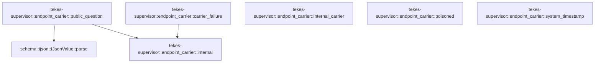

```mermaid
flowchart TD
  n0["endpoint::hub::HostFrame::new"]
  n1["endpoint::mux::SessionEndpointCapability::required"]
  n2["endpoint::types::validate_session_id"]
  n3["schema::ijson::IJsonValue::parse"]
  n4["tekes-supervisor::endpoint_carrier::ProductionCarrierStreams::attach_session_authority"]
  n5["tekes-supervisor::endpoint_carrier::ProductionCarrierStreams::session_authority"]
  n6["tekes-supervisor::endpoint_carrier::ProductionCarrierStreams::live_sessions"]
  n7["tekes-supervisor::endpoint_carrier::ProductionCarrierStreams::publish_session_status"]
  n8["tekes-supervisor::endpoint_carrier::ProductionCarrierStreams::publish_workspace_changed"]
  n9["tekes-supervisor::endpoint_carrier::ProductionCarrierStreams::attach_session"]
  n10["tekes-supervisor::endpoint_carrier::ProductionCarrierStreams::attach_everywhere"]
  n11["tekes-supervisor::endpoint_carrier::ProductionCarrierStreams::attach_everywhere_with"]
  n12["tekes-supervisor::endpoint_carrier::ProductionCarrierStreams::lacks_registration"]
  n13["tekes-supervisor::endpoint_carrier::ProductionCarrierStreams::touch"]
  n14["tekes-supervisor::endpoint_carrier::ProductionCarrierStreams::pinned_sessions"]
  n15["tekes-supervisor::endpoint_carrier::ProductionCarrierStreams::publish_host_frame"]
  n16["tekes-supervisor::endpoint_carrier::ProductionCarrierStreams::publish_session_frame"]
  n17["tekes-supervisor::endpoint_carrier::ProductionCarrierStreams::next_rpc_id"]
  n18["tekes-supervisor::endpoint_carrier::load_mux_session"]
  n19["tekes-supervisor::endpoint_carrier::semantic_line_projection_mode"]
  n20["tekes-supervisor::endpoint_carrier::line_requests"]
  n21["tekes-supervisor::endpoint_carrier::actionable_projection"]
  n22["tekes-supervisor::endpoint_carrier::actionable_projection_mode"]
  n23["tekes-supervisor::endpoint_carrier::internal_carrier"]
  n24["tekes-supervisor::endpoint_carrier::poisoned"]
  n25["tekes-supervisor::endpoint_carrier::queue_projection_is_older_than"]
  n26["tekes-supervisor::endpoint_carrier::public_queue_items"]
  n27["tekes-supervisor::endpoint_carrier::JournalLease::drop"]
  n28["tekes-supervisor::endpoint_carrier::ProductionCarrierStreams::recover_actionables"]
  n29["tekes-supervisor::endpoint_carrier::ProductionCarrierStreams::reconcile_actionables"]
  n30["tekes-supervisor::endpoint_carrier::ProductionCarrierStreams::reconcile_actionables_main"]
  n31["tekes-supervisor::endpoint_carrier::ProductionCarrierStreams::reconcile_actionables_from"]
  n32["tekes-supervisor::endpoint_carrier::ProductionCarrierStreams::note_pending_line"]
  n33["tekes-supervisor::endpoint_carrier::ProductionCarrierStreams::forget_session"]
  n34["tekes-supervisor::endpoint_carrier::ProductionCarrierStreams::new"]
  n35["tekes-supervisor::endpoint_carrier::ProductionCarrierStreams::with_description"]
  n6 --> n5
  n7 --> n0
  n7 --> n3
  n7 --> n15
  n8 --> n0
  n8 --> n3
  n8 --> n15
  n9 --> n0
  n9 --> n3
  n9 --> n10
  n9 --> n15
  n9 --> n19
  n10 --> n11
  n11 --> n12
  n11 --> n13
  n11 --> n14
  n11 --> n17
  n11 --> n18
  n11 --> n24
  n12 --> n24
  n26 --> n3
  n28 --> n2
  n28 --> n22
  n28 --> n23
  n28 --> n31
  n29 --> n21
  n29 --> n31
  n30 --> n23
  n30 --> n31
  n31 --> n16
  n31 --> n20
  n31 --> n32
  n34 --> n1
  n34 --> n35
```

```mermaid
flowchart TD
  n0["endpoint::all_session::AllSessionMux::open_with_replay"]
  n1["endpoint::hub::HostFrame::new"]
  n2["endpoint::journal::EndpointJournal::open"]
  n3["endpoint::stream_queue::EndpointFrameQueue::new"]
  n4["endpoint::types::validate_session_id"]
  n5["schema::ijson::IJsonValue::parse"]
  n6["schema::ijson::IJsonValue::parse_str"]
  n7["store::atomic::AtomicPublisher::replace"]
  n8["store::platform::NamedLock::exclusive"]
  n9["store::tail::scan_valid_prefix"]
  n10["tekes-supervisor::endpoint_carrier::ProductionCarrierStreams::live_sessions"]
  n11["tekes-supervisor::endpoint_carrier::ProductionCarrierStreams::attach_everywhere"]
  n12["tekes-supervisor::endpoint_carrier::ProductionCarrierStreams::touch"]
  n13["tekes-supervisor::endpoint_carrier::ProductionCarrierStreams::pinned_sessions"]
  n14["tekes-supervisor::endpoint_carrier::ProductionCarrierStreams::claim_journal"]
  n15["tekes-supervisor::endpoint_carrier::ProductionCarrierStreams::detach_for_archive"]
  n16["tekes-supervisor::endpoint_carrier::ProductionCarrierStreams::publish_host_frame"]
  n17["tekes-supervisor::endpoint_carrier::ProductionCarrierStreams::publish_session_frame"]
  n18["tekes-supervisor::endpoint_carrier::ProductionCarrierStreams::publish_queue_snapshot"]
  n19["tekes-supervisor::endpoint_carrier::ProductionCarrierStreams::publish_queue_projection_for_delivery"]
  n20["tekes-supervisor::endpoint_carrier::ProductionCarrierStreams::attach_for_publish"]
  n21["tekes-supervisor::endpoint_carrier::ProductionCarrierStreams::update_control_cache"]
  n22["tekes-supervisor::endpoint_carrier::ProductionCarrierStreams::update_control_frames"]
  n23["tekes-supervisor::endpoint_carrier::ProductionCarrierStreams::publish_durable_session_event"]
  n24["tekes-supervisor::endpoint_carrier::ProductionCarrierStreams::publish_durable_session_event_from_journal"]
  n25["tekes-supervisor::endpoint_carrier::ProductionCarrierStreams::close_mux_generations"]
  n26["tekes-supervisor::endpoint_carrier::ProductionCarrierStreams::open_legacy_mux"]
  n27["tekes-supervisor::endpoint_carrier::ProductionCarrierStreams::open_host"]
  n28["tekes-supervisor::endpoint_carrier::ProductionCarrierStreams::next_rpc_id"]
  n29["tekes-supervisor::endpoint_carrier::ProductionCarrierStreams::refresh_all_context_projections"]
  n30["tekes-supervisor::endpoint_carrier::ProductionCarrierStreams::refresh_context_projection"]
  n31["tekes-supervisor::endpoint_carrier::ProductionCarrierStreams::refresh_context_projection_shared"]
  n32["tekes-supervisor::endpoint_carrier::ProductionCarrierStreams::refresh_context_projection_locked"]
  n33["tekes-supervisor::endpoint_carrier::active_session_ids"]
  n34["tekes-supervisor::endpoint_carrier::semantic_projection"]
  n35["tekes-supervisor::endpoint_carrier::poisoned"]
  n36["tekes-supervisor::endpoint_carrier::read_queue_projection"]
  n37["tekes-supervisor::endpoint_carrier::queue_projection_is_older_than"]
  n38["tekes-supervisor::endpoint_carrier::public_queue_items"]
  n13 --> n10
  n14 --> n13
  n14 --> n35
  n15 --> n1
  n15 --> n5
  n15 --> n6
  n15 --> n16
  n15 --> n35
  n16 --> n28
  n16 --> n35
  n17 --> n20
  n17 --> n21
  n17 --> n28
  n18 --> n9
  n18 --> n19
  n19 --> n7
  n19 --> n8
  n19 --> n17
  n19 --> n36
  n19 --> n37
  n19 --> n38
  n20 --> n11
  n21 --> n22
  n22 --> n5
  n22 --> n6
  n22 --> n35
  n23 --> n2
  n23 --> n24
  n24 --> n28
  n25 --> n35
  n26 --> n0
  n26 --> n35
  n27 --> n3
  n27 --> n35
  n29 --> n13
  n29 --> n30
  n29 --> n33
  n29 --> n35
  n30 --> n2
  n30 --> n4
  n30 --> n32
  n30 --> n34
  n30 --> n35
  n31 --> n4
  n31 --> n32
  n31 --> n35
```

```mermaid
flowchart TD
  n0["endpoint::all_session::AllSessionMux::open"]
  n1["endpoint::mux::frozen_history_page"]
  n2["endpoint::service::NativeEndpoint::open"]
  n3["endpoint::session_operations::SessionOperations::open_sessions"]
  n4["endpoint::types::validate_session_id"]
  n5["schema::ijson::IJsonValue::parse"]
  n6["schema::ijson::IJsonValue::parse_str"]
  n7["tekes-supervisor::context_usage::sample"]
  n8["tekes-supervisor::context_usage::publish"]
  n9["tekes-supervisor::context_usage::saved_control_item"]
  n10["tekes-supervisor::endpoint_carrier::ProductionCarrierStreams::session_authority"]
  n11["tekes-supervisor::endpoint_carrier::ProductionCarrierStreams::live_sessions"]
  n12["tekes-supervisor::endpoint_carrier::ProductionCarrierStreams::claim_journal"]
  n13["tekes-supervisor::endpoint_carrier::ProductionCarrierStreams::publish_queue_snapshot"]
  n14["tekes-supervisor::endpoint_carrier::ProductionCarrierStreams::update_control_frames"]
  n15["tekes-supervisor::endpoint_carrier::ProductionCarrierStreams::open_legacy_mux"]
  n16["tekes-supervisor::endpoint_carrier::ProductionCarrierStreams::open_host"]
  n17["tekes-supervisor::endpoint_carrier::ProductionCarrierStreams::next_rpc_id"]
  n18["tekes-supervisor::endpoint_carrier::ProductionCarrierStreams::refresh_context_projection"]
  n19["tekes-supervisor::endpoint_carrier::ProductionCarrierStreams::refresh_context_projection_locked"]
  n20["tekes-supervisor::endpoint_carrier::ProductionCarrierStreams::session_items"]
  n21["tekes-supervisor::endpoint_carrier::ProductionCarrierStreams::inventory_baseline"]
  n22["tekes-supervisor::endpoint_carrier::ProductionCarrierStreams::inventory_row"]
  n23["tekes-supervisor::endpoint_carrier::ProductionCarrierStreams::control_baseline"]
  n24["tekes-supervisor::endpoint_carrier::ProductionCarrierStreams::actionables_baseline"]
  n25["tekes-supervisor::endpoint_carrier::ProductionCarrierStreams::index_holds"]
  n26["tekes-supervisor::endpoint_carrier::ProductionCarrierStreams::sessions_with_published_requests"]
  n27["tekes-supervisor::endpoint_carrier::ProductionCarrierStreams::requests"]
  n28["tekes-supervisor::endpoint_carrier::ProductionCarrierStreams::index_catalog_holds"]
  n29["tekes-supervisor::endpoint_carrier::ProductionCarrierStreams::index_unverified_and_archived"]
  n30["tekes-supervisor::endpoint_carrier::ProductionCarrierStreams::examine"]
  n31["tekes-supervisor::endpoint_carrier::ProductionCarrierStreams::fold_into_index"]
  n32["tekes-supervisor::endpoint_carrier::ProductionCarrierStreams::verify_session_carrier"]
  n33["tekes-supervisor::endpoint_carrier::ProductionCarrierStreams::verify_session"]
  n34["tekes-supervisor::endpoint_carrier::ProductionCarrierStreams::open_mux_journal"]
  n35["tekes-supervisor::endpoint_carrier::ProductionCarrierStreams::snapshot_projections"]
  n36["tekes-supervisor::endpoint_carrier::ProductionCarrierStreams::open_mux"]
  n37["tekes-supervisor::endpoint_carrier::ProductionCarrierStreams::mux_journal_page"]
  n38["tekes-supervisor::endpoint_carrier::ProductionStream::map_source"]
  n39["tekes-supervisor::endpoint_carrier::active_session_ids"]
  n40["tekes-supervisor::endpoint_carrier::load_mux_session"]
  n41["tekes-supervisor::endpoint_carrier::inventory_row"]
  n42["tekes-supervisor::endpoint_carrier::session_requests_mode"]
  n43["tekes-supervisor::endpoint_carrier::pending_session_requests_mode"]
  n44["tekes-supervisor::endpoint_carrier::poisoned"]
  n45["tekes-supervisor::endpoint_carrier::read_queue_projection"]
  n46["tekes-supervisor::endpoint_carrier::ProductionCarrierStreams::recover_actionables"]
  n47["tekes-supervisor::request_index::ledger_signature"]
  n48["tekes-supervisor::request_index::children_may_hold_requests"]
  n49["tekes-supervisor::request_index::may_hold_requests"]
  n19 --> n2
  n19 --> n5
  n19 --> n7
  n19 --> n8
  n19 --> n14
  n19 --> n17
  n19 --> n44
  n20 --> n2
  n20 --> n10
  n20 --> n11
  n21 --> n3
  n21 --> n20
  n21 --> n41
  n22 --> n3
  n22 --> n10
  n22 --> n41
  n23 --> n6
  n23 --> n9
  n23 --> n10
  n23 --> n13
  n23 --> n18
  n23 --> n39
  n23 --> n44
  n23 --> n45
  n24 --> n10
  n24 --> n25
  n24 --> n26
  n24 --> n39
  n24 --> n43
  n24 --> n46
  n24 --> n49
  n28 --> n10
  n28 --> n25
  n29 --> n4
  n29 --> n10
  n29 --> n30
  n29 --> n39
  n30 --> n31
  n30 --> n47
  n30 --> n48
  n30 --> n49
  n31 --> n42
  n32 --> n10
  n33 --> n32
  n34 --> n0
  n34 --> n1
  n34 --> n2
  n34 --> n10
  n34 --> n12
  n34 --> n17
  n34 --> n32
  n34 --> n35
  n34 --> n40
  n35 --> n5
  n35 --> n9
  n35 --> n44
  n36 --> n15
  n36 --> n16
  n36 --> n21
  n36 --> n23
  n36 --> n24
  n36 --> n34
  n37 --> n1
  n37 --> n2
  n37 --> n40
  n38 --> n44
```

```mermaid
flowchart TD
  n0["endpoint::carrier_adapter::JournalRespondHandler::new"]
  n1["endpoint::carrier_adapter::ComposedEndpointCarrierHost::new"]
  n2["endpoint::host::StreamFailure::internal"]
  n3["endpoint::idempotency::RpcRegistry::open"]
  n4["schema::ijson::IJsonValue::parse"]
  n5["tekes-supervisor::endpoint_carrier::ProductionRespondAuthority::open"]
  n6["tekes-supervisor::endpoint_carrier::ProductionStream::recv"]
  n7["tekes-supervisor::endpoint_carrier::ProductionCarrierStreams::open_stream"]
  n8["tekes-supervisor::endpoint_carrier::ProductionCarrierStreams::stream_error"]
  n9["tekes-supervisor::endpoint_carrier::ProductionCarrierStreams::mux_description"]
  n10["tekes-supervisor::endpoint_carrier::ProductionCarrierStreams::open_mux_stream"]
  n11["tekes-supervisor::endpoint_carrier::ProductionCarrierStreams::journal_page"]
  n12["tekes-supervisor::endpoint_carrier::LeasedStream::recv"]
  n13["tekes-supervisor::endpoint_carrier::LeasedStream::drop"]
  n14["tekes-supervisor::endpoint_carrier::LifecycleCarrierHost::new"]
  n15["tekes-supervisor::endpoint_carrier::LifecycleCarrierHost::capabilities"]
  n16["tekes-supervisor::endpoint_carrier::LifecycleCarrierHost::extension_capabilities"]
  n17["tekes-supervisor::endpoint_carrier::LifecycleCarrierHost::method_class"]
  n18["tekes-supervisor::endpoint_carrier::LifecycleCarrierHost::validate_request"]
  n19["tekes-supervisor::endpoint_carrier::LifecycleCarrierHost::call"]
  n20["tekes-supervisor::endpoint_carrier::lifecycle_target"]
  n21["tekes-supervisor::endpoint_carrier::ProductionCarrierAssembly::assemble"]
  n22["tekes-supervisor::endpoint_carrier::ProductionCarrierAssembly::host"]
  n23["tekes-supervisor::endpoint_carrier::ProductionCarrierAssembly::with_file_changes"]
  n24["tekes-supervisor::endpoint_carrier::ProductionCarrierAssembly::streams"]
  n25["tekes-supervisor::endpoint_carrier::ProductionCarrierAssembly::server"]
  n26["tekes-supervisor::endpoint_carrier::payload_session_id"]
  n27["tekes-supervisor::endpoint_carrier::ProductionCarrierStreams::with_description"]
  n28["tekes-supervisor::file_leases::SessionFileTransfer::open"]
  n29["transport::server::TransportServer::new"]
  n6 --> n2
  n8 --> n4
  n19 --> n20
  n20 --> n26
  n21 --> n0
  n21 --> n1
  n21 --> n3
  n21 --> n5
  n21 --> n14
  n21 --> n27
  n21 --> n28
  n21 --> n29
```

```mermaid
flowchart TD
  n0["endpoint::journal::EndpointJournal::open"]
  n1["endpoint::requests::PendingRequest::derive"]
  n2["endpoint::requests::RequestState::resolved"]
  n3["endpoint::types::validate_session_id"]
  n4["engine::lifecycle::classify"]
  n5["schema::ijson::IJsonValue::parse"]
  n6["store::tail::scan_valid_prefix"]
  n7["tekes-supervisor::endpoint_carrier::ProductionCarrierAssembly::into_server"]
  n8["tekes-supervisor::endpoint_carrier::ProductionCarrierAssembly::mark_ready"]
  n9["tekes-supervisor::endpoint_carrier::ProductionCarrierAssembly::finish_recovery"]
  n10["tekes-supervisor::endpoint_carrier::ProductionCarrierAssembly::begin_drain"]
  n11["tekes-supervisor::endpoint_carrier::active_session_ids"]
  n12["tekes-supervisor::endpoint_carrier::load_mux_session"]
  n13["tekes-supervisor::endpoint_carrier::inventory_row"]
  n14["tekes-supervisor::endpoint_carrier::semantic_projection"]
  n15["tekes-supervisor::endpoint_carrier::semantic_line_projection"]
  n16["tekes-supervisor::endpoint_carrier::semantic_line_projection_mode"]
  n17["tekes-supervisor::endpoint_carrier::line_requests"]
  n18["tekes-supervisor::endpoint_carrier::session_requests_mode"]
  n19["tekes-supervisor::endpoint_carrier::pending_session_requests_mode"]
  n20["tekes-supervisor::endpoint_carrier::actionable_projection"]
  n21["tekes-supervisor::endpoint_carrier::actionable_projection_mode"]
  n22["tekes-supervisor::endpoint_carrier::validate_request_binding"]
  n23["tekes-supervisor::endpoint_carrier::unresolved_hold_turn"]
  n24["tekes-supervisor::endpoint_carrier::payload_session_id"]
  n25["tekes-supervisor::endpoint_carrier::result_session_id"]
  n26["tekes-supervisor::endpoint_carrier::route_failure"]
  n27["tekes-supervisor::endpoint_carrier::internal"]
  n9 --> n8
  n11 --> n3
  n12 --> n0
  n12 --> n3
  n12 --> n19
  n13 --> n4
  n13 --> n5
  n14 --> n15
  n15 --> n16
  n16 --> n3
  n16 --> n6
  n16 --> n27
  n17 --> n1
  n17 --> n2
  n17 --> n5
  n17 --> n27
  n18 --> n3
  n18 --> n16
  n18 --> n17
  n18 --> n27
  n19 --> n18
  n20 --> n21
  n21 --> n16
  n21 --> n27
```

# tekes-supervisor::endpoint_carrier

[Package atlas](index.md) · [Source](../../src/endpoint_carrier.rs)

## Declarations

Visibility is the declaration spelling; trait members and reexports require their enclosing interface. `cfg` is not evaluated.

| Symbol | Kind | Visibility | Test / cfg |
|---|---|---|---|
| [tekes-supervisor::endpoint_carrier::HOST_STREAM_MAX_FRAMES](../../src/endpoint_carrier.rs#L40) | const_item | `private` |  |
| [tekes-supervisor::endpoint_carrier::HOST_STREAM_MAX_BYTES](../../src/endpoint_carrier.rs#L41) | const_item | `private` |  |
| [tekes-supervisor::endpoint_carrier::SupervisorSessionAuthority](../../src/endpoint_carrier.rs#L55) | trait_item | `pub` |  |
| [tekes-supervisor::endpoint_carrier::SupervisorSessionAuthority::live_sessions](../../src/endpoint_carrier.rs#L57) | function_signature_item | `private` |  |
| [tekes-supervisor::endpoint_carrier::SupervisorSessionAuthority::reconcile_projection](../../src/endpoint_carrier.rs#L62) | function_signature_item | `private` |  |
| [tekes-supervisor::endpoint_carrier::SupervisorSessionAuthority::inventory_items](../../src/endpoint_carrier.rs#L67) | function_item | `private` |  |
| [tekes-supervisor::endpoint_carrier::SupervisorSessionAuthority::inventory_item](../../src/endpoint_carrier.rs#L75) | function_item | `private` |  |
| [tekes-supervisor::endpoint_carrier::SupervisorSessionAuthority::ensure_verified](../../src/endpoint_carrier.rs#L84) | function_item | `private` |  |
| [tekes-supervisor::endpoint_carrier::SupervisorSessionAuthority::has_catalog](../../src/endpoint_carrier.rs#L90) | function_item | `private` |  |
| [tekes-supervisor::endpoint_carrier::SupervisorSessionAuthority::hold_catalog](../../src/endpoint_carrier.rs#L96) | function_item | `private` |  |
| [tekes-supervisor::endpoint_carrier::SessionGateError](../../src/endpoint_carrier.rs#L103) | enum_item | `pub` |  |
| [tekes-supervisor::endpoint_carrier::HoldRef](../../src/endpoint_carrier.rs#L112) | struct_item | `pub` |  |
| [tekes-supervisor::endpoint_carrier::VerifiedHolds](../../src/endpoint_carrier.rs#L121) | struct_item | `pub` |  |
| [tekes-supervisor::endpoint_carrier::HoldCatalog](../../src/endpoint_carrier.rs#L130) | struct_item | `pub` |  |
| [tekes-supervisor::endpoint_carrier::LiveRespondAuthority](../../src/endpoint_carrier.rs#L144) | trait_item | `pub` |  |
| [tekes-supervisor::endpoint_carrier::LiveRespondAuthority::deliver_if_live](../../src/endpoint_carrier.rs#L145) | function_signature_item | `private` |  |
| [tekes-supervisor::endpoint_carrier::LiveRespondAuthority::ensure_after_locked_append](../../src/endpoint_carrier.rs#L154) | function_item | `private` |  |
| [tekes-supervisor::endpoint_carrier::CarrierClock](../../src/endpoint_carrier.rs#L159) | type_item | `pub` |  |
| [tekes-supervisor::endpoint_carrier::ProductionRespondAuthority](../../src/endpoint_carrier.rs#L161) | struct_item | `pub` |  |
| [tekes-supervisor::endpoint_carrier::ProductionRespondAuthority::open](../../src/endpoint_carrier.rs#L176) | function_item | `pub` |  |
| [tekes-supervisor::endpoint_carrier::ProductionRespondAuthority::open_with_clock](../../src/endpoint_carrier.rs#L184) | function_item | `pub` |  |
| [tekes-supervisor::endpoint_carrier::ProductionRespondAuthority::with_streams](../../src/endpoint_carrier.rs#L207) | function_item | `pub` |  |
| [tekes-supervisor::endpoint_carrier::ProductionRespondAuthority::reconcile_after_response](../../src/endpoint_carrier.rs#L218) | function_item | `private` |  |
| [tekes-supervisor::endpoint_carrier::ProductionRespondAuthority::locate_once](../../src/endpoint_carrier.rs#L236) | function_item | `private` |  |
| [tekes-supervisor::endpoint_carrier::ProductionRespondAuthority::locate_indexed](../../src/endpoint_carrier.rs#L258) | function_item | `private` |  |
| [tekes-supervisor::endpoint_carrier::ProductionRespondAuthority::locate_by_scan](../../src/endpoint_carrier.rs#L284) | function_item | `private` |  |
| [tekes-supervisor::endpoint_carrier::ProductionRespondAuthority::locate_in_folder](../../src/endpoint_carrier.rs#L313) | function_item | `private` |  |
| [tekes-supervisor::endpoint_carrier::ProductionRespondAuthority::worker_message](../../src/endpoint_carrier.rs#L354) | function_item | `private` |  |
| [tekes-supervisor::endpoint_carrier::ProductionRespondAuthority::live_delivery](../../src/endpoint_carrier.rs#L370) | function_item | `private` |  |
| [tekes-supervisor::endpoint_carrier::ProductionRespondAuthority::locked_append](../../src/endpoint_carrier.rs#L393) | function_item | `private` |  |
| [tekes-supervisor::endpoint_carrier::ProductionRespondAuthority::locate](../../src/endpoint_carrier.rs#L466) | function_item | `private` |  |
| [tekes-supervisor::endpoint_carrier::ProductionRespondAuthority::author](../../src/endpoint_carrier.rs#L470) | function_item | `private` |  |
| [tekes-supervisor::endpoint_carrier::ProductionCarrierStreams](../../src/endpoint_carrier.rs#L528) | struct_item | `pub` |  |
| [tekes-supervisor::endpoint_carrier::CarrierStreamsInner](../../src/endpoint_carrier.rs#L532) | struct_item | `private` |  |
| [tekes-supervisor::endpoint_carrier::Attachments](../../src/endpoint_carrier.rs#L552) | struct_item | `private` |  |
| [tekes-supervisor::endpoint_carrier::SavedQueueProjection](../../src/endpoint_carrier.rs#L563) | struct_item | `private` |  |
| [tekes-supervisor::endpoint_carrier::read_queue_projection](../../src/endpoint_carrier.rs#L570) | function_item | `private` |  |
| [tekes-supervisor::endpoint_carrier::queue_projection_is_older_than](../../src/endpoint_carrier.rs#L577) | function_item | `private` |  |
| [tekes-supervisor::endpoint_carrier::public_queue_items](../../src/endpoint_carrier.rs#L585) | function_item | `private` |  |
| [tekes-supervisor::endpoint_carrier::public_queue_projection_tests::projection](../../src/endpoint_carrier.rs#L631) | function_item | `private` | test; #[cfg(test)] |
| [tekes-supervisor::endpoint_carrier::public_queue_projection_tests::ledger_recovery_starts_a_new_queue_generation](../../src/endpoint_carrier.rs#L667) | function_item | `private` | test; #[cfg(test)] |
| [tekes-supervisor::endpoint_carrier::public_queue_projection_tests::queue_snapshot_uses_only_live_inputs_and_preserves_public_message_source](../../src/endpoint_carrier.rs#L680) | function_item | `private` | test; #[cfg(test)] |
| [tekes-supervisor::endpoint_carrier::JournalLease](../../src/endpoint_carrier.rs#L715) | struct_item | `pub(crate)` |  |
| [tekes-supervisor::endpoint_carrier::JournalLease::drop](../../src/endpoint_carrier.rs#L721) | function_item | `private` |  |
| [tekes-supervisor::endpoint_carrier::PublishedActionables](../../src/endpoint_carrier.rs#L740) | type_item | `private` |  |
| [tekes-supervisor::endpoint_carrier::StreamGenerations](../../src/endpoint_carrier.rs#L743) | struct_item | `private` |  |
| [tekes-supervisor::endpoint_carrier::TrackedMux](../../src/endpoint_carrier.rs#L748) | struct_item | `private` |  |
| [tekes-supervisor::endpoint_carrier::TrackedHost](../../src/endpoint_carrier.rs#L753) | struct_item | `private` |  |
| [tekes-supervisor::endpoint_carrier::ProjectionReplay](../../src/endpoint_carrier.rs#L759) | struct_item | `private` |  |
| [tekes-supervisor::endpoint_carrier::ProductionCarrierStreams::recover_actionables](../../src/endpoint_carrier.rs#L766) | function_item | `private` |  |
| [tekes-supervisor::endpoint_carrier::ProductionCarrierStreams::reconcile_actionables](../../src/endpoint_carrier.rs#L803) | function_item | `pub(crate)` |  |
| [tekes-supervisor::endpoint_carrier::ProductionCarrierStreams::reconcile_actionables_main](../../src/endpoint_carrier.rs#L817) | function_item | `pub(crate)` |  |
| [tekes-supervisor::endpoint_carrier::ProductionCarrierStreams::reconcile_actionables_from](../../src/endpoint_carrier.rs#L832) | function_item | `private` |  |
| [tekes-supervisor::endpoint_carrier::ProductionCarrierStreams::note_pending_line](../../src/endpoint_carrier.rs#L908) | function_item | `private` |  |
| [tekes-supervisor::endpoint_carrier::ProductionCarrierStreams::forget_session](../../src/endpoint_carrier.rs#L925) | function_item | `pub(crate)` |  |
| [tekes-supervisor::endpoint_carrier::ProductionCarrierStreams::actionable_ids_for_test](../../src/endpoint_carrier.rs#L943) | function_item | `pub(crate)` | test; #[cfg(test)] #[cfg_attr(not(target_os = "macos"), allow(dead_code))] |
| [tekes-supervisor::endpoint_carrier::ProductionCarrierStreams::published_pending_for_test](../../src/endpoint_carrier.rs#L955) | function_item | `pub(crate)` | test; #[cfg(test)] #[cfg_attr(not(target_os = "macos"), allow(dead_code))] |
| [tekes-supervisor::endpoint_carrier::ProductionCarrierStreams::new](../../src/endpoint_carrier.rs#L970) | function_item | `pub` |  |
| [tekes-supervisor::endpoint_carrier::ProductionCarrierStreams::with_description](../../src/endpoint_carrier.rs#L991) | function_item | `pub` |  |
| [tekes-supervisor::endpoint_carrier::ProductionCarrierStreams::attach_session_authority](../../src/endpoint_carrier.rs#L1011) | function_item | `pub` |  |
| [tekes-supervisor::endpoint_carrier::ProductionCarrierStreams::session_authority](../../src/endpoint_carrier.rs#L1019) | function_item | `private` |  |
| [tekes-supervisor::endpoint_carrier::ProductionCarrierStreams::live_sessions](../../src/endpoint_carrier.rs#L1028) | function_item | `private` |  |
| [tekes-supervisor::endpoint_carrier::ProductionCarrierStreams::publish_session_status](../../src/endpoint_carrier.rs#L1038) | function_item | `pub` |  |
| [tekes-supervisor::endpoint_carrier::ProductionCarrierStreams::publish_workspace_changed](../../src/endpoint_carrier.rs#L1053) | function_item | `pub` |  |
| [tekes-supervisor::endpoint_carrier::ProductionCarrierStreams::attach_session](../../src/endpoint_carrier.rs#L1065) | function_item | `pub` |  |
| [tekes-supervisor::endpoint_carrier::ProductionCarrierStreams::attach_everywhere](../../src/endpoint_carrier.rs#L1090) | function_item | `pub(crate)` |  |
| [tekes-supervisor::endpoint_carrier::ProductionCarrierStreams::attach_everywhere_with](../../src/endpoint_carrier.rs#L1095) | function_item | `pub(crate)` |  |
| [tekes-supervisor::endpoint_carrier::ProductionCarrierStreams::lacks_registration](../../src/endpoint_carrier.rs#L1191) | function_item | `private` |  |
| [tekes-supervisor::endpoint_carrier::ProductionCarrierStreams::touch](../../src/endpoint_carrier.rs#L1204) | function_item | `private` |  |
| [tekes-supervisor::endpoint_carrier::ProductionCarrierStreams::pinned_sessions](../../src/endpoint_carrier.rs#L1217) | function_item | `private` |  |
| [tekes-supervisor::endpoint_carrier::ProductionCarrierStreams::claim_journal](../../src/endpoint_carrier.rs#L1236) | function_item | `private` |  |
| [tekes-supervisor::endpoint_carrier::ProductionCarrierStreams::detach_for_archive](../../src/endpoint_carrier.rs#L1257) | function_item | `pub` |  |
| [tekes-supervisor::endpoint_carrier::ProductionCarrierStreams::publish_host_frame](../../src/endpoint_carrier.rs#L1280) | function_item | `pub` |  |
| [tekes-supervisor::endpoint_carrier::ProductionCarrierStreams::publish_session_frame](../../src/endpoint_carrier.rs#L1309) | function_item | `pub` |  |
| [tekes-supervisor::endpoint_carrier::ProductionCarrierStreams::publish_queue_snapshot](../../src/endpoint_carrier.rs#L1325) | function_item | `pub` |  |
| [tekes-supervisor::endpoint_carrier::ProductionCarrierStreams::publish_queue_projection_for_delivery](../../src/endpoint_carrier.rs#L1352) | function_item | `pub(crate)` |  |
| [tekes-supervisor::endpoint_carrier::ProductionCarrierStreams::attach_for_publish](../../src/endpoint_carrier.rs#L1416) | function_item | `private` |  |
| [tekes-supervisor::endpoint_carrier::ProductionCarrierStreams::update_control_cache](../../src/endpoint_carrier.rs#L1427) | function_item | `private` |  |
| [tekes-supervisor::endpoint_carrier::ProductionCarrierStreams::update_control_frames](../../src/endpoint_carrier.rs#L1434) | function_item | `private` |  |
| [tekes-supervisor::endpoint_carrier::ProductionCarrierStreams::publish_durable_session_event](../../src/endpoint_carrier.rs#L1480) | function_item | `pub` |  |
| [tekes-supervisor::endpoint_carrier::ProductionCarrierStreams::publish_durable_session_event_from_journal](../../src/endpoint_carrier.rs#L1493) | function_item | `pub` |  |
| [tekes-supervisor::endpoint_carrier::ProductionCarrierStreams::close_mux_generations](../../src/endpoint_carrier.rs#L1509) | function_item | `pub` |  |
| [tekes-supervisor::endpoint_carrier::ProductionCarrierStreams::open_legacy_mux](../../src/endpoint_carrier.rs#L1520) | function_item | `private` |  |
| [tekes-supervisor::endpoint_carrier::ProductionCarrierStreams::open_host](../../src/endpoint_carrier.rs#L1539) | function_item | `private` |  |
| [tekes-supervisor::endpoint_carrier::ProductionCarrierStreams::next_rpc_id](../../src/endpoint_carrier.rs#L1558) | function_item | `private` |  |
| [tekes-supervisor::endpoint_carrier::ProductionCarrierStreams::refresh_all_context_projections](../../src/endpoint_carrier.rs#L1567) | function_item | `pub(crate)` |  |
| [tekes-supervisor::endpoint_carrier::ProductionCarrierStreams::refresh_context_projection](../../src/endpoint_carrier.rs#L1606) | function_item | `pub(crate)` |  |
| [tekes-supervisor::endpoint_carrier::ProductionCarrierStreams::refresh_context_projection_shared](../../src/endpoint_carrier.rs#L1626) | function_item | `pub(crate)` |  |
| [tekes-supervisor::endpoint_carrier::ProductionCarrierStreams::refresh_context_projection_locked](../../src/endpoint_carrier.rs#L1642) | function_item | `private` |  |
| [tekes-supervisor::endpoint_carrier::ProductionCarrierStreams::session_items](../../src/endpoint_carrier.rs#L1700) | function_item | `private` |  |
| [tekes-supervisor::endpoint_carrier::ProductionCarrierStreams::inventory_baseline](../../src/endpoint_carrier.rs#L1717) | function_item | `private` |  |
| [tekes-supervisor::endpoint_carrier::ProductionCarrierStreams::inventory_row](../../src/endpoint_carrier.rs#L1743) | function_item | `private` |  |
| [tekes-supervisor::endpoint_carrier::ProductionCarrierStreams::control_baseline](../../src/endpoint_carrier.rs#L1761) | function_item | `private` |  |
| [tekes-supervisor::endpoint_carrier::ProductionCarrierStreams::actionables_baseline](../../src/endpoint_carrier.rs#L1856) | function_item | `private` |  |
| [tekes-supervisor::endpoint_carrier::ProductionCarrierStreams::index_holds](../../src/endpoint_carrier.rs#L1936) | function_item | `private` |  |
| [tekes-supervisor::endpoint_carrier::ProductionCarrierStreams::sessions_with_published_requests](../../src/endpoint_carrier.rs#L1950) | function_item | `private` |  |
| [tekes-supervisor::endpoint_carrier::ProductionCarrierStreams::requests](../../src/endpoint_carrier.rs#L1966) | function_item | `pub(crate)` |  |
| [tekes-supervisor::endpoint_carrier::ProductionCarrierStreams::index_catalog_holds](../../src/endpoint_carrier.rs#L1972) | function_item | `pub(crate)` |  |
| [tekes-supervisor::endpoint_carrier::ProductionCarrierStreams::index_unverified_and_archived](../../src/endpoint_carrier.rs#L1983) | function_item | `pub(crate)` |  |
| [tekes-supervisor::endpoint_carrier::ProductionCarrierStreams::examine](../../src/endpoint_carrier.rs#L2028) | function_item | `private` |  |
| [tekes-supervisor::endpoint_carrier::ProductionCarrierStreams::fold_into_index](../../src/endpoint_carrier.rs#L2054) | function_item | `private` |  |
| [tekes-supervisor::endpoint_carrier::ProductionCarrierStreams::verify_session_carrier](../../src/endpoint_carrier.rs#L2078) | function_item | `pub(crate)` |  |
| [tekes-supervisor::endpoint_carrier::ProductionCarrierStreams::verify_session](../../src/endpoint_carrier.rs#L2097) | function_item | `pub(crate)` |  |
| [tekes-supervisor::endpoint_carrier::ProductionCarrierStreams::open_mux_journal](../../src/endpoint_carrier.rs#L2102) | function_item | `private` |  |
| [tekes-supervisor::endpoint_carrier::ProductionCarrierStreams::snapshot_projections](../../src/endpoint_carrier.rs#L2194) | function_item | `private` |  |
| [tekes-supervisor::endpoint_carrier::ProductionCarrierStreams::open_mux](../../src/endpoint_carrier.rs#L2249) | function_item | `pub(crate)` |  |
| [tekes-supervisor::endpoint_carrier::ProductionCarrierStreams::mux_journal_page](../../src/endpoint_carrier.rs#L2318) | function_item | `private` |  |
| [tekes-supervisor::endpoint_carrier::ProductionStreamKind](../../src/endpoint_carrier.rs#L2353) | enum_item | `private` |  |
| [tekes-supervisor::endpoint_carrier::ProductionStream](../../src/endpoint_carrier.rs#L2364) | struct_item | `private` |  |
| [tekes-supervisor::endpoint_carrier::ProductionStream::map_source](../../src/endpoint_carrier.rs#L2375) | function_item | `private` |  |
| [tekes-supervisor::endpoint_carrier::ProductionStream::recv](../../src/endpoint_carrier.rs#L2580) | function_item | `private` |  |
| [tekes-supervisor::endpoint_carrier::ProductionCarrierStreams::open_stream](../../src/endpoint_carrier.rs#L2602) | function_item | `private` |  |
| [tekes-supervisor::endpoint_carrier::ProductionCarrierStreams::stream_error](../../src/endpoint_carrier.rs#L2612) | function_item | `private` |  |
| [tekes-supervisor::endpoint_carrier::ProductionCarrierStreams::mux_description](../../src/endpoint_carrier.rs#L2639) | function_item | `private` |  |
| [tekes-supervisor::endpoint_carrier::ProductionCarrierStreams::open_mux_stream](../../src/endpoint_carrier.rs#L2646) | function_item | `private` |  |
| [tekes-supervisor::endpoint_carrier::ProductionCarrierStreams::journal_page](../../src/endpoint_carrier.rs#L2656) | function_item | `private` |  |
| [tekes-supervisor::endpoint_carrier::LeasedStream](../../src/endpoint_carrier.rs#L2666) | struct_item | `private` |  |
| [tekes-supervisor::endpoint_carrier::StreamDrop](../../src/endpoint_carrier.rs#L2673) | enum_item | `private` |  |
| [tekes-supervisor::endpoint_carrier::LeasedStream::recv](../../src/endpoint_carrier.rs#L2679) | function_item | `private` |  |
| [tekes-supervisor::endpoint_carrier::LeasedStream::drop](../../src/endpoint_carrier.rs#L2685) | function_item | `private` |  |
| [tekes-supervisor::endpoint_carrier::LifecycleCarrierHost](../../src/endpoint_carrier.rs#L2697) | struct_item | `pub` |  |
| [tekes-supervisor::endpoint_carrier::LifecycleCarrierHost::new](../../src/endpoint_carrier.rs#L2704) | function_item | `pub` |  |
| [tekes-supervisor::endpoint_carrier::LifecycleCarrierHost::capabilities](../../src/endpoint_carrier.rs#L2710) | function_item | `private` |  |
| [tekes-supervisor::endpoint_carrier::LifecycleCarrierHost::extension_capabilities](../../src/endpoint_carrier.rs#L2714) | function_item | `private` |  |
| [tekes-supervisor::endpoint_carrier::LifecycleCarrierHost::method_class](../../src/endpoint_carrier.rs#L2718) | function_item | `private` |  |
| [tekes-supervisor::endpoint_carrier::LifecycleCarrierHost::validate_request](../../src/endpoint_carrier.rs#L2722) | function_item | `private` |  |
| [tekes-supervisor::endpoint_carrier::LifecycleCarrierHost::call](../../src/endpoint_carrier.rs#L2726) | function_item | `private` |  |
| [tekes-supervisor::endpoint_carrier::LifecycleTarget](../../src/endpoint_carrier.rs#L2759) | enum_item | `private` |  |
| [tekes-supervisor::endpoint_carrier::lifecycle_target](../../src/endpoint_carrier.rs#L2765) | function_item | `private` |  |
| [tekes-supervisor::endpoint_carrier::ProductionCarrierHost](../../src/endpoint_carrier.rs#L2776) | type_item | `pub` |  |
| [tekes-supervisor::endpoint_carrier::ProductionCarrierAssembly](../../src/endpoint_carrier.rs#L2782) | struct_item | `pub` |  |
| [tekes-supervisor::endpoint_carrier::ProductionCarrierAssembly::assemble](../../src/endpoint_carrier.rs#L2789) | function_item | `pub` |  |
| [tekes-supervisor::endpoint_carrier::ProductionCarrierAssembly::host](../../src/endpoint_carrier.rs#L2824) | function_item | `pub` |  |
| [tekes-supervisor::endpoint_carrier::ProductionCarrierAssembly::with_file_changes](../../src/endpoint_carrier.rs#L2828) | function_item | `pub` |  |
| [tekes-supervisor::endpoint_carrier::ProductionCarrierAssembly::streams](../../src/endpoint_carrier.rs#L2834) | function_item | `pub` |  |
| [tekes-supervisor::endpoint_carrier::ProductionCarrierAssembly::server](../../src/endpoint_carrier.rs#L2839) | function_item | `pub` |  |
| [tekes-supervisor::endpoint_carrier::ProductionCarrierAssembly::into_server](../../src/endpoint_carrier.rs#L2844) | function_item | `pub` |  |
| [tekes-supervisor::endpoint_carrier::ProductionCarrierAssembly::mark_ready](../../src/endpoint_carrier.rs#L2851) | function_item | `pub` |  |
| [tekes-supervisor::endpoint_carrier::ProductionCarrierAssembly::finish_recovery](../../src/endpoint_carrier.rs#L2856) | function_item | `pub` |  |
| [tekes-supervisor::endpoint_carrier::ProductionCarrierAssembly::begin_drain](../../src/endpoint_carrier.rs#L2861) | function_item | `pub` |  |
| [tekes-supervisor::endpoint_carrier::MuxSession](../../src/endpoint_carrier.rs#L2867) | struct_item | `private` |  |
| [tekes-supervisor::endpoint_carrier::active_session_ids](../../src/endpoint_carrier.rs#L2873) | function_item | `private` |  |
| [tekes-supervisor::endpoint_carrier::load_mux_session](../../src/endpoint_carrier.rs#L2886) | function_item | `private` |  |
| [tekes-supervisor::endpoint_carrier::inventory_row](../../src/endpoint_carrier.rs#L2902) | function_item | `private` |  |
| [tekes-supervisor::endpoint_carrier::folder_inventory_tests::inventory_uses_only_its_own_recorded_execution_cwd](../../src/endpoint_carrier.rs#L2946) | function_item | `private` | test; #[cfg(test)] |
| [tekes-supervisor::endpoint_carrier::semantic_projection](../../src/endpoint_carrier.rs#L2986) | function_item | `private` |  |
| [tekes-supervisor::endpoint_carrier::semantic_line_projection](../../src/endpoint_carrier.rs#L2990) | function_item | `private` |  |
| [tekes-supervisor::endpoint_carrier::semantic_line_projection_mode](../../src/endpoint_carrier.rs#L3001) | function_item | `private` |  |
| [tekes-supervisor::endpoint_carrier::line_requests](../../src/endpoint_carrier.rs#L3034) | function_item | `pub(crate)` |  |
| [tekes-supervisor::endpoint_carrier::session_requests_mode](../../src/endpoint_carrier.rs#L3137) | function_item | `private` |  |
| [tekes-supervisor::endpoint_carrier::pending_session_requests_mode](../../src/endpoint_carrier.rs#L3178) | function_item | `private` |  |
| [tekes-supervisor::endpoint_carrier::actionable_projection](../../src/endpoint_carrier.rs#L3192) | function_item | `private` |  |
| [tekes-supervisor::endpoint_carrier::actionable_projection_mode](../../src/endpoint_carrier.rs#L3200) | function_item | `private` |  |
| [tekes-supervisor::endpoint_carrier::validate_request_binding](../../src/endpoint_carrier.rs#L3263) | function_item | `private` |  |
| [tekes-supervisor::endpoint_carrier::unresolved_hold_turn](../../src/endpoint_carrier.rs#L3297) | function_item | `private` |  |
| [tekes-supervisor::endpoint_carrier::payload_session_id](../../src/endpoint_carrier.rs#L3322) | function_item | `private` |  |
| [tekes-supervisor::endpoint_carrier::result_session_id](../../src/endpoint_carrier.rs#L3330) | function_item | `private` |  |
| [tekes-supervisor::endpoint_carrier::route_failure](../../src/endpoint_carrier.rs#L3338) | function_item | `private` |  |
| [tekes-supervisor::endpoint_carrier::public_question](../../src/endpoint_carrier.rs#L3350) | function_item | `private` |  |
| [tekes-supervisor::endpoint_carrier::internal](../../src/endpoint_carrier.rs#L3374) | function_item | `private` |  |
| [tekes-supervisor::endpoint_carrier::carrier_failure](../../src/endpoint_carrier.rs#L3379) | function_item | `private` |  |
| [tekes-supervisor::endpoint_carrier::internal_carrier](../../src/endpoint_carrier.rs#L3389) | function_item | `private` |  |
| [tekes-supervisor::endpoint_carrier::poisoned](../../src/endpoint_carrier.rs#L3393) | function_item | `private` |  |
| [tekes-supervisor::endpoint_carrier::system_timestamp](../../src/endpoint_carrier.rs#L3397) | function_item | `private` |  |
| [tekes-supervisor::endpoint_carrier::ProductionCarrierError](../../src/endpoint_carrier.rs#L3429) | enum_item | `pub` |  |
| [tekes-supervisor::endpoint_carrier::question_cancellation_tests::question_denial_projects_as_cancelled_and_answer_as_answered](../../src/endpoint_carrier.rs#L3469) | function_item | `private` | test; #[cfg(test)] |
| [tekes-supervisor::endpoint_carrier::lazy_registration_tests::TS](../../src/endpoint_carrier.rs#L3524) | const_item | `private` | test; #[cfg(test)] |
| [tekes-supervisor::endpoint_carrier::lazy_registration_tests::blank_thread](../../src/endpoint_carrier.rs#L3526) | function_item | `private` | test; #[cfg(test)] |
| [tekes-supervisor::endpoint_carrier::lazy_registration_tests::id](../../src/endpoint_carrier.rs#L3536) | function_item | `private` | test; #[cfg(test)] |
| [tekes-supervisor::endpoint_carrier::lazy_registration_tests::registered](../../src/endpoint_carrier.rs#L3540) | function_item | `private` | test; #[cfg(test)] |
| [tekes-supervisor::endpoint_carrier::lazy_registration_tests::first_touches_load_in_parallel_and_do_not_hold_up_live_frames](../../src/endpoint_carrier.rs#L3557) | function_item | `private` | test; #[cfg(test)] |
| [tekes-supervisor::endpoint_carrier::lazy_registration_tests::a_context_refresh_serves_the_open_thread_first_and_registers_no_idle_session](../../src/endpoint_carrier.rs#L3638) | function_item | `private` | test; #[cfg(test)] |

## Imports / reexports

| Local name | Source path | Visibility |
|---|---|---|
| `BTreeMap` | `std::collections::BTreeMap` | `private` |
| `BTreeSet` | `std::collections::BTreeSet` | `private` |
| `HashMap` | `std::collections::HashMap` | `private` |
| `HashSet` | `std::collections::HashSet` | `private` |
| `VecDeque` | `std::collections::VecDeque` | `private` |
| `fs` | `std::fs` | `private` |
| `Path` | `std::path::Path` | `private` |
| `PathBuf` | `std::path::PathBuf` | `private` |
| `AtomicU64` | `std::sync::atomic::AtomicU64` | `private` |
| `Ordering` | `std::sync::atomic::Ordering` | `private` |
| `Arc` | `std::sync::Arc` | `private` |
| `Mutex` | `std::sync::Mutex` | `private` |
| `Weak` | `std::sync::Weak` | `private` |
| `SystemTime` | `std::time::SystemTime` | `private` |
| `UNIX_EPOCH` | `std::time::UNIX_EPOCH` | `private` |
| `AllSessionMux` | `endpoint::AllSessionMux` | `private` |
| `AllSessionMuxHandle` | `endpoint::AllSessionMuxHandle` | `private` |
| `CarrierHostFuture` | `endpoint::CarrierHostFuture` | `private` |
| `CarrierStreamHandler` | `endpoint::CarrierStreamHandler` | `private` |
| `ComposedEndpointCarrierHost` | `endpoint::ComposedEndpointCarrierHost` | `private` |
| `EndpointCarrierHost` | `endpoint::EndpointCarrierHost` | `private` |
| `EndpointFrameQueue` | `endpoint::EndpointFrameQueue` | `private` |
| `EndpointHost` | `endpoint::EndpointHost` | `private` |
| `EndpointHostCall` | `endpoint::EndpointHostCall` | `private` |
| `EndpointHostFuture` | `endpoint::EndpointHostFuture` | `private` |
| `EndpointJournal` | `endpoint::EndpointJournal` | `private` |
| `EndpointStream` | `endpoint::EndpointStream` | `private` |
| `EndpointStreamReceiver` | `endpoint::EndpointStreamReceiver` | `private` |
| `EndpointSubscriptionHub` | `endpoint::EndpointSubscriptionHub` | `private` |
| `HostFailure` | `endpoint::HostFailure` | `private` |
| `HostFrame` | `endpoint::HostFrame` | `private` |
| `HostFrameKind` | `endpoint::HostFrameKind` | `private` |
| `HostReadiness` | `endpoint::HostReadiness` | `private` |
| `JournalRespondHandler` | `endpoint::JournalRespondHandler` | `private` |
| `LocatedRespond` | `endpoint::LocatedRespond` | `private` |
| `MuxHostDescription` | `endpoint::MuxHostDescription` | `private` |
| `PendingRequest` | `endpoint::PendingRequest` | `private` |
| `RequestFrameType` | `endpoint::RequestFrameType` | `private` |
| `RequestState` | `endpoint::RequestState` | `private` |
| `RespondAuthorReceipt` | `endpoint::RespondAuthorReceipt` | `private` |
| `RespondAuthority` | `endpoint::RespondAuthority` | `private` |
| `RespondAuthorization` | `endpoint::RespondAuthorization` | `private` |
| `RespondDelivery` | `endpoint::RespondDelivery` | `private` |
| `RespondPrepareContext` | `endpoint::RespondPrepareContext` | `private` |
| `RpcRegistry` | `endpoint::RpcRegistry` | `private` |
| `ServerRequest` | `endpoint::ServerRequest` | `private` |
| `SessionActionable` | `endpoint::SessionActionable` | `private` |
| `SessionActionableKind` | `endpoint::SessionActionableKind` | `private` |
| `SessionAddress` | `endpoint::SessionAddress` | `private` |
| `SessionControlItem` | `endpoint::SessionControlItem` | `private` |
| `SessionJournalPage` | `endpoint::SessionJournalPage` | `private` |
| `SessionJournalSnapshot` | `endpoint::SessionJournalSnapshot` | `private` |
| `SessionMuxClientFrame` | `endpoint::SessionMuxClientFrame` | `private` |
| `SessionStream` | `endpoint::SessionStream` | `private` |
| `SessionStreamReceiver` | `endpoint::SessionStreamReceiver` | `private` |
| `SessionStreamTarget` | `endpoint::SessionStreamTarget` | `private` |
| `SessionSummary` | `endpoint::SessionSummary` | `private` |
| `SessionSyncFrame` | `endpoint::SessionSyncFrame` | `private` |
| `StreamChannel` | `endpoint::StreamChannel` | `private` |
| `StreamErrorCode` | `endpoint::StreamErrorCode` | `private` |
| `StreamFailure` | `endpoint::StreamFailure` | `private` |
| `LockFacts` | `engine::LockFacts` | `private` |
| `classify` | `engine::classify` | `private` |
| `Event` | `schema::Event` | `private` |
| `EventKind` | `schema::EventKind` | `private` |
| `IJsonValue` | `schema::IJsonValue` | `private` |
| `OriginTuple` | `schema::OriginTuple` | `private` |
| `Value` | `serde_json::Value` | `private` |
| `json` | `serde_json::json` | `private` |
| `AtomicPublisher` | `store::AtomicPublisher` | `private` |
| `NamedLock` | `store::NamedLock` | `private` |
| `StoreError` | `store::StoreError` | `private` |
| `ThreadStore` | `store::ThreadStore` | `private` |
| `scan_valid_prefix` | `store::scan_valid_prefix` | `private` |
| `Error` | `thiserror::Error` | `private` |
| `TransportConfig` | `transport::TransportConfig` | `private` |
| `TransportConfigError` | `transport::TransportConfigError` | `private` |
| `TransportServer` | `transport::TransportServer` | `private` |
| `ApprovalResponse` | `worker_control::ApprovalResponse` | `private` |
| `Receipt` | `worker_control::Receipt` | `private` |
| `ProductionEndpointHost` | `crate::endpoint_host::ProductionEndpointHost` | `private` |
| `ProductionRouteFailure` | `crate::endpoint_host::ProductionRouteFailure` | `private` |
| `SessionAdmissionGates` | `crate::endpoint_host::SessionAdmissionGates` | `private` |
| `RequestIndex` | `crate::request_index::RequestIndex` | `private` |
| `children_may_hold_requests` | `crate::request_index::children_may_hold_requests` | `private` |
| `ledger_signature` | `crate::request_index::ledger_signature` | `private` |
| `may_hold_requests` | `crate::request_index::may_hold_requests` | `private` |
| `*` | `super::*` | `private` |
| `*` | `super::*` | `private` |
| `*` | `super::*` | `private` |
| `*` | `super::*` | `private` |
| `AtomicBool` | `std::sync::atomic::AtomicBool` | `private` |

## Module declarations

| Module | Visibility | Attributes |
|---|---|---|
| `tekes-supervisor::endpoint_carrier::public_queue_projection_tests` | `private` | #[cfg(test)] |
| `tekes-supervisor::endpoint_carrier::folder_inventory_tests` | `private` | #[cfg(test)] |
| `tekes-supervisor::endpoint_carrier::question_cancellation_tests` | `private` | #[cfg(test)] |
| `tekes-supervisor::endpoint_carrier::lazy_registration_tests` | `private` | #[cfg(test)] |

## Function call graphs

Edges below are syntactically resolved calls only, including private functions. Graphs partition callers into groups of 20; they are not execution order. All unresolved sites are listed below and in the JSON inventory.

Functions 1–20: 18 direct edges

Functions 21–40: 34 direct edges

Functions 41–60: 46 direct edges

Functions 61–80: 66 direct edges

Functions 81–100: 12 direct edges

Functions 101–120: 24 direct edges

Functions 121–126: 3 direct edges

## Call sites

Includes test functions (marked in declarations). Receiver-type-required sites need type analysis/manual tracing. Calls in closures are attributed to their enclosing function; their occurrence here does not mean the closure executes immediately.

| Caller | Callee expression | Source lines | Target / classification |
|---|---|---|---|
| `ensure_verified` | `Ok` | [85](../../src/endpoint_carrier.rs#L85) | external-constructor-callback-or-unresolved |
| `ensure_after_locked_append` | `Ok` | [155](../../src/endpoint_carrier.rs#L155) | external-constructor-callback-or-unresolved |
| `open` | `Self::open_with_clock` | [181](../../src/endpoint_carrier.rs#L181) | [tekes-supervisor::endpoint_carrier::ProductionRespondAuthority::open_with_clock](../../src/endpoint_carrier.rs#L184) |
| `open` | `Arc::new` | [181](../../src/endpoint_carrier.rs#L181) | external-constructor-callback-or-unresolved |
| `open_with_clock` | `root.as_ref().to_path_buf` | [190](../../src/endpoint_carrier.rs#L190) | receiver-type-required |
| `open_with_clock` | `root.as_ref` | [190](../../src/endpoint_carrier.rs#L190) | receiver-type-required |
| `open_with_clock` | `Ok` | [194](../../src/endpoint_carrier.rs#L194) | external-constructor-callback-or-unresolved |
| `open_with_clock` | `ThreadStore::open` | [195](../../src/endpoint_carrier.rs#L195) | [store::folder::ThreadStore::open](../../../store/src/folder.rs#L36) |
| `with_streams` | `Some` | [208](../../src/endpoint_carrier.rs#L208) | external-constructor-callback-or-unresolved |
| `reconcile_after_response` | `session_key             .split_once(':')             .map_or` | [222](../../src/endpoint_carrier.rs#L222) | receiver-type-required |
| `reconcile_after_response` | `session_key             .split_once` | [222](../../src/endpoint_carrier.rs#L222) | receiver-type-required |
| `reconcile_after_response` | `Some` | [225](../../src/endpoint_carrier.rs#L225) | external-constructor-callback-or-unresolved |
| `reconcile_after_response` | `streams.reconcile_actionables` | [227](../../src/endpoint_carrier.rs#L227) | receiver-type-required |
| `reconcile_after_response` | `line.as_deref` | [227](../../src/endpoint_carrier.rs#L227) | receiver-type-required |
| `locate_once` | `self.streams.as_ref` | [237](../../src/endpoint_carrier.rs#L237) | receiver-type-required |
| `locate_once` | `self.locate_by_scan` | [238](../../src/endpoint_carrier.rs#L238) | [tekes-supervisor::endpoint_carrier::ProductionRespondAuthority::locate_by_scan](../../src/endpoint_carrier.rs#L284) |
| `locate_once` | `self.locate_indexed` | [240](../../src/endpoint_carrier.rs#L240), [247](../../src/endpoint_carrier.rs#L247), [251](../../src/endpoint_carrier.rs#L251) | [tekes-supervisor::endpoint_carrier::ProductionRespondAuthority::locate_indexed](../../src/endpoint_carrier.rs#L258) |
| `locate_once` | `Ok` | [241](../../src/endpoint_carrier.rs#L241), [244](../../src/endpoint_carrier.rs#L244), [248](../../src/endpoint_carrier.rs#L248), [252](../../src/endpoint_carrier.rs#L252), [255](../../src/endpoint_carrier.rs#L255) | external-constructor-callback-or-unresolved |
| `locate_once` | `Some` | [241](../../src/endpoint_carrier.rs#L241), [248](../../src/endpoint_carrier.rs#L248), [252](../../src/endpoint_carrier.rs#L252) | external-constructor-callback-or-unresolved |
| `locate_once` | `streams.requests().is_known_missing` | [243](../../src/endpoint_carrier.rs#L243) | receiver-type-required |
| `locate_once` | `streams.requests` | [243](../../src/endpoint_carrier.rs#L243), [254](../../src/endpoint_carrier.rs#L254) | receiver-type-required |
| `locate_once` | `streams.index_catalog_holds` | [246](../../src/endpoint_carrier.rs#L246) | receiver-type-required |
| `locate_once` | `streams.index_unverified_and_archived` | [250](../../src/endpoint_carrier.rs#L250) | receiver-type-required |
| `locate_once` | `streams.requests().note_missing` | [254](../../src/endpoint_carrier.rs#L254) | receiver-type-required |
| `locate_indexed` | `streams.requests().lookup` | [263](../../src/endpoint_carrier.rs#L263) | receiver-type-required |
| `locate_indexed` | `streams.requests` | [263](../../src/endpoint_carrier.rs#L263), [277](../../src/endpoint_carrier.rs#L277) | receiver-type-required |
| `locate_indexed` | `Ok` | [264](../../src/endpoint_carrier.rs#L264), [279](../../src/endpoint_carrier.rs#L279) | external-constructor-callback-or-unresolved |
| `locate_indexed` | `streams.verify_session` | [267](../../src/endpoint_carrier.rs#L267) | receiver-type-required |
| `locate_indexed` | `self.root.join(area).join` | [270](../../src/endpoint_carrier.rs#L270) | receiver-type-required |
| `locate_indexed` | `self.root.join` | [270](../../src/endpoint_carrier.rs#L270) | receiver-type-required |
| `locate_indexed` | `folder.is_dir` | [271](../../src/endpoint_carrier.rs#L271) | receiver-type-required |
| `locate_indexed` | `self.locate_in_folder` | [272](../../src/endpoint_carrier.rs#L272) | [tekes-supervisor::endpoint_carrier::ProductionRespondAuthority::locate_in_folder](../../src/endpoint_carrier.rs#L313) |
| `locate_indexed` | `located.is_none` | [276](../../src/endpoint_carrier.rs#L276) | receiver-type-required |
| `locate_indexed` | `streams.requests().remove` | [277](../../src/endpoint_carrier.rs#L277) | receiver-type-required |
| `locate_by_scan` | `fs::read_dir(self.root.join(area))                 .map_err(internal)?                 .collect::<Result<Vec<_>, _>>()                 .map_err` | [286](../../src/endpoint_carrier.rs#L286) | receiver-type-required |
| `locate_by_scan` | `fs::read_dir(self.root.join(area))                 .map_err(internal)?                 .collect::<Result<Vec<_>, _>>` | [286](../../src/endpoint_carrier.rs#L286) | receiver-type-required |
| `locate_by_scan` | `fs::read_dir(self.root.join(area))                 .map_err` | [286](../../src/endpoint_carrier.rs#L286) | receiver-type-required |
| `locate_by_scan` | `fs::read_dir` | [286](../../src/endpoint_carrier.rs#L286) | external-constructor-callback-or-unresolved |
| `locate_by_scan` | `self.root.join` | [286](../../src/endpoint_carrier.rs#L286) | receiver-type-required |
| `locate_by_scan` | `folders.sort_by_key` | [290](../../src/endpoint_carrier.rs#L290) | receiver-type-required |
| `locate_by_scan` | `entry.file_type().map_err(internal)?.is_dir` | [292](../../src/endpoint_carrier.rs#L292) | receiver-type-required |
| `locate_by_scan` | `entry.file_type().map_err` | [292](../../src/endpoint_carrier.rs#L292) | receiver-type-required |
| `locate_by_scan` | `entry.file_type` | [292](../../src/endpoint_carrier.rs#L292) | receiver-type-required |
| `locate_by_scan` | `entry.file_name().to_string_lossy().into_owned` | [295](../../src/endpoint_carrier.rs#L295) | receiver-type-required |
| `locate_by_scan` | `entry.file_name().to_string_lossy` | [295](../../src/endpoint_carrier.rs#L295) | receiver-type-required |
| `locate_by_scan` | `entry.file_name` | [295](../../src/endpoint_carrier.rs#L295) | receiver-type-required |
| `locate_by_scan` | `endpoint::validate_session_id(&session).is_err` | [296](../../src/endpoint_carrier.rs#L296) | receiver-type-required |
| `locate_by_scan` | `endpoint::validate_session_id` | [296](../../src/endpoint_carrier.rs#L296) | [endpoint::types::validate_session_id](../../../endpoint/src/types.rs#L130) |
| `locate_by_scan` | `self.locate_in_folder` | [299](../../src/endpoint_carrier.rs#L299) | [tekes-supervisor::endpoint_carrier::ProductionRespondAuthority::locate_in_folder](../../src/endpoint_carrier.rs#L313) |
| `locate_by_scan` | `entry.path` | [299](../../src/endpoint_carrier.rs#L299) | receiver-type-required |
| `locate_by_scan` | `Ok` | [300](../../src/endpoint_carrier.rs#L300), [308](../../src/endpoint_carrier.rs#L308) | external-constructor-callback-or-unresolved |
| `locate_by_scan` | `Some` | [300](../../src/endpoint_carrier.rs#L300) | external-constructor-callback-or-unresolved |
| `locate_in_folder` | `session_requests_mode(folder, session, true)?             .into_iter()             .find` | [320](../../src/endpoint_carrier.rs#L320) | receiver-type-required |
| `locate_in_folder` | `session_requests_mode(folder, session, true)?             .into_iter` | [320](../../src/endpoint_carrier.rs#L320) | receiver-type-required |
| `locate_in_folder` | `session_requests_mode` | [320](../../src/endpoint_carrier.rs#L320) | [tekes-supervisor::endpoint_carrier::session_requests_mode](../../src/endpoint_carrier.rs#L3137) |
| `locate_in_folder` | `Ok` | [324](../../src/endpoint_carrier.rs#L324), [342](../../src/endpoint_carrier.rs#L342) | external-constructor-callback-or-unresolved |
| `locate_in_folder` | `actionable_projection_mode` | [326](../../src/endpoint_carrier.rs#L326) | [tekes-supervisor::endpoint_carrier::actionable_projection_mode](../../src/endpoint_carrier.rs#L3200) |
| `locate_in_folder` | `state.request.source_line.as_deref` | [329](../../src/endpoint_carrier.rs#L329) | receiver-type-required |
| `locate_in_folder` | `validate_request_binding` | [332](../../src/endpoint_carrier.rs#L332) | [tekes-supervisor::endpoint_carrier::validate_request_binding](../../src/endpoint_carrier.rs#L3263) |
| `locate_in_folder` | `self             .admission             .gate(&state.request.session_id)             .map_err` | [338](../../src/endpoint_carrier.rs#L338) | receiver-type-required |
| `locate_in_folder` | `self             .admission             .gate` | [338](../../src/endpoint_carrier.rs#L338) | receiver-type-required |
| `locate_in_folder` | `Some` | [342](../../src/endpoint_carrier.rs#L342) | external-constructor-callback-or-unresolved |
| `locate_in_folder` | `folder.to_path_buf` | [343](../../src/endpoint_carrier.rs#L343) | receiver-type-required |
| `worker_message` | `authorization.origin_key.clone` | [356](../../src/endpoint_carrier.rs#L356), [362](../../src/endpoint_carrier.rs#L362) | receiver-type-required |
| `worker_message` | `self.principal.clone` | [358](../../src/endpoint_carrier.rs#L358) | receiver-type-required |
| `worker_message` | `endpoint::ORIGIN_CLIENT.to_owned` | [359](../../src/endpoint_carrier.rs#L359) | receiver-type-required |
| `worker_message` | `authorization.session_id.clone` | [360](../../src/endpoint_carrier.rs#L360) | receiver-type-required |
| `worker_message` | `"respond".to_owned` | [361](../../src/endpoint_carrier.rs#L361) | receiver-type-required |
| `worker_message` | `authorization.call.clone` | [364](../../src/endpoint_carrier.rs#L364) | receiver-type-required |
| `worker_message` | `authorization.answer.clone` | [366](../../src/endpoint_carrier.rs#L366) | receiver-type-required |
| `live_delivery` | `self             .live             .deliver_if_live(&authorization.session_id, message)             .map_err` | [375](../../src/endpoint_carrier.rs#L375) | receiver-type-required |
| `live_delivery` | `self             .live             .deliver_if_live` | [375](../../src/endpoint_carrier.rs#L375) | receiver-type-required |
| `live_delivery` | `Ok` | [380](../../src/endpoint_carrier.rs#L380), [387](../../src/endpoint_carrier.rs#L387) | external-constructor-callback-or-unresolved |
| `live_delivery` | `Err` | [383](../../src/endpoint_carrier.rs#L383) | external-constructor-callback-or-unresolved |
| `live_delivery` | `HostFailure::Internal` | [383](../../src/endpoint_carrier.rs#L383) | external-constructor-callback-or-unresolved |
| `live_delivery` | `"live respond returned an invalid durable receipt".to_owned` | [384](../../src/endpoint_carrier.rs#L384) | receiver-type-required |
| `live_delivery` | `Some` | [387](../../src/endpoint_carrier.rs#L387) | external-constructor-callback-or-unresolved |
| `locked_append` | `(self.clock)` | [398](../../src/endpoint_carrier.rs#L398) | external-constructor-callback-or-unresolved |
| `locked_append` | `authorization.session_id.split_once(':').map_or` | [401](../../src/endpoint_carrier.rs#L401) | receiver-type-required |
| `locked_append` | `authorization.session_id.split_once` | [401](../../src/endpoint_carrier.rs#L401) | receiver-type-required |
| `locked_append` | `authorization.session_id.as_str` | [402](../../src/endpoint_carrier.rs#L402) | receiver-type-required |
| `locked_append` | `Some` | [403](../../src/endpoint_carrier.rs#L403) | external-constructor-callback-or-unresolved |
| `locked_append` | `line.map_or_else` | [406](../../src/endpoint_carrier.rs#L406) | receiver-type-required |
| `locked_append` | `"main.jsonl".to_owned` | [406](../../src/endpoint_carrier.rs#L406) | receiver-type-required |
| `locked_append` | `self.store.append_line_keyed_with_projection_if` | [407](../../src/endpoint_carrier.rs#L407) | receiver-type-required |
| `locked_append` | `Err` | [413](../../src/endpoint_carrier.rs#L413), [454](../../src/endpoint_carrier.rs#L454), [460](../../src/endpoint_carrier.rs#L460) | external-constructor-callback-or-unresolved |
| `locked_append` | `StoreError::Corruption` | [413](../../src/endpoint_carrier.rs#L413), [434](../../src/endpoint_carrier.rs#L434), [438](../../src/endpoint_carrier.rs#L438) | external-constructor-callback-or-unresolved |
| `locked_append` | `"stop became active before respond append".to_owned` | [414](../../src/endpoint_carrier.rs#L414) | receiver-type-required |
| `locked_append` | `unresolved_hold_turn` | [417](../../src/endpoint_carrier.rs#L417) | [tekes-supervisor::endpoint_carrier::unresolved_hold_turn](../../src/endpoint_carrier.rs#L3297) |
| `locked_append` | `value.as_object().expect("literal is object").clone` | [429](../../src/endpoint_carrier.rs#L429) | receiver-type-required |
| `locked_append` | `value.as_object().expect` | [429](../../src/endpoint_carrier.rs#L429) | receiver-type-required |
| `locked_append` | `value.as_object` | [429](../../src/endpoint_carrier.rs#L429) | receiver-type-required |
| `locked_append` | `authorization.answer.as_ref` | [430](../../src/endpoint_carrier.rs#L430) | receiver-type-required |
| `locked_append` | `object.insert` | [431](../../src/endpoint_carrier.rs#L431) | receiver-type-required |
| `locked_append` | `"answer".to_owned` | [432](../../src/endpoint_carrier.rs#L432) | receiver-type-required |
| `locked_append` | `serde_json::from_slice(&answer.canonical_bytes()?)                             .map_err` | [433](../../src/endpoint_carrier.rs#L433) | receiver-type-required |
| `locked_append` | `serde_json::from_slice` | [433](../../src/endpoint_carrier.rs#L433) | external-constructor-callback-or-unresolved |
| `locked_append` | `answer.canonical_bytes` | [433](../../src/endpoint_carrier.rs#L433) | receiver-type-required |
| `locked_append` | `error.to_string` | [434](../../src/endpoint_carrier.rs#L434), [438](../../src/endpoint_carrier.rs#L438) | receiver-type-required |
| `locked_append` | `serde_json_canonicalizer::to_vec(&Value::Object(object))                     .map_err` | [437](../../src/endpoint_carrier.rs#L437) | receiver-type-required |
| `locked_append` | `serde_json_canonicalizer::to_vec` | [437](../../src/endpoint_carrier.rs#L437) | external-constructor-callback-or-unresolved |
| `locked_append` | `Value::Object` | [437](../../src/endpoint_carrier.rs#L437) | external-constructor-callback-or-unresolved |
| `locked_append` | `Event::decode_canonical(&bytes)                     .map(Some)                     .map_err` | [439](../../src/endpoint_carrier.rs#L439) | receiver-type-required |
| `locked_append` | `Event::decode_canonical(&bytes)                     .map` | [439](../../src/endpoint_carrier.rs#L439) | receiver-type-required |
| `locked_append` | `Event::decode_canonical` | [439](../../src/endpoint_carrier.rs#L439) | [schema::event::Event::decode_canonical](../../../schema/src/event.rs#L168) |
| `locked_append` | `self.live                     .ensure_after_locked_append(&authorization.session_id)                     .map_err` | [446](../../src/endpoint_carrier.rs#L446) | receiver-type-required |
| `locked_append` | `self.live                     .ensure_after_locked_append` | [446](../../src/endpoint_carrier.rs#L446) | receiver-type-required |
| `locked_append` | `Ok` | [449](../../src/endpoint_carrier.rs#L449) | external-constructor-callback-or-unresolved |
| `locked_append` | `HostFailure::Internal` | [454](../../src/endpoint_carrier.rs#L454) | external-constructor-callback-or-unresolved |
| `locked_append` | `"approval append unexpectedly skipped".to_owned` | [455](../../src/endpoint_carrier.rs#L455) | receiver-type-required |
| `locked_append` | `self                 .live_delivery(authorization, message)?                 .ok_or` | [457](../../src/endpoint_carrier.rs#L457) | receiver-type-required |
| `locked_append` | `self                 .live_delivery` | [457](../../src/endpoint_carrier.rs#L457) | [tekes-supervisor::endpoint_carrier::ProductionRespondAuthority::live_delivery](../../src/endpoint_carrier.rs#L370) |
| `locked_append` | `internal` | [460](../../src/endpoint_carrier.rs#L460) | [tekes-supervisor::endpoint_carrier::internal](../../src/endpoint_carrier.rs#L3374) |
| `locate` | `self.locate_once` | [467](../../src/endpoint_carrier.rs#L467) | receiver-type-required |
| `author` | `authorization.session_id.contains` | [476](../../src/endpoint_carrier.rs#L476) | receiver-type-required |
| `author` | `self.root.join("threads").join` | [477](../../src/endpoint_carrier.rs#L477) | receiver-type-required |
| `author` | `self.root.join` | [477](../../src/endpoint_carrier.rs#L477) | receiver-type-required |
| `author` | `session_requests_mode(&folder, &authorization.session_id, true)?                 .into_iter()                 .find` | [478](../../src/endpoint_carrier.rs#L478) | receiver-type-required |
| `author` | `session_requests_mode(&folder, &authorization.session_id, true)?                 .into_iter` | [478](../../src/endpoint_carrier.rs#L478) | receiver-type-required |
| `author` | `session_requests_mode` | [478](../../src/endpoint_carrier.rs#L478) | [tekes-supervisor::endpoint_carrier::session_requests_mode](../../src/endpoint_carrier.rs#L3137) |
| `author` | `state.request.source_line.as_deref` | [482](../../src/endpoint_carrier.rs#L482) | receiver-type-required |
| `author` | `actionable_projection_mode` | [484](../../src/endpoint_carrier.rs#L484) | [tekes-supervisor::endpoint_carrier::actionable_projection_mode](../../src/endpoint_carrier.rs#L3200) |
| `author` | `Some` | [487](../../src/endpoint_carrier.rs#L487), [505](../../src/endpoint_carrier.rs#L505) | external-constructor-callback-or-unresolved |
| `author` | `Err` | [491](../../src/endpoint_carrier.rs#L491), [507](../../src/endpoint_carrier.rs#L507) | external-constructor-callback-or-unresolved |
| `author` | `internal` | [491](../../src/endpoint_carrier.rs#L491), [503](../../src/endpoint_carrier.rs#L503), [507](../../src/endpoint_carrier.rs#L507) | [tekes-supervisor::endpoint_carrier::internal](../../src/endpoint_carrier.rs#L3374) |
| `author` | `validate_request_binding` | [493](../../src/endpoint_carrier.rs#L493) | [tekes-supervisor::endpoint_carrier::validate_request_binding](../../src/endpoint_carrier.rs#L3263) |
| `author` | `projection                     .events                     .iter()                     .find(&#124;e&#124; e.seq() == state.request.causal_kernel_seq)                     .ok_or_else` | [499](../../src/endpoint_carrier.rs#L499) | receiver-type-required |
| `author` | `projection                     .events                     .iter()                     .find` | [499](../../src/endpoint_carrier.rs#L499) | receiver-type-required |
| `author` | `projection                     .events                     .iter` | [499](../../src/endpoint_carrier.rs#L499) | receiver-type-required |
| `author` | `e.seq` | [502](../../src/endpoint_carrier.rs#L502) | receiver-type-required |
| `author` | `held.string_field` | [505](../../src/endpoint_carrier.rs#L505) | receiver-type-required |
| `author` | `authorization.call.as_str` | [505](../../src/endpoint_carrier.rs#L505) | receiver-type-required |
| `author` | `self.worker_message` | [517](../../src/endpoint_carrier.rs#L517) | receiver-type-required |
| `author` | `self.live_delivery` | [518](../../src/endpoint_carrier.rs#L518) | receiver-type-required |
| `author` | `self.locked_append` | [520](../../src/endpoint_carrier.rs#L520) | receiver-type-required |
| `author` | `self.reconcile_after_response` | [522](../../src/endpoint_carrier.rs#L522) | receiver-type-required |
| `author` | `Ok` | [523](../../src/endpoint_carrier.rs#L523) | external-constructor-callback-or-unresolved |
| `read_queue_projection` | `serde_json::from_slice(&fs::read(folder.join("session-queue.projection.json")).ok()?)             .ok` | [572](../../src/endpoint_carrier.rs#L572) | receiver-type-required |
| `read_queue_projection` | `serde_json::from_slice` | [572](../../src/endpoint_carrier.rs#L572) | external-constructor-callback-or-unresolved |
| `read_queue_projection` | `fs::read(folder.join("session-queue.projection.json")).ok` | [572](../../src/endpoint_carrier.rs#L572) | receiver-type-required |
| `read_queue_projection` | `fs::read` | [572](../../src/endpoint_carrier.rs#L572) | external-constructor-callback-or-unresolved |
| `read_queue_projection` | `folder.join` | [572](../../src/endpoint_carrier.rs#L572) | receiver-type-required |
| `read_queue_projection` | `(saved.format == 1).then_some` | [574](../../src/endpoint_carrier.rs#L574) | receiver-type-required |
| `public_queue_items` | `projection         .lifecycle         .live_inputs         .iter()         .copied()         .collect::<BTreeSet<_>>` | [588](../../src/endpoint_carrier.rs#L588) | receiver-type-required |
| `public_queue_items` | `projection         .lifecycle         .live_inputs         .iter()         .copied` | [588](../../src/endpoint_carrier.rs#L588) | receiver-type-required |
| `public_queue_items` | `projection         .lifecycle         .live_inputs         .iter` | [588](../../src/endpoint_carrier.rs#L588) | receiver-type-required |
| `public_queue_items` | `Vec::with_capacity` | [594](../../src/endpoint_carrier.rs#L594) | external-constructor-callback-or-unresolved |
| `public_queue_items` | `live.len` | [594](../../src/endpoint_carrier.rs#L594) | receiver-type-required |
| `public_queue_items` | `projection         .events         .iter()         .filter` | [595](../../src/endpoint_carrier.rs#L595) | receiver-type-required |
| `public_queue_items` | `projection         .events         .iter` | [595](../../src/endpoint_carrier.rs#L595) | receiver-type-required |
| `public_queue_items` | `event.kind` | [598](../../src/endpoint_carrier.rs#L598) | receiver-type-required |
| `public_queue_items` | `live.contains` | [598](../../src/endpoint_carrier.rs#L598) | receiver-type-required |
| `public_queue_items` | `event.seq` | [598](../../src/endpoint_carrier.rs#L598), [601](../../src/endpoint_carrier.rs#L601) | receiver-type-required |
| `public_queue_items` | `serde_json::from_slice` | [600](../../src/endpoint_carrier.rs#L600) | external-constructor-callback-or-unresolved |
| `public_queue_items` | `event.raw().canonical_bytes` | [600](../../src/endpoint_carrier.rs#L600) | receiver-type-required |
| `public_queue_items` | `event.raw` | [600](../../src/endpoint_carrier.rs#L600) | receiver-type-required |
| `public_queue_items` | `value.get` | [610](../../src/endpoint_carrier.rs#L610) | receiver-type-required |
| `public_queue_items` | `rpc_id.clone` | [611](../../src/endpoint_carrier.rs#L611) | receiver-type-required |
| `public_queue_items` | `items.push` | [622](../../src/endpoint_carrier.rs#L622) | receiver-type-required |
| `public_queue_items` | `IJsonValue::parse` | [622](../../src/endpoint_carrier.rs#L622) | [schema::ijson::IJsonValue::parse](../../../schema/src/ijson.rs#L16) |
| `public_queue_items` | `serde_json::to_vec` | [622](../../src/endpoint_carrier.rs#L622) | external-constructor-callback-or-unresolved |
| `public_queue_items` | `Ok` | [624](../../src/endpoint_carrier.rs#L624) | external-constructor-callback-or-unresolved |
| `projection` | `schema::Event::decode(             br#"{"v":1,"seq":2,"kind":"input","ts":"2026-10-26T00:00:00.000Z","content":[{"type":"text","text":"queued"}],"source":"cross_thread","origin_key":"rpc-2","submission":{"provider":"fixture","model":"test"},"origin_tuple":{"principal":"p","client":"c","target":"session","op":"submit","key":"rpc-2"}}"#,         )         .expect` | [632](../../src/endpoint_carrier.rs#L632) | receiver-type-required |
| `projection` | `schema::Event::decode` | [632](../../src/endpoint_carrier.rs#L632) | [schema::event::Event::decode](../../../schema/src/event.rs#L163) |
| `projection` | `BTreeMap::new` | [643](../../src/endpoint_carrier.rs#L643), [644](../../src/endpoint_carrier.rs#L644) | external-constructor-callback-or-unresolved |
| `projection` | `live_inputs.clone` | [652](../../src/endpoint_carrier.rs#L652) | receiver-type-required |
| `projection` | `Vec::new` | [653](../../src/endpoint_carrier.rs#L653), [662](../../src/endpoint_carrier.rs#L662) | external-constructor-callback-or-unresolved |
| `ledger_recovery_starts_a_new_queue_generation` | `Vec::new` | [672](../../src/endpoint_carrier.rs#L672) | external-constructor-callback-or-unresolved |
| `queue_snapshot_uses_only_live_inputs_and_preserves_public_message_source` | `public_queue_items(&projection(vec![2])).expect` | [681](../../src/endpoint_carrier.rs#L681) | receiver-type-required |
| `queue_snapshot_uses_only_live_inputs_and_preserves_public_message_source` | `public_queue_items` | [681](../../src/endpoint_carrier.rs#L681) | external-constructor-callback-or-unresolved |
| `queue_snapshot_uses_only_live_inputs_and_preserves_public_message_source` | `projection` | [681](../../src/endpoint_carrier.rs#L681) | [tekes-supervisor::endpoint_carrier::public_queue_projection_tests::projection](../../src/endpoint_carrier.rs#L631) |
| `queue_snapshot_uses_only_live_inputs_and_preserves_public_message_source` | `serde_json::from_slice(&items[0].canonical_bytes().unwrap()).unwrap` | [682](../../src/endpoint_carrier.rs#L682) | receiver-type-required |
| `queue_snapshot_uses_only_live_inputs_and_preserves_public_message_source` | `serde_json::from_slice` | [682](../../src/endpoint_carrier.rs#L682) | external-constructor-callback-or-unresolved |
| `queue_snapshot_uses_only_live_inputs_and_preserves_public_message_source` | `items[0].canonical_bytes().unwrap` | [682](../../src/endpoint_carrier.rs#L682) | receiver-type-required |
| `queue_snapshot_uses_only_live_inputs_and_preserves_public_message_source` | `items[0].canonical_bytes` | [682](../../src/endpoint_carrier.rs#L682) | receiver-type-required |
| `queue_snapshot_uses_only_live_inputs_and_preserves_public_message_source` | `items             .iter()             .map(&#124;item&#124; serde_json::from_slice::<Value>(&item.canonical_bytes().unwrap()).unwrap())             .collect::<Vec<_>>` | [689](../../src/endpoint_carrier.rs#L689) | receiver-type-required |
| `queue_snapshot_uses_only_live_inputs_and_preserves_public_message_source` | `items             .iter()             .map` | [689](../../src/endpoint_carrier.rs#L689) | receiver-type-required |
| `queue_snapshot_uses_only_live_inputs_and_preserves_public_message_source` | `items             .iter` | [689](../../src/endpoint_carrier.rs#L689) | receiver-type-required |
| `queue_snapshot_uses_only_live_inputs_and_preserves_public_message_source` | `serde_json::from_slice::<Value>(&item.canonical_bytes().unwrap()).unwrap` | [691](../../src/endpoint_carrier.rs#L691) | receiver-type-required |
| `queue_snapshot_uses_only_live_inputs_and_preserves_public_message_source` | `serde_json::from_slice::<Value>` | [691](../../src/endpoint_carrier.rs#L691) | external-constructor-callback-or-unresolved |
| `queue_snapshot_uses_only_live_inputs_and_preserves_public_message_source` | `item.canonical_bytes().unwrap` | [691](../../src/endpoint_carrier.rs#L691) | receiver-type-required |
| `queue_snapshot_uses_only_live_inputs_and_preserves_public_message_source` | `item.canonical_bytes` | [691](../../src/endpoint_carrier.rs#L691) | receiver-type-required |
| `drop` | `self             .streams             .inner             .attachments             .lock()             .unwrap_or_else` | [722](../../src/endpoint_carrier.rs#L722) | receiver-type-required |
| `drop` | `self             .streams             .inner             .attachments             .lock` | [722](../../src/endpoint_carrier.rs#L722) | receiver-type-required |
| `drop` | `attachments.journal_leases.get_mut` | [728](../../src/endpoint_carrier.rs#L728) | receiver-type-required |
| `drop` | `count.saturating_sub` | [729](../../src/endpoint_carrier.rs#L729) | receiver-type-required |
| `drop` | `attachments.journal_leases.remove` | [731](../../src/endpoint_carrier.rs#L731) | receiver-type-required |
| `recover_actionables` | `self.inner.root.join("threads").join` | [767](../../src/endpoint_carrier.rs#L767) | receiver-type-required |
| `recover_actionables` | `self.inner.root.join` | [767](../../src/endpoint_carrier.rs#L767) | receiver-type-required |
| `recover_actionables` | `HashSet::new` | [769](../../src/endpoint_carrier.rs#L769) | external-constructor-callback-or-unresolved |
| `recover_actionables` | `pending.pop` | [770](../../src/endpoint_carrier.rs#L770) | receiver-type-required |
| `recover_actionables` | `visited.insert` | [771](../../src/endpoint_carrier.rs#L771) | receiver-type-required |
| `recover_actionables` | `line.clone` | [771](../../src/endpoint_carrier.rs#L771) | receiver-type-required |
| `recover_actionables` | `(line != "main.jsonl").then_some` | [774](../../src/endpoint_carrier.rs#L774) | receiver-type-required |
| `recover_actionables` | `line.as_str` | [774](../../src/endpoint_carrier.rs#L774) | receiver-type-required |
| `recover_actionables` | `actionable_projection_mode(&folder, session, source, true)                 .map_err` | [775](../../src/endpoint_carrier.rs#L775) | receiver-type-required |
| `recover_actionables` | `actionable_projection_mode` | [775](../../src/endpoint_carrier.rs#L775) | [tekes-supervisor::endpoint_carrier::actionable_projection_mode](../../src/endpoint_carrier.rs#L3200) |
| `recover_actionables` | `self.reconcile_actionables_from` | [777](../../src/endpoint_carrier.rs#L777) | [tekes-supervisor::endpoint_carrier::ProductionCarrierStreams::reconcile_actionables_from](../../src/endpoint_carrier.rs#L832) |
| `recover_actionables` | `projection                 .events                 .iter()                 .filter` | [778](../../src/endpoint_carrier.rs#L778) | receiver-type-required |
| `recover_actionables` | `projection                 .events                 .iter` | [778](../../src/endpoint_carrier.rs#L778) | receiver-type-required |
| `recover_actionables` | `e.kind` | [781](../../src/endpoint_carrier.rs#L781) | receiver-type-required |
| `recover_actionables` | `spawn                     .string_field("child")                     .ok_or_else` | [783](../../src/endpoint_carrier.rs#L783) | receiver-type-required |
| `recover_actionables` | `spawn                     .string_field` | [783](../../src/endpoint_carrier.rs#L783) | receiver-type-required |
| `recover_actionables` | `internal_carrier` | [785](../../src/endpoint_carrier.rs#L785), [790](../../src/endpoint_carrier.rs#L790) | [tekes-supervisor::endpoint_carrier::internal_carrier](../../src/endpoint_carrier.rs#L3389) |
| `recover_actionables` | `child                     .strip_suffix(".jsonl")                     .ok_or_else` | [788](../../src/endpoint_carrier.rs#L788) | receiver-type-required |
| `recover_actionables` | `child                     .strip_suffix` | [788](../../src/endpoint_carrier.rs#L788) | receiver-type-required |
| `recover_actionables` | `endpoint::validate_session_id(id).map_err` | [791](../../src/endpoint_carrier.rs#L791) | receiver-type-required |
| `recover_actionables` | `endpoint::validate_session_id` | [791](../../src/endpoint_carrier.rs#L791) | [endpoint::types::validate_session_id](../../../endpoint/src/types.rs#L130) |
| `recover_actionables` | `folder.join(child).exists` | [792](../../src/endpoint_carrier.rs#L792) | receiver-type-required |
| `recover_actionables` | `folder.join` | [792](../../src/endpoint_carrier.rs#L792) | receiver-type-required |
| `recover_actionables` | `pending.push` | [793](../../src/endpoint_carrier.rs#L793) | receiver-type-required |
| `recover_actionables` | `child.to_owned` | [793](../../src/endpoint_carrier.rs#L793) | receiver-type-required |
| `recover_actionables` | `Ok` | [797](../../src/endpoint_carrier.rs#L797) | external-constructor-callback-or-unresolved |
| `reconcile_actionables` | `self.inner.root.join("threads").join` | [808](../../src/endpoint_carrier.rs#L808) | receiver-type-required |
| `reconcile_actionables` | `self.inner.root.join` | [808](../../src/endpoint_carrier.rs#L808) | receiver-type-required |
| `reconcile_actionables` | `actionable_projection(&folder, session_id, source_line).map_err` | [810](../../src/endpoint_carrier.rs#L810) | receiver-type-required |
| `reconcile_actionables` | `actionable_projection` | [810](../../src/endpoint_carrier.rs#L810) | [tekes-supervisor::endpoint_carrier::actionable_projection](../../src/endpoint_carrier.rs#L3192) |
| `reconcile_actionables` | `self.reconcile_actionables_from` | [811](../../src/endpoint_carrier.rs#L811) | [tekes-supervisor::endpoint_carrier::ProductionCarrierStreams::reconcile_actionables_from](../../src/endpoint_carrier.rs#L832) |
| `reconcile_actionables_main` | `projection             .events             .first()             .ok_or_else` | [822](../../src/endpoint_carrier.rs#L822) | receiver-type-required |
| `reconcile_actionables_main` | `projection             .events             .first` | [822](../../src/endpoint_carrier.rs#L822) | receiver-type-required |
| `reconcile_actionables_main` | `internal_carrier` | [825](../../src/endpoint_carrier.rs#L825), [827](../../src/endpoint_carrier.rs#L827) | [tekes-supervisor::endpoint_carrier::internal_carrier](../../src/endpoint_carrier.rs#L3389) |
| `reconcile_actionables_main` | `genesis.string_field` | [826](../../src/endpoint_carrier.rs#L826) | receiver-type-required |
| `reconcile_actionables_main` | `Some` | [826](../../src/endpoint_carrier.rs#L826) | external-constructor-callback-or-unresolved |
| `reconcile_actionables_main` | `Err` | [827](../../src/endpoint_carrier.rs#L827) | external-constructor-callback-or-unresolved |
| `reconcile_actionables_main` | `self.reconcile_actionables_from` | [829](../../src/endpoint_carrier.rs#L829) | [tekes-supervisor::endpoint_carrier::ProductionCarrierStreams::reconcile_actionables_from](../../src/endpoint_carrier.rs#L832) |
| `reconcile_actionables_from` | `line_requests(session_id, source_line, projection).map_err` | [839](../../src/endpoint_carrier.rs#L839) | receiver-type-required |
| `reconcile_actionables_from` | `line_requests` | [839](../../src/endpoint_carrier.rs#L839) | [tekes-supervisor::endpoint_carrier::line_requests](../../src/endpoint_carrier.rs#L3034) |
| `reconcile_actionables_from` | `self.inner.requests.insert` | [841](../../src/endpoint_carrier.rs#L841) | receiver-type-required |
| `reconcile_actionables_from` | `requests             .iter()             .filter(&#124;(state, _)&#124; state.resolution.is_none())             .map(&#124;(state, _)&#124; state.request.rpc_id.clone())             .collect::<BTreeSet<_>>` | [849](../../src/endpoint_carrier.rs#L849) | receiver-type-required |
| `reconcile_actionables_from` | `requests             .iter()             .filter(&#124;(state, _)&#124; state.resolution.is_none())             .map` | [849](../../src/endpoint_carrier.rs#L849) | receiver-type-required |
| `reconcile_actionables_from` | `requests             .iter()             .filter` | [849](../../src/endpoint_carrier.rs#L849) | receiver-type-required |
| `reconcile_actionables_from` | `requests             .iter` | [849](../../src/endpoint_carrier.rs#L849) | receiver-type-required |
| `reconcile_actionables_from` | `state.resolution.is_none` | [851](../../src/endpoint_carrier.rs#L851) | receiver-type-required |
| `reconcile_actionables_from` | `state.request.rpc_id.clone` | [852](../../src/endpoint_carrier.rs#L852) | receiver-type-required |
| `reconcile_actionables_from` | `session_id.to_owned` | [854](../../src/endpoint_carrier.rs#L854) | receiver-type-required |
| `reconcile_actionables_from` | `source_line.map` | [854](../../src/endpoint_carrier.rs#L854) | receiver-type-required |
| `reconcile_actionables_from` | `self             .inner             .published_actionables             .lock()             .unwrap_or_else` | [855](../../src/endpoint_carrier.rs#L855) | receiver-type-required |
| `reconcile_actionables_from` | `self             .inner             .published_actionables             .lock` | [855](../../src/endpoint_carrier.rs#L855) | receiver-type-required |
| `reconcile_actionables_from` | `published.get(&key).cloned().unwrap_or_default` | [860](../../src/endpoint_carrier.rs#L860) | receiver-type-required |
| `reconcile_actionables_from` | `published.get(&key).cloned` | [860](../../src/endpoint_carrier.rs#L860) | receiver-type-required |
| `reconcile_actionables_from` | `published.get` | [860](../../src/endpoint_carrier.rs#L860), [896](../../src/endpoint_carrier.rs#L896) | receiver-type-required |
| `reconcile_actionables_from` | `Ok` | [864](../../src/endpoint_carrier.rs#L864), [905](../../src/endpoint_carrier.rs#L905) | external-constructor-callback-or-unresolved |
| `reconcile_actionables_from` | `self.note_pending_line` | [869](../../src/endpoint_carrier.rs#L869) | [tekes-supervisor::endpoint_carrier::ProductionCarrierStreams::note_pending_line](../../src/endpoint_carrier.rs#L908) |
| `reconcile_actionables_from` | `pending.is_empty` | [869](../../src/endpoint_carrier.rs#L869) | receiver-type-required |
| `reconcile_actionables_from` | `requests                 .into_iter()                 .filter(&#124;(state, _)&#124; {                     let id = &state.request.rpc_id;                     pending.contains(id) != previous.contains(id)                 })                 .map(&#124;(_, frame)&#124; frame)                 .collect::<Vec<_>>` | [870](../../src/endpoint_carrier.rs#L870) | receiver-type-required |
| `reconcile_actionables_from` | `requests                 .into_iter()                 .filter(&#124;(state, _)&#124; {                     let id = &state.request.rpc_id;                     pending.contains(id) != previous.contains(id)                 })                 .map` | [870](../../src/endpoint_carrier.rs#L870) | receiver-type-required |
| `reconcile_actionables_from` | `requests                 .into_iter()                 .filter` | [870](../../src/endpoint_carrier.rs#L870) | receiver-type-required |
| `reconcile_actionables_from` | `requests                 .into_iter` | [870](../../src/endpoint_carrier.rs#L870) | receiver-type-required |
| `reconcile_actionables_from` | `pending.contains` | [874](../../src/endpoint_carrier.rs#L874) | receiver-type-required |
| `reconcile_actionables_from` | `previous.contains` | [874](../../src/endpoint_carrier.rs#L874) | receiver-type-required |
| `reconcile_actionables_from` | `published.insert` | [879](../../src/endpoint_carrier.rs#L879), [897](../../src/endpoint_carrier.rs#L897), [903](../../src/endpoint_carrier.rs#L903) | receiver-type-required |
| `reconcile_actionables_from` | `key.clone` | [879](../../src/endpoint_carrier.rs#L879) | receiver-type-required |
| `reconcile_actionables_from` | `recorded.clone` | [879](../../src/endpoint_carrier.rs#L879) | receiver-type-required |
| `reconcile_actionables_from` | `drop` | [885](../../src/endpoint_carrier.rs#L885) | external-constructor-callback-or-unresolved |
| `reconcile_actionables_from` | `self.publish_session_frame` | [887](../../src/endpoint_carrier.rs#L887) | [tekes-supervisor::endpoint_carrier::ProductionCarrierStreams::publish_session_frame](../../src/endpoint_carrier.rs#L1309) |
| `reconcile_actionables_from` | `self                         .inner                         .published_actionables                         .lock()                         .unwrap_or_else` | [891](../../src/endpoint_carrier.rs#L891) | receiver-type-required |
| `reconcile_actionables_from` | `self                         .inner                         .published_actionables                         .lock` | [891](../../src/endpoint_carrier.rs#L891) | receiver-type-required |
| `reconcile_actionables_from` | `Some` | [896](../../src/endpoint_carrier.rs#L896) | external-constructor-callback-or-unresolved |
| `reconcile_actionables_from` | `Err` | [899](../../src/endpoint_carrier.rs#L899) | external-constructor-callback-or-unresolved |
| `note_pending_line` | `self             .inner             .attachments             .lock()             .unwrap_or_else` | [909](../../src/endpoint_carrier.rs#L909) | receiver-type-required |
| `note_pending_line` | `self             .inner             .attachments             .lock` | [909](../../src/endpoint_carrier.rs#L909) | receiver-type-required |
| `note_pending_line` | `attachments.pending_lines.insert` | [915](../../src/endpoint_carrier.rs#L915) | receiver-type-required |
| `note_pending_line` | `key.clone` | [915](../../src/endpoint_carrier.rs#L915) | receiver-type-required |
| `note_pending_line` | `attachments.pending_lines.remove` | [917](../../src/endpoint_carrier.rs#L917) | receiver-type-required |
| `forget_session` | `self.inner             .attachments             .lock()             .unwrap_or_else(std::sync::PoisonError::into_inner)             .pending_lines             .retain` | [926](../../src/endpoint_carrier.rs#L926) | receiver-type-required |
| `forget_session` | `self.inner             .attachments             .lock()             .unwrap_or_else` | [926](../../src/endpoint_carrier.rs#L926) | receiver-type-required |
| `forget_session` | `self.inner             .attachments             .lock` | [926](../../src/endpoint_carrier.rs#L926) | receiver-type-required |
| `forget_session` | `self.inner             .published_actionables             .lock()             .unwrap_or_else(std::sync::PoisonError::into_inner)             .retain` | [932](../../src/endpoint_carrier.rs#L932) | receiver-type-required |
| `forget_session` | `self.inner             .published_actionables             .lock()             .unwrap_or_else` | [932](../../src/endpoint_carrier.rs#L932) | receiver-type-required |
| `forget_session` | `self.inner             .published_actionables             .lock` | [932](../../src/endpoint_carrier.rs#L932) | receiver-type-required |
| `forget_session` | `self.inner.requests.forget_session` | [937](../../src/endpoint_carrier.rs#L937) | receiver-type-required |
| `actionable_ids_for_test` | `self.actionables_baseline` | [944](../../src/endpoint_carrier.rs#L944) | [tekes-supervisor::endpoint_carrier::ProductionCarrierStreams::actionables_baseline](../../src/endpoint_carrier.rs#L1856) |
| `actionable_ids_for_test` | `items.into_iter().map(&#124;item&#124; item.id).collect` | [946](../../src/endpoint_carrier.rs#L946) | receiver-type-required |
| `actionable_ids_for_test` | `items.into_iter().map` | [946](../../src/endpoint_carrier.rs#L946) | receiver-type-required |
| `actionable_ids_for_test` | `items.into_iter` | [946](../../src/endpoint_carrier.rs#L946) | receiver-type-required |
| `published_pending_for_test` | `self.inner             .published_actionables             .lock()             .unwrap_or_else(std::sync::PoisonError::into_inner)             .get(&(session_id.to_owned(), source_line.map(str::to_owned)))             .map(&#124;(_, pending)&#124; pending.clone())             .unwrap_or_default` | [960](../../src/endpoint_carrier.rs#L960) | receiver-type-required |
| `published_pending_for_test` | `self.inner             .published_actionables             .lock()             .unwrap_or_else(std::sync::PoisonError::into_inner)             .get(&(session_id.to_owned(), source_line.map(str::to_owned)))             .map` | [960](../../src/endpoint_carrier.rs#L960) | receiver-type-required |
| `published_pending_for_test` | `self.inner             .published_actionables             .lock()             .unwrap_or_else(std::sync::PoisonError::into_inner)             .get` | [960](../../src/endpoint_carrier.rs#L960) | receiver-type-required |
| `published_pending_for_test` | `self.inner             .published_actionables             .lock()             .unwrap_or_else` | [960](../../src/endpoint_carrier.rs#L960) | receiver-type-required |
| `published_pending_for_test` | `self.inner             .published_actionables             .lock` | [960](../../src/endpoint_carrier.rs#L960) | receiver-type-required |
| `published_pending_for_test` | `session_id.to_owned` | [964](../../src/endpoint_carrier.rs#L964) | receiver-type-required |
| `published_pending_for_test` | `source_line.map` | [964](../../src/endpoint_carrier.rs#L964) | receiver-type-required |
| `published_pending_for_test` | `pending.clone` | [965](../../src/endpoint_carrier.rs#L965) | receiver-type-required |
| `new` | `Self::with_description` | [971](../../src/endpoint_carrier.rs#L971) | [tekes-supervisor::endpoint_carrier::ProductionCarrierStreams::with_description](../../src/endpoint_carrier.rs#L991) |
| `new` | `"TekesKernel".to_owned` | [976](../../src/endpoint_carrier.rs#L976) | receiver-type-required |
| `new` | `env!("CARGO_PKG_VERSION").to_owned` | [977](../../src/endpoint_carrier.rs#L977) | receiver-type-required |
| `new` | `endpoint::SessionEndpointCapability::required` | [979](../../src/endpoint_carrier.rs#L979) | [endpoint::mux::SessionEndpointCapability::required](../../../endpoint/src/mux.rs#L34) |
| `new` | `"/".to_owned` | [980](../../src/endpoint_carrier.rs#L980), [984](../../src/endpoint_carrier.rs#L984) | receiver-type-required |
| `with_description` | `Arc::new` | [993](../../src/endpoint_carrier.rs#L993) | external-constructor-callback-or-unresolved |
| `with_description` | `root.as_ref().to_path_buf` | [994](../../src/endpoint_carrier.rs#L994) | receiver-type-required |
| `with_description` | `root.as_ref` | [994](../../src/endpoint_carrier.rs#L994) | receiver-type-required |
| `with_description` | `EndpointSubscriptionHub::default` | [996](../../src/endpoint_carrier.rs#L996) | external-constructor-callback-or-unresolved |
| `with_description` | `Mutex::new` | [997](../../src/endpoint_carrier.rs#L997), [998](../../src/endpoint_carrier.rs#L998), [999](../../src/endpoint_carrier.rs#L999), [1000](../../src/endpoint_carrier.rs#L1000), [1002](../../src/endpoint_carrier.rs#L1002), [1004](../../src/endpoint_carrier.rs#L1004) | external-constructor-callback-or-unresolved |
| `with_description` | `StreamGenerations::default` | [997](../../src/endpoint_carrier.rs#L997) | external-constructor-callback-or-unresolved |
| `with_description` | `BTreeMap::new` | [998](../../src/endpoint_carrier.rs#L998) | external-constructor-callback-or-unresolved |
| `with_description` | `AtomicU64::new` | [1001](../../src/endpoint_carrier.rs#L1001) | external-constructor-callback-or-unresolved |
| `with_description` | `HashMap::new` | [1002](../../src/endpoint_carrier.rs#L1002) | external-constructor-callback-or-unresolved |
| `with_description` | `RequestIndex::default` | [1003](../../src/endpoint_carrier.rs#L1003) | external-constructor-callback-or-unresolved |
| `with_description` | `Attachments::default` | [1004](../../src/endpoint_carrier.rs#L1004) | external-constructor-callback-or-unresolved |
| `attach_session_authority` | `self             .inner             .session_authority             .lock()             .unwrap_or_else` | [1012](../../src/endpoint_carrier.rs#L1012) | receiver-type-required |
| `attach_session_authority` | `self             .inner             .session_authority             .lock` | [1012](../../src/endpoint_carrier.rs#L1012) | receiver-type-required |
| `attach_session_authority` | `Some` | [1016](../../src/endpoint_carrier.rs#L1016) | external-constructor-callback-or-unresolved |
| `session_authority` | `self.inner             .session_authority             .lock()             .unwrap_or_else(std::sync::PoisonError::into_inner)             .as_ref()             .and_then` | [1020](../../src/endpoint_carrier.rs#L1020) | receiver-type-required |
| `session_authority` | `self.inner             .session_authority             .lock()             .unwrap_or_else(std::sync::PoisonError::into_inner)             .as_ref` | [1020](../../src/endpoint_carrier.rs#L1020) | receiver-type-required |
| `session_authority` | `self.inner             .session_authority             .lock()             .unwrap_or_else` | [1020](../../src/endpoint_carrier.rs#L1020) | receiver-type-required |
| `session_authority` | `self.inner             .session_authority             .lock` | [1020](../../src/endpoint_carrier.rs#L1020) | receiver-type-required |
| `live_sessions` | `self.session_authority()             .map(&#124;authority&#124; authority.live_sessions())             .unwrap_or_default` | [1029](../../src/endpoint_carrier.rs#L1029) | receiver-type-required |
| `live_sessions` | `self.session_authority()             .map` | [1029](../../src/endpoint_carrier.rs#L1029) | receiver-type-required |
| `live_sessions` | `self.session_authority` | [1029](../../src/endpoint_carrier.rs#L1029) | [tekes-supervisor::endpoint_carrier::ProductionCarrierStreams::session_authority](../../src/endpoint_carrier.rs#L1019) |
| `live_sessions` | `authority.live_sessions` | [1030](../../src/endpoint_carrier.rs#L1030) | receiver-type-required |
| `publish_session_status` | `self.publish_host_frame` | [1043](../../src/endpoint_carrier.rs#L1043) | [tekes-supervisor::endpoint_carrier::ProductionCarrierStreams::publish_host_frame](../../src/endpoint_carrier.rs#L1280) |
| `publish_session_status` | `HostFrame::new` | [1043](../../src/endpoint_carrier.rs#L1043) | [endpoint::hub::HostFrame::new](../../../endpoint/src/hub.rs#L158) |
| `publish_session_status` | `IJsonValue::parse` | [1045](../../src/endpoint_carrier.rs#L1045) | [schema::ijson::IJsonValue::parse](../../../schema/src/ijson.rs#L16) |
| `publish_session_status` | `serde_json::to_vec` | [1045](../../src/endpoint_carrier.rs#L1045) | external-constructor-callback-or-unresolved |
| `publish_workspace_changed` | `self.publish_host_frame` | [1057](../../src/endpoint_carrier.rs#L1057) | [tekes-supervisor::endpoint_carrier::ProductionCarrierStreams::publish_host_frame](../../src/endpoint_carrier.rs#L1280) |
| `publish_workspace_changed` | `HostFrame::new` | [1057](../../src/endpoint_carrier.rs#L1057) | [endpoint::hub::HostFrame::new](../../../endpoint/src/hub.rs#L158) |
| `publish_workspace_changed` | `IJsonValue::parse` | [1059](../../src/endpoint_carrier.rs#L1059) | [schema::ijson::IJsonValue::parse](../../../schema/src/ijson.rs#L16) |
| `publish_workspace_changed` | `serde_json::to_vec` | [1059](../../src/endpoint_carrier.rs#L1059) | external-constructor-callback-or-unresolved |
| `attach_session` | `self.attach_everywhere` | [1066](../../src/endpoint_carrier.rs#L1066) | [tekes-supervisor::endpoint_carrier::ProductionCarrierStreams::attach_everywhere](../../src/endpoint_carrier.rs#L1090) |
| `attach_session` | `semantic_line_projection_mode(             &self.inner.root.join("threads").join(session_id),             "main.jsonl",             true,         )         .map_err` | [1067](../../src/endpoint_carrier.rs#L1067) | receiver-type-required |
| `attach_session` | `semantic_line_projection_mode` | [1067](../../src/endpoint_carrier.rs#L1067) | [tekes-supervisor::endpoint_carrier::semantic_line_projection_mode](../../src/endpoint_carrier.rs#L3001) |
| `attach_session` | `self.inner.root.join("threads").join` | [1068](../../src/endpoint_carrier.rs#L1068) | receiver-type-required |
| `attach_session` | `self.inner.root.join` | [1068](../../src/endpoint_carrier.rs#L1068) | receiver-type-required |
| `attach_session` | `self.publish_host_frame` | [1073](../../src/endpoint_carrier.rs#L1073) | [tekes-supervisor::endpoint_carrier::ProductionCarrierStreams::publish_host_frame](../../src/endpoint_carrier.rs#L1280) |
| `attach_session` | `HostFrame::new` | [1073](../../src/endpoint_carrier.rs#L1073) | [endpoint::hub::HostFrame::new](../../../endpoint/src/hub.rs#L158) |
| `attach_session` | `IJsonValue::parse` | [1075](../../src/endpoint_carrier.rs#L1075) | [schema::ijson::IJsonValue::parse](../../../schema/src/ijson.rs#L16) |
| `attach_session` | `serde_json::to_vec` | [1075](../../src/endpoint_carrier.rs#L1075) | external-constructor-callback-or-unresolved |
| `attach_session` | `Ok` | [1081](../../src/endpoint_carrier.rs#L1081) | external-constructor-callback-or-unresolved |
| `attach_everywhere` | `self.attach_everywhere_with` | [1091](../../src/endpoint_carrier.rs#L1091) | [tekes-supervisor::endpoint_carrier::ProductionCarrierStreams::attach_everywhere_with](../../src/endpoint_carrier.rs#L1095) |
| `attach_everywhere_with` | `self.lacks_registration` | [1100](../../src/endpoint_carrier.rs#L1100) | [tekes-supervisor::endpoint_carrier::ProductionCarrierStreams::lacks_registration](../../src/endpoint_carrier.rs#L1191) |
| `attach_everywhere_with` | `self.touch` | [1101](../../src/endpoint_carrier.rs#L1101), [1126](../../src/endpoint_carrier.rs#L1126), [1185](../../src/endpoint_carrier.rs#L1185) | [tekes-supervisor::endpoint_carrier::ProductionCarrierStreams::touch](../../src/endpoint_carrier.rs#L1204) |
| `attach_everywhere_with` | `Ok` | [1102](../../src/endpoint_carrier.rs#L1102), [1127](../../src/endpoint_carrier.rs#L1127), [1186](../../src/endpoint_carrier.rs#L1186) | external-constructor-callback-or-unresolved |
| `attach_everywhere_with` | `load_mux_session` | [1107](../../src/endpoint_carrier.rs#L1107) | [tekes-supervisor::endpoint_carrier::load_mux_session](../../src/endpoint_carrier.rs#L2886) |
| `attach_everywhere_with` | `after_load` | [1109](../../src/endpoint_carrier.rs#L1109) | external-constructor-callback-or-unresolved |
| `attach_everywhere_with` | `self.inner.generations.lock().map_err` | [1113](../../src/endpoint_carrier.rs#L1113) | receiver-type-required |
| `attach_everywhere_with` | `self.inner.generations.lock` | [1113](../../src/endpoint_carrier.rs#L1113) | receiver-type-required |
| `attach_everywhere_with` | `poisoned` | [1113](../../src/endpoint_carrier.rs#L1113), [1151](../../src/endpoint_carrier.rs#L1151), [1171](../../src/endpoint_carrier.rs#L1171) | [tekes-supervisor::endpoint_carrier::poisoned](../../src/endpoint_carrier.rs#L3393) |
| `attach_everywhere_with` | `generations                 .mux                 .retain` | [1114](../../src/endpoint_carrier.rs#L1114) | receiver-type-required |
| `attach_everywhere_with` | `generation.lease.strong_count` | [1116](../../src/endpoint_carrier.rs#L1116) | receiver-type-required |
| `attach_everywhere_with` | `Vec::new` | [1117](../../src/endpoint_carrier.rs#L1117) | external-constructor-callback-or-unresolved |
| `attach_everywhere_with` | `generations.mux.iter().enumerate` | [1118](../../src/endpoint_carrier.rs#L1118) | receiver-type-required |
| `attach_everywhere_with` | `generations.mux.iter` | [1118](../../src/endpoint_carrier.rs#L1118) | receiver-type-required |
| `attach_everywhere_with` | `generation.handle.contains` | [1119](../../src/endpoint_carrier.rs#L1119) | receiver-type-required |
| `attach_everywhere_with` | `missing.push` | [1120](../../src/endpoint_carrier.rs#L1120) | receiver-type-required |
| `attach_everywhere_with` | `missing.is_empty` | [1123](../../src/endpoint_carrier.rs#L1123) | receiver-type-required |
| `attach_everywhere_with` | `drop` | [1125](../../src/endpoint_carrier.rs#L1125), [1138](../../src/endpoint_carrier.rs#L1138), [1184](../../src/endpoint_carrier.rs#L1184) | external-constructor-callback-or-unresolved |
| `attach_everywhere_with` | `BTreeSet::new` | [1129](../../src/endpoint_carrier.rs#L1129) | external-constructor-callback-or-unresolved |
| `attach_everywhere_with` | `generation.handle.baselines` | [1131](../../src/endpoint_carrier.rs#L1131) | receiver-type-required |
| `attach_everywhere_with` | `attached.insert` | [1132](../../src/endpoint_carrier.rs#L1132) | receiver-type-required |
| `attach_everywhere_with` | `attached.contains` | [1135](../../src/endpoint_carrier.rs#L1135) | receiver-type-required |
| `attach_everywhere_with` | `attached.len` | [1135](../../src/endpoint_carrier.rs#L1135) | receiver-type-required |
| `attach_everywhere_with` | `pinned.as_ref` | [1136](../../src/endpoint_carrier.rs#L1136) | receiver-type-required |
| `attach_everywhere_with` | `Some` | [1139](../../src/endpoint_carrier.rs#L1139) | external-constructor-callback-or-unresolved |
| `attach_everywhere_with` | `self.pinned_sessions` | [1139](../../src/endpoint_carrier.rs#L1139) | [tekes-supervisor::endpoint_carrier::ProductionCarrierStreams::pinned_sessions](../../src/endpoint_carrier.rs#L1217) |
| `attach_everywhere_with` | `pinned_now.contains` | [1143](../../src/endpoint_carrier.rs#L1143), [1154](../../src/endpoint_carrier.rs#L1154) | receiver-type-required |
| `attach_everywhere_with` | `pinned_now.len` | [1144](../../src/endpoint_carrier.rs#L1144) | receiver-type-required |
| `attach_everywhere_with` | `Err` | [1146](../../src/endpoint_carrier.rs#L1146), [1161](../../src/endpoint_carrier.rs#L1161) | external-constructor-callback-or-unresolved |
| `attach_everywhere_with` | `ProductionCarrierError::ActiveSessionLimit` | [1146](../../src/endpoint_carrier.rs#L1146), [1161](../../src/endpoint_carrier.rs#L1161) | external-constructor-callback-or-unresolved |
| `attach_everywhere_with` | `self.inner.attachments.lock().map_err` | [1151](../../src/endpoint_carrier.rs#L1151) | receiver-type-required |
| `attach_everywhere_with` | `self.inner.attachments.lock` | [1151](../../src/endpoint_carrier.rs#L1151) | receiver-type-required |
| `attach_everywhere_with` | `attached                         .iter()                         .filter(&#124;candidate&#124; !pinned_now.contains(*candidate))                         .min_by_key(&#124;candidate&#124; {                             attachments.touched.get(*candidate).copied().unwrap_or(0)                         })                         .cloned` | [1152](../../src/endpoint_carrier.rs#L1152) | receiver-type-required |
| `attach_everywhere_with` | `attached                         .iter()                         .filter(&#124;candidate&#124; !pinned_now.contains(*candidate))                         .min_by_key` | [1152](../../src/endpoint_carrier.rs#L1152) | receiver-type-required |
| `attach_everywhere_with` | `attached                         .iter()                         .filter` | [1152](../../src/endpoint_carrier.rs#L1152) | receiver-type-required |
| `attach_everywhere_with` | `attached                         .iter` | [1152](../../src/endpoint_carrier.rs#L1152) | receiver-type-required |
| `attach_everywhere_with` | `attachments.touched.get(*candidate).copied().unwrap_or` | [1156](../../src/endpoint_carrier.rs#L1156) | receiver-type-required |
| `attach_everywhere_with` | `attachments.touched.get(*candidate).copied` | [1156](../../src/endpoint_carrier.rs#L1156) | receiver-type-required |
| `attach_everywhere_with` | `attachments.touched.get` | [1156](../../src/endpoint_carrier.rs#L1156) | receiver-type-required |
| `attach_everywhere_with` | `generation.handle.detach_for_archive` | [1166](../../src/endpoint_carrier.rs#L1166) | receiver-type-required |
| `attach_everywhere_with` | `self.inner                     .attachments                     .lock()                     .map_err(&#124;_&#124; poisoned())?                     .touched                     .remove` | [1168](../../src/endpoint_carrier.rs#L1168) | receiver-type-required |
| `attach_everywhere_with` | `self.inner                     .attachments                     .lock()                     .map_err` | [1168](../../src/endpoint_carrier.rs#L1168) | receiver-type-required |
| `attach_everywhere_with` | `self.inner                     .attachments                     .lock` | [1168](../../src/endpoint_carrier.rs#L1168) | receiver-type-required |
| `attach_everywhere_with` | `generations.mux[index].handle.attach_with_replay` | [1176](../../src/endpoint_carrier.rs#L1176) | receiver-type-required |
| `attach_everywhere_with` | `self.next_rpc_id` | [1180](../../src/endpoint_carrier.rs#L1180) | [tekes-supervisor::endpoint_carrier::ProductionCarrierStreams::next_rpc_id](../../src/endpoint_carrier.rs#L1558) |
| `lacks_registration` | `self.inner.generations.lock().map_err` | [1192](../../src/endpoint_carrier.rs#L1192) | receiver-type-required |
| `lacks_registration` | `self.inner.generations.lock` | [1192](../../src/endpoint_carrier.rs#L1192) | receiver-type-required |
| `lacks_registration` | `poisoned` | [1192](../../src/endpoint_carrier.rs#L1192) | [tekes-supervisor::endpoint_carrier::poisoned](../../src/endpoint_carrier.rs#L3393) |
| `lacks_registration` | `generations             .mux             .retain` | [1193](../../src/endpoint_carrier.rs#L1193) | receiver-type-required |
| `lacks_registration` | `generation.lease.strong_count` | [1195](../../src/endpoint_carrier.rs#L1195) | receiver-type-required |
| `lacks_registration` | `generation.handle.contains` | [1197](../../src/endpoint_carrier.rs#L1197) | receiver-type-required |
| `lacks_registration` | `Ok` | [1198](../../src/endpoint_carrier.rs#L1198), [1201](../../src/endpoint_carrier.rs#L1201) | external-constructor-callback-or-unresolved |
| `touch` | `self             .inner             .attachments             .lock()             .unwrap_or_else` | [1205](../../src/endpoint_carrier.rs#L1205) | receiver-type-required |
| `touch` | `self             .inner             .attachments             .lock` | [1205](../../src/endpoint_carrier.rs#L1205) | receiver-type-required |
| `touch` | `attachments.touched.insert` | [1212](../../src/endpoint_carrier.rs#L1212) | receiver-type-required |
| `touch` | `session_id.to_owned` | [1212](../../src/endpoint_carrier.rs#L1212) | receiver-type-required |
| `pinned_sessions` | `self.live_sessions` | [1218](../../src/endpoint_carrier.rs#L1218) | [tekes-supervisor::endpoint_carrier::ProductionCarrierStreams::live_sessions](../../src/endpoint_carrier.rs#L1028) |
| `pinned_sessions` | `self             .inner             .attachments             .lock()             .unwrap_or_else` | [1219](../../src/endpoint_carrier.rs#L1219) | receiver-type-required |
| `pinned_sessions` | `self             .inner             .attachments             .lock` | [1219](../../src/endpoint_carrier.rs#L1219) | receiver-type-required |
| `pinned_sessions` | `pinned.extend` | [1224](../../src/endpoint_carrier.rs#L1224), [1225](../../src/endpoint_carrier.rs#L1225) | receiver-type-required |
| `pinned_sessions` | `attachments.pending_lines.iter().map` | [1224](../../src/endpoint_carrier.rs#L1224) | receiver-type-required |
| `pinned_sessions` | `attachments.pending_lines.iter` | [1224](../../src/endpoint_carrier.rs#L1224) | receiver-type-required |
| `pinned_sessions` | `s.clone` | [1224](../../src/endpoint_carrier.rs#L1224) | receiver-type-required |
| `pinned_sessions` | `attachments                 .journal_leases                 .iter()                 .filter(&#124;(_, count)&#124; **count > 0)                 .map` | [1226](../../src/endpoint_carrier.rs#L1226) | receiver-type-required |
| `pinned_sessions` | `attachments                 .journal_leases                 .iter()                 .filter` | [1226](../../src/endpoint_carrier.rs#L1226) | receiver-type-required |
| `pinned_sessions` | `attachments                 .journal_leases                 .iter` | [1226](../../src/endpoint_carrier.rs#L1226) | receiver-type-required |
| `pinned_sessions` | `session.clone` | [1230](../../src/endpoint_carrier.rs#L1230) | receiver-type-required |
| `claim_journal` | `self.pinned_sessions` | [1237](../../src/endpoint_carrier.rs#L1237) | [tekes-supervisor::endpoint_carrier::ProductionCarrierStreams::pinned_sessions](../../src/endpoint_carrier.rs#L1217) |
| `claim_journal` | `pinned.contains` | [1238](../../src/endpoint_carrier.rs#L1238) | receiver-type-required |
| `claim_journal` | `pinned.len` | [1238](../../src/endpoint_carrier.rs#L1238) | receiver-type-required |
| `claim_journal` | `Err` | [1239](../../src/endpoint_carrier.rs#L1239) | external-constructor-callback-or-unresolved |
| `claim_journal` | `ProductionCarrierError::ActiveSessionLimit` | [1239](../../src/endpoint_carrier.rs#L1239) | external-constructor-callback-or-unresolved |
| `claim_journal` | `self             .inner             .attachments             .lock()             .map_err(&#124;_&#124; poisoned())?             .journal_leases             .entry(session_id.to_owned())             .or_default` | [1243](../../src/endpoint_carrier.rs#L1243) | receiver-type-required |
| `claim_journal` | `self             .inner             .attachments             .lock()             .map_err(&#124;_&#124; poisoned())?             .journal_leases             .entry` | [1243](../../src/endpoint_carrier.rs#L1243) | receiver-type-required |
| `claim_journal` | `self             .inner             .attachments             .lock()             .map_err` | [1243](../../src/endpoint_carrier.rs#L1243) | receiver-type-required |
| `claim_journal` | `self             .inner             .attachments             .lock` | [1243](../../src/endpoint_carrier.rs#L1243) | receiver-type-required |
| `claim_journal` | `poisoned` | [1247](../../src/endpoint_carrier.rs#L1247) | [tekes-supervisor::endpoint_carrier::poisoned](../../src/endpoint_carrier.rs#L3393) |
| `claim_journal` | `session_id.to_owned` | [1249](../../src/endpoint_carrier.rs#L1249), [1253](../../src/endpoint_carrier.rs#L1253) | receiver-type-required |
| `claim_journal` | `Ok` | [1251](../../src/endpoint_carrier.rs#L1251) | external-constructor-callback-or-unresolved |
| `claim_journal` | `self.clone` | [1252](../../src/endpoint_carrier.rs#L1252) | receiver-type-required |
| `detach_for_archive` | `self.inner.generations.lock().map_err` | [1258](../../src/endpoint_carrier.rs#L1258) | receiver-type-required |
| `detach_for_archive` | `self.inner.generations.lock` | [1258](../../src/endpoint_carrier.rs#L1258) | receiver-type-required |
| `detach_for_archive` | `poisoned` | [1258](../../src/endpoint_carrier.rs#L1258) | [tekes-supervisor::endpoint_carrier::poisoned](../../src/endpoint_carrier.rs#L3393) |
| `detach_for_archive` | `generations             .mux             .retain` | [1259](../../src/endpoint_carrier.rs#L1259) | receiver-type-required |
| `detach_for_archive` | `generation.lease.strong_count` | [1261](../../src/endpoint_carrier.rs#L1261) | receiver-type-required |
| `detach_for_archive` | `generation.handle.detach_for_archive` | [1263](../../src/endpoint_carrier.rs#L1263) | receiver-type-required |
| `detach_for_archive` | `drop` | [1265](../../src/endpoint_carrier.rs#L1265) | external-constructor-callback-or-unresolved |
| `detach_for_archive` | `self.publish_host_frame` | [1266](../../src/endpoint_carrier.rs#L1266), [1273](../../src/endpoint_carrier.rs#L1273) | [tekes-supervisor::endpoint_carrier::ProductionCarrierStreams::publish_host_frame](../../src/endpoint_carrier.rs#L1280) |
| `detach_for_archive` | `HostFrame::new` | [1266](../../src/endpoint_carrier.rs#L1266), [1273](../../src/endpoint_carrier.rs#L1273) | [endpoint::hub::HostFrame::new](../../../endpoint/src/hub.rs#L158) |
| `detach_for_archive` | `IJsonValue::parse` | [1268](../../src/endpoint_carrier.rs#L1268) | [schema::ijson::IJsonValue::parse](../../../schema/src/ijson.rs#L16) |
| `detach_for_archive` | `serde_json::to_vec` | [1268](../../src/endpoint_carrier.rs#L1268) | external-constructor-callback-or-unresolved |
| `detach_for_archive` | `IJsonValue::parse_str` | [1275](../../src/endpoint_carrier.rs#L1275) | [schema::ijson::IJsonValue::parse_str](../../../schema/src/ijson.rs#L23) |
| `detach_for_archive` | `Ok` | [1277](../../src/endpoint_carrier.rs#L1277) | external-constructor-callback-or-unresolved |
| `publish_host_frame` | `frame.into_envelope` | [1281](../../src/endpoint_carrier.rs#L1281) | receiver-type-required |
| `publish_host_frame` | `self.next_rpc_id` | [1281](../../src/endpoint_carrier.rs#L1281) | [tekes-supervisor::endpoint_carrier::ProductionCarrierStreams::next_rpc_id](../../src/endpoint_carrier.rs#L1558) |
| `publish_host_frame` | `self.inner.generations.lock().map_err` | [1282](../../src/endpoint_carrier.rs#L1282) | receiver-type-required |
| `publish_host_frame` | `self.inner.generations.lock` | [1282](../../src/endpoint_carrier.rs#L1282) | receiver-type-required |
| `publish_host_frame` | `poisoned` | [1282](../../src/endpoint_carrier.rs#L1282) | [tekes-supervisor::endpoint_carrier::poisoned](../../src/endpoint_carrier.rs#L3393) |
| `publish_host_frame` | `generations             .host             .retain` | [1283](../../src/endpoint_carrier.rs#L1283), [1288](../../src/endpoint_carrier.rs#L1288) | receiver-type-required |
| `publish_host_frame` | `generation.lease.strong_count` | [1285](../../src/endpoint_carrier.rs#L1285) | receiver-type-required |
| `publish_host_frame` | `generation.queue.push` | [1290](../../src/endpoint_carrier.rs#L1290) | receiver-type-required |
| `publish_host_frame` | `envelope.clone` | [1290](../../src/endpoint_carrier.rs#L1290) | receiver-type-required |
| `publish_host_frame` | `Some` | [1299](../../src/endpoint_carrier.rs#L1299) | external-constructor-callback-or-unresolved |
| `publish_host_frame` | `Err` | [1304](../../src/endpoint_carrier.rs#L1304) | external-constructor-callback-or-unresolved |
| `publish_host_frame` | `error.into` | [1304](../../src/endpoint_carrier.rs#L1304) | receiver-type-required |
| `publish_host_frame` | `Ok` | [1306](../../src/endpoint_carrier.rs#L1306) | external-constructor-callback-or-unresolved |
| `publish_session_frame` | `self.update_control_cache` | [1314](../../src/endpoint_carrier.rs#L1314) | [tekes-supervisor::endpoint_carrier::ProductionCarrierStreams::update_control_cache](../../src/endpoint_carrier.rs#L1427) |
| `publish_session_frame` | `self.attach_for_publish` | [1315](../../src/endpoint_carrier.rs#L1315) | [tekes-supervisor::endpoint_carrier::ProductionCarrierStreams::attach_for_publish](../../src/endpoint_carrier.rs#L1416) |
| `publish_session_frame` | `Ok` | [1316](../../src/endpoint_carrier.rs#L1316) | external-constructor-callback-or-unresolved |
| `publish_session_frame` | `self             .inner             .hub             .publish_frame` | [1316](../../src/endpoint_carrier.rs#L1316) | receiver-type-required |
| `publish_session_frame` | `self.next_rpc_id` | [1319](../../src/endpoint_carrier.rs#L1319) | [tekes-supervisor::endpoint_carrier::ProductionCarrierStreams::next_rpc_id](../../src/endpoint_carrier.rs#L1558) |
| `publish_queue_snapshot` | `self.inner.root.join("threads").join` | [1329](../../src/endpoint_carrier.rs#L1329) | receiver-type-required |
| `publish_queue_snapshot` | `self.inner.root.join` | [1329](../../src/endpoint_carrier.rs#L1329) | receiver-type-required |
| `publish_queue_snapshot` | `folder.join` | [1330](../../src/endpoint_carrier.rs#L1330) | receiver-type-required |
| `publish_queue_snapshot` | `fs::symlink_metadata(&ledger)?.file_type().is_file` | [1331](../../src/endpoint_carrier.rs#L1331) | receiver-type-required |
| `publish_queue_snapshot` | `fs::symlink_metadata(&ledger)?.file_type` | [1331](../../src/endpoint_carrier.rs#L1331) | receiver-type-required |
| `publish_queue_snapshot` | `fs::symlink_metadata` | [1331](../../src/endpoint_carrier.rs#L1331) | external-constructor-callback-or-unresolved |
| `publish_queue_snapshot` | `Err` | [1332](../../src/endpoint_carrier.rs#L1332) | external-constructor-callback-or-unresolved |
| `publish_queue_snapshot` | `ProductionCarrierError::Lifecycle` | [1332](../../src/endpoint_carrier.rs#L1332), [1342](../../src/endpoint_carrier.rs#L1342) | external-constructor-callback-or-unresolved |
| `publish_queue_snapshot` | `"queue ledger must be a regular file".to_owned` | [1333](../../src/endpoint_carrier.rs#L1333) | receiver-type-required |
| `publish_queue_snapshot` | `fs::read` | [1338](../../src/endpoint_carrier.rs#L1338) | external-constructor-callback-or-unresolved |
| `publish_queue_snapshot` | `scan_valid_prefix(&contents, schema::READER_VERSION)             .projection             .ok_or_else` | [1339](../../src/endpoint_carrier.rs#L1339) | receiver-type-required |
| `publish_queue_snapshot` | `scan_valid_prefix` | [1339](../../src/endpoint_carrier.rs#L1339) | [store::tail::scan_valid_prefix](../../../store/src/tail.rs#L37) |
| `publish_queue_snapshot` | `"queue ledger has no valid prefix".to_owned` | [1342](../../src/endpoint_carrier.rs#L1342) | receiver-type-required |
| `publish_queue_snapshot` | `self.publish_queue_projection_for_delivery` | [1344](../../src/endpoint_carrier.rs#L1344) | [tekes-supervisor::endpoint_carrier::ProductionCarrierStreams::publish_queue_projection_for_delivery](../../src/endpoint_carrier.rs#L1352) |
| `publish_queue_snapshot` | `contents.len` | [1348](../../src/endpoint_carrier.rs#L1348) | receiver-type-required |
| `publish_queue_projection_for_delivery` | `NamedLock::exclusive` | [1359](../../src/endpoint_carrier.rs#L1359) | [store::platform::NamedLock::exclusive](../../../store/src/platform.rs#L103) |
| `publish_queue_projection_for_delivery` | `folder.join` | [1359](../../src/endpoint_carrier.rs#L1359), [1360](../../src/endpoint_carrier.rs#L1360), [1391](../../src/endpoint_carrier.rs#L1391), [1402](../../src/endpoint_carrier.rs#L1402) | receiver-type-required |
| `publish_queue_projection_for_delivery` | `fs::metadata(folder.join("main.jsonl"))?.len` | [1360](../../src/endpoint_carrier.rs#L1360) | receiver-type-required |
| `publish_queue_projection_for_delivery` | `fs::metadata` | [1360](../../src/endpoint_carrier.rs#L1360) | external-constructor-callback-or-unresolved |
| `publish_queue_projection_for_delivery` | `Err` | [1362](../../src/endpoint_carrier.rs#L1362), [1377](../../src/endpoint_carrier.rs#L1377) | external-constructor-callback-or-unresolved |
| `publish_queue_projection_for_delivery` | `ProductionCarrierError::Lifecycle` | [1362](../../src/endpoint_carrier.rs#L1362), [1377](../../src/endpoint_carrier.rs#L1377), [1392](../../src/endpoint_carrier.rs#L1392), [1403](../../src/endpoint_carrier.rs#L1403) | external-constructor-callback-or-unresolved |
| `publish_queue_projection_for_delivery` | `"queue ledger changed during snapshot projection".to_owned` | [1363](../../src/endpoint_carrier.rs#L1363) | receiver-type-required |
| `publish_queue_projection_for_delivery` | `public_queue_items` | [1366](../../src/endpoint_carrier.rs#L1366) | [tekes-supervisor::endpoint_carrier::public_queue_items](../../src/endpoint_carrier.rs#L585) |
| `publish_queue_projection_for_delivery` | `read_queue_projection` | [1368](../../src/endpoint_carrier.rs#L1368) | [tekes-supervisor::endpoint_carrier::read_queue_projection](../../src/endpoint_carrier.rs#L570) |
| `publish_queue_projection_for_delivery` | `queue_projection_is_older_than` | [1373](../../src/endpoint_carrier.rs#L1373) | [tekes-supervisor::endpoint_carrier::queue_projection_is_older_than](../../src/endpoint_carrier.rs#L577) |
| `publish_queue_projection_for_delivery` | `Ok` | [1374](../../src/endpoint_carrier.rs#L1374), [1383](../../src/endpoint_carrier.rs#L1383), [1393](../../src/endpoint_carrier.rs#L1393) | external-constructor-callback-or-unresolved |
| `publish_queue_projection_for_delivery` | `"queue projection changed at an unchanged ledger sequence".to_owned` | [1378](../../src/endpoint_carrier.rs#L1378) | receiver-type-required |
| `publish_queue_projection_for_delivery` | `serde_json::to_vec` | [1385](../../src/endpoint_carrier.rs#L1385), [1396](../../src/endpoint_carrier.rs#L1396) | external-constructor-callback-or-unresolved |
| `publish_queue_projection_for_delivery` | `AtomicPublisher::replace(folder.join("session-queue.projection.json"), &bytes)                     .map_err` | [1391](../../src/endpoint_carrier.rs#L1391) | receiver-type-required |
| `publish_queue_projection_for_delivery` | `AtomicPublisher::replace` | [1391](../../src/endpoint_carrier.rs#L1391), [1402](../../src/endpoint_carrier.rs#L1402) | [store::atomic::AtomicPublisher::replace](../../../store/src/atomic.rs#L16) |
| `publish_queue_projection_for_delivery` | `error.to_string` | [1392](../../src/endpoint_carrier.rs#L1392), [1403](../../src/endpoint_carrier.rs#L1403) | receiver-type-required |
| `publish_queue_projection_for_delivery` | `items.clone` | [1400](../../src/endpoint_carrier.rs#L1400) | receiver-type-required |
| `publish_queue_projection_for_delivery` | `AtomicPublisher::replace(folder.join("session-queue.projection.json"), &bytes)             .map_err` | [1402](../../src/endpoint_carrier.rs#L1402) | receiver-type-required |
| `publish_queue_projection_for_delivery` | `self.publish_session_frame` | [1404](../../src/endpoint_carrier.rs#L1404) | [tekes-supervisor::endpoint_carrier::ProductionCarrierStreams::publish_session_frame](../../src/endpoint_carrier.rs#L1309) |
| `publish_queue_projection_for_delivery` | `session_id.to_owned` | [1407](../../src/endpoint_carrier.rs#L1407) | receiver-type-required |
| `attach_for_publish` | `self.attach_everywhere` | [1417](../../src/endpoint_carrier.rs#L1417) | [tekes-supervisor::endpoint_carrier::ProductionCarrierStreams::attach_everywhere](../../src/endpoint_carrier.rs#L1090) |
| `attach_for_publish` | `Err` | [1418](../../src/endpoint_carrier.rs#L1418) | external-constructor-callback-or-unresolved |
| `attach_for_publish` | `Ok` | [1421](../../src/endpoint_carrier.rs#L1421), [1423](../../src/endpoint_carrier.rs#L1423) | external-constructor-callback-or-unresolved |
| `update_control_cache` | `self.update_control_frames` | [1431](../../src/endpoint_carrier.rs#L1431) | [tekes-supervisor::endpoint_carrier::ProductionCarrierStreams::update_control_frames](../../src/endpoint_carrier.rs#L1434) |
| `update_control_cache` | `std::slice::from_ref` | [1431](../../src/endpoint_carrier.rs#L1431) | external-constructor-callback-or-unresolved |
| `update_control_frames` | `self.inner.controls.lock().map_err` | [1438](../../src/endpoint_carrier.rs#L1438) | receiver-type-required |
| `update_control_frames` | `self.inner.controls.lock` | [1438](../../src/endpoint_carrier.rs#L1438) | receiver-type-required |
| `update_control_frames` | `poisoned` | [1438](../../src/endpoint_carrier.rs#L1438) | [tekes-supervisor::endpoint_carrier::poisoned](../../src/endpoint_carrier.rs#L3393) |
| `update_control_frames` | `frame.session_id` | [1440](../../src/endpoint_carrier.rs#L1440) | receiver-type-required |
| `update_control_frames` | `controls                     .entry(session_id.to_owned())                     .or_insert_with` | [1444](../../src/endpoint_carrier.rs#L1444) | receiver-type-required |
| `update_control_frames` | `controls                     .entry` | [1444](../../src/endpoint_carrier.rs#L1444) | receiver-type-required |
| `update_control_frames` | `session_id.to_owned` | [1445](../../src/endpoint_carrier.rs#L1445), [1447](../../src/endpoint_carrier.rs#L1447) | receiver-type-required |
| `update_control_frames` | `Vec::new` | [1448](../../src/endpoint_carrier.rs#L1448), [1449](../../src/endpoint_carrier.rs#L1449) | external-constructor-callback-or-unresolved |
| `update_control_frames` | `IJsonValue::parse_str(r#"{"asOfSeq":-1,"values":{}}"#)                             .expect` | [1450](../../src/endpoint_carrier.rs#L1450) | receiver-type-required |
| `update_control_frames` | `IJsonValue::parse_str` | [1450](../../src/endpoint_carrier.rs#L1450) | [schema::ijson::IJsonValue::parse_str](../../../schema/src/ijson.rs#L23) |
| `update_control_frames` | `control.queue.clone_from` | [1454](../../src/endpoint_carrier.rs#L1454) | receiver-type-required |
| `update_control_frames` | `control.jobs.clone_from` | [1455](../../src/endpoint_carrier.rs#L1455) | receiver-type-required |
| `update_control_frames` | `serde_json::from_slice` | [1459](../../src/endpoint_carrier.rs#L1459), [1466](../../src/endpoint_carrier.rs#L1466) | external-constructor-callback-or-unresolved |
| `update_control_frames` | `control                             .projections                             .canonical_bytes()                             .map_err` | [1460](../../src/endpoint_carrier.rs#L1460) | receiver-type-required |
| `update_control_frames` | `control                             .projections                             .canonical_bytes` | [1460](../../src/endpoint_carrier.rs#L1460) | receiver-type-required |
| `update_control_frames` | `Value::from` | [1465](../../src/endpoint_carrier.rs#L1465) | external-constructor-callback-or-unresolved |
| `update_control_frames` | `value.canonical_bytes().map_err` | [1467](../../src/endpoint_carrier.rs#L1467) | receiver-type-required |
| `update_control_frames` | `value.canonical_bytes` | [1467](../../src/endpoint_carrier.rs#L1467) | receiver-type-required |
| `update_control_frames` | `IJsonValue::parse` | [1469](../../src/endpoint_carrier.rs#L1469) | [schema::ijson::IJsonValue::parse](../../../schema/src/ijson.rs#L16) |
| `update_control_frames` | `serde_json::to_vec` | [1469](../../src/endpoint_carrier.rs#L1469) | external-constructor-callback-or-unresolved |
| `update_control_frames` | `Ok` | [1474](../../src/endpoint_carrier.rs#L1474) | external-constructor-callback-or-unresolved |
| `publish_durable_session_event` | `EndpointJournal::open` | [1486](../../src/endpoint_carrier.rs#L1486) | [endpoint::journal::EndpointJournal::open](../../../endpoint/src/journal.rs#L165) |
| `publish_durable_session_event` | `self.inner.root.join("threads").join` | [1486](../../src/endpoint_carrier.rs#L1486) | receiver-type-required |
| `publish_durable_session_event` | `self.inner.root.join` | [1486](../../src/endpoint_carrier.rs#L1486) | receiver-type-required |
| `publish_durable_session_event` | `self.publish_durable_session_event_from_journal` | [1487](../../src/endpoint_carrier.rs#L1487) | [tekes-supervisor::endpoint_carrier::ProductionCarrierStreams::publish_durable_session_event_from_journal](../../src/endpoint_carrier.rs#L1493) |
| `publish_durable_session_event_from_journal` | `Ok` | [1500](../../src/endpoint_carrier.rs#L1500) | external-constructor-callback-or-unresolved |
| `publish_durable_session_event_from_journal` | `self.inner.hub.publish_event` | [1500](../../src/endpoint_carrier.rs#L1500) | receiver-type-required |
| `publish_durable_session_event_from_journal` | `self.next_rpc_id` | [1503](../../src/endpoint_carrier.rs#L1503) | [tekes-supervisor::endpoint_carrier::ProductionCarrierStreams::next_rpc_id](../../src/endpoint_carrier.rs#L1558) |
| `close_mux_generations` | `self.inner.generations.lock().map_err` | [1510](../../src/endpoint_carrier.rs#L1510) | receiver-type-required |
| `close_mux_generations` | `self.inner.generations.lock` | [1510](../../src/endpoint_carrier.rs#L1510) | receiver-type-required |
| `close_mux_generations` | `poisoned` | [1510](../../src/endpoint_carrier.rs#L1510) | [tekes-supervisor::endpoint_carrier::poisoned](../../src/endpoint_carrier.rs#L3393) |
| `close_mux_generations` | `generations.mux.drain` | [1511](../../src/endpoint_carrier.rs#L1511) | receiver-type-required |
| `close_mux_generations` | `generation.handle.close` | [1512](../../src/endpoint_carrier.rs#L1512) | receiver-type-required |
| `close_mux_generations` | `Ok` | [1514](../../src/endpoint_carrier.rs#L1514) | external-constructor-callback-or-unresolved |
| `open_legacy_mux` | `self.inner.generations.lock().map_err` | [1521](../../src/endpoint_carrier.rs#L1521) | receiver-type-required |
| `open_legacy_mux` | `self.inner.generations.lock` | [1521](../../src/endpoint_carrier.rs#L1521) | receiver-type-required |
| `open_legacy_mux` | `poisoned` | [1521](../../src/endpoint_carrier.rs#L1521) | [tekes-supervisor::endpoint_carrier::poisoned](../../src/endpoint_carrier.rs#L3393) |
| `open_legacy_mux` | `generations             .mux             .retain` | [1522](../../src/endpoint_carrier.rs#L1522) | receiver-type-required |
| `open_legacy_mux` | `generation.lease.strong_count` | [1524](../../src/endpoint_carrier.rs#L1524) | receiver-type-required |
| `open_legacy_mux` | `AllSessionMux::open_with_replay(&self.inner.hub, &[])?.into_stream` | [1526](../../src/endpoint_carrier.rs#L1526) | receiver-type-required |
| `open_legacy_mux` | `AllSessionMux::open_with_replay` | [1526](../../src/endpoint_carrier.rs#L1526) | [endpoint::all_session::AllSessionMux::open_with_replay](../../../endpoint/src/all_session.rs#L39) |
| `open_legacy_mux` | `Arc::new` | [1527](../../src/endpoint_carrier.rs#L1527) | external-constructor-callback-or-unresolved |
| `open_legacy_mux` | `generations.mux.push` | [1528](../../src/endpoint_carrier.rs#L1528) | receiver-type-required |
| `open_legacy_mux` | `handle.clone` | [1529](../../src/endpoint_carrier.rs#L1529) | receiver-type-required |
| `open_legacy_mux` | `Arc::downgrade` | [1530](../../src/endpoint_carrier.rs#L1530) | external-constructor-callback-or-unresolved |
| `open_legacy_mux` | `Ok` | [1532](../../src/endpoint_carrier.rs#L1532) | external-constructor-callback-or-unresolved |
| `open_legacy_mux` | `Box::new` | [1532](../../src/endpoint_carrier.rs#L1532) | external-constructor-callback-or-unresolved |
| `open_legacy_mux` | `StreamDrop::Mux` | [1535](../../src/endpoint_carrier.rs#L1535) | external-constructor-callback-or-unresolved |
| `open_host` | `EndpointFrameQueue::new` | [1540](../../src/endpoint_carrier.rs#L1540) | [endpoint::stream_queue::EndpointFrameQueue::new](../../../endpoint/src/stream_queue.rs#L30) |
| `open_host` | `queue.receiver` | [1541](../../src/endpoint_carrier.rs#L1541) | receiver-type-required |
| `open_host` | `Arc::new` | [1542](../../src/endpoint_carrier.rs#L1542) | external-constructor-callback-or-unresolved |
| `open_host` | `self.inner.generations.lock().map_err` | [1543](../../src/endpoint_carrier.rs#L1543) | receiver-type-required |
| `open_host` | `self.inner.generations.lock` | [1543](../../src/endpoint_carrier.rs#L1543) | receiver-type-required |
| `open_host` | `poisoned` | [1543](../../src/endpoint_carrier.rs#L1543) | [tekes-supervisor::endpoint_carrier::poisoned](../../src/endpoint_carrier.rs#L3393) |
| `open_host` | `generations             .host             .retain` | [1544](../../src/endpoint_carrier.rs#L1544) | receiver-type-required |
| `open_host` | `generation.lease.strong_count` | [1546](../../src/endpoint_carrier.rs#L1546) | receiver-type-required |
| `open_host` | `generations.host.push` | [1547](../../src/endpoint_carrier.rs#L1547) | receiver-type-required |
| `open_host` | `queue.clone` | [1548](../../src/endpoint_carrier.rs#L1548) | receiver-type-required |
| `open_host` | `Arc::downgrade` | [1549](../../src/endpoint_carrier.rs#L1549) | external-constructor-callback-or-unresolved |
| `open_host` | `Ok` | [1551](../../src/endpoint_carrier.rs#L1551) | external-constructor-callback-or-unresolved |
| `open_host` | `Box::new` | [1551](../../src/endpoint_carrier.rs#L1551) | external-constructor-callback-or-unresolved |
| `open_host` | `StreamDrop::Host` | [1554](../../src/endpoint_carrier.rs#L1554) | external-constructor-callback-or-unresolved |
| `next_rpc_id` | `self.inner.next_rpc.fetch_add` | [1559](../../src/endpoint_carrier.rs#L1559) | receiver-type-required |
| `refresh_all_context_projections` | `active_session_ids` | [1568](../../src/endpoint_carrier.rs#L1568) | [tekes-supervisor::endpoint_carrier::active_session_ids](../../src/endpoint_carrier.rs#L2873) |
| `refresh_all_context_projections` | `self.pinned_sessions` | [1571](../../src/endpoint_carrier.rs#L1571) | [tekes-supervisor::endpoint_carrier::ProductionCarrierStreams::pinned_sessions](../../src/endpoint_carrier.rs#L1217) |
| `refresh_all_context_projections` | `self.inner.generations.lock().map_err` | [1573](../../src/endpoint_carrier.rs#L1573) | receiver-type-required |
| `refresh_all_context_projections` | `self.inner.generations.lock` | [1573](../../src/endpoint_carrier.rs#L1573) | receiver-type-required |
| `refresh_all_context_projections` | `poisoned` | [1573](../../src/endpoint_carrier.rs#L1573) | [tekes-supervisor::endpoint_carrier::poisoned](../../src/endpoint_carrier.rs#L3393) |
| `refresh_all_context_projections` | `HashSet::new` | [1574](../../src/endpoint_carrier.rs#L1574) | external-constructor-callback-or-unresolved |
| `refresh_all_context_projections` | `generation.handle.baselines` | [1576](../../src/endpoint_carrier.rs#L1576) | receiver-type-required |
| `refresh_all_context_projections` | `attached.insert` | [1577](../../src/endpoint_carrier.rs#L1577) | receiver-type-required |
| `refresh_all_context_projections` | `ids             .into_iter()             .partition` | [1582](../../src/endpoint_carrier.rs#L1582) | receiver-type-required |
| `refresh_all_context_projections` | `ids             .into_iter` | [1582](../../src/endpoint_carrier.rs#L1582) | receiver-type-required |
| `refresh_all_context_projections` | `pinned.contains` | [1584](../../src/endpoint_carrier.rs#L1584) | receiver-type-required |
| `refresh_all_context_projections` | `attached.contains` | [1584](../../src/endpoint_carrier.rs#L1584) | receiver-type-required |
| `refresh_all_context_projections` | `self.refresh_context_projection` | [1586](../../src/endpoint_carrier.rs#L1586) | [tekes-supervisor::endpoint_carrier::ProductionCarrierStreams::refresh_context_projection](../../src/endpoint_carrier.rs#L1606) |
| `refresh_all_context_projections` | `later.is_empty` | [1590](../../src/endpoint_carrier.rs#L1590) | receiver-type-required |
| `refresh_all_context_projections` | `self.clone` | [1591](../../src/endpoint_carrier.rs#L1591) | receiver-type-required |
| `refresh_all_context_projections` | `std::thread::spawn` | [1592](../../src/endpoint_carrier.rs#L1592) | external-constructor-callback-or-unresolved |
| `refresh_all_context_projections` | `streams.refresh_context_projection` | [1594](../../src/endpoint_carrier.rs#L1594) | receiver-type-required |
| `refresh_all_context_projections` | `std::thread::sleep` | [1599](../../src/endpoint_carrier.rs#L1599) | external-constructor-callback-or-unresolved |
| `refresh_all_context_projections` | `std::time::Duration::from_millis` | [1599](../../src/endpoint_carrier.rs#L1599) | external-constructor-callback-or-unresolved |
| `refresh_all_context_projections` | `Ok` | [1603](../../src/endpoint_carrier.rs#L1603) | external-constructor-callback-or-unresolved |
| `refresh_context_projection` | `endpoint::validate_session_id(session_id).map_err` | [1610](../../src/endpoint_carrier.rs#L1610) | receiver-type-required |
| `refresh_context_projection` | `endpoint::validate_session_id` | [1610](../../src/endpoint_carrier.rs#L1610) | [endpoint::types::validate_session_id](../../../endpoint/src/types.rs#L130) |
| `refresh_context_projection` | `self             .inner             .context_projection_lock             .lock()             .map_err` | [1611](../../src/endpoint_carrier.rs#L1611) | receiver-type-required |
| `refresh_context_projection` | `self             .inner             .context_projection_lock             .lock` | [1611](../../src/endpoint_carrier.rs#L1611) | receiver-type-required |
| `refresh_context_projection` | `poisoned` | [1615](../../src/endpoint_carrier.rs#L1615) | [tekes-supervisor::endpoint_carrier::poisoned](../../src/endpoint_carrier.rs#L3393) |
| `refresh_context_projection` | `self.inner.root.join("threads").join` | [1616](../../src/endpoint_carrier.rs#L1616) | receiver-type-required |
| `refresh_context_projection` | `self.inner.root.join` | [1616](../../src/endpoint_carrier.rs#L1616) | receiver-type-required |
| `refresh_context_projection` | `semantic_projection(&folder).map_err` | [1617](../../src/endpoint_carrier.rs#L1617) | receiver-type-required |
| `refresh_context_projection` | `semantic_projection` | [1617](../../src/endpoint_carrier.rs#L1617) | [tekes-supervisor::endpoint_carrier::semantic_projection](../../src/endpoint_carrier.rs#L2986) |
| `refresh_context_projection` | `EndpointJournal::open` | [1618](../../src/endpoint_carrier.rs#L1618) | [endpoint::journal::EndpointJournal::open](../../../endpoint/src/journal.rs#L165) |
| `refresh_context_projection` | `self.refresh_context_projection_locked` | [1619](../../src/endpoint_carrier.rs#L1619) | [tekes-supervisor::endpoint_carrier::ProductionCarrierStreams::refresh_context_projection_locked](../../src/endpoint_carrier.rs#L1642) |
| `refresh_context_projection_shared` | `endpoint::validate_session_id(session_id).map_err` | [1632](../../src/endpoint_carrier.rs#L1632) | receiver-type-required |
| `refresh_context_projection_shared` | `endpoint::validate_session_id` | [1632](../../src/endpoint_carrier.rs#L1632) | [endpoint::types::validate_session_id](../../../endpoint/src/types.rs#L130) |
| `refresh_context_projection_shared` | `self             .inner             .context_projection_lock             .lock()             .map_err` | [1633](../../src/endpoint_carrier.rs#L1633) | receiver-type-required |
| `refresh_context_projection_shared` | `self             .inner             .context_projection_lock             .lock` | [1633](../../src/endpoint_carrier.rs#L1633) | receiver-type-required |
| `refresh_context_projection_shared` | `poisoned` | [1637](../../src/endpoint_carrier.rs#L1637) | [tekes-supervisor::endpoint_carrier::poisoned](../../src/endpoint_carrier.rs#L3393) |
| `refresh_context_projection_shared` | `self.inner.root.join("threads").join` | [1638](../../src/endpoint_carrier.rs#L1638) | receiver-type-required |
| `refresh_context_projection_shared` | `self.inner.root.join` | [1638](../../src/endpoint_carrier.rs#L1638) | receiver-type-required |
| `refresh_context_projection_shared` | `self.refresh_context_projection_locked` | [1639](../../src/endpoint_carrier.rs#L1639) | [tekes-supervisor::endpoint_carrier::ProductionCarrierStreams::refresh_context_projection_locked](../../src/endpoint_carrier.rs#L1642) |
| `refresh_context_projection_locked` | `endpoint::NativeEndpoint::open` | [1649](../../src/endpoint_carrier.rs#L1649) | [endpoint::service::NativeEndpoint::open](../../../endpoint/src/service.rs#L263) |
| `refresh_context_projection_locked` | `endpoint.session_config_snapshot(session_id).ok` | [1650](../../src/endpoint_carrier.rs#L1650) | receiver-type-required |
| `refresh_context_projection_locked` | `endpoint.session_config_snapshot` | [1650](../../src/endpoint_carrier.rs#L1650) | receiver-type-required |
| `refresh_context_projection_locked` | `crate::context_usage::sample` | [1651](../../src/endpoint_carrier.rs#L1651) | [tekes-supervisor::context_usage::sample](../../src/context_usage.rs#L209) |
| `refresh_context_projection_locked` | `config.as_ref` | [1651](../../src/endpoint_carrier.rs#L1651) | receiver-type-required |
| `refresh_context_projection_locked` | `journal.last_seq()?.map_or` | [1652](../../src/endpoint_carrier.rs#L1652) | receiver-type-required |
| `refresh_context_projection_locked` | `journal.last_seq` | [1652](../../src/endpoint_carrier.rs#L1652) | receiver-type-required |
| `refresh_context_projection_locked` | `seq.saturating_add` | [1652](../../src/endpoint_carrier.rs#L1652) | receiver-type-required |
| `refresh_context_projection_locked` | `self             .inner             .controls             .lock()             .map_err(&#124;_&#124; poisoned())?             .get(session_id)             .and_then(&#124;item&#124; {                 serde_json::from_slice::<Value>(&item.projections.canonical_bytes().ok()?).ok()             })             .and_then(&#124;value&#124; value["asOfSeq"].as_u64())             .unwrap_or` | [1653](../../src/endpoint_carrier.rs#L1653) | receiver-type-required |
| `refresh_context_projection_locked` | `self             .inner             .controls             .lock()             .map_err(&#124;_&#124; poisoned())?             .get(session_id)             .and_then(&#124;item&#124; {                 serde_json::from_slice::<Value>(&item.projections.canonical_bytes().ok()?).ok()             })             .and_then` | [1653](../../src/endpoint_carrier.rs#L1653) | receiver-type-required |
| `refresh_context_projection_locked` | `self             .inner             .controls             .lock()             .map_err(&#124;_&#124; poisoned())?             .get(session_id)             .and_then` | [1653](../../src/endpoint_carrier.rs#L1653) | receiver-type-required |
| `refresh_context_projection_locked` | `self             .inner             .controls             .lock()             .map_err(&#124;_&#124; poisoned())?             .get` | [1653](../../src/endpoint_carrier.rs#L1653) | receiver-type-required |
| `refresh_context_projection_locked` | `self             .inner             .controls             .lock()             .map_err` | [1653](../../src/endpoint_carrier.rs#L1653) | receiver-type-required |
| `refresh_context_projection_locked` | `self             .inner             .controls             .lock` | [1653](../../src/endpoint_carrier.rs#L1653) | receiver-type-required |
| `refresh_context_projection_locked` | `poisoned` | [1657](../../src/endpoint_carrier.rs#L1657) | [tekes-supervisor::endpoint_carrier::poisoned](../../src/endpoint_carrier.rs#L3393) |
| `refresh_context_projection_locked` | `serde_json::from_slice::<Value>(&item.projections.canonical_bytes().ok()?).ok` | [1660](../../src/endpoint_carrier.rs#L1660) | receiver-type-required |
| `refresh_context_projection_locked` | `serde_json::from_slice::<Value>` | [1660](../../src/endpoint_carrier.rs#L1660) | external-constructor-callback-or-unresolved |
| `refresh_context_projection_locked` | `item.projections.canonical_bytes().ok` | [1660](../../src/endpoint_carrier.rs#L1660) | receiver-type-required |
| `refresh_context_projection_locked` | `item.projections.canonical_bytes` | [1660](../../src/endpoint_carrier.rs#L1660) | receiver-type-required |
| `refresh_context_projection_locked` | `value["asOfSeq"].as_u64` | [1662](../../src/endpoint_carrier.rs#L1662) | receiver-type-required |
| `refresh_context_projection_locked` | `crate::context_usage::publish(             folder,             value.clone(),             journal_sequence.max(control_sequence),         )         .map_err` | [1664](../../src/endpoint_carrier.rs#L1664) | receiver-type-required |
| `refresh_context_projection_locked` | `crate::context_usage::publish` | [1664](../../src/endpoint_carrier.rs#L1664) | [tekes-supervisor::context_usage::publish](../../src/context_usage.rs#L24) |
| `refresh_context_projection_locked` | `value.clone` | [1666](../../src/endpoint_carrier.rs#L1666) | receiver-type-required |
| `refresh_context_projection_locked` | `journal_sequence.max` | [1667](../../src/endpoint_carrier.rs#L1667) | receiver-type-required |
| `refresh_context_projection_locked` | `["contextDetails", "contextUsage"]             .map(&#124;key&#124; {                 Ok(endpoint::MuxFrame::Projection {                     session_id: session_id.to_owned(),                     key: key.to_owned(),                     value: IJsonValue::parse(&serde_json::to_vec(&value[key])?)?,                     seq,                 })             })             .into_iter()             .collect::<Result<Vec<_>, ProductionCarrierError>>` | [1670](../../src/endpoint_carrier.rs#L1670) | receiver-type-required |
| `refresh_context_projection_locked` | `["contextDetails", "contextUsage"]             .map(&#124;key&#124; {                 Ok(endpoint::MuxFrame::Projection {                     session_id: session_id.to_owned(),                     key: key.to_owned(),                     value: IJsonValue::parse(&serde_json::to_vec(&value[key])?)?,                     seq,                 })             })             .into_iter` | [1670](../../src/endpoint_carrier.rs#L1670) | receiver-type-required |
| `refresh_context_projection_locked` | `["contextDetails", "contextUsage"]             .map` | [1670](../../src/endpoint_carrier.rs#L1670) | receiver-type-required |
| `refresh_context_projection_locked` | `Ok` | [1672](../../src/endpoint_carrier.rs#L1672), [1695](../../src/endpoint_carrier.rs#L1695) | external-constructor-callback-or-unresolved |
| `refresh_context_projection_locked` | `session_id.to_owned` | [1673](../../src/endpoint_carrier.rs#L1673) | receiver-type-required |
| `refresh_context_projection_locked` | `key.to_owned` | [1674](../../src/endpoint_carrier.rs#L1674) | receiver-type-required |
| `refresh_context_projection_locked` | `IJsonValue::parse` | [1675](../../src/endpoint_carrier.rs#L1675) | [schema::ijson::IJsonValue::parse](../../../schema/src/ijson.rs#L16) |
| `refresh_context_projection_locked` | `serde_json::to_vec` | [1675](../../src/endpoint_carrier.rs#L1675) | external-constructor-callback-or-unresolved |
| `refresh_context_projection_locked` | `self.update_control_frames` | [1683](../../src/endpoint_carrier.rs#L1683) | [tekes-supervisor::endpoint_carrier::ProductionCarrierStreams::update_control_frames](../../src/endpoint_carrier.rs#L1434) |
| `refresh_context_projection_locked` | `self.inner                     .hub                     .publish_frame` | [1690](../../src/endpoint_carrier.rs#L1690) | receiver-type-required |
| `refresh_context_projection_locked` | `self.next_rpc_id` | [1692](../../src/endpoint_carrier.rs#L1692) | [tekes-supervisor::endpoint_carrier::ProductionCarrierStreams::next_rpc_id](../../src/endpoint_carrier.rs#L1558) |
| `session_items` | `self.session_authority` | [1704](../../src/endpoint_carrier.rs#L1704) | [tekes-supervisor::endpoint_carrier::ProductionCarrierStreams::session_authority](../../src/endpoint_carrier.rs#L1019) |
| `session_items` | `authority.inventory_items` | [1705](../../src/endpoint_carrier.rs#L1705) | receiver-type-required |
| `session_items` | `items.map_err` | [1707](../../src/endpoint_carrier.rs#L1707) | receiver-type-required |
| `session_items` | `endpoint::NativeEndpoint::open` | [1709](../../src/endpoint_carrier.rs#L1709) | [endpoint::service::NativeEndpoint::open](../../../endpoint/src/service.rs#L263) |
| `session_items` | `Ok` | [1710](../../src/endpoint_carrier.rs#L1710) | external-constructor-callback-or-unresolved |
| `session_items` | `endpoint             .list_sessions(&self.live_sessions())?             .into_iter()             .filter(&#124;session&#124; include_archived &#124;&#124; !session.archived)             .collect` | [1710](../../src/endpoint_carrier.rs#L1710) | receiver-type-required |
| `session_items` | `endpoint             .list_sessions(&self.live_sessions())?             .into_iter()             .filter` | [1710](../../src/endpoint_carrier.rs#L1710) | receiver-type-required |
| `session_items` | `endpoint             .list_sessions(&self.live_sessions())?             .into_iter` | [1710](../../src/endpoint_carrier.rs#L1710) | receiver-type-required |
| `session_items` | `endpoint             .list_sessions` | [1710](../../src/endpoint_carrier.rs#L1710) | receiver-type-required |
| `session_items` | `self.live_sessions` | [1711](../../src/endpoint_carrier.rs#L1711) | [tekes-supervisor::endpoint_carrier::ProductionCarrierStreams::live_sessions](../../src/endpoint_carrier.rs#L1028) |
| `inventory_baseline` | `endpoint::SessionOperations::open_sessions` | [1721](../../src/endpoint_carrier.rs#L1721) | [endpoint::session_operations::SessionOperations::open_sessions](../../../endpoint/src/session_operations.rs#L364) |
| `inventory_baseline` | `management.completed_fork_lineage` | [1722](../../src/endpoint_carrier.rs#L1722) | receiver-type-required |
| `inventory_baseline` | `self             .session_items(false)?             .into_iter()             .filter(&#124;session&#124; !session.archived)             .map(&#124;session&#124; inventory_row(session, &lineage))             .collect::<Result<Vec<_>, endpoint::SessionOperationError>>` | [1723](../../src/endpoint_carrier.rs#L1723) | receiver-type-required |
| `inventory_baseline` | `self             .session_items(false)?             .into_iter()             .filter(&#124;session&#124; !session.archived)             .map` | [1723](../../src/endpoint_carrier.rs#L1723) | receiver-type-required |
| `inventory_baseline` | `self             .session_items(false)?             .into_iter()             .filter` | [1723](../../src/endpoint_carrier.rs#L1723) | receiver-type-required |
| `inventory_baseline` | `self             .session_items(false)?             .into_iter` | [1723](../../src/endpoint_carrier.rs#L1723) | receiver-type-required |
| `inventory_baseline` | `self             .session_items` | [1723](../../src/endpoint_carrier.rs#L1723) | [tekes-supervisor::endpoint_carrier::ProductionCarrierStreams::session_items](../../src/endpoint_carrier.rs#L1700) |
| `inventory_baseline` | `inventory_row` | [1727](../../src/endpoint_carrier.rs#L1727) | [tekes-supervisor::endpoint_carrier::inventory_row](../../src/endpoint_carrier.rs#L2902) |
| `inventory_baseline` | `sessions.sort_by` | [1729](../../src/endpoint_carrier.rs#L1729) | receiver-type-required |
| `inventory_baseline` | `right                 .updated_at                 .cmp(&left.updated_at)                 .then_with` | [1730](../../src/endpoint_carrier.rs#L1730) | receiver-type-required |
| `inventory_baseline` | `right                 .updated_at                 .cmp` | [1730](../../src/endpoint_carrier.rs#L1730) | receiver-type-required |
| `inventory_baseline` | `left.session_id.cmp` | [1733](../../src/endpoint_carrier.rs#L1733) | receiver-type-required |
| `inventory_baseline` | `Ok` | [1735](../../src/endpoint_carrier.rs#L1735) | external-constructor-callback-or-unresolved |
| `inventory_row` | `self.session_authority` | [1747](../../src/endpoint_carrier.rs#L1747) | [tekes-supervisor::endpoint_carrier::ProductionCarrierStreams::session_authority](../../src/endpoint_carrier.rs#L1019) |
| `inventory_row` | `Ok` | [1748](../../src/endpoint_carrier.rs#L1748), [1751](../../src/endpoint_carrier.rs#L1751), [1754](../../src/endpoint_carrier.rs#L1754), [1758](../../src/endpoint_carrier.rs#L1758) | external-constructor-callback-or-unresolved |
| `inventory_row` | `authority.inventory_item` | [1750](../../src/endpoint_carrier.rs#L1750) | receiver-type-required |
| `inventory_row` | `item.map_err` | [1753](../../src/endpoint_carrier.rs#L1753) | receiver-type-required |
| `inventory_row` | `Some` | [1754](../../src/endpoint_carrier.rs#L1754), [1758](../../src/endpoint_carrier.rs#L1758) | external-constructor-callback-or-unresolved |
| `inventory_row` | `endpoint::SessionOperations::open_sessions` | [1756](../../src/endpoint_carrier.rs#L1756) | [endpoint::session_operations::SessionOperations::open_sessions](../../../endpoint/src/session_operations.rs#L364) |
| `inventory_row` | `management.completed_fork_lineage` | [1757](../../src/endpoint_carrier.rs#L1757) | receiver-type-required |
| `inventory_row` | `inventory_row` | [1758](../../src/endpoint_carrier.rs#L1758) | [tekes-supervisor::endpoint_carrier::inventory_row](../../src/endpoint_carrier.rs#L2902) |
| `control_baseline` | `self             .session_authority()             .is_some_and` | [1769](../../src/endpoint_carrier.rs#L1769) | receiver-type-required |
| `control_baseline` | `self             .session_authority` | [1769](../../src/endpoint_carrier.rs#L1769) | [tekes-supervisor::endpoint_carrier::ProductionCarrierStreams::session_authority](../../src/endpoint_carrier.rs#L1019) |
| `control_baseline` | `authority.has_catalog` | [1771](../../src/endpoint_carrier.rs#L1771) | receiver-type-required |
| `control_baseline` | `Vec::new` | [1772](../../src/endpoint_carrier.rs#L1772), [1773](../../src/endpoint_carrier.rs#L1773), [1811](../../src/endpoint_carrier.rs#L1811), [1812](../../src/endpoint_carrier.rs#L1812) | external-constructor-callback-or-unresolved |
| `control_baseline` | `self.inner.controls.lock().map_err` | [1775](../../src/endpoint_carrier.rs#L1775) | receiver-type-required |
| `control_baseline` | `self.inner.controls.lock` | [1775](../../src/endpoint_carrier.rs#L1775) | receiver-type-required |
| `control_baseline` | `poisoned` | [1775](../../src/endpoint_carrier.rs#L1775), [1849](../../src/endpoint_carrier.rs#L1849) | [tekes-supervisor::endpoint_carrier::poisoned](../../src/endpoint_carrier.rs#L3393) |
| `control_baseline` | `active_session_ids` | [1776](../../src/endpoint_carrier.rs#L1776) | [tekes-supervisor::endpoint_carrier::active_session_ids](../../src/endpoint_carrier.rs#L2873) |
| `control_baseline` | `controls.contains_key` | [1777](../../src/endpoint_carrier.rs#L1777), [1778](../../src/endpoint_carrier.rs#L1778) | receiver-type-required |
| `control_baseline` | `unprojected.push` | [1783](../../src/endpoint_carrier.rs#L1783), [1791](../../src/endpoint_carrier.rs#L1791) | receiver-type-required |
| `control_baseline` | `session.clone` | [1783](../../src/endpoint_carrier.rs#L1783), [1789](../../src/endpoint_carrier.rs#L1789), [1791](../../src/endpoint_carrier.rs#L1791), [1808](../../src/endpoint_carrier.rs#L1808), [1810](../../src/endpoint_carrier.rs#L1810) | receiver-type-required |
| `control_baseline` | `self.inner.root.join("threads").join` | [1785](../../src/endpoint_carrier.rs#L1785), [1800](../../src/endpoint_carrier.rs#L1800) | receiver-type-required |
| `control_baseline` | `self.inner.root.join` | [1785](../../src/endpoint_carrier.rs#L1785), [1800](../../src/endpoint_carrier.rs#L1800) | receiver-type-required |
| `control_baseline` | `crate::context_usage::saved_control_item` | [1786](../../src/endpoint_carrier.rs#L1786) | [tekes-supervisor::context_usage::saved_control_item](../../src/context_usage.rs#L72) |
| `control_baseline` | `controls.insert` | [1789](../../src/endpoint_carrier.rs#L1789) | receiver-type-required |
| `control_baseline` | `read_queue_projection(&folder).filter` | [1801](../../src/endpoint_carrier.rs#L1801) | receiver-type-required |
| `control_baseline` | `read_queue_projection` | [1801](../../src/endpoint_carrier.rs#L1801) | [tekes-supervisor::endpoint_carrier::read_queue_projection](../../src/endpoint_carrier.rs#L570) |
| `control_baseline` | `fs::metadata(folder.join("main.jsonl"))                         .is_ok_and` | [1802](../../src/endpoint_carrier.rs#L1802) | receiver-type-required |
| `control_baseline` | `fs::metadata` | [1802](../../src/endpoint_carrier.rs#L1802) | external-constructor-callback-or-unresolved |
| `control_baseline` | `folder.join` | [1802](../../src/endpoint_carrier.rs#L1802) | receiver-type-required |
| `control_baseline` | `metadata.len` | [1803](../../src/endpoint_carrier.rs#L1803) | receiver-type-required |
| `control_baseline` | `controls                                 .entry(session.clone())                                 .or_insert_with` | [1807](../../src/endpoint_carrier.rs#L1807) | receiver-type-required |
| `control_baseline` | `controls                                 .entry` | [1807](../../src/endpoint_carrier.rs#L1807) | receiver-type-required |
| `control_baseline` | `IJsonValue::parse_str(                                         r#"{"asOfSeq":-1,"values":{}}"#,                                     )                                     .expect` | [1813](../../src/endpoint_carrier.rs#L1813) | receiver-type-required |
| `control_baseline` | `IJsonValue::parse_str` | [1813](../../src/endpoint_carrier.rs#L1813) | [schema::ijson::IJsonValue::parse_str](../../../schema/src/ijson.rs#L23) |
| `control_baseline` | `queue_unprojected.push` | [1820](../../src/endpoint_carrier.rs#L1820) | receiver-type-required |
| `control_baseline` | `self.refresh_context_projection` | [1830](../../src/endpoint_carrier.rs#L1830) | [tekes-supervisor::endpoint_carrier::ProductionCarrierStreams::refresh_context_projection](../../src/endpoint_carrier.rs#L1606) |
| `control_baseline` | `self.publish_queue_snapshot(&session).map_err` | [1839](../../src/endpoint_carrier.rs#L1839) | receiver-type-required |
| `control_baseline` | `self.publish_queue_snapshot` | [1839](../../src/endpoint_carrier.rs#L1839) | [tekes-supervisor::endpoint_carrier::ProductionCarrierStreams::publish_queue_snapshot](../../src/endpoint_carrier.rs#L1325) |
| `control_baseline` | `ProductionCarrierError::Lifecycle` | [1840](../../src/endpoint_carrier.rs#L1840) | external-constructor-callback-or-unresolved |
| `control_baseline` | `self             .inner             .controls             .lock()             .map_err(&#124;_&#124; poisoned())?             .values()             .cloned()             .collect` | [1845](../../src/endpoint_carrier.rs#L1845) | receiver-type-required |
| `control_baseline` | `self             .inner             .controls             .lock()             .map_err(&#124;_&#124; poisoned())?             .values()             .cloned` | [1845](../../src/endpoint_carrier.rs#L1845) | receiver-type-required |
| `control_baseline` | `self             .inner             .controls             .lock()             .map_err(&#124;_&#124; poisoned())?             .values` | [1845](../../src/endpoint_carrier.rs#L1845) | receiver-type-required |
| `control_baseline` | `self             .inner             .controls             .lock()             .map_err` | [1845](../../src/endpoint_carrier.rs#L1845) | receiver-type-required |
| `control_baseline` | `self             .inner             .controls             .lock` | [1845](../../src/endpoint_carrier.rs#L1845) | receiver-type-required |
| `control_baseline` | `Ok` | [1853](../../src/endpoint_carrier.rs#L1853) | external-constructor-callback-or-unresolved |
| `actionables_baseline` | `BTreeSet::new` | [1862](../../src/endpoint_carrier.rs#L1862) | external-constructor-callback-or-unresolved |
| `actionables_baseline` | `self.session_authority().and_then` | [1863](../../src/endpoint_carrier.rs#L1863) | receiver-type-required |
| `actionables_baseline` | `self.session_authority` | [1863](../../src/endpoint_carrier.rs#L1863) | [tekes-supervisor::endpoint_carrier::ProductionCarrierStreams::session_authority](../../src/endpoint_carrier.rs#L1019) |
| `actionables_baseline` | `a.hold_catalog` | [1863](../../src/endpoint_carrier.rs#L1863) | receiver-type-required |
| `actionables_baseline` | `self.index_holds` | [1866](../../src/endpoint_carrier.rs#L1866) | [tekes-supervisor::endpoint_carrier::ProductionCarrierStreams::index_holds](../../src/endpoint_carrier.rs#L1936) |
| `actionables_baseline` | `verified.holds.iter().any` | [1867](../../src/endpoint_carrier.rs#L1867) | receiver-type-required |
| `actionables_baseline` | `verified.holds.iter` | [1867](../../src/endpoint_carrier.rs#L1867) | receiver-type-required |
| `actionables_baseline` | `candidates.insert` | [1868](../../src/endpoint_carrier.rs#L1868), [1874](../../src/endpoint_carrier.rs#L1874), [1880](../../src/endpoint_carrier.rs#L1880), [1888](../../src/endpoint_carrier.rs#L1888) | receiver-type-required |
| `actionables_baseline` | `self.inner.root.join("threads").join` | [1872](../../src/endpoint_carrier.rs#L1872), [1878](../../src/endpoint_carrier.rs#L1878), [1886](../../src/endpoint_carrier.rs#L1886), [1899](../../src/endpoint_carrier.rs#L1899) | receiver-type-required |
| `actionables_baseline` | `self.inner.root.join` | [1872](../../src/endpoint_carrier.rs#L1872), [1878](../../src/endpoint_carrier.rs#L1878), [1886](../../src/endpoint_carrier.rs#L1886), [1899](../../src/endpoint_carrier.rs#L1899) | receiver-type-required |
| `actionables_baseline` | `may_hold_requests` | [1873](../../src/endpoint_carrier.rs#L1873), [1887](../../src/endpoint_carrier.rs#L1887) | [tekes-supervisor::request_index::may_hold_requests](../../src/request_index.rs#L235) |
| `actionables_baseline` | `self.inner.requests.children_may_hold` | [1879](../../src/endpoint_carrier.rs#L1879) | receiver-type-required |
| `actionables_baseline` | `active_session_ids` | [1885](../../src/endpoint_carrier.rs#L1885) | [tekes-supervisor::endpoint_carrier::active_session_ids](../../src/endpoint_carrier.rs#L2873) |
| `actionables_baseline` | `candidates.extend` | [1895](../../src/endpoint_carrier.rs#L1895) | receiver-type-required |
| `actionables_baseline` | `self.sessions_with_published_requests` | [1895](../../src/endpoint_carrier.rs#L1895) | [tekes-supervisor::endpoint_carrier::ProductionCarrierStreams::sessions_with_published_requests](../../src/endpoint_carrier.rs#L1950) |
| `actionables_baseline` | `Vec::new` | [1896](../../src/endpoint_carrier.rs#L1896) | external-constructor-callback-or-unresolved |
| `actionables_baseline` | `self                 .recover_actionables(&session)                 .map_err(&#124;error&#124; error.to_string())                 .and_then` | [1900](../../src/endpoint_carrier.rs#L1900) | receiver-type-required |
| `actionables_baseline` | `self                 .recover_actionables(&session)                 .map_err` | [1900](../../src/endpoint_carrier.rs#L1900) | receiver-type-required |
| `actionables_baseline` | `self                 .recover_actionables` | [1900](../../src/endpoint_carrier.rs#L1900) | [tekes-supervisor::endpoint_carrier::ProductionCarrierStreams::recover_actionables](../../src/endpoint_carrier.rs#L766) |
| `actionables_baseline` | `error.to_string` | [1902](../../src/endpoint_carrier.rs#L1902), [1905](../../src/endpoint_carrier.rs#L1905) | receiver-type-required |
| `actionables_baseline` | `pending_session_requests_mode(&folder, &session, true)                         .map_err` | [1904](../../src/endpoint_carrier.rs#L1904) | receiver-type-required |
| `actionables_baseline` | `pending_session_requests_mode` | [1904](../../src/endpoint_carrier.rs#L1904) | [tekes-supervisor::endpoint_carrier::pending_session_requests_mode](../../src/endpoint_carrier.rs#L3178) |
| `actionables_baseline` | `items.push` | [1923](../../src/endpoint_carrier.rs#L1923) | receiver-type-required |
| `actionables_baseline` | `items.sort_by` | [1932](../../src/endpoint_carrier.rs#L1932) | receiver-type-required |
| `actionables_baseline` | `left.id.cmp` | [1932](../../src/endpoint_carrier.rs#L1932) | receiver-type-required |
| `actionables_baseline` | `Ok` | [1933](../../src/endpoint_carrier.rs#L1933) | external-constructor-callback-or-unresolved |
| `index_holds` | `self.inner.requests.insert` | [1938](../../src/endpoint_carrier.rs#L1938) | receiver-type-required |
| `index_holds` | `hold.line.as_deref` | [1940](../../src/endpoint_carrier.rs#L1940) | receiver-type-required |
| `sessions_with_published_requests` | `self             .inner             .attachments             .lock()             .unwrap_or_else` | [1951](../../src/endpoint_carrier.rs#L1951) | receiver-type-required |
| `sessions_with_published_requests` | `self             .inner             .attachments             .lock` | [1951](../../src/endpoint_carrier.rs#L1951) | receiver-type-required |
| `sessions_with_published_requests` | `attachments             .pending_lines             .iter()             .map(&#124;(session, _)&#124; session.clone())             .collect::<Vec<_>>` | [1956](../../src/endpoint_carrier.rs#L1956) | receiver-type-required |
| `sessions_with_published_requests` | `attachments             .pending_lines             .iter()             .map` | [1956](../../src/endpoint_carrier.rs#L1956) | receiver-type-required |
| `sessions_with_published_requests` | `attachments             .pending_lines             .iter` | [1956](../../src/endpoint_carrier.rs#L1956) | receiver-type-required |
| `sessions_with_published_requests` | `session.clone` | [1959](../../src/endpoint_carrier.rs#L1959) | receiver-type-required |
| `sessions_with_published_requests` | `sessions.sort` | [1961](../../src/endpoint_carrier.rs#L1961) | receiver-type-required |
| `sessions_with_published_requests` | `sessions.dedup` | [1962](../../src/endpoint_carrier.rs#L1962) | receiver-type-required |
| `index_catalog_holds` | `self.session_authority().and_then` | [1973](../../src/endpoint_carrier.rs#L1973) | receiver-type-required |
| `index_catalog_holds` | `self.session_authority` | [1973](../../src/endpoint_carrier.rs#L1973) | [tekes-supervisor::endpoint_carrier::ProductionCarrierStreams::session_authority](../../src/endpoint_carrier.rs#L1019) |
| `index_catalog_holds` | `a.hold_catalog` | [1973](../../src/endpoint_carrier.rs#L1973) | receiver-type-required |
| `index_catalog_holds` | `self.index_holds` | [1975](../../src/endpoint_carrier.rs#L1975) | [tekes-supervisor::endpoint_carrier::ProductionCarrierStreams::index_holds](../../src/endpoint_carrier.rs#L1936) |
| `index_unverified_and_archived` | `self.session_authority().and_then` | [1985](../../src/endpoint_carrier.rs#L1985) | receiver-type-required |
| `index_unverified_and_archived` | `self.session_authority` | [1985](../../src/endpoint_carrier.rs#L1985) | [tekes-supervisor::endpoint_carrier::ProductionCarrierStreams::session_authority](../../src/endpoint_carrier.rs#L1019) |
| `index_unverified_and_archived` | `a.hold_catalog` | [1985](../../src/endpoint_carrier.rs#L1985) | receiver-type-required |
| `index_unverified_and_archived` | `active_session_ids(&self.inner.root).unwrap_or_default` | [1988](../../src/endpoint_carrier.rs#L1988) | receiver-type-required |
| `index_unverified_and_archived` | `active_session_ids` | [1988](../../src/endpoint_carrier.rs#L1988) | [tekes-supervisor::endpoint_carrier::active_session_ids](../../src/endpoint_carrier.rs#L2873) |
| `index_unverified_and_archived` | `Vec::new` | [1989](../../src/endpoint_carrier.rs#L1989) | external-constructor-callback-or-unresolved |
| `index_unverified_and_archived` | `self.inner.root.join("threads").join` | [1993](../../src/endpoint_carrier.rs#L1993), [2000](../../src/endpoint_carrier.rs#L2000) | receiver-type-required |
| `index_unverified_and_archived` | `self.inner.root.join` | [1993](../../src/endpoint_carrier.rs#L1993), [2000](../../src/endpoint_carrier.rs#L2000), [2006](../../src/endpoint_carrier.rs#L2006), [2017](../../src/endpoint_carrier.rs#L2017) | receiver-type-required |
| `index_unverified_and_archived` | `self.examine` | [1994](../../src/endpoint_carrier.rs#L1994), [2001](../../src/endpoint_carrier.rs#L2001), [2018](../../src/endpoint_carrier.rs#L2018) | [tekes-supervisor::endpoint_carrier::ProductionCarrierStreams::examine](../../src/endpoint_carrier.rs#L2028) |
| `index_unverified_and_archived` | `self.inner.requests.lookup(rpc_id).is_some` | [1995](../../src/endpoint_carrier.rs#L1995), [2002](../../src/endpoint_carrier.rs#L2002), [2019](../../src/endpoint_carrier.rs#L2019) | receiver-type-required |
| `index_unverified_and_archived` | `self.inner.requests.lookup` | [1995](../../src/endpoint_carrier.rs#L1995), [2002](../../src/endpoint_carrier.rs#L2002), [2019](../../src/endpoint_carrier.rs#L2019) | receiver-type-required |
| `index_unverified_and_archived` | `fs::read_dir` | [2006](../../src/endpoint_carrier.rs#L2006) | external-constructor-callback-or-unresolved |
| `index_unverified_and_archived` | `entries             .flatten()             .filter(&#124;entry&#124; entry.file_type().is_ok_and(&#124;kind&#124; kind.is_dir()))             .map(&#124;entry&#124; entry.file_name().to_string_lossy().into_owned())             .filter(&#124;name&#124; endpoint::validate_session_id(name).is_ok())             .collect::<Vec<_>>` | [2009](../../src/endpoint_carrier.rs#L2009) | receiver-type-required |
| `index_unverified_and_archived` | `entries             .flatten()             .filter(&#124;entry&#124; entry.file_type().is_ok_and(&#124;kind&#124; kind.is_dir()))             .map(&#124;entry&#124; entry.file_name().to_string_lossy().into_owned())             .filter` | [2009](../../src/endpoint_carrier.rs#L2009) | receiver-type-required |
| `index_unverified_and_archived` | `entries             .flatten()             .filter(&#124;entry&#124; entry.file_type().is_ok_and(&#124;kind&#124; kind.is_dir()))             .map` | [2009](../../src/endpoint_carrier.rs#L2009) | receiver-type-required |
| `index_unverified_and_archived` | `entries             .flatten()             .filter` | [2009](../../src/endpoint_carrier.rs#L2009) | receiver-type-required |
| `index_unverified_and_archived` | `entries             .flatten` | [2009](../../src/endpoint_carrier.rs#L2009) | receiver-type-required |
| `index_unverified_and_archived` | `entry.file_type().is_ok_and` | [2011](../../src/endpoint_carrier.rs#L2011) | receiver-type-required |
| `index_unverified_and_archived` | `entry.file_type` | [2011](../../src/endpoint_carrier.rs#L2011) | receiver-type-required |
| `index_unverified_and_archived` | `kind.is_dir` | [2011](../../src/endpoint_carrier.rs#L2011) | receiver-type-required |
| `index_unverified_and_archived` | `entry.file_name().to_string_lossy().into_owned` | [2012](../../src/endpoint_carrier.rs#L2012) | receiver-type-required |
| `index_unverified_and_archived` | `entry.file_name().to_string_lossy` | [2012](../../src/endpoint_carrier.rs#L2012) | receiver-type-required |
| `index_unverified_and_archived` | `entry.file_name` | [2012](../../src/endpoint_carrier.rs#L2012) | receiver-type-required |
| `index_unverified_and_archived` | `endpoint::validate_session_id(name).is_ok` | [2013](../../src/endpoint_carrier.rs#L2013) | receiver-type-required |
| `index_unverified_and_archived` | `endpoint::validate_session_id` | [2013](../../src/endpoint_carrier.rs#L2013) | [endpoint::types::validate_session_id](../../../endpoint/src/types.rs#L130) |
| `index_unverified_and_archived` | `archived.sort` | [2015](../../src/endpoint_carrier.rs#L2015) | receiver-type-required |
| `index_unverified_and_archived` | `self.inner.root.join("archive").join` | [2017](../../src/endpoint_carrier.rs#L2017) | receiver-type-required |
| `examine` | `ledger_signature` | [2029](../../src/endpoint_carrier.rs#L2029) | [tekes-supervisor::request_index::ledger_signature](../../src/request_index.rs#L192) |
| `examine` | `session.to_owned` | [2037](../../src/endpoint_carrier.rs#L2037) | receiver-type-required |
| `examine` | `self.inner.requests.examined` | [2039](../../src/endpoint_carrier.rs#L2039) | receiver-type-required |
| `examine` | `children_may_hold_requests` | [2043](../../src/endpoint_carrier.rs#L2043) | [tekes-supervisor::request_index::children_may_hold_requests](../../src/request_index.rs#L227) |
| `examine` | `may_hold_requests` | [2045](../../src/endpoint_carrier.rs#L2045) | [tekes-supervisor::request_index::may_hold_requests](../../src/request_index.rs#L235) |
| `examine` | `self.fold_into_index` | [2048](../../src/endpoint_carrier.rs#L2048) | [tekes-supervisor::endpoint_carrier::ProductionCarrierStreams::fold_into_index](../../src/endpoint_carrier.rs#L2054) |
| `examine` | `self.inner.requests.note_examined` | [2050](../../src/endpoint_carrier.rs#L2050) | receiver-type-required |
| `fold_into_index` | `self.inner.root.join(area).join` | [2056](../../src/endpoint_carrier.rs#L2056) | receiver-type-required |
| `fold_into_index` | `self.inner.root.join` | [2056](../../src/endpoint_carrier.rs#L2056) | receiver-type-required |
| `fold_into_index` | `session_requests_mode` | [2057](../../src/endpoint_carrier.rs#L2057) | [tekes-supervisor::endpoint_carrier::session_requests_mode](../../src/endpoint_carrier.rs#L3137) |
| `fold_into_index` | `self.inner.requests.insert` | [2060](../../src/endpoint_carrier.rs#L2060) | receiver-type-required |
| `fold_into_index` | `state.request.source_line.as_deref` | [2062](../../src/endpoint_carrier.rs#L2062) | receiver-type-required |
| `fold_into_index` | `states.is_empty` | [2068](../../src/endpoint_carrier.rs#L2068) | receiver-type-required |
| `verify_session_carrier` | `self.session_authority` | [2082](../../src/endpoint_carrier.rs#L2082) | [tekes-supervisor::endpoint_carrier::ProductionCarrierStreams::session_authority](../../src/endpoint_carrier.rs#L1019) |
| `verify_session_carrier` | `Ok` | [2083](../../src/endpoint_carrier.rs#L2083), [2086](../../src/endpoint_carrier.rs#L2086), [2092](../../src/endpoint_carrier.rs#L2092) | external-constructor-callback-or-unresolved |
| `verify_session_carrier` | `authority.ensure_verified` | [2085](../../src/endpoint_carrier.rs#L2085) | receiver-type-required |
| `verify_session_carrier` | `Err` | [2088](../../src/endpoint_carrier.rs#L2088) | external-constructor-callback-or-unresolved |
| `verify_session_carrier` | `ProductionCarrierError::Quarantined` | [2088](../../src/endpoint_carrier.rs#L2088) | external-constructor-callback-or-unresolved |
| `verify_session` | `self.verify_session_carrier(session_id)             .map_err` | [2098](../../src/endpoint_carrier.rs#L2098) | receiver-type-required |
| `verify_session` | `self.verify_session_carrier` | [2098](../../src/endpoint_carrier.rs#L2098) | [tekes-supervisor::endpoint_carrier::ProductionCarrierStreams::verify_session_carrier](../../src/endpoint_carrier.rs#L2078) |
| `open_mux_journal` | `self.claim_journal` | [2108](../../src/endpoint_carrier.rs#L2108) | [tekes-supervisor::endpoint_carrier::ProductionCarrierStreams::claim_journal](../../src/endpoint_carrier.rs#L1236) |
| `open_mux_journal` | `self.verify_session_carrier` | [2109](../../src/endpoint_carrier.rs#L2109) | [tekes-supervisor::endpoint_carrier::ProductionCarrierStreams::verify_session_carrier](../../src/endpoint_carrier.rs#L2078) |
| `open_mux_journal` | `self.session_authority` | [2113](../../src/endpoint_carrier.rs#L2113) | [tekes-supervisor::endpoint_carrier::ProductionCarrierStreams::session_authority](../../src/endpoint_carrier.rs#L1019) |
| `open_mux_journal` | `authority.reconcile_projection` | [2114](../../src/endpoint_carrier.rs#L2114) | receiver-type-required |
| `open_mux_journal` | `load_mux_session` | [2121](../../src/endpoint_carrier.rs#L2121) | [tekes-supervisor::endpoint_carrier::load_mux_session](../../src/endpoint_carrier.rs#L2886) |
| `open_mux_journal` | `self.next_rpc_id` | [2122](../../src/endpoint_carrier.rs#L2122) | [tekes-supervisor::endpoint_carrier::ProductionCarrierStreams::next_rpc_id](../../src/endpoint_carrier.rs#L1558) |
| `open_mux_journal` | `AllSessionMux::open` | [2123](../../src/endpoint_carrier.rs#L2123) | [endpoint::all_session::AllSessionMux::open](../../../endpoint/src/all_session.rs#L27) |
| `open_mux_journal` | `mux             .baselines()             .first()             .ok_or_else` | [2131](../../src/endpoint_carrier.rs#L2131) | receiver-type-required |
| `open_mux_journal` | `mux             .baselines()             .first` | [2131](../../src/endpoint_carrier.rs#L2131) | receiver-type-required |
| `open_mux_journal` | `mux             .baselines` | [2131](../../src/endpoint_carrier.rs#L2131) | receiver-type-required |
| `open_mux_journal` | `ProductionCarrierError::Lifecycle` | [2135](../../src/endpoint_carrier.rs#L2135), [2142](../../src/endpoint_carrier.rs#L2142) | external-constructor-callback-or-unresolved |
| `open_mux_journal` | `"journal follow did not establish a baseline".to_owned` | [2136](../../src/endpoint_carrier.rs#L2136) | receiver-type-required |
| `open_mux_journal` | `endpoint::frozen_history_page(&session.endpoint, through_sequence, None, max_messages)                 .map_err` | [2141](../../src/endpoint_carrier.rs#L2141) | receiver-type-required |
| `open_mux_journal` | `endpoint::frozen_history_page` | [2141](../../src/endpoint_carrier.rs#L2141) | [endpoint::mux::frozen_history_page](../../../endpoint/src/mux.rs#L713) |
| `open_mux_journal` | `error.to_string` | [2142](../../src/endpoint_carrier.rs#L2142) | receiver-type-required |
| `open_mux_journal` | `endpoint::NativeEndpoint::open(&self.inner.root)?             .hydrate_historical_submissions` | [2143](../../src/endpoint_carrier.rs#L2143) | receiver-type-required |
| `open_mux_journal` | `endpoint::NativeEndpoint::open` | [2143](../../src/endpoint_carrier.rs#L2143) | [endpoint::service::NativeEndpoint::open](../../../endpoint/src/service.rs#L263) |
| `open_mux_journal` | `self.snapshot_projections` | [2146](../../src/endpoint_carrier.rs#L2146) | [tekes-supervisor::endpoint_carrier::ProductionCarrierStreams::snapshot_projections](../../src/endpoint_carrier.rs#L2194) |
| `open_mux_journal` | `mux.into_stream` | [2147](../../src/endpoint_carrier.rs#L2147) | receiver-type-required |
| `open_mux_journal` | `VecDeque::from` | [2151](../../src/endpoint_carrier.rs#L2151) | external-constructor-callback-or-unresolved |
| `open_mux_journal` | `address.clone` | [2155](../../src/endpoint_carrier.rs#L2155), [2167](../../src/endpoint_carrier.rs#L2167) | receiver-type-required |
| `open_mux_journal` | `pending.extend` | [2162](../../src/endpoint_carrier.rs#L2162) | receiver-type-required |
| `open_mux_journal` | `replay                 .into_iter()                 .map` | [2163](../../src/endpoint_carrier.rs#L2163) | receiver-type-required |
| `open_mux_journal` | `replay                 .into_iter` | [2163](../../src/endpoint_carrier.rs#L2163) | receiver-type-required |
| `open_mux_journal` | `Ok` | [2173](../../src/endpoint_carrier.rs#L2173) | external-constructor-callback-or-unresolved |
| `open_mux_journal` | `Box::new` | [2173](../../src/endpoint_carrier.rs#L2173) | external-constructor-callback-or-unresolved |
| `open_mux_journal` | `Some` | [2174](../../src/endpoint_carrier.rs#L2174), [2179](../../src/endpoint_carrier.rs#L2179) | external-constructor-callback-or-unresolved |
| `open_mux_journal` | `self.clone` | [2175](../../src/endpoint_carrier.rs#L2175) | receiver-type-required |
| `open_mux_journal` | `ProductionStreamKind::Journal` | [2177](../../src/endpoint_carrier.rs#L2177) | external-constructor-callback-or-unresolved |
| `snapshot_projections` | `self             .inner             .controls             .lock()             .map_err(&#124;_&#124; poisoned())?             .get(session_id)             .cloned` | [2199](../../src/endpoint_carrier.rs#L2199) | receiver-type-required |
| `snapshot_projections` | `self             .inner             .controls             .lock()             .map_err(&#124;_&#124; poisoned())?             .get` | [2199](../../src/endpoint_carrier.rs#L2199) | receiver-type-required |
| `snapshot_projections` | `self             .inner             .controls             .lock()             .map_err` | [2199](../../src/endpoint_carrier.rs#L2199) | receiver-type-required |
| `snapshot_projections` | `self             .inner             .controls             .lock` | [2199](../../src/endpoint_carrier.rs#L2199) | receiver-type-required |
| `snapshot_projections` | `poisoned` | [2203](../../src/endpoint_carrier.rs#L2203) | [tekes-supervisor::endpoint_carrier::poisoned](../../src/endpoint_carrier.rs#L3393) |
| `snapshot_projections` | `cached.or_else` | [2206](../../src/endpoint_carrier.rs#L2206) | receiver-type-required |
| `snapshot_projections` | `crate::context_usage::saved_control_item` | [2207](../../src/endpoint_carrier.rs#L2207) | [tekes-supervisor::context_usage::saved_control_item](../../src/context_usage.rs#L72) |
| `snapshot_projections` | `self.inner.root.join("threads").join` | [2208](../../src/endpoint_carrier.rs#L2208) | receiver-type-required |
| `snapshot_projections` | `self.inner.root.join` | [2208](../../src/endpoint_carrier.rs#L2208) | receiver-type-required |
| `snapshot_projections` | `Vec::new` | [2214](../../src/endpoint_carrier.rs#L2214) | external-constructor-callback-or-unresolved |
| `snapshot_projections` | `serde_json::from_slice` | [2216](../../src/endpoint_carrier.rs#L2216) | external-constructor-callback-or-unresolved |
| `snapshot_projections` | `item.projections.canonical_bytes` | [2216](../../src/endpoint_carrier.rs#L2216) | receiver-type-required |
| `snapshot_projections` | `known["asOfSeq"].as_i64().unwrap_or` | [2221](../../src/endpoint_carrier.rs#L2221) | receiver-type-required |
| `snapshot_projections` | `known["asOfSeq"].as_i64` | [2221](../../src/endpoint_carrier.rs#L2221) | receiver-type-required |
| `snapshot_projections` | `true_sequence.min` | [2222](../../src/endpoint_carrier.rs#L2222) | receiver-type-required |
| `snapshot_projections` | `known["values"].is_object` | [2223](../../src/endpoint_carrier.rs#L2223) | receiver-type-required |
| `snapshot_projections` | `known["values"].clone` | [2224](../../src/endpoint_carrier.rs#L2224) | receiver-type-required |
| `snapshot_projections` | `u64::try_from` | [2227](../../src/endpoint_carrier.rs#L2227) | external-constructor-callback-or-unresolved |
| `snapshot_projections` | `values.get` | [2230](../../src/endpoint_carrier.rs#L2230) | receiver-type-required |
| `snapshot_projections` | `replay.push` | [2231](../../src/endpoint_carrier.rs#L2231) | receiver-type-required |
| `snapshot_projections` | `key.to_owned` | [2232](../../src/endpoint_carrier.rs#L2232) | receiver-type-required |
| `snapshot_projections` | `IJsonValue::parse` | [2233](../../src/endpoint_carrier.rs#L2233), [2241](../../src/endpoint_carrier.rs#L2241) | [schema::ijson::IJsonValue::parse](../../../schema/src/ijson.rs#L16) |
| `snapshot_projections` | `serde_json::to_vec` | [2233](../../src/endpoint_carrier.rs#L2233), [2241](../../src/endpoint_carrier.rs#L2241) | external-constructor-callback-or-unresolved |
| `snapshot_projections` | `Ok` | [2240](../../src/endpoint_carrier.rs#L2240) | external-constructor-callback-or-unresolved |
| `open_mux` | `Err` | [2255](../../src/endpoint_carrier.rs#L2255), [2264](../../src/endpoint_carrier.rs#L2264) | external-constructor-callback-or-unresolved |
| `open_mux` | `ProductionCarrierError::Lifecycle` | [2255](../../src/endpoint_carrier.rs#L2255), [2264](../../src/endpoint_carrier.rs#L2264) | external-constructor-callback-or-unresolved |
| `open_mux` | `"V3 generation must be positive".to_owned` | [2256](../../src/endpoint_carrier.rs#L2256) | receiver-type-required |
| `open_mux` | `self.open_mux_journal` | [2263](../../src/endpoint_carrier.rs#L2263) | [tekes-supervisor::endpoint_carrier::ProductionCarrierStreams::open_mux_journal](../../src/endpoint_carrier.rs#L2102) |
| `open_mux` | `"workspace streams are not supported".into` | [2265](../../src/endpoint_carrier.rs#L2265) | receiver-type-required |
| `open_mux` | `self.inventory_baseline` | [2268](../../src/endpoint_carrier.rs#L2268) | [tekes-supervisor::endpoint_carrier::ProductionCarrierStreams::inventory_baseline](../../src/endpoint_carrier.rs#L1717) |
| `open_mux` | `Ok` | [2272](../../src/endpoint_carrier.rs#L2272), [2287](../../src/endpoint_carrier.rs#L2287), [2300](../../src/endpoint_carrier.rs#L2300) | external-constructor-callback-or-unresolved |
| `open_mux` | `Box::new` | [2272](../../src/endpoint_carrier.rs#L2272), [2287](../../src/endpoint_carrier.rs#L2287), [2300](../../src/endpoint_carrier.rs#L2300) | external-constructor-callback-or-unresolved |
| `open_mux` | `self.clone` | [2274](../../src/endpoint_carrier.rs#L2274), [2289](../../src/endpoint_carrier.rs#L2289), [2302](../../src/endpoint_carrier.rs#L2302) | receiver-type-required |
| `open_mux` | `items                             .iter()                             .cloned()                             .map(&#124;item&#124; (item.session_id.clone(), item))                             .collect` | [2277](../../src/endpoint_carrier.rs#L2277) | receiver-type-required |
| `open_mux` | `items                             .iter()                             .cloned()                             .map` | [2277](../../src/endpoint_carrier.rs#L2277), [2305](../../src/endpoint_carrier.rs#L2305) | receiver-type-required |
| `open_mux` | `items                             .iter()                             .cloned` | [2277](../../src/endpoint_carrier.rs#L2277), [2305](../../src/endpoint_carrier.rs#L2305) | receiver-type-required |
| `open_mux` | `items                             .iter` | [2277](../../src/endpoint_carrier.rs#L2277), [2305](../../src/endpoint_carrier.rs#L2305) | receiver-type-required |
| `open_mux` | `item.session_id.clone` | [2280](../../src/endpoint_carrier.rs#L2280) | receiver-type-required |
| `open_mux` | `[baseline].into_iter().collect` | [2283](../../src/endpoint_carrier.rs#L2283), [2311](../../src/endpoint_carrier.rs#L2311) | receiver-type-required |
| `open_mux` | `[baseline].into_iter` | [2283](../../src/endpoint_carrier.rs#L2283), [2311](../../src/endpoint_carrier.rs#L2311) | receiver-type-required |
| `open_mux` | `Some` | [2284](../../src/endpoint_carrier.rs#L2284), [2293](../../src/endpoint_carrier.rs#L2293), [2312](../../src/endpoint_carrier.rs#L2312) | external-constructor-callback-or-unresolved |
| `open_mux` | `self.open_host` | [2284](../../src/endpoint_carrier.rs#L2284) | [tekes-supervisor::endpoint_carrier::ProductionCarrierStreams::open_host](../../src/endpoint_carrier.rs#L1539) |
| `open_mux` | `[self.control_baseline(generation)?].into_iter().collect` | [2292](../../src/endpoint_carrier.rs#L2292) | receiver-type-required |
| `open_mux` | `[self.control_baseline(generation)?].into_iter` | [2292](../../src/endpoint_carrier.rs#L2292) | receiver-type-required |
| `open_mux` | `self.control_baseline` | [2292](../../src/endpoint_carrier.rs#L2292) | [tekes-supervisor::endpoint_carrier::ProductionCarrierStreams::control_baseline](../../src/endpoint_carrier.rs#L1761) |
| `open_mux` | `self.open_legacy_mux` | [2293](../../src/endpoint_carrier.rs#L2293), [2312](../../src/endpoint_carrier.rs#L2312) | [tekes-supervisor::endpoint_carrier::ProductionCarrierStreams::open_legacy_mux](../../src/endpoint_carrier.rs#L1520) |
| `open_mux` | `self.actionables_baseline` | [2296](../../src/endpoint_carrier.rs#L2296) | [tekes-supervisor::endpoint_carrier::ProductionCarrierStreams::actionables_baseline](../../src/endpoint_carrier.rs#L1856) |
| `open_mux` | `items                             .iter()                             .cloned()                             .map(&#124;item&#124; (item.id.clone(), item))                             .collect` | [2305](../../src/endpoint_carrier.rs#L2305) | receiver-type-required |
| `open_mux` | `item.id.clone` | [2308](../../src/endpoint_carrier.rs#L2308) | receiver-type-required |
| `mux_journal_page` | `Err` | [2330](../../src/endpoint_carrier.rs#L2330) | external-constructor-callback-or-unresolved |
| `mux_journal_page` | `ProductionCarrierError::Lifecycle` | [2330](../../src/endpoint_carrier.rs#L2330), [2341](../../src/endpoint_carrier.rs#L2341) | external-constructor-callback-or-unresolved |
| `mux_journal_page` | `"expected a V3 journal-page request".to_owned` | [2331](../../src/endpoint_carrier.rs#L2331) | receiver-type-required |
| `mux_journal_page` | `load_mux_session` | [2334](../../src/endpoint_carrier.rs#L2334) | [tekes-supervisor::endpoint_carrier::load_mux_session](../../src/endpoint_carrier.rs#L2886) |
| `mux_journal_page` | `endpoint::frozen_history_page(             &session.endpoint,             through_sequence,             before_sequence,             max_messages,         )         .map_err` | [2335](../../src/endpoint_carrier.rs#L2335) | receiver-type-required |
| `mux_journal_page` | `endpoint::frozen_history_page` | [2335](../../src/endpoint_carrier.rs#L2335) | [endpoint::mux::frozen_history_page](../../../endpoint/src/mux.rs#L713) |
| `mux_journal_page` | `error.to_string` | [2341](../../src/endpoint_carrier.rs#L2341) | receiver-type-required |
| `mux_journal_page` | `endpoint::NativeEndpoint::open(&self.inner.root)?             .hydrate_historical_submissions` | [2342](../../src/endpoint_carrier.rs#L2342) | receiver-type-required |
| `mux_journal_page` | `endpoint::NativeEndpoint::open` | [2342](../../src/endpoint_carrier.rs#L2342) | [endpoint::service::NativeEndpoint::open](../../../endpoint/src/service.rs#L263) |
| `mux_journal_page` | `Ok` | [2344](../../src/endpoint_carrier.rs#L2344) | external-constructor-callback-or-unresolved |
| `map_source` | `serde_json::from_slice` | [2381](../../src/endpoint_carrier.rs#L2381), [2466](../../src/endpoint_carrier.rs#L2466), [2508](../../src/endpoint_carrier.rs#L2508), [2530](../../src/endpoint_carrier.rs#L2530) | external-constructor-callback-or-unresolved |
| `map_source` | `envelope.payload.canonical_bytes` | [2381](../../src/endpoint_carrier.rs#L2381), [2466](../../src/endpoint_carrier.rs#L2466), [2508](../../src/endpoint_carrier.rs#L2508), [2530](../../src/endpoint_carrier.rs#L2530) | receiver-type-required |
| `map_source` | `value                     .get("type")                     .and_then(Value::as_str)                     .unwrap_or_default` | [2382](../../src/endpoint_carrier.rs#L2382) | receiver-type-required |
| `map_source` | `value                     .get("type")                     .and_then` | [2382](../../src/endpoint_carrier.rs#L2382) | receiver-type-required |
| `map_source` | `value                     .get` | [2382](../../src/endpoint_carrier.rs#L2382) | receiver-type-required |
| `map_source` | `matches!(                         kind,                         "host/session-added" &#124; "host/session-status" &#124; "host/session-removed"                     )                     .then(&#124;&#124; {                         value                             .get("sessionId")                             .and_then(Value::as_str)                             .map(str::to_owned)                     })                     .flatten` | [2396](../../src/endpoint_carrier.rs#L2396) | receiver-type-required |
| `map_source` | `matches!(                         kind,                         "host/session-added" &#124; "host/session-status" &#124; "host/session-removed"                     )                     .then` | [2396](../../src/endpoint_carrier.rs#L2396) | receiver-type-required |
| `map_source` | `value                             .get("sessionId")                             .and_then(Value::as_str)                             .map` | [2401](../../src/endpoint_carrier.rs#L2401) | receiver-type-required |
| `map_source` | `value                             .get("sessionId")                             .and_then` | [2401](../../src/endpoint_carrier.rs#L2401) | receiver-type-required |
| `map_source` | `value                             .get` | [2401](../../src/endpoint_carrier.rs#L2401) | receiver-type-required |
| `map_source` | `items.clone` | [2409](../../src/endpoint_carrier.rs#L2409), [2414](../../src/endpoint_carrier.rs#L2414) | receiver-type-required |
| `map_source` | `next.remove` | [2410](../../src/endpoint_carrier.rs#L2410), [2420](../../src/endpoint_carrier.rs#L2420) | receiver-type-required |
| `map_source` | `Some` | [2411](../../src/endpoint_carrier.rs#L2411), [2449](../../src/endpoint_carrier.rs#L2449), [2473](../../src/endpoint_carrier.rs#L2473), [2483](../../src/endpoint_carrier.rs#L2483), [2495](../../src/endpoint_carrier.rs#L2495), [2560](../../src/endpoint_carrier.rs#L2560) | external-constructor-callback-or-unresolved |
| `map_source` | `self.owner.inventory_row(id)?.map` | [2413](../../src/endpoint_carrier.rs#L2413) | receiver-type-required |
| `map_source` | `self.owner.inventory_row` | [2413](../../src/endpoint_carrier.rs#L2413) | receiver-type-required |
| `map_source` | `next.insert` | [2417](../../src/endpoint_carrier.rs#L2417) | receiver-type-required |
| `map_source` | `id.clone` | [2417](../../src/endpoint_carrier.rs#L2417), [2445](../../src/endpoint_carrier.rs#L2445), [2554](../../src/endpoint_carrier.rs#L2554) | receiver-type-required |
| `map_source` | `self.owner.inventory_baseline` | [2432](../../src/endpoint_carrier.rs#L2432) | receiver-type-required |
| `map_source` | `next_items                             .into_iter()                             .map(&#124;item&#124; (item.session_id.clone(), item))                             .collect::<BTreeMap<_, _>>` | [2436](../../src/endpoint_carrier.rs#L2436) | receiver-type-required |
| `map_source` | `next_items                             .into_iter()                             .map` | [2436](../../src/endpoint_carrier.rs#L2436) | receiver-type-required |
| `map_source` | `next_items                             .into_iter` | [2436](../../src/endpoint_carrier.rs#L2436) | receiver-type-required |
| `map_source` | `item.session_id.clone` | [2438](../../src/endpoint_carrier.rs#L2438) | receiver-type-required |
| `map_source` | `VecDeque::new` | [2441](../../src/endpoint_carrier.rs#L2441), [2549](../../src/endpoint_carrier.rs#L2549) | external-constructor-callback-or-unresolved |
| `map_source` | `items.keys().filter` | [2442](../../src/endpoint_carrier.rs#L2442) | receiver-type-required |
| `map_source` | `items.keys` | [2442](../../src/endpoint_carrier.rs#L2442) | receiver-type-required |
| `map_source` | `next_items.contains_key` | [2442](../../src/endpoint_carrier.rs#L2442) | receiver-type-required |
| `map_source` | `deltas.push_back` | [2443](../../src/endpoint_carrier.rs#L2443), [2450](../../src/endpoint_carrier.rs#L2450), [2552](../../src/endpoint_carrier.rs#L2552), [2561](../../src/endpoint_carrier.rs#L2561) | receiver-type-required |
| `map_source` | `items.get` | [2449](../../src/endpoint_carrier.rs#L2449), [2560](../../src/endpoint_carrier.rs#L2560) | receiver-type-required |
| `map_source` | `session.clone` | [2452](../../src/endpoint_carrier.rs#L2452) | receiver-type-required |
| `map_source` | `deltas.pop_front` | [2457](../../src/endpoint_carrier.rs#L2457), [2568](../../src/endpoint_carrier.rs#L2568) | receiver-type-required |
| `map_source` | `self.pending.extend` | [2458](../../src/endpoint_carrier.rs#L2458), [2569](../../src/endpoint_carrier.rs#L2569) | receiver-type-required |
| `map_source` | `Ok` | [2459](../../src/endpoint_carrier.rs#L2459), [2461](../../src/endpoint_carrier.rs#L2461), [2473](../../src/endpoint_carrier.rs#L2473), [2483](../../src/endpoint_carrier.rs#L2483), [2495](../../src/endpoint_carrier.rs#L2495), [2503](../../src/endpoint_carrier.rs#L2503), [2510](../../src/endpoint_carrier.rs#L2510), [2518](../../src/endpoint_carrier.rs#L2518), [2521](../../src/endpoint_carrier.rs#L2521), [2570](../../src/endpoint_carrier.rs#L2570), [2572](../../src/endpoint_carrier.rs#L2572) | external-constructor-callback-or-unresolved |
| `map_source` | `address.clone` | [2475](../../src/endpoint_carrier.rs#L2475), [2485](../../src/endpoint_carrier.rs#L2485), [2497](../../src/endpoint_carrier.rs#L2497) | receiver-type-required |
| `map_source` | `frame.session_id` | [2509](../../src/endpoint_carrier.rs#L2509) | receiver-type-required |
| `map_source` | `self.owner.inner.controls.lock().map_err` | [2520](../../src/endpoint_carrier.rs#L2520) | receiver-type-required |
| `map_source` | `self.owner.inner.controls.lock` | [2520](../../src/endpoint_carrier.rs#L2520) | receiver-type-required |
| `map_source` | `poisoned` | [2520](../../src/endpoint_carrier.rs#L2520) | [tekes-supervisor::endpoint_carrier::poisoned](../../src/endpoint_carrier.rs#L3393) |
| `map_source` | `controls.get(session_id).cloned().map` | [2521](../../src/endpoint_carrier.rs#L2521) | receiver-type-required |
| `map_source` | `controls.get(session_id).cloned` | [2521](../../src/endpoint_carrier.rs#L2521) | receiver-type-required |
| `map_source` | `controls.get` | [2521](../../src/endpoint_carrier.rs#L2521) | receiver-type-required |
| `map_source` | `self.owner.actionables_baseline` | [2538](../../src/endpoint_carrier.rs#L2538) | receiver-type-required |
| `map_source` | `next_items                         .into_iter()                         .map(&#124;item&#124; (item.id.clone(), item))                         .collect` | [2545](../../src/endpoint_carrier.rs#L2545) | receiver-type-required |
| `map_source` | `next_items                         .into_iter()                         .map` | [2545](../../src/endpoint_carrier.rs#L2545) | receiver-type-required |
| `map_source` | `next_items                         .into_iter` | [2545](../../src/endpoint_carrier.rs#L2545) | receiver-type-required |
| `map_source` | `item.id.clone` | [2547](../../src/endpoint_carrier.rs#L2547) | receiver-type-required |
| `map_source` | `items.iter` | [2550](../../src/endpoint_carrier.rs#L2550) | receiver-type-required |
| `map_source` | `next.contains_key` | [2551](../../src/endpoint_carrier.rs#L2551) | receiver-type-required |
| `map_source` | `actionable.clone` | [2563](../../src/endpoint_carrier.rs#L2563) | receiver-type-required |
| `recv` | `Box::pin` | [2581](../../src/endpoint_carrier.rs#L2581) | external-constructor-callback-or-unresolved |
| `recv` | `self.pending.pop_front` | [2582](../../src/endpoint_carrier.rs#L2582) | receiver-type-required |
| `recv` | `Some` | [2583](../../src/endpoint_carrier.rs#L2583), [2589](../../src/endpoint_carrier.rs#L2589), [2592](../../src/endpoint_carrier.rs#L2592), [2594](../../src/endpoint_carrier.rs#L2594) | external-constructor-callback-or-unresolved |
| `recv` | `Ok` | [2583](../../src/endpoint_carrier.rs#L2583), [2592](../../src/endpoint_carrier.rs#L2592) | external-constructor-callback-or-unresolved |
| `recv` | `self.source.as_mut` | [2586](../../src/endpoint_carrier.rs#L2586) | receiver-type-required |
| `recv` | `source.recv` | [2587](../../src/endpoint_carrier.rs#L2587) | receiver-type-required |
| `recv` | `Err` | [2589](../../src/endpoint_carrier.rs#L2589), [2594](../../src/endpoint_carrier.rs#L2594) | external-constructor-callback-or-unresolved |
| `recv` | `self.map_source` | [2591](../../src/endpoint_carrier.rs#L2591) | receiver-type-required |
| `recv` | `StreamFailure::internal` | [2594](../../src/endpoint_carrier.rs#L2594) | [endpoint::host::StreamFailure::internal](../../../endpoint/src/host.rs#L304) |
| `recv` | `error.to_string` | [2594](../../src/endpoint_carrier.rs#L2594) | receiver-type-required |
| `open_stream` | `Box::pin` | [2606](../../src/endpoint_carrier.rs#L2606) | external-constructor-callback-or-unresolved |
| `open_stream` | `std::future::ready` | [2606](../../src/endpoint_carrier.rs#L2606) | external-constructor-callback-or-unresolved |
| `open_stream` | `self.open_legacy_mux().map_err` | [2607](../../src/endpoint_carrier.rs#L2607) | receiver-type-required |
| `open_stream` | `self.open_legacy_mux` | [2607](../../src/endpoint_carrier.rs#L2607) | receiver-type-required |
| `open_stream` | `self.open_host().map_err` | [2608](../../src/endpoint_carrier.rs#L2608) | receiver-type-required |
| `open_stream` | `self.open_host` | [2608](../../src/endpoint_carrier.rs#L2608) | receiver-type-required |
| `stream_error` | `Ok` | [2624](../../src/endpoint_carrier.rs#L2624) | external-constructor-callback-or-unresolved |
| `stream_error` | `"server-request".to_owned` | [2625](../../src/endpoint_carrier.rs#L2625) | receiver-type-required |
| `stream_error` | `self.next_rpc_id` | [2626](../../src/endpoint_carrier.rs#L2626) | receiver-type-required |
| `stream_error` | `"stream/error".to_owned` | [2627](../../src/endpoint_carrier.rs#L2627) | receiver-type-required |
| `stream_error` | `IJsonValue::parse(                 &serde_json::to_vec(&json!({                     "type":"stream/error",                     "error":{"code":code.code(),"message":message,"details":{}}                 }))                 .map_err(internal)?,             )             .map_err` | [2628](../../src/endpoint_carrier.rs#L2628) | receiver-type-required |
| `stream_error` | `IJsonValue::parse` | [2628](../../src/endpoint_carrier.rs#L2628) | [schema::ijson::IJsonValue::parse](../../../schema/src/ijson.rs#L16) |
| `stream_error` | `serde_json::to_vec(&json!({                     "type":"stream/error",                     "error":{"code":code.code(),"message":message,"details":{}}                 }))                 .map_err` | [2629](../../src/endpoint_carrier.rs#L2629) | receiver-type-required |
| `stream_error` | `serde_json::to_vec` | [2629](../../src/endpoint_carrier.rs#L2629) | external-constructor-callback-or-unresolved |
| `mux_description` | `self.inner.description.validate().map_err` | [2640](../../src/endpoint_carrier.rs#L2640) | receiver-type-required |
| `mux_description` | `self.inner.description.validate` | [2640](../../src/endpoint_carrier.rs#L2640) | receiver-type-required |
| `mux_description` | `HostFailure::Protocol` | [2641](../../src/endpoint_carrier.rs#L2641) | external-constructor-callback-or-unresolved |
| `mux_description` | `Ok` | [2643](../../src/endpoint_carrier.rs#L2643) | external-constructor-callback-or-unresolved |
| `mux_description` | `self.inner.description.clone` | [2643](../../src/endpoint_carrier.rs#L2643) | receiver-type-required |
| `open_mux_stream` | `Box::pin` | [2651](../../src/endpoint_carrier.rs#L2651) | external-constructor-callback-or-unresolved |
| `open_mux_stream` | `std::future::ready` | [2651](../../src/endpoint_carrier.rs#L2651) | external-constructor-callback-or-unresolved |
| `open_mux_stream` | `self.open_mux(generation, target).map_err` | [2652](../../src/endpoint_carrier.rs#L2652) | receiver-type-required |
| `open_mux_stream` | `self.open_mux` | [2652](../../src/endpoint_carrier.rs#L2652) | receiver-type-required |
| `journal_page` | `Box::pin` | [2660](../../src/endpoint_carrier.rs#L2660) | external-constructor-callback-or-unresolved |
| `journal_page` | `std::future::ready` | [2660](../../src/endpoint_carrier.rs#L2660) | external-constructor-callback-or-unresolved |
| `journal_page` | `self.mux_journal_page(request).map_err` | [2661](../../src/endpoint_carrier.rs#L2661) | receiver-type-required |
| `journal_page` | `self.mux_journal_page` | [2661](../../src/endpoint_carrier.rs#L2661) | receiver-type-required |
| `recv` | `self.receiver.recv` | [2680](../../src/endpoint_carrier.rs#L2680) | receiver-type-required |
| `drop` | `handle.close` | [2688](../../src/endpoint_carrier.rs#L2688) | receiver-type-required |
| `drop` | `queue.close` | [2691](../../src/endpoint_carrier.rs#L2691) | receiver-type-required |
| `capabilities` | `self.unary.capabilities` | [2711](../../src/endpoint_carrier.rs#L2711) | receiver-type-required |
| `extension_capabilities` | `self.unary.extension_capabilities` | [2715](../../src/endpoint_carrier.rs#L2715) | receiver-type-required |
| `method_class` | `self.unary.method_class` | [2719](../../src/endpoint_carrier.rs#L2719) | receiver-type-required |
| `validate_request` | `self.unary.validate_request` | [2723](../../src/endpoint_carrier.rs#L2723) | receiver-type-required |
| `call` | `Box::pin` | [2727](../../src/endpoint_carrier.rs#L2727) | external-constructor-callback-or-unresolved |
| `call` | `lifecycle_target` | [2728](../../src/endpoint_carrier.rs#L2728) | [tekes-supervisor::endpoint_carrier::lifecycle_target](../../src/endpoint_carrier.rs#L2765) |
| `call` | `self.unary.call` | [2729](../../src/endpoint_carrier.rs#L2729) | receiver-type-required |
| `call` | `self.streams.attach_session` | [2733](../../src/endpoint_carrier.rs#L2733), [2747](../../src/endpoint_carrier.rs#L2747) | receiver-type-required |
| `call` | `self.streams.detach_for_archive` | [2736](../../src/endpoint_carrier.rs#L2736) | receiver-type-required |
| `call` | `result                         .value                         .as_ref()                         .and_then(result_session_id)                         .ok_or_else(&#124;&#124; {                             ProductionCarrierError::Lifecycle(                                 "session.create success omitted sessionId".to_owned(),                             )                         })                         .and_then` | [2738](../../src/endpoint_carrier.rs#L2738) | receiver-type-required |
| `call` | `result                         .value                         .as_ref()                         .and_then(result_session_id)                         .ok_or_else` | [2738](../../src/endpoint_carrier.rs#L2738) | receiver-type-required |
| `call` | `result                         .value                         .as_ref()                         .and_then` | [2738](../../src/endpoint_carrier.rs#L2738) | receiver-type-required |
| `call` | `result                         .value                         .as_ref` | [2738](../../src/endpoint_carrier.rs#L2738) | receiver-type-required |
| `call` | `ProductionCarrierError::Lifecycle` | [2743](../../src/endpoint_carrier.rs#L2743) | external-constructor-callback-or-unresolved |
| `call` | `"session.create success omitted sessionId".to_owned` | [2744](../../src/endpoint_carrier.rs#L2744) | receiver-type-required |
| `call` | `Ok` | [2748](../../src/endpoint_carrier.rs#L2748) | external-constructor-callback-or-unresolved |
| `call` | `hook.is_err` | [2750](../../src/endpoint_carrier.rs#L2750) | receiver-type-required |
| `call` | `self.streams.close_mux_generations` | [2751](../../src/endpoint_carrier.rs#L2751) | receiver-type-required |
| `lifecycle_target` | `request.operation.as_str` | [2766](../../src/endpoint_carrier.rs#L2766) | receiver-type-required |
| `lifecycle_target` | `payload_session_id(&request.payload).map` | [2768](../../src/endpoint_carrier.rs#L2768), [2770](../../src/endpoint_carrier.rs#L2770) | receiver-type-required |
| `lifecycle_target` | `payload_session_id` | [2768](../../src/endpoint_carrier.rs#L2768), [2770](../../src/endpoint_carrier.rs#L2770) | [tekes-supervisor::endpoint_carrier::payload_session_id](../../src/endpoint_carrier.rs#L3322) |
| `lifecycle_target` | `Some` | [2771](../../src/endpoint_carrier.rs#L2771) | external-constructor-callback-or-unresolved |
| `assemble` | `root.as_ref` | [2795](../../src/endpoint_carrier.rs#L2795) | receiver-type-required |
| `assemble` | `unary.admission_gates` | [2796](../../src/endpoint_carrier.rs#L2796) | receiver-type-required |
| `assemble` | `ProductionCarrierStreams::with_description` | [2797](../../src/endpoint_carrier.rs#L2797) | [tekes-supervisor::endpoint_carrier::ProductionCarrierStreams::with_description](../../src/endpoint_carrier.rs#L991) |
| `assemble` | `unary.mux_description` | [2797](../../src/endpoint_carrier.rs#L2797) | receiver-type-required |
| `assemble` | `JournalRespondHandler::new` | [2798](../../src/endpoint_carrier.rs#L2798) | [endpoint::carrier_adapter::JournalRespondHandler::new](../../../endpoint/src/carrier_adapter.rs#L105) |
| `assemble` | `ProductionRespondAuthority::open(root, admission, live_respond)?                 .with_streams` | [2799](../../src/endpoint_carrier.rs#L2799) | receiver-type-required |
| `assemble` | `ProductionRespondAuthority::open` | [2799](../../src/endpoint_carrier.rs#L2799) | [tekes-supervisor::endpoint_carrier::ProductionRespondAuthority::open](../../src/endpoint_carrier.rs#L176) |
| `assemble` | `streams.clone` | [2800](../../src/endpoint_carrier.rs#L2800), [2804](../../src/endpoint_carrier.rs#L2804), [2807](../../src/endpoint_carrier.rs#L2807) | receiver-type-required |
| `assemble` | `RpcRegistry::open` | [2801](../../src/endpoint_carrier.rs#L2801), [2805](../../src/endpoint_carrier.rs#L2805) | [endpoint::idempotency::RpcRegistry::open](../../../endpoint/src/idempotency.rs#L123) |
| `assemble` | `Arc::new` | [2803](../../src/endpoint_carrier.rs#L2803), [2812](../../src/endpoint_carrier.rs#L2812) | external-constructor-callback-or-unresolved |
| `assemble` | `ComposedEndpointCarrierHost::new` | [2803](../../src/endpoint_carrier.rs#L2803) | [endpoint::carrier_adapter::ComposedEndpointCarrierHost::new](../../../endpoint/src/carrier_adapter.rs#L430) |
| `assemble` | `LifecycleCarrierHost::new` | [2804](../../src/endpoint_carrier.rs#L2804) | [tekes-supervisor::endpoint_carrier::LifecycleCarrierHost::new](../../src/endpoint_carrier.rs#L2704) |
| `assemble` | `host.set_readiness` | [2809](../../src/endpoint_carrier.rs#L2809) | receiver-type-required |
| `assemble` | `TransportServer::new(Arc::clone(&host) as Arc<dyn EndpointCarrierHost>, config)?                 .with_file_transfer` | [2811](../../src/endpoint_carrier.rs#L2811) | receiver-type-required |
| `assemble` | `TransportServer::new` | [2811](../../src/endpoint_carrier.rs#L2811) | [transport::server::TransportServer::new](../../../transport/src/server.rs#L293) |
| `assemble` | `Arc::clone` | [2811](../../src/endpoint_carrier.rs#L2811) | external-constructor-callback-or-unresolved |
| `assemble` | `crate::file_leases::SessionFileTransfer::open(root)                         .map_err` | [2813](../../src/endpoint_carrier.rs#L2813) | receiver-type-required |
| `assemble` | `crate::file_leases::SessionFileTransfer::open` | [2813](../../src/endpoint_carrier.rs#L2813) | [tekes-supervisor::file_leases::SessionFileTransfer::open](../../src/file_leases.rs#L29) |
| `assemble` | `Ok` | [2816](../../src/endpoint_carrier.rs#L2816) | external-constructor-callback-or-unresolved |
| `host` | `Arc::clone` | [2825](../../src/endpoint_carrier.rs#L2825) | external-constructor-callback-or-unresolved |
| `with_file_changes` | `self.server.set_file_changes` | [2829](../../src/endpoint_carrier.rs#L2829) | receiver-type-required |
| `mark_ready` | `self.host.set_readiness` | [2852](../../src/endpoint_carrier.rs#L2852) | receiver-type-required |
| `finish_recovery` | `self.mark_ready` | [2857](../../src/endpoint_carrier.rs#L2857) | [tekes-supervisor::endpoint_carrier::ProductionCarrierAssembly::mark_ready](../../src/endpoint_carrier.rs#L2851) |
| `finish_recovery` | `Ok` | [2858](../../src/endpoint_carrier.rs#L2858) | external-constructor-callback-or-unresolved |
| `begin_drain` | `self.host.set_readiness` | [2862](../../src/endpoint_carrier.rs#L2862) | receiver-type-required |
| `begin_drain` | `self.server.handle().begin_drain` | [2863](../../src/endpoint_carrier.rs#L2863) | receiver-type-required |
| `begin_drain` | `self.server.handle` | [2863](../../src/endpoint_carrier.rs#L2863) | receiver-type-required |
| `active_session_ids` | `Vec::new` | [2874](../../src/endpoint_carrier.rs#L2874) | external-constructor-callback-or-unresolved |
| `active_session_ids` | `fs::read_dir` | [2875](../../src/endpoint_carrier.rs#L2875) | external-constructor-callback-or-unresolved |
| `active_session_ids` | `root.join` | [2875](../../src/endpoint_carrier.rs#L2875) | receiver-type-required |
| `active_session_ids` | `entry.file_name().to_string_lossy().into_owned` | [2877](../../src/endpoint_carrier.rs#L2877) | receiver-type-required |
| `active_session_ids` | `entry.file_name().to_string_lossy` | [2877](../../src/endpoint_carrier.rs#L2877) | receiver-type-required |
| `active_session_ids` | `entry.file_name` | [2877](../../src/endpoint_carrier.rs#L2877) | receiver-type-required |
| `active_session_ids` | `entry.file_type()?.is_dir` | [2878](../../src/endpoint_carrier.rs#L2878) | receiver-type-required |
| `active_session_ids` | `entry.file_type` | [2878](../../src/endpoint_carrier.rs#L2878) | receiver-type-required |
| `active_session_ids` | `endpoint::validate_session_id(&name).is_ok` | [2878](../../src/endpoint_carrier.rs#L2878) | receiver-type-required |
| `active_session_ids` | `endpoint::validate_session_id` | [2878](../../src/endpoint_carrier.rs#L2878) | [endpoint::types::validate_session_id](../../../endpoint/src/types.rs#L130) |
| `active_session_ids` | `ids.push` | [2879](../../src/endpoint_carrier.rs#L2879) | receiver-type-required |
| `active_session_ids` | `ids.sort` | [2882](../../src/endpoint_carrier.rs#L2882) | receiver-type-required |
| `active_session_ids` | `Ok` | [2883](../../src/endpoint_carrier.rs#L2883) | external-constructor-callback-or-unresolved |
| `load_mux_session` | `endpoint::validate_session_id(session_id)         .map_err` | [2887](../../src/endpoint_carrier.rs#L2887) | receiver-type-required |
| `load_mux_session` | `endpoint::validate_session_id` | [2887](../../src/endpoint_carrier.rs#L2887) | [endpoint::types::validate_session_id](../../../endpoint/src/types.rs#L130) |
| `load_mux_session` | `ProductionCarrierError::Lifecycle` | [2888](../../src/endpoint_carrier.rs#L2888) | external-constructor-callback-or-unresolved |
| `load_mux_session` | `error.to_string` | [2888](../../src/endpoint_carrier.rs#L2888) | receiver-type-required |
| `load_mux_session` | `root.join("threads").join` | [2889](../../src/endpoint_carrier.rs#L2889) | receiver-type-required |
| `load_mux_session` | `root.join` | [2889](../../src/endpoint_carrier.rs#L2889) | receiver-type-required |
| `load_mux_session` | `EndpointJournal::open` | [2890](../../src/endpoint_carrier.rs#L2890) | [endpoint::journal::EndpointJournal::open](../../../endpoint/src/journal.rs#L165) |
| `load_mux_session` | `pending_session_requests_mode(&folder, session_id, true)         .map_err(internal_carrier)?         .into_iter()         .map(&#124;request&#124; request.envelope)         .collect` | [2891](../../src/endpoint_carrier.rs#L2891) | receiver-type-required |
| `load_mux_session` | `pending_session_requests_mode(&folder, session_id, true)         .map_err(internal_carrier)?         .into_iter()         .map` | [2891](../../src/endpoint_carrier.rs#L2891) | receiver-type-required |
| `load_mux_session` | `pending_session_requests_mode(&folder, session_id, true)         .map_err(internal_carrier)?         .into_iter` | [2891](../../src/endpoint_carrier.rs#L2891) | receiver-type-required |
| `load_mux_session` | `pending_session_requests_mode(&folder, session_id, true)         .map_err` | [2891](../../src/endpoint_carrier.rs#L2891) | receiver-type-required |
| `load_mux_session` | `pending_session_requests_mode` | [2891](../../src/endpoint_carrier.rs#L2891) | [tekes-supervisor::endpoint_carrier::pending_session_requests_mode](../../src/endpoint_carrier.rs#L3178) |
| `load_mux_session` | `Ok` | [2896](../../src/endpoint_carrier.rs#L2896) | external-constructor-callback-or-unresolved |
| `inventory_row` | `session.cwd.clone` | [2906](../../src/endpoint_carrier.rs#L2906) | receiver-type-required |
| `inventory_row` | `session.title.map` | [2907](../../src/endpoint_carrier.rs#L2907) | receiver-type-required |
| `inventory_row` | `IJsonValue::parse(             &serde_json::to_vec(&json!({                 "asOfSeq":session.as_of_seq,                 "values":{"sessionTitle":{"title":title}},             }))             .expect("session summary projection serializes"),         )         .expect` | [2908](../../src/endpoint_carrier.rs#L2908) | receiver-type-required |
| `inventory_row` | `IJsonValue::parse` | [2908](../../src/endpoint_carrier.rs#L2908) | [schema::ijson::IJsonValue::parse](../../../schema/src/ijson.rs#L16) |
| `inventory_row` | `serde_json::to_vec(&json!({                 "asOfSeq":session.as_of_seq,                 "values":{"sessionTitle":{"title":title}},             }))             .expect` | [2909](../../src/endpoint_carrier.rs#L2909) | receiver-type-required |
| `inventory_row` | `serde_json::to_vec` | [2909](../../src/endpoint_carrier.rs#L2909) | external-constructor-callback-or-unresolved |
| `inventory_row` | `classify` | [2922](../../src/endpoint_carrier.rs#L2922) | [engine::lifecycle::classify](../../../engine/src/lifecycle.rs#L84) |
| `inventory_row` | `lineage.get` | [2923](../../src/endpoint_carrier.rs#L2923) | receiver-type-required |
| `inventory_row` | `Ok` | [2924](../../src/endpoint_carrier.rs#L2924) | external-constructor-callback-or-unresolved |
| `inventory_row` | `fork.map` | [2926](../../src/endpoint_carrier.rs#L2926), [2927](../../src/endpoint_carrier.rs#L2927) | receiver-type-required |
| `inventory_row` | `fork.source.clone` | [2926](../../src/endpoint_carrier.rs#L2926) | receiver-type-required |
| `inventory_row` | `"fork".to_owned` | [2927](../../src/endpoint_carrier.rs#L2927) | receiver-type-required |
| `inventory_row` | `tail.as_str().to_owned` | [2932](../../src/endpoint_carrier.rs#L2932) | receiver-type-required |
| `inventory_row` | `tail.as_str` | [2932](../../src/endpoint_carrier.rs#L2932) | receiver-type-required |
| `inventory_row` | `Some` | [2935](../../src/endpoint_carrier.rs#L2935) | external-constructor-callback-or-unresolved |
| `inventory_uses_only_its_own_recorded_execution_cwd` | `"session".into` | [2948](../../src/endpoint_carrier.rs#L2948) | receiver-type-required |
| `inventory_uses_only_its_own_recorded_execution_cwd` | `"/recorded/second".into` | [2949](../../src/endpoint_carrier.rs#L2949) | receiver-type-required |
| `inventory_uses_only_its_own_recorded_execution_cwd` | `Vec::new` | [2963](../../src/endpoint_carrier.rs#L2963), [2964](../../src/endpoint_carrier.rs#L2964), [2965](../../src/endpoint_carrier.rs#L2965) | external-constructor-callback-or-unresolved |
| `inventory_uses_only_its_own_recorded_execution_cwd` | `"workspace-write".into` | [2973](../../src/endpoint_carrier.rs#L2973) | receiver-type-required |
| `inventory_uses_only_its_own_recorded_execution_cwd` | `Default::default` | [2978](../../src/endpoint_carrier.rs#L2978) | external-constructor-callback-or-unresolved |
| `semantic_projection` | `semantic_line_projection` | [2987](../../src/endpoint_carrier.rs#L2987) | [tekes-supervisor::endpoint_carrier::semantic_line_projection](../../src/endpoint_carrier.rs#L2990) |
| `semantic_line_projection` | `semantic_line_projection_mode` | [2994](../../src/endpoint_carrier.rs#L2994) | [tekes-supervisor::endpoint_carrier::semantic_line_projection_mode](../../src/endpoint_carrier.rs#L3001) |
| `semantic_line_projection_mode` | `line             .strip_suffix(".jsonl")             .ok_or_else` | [3007](../../src/endpoint_carrier.rs#L3007) | receiver-type-required |
| `semantic_line_projection_mode` | `line             .strip_suffix` | [3007](../../src/endpoint_carrier.rs#L3007) | receiver-type-required |
| `semantic_line_projection_mode` | `internal` | [3009](../../src/endpoint_carrier.rs#L3009), [3018](../../src/endpoint_carrier.rs#L3018) | [tekes-supervisor::endpoint_carrier::internal](../../src/endpoint_carrier.rs#L3374) |
| `semantic_line_projection_mode` | `endpoint::validate_session_id(id).map_err` | [3010](../../src/endpoint_carrier.rs#L3010) | receiver-type-required |
| `semantic_line_projection_mode` | `endpoint::validate_session_id` | [3010](../../src/endpoint_carrier.rs#L3010) | [endpoint::types::validate_session_id](../../../endpoint/src/types.rs#L130) |
| `semantic_line_projection_mode` | `folder.join` | [3012](../../src/endpoint_carrier.rs#L3012) | receiver-type-required |
| `semantic_line_projection_mode` | `fs::symlink_metadata(&path)         .map_err(internal)?         .file_type()         .is_file` | [3013](../../src/endpoint_carrier.rs#L3013) | receiver-type-required |
| `semantic_line_projection_mode` | `fs::symlink_metadata(&path)         .map_err(internal)?         .file_type` | [3013](../../src/endpoint_carrier.rs#L3013) | receiver-type-required |
| `semantic_line_projection_mode` | `fs::symlink_metadata(&path)         .map_err` | [3013](../../src/endpoint_carrier.rs#L3013) | receiver-type-required |
| `semantic_line_projection_mode` | `fs::symlink_metadata` | [3013](../../src/endpoint_carrier.rs#L3013) | external-constructor-callback-or-unresolved |
| `semantic_line_projection_mode` | `Err` | [3018](../../src/endpoint_carrier.rs#L3018), [3023](../../src/endpoint_carrier.rs#L3023) | external-constructor-callback-or-unresolved |
| `semantic_line_projection_mode` | `fs::read(path).map_err` | [3020](../../src/endpoint_carrier.rs#L3020) | receiver-type-required |
| `semantic_line_projection_mode` | `fs::read` | [3020](../../src/endpoint_carrier.rs#L3020) | external-constructor-callback-or-unresolved |
| `semantic_line_projection_mode` | `scan_valid_prefix` | [3021](../../src/endpoint_carrier.rs#L3021) | [store::tail::scan_valid_prefix](../../../store/src/tail.rs#L37) |
| `semantic_line_projection_mode` | `scan.needs_repair` | [3022](../../src/endpoint_carrier.rs#L3022) | receiver-type-required |
| `semantic_line_projection_mode` | `HostFailure::Internal` | [3023](../../src/endpoint_carrier.rs#L3023), [3028](../../src/endpoint_carrier.rs#L3028) | external-constructor-callback-or-unresolved |
| `semantic_line_projection_mode` | `"respond semantic ledger requires tail recovery".to_owned` | [3024](../../src/endpoint_carrier.rs#L3024) | receiver-type-required |
| `semantic_line_projection_mode` | `scan.projection         .ok_or_else` | [3027](../../src/endpoint_carrier.rs#L3027) | receiver-type-required |
| `semantic_line_projection_mode` | `"respond semantic ledger is empty".to_owned` | [3028](../../src/endpoint_carrier.rs#L3028) | receiver-type-required |
| `line_requests` | `Vec::new` | [3039](../../src/endpoint_carrier.rs#L3039) | external-constructor-callback-or-unresolved |
| `line_requests` | `projection         .events         .iter()         .filter` | [3040](../../src/endpoint_carrier.rs#L3040) | receiver-type-required |
| `line_requests` | `projection         .events         .iter` | [3040](../../src/endpoint_carrier.rs#L3040) | receiver-type-required |
| `line_requests` | `e.kind` | [3043](../../src/endpoint_carrier.rs#L3043), [3051](../../src/endpoint_carrier.rs#L3051), [3091](../../src/endpoint_carrier.rs#L3091), [3111](../../src/endpoint_carrier.rs#L3111) | receiver-type-required |
| `line_requests` | `hold             .string_field("call")             .ok_or_else` | [3045](../../src/endpoint_carrier.rs#L3045) | receiver-type-required |
| `line_requests` | `hold             .string_field` | [3045](../../src/endpoint_carrier.rs#L3045) | receiver-type-required |
| `line_requests` | `internal` | [3047](../../src/endpoint_carrier.rs#L3047), [3052](../../src/endpoint_carrier.rs#L3052), [3074](../../src/endpoint_carrier.rs#L3074) | [tekes-supervisor::endpoint_carrier::internal](../../src/endpoint_carrier.rs#L3374) |
| `line_requests` | `projection             .events             .iter()             .find(&#124;e&#124; e.kind() == &EventKind::ToolCall && e.string_field("call") == Some(call))             .ok_or_else` | [3048](../../src/endpoint_carrier.rs#L3048) | receiver-type-required |
| `line_requests` | `projection             .events             .iter()             .find` | [3048](../../src/endpoint_carrier.rs#L3048) | receiver-type-required |
| `line_requests` | `projection             .events             .iter` | [3048](../../src/endpoint_carrier.rs#L3048) | receiver-type-required |
| `line_requests` | `e.string_field` | [3051](../../src/endpoint_carrier.rs#L3051), [3092](../../src/endpoint_carrier.rs#L3092), [3112](../../src/endpoint_carrier.rs#L3112) | receiver-type-required |
| `line_requests` | `Some` | [3051](../../src/endpoint_carrier.rs#L3051), [3053](../../src/endpoint_carrier.rs#L3053), [3076](../../src/endpoint_carrier.rs#L3076), [3092](../../src/endpoint_carrier.rs#L3092), [3112](../../src/endpoint_carrier.rs#L3112) | external-constructor-callback-or-unresolved |
| `line_requests` | `hold.string_field` | [3053](../../src/endpoint_carrier.rs#L3053), [3077](../../src/endpoint_carrier.rs#L3077) | receiver-type-required |
| `line_requests` | `hold.has_field` | [3053](../../src/endpoint_carrier.rs#L3053) | receiver-type-required |
| `line_requests` | `serde_json::to_value(hold.raw()).map_err` | [3055](../../src/endpoint_carrier.rs#L3055) | receiver-type-required |
| `line_requests` | `serde_json::to_value` | [3055](../../src/endpoint_carrier.rs#L3055), [3095](../../src/endpoint_carrier.rs#L3095), [3113](../../src/endpoint_carrier.rs#L3113) | external-constructor-callback-or-unresolved |
| `line_requests` | `hold.raw` | [3055](../../src/endpoint_carrier.rs#L3055) | receiver-type-required |
| `line_requests` | `session_id.to_owned` | [3061](../../src/endpoint_carrier.rs#L3061), [3070](../../src/endpoint_carrier.rs#L3070) | receiver-type-required |
| `line_requests` | `tool                     .string_field("name")                     .ok_or_else(&#124;&#124; internal("tool lacks name"))?                     .to_owned` | [3072](../../src/endpoint_carrier.rs#L3072) | receiver-type-required |
| `line_requests` | `tool                     .string_field("name")                     .ok_or_else` | [3072](../../src/endpoint_carrier.rs#L3072) | receiver-type-required |
| `line_requests` | `tool                     .string_field` | [3072](../../src/endpoint_carrier.rs#L3072) | receiver-type-required |
| `line_requests` | `call.to_owned` | [3076](../../src/endpoint_carrier.rs#L3076) | receiver-type-required |
| `line_requests` | `hold.string_field("scope").map` | [3077](../../src/endpoint_carrier.rs#L3077) | receiver-type-required |
| `line_requests` | `IJsonValue::parse(&serde_json::to_vec(&frame).map_err(internal)?).map_err` | [3081](../../src/endpoint_carrier.rs#L3081) | receiver-type-required |
| `line_requests` | `IJsonValue::parse` | [3081](../../src/endpoint_carrier.rs#L3081) | [schema::ijson::IJsonValue::parse](../../../schema/src/ijson.rs#L16) |
| `line_requests` | `serde_json::to_vec(&frame).map_err` | [3081](../../src/endpoint_carrier.rs#L3081) | receiver-type-required |
| `line_requests` | `serde_json::to_vec` | [3081](../../src/endpoint_carrier.rs#L3081) | external-constructor-callback-or-unresolved |
| `line_requests` | `PendingRequest::derive(session_id, source_line, kind, hold.seq(), payload)             .map_err` | [3087](../../src/endpoint_carrier.rs#L3087) | receiver-type-required |
| `line_requests` | `PendingRequest::derive` | [3087](../../src/endpoint_carrier.rs#L3087) | [endpoint::requests::PendingRequest::derive](../../../endpoint/src/requests.rs#L62) |
| `line_requests` | `hold.seq` | [3087](../../src/endpoint_carrier.rs#L3087), [3090](../../src/endpoint_carrier.rs#L3090), [3110](../../src/endpoint_carrier.rs#L3110) | receiver-type-required |
| `line_requests` | `projection.events.iter().find` | [3089](../../src/endpoint_carrier.rs#L3089), [3109](../../src/endpoint_carrier.rs#L3109) | receiver-type-required |
| `line_requests` | `projection.events.iter` | [3089](../../src/endpoint_carrier.rs#L3089), [3109](../../src/endpoint_carrier.rs#L3109) | receiver-type-required |
| `line_requests` | `e.seq` | [3090](../../src/endpoint_carrier.rs#L3090), [3110](../../src/endpoint_carrier.rs#L3110) | receiver-type-required |
| `line_requests` | `serde_json::to_value(response.raw()).map_err` | [3095](../../src/endpoint_carrier.rs#L3095) | receiver-type-required |
| `line_requests` | `response.raw` | [3095](../../src/endpoint_carrier.rs#L3095) | receiver-type-required |
| `line_requests` | `RequestState::resolved(request, response.seq(), outcome).map_err` | [3108](../../src/endpoint_carrier.rs#L3108) | receiver-type-required |
| `line_requests` | `RequestState::resolved` | [3108](../../src/endpoint_carrier.rs#L3108), [3117](../../src/endpoint_carrier.rs#L3117) | [endpoint::requests::RequestState::resolved](../../../endpoint/src/requests.rs#L97) |
| `line_requests` | `response.seq` | [3108](../../src/endpoint_carrier.rs#L3108) | receiver-type-required |
| `line_requests` | `serde_json::to_value(e.raw())                     .ok()                     .is_some_and` | [3113](../../src/endpoint_carrier.rs#L3113) | receiver-type-required |
| `line_requests` | `serde_json::to_value(e.raw())                     .ok` | [3113](../../src/endpoint_carrier.rs#L3113) | receiver-type-required |
| `line_requests` | `e.raw` | [3113](../../src/endpoint_carrier.rs#L3113) | receiver-type-required |
| `line_requests` | `value["outcome"].get("aborted").is_some` | [3115](../../src/endpoint_carrier.rs#L3115) | receiver-type-required |
| `line_requests` | `value["outcome"].get` | [3115](../../src/endpoint_carrier.rs#L3115) | receiver-type-required |
| `line_requests` | `RequestState::resolved(                 request,                 aborted.seq(),                 endpoint::ResolutionOutcome::Cancelled,             )             .map_err` | [3117](../../src/endpoint_carrier.rs#L3117) | receiver-type-required |
| `line_requests` | `aborted.seq` | [3119](../../src/endpoint_carrier.rs#L3119) | receiver-type-required |
| `line_requests` | `requests.push` | [3129](../../src/endpoint_carrier.rs#L3129) | receiver-type-required |
| `line_requests` | `Ok` | [3131](../../src/endpoint_carrier.rs#L3131) | external-constructor-callback-or-unresolved |
| `session_requests_mode` | `Vec::new` | [3142](../../src/endpoint_carrier.rs#L3142) | external-constructor-callback-or-unresolved |
| `session_requests_mode` | `HashSet::new` | [3144](../../src/endpoint_carrier.rs#L3144) | external-constructor-callback-or-unresolved |
| `session_requests_mode` | `pending.pop` | [3145](../../src/endpoint_carrier.rs#L3145) | receiver-type-required |
| `session_requests_mode` | `visited.insert` | [3146](../../src/endpoint_carrier.rs#L3146) | receiver-type-required |
| `session_requests_mode` | `line.clone` | [3146](../../src/endpoint_carrier.rs#L3146) | receiver-type-required |
| `session_requests_mode` | `(line != "main.jsonl").then_some` | [3149](../../src/endpoint_carrier.rs#L3149) | receiver-type-required |
| `session_requests_mode` | `line.as_str` | [3149](../../src/endpoint_carrier.rs#L3149) | receiver-type-required |
| `session_requests_mode` | `semantic_line_projection_mode` | [3150](../../src/endpoint_carrier.rs#L3150) | [tekes-supervisor::endpoint_carrier::semantic_line_projection_mode](../../src/endpoint_carrier.rs#L3001) |
| `session_requests_mode` | `states.extend` | [3151](../../src/endpoint_carrier.rs#L3151) | receiver-type-required |
| `session_requests_mode` | `line_requests(session, source, &projection)?                 .into_iter()                 .map` | [3152](../../src/endpoint_carrier.rs#L3152) | receiver-type-required |
| `session_requests_mode` | `line_requests(session, source, &projection)?                 .into_iter` | [3152](../../src/endpoint_carrier.rs#L3152) | receiver-type-required |
| `session_requests_mode` | `line_requests` | [3152](../../src/endpoint_carrier.rs#L3152) | [tekes-supervisor::endpoint_carrier::line_requests](../../src/endpoint_carrier.rs#L3034) |
| `session_requests_mode` | `projection             .events             .iter()             .filter` | [3156](../../src/endpoint_carrier.rs#L3156) | receiver-type-required |
| `session_requests_mode` | `projection             .events             .iter` | [3156](../../src/endpoint_carrier.rs#L3156) | receiver-type-required |
| `session_requests_mode` | `e.kind` | [3159](../../src/endpoint_carrier.rs#L3159) | receiver-type-required |
| `session_requests_mode` | `spawn                 .string_field("child")                 .ok_or_else` | [3161](../../src/endpoint_carrier.rs#L3161) | receiver-type-required |
| `session_requests_mode` | `spawn                 .string_field` | [3161](../../src/endpoint_carrier.rs#L3161) | receiver-type-required |
| `session_requests_mode` | `internal` | [3163](../../src/endpoint_carrier.rs#L3163), [3166](../../src/endpoint_carrier.rs#L3166) | [tekes-supervisor::endpoint_carrier::internal](../../src/endpoint_carrier.rs#L3374) |
| `session_requests_mode` | `child                 .strip_suffix(".jsonl")                 .ok_or_else` | [3164](../../src/endpoint_carrier.rs#L3164) | receiver-type-required |
| `session_requests_mode` | `child                 .strip_suffix` | [3164](../../src/endpoint_carrier.rs#L3164) | receiver-type-required |
| `session_requests_mode` | `endpoint::validate_session_id(id).map_err` | [3167](../../src/endpoint_carrier.rs#L3167) | receiver-type-required |
| `session_requests_mode` | `endpoint::validate_session_id` | [3167](../../src/endpoint_carrier.rs#L3167) | [endpoint::types::validate_session_id](../../../endpoint/src/types.rs#L130) |
| `session_requests_mode` | `folder.join(child).exists` | [3168](../../src/endpoint_carrier.rs#L3168) | receiver-type-required |
| `session_requests_mode` | `folder.join` | [3168](../../src/endpoint_carrier.rs#L3168) | receiver-type-required |
| `session_requests_mode` | `pending.push` | [3169](../../src/endpoint_carrier.rs#L3169) | receiver-type-required |
| `session_requests_mode` | `child.to_owned` | [3169](../../src/endpoint_carrier.rs#L3169) | receiver-type-required |
| `session_requests_mode` | `states.sort_by_key` | [3173](../../src/endpoint_carrier.rs#L3173) | receiver-type-required |
| `session_requests_mode` | `Ok` | [3174](../../src/endpoint_carrier.rs#L3174) | external-constructor-callback-or-unresolved |
| `pending_session_requests_mode` | `Ok` | [3183](../../src/endpoint_carrier.rs#L3183) | external-constructor-callback-or-unresolved |
| `pending_session_requests_mode` | `session_requests_mode(folder, session, tolerant)?         .into_iter()         .filter(&#124;state&#124; state.resolution.is_none())         .map(&#124;state&#124; state.request)         .collect` | [3183](../../src/endpoint_carrier.rs#L3183) | receiver-type-required |
| `pending_session_requests_mode` | `session_requests_mode(folder, session, tolerant)?         .into_iter()         .filter(&#124;state&#124; state.resolution.is_none())         .map` | [3183](../../src/endpoint_carrier.rs#L3183) | receiver-type-required |
| `pending_session_requests_mode` | `session_requests_mode(folder, session, tolerant)?         .into_iter()         .filter` | [3183](../../src/endpoint_carrier.rs#L3183) | receiver-type-required |
| `pending_session_requests_mode` | `session_requests_mode(folder, session, tolerant)?         .into_iter` | [3183](../../src/endpoint_carrier.rs#L3183) | receiver-type-required |
| `pending_session_requests_mode` | `session_requests_mode` | [3183](../../src/endpoint_carrier.rs#L3183) | [tekes-supervisor::endpoint_carrier::session_requests_mode](../../src/endpoint_carrier.rs#L3137) |
| `pending_session_requests_mode` | `state.resolution.is_none` | [3185](../../src/endpoint_carrier.rs#L3185) | receiver-type-required |
| `actionable_projection` | `actionable_projection_mode` | [3197](../../src/endpoint_carrier.rs#L3197) | [tekes-supervisor::endpoint_carrier::actionable_projection_mode](../../src/endpoint_carrier.rs#L3200) |
| `actionable_projection_mode` | `source_line.unwrap_or` | [3206](../../src/endpoint_carrier.rs#L3206) | receiver-type-required |
| `actionable_projection_mode` | `semantic_line_projection_mode` | [3207](../../src/endpoint_carrier.rs#L3207), [3244](../../src/endpoint_carrier.rs#L3244) | [tekes-supervisor::endpoint_carrier::semantic_line_projection_mode](../../src/endpoint_carrier.rs#L3001) |
| `actionable_projection_mode` | `projection.clone` | [3208](../../src/endpoint_carrier.rs#L3208) | receiver-type-required |
| `actionable_projection_mode` | `line.to_owned` | [3209](../../src/endpoint_carrier.rs#L3209) | receiver-type-required |
| `actionable_projection_mode` | `HashSet::new` | [3210](../../src/endpoint_carrier.rs#L3210) | external-constructor-callback-or-unresolved |
| `actionable_projection_mode` | `visited.insert` | [3213](../../src/endpoint_carrier.rs#L3213) | receiver-type-required |
| `actionable_projection_mode` | `current_line.clone` | [3213](../../src/endpoint_carrier.rs#L3213) | receiver-type-required |
| `actionable_projection_mode` | `Err` | [3214](../../src/endpoint_carrier.rs#L3214), [3228](../../src/endpoint_carrier.rs#L3228), [3254](../../src/endpoint_carrier.rs#L3254) | external-constructor-callback-or-unresolved |
| `actionable_projection_mode` | `internal` | [3214](../../src/endpoint_carrier.rs#L3214), [3219](../../src/endpoint_carrier.rs#L3219), [3228](../../src/endpoint_carrier.rs#L3228), [3237](../../src/endpoint_carrier.rs#L3237), [3240](../../src/endpoint_carrier.rs#L3240), [3243](../../src/endpoint_carrier.rs#L3243), [3249](../../src/endpoint_carrier.rs#L3249), [3254](../../src/endpoint_carrier.rs#L3254) | [tekes-supervisor::endpoint_carrier::internal](../../src/endpoint_carrier.rs#L3374) |
| `actionable_projection_mode` | `current             .events             .first()             .ok_or_else` | [3216](../../src/endpoint_carrier.rs#L3216) | receiver-type-required |
| `actionable_projection_mode` | `current             .events             .first` | [3216](../../src/endpoint_carrier.rs#L3216) | receiver-type-required |
| `actionable_projection_mode` | `current_line                 .strip_suffix(".jsonl")                 .expect` | [3223](../../src/endpoint_carrier.rs#L3223) | receiver-type-required |
| `actionable_projection_mode` | `current_line                 .strip_suffix` | [3223](../../src/endpoint_carrier.rs#L3223) | receiver-type-required |
| `actionable_projection_mode` | `genesis.string_field` | [3227](../../src/endpoint_carrier.rs#L3227) | receiver-type-required |
| `actionable_projection_mode` | `Some` | [3227](../../src/endpoint_carrier.rs#L3227), [3251](../../src/endpoint_carrier.rs#L3251), [3252](../../src/endpoint_carrier.rs#L3252) | external-constructor-callback-or-unresolved |
| `actionable_projection_mode` | `serde_json::to_value(genesis.raw()).map_err` | [3233](../../src/endpoint_carrier.rs#L3233) | receiver-type-required |
| `actionable_projection_mode` | `serde_json::to_value` | [3233](../../src/endpoint_carrier.rs#L3233) | external-constructor-callback-or-unresolved |
| `actionable_projection_mode` | `genesis.raw` | [3233](../../src/endpoint_carrier.rs#L3233) | receiver-type-required |
| `actionable_projection_mode` | `parent["file"]             .as_str()             .ok_or_else` | [3235](../../src/endpoint_carrier.rs#L3235) | receiver-type-required |
| `actionable_projection_mode` | `parent["file"]             .as_str` | [3235](../../src/endpoint_carrier.rs#L3235) | receiver-type-required |
| `actionable_projection_mode` | `parent["seq"]             .as_u64()             .ok_or_else` | [3238](../../src/endpoint_carrier.rs#L3238) | receiver-type-required |
| `actionable_projection_mode` | `parent["seq"]             .as_u64` | [3238](../../src/endpoint_carrier.rs#L3238) | receiver-type-required |
| `actionable_projection_mode` | `parent["spawn_id"]             .as_str()             .ok_or_else` | [3241](../../src/endpoint_carrier.rs#L3241) | receiver-type-required |
| `actionable_projection_mode` | `parent["spawn_id"]             .as_str` | [3241](../../src/endpoint_carrier.rs#L3241) | receiver-type-required |
| `actionable_projection_mode` | `parent_projection             .events             .iter()             .find(&#124;e&#124; e.seq() == parent_seq)             .ok_or_else` | [3245](../../src/endpoint_carrier.rs#L3245) | receiver-type-required |
| `actionable_projection_mode` | `parent_projection             .events             .iter()             .find` | [3245](../../src/endpoint_carrier.rs#L3245) | receiver-type-required |
| `actionable_projection_mode` | `parent_projection             .events             .iter` | [3245](../../src/endpoint_carrier.rs#L3245) | receiver-type-required |
| `actionable_projection_mode` | `e.seq` | [3248](../../src/endpoint_carrier.rs#L3248) | receiver-type-required |
| `actionable_projection_mode` | `spawn.kind` | [3250](../../src/endpoint_carrier.rs#L3250) | receiver-type-required |
| `actionable_projection_mode` | `spawn.string_field` | [3251](../../src/endpoint_carrier.rs#L3251), [3252](../../src/endpoint_carrier.rs#L3252) | receiver-type-required |
| `actionable_projection_mode` | `current_line.as_str` | [3251](../../src/endpoint_carrier.rs#L3251) | receiver-type-required |
| `actionable_projection_mode` | `parent_line.to_owned` | [3257](../../src/endpoint_carrier.rs#L3257) | receiver-type-required |
| `actionable_projection_mode` | `Ok` | [3260](../../src/endpoint_carrier.rs#L3260) | external-constructor-callback-or-unresolved |
| `validate_request_binding` | `events         .iter()         .find(&#124;event&#124; event.seq() == causal_seq && event.kind() == &EventKind::ApprovalRequest)         .ok_or_else` | [3269](../../src/endpoint_carrier.rs#L3269) | receiver-type-required |
| `validate_request_binding` | `events         .iter()         .find` | [3269](../../src/endpoint_carrier.rs#L3269) | receiver-type-required |
| `validate_request_binding` | `events         .iter` | [3269](../../src/endpoint_carrier.rs#L3269) | receiver-type-required |
| `validate_request_binding` | `event.seq` | [3271](../../src/endpoint_carrier.rs#L3271) | receiver-type-required |
| `validate_request_binding` | `event.kind` | [3271](../../src/endpoint_carrier.rs#L3271) | receiver-type-required |
| `validate_request_binding` | `HostFailure::Internal` | [3272](../../src/endpoint_carrier.rs#L3272), [3275](../../src/endpoint_carrier.rs#L3275), [3285](../../src/endpoint_carrier.rs#L3285), [3289](../../src/endpoint_carrier.rs#L3289) | external-constructor-callback-or-unresolved |
| `validate_request_binding` | `"ledger lacks the causal approval hold".to_owned` | [3272](../../src/endpoint_carrier.rs#L3272) | receiver-type-required |
| `validate_request_binding` | `event         .string_field("call")         .ok_or_else` | [3273](../../src/endpoint_carrier.rs#L3273) | receiver-type-required |
| `validate_request_binding` | `event         .string_field` | [3273](../../src/endpoint_carrier.rs#L3273) | receiver-type-required |
| `validate_request_binding` | `"causal approval hold lacks its call".to_owned` | [3275](../../src/endpoint_carrier.rs#L3275) | receiver-type-required |
| `validate_request_binding` | `serde_json::from_slice(&payload.canonical_bytes().map_err(internal)?).map_err` | [3277](../../src/endpoint_carrier.rs#L3277) | receiver-type-required |
| `validate_request_binding` | `serde_json::from_slice` | [3277](../../src/endpoint_carrier.rs#L3277) | external-constructor-callback-or-unresolved |
| `validate_request_binding` | `payload.canonical_bytes().map_err` | [3277](../../src/endpoint_carrier.rs#L3277) | receiver-type-required |
| `validate_request_binding` | `payload.canonical_bytes` | [3277](../../src/endpoint_carrier.rs#L3277) | receiver-type-required |
| `validate_request_binding` | `event.string_field` | [3280](../../src/endpoint_carrier.rs#L3280) | receiver-type-required |
| `validate_request_binding` | `Some` | [3280](../../src/endpoint_carrier.rs#L3280), [3283](../../src/endpoint_carrier.rs#L3283), [3292](../../src/endpoint_carrier.rs#L3292) | external-constructor-callback-or-unresolved |
| `validate_request_binding` | `event.has_field` | [3280](../../src/endpoint_carrier.rs#L3280) | receiver-type-required |
| `validate_request_binding` | `payload.get("callId").and_then` | [3283](../../src/endpoint_carrier.rs#L3283) | receiver-type-required |
| `validate_request_binding` | `payload.get` | [3283](../../src/endpoint_carrier.rs#L3283) | receiver-type-required |
| `validate_request_binding` | `Err` | [3285](../../src/endpoint_carrier.rs#L3285), [3289](../../src/endpoint_carrier.rs#L3289) | external-constructor-callback-or-unresolved |
| `validate_request_binding` | `"approval request disagrees with its semantic hold".to_owned` | [3286](../../src/endpoint_carrier.rs#L3286) | receiver-type-required |
| `validate_request_binding` | `"question request disagrees with its semantic hold".to_owned` | [3290](../../src/endpoint_carrier.rs#L3290) | receiver-type-required |
| `validate_request_binding` | `Ok` | [3292](../../src/endpoint_carrier.rs#L3292), [3293](../../src/endpoint_carrier.rs#L3293) | external-constructor-callback-or-unresolved |
| `validate_request_binding` | `call.to_owned` | [3292](../../src/endpoint_carrier.rs#L3292) | receiver-type-required |
| `unresolved_hold_turn` | `events         .iter()         .rev()         .find(&#124;event&#124; {             event.kind() == &EventKind::ApprovalRequest && event.string_field("call") == Some(call)         })         .ok_or_else` | [3298](../../src/endpoint_carrier.rs#L3298) | receiver-type-required |
| `unresolved_hold_turn` | `events         .iter()         .rev()         .find` | [3298](../../src/endpoint_carrier.rs#L3298) | receiver-type-required |
| `unresolved_hold_turn` | `events         .iter()         .rev` | [3298](../../src/endpoint_carrier.rs#L3298) | receiver-type-required |
| `unresolved_hold_turn` | `events         .iter` | [3298](../../src/endpoint_carrier.rs#L3298) | receiver-type-required |
| `unresolved_hold_turn` | `event.kind` | [3302](../../src/endpoint_carrier.rs#L3302) | receiver-type-required |
| `unresolved_hold_turn` | `event.string_field` | [3302](../../src/endpoint_carrier.rs#L3302), [3311](../../src/endpoint_carrier.rs#L3311) | receiver-type-required |
| `unresolved_hold_turn` | `Some` | [3302](../../src/endpoint_carrier.rs#L3302), [3311](../../src/endpoint_carrier.rs#L3311) | external-constructor-callback-or-unresolved |
| `unresolved_hold_turn` | `StoreError::Corruption` | [3304](../../src/endpoint_carrier.rs#L3304), [3313](../../src/endpoint_carrier.rs#L3313), [3319](../../src/endpoint_carrier.rs#L3319) | external-constructor-callback-or-unresolved |
| `unresolved_hold_turn` | `"respond hold is missing".to_owned` | [3304](../../src/endpoint_carrier.rs#L3304) | receiver-type-required |
| `unresolved_hold_turn` | `events.iter().any` | [3305](../../src/endpoint_carrier.rs#L3305) | receiver-type-required |
| `unresolved_hold_turn` | `events.iter` | [3305](../../src/endpoint_carrier.rs#L3305) | receiver-type-required |
| `unresolved_hold_turn` | `event.seq` | [3306](../../src/endpoint_carrier.rs#L3306) | receiver-type-required |
| `unresolved_hold_turn` | `request.seq` | [3306](../../src/endpoint_carrier.rs#L3306) | receiver-type-required |
| `unresolved_hold_turn` | `Err` | [3313](../../src/endpoint_carrier.rs#L3313) | external-constructor-callback-or-unresolved |
| `unresolved_hold_turn` | `"respond hold is already resolved".to_owned` | [3314](../../src/endpoint_carrier.rs#L3314) | receiver-type-required |
| `unresolved_hold_turn` | `request         .turn()         .ok_or_else` | [3317](../../src/endpoint_carrier.rs#L3317) | receiver-type-required |
| `unresolved_hold_turn` | `request         .turn` | [3317](../../src/endpoint_carrier.rs#L3317) | receiver-type-required |
| `unresolved_hold_turn` | `"respond hold has no turn".to_owned` | [3319](../../src/endpoint_carrier.rs#L3319) | receiver-type-required |
| `payload_session_id` | `serde_json::from_slice::<Value>(&payload.canonical_bytes().ok()?)         .ok()?         .get("sessionId")?         .as_str()         .map` | [3323](../../src/endpoint_carrier.rs#L3323) | receiver-type-required |
| `payload_session_id` | `serde_json::from_slice::<Value>(&payload.canonical_bytes().ok()?)         .ok()?         .get("sessionId")?         .as_str` | [3323](../../src/endpoint_carrier.rs#L3323) | receiver-type-required |
| `payload_session_id` | `serde_json::from_slice::<Value>(&payload.canonical_bytes().ok()?)         .ok()?         .get` | [3323](../../src/endpoint_carrier.rs#L3323) | receiver-type-required |
| `payload_session_id` | `serde_json::from_slice::<Value>(&payload.canonical_bytes().ok()?)         .ok` | [3323](../../src/endpoint_carrier.rs#L3323) | receiver-type-required |
| `payload_session_id` | `serde_json::from_slice::<Value>` | [3323](../../src/endpoint_carrier.rs#L3323) | external-constructor-callback-or-unresolved |
| `payload_session_id` | `payload.canonical_bytes().ok` | [3323](../../src/endpoint_carrier.rs#L3323) | receiver-type-required |
| `payload_session_id` | `payload.canonical_bytes` | [3323](../../src/endpoint_carrier.rs#L3323) | receiver-type-required |
| `result_session_id` | `serde_json::from_slice::<Value>(&value.canonical_bytes().ok()?)         .ok()?         .get("sessionId")?         .as_str()         .map` | [3331](../../src/endpoint_carrier.rs#L3331) | receiver-type-required |
| `result_session_id` | `serde_json::from_slice::<Value>(&value.canonical_bytes().ok()?)         .ok()?         .get("sessionId")?         .as_str` | [3331](../../src/endpoint_carrier.rs#L3331) | receiver-type-required |
| `result_session_id` | `serde_json::from_slice::<Value>(&value.canonical_bytes().ok()?)         .ok()?         .get` | [3331](../../src/endpoint_carrier.rs#L3331) | receiver-type-required |
| `result_session_id` | `serde_json::from_slice::<Value>(&value.canonical_bytes().ok()?)         .ok` | [3331](../../src/endpoint_carrier.rs#L3331) | receiver-type-required |
| `result_session_id` | `serde_json::from_slice::<Value>` | [3331](../../src/endpoint_carrier.rs#L3331) | external-constructor-callback-or-unresolved |
| `result_session_id` | `value.canonical_bytes().ok` | [3331](../../src/endpoint_carrier.rs#L3331) | receiver-type-required |
| `result_session_id` | `value.canonical_bytes` | [3331](../../src/endpoint_carrier.rs#L3331) | receiver-type-required |
| `route_failure` | `HostFailure::Internal` | [3339](../../src/endpoint_carrier.rs#L3339) | external-constructor-callback-or-unresolved |
| `public_question` | `invocation["question"]         .as_str()         .ok_or_else` | [3351](../../src/endpoint_carrier.rs#L3351) | receiver-type-required |
| `public_question` | `invocation["question"]         .as_str` | [3351](../../src/endpoint_carrier.rs#L3351) | receiver-type-required |
| `public_question` | `internal` | [3353](../../src/endpoint_carrier.rs#L3353) | [tekes-supervisor::endpoint_carrier::internal](../../src/endpoint_carrier.rs#L3374) |
| `public_question` | `invocation["options"]         .as_array()         .map(&#124;options&#124; {             options                 .iter()                 .filter_map(Value::as_str)                 .map(&#124;label&#124; json!({ "label": label }))                 .collect::<Vec<_>>()         })         .unwrap_or_default` | [3354](../../src/endpoint_carrier.rs#L3354) | receiver-type-required |
| `public_question` | `invocation["options"]         .as_array()         .map` | [3354](../../src/endpoint_carrier.rs#L3354) | receiver-type-required |
| `public_question` | `invocation["options"]         .as_array` | [3354](../../src/endpoint_carrier.rs#L3354) | receiver-type-required |
| `public_question` | `options                 .iter()                 .filter_map(Value::as_str)                 .map(&#124;label&#124; json!({ "label": label }))                 .collect::<Vec<_>>` | [3357](../../src/endpoint_carrier.rs#L3357) | receiver-type-required |
| `public_question` | `options                 .iter()                 .filter_map(Value::as_str)                 .map` | [3357](../../src/endpoint_carrier.rs#L3357) | receiver-type-required |
| `public_question` | `options                 .iter()                 .filter_map` | [3357](../../src/endpoint_carrier.rs#L3357) | receiver-type-required |
| `public_question` | `options                 .iter` | [3357](../../src/endpoint_carrier.rs#L3357) | receiver-type-required |
| `public_question` | `IJsonValue::parse(&serde_json::to_vec(&row).map_err(internal)?).map_err` | [3371](../../src/endpoint_carrier.rs#L3371) | receiver-type-required |
| `public_question` | `IJsonValue::parse` | [3371](../../src/endpoint_carrier.rs#L3371) | [schema::ijson::IJsonValue::parse](../../../schema/src/ijson.rs#L16) |
| `public_question` | `serde_json::to_vec(&row).map_err` | [3371](../../src/endpoint_carrier.rs#L3371) | receiver-type-required |
| `public_question` | `serde_json::to_vec` | [3371](../../src/endpoint_carrier.rs#L3371) | external-constructor-callback-or-unresolved |
| `internal` | `HostFailure::Internal` | [3375](../../src/endpoint_carrier.rs#L3375) | external-constructor-callback-or-unresolved |
| `internal` | `error.to_string` | [3375](../../src/endpoint_carrier.rs#L3375) | receiver-type-required |
| `carrier_failure` | `HostFailure::Quarantined` | [3384](../../src/endpoint_carrier.rs#L3384) | external-constructor-callback-or-unresolved |
| `carrier_failure` | `internal` | [3385](../../src/endpoint_carrier.rs#L3385) | [tekes-supervisor::endpoint_carrier::internal](../../src/endpoint_carrier.rs#L3374) |
| `internal_carrier` | `ProductionCarrierError::Lifecycle` | [3390](../../src/endpoint_carrier.rs#L3390) | external-constructor-callback-or-unresolved |
| `internal_carrier` | `error.to_string` | [3390](../../src/endpoint_carrier.rs#L3390) | receiver-type-required |
| `poisoned` | `ProductionCarrierError::Lifecycle` | [3394](../../src/endpoint_carrier.rs#L3394) | external-constructor-callback-or-unresolved |
| `poisoned` | `"carrier generation mutex poisoned".to_owned` | [3394](../../src/endpoint_carrier.rs#L3394) | receiver-type-required |
| `system_timestamp` | `SystemTime::now()         .duration_since(UNIX_EPOCH)         .map_err` | [3398](../../src/endpoint_carrier.rs#L3398) | receiver-type-required |
| `system_timestamp` | `SystemTime::now()         .duration_since` | [3398](../../src/endpoint_carrier.rs#L3398) | receiver-type-required |
| `system_timestamp` | `SystemTime::now` | [3398](../../src/endpoint_carrier.rs#L3398) | external-constructor-callback-or-unresolved |
| `system_timestamp` | `now.as_secs` | [3401](../../src/endpoint_carrier.rs#L3401) | receiver-type-required |
| `system_timestamp` | `now.subsec_millis` | [3402](../../src/endpoint_carrier.rs#L3402) | receiver-type-required |
| `system_timestamp` | `i64::try_from(seconds / 86_400).map_err` | [3407](../../src/endpoint_carrier.rs#L3407) | receiver-type-required |
| `system_timestamp` | `i64::try_from` | [3407](../../src/endpoint_carrier.rs#L3407) | external-constructor-callback-or-unresolved |
| `system_timestamp` | `i64::from` | [3419](../../src/endpoint_carrier.rs#L3419) | external-constructor-callback-or-unresolved |
| `system_timestamp` | `Ok` | [3420](../../src/endpoint_carrier.rs#L3420) | external-constructor-callback-or-unresolved |
| `question_denial_projects_as_cancelled_and_answer_as_answered` | `request.clone` | [3482](../../src/endpoint_carrier.rs#L3482) | receiver-type-required |
| `question_denial_projects_as_cancelled_and_answer_as_answered` | `Vec::new` | [3492](../../src/endpoint_carrier.rs#L3492) | external-constructor-callback-or-unresolved |
| `question_denial_projects_as_cancelled_and_answer_as_answered` | `bytes.extend` | [3494](../../src/endpoint_carrier.rs#L3494) | receiver-type-required |
| `question_denial_projects_as_cancelled_and_answer_as_answered` | `serde_json_canonicalizer::to_vec(&event).expect` | [3494](../../src/endpoint_carrier.rs#L3494) | receiver-type-required |
| `question_denial_projects_as_cancelled_and_answer_as_answered` | `serde_json_canonicalizer::to_vec` | [3494](../../src/endpoint_carrier.rs#L3494) | external-constructor-callback-or-unresolved |
| `question_denial_projects_as_cancelled_and_answer_as_answered` | `bytes.push` | [3495](../../src/endpoint_carrier.rs#L3495) | receiver-type-required |
| `question_denial_projects_as_cancelled_and_answer_as_answered` | `schema::validate_ledger(&bytes, schema::READER_VERSION).expect` | [3497](../../src/endpoint_carrier.rs#L3497) | receiver-type-required |
| `question_denial_projects_as_cancelled_and_answer_as_answered` | `schema::validate_ledger` | [3497](../../src/endpoint_carrier.rs#L3497) | [schema::fold::validate_ledger](../../../schema/src/fold.rs#L1053) |
| `question_denial_projects_as_cancelled_and_answer_as_answered` | `ledger` | [3499](../../src/endpoint_carrier.rs#L3499), [3508](../../src/endpoint_carrier.rs#L3508) | external-constructor-callback-or-unresolved |
| `question_denial_projects_as_cancelled_and_answer_as_answered` | `line_requests(thread, None, &cancelled).expect` | [3502](../../src/endpoint_carrier.rs#L3502) | receiver-type-required |
| `question_denial_projects_as_cancelled_and_answer_as_answered` | `line_requests` | [3502](../../src/endpoint_carrier.rs#L3502), [3511](../../src/endpoint_carrier.rs#L3511) | external-constructor-callback-or-unresolved |
| `question_denial_projects_as_cancelled_and_answer_as_answered` | `line_requests(thread, None, &answered).expect` | [3511](../../src/endpoint_carrier.rs#L3511) | receiver-type-required |
| `blank_thread` | `ThreadStore::open(root).expect` | [3530](../../src/endpoint_carrier.rs#L3530) | receiver-type-required |
| `blank_thread` | `ThreadStore::open` | [3530](../../src/endpoint_carrier.rs#L3530) | external-constructor-callback-or-unresolved |
| `blank_thread` | `root.join("threads").join` | [3531](../../src/endpoint_carrier.rs#L3531) | receiver-type-required |
| `blank_thread` | `root.join` | [3531](../../src/endpoint_carrier.rs#L3531) | receiver-type-required |
| `blank_thread` | `fs::create_dir_all(folder.join("assets")).expect` | [3532](../../src/endpoint_carrier.rs#L3532) | receiver-type-required |
| `blank_thread` | `fs::create_dir_all` | [3532](../../src/endpoint_carrier.rs#L3532) | external-constructor-callback-or-unresolved |
| `blank_thread` | `folder.join` | [3532](../../src/endpoint_carrier.rs#L3532), [3533](../../src/endpoint_carrier.rs#L3533) | receiver-type-required |
| `blank_thread` | `fs::write(folder.join("main.jsonl"), genesis + "\n").expect` | [3533](../../src/endpoint_carrier.rs#L3533) | receiver-type-required |
| `blank_thread` | `fs::write` | [3533](../../src/endpoint_carrier.rs#L3533) | external-constructor-callback-or-unresolved |
| `registered` | `streams.inner.generations.lock().expect` | [3541](../../src/endpoint_carrier.rs#L3541) | receiver-type-required |
| `registered` | `streams.inner.generations.lock` | [3541](../../src/endpoint_carrier.rs#L3541) | receiver-type-required |
| `registered` | `BTreeSet::new` | [3543](../../src/endpoint_carrier.rs#L3543) | external-constructor-callback-or-unresolved |
| `registered` | `generation.handle.baselines().expect` | [3545](../../src/endpoint_carrier.rs#L3545) | receiver-type-required |
| `registered` | `generation.handle.baselines` | [3545](../../src/endpoint_carrier.rs#L3545) | receiver-type-required |
| `registered` | `all.insert` | [3546](../../src/endpoint_carrier.rs#L3546) | receiver-type-required |
| `registered` | `all.len` | [3549](../../src/endpoint_carrier.rs#L3549) | receiver-type-required |
| `first_touches_load_in_parallel_and_do_not_hold_up_live_frames` | `tempfile::tempdir().expect` | [3558](../../src/endpoint_carrier.rs#L3558) | receiver-type-required |
| `first_touches_load_in_parallel_and_do_not_hold_up_live_frames` | `tempfile::tempdir` | [3558](../../src/endpoint_carrier.rs#L3558) | external-constructor-callback-or-unresolved |
| `first_touches_load_in_parallel_and_do_not_hold_up_live_frames` | `id` | [3559](../../src/endpoint_carrier.rs#L3559) | [tekes-supervisor::endpoint_carrier::lazy_registration_tests::id](../../src/endpoint_carrier.rs#L3536) |
| `first_touches_load_in_parallel_and_do_not_hold_up_live_frames` | `blank_thread` | [3561](../../src/endpoint_carrier.rs#L3561) | [tekes-supervisor::endpoint_carrier::lazy_registration_tests::blank_thread](../../src/endpoint_carrier.rs#L3526) |
| `first_touches_load_in_parallel_and_do_not_hold_up_live_frames` | `root.path` | [3561](../../src/endpoint_carrier.rs#L3561), [3563](../../src/endpoint_carrier.rs#L3563) | receiver-type-required |
| `first_touches_load_in_parallel_and_do_not_hold_up_live_frames` | `ProductionCarrierStreams::new` | [3563](../../src/endpoint_carrier.rs#L3563) | external-constructor-callback-or-unresolved |
| `first_touches_load_in_parallel_and_do_not_hold_up_live_frames` | `streams.open_legacy_mux().expect` | [3564](../../src/endpoint_carrier.rs#L3564) | receiver-type-required |
| `first_touches_load_in_parallel_and_do_not_hold_up_live_frames` | `streams.open_legacy_mux` | [3564](../../src/endpoint_carrier.rs#L3564) | receiver-type-required |
| `first_touches_load_in_parallel_and_do_not_hold_up_live_frames` | `streams             .attach_everywhere(&live)             .expect` | [3565](../../src/endpoint_carrier.rs#L3565) | receiver-type-required |
| `first_touches_load_in_parallel_and_do_not_hold_up_live_frames` | `streams             .attach_everywhere` | [3565](../../src/endpoint_carrier.rs#L3565) | receiver-type-required |
| `first_touches_load_in_parallel_and_do_not_hold_up_live_frames` | `std::sync::atomic::AtomicUsize::new` | [3569](../../src/endpoint_carrier.rs#L3569) | external-constructor-callback-or-unresolved |
| `first_touches_load_in_parallel_and_do_not_hold_up_live_frames` | `std::thread::scope` | [3570](../../src/endpoint_carrier.rs#L3570), [3597](../../src/endpoint_carrier.rs#L3597) | external-constructor-callback-or-unresolved |
| `first_touches_load_in_parallel_and_do_not_hold_up_live_frames` | `scope.spawn` | [3573](../../src/endpoint_carrier.rs#L3573), [3599](../../src/endpoint_carrier.rs#L3599) | receiver-type-required |
| `first_touches_load_in_parallel_and_do_not_hold_up_live_frames` | `arrived.fetch_add` | [3575](../../src/endpoint_carrier.rs#L3575) | receiver-type-required |
| `first_touches_load_in_parallel_and_do_not_hold_up_live_frames` | `std::time::Instant::now` | [3577](../../src/endpoint_carrier.rs#L3577), [3602](../../src/endpoint_carrier.rs#L3602), [3612](../../src/endpoint_carrier.rs#L3612) | external-constructor-callback-or-unresolved |
| `first_touches_load_in_parallel_and_do_not_hold_up_live_frames` | `std::time::Duration::from_secs` | [3577](../../src/endpoint_carrier.rs#L3577), [3602](../../src/endpoint_carrier.rs#L3602), [3612](../../src/endpoint_carrier.rs#L3612) | external-constructor-callback-or-unresolved |
| `first_touches_load_in_parallel_and_do_not_hold_up_live_frames` | `arrived.load` | [3578](../../src/endpoint_carrier.rs#L3578) | receiver-type-required |
| `first_touches_load_in_parallel_and_do_not_hold_up_live_frames` | `std::thread::sleep` | [3583](../../src/endpoint_carrier.rs#L3583), [3605](../../src/endpoint_carrier.rs#L3605), [3618](../../src/endpoint_carrier.rs#L3618) | external-constructor-callback-or-unresolved |
| `first_touches_load_in_parallel_and_do_not_hold_up_live_frames` | `std::time::Duration::from_millis` | [3583](../../src/endpoint_carrier.rs#L3583), [3605](../../src/endpoint_carrier.rs#L3605), [3618](../../src/endpoint_carrier.rs#L3618) | external-constructor-callback-or-unresolved |
| `first_touches_load_in_parallel_and_do_not_hold_up_live_frames` | `streams                         .attach_everywhere_with(session, Some(&rendezvous))                         .expect` | [3586](../../src/endpoint_carrier.rs#L3586) | receiver-type-required |
| `first_touches_load_in_parallel_and_do_not_hold_up_live_frames` | `streams                         .attach_everywhere_with` | [3586](../../src/endpoint_carrier.rs#L3586) | receiver-type-required |
| `first_touches_load_in_parallel_and_do_not_hold_up_live_frames` | `Some` | [3587](../../src/endpoint_carrier.rs#L3587), [3609](../../src/endpoint_carrier.rs#L3609) | external-constructor-callback-or-unresolved |
| `first_touches_load_in_parallel_and_do_not_hold_up_live_frames` | `AtomicBool::new` | [3595](../../src/endpoint_carrier.rs#L3595), [3596](../../src/endpoint_carrier.rs#L3596) | external-constructor-callback-or-unresolved |
| `first_touches_load_in_parallel_and_do_not_hold_up_live_frames` | `holding.store` | [3601](../../src/endpoint_carrier.rs#L3601) | receiver-type-required |
| `first_touches_load_in_parallel_and_do_not_hold_up_live_frames` | `release.load` | [3603](../../src/endpoint_carrier.rs#L3603) | receiver-type-required |
| `first_touches_load_in_parallel_and_do_not_hold_up_live_frames` | `streams_ref                     .attach_everywhere_with(c_ref, Some(&hold))                     .expect` | [3608](../../src/endpoint_carrier.rs#L3608) | receiver-type-required |
| `first_touches_load_in_parallel_and_do_not_hold_up_live_frames` | `streams_ref                     .attach_everywhere_with` | [3608](../../src/endpoint_carrier.rs#L3608) | receiver-type-required |
| `first_touches_load_in_parallel_and_do_not_hold_up_live_frames` | `holding.load` | [3613](../../src/endpoint_carrier.rs#L3613) | receiver-type-required |
| `first_touches_load_in_parallel_and_do_not_hold_up_live_frames` | `streams                 .publish_session_frame(                     &live,                     endpoint::MuxFrame::Queue {                         session_id: live.clone(),                         items: Vec::new(),                     },                 )                 .expect` | [3620](../../src/endpoint_carrier.rs#L3620) | receiver-type-required |
| `first_touches_load_in_parallel_and_do_not_hold_up_live_frames` | `streams                 .publish_session_frame` | [3620](../../src/endpoint_carrier.rs#L3620) | receiver-type-required |
| `first_touches_load_in_parallel_and_do_not_hold_up_live_frames` | `live.clone` | [3624](../../src/endpoint_carrier.rs#L3624) | receiver-type-required |
| `first_touches_load_in_parallel_and_do_not_hold_up_live_frames` | `Vec::new` | [3625](../../src/endpoint_carrier.rs#L3625) | external-constructor-callback-or-unresolved |
| `first_touches_load_in_parallel_and_do_not_hold_up_live_frames` | `release.store` | [3629](../../src/endpoint_carrier.rs#L3629) | receiver-type-required |
| `first_touches_load_in_parallel_and_do_not_hold_up_live_frames` | `slow.join().expect` | [3630](../../src/endpoint_carrier.rs#L3630) | receiver-type-required |
| `first_touches_load_in_parallel_and_do_not_hold_up_live_frames` | `slow.join` | [3630](../../src/endpoint_carrier.rs#L3630) | receiver-type-required |
| `a_context_refresh_serves_the_open_thread_first_and_registers_no_idle_session` | `tempfile::tempdir().expect` | [3639](../../src/endpoint_carrier.rs#L3639) | receiver-type-required |
| `a_context_refresh_serves_the_open_thread_first_and_registers_no_idle_session` | `tempfile::tempdir` | [3639](../../src/endpoint_carrier.rs#L3639) | external-constructor-callback-or-unresolved |
| `a_context_refresh_serves_the_open_thread_first_and_registers_no_idle_session` | `(10..70).map(id).collect::<Vec<_>>` | [3640](../../src/endpoint_carrier.rs#L3640) | receiver-type-required |
| `a_context_refresh_serves_the_open_thread_first_and_registers_no_idle_session` | `(10..70).map` | [3640](../../src/endpoint_carrier.rs#L3640) | receiver-type-required |
| `a_context_refresh_serves_the_open_thread_first_and_registers_no_idle_session` | `blank_thread` | [3642](../../src/endpoint_carrier.rs#L3642) | [tekes-supervisor::endpoint_carrier::lazy_registration_tests::blank_thread](../../src/endpoint_carrier.rs#L3526) |
| `a_context_refresh_serves_the_open_thread_first_and_registers_no_idle_session` | `root.path` | [3642](../../src/endpoint_carrier.rs#L3642), [3644](../../src/endpoint_carrier.rs#L3644), [3649](../../src/endpoint_carrier.rs#L3649) | receiver-type-required |
| `a_context_refresh_serves_the_open_thread_first_and_registers_no_idle_session` | `ProductionCarrierStreams::new` | [3644](../../src/endpoint_carrier.rs#L3644) | external-constructor-callback-or-unresolved |
| `a_context_refresh_serves_the_open_thread_first_and_registers_no_idle_session` | `streams.open_legacy_mux().expect` | [3645](../../src/endpoint_carrier.rs#L3645) | receiver-type-required |
| `a_context_refresh_serves_the_open_thread_first_and_registers_no_idle_session` | `streams.open_legacy_mux` | [3645](../../src/endpoint_carrier.rs#L3645) | receiver-type-required |
| `a_context_refresh_serves_the_open_thread_first_and_registers_no_idle_session` | `streams.claim_journal(open).expect` | [3647](../../src/endpoint_carrier.rs#L3647) | receiver-type-required |
| `a_context_refresh_serves_the_open_thread_first_and_registers_no_idle_session` | `streams.claim_journal` | [3647](../../src/endpoint_carrier.rs#L3647) | receiver-type-required |
| `a_context_refresh_serves_the_open_thread_first_and_registers_no_idle_session` | `root.path()                 .join("threads")                 .join(session)                 .join` | [3649](../../src/endpoint_carrier.rs#L3649) | receiver-type-required |
| `a_context_refresh_serves_the_open_thread_first_and_registers_no_idle_session` | `root.path()                 .join("threads")                 .join` | [3649](../../src/endpoint_carrier.rs#L3649) | receiver-type-required |
| `a_context_refresh_serves_the_open_thread_first_and_registers_no_idle_session` | `root.path()                 .join` | [3649](../../src/endpoint_carrier.rs#L3649) | receiver-type-required |
| `a_context_refresh_serves_the_open_thread_first_and_registers_no_idle_session` | `streams             .refresh_all_context_projections()             .expect` | [3655](../../src/endpoint_carrier.rs#L3655) | receiver-type-required |
| `a_context_refresh_serves_the_open_thread_first_and_registers_no_idle_session` | `streams             .refresh_all_context_projections` | [3655](../../src/endpoint_carrier.rs#L3655) | receiver-type-required |
| `a_context_refresh_serves_the_open_thread_first_and_registers_no_idle_session` | `std::time::Instant::now` | [3664](../../src/endpoint_carrier.rs#L3664) | external-constructor-callback-or-unresolved |
| `a_context_refresh_serves_the_open_thread_first_and_registers_no_idle_session` | `std::time::Duration::from_secs` | [3664](../../src/endpoint_carrier.rs#L3664) | external-constructor-callback-or-unresolved |
| `a_context_refresh_serves_the_open_thread_first_and_registers_no_idle_session` | `sessions.iter().all` | [3665](../../src/endpoint_carrier.rs#L3665) | receiver-type-required |
| `a_context_refresh_serves_the_open_thread_first_and_registers_no_idle_session` | `sessions.iter` | [3665](../../src/endpoint_carrier.rs#L3665) | receiver-type-required |
| `a_context_refresh_serves_the_open_thread_first_and_registers_no_idle_session` | `projection(session).exists` | [3665](../../src/endpoint_carrier.rs#L3665) | receiver-type-required |
| `a_context_refresh_serves_the_open_thread_first_and_registers_no_idle_session` | `projection` | [3665](../../src/endpoint_carrier.rs#L3665) | external-constructor-callback-or-unresolved |
| `a_context_refresh_serves_the_open_thread_first_and_registers_no_idle_session` | `std::thread::sleep` | [3670](../../src/endpoint_carrier.rs#L3670) | external-constructor-callback-or-unresolved |
| `a_context_refresh_serves_the_open_thread_first_and_registers_no_idle_session` | `std::time::Duration::from_millis` | [3670](../../src/endpoint_carrier.rs#L3670) | external-constructor-callback-or-unresolved |
