```mermaid
flowchart TD
  n0["endpoint::all_session::AllSessionMux::open_with_replay"]
  n1["endpoint::hub::HostFrame::new"]
  n2["endpoint::journal::EndpointJournal::open"]
  n3["endpoint::stream_queue::EndpointFrameQueue::new"]
  n4["schema::ijson::IJsonValue::parse"]
  n5["schema::ijson::IJsonValue::parse_str"]
  n6["store::atomic::AtomicPublisher::replace"]
  n7["store::platform::NamedLock::exclusive"]
  n8["store::tail::scan_valid_prefix"]
  n9["tekes-supervisor::endpoint_carrier::ProductionCarrierStreams::live_sessions"]
  n10["tekes-supervisor::endpoint_carrier::ProductionCarrierStreams::attach_everywhere"]
  n11["tekes-supervisor::endpoint_carrier::ProductionCarrierStreams::attach_everywhere_with"]
  n12["tekes-supervisor::endpoint_carrier::ProductionCarrierStreams::lacks_registration"]
  n13["tekes-supervisor::endpoint_carrier::ProductionCarrierStreams::touch"]
  n14["tekes-supervisor::endpoint_carrier::ProductionCarrierStreams::pinned_sessions"]
  n15["tekes-supervisor::endpoint_carrier::ProductionCarrierStreams::claim_journal"]
  n16["tekes-supervisor::endpoint_carrier::ProductionCarrierStreams::detach_for_archive"]
  n17["tekes-supervisor::endpoint_carrier::ProductionCarrierStreams::publish_host_frame"]
  n18["tekes-supervisor::endpoint_carrier::ProductionCarrierStreams::publish_session_frame"]
  n19["tekes-supervisor::endpoint_carrier::ProductionCarrierStreams::publish_queue_snapshot"]
  n20["tekes-supervisor::endpoint_carrier::ProductionCarrierStreams::publish_queue_projection_for_delivery"]
  n21["tekes-supervisor::endpoint_carrier::ProductionCarrierStreams::attach_for_publish"]
  n22["tekes-supervisor::endpoint_carrier::ProductionCarrierStreams::update_control_cache"]
  n23["tekes-supervisor::endpoint_carrier::ProductionCarrierStreams::update_control_frames"]
  n24["tekes-supervisor::endpoint_carrier::ProductionCarrierStreams::publish_durable_session_event"]
  n25["tekes-supervisor::endpoint_carrier::ProductionCarrierStreams::publish_durable_session_event_from_journal"]
  n26["tekes-supervisor::endpoint_carrier::ProductionCarrierStreams::close_mux_generations"]
  n27["tekes-supervisor::endpoint_carrier::ProductionCarrierStreams::open_legacy_mux"]
  n28["tekes-supervisor::endpoint_carrier::ProductionCarrierStreams::open_host"]
  n29["tekes-supervisor::endpoint_carrier::ProductionCarrierStreams::next_rpc_id"]
  n30["tekes-supervisor::endpoint_carrier::load_mux_session"]
  n31["tekes-supervisor::endpoint_carrier::poisoned"]
  n32["tekes-supervisor::endpoint_carrier::read_queue_projection"]
  n33["tekes-supervisor::endpoint_carrier::queue_projection_is_older_than"]
  n34["tekes-supervisor::endpoint_carrier::public_queue_items"]
  n10 --> n11
  n11 --> n12
  n11 --> n13
  n11 --> n14
  n11 --> n29
  n11 --> n30
  n11 --> n31
  n12 --> n31
  n14 --> n9
  n15 --> n14
  n15 --> n31
  n16 --> n1
  n16 --> n4
  n16 --> n5
  n16 --> n17
  n16 --> n31
  n17 --> n29
  n17 --> n31
  n18 --> n21
  n18 --> n22
  n18 --> n29
  n19 --> n8
  n19 --> n20
  n20 --> n6
  n20 --> n7
  n20 --> n18
  n20 --> n32
  n20 --> n33
  n20 --> n34
  n21 --> n10
  n22 --> n23
  n23 --> n4
  n23 --> n5
  n23 --> n31
  n24 --> n2
  n24 --> n25
  n25 --> n29
  n26 --> n31
  n27 --> n0
  n27 --> n31
  n28 --> n3
  n28 --> n31
```

```mermaid
flowchart TD
  n0["endpoint::all_session::AllSessionMux::open"]
  n1["endpoint::journal::EndpointJournal::open"]
  n2["endpoint::mux::frozen_history_page"]
  n3["endpoint::service::NativeEndpoint::open"]
  n4["endpoint::session_operations::SessionOperations::open_sessions"]
  n5["endpoint::types::validate_session_id"]
  n6["schema::ijson::IJsonValue::parse"]
  n7["schema::ijson::IJsonValue::parse_str"]
  n8["tekes-supervisor::context_usage::sample"]
  n9["tekes-supervisor::context_usage::publish"]
  n10["tekes-supervisor::context_usage::saved_control_item"]
  n11["tekes-supervisor::endpoint_carrier::ProductionCarrierStreams::session_authority"]
  n12["tekes-supervisor::endpoint_carrier::ProductionCarrierStreams::live_sessions"]
  n13["tekes-supervisor::endpoint_carrier::ProductionCarrierStreams::pinned_sessions"]
  n14["tekes-supervisor::endpoint_carrier::ProductionCarrierStreams::claim_journal"]
  n15["tekes-supervisor::endpoint_carrier::ProductionCarrierStreams::publish_queue_snapshot"]
  n16["tekes-supervisor::endpoint_carrier::ProductionCarrierStreams::update_control_frames"]
  n17["tekes-supervisor::endpoint_carrier::ProductionCarrierStreams::next_rpc_id"]
  n18["tekes-supervisor::endpoint_carrier::ProductionCarrierStreams::refresh_all_context_projections"]
  n19["tekes-supervisor::endpoint_carrier::ProductionCarrierStreams::refresh_context_projection"]
  n20["tekes-supervisor::endpoint_carrier::ProductionCarrierStreams::refresh_context_projection_shared"]
  n21["tekes-supervisor::endpoint_carrier::ProductionCarrierStreams::refresh_context_projection_locked"]
  n22["tekes-supervisor::endpoint_carrier::ProductionCarrierStreams::session_items"]
  n23["tekes-supervisor::endpoint_carrier::ProductionCarrierStreams::inventory_baseline"]
  n24["tekes-supervisor::endpoint_carrier::ProductionCarrierStreams::inventory_row"]
  n25["tekes-supervisor::endpoint_carrier::ProductionCarrierStreams::control_baseline"]
  n26["tekes-supervisor::endpoint_carrier::ProductionCarrierStreams::actionables_baseline"]
  n27["tekes-supervisor::endpoint_carrier::ProductionCarrierStreams::index_holds"]
  n28["tekes-supervisor::endpoint_carrier::ProductionCarrierStreams::sessions_with_published_requests"]
  n29["tekes-supervisor::endpoint_carrier::ProductionCarrierStreams::requests"]
  n30["tekes-supervisor::endpoint_carrier::ProductionCarrierStreams::index_catalog_holds"]
  n31["tekes-supervisor::endpoint_carrier::ProductionCarrierStreams::index_unverified_and_archived"]
  n32["tekes-supervisor::endpoint_carrier::ProductionCarrierStreams::examine"]
  n33["tekes-supervisor::endpoint_carrier::ProductionCarrierStreams::fold_into_index"]
  n34["tekes-supervisor::endpoint_carrier::ProductionCarrierStreams::verify_session_carrier"]
  n35["tekes-supervisor::endpoint_carrier::ProductionCarrierStreams::verify_session"]
  n36["tekes-supervisor::endpoint_carrier::ProductionCarrierStreams::open_mux_journal"]
  n37["tekes-supervisor::endpoint_carrier::ProductionCarrierStreams::snapshot_projections"]
  n38["tekes-supervisor::endpoint_carrier::active_session_ids"]
  n39["tekes-supervisor::endpoint_carrier::load_mux_journal"]
  n40["tekes-supervisor::endpoint_carrier::inventory_row"]
  n41["tekes-supervisor::endpoint_carrier::semantic_projection"]
  n42["tekes-supervisor::endpoint_carrier::session_requests_mode"]
  n43["tekes-supervisor::endpoint_carrier::pending_session_requests_mode"]
  n44["tekes-supervisor::endpoint_carrier::poisoned"]
  n45["tekes-supervisor::endpoint_carrier::read_queue_projection"]
  n46["tekes-supervisor::endpoint_carrier::ProductionCarrierStreams::recover_actionables"]
  n47["tekes-supervisor::request_index::ledger_signature"]
  n48["tekes-supervisor::request_index::children_may_hold_requests"]
  n49["tekes-supervisor::request_index::may_hold_requests"]
  n18 --> n13
  n18 --> n19
  n18 --> n38
  n18 --> n44
  n19 --> n1
  n19 --> n5
  n19 --> n21
  n19 --> n41
  n19 --> n44
  n20 --> n5
  n20 --> n21
  n20 --> n44
  n21 --> n3
  n21 --> n6
  n21 --> n8
  n21 --> n9
  n21 --> n16
  n21 --> n17
  n21 --> n44
  n22 --> n3
  n22 --> n11
  n22 --> n12
  n23 --> n4
  n23 --> n22
  n23 --> n40
  n24 --> n4
  n24 --> n11
  n24 --> n40
  n25 --> n7
  n25 --> n10
  n25 --> n11
  n25 --> n15
  n25 --> n19
  n25 --> n38
  n25 --> n44
  n25 --> n45
  n26 --> n11
  n26 --> n27
  n26 --> n28
  n26 --> n38
  n26 --> n43
  n26 --> n46
  n26 --> n49
  n30 --> n11
  n30 --> n27
  n31 --> n5
  n31 --> n11
  n31 --> n32
  n31 --> n38
  n32 --> n33
  n32 --> n47
  n32 --> n48
  n32 --> n49
  n33 --> n42
  n34 --> n11
  n35 --> n34
  n36 --> n0
  n36 --> n2
  n36 --> n3
  n36 --> n11
  n36 --> n14
  n36 --> n17
  n36 --> n34
  n36 --> n37
  n36 --> n39
  n37 --> n6
  n37 --> n10
  n37 --> n44
```

```mermaid
flowchart TD
  n0["endpoint::carrier_adapter::JournalRespondHandler::new"]
  n1["endpoint::carrier_adapter::ComposedEndpointCarrierHost::new"]
  n2["endpoint::host::StreamFailure::internal"]
  n3["endpoint::idempotency::RpcRegistry::open"]
  n4["endpoint::mux::frozen_history_page"]
  n5["endpoint::service::NativeEndpoint::open"]
  n6["schema::ijson::IJsonValue::parse"]
  n7["tekes-supervisor::endpoint_carrier::ProductionCarrierStreams::with_description"]
  n8["tekes-supervisor::endpoint_carrier::ProductionCarrierStreams::session_authority"]
  n9["tekes-supervisor::endpoint_carrier::ProductionCarrierStreams::open_legacy_mux"]
  n10["tekes-supervisor::endpoint_carrier::ProductionCarrierStreams::open_host"]
  n11["tekes-supervisor::endpoint_carrier::ProductionCarrierStreams::inventory_baseline"]
  n12["tekes-supervisor::endpoint_carrier::ProductionCarrierStreams::control_baseline"]
  n13["tekes-supervisor::endpoint_carrier::ProductionRespondAuthority::open"]
  n14["tekes-supervisor::endpoint_carrier::ProductionCarrierStreams::actionables_baseline"]
  n15["tekes-supervisor::endpoint_carrier::ProductionCarrierStreams::verify_session_carrier"]
  n16["tekes-supervisor::endpoint_carrier::ProductionCarrierStreams::open_mux_journal"]
  n17["tekes-supervisor::endpoint_carrier::ProductionCarrierStreams::open_mux"]
  n18["tekes-supervisor::endpoint_carrier::ProductionCarrierStreams::mux_journal_page"]
  n19["tekes-supervisor::endpoint_carrier::ProductionStream::map_source"]
  n20["tekes-supervisor::endpoint_carrier::ProductionStream::recv"]
  n21["tekes-supervisor::endpoint_carrier::ProductionCarrierStreams::open_stream"]
  n22["tekes-supervisor::endpoint_carrier::ProductionCarrierStreams::stream_error"]
  n23["tekes-supervisor::endpoint_carrier::ProductionCarrierStreams::mux_description"]
  n24["tekes-supervisor::endpoint_carrier::ProductionCarrierStreams::open_mux_stream"]
  n25["tekes-supervisor::endpoint_carrier::ProductionCarrierStreams::journal_page"]
  n26["tekes-supervisor::endpoint_carrier::LeasedStream::recv"]
  n27["tekes-supervisor::endpoint_carrier::LeasedStream::drop"]
  n28["tekes-supervisor::endpoint_carrier::LifecycleCarrierHost::new"]
  n29["tekes-supervisor::endpoint_carrier::LifecycleCarrierHost::capabilities"]
  n30["tekes-supervisor::endpoint_carrier::LifecycleCarrierHost::extension_capabilities"]
  n31["tekes-supervisor::endpoint_carrier::LifecycleCarrierHost::method_class"]
  n32["tekes-supervisor::endpoint_carrier::LifecycleCarrierHost::validate_request"]
  n33["tekes-supervisor::endpoint_carrier::LifecycleCarrierHost::reconcile_legacy_internal_prompt"]
  n34["tekes-supervisor::endpoint_carrier::LifecycleCarrierHost::call"]
  n35["tekes-supervisor::endpoint_carrier::lifecycle_target"]
  n36["tekes-supervisor::endpoint_carrier::ProductionCarrierAssembly::assemble"]
  n37["tekes-supervisor::endpoint_carrier::load_mux_journal"]
  n38["tekes-supervisor::endpoint_carrier::payload_session_id"]
  n39["tekes-supervisor::endpoint_carrier::poisoned"]
  n40["tekes-supervisor::file_leases::SessionFileTransfer::open"]
  n41["transport::server::TransportServer::new"]
  n17 --> n9
  n17 --> n10
  n17 --> n11
  n17 --> n12
  n17 --> n14
  n17 --> n16
  n18 --> n4
  n18 --> n5
  n18 --> n8
  n18 --> n15
  n18 --> n37
  n19 --> n39
  n20 --> n2
  n22 --> n6
  n34 --> n35
  n35 --> n38
  n36 --> n0
  n36 --> n1
  n36 --> n3
  n36 --> n7
  n36 --> n13
  n36 --> n28
  n36 --> n40
  n36 --> n41
```

```mermaid
flowchart TD
  n0["endpoint::journal::EndpointJournal::open"]
  n1["endpoint::requests::PendingRequest::derive"]
  n2["endpoint::requests::RequestState::resolved"]
  n3["endpoint::types::validate_session_id"]
  n4["engine::lifecycle::classify"]
  n5["schema::ijson::IJsonValue::parse"]
  n6["store::tail::scan_valid_prefix"]
  n7["tekes-supervisor::endpoint_carrier::ProductionCarrierAssembly::host"]
  n8["tekes-supervisor::endpoint_carrier::ProductionCarrierAssembly::with_file_changes"]
  n9["tekes-supervisor::endpoint_carrier::ProductionCarrierAssembly::streams"]
  n10["tekes-supervisor::endpoint_carrier::ProductionCarrierAssembly::server"]
  n11["tekes-supervisor::endpoint_carrier::ProductionCarrierAssembly::into_server"]
  n12["tekes-supervisor::endpoint_carrier::ProductionCarrierAssembly::mark_ready"]
  n13["tekes-supervisor::endpoint_carrier::ProductionCarrierAssembly::finish_recovery"]
  n14["tekes-supervisor::endpoint_carrier::ProductionCarrierAssembly::begin_drain"]
  n15["tekes-supervisor::endpoint_carrier::active_session_ids"]
  n16["tekes-supervisor::endpoint_carrier::load_mux_journal"]
  n17["tekes-supervisor::endpoint_carrier::load_mux_session"]
  n18["tekes-supervisor::endpoint_carrier::inventory_row"]
  n19["tekes-supervisor::endpoint_carrier::semantic_projection"]
  n20["tekes-supervisor::endpoint_carrier::semantic_line_projection"]
  n21["tekes-supervisor::endpoint_carrier::semantic_line_projection_mode"]
  n22["tekes-supervisor::endpoint_carrier::line_requests"]
  n23["tekes-supervisor::endpoint_carrier::session_requests_mode"]
  n24["tekes-supervisor::endpoint_carrier::pending_session_requests_mode"]
  n25["tekes-supervisor::endpoint_carrier::actionable_projection"]
  n26["tekes-supervisor::endpoint_carrier::actionable_projection_mode"]
  n27["tekes-supervisor::endpoint_carrier::internal"]
  n13 --> n12
  n15 --> n3
  n16 --> n0
  n16 --> n3
  n17 --> n16
  n17 --> n24
  n18 --> n4
  n18 --> n5
  n19 --> n20
  n20 --> n21
  n21 --> n3
  n21 --> n6
  n21 --> n27
  n22 --> n1
  n22 --> n2
  n22 --> n5
  n22 --> n27
  n23 --> n3
  n23 --> n21
  n23 --> n22
  n23 --> n27
  n24 --> n23
  n25 --> n26
  n26 --> n21
  n26 --> n27
```

# tekes-supervisor::endpoint_carrier

[Package atlas](index.md) · [Source](../../src/endpoint_carrier.rs)

## Declarations

Visibility is the declaration spelling; trait members and reexports require their enclosing interface. `cfg` is not evaluated.

| Symbol | Kind | Visibility | Test / cfg |
|---|---|---|---|
| [tekes-supervisor::endpoint_carrier::HOST_STREAM_MAX_FRAMES](../../src/endpoint_carrier.rs#L46) | const_item | `private` |  |
| [tekes-supervisor::endpoint_carrier::HOST_STREAM_MAX_BYTES](../../src/endpoint_carrier.rs#L47) | const_item | `private` |  |
| [tekes-supervisor::endpoint_carrier::SupervisorSessionAuthority](../../src/endpoint_carrier.rs#L61) | trait_item | `pub` |  |
| [tekes-supervisor::endpoint_carrier::SupervisorSessionAuthority::live_sessions](../../src/endpoint_carrier.rs#L63) | function_signature_item | `private` |  |
| [tekes-supervisor::endpoint_carrier::SupervisorSessionAuthority::reconcile_projection](../../src/endpoint_carrier.rs#L68) | function_signature_item | `private` |  |
| [tekes-supervisor::endpoint_carrier::SupervisorSessionAuthority::verify_journal_for_page](../../src/endpoint_carrier.rs#L73) | function_item | `private` |  |
| [tekes-supervisor::endpoint_carrier::SupervisorSessionAuthority::inventory_items](../../src/endpoint_carrier.rs#L80) | function_item | `private` |  |
| [tekes-supervisor::endpoint_carrier::SupervisorSessionAuthority::inventory_item](../../src/endpoint_carrier.rs#L88) | function_item | `private` |  |
| [tekes-supervisor::endpoint_carrier::SupervisorSessionAuthority::ensure_verified](../../src/endpoint_carrier.rs#L97) | function_item | `private` |  |
| [tekes-supervisor::endpoint_carrier::SupervisorSessionAuthority::has_catalog](../../src/endpoint_carrier.rs#L103) | function_item | `private` |  |
| [tekes-supervisor::endpoint_carrier::SupervisorSessionAuthority::hold_catalog](../../src/endpoint_carrier.rs#L109) | function_item | `private` |  |
| [tekes-supervisor::endpoint_carrier::SessionGateError](../../src/endpoint_carrier.rs#L116) | enum_item | `pub` |  |
| [tekes-supervisor::endpoint_carrier::HoldRef](../../src/endpoint_carrier.rs#L125) | struct_item | `pub` |  |
| [tekes-supervisor::endpoint_carrier::VerifiedHolds](../../src/endpoint_carrier.rs#L134) | struct_item | `pub` |  |
| [tekes-supervisor::endpoint_carrier::HoldCatalog](../../src/endpoint_carrier.rs#L143) | struct_item | `pub` |  |
| [tekes-supervisor::endpoint_carrier::LiveRespondAuthority](../../src/endpoint_carrier.rs#L157) | trait_item | `pub` |  |
| [tekes-supervisor::endpoint_carrier::LiveRespondAuthority::deliver_if_live](../../src/endpoint_carrier.rs#L158) | function_signature_item | `private` |  |
| [tekes-supervisor::endpoint_carrier::LiveRespondAuthority::ensure_after_locked_append](../../src/endpoint_carrier.rs#L167) | function_item | `private` |  |
| [tekes-supervisor::endpoint_carrier::CarrierClock](../../src/endpoint_carrier.rs#L172) | type_item | `pub` |  |
| [tekes-supervisor::endpoint_carrier::ProductionRespondAuthority](../../src/endpoint_carrier.rs#L174) | struct_item | `pub` |  |
| [tekes-supervisor::endpoint_carrier::ProductionRespondAuthority::open](../../src/endpoint_carrier.rs#L189) | function_item | `pub` |  |
| [tekes-supervisor::endpoint_carrier::ProductionRespondAuthority::open_with_clock](../../src/endpoint_carrier.rs#L197) | function_item | `pub` |  |
| [tekes-supervisor::endpoint_carrier::ProductionRespondAuthority::with_streams](../../src/endpoint_carrier.rs#L220) | function_item | `pub` |  |
| [tekes-supervisor::endpoint_carrier::ProductionRespondAuthority::reconcile_after_response](../../src/endpoint_carrier.rs#L231) | function_item | `private` |  |
| [tekes-supervisor::endpoint_carrier::ProductionRespondAuthority::locate_once](../../src/endpoint_carrier.rs#L249) | function_item | `private` |  |
| [tekes-supervisor::endpoint_carrier::ProductionRespondAuthority::locate_indexed](../../src/endpoint_carrier.rs#L271) | function_item | `private` |  |
| [tekes-supervisor::endpoint_carrier::ProductionRespondAuthority::locate_by_scan](../../src/endpoint_carrier.rs#L297) | function_item | `private` |  |
| [tekes-supervisor::endpoint_carrier::ProductionRespondAuthority::locate_in_folder](../../src/endpoint_carrier.rs#L326) | function_item | `private` |  |
| [tekes-supervisor::endpoint_carrier::ProductionRespondAuthority::worker_message](../../src/endpoint_carrier.rs#L367) | function_item | `private` |  |
| [tekes-supervisor::endpoint_carrier::ProductionRespondAuthority::live_delivery](../../src/endpoint_carrier.rs#L383) | function_item | `private` |  |
| [tekes-supervisor::endpoint_carrier::ProductionRespondAuthority::locked_append](../../src/endpoint_carrier.rs#L406) | function_item | `private` |  |
| [tekes-supervisor::endpoint_carrier::ProductionRespondAuthority::locate](../../src/endpoint_carrier.rs#L479) | function_item | `private` |  |
| [tekes-supervisor::endpoint_carrier::ProductionRespondAuthority::author](../../src/endpoint_carrier.rs#L483) | function_item | `private` |  |
| [tekes-supervisor::endpoint_carrier::ProductionCarrierStreams](../../src/endpoint_carrier.rs#L541) | struct_item | `pub` |  |
| [tekes-supervisor::endpoint_carrier::CarrierStreamsInner](../../src/endpoint_carrier.rs#L545) | struct_item | `private` |  |
| [tekes-supervisor::endpoint_carrier::Attachments](../../src/endpoint_carrier.rs#L567) | struct_item | `private` |  |
| [tekes-supervisor::endpoint_carrier::SavedQueueProjection](../../src/endpoint_carrier.rs#L578) | struct_item | `private` |  |
| [tekes-supervisor::endpoint_carrier::read_queue_projection](../../src/endpoint_carrier.rs#L585) | function_item | `private` |  |
| [tekes-supervisor::endpoint_carrier::queue_projection_is_older_than](../../src/endpoint_carrier.rs#L592) | function_item | `private` |  |
| [tekes-supervisor::endpoint_carrier::public_queue_items](../../src/endpoint_carrier.rs#L600) | function_item | `private` |  |
| [tekes-supervisor::endpoint_carrier::public_queue_projection_tests::projection](../../src/endpoint_carrier.rs#L646) | function_item | `private` | test; #[cfg(test)] |
| [tekes-supervisor::endpoint_carrier::public_queue_projection_tests::ledger_recovery_starts_a_new_queue_generation](../../src/endpoint_carrier.rs#L682) | function_item | `private` | test; #[cfg(test)] |
| [tekes-supervisor::endpoint_carrier::public_queue_projection_tests::queue_snapshot_uses_only_live_inputs_and_preserves_public_message_source](../../src/endpoint_carrier.rs#L695) | function_item | `private` | test; #[cfg(test)] |
| [tekes-supervisor::endpoint_carrier::JournalLease](../../src/endpoint_carrier.rs#L730) | struct_item | `pub(crate)` |  |
| [tekes-supervisor::endpoint_carrier::JournalLease::drop](../../src/endpoint_carrier.rs#L736) | function_item | `private` |  |
| [tekes-supervisor::endpoint_carrier::PublishedActionables](../../src/endpoint_carrier.rs#L761) | type_item | `private` |  |
| [tekes-supervisor::endpoint_carrier::StreamGenerations](../../src/endpoint_carrier.rs#L764) | struct_item | `private` |  |
| [tekes-supervisor::endpoint_carrier::TrackedMux](../../src/endpoint_carrier.rs#L769) | struct_item | `private` |  |
| [tekes-supervisor::endpoint_carrier::TrackedHost](../../src/endpoint_carrier.rs#L774) | struct_item | `private` |  |
| [tekes-supervisor::endpoint_carrier::ProjectionReplay](../../src/endpoint_carrier.rs#L780) | struct_item | `private` |  |
| [tekes-supervisor::endpoint_carrier::ProductionCarrierStreams::recover_actionables](../../src/endpoint_carrier.rs#L787) | function_item | `private` |  |
| [tekes-supervisor::endpoint_carrier::ProductionCarrierStreams::reconcile_actionables](../../src/endpoint_carrier.rs#L824) | function_item | `pub(crate)` |  |
| [tekes-supervisor::endpoint_carrier::ProductionCarrierStreams::reconcile_actionables_main](../../src/endpoint_carrier.rs#L838) | function_item | `pub(crate)` |  |
| [tekes-supervisor::endpoint_carrier::ProductionCarrierStreams::reconcile_actionables_from](../../src/endpoint_carrier.rs#L853) | function_item | `private` |  |
| [tekes-supervisor::endpoint_carrier::ProductionCarrierStreams::note_pending_line](../../src/endpoint_carrier.rs#L929) | function_item | `private` |  |
| [tekes-supervisor::endpoint_carrier::ProductionCarrierStreams::forget_session](../../src/endpoint_carrier.rs#L946) | function_item | `pub(crate)` |  |
| [tekes-supervisor::endpoint_carrier::ProductionCarrierStreams::actionable_ids_for_test](../../src/endpoint_carrier.rs#L964) | function_item | `pub(crate)` | test; #[cfg(test)] #[cfg_attr(not(target_os = "macos"), allow(dead_code))] |
| [tekes-supervisor::endpoint_carrier::ProductionCarrierStreams::published_pending_for_test](../../src/endpoint_carrier.rs#L976) | function_item | `pub(crate)` | test; #[cfg(test)] #[cfg_attr(not(target_os = "macos"), allow(dead_code))] |
| [tekes-supervisor::endpoint_carrier::ProductionCarrierStreams::new](../../src/endpoint_carrier.rs#L991) | function_item | `pub` |  |
| [tekes-supervisor::endpoint_carrier::ProductionCarrierStreams::with_description](../../src/endpoint_carrier.rs#L1012) | function_item | `pub` |  |
| [tekes-supervisor::endpoint_carrier::ProductionCarrierStreams::attach_session_authority](../../src/endpoint_carrier.rs#L1034) | function_item | `pub` |  |
| [tekes-supervisor::endpoint_carrier::ProductionCarrierStreams::attach_session_admission](../../src/endpoint_carrier.rs#L1042) | function_item | `pub` |  |
| [tekes-supervisor::endpoint_carrier::ProductionCarrierStreams::archive_session](../../src/endpoint_carrier.rs#L1052) | function_item | `pub` |  |
| [tekes-supervisor::endpoint_carrier::ProductionCarrierStreams::session_authority](../../src/endpoint_carrier.rs#L1085) | function_item | `private` |  |
| [tekes-supervisor::endpoint_carrier::ProductionCarrierStreams::live_sessions](../../src/endpoint_carrier.rs#L1094) | function_item | `private` |  |
| [tekes-supervisor::endpoint_carrier::ProductionCarrierStreams::publish_session_status](../../src/endpoint_carrier.rs#L1104) | function_item | `pub` |  |
| [tekes-supervisor::endpoint_carrier::ProductionCarrierStreams::publish_workspace_changed](../../src/endpoint_carrier.rs#L1119) | function_item | `pub` |  |
| [tekes-supervisor::endpoint_carrier::ProductionCarrierStreams::attach_session](../../src/endpoint_carrier.rs#L1131) | function_item | `pub` |  |
| [tekes-supervisor::endpoint_carrier::ProductionCarrierStreams::attach_everywhere](../../src/endpoint_carrier.rs#L1156) | function_item | `pub(crate)` |  |
| [tekes-supervisor::endpoint_carrier::ProductionCarrierStreams::attach_everywhere_with](../../src/endpoint_carrier.rs#L1161) | function_item | `pub(crate)` |  |
| [tekes-supervisor::endpoint_carrier::ProductionCarrierStreams::lacks_registration](../../src/endpoint_carrier.rs#L1257) | function_item | `private` |  |
| [tekes-supervisor::endpoint_carrier::ProductionCarrierStreams::touch](../../src/endpoint_carrier.rs#L1270) | function_item | `private` |  |
| [tekes-supervisor::endpoint_carrier::ProductionCarrierStreams::pinned_sessions](../../src/endpoint_carrier.rs#L1283) | function_item | `private` |  |
| [tekes-supervisor::endpoint_carrier::ProductionCarrierStreams::claim_journal](../../src/endpoint_carrier.rs#L1302) | function_item | `private` |  |
| [tekes-supervisor::endpoint_carrier::ProductionCarrierStreams::detach_for_archive](../../src/endpoint_carrier.rs#L1323) | function_item | `pub` |  |
| [tekes-supervisor::endpoint_carrier::ProductionCarrierStreams::publish_host_frame](../../src/endpoint_carrier.rs#L1346) | function_item | `pub` |  |
| [tekes-supervisor::endpoint_carrier::ProductionCarrierStreams::publish_session_frame](../../src/endpoint_carrier.rs#L1375) | function_item | `pub` |  |
| [tekes-supervisor::endpoint_carrier::ProductionCarrierStreams::publish_queue_snapshot](../../src/endpoint_carrier.rs#L1391) | function_item | `pub` |  |
| [tekes-supervisor::endpoint_carrier::ProductionCarrierStreams::publish_queue_projection_for_delivery](../../src/endpoint_carrier.rs#L1418) | function_item | `pub(crate)` |  |
| [tekes-supervisor::endpoint_carrier::ProductionCarrierStreams::attach_for_publish](../../src/endpoint_carrier.rs#L1482) | function_item | `private` |  |
| [tekes-supervisor::endpoint_carrier::ProductionCarrierStreams::update_control_cache](../../src/endpoint_carrier.rs#L1493) | function_item | `private` |  |
| [tekes-supervisor::endpoint_carrier::ProductionCarrierStreams::update_control_frames](../../src/endpoint_carrier.rs#L1500) | function_item | `private` |  |
| [tekes-supervisor::endpoint_carrier::ProductionCarrierStreams::publish_durable_session_event](../../src/endpoint_carrier.rs#L1546) | function_item | `pub` |  |
| [tekes-supervisor::endpoint_carrier::ProductionCarrierStreams::publish_durable_session_event_from_journal](../../src/endpoint_carrier.rs#L1559) | function_item | `pub` |  |
| [tekes-supervisor::endpoint_carrier::ProductionCarrierStreams::close_mux_generations](../../src/endpoint_carrier.rs#L1575) | function_item | `pub` |  |
| [tekes-supervisor::endpoint_carrier::ProductionCarrierStreams::open_legacy_mux](../../src/endpoint_carrier.rs#L1586) | function_item | `private` |  |
| [tekes-supervisor::endpoint_carrier::ProductionCarrierStreams::open_host](../../src/endpoint_carrier.rs#L1605) | function_item | `private` |  |
| [tekes-supervisor::endpoint_carrier::ProductionCarrierStreams::next_rpc_id](../../src/endpoint_carrier.rs#L1624) | function_item | `private` |  |
| [tekes-supervisor::endpoint_carrier::ProductionCarrierStreams::refresh_all_context_projections](../../src/endpoint_carrier.rs#L1633) | function_item | `pub(crate)` |  |
| [tekes-supervisor::endpoint_carrier::ProductionCarrierStreams::refresh_context_projection](../../src/endpoint_carrier.rs#L1672) | function_item | `pub(crate)` |  |
| [tekes-supervisor::endpoint_carrier::ProductionCarrierStreams::refresh_context_projection_shared](../../src/endpoint_carrier.rs#L1692) | function_item | `pub(crate)` |  |
| [tekes-supervisor::endpoint_carrier::ProductionCarrierStreams::refresh_context_projection_locked](../../src/endpoint_carrier.rs#L1708) | function_item | `private` |  |
| [tekes-supervisor::endpoint_carrier::ProductionCarrierStreams::session_items](../../src/endpoint_carrier.rs#L1766) | function_item | `private` |  |
| [tekes-supervisor::endpoint_carrier::ProductionCarrierStreams::inventory_baseline](../../src/endpoint_carrier.rs#L1783) | function_item | `private` |  |
| [tekes-supervisor::endpoint_carrier::ProductionCarrierStreams::inventory_row](../../src/endpoint_carrier.rs#L1809) | function_item | `private` |  |
| [tekes-supervisor::endpoint_carrier::ProductionCarrierStreams::control_baseline](../../src/endpoint_carrier.rs#L1827) | function_item | `private` |  |
| [tekes-supervisor::endpoint_carrier::ProductionCarrierStreams::actionables_baseline](../../src/endpoint_carrier.rs#L1922) | function_item | `private` |  |
| [tekes-supervisor::endpoint_carrier::ProductionCarrierStreams::index_holds](../../src/endpoint_carrier.rs#L2002) | function_item | `private` |  |
| [tekes-supervisor::endpoint_carrier::ProductionCarrierStreams::sessions_with_published_requests](../../src/endpoint_carrier.rs#L2016) | function_item | `private` |  |
| [tekes-supervisor::endpoint_carrier::ProductionCarrierStreams::requests](../../src/endpoint_carrier.rs#L2032) | function_item | `pub(crate)` |  |
| [tekes-supervisor::endpoint_carrier::ProductionCarrierStreams::index_catalog_holds](../../src/endpoint_carrier.rs#L2038) | function_item | `pub(crate)` |  |
| [tekes-supervisor::endpoint_carrier::ProductionCarrierStreams::index_unverified_and_archived](../../src/endpoint_carrier.rs#L2049) | function_item | `pub(crate)` |  |
| [tekes-supervisor::endpoint_carrier::ProductionCarrierStreams::examine](../../src/endpoint_carrier.rs#L2094) | function_item | `private` |  |
| [tekes-supervisor::endpoint_carrier::ProductionCarrierStreams::fold_into_index](../../src/endpoint_carrier.rs#L2120) | function_item | `private` |  |
| [tekes-supervisor::endpoint_carrier::ProductionCarrierStreams::verify_session_carrier](../../src/endpoint_carrier.rs#L2144) | function_item | `pub(crate)` |  |
| [tekes-supervisor::endpoint_carrier::ProductionCarrierStreams::verify_session](../../src/endpoint_carrier.rs#L2163) | function_item | `pub(crate)` |  |
| [tekes-supervisor::endpoint_carrier::ProductionCarrierStreams::open_mux_journal](../../src/endpoint_carrier.rs#L2168) | function_item | `private` |  |
| [tekes-supervisor::endpoint_carrier::ProductionCarrierStreams::snapshot_projections](../../src/endpoint_carrier.rs#L2271) | function_item | `private` |  |
| [tekes-supervisor::endpoint_carrier::ProductionCarrierStreams::open_mux](../../src/endpoint_carrier.rs#L2326) | function_item | `pub(crate)` |  |
| [tekes-supervisor::endpoint_carrier::ProductionCarrierStreams::mux_journal_page](../../src/endpoint_carrier.rs#L2395) | function_item | `pub(crate)` |  |
| [tekes-supervisor::endpoint_carrier::ProductionStreamKind](../../src/endpoint_carrier.rs#L2446) | enum_item | `private` |  |
| [tekes-supervisor::endpoint_carrier::ProductionStream](../../src/endpoint_carrier.rs#L2458) | struct_item | `private` |  |
| [tekes-supervisor::endpoint_carrier::ProductionStream::map_source](../../src/endpoint_carrier.rs#L2469) | function_item | `private` |  |
| [tekes-supervisor::endpoint_carrier::ProductionStream::recv](../../src/endpoint_carrier.rs#L2675) | function_item | `private` |  |
| [tekes-supervisor::endpoint_carrier::ProductionCarrierStreams::open_stream](../../src/endpoint_carrier.rs#L2702) | function_item | `private` |  |
| [tekes-supervisor::endpoint_carrier::ProductionCarrierStreams::stream_error](../../src/endpoint_carrier.rs#L2712) | function_item | `private` |  |
| [tekes-supervisor::endpoint_carrier::ProductionCarrierStreams::mux_description](../../src/endpoint_carrier.rs#L2739) | function_item | `private` |  |
| [tekes-supervisor::endpoint_carrier::ProductionCarrierStreams::open_mux_stream](../../src/endpoint_carrier.rs#L2746) | function_item | `private` |  |
| [tekes-supervisor::endpoint_carrier::ProductionCarrierStreams::journal_page](../../src/endpoint_carrier.rs#L2756) | function_item | `private` |  |
| [tekes-supervisor::endpoint_carrier::LeasedStream](../../src/endpoint_carrier.rs#L2766) | struct_item | `private` |  |
| [tekes-supervisor::endpoint_carrier::StreamDrop](../../src/endpoint_carrier.rs#L2773) | enum_item | `private` |  |
| [tekes-supervisor::endpoint_carrier::LeasedStream::recv](../../src/endpoint_carrier.rs#L2779) | function_item | `private` |  |
| [tekes-supervisor::endpoint_carrier::LeasedStream::drop](../../src/endpoint_carrier.rs#L2785) | function_item | `private` |  |
| [tekes-supervisor::endpoint_carrier::LifecycleCarrierHost](../../src/endpoint_carrier.rs#L2797) | struct_item | `pub` |  |
| [tekes-supervisor::endpoint_carrier::LifecycleCarrierHost::new](../../src/endpoint_carrier.rs#L2804) | function_item | `pub` |  |
| [tekes-supervisor::endpoint_carrier::LifecycleCarrierHost::capabilities](../../src/endpoint_carrier.rs#L2810) | function_item | `private` |  |
| [tekes-supervisor::endpoint_carrier::LifecycleCarrierHost::extension_capabilities](../../src/endpoint_carrier.rs#L2814) | function_item | `private` |  |
| [tekes-supervisor::endpoint_carrier::LifecycleCarrierHost::method_class](../../src/endpoint_carrier.rs#L2818) | function_item | `private` |  |
| [tekes-supervisor::endpoint_carrier::LifecycleCarrierHost::validate_request](../../src/endpoint_carrier.rs#L2822) | function_item | `private` |  |
| [tekes-supervisor::endpoint_carrier::LifecycleCarrierHost::reconcile_legacy_internal_prompt](../../src/endpoint_carrier.rs#L2826) | function_item | `private` |  |
| [tekes-supervisor::endpoint_carrier::LifecycleCarrierHost::call](../../src/endpoint_carrier.rs#L2834) | function_item | `private` |  |
| [tekes-supervisor::endpoint_carrier::LifecycleTarget](../../src/endpoint_carrier.rs#L2872) | enum_item | `private` |  |
| [tekes-supervisor::endpoint_carrier::lifecycle_target](../../src/endpoint_carrier.rs#L2878) | function_item | `private` |  |
| [tekes-supervisor::endpoint_carrier::ProductionCarrierHost](../../src/endpoint_carrier.rs#L2889) | type_item | `pub` |  |
| [tekes-supervisor::endpoint_carrier::ProductionCarrierAssembly](../../src/endpoint_carrier.rs#L2895) | struct_item | `pub` |  |
| [tekes-supervisor::endpoint_carrier::ProductionCarrierAssembly::assemble](../../src/endpoint_carrier.rs#L2902) | function_item | `pub` |  |
| [tekes-supervisor::endpoint_carrier::ProductionCarrierAssembly::host](../../src/endpoint_carrier.rs#L2939) | function_item | `pub` |  |
| [tekes-supervisor::endpoint_carrier::ProductionCarrierAssembly::with_file_changes](../../src/endpoint_carrier.rs#L2943) | function_item | `pub` |  |
| [tekes-supervisor::endpoint_carrier::ProductionCarrierAssembly::streams](../../src/endpoint_carrier.rs#L2949) | function_item | `pub` |  |
| [tekes-supervisor::endpoint_carrier::ProductionCarrierAssembly::server](../../src/endpoint_carrier.rs#L2954) | function_item | `pub` |  |
| [tekes-supervisor::endpoint_carrier::ProductionCarrierAssembly::into_server](../../src/endpoint_carrier.rs#L2959) | function_item | `pub` |  |
| [tekes-supervisor::endpoint_carrier::ProductionCarrierAssembly::mark_ready](../../src/endpoint_carrier.rs#L2966) | function_item | `pub` |  |
| [tekes-supervisor::endpoint_carrier::ProductionCarrierAssembly::finish_recovery](../../src/endpoint_carrier.rs#L2971) | function_item | `pub` |  |
| [tekes-supervisor::endpoint_carrier::ProductionCarrierAssembly::begin_drain](../../src/endpoint_carrier.rs#L2976) | function_item | `pub` |  |
| [tekes-supervisor::endpoint_carrier::MuxSession](../../src/endpoint_carrier.rs#L2982) | struct_item | `private` |  |
| [tekes-supervisor::endpoint_carrier::active_session_ids](../../src/endpoint_carrier.rs#L2988) | function_item | `private` |  |
| [tekes-supervisor::endpoint_carrier::load_mux_journal](../../src/endpoint_carrier.rs#L3001) | function_item | `private` |  |
| [tekes-supervisor::endpoint_carrier::load_mux_session](../../src/endpoint_carrier.rs#L3012) | function_item | `private` |  |
| [tekes-supervisor::endpoint_carrier::inventory_row](../../src/endpoint_carrier.rs#L3026) | function_item | `private` |  |
| [tekes-supervisor::endpoint_carrier::folder_inventory_tests::inventory_uses_only_its_own_recorded_execution_cwd](../../src/endpoint_carrier.rs#L3070) | function_item | `private` | test; #[cfg(test)] |
| [tekes-supervisor::endpoint_carrier::semantic_projection](../../src/endpoint_carrier.rs#L3110) | function_item | `private` |  |
| [tekes-supervisor::endpoint_carrier::semantic_line_projection](../../src/endpoint_carrier.rs#L3114) | function_item | `private` |  |
| [tekes-supervisor::endpoint_carrier::semantic_line_projection_mode](../../src/endpoint_carrier.rs#L3125) | function_item | `private` |  |
| [tekes-supervisor::endpoint_carrier::line_requests](../../src/endpoint_carrier.rs#L3158) | function_item | `pub(crate)` |  |
| [tekes-supervisor::endpoint_carrier::session_requests_mode](../../src/endpoint_carrier.rs#L3261) | function_item | `private` |  |
| [tekes-supervisor::endpoint_carrier::pending_session_requests_mode](../../src/endpoint_carrier.rs#L3302) | function_item | `private` |  |
| [tekes-supervisor::endpoint_carrier::actionable_projection](../../src/endpoint_carrier.rs#L3316) | function_item | `private` |  |
| [tekes-supervisor::endpoint_carrier::actionable_projection_mode](../../src/endpoint_carrier.rs#L3324) | function_item | `private` |  |
| [tekes-supervisor::endpoint_carrier::validate_request_binding](../../src/endpoint_carrier.rs#L3387) | function_item | `private` |  |
| [tekes-supervisor::endpoint_carrier::unresolved_hold_turn](../../src/endpoint_carrier.rs#L3421) | function_item | `private` |  |
| [tekes-supervisor::endpoint_carrier::payload_session_id](../../src/endpoint_carrier.rs#L3446) | function_item | `private` |  |
| [tekes-supervisor::endpoint_carrier::result_session_id](../../src/endpoint_carrier.rs#L3454) | function_item | `private` |  |
| [tekes-supervisor::endpoint_carrier::route_failure](../../src/endpoint_carrier.rs#L3462) | function_item | `private` |  |
| [tekes-supervisor::endpoint_carrier::public_question](../../src/endpoint_carrier.rs#L3474) | function_item | `private` |  |
| [tekes-supervisor::endpoint_carrier::internal](../../src/endpoint_carrier.rs#L3498) | function_item | `private` |  |
| [tekes-supervisor::endpoint_carrier::carrier_failure](../../src/endpoint_carrier.rs#L3503) | function_item | `private` |  |
| [tekes-supervisor::endpoint_carrier::internal_carrier](../../src/endpoint_carrier.rs#L3513) | function_item | `private` |  |
| [tekes-supervisor::endpoint_carrier::poisoned](../../src/endpoint_carrier.rs#L3517) | function_item | `private` |  |
| [tekes-supervisor::endpoint_carrier::system_timestamp](../../src/endpoint_carrier.rs#L3521) | function_item | `private` |  |
| [tekes-supervisor::endpoint_carrier::ProductionCarrierError](../../src/endpoint_carrier.rs#L3553) | enum_item | `pub` |  |
| [tekes-supervisor::endpoint_carrier::question_cancellation_tests::question_denial_projects_as_cancelled_and_answer_as_answered](../../src/endpoint_carrier.rs#L3593) | function_item | `private` | test; #[cfg(test)] |
| [tekes-supervisor::endpoint_carrier::lazy_registration_tests::TS](../../src/endpoint_carrier.rs#L3648) | const_item | `private` | test; #[cfg(test)] |
| [tekes-supervisor::endpoint_carrier::lazy_registration_tests::blank_thread](../../src/endpoint_carrier.rs#L3650) | function_item | `private` | test; #[cfg(test)] |
| [tekes-supervisor::endpoint_carrier::lazy_registration_tests::id](../../src/endpoint_carrier.rs#L3660) | function_item | `private` | test; #[cfg(test)] |
| [tekes-supervisor::endpoint_carrier::lazy_registration_tests::registered](../../src/endpoint_carrier.rs#L3664) | function_item | `private` | test; #[cfg(test)] |
| [tekes-supervisor::endpoint_carrier::lazy_registration_tests::first_touches_load_in_parallel_and_do_not_hold_up_live_frames](../../src/endpoint_carrier.rs#L3681) | function_item | `private` | test; #[cfg(test)] |
| [tekes-supervisor::endpoint_carrier::lazy_registration_tests::a_context_refresh_serves_the_open_thread_first_and_registers_no_idle_session](../../src/endpoint_carrier.rs#L3762) | function_item | `private` | test; #[cfg(test)] |

## Imports / reexports

| Local name | Source path | Visibility |
|---|---|---|
| `BTreeMap` | `std::collections::BTreeMap` | `private` |
| `BTreeSet` | `std::collections::BTreeSet` | `private` |
| `HashMap` | `std::collections::HashMap` | `private` |
| `HashSet` | `std::collections::HashSet` | `private` |
| `VecDeque` | `std::collections::VecDeque` | `private` |
| `fs` | `std::fs` | `private` |
| `Path` | `std::path::Path` | `private` |
| `PathBuf` | `std::path::PathBuf` | `private` |
| `AtomicU64` | `std::sync::atomic::AtomicU64` | `private` |
| `Ordering` | `std::sync::atomic::Ordering` | `private` |
| `Arc` | `std::sync::Arc` | `private` |
| `Mutex` | `std::sync::Mutex` | `private` |
| `Weak` | `std::sync::Weak` | `private` |
| `SystemTime` | `std::time::SystemTime` | `private` |
| `UNIX_EPOCH` | `std::time::UNIX_EPOCH` | `private` |
| `AllSessionMux` | `endpoint::AllSessionMux` | `private` |
| `AllSessionMuxHandle` | `endpoint::AllSessionMuxHandle` | `private` |
| `CarrierHostFuture` | `endpoint::CarrierHostFuture` | `private` |
| `CarrierStreamHandler` | `endpoint::CarrierStreamHandler` | `private` |
| `ComposedEndpointCarrierHost` | `endpoint::ComposedEndpointCarrierHost` | `private` |
| `EndpointCarrierHost` | `endpoint::EndpointCarrierHost` | `private` |
| `EndpointFrameQueue` | `endpoint::EndpointFrameQueue` | `private` |
| `EndpointHost` | `endpoint::EndpointHost` | `private` |
| `EndpointHostCall` | `endpoint::EndpointHostCall` | `private` |
| `EndpointHostFuture` | `endpoint::EndpointHostFuture` | `private` |
| `EndpointJournal` | `endpoint::EndpointJournal` | `private` |
| `EndpointStream` | `endpoint::EndpointStream` | `private` |
| `EndpointStreamReceiver` | `endpoint::EndpointStreamReceiver` | `private` |
| `EndpointSubscriptionHub` | `endpoint::EndpointSubscriptionHub` | `private` |
| `HostFailure` | `endpoint::HostFailure` | `private` |
| `HostFrame` | `endpoint::HostFrame` | `private` |
| `HostFrameKind` | `endpoint::HostFrameKind` | `private` |
| `HostReadiness` | `endpoint::HostReadiness` | `private` |
| `JournalRespondHandler` | `endpoint::JournalRespondHandler` | `private` |
| `LocatedRespond` | `endpoint::LocatedRespond` | `private` |
| `MuxHostDescription` | `endpoint::MuxHostDescription` | `private` |
| `PendingRequest` | `endpoint::PendingRequest` | `private` |
| `RequestFrameType` | `endpoint::RequestFrameType` | `private` |
| `RequestState` | `endpoint::RequestState` | `private` |
| `RespondAuthorReceipt` | `endpoint::RespondAuthorReceipt` | `private` |
| `RespondAuthority` | `endpoint::RespondAuthority` | `private` |
| `RespondAuthorization` | `endpoint::RespondAuthorization` | `private` |
| `RespondDelivery` | `endpoint::RespondDelivery` | `private` |
| `RespondPrepareContext` | `endpoint::RespondPrepareContext` | `private` |
| `RpcRegistry` | `endpoint::RpcRegistry` | `private` |
| `ServerRequest` | `endpoint::ServerRequest` | `private` |
| `SessionActionable` | `endpoint::SessionActionable` | `private` |
| `SessionActionableKind` | `endpoint::SessionActionableKind` | `private` |
| `SessionAddress` | `endpoint::SessionAddress` | `private` |
| `SessionControlItem` | `endpoint::SessionControlItem` | `private` |
| `SessionJournalPage` | `endpoint::SessionJournalPage` | `private` |
| `SessionJournalSnapshot` | `endpoint::SessionJournalSnapshot` | `private` |
| `SessionMuxClientFrame` | `endpoint::SessionMuxClientFrame` | `private` |
| `SessionStream` | `endpoint::SessionStream` | `private` |
| `SessionStreamReceiver` | `endpoint::SessionStreamReceiver` | `private` |
| `SessionStreamTarget` | `endpoint::SessionStreamTarget` | `private` |
| `SessionSummary` | `endpoint::SessionSummary` | `private` |
| `SessionSyncFrame` | `endpoint::SessionSyncFrame` | `private` |
| `StreamChannel` | `endpoint::StreamChannel` | `private` |
| `StreamErrorCode` | `endpoint::StreamErrorCode` | `private` |
| `StreamFailure` | `endpoint::StreamFailure` | `private` |
| `LockFacts` | `engine::LockFacts` | `private` |
| `classify` | `engine::classify` | `private` |
| `Event` | `schema::Event` | `private` |
| `EventKind` | `schema::EventKind` | `private` |
| `IJsonValue` | `schema::IJsonValue` | `private` |
| `OriginTuple` | `schema::OriginTuple` | `private` |
| `Value` | `serde_json::Value` | `private` |
| `json` | `serde_json::json` | `private` |
| `AtomicPublisher` | `store::AtomicPublisher` | `private` |
| `NamedLock` | `store::NamedLock` | `private` |
| `StoreError` | `store::StoreError` | `private` |
| `ThreadStore` | `store::ThreadStore` | `private` |
| `scan_valid_prefix` | `store::scan_valid_prefix` | `private` |
| `Error` | `thiserror::Error` | `private` |
| `TransportConfig` | `transport::TransportConfig` | `private` |
| `TransportConfigError` | `transport::TransportConfigError` | `private` |
| `TransportServer` | `transport::TransportServer` | `private` |
| `ApprovalResponse` | `worker_control::ApprovalResponse` | `private` |
| `Receipt` | `worker_control::Receipt` | `private` |
| `ProductionEndpointHost` | `crate::endpoint_host::ProductionEndpointHost` | `private` |
| `ProductionRouteFailure` | `crate::endpoint_host::ProductionRouteFailure` | `private` |
| `SessionAdmissionGates` | `crate::endpoint_host::SessionAdmissionGates` | `private` |
| `SessionInputAdmissionAuthority` | `crate::endpoint_host::SessionInputAdmissionAuthority` | `private` |
| `RequestIndex` | `crate::request_index::RequestIndex` | `private` |
| `children_may_hold_requests` | `crate::request_index::children_may_hold_requests` | `private` |
| `ledger_signature` | `crate::request_index::ledger_signature` | `private` |
| `may_hold_requests` | `crate::request_index::may_hold_requests` | `private` |
| `FrozenLegacyHistory` | `legacy_history::FrozenLegacyHistory` | `private` |
| `*` | `super::*` | `private` |
| `*` | `super::*` | `private` |
| `*` | `super::*` | `private` |
| `*` | `super::*` | `private` |
| `AtomicBool` | `std::sync::atomic::AtomicBool` | `private` |

## Module declarations

| Module | Visibility | Attributes |
|---|---|---|
| `tekes-supervisor::endpoint_carrier::legacy_history` | `private` |  |
| `tekes-supervisor::endpoint_carrier::public_queue_projection_tests` | `private` | #[cfg(test)] |
| `tekes-supervisor::endpoint_carrier::folder_inventory_tests` | `private` | #[cfg(test)] |
| `tekes-supervisor::endpoint_carrier::question_cancellation_tests` | `private` | #[cfg(test)] |
| `tekes-supervisor::endpoint_carrier::lazy_registration_tests` | `private` | #[cfg(test)] |

## Function call graphs

Edges below are syntactically resolved calls only, including private functions. Graphs partition callers into groups of 20; they are not execution order. All unresolved sites are listed below and in the JSON inventory.

Functions 1–20: 18 direct edges

Functions 21–40: 29 direct edges

Functions 41–60: 42 direct edges

Functions 61–80: 68 direct edges

Functions 81–100: 24 direct edges

Functions 101–120: 25 direct edges

Functions 121–131: 3 direct edges

## Call sites

Includes test functions (marked in declarations). Receiver-type-required sites need type analysis/manual tracing. Calls in closures are attributed to their enclosing function; their occurrence here does not mean the closure executes immediately.

| Caller | Callee expression | Source lines | Target / classification |
|---|---|---|---|
| `verify_journal_for_page` | `self.reconcile_projection` | [74](../../src/endpoint_carrier.rs#L74) | receiver-type-required |
| `ensure_verified` | `Ok` | [98](../../src/endpoint_carrier.rs#L98) | external-constructor-callback-or-unresolved |
| `ensure_after_locked_append` | `Ok` | [168](../../src/endpoint_carrier.rs#L168) | external-constructor-callback-or-unresolved |
| `open` | `Self::open_with_clock` | [194](../../src/endpoint_carrier.rs#L194) | [tekes-supervisor::endpoint_carrier::ProductionRespondAuthority::open_with_clock](../../src/endpoint_carrier.rs#L197) |
| `open` | `Arc::new` | [194](../../src/endpoint_carrier.rs#L194) | external-constructor-callback-or-unresolved |
| `open_with_clock` | `root.as_ref().to_path_buf` | [203](../../src/endpoint_carrier.rs#L203) | receiver-type-required |
| `open_with_clock` | `root.as_ref` | [203](../../src/endpoint_carrier.rs#L203) | receiver-type-required |
| `open_with_clock` | `Ok` | [207](../../src/endpoint_carrier.rs#L207) | external-constructor-callback-or-unresolved |
| `open_with_clock` | `ThreadStore::open` | [208](../../src/endpoint_carrier.rs#L208) | [store::folder::ThreadStore::open](../../../store/src/folder.rs#L36) |
| `with_streams` | `Some` | [221](../../src/endpoint_carrier.rs#L221) | external-constructor-callback-or-unresolved |
| `reconcile_after_response` | `session_key             .split_once(':')             .map_or` | [235](../../src/endpoint_carrier.rs#L235) | receiver-type-required |
| `reconcile_after_response` | `session_key             .split_once` | [235](../../src/endpoint_carrier.rs#L235) | receiver-type-required |
| `reconcile_after_response` | `Some` | [238](../../src/endpoint_carrier.rs#L238) | external-constructor-callback-or-unresolved |
| `reconcile_after_response` | `streams.reconcile_actionables` | [240](../../src/endpoint_carrier.rs#L240) | receiver-type-required |
| `reconcile_after_response` | `line.as_deref` | [240](../../src/endpoint_carrier.rs#L240) | receiver-type-required |
| `locate_once` | `self.streams.as_ref` | [250](../../src/endpoint_carrier.rs#L250) | receiver-type-required |
| `locate_once` | `self.locate_by_scan` | [251](../../src/endpoint_carrier.rs#L251) | [tekes-supervisor::endpoint_carrier::ProductionRespondAuthority::locate_by_scan](../../src/endpoint_carrier.rs#L297) |
| `locate_once` | `self.locate_indexed` | [253](../../src/endpoint_carrier.rs#L253), [260](../../src/endpoint_carrier.rs#L260), [264](../../src/endpoint_carrier.rs#L264) | [tekes-supervisor::endpoint_carrier::ProductionRespondAuthority::locate_indexed](../../src/endpoint_carrier.rs#L271) |
| `locate_once` | `Ok` | [254](../../src/endpoint_carrier.rs#L254), [257](../../src/endpoint_carrier.rs#L257), [261](../../src/endpoint_carrier.rs#L261), [265](../../src/endpoint_carrier.rs#L265), [268](../../src/endpoint_carrier.rs#L268) | external-constructor-callback-or-unresolved |
| `locate_once` | `Some` | [254](../../src/endpoint_carrier.rs#L254), [261](../../src/endpoint_carrier.rs#L261), [265](../../src/endpoint_carrier.rs#L265) | external-constructor-callback-or-unresolved |
| `locate_once` | `streams.requests().is_known_missing` | [256](../../src/endpoint_carrier.rs#L256) | receiver-type-required |
| `locate_once` | `streams.requests` | [256](../../src/endpoint_carrier.rs#L256), [267](../../src/endpoint_carrier.rs#L267) | receiver-type-required |
| `locate_once` | `streams.index_catalog_holds` | [259](../../src/endpoint_carrier.rs#L259) | receiver-type-required |
| `locate_once` | `streams.index_unverified_and_archived` | [263](../../src/endpoint_carrier.rs#L263) | receiver-type-required |
| `locate_once` | `streams.requests().note_missing` | [267](../../src/endpoint_carrier.rs#L267) | receiver-type-required |
| `locate_indexed` | `streams.requests().lookup` | [276](../../src/endpoint_carrier.rs#L276) | receiver-type-required |
| `locate_indexed` | `streams.requests` | [276](../../src/endpoint_carrier.rs#L276), [290](../../src/endpoint_carrier.rs#L290) | receiver-type-required |
| `locate_indexed` | `Ok` | [277](../../src/endpoint_carrier.rs#L277), [292](../../src/endpoint_carrier.rs#L292) | external-constructor-callback-or-unresolved |
| `locate_indexed` | `streams.verify_session` | [280](../../src/endpoint_carrier.rs#L280) | receiver-type-required |
| `locate_indexed` | `self.root.join(area).join` | [283](../../src/endpoint_carrier.rs#L283) | receiver-type-required |
| `locate_indexed` | `self.root.join` | [283](../../src/endpoint_carrier.rs#L283) | receiver-type-required |
| `locate_indexed` | `folder.is_dir` | [284](../../src/endpoint_carrier.rs#L284) | receiver-type-required |
| `locate_indexed` | `self.locate_in_folder` | [285](../../src/endpoint_carrier.rs#L285) | [tekes-supervisor::endpoint_carrier::ProductionRespondAuthority::locate_in_folder](../../src/endpoint_carrier.rs#L326) |
| `locate_indexed` | `located.is_none` | [289](../../src/endpoint_carrier.rs#L289) | receiver-type-required |
| `locate_indexed` | `streams.requests().remove` | [290](../../src/endpoint_carrier.rs#L290) | receiver-type-required |
| `locate_by_scan` | `fs::read_dir(self.root.join(area))                 .map_err(internal)?                 .collect::<Result<Vec<_>, _>>()                 .map_err` | [299](../../src/endpoint_carrier.rs#L299) | receiver-type-required |
| `locate_by_scan` | `fs::read_dir(self.root.join(area))                 .map_err(internal)?                 .collect::<Result<Vec<_>, _>>` | [299](../../src/endpoint_carrier.rs#L299) | receiver-type-required |
| `locate_by_scan` | `fs::read_dir(self.root.join(area))                 .map_err` | [299](../../src/endpoint_carrier.rs#L299) | receiver-type-required |
| `locate_by_scan` | `fs::read_dir` | [299](../../src/endpoint_carrier.rs#L299) | external-constructor-callback-or-unresolved |
| `locate_by_scan` | `self.root.join` | [299](../../src/endpoint_carrier.rs#L299) | receiver-type-required |
| `locate_by_scan` | `folders.sort_by_key` | [303](../../src/endpoint_carrier.rs#L303) | receiver-type-required |
| `locate_by_scan` | `entry.file_type().map_err(internal)?.is_dir` | [305](../../src/endpoint_carrier.rs#L305) | receiver-type-required |
| `locate_by_scan` | `entry.file_type().map_err` | [305](../../src/endpoint_carrier.rs#L305) | receiver-type-required |
| `locate_by_scan` | `entry.file_type` | [305](../../src/endpoint_carrier.rs#L305) | receiver-type-required |
| `locate_by_scan` | `entry.file_name().to_string_lossy().into_owned` | [308](../../src/endpoint_carrier.rs#L308) | receiver-type-required |
| `locate_by_scan` | `entry.file_name().to_string_lossy` | [308](../../src/endpoint_carrier.rs#L308) | receiver-type-required |
| `locate_by_scan` | `entry.file_name` | [308](../../src/endpoint_carrier.rs#L308) | receiver-type-required |
| `locate_by_scan` | `endpoint::validate_session_id(&session).is_err` | [309](../../src/endpoint_carrier.rs#L309) | receiver-type-required |
| `locate_by_scan` | `endpoint::validate_session_id` | [309](../../src/endpoint_carrier.rs#L309) | [endpoint::types::validate_session_id](../../../endpoint/src/types.rs#L130) |
| `locate_by_scan` | `self.locate_in_folder` | [312](../../src/endpoint_carrier.rs#L312) | [tekes-supervisor::endpoint_carrier::ProductionRespondAuthority::locate_in_folder](../../src/endpoint_carrier.rs#L326) |
| `locate_by_scan` | `entry.path` | [312](../../src/endpoint_carrier.rs#L312) | receiver-type-required |
| `locate_by_scan` | `Ok` | [313](../../src/endpoint_carrier.rs#L313), [321](../../src/endpoint_carrier.rs#L321) | external-constructor-callback-or-unresolved |
| `locate_by_scan` | `Some` | [313](../../src/endpoint_carrier.rs#L313) | external-constructor-callback-or-unresolved |
| `locate_in_folder` | `session_requests_mode(folder, session, true)?             .into_iter()             .find` | [333](../../src/endpoint_carrier.rs#L333) | receiver-type-required |
| `locate_in_folder` | `session_requests_mode(folder, session, true)?             .into_iter` | [333](../../src/endpoint_carrier.rs#L333) | receiver-type-required |
| `locate_in_folder` | `session_requests_mode` | [333](../../src/endpoint_carrier.rs#L333) | [tekes-supervisor::endpoint_carrier::session_requests_mode](../../src/endpoint_carrier.rs#L3261) |
| `locate_in_folder` | `Ok` | [337](../../src/endpoint_carrier.rs#L337), [355](../../src/endpoint_carrier.rs#L355) | external-constructor-callback-or-unresolved |
| `locate_in_folder` | `actionable_projection_mode` | [339](../../src/endpoint_carrier.rs#L339) | [tekes-supervisor::endpoint_carrier::actionable_projection_mode](../../src/endpoint_carrier.rs#L3324) |
| `locate_in_folder` | `state.request.source_line.as_deref` | [342](../../src/endpoint_carrier.rs#L342) | receiver-type-required |
| `locate_in_folder` | `validate_request_binding` | [345](../../src/endpoint_carrier.rs#L345) | [tekes-supervisor::endpoint_carrier::validate_request_binding](../../src/endpoint_carrier.rs#L3387) |
| `locate_in_folder` | `self             .admission             .gate(&state.request.session_id)             .map_err` | [351](../../src/endpoint_carrier.rs#L351) | receiver-type-required |
| `locate_in_folder` | `self             .admission             .gate` | [351](../../src/endpoint_carrier.rs#L351) | receiver-type-required |
| `locate_in_folder` | `Some` | [355](../../src/endpoint_carrier.rs#L355) | external-constructor-callback-or-unresolved |
| `locate_in_folder` | `folder.to_path_buf` | [356](../../src/endpoint_carrier.rs#L356) | receiver-type-required |
| `worker_message` | `authorization.origin_key.clone` | [369](../../src/endpoint_carrier.rs#L369), [375](../../src/endpoint_carrier.rs#L375) | receiver-type-required |
| `worker_message` | `self.principal.clone` | [371](../../src/endpoint_carrier.rs#L371) | receiver-type-required |
| `worker_message` | `endpoint::ORIGIN_CLIENT.to_owned` | [372](../../src/endpoint_carrier.rs#L372) | receiver-type-required |
| `worker_message` | `authorization.session_id.clone` | [373](../../src/endpoint_carrier.rs#L373) | receiver-type-required |
| `worker_message` | `"respond".to_owned` | [374](../../src/endpoint_carrier.rs#L374) | receiver-type-required |
| `worker_message` | `authorization.call.clone` | [377](../../src/endpoint_carrier.rs#L377) | receiver-type-required |
| `worker_message` | `authorization.answer.clone` | [379](../../src/endpoint_carrier.rs#L379) | receiver-type-required |
| `live_delivery` | `self             .live             .deliver_if_live(&authorization.session_id, message)             .map_err` | [388](../../src/endpoint_carrier.rs#L388) | receiver-type-required |
| `live_delivery` | `self             .live             .deliver_if_live` | [388](../../src/endpoint_carrier.rs#L388) | receiver-type-required |
| `live_delivery` | `Ok` | [393](../../src/endpoint_carrier.rs#L393), [400](../../src/endpoint_carrier.rs#L400) | external-constructor-callback-or-unresolved |
| `live_delivery` | `Err` | [396](../../src/endpoint_carrier.rs#L396) | external-constructor-callback-or-unresolved |
| `live_delivery` | `HostFailure::Internal` | [396](../../src/endpoint_carrier.rs#L396) | external-constructor-callback-or-unresolved |
| `live_delivery` | `"live respond returned an invalid durable receipt".to_owned` | [397](../../src/endpoint_carrier.rs#L397) | receiver-type-required |
| `live_delivery` | `Some` | [400](../../src/endpoint_carrier.rs#L400) | external-constructor-callback-or-unresolved |
| `locked_append` | `(self.clock)` | [411](../../src/endpoint_carrier.rs#L411) | external-constructor-callback-or-unresolved |
| `locked_append` | `authorization.session_id.split_once(':').map_or` | [414](../../src/endpoint_carrier.rs#L414) | receiver-type-required |
| `locked_append` | `authorization.session_id.split_once` | [414](../../src/endpoint_carrier.rs#L414) | receiver-type-required |
| `locked_append` | `authorization.session_id.as_str` | [415](../../src/endpoint_carrier.rs#L415) | receiver-type-required |
| `locked_append` | `Some` | [416](../../src/endpoint_carrier.rs#L416) | external-constructor-callback-or-unresolved |
| `locked_append` | `line.map_or_else` | [419](../../src/endpoint_carrier.rs#L419) | receiver-type-required |
| `locked_append` | `"main.jsonl".to_owned` | [419](../../src/endpoint_carrier.rs#L419) | receiver-type-required |
| `locked_append` | `self.store.append_line_keyed_with_projection_if` | [420](../../src/endpoint_carrier.rs#L420) | receiver-type-required |
| `locked_append` | `Err` | [426](../../src/endpoint_carrier.rs#L426), [467](../../src/endpoint_carrier.rs#L467), [473](../../src/endpoint_carrier.rs#L473) | external-constructor-callback-or-unresolved |
| `locked_append` | `StoreError::Corruption` | [426](../../src/endpoint_carrier.rs#L426), [447](../../src/endpoint_carrier.rs#L447), [451](../../src/endpoint_carrier.rs#L451) | external-constructor-callback-or-unresolved |
| `locked_append` | `"stop became active before respond append".to_owned` | [427](../../src/endpoint_carrier.rs#L427) | receiver-type-required |
| `locked_append` | `unresolved_hold_turn` | [430](../../src/endpoint_carrier.rs#L430) | [tekes-supervisor::endpoint_carrier::unresolved_hold_turn](../../src/endpoint_carrier.rs#L3421) |
| `locked_append` | `value.as_object().expect("literal is object").clone` | [442](../../src/endpoint_carrier.rs#L442) | receiver-type-required |
| `locked_append` | `value.as_object().expect` | [442](../../src/endpoint_carrier.rs#L442) | receiver-type-required |
| `locked_append` | `value.as_object` | [442](../../src/endpoint_carrier.rs#L442) | receiver-type-required |
| `locked_append` | `authorization.answer.as_ref` | [443](../../src/endpoint_carrier.rs#L443) | receiver-type-required |
| `locked_append` | `object.insert` | [444](../../src/endpoint_carrier.rs#L444) | receiver-type-required |
| `locked_append` | `"answer".to_owned` | [445](../../src/endpoint_carrier.rs#L445) | receiver-type-required |
| `locked_append` | `serde_json::from_slice(&answer.canonical_bytes()?)                             .map_err` | [446](../../src/endpoint_carrier.rs#L446) | receiver-type-required |
| `locked_append` | `serde_json::from_slice` | [446](../../src/endpoint_carrier.rs#L446) | external-constructor-callback-or-unresolved |
| `locked_append` | `answer.canonical_bytes` | [446](../../src/endpoint_carrier.rs#L446) | receiver-type-required |
| `locked_append` | `error.to_string` | [447](../../src/endpoint_carrier.rs#L447), [451](../../src/endpoint_carrier.rs#L451) | receiver-type-required |
| `locked_append` | `serde_json_canonicalizer::to_vec(&Value::Object(object))                     .map_err` | [450](../../src/endpoint_carrier.rs#L450) | receiver-type-required |
| `locked_append` | `serde_json_canonicalizer::to_vec` | [450](../../src/endpoint_carrier.rs#L450) | external-constructor-callback-or-unresolved |
| `locked_append` | `Value::Object` | [450](../../src/endpoint_carrier.rs#L450) | external-constructor-callback-or-unresolved |
| `locked_append` | `Event::decode_canonical(&bytes)                     .map(Some)                     .map_err` | [452](../../src/endpoint_carrier.rs#L452) | receiver-type-required |
| `locked_append` | `Event::decode_canonical(&bytes)                     .map` | [452](../../src/endpoint_carrier.rs#L452) | receiver-type-required |
| `locked_append` | `Event::decode_canonical` | [452](../../src/endpoint_carrier.rs#L452) | [schema::event::Event::decode_canonical](../../../schema/src/event.rs#L171) |
| `locked_append` | `self.live                     .ensure_after_locked_append(&authorization.session_id)                     .map_err` | [459](../../src/endpoint_carrier.rs#L459) | receiver-type-required |
| `locked_append` | `self.live                     .ensure_after_locked_append` | [459](../../src/endpoint_carrier.rs#L459) | receiver-type-required |
| `locked_append` | `Ok` | [462](../../src/endpoint_carrier.rs#L462) | external-constructor-callback-or-unresolved |
| `locked_append` | `HostFailure::Internal` | [467](../../src/endpoint_carrier.rs#L467) | external-constructor-callback-or-unresolved |
| `locked_append` | `"approval append unexpectedly skipped".to_owned` | [468](../../src/endpoint_carrier.rs#L468) | receiver-type-required |
| `locked_append` | `self                 .live_delivery(authorization, message)?                 .ok_or` | [470](../../src/endpoint_carrier.rs#L470) | receiver-type-required |
| `locked_append` | `self                 .live_delivery` | [470](../../src/endpoint_carrier.rs#L470) | [tekes-supervisor::endpoint_carrier::ProductionRespondAuthority::live_delivery](../../src/endpoint_carrier.rs#L383) |
| `locked_append` | `internal` | [473](../../src/endpoint_carrier.rs#L473) | [tekes-supervisor::endpoint_carrier::internal](../../src/endpoint_carrier.rs#L3498) |
| `locate` | `self.locate_once` | [480](../../src/endpoint_carrier.rs#L480) | receiver-type-required |
| `author` | `authorization.session_id.contains` | [489](../../src/endpoint_carrier.rs#L489) | receiver-type-required |
| `author` | `self.root.join("threads").join` | [490](../../src/endpoint_carrier.rs#L490) | receiver-type-required |
| `author` | `self.root.join` | [490](../../src/endpoint_carrier.rs#L490) | receiver-type-required |
| `author` | `session_requests_mode(&folder, &authorization.session_id, true)?                 .into_iter()                 .find` | [491](../../src/endpoint_carrier.rs#L491) | receiver-type-required |
| `author` | `session_requests_mode(&folder, &authorization.session_id, true)?                 .into_iter` | [491](../../src/endpoint_carrier.rs#L491) | receiver-type-required |
| `author` | `session_requests_mode` | [491](../../src/endpoint_carrier.rs#L491) | [tekes-supervisor::endpoint_carrier::session_requests_mode](../../src/endpoint_carrier.rs#L3261) |
| `author` | `state.request.source_line.as_deref` | [495](../../src/endpoint_carrier.rs#L495) | receiver-type-required |
| `author` | `actionable_projection_mode` | [497](../../src/endpoint_carrier.rs#L497) | [tekes-supervisor::endpoint_carrier::actionable_projection_mode](../../src/endpoint_carrier.rs#L3324) |
| `author` | `Some` | [500](../../src/endpoint_carrier.rs#L500), [518](../../src/endpoint_carrier.rs#L518) | external-constructor-callback-or-unresolved |
| `author` | `Err` | [504](../../src/endpoint_carrier.rs#L504), [520](../../src/endpoint_carrier.rs#L520) | external-constructor-callback-or-unresolved |
| `author` | `internal` | [504](../../src/endpoint_carrier.rs#L504), [516](../../src/endpoint_carrier.rs#L516), [520](../../src/endpoint_carrier.rs#L520) | [tekes-supervisor::endpoint_carrier::internal](../../src/endpoint_carrier.rs#L3498) |
| `author` | `validate_request_binding` | [506](../../src/endpoint_carrier.rs#L506) | [tekes-supervisor::endpoint_carrier::validate_request_binding](../../src/endpoint_carrier.rs#L3387) |
| `author` | `projection                     .events                     .iter()                     .find(&#124;e&#124; e.seq() == state.request.causal_kernel_seq)                     .ok_or_else` | [512](../../src/endpoint_carrier.rs#L512) | receiver-type-required |
| `author` | `projection                     .events                     .iter()                     .find` | [512](../../src/endpoint_carrier.rs#L512) | receiver-type-required |
| `author` | `projection                     .events                     .iter` | [512](../../src/endpoint_carrier.rs#L512) | receiver-type-required |
| `author` | `e.seq` | [515](../../src/endpoint_carrier.rs#L515) | receiver-type-required |
| `author` | `held.string_field` | [518](../../src/endpoint_carrier.rs#L518) | receiver-type-required |
| `author` | `authorization.call.as_str` | [518](../../src/endpoint_carrier.rs#L518) | receiver-type-required |
| `author` | `self.worker_message` | [530](../../src/endpoint_carrier.rs#L530) | receiver-type-required |
| `author` | `self.live_delivery` | [531](../../src/endpoint_carrier.rs#L531) | receiver-type-required |
| `author` | `self.locked_append` | [533](../../src/endpoint_carrier.rs#L533) | receiver-type-required |
| `author` | `self.reconcile_after_response` | [535](../../src/endpoint_carrier.rs#L535) | receiver-type-required |
| `author` | `Ok` | [536](../../src/endpoint_carrier.rs#L536) | external-constructor-callback-or-unresolved |
| `read_queue_projection` | `serde_json::from_slice(&fs::read(folder.join("session-queue.projection.json")).ok()?)             .ok` | [587](../../src/endpoint_carrier.rs#L587) | receiver-type-required |
| `read_queue_projection` | `serde_json::from_slice` | [587](../../src/endpoint_carrier.rs#L587) | external-constructor-callback-or-unresolved |
| `read_queue_projection` | `fs::read(folder.join("session-queue.projection.json")).ok` | [587](../../src/endpoint_carrier.rs#L587) | receiver-type-required |
| `read_queue_projection` | `fs::read` | [587](../../src/endpoint_carrier.rs#L587) | external-constructor-callback-or-unresolved |
| `read_queue_projection` | `folder.join` | [587](../../src/endpoint_carrier.rs#L587) | receiver-type-required |
| `read_queue_projection` | `(saved.format == 1).then_some` | [589](../../src/endpoint_carrier.rs#L589) | receiver-type-required |
| `public_queue_items` | `projection         .lifecycle         .live_inputs         .iter()         .copied()         .collect::<BTreeSet<_>>` | [603](../../src/endpoint_carrier.rs#L603) | receiver-type-required |
| `public_queue_items` | `projection         .lifecycle         .live_inputs         .iter()         .copied` | [603](../../src/endpoint_carrier.rs#L603) | receiver-type-required |
| `public_queue_items` | `projection         .lifecycle         .live_inputs         .iter` | [603](../../src/endpoint_carrier.rs#L603) | receiver-type-required |
| `public_queue_items` | `Vec::with_capacity` | [609](../../src/endpoint_carrier.rs#L609) | external-constructor-callback-or-unresolved |
| `public_queue_items` | `live.len` | [609](../../src/endpoint_carrier.rs#L609) | receiver-type-required |
| `public_queue_items` | `projection         .events         .iter()         .filter` | [610](../../src/endpoint_carrier.rs#L610) | receiver-type-required |
| `public_queue_items` | `projection         .events         .iter` | [610](../../src/endpoint_carrier.rs#L610) | receiver-type-required |
| `public_queue_items` | `event.kind` | [613](../../src/endpoint_carrier.rs#L613) | receiver-type-required |
| `public_queue_items` | `live.contains` | [613](../../src/endpoint_carrier.rs#L613) | receiver-type-required |
| `public_queue_items` | `event.seq` | [613](../../src/endpoint_carrier.rs#L613), [616](../../src/endpoint_carrier.rs#L616) | receiver-type-required |
| `public_queue_items` | `serde_json::from_slice` | [615](../../src/endpoint_carrier.rs#L615) | external-constructor-callback-or-unresolved |
| `public_queue_items` | `event.raw().canonical_bytes` | [615](../../src/endpoint_carrier.rs#L615) | receiver-type-required |
| `public_queue_items` | `event.raw` | [615](../../src/endpoint_carrier.rs#L615) | receiver-type-required |
| `public_queue_items` | `value.get` | [625](../../src/endpoint_carrier.rs#L625) | receiver-type-required |
| `public_queue_items` | `rpc_id.clone` | [626](../../src/endpoint_carrier.rs#L626) | receiver-type-required |
| `public_queue_items` | `items.push` | [637](../../src/endpoint_carrier.rs#L637) | receiver-type-required |
| `public_queue_items` | `IJsonValue::parse` | [637](../../src/endpoint_carrier.rs#L637) | [schema::ijson::IJsonValue::parse](../../../schema/src/ijson.rs#L16) |
| `public_queue_items` | `serde_json::to_vec` | [637](../../src/endpoint_carrier.rs#L637) | external-constructor-callback-or-unresolved |
| `public_queue_items` | `Ok` | [639](../../src/endpoint_carrier.rs#L639) | external-constructor-callback-or-unresolved |
| `projection` | `schema::Event::decode(             br#"{"v":1,"seq":2,"kind":"input","ts":"2026-10-26T00:00:00.000Z","content":[{"type":"text","text":"queued"}],"source":"cross_thread","origin_key":"rpc-2","submission":{"provider":"fixture","model":"test"},"origin_tuple":{"principal":"p","client":"c","target":"session","op":"submit","key":"rpc-2"}}"#,         )         .expect` | [647](../../src/endpoint_carrier.rs#L647) | receiver-type-required |
| `projection` | `schema::Event::decode` | [647](../../src/endpoint_carrier.rs#L647) | [schema::event::Event::decode](../../../schema/src/event.rs#L166) |
| `projection` | `BTreeMap::new` | [658](../../src/endpoint_carrier.rs#L658), [659](../../src/endpoint_carrier.rs#L659) | external-constructor-callback-or-unresolved |
| `projection` | `live_inputs.clone` | [667](../../src/endpoint_carrier.rs#L667) | receiver-type-required |
| `projection` | `Vec::new` | [668](../../src/endpoint_carrier.rs#L668), [677](../../src/endpoint_carrier.rs#L677) | external-constructor-callback-or-unresolved |
| `ledger_recovery_starts_a_new_queue_generation` | `Vec::new` | [687](../../src/endpoint_carrier.rs#L687) | external-constructor-callback-or-unresolved |
| `queue_snapshot_uses_only_live_inputs_and_preserves_public_message_source` | `public_queue_items(&projection(vec![2])).expect` | [696](../../src/endpoint_carrier.rs#L696) | receiver-type-required |
| `queue_snapshot_uses_only_live_inputs_and_preserves_public_message_source` | `public_queue_items` | [696](../../src/endpoint_carrier.rs#L696) | external-constructor-callback-or-unresolved |
| `queue_snapshot_uses_only_live_inputs_and_preserves_public_message_source` | `projection` | [696](../../src/endpoint_carrier.rs#L696) | [tekes-supervisor::endpoint_carrier::public_queue_projection_tests::projection](../../src/endpoint_carrier.rs#L646) |
| `queue_snapshot_uses_only_live_inputs_and_preserves_public_message_source` | `serde_json::from_slice(&items[0].canonical_bytes().unwrap()).unwrap` | [697](../../src/endpoint_carrier.rs#L697) | receiver-type-required |
| `queue_snapshot_uses_only_live_inputs_and_preserves_public_message_source` | `serde_json::from_slice` | [697](../../src/endpoint_carrier.rs#L697) | external-constructor-callback-or-unresolved |
| `queue_snapshot_uses_only_live_inputs_and_preserves_public_message_source` | `items[0].canonical_bytes().unwrap` | [697](../../src/endpoint_carrier.rs#L697) | receiver-type-required |
| `queue_snapshot_uses_only_live_inputs_and_preserves_public_message_source` | `items[0].canonical_bytes` | [697](../../src/endpoint_carrier.rs#L697) | receiver-type-required |
| `queue_snapshot_uses_only_live_inputs_and_preserves_public_message_source` | `items             .iter()             .map(&#124;item&#124; serde_json::from_slice::<Value>(&item.canonical_bytes().unwrap()).unwrap())             .collect::<Vec<_>>` | [704](../../src/endpoint_carrier.rs#L704) | receiver-type-required |
| `queue_snapshot_uses_only_live_inputs_and_preserves_public_message_source` | `items             .iter()             .map` | [704](../../src/endpoint_carrier.rs#L704) | receiver-type-required |
| `queue_snapshot_uses_only_live_inputs_and_preserves_public_message_source` | `items             .iter` | [704](../../src/endpoint_carrier.rs#L704) | receiver-type-required |
| `queue_snapshot_uses_only_live_inputs_and_preserves_public_message_source` | `serde_json::from_slice::<Value>(&item.canonical_bytes().unwrap()).unwrap` | [706](../../src/endpoint_carrier.rs#L706) | receiver-type-required |
| `queue_snapshot_uses_only_live_inputs_and_preserves_public_message_source` | `serde_json::from_slice::<Value>` | [706](../../src/endpoint_carrier.rs#L706) | external-constructor-callback-or-unresolved |
| `queue_snapshot_uses_only_live_inputs_and_preserves_public_message_source` | `item.canonical_bytes().unwrap` | [706](../../src/endpoint_carrier.rs#L706) | receiver-type-required |
| `queue_snapshot_uses_only_live_inputs_and_preserves_public_message_source` | `item.canonical_bytes` | [706](../../src/endpoint_carrier.rs#L706) | receiver-type-required |
| `drop` | `self             .streams             .inner             .attachments             .lock()             .unwrap_or_else` | [737](../../src/endpoint_carrier.rs#L737) | receiver-type-required |
| `drop` | `self             .streams             .inner             .attachments             .lock` | [737](../../src/endpoint_carrier.rs#L737) | receiver-type-required |
| `drop` | `attachments.journal_leases.get_mut` | [743](../../src/endpoint_carrier.rs#L743) | receiver-type-required |
| `drop` | `count.saturating_sub` | [744](../../src/endpoint_carrier.rs#L744) | receiver-type-required |
| `drop` | `attachments.journal_leases.remove` | [746](../../src/endpoint_carrier.rs#L746) | receiver-type-required |
| `drop` | `self.streams                     .inner                     .legacy_histories                     .lock()                     .unwrap_or_else(std::sync::PoisonError::into_inner)                     .remove` | [747](../../src/endpoint_carrier.rs#L747) | receiver-type-required |
| `drop` | `self.streams                     .inner                     .legacy_histories                     .lock()                     .unwrap_or_else` | [747](../../src/endpoint_carrier.rs#L747) | receiver-type-required |
| `drop` | `self.streams                     .inner                     .legacy_histories                     .lock` | [747](../../src/endpoint_carrier.rs#L747) | receiver-type-required |
| `recover_actionables` | `self.inner.root.join("threads").join` | [788](../../src/endpoint_carrier.rs#L788) | receiver-type-required |
| `recover_actionables` | `self.inner.root.join` | [788](../../src/endpoint_carrier.rs#L788) | receiver-type-required |
| `recover_actionables` | `HashSet::new` | [790](../../src/endpoint_carrier.rs#L790) | external-constructor-callback-or-unresolved |
| `recover_actionables` | `pending.pop` | [791](../../src/endpoint_carrier.rs#L791) | receiver-type-required |
| `recover_actionables` | `visited.insert` | [792](../../src/endpoint_carrier.rs#L792) | receiver-type-required |
| `recover_actionables` | `line.clone` | [792](../../src/endpoint_carrier.rs#L792) | receiver-type-required |
| `recover_actionables` | `(line != "main.jsonl").then_some` | [795](../../src/endpoint_carrier.rs#L795) | receiver-type-required |
| `recover_actionables` | `line.as_str` | [795](../../src/endpoint_carrier.rs#L795) | receiver-type-required |
| `recover_actionables` | `actionable_projection_mode(&folder, session, source, true)                 .map_err` | [796](../../src/endpoint_carrier.rs#L796) | receiver-type-required |
| `recover_actionables` | `actionable_projection_mode` | [796](../../src/endpoint_carrier.rs#L796) | [tekes-supervisor::endpoint_carrier::actionable_projection_mode](../../src/endpoint_carrier.rs#L3324) |
| `recover_actionables` | `self.reconcile_actionables_from` | [798](../../src/endpoint_carrier.rs#L798) | [tekes-supervisor::endpoint_carrier::ProductionCarrierStreams::reconcile_actionables_from](../../src/endpoint_carrier.rs#L853) |
| `recover_actionables` | `projection                 .events                 .iter()                 .filter` | [799](../../src/endpoint_carrier.rs#L799) | receiver-type-required |
| `recover_actionables` | `projection                 .events                 .iter` | [799](../../src/endpoint_carrier.rs#L799) | receiver-type-required |
| `recover_actionables` | `e.kind` | [802](../../src/endpoint_carrier.rs#L802) | receiver-type-required |
| `recover_actionables` | `spawn                     .string_field("child")                     .ok_or_else` | [804](../../src/endpoint_carrier.rs#L804) | receiver-type-required |
| `recover_actionables` | `spawn                     .string_field` | [804](../../src/endpoint_carrier.rs#L804) | receiver-type-required |
| `recover_actionables` | `internal_carrier` | [806](../../src/endpoint_carrier.rs#L806), [811](../../src/endpoint_carrier.rs#L811) | [tekes-supervisor::endpoint_carrier::internal_carrier](../../src/endpoint_carrier.rs#L3513) |
| `recover_actionables` | `child                     .strip_suffix(".jsonl")                     .ok_or_else` | [809](../../src/endpoint_carrier.rs#L809) | receiver-type-required |
| `recover_actionables` | `child                     .strip_suffix` | [809](../../src/endpoint_carrier.rs#L809) | receiver-type-required |
| `recover_actionables` | `endpoint::validate_session_id(id).map_err` | [812](../../src/endpoint_carrier.rs#L812) | receiver-type-required |
| `recover_actionables` | `endpoint::validate_session_id` | [812](../../src/endpoint_carrier.rs#L812) | [endpoint::types::validate_session_id](../../../endpoint/src/types.rs#L130) |
| `recover_actionables` | `folder.join(child).exists` | [813](../../src/endpoint_carrier.rs#L813) | receiver-type-required |
| `recover_actionables` | `folder.join` | [813](../../src/endpoint_carrier.rs#L813) | receiver-type-required |
| `recover_actionables` | `pending.push` | [814](../../src/endpoint_carrier.rs#L814) | receiver-type-required |
| `recover_actionables` | `child.to_owned` | [814](../../src/endpoint_carrier.rs#L814) | receiver-type-required |
| `recover_actionables` | `Ok` | [818](../../src/endpoint_carrier.rs#L818) | external-constructor-callback-or-unresolved |
| `reconcile_actionables` | `self.inner.root.join("threads").join` | [829](../../src/endpoint_carrier.rs#L829) | receiver-type-required |
| `reconcile_actionables` | `self.inner.root.join` | [829](../../src/endpoint_carrier.rs#L829) | receiver-type-required |
| `reconcile_actionables` | `actionable_projection(&folder, session_id, source_line).map_err` | [831](../../src/endpoint_carrier.rs#L831) | receiver-type-required |
| `reconcile_actionables` | `actionable_projection` | [831](../../src/endpoint_carrier.rs#L831) | [tekes-supervisor::endpoint_carrier::actionable_projection](../../src/endpoint_carrier.rs#L3316) |
| `reconcile_actionables` | `self.reconcile_actionables_from` | [832](../../src/endpoint_carrier.rs#L832) | [tekes-supervisor::endpoint_carrier::ProductionCarrierStreams::reconcile_actionables_from](../../src/endpoint_carrier.rs#L853) |
| `reconcile_actionables_main` | `projection             .events             .first()             .ok_or_else` | [843](../../src/endpoint_carrier.rs#L843) | receiver-type-required |
| `reconcile_actionables_main` | `projection             .events             .first` | [843](../../src/endpoint_carrier.rs#L843) | receiver-type-required |
| `reconcile_actionables_main` | `internal_carrier` | [846](../../src/endpoint_carrier.rs#L846), [848](../../src/endpoint_carrier.rs#L848) | [tekes-supervisor::endpoint_carrier::internal_carrier](../../src/endpoint_carrier.rs#L3513) |
| `reconcile_actionables_main` | `genesis.string_field` | [847](../../src/endpoint_carrier.rs#L847) | receiver-type-required |
| `reconcile_actionables_main` | `Some` | [847](../../src/endpoint_carrier.rs#L847) | external-constructor-callback-or-unresolved |
| `reconcile_actionables_main` | `Err` | [848](../../src/endpoint_carrier.rs#L848) | external-constructor-callback-or-unresolved |
| `reconcile_actionables_main` | `self.reconcile_actionables_from` | [850](../../src/endpoint_carrier.rs#L850) | [tekes-supervisor::endpoint_carrier::ProductionCarrierStreams::reconcile_actionables_from](../../src/endpoint_carrier.rs#L853) |
| `reconcile_actionables_from` | `line_requests(session_id, source_line, projection).map_err` | [860](../../src/endpoint_carrier.rs#L860) | receiver-type-required |
| `reconcile_actionables_from` | `line_requests` | [860](../../src/endpoint_carrier.rs#L860) | [tekes-supervisor::endpoint_carrier::line_requests](../../src/endpoint_carrier.rs#L3158) |
| `reconcile_actionables_from` | `self.inner.requests.insert` | [862](../../src/endpoint_carrier.rs#L862) | receiver-type-required |
| `reconcile_actionables_from` | `requests             .iter()             .filter(&#124;(state, _)&#124; state.resolution.is_none())             .map(&#124;(state, _)&#124; state.request.rpc_id.clone())             .collect::<BTreeSet<_>>` | [870](../../src/endpoint_carrier.rs#L870) | receiver-type-required |
| `reconcile_actionables_from` | `requests             .iter()             .filter(&#124;(state, _)&#124; state.resolution.is_none())             .map` | [870](../../src/endpoint_carrier.rs#L870) | receiver-type-required |
| `reconcile_actionables_from` | `requests             .iter()             .filter` | [870](../../src/endpoint_carrier.rs#L870) | receiver-type-required |
| `reconcile_actionables_from` | `requests             .iter` | [870](../../src/endpoint_carrier.rs#L870) | receiver-type-required |
| `reconcile_actionables_from` | `state.resolution.is_none` | [872](../../src/endpoint_carrier.rs#L872) | receiver-type-required |
| `reconcile_actionables_from` | `state.request.rpc_id.clone` | [873](../../src/endpoint_carrier.rs#L873) | receiver-type-required |
| `reconcile_actionables_from` | `session_id.to_owned` | [875](../../src/endpoint_carrier.rs#L875) | receiver-type-required |
| `reconcile_actionables_from` | `source_line.map` | [875](../../src/endpoint_carrier.rs#L875) | receiver-type-required |
| `reconcile_actionables_from` | `self             .inner             .published_actionables             .lock()             .unwrap_or_else` | [876](../../src/endpoint_carrier.rs#L876) | receiver-type-required |
| `reconcile_actionables_from` | `self             .inner             .published_actionables             .lock` | [876](../../src/endpoint_carrier.rs#L876) | receiver-type-required |
| `reconcile_actionables_from` | `published.get(&key).cloned().unwrap_or_default` | [881](../../src/endpoint_carrier.rs#L881) | receiver-type-required |
| `reconcile_actionables_from` | `published.get(&key).cloned` | [881](../../src/endpoint_carrier.rs#L881) | receiver-type-required |
| `reconcile_actionables_from` | `published.get` | [881](../../src/endpoint_carrier.rs#L881), [917](../../src/endpoint_carrier.rs#L917) | receiver-type-required |
| `reconcile_actionables_from` | `Ok` | [885](../../src/endpoint_carrier.rs#L885), [926](../../src/endpoint_carrier.rs#L926) | external-constructor-callback-or-unresolved |
| `reconcile_actionables_from` | `self.note_pending_line` | [890](../../src/endpoint_carrier.rs#L890) | [tekes-supervisor::endpoint_carrier::ProductionCarrierStreams::note_pending_line](../../src/endpoint_carrier.rs#L929) |
| `reconcile_actionables_from` | `pending.is_empty` | [890](../../src/endpoint_carrier.rs#L890) | receiver-type-required |
| `reconcile_actionables_from` | `requests                 .into_iter()                 .filter(&#124;(state, _)&#124; {                     let id = &state.request.rpc_id;                     pending.contains(id) != previous.contains(id)                 })                 .map(&#124;(_, frame)&#124; frame)                 .collect::<Vec<_>>` | [891](../../src/endpoint_carrier.rs#L891) | receiver-type-required |
| `reconcile_actionables_from` | `requests                 .into_iter()                 .filter(&#124;(state, _)&#124; {                     let id = &state.request.rpc_id;                     pending.contains(id) != previous.contains(id)                 })                 .map` | [891](../../src/endpoint_carrier.rs#L891) | receiver-type-required |
| `reconcile_actionables_from` | `requests                 .into_iter()                 .filter` | [891](../../src/endpoint_carrier.rs#L891) | receiver-type-required |
| `reconcile_actionables_from` | `requests                 .into_iter` | [891](../../src/endpoint_carrier.rs#L891) | receiver-type-required |
| `reconcile_actionables_from` | `pending.contains` | [895](../../src/endpoint_carrier.rs#L895) | receiver-type-required |
| `reconcile_actionables_from` | `previous.contains` | [895](../../src/endpoint_carrier.rs#L895) | receiver-type-required |
| `reconcile_actionables_from` | `published.insert` | [900](../../src/endpoint_carrier.rs#L900), [918](../../src/endpoint_carrier.rs#L918), [924](../../src/endpoint_carrier.rs#L924) | receiver-type-required |
| `reconcile_actionables_from` | `key.clone` | [900](../../src/endpoint_carrier.rs#L900) | receiver-type-required |
| `reconcile_actionables_from` | `recorded.clone` | [900](../../src/endpoint_carrier.rs#L900) | receiver-type-required |
| `reconcile_actionables_from` | `drop` | [906](../../src/endpoint_carrier.rs#L906) | external-constructor-callback-or-unresolved |
| `reconcile_actionables_from` | `self.publish_session_frame` | [908](../../src/endpoint_carrier.rs#L908) | [tekes-supervisor::endpoint_carrier::ProductionCarrierStreams::publish_session_frame](../../src/endpoint_carrier.rs#L1375) |
| `reconcile_actionables_from` | `self                         .inner                         .published_actionables                         .lock()                         .unwrap_or_else` | [912](../../src/endpoint_carrier.rs#L912) | receiver-type-required |
| `reconcile_actionables_from` | `self                         .inner                         .published_actionables                         .lock` | [912](../../src/endpoint_carrier.rs#L912) | receiver-type-required |
| `reconcile_actionables_from` | `Some` | [917](../../src/endpoint_carrier.rs#L917) | external-constructor-callback-or-unresolved |
| `reconcile_actionables_from` | `Err` | [920](../../src/endpoint_carrier.rs#L920) | external-constructor-callback-or-unresolved |
| `note_pending_line` | `self             .inner             .attachments             .lock()             .unwrap_or_else` | [930](../../src/endpoint_carrier.rs#L930) | receiver-type-required |
| `note_pending_line` | `self             .inner             .attachments             .lock` | [930](../../src/endpoint_carrier.rs#L930) | receiver-type-required |
| `note_pending_line` | `attachments.pending_lines.insert` | [936](../../src/endpoint_carrier.rs#L936) | receiver-type-required |
| `note_pending_line` | `key.clone` | [936](../../src/endpoint_carrier.rs#L936) | receiver-type-required |
| `note_pending_line` | `attachments.pending_lines.remove` | [938](../../src/endpoint_carrier.rs#L938) | receiver-type-required |
| `forget_session` | `self.inner             .attachments             .lock()             .unwrap_or_else(std::sync::PoisonError::into_inner)             .pending_lines             .retain` | [947](../../src/endpoint_carrier.rs#L947) | receiver-type-required |
| `forget_session` | `self.inner             .attachments             .lock()             .unwrap_or_else` | [947](../../src/endpoint_carrier.rs#L947) | receiver-type-required |
| `forget_session` | `self.inner             .attachments             .lock` | [947](../../src/endpoint_carrier.rs#L947) | receiver-type-required |
| `forget_session` | `self.inner             .published_actionables             .lock()             .unwrap_or_else(std::sync::PoisonError::into_inner)             .retain` | [953](../../src/endpoint_carrier.rs#L953) | receiver-type-required |
| `forget_session` | `self.inner             .published_actionables             .lock()             .unwrap_or_else` | [953](../../src/endpoint_carrier.rs#L953) | receiver-type-required |
| `forget_session` | `self.inner             .published_actionables             .lock` | [953](../../src/endpoint_carrier.rs#L953) | receiver-type-required |
| `forget_session` | `self.inner.requests.forget_session` | [958](../../src/endpoint_carrier.rs#L958) | receiver-type-required |
| `actionable_ids_for_test` | `self.actionables_baseline` | [965](../../src/endpoint_carrier.rs#L965) | [tekes-supervisor::endpoint_carrier::ProductionCarrierStreams::actionables_baseline](../../src/endpoint_carrier.rs#L1922) |
| `actionable_ids_for_test` | `items.into_iter().map(&#124;item&#124; item.id).collect` | [967](../../src/endpoint_carrier.rs#L967) | receiver-type-required |
| `actionable_ids_for_test` | `items.into_iter().map` | [967](../../src/endpoint_carrier.rs#L967) | receiver-type-required |
| `actionable_ids_for_test` | `items.into_iter` | [967](../../src/endpoint_carrier.rs#L967) | receiver-type-required |
| `published_pending_for_test` | `self.inner             .published_actionables             .lock()             .unwrap_or_else(std::sync::PoisonError::into_inner)             .get(&(session_id.to_owned(), source_line.map(str::to_owned)))             .map(&#124;(_, pending)&#124; pending.clone())             .unwrap_or_default` | [981](../../src/endpoint_carrier.rs#L981) | receiver-type-required |
| `published_pending_for_test` | `self.inner             .published_actionables             .lock()             .unwrap_or_else(std::sync::PoisonError::into_inner)             .get(&(session_id.to_owned(), source_line.map(str::to_owned)))             .map` | [981](../../src/endpoint_carrier.rs#L981) | receiver-type-required |
| `published_pending_for_test` | `self.inner             .published_actionables             .lock()             .unwrap_or_else(std::sync::PoisonError::into_inner)             .get` | [981](../../src/endpoint_carrier.rs#L981) | receiver-type-required |
| `published_pending_for_test` | `self.inner             .published_actionables             .lock()             .unwrap_or_else` | [981](../../src/endpoint_carrier.rs#L981) | receiver-type-required |
| `published_pending_for_test` | `self.inner             .published_actionables             .lock` | [981](../../src/endpoint_carrier.rs#L981) | receiver-type-required |
| `published_pending_for_test` | `session_id.to_owned` | [985](../../src/endpoint_carrier.rs#L985) | receiver-type-required |
| `published_pending_for_test` | `source_line.map` | [985](../../src/endpoint_carrier.rs#L985) | receiver-type-required |
| `published_pending_for_test` | `pending.clone` | [986](../../src/endpoint_carrier.rs#L986) | receiver-type-required |
| `new` | `Self::with_description` | [992](../../src/endpoint_carrier.rs#L992) | [tekes-supervisor::endpoint_carrier::ProductionCarrierStreams::with_description](../../src/endpoint_carrier.rs#L1012) |
| `new` | `"TekesKernel".to_owned` | [997](../../src/endpoint_carrier.rs#L997) | receiver-type-required |
| `new` | `env!("CARGO_PKG_VERSION").to_owned` | [998](../../src/endpoint_carrier.rs#L998) | receiver-type-required |
| `new` | `endpoint::SessionEndpointCapability::required` | [1000](../../src/endpoint_carrier.rs#L1000) | [endpoint::mux::SessionEndpointCapability::required](../../../endpoint/src/mux.rs#L34) |
| `new` | `"/".to_owned` | [1001](../../src/endpoint_carrier.rs#L1001), [1005](../../src/endpoint_carrier.rs#L1005) | receiver-type-required |
| `with_description` | `Arc::new` | [1014](../../src/endpoint_carrier.rs#L1014) | external-constructor-callback-or-unresolved |
| `with_description` | `root.as_ref().to_path_buf` | [1015](../../src/endpoint_carrier.rs#L1015) | receiver-type-required |
| `with_description` | `root.as_ref` | [1015](../../src/endpoint_carrier.rs#L1015) | receiver-type-required |
| `with_description` | `EndpointSubscriptionHub::default` | [1017](../../src/endpoint_carrier.rs#L1017) | external-constructor-callback-or-unresolved |
| `with_description` | `Mutex::new` | [1018](../../src/endpoint_carrier.rs#L1018), [1019](../../src/endpoint_carrier.rs#L1019), [1020](../../src/endpoint_carrier.rs#L1020), [1021](../../src/endpoint_carrier.rs#L1021), [1022](../../src/endpoint_carrier.rs#L1022), [1023](../../src/endpoint_carrier.rs#L1023), [1025](../../src/endpoint_carrier.rs#L1025), [1027](../../src/endpoint_carrier.rs#L1027) | external-constructor-callback-or-unresolved |
| `with_description` | `StreamGenerations::default` | [1018](../../src/endpoint_carrier.rs#L1018) | external-constructor-callback-or-unresolved |
| `with_description` | `BTreeMap::new` | [1019](../../src/endpoint_carrier.rs#L1019) | external-constructor-callback-or-unresolved |
| `with_description` | `HashMap::new` | [1020](../../src/endpoint_carrier.rs#L1020), [1025](../../src/endpoint_carrier.rs#L1025) | external-constructor-callback-or-unresolved |
| `with_description` | `AtomicU64::new` | [1024](../../src/endpoint_carrier.rs#L1024) | external-constructor-callback-or-unresolved |
| `with_description` | `RequestIndex::default` | [1026](../../src/endpoint_carrier.rs#L1026) | external-constructor-callback-or-unresolved |
| `with_description` | `Attachments::default` | [1027](../../src/endpoint_carrier.rs#L1027) | external-constructor-callback-or-unresolved |
| `attach_session_authority` | `self             .inner             .session_authority             .lock()             .unwrap_or_else` | [1035](../../src/endpoint_carrier.rs#L1035) | receiver-type-required |
| `attach_session_authority` | `self             .inner             .session_authority             .lock` | [1035](../../src/endpoint_carrier.rs#L1035) | receiver-type-required |
| `attach_session_authority` | `Some` | [1039](../../src/endpoint_carrier.rs#L1039) | external-constructor-callback-or-unresolved |
| `attach_session_admission` | `self             .inner             .session_admission             .lock()             .unwrap_or_else` | [1043](../../src/endpoint_carrier.rs#L1043) | receiver-type-required |
| `attach_session_admission` | `self             .inner             .session_admission             .lock` | [1043](../../src/endpoint_carrier.rs#L1043) | receiver-type-required |
| `attach_session_admission` | `Some` | [1047](../../src/endpoint_carrier.rs#L1047) | external-constructor-callback-or-unresolved |
| `archive_session` | `self             .inner             .session_admission             .lock()             .map_err(&#124;_&#124; poisoned())?             .as_ref()             .cloned()             .ok_or_else` | [1059](../../src/endpoint_carrier.rs#L1059) | receiver-type-required |
| `archive_session` | `self             .inner             .session_admission             .lock()             .map_err(&#124;_&#124; poisoned())?             .as_ref()             .cloned` | [1059](../../src/endpoint_carrier.rs#L1059) | receiver-type-required |
| `archive_session` | `self             .inner             .session_admission             .lock()             .map_err(&#124;_&#124; poisoned())?             .as_ref` | [1059](../../src/endpoint_carrier.rs#L1059) | receiver-type-required |
| `archive_session` | `self             .inner             .session_admission             .lock()             .map_err` | [1059](../../src/endpoint_carrier.rs#L1059) | receiver-type-required |
| `archive_session` | `self             .inner             .session_admission             .lock` | [1059](../../src/endpoint_carrier.rs#L1059) | receiver-type-required |
| `archive_session` | `poisoned` | [1063](../../src/endpoint_carrier.rs#L1063) | [tekes-supervisor::endpoint_carrier::poisoned](../../src/endpoint_carrier.rs#L3517) |
| `archive_session` | `ProductionCarrierError::Lifecycle` | [1067](../../src/endpoint_carrier.rs#L1067), [1074](../../src/endpoint_carrier.rs#L1074) | external-constructor-callback-or-unresolved |
| `archive_session` | `"session archive admission authority is not attached".to_owned` | [1068](../../src/endpoint_carrier.rs#L1068) | receiver-type-required |
| `archive_session` | `admission.with_session_gate` | [1071](../../src/endpoint_carrier.rs#L1071) | receiver-type-required |
| `archive_session` | `endpoint::SessionOperations::open_sessions(&self.inner.root)?                     .archive_session` | [1077](../../src/endpoint_carrier.rs#L1077) | receiver-type-required |
| `archive_session` | `endpoint::SessionOperations::open_sessions` | [1077](../../src/endpoint_carrier.rs#L1077) | [endpoint::session_operations::SessionOperations::open_sessions](../../../endpoint/src/session_operations.rs#L364) |
| `archive_session` | `self.detach_for_archive` | [1079](../../src/endpoint_carrier.rs#L1079) | [tekes-supervisor::endpoint_carrier::ProductionCarrierStreams::detach_for_archive](../../src/endpoint_carrier.rs#L1323) |
| `archive_session` | `Ok` | [1080](../../src/endpoint_carrier.rs#L1080) | external-constructor-callback-or-unresolved |
| `session_authority` | `self.inner             .session_authority             .lock()             .unwrap_or_else(std::sync::PoisonError::into_inner)             .as_ref()             .and_then` | [1086](../../src/endpoint_carrier.rs#L1086) | receiver-type-required |
| `session_authority` | `self.inner             .session_authority             .lock()             .unwrap_or_else(std::sync::PoisonError::into_inner)             .as_ref` | [1086](../../src/endpoint_carrier.rs#L1086) | receiver-type-required |
| `session_authority` | `self.inner             .session_authority             .lock()             .unwrap_or_else` | [1086](../../src/endpoint_carrier.rs#L1086) | receiver-type-required |
| `session_authority` | `self.inner             .session_authority             .lock` | [1086](../../src/endpoint_carrier.rs#L1086) | receiver-type-required |
| `live_sessions` | `self.session_authority()             .map(&#124;authority&#124; authority.live_sessions())             .unwrap_or_default` | [1095](../../src/endpoint_carrier.rs#L1095) | receiver-type-required |
| `live_sessions` | `self.session_authority()             .map` | [1095](../../src/endpoint_carrier.rs#L1095) | receiver-type-required |
| `live_sessions` | `self.session_authority` | [1095](../../src/endpoint_carrier.rs#L1095) | [tekes-supervisor::endpoint_carrier::ProductionCarrierStreams::session_authority](../../src/endpoint_carrier.rs#L1085) |
| `live_sessions` | `authority.live_sessions` | [1096](../../src/endpoint_carrier.rs#L1096) | receiver-type-required |
| `publish_session_status` | `self.publish_host_frame` | [1109](../../src/endpoint_carrier.rs#L1109) | [tekes-supervisor::endpoint_carrier::ProductionCarrierStreams::publish_host_frame](../../src/endpoint_carrier.rs#L1346) |
| `publish_session_status` | `HostFrame::new` | [1109](../../src/endpoint_carrier.rs#L1109) | [endpoint::hub::HostFrame::new](../../../endpoint/src/hub.rs#L158) |
| `publish_session_status` | `IJsonValue::parse` | [1111](../../src/endpoint_carrier.rs#L1111) | [schema::ijson::IJsonValue::parse](../../../schema/src/ijson.rs#L16) |
| `publish_session_status` | `serde_json::to_vec` | [1111](../../src/endpoint_carrier.rs#L1111) | external-constructor-callback-or-unresolved |
| `publish_workspace_changed` | `self.publish_host_frame` | [1123](../../src/endpoint_carrier.rs#L1123) | [tekes-supervisor::endpoint_carrier::ProductionCarrierStreams::publish_host_frame](../../src/endpoint_carrier.rs#L1346) |
| `publish_workspace_changed` | `HostFrame::new` | [1123](../../src/endpoint_carrier.rs#L1123) | [endpoint::hub::HostFrame::new](../../../endpoint/src/hub.rs#L158) |
| `publish_workspace_changed` | `IJsonValue::parse` | [1125](../../src/endpoint_carrier.rs#L1125) | [schema::ijson::IJsonValue::parse](../../../schema/src/ijson.rs#L16) |
| `publish_workspace_changed` | `serde_json::to_vec` | [1125](../../src/endpoint_carrier.rs#L1125) | external-constructor-callback-or-unresolved |
| `attach_session` | `self.attach_everywhere` | [1132](../../src/endpoint_carrier.rs#L1132) | [tekes-supervisor::endpoint_carrier::ProductionCarrierStreams::attach_everywhere](../../src/endpoint_carrier.rs#L1156) |
| `attach_session` | `semantic_line_projection_mode(             &self.inner.root.join("threads").join(session_id),             "main.jsonl",             true,         )         .map_err` | [1133](../../src/endpoint_carrier.rs#L1133) | receiver-type-required |
| `attach_session` | `semantic_line_projection_mode` | [1133](../../src/endpoint_carrier.rs#L1133) | [tekes-supervisor::endpoint_carrier::semantic_line_projection_mode](../../src/endpoint_carrier.rs#L3125) |
| `attach_session` | `self.inner.root.join("threads").join` | [1134](../../src/endpoint_carrier.rs#L1134) | receiver-type-required |
| `attach_session` | `self.inner.root.join` | [1134](../../src/endpoint_carrier.rs#L1134) | receiver-type-required |
| `attach_session` | `self.publish_host_frame` | [1139](../../src/endpoint_carrier.rs#L1139) | [tekes-supervisor::endpoint_carrier::ProductionCarrierStreams::publish_host_frame](../../src/endpoint_carrier.rs#L1346) |
| `attach_session` | `HostFrame::new` | [1139](../../src/endpoint_carrier.rs#L1139) | [endpoint::hub::HostFrame::new](../../../endpoint/src/hub.rs#L158) |
| `attach_session` | `IJsonValue::parse` | [1141](../../src/endpoint_carrier.rs#L1141) | [schema::ijson::IJsonValue::parse](../../../schema/src/ijson.rs#L16) |
| `attach_session` | `serde_json::to_vec` | [1141](../../src/endpoint_carrier.rs#L1141) | external-constructor-callback-or-unresolved |
| `attach_session` | `Ok` | [1147](../../src/endpoint_carrier.rs#L1147) | external-constructor-callback-or-unresolved |
| `attach_everywhere` | `self.attach_everywhere_with` | [1157](../../src/endpoint_carrier.rs#L1157) | [tekes-supervisor::endpoint_carrier::ProductionCarrierStreams::attach_everywhere_with](../../src/endpoint_carrier.rs#L1161) |
| `attach_everywhere_with` | `self.lacks_registration` | [1166](../../src/endpoint_carrier.rs#L1166) | [tekes-supervisor::endpoint_carrier::ProductionCarrierStreams::lacks_registration](../../src/endpoint_carrier.rs#L1257) |
| `attach_everywhere_with` | `self.touch` | [1167](../../src/endpoint_carrier.rs#L1167), [1192](../../src/endpoint_carrier.rs#L1192), [1251](../../src/endpoint_carrier.rs#L1251) | [tekes-supervisor::endpoint_carrier::ProductionCarrierStreams::touch](../../src/endpoint_carrier.rs#L1270) |
| `attach_everywhere_with` | `Ok` | [1168](../../src/endpoint_carrier.rs#L1168), [1193](../../src/endpoint_carrier.rs#L1193), [1252](../../src/endpoint_carrier.rs#L1252) | external-constructor-callback-or-unresolved |
| `attach_everywhere_with` | `load_mux_session` | [1173](../../src/endpoint_carrier.rs#L1173) | [tekes-supervisor::endpoint_carrier::load_mux_session](../../src/endpoint_carrier.rs#L3012) |
| `attach_everywhere_with` | `after_load` | [1175](../../src/endpoint_carrier.rs#L1175) | external-constructor-callback-or-unresolved |
| `attach_everywhere_with` | `self.inner.generations.lock().map_err` | [1179](../../src/endpoint_carrier.rs#L1179) | receiver-type-required |
| `attach_everywhere_with` | `self.inner.generations.lock` | [1179](../../src/endpoint_carrier.rs#L1179) | receiver-type-required |
| `attach_everywhere_with` | `poisoned` | [1179](../../src/endpoint_carrier.rs#L1179), [1217](../../src/endpoint_carrier.rs#L1217), [1237](../../src/endpoint_carrier.rs#L1237) | [tekes-supervisor::endpoint_carrier::poisoned](../../src/endpoint_carrier.rs#L3517) |
| `attach_everywhere_with` | `generations                 .mux                 .retain` | [1180](../../src/endpoint_carrier.rs#L1180) | receiver-type-required |
| `attach_everywhere_with` | `generation.lease.strong_count` | [1182](../../src/endpoint_carrier.rs#L1182) | receiver-type-required |
| `attach_everywhere_with` | `Vec::new` | [1183](../../src/endpoint_carrier.rs#L1183) | external-constructor-callback-or-unresolved |
| `attach_everywhere_with` | `generations.mux.iter().enumerate` | [1184](../../src/endpoint_carrier.rs#L1184) | receiver-type-required |
| `attach_everywhere_with` | `generations.mux.iter` | [1184](../../src/endpoint_carrier.rs#L1184) | receiver-type-required |
| `attach_everywhere_with` | `generation.handle.contains` | [1185](../../src/endpoint_carrier.rs#L1185) | receiver-type-required |
| `attach_everywhere_with` | `missing.push` | [1186](../../src/endpoint_carrier.rs#L1186) | receiver-type-required |
| `attach_everywhere_with` | `missing.is_empty` | [1189](../../src/endpoint_carrier.rs#L1189) | receiver-type-required |
| `attach_everywhere_with` | `drop` | [1191](../../src/endpoint_carrier.rs#L1191), [1204](../../src/endpoint_carrier.rs#L1204), [1250](../../src/endpoint_carrier.rs#L1250) | external-constructor-callback-or-unresolved |
| `attach_everywhere_with` | `BTreeSet::new` | [1195](../../src/endpoint_carrier.rs#L1195) | external-constructor-callback-or-unresolved |
| `attach_everywhere_with` | `generation.handle.baselines` | [1197](../../src/endpoint_carrier.rs#L1197) | receiver-type-required |
| `attach_everywhere_with` | `attached.insert` | [1198](../../src/endpoint_carrier.rs#L1198) | receiver-type-required |
| `attach_everywhere_with` | `attached.contains` | [1201](../../src/endpoint_carrier.rs#L1201) | receiver-type-required |
| `attach_everywhere_with` | `attached.len` | [1201](../../src/endpoint_carrier.rs#L1201) | receiver-type-required |
| `attach_everywhere_with` | `pinned.as_ref` | [1202](../../src/endpoint_carrier.rs#L1202) | receiver-type-required |
| `attach_everywhere_with` | `Some` | [1205](../../src/endpoint_carrier.rs#L1205) | external-constructor-callback-or-unresolved |
| `attach_everywhere_with` | `self.pinned_sessions` | [1205](../../src/endpoint_carrier.rs#L1205) | [tekes-supervisor::endpoint_carrier::ProductionCarrierStreams::pinned_sessions](../../src/endpoint_carrier.rs#L1283) |
| `attach_everywhere_with` | `pinned_now.contains` | [1209](../../src/endpoint_carrier.rs#L1209), [1220](../../src/endpoint_carrier.rs#L1220) | receiver-type-required |
| `attach_everywhere_with` | `pinned_now.len` | [1210](../../src/endpoint_carrier.rs#L1210) | receiver-type-required |
| `attach_everywhere_with` | `Err` | [1212](../../src/endpoint_carrier.rs#L1212), [1227](../../src/endpoint_carrier.rs#L1227) | external-constructor-callback-or-unresolved |
| `attach_everywhere_with` | `ProductionCarrierError::ActiveSessionLimit` | [1212](../../src/endpoint_carrier.rs#L1212), [1227](../../src/endpoint_carrier.rs#L1227) | external-constructor-callback-or-unresolved |
| `attach_everywhere_with` | `self.inner.attachments.lock().map_err` | [1217](../../src/endpoint_carrier.rs#L1217) | receiver-type-required |
| `attach_everywhere_with` | `self.inner.attachments.lock` | [1217](../../src/endpoint_carrier.rs#L1217) | receiver-type-required |
| `attach_everywhere_with` | `attached                         .iter()                         .filter(&#124;candidate&#124; !pinned_now.contains(*candidate))                         .min_by_key(&#124;candidate&#124; {                             attachments.touched.get(*candidate).copied().unwrap_or(0)                         })                         .cloned` | [1218](../../src/endpoint_carrier.rs#L1218) | receiver-type-required |
| `attach_everywhere_with` | `attached                         .iter()                         .filter(&#124;candidate&#124; !pinned_now.contains(*candidate))                         .min_by_key` | [1218](../../src/endpoint_carrier.rs#L1218) | receiver-type-required |
| `attach_everywhere_with` | `attached                         .iter()                         .filter` | [1218](../../src/endpoint_carrier.rs#L1218) | receiver-type-required |
| `attach_everywhere_with` | `attached                         .iter` | [1218](../../src/endpoint_carrier.rs#L1218) | receiver-type-required |
| `attach_everywhere_with` | `attachments.touched.get(*candidate).copied().unwrap_or` | [1222](../../src/endpoint_carrier.rs#L1222) | receiver-type-required |
| `attach_everywhere_with` | `attachments.touched.get(*candidate).copied` | [1222](../../src/endpoint_carrier.rs#L1222) | receiver-type-required |
| `attach_everywhere_with` | `attachments.touched.get` | [1222](../../src/endpoint_carrier.rs#L1222) | receiver-type-required |
| `attach_everywhere_with` | `generation.handle.detach_for_archive` | [1232](../../src/endpoint_carrier.rs#L1232) | receiver-type-required |
| `attach_everywhere_with` | `self.inner                     .attachments                     .lock()                     .map_err(&#124;_&#124; poisoned())?                     .touched                     .remove` | [1234](../../src/endpoint_carrier.rs#L1234) | receiver-type-required |
| `attach_everywhere_with` | `self.inner                     .attachments                     .lock()                     .map_err` | [1234](../../src/endpoint_carrier.rs#L1234) | receiver-type-required |
| `attach_everywhere_with` | `self.inner                     .attachments                     .lock` | [1234](../../src/endpoint_carrier.rs#L1234) | receiver-type-required |
| `attach_everywhere_with` | `generations.mux[index].handle.attach_with_replay` | [1242](../../src/endpoint_carrier.rs#L1242) | receiver-type-required |
| `attach_everywhere_with` | `self.next_rpc_id` | [1246](../../src/endpoint_carrier.rs#L1246) | [tekes-supervisor::endpoint_carrier::ProductionCarrierStreams::next_rpc_id](../../src/endpoint_carrier.rs#L1624) |
| `lacks_registration` | `self.inner.generations.lock().map_err` | [1258](../../src/endpoint_carrier.rs#L1258) | receiver-type-required |
| `lacks_registration` | `self.inner.generations.lock` | [1258](../../src/endpoint_carrier.rs#L1258) | receiver-type-required |
| `lacks_registration` | `poisoned` | [1258](../../src/endpoint_carrier.rs#L1258) | [tekes-supervisor::endpoint_carrier::poisoned](../../src/endpoint_carrier.rs#L3517) |
| `lacks_registration` | `generations             .mux             .retain` | [1259](../../src/endpoint_carrier.rs#L1259) | receiver-type-required |
| `lacks_registration` | `generation.lease.strong_count` | [1261](../../src/endpoint_carrier.rs#L1261) | receiver-type-required |
| `lacks_registration` | `generation.handle.contains` | [1263](../../src/endpoint_carrier.rs#L1263) | receiver-type-required |
| `lacks_registration` | `Ok` | [1264](../../src/endpoint_carrier.rs#L1264), [1267](../../src/endpoint_carrier.rs#L1267) | external-constructor-callback-or-unresolved |
| `touch` | `self             .inner             .attachments             .lock()             .unwrap_or_else` | [1271](../../src/endpoint_carrier.rs#L1271) | receiver-type-required |
| `touch` | `self             .inner             .attachments             .lock` | [1271](../../src/endpoint_carrier.rs#L1271) | receiver-type-required |
| `touch` | `attachments.touched.insert` | [1278](../../src/endpoint_carrier.rs#L1278) | receiver-type-required |
| `touch` | `session_id.to_owned` | [1278](../../src/endpoint_carrier.rs#L1278) | receiver-type-required |
| `pinned_sessions` | `self.live_sessions` | [1284](../../src/endpoint_carrier.rs#L1284) | [tekes-supervisor::endpoint_carrier::ProductionCarrierStreams::live_sessions](../../src/endpoint_carrier.rs#L1094) |
| `pinned_sessions` | `self             .inner             .attachments             .lock()             .unwrap_or_else` | [1285](../../src/endpoint_carrier.rs#L1285) | receiver-type-required |
| `pinned_sessions` | `self             .inner             .attachments             .lock` | [1285](../../src/endpoint_carrier.rs#L1285) | receiver-type-required |
| `pinned_sessions` | `pinned.extend` | [1290](../../src/endpoint_carrier.rs#L1290), [1291](../../src/endpoint_carrier.rs#L1291) | receiver-type-required |
| `pinned_sessions` | `attachments.pending_lines.iter().map` | [1290](../../src/endpoint_carrier.rs#L1290) | receiver-type-required |
| `pinned_sessions` | `attachments.pending_lines.iter` | [1290](../../src/endpoint_carrier.rs#L1290) | receiver-type-required |
| `pinned_sessions` | `s.clone` | [1290](../../src/endpoint_carrier.rs#L1290) | receiver-type-required |
| `pinned_sessions` | `attachments                 .journal_leases                 .iter()                 .filter(&#124;(_, count)&#124; **count > 0)                 .map` | [1292](../../src/endpoint_carrier.rs#L1292) | receiver-type-required |
| `pinned_sessions` | `attachments                 .journal_leases                 .iter()                 .filter` | [1292](../../src/endpoint_carrier.rs#L1292) | receiver-type-required |
| `pinned_sessions` | `attachments                 .journal_leases                 .iter` | [1292](../../src/endpoint_carrier.rs#L1292) | receiver-type-required |
| `pinned_sessions` | `session.clone` | [1296](../../src/endpoint_carrier.rs#L1296) | receiver-type-required |
| `claim_journal` | `self.pinned_sessions` | [1303](../../src/endpoint_carrier.rs#L1303) | [tekes-supervisor::endpoint_carrier::ProductionCarrierStreams::pinned_sessions](../../src/endpoint_carrier.rs#L1283) |
| `claim_journal` | `pinned.contains` | [1304](../../src/endpoint_carrier.rs#L1304) | receiver-type-required |
| `claim_journal` | `pinned.len` | [1304](../../src/endpoint_carrier.rs#L1304) | receiver-type-required |
| `claim_journal` | `Err` | [1305](../../src/endpoint_carrier.rs#L1305) | external-constructor-callback-or-unresolved |
| `claim_journal` | `ProductionCarrierError::ActiveSessionLimit` | [1305](../../src/endpoint_carrier.rs#L1305) | external-constructor-callback-or-unresolved |
| `claim_journal` | `self             .inner             .attachments             .lock()             .map_err(&#124;_&#124; poisoned())?             .journal_leases             .entry(session_id.to_owned())             .or_default` | [1309](../../src/endpoint_carrier.rs#L1309) | receiver-type-required |
| `claim_journal` | `self             .inner             .attachments             .lock()             .map_err(&#124;_&#124; poisoned())?             .journal_leases             .entry` | [1309](../../src/endpoint_carrier.rs#L1309) | receiver-type-required |
| `claim_journal` | `self             .inner             .attachments             .lock()             .map_err` | [1309](../../src/endpoint_carrier.rs#L1309) | receiver-type-required |
| `claim_journal` | `self             .inner             .attachments             .lock` | [1309](../../src/endpoint_carrier.rs#L1309) | receiver-type-required |
| `claim_journal` | `poisoned` | [1313](../../src/endpoint_carrier.rs#L1313) | [tekes-supervisor::endpoint_carrier::poisoned](../../src/endpoint_carrier.rs#L3517) |
| `claim_journal` | `session_id.to_owned` | [1315](../../src/endpoint_carrier.rs#L1315), [1319](../../src/endpoint_carrier.rs#L1319) | receiver-type-required |
| `claim_journal` | `Ok` | [1317](../../src/endpoint_carrier.rs#L1317) | external-constructor-callback-or-unresolved |
| `claim_journal` | `self.clone` | [1318](../../src/endpoint_carrier.rs#L1318) | receiver-type-required |
| `detach_for_archive` | `self.inner.generations.lock().map_err` | [1324](../../src/endpoint_carrier.rs#L1324) | receiver-type-required |
| `detach_for_archive` | `self.inner.generations.lock` | [1324](../../src/endpoint_carrier.rs#L1324) | receiver-type-required |
| `detach_for_archive` | `poisoned` | [1324](../../src/endpoint_carrier.rs#L1324) | [tekes-supervisor::endpoint_carrier::poisoned](../../src/endpoint_carrier.rs#L3517) |
| `detach_for_archive` | `generations             .mux             .retain` | [1325](../../src/endpoint_carrier.rs#L1325) | receiver-type-required |
| `detach_for_archive` | `generation.lease.strong_count` | [1327](../../src/endpoint_carrier.rs#L1327) | receiver-type-required |
| `detach_for_archive` | `generation.handle.detach_for_archive` | [1329](../../src/endpoint_carrier.rs#L1329) | receiver-type-required |
| `detach_for_archive` | `drop` | [1331](../../src/endpoint_carrier.rs#L1331) | external-constructor-callback-or-unresolved |
| `detach_for_archive` | `self.publish_host_frame` | [1332](../../src/endpoint_carrier.rs#L1332), [1339](../../src/endpoint_carrier.rs#L1339) | [tekes-supervisor::endpoint_carrier::ProductionCarrierStreams::publish_host_frame](../../src/endpoint_carrier.rs#L1346) |
| `detach_for_archive` | `HostFrame::new` | [1332](../../src/endpoint_carrier.rs#L1332), [1339](../../src/endpoint_carrier.rs#L1339) | [endpoint::hub::HostFrame::new](../../../endpoint/src/hub.rs#L158) |
| `detach_for_archive` | `IJsonValue::parse` | [1334](../../src/endpoint_carrier.rs#L1334) | [schema::ijson::IJsonValue::parse](../../../schema/src/ijson.rs#L16) |
| `detach_for_archive` | `serde_json::to_vec` | [1334](../../src/endpoint_carrier.rs#L1334) | external-constructor-callback-or-unresolved |
| `detach_for_archive` | `IJsonValue::parse_str` | [1341](../../src/endpoint_carrier.rs#L1341) | [schema::ijson::IJsonValue::parse_str](../../../schema/src/ijson.rs#L23) |
| `detach_for_archive` | `Ok` | [1343](../../src/endpoint_carrier.rs#L1343) | external-constructor-callback-or-unresolved |
| `publish_host_frame` | `frame.into_envelope` | [1347](../../src/endpoint_carrier.rs#L1347) | receiver-type-required |
| `publish_host_frame` | `self.next_rpc_id` | [1347](../../src/endpoint_carrier.rs#L1347) | [tekes-supervisor::endpoint_carrier::ProductionCarrierStreams::next_rpc_id](../../src/endpoint_carrier.rs#L1624) |
| `publish_host_frame` | `self.inner.generations.lock().map_err` | [1348](../../src/endpoint_carrier.rs#L1348) | receiver-type-required |
| `publish_host_frame` | `self.inner.generations.lock` | [1348](../../src/endpoint_carrier.rs#L1348) | receiver-type-required |
| `publish_host_frame` | `poisoned` | [1348](../../src/endpoint_carrier.rs#L1348) | [tekes-supervisor::endpoint_carrier::poisoned](../../src/endpoint_carrier.rs#L3517) |
| `publish_host_frame` | `generations             .host             .retain` | [1349](../../src/endpoint_carrier.rs#L1349), [1354](../../src/endpoint_carrier.rs#L1354) | receiver-type-required |
| `publish_host_frame` | `generation.lease.strong_count` | [1351](../../src/endpoint_carrier.rs#L1351) | receiver-type-required |
| `publish_host_frame` | `generation.queue.push` | [1356](../../src/endpoint_carrier.rs#L1356) | receiver-type-required |
| `publish_host_frame` | `envelope.clone` | [1356](../../src/endpoint_carrier.rs#L1356) | receiver-type-required |
| `publish_host_frame` | `Some` | [1365](../../src/endpoint_carrier.rs#L1365) | external-constructor-callback-or-unresolved |
| `publish_host_frame` | `Err` | [1370](../../src/endpoint_carrier.rs#L1370) | external-constructor-callback-or-unresolved |
| `publish_host_frame` | `error.into` | [1370](../../src/endpoint_carrier.rs#L1370) | receiver-type-required |
| `publish_host_frame` | `Ok` | [1372](../../src/endpoint_carrier.rs#L1372) | external-constructor-callback-or-unresolved |
| `publish_session_frame` | `self.update_control_cache` | [1380](../../src/endpoint_carrier.rs#L1380) | [tekes-supervisor::endpoint_carrier::ProductionCarrierStreams::update_control_cache](../../src/endpoint_carrier.rs#L1493) |
| `publish_session_frame` | `self.attach_for_publish` | [1381](../../src/endpoint_carrier.rs#L1381) | [tekes-supervisor::endpoint_carrier::ProductionCarrierStreams::attach_for_publish](../../src/endpoint_carrier.rs#L1482) |
| `publish_session_frame` | `Ok` | [1382](../../src/endpoint_carrier.rs#L1382) | external-constructor-callback-or-unresolved |
| `publish_session_frame` | `self             .inner             .hub             .publish_frame` | [1382](../../src/endpoint_carrier.rs#L1382) | receiver-type-required |
| `publish_session_frame` | `self.next_rpc_id` | [1385](../../src/endpoint_carrier.rs#L1385) | [tekes-supervisor::endpoint_carrier::ProductionCarrierStreams::next_rpc_id](../../src/endpoint_carrier.rs#L1624) |
| `publish_queue_snapshot` | `self.inner.root.join("threads").join` | [1395](../../src/endpoint_carrier.rs#L1395) | receiver-type-required |
| `publish_queue_snapshot` | `self.inner.root.join` | [1395](../../src/endpoint_carrier.rs#L1395) | receiver-type-required |
| `publish_queue_snapshot` | `folder.join` | [1396](../../src/endpoint_carrier.rs#L1396) | receiver-type-required |
| `publish_queue_snapshot` | `fs::symlink_metadata(&ledger)?.file_type().is_file` | [1397](../../src/endpoint_carrier.rs#L1397) | receiver-type-required |
| `publish_queue_snapshot` | `fs::symlink_metadata(&ledger)?.file_type` | [1397](../../src/endpoint_carrier.rs#L1397) | receiver-type-required |
| `publish_queue_snapshot` | `fs::symlink_metadata` | [1397](../../src/endpoint_carrier.rs#L1397) | external-constructor-callback-or-unresolved |
| `publish_queue_snapshot` | `Err` | [1398](../../src/endpoint_carrier.rs#L1398) | external-constructor-callback-or-unresolved |
| `publish_queue_snapshot` | `ProductionCarrierError::Lifecycle` | [1398](../../src/endpoint_carrier.rs#L1398), [1408](../../src/endpoint_carrier.rs#L1408) | external-constructor-callback-or-unresolved |
| `publish_queue_snapshot` | `"queue ledger must be a regular file".to_owned` | [1399](../../src/endpoint_carrier.rs#L1399) | receiver-type-required |
| `publish_queue_snapshot` | `fs::read` | [1404](../../src/endpoint_carrier.rs#L1404) | external-constructor-callback-or-unresolved |
| `publish_queue_snapshot` | `scan_valid_prefix(&contents, schema::READER_VERSION)             .projection             .ok_or_else` | [1405](../../src/endpoint_carrier.rs#L1405) | receiver-type-required |
| `publish_queue_snapshot` | `scan_valid_prefix` | [1405](../../src/endpoint_carrier.rs#L1405) | [store::tail::scan_valid_prefix](../../../store/src/tail.rs#L37) |
| `publish_queue_snapshot` | `"queue ledger has no valid prefix".to_owned` | [1408](../../src/endpoint_carrier.rs#L1408) | receiver-type-required |
| `publish_queue_snapshot` | `self.publish_queue_projection_for_delivery` | [1410](../../src/endpoint_carrier.rs#L1410) | [tekes-supervisor::endpoint_carrier::ProductionCarrierStreams::publish_queue_projection_for_delivery](../../src/endpoint_carrier.rs#L1418) |
| `publish_queue_snapshot` | `contents.len` | [1414](../../src/endpoint_carrier.rs#L1414) | receiver-type-required |
| `publish_queue_projection_for_delivery` | `NamedLock::exclusive` | [1425](../../src/endpoint_carrier.rs#L1425) | [store::platform::NamedLock::exclusive](../../../store/src/platform.rs#L103) |
| `publish_queue_projection_for_delivery` | `folder.join` | [1425](../../src/endpoint_carrier.rs#L1425), [1426](../../src/endpoint_carrier.rs#L1426), [1457](../../src/endpoint_carrier.rs#L1457), [1468](../../src/endpoint_carrier.rs#L1468) | receiver-type-required |
| `publish_queue_projection_for_delivery` | `fs::metadata(folder.join("main.jsonl"))?.len` | [1426](../../src/endpoint_carrier.rs#L1426) | receiver-type-required |
| `publish_queue_projection_for_delivery` | `fs::metadata` | [1426](../../src/endpoint_carrier.rs#L1426) | external-constructor-callback-or-unresolved |
| `publish_queue_projection_for_delivery` | `Err` | [1428](../../src/endpoint_carrier.rs#L1428), [1443](../../src/endpoint_carrier.rs#L1443) | external-constructor-callback-or-unresolved |
| `publish_queue_projection_for_delivery` | `ProductionCarrierError::Lifecycle` | [1428](../../src/endpoint_carrier.rs#L1428), [1443](../../src/endpoint_carrier.rs#L1443), [1458](../../src/endpoint_carrier.rs#L1458), [1469](../../src/endpoint_carrier.rs#L1469) | external-constructor-callback-or-unresolved |
| `publish_queue_projection_for_delivery` | `"queue ledger changed during snapshot projection".to_owned` | [1429](../../src/endpoint_carrier.rs#L1429) | receiver-type-required |
| `publish_queue_projection_for_delivery` | `public_queue_items` | [1432](../../src/endpoint_carrier.rs#L1432) | [tekes-supervisor::endpoint_carrier::public_queue_items](../../src/endpoint_carrier.rs#L600) |
| `publish_queue_projection_for_delivery` | `read_queue_projection` | [1434](../../src/endpoint_carrier.rs#L1434) | [tekes-supervisor::endpoint_carrier::read_queue_projection](../../src/endpoint_carrier.rs#L585) |
| `publish_queue_projection_for_delivery` | `queue_projection_is_older_than` | [1439](../../src/endpoint_carrier.rs#L1439) | [tekes-supervisor::endpoint_carrier::queue_projection_is_older_than](../../src/endpoint_carrier.rs#L592) |
| `publish_queue_projection_for_delivery` | `Ok` | [1440](../../src/endpoint_carrier.rs#L1440), [1449](../../src/endpoint_carrier.rs#L1449), [1459](../../src/endpoint_carrier.rs#L1459) | external-constructor-callback-or-unresolved |
| `publish_queue_projection_for_delivery` | `"queue projection changed at an unchanged ledger sequence".to_owned` | [1444](../../src/endpoint_carrier.rs#L1444) | receiver-type-required |
| `publish_queue_projection_for_delivery` | `serde_json::to_vec` | [1451](../../src/endpoint_carrier.rs#L1451), [1462](../../src/endpoint_carrier.rs#L1462) | external-constructor-callback-or-unresolved |
| `publish_queue_projection_for_delivery` | `AtomicPublisher::replace(folder.join("session-queue.projection.json"), &bytes)                     .map_err` | [1457](../../src/endpoint_carrier.rs#L1457) | receiver-type-required |
| `publish_queue_projection_for_delivery` | `AtomicPublisher::replace` | [1457](../../src/endpoint_carrier.rs#L1457), [1468](../../src/endpoint_carrier.rs#L1468) | [store::atomic::AtomicPublisher::replace](../../../store/src/atomic.rs#L16) |
| `publish_queue_projection_for_delivery` | `error.to_string` | [1458](../../src/endpoint_carrier.rs#L1458), [1469](../../src/endpoint_carrier.rs#L1469) | receiver-type-required |
| `publish_queue_projection_for_delivery` | `items.clone` | [1466](../../src/endpoint_carrier.rs#L1466) | receiver-type-required |
| `publish_queue_projection_for_delivery` | `AtomicPublisher::replace(folder.join("session-queue.projection.json"), &bytes)             .map_err` | [1468](../../src/endpoint_carrier.rs#L1468) | receiver-type-required |
| `publish_queue_projection_for_delivery` | `self.publish_session_frame` | [1470](../../src/endpoint_carrier.rs#L1470) | [tekes-supervisor::endpoint_carrier::ProductionCarrierStreams::publish_session_frame](../../src/endpoint_carrier.rs#L1375) |
| `publish_queue_projection_for_delivery` | `session_id.to_owned` | [1473](../../src/endpoint_carrier.rs#L1473) | receiver-type-required |
| `attach_for_publish` | `self.attach_everywhere` | [1483](../../src/endpoint_carrier.rs#L1483) | [tekes-supervisor::endpoint_carrier::ProductionCarrierStreams::attach_everywhere](../../src/endpoint_carrier.rs#L1156) |
| `attach_for_publish` | `Err` | [1484](../../src/endpoint_carrier.rs#L1484) | external-constructor-callback-or-unresolved |
| `attach_for_publish` | `Ok` | [1487](../../src/endpoint_carrier.rs#L1487), [1489](../../src/endpoint_carrier.rs#L1489) | external-constructor-callback-or-unresolved |
| `update_control_cache` | `self.update_control_frames` | [1497](../../src/endpoint_carrier.rs#L1497) | [tekes-supervisor::endpoint_carrier::ProductionCarrierStreams::update_control_frames](../../src/endpoint_carrier.rs#L1500) |
| `update_control_cache` | `std::slice::from_ref` | [1497](../../src/endpoint_carrier.rs#L1497) | external-constructor-callback-or-unresolved |
| `update_control_frames` | `self.inner.controls.lock().map_err` | [1504](../../src/endpoint_carrier.rs#L1504) | receiver-type-required |
| `update_control_frames` | `self.inner.controls.lock` | [1504](../../src/endpoint_carrier.rs#L1504) | receiver-type-required |
| `update_control_frames` | `poisoned` | [1504](../../src/endpoint_carrier.rs#L1504) | [tekes-supervisor::endpoint_carrier::poisoned](../../src/endpoint_carrier.rs#L3517) |
| `update_control_frames` | `frame.session_id` | [1506](../../src/endpoint_carrier.rs#L1506) | receiver-type-required |
| `update_control_frames` | `controls                     .entry(session_id.to_owned())                     .or_insert_with` | [1510](../../src/endpoint_carrier.rs#L1510) | receiver-type-required |
| `update_control_frames` | `controls                     .entry` | [1510](../../src/endpoint_carrier.rs#L1510) | receiver-type-required |
| `update_control_frames` | `session_id.to_owned` | [1511](../../src/endpoint_carrier.rs#L1511), [1513](../../src/endpoint_carrier.rs#L1513) | receiver-type-required |
| `update_control_frames` | `Vec::new` | [1514](../../src/endpoint_carrier.rs#L1514), [1515](../../src/endpoint_carrier.rs#L1515) | external-constructor-callback-or-unresolved |
| `update_control_frames` | `IJsonValue::parse_str(r#"{"asOfSeq":-1,"values":{}}"#)                             .expect` | [1516](../../src/endpoint_carrier.rs#L1516) | receiver-type-required |
| `update_control_frames` | `IJsonValue::parse_str` | [1516](../../src/endpoint_carrier.rs#L1516) | [schema::ijson::IJsonValue::parse_str](../../../schema/src/ijson.rs#L23) |
| `update_control_frames` | `control.queue.clone_from` | [1520](../../src/endpoint_carrier.rs#L1520) | receiver-type-required |
| `update_control_frames` | `control.jobs.clone_from` | [1521](../../src/endpoint_carrier.rs#L1521) | receiver-type-required |
| `update_control_frames` | `serde_json::from_slice` | [1525](../../src/endpoint_carrier.rs#L1525), [1532](../../src/endpoint_carrier.rs#L1532) | external-constructor-callback-or-unresolved |
| `update_control_frames` | `control                             .projections                             .canonical_bytes()                             .map_err` | [1526](../../src/endpoint_carrier.rs#L1526) | receiver-type-required |
| `update_control_frames` | `control                             .projections                             .canonical_bytes` | [1526](../../src/endpoint_carrier.rs#L1526) | receiver-type-required |
| `update_control_frames` | `Value::from` | [1531](../../src/endpoint_carrier.rs#L1531) | external-constructor-callback-or-unresolved |
| `update_control_frames` | `value.canonical_bytes().map_err` | [1533](../../src/endpoint_carrier.rs#L1533) | receiver-type-required |
| `update_control_frames` | `value.canonical_bytes` | [1533](../../src/endpoint_carrier.rs#L1533) | receiver-type-required |
| `update_control_frames` | `IJsonValue::parse` | [1535](../../src/endpoint_carrier.rs#L1535) | [schema::ijson::IJsonValue::parse](../../../schema/src/ijson.rs#L16) |
| `update_control_frames` | `serde_json::to_vec` | [1535](../../src/endpoint_carrier.rs#L1535) | external-constructor-callback-or-unresolved |
| `update_control_frames` | `Ok` | [1540](../../src/endpoint_carrier.rs#L1540) | external-constructor-callback-or-unresolved |
| `publish_durable_session_event` | `EndpointJournal::open` | [1552](../../src/endpoint_carrier.rs#L1552) | [endpoint::journal::EndpointJournal::open](../../../endpoint/src/journal.rs#L225) |
| `publish_durable_session_event` | `self.inner.root.join("threads").join` | [1552](../../src/endpoint_carrier.rs#L1552) | receiver-type-required |
| `publish_durable_session_event` | `self.inner.root.join` | [1552](../../src/endpoint_carrier.rs#L1552) | receiver-type-required |
| `publish_durable_session_event` | `self.publish_durable_session_event_from_journal` | [1553](../../src/endpoint_carrier.rs#L1553) | [tekes-supervisor::endpoint_carrier::ProductionCarrierStreams::publish_durable_session_event_from_journal](../../src/endpoint_carrier.rs#L1559) |
| `publish_durable_session_event_from_journal` | `Ok` | [1566](../../src/endpoint_carrier.rs#L1566) | external-constructor-callback-or-unresolved |
| `publish_durable_session_event_from_journal` | `self.inner.hub.publish_event` | [1566](../../src/endpoint_carrier.rs#L1566) | receiver-type-required |
| `publish_durable_session_event_from_journal` | `self.next_rpc_id` | [1569](../../src/endpoint_carrier.rs#L1569) | [tekes-supervisor::endpoint_carrier::ProductionCarrierStreams::next_rpc_id](../../src/endpoint_carrier.rs#L1624) |
| `close_mux_generations` | `self.inner.generations.lock().map_err` | [1576](../../src/endpoint_carrier.rs#L1576) | receiver-type-required |
| `close_mux_generations` | `self.inner.generations.lock` | [1576](../../src/endpoint_carrier.rs#L1576) | receiver-type-required |
| `close_mux_generations` | `poisoned` | [1576](../../src/endpoint_carrier.rs#L1576) | [tekes-supervisor::endpoint_carrier::poisoned](../../src/endpoint_carrier.rs#L3517) |
| `close_mux_generations` | `generations.mux.drain` | [1577](../../src/endpoint_carrier.rs#L1577) | receiver-type-required |
| `close_mux_generations` | `generation.handle.close` | [1578](../../src/endpoint_carrier.rs#L1578) | receiver-type-required |
| `close_mux_generations` | `Ok` | [1580](../../src/endpoint_carrier.rs#L1580) | external-constructor-callback-or-unresolved |
| `open_legacy_mux` | `self.inner.generations.lock().map_err` | [1587](../../src/endpoint_carrier.rs#L1587) | receiver-type-required |
| `open_legacy_mux` | `self.inner.generations.lock` | [1587](../../src/endpoint_carrier.rs#L1587) | receiver-type-required |
| `open_legacy_mux` | `poisoned` | [1587](../../src/endpoint_carrier.rs#L1587) | [tekes-supervisor::endpoint_carrier::poisoned](../../src/endpoint_carrier.rs#L3517) |
| `open_legacy_mux` | `generations             .mux             .retain` | [1588](../../src/endpoint_carrier.rs#L1588) | receiver-type-required |
| `open_legacy_mux` | `generation.lease.strong_count` | [1590](../../src/endpoint_carrier.rs#L1590) | receiver-type-required |
| `open_legacy_mux` | `AllSessionMux::open_with_replay(&self.inner.hub, &[])?.into_stream` | [1592](../../src/endpoint_carrier.rs#L1592) | receiver-type-required |
| `open_legacy_mux` | `AllSessionMux::open_with_replay` | [1592](../../src/endpoint_carrier.rs#L1592) | [endpoint::all_session::AllSessionMux::open_with_replay](../../../endpoint/src/all_session.rs#L39) |
| `open_legacy_mux` | `Arc::new` | [1593](../../src/endpoint_carrier.rs#L1593) | external-constructor-callback-or-unresolved |
| `open_legacy_mux` | `generations.mux.push` | [1594](../../src/endpoint_carrier.rs#L1594) | receiver-type-required |
| `open_legacy_mux` | `handle.clone` | [1595](../../src/endpoint_carrier.rs#L1595) | receiver-type-required |
| `open_legacy_mux` | `Arc::downgrade` | [1596](../../src/endpoint_carrier.rs#L1596) | external-constructor-callback-or-unresolved |
| `open_legacy_mux` | `Ok` | [1598](../../src/endpoint_carrier.rs#L1598) | external-constructor-callback-or-unresolved |
| `open_legacy_mux` | `Box::new` | [1598](../../src/endpoint_carrier.rs#L1598) | external-constructor-callback-or-unresolved |
| `open_legacy_mux` | `StreamDrop::Mux` | [1601](../../src/endpoint_carrier.rs#L1601) | external-constructor-callback-or-unresolved |
| `open_host` | `EndpointFrameQueue::new` | [1606](../../src/endpoint_carrier.rs#L1606) | [endpoint::stream_queue::EndpointFrameQueue::new](../../../endpoint/src/stream_queue.rs#L30) |
| `open_host` | `queue.receiver` | [1607](../../src/endpoint_carrier.rs#L1607) | receiver-type-required |
| `open_host` | `Arc::new` | [1608](../../src/endpoint_carrier.rs#L1608) | external-constructor-callback-or-unresolved |
| `open_host` | `self.inner.generations.lock().map_err` | [1609](../../src/endpoint_carrier.rs#L1609) | receiver-type-required |
| `open_host` | `self.inner.generations.lock` | [1609](../../src/endpoint_carrier.rs#L1609) | receiver-type-required |
| `open_host` | `poisoned` | [1609](../../src/endpoint_carrier.rs#L1609) | [tekes-supervisor::endpoint_carrier::poisoned](../../src/endpoint_carrier.rs#L3517) |
| `open_host` | `generations             .host             .retain` | [1610](../../src/endpoint_carrier.rs#L1610) | receiver-type-required |
| `open_host` | `generation.lease.strong_count` | [1612](../../src/endpoint_carrier.rs#L1612) | receiver-type-required |
| `open_host` | `generations.host.push` | [1613](../../src/endpoint_carrier.rs#L1613) | receiver-type-required |
| `open_host` | `queue.clone` | [1614](../../src/endpoint_carrier.rs#L1614) | receiver-type-required |
| `open_host` | `Arc::downgrade` | [1615](../../src/endpoint_carrier.rs#L1615) | external-constructor-callback-or-unresolved |
| `open_host` | `Ok` | [1617](../../src/endpoint_carrier.rs#L1617) | external-constructor-callback-or-unresolved |
| `open_host` | `Box::new` | [1617](../../src/endpoint_carrier.rs#L1617) | external-constructor-callback-or-unresolved |
| `open_host` | `StreamDrop::Host` | [1620](../../src/endpoint_carrier.rs#L1620) | external-constructor-callback-or-unresolved |
| `next_rpc_id` | `self.inner.next_rpc.fetch_add` | [1625](../../src/endpoint_carrier.rs#L1625) | receiver-type-required |
| `refresh_all_context_projections` | `active_session_ids` | [1634](../../src/endpoint_carrier.rs#L1634) | [tekes-supervisor::endpoint_carrier::active_session_ids](../../src/endpoint_carrier.rs#L2988) |
| `refresh_all_context_projections` | `self.pinned_sessions` | [1637](../../src/endpoint_carrier.rs#L1637) | [tekes-supervisor::endpoint_carrier::ProductionCarrierStreams::pinned_sessions](../../src/endpoint_carrier.rs#L1283) |
| `refresh_all_context_projections` | `self.inner.generations.lock().map_err` | [1639](../../src/endpoint_carrier.rs#L1639) | receiver-type-required |
| `refresh_all_context_projections` | `self.inner.generations.lock` | [1639](../../src/endpoint_carrier.rs#L1639) | receiver-type-required |
| `refresh_all_context_projections` | `poisoned` | [1639](../../src/endpoint_carrier.rs#L1639) | [tekes-supervisor::endpoint_carrier::poisoned](../../src/endpoint_carrier.rs#L3517) |
| `refresh_all_context_projections` | `HashSet::new` | [1640](../../src/endpoint_carrier.rs#L1640) | external-constructor-callback-or-unresolved |
| `refresh_all_context_projections` | `generation.handle.baselines` | [1642](../../src/endpoint_carrier.rs#L1642) | receiver-type-required |
| `refresh_all_context_projections` | `attached.insert` | [1643](../../src/endpoint_carrier.rs#L1643) | receiver-type-required |
| `refresh_all_context_projections` | `ids             .into_iter()             .partition` | [1648](../../src/endpoint_carrier.rs#L1648) | receiver-type-required |
| `refresh_all_context_projections` | `ids             .into_iter` | [1648](../../src/endpoint_carrier.rs#L1648) | receiver-type-required |
| `refresh_all_context_projections` | `pinned.contains` | [1650](../../src/endpoint_carrier.rs#L1650) | receiver-type-required |
| `refresh_all_context_projections` | `attached.contains` | [1650](../../src/endpoint_carrier.rs#L1650) | receiver-type-required |
| `refresh_all_context_projections` | `self.refresh_context_projection` | [1652](../../src/endpoint_carrier.rs#L1652) | [tekes-supervisor::endpoint_carrier::ProductionCarrierStreams::refresh_context_projection](../../src/endpoint_carrier.rs#L1672) |
| `refresh_all_context_projections` | `later.is_empty` | [1656](../../src/endpoint_carrier.rs#L1656) | receiver-type-required |
| `refresh_all_context_projections` | `self.clone` | [1657](../../src/endpoint_carrier.rs#L1657) | receiver-type-required |
| `refresh_all_context_projections` | `std::thread::spawn` | [1658](../../src/endpoint_carrier.rs#L1658) | external-constructor-callback-or-unresolved |
| `refresh_all_context_projections` | `streams.refresh_context_projection` | [1660](../../src/endpoint_carrier.rs#L1660) | receiver-type-required |
| `refresh_all_context_projections` | `std::thread::sleep` | [1665](../../src/endpoint_carrier.rs#L1665) | external-constructor-callback-or-unresolved |
| `refresh_all_context_projections` | `std::time::Duration::from_millis` | [1665](../../src/endpoint_carrier.rs#L1665) | external-constructor-callback-or-unresolved |
| `refresh_all_context_projections` | `Ok` | [1669](../../src/endpoint_carrier.rs#L1669) | external-constructor-callback-or-unresolved |
| `refresh_context_projection` | `endpoint::validate_session_id(session_id).map_err` | [1676](../../src/endpoint_carrier.rs#L1676) | receiver-type-required |
| `refresh_context_projection` | `endpoint::validate_session_id` | [1676](../../src/endpoint_carrier.rs#L1676) | [endpoint::types::validate_session_id](../../../endpoint/src/types.rs#L130) |
| `refresh_context_projection` | `self             .inner             .context_projection_lock             .lock()             .map_err` | [1677](../../src/endpoint_carrier.rs#L1677) | receiver-type-required |
| `refresh_context_projection` | `self             .inner             .context_projection_lock             .lock` | [1677](../../src/endpoint_carrier.rs#L1677) | receiver-type-required |
| `refresh_context_projection` | `poisoned` | [1681](../../src/endpoint_carrier.rs#L1681) | [tekes-supervisor::endpoint_carrier::poisoned](../../src/endpoint_carrier.rs#L3517) |
| `refresh_context_projection` | `self.inner.root.join("threads").join` | [1682](../../src/endpoint_carrier.rs#L1682) | receiver-type-required |
| `refresh_context_projection` | `self.inner.root.join` | [1682](../../src/endpoint_carrier.rs#L1682) | receiver-type-required |
| `refresh_context_projection` | `semantic_projection(&folder).map_err` | [1683](../../src/endpoint_carrier.rs#L1683) | receiver-type-required |
| `refresh_context_projection` | `semantic_projection` | [1683](../../src/endpoint_carrier.rs#L1683) | [tekes-supervisor::endpoint_carrier::semantic_projection](../../src/endpoint_carrier.rs#L3110) |
| `refresh_context_projection` | `EndpointJournal::open` | [1684](../../src/endpoint_carrier.rs#L1684) | [endpoint::journal::EndpointJournal::open](../../../endpoint/src/journal.rs#L225) |
| `refresh_context_projection` | `self.refresh_context_projection_locked` | [1685](../../src/endpoint_carrier.rs#L1685) | [tekes-supervisor::endpoint_carrier::ProductionCarrierStreams::refresh_context_projection_locked](../../src/endpoint_carrier.rs#L1708) |
| `refresh_context_projection_shared` | `endpoint::validate_session_id(session_id).map_err` | [1698](../../src/endpoint_carrier.rs#L1698) | receiver-type-required |
| `refresh_context_projection_shared` | `endpoint::validate_session_id` | [1698](../../src/endpoint_carrier.rs#L1698) | [endpoint::types::validate_session_id](../../../endpoint/src/types.rs#L130) |
| `refresh_context_projection_shared` | `self             .inner             .context_projection_lock             .lock()             .map_err` | [1699](../../src/endpoint_carrier.rs#L1699) | receiver-type-required |
| `refresh_context_projection_shared` | `self             .inner             .context_projection_lock             .lock` | [1699](../../src/endpoint_carrier.rs#L1699) | receiver-type-required |
| `refresh_context_projection_shared` | `poisoned` | [1703](../../src/endpoint_carrier.rs#L1703) | [tekes-supervisor::endpoint_carrier::poisoned](../../src/endpoint_carrier.rs#L3517) |
| `refresh_context_projection_shared` | `self.inner.root.join("threads").join` | [1704](../../src/endpoint_carrier.rs#L1704) | receiver-type-required |
| `refresh_context_projection_shared` | `self.inner.root.join` | [1704](../../src/endpoint_carrier.rs#L1704) | receiver-type-required |
| `refresh_context_projection_shared` | `self.refresh_context_projection_locked` | [1705](../../src/endpoint_carrier.rs#L1705) | [tekes-supervisor::endpoint_carrier::ProductionCarrierStreams::refresh_context_projection_locked](../../src/endpoint_carrier.rs#L1708) |
| `refresh_context_projection_locked` | `endpoint::NativeEndpoint::open` | [1715](../../src/endpoint_carrier.rs#L1715) | [endpoint::service::NativeEndpoint::open](../../../endpoint/src/service.rs#L263) |
| `refresh_context_projection_locked` | `endpoint.session_config_snapshot(session_id).ok` | [1716](../../src/endpoint_carrier.rs#L1716) | receiver-type-required |
| `refresh_context_projection_locked` | `endpoint.session_config_snapshot` | [1716](../../src/endpoint_carrier.rs#L1716) | receiver-type-required |
| `refresh_context_projection_locked` | `crate::context_usage::sample` | [1717](../../src/endpoint_carrier.rs#L1717) | [tekes-supervisor::context_usage::sample](../../src/context_usage.rs#L209) |
| `refresh_context_projection_locked` | `config.as_ref` | [1717](../../src/endpoint_carrier.rs#L1717) | receiver-type-required |
| `refresh_context_projection_locked` | `journal.last_seq()?.map_or` | [1718](../../src/endpoint_carrier.rs#L1718) | receiver-type-required |
| `refresh_context_projection_locked` | `journal.last_seq` | [1718](../../src/endpoint_carrier.rs#L1718) | receiver-type-required |
| `refresh_context_projection_locked` | `seq.saturating_add` | [1718](../../src/endpoint_carrier.rs#L1718) | receiver-type-required |
| `refresh_context_projection_locked` | `self             .inner             .controls             .lock()             .map_err(&#124;_&#124; poisoned())?             .get(session_id)             .and_then(&#124;item&#124; {                 serde_json::from_slice::<Value>(&item.projections.canonical_bytes().ok()?).ok()             })             .and_then(&#124;value&#124; value["asOfSeq"].as_u64())             .unwrap_or` | [1719](../../src/endpoint_carrier.rs#L1719) | receiver-type-required |
| `refresh_context_projection_locked` | `self             .inner             .controls             .lock()             .map_err(&#124;_&#124; poisoned())?             .get(session_id)             .and_then(&#124;item&#124; {                 serde_json::from_slice::<Value>(&item.projections.canonical_bytes().ok()?).ok()             })             .and_then` | [1719](../../src/endpoint_carrier.rs#L1719) | receiver-type-required |
| `refresh_context_projection_locked` | `self             .inner             .controls             .lock()             .map_err(&#124;_&#124; poisoned())?             .get(session_id)             .and_then` | [1719](../../src/endpoint_carrier.rs#L1719) | receiver-type-required |
| `refresh_context_projection_locked` | `self             .inner             .controls             .lock()             .map_err(&#124;_&#124; poisoned())?             .get` | [1719](../../src/endpoint_carrier.rs#L1719) | receiver-type-required |
| `refresh_context_projection_locked` | `self             .inner             .controls             .lock()             .map_err` | [1719](../../src/endpoint_carrier.rs#L1719) | receiver-type-required |
| `refresh_context_projection_locked` | `self             .inner             .controls             .lock` | [1719](../../src/endpoint_carrier.rs#L1719) | receiver-type-required |
| `refresh_context_projection_locked` | `poisoned` | [1723](../../src/endpoint_carrier.rs#L1723) | [tekes-supervisor::endpoint_carrier::poisoned](../../src/endpoint_carrier.rs#L3517) |
| `refresh_context_projection_locked` | `serde_json::from_slice::<Value>(&item.projections.canonical_bytes().ok()?).ok` | [1726](../../src/endpoint_carrier.rs#L1726) | receiver-type-required |
| `refresh_context_projection_locked` | `serde_json::from_slice::<Value>` | [1726](../../src/endpoint_carrier.rs#L1726) | external-constructor-callback-or-unresolved |
| `refresh_context_projection_locked` | `item.projections.canonical_bytes().ok` | [1726](../../src/endpoint_carrier.rs#L1726) | receiver-type-required |
| `refresh_context_projection_locked` | `item.projections.canonical_bytes` | [1726](../../src/endpoint_carrier.rs#L1726) | receiver-type-required |
| `refresh_context_projection_locked` | `value["asOfSeq"].as_u64` | [1728](../../src/endpoint_carrier.rs#L1728) | receiver-type-required |
| `refresh_context_projection_locked` | `crate::context_usage::publish(             folder,             value.clone(),             journal_sequence.max(control_sequence),         )         .map_err` | [1730](../../src/endpoint_carrier.rs#L1730) | receiver-type-required |
| `refresh_context_projection_locked` | `crate::context_usage::publish` | [1730](../../src/endpoint_carrier.rs#L1730) | [tekes-supervisor::context_usage::publish](../../src/context_usage.rs#L24) |
| `refresh_context_projection_locked` | `value.clone` | [1732](../../src/endpoint_carrier.rs#L1732) | receiver-type-required |
| `refresh_context_projection_locked` | `journal_sequence.max` | [1733](../../src/endpoint_carrier.rs#L1733) | receiver-type-required |
| `refresh_context_projection_locked` | `["contextDetails", "contextUsage"]             .map(&#124;key&#124; {                 Ok(endpoint::MuxFrame::Projection {                     session_id: session_id.to_owned(),                     key: key.to_owned(),                     value: IJsonValue::parse(&serde_json::to_vec(&value[key])?)?,                     seq,                 })             })             .into_iter()             .collect::<Result<Vec<_>, ProductionCarrierError>>` | [1736](../../src/endpoint_carrier.rs#L1736) | receiver-type-required |
| `refresh_context_projection_locked` | `["contextDetails", "contextUsage"]             .map(&#124;key&#124; {                 Ok(endpoint::MuxFrame::Projection {                     session_id: session_id.to_owned(),                     key: key.to_owned(),                     value: IJsonValue::parse(&serde_json::to_vec(&value[key])?)?,                     seq,                 })             })             .into_iter` | [1736](../../src/endpoint_carrier.rs#L1736) | receiver-type-required |
| `refresh_context_projection_locked` | `["contextDetails", "contextUsage"]             .map` | [1736](../../src/endpoint_carrier.rs#L1736) | receiver-type-required |
| `refresh_context_projection_locked` | `Ok` | [1738](../../src/endpoint_carrier.rs#L1738), [1761](../../src/endpoint_carrier.rs#L1761) | external-constructor-callback-or-unresolved |
| `refresh_context_projection_locked` | `session_id.to_owned` | [1739](../../src/endpoint_carrier.rs#L1739) | receiver-type-required |
| `refresh_context_projection_locked` | `key.to_owned` | [1740](../../src/endpoint_carrier.rs#L1740) | receiver-type-required |
| `refresh_context_projection_locked` | `IJsonValue::parse` | [1741](../../src/endpoint_carrier.rs#L1741) | [schema::ijson::IJsonValue::parse](../../../schema/src/ijson.rs#L16) |
| `refresh_context_projection_locked` | `serde_json::to_vec` | [1741](../../src/endpoint_carrier.rs#L1741) | external-constructor-callback-or-unresolved |
| `refresh_context_projection_locked` | `self.update_control_frames` | [1749](../../src/endpoint_carrier.rs#L1749) | [tekes-supervisor::endpoint_carrier::ProductionCarrierStreams::update_control_frames](../../src/endpoint_carrier.rs#L1500) |
| `refresh_context_projection_locked` | `self.inner                     .hub                     .publish_frame` | [1756](../../src/endpoint_carrier.rs#L1756) | receiver-type-required |
| `refresh_context_projection_locked` | `self.next_rpc_id` | [1758](../../src/endpoint_carrier.rs#L1758) | [tekes-supervisor::endpoint_carrier::ProductionCarrierStreams::next_rpc_id](../../src/endpoint_carrier.rs#L1624) |
| `session_items` | `self.session_authority` | [1770](../../src/endpoint_carrier.rs#L1770) | [tekes-supervisor::endpoint_carrier::ProductionCarrierStreams::session_authority](../../src/endpoint_carrier.rs#L1085) |
| `session_items` | `authority.inventory_items` | [1771](../../src/endpoint_carrier.rs#L1771) | receiver-type-required |
| `session_items` | `items.map_err` | [1773](../../src/endpoint_carrier.rs#L1773) | receiver-type-required |
| `session_items` | `endpoint::NativeEndpoint::open` | [1775](../../src/endpoint_carrier.rs#L1775) | [endpoint::service::NativeEndpoint::open](../../../endpoint/src/service.rs#L263) |
| `session_items` | `Ok` | [1776](../../src/endpoint_carrier.rs#L1776) | external-constructor-callback-or-unresolved |
| `session_items` | `endpoint             .list_sessions(&self.live_sessions())?             .into_iter()             .filter(&#124;session&#124; include_archived &#124;&#124; !session.archived)             .collect` | [1776](../../src/endpoint_carrier.rs#L1776) | receiver-type-required |
| `session_items` | `endpoint             .list_sessions(&self.live_sessions())?             .into_iter()             .filter` | [1776](../../src/endpoint_carrier.rs#L1776) | receiver-type-required |
| `session_items` | `endpoint             .list_sessions(&self.live_sessions())?             .into_iter` | [1776](../../src/endpoint_carrier.rs#L1776) | receiver-type-required |
| `session_items` | `endpoint             .list_sessions` | [1776](../../src/endpoint_carrier.rs#L1776) | receiver-type-required |
| `session_items` | `self.live_sessions` | [1777](../../src/endpoint_carrier.rs#L1777) | [tekes-supervisor::endpoint_carrier::ProductionCarrierStreams::live_sessions](../../src/endpoint_carrier.rs#L1094) |
| `inventory_baseline` | `endpoint::SessionOperations::open_sessions` | [1787](../../src/endpoint_carrier.rs#L1787) | [endpoint::session_operations::SessionOperations::open_sessions](../../../endpoint/src/session_operations.rs#L364) |
| `inventory_baseline` | `management.completed_fork_lineage` | [1788](../../src/endpoint_carrier.rs#L1788) | receiver-type-required |
| `inventory_baseline` | `self             .session_items(false)?             .into_iter()             .filter(&#124;session&#124; !session.archived)             .map(&#124;session&#124; inventory_row(session, &lineage))             .collect::<Result<Vec<_>, endpoint::SessionOperationError>>` | [1789](../../src/endpoint_carrier.rs#L1789) | receiver-type-required |
| `inventory_baseline` | `self             .session_items(false)?             .into_iter()             .filter(&#124;session&#124; !session.archived)             .map` | [1789](../../src/endpoint_carrier.rs#L1789) | receiver-type-required |
| `inventory_baseline` | `self             .session_items(false)?             .into_iter()             .filter` | [1789](../../src/endpoint_carrier.rs#L1789) | receiver-type-required |
| `inventory_baseline` | `self             .session_items(false)?             .into_iter` | [1789](../../src/endpoint_carrier.rs#L1789) | receiver-type-required |
| `inventory_baseline` | `self             .session_items` | [1789](../../src/endpoint_carrier.rs#L1789) | [tekes-supervisor::endpoint_carrier::ProductionCarrierStreams::session_items](../../src/endpoint_carrier.rs#L1766) |
| `inventory_baseline` | `inventory_row` | [1793](../../src/endpoint_carrier.rs#L1793) | [tekes-supervisor::endpoint_carrier::inventory_row](../../src/endpoint_carrier.rs#L3026) |
| `inventory_baseline` | `sessions.sort_by` | [1795](../../src/endpoint_carrier.rs#L1795) | receiver-type-required |
| `inventory_baseline` | `right                 .updated_at                 .cmp(&left.updated_at)                 .then_with` | [1796](../../src/endpoint_carrier.rs#L1796) | receiver-type-required |
| `inventory_baseline` | `right                 .updated_at                 .cmp` | [1796](../../src/endpoint_carrier.rs#L1796) | receiver-type-required |
| `inventory_baseline` | `left.session_id.cmp` | [1799](../../src/endpoint_carrier.rs#L1799) | receiver-type-required |
| `inventory_baseline` | `Ok` | [1801](../../src/endpoint_carrier.rs#L1801) | external-constructor-callback-or-unresolved |
| `inventory_row` | `self.session_authority` | [1813](../../src/endpoint_carrier.rs#L1813) | [tekes-supervisor::endpoint_carrier::ProductionCarrierStreams::session_authority](../../src/endpoint_carrier.rs#L1085) |
| `inventory_row` | `Ok` | [1814](../../src/endpoint_carrier.rs#L1814), [1817](../../src/endpoint_carrier.rs#L1817), [1820](../../src/endpoint_carrier.rs#L1820), [1824](../../src/endpoint_carrier.rs#L1824) | external-constructor-callback-or-unresolved |
| `inventory_row` | `authority.inventory_item` | [1816](../../src/endpoint_carrier.rs#L1816) | receiver-type-required |
| `inventory_row` | `item.map_err` | [1819](../../src/endpoint_carrier.rs#L1819) | receiver-type-required |
| `inventory_row` | `Some` | [1820](../../src/endpoint_carrier.rs#L1820), [1824](../../src/endpoint_carrier.rs#L1824) | external-constructor-callback-or-unresolved |
| `inventory_row` | `endpoint::SessionOperations::open_sessions` | [1822](../../src/endpoint_carrier.rs#L1822) | [endpoint::session_operations::SessionOperations::open_sessions](../../../endpoint/src/session_operations.rs#L364) |
| `inventory_row` | `management.completed_fork_lineage` | [1823](../../src/endpoint_carrier.rs#L1823) | receiver-type-required |
| `inventory_row` | `inventory_row` | [1824](../../src/endpoint_carrier.rs#L1824) | [tekes-supervisor::endpoint_carrier::inventory_row](../../src/endpoint_carrier.rs#L3026) |
| `control_baseline` | `self             .session_authority()             .is_some_and` | [1835](../../src/endpoint_carrier.rs#L1835) | receiver-type-required |
| `control_baseline` | `self             .session_authority` | [1835](../../src/endpoint_carrier.rs#L1835) | [tekes-supervisor::endpoint_carrier::ProductionCarrierStreams::session_authority](../../src/endpoint_carrier.rs#L1085) |
| `control_baseline` | `authority.has_catalog` | [1837](../../src/endpoint_carrier.rs#L1837) | receiver-type-required |
| `control_baseline` | `Vec::new` | [1838](../../src/endpoint_carrier.rs#L1838), [1839](../../src/endpoint_carrier.rs#L1839), [1877](../../src/endpoint_carrier.rs#L1877), [1878](../../src/endpoint_carrier.rs#L1878) | external-constructor-callback-or-unresolved |
| `control_baseline` | `self.inner.controls.lock().map_err` | [1841](../../src/endpoint_carrier.rs#L1841) | receiver-type-required |
| `control_baseline` | `self.inner.controls.lock` | [1841](../../src/endpoint_carrier.rs#L1841) | receiver-type-required |
| `control_baseline` | `poisoned` | [1841](../../src/endpoint_carrier.rs#L1841), [1915](../../src/endpoint_carrier.rs#L1915) | [tekes-supervisor::endpoint_carrier::poisoned](../../src/endpoint_carrier.rs#L3517) |
| `control_baseline` | `active_session_ids` | [1842](../../src/endpoint_carrier.rs#L1842) | [tekes-supervisor::endpoint_carrier::active_session_ids](../../src/endpoint_carrier.rs#L2988) |
| `control_baseline` | `controls.contains_key` | [1843](../../src/endpoint_carrier.rs#L1843), [1844](../../src/endpoint_carrier.rs#L1844) | receiver-type-required |
| `control_baseline` | `unprojected.push` | [1849](../../src/endpoint_carrier.rs#L1849), [1857](../../src/endpoint_carrier.rs#L1857) | receiver-type-required |
| `control_baseline` | `session.clone` | [1849](../../src/endpoint_carrier.rs#L1849), [1855](../../src/endpoint_carrier.rs#L1855), [1857](../../src/endpoint_carrier.rs#L1857), [1874](../../src/endpoint_carrier.rs#L1874), [1876](../../src/endpoint_carrier.rs#L1876) | receiver-type-required |
| `control_baseline` | `self.inner.root.join("threads").join` | [1851](../../src/endpoint_carrier.rs#L1851), [1866](../../src/endpoint_carrier.rs#L1866) | receiver-type-required |
| `control_baseline` | `self.inner.root.join` | [1851](../../src/endpoint_carrier.rs#L1851), [1866](../../src/endpoint_carrier.rs#L1866) | receiver-type-required |
| `control_baseline` | `crate::context_usage::saved_control_item` | [1852](../../src/endpoint_carrier.rs#L1852) | [tekes-supervisor::context_usage::saved_control_item](../../src/context_usage.rs#L72) |
| `control_baseline` | `controls.insert` | [1855](../../src/endpoint_carrier.rs#L1855) | receiver-type-required |
| `control_baseline` | `read_queue_projection(&folder).filter` | [1867](../../src/endpoint_carrier.rs#L1867) | receiver-type-required |
| `control_baseline` | `read_queue_projection` | [1867](../../src/endpoint_carrier.rs#L1867) | [tekes-supervisor::endpoint_carrier::read_queue_projection](../../src/endpoint_carrier.rs#L585) |
| `control_baseline` | `fs::metadata(folder.join("main.jsonl"))                         .is_ok_and` | [1868](../../src/endpoint_carrier.rs#L1868) | receiver-type-required |
| `control_baseline` | `fs::metadata` | [1868](../../src/endpoint_carrier.rs#L1868) | external-constructor-callback-or-unresolved |
| `control_baseline` | `folder.join` | [1868](../../src/endpoint_carrier.rs#L1868) | receiver-type-required |
| `control_baseline` | `metadata.len` | [1869](../../src/endpoint_carrier.rs#L1869) | receiver-type-required |
| `control_baseline` | `controls                                 .entry(session.clone())                                 .or_insert_with` | [1873](../../src/endpoint_carrier.rs#L1873) | receiver-type-required |
| `control_baseline` | `controls                                 .entry` | [1873](../../src/endpoint_carrier.rs#L1873) | receiver-type-required |
| `control_baseline` | `IJsonValue::parse_str(                                         r#"{"asOfSeq":-1,"values":{}}"#,                                     )                                     .expect` | [1879](../../src/endpoint_carrier.rs#L1879) | receiver-type-required |
| `control_baseline` | `IJsonValue::parse_str` | [1879](../../src/endpoint_carrier.rs#L1879) | [schema::ijson::IJsonValue::parse_str](../../../schema/src/ijson.rs#L23) |
| `control_baseline` | `queue_unprojected.push` | [1886](../../src/endpoint_carrier.rs#L1886) | receiver-type-required |
| `control_baseline` | `self.refresh_context_projection` | [1896](../../src/endpoint_carrier.rs#L1896) | [tekes-supervisor::endpoint_carrier::ProductionCarrierStreams::refresh_context_projection](../../src/endpoint_carrier.rs#L1672) |
| `control_baseline` | `self.publish_queue_snapshot(&session).map_err` | [1905](../../src/endpoint_carrier.rs#L1905) | receiver-type-required |
| `control_baseline` | `self.publish_queue_snapshot` | [1905](../../src/endpoint_carrier.rs#L1905) | [tekes-supervisor::endpoint_carrier::ProductionCarrierStreams::publish_queue_snapshot](../../src/endpoint_carrier.rs#L1391) |
| `control_baseline` | `ProductionCarrierError::Lifecycle` | [1906](../../src/endpoint_carrier.rs#L1906) | external-constructor-callback-or-unresolved |
| `control_baseline` | `self             .inner             .controls             .lock()             .map_err(&#124;_&#124; poisoned())?             .values()             .cloned()             .collect` | [1911](../../src/endpoint_carrier.rs#L1911) | receiver-type-required |
| `control_baseline` | `self             .inner             .controls             .lock()             .map_err(&#124;_&#124; poisoned())?             .values()             .cloned` | [1911](../../src/endpoint_carrier.rs#L1911) | receiver-type-required |
| `control_baseline` | `self             .inner             .controls             .lock()             .map_err(&#124;_&#124; poisoned())?             .values` | [1911](../../src/endpoint_carrier.rs#L1911) | receiver-type-required |
| `control_baseline` | `self             .inner             .controls             .lock()             .map_err` | [1911](../../src/endpoint_carrier.rs#L1911) | receiver-type-required |
| `control_baseline` | `self             .inner             .controls             .lock` | [1911](../../src/endpoint_carrier.rs#L1911) | receiver-type-required |
| `control_baseline` | `Ok` | [1919](../../src/endpoint_carrier.rs#L1919) | external-constructor-callback-or-unresolved |
| `actionables_baseline` | `BTreeSet::new` | [1928](../../src/endpoint_carrier.rs#L1928) | external-constructor-callback-or-unresolved |
| `actionables_baseline` | `self.session_authority().and_then` | [1929](../../src/endpoint_carrier.rs#L1929) | receiver-type-required |
| `actionables_baseline` | `self.session_authority` | [1929](../../src/endpoint_carrier.rs#L1929) | [tekes-supervisor::endpoint_carrier::ProductionCarrierStreams::session_authority](../../src/endpoint_carrier.rs#L1085) |
| `actionables_baseline` | `a.hold_catalog` | [1929](../../src/endpoint_carrier.rs#L1929) | receiver-type-required |
| `actionables_baseline` | `self.index_holds` | [1932](../../src/endpoint_carrier.rs#L1932) | [tekes-supervisor::endpoint_carrier::ProductionCarrierStreams::index_holds](../../src/endpoint_carrier.rs#L2002) |
| `actionables_baseline` | `verified.holds.iter().any` | [1933](../../src/endpoint_carrier.rs#L1933) | receiver-type-required |
| `actionables_baseline` | `verified.holds.iter` | [1933](../../src/endpoint_carrier.rs#L1933) | receiver-type-required |
| `actionables_baseline` | `candidates.insert` | [1934](../../src/endpoint_carrier.rs#L1934), [1940](../../src/endpoint_carrier.rs#L1940), [1946](../../src/endpoint_carrier.rs#L1946), [1954](../../src/endpoint_carrier.rs#L1954) | receiver-type-required |
| `actionables_baseline` | `self.inner.root.join("threads").join` | [1938](../../src/endpoint_carrier.rs#L1938), [1944](../../src/endpoint_carrier.rs#L1944), [1952](../../src/endpoint_carrier.rs#L1952), [1965](../../src/endpoint_carrier.rs#L1965) | receiver-type-required |
| `actionables_baseline` | `self.inner.root.join` | [1938](../../src/endpoint_carrier.rs#L1938), [1944](../../src/endpoint_carrier.rs#L1944), [1952](../../src/endpoint_carrier.rs#L1952), [1965](../../src/endpoint_carrier.rs#L1965) | receiver-type-required |
| `actionables_baseline` | `may_hold_requests` | [1939](../../src/endpoint_carrier.rs#L1939), [1953](../../src/endpoint_carrier.rs#L1953) | [tekes-supervisor::request_index::may_hold_requests](../../src/request_index.rs#L235) |
| `actionables_baseline` | `self.inner.requests.children_may_hold` | [1945](../../src/endpoint_carrier.rs#L1945) | receiver-type-required |
| `actionables_baseline` | `active_session_ids` | [1951](../../src/endpoint_carrier.rs#L1951) | [tekes-supervisor::endpoint_carrier::active_session_ids](../../src/endpoint_carrier.rs#L2988) |
| `actionables_baseline` | `candidates.extend` | [1961](../../src/endpoint_carrier.rs#L1961) | receiver-type-required |
| `actionables_baseline` | `self.sessions_with_published_requests` | [1961](../../src/endpoint_carrier.rs#L1961) | [tekes-supervisor::endpoint_carrier::ProductionCarrierStreams::sessions_with_published_requests](../../src/endpoint_carrier.rs#L2016) |
| `actionables_baseline` | `Vec::new` | [1962](../../src/endpoint_carrier.rs#L1962) | external-constructor-callback-or-unresolved |
| `actionables_baseline` | `self                 .recover_actionables(&session)                 .map_err(&#124;error&#124; error.to_string())                 .and_then` | [1966](../../src/endpoint_carrier.rs#L1966) | receiver-type-required |
| `actionables_baseline` | `self                 .recover_actionables(&session)                 .map_err` | [1966](../../src/endpoint_carrier.rs#L1966) | receiver-type-required |
| `actionables_baseline` | `self                 .recover_actionables` | [1966](../../src/endpoint_carrier.rs#L1966) | [tekes-supervisor::endpoint_carrier::ProductionCarrierStreams::recover_actionables](../../src/endpoint_carrier.rs#L787) |
| `actionables_baseline` | `error.to_string` | [1968](../../src/endpoint_carrier.rs#L1968), [1971](../../src/endpoint_carrier.rs#L1971) | receiver-type-required |
| `actionables_baseline` | `pending_session_requests_mode(&folder, &session, true)                         .map_err` | [1970](../../src/endpoint_carrier.rs#L1970) | receiver-type-required |
| `actionables_baseline` | `pending_session_requests_mode` | [1970](../../src/endpoint_carrier.rs#L1970) | [tekes-supervisor::endpoint_carrier::pending_session_requests_mode](../../src/endpoint_carrier.rs#L3302) |
| `actionables_baseline` | `items.push` | [1989](../../src/endpoint_carrier.rs#L1989) | receiver-type-required |
| `actionables_baseline` | `items.sort_by` | [1998](../../src/endpoint_carrier.rs#L1998) | receiver-type-required |
| `actionables_baseline` | `left.id.cmp` | [1998](../../src/endpoint_carrier.rs#L1998) | receiver-type-required |
| `actionables_baseline` | `Ok` | [1999](../../src/endpoint_carrier.rs#L1999) | external-constructor-callback-or-unresolved |
| `index_holds` | `self.inner.requests.insert` | [2004](../../src/endpoint_carrier.rs#L2004) | receiver-type-required |
| `index_holds` | `hold.line.as_deref` | [2006](../../src/endpoint_carrier.rs#L2006) | receiver-type-required |
| `sessions_with_published_requests` | `self             .inner             .attachments             .lock()             .unwrap_or_else` | [2017](../../src/endpoint_carrier.rs#L2017) | receiver-type-required |
| `sessions_with_published_requests` | `self             .inner             .attachments             .lock` | [2017](../../src/endpoint_carrier.rs#L2017) | receiver-type-required |
| `sessions_with_published_requests` | `attachments             .pending_lines             .iter()             .map(&#124;(session, _)&#124; session.clone())             .collect::<Vec<_>>` | [2022](../../src/endpoint_carrier.rs#L2022) | receiver-type-required |
| `sessions_with_published_requests` | `attachments             .pending_lines             .iter()             .map` | [2022](../../src/endpoint_carrier.rs#L2022) | receiver-type-required |
| `sessions_with_published_requests` | `attachments             .pending_lines             .iter` | [2022](../../src/endpoint_carrier.rs#L2022) | receiver-type-required |
| `sessions_with_published_requests` | `session.clone` | [2025](../../src/endpoint_carrier.rs#L2025) | receiver-type-required |
| `sessions_with_published_requests` | `sessions.sort` | [2027](../../src/endpoint_carrier.rs#L2027) | receiver-type-required |
| `sessions_with_published_requests` | `sessions.dedup` | [2028](../../src/endpoint_carrier.rs#L2028) | receiver-type-required |
| `index_catalog_holds` | `self.session_authority().and_then` | [2039](../../src/endpoint_carrier.rs#L2039) | receiver-type-required |
| `index_catalog_holds` | `self.session_authority` | [2039](../../src/endpoint_carrier.rs#L2039) | [tekes-supervisor::endpoint_carrier::ProductionCarrierStreams::session_authority](../../src/endpoint_carrier.rs#L1085) |
| `index_catalog_holds` | `a.hold_catalog` | [2039](../../src/endpoint_carrier.rs#L2039) | receiver-type-required |
| `index_catalog_holds` | `self.index_holds` | [2041](../../src/endpoint_carrier.rs#L2041) | [tekes-supervisor::endpoint_carrier::ProductionCarrierStreams::index_holds](../../src/endpoint_carrier.rs#L2002) |
| `index_unverified_and_archived` | `self.session_authority().and_then` | [2051](../../src/endpoint_carrier.rs#L2051) | receiver-type-required |
| `index_unverified_and_archived` | `self.session_authority` | [2051](../../src/endpoint_carrier.rs#L2051) | [tekes-supervisor::endpoint_carrier::ProductionCarrierStreams::session_authority](../../src/endpoint_carrier.rs#L1085) |
| `index_unverified_and_archived` | `a.hold_catalog` | [2051](../../src/endpoint_carrier.rs#L2051) | receiver-type-required |
| `index_unverified_and_archived` | `active_session_ids(&self.inner.root).unwrap_or_default` | [2054](../../src/endpoint_carrier.rs#L2054) | receiver-type-required |
| `index_unverified_and_archived` | `active_session_ids` | [2054](../../src/endpoint_carrier.rs#L2054) | [tekes-supervisor::endpoint_carrier::active_session_ids](../../src/endpoint_carrier.rs#L2988) |
| `index_unverified_and_archived` | `Vec::new` | [2055](../../src/endpoint_carrier.rs#L2055) | external-constructor-callback-or-unresolved |
| `index_unverified_and_archived` | `self.inner.root.join("threads").join` | [2059](../../src/endpoint_carrier.rs#L2059), [2066](../../src/endpoint_carrier.rs#L2066) | receiver-type-required |
| `index_unverified_and_archived` | `self.inner.root.join` | [2059](../../src/endpoint_carrier.rs#L2059), [2066](../../src/endpoint_carrier.rs#L2066), [2072](../../src/endpoint_carrier.rs#L2072), [2083](../../src/endpoint_carrier.rs#L2083) | receiver-type-required |
| `index_unverified_and_archived` | `self.examine` | [2060](../../src/endpoint_carrier.rs#L2060), [2067](../../src/endpoint_carrier.rs#L2067), [2084](../../src/endpoint_carrier.rs#L2084) | [tekes-supervisor::endpoint_carrier::ProductionCarrierStreams::examine](../../src/endpoint_carrier.rs#L2094) |
| `index_unverified_and_archived` | `self.inner.requests.lookup(rpc_id).is_some` | [2061](../../src/endpoint_carrier.rs#L2061), [2068](../../src/endpoint_carrier.rs#L2068), [2085](../../src/endpoint_carrier.rs#L2085) | receiver-type-required |
| `index_unverified_and_archived` | `self.inner.requests.lookup` | [2061](../../src/endpoint_carrier.rs#L2061), [2068](../../src/endpoint_carrier.rs#L2068), [2085](../../src/endpoint_carrier.rs#L2085) | receiver-type-required |
| `index_unverified_and_archived` | `fs::read_dir` | [2072](../../src/endpoint_carrier.rs#L2072) | external-constructor-callback-or-unresolved |
| `index_unverified_and_archived` | `entries             .flatten()             .filter(&#124;entry&#124; entry.file_type().is_ok_and(&#124;kind&#124; kind.is_dir()))             .map(&#124;entry&#124; entry.file_name().to_string_lossy().into_owned())             .filter(&#124;name&#124; endpoint::validate_session_id(name).is_ok())             .collect::<Vec<_>>` | [2075](../../src/endpoint_carrier.rs#L2075) | receiver-type-required |
| `index_unverified_and_archived` | `entries             .flatten()             .filter(&#124;entry&#124; entry.file_type().is_ok_and(&#124;kind&#124; kind.is_dir()))             .map(&#124;entry&#124; entry.file_name().to_string_lossy().into_owned())             .filter` | [2075](../../src/endpoint_carrier.rs#L2075) | receiver-type-required |
| `index_unverified_and_archived` | `entries             .flatten()             .filter(&#124;entry&#124; entry.file_type().is_ok_and(&#124;kind&#124; kind.is_dir()))             .map` | [2075](../../src/endpoint_carrier.rs#L2075) | receiver-type-required |
| `index_unverified_and_archived` | `entries             .flatten()             .filter` | [2075](../../src/endpoint_carrier.rs#L2075) | receiver-type-required |
| `index_unverified_and_archived` | `entries             .flatten` | [2075](../../src/endpoint_carrier.rs#L2075) | receiver-type-required |
| `index_unverified_and_archived` | `entry.file_type().is_ok_and` | [2077](../../src/endpoint_carrier.rs#L2077) | receiver-type-required |
| `index_unverified_and_archived` | `entry.file_type` | [2077](../../src/endpoint_carrier.rs#L2077) | receiver-type-required |
| `index_unverified_and_archived` | `kind.is_dir` | [2077](../../src/endpoint_carrier.rs#L2077) | receiver-type-required |
| `index_unverified_and_archived` | `entry.file_name().to_string_lossy().into_owned` | [2078](../../src/endpoint_carrier.rs#L2078) | receiver-type-required |
| `index_unverified_and_archived` | `entry.file_name().to_string_lossy` | [2078](../../src/endpoint_carrier.rs#L2078) | receiver-type-required |
| `index_unverified_and_archived` | `entry.file_name` | [2078](../../src/endpoint_carrier.rs#L2078) | receiver-type-required |
| `index_unverified_and_archived` | `endpoint::validate_session_id(name).is_ok` | [2079](../../src/endpoint_carrier.rs#L2079) | receiver-type-required |
| `index_unverified_and_archived` | `endpoint::validate_session_id` | [2079](../../src/endpoint_carrier.rs#L2079) | [endpoint::types::validate_session_id](../../../endpoint/src/types.rs#L130) |
| `index_unverified_and_archived` | `archived.sort` | [2081](../../src/endpoint_carrier.rs#L2081) | receiver-type-required |
| `index_unverified_and_archived` | `self.inner.root.join("archive").join` | [2083](../../src/endpoint_carrier.rs#L2083) | receiver-type-required |
| `examine` | `ledger_signature` | [2095](../../src/endpoint_carrier.rs#L2095) | [tekes-supervisor::request_index::ledger_signature](../../src/request_index.rs#L192) |
| `examine` | `session.to_owned` | [2103](../../src/endpoint_carrier.rs#L2103) | receiver-type-required |
| `examine` | `self.inner.requests.examined` | [2105](../../src/endpoint_carrier.rs#L2105) | receiver-type-required |
| `examine` | `children_may_hold_requests` | [2109](../../src/endpoint_carrier.rs#L2109) | [tekes-supervisor::request_index::children_may_hold_requests](../../src/request_index.rs#L227) |
| `examine` | `may_hold_requests` | [2111](../../src/endpoint_carrier.rs#L2111) | [tekes-supervisor::request_index::may_hold_requests](../../src/request_index.rs#L235) |
| `examine` | `self.fold_into_index` | [2114](../../src/endpoint_carrier.rs#L2114) | [tekes-supervisor::endpoint_carrier::ProductionCarrierStreams::fold_into_index](../../src/endpoint_carrier.rs#L2120) |
| `examine` | `self.inner.requests.note_examined` | [2116](../../src/endpoint_carrier.rs#L2116) | receiver-type-required |
| `fold_into_index` | `self.inner.root.join(area).join` | [2122](../../src/endpoint_carrier.rs#L2122) | receiver-type-required |
| `fold_into_index` | `self.inner.root.join` | [2122](../../src/endpoint_carrier.rs#L2122) | receiver-type-required |
| `fold_into_index` | `session_requests_mode` | [2123](../../src/endpoint_carrier.rs#L2123) | [tekes-supervisor::endpoint_carrier::session_requests_mode](../../src/endpoint_carrier.rs#L3261) |
| `fold_into_index` | `self.inner.requests.insert` | [2126](../../src/endpoint_carrier.rs#L2126) | receiver-type-required |
| `fold_into_index` | `state.request.source_line.as_deref` | [2128](../../src/endpoint_carrier.rs#L2128) | receiver-type-required |
| `fold_into_index` | `states.is_empty` | [2134](../../src/endpoint_carrier.rs#L2134) | receiver-type-required |
| `verify_session_carrier` | `self.session_authority` | [2148](../../src/endpoint_carrier.rs#L2148) | [tekes-supervisor::endpoint_carrier::ProductionCarrierStreams::session_authority](../../src/endpoint_carrier.rs#L1085) |
| `verify_session_carrier` | `Ok` | [2149](../../src/endpoint_carrier.rs#L2149), [2152](../../src/endpoint_carrier.rs#L2152), [2158](../../src/endpoint_carrier.rs#L2158) | external-constructor-callback-or-unresolved |
| `verify_session_carrier` | `authority.ensure_verified` | [2151](../../src/endpoint_carrier.rs#L2151) | receiver-type-required |
| `verify_session_carrier` | `Err` | [2154](../../src/endpoint_carrier.rs#L2154) | external-constructor-callback-or-unresolved |
| `verify_session_carrier` | `ProductionCarrierError::Quarantined` | [2154](../../src/endpoint_carrier.rs#L2154) | external-constructor-callback-or-unresolved |
| `verify_session` | `self.verify_session_carrier(session_id)             .map_err` | [2164](../../src/endpoint_carrier.rs#L2164) | receiver-type-required |
| `verify_session` | `self.verify_session_carrier` | [2164](../../src/endpoint_carrier.rs#L2164) | [tekes-supervisor::endpoint_carrier::ProductionCarrierStreams::verify_session_carrier](../../src/endpoint_carrier.rs#L2144) |
| `open_mux_journal` | `self.claim_journal` | [2174](../../src/endpoint_carrier.rs#L2174) | [tekes-supervisor::endpoint_carrier::ProductionCarrierStreams::claim_journal](../../src/endpoint_carrier.rs#L1302) |
| `open_mux_journal` | `self.verify_session_carrier` | [2175](../../src/endpoint_carrier.rs#L2175) | [tekes-supervisor::endpoint_carrier::ProductionCarrierStreams::verify_session_carrier](../../src/endpoint_carrier.rs#L2144) |
| `open_mux_journal` | `self                     .open_legacy_journal(generation, address, max_messages, lease)                     .map_err` | [2179](../../src/endpoint_carrier.rs#L2179) | receiver-type-required |
| `open_mux_journal` | `self                     .open_legacy_journal` | [2179](../../src/endpoint_carrier.rs#L2179) | receiver-type-required |
| `open_mux_journal` | `Err` | [2183](../../src/endpoint_carrier.rs#L2183) | external-constructor-callback-or-unresolved |
| `open_mux_journal` | `self.session_authority` | [2188](../../src/endpoint_carrier.rs#L2188) | [tekes-supervisor::endpoint_carrier::ProductionCarrierStreams::session_authority](../../src/endpoint_carrier.rs#L1085) |
| `open_mux_journal` | `authority                 .reconcile_projection(&address.session_id)                 .map_err` | [2189](../../src/endpoint_carrier.rs#L2189) | receiver-type-required |
| `open_mux_journal` | `authority                 .reconcile_projection` | [2189](../../src/endpoint_carrier.rs#L2189) | receiver-type-required |
| `open_mux_journal` | `ProductionCarrierError::Lifecycle` | [2192](../../src/endpoint_carrier.rs#L2192), [2212](../../src/endpoint_carrier.rs#L2212), [2219](../../src/endpoint_carrier.rs#L2219) | external-constructor-callback-or-unresolved |
| `open_mux_journal` | `load_mux_journal` | [2198](../../src/endpoint_carrier.rs#L2198) | [tekes-supervisor::endpoint_carrier::load_mux_journal](../../src/endpoint_carrier.rs#L3001) |
| `open_mux_journal` | `self.next_rpc_id` | [2199](../../src/endpoint_carrier.rs#L2199) | [tekes-supervisor::endpoint_carrier::ProductionCarrierStreams::next_rpc_id](../../src/endpoint_carrier.rs#L1624) |
| `open_mux_journal` | `AllSessionMux::open` | [2200](../../src/endpoint_carrier.rs#L2200) | [endpoint::all_session::AllSessionMux::open](../../../endpoint/src/all_session.rs#L27) |
| `open_mux_journal` | `mux             .baselines()             .first()             .ok_or_else` | [2208](../../src/endpoint_carrier.rs#L2208) | receiver-type-required |
| `open_mux_journal` | `mux             .baselines()             .first` | [2208](../../src/endpoint_carrier.rs#L2208) | receiver-type-required |
| `open_mux_journal` | `mux             .baselines` | [2208](../../src/endpoint_carrier.rs#L2208) | receiver-type-required |
| `open_mux_journal` | `"journal follow did not establish a baseline".to_owned` | [2213](../../src/endpoint_carrier.rs#L2213) | receiver-type-required |
| `open_mux_journal` | `endpoint::frozen_history_page(&journal, through_sequence, None, max_messages)                 .map_err` | [2218](../../src/endpoint_carrier.rs#L2218) | receiver-type-required |
| `open_mux_journal` | `endpoint::frozen_history_page` | [2218](../../src/endpoint_carrier.rs#L2218) | [endpoint::mux::frozen_history_page](../../../endpoint/src/mux.rs#L713) |
| `open_mux_journal` | `error.to_string` | [2219](../../src/endpoint_carrier.rs#L2219) | receiver-type-required |
| `open_mux_journal` | `endpoint::NativeEndpoint::open(&self.inner.root)?             .hydrate_historical_submissions` | [2220](../../src/endpoint_carrier.rs#L2220) | receiver-type-required |
| `open_mux_journal` | `endpoint::NativeEndpoint::open` | [2220](../../src/endpoint_carrier.rs#L2220) | [endpoint::service::NativeEndpoint::open](../../../endpoint/src/service.rs#L263) |
| `open_mux_journal` | `self.snapshot_projections` | [2223](../../src/endpoint_carrier.rs#L2223) | [tekes-supervisor::endpoint_carrier::ProductionCarrierStreams::snapshot_projections](../../src/endpoint_carrier.rs#L2271) |
| `open_mux_journal` | `mux.into_stream` | [2224](../../src/endpoint_carrier.rs#L2224) | receiver-type-required |
| `open_mux_journal` | `VecDeque::from` | [2228](../../src/endpoint_carrier.rs#L2228) | external-constructor-callback-or-unresolved |
| `open_mux_journal` | `address.clone` | [2232](../../src/endpoint_carrier.rs#L2232), [2244](../../src/endpoint_carrier.rs#L2244) | receiver-type-required |
| `open_mux_journal` | `pending.extend` | [2239](../../src/endpoint_carrier.rs#L2239) | receiver-type-required |
| `open_mux_journal` | `replay                 .into_iter()                 .map` | [2240](../../src/endpoint_carrier.rs#L2240) | receiver-type-required |
| `open_mux_journal` | `replay                 .into_iter` | [2240](../../src/endpoint_carrier.rs#L2240) | receiver-type-required |
| `open_mux_journal` | `Ok` | [2250](../../src/endpoint_carrier.rs#L2250) | external-constructor-callback-or-unresolved |
| `open_mux_journal` | `Box::new` | [2250](../../src/endpoint_carrier.rs#L2250) | external-constructor-callback-or-unresolved |
| `open_mux_journal` | `Some` | [2251](../../src/endpoint_carrier.rs#L2251), [2256](../../src/endpoint_carrier.rs#L2256) | external-constructor-callback-or-unresolved |
| `open_mux_journal` | `self.clone` | [2252](../../src/endpoint_carrier.rs#L2252) | receiver-type-required |
| `open_mux_journal` | `ProductionStreamKind::Journal` | [2254](../../src/endpoint_carrier.rs#L2254) | external-constructor-callback-or-unresolved |
| `snapshot_projections` | `self             .inner             .controls             .lock()             .map_err(&#124;_&#124; poisoned())?             .get(session_id)             .cloned` | [2276](../../src/endpoint_carrier.rs#L2276) | receiver-type-required |
| `snapshot_projections` | `self             .inner             .controls             .lock()             .map_err(&#124;_&#124; poisoned())?             .get` | [2276](../../src/endpoint_carrier.rs#L2276) | receiver-type-required |
| `snapshot_projections` | `self             .inner             .controls             .lock()             .map_err` | [2276](../../src/endpoint_carrier.rs#L2276) | receiver-type-required |
| `snapshot_projections` | `self             .inner             .controls             .lock` | [2276](../../src/endpoint_carrier.rs#L2276) | receiver-type-required |
| `snapshot_projections` | `poisoned` | [2280](../../src/endpoint_carrier.rs#L2280) | [tekes-supervisor::endpoint_carrier::poisoned](../../src/endpoint_carrier.rs#L3517) |
| `snapshot_projections` | `cached.or_else` | [2283](../../src/endpoint_carrier.rs#L2283) | receiver-type-required |
| `snapshot_projections` | `crate::context_usage::saved_control_item` | [2284](../../src/endpoint_carrier.rs#L2284) | [tekes-supervisor::context_usage::saved_control_item](../../src/context_usage.rs#L72) |
| `snapshot_projections` | `self.inner.root.join("threads").join` | [2285](../../src/endpoint_carrier.rs#L2285) | receiver-type-required |
| `snapshot_projections` | `self.inner.root.join` | [2285](../../src/endpoint_carrier.rs#L2285) | receiver-type-required |
| `snapshot_projections` | `Vec::new` | [2291](../../src/endpoint_carrier.rs#L2291) | external-constructor-callback-or-unresolved |
| `snapshot_projections` | `serde_json::from_slice` | [2293](../../src/endpoint_carrier.rs#L2293) | external-constructor-callback-or-unresolved |
| `snapshot_projections` | `item.projections.canonical_bytes` | [2293](../../src/endpoint_carrier.rs#L2293) | receiver-type-required |
| `snapshot_projections` | `known["asOfSeq"].as_i64().unwrap_or` | [2298](../../src/endpoint_carrier.rs#L2298) | receiver-type-required |
| `snapshot_projections` | `known["asOfSeq"].as_i64` | [2298](../../src/endpoint_carrier.rs#L2298) | receiver-type-required |
| `snapshot_projections` | `true_sequence.min` | [2299](../../src/endpoint_carrier.rs#L2299) | receiver-type-required |
| `snapshot_projections` | `known["values"].is_object` | [2300](../../src/endpoint_carrier.rs#L2300) | receiver-type-required |
| `snapshot_projections` | `known["values"].clone` | [2301](../../src/endpoint_carrier.rs#L2301) | receiver-type-required |
| `snapshot_projections` | `u64::try_from` | [2304](../../src/endpoint_carrier.rs#L2304) | external-constructor-callback-or-unresolved |
| `snapshot_projections` | `values.get` | [2307](../../src/endpoint_carrier.rs#L2307) | receiver-type-required |
| `snapshot_projections` | `replay.push` | [2308](../../src/endpoint_carrier.rs#L2308) | receiver-type-required |
| `snapshot_projections` | `key.to_owned` | [2309](../../src/endpoint_carrier.rs#L2309) | receiver-type-required |
| `snapshot_projections` | `IJsonValue::parse` | [2310](../../src/endpoint_carrier.rs#L2310), [2318](../../src/endpoint_carrier.rs#L2318) | [schema::ijson::IJsonValue::parse](../../../schema/src/ijson.rs#L16) |
| `snapshot_projections` | `serde_json::to_vec` | [2310](../../src/endpoint_carrier.rs#L2310), [2318](../../src/endpoint_carrier.rs#L2318) | external-constructor-callback-or-unresolved |
| `snapshot_projections` | `Ok` | [2317](../../src/endpoint_carrier.rs#L2317) | external-constructor-callback-or-unresolved |
| `open_mux` | `Err` | [2332](../../src/endpoint_carrier.rs#L2332), [2341](../../src/endpoint_carrier.rs#L2341) | external-constructor-callback-or-unresolved |
| `open_mux` | `ProductionCarrierError::Lifecycle` | [2332](../../src/endpoint_carrier.rs#L2332), [2341](../../src/endpoint_carrier.rs#L2341) | external-constructor-callback-or-unresolved |
| `open_mux` | `"V3 generation must be positive".to_owned` | [2333](../../src/endpoint_carrier.rs#L2333) | receiver-type-required |
| `open_mux` | `self.open_mux_journal` | [2340](../../src/endpoint_carrier.rs#L2340) | [tekes-supervisor::endpoint_carrier::ProductionCarrierStreams::open_mux_journal](../../src/endpoint_carrier.rs#L2168) |
| `open_mux` | `"workspace streams are not supported".into` | [2342](../../src/endpoint_carrier.rs#L2342) | receiver-type-required |
| `open_mux` | `self.inventory_baseline` | [2345](../../src/endpoint_carrier.rs#L2345) | [tekes-supervisor::endpoint_carrier::ProductionCarrierStreams::inventory_baseline](../../src/endpoint_carrier.rs#L1783) |
| `open_mux` | `Ok` | [2349](../../src/endpoint_carrier.rs#L2349), [2364](../../src/endpoint_carrier.rs#L2364), [2377](../../src/endpoint_carrier.rs#L2377) | external-constructor-callback-or-unresolved |
| `open_mux` | `Box::new` | [2349](../../src/endpoint_carrier.rs#L2349), [2364](../../src/endpoint_carrier.rs#L2364), [2377](../../src/endpoint_carrier.rs#L2377) | external-constructor-callback-or-unresolved |
| `open_mux` | `self.clone` | [2351](../../src/endpoint_carrier.rs#L2351), [2366](../../src/endpoint_carrier.rs#L2366), [2379](../../src/endpoint_carrier.rs#L2379) | receiver-type-required |
| `open_mux` | `items                             .iter()                             .cloned()                             .map(&#124;item&#124; (item.session_id.clone(), item))                             .collect` | [2354](../../src/endpoint_carrier.rs#L2354) | receiver-type-required |
| `open_mux` | `items                             .iter()                             .cloned()                             .map` | [2354](../../src/endpoint_carrier.rs#L2354), [2382](../../src/endpoint_carrier.rs#L2382) | receiver-type-required |
| `open_mux` | `items                             .iter()                             .cloned` | [2354](../../src/endpoint_carrier.rs#L2354), [2382](../../src/endpoint_carrier.rs#L2382) | receiver-type-required |
| `open_mux` | `items                             .iter` | [2354](../../src/endpoint_carrier.rs#L2354), [2382](../../src/endpoint_carrier.rs#L2382) | receiver-type-required |
| `open_mux` | `item.session_id.clone` | [2357](../../src/endpoint_carrier.rs#L2357) | receiver-type-required |
| `open_mux` | `[baseline].into_iter().collect` | [2360](../../src/endpoint_carrier.rs#L2360), [2388](../../src/endpoint_carrier.rs#L2388) | receiver-type-required |
| `open_mux` | `[baseline].into_iter` | [2360](../../src/endpoint_carrier.rs#L2360), [2388](../../src/endpoint_carrier.rs#L2388) | receiver-type-required |
| `open_mux` | `Some` | [2361](../../src/endpoint_carrier.rs#L2361), [2370](../../src/endpoint_carrier.rs#L2370), [2389](../../src/endpoint_carrier.rs#L2389) | external-constructor-callback-or-unresolved |
| `open_mux` | `self.open_host` | [2361](../../src/endpoint_carrier.rs#L2361) | [tekes-supervisor::endpoint_carrier::ProductionCarrierStreams::open_host](../../src/endpoint_carrier.rs#L1605) |
| `open_mux` | `[self.control_baseline(generation)?].into_iter().collect` | [2369](../../src/endpoint_carrier.rs#L2369) | receiver-type-required |
| `open_mux` | `[self.control_baseline(generation)?].into_iter` | [2369](../../src/endpoint_carrier.rs#L2369) | receiver-type-required |
| `open_mux` | `self.control_baseline` | [2369](../../src/endpoint_carrier.rs#L2369) | [tekes-supervisor::endpoint_carrier::ProductionCarrierStreams::control_baseline](../../src/endpoint_carrier.rs#L1827) |
| `open_mux` | `self.open_legacy_mux` | [2370](../../src/endpoint_carrier.rs#L2370), [2389](../../src/endpoint_carrier.rs#L2389) | [tekes-supervisor::endpoint_carrier::ProductionCarrierStreams::open_legacy_mux](../../src/endpoint_carrier.rs#L1586) |
| `open_mux` | `self.actionables_baseline` | [2373](../../src/endpoint_carrier.rs#L2373) | [tekes-supervisor::endpoint_carrier::ProductionCarrierStreams::actionables_baseline](../../src/endpoint_carrier.rs#L1922) |
| `open_mux` | `items                             .iter()                             .cloned()                             .map(&#124;item&#124; (item.id.clone(), item))                             .collect` | [2382](../../src/endpoint_carrier.rs#L2382) | receiver-type-required |
| `open_mux` | `item.id.clone` | [2385](../../src/endpoint_carrier.rs#L2385) | receiver-type-required |
| `mux_journal_page` | `Err` | [2407](../../src/endpoint_carrier.rs#L2407) | external-constructor-callback-or-unresolved |
| `mux_journal_page` | `ProductionCarrierError::Lifecycle` | [2407](../../src/endpoint_carrier.rs#L2407), [2421](../../src/endpoint_carrier.rs#L2421), [2434](../../src/endpoint_carrier.rs#L2434) | external-constructor-callback-or-unresolved |
| `mux_journal_page` | `"expected a V3 journal-page request".to_owned` | [2408](../../src/endpoint_carrier.rs#L2408) | receiver-type-required |
| `mux_journal_page` | `self.legacy_journal_page` | [2412](../../src/endpoint_carrier.rs#L2412) | receiver-type-required |
| `mux_journal_page` | `Ok` | [2414](../../src/endpoint_carrier.rs#L2414), [2437](../../src/endpoint_carrier.rs#L2437) | external-constructor-callback-or-unresolved |
| `mux_journal_page` | `self.verify_session_carrier` | [2416](../../src/endpoint_carrier.rs#L2416) | [tekes-supervisor::endpoint_carrier::ProductionCarrierStreams::verify_session_carrier](../../src/endpoint_carrier.rs#L2144) |
| `mux_journal_page` | `self.session_authority` | [2417](../../src/endpoint_carrier.rs#L2417) | [tekes-supervisor::endpoint_carrier::ProductionCarrierStreams::session_authority](../../src/endpoint_carrier.rs#L1085) |
| `mux_journal_page` | `authority                 .verify_journal_for_page(&address.session_id)                 .map_err` | [2418](../../src/endpoint_carrier.rs#L2418) | receiver-type-required |
| `mux_journal_page` | `authority                 .verify_journal_for_page` | [2418](../../src/endpoint_carrier.rs#L2418) | receiver-type-required |
| `mux_journal_page` | `load_mux_journal` | [2427](../../src/endpoint_carrier.rs#L2427) | [tekes-supervisor::endpoint_carrier::load_mux_journal](../../src/endpoint_carrier.rs#L3001) |
| `mux_journal_page` | `endpoint::frozen_history_page(             &journal,             through_sequence,             before_sequence,             max_messages,         )         .map_err` | [2428](../../src/endpoint_carrier.rs#L2428) | receiver-type-required |
| `mux_journal_page` | `endpoint::frozen_history_page` | [2428](../../src/endpoint_carrier.rs#L2428) | [endpoint::mux::frozen_history_page](../../../endpoint/src/mux.rs#L713) |
| `mux_journal_page` | `error.to_string` | [2434](../../src/endpoint_carrier.rs#L2434) | receiver-type-required |
| `mux_journal_page` | `endpoint::NativeEndpoint::open(&self.inner.root)?             .hydrate_historical_submissions` | [2435](../../src/endpoint_carrier.rs#L2435) | receiver-type-required |
| `mux_journal_page` | `endpoint::NativeEndpoint::open` | [2435](../../src/endpoint_carrier.rs#L2435) | [endpoint::service::NativeEndpoint::open](../../../endpoint/src/service.rs#L263) |
| `map_source` | `Ok` | [2474](../../src/endpoint_carrier.rs#L2474), [2554](../../src/endpoint_carrier.rs#L2554), [2556](../../src/endpoint_carrier.rs#L2556), [2568](../../src/endpoint_carrier.rs#L2568), [2578](../../src/endpoint_carrier.rs#L2578), [2590](../../src/endpoint_carrier.rs#L2590), [2598](../../src/endpoint_carrier.rs#L2598), [2605](../../src/endpoint_carrier.rs#L2605), [2613](../../src/endpoint_carrier.rs#L2613), [2616](../../src/endpoint_carrier.rs#L2616), [2665](../../src/endpoint_carrier.rs#L2665), [2667](../../src/endpoint_carrier.rs#L2667) | external-constructor-callback-or-unresolved |
| `map_source` | `serde_json::from_slice` | [2476](../../src/endpoint_carrier.rs#L2476), [2561](../../src/endpoint_carrier.rs#L2561), [2603](../../src/endpoint_carrier.rs#L2603), [2625](../../src/endpoint_carrier.rs#L2625) | external-constructor-callback-or-unresolved |
| `map_source` | `envelope.payload.canonical_bytes` | [2476](../../src/endpoint_carrier.rs#L2476), [2561](../../src/endpoint_carrier.rs#L2561), [2603](../../src/endpoint_carrier.rs#L2603), [2625](../../src/endpoint_carrier.rs#L2625) | receiver-type-required |
| `map_source` | `value                     .get("type")                     .and_then(Value::as_str)                     .unwrap_or_default` | [2477](../../src/endpoint_carrier.rs#L2477) | receiver-type-required |
| `map_source` | `value                     .get("type")                     .and_then` | [2477](../../src/endpoint_carrier.rs#L2477) | receiver-type-required |
| `map_source` | `value                     .get` | [2477](../../src/endpoint_carrier.rs#L2477) | receiver-type-required |
| `map_source` | `matches!(                         kind,                         "host/session-added" &#124; "host/session-status" &#124; "host/session-removed"                     )                     .then(&#124;&#124; {                         value                             .get("sessionId")                             .and_then(Value::as_str)                             .map(str::to_owned)                     })                     .flatten` | [2491](../../src/endpoint_carrier.rs#L2491) | receiver-type-required |
| `map_source` | `matches!(                         kind,                         "host/session-added" &#124; "host/session-status" &#124; "host/session-removed"                     )                     .then` | [2491](../../src/endpoint_carrier.rs#L2491) | receiver-type-required |
| `map_source` | `value                             .get("sessionId")                             .and_then(Value::as_str)                             .map` | [2496](../../src/endpoint_carrier.rs#L2496) | receiver-type-required |
| `map_source` | `value                             .get("sessionId")                             .and_then` | [2496](../../src/endpoint_carrier.rs#L2496) | receiver-type-required |
| `map_source` | `value                             .get` | [2496](../../src/endpoint_carrier.rs#L2496) | receiver-type-required |
| `map_source` | `items.clone` | [2504](../../src/endpoint_carrier.rs#L2504), [2509](../../src/endpoint_carrier.rs#L2509) | receiver-type-required |
| `map_source` | `next.remove` | [2505](../../src/endpoint_carrier.rs#L2505), [2515](../../src/endpoint_carrier.rs#L2515) | receiver-type-required |
| `map_source` | `Some` | [2506](../../src/endpoint_carrier.rs#L2506), [2544](../../src/endpoint_carrier.rs#L2544), [2568](../../src/endpoint_carrier.rs#L2568), [2578](../../src/endpoint_carrier.rs#L2578), [2590](../../src/endpoint_carrier.rs#L2590), [2655](../../src/endpoint_carrier.rs#L2655) | external-constructor-callback-or-unresolved |
| `map_source` | `self.owner.inventory_row(id)?.map` | [2508](../../src/endpoint_carrier.rs#L2508) | receiver-type-required |
| `map_source` | `self.owner.inventory_row` | [2508](../../src/endpoint_carrier.rs#L2508) | receiver-type-required |
| `map_source` | `next.insert` | [2512](../../src/endpoint_carrier.rs#L2512) | receiver-type-required |
| `map_source` | `id.clone` | [2512](../../src/endpoint_carrier.rs#L2512), [2540](../../src/endpoint_carrier.rs#L2540), [2649](../../src/endpoint_carrier.rs#L2649) | receiver-type-required |
| `map_source` | `self.owner.inventory_baseline` | [2527](../../src/endpoint_carrier.rs#L2527) | receiver-type-required |
| `map_source` | `next_items                             .into_iter()                             .map(&#124;item&#124; (item.session_id.clone(), item))                             .collect::<BTreeMap<_, _>>` | [2531](../../src/endpoint_carrier.rs#L2531) | receiver-type-required |
| `map_source` | `next_items                             .into_iter()                             .map` | [2531](../../src/endpoint_carrier.rs#L2531) | receiver-type-required |
| `map_source` | `next_items                             .into_iter` | [2531](../../src/endpoint_carrier.rs#L2531) | receiver-type-required |
| `map_source` | `item.session_id.clone` | [2533](../../src/endpoint_carrier.rs#L2533) | receiver-type-required |
| `map_source` | `VecDeque::new` | [2536](../../src/endpoint_carrier.rs#L2536), [2644](../../src/endpoint_carrier.rs#L2644) | external-constructor-callback-or-unresolved |
| `map_source` | `items.keys().filter` | [2537](../../src/endpoint_carrier.rs#L2537) | receiver-type-required |
| `map_source` | `items.keys` | [2537](../../src/endpoint_carrier.rs#L2537) | receiver-type-required |
| `map_source` | `next_items.contains_key` | [2537](../../src/endpoint_carrier.rs#L2537) | receiver-type-required |
| `map_source` | `deltas.push_back` | [2538](../../src/endpoint_carrier.rs#L2538), [2545](../../src/endpoint_carrier.rs#L2545), [2647](../../src/endpoint_carrier.rs#L2647), [2656](../../src/endpoint_carrier.rs#L2656) | receiver-type-required |
| `map_source` | `items.get` | [2544](../../src/endpoint_carrier.rs#L2544), [2655](../../src/endpoint_carrier.rs#L2655) | receiver-type-required |
| `map_source` | `session.clone` | [2547](../../src/endpoint_carrier.rs#L2547) | receiver-type-required |
| `map_source` | `deltas.pop_front` | [2552](../../src/endpoint_carrier.rs#L2552), [2663](../../src/endpoint_carrier.rs#L2663) | receiver-type-required |
| `map_source` | `self.pending.extend` | [2553](../../src/endpoint_carrier.rs#L2553), [2664](../../src/endpoint_carrier.rs#L2664) | receiver-type-required |
| `map_source` | `address.clone` | [2570](../../src/endpoint_carrier.rs#L2570), [2580](../../src/endpoint_carrier.rs#L2580), [2592](../../src/endpoint_carrier.rs#L2592) | receiver-type-required |
| `map_source` | `frame.session_id` | [2604](../../src/endpoint_carrier.rs#L2604) | receiver-type-required |
| `map_source` | `self.owner.inner.controls.lock().map_err` | [2615](../../src/endpoint_carrier.rs#L2615) | receiver-type-required |
| `map_source` | `self.owner.inner.controls.lock` | [2615](../../src/endpoint_carrier.rs#L2615) | receiver-type-required |
| `map_source` | `poisoned` | [2615](../../src/endpoint_carrier.rs#L2615) | [tekes-supervisor::endpoint_carrier::poisoned](../../src/endpoint_carrier.rs#L3517) |
| `map_source` | `controls.get(session_id).cloned().map` | [2616](../../src/endpoint_carrier.rs#L2616) | receiver-type-required |
| `map_source` | `controls.get(session_id).cloned` | [2616](../../src/endpoint_carrier.rs#L2616) | receiver-type-required |
| `map_source` | `controls.get` | [2616](../../src/endpoint_carrier.rs#L2616) | receiver-type-required |
| `map_source` | `self.owner.actionables_baseline` | [2633](../../src/endpoint_carrier.rs#L2633) | receiver-type-required |
| `map_source` | `next_items                         .into_iter()                         .map(&#124;item&#124; (item.id.clone(), item))                         .collect` | [2640](../../src/endpoint_carrier.rs#L2640) | receiver-type-required |
| `map_source` | `next_items                         .into_iter()                         .map` | [2640](../../src/endpoint_carrier.rs#L2640) | receiver-type-required |
| `map_source` | `next_items                         .into_iter` | [2640](../../src/endpoint_carrier.rs#L2640) | receiver-type-required |
| `map_source` | `item.id.clone` | [2642](../../src/endpoint_carrier.rs#L2642) | receiver-type-required |
| `map_source` | `items.iter` | [2645](../../src/endpoint_carrier.rs#L2645) | receiver-type-required |
| `map_source` | `next.contains_key` | [2646](../../src/endpoint_carrier.rs#L2646) | receiver-type-required |
| `map_source` | `actionable.clone` | [2658](../../src/endpoint_carrier.rs#L2658) | receiver-type-required |
| `recv` | `Box::pin` | [2676](../../src/endpoint_carrier.rs#L2676) | external-constructor-callback-or-unresolved |
| `recv` | `self.pending.pop_front` | [2677](../../src/endpoint_carrier.rs#L2677) | receiver-type-required |
| `recv` | `Some` | [2678](../../src/endpoint_carrier.rs#L2678), [2689](../../src/endpoint_carrier.rs#L2689), [2692](../../src/endpoint_carrier.rs#L2692), [2694](../../src/endpoint_carrier.rs#L2694) | external-constructor-callback-or-unresolved |
| `recv` | `Ok` | [2678](../../src/endpoint_carrier.rs#L2678), [2692](../../src/endpoint_carrier.rs#L2692) | external-constructor-callback-or-unresolved |
| `recv` | `std::future::pending` | [2683](../../src/endpoint_carrier.rs#L2683) | external-constructor-callback-or-unresolved |
| `recv` | `self.source.as_mut` | [2686](../../src/endpoint_carrier.rs#L2686) | receiver-type-required |
| `recv` | `source.recv` | [2687](../../src/endpoint_carrier.rs#L2687) | receiver-type-required |
| `recv` | `Err` | [2689](../../src/endpoint_carrier.rs#L2689), [2694](../../src/endpoint_carrier.rs#L2694) | external-constructor-callback-or-unresolved |
| `recv` | `self.map_source` | [2691](../../src/endpoint_carrier.rs#L2691) | receiver-type-required |
| `recv` | `StreamFailure::internal` | [2694](../../src/endpoint_carrier.rs#L2694) | [endpoint::host::StreamFailure::internal](../../../endpoint/src/host.rs#L317) |
| `recv` | `error.to_string` | [2694](../../src/endpoint_carrier.rs#L2694) | receiver-type-required |
| `open_stream` | `Box::pin` | [2706](../../src/endpoint_carrier.rs#L2706) | external-constructor-callback-or-unresolved |
| `open_stream` | `std::future::ready` | [2706](../../src/endpoint_carrier.rs#L2706) | external-constructor-callback-or-unresolved |
| `open_stream` | `self.open_legacy_mux().map_err` | [2707](../../src/endpoint_carrier.rs#L2707) | receiver-type-required |
| `open_stream` | `self.open_legacy_mux` | [2707](../../src/endpoint_carrier.rs#L2707) | receiver-type-required |
| `open_stream` | `self.open_host().map_err` | [2708](../../src/endpoint_carrier.rs#L2708) | receiver-type-required |
| `open_stream` | `self.open_host` | [2708](../../src/endpoint_carrier.rs#L2708) | receiver-type-required |
| `stream_error` | `Ok` | [2724](../../src/endpoint_carrier.rs#L2724) | external-constructor-callback-or-unresolved |
| `stream_error` | `"server-request".to_owned` | [2725](../../src/endpoint_carrier.rs#L2725) | receiver-type-required |
| `stream_error` | `self.next_rpc_id` | [2726](../../src/endpoint_carrier.rs#L2726) | receiver-type-required |
| `stream_error` | `"stream/error".to_owned` | [2727](../../src/endpoint_carrier.rs#L2727) | receiver-type-required |
| `stream_error` | `IJsonValue::parse(                 &serde_json::to_vec(&json!({                     "type":"stream/error",                     "error":{"code":code.code(),"message":message,"details":{}}                 }))                 .map_err(internal)?,             )             .map_err` | [2728](../../src/endpoint_carrier.rs#L2728) | receiver-type-required |
| `stream_error` | `IJsonValue::parse` | [2728](../../src/endpoint_carrier.rs#L2728) | [schema::ijson::IJsonValue::parse](../../../schema/src/ijson.rs#L16) |
| `stream_error` | `serde_json::to_vec(&json!({                     "type":"stream/error",                     "error":{"code":code.code(),"message":message,"details":{}}                 }))                 .map_err` | [2729](../../src/endpoint_carrier.rs#L2729) | receiver-type-required |
| `stream_error` | `serde_json::to_vec` | [2729](../../src/endpoint_carrier.rs#L2729) | external-constructor-callback-or-unresolved |
| `mux_description` | `self.inner.description.validate().map_err` | [2740](../../src/endpoint_carrier.rs#L2740) | receiver-type-required |
| `mux_description` | `self.inner.description.validate` | [2740](../../src/endpoint_carrier.rs#L2740) | receiver-type-required |
| `mux_description` | `HostFailure::Protocol` | [2741](../../src/endpoint_carrier.rs#L2741) | external-constructor-callback-or-unresolved |
| `mux_description` | `Ok` | [2743](../../src/endpoint_carrier.rs#L2743) | external-constructor-callback-or-unresolved |
| `mux_description` | `self.inner.description.clone` | [2743](../../src/endpoint_carrier.rs#L2743) | receiver-type-required |
| `open_mux_stream` | `Box::pin` | [2751](../../src/endpoint_carrier.rs#L2751) | external-constructor-callback-or-unresolved |
| `open_mux_stream` | `std::future::ready` | [2751](../../src/endpoint_carrier.rs#L2751) | external-constructor-callback-or-unresolved |
| `open_mux_stream` | `self.open_mux(generation, target).map_err` | [2752](../../src/endpoint_carrier.rs#L2752) | receiver-type-required |
| `open_mux_stream` | `self.open_mux` | [2752](../../src/endpoint_carrier.rs#L2752) | receiver-type-required |
| `journal_page` | `Box::pin` | [2760](../../src/endpoint_carrier.rs#L2760) | external-constructor-callback-or-unresolved |
| `journal_page` | `std::future::ready` | [2760](../../src/endpoint_carrier.rs#L2760) | external-constructor-callback-or-unresolved |
| `journal_page` | `self.mux_journal_page(request).map_err` | [2761](../../src/endpoint_carrier.rs#L2761) | receiver-type-required |
| `journal_page` | `self.mux_journal_page` | [2761](../../src/endpoint_carrier.rs#L2761) | receiver-type-required |
| `recv` | `self.receiver.recv` | [2780](../../src/endpoint_carrier.rs#L2780) | receiver-type-required |
| `drop` | `handle.close` | [2788](../../src/endpoint_carrier.rs#L2788) | receiver-type-required |
| `drop` | `queue.close` | [2791](../../src/endpoint_carrier.rs#L2791) | receiver-type-required |
| `capabilities` | `self.unary.capabilities` | [2811](../../src/endpoint_carrier.rs#L2811) | receiver-type-required |
| `extension_capabilities` | `self.unary.extension_capabilities` | [2815](../../src/endpoint_carrier.rs#L2815) | receiver-type-required |
| `method_class` | `self.unary.method_class` | [2819](../../src/endpoint_carrier.rs#L2819) | receiver-type-required |
| `validate_request` | `self.unary.validate_request` | [2823](../../src/endpoint_carrier.rs#L2823) | receiver-type-required |
| `reconcile_legacy_internal_prompt` | `self.unary.reconcile_legacy_internal_prompt` | [2831](../../src/endpoint_carrier.rs#L2831) | receiver-type-required |
| `call` | `Box::pin` | [2835](../../src/endpoint_carrier.rs#L2835) | external-constructor-callback-or-unresolved |
| `call` | `self.unary.method_class` | [2836](../../src/endpoint_carrier.rs#L2836) | receiver-type-required |
| `call` | `self.streams.legacy_mutation_failure` | [2837](../../src/endpoint_carrier.rs#L2837) | receiver-type-required |
| `call` | `lifecycle_target` | [2841](../../src/endpoint_carrier.rs#L2841) | [tekes-supervisor::endpoint_carrier::lifecycle_target](../../src/endpoint_carrier.rs#L2878) |
| `call` | `self.unary.call` | [2842](../../src/endpoint_carrier.rs#L2842) | receiver-type-required |
| `call` | `self.streams.attach_session` | [2846](../../src/endpoint_carrier.rs#L2846), [2860](../../src/endpoint_carrier.rs#L2860) | receiver-type-required |
| `call` | `self.streams.detach_for_archive` | [2849](../../src/endpoint_carrier.rs#L2849) | receiver-type-required |
| `call` | `result                         .value                         .as_ref()                         .and_then(result_session_id)                         .ok_or_else(&#124;&#124; {                             ProductionCarrierError::Lifecycle(                                 "session.create success omitted sessionId".to_owned(),                             )                         })                         .and_then` | [2851](../../src/endpoint_carrier.rs#L2851) | receiver-type-required |
| `call` | `result                         .value                         .as_ref()                         .and_then(result_session_id)                         .ok_or_else` | [2851](../../src/endpoint_carrier.rs#L2851) | receiver-type-required |
| `call` | `result                         .value                         .as_ref()                         .and_then` | [2851](../../src/endpoint_carrier.rs#L2851) | receiver-type-required |
| `call` | `result                         .value                         .as_ref` | [2851](../../src/endpoint_carrier.rs#L2851) | receiver-type-required |
| `call` | `ProductionCarrierError::Lifecycle` | [2856](../../src/endpoint_carrier.rs#L2856) | external-constructor-callback-or-unresolved |
| `call` | `"session.create success omitted sessionId".to_owned` | [2857](../../src/endpoint_carrier.rs#L2857) | receiver-type-required |
| `call` | `Ok` | [2861](../../src/endpoint_carrier.rs#L2861) | external-constructor-callback-or-unresolved |
| `call` | `hook.is_err` | [2863](../../src/endpoint_carrier.rs#L2863) | receiver-type-required |
| `call` | `self.streams.close_mux_generations` | [2864](../../src/endpoint_carrier.rs#L2864) | receiver-type-required |
| `lifecycle_target` | `request.operation.as_str` | [2879](../../src/endpoint_carrier.rs#L2879) | receiver-type-required |
| `lifecycle_target` | `payload_session_id(&request.payload).map` | [2881](../../src/endpoint_carrier.rs#L2881), [2883](../../src/endpoint_carrier.rs#L2883) | receiver-type-required |
| `lifecycle_target` | `payload_session_id` | [2881](../../src/endpoint_carrier.rs#L2881), [2883](../../src/endpoint_carrier.rs#L2883) | [tekes-supervisor::endpoint_carrier::payload_session_id](../../src/endpoint_carrier.rs#L3446) |
| `lifecycle_target` | `Some` | [2884](../../src/endpoint_carrier.rs#L2884) | external-constructor-callback-or-unresolved |
| `assemble` | `root.as_ref` | [2908](../../src/endpoint_carrier.rs#L2908) | receiver-type-required |
| `assemble` | `unary.admission_gates` | [2909](../../src/endpoint_carrier.rs#L2909) | receiver-type-required |
| `assemble` | `unary.session_admission_authority` | [2910](../../src/endpoint_carrier.rs#L2910) | receiver-type-required |
| `assemble` | `ProductionCarrierStreams::with_description` | [2911](../../src/endpoint_carrier.rs#L2911) | [tekes-supervisor::endpoint_carrier::ProductionCarrierStreams::with_description](../../src/endpoint_carrier.rs#L1012) |
| `assemble` | `unary.mux_description` | [2911](../../src/endpoint_carrier.rs#L2911) | receiver-type-required |
| `assemble` | `streams.attach_session_admission` | [2912](../../src/endpoint_carrier.rs#L2912) | receiver-type-required |
| `assemble` | `JournalRespondHandler::new` | [2913](../../src/endpoint_carrier.rs#L2913) | [endpoint::carrier_adapter::JournalRespondHandler::new](../../../endpoint/src/carrier_adapter.rs#L105) |
| `assemble` | `ProductionRespondAuthority::open(root, admission, live_respond)?                 .with_streams` | [2914](../../src/endpoint_carrier.rs#L2914) | receiver-type-required |
| `assemble` | `ProductionRespondAuthority::open` | [2914](../../src/endpoint_carrier.rs#L2914) | [tekes-supervisor::endpoint_carrier::ProductionRespondAuthority::open](../../src/endpoint_carrier.rs#L189) |
| `assemble` | `streams.clone` | [2915](../../src/endpoint_carrier.rs#L2915), [2919](../../src/endpoint_carrier.rs#L2919), [2922](../../src/endpoint_carrier.rs#L2922) | receiver-type-required |
| `assemble` | `RpcRegistry::open` | [2916](../../src/endpoint_carrier.rs#L2916), [2920](../../src/endpoint_carrier.rs#L2920) | [endpoint::idempotency::RpcRegistry::open](../../../endpoint/src/idempotency.rs#L138) |
| `assemble` | `Arc::new` | [2918](../../src/endpoint_carrier.rs#L2918), [2927](../../src/endpoint_carrier.rs#L2927) | external-constructor-callback-or-unresolved |
| `assemble` | `ComposedEndpointCarrierHost::new` | [2918](../../src/endpoint_carrier.rs#L2918) | [endpoint::carrier_adapter::ComposedEndpointCarrierHost::new](../../../endpoint/src/carrier_adapter.rs#L430) |
| `assemble` | `LifecycleCarrierHost::new` | [2919](../../src/endpoint_carrier.rs#L2919) | [tekes-supervisor::endpoint_carrier::LifecycleCarrierHost::new](../../src/endpoint_carrier.rs#L2804) |
| `assemble` | `host.set_readiness` | [2924](../../src/endpoint_carrier.rs#L2924) | receiver-type-required |
| `assemble` | `TransportServer::new(Arc::clone(&host) as Arc<dyn EndpointCarrierHost>, config)?                 .with_file_transfer` | [2926](../../src/endpoint_carrier.rs#L2926) | receiver-type-required |
| `assemble` | `TransportServer::new` | [2926](../../src/endpoint_carrier.rs#L2926) | [transport::server::TransportServer::new](../../../transport/src/server.rs#L293) |
| `assemble` | `Arc::clone` | [2926](../../src/endpoint_carrier.rs#L2926) | external-constructor-callback-or-unresolved |
| `assemble` | `crate::file_leases::SessionFileTransfer::open(root)                         .map_err` | [2928](../../src/endpoint_carrier.rs#L2928) | receiver-type-required |
| `assemble` | `crate::file_leases::SessionFileTransfer::open` | [2928](../../src/endpoint_carrier.rs#L2928) | [tekes-supervisor::file_leases::SessionFileTransfer::open](../../src/file_leases.rs#L29) |
| `assemble` | `Ok` | [2931](../../src/endpoint_carrier.rs#L2931) | external-constructor-callback-or-unresolved |
| `host` | `Arc::clone` | [2940](../../src/endpoint_carrier.rs#L2940) | external-constructor-callback-or-unresolved |
| `with_file_changes` | `self.server.set_file_changes` | [2944](../../src/endpoint_carrier.rs#L2944) | receiver-type-required |
| `mark_ready` | `self.host.set_readiness` | [2967](../../src/endpoint_carrier.rs#L2967) | receiver-type-required |
| `finish_recovery` | `self.mark_ready` | [2972](../../src/endpoint_carrier.rs#L2972) | [tekes-supervisor::endpoint_carrier::ProductionCarrierAssembly::mark_ready](../../src/endpoint_carrier.rs#L2966) |
| `finish_recovery` | `Ok` | [2973](../../src/endpoint_carrier.rs#L2973) | external-constructor-callback-or-unresolved |
| `begin_drain` | `self.host.set_readiness` | [2977](../../src/endpoint_carrier.rs#L2977) | receiver-type-required |
| `begin_drain` | `self.server.handle().begin_drain` | [2978](../../src/endpoint_carrier.rs#L2978) | receiver-type-required |
| `begin_drain` | `self.server.handle` | [2978](../../src/endpoint_carrier.rs#L2978) | receiver-type-required |
| `active_session_ids` | `Vec::new` | [2989](../../src/endpoint_carrier.rs#L2989) | external-constructor-callback-or-unresolved |
| `active_session_ids` | `fs::read_dir` | [2990](../../src/endpoint_carrier.rs#L2990) | external-constructor-callback-or-unresolved |
| `active_session_ids` | `root.join` | [2990](../../src/endpoint_carrier.rs#L2990) | receiver-type-required |
| `active_session_ids` | `entry.file_name().to_string_lossy().into_owned` | [2992](../../src/endpoint_carrier.rs#L2992) | receiver-type-required |
| `active_session_ids` | `entry.file_name().to_string_lossy` | [2992](../../src/endpoint_carrier.rs#L2992) | receiver-type-required |
| `active_session_ids` | `entry.file_name` | [2992](../../src/endpoint_carrier.rs#L2992) | receiver-type-required |
| `active_session_ids` | `entry.file_type()?.is_dir` | [2993](../../src/endpoint_carrier.rs#L2993) | receiver-type-required |
| `active_session_ids` | `entry.file_type` | [2993](../../src/endpoint_carrier.rs#L2993) | receiver-type-required |
| `active_session_ids` | `endpoint::validate_session_id(&name).is_ok` | [2993](../../src/endpoint_carrier.rs#L2993) | receiver-type-required |
| `active_session_ids` | `endpoint::validate_session_id` | [2993](../../src/endpoint_carrier.rs#L2993) | [endpoint::types::validate_session_id](../../../endpoint/src/types.rs#L130) |
| `active_session_ids` | `ids.push` | [2994](../../src/endpoint_carrier.rs#L2994) | receiver-type-required |
| `active_session_ids` | `ids.sort` | [2997](../../src/endpoint_carrier.rs#L2997) | receiver-type-required |
| `active_session_ids` | `Ok` | [2998](../../src/endpoint_carrier.rs#L2998) | external-constructor-callback-or-unresolved |
| `load_mux_journal` | `endpoint::validate_session_id(session_id)         .map_err` | [3005](../../src/endpoint_carrier.rs#L3005) | receiver-type-required |
| `load_mux_journal` | `endpoint::validate_session_id` | [3005](../../src/endpoint_carrier.rs#L3005) | [endpoint::types::validate_session_id](../../../endpoint/src/types.rs#L130) |
| `load_mux_journal` | `ProductionCarrierError::Lifecycle` | [3006](../../src/endpoint_carrier.rs#L3006) | external-constructor-callback-or-unresolved |
| `load_mux_journal` | `error.to_string` | [3006](../../src/endpoint_carrier.rs#L3006) | receiver-type-required |
| `load_mux_journal` | `Ok` | [3007](../../src/endpoint_carrier.rs#L3007) | external-constructor-callback-or-unresolved |
| `load_mux_journal` | `EndpointJournal::open` | [3007](../../src/endpoint_carrier.rs#L3007) | [endpoint::journal::EndpointJournal::open](../../../endpoint/src/journal.rs#L225) |
| `load_mux_journal` | `root.join("threads").join` | [3008](../../src/endpoint_carrier.rs#L3008) | receiver-type-required |
| `load_mux_journal` | `root.join` | [3008](../../src/endpoint_carrier.rs#L3008) | receiver-type-required |
| `load_mux_session` | `load_mux_journal` | [3013](../../src/endpoint_carrier.rs#L3013) | [tekes-supervisor::endpoint_carrier::load_mux_journal](../../src/endpoint_carrier.rs#L3001) |
| `load_mux_session` | `root.join("threads").join` | [3014](../../src/endpoint_carrier.rs#L3014) | receiver-type-required |
| `load_mux_session` | `root.join` | [3014](../../src/endpoint_carrier.rs#L3014) | receiver-type-required |
| `load_mux_session` | `pending_session_requests_mode(&folder, session_id, true)         .map_err(internal_carrier)?         .into_iter()         .map(&#124;request&#124; request.envelope)         .collect` | [3015](../../src/endpoint_carrier.rs#L3015) | receiver-type-required |
| `load_mux_session` | `pending_session_requests_mode(&folder, session_id, true)         .map_err(internal_carrier)?         .into_iter()         .map` | [3015](../../src/endpoint_carrier.rs#L3015) | receiver-type-required |
| `load_mux_session` | `pending_session_requests_mode(&folder, session_id, true)         .map_err(internal_carrier)?         .into_iter` | [3015](../../src/endpoint_carrier.rs#L3015) | receiver-type-required |
| `load_mux_session` | `pending_session_requests_mode(&folder, session_id, true)         .map_err` | [3015](../../src/endpoint_carrier.rs#L3015) | receiver-type-required |
| `load_mux_session` | `pending_session_requests_mode` | [3015](../../src/endpoint_carrier.rs#L3015) | [tekes-supervisor::endpoint_carrier::pending_session_requests_mode](../../src/endpoint_carrier.rs#L3302) |
| `load_mux_session` | `Ok` | [3020](../../src/endpoint_carrier.rs#L3020) | external-constructor-callback-or-unresolved |
| `inventory_row` | `session.cwd.clone` | [3030](../../src/endpoint_carrier.rs#L3030) | receiver-type-required |
| `inventory_row` | `session.title.map` | [3031](../../src/endpoint_carrier.rs#L3031) | receiver-type-required |
| `inventory_row` | `IJsonValue::parse(             &serde_json::to_vec(&json!({                 "asOfSeq":session.as_of_seq,                 "values":{"sessionTitle":{"title":title}},             }))             .expect("session summary projection serializes"),         )         .expect` | [3032](../../src/endpoint_carrier.rs#L3032) | receiver-type-required |
| `inventory_row` | `IJsonValue::parse` | [3032](../../src/endpoint_carrier.rs#L3032) | [schema::ijson::IJsonValue::parse](../../../schema/src/ijson.rs#L16) |
| `inventory_row` | `serde_json::to_vec(&json!({                 "asOfSeq":session.as_of_seq,                 "values":{"sessionTitle":{"title":title}},             }))             .expect` | [3033](../../src/endpoint_carrier.rs#L3033) | receiver-type-required |
| `inventory_row` | `serde_json::to_vec` | [3033](../../src/endpoint_carrier.rs#L3033) | external-constructor-callback-or-unresolved |
| `inventory_row` | `classify` | [3046](../../src/endpoint_carrier.rs#L3046) | [engine::lifecycle::classify](../../../engine/src/lifecycle.rs#L84) |
| `inventory_row` | `lineage.get` | [3047](../../src/endpoint_carrier.rs#L3047) | receiver-type-required |
| `inventory_row` | `Ok` | [3048](../../src/endpoint_carrier.rs#L3048) | external-constructor-callback-or-unresolved |
| `inventory_row` | `fork.map` | [3050](../../src/endpoint_carrier.rs#L3050), [3051](../../src/endpoint_carrier.rs#L3051) | receiver-type-required |
| `inventory_row` | `fork.source.clone` | [3050](../../src/endpoint_carrier.rs#L3050) | receiver-type-required |
| `inventory_row` | `"fork".to_owned` | [3051](../../src/endpoint_carrier.rs#L3051) | receiver-type-required |
| `inventory_row` | `tail.as_str().to_owned` | [3056](../../src/endpoint_carrier.rs#L3056) | receiver-type-required |
| `inventory_row` | `tail.as_str` | [3056](../../src/endpoint_carrier.rs#L3056) | receiver-type-required |
| `inventory_row` | `Some` | [3059](../../src/endpoint_carrier.rs#L3059) | external-constructor-callback-or-unresolved |
| `inventory_uses_only_its_own_recorded_execution_cwd` | `"session".into` | [3072](../../src/endpoint_carrier.rs#L3072) | receiver-type-required |
| `inventory_uses_only_its_own_recorded_execution_cwd` | `"/recorded/second".into` | [3073](../../src/endpoint_carrier.rs#L3073) | receiver-type-required |
| `inventory_uses_only_its_own_recorded_execution_cwd` | `Vec::new` | [3087](../../src/endpoint_carrier.rs#L3087), [3088](../../src/endpoint_carrier.rs#L3088), [3089](../../src/endpoint_carrier.rs#L3089) | external-constructor-callback-or-unresolved |
| `inventory_uses_only_its_own_recorded_execution_cwd` | `"workspace-write".into` | [3097](../../src/endpoint_carrier.rs#L3097) | receiver-type-required |
| `inventory_uses_only_its_own_recorded_execution_cwd` | `Default::default` | [3102](../../src/endpoint_carrier.rs#L3102) | external-constructor-callback-or-unresolved |
| `semantic_projection` | `semantic_line_projection` | [3111](../../src/endpoint_carrier.rs#L3111) | [tekes-supervisor::endpoint_carrier::semantic_line_projection](../../src/endpoint_carrier.rs#L3114) |
| `semantic_line_projection` | `semantic_line_projection_mode` | [3118](../../src/endpoint_carrier.rs#L3118) | [tekes-supervisor::endpoint_carrier::semantic_line_projection_mode](../../src/endpoint_carrier.rs#L3125) |
| `semantic_line_projection_mode` | `line             .strip_suffix(".jsonl")             .ok_or_else` | [3131](../../src/endpoint_carrier.rs#L3131) | receiver-type-required |
| `semantic_line_projection_mode` | `line             .strip_suffix` | [3131](../../src/endpoint_carrier.rs#L3131) | receiver-type-required |
| `semantic_line_projection_mode` | `internal` | [3133](../../src/endpoint_carrier.rs#L3133), [3142](../../src/endpoint_carrier.rs#L3142) | [tekes-supervisor::endpoint_carrier::internal](../../src/endpoint_carrier.rs#L3498) |
| `semantic_line_projection_mode` | `endpoint::validate_session_id(id).map_err` | [3134](../../src/endpoint_carrier.rs#L3134) | receiver-type-required |
| `semantic_line_projection_mode` | `endpoint::validate_session_id` | [3134](../../src/endpoint_carrier.rs#L3134) | [endpoint::types::validate_session_id](../../../endpoint/src/types.rs#L130) |
| `semantic_line_projection_mode` | `folder.join` | [3136](../../src/endpoint_carrier.rs#L3136) | receiver-type-required |
| `semantic_line_projection_mode` | `fs::symlink_metadata(&path)         .map_err(internal)?         .file_type()         .is_file` | [3137](../../src/endpoint_carrier.rs#L3137) | receiver-type-required |
| `semantic_line_projection_mode` | `fs::symlink_metadata(&path)         .map_err(internal)?         .file_type` | [3137](../../src/endpoint_carrier.rs#L3137) | receiver-type-required |
| `semantic_line_projection_mode` | `fs::symlink_metadata(&path)         .map_err` | [3137](../../src/endpoint_carrier.rs#L3137) | receiver-type-required |
| `semantic_line_projection_mode` | `fs::symlink_metadata` | [3137](../../src/endpoint_carrier.rs#L3137) | external-constructor-callback-or-unresolved |
| `semantic_line_projection_mode` | `Err` | [3142](../../src/endpoint_carrier.rs#L3142), [3147](../../src/endpoint_carrier.rs#L3147) | external-constructor-callback-or-unresolved |
| `semantic_line_projection_mode` | `fs::read(path).map_err` | [3144](../../src/endpoint_carrier.rs#L3144) | receiver-type-required |
| `semantic_line_projection_mode` | `fs::read` | [3144](../../src/endpoint_carrier.rs#L3144) | external-constructor-callback-or-unresolved |
| `semantic_line_projection_mode` | `scan_valid_prefix` | [3145](../../src/endpoint_carrier.rs#L3145) | [store::tail::scan_valid_prefix](../../../store/src/tail.rs#L37) |
| `semantic_line_projection_mode` | `scan.needs_repair` | [3146](../../src/endpoint_carrier.rs#L3146) | receiver-type-required |
| `semantic_line_projection_mode` | `HostFailure::Internal` | [3147](../../src/endpoint_carrier.rs#L3147), [3152](../../src/endpoint_carrier.rs#L3152) | external-constructor-callback-or-unresolved |
| `semantic_line_projection_mode` | `"respond semantic ledger requires tail recovery".to_owned` | [3148](../../src/endpoint_carrier.rs#L3148) | receiver-type-required |
| `semantic_line_projection_mode` | `scan.projection         .ok_or_else` | [3151](../../src/endpoint_carrier.rs#L3151) | receiver-type-required |
| `semantic_line_projection_mode` | `"respond semantic ledger is empty".to_owned` | [3152](../../src/endpoint_carrier.rs#L3152) | receiver-type-required |
| `line_requests` | `Vec::new` | [3163](../../src/endpoint_carrier.rs#L3163) | external-constructor-callback-or-unresolved |
| `line_requests` | `projection         .events         .iter()         .filter` | [3164](../../src/endpoint_carrier.rs#L3164) | receiver-type-required |
| `line_requests` | `projection         .events         .iter` | [3164](../../src/endpoint_carrier.rs#L3164) | receiver-type-required |
| `line_requests` | `e.kind` | [3167](../../src/endpoint_carrier.rs#L3167), [3175](../../src/endpoint_carrier.rs#L3175), [3215](../../src/endpoint_carrier.rs#L3215), [3235](../../src/endpoint_carrier.rs#L3235) | receiver-type-required |
| `line_requests` | `hold             .string_field("call")             .ok_or_else` | [3169](../../src/endpoint_carrier.rs#L3169) | receiver-type-required |
| `line_requests` | `hold             .string_field` | [3169](../../src/endpoint_carrier.rs#L3169) | receiver-type-required |
| `line_requests` | `internal` | [3171](../../src/endpoint_carrier.rs#L3171), [3176](../../src/endpoint_carrier.rs#L3176), [3198](../../src/endpoint_carrier.rs#L3198) | [tekes-supervisor::endpoint_carrier::internal](../../src/endpoint_carrier.rs#L3498) |
| `line_requests` | `projection             .events             .iter()             .find(&#124;e&#124; e.kind() == &EventKind::ToolCall && e.string_field("call") == Some(call))             .ok_or_else` | [3172](../../src/endpoint_carrier.rs#L3172) | receiver-type-required |
| `line_requests` | `projection             .events             .iter()             .find` | [3172](../../src/endpoint_carrier.rs#L3172) | receiver-type-required |
| `line_requests` | `projection             .events             .iter` | [3172](../../src/endpoint_carrier.rs#L3172) | receiver-type-required |
| `line_requests` | `e.string_field` | [3175](../../src/endpoint_carrier.rs#L3175), [3216](../../src/endpoint_carrier.rs#L3216), [3236](../../src/endpoint_carrier.rs#L3236) | receiver-type-required |
| `line_requests` | `Some` | [3175](../../src/endpoint_carrier.rs#L3175), [3177](../../src/endpoint_carrier.rs#L3177), [3200](../../src/endpoint_carrier.rs#L3200), [3216](../../src/endpoint_carrier.rs#L3216), [3236](../../src/endpoint_carrier.rs#L3236) | external-constructor-callback-or-unresolved |
| `line_requests` | `hold.string_field` | [3177](../../src/endpoint_carrier.rs#L3177), [3201](../../src/endpoint_carrier.rs#L3201) | receiver-type-required |
| `line_requests` | `hold.has_field` | [3177](../../src/endpoint_carrier.rs#L3177) | receiver-type-required |
| `line_requests` | `serde_json::to_value(hold.raw()).map_err` | [3179](../../src/endpoint_carrier.rs#L3179) | receiver-type-required |
| `line_requests` | `serde_json::to_value` | [3179](../../src/endpoint_carrier.rs#L3179), [3219](../../src/endpoint_carrier.rs#L3219), [3237](../../src/endpoint_carrier.rs#L3237) | external-constructor-callback-or-unresolved |
| `line_requests` | `hold.raw` | [3179](../../src/endpoint_carrier.rs#L3179) | receiver-type-required |
| `line_requests` | `session_id.to_owned` | [3185](../../src/endpoint_carrier.rs#L3185), [3194](../../src/endpoint_carrier.rs#L3194) | receiver-type-required |
| `line_requests` | `tool                     .string_field("name")                     .ok_or_else(&#124;&#124; internal("tool lacks name"))?                     .to_owned` | [3196](../../src/endpoint_carrier.rs#L3196) | receiver-type-required |
| `line_requests` | `tool                     .string_field("name")                     .ok_or_else` | [3196](../../src/endpoint_carrier.rs#L3196) | receiver-type-required |
| `line_requests` | `tool                     .string_field` | [3196](../../src/endpoint_carrier.rs#L3196) | receiver-type-required |
| `line_requests` | `call.to_owned` | [3200](../../src/endpoint_carrier.rs#L3200) | receiver-type-required |
| `line_requests` | `hold.string_field("scope").map` | [3201](../../src/endpoint_carrier.rs#L3201) | receiver-type-required |
| `line_requests` | `IJsonValue::parse(&serde_json::to_vec(&frame).map_err(internal)?).map_err` | [3205](../../src/endpoint_carrier.rs#L3205) | receiver-type-required |
| `line_requests` | `IJsonValue::parse` | [3205](../../src/endpoint_carrier.rs#L3205) | [schema::ijson::IJsonValue::parse](../../../schema/src/ijson.rs#L16) |
| `line_requests` | `serde_json::to_vec(&frame).map_err` | [3205](../../src/endpoint_carrier.rs#L3205) | receiver-type-required |
| `line_requests` | `serde_json::to_vec` | [3205](../../src/endpoint_carrier.rs#L3205) | external-constructor-callback-or-unresolved |
| `line_requests` | `PendingRequest::derive(session_id, source_line, kind, hold.seq(), payload)             .map_err` | [3211](../../src/endpoint_carrier.rs#L3211) | receiver-type-required |
| `line_requests` | `PendingRequest::derive` | [3211](../../src/endpoint_carrier.rs#L3211) | [endpoint::requests::PendingRequest::derive](../../../endpoint/src/requests.rs#L62) |
| `line_requests` | `hold.seq` | [3211](../../src/endpoint_carrier.rs#L3211), [3214](../../src/endpoint_carrier.rs#L3214), [3234](../../src/endpoint_carrier.rs#L3234) | receiver-type-required |
| `line_requests` | `projection.events.iter().find` | [3213](../../src/endpoint_carrier.rs#L3213), [3233](../../src/endpoint_carrier.rs#L3233) | receiver-type-required |
| `line_requests` | `projection.events.iter` | [3213](../../src/endpoint_carrier.rs#L3213), [3233](../../src/endpoint_carrier.rs#L3233) | receiver-type-required |
| `line_requests` | `e.seq` | [3214](../../src/endpoint_carrier.rs#L3214), [3234](../../src/endpoint_carrier.rs#L3234) | receiver-type-required |
| `line_requests` | `serde_json::to_value(response.raw()).map_err` | [3219](../../src/endpoint_carrier.rs#L3219) | receiver-type-required |
| `line_requests` | `response.raw` | [3219](../../src/endpoint_carrier.rs#L3219) | receiver-type-required |
| `line_requests` | `RequestState::resolved(request, response.seq(), outcome).map_err` | [3232](../../src/endpoint_carrier.rs#L3232) | receiver-type-required |
| `line_requests` | `RequestState::resolved` | [3232](../../src/endpoint_carrier.rs#L3232), [3241](../../src/endpoint_carrier.rs#L3241) | [endpoint::requests::RequestState::resolved](../../../endpoint/src/requests.rs#L97) |
| `line_requests` | `response.seq` | [3232](../../src/endpoint_carrier.rs#L3232) | receiver-type-required |
| `line_requests` | `serde_json::to_value(e.raw())                     .ok()                     .is_some_and` | [3237](../../src/endpoint_carrier.rs#L3237) | receiver-type-required |
| `line_requests` | `serde_json::to_value(e.raw())                     .ok` | [3237](../../src/endpoint_carrier.rs#L3237) | receiver-type-required |
| `line_requests` | `e.raw` | [3237](../../src/endpoint_carrier.rs#L3237) | receiver-type-required |
| `line_requests` | `value["outcome"].get("aborted").is_some` | [3239](../../src/endpoint_carrier.rs#L3239) | receiver-type-required |
| `line_requests` | `value["outcome"].get` | [3239](../../src/endpoint_carrier.rs#L3239) | receiver-type-required |
| `line_requests` | `RequestState::resolved(                 request,                 aborted.seq(),                 endpoint::ResolutionOutcome::Cancelled,             )             .map_err` | [3241](../../src/endpoint_carrier.rs#L3241) | receiver-type-required |
| `line_requests` | `aborted.seq` | [3243](../../src/endpoint_carrier.rs#L3243) | receiver-type-required |
| `line_requests` | `requests.push` | [3253](../../src/endpoint_carrier.rs#L3253) | receiver-type-required |
| `line_requests` | `Ok` | [3255](../../src/endpoint_carrier.rs#L3255) | external-constructor-callback-or-unresolved |
| `session_requests_mode` | `Vec::new` | [3266](../../src/endpoint_carrier.rs#L3266) | external-constructor-callback-or-unresolved |
| `session_requests_mode` | `HashSet::new` | [3268](../../src/endpoint_carrier.rs#L3268) | external-constructor-callback-or-unresolved |
| `session_requests_mode` | `pending.pop` | [3269](../../src/endpoint_carrier.rs#L3269) | receiver-type-required |
| `session_requests_mode` | `visited.insert` | [3270](../../src/endpoint_carrier.rs#L3270) | receiver-type-required |
| `session_requests_mode` | `line.clone` | [3270](../../src/endpoint_carrier.rs#L3270) | receiver-type-required |
| `session_requests_mode` | `(line != "main.jsonl").then_some` | [3273](../../src/endpoint_carrier.rs#L3273) | receiver-type-required |
| `session_requests_mode` | `line.as_str` | [3273](../../src/endpoint_carrier.rs#L3273) | receiver-type-required |
| `session_requests_mode` | `semantic_line_projection_mode` | [3274](../../src/endpoint_carrier.rs#L3274) | [tekes-supervisor::endpoint_carrier::semantic_line_projection_mode](../../src/endpoint_carrier.rs#L3125) |
| `session_requests_mode` | `states.extend` | [3275](../../src/endpoint_carrier.rs#L3275) | receiver-type-required |
| `session_requests_mode` | `line_requests(session, source, &projection)?                 .into_iter()                 .map` | [3276](../../src/endpoint_carrier.rs#L3276) | receiver-type-required |
| `session_requests_mode` | `line_requests(session, source, &projection)?                 .into_iter` | [3276](../../src/endpoint_carrier.rs#L3276) | receiver-type-required |
| `session_requests_mode` | `line_requests` | [3276](../../src/endpoint_carrier.rs#L3276) | [tekes-supervisor::endpoint_carrier::line_requests](../../src/endpoint_carrier.rs#L3158) |
| `session_requests_mode` | `projection             .events             .iter()             .filter` | [3280](../../src/endpoint_carrier.rs#L3280) | receiver-type-required |
| `session_requests_mode` | `projection             .events             .iter` | [3280](../../src/endpoint_carrier.rs#L3280) | receiver-type-required |
| `session_requests_mode` | `e.kind` | [3283](../../src/endpoint_carrier.rs#L3283) | receiver-type-required |
| `session_requests_mode` | `spawn                 .string_field("child")                 .ok_or_else` | [3285](../../src/endpoint_carrier.rs#L3285) | receiver-type-required |
| `session_requests_mode` | `spawn                 .string_field` | [3285](../../src/endpoint_carrier.rs#L3285) | receiver-type-required |
| `session_requests_mode` | `internal` | [3287](../../src/endpoint_carrier.rs#L3287), [3290](../../src/endpoint_carrier.rs#L3290) | [tekes-supervisor::endpoint_carrier::internal](../../src/endpoint_carrier.rs#L3498) |
| `session_requests_mode` | `child                 .strip_suffix(".jsonl")                 .ok_or_else` | [3288](../../src/endpoint_carrier.rs#L3288) | receiver-type-required |
| `session_requests_mode` | `child                 .strip_suffix` | [3288](../../src/endpoint_carrier.rs#L3288) | receiver-type-required |
| `session_requests_mode` | `endpoint::validate_session_id(id).map_err` | [3291](../../src/endpoint_carrier.rs#L3291) | receiver-type-required |
| `session_requests_mode` | `endpoint::validate_session_id` | [3291](../../src/endpoint_carrier.rs#L3291) | [endpoint::types::validate_session_id](../../../endpoint/src/types.rs#L130) |
| `session_requests_mode` | `folder.join(child).exists` | [3292](../../src/endpoint_carrier.rs#L3292) | receiver-type-required |
| `session_requests_mode` | `folder.join` | [3292](../../src/endpoint_carrier.rs#L3292) | receiver-type-required |
| `session_requests_mode` | `pending.push` | [3293](../../src/endpoint_carrier.rs#L3293) | receiver-type-required |
| `session_requests_mode` | `child.to_owned` | [3293](../../src/endpoint_carrier.rs#L3293) | receiver-type-required |
| `session_requests_mode` | `states.sort_by_key` | [3297](../../src/endpoint_carrier.rs#L3297) | receiver-type-required |
| `session_requests_mode` | `Ok` | [3298](../../src/endpoint_carrier.rs#L3298) | external-constructor-callback-or-unresolved |
| `pending_session_requests_mode` | `Ok` | [3307](../../src/endpoint_carrier.rs#L3307) | external-constructor-callback-or-unresolved |
| `pending_session_requests_mode` | `session_requests_mode(folder, session, tolerant)?         .into_iter()         .filter(&#124;state&#124; state.resolution.is_none())         .map(&#124;state&#124; state.request)         .collect` | [3307](../../src/endpoint_carrier.rs#L3307) | receiver-type-required |
| `pending_session_requests_mode` | `session_requests_mode(folder, session, tolerant)?         .into_iter()         .filter(&#124;state&#124; state.resolution.is_none())         .map` | [3307](../../src/endpoint_carrier.rs#L3307) | receiver-type-required |
| `pending_session_requests_mode` | `session_requests_mode(folder, session, tolerant)?         .into_iter()         .filter` | [3307](../../src/endpoint_carrier.rs#L3307) | receiver-type-required |
| `pending_session_requests_mode` | `session_requests_mode(folder, session, tolerant)?         .into_iter` | [3307](../../src/endpoint_carrier.rs#L3307) | receiver-type-required |
| `pending_session_requests_mode` | `session_requests_mode` | [3307](../../src/endpoint_carrier.rs#L3307) | [tekes-supervisor::endpoint_carrier::session_requests_mode](../../src/endpoint_carrier.rs#L3261) |
| `pending_session_requests_mode` | `state.resolution.is_none` | [3309](../../src/endpoint_carrier.rs#L3309) | receiver-type-required |
| `actionable_projection` | `actionable_projection_mode` | [3321](../../src/endpoint_carrier.rs#L3321) | [tekes-supervisor::endpoint_carrier::actionable_projection_mode](../../src/endpoint_carrier.rs#L3324) |
| `actionable_projection_mode` | `source_line.unwrap_or` | [3330](../../src/endpoint_carrier.rs#L3330) | receiver-type-required |
| `actionable_projection_mode` | `semantic_line_projection_mode` | [3331](../../src/endpoint_carrier.rs#L3331), [3368](../../src/endpoint_carrier.rs#L3368) | [tekes-supervisor::endpoint_carrier::semantic_line_projection_mode](../../src/endpoint_carrier.rs#L3125) |
| `actionable_projection_mode` | `projection.clone` | [3332](../../src/endpoint_carrier.rs#L3332) | receiver-type-required |
| `actionable_projection_mode` | `line.to_owned` | [3333](../../src/endpoint_carrier.rs#L3333) | receiver-type-required |
| `actionable_projection_mode` | `HashSet::new` | [3334](../../src/endpoint_carrier.rs#L3334) | external-constructor-callback-or-unresolved |
| `actionable_projection_mode` | `visited.insert` | [3337](../../src/endpoint_carrier.rs#L3337) | receiver-type-required |
| `actionable_projection_mode` | `current_line.clone` | [3337](../../src/endpoint_carrier.rs#L3337) | receiver-type-required |
| `actionable_projection_mode` | `Err` | [3338](../../src/endpoint_carrier.rs#L3338), [3352](../../src/endpoint_carrier.rs#L3352), [3378](../../src/endpoint_carrier.rs#L3378) | external-constructor-callback-or-unresolved |
| `actionable_projection_mode` | `internal` | [3338](../../src/endpoint_carrier.rs#L3338), [3343](../../src/endpoint_carrier.rs#L3343), [3352](../../src/endpoint_carrier.rs#L3352), [3361](../../src/endpoint_carrier.rs#L3361), [3364](../../src/endpoint_carrier.rs#L3364), [3367](../../src/endpoint_carrier.rs#L3367), [3373](../../src/endpoint_carrier.rs#L3373), [3378](../../src/endpoint_carrier.rs#L3378) | [tekes-supervisor::endpoint_carrier::internal](../../src/endpoint_carrier.rs#L3498) |
| `actionable_projection_mode` | `current             .events             .first()             .ok_or_else` | [3340](../../src/endpoint_carrier.rs#L3340) | receiver-type-required |
| `actionable_projection_mode` | `current             .events             .first` | [3340](../../src/endpoint_carrier.rs#L3340) | receiver-type-required |
| `actionable_projection_mode` | `current_line                 .strip_suffix(".jsonl")                 .expect` | [3347](../../src/endpoint_carrier.rs#L3347) | receiver-type-required |
| `actionable_projection_mode` | `current_line                 .strip_suffix` | [3347](../../src/endpoint_carrier.rs#L3347) | receiver-type-required |
| `actionable_projection_mode` | `genesis.string_field` | [3351](../../src/endpoint_carrier.rs#L3351) | receiver-type-required |
| `actionable_projection_mode` | `Some` | [3351](../../src/endpoint_carrier.rs#L3351), [3375](../../src/endpoint_carrier.rs#L3375), [3376](../../src/endpoint_carrier.rs#L3376) | external-constructor-callback-or-unresolved |
| `actionable_projection_mode` | `serde_json::to_value(genesis.raw()).map_err` | [3357](../../src/endpoint_carrier.rs#L3357) | receiver-type-required |
| `actionable_projection_mode` | `serde_json::to_value` | [3357](../../src/endpoint_carrier.rs#L3357) | external-constructor-callback-or-unresolved |
| `actionable_projection_mode` | `genesis.raw` | [3357](../../src/endpoint_carrier.rs#L3357) | receiver-type-required |
| `actionable_projection_mode` | `parent["file"]             .as_str()             .ok_or_else` | [3359](../../src/endpoint_carrier.rs#L3359) | receiver-type-required |
| `actionable_projection_mode` | `parent["file"]             .as_str` | [3359](../../src/endpoint_carrier.rs#L3359) | receiver-type-required |
| `actionable_projection_mode` | `parent["seq"]             .as_u64()             .ok_or_else` | [3362](../../src/endpoint_carrier.rs#L3362) | receiver-type-required |
| `actionable_projection_mode` | `parent["seq"]             .as_u64` | [3362](../../src/endpoint_carrier.rs#L3362) | receiver-type-required |
| `actionable_projection_mode` | `parent["spawn_id"]             .as_str()             .ok_or_else` | [3365](../../src/endpoint_carrier.rs#L3365) | receiver-type-required |
| `actionable_projection_mode` | `parent["spawn_id"]             .as_str` | [3365](../../src/endpoint_carrier.rs#L3365) | receiver-type-required |
| `actionable_projection_mode` | `parent_projection             .events             .iter()             .find(&#124;e&#124; e.seq() == parent_seq)             .ok_or_else` | [3369](../../src/endpoint_carrier.rs#L3369) | receiver-type-required |
| `actionable_projection_mode` | `parent_projection             .events             .iter()             .find` | [3369](../../src/endpoint_carrier.rs#L3369) | receiver-type-required |
| `actionable_projection_mode` | `parent_projection             .events             .iter` | [3369](../../src/endpoint_carrier.rs#L3369) | receiver-type-required |
| `actionable_projection_mode` | `e.seq` | [3372](../../src/endpoint_carrier.rs#L3372) | receiver-type-required |
| `actionable_projection_mode` | `spawn.kind` | [3374](../../src/endpoint_carrier.rs#L3374) | receiver-type-required |
| `actionable_projection_mode` | `spawn.string_field` | [3375](../../src/endpoint_carrier.rs#L3375), [3376](../../src/endpoint_carrier.rs#L3376) | receiver-type-required |
| `actionable_projection_mode` | `current_line.as_str` | [3375](../../src/endpoint_carrier.rs#L3375) | receiver-type-required |
| `actionable_projection_mode` | `parent_line.to_owned` | [3381](../../src/endpoint_carrier.rs#L3381) | receiver-type-required |
| `actionable_projection_mode` | `Ok` | [3384](../../src/endpoint_carrier.rs#L3384) | external-constructor-callback-or-unresolved |
| `validate_request_binding` | `events         .iter()         .find(&#124;event&#124; event.seq() == causal_seq && event.kind() == &EventKind::ApprovalRequest)         .ok_or_else` | [3393](../../src/endpoint_carrier.rs#L3393) | receiver-type-required |
| `validate_request_binding` | `events         .iter()         .find` | [3393](../../src/endpoint_carrier.rs#L3393) | receiver-type-required |
| `validate_request_binding` | `events         .iter` | [3393](../../src/endpoint_carrier.rs#L3393) | receiver-type-required |
| `validate_request_binding` | `event.seq` | [3395](../../src/endpoint_carrier.rs#L3395) | receiver-type-required |
| `validate_request_binding` | `event.kind` | [3395](../../src/endpoint_carrier.rs#L3395) | receiver-type-required |
| `validate_request_binding` | `HostFailure::Internal` | [3396](../../src/endpoint_carrier.rs#L3396), [3399](../../src/endpoint_carrier.rs#L3399), [3409](../../src/endpoint_carrier.rs#L3409), [3413](../../src/endpoint_carrier.rs#L3413) | external-constructor-callback-or-unresolved |
| `validate_request_binding` | `"ledger lacks the causal approval hold".to_owned` | [3396](../../src/endpoint_carrier.rs#L3396) | receiver-type-required |
| `validate_request_binding` | `event         .string_field("call")         .ok_or_else` | [3397](../../src/endpoint_carrier.rs#L3397) | receiver-type-required |
| `validate_request_binding` | `event         .string_field` | [3397](../../src/endpoint_carrier.rs#L3397) | receiver-type-required |
| `validate_request_binding` | `"causal approval hold lacks its call".to_owned` | [3399](../../src/endpoint_carrier.rs#L3399) | receiver-type-required |
| `validate_request_binding` | `serde_json::from_slice(&payload.canonical_bytes().map_err(internal)?).map_err` | [3401](../../src/endpoint_carrier.rs#L3401) | receiver-type-required |
| `validate_request_binding` | `serde_json::from_slice` | [3401](../../src/endpoint_carrier.rs#L3401) | external-constructor-callback-or-unresolved |
| `validate_request_binding` | `payload.canonical_bytes().map_err` | [3401](../../src/endpoint_carrier.rs#L3401) | receiver-type-required |
| `validate_request_binding` | `payload.canonical_bytes` | [3401](../../src/endpoint_carrier.rs#L3401) | receiver-type-required |
| `validate_request_binding` | `event.string_field` | [3404](../../src/endpoint_carrier.rs#L3404) | receiver-type-required |
| `validate_request_binding` | `Some` | [3404](../../src/endpoint_carrier.rs#L3404), [3407](../../src/endpoint_carrier.rs#L3407), [3416](../../src/endpoint_carrier.rs#L3416) | external-constructor-callback-or-unresolved |
| `validate_request_binding` | `event.has_field` | [3404](../../src/endpoint_carrier.rs#L3404) | receiver-type-required |
| `validate_request_binding` | `payload.get("callId").and_then` | [3407](../../src/endpoint_carrier.rs#L3407) | receiver-type-required |
| `validate_request_binding` | `payload.get` | [3407](../../src/endpoint_carrier.rs#L3407) | receiver-type-required |
| `validate_request_binding` | `Err` | [3409](../../src/endpoint_carrier.rs#L3409), [3413](../../src/endpoint_carrier.rs#L3413) | external-constructor-callback-or-unresolved |
| `validate_request_binding` | `"approval request disagrees with its semantic hold".to_owned` | [3410](../../src/endpoint_carrier.rs#L3410) | receiver-type-required |
| `validate_request_binding` | `"question request disagrees with its semantic hold".to_owned` | [3414](../../src/endpoint_carrier.rs#L3414) | receiver-type-required |
| `validate_request_binding` | `Ok` | [3416](../../src/endpoint_carrier.rs#L3416), [3417](../../src/endpoint_carrier.rs#L3417) | external-constructor-callback-or-unresolved |
| `validate_request_binding` | `call.to_owned` | [3416](../../src/endpoint_carrier.rs#L3416) | receiver-type-required |
| `unresolved_hold_turn` | `events         .iter()         .rev()         .find(&#124;event&#124; {             event.kind() == &EventKind::ApprovalRequest && event.string_field("call") == Some(call)         })         .ok_or_else` | [3422](../../src/endpoint_carrier.rs#L3422) | receiver-type-required |
| `unresolved_hold_turn` | `events         .iter()         .rev()         .find` | [3422](../../src/endpoint_carrier.rs#L3422) | receiver-type-required |
| `unresolved_hold_turn` | `events         .iter()         .rev` | [3422](../../src/endpoint_carrier.rs#L3422) | receiver-type-required |
| `unresolved_hold_turn` | `events         .iter` | [3422](../../src/endpoint_carrier.rs#L3422) | receiver-type-required |
| `unresolved_hold_turn` | `event.kind` | [3426](../../src/endpoint_carrier.rs#L3426) | receiver-type-required |
| `unresolved_hold_turn` | `event.string_field` | [3426](../../src/endpoint_carrier.rs#L3426), [3435](../../src/endpoint_carrier.rs#L3435) | receiver-type-required |
| `unresolved_hold_turn` | `Some` | [3426](../../src/endpoint_carrier.rs#L3426), [3435](../../src/endpoint_carrier.rs#L3435) | external-constructor-callback-or-unresolved |
| `unresolved_hold_turn` | `StoreError::Corruption` | [3428](../../src/endpoint_carrier.rs#L3428), [3437](../../src/endpoint_carrier.rs#L3437), [3443](../../src/endpoint_carrier.rs#L3443) | external-constructor-callback-or-unresolved |
| `unresolved_hold_turn` | `"respond hold is missing".to_owned` | [3428](../../src/endpoint_carrier.rs#L3428) | receiver-type-required |
| `unresolved_hold_turn` | `events.iter().any` | [3429](../../src/endpoint_carrier.rs#L3429) | receiver-type-required |
| `unresolved_hold_turn` | `events.iter` | [3429](../../src/endpoint_carrier.rs#L3429) | receiver-type-required |
| `unresolved_hold_turn` | `event.seq` | [3430](../../src/endpoint_carrier.rs#L3430) | receiver-type-required |
| `unresolved_hold_turn` | `request.seq` | [3430](../../src/endpoint_carrier.rs#L3430) | receiver-type-required |
| `unresolved_hold_turn` | `Err` | [3437](../../src/endpoint_carrier.rs#L3437) | external-constructor-callback-or-unresolved |
| `unresolved_hold_turn` | `"respond hold is already resolved".to_owned` | [3438](../../src/endpoint_carrier.rs#L3438) | receiver-type-required |
| `unresolved_hold_turn` | `request         .turn()         .ok_or_else` | [3441](../../src/endpoint_carrier.rs#L3441) | receiver-type-required |
| `unresolved_hold_turn` | `request         .turn` | [3441](../../src/endpoint_carrier.rs#L3441) | receiver-type-required |
| `unresolved_hold_turn` | `"respond hold has no turn".to_owned` | [3443](../../src/endpoint_carrier.rs#L3443) | receiver-type-required |
| `payload_session_id` | `serde_json::from_slice::<Value>(&payload.canonical_bytes().ok()?)         .ok()?         .get("sessionId")?         .as_str()         .map` | [3447](../../src/endpoint_carrier.rs#L3447) | receiver-type-required |
| `payload_session_id` | `serde_json::from_slice::<Value>(&payload.canonical_bytes().ok()?)         .ok()?         .get("sessionId")?         .as_str` | [3447](../../src/endpoint_carrier.rs#L3447) | receiver-type-required |
| `payload_session_id` | `serde_json::from_slice::<Value>(&payload.canonical_bytes().ok()?)         .ok()?         .get` | [3447](../../src/endpoint_carrier.rs#L3447) | receiver-type-required |
| `payload_session_id` | `serde_json::from_slice::<Value>(&payload.canonical_bytes().ok()?)         .ok` | [3447](../../src/endpoint_carrier.rs#L3447) | receiver-type-required |
| `payload_session_id` | `serde_json::from_slice::<Value>` | [3447](../../src/endpoint_carrier.rs#L3447) | external-constructor-callback-or-unresolved |
| `payload_session_id` | `payload.canonical_bytes().ok` | [3447](../../src/endpoint_carrier.rs#L3447) | receiver-type-required |
| `payload_session_id` | `payload.canonical_bytes` | [3447](../../src/endpoint_carrier.rs#L3447) | receiver-type-required |
| `result_session_id` | `serde_json::from_slice::<Value>(&value.canonical_bytes().ok()?)         .ok()?         .get("sessionId")?         .as_str()         .map` | [3455](../../src/endpoint_carrier.rs#L3455) | receiver-type-required |
| `result_session_id` | `serde_json::from_slice::<Value>(&value.canonical_bytes().ok()?)         .ok()?         .get("sessionId")?         .as_str` | [3455](../../src/endpoint_carrier.rs#L3455) | receiver-type-required |
| `result_session_id` | `serde_json::from_slice::<Value>(&value.canonical_bytes().ok()?)         .ok()?         .get` | [3455](../../src/endpoint_carrier.rs#L3455) | receiver-type-required |
| `result_session_id` | `serde_json::from_slice::<Value>(&value.canonical_bytes().ok()?)         .ok` | [3455](../../src/endpoint_carrier.rs#L3455) | receiver-type-required |
| `result_session_id` | `serde_json::from_slice::<Value>` | [3455](../../src/endpoint_carrier.rs#L3455) | external-constructor-callback-or-unresolved |
| `result_session_id` | `value.canonical_bytes().ok` | [3455](../../src/endpoint_carrier.rs#L3455) | receiver-type-required |
| `result_session_id` | `value.canonical_bytes` | [3455](../../src/endpoint_carrier.rs#L3455) | receiver-type-required |
| `route_failure` | `HostFailure::Internal` | [3463](../../src/endpoint_carrier.rs#L3463) | external-constructor-callback-or-unresolved |
| `public_question` | `invocation["question"]         .as_str()         .ok_or_else` | [3475](../../src/endpoint_carrier.rs#L3475) | receiver-type-required |
| `public_question` | `invocation["question"]         .as_str` | [3475](../../src/endpoint_carrier.rs#L3475) | receiver-type-required |
| `public_question` | `internal` | [3477](../../src/endpoint_carrier.rs#L3477) | [tekes-supervisor::endpoint_carrier::internal](../../src/endpoint_carrier.rs#L3498) |
| `public_question` | `invocation["options"]         .as_array()         .map(&#124;options&#124; {             options                 .iter()                 .filter_map(Value::as_str)                 .map(&#124;label&#124; json!({ "label": label }))                 .collect::<Vec<_>>()         })         .unwrap_or_default` | [3478](../../src/endpoint_carrier.rs#L3478) | receiver-type-required |
| `public_question` | `invocation["options"]         .as_array()         .map` | [3478](../../src/endpoint_carrier.rs#L3478) | receiver-type-required |
| `public_question` | `invocation["options"]         .as_array` | [3478](../../src/endpoint_carrier.rs#L3478) | receiver-type-required |
| `public_question` | `options                 .iter()                 .filter_map(Value::as_str)                 .map(&#124;label&#124; json!({ "label": label }))                 .collect::<Vec<_>>` | [3481](../../src/endpoint_carrier.rs#L3481) | receiver-type-required |
| `public_question` | `options                 .iter()                 .filter_map(Value::as_str)                 .map` | [3481](../../src/endpoint_carrier.rs#L3481) | receiver-type-required |
| `public_question` | `options                 .iter()                 .filter_map` | [3481](../../src/endpoint_carrier.rs#L3481) | receiver-type-required |
| `public_question` | `options                 .iter` | [3481](../../src/endpoint_carrier.rs#L3481) | receiver-type-required |
| `public_question` | `IJsonValue::parse(&serde_json::to_vec(&row).map_err(internal)?).map_err` | [3495](../../src/endpoint_carrier.rs#L3495) | receiver-type-required |
| `public_question` | `IJsonValue::parse` | [3495](../../src/endpoint_carrier.rs#L3495) | [schema::ijson::IJsonValue::parse](../../../schema/src/ijson.rs#L16) |
| `public_question` | `serde_json::to_vec(&row).map_err` | [3495](../../src/endpoint_carrier.rs#L3495) | receiver-type-required |
| `public_question` | `serde_json::to_vec` | [3495](../../src/endpoint_carrier.rs#L3495) | external-constructor-callback-or-unresolved |
| `internal` | `HostFailure::Internal` | [3499](../../src/endpoint_carrier.rs#L3499) | external-constructor-callback-or-unresolved |
| `internal` | `error.to_string` | [3499](../../src/endpoint_carrier.rs#L3499) | receiver-type-required |
| `carrier_failure` | `HostFailure::Quarantined` | [3508](../../src/endpoint_carrier.rs#L3508) | external-constructor-callback-or-unresolved |
| `carrier_failure` | `internal` | [3509](../../src/endpoint_carrier.rs#L3509) | [tekes-supervisor::endpoint_carrier::internal](../../src/endpoint_carrier.rs#L3498) |
| `internal_carrier` | `ProductionCarrierError::Lifecycle` | [3514](../../src/endpoint_carrier.rs#L3514) | external-constructor-callback-or-unresolved |
| `internal_carrier` | `error.to_string` | [3514](../../src/endpoint_carrier.rs#L3514) | receiver-type-required |
| `poisoned` | `ProductionCarrierError::Lifecycle` | [3518](../../src/endpoint_carrier.rs#L3518) | external-constructor-callback-or-unresolved |
| `poisoned` | `"carrier generation mutex poisoned".to_owned` | [3518](../../src/endpoint_carrier.rs#L3518) | receiver-type-required |
| `system_timestamp` | `SystemTime::now()         .duration_since(UNIX_EPOCH)         .map_err` | [3522](../../src/endpoint_carrier.rs#L3522) | receiver-type-required |
| `system_timestamp` | `SystemTime::now()         .duration_since` | [3522](../../src/endpoint_carrier.rs#L3522) | receiver-type-required |
| `system_timestamp` | `SystemTime::now` | [3522](../../src/endpoint_carrier.rs#L3522) | external-constructor-callback-or-unresolved |
| `system_timestamp` | `now.as_secs` | [3525](../../src/endpoint_carrier.rs#L3525) | receiver-type-required |
| `system_timestamp` | `now.subsec_millis` | [3526](../../src/endpoint_carrier.rs#L3526) | receiver-type-required |
| `system_timestamp` | `i64::try_from(seconds / 86_400).map_err` | [3531](../../src/endpoint_carrier.rs#L3531) | receiver-type-required |
| `system_timestamp` | `i64::try_from` | [3531](../../src/endpoint_carrier.rs#L3531) | external-constructor-callback-or-unresolved |
| `system_timestamp` | `i64::from` | [3543](../../src/endpoint_carrier.rs#L3543) | external-constructor-callback-or-unresolved |
| `system_timestamp` | `Ok` | [3544](../../src/endpoint_carrier.rs#L3544) | external-constructor-callback-or-unresolved |
| `question_denial_projects_as_cancelled_and_answer_as_answered` | `request.clone` | [3606](../../src/endpoint_carrier.rs#L3606) | receiver-type-required |
| `question_denial_projects_as_cancelled_and_answer_as_answered` | `Vec::new` | [3616](../../src/endpoint_carrier.rs#L3616) | external-constructor-callback-or-unresolved |
| `question_denial_projects_as_cancelled_and_answer_as_answered` | `bytes.extend` | [3618](../../src/endpoint_carrier.rs#L3618) | receiver-type-required |
| `question_denial_projects_as_cancelled_and_answer_as_answered` | `serde_json_canonicalizer::to_vec(&event).expect` | [3618](../../src/endpoint_carrier.rs#L3618) | receiver-type-required |
| `question_denial_projects_as_cancelled_and_answer_as_answered` | `serde_json_canonicalizer::to_vec` | [3618](../../src/endpoint_carrier.rs#L3618) | external-constructor-callback-or-unresolved |
| `question_denial_projects_as_cancelled_and_answer_as_answered` | `bytes.push` | [3619](../../src/endpoint_carrier.rs#L3619) | receiver-type-required |
| `question_denial_projects_as_cancelled_and_answer_as_answered` | `schema::validate_ledger(&bytes, schema::READER_VERSION).expect` | [3621](../../src/endpoint_carrier.rs#L3621) | receiver-type-required |
| `question_denial_projects_as_cancelled_and_answer_as_answered` | `schema::validate_ledger` | [3621](../../src/endpoint_carrier.rs#L3621) | [schema::fold::validate_ledger](../../../schema/src/fold.rs#L1101) |
| `question_denial_projects_as_cancelled_and_answer_as_answered` | `ledger` | [3623](../../src/endpoint_carrier.rs#L3623), [3632](../../src/endpoint_carrier.rs#L3632) | external-constructor-callback-or-unresolved |
| `question_denial_projects_as_cancelled_and_answer_as_answered` | `line_requests(thread, None, &cancelled).expect` | [3626](../../src/endpoint_carrier.rs#L3626) | receiver-type-required |
| `question_denial_projects_as_cancelled_and_answer_as_answered` | `line_requests` | [3626](../../src/endpoint_carrier.rs#L3626), [3635](../../src/endpoint_carrier.rs#L3635) | external-constructor-callback-or-unresolved |
| `question_denial_projects_as_cancelled_and_answer_as_answered` | `line_requests(thread, None, &answered).expect` | [3635](../../src/endpoint_carrier.rs#L3635) | receiver-type-required |
| `blank_thread` | `ThreadStore::open(root).expect` | [3654](../../src/endpoint_carrier.rs#L3654) | receiver-type-required |
| `blank_thread` | `ThreadStore::open` | [3654](../../src/endpoint_carrier.rs#L3654) | external-constructor-callback-or-unresolved |
| `blank_thread` | `root.join("threads").join` | [3655](../../src/endpoint_carrier.rs#L3655) | receiver-type-required |
| `blank_thread` | `root.join` | [3655](../../src/endpoint_carrier.rs#L3655) | receiver-type-required |
| `blank_thread` | `fs::create_dir_all(folder.join("assets")).expect` | [3656](../../src/endpoint_carrier.rs#L3656) | receiver-type-required |
| `blank_thread` | `fs::create_dir_all` | [3656](../../src/endpoint_carrier.rs#L3656) | external-constructor-callback-or-unresolved |
| `blank_thread` | `folder.join` | [3656](../../src/endpoint_carrier.rs#L3656), [3657](../../src/endpoint_carrier.rs#L3657) | receiver-type-required |
| `blank_thread` | `fs::write(folder.join("main.jsonl"), genesis + "\n").expect` | [3657](../../src/endpoint_carrier.rs#L3657) | receiver-type-required |
| `blank_thread` | `fs::write` | [3657](../../src/endpoint_carrier.rs#L3657) | external-constructor-callback-or-unresolved |
| `registered` | `streams.inner.generations.lock().expect` | [3665](../../src/endpoint_carrier.rs#L3665) | receiver-type-required |
| `registered` | `streams.inner.generations.lock` | [3665](../../src/endpoint_carrier.rs#L3665) | receiver-type-required |
| `registered` | `BTreeSet::new` | [3667](../../src/endpoint_carrier.rs#L3667) | external-constructor-callback-or-unresolved |
| `registered` | `generation.handle.baselines().expect` | [3669](../../src/endpoint_carrier.rs#L3669) | receiver-type-required |
| `registered` | `generation.handle.baselines` | [3669](../../src/endpoint_carrier.rs#L3669) | receiver-type-required |
| `registered` | `all.insert` | [3670](../../src/endpoint_carrier.rs#L3670) | receiver-type-required |
| `registered` | `all.len` | [3673](../../src/endpoint_carrier.rs#L3673) | receiver-type-required |
| `first_touches_load_in_parallel_and_do_not_hold_up_live_frames` | `tempfile::tempdir().expect` | [3682](../../src/endpoint_carrier.rs#L3682) | receiver-type-required |
| `first_touches_load_in_parallel_and_do_not_hold_up_live_frames` | `tempfile::tempdir` | [3682](../../src/endpoint_carrier.rs#L3682) | external-constructor-callback-or-unresolved |
| `first_touches_load_in_parallel_and_do_not_hold_up_live_frames` | `id` | [3683](../../src/endpoint_carrier.rs#L3683) | [tekes-supervisor::endpoint_carrier::lazy_registration_tests::id](../../src/endpoint_carrier.rs#L3660) |
| `first_touches_load_in_parallel_and_do_not_hold_up_live_frames` | `blank_thread` | [3685](../../src/endpoint_carrier.rs#L3685) | [tekes-supervisor::endpoint_carrier::lazy_registration_tests::blank_thread](../../src/endpoint_carrier.rs#L3650) |
| `first_touches_load_in_parallel_and_do_not_hold_up_live_frames` | `root.path` | [3685](../../src/endpoint_carrier.rs#L3685), [3687](../../src/endpoint_carrier.rs#L3687) | receiver-type-required |
| `first_touches_load_in_parallel_and_do_not_hold_up_live_frames` | `ProductionCarrierStreams::new` | [3687](../../src/endpoint_carrier.rs#L3687) | external-constructor-callback-or-unresolved |
| `first_touches_load_in_parallel_and_do_not_hold_up_live_frames` | `streams.open_legacy_mux().expect` | [3688](../../src/endpoint_carrier.rs#L3688) | receiver-type-required |
| `first_touches_load_in_parallel_and_do_not_hold_up_live_frames` | `streams.open_legacy_mux` | [3688](../../src/endpoint_carrier.rs#L3688) | receiver-type-required |
| `first_touches_load_in_parallel_and_do_not_hold_up_live_frames` | `streams             .attach_everywhere(&live)             .expect` | [3689](../../src/endpoint_carrier.rs#L3689) | receiver-type-required |
| `first_touches_load_in_parallel_and_do_not_hold_up_live_frames` | `streams             .attach_everywhere` | [3689](../../src/endpoint_carrier.rs#L3689) | receiver-type-required |
| `first_touches_load_in_parallel_and_do_not_hold_up_live_frames` | `std::sync::atomic::AtomicUsize::new` | [3693](../../src/endpoint_carrier.rs#L3693) | external-constructor-callback-or-unresolved |
| `first_touches_load_in_parallel_and_do_not_hold_up_live_frames` | `std::thread::scope` | [3694](../../src/endpoint_carrier.rs#L3694), [3721](../../src/endpoint_carrier.rs#L3721) | external-constructor-callback-or-unresolved |
| `first_touches_load_in_parallel_and_do_not_hold_up_live_frames` | `scope.spawn` | [3697](../../src/endpoint_carrier.rs#L3697), [3723](../../src/endpoint_carrier.rs#L3723) | receiver-type-required |
| `first_touches_load_in_parallel_and_do_not_hold_up_live_frames` | `arrived.fetch_add` | [3699](../../src/endpoint_carrier.rs#L3699) | receiver-type-required |
| `first_touches_load_in_parallel_and_do_not_hold_up_live_frames` | `std::time::Instant::now` | [3701](../../src/endpoint_carrier.rs#L3701), [3726](../../src/endpoint_carrier.rs#L3726), [3736](../../src/endpoint_carrier.rs#L3736) | external-constructor-callback-or-unresolved |
| `first_touches_load_in_parallel_and_do_not_hold_up_live_frames` | `std::time::Duration::from_secs` | [3701](../../src/endpoint_carrier.rs#L3701), [3726](../../src/endpoint_carrier.rs#L3726), [3736](../../src/endpoint_carrier.rs#L3736) | external-constructor-callback-or-unresolved |
| `first_touches_load_in_parallel_and_do_not_hold_up_live_frames` | `arrived.load` | [3702](../../src/endpoint_carrier.rs#L3702) | receiver-type-required |
| `first_touches_load_in_parallel_and_do_not_hold_up_live_frames` | `std::thread::sleep` | [3707](../../src/endpoint_carrier.rs#L3707), [3729](../../src/endpoint_carrier.rs#L3729), [3742](../../src/endpoint_carrier.rs#L3742) | external-constructor-callback-or-unresolved |
| `first_touches_load_in_parallel_and_do_not_hold_up_live_frames` | `std::time::Duration::from_millis` | [3707](../../src/endpoint_carrier.rs#L3707), [3729](../../src/endpoint_carrier.rs#L3729), [3742](../../src/endpoint_carrier.rs#L3742) | external-constructor-callback-or-unresolved |
| `first_touches_load_in_parallel_and_do_not_hold_up_live_frames` | `streams                         .attach_everywhere_with(session, Some(&rendezvous))                         .expect` | [3710](../../src/endpoint_carrier.rs#L3710) | receiver-type-required |
| `first_touches_load_in_parallel_and_do_not_hold_up_live_frames` | `streams                         .attach_everywhere_with` | [3710](../../src/endpoint_carrier.rs#L3710) | receiver-type-required |
| `first_touches_load_in_parallel_and_do_not_hold_up_live_frames` | `Some` | [3711](../../src/endpoint_carrier.rs#L3711), [3733](../../src/endpoint_carrier.rs#L3733) | external-constructor-callback-or-unresolved |
| `first_touches_load_in_parallel_and_do_not_hold_up_live_frames` | `AtomicBool::new` | [3719](../../src/endpoint_carrier.rs#L3719), [3720](../../src/endpoint_carrier.rs#L3720) | external-constructor-callback-or-unresolved |
| `first_touches_load_in_parallel_and_do_not_hold_up_live_frames` | `holding.store` | [3725](../../src/endpoint_carrier.rs#L3725) | receiver-type-required |
| `first_touches_load_in_parallel_and_do_not_hold_up_live_frames` | `release.load` | [3727](../../src/endpoint_carrier.rs#L3727) | receiver-type-required |
| `first_touches_load_in_parallel_and_do_not_hold_up_live_frames` | `streams_ref                     .attach_everywhere_with(c_ref, Some(&hold))                     .expect` | [3732](../../src/endpoint_carrier.rs#L3732) | receiver-type-required |
| `first_touches_load_in_parallel_and_do_not_hold_up_live_frames` | `streams_ref                     .attach_everywhere_with` | [3732](../../src/endpoint_carrier.rs#L3732) | receiver-type-required |
| `first_touches_load_in_parallel_and_do_not_hold_up_live_frames` | `holding.load` | [3737](../../src/endpoint_carrier.rs#L3737) | receiver-type-required |
| `first_touches_load_in_parallel_and_do_not_hold_up_live_frames` | `streams                 .publish_session_frame(                     &live,                     endpoint::MuxFrame::Queue {                         session_id: live.clone(),                         items: Vec::new(),                     },                 )                 .expect` | [3744](../../src/endpoint_carrier.rs#L3744) | receiver-type-required |
| `first_touches_load_in_parallel_and_do_not_hold_up_live_frames` | `streams                 .publish_session_frame` | [3744](../../src/endpoint_carrier.rs#L3744) | receiver-type-required |
| `first_touches_load_in_parallel_and_do_not_hold_up_live_frames` | `live.clone` | [3748](../../src/endpoint_carrier.rs#L3748) | receiver-type-required |
| `first_touches_load_in_parallel_and_do_not_hold_up_live_frames` | `Vec::new` | [3749](../../src/endpoint_carrier.rs#L3749) | external-constructor-callback-or-unresolved |
| `first_touches_load_in_parallel_and_do_not_hold_up_live_frames` | `release.store` | [3753](../../src/endpoint_carrier.rs#L3753) | receiver-type-required |
| `first_touches_load_in_parallel_and_do_not_hold_up_live_frames` | `slow.join().expect` | [3754](../../src/endpoint_carrier.rs#L3754) | receiver-type-required |
| `first_touches_load_in_parallel_and_do_not_hold_up_live_frames` | `slow.join` | [3754](../../src/endpoint_carrier.rs#L3754) | receiver-type-required |
| `a_context_refresh_serves_the_open_thread_first_and_registers_no_idle_session` | `tempfile::tempdir().expect` | [3763](../../src/endpoint_carrier.rs#L3763) | receiver-type-required |
| `a_context_refresh_serves_the_open_thread_first_and_registers_no_idle_session` | `tempfile::tempdir` | [3763](../../src/endpoint_carrier.rs#L3763) | external-constructor-callback-or-unresolved |
| `a_context_refresh_serves_the_open_thread_first_and_registers_no_idle_session` | `(10..70).map(id).collect::<Vec<_>>` | [3764](../../src/endpoint_carrier.rs#L3764) | receiver-type-required |
| `a_context_refresh_serves_the_open_thread_first_and_registers_no_idle_session` | `(10..70).map` | [3764](../../src/endpoint_carrier.rs#L3764) | receiver-type-required |
| `a_context_refresh_serves_the_open_thread_first_and_registers_no_idle_session` | `blank_thread` | [3766](../../src/endpoint_carrier.rs#L3766) | [tekes-supervisor::endpoint_carrier::lazy_registration_tests::blank_thread](../../src/endpoint_carrier.rs#L3650) |
| `a_context_refresh_serves_the_open_thread_first_and_registers_no_idle_session` | `root.path` | [3766](../../src/endpoint_carrier.rs#L3766), [3768](../../src/endpoint_carrier.rs#L3768), [3773](../../src/endpoint_carrier.rs#L3773) | receiver-type-required |
| `a_context_refresh_serves_the_open_thread_first_and_registers_no_idle_session` | `ProductionCarrierStreams::new` | [3768](../../src/endpoint_carrier.rs#L3768) | external-constructor-callback-or-unresolved |
| `a_context_refresh_serves_the_open_thread_first_and_registers_no_idle_session` | `streams.open_legacy_mux().expect` | [3769](../../src/endpoint_carrier.rs#L3769) | receiver-type-required |
| `a_context_refresh_serves_the_open_thread_first_and_registers_no_idle_session` | `streams.open_legacy_mux` | [3769](../../src/endpoint_carrier.rs#L3769) | receiver-type-required |
| `a_context_refresh_serves_the_open_thread_first_and_registers_no_idle_session` | `streams.claim_journal(open).expect` | [3771](../../src/endpoint_carrier.rs#L3771) | receiver-type-required |
| `a_context_refresh_serves_the_open_thread_first_and_registers_no_idle_session` | `streams.claim_journal` | [3771](../../src/endpoint_carrier.rs#L3771) | receiver-type-required |
| `a_context_refresh_serves_the_open_thread_first_and_registers_no_idle_session` | `root.path()                 .join("threads")                 .join(session)                 .join` | [3773](../../src/endpoint_carrier.rs#L3773) | receiver-type-required |
| `a_context_refresh_serves_the_open_thread_first_and_registers_no_idle_session` | `root.path()                 .join("threads")                 .join` | [3773](../../src/endpoint_carrier.rs#L3773) | receiver-type-required |
| `a_context_refresh_serves_the_open_thread_first_and_registers_no_idle_session` | `root.path()                 .join` | [3773](../../src/endpoint_carrier.rs#L3773) | receiver-type-required |
| `a_context_refresh_serves_the_open_thread_first_and_registers_no_idle_session` | `streams             .refresh_all_context_projections()             .expect` | [3779](../../src/endpoint_carrier.rs#L3779) | receiver-type-required |
| `a_context_refresh_serves_the_open_thread_first_and_registers_no_idle_session` | `streams             .refresh_all_context_projections` | [3779](../../src/endpoint_carrier.rs#L3779) | receiver-type-required |
| `a_context_refresh_serves_the_open_thread_first_and_registers_no_idle_session` | `std::time::Instant::now` | [3788](../../src/endpoint_carrier.rs#L3788) | external-constructor-callback-or-unresolved |
| `a_context_refresh_serves_the_open_thread_first_and_registers_no_idle_session` | `std::time::Duration::from_secs` | [3788](../../src/endpoint_carrier.rs#L3788) | external-constructor-callback-or-unresolved |
| `a_context_refresh_serves_the_open_thread_first_and_registers_no_idle_session` | `sessions.iter().all` | [3789](../../src/endpoint_carrier.rs#L3789) | receiver-type-required |
| `a_context_refresh_serves_the_open_thread_first_and_registers_no_idle_session` | `sessions.iter` | [3789](../../src/endpoint_carrier.rs#L3789) | receiver-type-required |
| `a_context_refresh_serves_the_open_thread_first_and_registers_no_idle_session` | `projection(session).exists` | [3789](../../src/endpoint_carrier.rs#L3789) | receiver-type-required |
| `a_context_refresh_serves_the_open_thread_first_and_registers_no_idle_session` | `projection` | [3789](../../src/endpoint_carrier.rs#L3789) | external-constructor-callback-or-unresolved |
| `a_context_refresh_serves_the_open_thread_first_and_registers_no_idle_session` | `std::thread::sleep` | [3794](../../src/endpoint_carrier.rs#L3794) | external-constructor-callback-or-unresolved |
| `a_context_refresh_serves_the_open_thread_first_and_registers_no_idle_session` | `std::time::Duration::from_millis` | [3794](../../src/endpoint_carrier.rs#L3794) | external-constructor-callback-or-unresolved |
