```mermaid
flowchart TD
  n0["endpoint::mux::SessionEndpointCapability::required"]
  n1["endpoint::types::validate_session_id"]
  n2["schema::ijson::IJsonValue::parse"]
  n3["tekes-supervisor::endpoint_carrier::ProductionCarrierStreams::note_pending_line"]
  n4["tekes-supervisor::endpoint_carrier::ProductionCarrierStreams::forget_session"]
  n5["tekes-supervisor::endpoint_carrier::ProductionCarrierStreams::new"]
  n6["tekes-supervisor::endpoint_carrier::ProductionCarrierStreams::with_description"]
  n7["tekes-supervisor::endpoint_carrier::ProductionCarrierStreams::attach_sync_gate"]
  n8["tekes-supervisor::endpoint_carrier::ProductionCarrierStreams::sync_gate"]
  n9["tekes-supervisor::endpoint_carrier::ProductionCarrierStreams::attach_session_authority"]
  n10["tekes-supervisor::endpoint_carrier::ProductionCarrierStreams::publish_session_frame"]
  n11["tekes-supervisor::endpoint_carrier::line_requests"]
  n12["tekes-supervisor::endpoint_carrier::actionable_projection"]
  n13["tekes-supervisor::endpoint_carrier::actionable_projection_mode"]
  n14["tekes-supervisor::endpoint_carrier::internal_carrier"]
  n15["tekes-supervisor::endpoint_carrier::LedgerSyncGate::new"]
  n16["tekes-supervisor::endpoint_carrier::LedgerSyncGate::system"]
  n17["tekes-supervisor::endpoint_carrier::LedgerSyncGate::is_unsynced"]
  n18["tekes-supervisor::endpoint_carrier::LedgerSyncGate::ensure_durable_bytes"]
  n19["tekes-supervisor::endpoint_carrier::LedgerSyncGate::read_durable_prefix"]
  n20["tekes-supervisor::endpoint_carrier::read_queue_projection"]
  n21["tekes-supervisor::endpoint_carrier::queue_projection_is_older_than"]
  n22["tekes-supervisor::endpoint_carrier::public_queue_items"]
  n23["tekes-supervisor::endpoint_carrier::JournalLease::drop"]
  n24["tekes-supervisor::endpoint_carrier::ProductionCarrierStreams::recover_actionables"]
  n25["tekes-supervisor::endpoint_carrier::ProductionCarrierStreams::reconcile_actionables"]
  n26["tekes-supervisor::endpoint_carrier::ProductionCarrierStreams::reconcile_actionables_main"]
  n27["tekes-supervisor::endpoint_carrier::ProductionCarrierStreams::reconcile_actionables_from"]
  n5 --> n0
  n5 --> n6
  n6 --> n16
  n16 --> n15
  n19 --> n18
  n22 --> n2
  n24 --> n1
  n24 --> n13
  n24 --> n14
  n24 --> n27
  n25 --> n12
  n25 --> n27
  n26 --> n14
  n26 --> n27
  n27 --> n3
  n27 --> n10
  n27 --> n11
```

```mermaid
flowchart TD
  n0["endpoint::hub::HostFrame::new"]
  n1["endpoint::session_operations::SessionOperations::open_sessions"]
  n2["schema::ijson::IJsonValue::parse"]
  n3["schema::ijson::IJsonValue::parse_str"]
  n4["store::atomic::AtomicPublisher::replace"]
  n5["store::platform::NamedLock::exclusive"]
  n6["store::tail::scan_valid_prefix"]
  n7["tekes-supervisor::endpoint_carrier::ProductionCarrierStreams::sync_gate"]
  n8["tekes-supervisor::endpoint_carrier::ProductionCarrierStreams::attach_session_admission"]
  n9["tekes-supervisor::endpoint_carrier::ProductionCarrierStreams::archive_session"]
  n10["tekes-supervisor::endpoint_carrier::ProductionCarrierStreams::session_authority"]
  n11["tekes-supervisor::endpoint_carrier::ProductionCarrierStreams::live_sessions"]
  n12["tekes-supervisor::endpoint_carrier::ProductionCarrierStreams::publish_session_status"]
  n13["tekes-supervisor::endpoint_carrier::ProductionCarrierStreams::publish_workspace_changed"]
  n14["tekes-supervisor::endpoint_carrier::ProductionCarrierStreams::attach_session"]
  n15["tekes-supervisor::endpoint_carrier::ProductionCarrierStreams::attach_everywhere"]
  n16["tekes-supervisor::endpoint_carrier::ProductionCarrierStreams::attach_everywhere_with"]
  n17["tekes-supervisor::endpoint_carrier::ProductionCarrierStreams::lacks_registration"]
  n18["tekes-supervisor::endpoint_carrier::ProductionCarrierStreams::touch"]
  n19["tekes-supervisor::endpoint_carrier::ProductionCarrierStreams::pinned_sessions"]
  n20["tekes-supervisor::endpoint_carrier::ProductionCarrierStreams::claim_journal"]
  n21["tekes-supervisor::endpoint_carrier::ProductionCarrierStreams::detach_for_archive"]
  n22["tekes-supervisor::endpoint_carrier::ProductionCarrierStreams::publish_host_frame"]
  n23["tekes-supervisor::endpoint_carrier::ProductionCarrierStreams::publish_session_frame"]
  n24["tekes-supervisor::endpoint_carrier::ProductionCarrierStreams::publish_queue_snapshot"]
  n25["tekes-supervisor::endpoint_carrier::ProductionCarrierStreams::publish_queue_projection_for_delivery"]
  n26["tekes-supervisor::endpoint_carrier::ProductionCarrierStreams::attach_for_publish"]
  n27["tekes-supervisor::endpoint_carrier::ProductionCarrierStreams::update_control_cache"]
  n28["tekes-supervisor::endpoint_carrier::ProductionCarrierStreams::update_control_frames"]
  n29["tekes-supervisor::endpoint_carrier::ProductionCarrierStreams::next_rpc_id"]
  n30["tekes-supervisor::endpoint_carrier::load_mux_session"]
  n31["tekes-supervisor::endpoint_carrier::semantic_line_projection_mode"]
  n32["tekes-supervisor::endpoint_carrier::poisoned"]
  n33["tekes-supervisor::endpoint_carrier::read_queue_projection"]
  n34["tekes-supervisor::endpoint_carrier::queue_projection_is_older_than"]
  n35["tekes-supervisor::endpoint_carrier::public_queue_items"]
  n9 --> n1
  n9 --> n21
  n9 --> n32
  n11 --> n10
  n12 --> n0
  n12 --> n2
  n12 --> n22
  n13 --> n0
  n13 --> n2
  n13 --> n22
  n14 --> n0
  n14 --> n2
  n14 --> n15
  n14 --> n22
  n14 --> n31
  n15 --> n16
  n16 --> n17
  n16 --> n18
  n16 --> n19
  n16 --> n29
  n16 --> n30
  n16 --> n32
  n17 --> n32
  n19 --> n11
  n20 --> n19
  n20 --> n32
  n21 --> n0
  n21 --> n2
  n21 --> n3
  n21 --> n22
  n21 --> n32
  n22 --> n29
  n22 --> n32
  n23 --> n26
  n23 --> n27
  n23 --> n29
  n24 --> n6
  n24 --> n7
  n24 --> n25
  n25 --> n4
  n25 --> n5
  n25 --> n23
  n25 --> n33
  n25 --> n34
  n25 --> n35
  n26 --> n15
  n27 --> n28
```

```mermaid
flowchart TD
  n0["endpoint::all_session::AllSessionMux::open_with_replay"]
  n1["endpoint::journal::EndpointJournal::open"]
  n2["endpoint::service::NativeEndpoint::open"]
  n3["endpoint::session_operations::SessionOperations::open_sessions"]
  n4["endpoint::stream_queue::EndpointFrameQueue::new"]
  n5["endpoint::types::validate_session_id"]
  n6["schema::ijson::IJsonValue::parse"]
  n7["schema::ijson::IJsonValue::parse_str"]
  n8["store::tail::scan_valid_prefix"]
  n9["tekes-supervisor::context_usage::sample"]
  n10["tekes-supervisor::context_usage::publish"]
  n11["tekes-supervisor::context_usage::saved_control_item"]
  n12["tekes-supervisor::endpoint_carrier::ProductionCarrierStreams::sync_gate"]
  n13["tekes-supervisor::endpoint_carrier::ProductionCarrierStreams::session_authority"]
  n14["tekes-supervisor::endpoint_carrier::ProductionCarrierStreams::live_sessions"]
  n15["tekes-supervisor::endpoint_carrier::ProductionCarrierStreams::pinned_sessions"]
  n16["tekes-supervisor::endpoint_carrier::ProductionCarrierStreams::publish_queue_snapshot"]
  n17["tekes-supervisor::endpoint_carrier::ProductionCarrierStreams::update_control_frames"]
  n18["tekes-supervisor::endpoint_carrier::ProductionCarrierStreams::publish_durable_session_event"]
  n19["tekes-supervisor::endpoint_carrier::ProductionCarrierStreams::publish_durable_session_event_from_journal"]
  n20["tekes-supervisor::endpoint_carrier::ProductionCarrierStreams::close_mux_generations"]
  n21["tekes-supervisor::endpoint_carrier::ProductionCarrierStreams::open_legacy_mux"]
  n22["tekes-supervisor::endpoint_carrier::ProductionCarrierStreams::open_host"]
  n23["tekes-supervisor::endpoint_carrier::ProductionCarrierStreams::next_rpc_id"]
  n24["tekes-supervisor::endpoint_carrier::ProductionCarrierStreams::refresh_all_context_projections"]
  n25["tekes-supervisor::endpoint_carrier::ProductionCarrierStreams::refresh_context_projection"]
  n26["tekes-supervisor::endpoint_carrier::ProductionCarrierStreams::refresh_context_projection_shared"]
  n27["tekes-supervisor::endpoint_carrier::ProductionCarrierStreams::refresh_context_projection_locked"]
  n28["tekes-supervisor::endpoint_carrier::ProductionCarrierStreams::session_items"]
  n29["tekes-supervisor::endpoint_carrier::ProductionCarrierStreams::inventory_baseline"]
  n30["tekes-supervisor::endpoint_carrier::ProductionCarrierStreams::inventory_row"]
  n31["tekes-supervisor::endpoint_carrier::ProductionCarrierStreams::control_baseline"]
  n32["tekes-supervisor::endpoint_carrier::ProductionCarrierStreams::actionables_baseline"]
  n33["tekes-supervisor::endpoint_carrier::ProductionCarrierStreams::index_holds"]
  n34["tekes-supervisor::endpoint_carrier::ProductionCarrierStreams::sessions_with_published_requests"]
  n35["tekes-supervisor::endpoint_carrier::ProductionCarrierStreams::requests"]
  n36["tekes-supervisor::endpoint_carrier::ProductionCarrierStreams::index_catalog_holds"]
  n37["tekes-supervisor::endpoint_carrier::active_session_ids"]
  n38["tekes-supervisor::endpoint_carrier::inventory_row"]
  n39["tekes-supervisor::endpoint_carrier::semantic_projection_with_gate"]
  n40["tekes-supervisor::endpoint_carrier::pending_session_requests_mode"]
  n41["tekes-supervisor::endpoint_carrier::poisoned"]
  n42["tekes-supervisor::endpoint_carrier::read_queue_projection"]
  n43["tekes-supervisor::endpoint_carrier::public_queue_items"]
  n44["tekes-supervisor::endpoint_carrier::ProductionCarrierStreams::recover_actionables"]
  n45["tekes-supervisor::request_index::may_hold_requests"]
  n17 --> n6
  n17 --> n7
  n17 --> n41
  n18 --> n1
  n18 --> n19
  n19 --> n23
  n20 --> n41
  n21 --> n0
  n21 --> n41
  n22 --> n4
  n22 --> n41
  n24 --> n15
  n24 --> n25
  n24 --> n37
  n24 --> n41
  n25 --> n1
  n25 --> n5
  n25 --> n12
  n25 --> n27
  n25 --> n39
  n25 --> n41
  n26 --> n5
  n26 --> n27
  n26 --> n41
  n27 --> n2
  n27 --> n6
  n27 --> n9
  n27 --> n10
  n27 --> n17
  n27 --> n23
  n27 --> n41
  n28 --> n2
  n28 --> n13
  n28 --> n14
  n29 --> n3
  n29 --> n28
  n29 --> n38
  n30 --> n3
  n30 --> n13
  n30 --> n38
  n31 --> n7
  n31 --> n8
  n31 --> n11
  n31 --> n12
  n31 --> n13
  n31 --> n16
  n31 --> n25
  n31 --> n37
  n31 --> n41
  n31 --> n42
  n31 --> n43
  n32 --> n13
  n32 --> n33
  n32 --> n34
  n32 --> n37
  n32 --> n40
  n32 --> n44
  n32 --> n45
  n36 --> n13
  n36 --> n33
```

```mermaid
flowchart TD
  n0["endpoint::all_session::AllSessionMux::open"]
  n1["endpoint::host::StreamFailure::internal"]
  n2["endpoint::mux::frozen_history_page"]
  n3["endpoint::service::NativeEndpoint::open"]
  n4["endpoint::types::validate_session_id"]
  n5["schema::ijson::IJsonValue::parse"]
  n6["tekes-supervisor::context_usage::saved_control_item"]
  n7["tekes-supervisor::endpoint_carrier::ProductionCarrierStreams::session_authority"]
  n8["tekes-supervisor::endpoint_carrier::ProductionCarrierStreams::claim_journal"]
  n9["tekes-supervisor::endpoint_carrier::ProductionCarrierStreams::open_legacy_mux"]
  n10["tekes-supervisor::endpoint_carrier::ProductionCarrierStreams::open_host"]
  n11["tekes-supervisor::endpoint_carrier::ProductionCarrierStreams::next_rpc_id"]
  n12["tekes-supervisor::endpoint_carrier::ProductionCarrierStreams::inventory_baseline"]
  n13["tekes-supervisor::endpoint_carrier::ProductionCarrierStreams::control_baseline"]
  n14["tekes-supervisor::endpoint_carrier::ProductionCarrierStreams::actionables_baseline"]
  n15["tekes-supervisor::endpoint_carrier::ProductionCarrierStreams::index_unverified_and_archived"]
  n16["tekes-supervisor::endpoint_carrier::ProductionCarrierStreams::examine"]
  n17["tekes-supervisor::endpoint_carrier::ProductionCarrierStreams::fold_into_index"]
  n18["tekes-supervisor::endpoint_carrier::ProductionCarrierStreams::verify_session_carrier"]
  n19["tekes-supervisor::endpoint_carrier::ProductionCarrierStreams::verify_session"]
  n20["tekes-supervisor::endpoint_carrier::ProductionCarrierStreams::open_mux_journal"]
  n21["tekes-supervisor::endpoint_carrier::ProductionCarrierStreams::snapshot_projections"]
  n22["tekes-supervisor::endpoint_carrier::ProductionCarrierStreams::open_mux"]
  n23["tekes-supervisor::endpoint_carrier::ProductionCarrierStreams::mux_journal_page"]
  n24["tekes-supervisor::endpoint_carrier::ProductionStream::map_source"]
  n25["tekes-supervisor::endpoint_carrier::ProductionStream::recv"]
  n26["tekes-supervisor::endpoint_carrier::ProductionCarrierStreams::open_stream"]
  n27["tekes-supervisor::endpoint_carrier::ProductionCarrierStreams::stream_error"]
  n28["tekes-supervisor::endpoint_carrier::ProductionCarrierStreams::mux_description"]
  n29["tekes-supervisor::endpoint_carrier::ProductionCarrierStreams::open_mux_stream"]
  n30["tekes-supervisor::endpoint_carrier::ProductionCarrierStreams::journal_page"]
  n31["tekes-supervisor::endpoint_carrier::LeasedStream::recv"]
  n32["tekes-supervisor::endpoint_carrier::LeasedStream::drop"]
  n33["tekes-supervisor::endpoint_carrier::LifecycleCarrierHost::new"]
  n34["tekes-supervisor::endpoint_carrier::LifecycleCarrierHost::capabilities"]
  n35["tekes-supervisor::endpoint_carrier::active_session_ids"]
  n36["tekes-supervisor::endpoint_carrier::load_mux_journal"]
  n37["tekes-supervisor::endpoint_carrier::session_requests_mode"]
  n38["tekes-supervisor::endpoint_carrier::poisoned"]
  n39["tekes-supervisor::request_index::ledger_signature"]
  n40["tekes-supervisor::request_index::children_may_hold_requests"]
  n41["tekes-supervisor::request_index::may_hold_requests"]
  n15 --> n4
  n15 --> n7
  n15 --> n16
  n15 --> n35
  n16 --> n17
  n16 --> n39
  n16 --> n40
  n16 --> n41
  n17 --> n37
  n18 --> n7
  n19 --> n18
  n20 --> n0
  n20 --> n2
  n20 --> n3
  n20 --> n7
  n20 --> n8
  n20 --> n11
  n20 --> n18
  n20 --> n21
  n20 --> n36
  n21 --> n5
  n21 --> n6
  n21 --> n38
  n22 --> n9
  n22 --> n10
  n22 --> n12
  n22 --> n13
  n22 --> n14
  n22 --> n20
  n23 --> n2
  n23 --> n3
  n23 --> n7
  n23 --> n18
  n23 --> n36
  n24 --> n38
  n25 --> n1
  n27 --> n5
```

```mermaid
flowchart TD
  n0["endpoint::carrier_adapter::JournalRespondHandler::new"]
  n1["endpoint::carrier_adapter::ComposedEndpointCarrierHost::new"]
  n2["endpoint::idempotency::RpcRegistry::open"]
  n3["endpoint::journal::EndpointJournal::open"]
  n4["endpoint::types::validate_session_id"]
  n5["engine::lifecycle::classify"]
  n6["schema::ijson::IJsonValue::parse"]
  n7["tekes-supervisor::endpoint_carrier::ProductionCarrierStreams::with_description"]
  n8["tekes-supervisor::endpoint_carrier::ProductionRespondAuthority::open"]
  n9["tekes-supervisor::endpoint_carrier::LifecycleCarrierHost::new"]
  n10["tekes-supervisor::endpoint_carrier::LifecycleCarrierHost::extension_capabilities"]
  n11["tekes-supervisor::endpoint_carrier::LifecycleCarrierHost::method_class"]
  n12["tekes-supervisor::endpoint_carrier::LifecycleCarrierHost::validate_request"]
  n13["tekes-supervisor::endpoint_carrier::LifecycleCarrierHost::reconcile_legacy_internal_prompt"]
  n14["tekes-supervisor::endpoint_carrier::LifecycleCarrierHost::call"]
  n15["tekes-supervisor::endpoint_carrier::lifecycle_target"]
  n16["tekes-supervisor::endpoint_carrier::ProductionCarrierAssembly::assemble"]
  n17["tekes-supervisor::endpoint_carrier::ProductionCarrierAssembly::host"]
  n18["tekes-supervisor::endpoint_carrier::ProductionCarrierAssembly::with_file_changes"]
  n19["tekes-supervisor::endpoint_carrier::ProductionCarrierAssembly::streams"]
  n20["tekes-supervisor::endpoint_carrier::ProductionCarrierAssembly::server"]
  n21["tekes-supervisor::endpoint_carrier::ProductionCarrierAssembly::into_server"]
  n22["tekes-supervisor::endpoint_carrier::ProductionCarrierAssembly::mark_ready"]
  n23["tekes-supervisor::endpoint_carrier::ProductionCarrierAssembly::finish_recovery"]
  n24["tekes-supervisor::endpoint_carrier::ProductionCarrierAssembly::begin_drain"]
  n25["tekes-supervisor::endpoint_carrier::active_session_ids"]
  n26["tekes-supervisor::endpoint_carrier::load_mux_journal"]
  n27["tekes-supervisor::endpoint_carrier::load_mux_session"]
  n28["tekes-supervisor::endpoint_carrier::inventory_row"]
  n29["tekes-supervisor::endpoint_carrier::semantic_projection_with_gate"]
  n30["tekes-supervisor::endpoint_carrier::semantic_line_projection_with_gate"]
  n31["tekes-supervisor::endpoint_carrier::pending_session_requests_mode"]
  n32["tekes-supervisor::endpoint_carrier::payload_session_id"]
  n33["tekes-supervisor::file_leases::SessionFileTransfer::open"]
  n34["transport::server::TransportServer::new"]
  n14 --> n15
  n15 --> n32
  n16 --> n0
  n16 --> n1
  n16 --> n2
  n16 --> n7
  n16 --> n8
  n16 --> n9
  n16 --> n33
  n16 --> n34
  n23 --> n22
  n25 --> n4
  n26 --> n3
  n26 --> n4
  n27 --> n26
  n27 --> n31
  n28 --> n5
  n28 --> n6
  n29 --> n30
```

# tekes-supervisor::endpoint_carrier

[Package atlas](index.md) · [Source](../../src/endpoint_carrier.rs)

## Declarations

Visibility is the declaration spelling; trait members and reexports require their enclosing interface. `cfg` is not evaluated.

| Symbol | Kind | Visibility | Test / cfg |
|---|---|---|---|
| [tekes-supervisor::endpoint_carrier::HOST_STREAM_MAX_FRAMES](../../src/endpoint_carrier.rs#L48) | const_item | `private` |  |
| [tekes-supervisor::endpoint_carrier::HOST_STREAM_MAX_BYTES](../../src/endpoint_carrier.rs#L49) | const_item | `private` |  |
| [tekes-supervisor::endpoint_carrier::SupervisorSessionAuthority](../../src/endpoint_carrier.rs#L63) | trait_item | `pub` |  |
| [tekes-supervisor::endpoint_carrier::SupervisorSessionAuthority::live_sessions](../../src/endpoint_carrier.rs#L65) | function_signature_item | `private` |  |
| [tekes-supervisor::endpoint_carrier::SupervisorSessionAuthority::reconcile_projection](../../src/endpoint_carrier.rs#L70) | function_signature_item | `private` |  |
| [tekes-supervisor::endpoint_carrier::SupervisorSessionAuthority::verify_journal_for_page](../../src/endpoint_carrier.rs#L75) | function_item | `private` |  |
| [tekes-supervisor::endpoint_carrier::SupervisorSessionAuthority::inventory_items](../../src/endpoint_carrier.rs#L82) | function_item | `private` |  |
| [tekes-supervisor::endpoint_carrier::SupervisorSessionAuthority::inventory_item](../../src/endpoint_carrier.rs#L90) | function_item | `private` |  |
| [tekes-supervisor::endpoint_carrier::SupervisorSessionAuthority::ensure_verified](../../src/endpoint_carrier.rs#L99) | function_item | `private` |  |
| [tekes-supervisor::endpoint_carrier::SupervisorSessionAuthority::has_catalog](../../src/endpoint_carrier.rs#L105) | function_item | `private` |  |
| [tekes-supervisor::endpoint_carrier::SupervisorSessionAuthority::hold_catalog](../../src/endpoint_carrier.rs#L111) | function_item | `private` |  |
| [tekes-supervisor::endpoint_carrier::SessionGateError](../../src/endpoint_carrier.rs#L118) | enum_item | `pub` |  |
| [tekes-supervisor::endpoint_carrier::HoldRef](../../src/endpoint_carrier.rs#L127) | struct_item | `pub` |  |
| [tekes-supervisor::endpoint_carrier::VerifiedHolds](../../src/endpoint_carrier.rs#L136) | struct_item | `pub` |  |
| [tekes-supervisor::endpoint_carrier::HoldCatalog](../../src/endpoint_carrier.rs#L145) | struct_item | `pub` |  |
| [tekes-supervisor::endpoint_carrier::LiveRespondAuthority](../../src/endpoint_carrier.rs#L159) | trait_item | `pub` |  |
| [tekes-supervisor::endpoint_carrier::LiveRespondAuthority::deliver_if_live](../../src/endpoint_carrier.rs#L160) | function_signature_item | `private` |  |
| [tekes-supervisor::endpoint_carrier::LiveRespondAuthority::ensure_after_locked_append](../../src/endpoint_carrier.rs#L169) | function_item | `private` |  |
| [tekes-supervisor::endpoint_carrier::CarrierClock](../../src/endpoint_carrier.rs#L174) | type_item | `pub` |  |
| [tekes-supervisor::endpoint_carrier::ProductionRespondAuthority](../../src/endpoint_carrier.rs#L176) | struct_item | `pub` |  |
| [tekes-supervisor::endpoint_carrier::ProductionRespondAuthority::open](../../src/endpoint_carrier.rs#L191) | function_item | `pub` |  |
| [tekes-supervisor::endpoint_carrier::ProductionRespondAuthority::open_with_clock](../../src/endpoint_carrier.rs#L199) | function_item | `pub` |  |
| [tekes-supervisor::endpoint_carrier::ProductionRespondAuthority::with_streams](../../src/endpoint_carrier.rs#L222) | function_item | `pub` |  |
| [tekes-supervisor::endpoint_carrier::ProductionRespondAuthority::reconcile_after_response](../../src/endpoint_carrier.rs#L233) | function_item | `private` |  |
| [tekes-supervisor::endpoint_carrier::ProductionRespondAuthority::locate_once](../../src/endpoint_carrier.rs#L251) | function_item | `private` |  |
| [tekes-supervisor::endpoint_carrier::ProductionRespondAuthority::locate_indexed](../../src/endpoint_carrier.rs#L273) | function_item | `private` |  |
| [tekes-supervisor::endpoint_carrier::ProductionRespondAuthority::locate_by_scan](../../src/endpoint_carrier.rs#L299) | function_item | `private` |  |
| [tekes-supervisor::endpoint_carrier::ProductionRespondAuthority::locate_in_folder](../../src/endpoint_carrier.rs#L328) | function_item | `private` |  |
| [tekes-supervisor::endpoint_carrier::ProductionRespondAuthority::worker_message](../../src/endpoint_carrier.rs#L369) | function_item | `private` |  |
| [tekes-supervisor::endpoint_carrier::ProductionRespondAuthority::live_delivery](../../src/endpoint_carrier.rs#L385) | function_item | `private` |  |
| [tekes-supervisor::endpoint_carrier::ProductionRespondAuthority::locked_append](../../src/endpoint_carrier.rs#L408) | function_item | `private` |  |
| [tekes-supervisor::endpoint_carrier::ProductionRespondAuthority::locate](../../src/endpoint_carrier.rs#L481) | function_item | `private` |  |
| [tekes-supervisor::endpoint_carrier::ProductionRespondAuthority::author](../../src/endpoint_carrier.rs#L485) | function_item | `private` |  |
| [tekes-supervisor::endpoint_carrier::SyncedPrefixMap](../../src/endpoint_carrier.rs#L542) | type_item | `private` |  |
| [tekes-supervisor::endpoint_carrier::LedgerSyncGate](../../src/endpoint_carrier.rs#L545) | struct_item | `pub(crate)` |  |
| [tekes-supervisor::endpoint_carrier::LedgerSyncGate::new](../../src/endpoint_carrier.rs#L551) | function_item | `pub(crate)` |  |
| [tekes-supervisor::endpoint_carrier::LedgerSyncGate::system](../../src/endpoint_carrier.rs#L558) | function_item | `pub(crate)` |  |
| [tekes-supervisor::endpoint_carrier::LedgerSyncGate::is_unsynced](../../src/endpoint_carrier.rs#L562) | function_item | `pub(crate)` |  |
| [tekes-supervisor::endpoint_carrier::LedgerSyncGate::ensure_durable_bytes](../../src/endpoint_carrier.rs#L579) | function_item | `pub(crate)` |  |
| [tekes-supervisor::endpoint_carrier::LedgerSyncGate::read_durable_prefix](../../src/endpoint_carrier.rs#L634) | function_item | `pub(crate)` |  |
| [tekes-supervisor::endpoint_carrier::ProductionCarrierStreams](../../src/endpoint_carrier.rs#L668) | struct_item | `pub` |  |
| [tekes-supervisor::endpoint_carrier::CarrierStreamsInner](../../src/endpoint_carrier.rs#L672) | struct_item | `private` |  |
| [tekes-supervisor::endpoint_carrier::Attachments](../../src/endpoint_carrier.rs#L695) | struct_item | `private` |  |
| [tekes-supervisor::endpoint_carrier::SavedQueueProjection](../../src/endpoint_carrier.rs#L706) | struct_item | `private` |  |
| [tekes-supervisor::endpoint_carrier::read_queue_projection](../../src/endpoint_carrier.rs#L713) | function_item | `private` |  |
| [tekes-supervisor::endpoint_carrier::queue_projection_is_older_than](../../src/endpoint_carrier.rs#L720) | function_item | `private` |  |
| [tekes-supervisor::endpoint_carrier::public_queue_items](../../src/endpoint_carrier.rs#L728) | function_item | `private` |  |
| [tekes-supervisor::endpoint_carrier::public_queue_projection_tests::projection](../../src/endpoint_carrier.rs#L774) | function_item | `private` | test; #[cfg(test)] |
| [tekes-supervisor::endpoint_carrier::public_queue_projection_tests::ledger_recovery_starts_a_new_queue_generation](../../src/endpoint_carrier.rs#L810) | function_item | `private` | test; #[cfg(test)] |
| [tekes-supervisor::endpoint_carrier::public_queue_projection_tests::queue_snapshot_uses_only_live_inputs_and_preserves_public_message_source](../../src/endpoint_carrier.rs#L823) | function_item | `private` | test; #[cfg(test)] |
| [tekes-supervisor::endpoint_carrier::JournalLease](../../src/endpoint_carrier.rs#L858) | struct_item | `pub(crate)` |  |
| [tekes-supervisor::endpoint_carrier::JournalLease::drop](../../src/endpoint_carrier.rs#L864) | function_item | `private` |  |
| [tekes-supervisor::endpoint_carrier::PublishedActionables](../../src/endpoint_carrier.rs#L889) | type_item | `private` |  |
| [tekes-supervisor::endpoint_carrier::StreamGenerations](../../src/endpoint_carrier.rs#L892) | struct_item | `private` |  |
| [tekes-supervisor::endpoint_carrier::TrackedMux](../../src/endpoint_carrier.rs#L897) | struct_item | `private` |  |
| [tekes-supervisor::endpoint_carrier::TrackedHost](../../src/endpoint_carrier.rs#L902) | struct_item | `private` |  |
| [tekes-supervisor::endpoint_carrier::ProjectionReplay](../../src/endpoint_carrier.rs#L908) | struct_item | `private` |  |
| [tekes-supervisor::endpoint_carrier::ProductionCarrierStreams::recover_actionables](../../src/endpoint_carrier.rs#L915) | function_item | `private` |  |
| [tekes-supervisor::endpoint_carrier::ProductionCarrierStreams::reconcile_actionables](../../src/endpoint_carrier.rs#L952) | function_item | `pub(crate)` |  |
| [tekes-supervisor::endpoint_carrier::ProductionCarrierStreams::reconcile_actionables_main](../../src/endpoint_carrier.rs#L966) | function_item | `pub(crate)` |  |
| [tekes-supervisor::endpoint_carrier::ProductionCarrierStreams::reconcile_actionables_from](../../src/endpoint_carrier.rs#L981) | function_item | `private` |  |
| [tekes-supervisor::endpoint_carrier::ProductionCarrierStreams::note_pending_line](../../src/endpoint_carrier.rs#L1057) | function_item | `private` |  |
| [tekes-supervisor::endpoint_carrier::ProductionCarrierStreams::forget_session](../../src/endpoint_carrier.rs#L1074) | function_item | `pub(crate)` |  |
| [tekes-supervisor::endpoint_carrier::ProductionCarrierStreams::actionable_ids_for_test](../../src/endpoint_carrier.rs#L1092) | function_item | `pub(crate)` | test; #[cfg(test)] #[cfg_attr(not(target_os = "macos"), allow(dead_code))] |
| [tekes-supervisor::endpoint_carrier::ProductionCarrierStreams::published_pending_for_test](../../src/endpoint_carrier.rs#L1104) | function_item | `pub(crate)` | test; #[cfg(test)] #[cfg_attr(not(target_os = "macos"), allow(dead_code))] |
| [tekes-supervisor::endpoint_carrier::ProductionCarrierStreams::new](../../src/endpoint_carrier.rs#L1119) | function_item | `pub` |  |
| [tekes-supervisor::endpoint_carrier::ProductionCarrierStreams::with_description](../../src/endpoint_carrier.rs#L1140) | function_item | `pub` |  |
| [tekes-supervisor::endpoint_carrier::ProductionCarrierStreams::attach_sync_gate](../../src/endpoint_carrier.rs#L1161) | function_item | `pub(crate)` |  |
| [tekes-supervisor::endpoint_carrier::ProductionCarrierStreams::sync_gate](../../src/endpoint_carrier.rs#L1169) | function_item | `pub(crate)` |  |
| [tekes-supervisor::endpoint_carrier::ProductionCarrierStreams::attach_session_authority](../../src/endpoint_carrier.rs#L1181) | function_item | `pub` |  |
| [tekes-supervisor::endpoint_carrier::ProductionCarrierStreams::attach_session_admission](../../src/endpoint_carrier.rs#L1189) | function_item | `pub` |  |
| [tekes-supervisor::endpoint_carrier::ProductionCarrierStreams::archive_session](../../src/endpoint_carrier.rs#L1199) | function_item | `pub` |  |
| [tekes-supervisor::endpoint_carrier::ProductionCarrierStreams::session_authority](../../src/endpoint_carrier.rs#L1232) | function_item | `private` |  |
| [tekes-supervisor::endpoint_carrier::ProductionCarrierStreams::live_sessions](../../src/endpoint_carrier.rs#L1241) | function_item | `private` |  |
| [tekes-supervisor::endpoint_carrier::ProductionCarrierStreams::publish_session_status](../../src/endpoint_carrier.rs#L1251) | function_item | `pub` |  |
| [tekes-supervisor::endpoint_carrier::ProductionCarrierStreams::publish_workspace_changed](../../src/endpoint_carrier.rs#L1266) | function_item | `pub` |  |
| [tekes-supervisor::endpoint_carrier::ProductionCarrierStreams::attach_session](../../src/endpoint_carrier.rs#L1278) | function_item | `pub` |  |
| [tekes-supervisor::endpoint_carrier::ProductionCarrierStreams::attach_everywhere](../../src/endpoint_carrier.rs#L1303) | function_item | `pub(crate)` |  |
| [tekes-supervisor::endpoint_carrier::ProductionCarrierStreams::attach_everywhere_with](../../src/endpoint_carrier.rs#L1308) | function_item | `pub(crate)` |  |
| [tekes-supervisor::endpoint_carrier::ProductionCarrierStreams::lacks_registration](../../src/endpoint_carrier.rs#L1404) | function_item | `private` |  |
| [tekes-supervisor::endpoint_carrier::ProductionCarrierStreams::touch](../../src/endpoint_carrier.rs#L1417) | function_item | `private` |  |
| [tekes-supervisor::endpoint_carrier::ProductionCarrierStreams::pinned_sessions](../../src/endpoint_carrier.rs#L1430) | function_item | `private` |  |
| [tekes-supervisor::endpoint_carrier::ProductionCarrierStreams::claim_journal](../../src/endpoint_carrier.rs#L1449) | function_item | `private` |  |
| [tekes-supervisor::endpoint_carrier::ProductionCarrierStreams::detach_for_archive](../../src/endpoint_carrier.rs#L1470) | function_item | `pub` |  |
| [tekes-supervisor::endpoint_carrier::ProductionCarrierStreams::publish_host_frame](../../src/endpoint_carrier.rs#L1493) | function_item | `pub` |  |
| [tekes-supervisor::endpoint_carrier::ProductionCarrierStreams::publish_session_frame](../../src/endpoint_carrier.rs#L1522) | function_item | `pub` |  |
| [tekes-supervisor::endpoint_carrier::ProductionCarrierStreams::publish_queue_snapshot](../../src/endpoint_carrier.rs#L1538) | function_item | `pub` |  |
| [tekes-supervisor::endpoint_carrier::ProductionCarrierStreams::publish_queue_projection_for_delivery](../../src/endpoint_carrier.rs#L1565) | function_item | `pub(crate)` |  |
| [tekes-supervisor::endpoint_carrier::ProductionCarrierStreams::attach_for_publish](../../src/endpoint_carrier.rs#L1629) | function_item | `private` |  |
| [tekes-supervisor::endpoint_carrier::ProductionCarrierStreams::update_control_cache](../../src/endpoint_carrier.rs#L1640) | function_item | `private` |  |
| [tekes-supervisor::endpoint_carrier::ProductionCarrierStreams::update_control_frames](../../src/endpoint_carrier.rs#L1647) | function_item | `private` |  |
| [tekes-supervisor::endpoint_carrier::ProductionCarrierStreams::publish_durable_session_event](../../src/endpoint_carrier.rs#L1693) | function_item | `pub` |  |
| [tekes-supervisor::endpoint_carrier::ProductionCarrierStreams::publish_durable_session_event_from_journal](../../src/endpoint_carrier.rs#L1706) | function_item | `pub` |  |
| [tekes-supervisor::endpoint_carrier::ProductionCarrierStreams::close_mux_generations](../../src/endpoint_carrier.rs#L1722) | function_item | `pub` |  |
| [tekes-supervisor::endpoint_carrier::ProductionCarrierStreams::open_legacy_mux](../../src/endpoint_carrier.rs#L1733) | function_item | `private` |  |
| [tekes-supervisor::endpoint_carrier::ProductionCarrierStreams::open_host](../../src/endpoint_carrier.rs#L1752) | function_item | `private` |  |
| [tekes-supervisor::endpoint_carrier::ProductionCarrierStreams::next_rpc_id](../../src/endpoint_carrier.rs#L1771) | function_item | `private` |  |
| [tekes-supervisor::endpoint_carrier::ProductionCarrierStreams::refresh_all_context_projections](../../src/endpoint_carrier.rs#L1780) | function_item | `pub(crate)` |  |
| [tekes-supervisor::endpoint_carrier::ProductionCarrierStreams::refresh_context_projection](../../src/endpoint_carrier.rs#L1819) | function_item | `pub(crate)` |  |
| [tekes-supervisor::endpoint_carrier::ProductionCarrierStreams::refresh_context_projection_shared](../../src/endpoint_carrier.rs#L1840) | function_item | `pub(crate)` |  |
| [tekes-supervisor::endpoint_carrier::ProductionCarrierStreams::refresh_context_projection_locked](../../src/endpoint_carrier.rs#L1856) | function_item | `private` |  |
| [tekes-supervisor::endpoint_carrier::ProductionCarrierStreams::session_items](../../src/endpoint_carrier.rs#L1914) | function_item | `private` |  |
| [tekes-supervisor::endpoint_carrier::ProductionCarrierStreams::inventory_baseline](../../src/endpoint_carrier.rs#L1931) | function_item | `private` |  |
| [tekes-supervisor::endpoint_carrier::ProductionCarrierStreams::inventory_row](../../src/endpoint_carrier.rs#L1957) | function_item | `private` |  |
| [tekes-supervisor::endpoint_carrier::ProductionCarrierStreams::control_baseline](../../src/endpoint_carrier.rs#L1975) | function_item | `private` |  |
| [tekes-supervisor::endpoint_carrier::ProductionCarrierStreams::actionables_baseline](../../src/endpoint_carrier.rs#L2111) | function_item | `private` |  |
| [tekes-supervisor::endpoint_carrier::ProductionCarrierStreams::index_holds](../../src/endpoint_carrier.rs#L2191) | function_item | `private` |  |
| [tekes-supervisor::endpoint_carrier::ProductionCarrierStreams::sessions_with_published_requests](../../src/endpoint_carrier.rs#L2205) | function_item | `private` |  |
| [tekes-supervisor::endpoint_carrier::ProductionCarrierStreams::requests](../../src/endpoint_carrier.rs#L2221) | function_item | `pub(crate)` |  |
| [tekes-supervisor::endpoint_carrier::ProductionCarrierStreams::index_catalog_holds](../../src/endpoint_carrier.rs#L2227) | function_item | `pub(crate)` |  |
| [tekes-supervisor::endpoint_carrier::ProductionCarrierStreams::index_unverified_and_archived](../../src/endpoint_carrier.rs#L2238) | function_item | `pub(crate)` |  |
| [tekes-supervisor::endpoint_carrier::ProductionCarrierStreams::examine](../../src/endpoint_carrier.rs#L2283) | function_item | `private` |  |
| [tekes-supervisor::endpoint_carrier::ProductionCarrierStreams::fold_into_index](../../src/endpoint_carrier.rs#L2309) | function_item | `private` |  |
| [tekes-supervisor::endpoint_carrier::ProductionCarrierStreams::verify_session_carrier](../../src/endpoint_carrier.rs#L2333) | function_item | `pub(crate)` |  |
| [tekes-supervisor::endpoint_carrier::ProductionCarrierStreams::verify_session](../../src/endpoint_carrier.rs#L2352) | function_item | `pub(crate)` |  |
| [tekes-supervisor::endpoint_carrier::ProductionCarrierStreams::open_mux_journal](../../src/endpoint_carrier.rs#L2357) | function_item | `private` |  |
| [tekes-supervisor::endpoint_carrier::ProductionCarrierStreams::snapshot_projections](../../src/endpoint_carrier.rs#L2460) | function_item | `private` |  |
| [tekes-supervisor::endpoint_carrier::ProductionCarrierStreams::open_mux](../../src/endpoint_carrier.rs#L2515) | function_item | `pub(crate)` |  |
| [tekes-supervisor::endpoint_carrier::ProductionCarrierStreams::mux_journal_page](../../src/endpoint_carrier.rs#L2584) | function_item | `pub(crate)` |  |
| [tekes-supervisor::endpoint_carrier::ProductionStreamKind](../../src/endpoint_carrier.rs#L2635) | enum_item | `private` |  |
| [tekes-supervisor::endpoint_carrier::ProductionStream](../../src/endpoint_carrier.rs#L2647) | struct_item | `private` |  |
| [tekes-supervisor::endpoint_carrier::ProductionStream::map_source](../../src/endpoint_carrier.rs#L2658) | function_item | `private` |  |
| [tekes-supervisor::endpoint_carrier::ProductionStream::recv](../../src/endpoint_carrier.rs#L2864) | function_item | `private` |  |
| [tekes-supervisor::endpoint_carrier::ProductionCarrierStreams::open_stream](../../src/endpoint_carrier.rs#L2891) | function_item | `private` |  |
| [tekes-supervisor::endpoint_carrier::ProductionCarrierStreams::stream_error](../../src/endpoint_carrier.rs#L2901) | function_item | `private` |  |
| [tekes-supervisor::endpoint_carrier::ProductionCarrierStreams::mux_description](../../src/endpoint_carrier.rs#L2928) | function_item | `private` |  |
| [tekes-supervisor::endpoint_carrier::ProductionCarrierStreams::open_mux_stream](../../src/endpoint_carrier.rs#L2935) | function_item | `private` |  |
| [tekes-supervisor::endpoint_carrier::ProductionCarrierStreams::journal_page](../../src/endpoint_carrier.rs#L2945) | function_item | `private` |  |
| [tekes-supervisor::endpoint_carrier::LeasedStream](../../src/endpoint_carrier.rs#L2955) | struct_item | `private` |  |
| [tekes-supervisor::endpoint_carrier::StreamDrop](../../src/endpoint_carrier.rs#L2962) | enum_item | `private` |  |
| [tekes-supervisor::endpoint_carrier::LeasedStream::recv](../../src/endpoint_carrier.rs#L2968) | function_item | `private` |  |
| [tekes-supervisor::endpoint_carrier::LeasedStream::drop](../../src/endpoint_carrier.rs#L2974) | function_item | `private` |  |
| [tekes-supervisor::endpoint_carrier::LifecycleCarrierHost](../../src/endpoint_carrier.rs#L2986) | struct_item | `pub` |  |
| [tekes-supervisor::endpoint_carrier::LifecycleCarrierHost::new](../../src/endpoint_carrier.rs#L2993) | function_item | `pub` |  |
| [tekes-supervisor::endpoint_carrier::LifecycleCarrierHost::capabilities](../../src/endpoint_carrier.rs#L2999) | function_item | `private` |  |
| [tekes-supervisor::endpoint_carrier::LifecycleCarrierHost::extension_capabilities](../../src/endpoint_carrier.rs#L3003) | function_item | `private` |  |
| [tekes-supervisor::endpoint_carrier::LifecycleCarrierHost::method_class](../../src/endpoint_carrier.rs#L3007) | function_item | `private` |  |
| [tekes-supervisor::endpoint_carrier::LifecycleCarrierHost::validate_request](../../src/endpoint_carrier.rs#L3011) | function_item | `private` |  |
| [tekes-supervisor::endpoint_carrier::LifecycleCarrierHost::reconcile_legacy_internal_prompt](../../src/endpoint_carrier.rs#L3015) | function_item | `private` |  |
| [tekes-supervisor::endpoint_carrier::LifecycleCarrierHost::call](../../src/endpoint_carrier.rs#L3023) | function_item | `private` |  |
| [tekes-supervisor::endpoint_carrier::LifecycleTarget](../../src/endpoint_carrier.rs#L3061) | enum_item | `private` |  |
| [tekes-supervisor::endpoint_carrier::lifecycle_target](../../src/endpoint_carrier.rs#L3067) | function_item | `private` |  |
| [tekes-supervisor::endpoint_carrier::ProductionCarrierHost](../../src/endpoint_carrier.rs#L3078) | type_item | `pub` |  |
| [tekes-supervisor::endpoint_carrier::ProductionCarrierAssembly](../../src/endpoint_carrier.rs#L3084) | struct_item | `pub` |  |
| [tekes-supervisor::endpoint_carrier::ProductionCarrierAssembly::assemble](../../src/endpoint_carrier.rs#L3091) | function_item | `pub` |  |
| [tekes-supervisor::endpoint_carrier::ProductionCarrierAssembly::host](../../src/endpoint_carrier.rs#L3128) | function_item | `pub` |  |
| [tekes-supervisor::endpoint_carrier::ProductionCarrierAssembly::with_file_changes](../../src/endpoint_carrier.rs#L3132) | function_item | `pub` |  |
| [tekes-supervisor::endpoint_carrier::ProductionCarrierAssembly::streams](../../src/endpoint_carrier.rs#L3138) | function_item | `pub` |  |
| [tekes-supervisor::endpoint_carrier::ProductionCarrierAssembly::server](../../src/endpoint_carrier.rs#L3143) | function_item | `pub` |  |
| [tekes-supervisor::endpoint_carrier::ProductionCarrierAssembly::into_server](../../src/endpoint_carrier.rs#L3148) | function_item | `pub` |  |
| [tekes-supervisor::endpoint_carrier::ProductionCarrierAssembly::mark_ready](../../src/endpoint_carrier.rs#L3155) | function_item | `pub` |  |
| [tekes-supervisor::endpoint_carrier::ProductionCarrierAssembly::finish_recovery](../../src/endpoint_carrier.rs#L3160) | function_item | `pub` |  |
| [tekes-supervisor::endpoint_carrier::ProductionCarrierAssembly::begin_drain](../../src/endpoint_carrier.rs#L3165) | function_item | `pub` |  |
| [tekes-supervisor::endpoint_carrier::MuxSession](../../src/endpoint_carrier.rs#L3171) | struct_item | `private` |  |
| [tekes-supervisor::endpoint_carrier::active_session_ids](../../src/endpoint_carrier.rs#L3177) | function_item | `private` |  |
| [tekes-supervisor::endpoint_carrier::load_mux_journal](../../src/endpoint_carrier.rs#L3190) | function_item | `private` |  |
| [tekes-supervisor::endpoint_carrier::load_mux_session](../../src/endpoint_carrier.rs#L3201) | function_item | `private` |  |
| [tekes-supervisor::endpoint_carrier::inventory_row](../../src/endpoint_carrier.rs#L3215) | function_item | `private` |  |
| [tekes-supervisor::endpoint_carrier::folder_inventory_tests::inventory_uses_only_its_own_recorded_execution_cwd](../../src/endpoint_carrier.rs#L3259) | function_item | `private` | test; #[cfg(test)] |
| [tekes-supervisor::endpoint_carrier::semantic_projection_with_gate](../../src/endpoint_carrier.rs#L3299) | function_item | `private` |  |
| [tekes-supervisor::endpoint_carrier::semantic_line_projection_mode](../../src/endpoint_carrier.rs#L3310) | function_item | `private` |  |
| [tekes-supervisor::endpoint_carrier::semantic_line_projection_with_gate](../../src/endpoint_carrier.rs#L3318) | function_item | `private` |  |
| [tekes-supervisor::endpoint_carrier::line_requests](../../src/endpoint_carrier.rs#L3355) | function_item | `pub(crate)` |  |
| [tekes-supervisor::endpoint_carrier::session_requests_mode](../../src/endpoint_carrier.rs#L3458) | function_item | `private` |  |
| [tekes-supervisor::endpoint_carrier::pending_session_requests_mode](../../src/endpoint_carrier.rs#L3499) | function_item | `private` |  |
| [tekes-supervisor::endpoint_carrier::actionable_projection](../../src/endpoint_carrier.rs#L3513) | function_item | `private` |  |
| [tekes-supervisor::endpoint_carrier::actionable_projection_mode](../../src/endpoint_carrier.rs#L3521) | function_item | `private` |  |
| [tekes-supervisor::endpoint_carrier::validate_request_binding](../../src/endpoint_carrier.rs#L3584) | function_item | `private` |  |
| [tekes-supervisor::endpoint_carrier::unresolved_hold_turn](../../src/endpoint_carrier.rs#L3618) | function_item | `private` |  |
| [tekes-supervisor::endpoint_carrier::payload_session_id](../../src/endpoint_carrier.rs#L3643) | function_item | `private` |  |
| [tekes-supervisor::endpoint_carrier::result_session_id](../../src/endpoint_carrier.rs#L3651) | function_item | `private` |  |
| [tekes-supervisor::endpoint_carrier::route_failure](../../src/endpoint_carrier.rs#L3659) | function_item | `private` |  |
| [tekes-supervisor::endpoint_carrier::public_question](../../src/endpoint_carrier.rs#L3671) | function_item | `private` |  |
| [tekes-supervisor::endpoint_carrier::internal](../../src/endpoint_carrier.rs#L3695) | function_item | `private` |  |
| [tekes-supervisor::endpoint_carrier::carrier_failure](../../src/endpoint_carrier.rs#L3700) | function_item | `private` |  |
| [tekes-supervisor::endpoint_carrier::internal_carrier](../../src/endpoint_carrier.rs#L3710) | function_item | `private` |  |
| [tekes-supervisor::endpoint_carrier::poisoned](../../src/endpoint_carrier.rs#L3714) | function_item | `private` |  |
| [tekes-supervisor::endpoint_carrier::system_timestamp](../../src/endpoint_carrier.rs#L3718) | function_item | `private` |  |
| [tekes-supervisor::endpoint_carrier::ProductionCarrierError](../../src/endpoint_carrier.rs#L3750) | enum_item | `pub` |  |
| [tekes-supervisor::endpoint_carrier::question_cancellation_tests::question_denial_projects_as_cancelled_and_answer_as_answered](../../src/endpoint_carrier.rs#L3790) | function_item | `private` | test; #[cfg(test)] |
| [tekes-supervisor::endpoint_carrier::lazy_registration_tests::TS](../../src/endpoint_carrier.rs#L3845) | const_item | `private` | test; #[cfg(test)] |
| [tekes-supervisor::endpoint_carrier::lazy_registration_tests::blank_thread](../../src/endpoint_carrier.rs#L3847) | function_item | `private` | test; #[cfg(test)] |
| [tekes-supervisor::endpoint_carrier::lazy_registration_tests::id](../../src/endpoint_carrier.rs#L3857) | function_item | `private` | test; #[cfg(test)] |
| [tekes-supervisor::endpoint_carrier::lazy_registration_tests::registered](../../src/endpoint_carrier.rs#L3861) | function_item | `private` | test; #[cfg(test)] |
| [tekes-supervisor::endpoint_carrier::lazy_registration_tests::first_touches_load_in_parallel_and_do_not_hold_up_live_frames](../../src/endpoint_carrier.rs#L3878) | function_item | `private` | test; #[cfg(test)] |
| [tekes-supervisor::endpoint_carrier::lazy_registration_tests::a_context_refresh_serves_the_open_thread_first_and_registers_no_idle_session](../../src/endpoint_carrier.rs#L3959) | function_item | `private` | test; #[cfg(test)] |

## Imports / reexports

| Local name | Source path | Visibility |
|---|---|---|
| `BTreeMap` | `std::collections::BTreeMap` | `private` |
| `BTreeSet` | `std::collections::BTreeSet` | `private` |
| `HashMap` | `std::collections::HashMap` | `private` |
| `HashSet` | `std::collections::HashSet` | `private` |
| `VecDeque` | `std::collections::VecDeque` | `private` |
| `fs` | `std::fs` | `private` |
| `io` | `std::io` | `private` |
| `Read` | `std::io::Read` | `private` |
| `MetadataExt` | `std::os::unix::fs::MetadataExt` | `private` |
| `Path` | `std::path::Path` | `private` |
| `PathBuf` | `std::path::PathBuf` | `private` |
| `AtomicU64` | `std::sync::atomic::AtomicU64` | `private` |
| `Ordering` | `std::sync::atomic::Ordering` | `private` |
| `Arc` | `std::sync::Arc` | `private` |
| `Mutex` | `std::sync::Mutex` | `private` |
| `Weak` | `std::sync::Weak` | `private` |
| `SystemTime` | `std::time::SystemTime` | `private` |
| `UNIX_EPOCH` | `std::time::UNIX_EPOCH` | `private` |
| `AllSessionMux` | `endpoint::AllSessionMux` | `private` |
| `AllSessionMuxHandle` | `endpoint::AllSessionMuxHandle` | `private` |
| `CarrierHostFuture` | `endpoint::CarrierHostFuture` | `private` |
| `CarrierStreamHandler` | `endpoint::CarrierStreamHandler` | `private` |
| `ComposedEndpointCarrierHost` | `endpoint::ComposedEndpointCarrierHost` | `private` |
| `EndpointCarrierHost` | `endpoint::EndpointCarrierHost` | `private` |
| `EndpointFrameQueue` | `endpoint::EndpointFrameQueue` | `private` |
| `EndpointHost` | `endpoint::EndpointHost` | `private` |
| `EndpointHostCall` | `endpoint::EndpointHostCall` | `private` |
| `EndpointHostFuture` | `endpoint::EndpointHostFuture` | `private` |
| `EndpointJournal` | `endpoint::EndpointJournal` | `private` |
| `EndpointStream` | `endpoint::EndpointStream` | `private` |
| `EndpointStreamReceiver` | `endpoint::EndpointStreamReceiver` | `private` |
| `EndpointSubscriptionHub` | `endpoint::EndpointSubscriptionHub` | `private` |
| `HostFailure` | `endpoint::HostFailure` | `private` |
| `HostFrame` | `endpoint::HostFrame` | `private` |
| `HostFrameKind` | `endpoint::HostFrameKind` | `private` |
| `HostReadiness` | `endpoint::HostReadiness` | `private` |
| `JournalRespondHandler` | `endpoint::JournalRespondHandler` | `private` |
| `LocatedRespond` | `endpoint::LocatedRespond` | `private` |
| `MuxHostDescription` | `endpoint::MuxHostDescription` | `private` |
| `PendingRequest` | `endpoint::PendingRequest` | `private` |
| `RequestFrameType` | `endpoint::RequestFrameType` | `private` |
| `RequestState` | `endpoint::RequestState` | `private` |
| `RespondAuthorReceipt` | `endpoint::RespondAuthorReceipt` | `private` |
| `RespondAuthority` | `endpoint::RespondAuthority` | `private` |
| `RespondAuthorization` | `endpoint::RespondAuthorization` | `private` |
| `RespondDelivery` | `endpoint::RespondDelivery` | `private` |
| `RespondPrepareContext` | `endpoint::RespondPrepareContext` | `private` |
| `RpcRegistry` | `endpoint::RpcRegistry` | `private` |
| `ServerRequest` | `endpoint::ServerRequest` | `private` |
| `SessionActionable` | `endpoint::SessionActionable` | `private` |
| `SessionActionableKind` | `endpoint::SessionActionableKind` | `private` |
| `SessionAddress` | `endpoint::SessionAddress` | `private` |
| `SessionControlItem` | `endpoint::SessionControlItem` | `private` |
| `SessionJournalPage` | `endpoint::SessionJournalPage` | `private` |
| `SessionJournalSnapshot` | `endpoint::SessionJournalSnapshot` | `private` |
| `SessionMuxClientFrame` | `endpoint::SessionMuxClientFrame` | `private` |
| `SessionStream` | `endpoint::SessionStream` | `private` |
| `SessionStreamReceiver` | `endpoint::SessionStreamReceiver` | `private` |
| `SessionStreamTarget` | `endpoint::SessionStreamTarget` | `private` |
| `SessionSummary` | `endpoint::SessionSummary` | `private` |
| `SessionSyncFrame` | `endpoint::SessionSyncFrame` | `private` |
| `StreamChannel` | `endpoint::StreamChannel` | `private` |
| `StreamErrorCode` | `endpoint::StreamErrorCode` | `private` |
| `StreamFailure` | `endpoint::StreamFailure` | `private` |
| `LockFacts` | `engine::LockFacts` | `private` |
| `classify` | `engine::classify` | `private` |
| `Event` | `schema::Event` | `private` |
| `EventKind` | `schema::EventKind` | `private` |
| `IJsonValue` | `schema::IJsonValue` | `private` |
| `OriginTuple` | `schema::OriginTuple` | `private` |
| `Value` | `serde_json::Value` | `private` |
| `json` | `serde_json::json` | `private` |
| `AtomicPublisher` | `store::AtomicPublisher` | `private` |
| `NamedLock` | `store::NamedLock` | `private` |
| `StoreError` | `store::StoreError` | `private` |
| `ThreadStore` | `store::ThreadStore` | `private` |
| `scan_valid_prefix` | `store::scan_valid_prefix` | `private` |
| `Error` | `thiserror::Error` | `private` |
| `TransportConfig` | `transport::TransportConfig` | `private` |
| `TransportConfigError` | `transport::TransportConfigError` | `private` |
| `TransportServer` | `transport::TransportServer` | `private` |
| `ApprovalResponse` | `worker_control::ApprovalResponse` | `private` |
| `Receipt` | `worker_control::Receipt` | `private` |
| `ProductionEndpointHost` | `crate::endpoint_host::ProductionEndpointHost` | `private` |
| `ProductionRouteFailure` | `crate::endpoint_host::ProductionRouteFailure` | `private` |
| `SessionAdmissionGates` | `crate::endpoint_host::SessionAdmissionGates` | `private` |
| `SessionInputAdmissionAuthority` | `crate::endpoint_host::SessionInputAdmissionAuthority` | `private` |
| `RequestIndex` | `crate::request_index::RequestIndex` | `private` |
| `children_may_hold_requests` | `crate::request_index::children_may_hold_requests` | `private` |
| `ledger_signature` | `crate::request_index::ledger_signature` | `private` |
| `may_hold_requests` | `crate::request_index::may_hold_requests` | `private` |
| `FrozenLegacyHistory` | `legacy_history::FrozenLegacyHistory` | `private` |
| `*` | `super::*` | `private` |
| `*` | `super::*` | `private` |
| `*` | `super::*` | `private` |
| `*` | `super::*` | `private` |
| `AtomicBool` | `std::sync::atomic::AtomicBool` | `private` |

## Module declarations

| Module | Visibility | Attributes |
|---|---|---|
| `tekes-supervisor::endpoint_carrier::legacy_history` | `private` |  |
| `tekes-supervisor::endpoint_carrier::public_queue_projection_tests` | `private` | #[cfg(test)] |
| `tekes-supervisor::endpoint_carrier::folder_inventory_tests` | `private` | #[cfg(test)] |
| `tekes-supervisor::endpoint_carrier::question_cancellation_tests` | `private` | #[cfg(test)] |
| `tekes-supervisor::endpoint_carrier::lazy_registration_tests` | `private` | #[cfg(test)] |

## Function call graphs

Edges below are syntactically resolved calls only, including private functions. Graphs partition callers into groups of 20; they are not execution order. All unresolved sites are listed below and in the JSON inventory.

Functions 1–20: 18 direct edges

Functions 21–40: 17 direct edges

Functions 41–60: 47 direct edges

Functions 61–80: 60 direct edges

Functions 81–100: 37 direct edges

Functions 101–120: 19 direct edges

Functions 121–138: 19 direct edges

```mermaid
flowchart TD
  n0["endpoint::requests::PendingRequest::derive"]
  n1["endpoint::requests::RequestState::resolved"]
  n2["endpoint::types::validate_session_id"]
  n3["schema::ijson::IJsonValue::parse"]
  n4["store::tail::scan_valid_prefix"]
  n5["tekes-supervisor::endpoint_carrier::semantic_line_projection_mode"]
  n6["tekes-supervisor::endpoint_carrier::semantic_line_projection_with_gate"]
  n7["tekes-supervisor::endpoint_carrier::line_requests"]
  n8["tekes-supervisor::endpoint_carrier::session_requests_mode"]
  n9["tekes-supervisor::endpoint_carrier::pending_session_requests_mode"]
  n10["tekes-supervisor::endpoint_carrier::actionable_projection"]
  n11["tekes-supervisor::endpoint_carrier::actionable_projection_mode"]
  n12["tekes-supervisor::endpoint_carrier::validate_request_binding"]
  n13["tekes-supervisor::endpoint_carrier::unresolved_hold_turn"]
  n14["tekes-supervisor::endpoint_carrier::payload_session_id"]
  n15["tekes-supervisor::endpoint_carrier::result_session_id"]
  n16["tekes-supervisor::endpoint_carrier::route_failure"]
  n17["tekes-supervisor::endpoint_carrier::public_question"]
  n18["tekes-supervisor::endpoint_carrier::internal"]
  n19["tekes-supervisor::endpoint_carrier::carrier_failure"]
  n20["tekes-supervisor::endpoint_carrier::internal_carrier"]
  n21["tekes-supervisor::endpoint_carrier::poisoned"]
  n22["tekes-supervisor::endpoint_carrier::system_timestamp"]
  n5 --> n6
  n6 --> n2
  n6 --> n4
  n6 --> n18
  n7 --> n0
  n7 --> n1
  n7 --> n3
  n7 --> n18
  n8 --> n2
  n8 --> n5
  n8 --> n7
  n8 --> n18
  n9 --> n8
  n10 --> n11
  n11 --> n5
  n11 --> n18
  n17 --> n3
  n17 --> n18
  n19 --> n18
```

## Call sites

Includes test functions (marked in declarations). Receiver-type-required sites need type analysis/manual tracing. Calls in closures are attributed to their enclosing function; their occurrence here does not mean the closure executes immediately.

| Caller | Callee expression | Source lines | Target / classification |
|---|---|---|---|
| `verify_journal_for_page` | `self.reconcile_projection` | [76](../../src/endpoint_carrier.rs#L76) | receiver-type-required |
| `ensure_verified` | `Ok` | [100](../../src/endpoint_carrier.rs#L100) | external-constructor-callback-or-unresolved |
| `ensure_after_locked_append` | `Ok` | [170](../../src/endpoint_carrier.rs#L170) | external-constructor-callback-or-unresolved |
| `open` | `Self::open_with_clock` | [196](../../src/endpoint_carrier.rs#L196) | [tekes-supervisor::endpoint_carrier::ProductionRespondAuthority::open_with_clock](../../src/endpoint_carrier.rs#L199) |
| `open` | `Arc::new` | [196](../../src/endpoint_carrier.rs#L196) | external-constructor-callback-or-unresolved |
| `open_with_clock` | `root.as_ref().to_path_buf` | [205](../../src/endpoint_carrier.rs#L205) | receiver-type-required |
| `open_with_clock` | `root.as_ref` | [205](../../src/endpoint_carrier.rs#L205) | receiver-type-required |
| `open_with_clock` | `Ok` | [209](../../src/endpoint_carrier.rs#L209) | external-constructor-callback-or-unresolved |
| `open_with_clock` | `ThreadStore::open` | [210](../../src/endpoint_carrier.rs#L210) | [store::folder::ThreadStore::open](../../../store/src/folder.rs#L48) |
| `with_streams` | `Some` | [223](../../src/endpoint_carrier.rs#L223) | external-constructor-callback-or-unresolved |
| `reconcile_after_response` | `session_key             .split_once(':')             .map_or` | [237](../../src/endpoint_carrier.rs#L237) | receiver-type-required |
| `reconcile_after_response` | `session_key             .split_once` | [237](../../src/endpoint_carrier.rs#L237) | receiver-type-required |
| `reconcile_after_response` | `Some` | [240](../../src/endpoint_carrier.rs#L240) | external-constructor-callback-or-unresolved |
| `reconcile_after_response` | `streams.reconcile_actionables` | [242](../../src/endpoint_carrier.rs#L242) | receiver-type-required |
| `reconcile_after_response` | `line.as_deref` | [242](../../src/endpoint_carrier.rs#L242) | receiver-type-required |
| `locate_once` | `self.streams.as_ref` | [252](../../src/endpoint_carrier.rs#L252) | receiver-type-required |
| `locate_once` | `self.locate_by_scan` | [253](../../src/endpoint_carrier.rs#L253) | [tekes-supervisor::endpoint_carrier::ProductionRespondAuthority::locate_by_scan](../../src/endpoint_carrier.rs#L299) |
| `locate_once` | `self.locate_indexed` | [255](../../src/endpoint_carrier.rs#L255), [262](../../src/endpoint_carrier.rs#L262), [266](../../src/endpoint_carrier.rs#L266) | [tekes-supervisor::endpoint_carrier::ProductionRespondAuthority::locate_indexed](../../src/endpoint_carrier.rs#L273) |
| `locate_once` | `Ok` | [256](../../src/endpoint_carrier.rs#L256), [259](../../src/endpoint_carrier.rs#L259), [263](../../src/endpoint_carrier.rs#L263), [267](../../src/endpoint_carrier.rs#L267), [270](../../src/endpoint_carrier.rs#L270) | external-constructor-callback-or-unresolved |
| `locate_once` | `Some` | [256](../../src/endpoint_carrier.rs#L256), [263](../../src/endpoint_carrier.rs#L263), [267](../../src/endpoint_carrier.rs#L267) | external-constructor-callback-or-unresolved |
| `locate_once` | `streams.requests().is_known_missing` | [258](../../src/endpoint_carrier.rs#L258) | receiver-type-required |
| `locate_once` | `streams.requests` | [258](../../src/endpoint_carrier.rs#L258), [269](../../src/endpoint_carrier.rs#L269) | receiver-type-required |
| `locate_once` | `streams.index_catalog_holds` | [261](../../src/endpoint_carrier.rs#L261) | receiver-type-required |
| `locate_once` | `streams.index_unverified_and_archived` | [265](../../src/endpoint_carrier.rs#L265) | receiver-type-required |
| `locate_once` | `streams.requests().note_missing` | [269](../../src/endpoint_carrier.rs#L269) | receiver-type-required |
| `locate_indexed` | `streams.requests().lookup` | [278](../../src/endpoint_carrier.rs#L278) | receiver-type-required |
| `locate_indexed` | `streams.requests` | [278](../../src/endpoint_carrier.rs#L278), [292](../../src/endpoint_carrier.rs#L292) | receiver-type-required |
| `locate_indexed` | `Ok` | [279](../../src/endpoint_carrier.rs#L279), [294](../../src/endpoint_carrier.rs#L294) | external-constructor-callback-or-unresolved |
| `locate_indexed` | `streams.verify_session` | [282](../../src/endpoint_carrier.rs#L282) | receiver-type-required |
| `locate_indexed` | `self.root.join(area).join` | [285](../../src/endpoint_carrier.rs#L285) | receiver-type-required |
| `locate_indexed` | `self.root.join` | [285](../../src/endpoint_carrier.rs#L285) | receiver-type-required |
| `locate_indexed` | `folder.is_dir` | [286](../../src/endpoint_carrier.rs#L286) | receiver-type-required |
| `locate_indexed` | `self.locate_in_folder` | [287](../../src/endpoint_carrier.rs#L287) | [tekes-supervisor::endpoint_carrier::ProductionRespondAuthority::locate_in_folder](../../src/endpoint_carrier.rs#L328) |
| `locate_indexed` | `located.is_none` | [291](../../src/endpoint_carrier.rs#L291) | receiver-type-required |
| `locate_indexed` | `streams.requests().remove` | [292](../../src/endpoint_carrier.rs#L292) | receiver-type-required |
| `locate_by_scan` | `fs::read_dir(self.root.join(area))                 .map_err(internal)?                 .collect::<Result<Vec<_>, _>>()                 .map_err` | [301](../../src/endpoint_carrier.rs#L301) | receiver-type-required |
| `locate_by_scan` | `fs::read_dir(self.root.join(area))                 .map_err(internal)?                 .collect::<Result<Vec<_>, _>>` | [301](../../src/endpoint_carrier.rs#L301) | receiver-type-required |
| `locate_by_scan` | `fs::read_dir(self.root.join(area))                 .map_err` | [301](../../src/endpoint_carrier.rs#L301) | receiver-type-required |
| `locate_by_scan` | `fs::read_dir` | [301](../../src/endpoint_carrier.rs#L301) | external-constructor-callback-or-unresolved |
| `locate_by_scan` | `self.root.join` | [301](../../src/endpoint_carrier.rs#L301) | receiver-type-required |
| `locate_by_scan` | `folders.sort_by_key` | [305](../../src/endpoint_carrier.rs#L305) | receiver-type-required |
| `locate_by_scan` | `entry.file_type().map_err(internal)?.is_dir` | [307](../../src/endpoint_carrier.rs#L307) | receiver-type-required |
| `locate_by_scan` | `entry.file_type().map_err` | [307](../../src/endpoint_carrier.rs#L307) | receiver-type-required |
| `locate_by_scan` | `entry.file_type` | [307](../../src/endpoint_carrier.rs#L307) | receiver-type-required |
| `locate_by_scan` | `entry.file_name().to_string_lossy().into_owned` | [310](../../src/endpoint_carrier.rs#L310) | receiver-type-required |
| `locate_by_scan` | `entry.file_name().to_string_lossy` | [310](../../src/endpoint_carrier.rs#L310) | receiver-type-required |
| `locate_by_scan` | `entry.file_name` | [310](../../src/endpoint_carrier.rs#L310) | receiver-type-required |
| `locate_by_scan` | `endpoint::validate_session_id(&session).is_err` | [311](../../src/endpoint_carrier.rs#L311) | receiver-type-required |
| `locate_by_scan` | `endpoint::validate_session_id` | [311](../../src/endpoint_carrier.rs#L311) | [endpoint::types::validate_session_id](../../../endpoint/src/types.rs#L130) |
| `locate_by_scan` | `self.locate_in_folder` | [314](../../src/endpoint_carrier.rs#L314) | [tekes-supervisor::endpoint_carrier::ProductionRespondAuthority::locate_in_folder](../../src/endpoint_carrier.rs#L328) |
| `locate_by_scan` | `entry.path` | [314](../../src/endpoint_carrier.rs#L314) | receiver-type-required |
| `locate_by_scan` | `Ok` | [315](../../src/endpoint_carrier.rs#L315), [323](../../src/endpoint_carrier.rs#L323) | external-constructor-callback-or-unresolved |
| `locate_by_scan` | `Some` | [315](../../src/endpoint_carrier.rs#L315) | external-constructor-callback-or-unresolved |
| `locate_in_folder` | `session_requests_mode(folder, session, true)?             .into_iter()             .find` | [335](../../src/endpoint_carrier.rs#L335) | receiver-type-required |
| `locate_in_folder` | `session_requests_mode(folder, session, true)?             .into_iter` | [335](../../src/endpoint_carrier.rs#L335) | receiver-type-required |
| `locate_in_folder` | `session_requests_mode` | [335](../../src/endpoint_carrier.rs#L335) | [tekes-supervisor::endpoint_carrier::session_requests_mode](../../src/endpoint_carrier.rs#L3458) |
| `locate_in_folder` | `Ok` | [339](../../src/endpoint_carrier.rs#L339), [357](../../src/endpoint_carrier.rs#L357) | external-constructor-callback-or-unresolved |
| `locate_in_folder` | `actionable_projection_mode` | [341](../../src/endpoint_carrier.rs#L341) | [tekes-supervisor::endpoint_carrier::actionable_projection_mode](../../src/endpoint_carrier.rs#L3521) |
| `locate_in_folder` | `state.request.source_line.as_deref` | [344](../../src/endpoint_carrier.rs#L344) | receiver-type-required |
| `locate_in_folder` | `validate_request_binding` | [347](../../src/endpoint_carrier.rs#L347) | [tekes-supervisor::endpoint_carrier::validate_request_binding](../../src/endpoint_carrier.rs#L3584) |
| `locate_in_folder` | `self             .admission             .gate(&state.request.session_id)             .map_err` | [353](../../src/endpoint_carrier.rs#L353) | receiver-type-required |
| `locate_in_folder` | `self             .admission             .gate` | [353](../../src/endpoint_carrier.rs#L353) | receiver-type-required |
| `locate_in_folder` | `Some` | [357](../../src/endpoint_carrier.rs#L357) | external-constructor-callback-or-unresolved |
| `locate_in_folder` | `folder.to_path_buf` | [358](../../src/endpoint_carrier.rs#L358) | receiver-type-required |
| `worker_message` | `authorization.origin_key.clone` | [371](../../src/endpoint_carrier.rs#L371), [377](../../src/endpoint_carrier.rs#L377) | receiver-type-required |
| `worker_message` | `self.principal.clone` | [373](../../src/endpoint_carrier.rs#L373) | receiver-type-required |
| `worker_message` | `endpoint::ORIGIN_CLIENT.to_owned` | [374](../../src/endpoint_carrier.rs#L374) | receiver-type-required |
| `worker_message` | `authorization.session_id.clone` | [375](../../src/endpoint_carrier.rs#L375) | receiver-type-required |
| `worker_message` | `"respond".to_owned` | [376](../../src/endpoint_carrier.rs#L376) | receiver-type-required |
| `worker_message` | `authorization.call.clone` | [379](../../src/endpoint_carrier.rs#L379) | receiver-type-required |
| `worker_message` | `authorization.answer.clone` | [381](../../src/endpoint_carrier.rs#L381) | receiver-type-required |
| `live_delivery` | `self             .live             .deliver_if_live(&authorization.session_id, message)             .map_err` | [390](../../src/endpoint_carrier.rs#L390) | receiver-type-required |
| `live_delivery` | `self             .live             .deliver_if_live` | [390](../../src/endpoint_carrier.rs#L390) | receiver-type-required |
| `live_delivery` | `Ok` | [395](../../src/endpoint_carrier.rs#L395), [402](../../src/endpoint_carrier.rs#L402) | external-constructor-callback-or-unresolved |
| `live_delivery` | `Err` | [398](../../src/endpoint_carrier.rs#L398) | external-constructor-callback-or-unresolved |
| `live_delivery` | `HostFailure::Internal` | [398](../../src/endpoint_carrier.rs#L398) | external-constructor-callback-or-unresolved |
| `live_delivery` | `"live respond returned an invalid durable receipt".to_owned` | [399](../../src/endpoint_carrier.rs#L399) | receiver-type-required |
| `live_delivery` | `Some` | [402](../../src/endpoint_carrier.rs#L402) | external-constructor-callback-or-unresolved |
| `locked_append` | `(self.clock)` | [413](../../src/endpoint_carrier.rs#L413) | external-constructor-callback-or-unresolved |
| `locked_append` | `authorization.session_id.split_once(':').map_or` | [416](../../src/endpoint_carrier.rs#L416) | receiver-type-required |
| `locked_append` | `authorization.session_id.split_once` | [416](../../src/endpoint_carrier.rs#L416) | receiver-type-required |
| `locked_append` | `authorization.session_id.as_str` | [417](../../src/endpoint_carrier.rs#L417) | receiver-type-required |
| `locked_append` | `Some` | [418](../../src/endpoint_carrier.rs#L418) | external-constructor-callback-or-unresolved |
| `locked_append` | `line.map_or_else` | [421](../../src/endpoint_carrier.rs#L421) | receiver-type-required |
| `locked_append` | `"main.jsonl".to_owned` | [421](../../src/endpoint_carrier.rs#L421) | receiver-type-required |
| `locked_append` | `self.store.append_line_keyed_with_projection_if` | [422](../../src/endpoint_carrier.rs#L422) | receiver-type-required |
| `locked_append` | `Err` | [428](../../src/endpoint_carrier.rs#L428), [469](../../src/endpoint_carrier.rs#L469), [475](../../src/endpoint_carrier.rs#L475) | external-constructor-callback-or-unresolved |
| `locked_append` | `StoreError::Corruption` | [428](../../src/endpoint_carrier.rs#L428), [449](../../src/endpoint_carrier.rs#L449), [453](../../src/endpoint_carrier.rs#L453) | external-constructor-callback-or-unresolved |
| `locked_append` | `"stop became active before respond append".to_owned` | [429](../../src/endpoint_carrier.rs#L429) | receiver-type-required |
| `locked_append` | `unresolved_hold_turn` | [432](../../src/endpoint_carrier.rs#L432) | [tekes-supervisor::endpoint_carrier::unresolved_hold_turn](../../src/endpoint_carrier.rs#L3618) |
| `locked_append` | `value.as_object().expect("literal is object").clone` | [444](../../src/endpoint_carrier.rs#L444) | receiver-type-required |
| `locked_append` | `value.as_object().expect` | [444](../../src/endpoint_carrier.rs#L444) | receiver-type-required |
| `locked_append` | `value.as_object` | [444](../../src/endpoint_carrier.rs#L444) | receiver-type-required |
| `locked_append` | `authorization.answer.as_ref` | [445](../../src/endpoint_carrier.rs#L445) | receiver-type-required |
| `locked_append` | `object.insert` | [446](../../src/endpoint_carrier.rs#L446) | receiver-type-required |
| `locked_append` | `"answer".to_owned` | [447](../../src/endpoint_carrier.rs#L447) | receiver-type-required |
| `locked_append` | `serde_json::from_slice(&answer.canonical_bytes()?)                             .map_err` | [448](../../src/endpoint_carrier.rs#L448) | receiver-type-required |
| `locked_append` | `serde_json::from_slice` | [448](../../src/endpoint_carrier.rs#L448) | external-constructor-callback-or-unresolved |
| `locked_append` | `answer.canonical_bytes` | [448](../../src/endpoint_carrier.rs#L448) | receiver-type-required |
| `locked_append` | `error.to_string` | [449](../../src/endpoint_carrier.rs#L449), [453](../../src/endpoint_carrier.rs#L453) | receiver-type-required |
| `locked_append` | `serde_json_canonicalizer::to_vec(&Value::Object(object))                     .map_err` | [452](../../src/endpoint_carrier.rs#L452) | receiver-type-required |
| `locked_append` | `serde_json_canonicalizer::to_vec` | [452](../../src/endpoint_carrier.rs#L452) | external-constructor-callback-or-unresolved |
| `locked_append` | `Value::Object` | [452](../../src/endpoint_carrier.rs#L452) | external-constructor-callback-or-unresolved |
| `locked_append` | `Event::decode_canonical(&bytes)                     .map(Some)                     .map_err` | [454](../../src/endpoint_carrier.rs#L454) | receiver-type-required |
| `locked_append` | `Event::decode_canonical(&bytes)                     .map` | [454](../../src/endpoint_carrier.rs#L454) | receiver-type-required |
| `locked_append` | `Event::decode_canonical` | [454](../../src/endpoint_carrier.rs#L454) | [schema::event::Event::decode_canonical](../../../schema/src/event.rs#L171) |
| `locked_append` | `self.live                     .ensure_after_locked_append(&authorization.session_id)                     .map_err` | [461](../../src/endpoint_carrier.rs#L461) | receiver-type-required |
| `locked_append` | `self.live                     .ensure_after_locked_append` | [461](../../src/endpoint_carrier.rs#L461) | receiver-type-required |
| `locked_append` | `Ok` | [464](../../src/endpoint_carrier.rs#L464) | external-constructor-callback-or-unresolved |
| `locked_append` | `HostFailure::Internal` | [469](../../src/endpoint_carrier.rs#L469) | external-constructor-callback-or-unresolved |
| `locked_append` | `"approval append unexpectedly skipped".to_owned` | [470](../../src/endpoint_carrier.rs#L470) | receiver-type-required |
| `locked_append` | `self                 .live_delivery(authorization, message)?                 .ok_or` | [472](../../src/endpoint_carrier.rs#L472) | receiver-type-required |
| `locked_append` | `self                 .live_delivery` | [472](../../src/endpoint_carrier.rs#L472) | [tekes-supervisor::endpoint_carrier::ProductionRespondAuthority::live_delivery](../../src/endpoint_carrier.rs#L385) |
| `locked_append` | `internal` | [475](../../src/endpoint_carrier.rs#L475) | [tekes-supervisor::endpoint_carrier::internal](../../src/endpoint_carrier.rs#L3695) |
| `locate` | `self.locate_once` | [482](../../src/endpoint_carrier.rs#L482) | receiver-type-required |
| `author` | `authorization.session_id.contains` | [491](../../src/endpoint_carrier.rs#L491) | receiver-type-required |
| `author` | `self.root.join("threads").join` | [492](../../src/endpoint_carrier.rs#L492) | receiver-type-required |
| `author` | `self.root.join` | [492](../../src/endpoint_carrier.rs#L492) | receiver-type-required |
| `author` | `session_requests_mode(&folder, &authorization.session_id, true)?                 .into_iter()                 .find` | [493](../../src/endpoint_carrier.rs#L493) | receiver-type-required |
| `author` | `session_requests_mode(&folder, &authorization.session_id, true)?                 .into_iter` | [493](../../src/endpoint_carrier.rs#L493) | receiver-type-required |
| `author` | `session_requests_mode` | [493](../../src/endpoint_carrier.rs#L493) | [tekes-supervisor::endpoint_carrier::session_requests_mode](../../src/endpoint_carrier.rs#L3458) |
| `author` | `state.request.source_line.as_deref` | [497](../../src/endpoint_carrier.rs#L497) | receiver-type-required |
| `author` | `actionable_projection_mode` | [499](../../src/endpoint_carrier.rs#L499) | [tekes-supervisor::endpoint_carrier::actionable_projection_mode](../../src/endpoint_carrier.rs#L3521) |
| `author` | `Some` | [502](../../src/endpoint_carrier.rs#L502), [520](../../src/endpoint_carrier.rs#L520) | external-constructor-callback-or-unresolved |
| `author` | `Err` | [506](../../src/endpoint_carrier.rs#L506), [522](../../src/endpoint_carrier.rs#L522) | external-constructor-callback-or-unresolved |
| `author` | `internal` | [506](../../src/endpoint_carrier.rs#L506), [518](../../src/endpoint_carrier.rs#L518), [522](../../src/endpoint_carrier.rs#L522) | [tekes-supervisor::endpoint_carrier::internal](../../src/endpoint_carrier.rs#L3695) |
| `author` | `validate_request_binding` | [508](../../src/endpoint_carrier.rs#L508) | [tekes-supervisor::endpoint_carrier::validate_request_binding](../../src/endpoint_carrier.rs#L3584) |
| `author` | `projection                     .events                     .iter()                     .find(&#124;e&#124; e.seq() == state.request.causal_kernel_seq)                     .ok_or_else` | [514](../../src/endpoint_carrier.rs#L514) | receiver-type-required |
| `author` | `projection                     .events                     .iter()                     .find` | [514](../../src/endpoint_carrier.rs#L514) | receiver-type-required |
| `author` | `projection                     .events                     .iter` | [514](../../src/endpoint_carrier.rs#L514) | receiver-type-required |
| `author` | `e.seq` | [517](../../src/endpoint_carrier.rs#L517) | receiver-type-required |
| `author` | `held.string_field` | [520](../../src/endpoint_carrier.rs#L520) | receiver-type-required |
| `author` | `authorization.call.as_str` | [520](../../src/endpoint_carrier.rs#L520) | receiver-type-required |
| `author` | `self.worker_message` | [532](../../src/endpoint_carrier.rs#L532) | receiver-type-required |
| `author` | `self.live_delivery` | [533](../../src/endpoint_carrier.rs#L533) | receiver-type-required |
| `author` | `self.locked_append` | [535](../../src/endpoint_carrier.rs#L535) | receiver-type-required |
| `author` | `self.reconcile_after_response` | [537](../../src/endpoint_carrier.rs#L537) | receiver-type-required |
| `author` | `Ok` | [538](../../src/endpoint_carrier.rs#L538) | external-constructor-callback-or-unresolved |
| `new` | `Arc::new` | [554](../../src/endpoint_carrier.rs#L554) | external-constructor-callback-or-unresolved |
| `new` | `Mutex::new` | [554](../../src/endpoint_carrier.rs#L554) | external-constructor-callback-or-unresolved |
| `new` | `HashMap::new` | [554](../../src/endpoint_carrier.rs#L554) | external-constructor-callback-or-unresolved |
| `system` | `Arc::new` | [559](../../src/endpoint_carrier.rs#L559) | external-constructor-callback-or-unresolved |
| `system` | `Self::new` | [559](../../src/endpoint_carrier.rs#L559) | [tekes-supervisor::endpoint_carrier::LedgerSyncGate::new](../../src/endpoint_carrier.rs#L551) |
| `is_unsynced` | `fs::metadata` | [563](../../src/endpoint_carrier.rs#L563) | external-constructor-callback-or-unresolved |
| `is_unsynced` | `metadata.dev` | [566](../../src/endpoint_carrier.rs#L566) | receiver-type-required |
| `is_unsynced` | `metadata.ino` | [567](../../src/endpoint_carrier.rs#L567) | receiver-type-required |
| `is_unsynced` | `metadata.len` | [568](../../src/endpoint_carrier.rs#L568) | receiver-type-required |
| `is_unsynced` | `self.synced             .lock()             .unwrap_or_else(std::sync::PoisonError::into_inner)             .get(path)             .copied()             .is_none_or` | [569](../../src/endpoint_carrier.rs#L569) | receiver-type-required |
| `is_unsynced` | `self.synced             .lock()             .unwrap_or_else(std::sync::PoisonError::into_inner)             .get(path)             .copied` | [569](../../src/endpoint_carrier.rs#L569) | receiver-type-required |
| `is_unsynced` | `self.synced             .lock()             .unwrap_or_else(std::sync::PoisonError::into_inner)             .get` | [569](../../src/endpoint_carrier.rs#L569) | receiver-type-required |
| `is_unsynced` | `self.synced             .lock()             .unwrap_or_else` | [569](../../src/endpoint_carrier.rs#L569) | receiver-type-required |
| `is_unsynced` | `self.synced             .lock` | [569](../../src/endpoint_carrier.rs#L569) | receiver-type-required |
| `ensure_durable_bytes` | `fs::metadata` | [580](../../src/endpoint_carrier.rs#L580) | external-constructor-callback-or-unresolved |
| `ensure_durable_bytes` | `metadata.dev` | [581](../../src/endpoint_carrier.rs#L581) | receiver-type-required |
| `ensure_durable_bytes` | `metadata.ino` | [582](../../src/endpoint_carrier.rs#L582) | receiver-type-required |
| `ensure_durable_bytes` | `metadata.len` | [583](../../src/endpoint_carrier.rs#L583) | receiver-type-required |
| `ensure_durable_bytes` | `self             .synced             .lock()             .unwrap_or_else(std::sync::PoisonError::into_inner)             .get(path)             .copied` | [584](../../src/endpoint_carrier.rs#L584) | receiver-type-required |
| `ensure_durable_bytes` | `self             .synced             .lock()             .unwrap_or_else(std::sync::PoisonError::into_inner)             .get` | [584](../../src/endpoint_carrier.rs#L584) | receiver-type-required |
| `ensure_durable_bytes` | `self             .synced             .lock()             .unwrap_or_else` | [584](../../src/endpoint_carrier.rs#L584), [618](../../src/endpoint_carrier.rs#L618) | receiver-type-required |
| `ensure_durable_bytes` | `self             .synced             .lock` | [584](../../src/endpoint_carrier.rs#L584), [618](../../src/endpoint_carrier.rs#L618) | receiver-type-required |
| `ensure_durable_bytes` | `fs::read` | [595](../../src/endpoint_carrier.rs#L595) | external-constructor-callback-or-unresolved |
| `ensure_durable_bytes` | `bytes.len` | [596](../../src/endpoint_carrier.rs#L596), [617](../../src/endpoint_carrier.rs#L617) | receiver-type-required |
| `ensure_durable_bytes` | `self                         .synced                         .lock()                         .unwrap_or_else` | [599](../../src/endpoint_carrier.rs#L599) | receiver-type-required |
| `ensure_durable_bytes` | `self                         .synced                         .lock` | [599](../../src/endpoint_carrier.rs#L599) | receiver-type-required |
| `ensure_durable_bytes` | `guard.get(path).copied` | [603](../../src/endpoint_carrier.rs#L603), [622](../../src/endpoint_carrier.rs#L622) | receiver-type-required |
| `ensure_durable_bytes` | `guard.get` | [603](../../src/endpoint_carrier.rs#L603), [622](../../src/endpoint_carrier.rs#L622) | receiver-type-required |
| `ensure_durable_bytes` | `Some` | [603](../../src/endpoint_carrier.rs#L603) | external-constructor-callback-or-unresolved |
| `ensure_durable_bytes` | `guard.insert` | [604](../../src/endpoint_carrier.rs#L604), [630](../../src/endpoint_carrier.rs#L630) | receiver-type-required |
| `ensure_durable_bytes` | `path.to_path_buf` | [604](../../src/endpoint_carrier.rs#L604), [630](../../src/endpoint_carrier.rs#L630) | receiver-type-required |
| `ensure_durable_bytes` | `Ok` | [607](../../src/endpoint_carrier.rs#L607), [631](../../src/endpoint_carrier.rs#L631) | external-constructor-callback-or-unresolved |
| `ensure_durable_bytes` | `fs::File::open` | [610](../../src/endpoint_carrier.rs#L610) | external-constructor-callback-or-unresolved |
| `ensure_durable_bytes` | `file.metadata` | [611](../../src/endpoint_carrier.rs#L611) | receiver-type-required |
| `ensure_durable_bytes` | `file_meta.dev` | [612](../../src/endpoint_carrier.rs#L612) | receiver-type-required |
| `ensure_durable_bytes` | `file_meta.ino` | [613](../../src/endpoint_carrier.rs#L613) | receiver-type-required |
| `ensure_durable_bytes` | `Vec::new` | [614](../../src/endpoint_carrier.rs#L614) | external-constructor-callback-or-unresolved |
| `ensure_durable_bytes` | `file.read_to_end` | [615](../../src/endpoint_carrier.rs#L615) | receiver-type-required |
| `ensure_durable_bytes` | `self.sync.full_sync` | [616](../../src/endpoint_carrier.rs#L616) | receiver-type-required |
| `ensure_durable_bytes` | `cached_len.max` | [626](../../src/endpoint_carrier.rs#L626) | receiver-type-required |
| `read_durable_prefix` | `self.ensure_durable_bytes` | [635](../../src/endpoint_carrier.rs#L635) | [tekes-supervisor::endpoint_carrier::LedgerSyncGate::ensure_durable_bytes](../../src/endpoint_carrier.rs#L579) |
| `read_durable_prefix` | `Ok` | [636](../../src/endpoint_carrier.rs#L636), [658](../../src/endpoint_carrier.rs#L658) | external-constructor-callback-or-unresolved |
| `read_durable_prefix` | `fs::metadata` | [638](../../src/endpoint_carrier.rs#L638) | external-constructor-callback-or-unresolved |
| `read_durable_prefix` | `metadata.dev` | [639](../../src/endpoint_carrier.rs#L639) | receiver-type-required |
| `read_durable_prefix` | `metadata.ino` | [640](../../src/endpoint_carrier.rs#L640) | receiver-type-required |
| `read_durable_prefix` | `metadata.len` | [641](../../src/endpoint_carrier.rs#L641) | receiver-type-required |
| `read_durable_prefix` | `self                     .synced                     .lock()                     .unwrap_or_else(std::sync::PoisonError::into_inner)                     .get(path)                     .copied` | [642](../../src/endpoint_carrier.rs#L642) | receiver-type-required |
| `read_durable_prefix` | `self                     .synced                     .lock()                     .unwrap_or_else(std::sync::PoisonError::into_inner)                     .get` | [642](../../src/endpoint_carrier.rs#L642) | receiver-type-required |
| `read_durable_prefix` | `self                     .synced                     .lock()                     .unwrap_or_else` | [642](../../src/endpoint_carrier.rs#L642) | receiver-type-required |
| `read_durable_prefix` | `self                     .synced                     .lock` | [642](../../src/endpoint_carrier.rs#L642) | receiver-type-required |
| `read_durable_prefix` | `fs::File::open` | [653](../../src/endpoint_carrier.rs#L653) | external-constructor-callback-or-unresolved |
| `read_durable_prefix` | `file.metadata` | [654](../../src/endpoint_carrier.rs#L654) | receiver-type-required |
| `read_durable_prefix` | `file_meta.dev` | [655](../../src/endpoint_carrier.rs#L655) | receiver-type-required |
| `read_durable_prefix` | `file_meta.ino` | [655](../../src/endpoint_carrier.rs#L655) | receiver-type-required |
| `read_durable_prefix` | `Vec::new` | [656](../../src/endpoint_carrier.rs#L656) | external-constructor-callback-or-unresolved |
| `read_durable_prefix` | `file.take(cached_len).read_to_end` | [657](../../src/endpoint_carrier.rs#L657) | receiver-type-required |
| `read_durable_prefix` | `file.take` | [657](../../src/endpoint_carrier.rs#L657) | receiver-type-required |
| `read_durable_prefix` | `Err` | [661](../../src/endpoint_carrier.rs#L661) | external-constructor-callback-or-unresolved |
| `read_queue_projection` | `serde_json::from_slice(&fs::read(folder.join("session-queue.projection.json")).ok()?)             .ok` | [715](../../src/endpoint_carrier.rs#L715) | receiver-type-required |
| `read_queue_projection` | `serde_json::from_slice` | [715](../../src/endpoint_carrier.rs#L715) | external-constructor-callback-or-unresolved |
| `read_queue_projection` | `fs::read(folder.join("session-queue.projection.json")).ok` | [715](../../src/endpoint_carrier.rs#L715) | receiver-type-required |
| `read_queue_projection` | `fs::read` | [715](../../src/endpoint_carrier.rs#L715) | external-constructor-callback-or-unresolved |
| `read_queue_projection` | `folder.join` | [715](../../src/endpoint_carrier.rs#L715) | receiver-type-required |
| `read_queue_projection` | `(saved.format == 1).then_some` | [717](../../src/endpoint_carrier.rs#L717) | receiver-type-required |
| `public_queue_items` | `projection         .lifecycle         .live_inputs         .iter()         .copied()         .collect::<BTreeSet<_>>` | [731](../../src/endpoint_carrier.rs#L731) | receiver-type-required |
| `public_queue_items` | `projection         .lifecycle         .live_inputs         .iter()         .copied` | [731](../../src/endpoint_carrier.rs#L731) | receiver-type-required |
| `public_queue_items` | `projection         .lifecycle         .live_inputs         .iter` | [731](../../src/endpoint_carrier.rs#L731) | receiver-type-required |
| `public_queue_items` | `Vec::with_capacity` | [737](../../src/endpoint_carrier.rs#L737) | external-constructor-callback-or-unresolved |
| `public_queue_items` | `live.len` | [737](../../src/endpoint_carrier.rs#L737) | receiver-type-required |
| `public_queue_items` | `projection         .events         .iter()         .filter` | [738](../../src/endpoint_carrier.rs#L738) | receiver-type-required |
| `public_queue_items` | `projection         .events         .iter` | [738](../../src/endpoint_carrier.rs#L738) | receiver-type-required |
| `public_queue_items` | `event.kind` | [741](../../src/endpoint_carrier.rs#L741) | receiver-type-required |
| `public_queue_items` | `live.contains` | [741](../../src/endpoint_carrier.rs#L741) | receiver-type-required |
| `public_queue_items` | `event.seq` | [741](../../src/endpoint_carrier.rs#L741), [744](../../src/endpoint_carrier.rs#L744) | receiver-type-required |
| `public_queue_items` | `serde_json::from_slice` | [743](../../src/endpoint_carrier.rs#L743) | external-constructor-callback-or-unresolved |
| `public_queue_items` | `event.raw().canonical_bytes` | [743](../../src/endpoint_carrier.rs#L743) | receiver-type-required |
| `public_queue_items` | `event.raw` | [743](../../src/endpoint_carrier.rs#L743) | receiver-type-required |
| `public_queue_items` | `value.get` | [753](../../src/endpoint_carrier.rs#L753) | receiver-type-required |
| `public_queue_items` | `rpc_id.clone` | [754](../../src/endpoint_carrier.rs#L754) | receiver-type-required |
| `public_queue_items` | `items.push` | [765](../../src/endpoint_carrier.rs#L765) | receiver-type-required |
| `public_queue_items` | `IJsonValue::parse` | [765](../../src/endpoint_carrier.rs#L765) | [schema::ijson::IJsonValue::parse](../../../schema/src/ijson.rs#L16) |
| `public_queue_items` | `serde_json::to_vec` | [765](../../src/endpoint_carrier.rs#L765) | external-constructor-callback-or-unresolved |
| `public_queue_items` | `Ok` | [767](../../src/endpoint_carrier.rs#L767) | external-constructor-callback-or-unresolved |
| `projection` | `schema::Event::decode(             br#"{"v":1,"seq":2,"kind":"input","ts":"2026-10-26T00:00:00.000Z","content":[{"type":"text","text":"queued"}],"source":"cross_thread","origin_key":"rpc-2","submission":{"provider":"fixture","model":"test"},"origin_tuple":{"principal":"p","client":"c","target":"session","op":"submit","key":"rpc-2"}}"#,         )         .expect` | [775](../../src/endpoint_carrier.rs#L775) | receiver-type-required |
| `projection` | `schema::Event::decode` | [775](../../src/endpoint_carrier.rs#L775) | [schema::event::Event::decode](../../../schema/src/event.rs#L166) |
| `projection` | `BTreeMap::new` | [786](../../src/endpoint_carrier.rs#L786), [787](../../src/endpoint_carrier.rs#L787) | external-constructor-callback-or-unresolved |
| `projection` | `live_inputs.clone` | [795](../../src/endpoint_carrier.rs#L795) | receiver-type-required |
| `projection` | `Vec::new` | [796](../../src/endpoint_carrier.rs#L796), [805](../../src/endpoint_carrier.rs#L805) | external-constructor-callback-or-unresolved |
| `ledger_recovery_starts_a_new_queue_generation` | `Vec::new` | [815](../../src/endpoint_carrier.rs#L815) | external-constructor-callback-or-unresolved |
| `queue_snapshot_uses_only_live_inputs_and_preserves_public_message_source` | `public_queue_items(&projection(vec![2])).expect` | [824](../../src/endpoint_carrier.rs#L824) | receiver-type-required |
| `queue_snapshot_uses_only_live_inputs_and_preserves_public_message_source` | `public_queue_items` | [824](../../src/endpoint_carrier.rs#L824) | external-constructor-callback-or-unresolved |
| `queue_snapshot_uses_only_live_inputs_and_preserves_public_message_source` | `projection` | [824](../../src/endpoint_carrier.rs#L824) | [tekes-supervisor::endpoint_carrier::public_queue_projection_tests::projection](../../src/endpoint_carrier.rs#L774) |
| `queue_snapshot_uses_only_live_inputs_and_preserves_public_message_source` | `serde_json::from_slice(&items[0].canonical_bytes().unwrap()).unwrap` | [825](../../src/endpoint_carrier.rs#L825) | receiver-type-required |
| `queue_snapshot_uses_only_live_inputs_and_preserves_public_message_source` | `serde_json::from_slice` | [825](../../src/endpoint_carrier.rs#L825) | external-constructor-callback-or-unresolved |
| `queue_snapshot_uses_only_live_inputs_and_preserves_public_message_source` | `items[0].canonical_bytes().unwrap` | [825](../../src/endpoint_carrier.rs#L825) | receiver-type-required |
| `queue_snapshot_uses_only_live_inputs_and_preserves_public_message_source` | `items[0].canonical_bytes` | [825](../../src/endpoint_carrier.rs#L825) | receiver-type-required |
| `queue_snapshot_uses_only_live_inputs_and_preserves_public_message_source` | `items             .iter()             .map(&#124;item&#124; serde_json::from_slice::<Value>(&item.canonical_bytes().unwrap()).unwrap())             .collect::<Vec<_>>` | [832](../../src/endpoint_carrier.rs#L832) | receiver-type-required |
| `queue_snapshot_uses_only_live_inputs_and_preserves_public_message_source` | `items             .iter()             .map` | [832](../../src/endpoint_carrier.rs#L832) | receiver-type-required |
| `queue_snapshot_uses_only_live_inputs_and_preserves_public_message_source` | `items             .iter` | [832](../../src/endpoint_carrier.rs#L832) | receiver-type-required |
| `queue_snapshot_uses_only_live_inputs_and_preserves_public_message_source` | `serde_json::from_slice::<Value>(&item.canonical_bytes().unwrap()).unwrap` | [834](../../src/endpoint_carrier.rs#L834) | receiver-type-required |
| `queue_snapshot_uses_only_live_inputs_and_preserves_public_message_source` | `serde_json::from_slice::<Value>` | [834](../../src/endpoint_carrier.rs#L834) | external-constructor-callback-or-unresolved |
| `queue_snapshot_uses_only_live_inputs_and_preserves_public_message_source` | `item.canonical_bytes().unwrap` | [834](../../src/endpoint_carrier.rs#L834) | receiver-type-required |
| `queue_snapshot_uses_only_live_inputs_and_preserves_public_message_source` | `item.canonical_bytes` | [834](../../src/endpoint_carrier.rs#L834) | receiver-type-required |
| `drop` | `self             .streams             .inner             .attachments             .lock()             .unwrap_or_else` | [865](../../src/endpoint_carrier.rs#L865) | receiver-type-required |
| `drop` | `self             .streams             .inner             .attachments             .lock` | [865](../../src/endpoint_carrier.rs#L865) | receiver-type-required |
| `drop` | `attachments.journal_leases.get_mut` | [871](../../src/endpoint_carrier.rs#L871) | receiver-type-required |
| `drop` | `count.saturating_sub` | [872](../../src/endpoint_carrier.rs#L872) | receiver-type-required |
| `drop` | `attachments.journal_leases.remove` | [874](../../src/endpoint_carrier.rs#L874) | receiver-type-required |
| `drop` | `self.streams                     .inner                     .legacy_histories                     .lock()                     .unwrap_or_else(std::sync::PoisonError::into_inner)                     .remove` | [875](../../src/endpoint_carrier.rs#L875) | receiver-type-required |
| `drop` | `self.streams                     .inner                     .legacy_histories                     .lock()                     .unwrap_or_else` | [875](../../src/endpoint_carrier.rs#L875) | receiver-type-required |
| `drop` | `self.streams                     .inner                     .legacy_histories                     .lock` | [875](../../src/endpoint_carrier.rs#L875) | receiver-type-required |
| `recover_actionables` | `self.inner.root.join("threads").join` | [916](../../src/endpoint_carrier.rs#L916) | receiver-type-required |
| `recover_actionables` | `self.inner.root.join` | [916](../../src/endpoint_carrier.rs#L916) | receiver-type-required |
| `recover_actionables` | `HashSet::new` | [918](../../src/endpoint_carrier.rs#L918) | external-constructor-callback-or-unresolved |
| `recover_actionables` | `pending.pop` | [919](../../src/endpoint_carrier.rs#L919) | receiver-type-required |
| `recover_actionables` | `visited.insert` | [920](../../src/endpoint_carrier.rs#L920) | receiver-type-required |
| `recover_actionables` | `line.clone` | [920](../../src/endpoint_carrier.rs#L920) | receiver-type-required |
| `recover_actionables` | `(line != "main.jsonl").then_some` | [923](../../src/endpoint_carrier.rs#L923) | receiver-type-required |
| `recover_actionables` | `line.as_str` | [923](../../src/endpoint_carrier.rs#L923) | receiver-type-required |
| `recover_actionables` | `actionable_projection_mode(&folder, session, source, true)                 .map_err` | [924](../../src/endpoint_carrier.rs#L924) | receiver-type-required |
| `recover_actionables` | `actionable_projection_mode` | [924](../../src/endpoint_carrier.rs#L924) | [tekes-supervisor::endpoint_carrier::actionable_projection_mode](../../src/endpoint_carrier.rs#L3521) |
| `recover_actionables` | `self.reconcile_actionables_from` | [926](../../src/endpoint_carrier.rs#L926) | [tekes-supervisor::endpoint_carrier::ProductionCarrierStreams::reconcile_actionables_from](../../src/endpoint_carrier.rs#L981) |
| `recover_actionables` | `projection                 .events                 .iter()                 .filter` | [927](../../src/endpoint_carrier.rs#L927) | receiver-type-required |
| `recover_actionables` | `projection                 .events                 .iter` | [927](../../src/endpoint_carrier.rs#L927) | receiver-type-required |
| `recover_actionables` | `e.kind` | [930](../../src/endpoint_carrier.rs#L930) | receiver-type-required |
| `recover_actionables` | `spawn                     .string_field("child")                     .ok_or_else` | [932](../../src/endpoint_carrier.rs#L932) | receiver-type-required |
| `recover_actionables` | `spawn                     .string_field` | [932](../../src/endpoint_carrier.rs#L932) | receiver-type-required |
| `recover_actionables` | `internal_carrier` | [934](../../src/endpoint_carrier.rs#L934), [939](../../src/endpoint_carrier.rs#L939) | [tekes-supervisor::endpoint_carrier::internal_carrier](../../src/endpoint_carrier.rs#L3710) |
| `recover_actionables` | `child                     .strip_suffix(".jsonl")                     .ok_or_else` | [937](../../src/endpoint_carrier.rs#L937) | receiver-type-required |
| `recover_actionables` | `child                     .strip_suffix` | [937](../../src/endpoint_carrier.rs#L937) | receiver-type-required |
| `recover_actionables` | `endpoint::validate_session_id(id).map_err` | [940](../../src/endpoint_carrier.rs#L940) | receiver-type-required |
| `recover_actionables` | `endpoint::validate_session_id` | [940](../../src/endpoint_carrier.rs#L940) | [endpoint::types::validate_session_id](../../../endpoint/src/types.rs#L130) |
| `recover_actionables` | `folder.join(child).exists` | [941](../../src/endpoint_carrier.rs#L941) | receiver-type-required |
| `recover_actionables` | `folder.join` | [941](../../src/endpoint_carrier.rs#L941) | receiver-type-required |
| `recover_actionables` | `pending.push` | [942](../../src/endpoint_carrier.rs#L942) | receiver-type-required |
| `recover_actionables` | `child.to_owned` | [942](../../src/endpoint_carrier.rs#L942) | receiver-type-required |
| `recover_actionables` | `Ok` | [946](../../src/endpoint_carrier.rs#L946) | external-constructor-callback-or-unresolved |
| `reconcile_actionables` | `self.inner.root.join("threads").join` | [957](../../src/endpoint_carrier.rs#L957) | receiver-type-required |
| `reconcile_actionables` | `self.inner.root.join` | [957](../../src/endpoint_carrier.rs#L957) | receiver-type-required |
| `reconcile_actionables` | `actionable_projection(&folder, session_id, source_line).map_err` | [959](../../src/endpoint_carrier.rs#L959) | receiver-type-required |
| `reconcile_actionables` | `actionable_projection` | [959](../../src/endpoint_carrier.rs#L959) | [tekes-supervisor::endpoint_carrier::actionable_projection](../../src/endpoint_carrier.rs#L3513) |
| `reconcile_actionables` | `self.reconcile_actionables_from` | [960](../../src/endpoint_carrier.rs#L960) | [tekes-supervisor::endpoint_carrier::ProductionCarrierStreams::reconcile_actionables_from](../../src/endpoint_carrier.rs#L981) |
| `reconcile_actionables_main` | `projection             .events             .first()             .ok_or_else` | [971](../../src/endpoint_carrier.rs#L971) | receiver-type-required |
| `reconcile_actionables_main` | `projection             .events             .first` | [971](../../src/endpoint_carrier.rs#L971) | receiver-type-required |
| `reconcile_actionables_main` | `internal_carrier` | [974](../../src/endpoint_carrier.rs#L974), [976](../../src/endpoint_carrier.rs#L976) | [tekes-supervisor::endpoint_carrier::internal_carrier](../../src/endpoint_carrier.rs#L3710) |
| `reconcile_actionables_main` | `genesis.string_field` | [975](../../src/endpoint_carrier.rs#L975) | receiver-type-required |
| `reconcile_actionables_main` | `Some` | [975](../../src/endpoint_carrier.rs#L975) | external-constructor-callback-or-unresolved |
| `reconcile_actionables_main` | `Err` | [976](../../src/endpoint_carrier.rs#L976) | external-constructor-callback-or-unresolved |
| `reconcile_actionables_main` | `self.reconcile_actionables_from` | [978](../../src/endpoint_carrier.rs#L978) | [tekes-supervisor::endpoint_carrier::ProductionCarrierStreams::reconcile_actionables_from](../../src/endpoint_carrier.rs#L981) |
| `reconcile_actionables_from` | `line_requests(session_id, source_line, projection).map_err` | [988](../../src/endpoint_carrier.rs#L988) | receiver-type-required |
| `reconcile_actionables_from` | `line_requests` | [988](../../src/endpoint_carrier.rs#L988) | [tekes-supervisor::endpoint_carrier::line_requests](../../src/endpoint_carrier.rs#L3355) |
| `reconcile_actionables_from` | `self.inner.requests.insert` | [990](../../src/endpoint_carrier.rs#L990) | receiver-type-required |
| `reconcile_actionables_from` | `requests             .iter()             .filter(&#124;(state, _)&#124; state.resolution.is_none())             .map(&#124;(state, _)&#124; state.request.rpc_id.clone())             .collect::<BTreeSet<_>>` | [998](../../src/endpoint_carrier.rs#L998) | receiver-type-required |
| `reconcile_actionables_from` | `requests             .iter()             .filter(&#124;(state, _)&#124; state.resolution.is_none())             .map` | [998](../../src/endpoint_carrier.rs#L998) | receiver-type-required |
| `reconcile_actionables_from` | `requests             .iter()             .filter` | [998](../../src/endpoint_carrier.rs#L998) | receiver-type-required |
| `reconcile_actionables_from` | `requests             .iter` | [998](../../src/endpoint_carrier.rs#L998) | receiver-type-required |
| `reconcile_actionables_from` | `state.resolution.is_none` | [1000](../../src/endpoint_carrier.rs#L1000) | receiver-type-required |
| `reconcile_actionables_from` | `state.request.rpc_id.clone` | [1001](../../src/endpoint_carrier.rs#L1001) | receiver-type-required |
| `reconcile_actionables_from` | `session_id.to_owned` | [1003](../../src/endpoint_carrier.rs#L1003) | receiver-type-required |
| `reconcile_actionables_from` | `source_line.map` | [1003](../../src/endpoint_carrier.rs#L1003) | receiver-type-required |
| `reconcile_actionables_from` | `self             .inner             .published_actionables             .lock()             .unwrap_or_else` | [1004](../../src/endpoint_carrier.rs#L1004) | receiver-type-required |
| `reconcile_actionables_from` | `self             .inner             .published_actionables             .lock` | [1004](../../src/endpoint_carrier.rs#L1004) | receiver-type-required |
| `reconcile_actionables_from` | `published.get(&key).cloned().unwrap_or_default` | [1009](../../src/endpoint_carrier.rs#L1009) | receiver-type-required |
| `reconcile_actionables_from` | `published.get(&key).cloned` | [1009](../../src/endpoint_carrier.rs#L1009) | receiver-type-required |
| `reconcile_actionables_from` | `published.get` | [1009](../../src/endpoint_carrier.rs#L1009), [1045](../../src/endpoint_carrier.rs#L1045) | receiver-type-required |
| `reconcile_actionables_from` | `Ok` | [1013](../../src/endpoint_carrier.rs#L1013), [1054](../../src/endpoint_carrier.rs#L1054) | external-constructor-callback-or-unresolved |
| `reconcile_actionables_from` | `self.note_pending_line` | [1018](../../src/endpoint_carrier.rs#L1018) | [tekes-supervisor::endpoint_carrier::ProductionCarrierStreams::note_pending_line](../../src/endpoint_carrier.rs#L1057) |
| `reconcile_actionables_from` | `pending.is_empty` | [1018](../../src/endpoint_carrier.rs#L1018) | receiver-type-required |
| `reconcile_actionables_from` | `requests                 .into_iter()                 .filter(&#124;(state, _)&#124; {                     let id = &state.request.rpc_id;                     pending.contains(id) != previous.contains(id)                 })                 .map(&#124;(_, frame)&#124; frame)                 .collect::<Vec<_>>` | [1019](../../src/endpoint_carrier.rs#L1019) | receiver-type-required |
| `reconcile_actionables_from` | `requests                 .into_iter()                 .filter(&#124;(state, _)&#124; {                     let id = &state.request.rpc_id;                     pending.contains(id) != previous.contains(id)                 })                 .map` | [1019](../../src/endpoint_carrier.rs#L1019) | receiver-type-required |
| `reconcile_actionables_from` | `requests                 .into_iter()                 .filter` | [1019](../../src/endpoint_carrier.rs#L1019) | receiver-type-required |
| `reconcile_actionables_from` | `requests                 .into_iter` | [1019](../../src/endpoint_carrier.rs#L1019) | receiver-type-required |
| `reconcile_actionables_from` | `pending.contains` | [1023](../../src/endpoint_carrier.rs#L1023) | receiver-type-required |
| `reconcile_actionables_from` | `previous.contains` | [1023](../../src/endpoint_carrier.rs#L1023) | receiver-type-required |
| `reconcile_actionables_from` | `published.insert` | [1028](../../src/endpoint_carrier.rs#L1028), [1046](../../src/endpoint_carrier.rs#L1046), [1052](../../src/endpoint_carrier.rs#L1052) | receiver-type-required |
| `reconcile_actionables_from` | `key.clone` | [1028](../../src/endpoint_carrier.rs#L1028) | receiver-type-required |
| `reconcile_actionables_from` | `recorded.clone` | [1028](../../src/endpoint_carrier.rs#L1028) | receiver-type-required |
| `reconcile_actionables_from` | `drop` | [1034](../../src/endpoint_carrier.rs#L1034) | external-constructor-callback-or-unresolved |
| `reconcile_actionables_from` | `self.publish_session_frame` | [1036](../../src/endpoint_carrier.rs#L1036) | [tekes-supervisor::endpoint_carrier::ProductionCarrierStreams::publish_session_frame](../../src/endpoint_carrier.rs#L1522) |
| `reconcile_actionables_from` | `self                         .inner                         .published_actionables                         .lock()                         .unwrap_or_else` | [1040](../../src/endpoint_carrier.rs#L1040) | receiver-type-required |
| `reconcile_actionables_from` | `self                         .inner                         .published_actionables                         .lock` | [1040](../../src/endpoint_carrier.rs#L1040) | receiver-type-required |
| `reconcile_actionables_from` | `Some` | [1045](../../src/endpoint_carrier.rs#L1045) | external-constructor-callback-or-unresolved |
| `reconcile_actionables_from` | `Err` | [1048](../../src/endpoint_carrier.rs#L1048) | external-constructor-callback-or-unresolved |
| `note_pending_line` | `self             .inner             .attachments             .lock()             .unwrap_or_else` | [1058](../../src/endpoint_carrier.rs#L1058) | receiver-type-required |
| `note_pending_line` | `self             .inner             .attachments             .lock` | [1058](../../src/endpoint_carrier.rs#L1058) | receiver-type-required |
| `note_pending_line` | `attachments.pending_lines.insert` | [1064](../../src/endpoint_carrier.rs#L1064) | receiver-type-required |
| `note_pending_line` | `key.clone` | [1064](../../src/endpoint_carrier.rs#L1064) | receiver-type-required |
| `note_pending_line` | `attachments.pending_lines.remove` | [1066](../../src/endpoint_carrier.rs#L1066) | receiver-type-required |
| `forget_session` | `self.inner             .attachments             .lock()             .unwrap_or_else(std::sync::PoisonError::into_inner)             .pending_lines             .retain` | [1075](../../src/endpoint_carrier.rs#L1075) | receiver-type-required |
| `forget_session` | `self.inner             .attachments             .lock()             .unwrap_or_else` | [1075](../../src/endpoint_carrier.rs#L1075) | receiver-type-required |
| `forget_session` | `self.inner             .attachments             .lock` | [1075](../../src/endpoint_carrier.rs#L1075) | receiver-type-required |
| `forget_session` | `self.inner             .published_actionables             .lock()             .unwrap_or_else(std::sync::PoisonError::into_inner)             .retain` | [1081](../../src/endpoint_carrier.rs#L1081) | receiver-type-required |
| `forget_session` | `self.inner             .published_actionables             .lock()             .unwrap_or_else` | [1081](../../src/endpoint_carrier.rs#L1081) | receiver-type-required |
| `forget_session` | `self.inner             .published_actionables             .lock` | [1081](../../src/endpoint_carrier.rs#L1081) | receiver-type-required |
| `forget_session` | `self.inner.requests.forget_session` | [1086](../../src/endpoint_carrier.rs#L1086) | receiver-type-required |
| `actionable_ids_for_test` | `self.actionables_baseline` | [1093](../../src/endpoint_carrier.rs#L1093) | [tekes-supervisor::endpoint_carrier::ProductionCarrierStreams::actionables_baseline](../../src/endpoint_carrier.rs#L2111) |
| `actionable_ids_for_test` | `items.into_iter().map(&#124;item&#124; item.id).collect` | [1095](../../src/endpoint_carrier.rs#L1095) | receiver-type-required |
| `actionable_ids_for_test` | `items.into_iter().map` | [1095](../../src/endpoint_carrier.rs#L1095) | receiver-type-required |
| `actionable_ids_for_test` | `items.into_iter` | [1095](../../src/endpoint_carrier.rs#L1095) | receiver-type-required |
| `published_pending_for_test` | `self.inner             .published_actionables             .lock()             .unwrap_or_else(std::sync::PoisonError::into_inner)             .get(&(session_id.to_owned(), source_line.map(str::to_owned)))             .map(&#124;(_, pending)&#124; pending.clone())             .unwrap_or_default` | [1109](../../src/endpoint_carrier.rs#L1109) | receiver-type-required |
| `published_pending_for_test` | `self.inner             .published_actionables             .lock()             .unwrap_or_else(std::sync::PoisonError::into_inner)             .get(&(session_id.to_owned(), source_line.map(str::to_owned)))             .map` | [1109](../../src/endpoint_carrier.rs#L1109) | receiver-type-required |
| `published_pending_for_test` | `self.inner             .published_actionables             .lock()             .unwrap_or_else(std::sync::PoisonError::into_inner)             .get` | [1109](../../src/endpoint_carrier.rs#L1109) | receiver-type-required |
| `published_pending_for_test` | `self.inner             .published_actionables             .lock()             .unwrap_or_else` | [1109](../../src/endpoint_carrier.rs#L1109) | receiver-type-required |
| `published_pending_for_test` | `self.inner             .published_actionables             .lock` | [1109](../../src/endpoint_carrier.rs#L1109) | receiver-type-required |
| `published_pending_for_test` | `session_id.to_owned` | [1113](../../src/endpoint_carrier.rs#L1113) | receiver-type-required |
| `published_pending_for_test` | `source_line.map` | [1113](../../src/endpoint_carrier.rs#L1113) | receiver-type-required |
| `published_pending_for_test` | `pending.clone` | [1114](../../src/endpoint_carrier.rs#L1114) | receiver-type-required |
| `new` | `Self::with_description` | [1120](../../src/endpoint_carrier.rs#L1120) | [tekes-supervisor::endpoint_carrier::ProductionCarrierStreams::with_description](../../src/endpoint_carrier.rs#L1140) |
| `new` | `"TekesKernel".to_owned` | [1125](../../src/endpoint_carrier.rs#L1125) | receiver-type-required |
| `new` | `env!("CARGO_PKG_VERSION").to_owned` | [1126](../../src/endpoint_carrier.rs#L1126) | receiver-type-required |
| `new` | `endpoint::SessionEndpointCapability::required` | [1128](../../src/endpoint_carrier.rs#L1128) | [endpoint::mux::SessionEndpointCapability::required](../../../endpoint/src/mux.rs#L34) |
| `new` | `"/".to_owned` | [1129](../../src/endpoint_carrier.rs#L1129), [1133](../../src/endpoint_carrier.rs#L1133) | receiver-type-required |
| `with_description` | `Arc::new` | [1142](../../src/endpoint_carrier.rs#L1142) | external-constructor-callback-or-unresolved |
| `with_description` | `root.as_ref().to_path_buf` | [1143](../../src/endpoint_carrier.rs#L1143) | receiver-type-required |
| `with_description` | `root.as_ref` | [1143](../../src/endpoint_carrier.rs#L1143) | receiver-type-required |
| `with_description` | `EndpointSubscriptionHub::default` | [1145](../../src/endpoint_carrier.rs#L1145) | external-constructor-callback-or-unresolved |
| `with_description` | `Mutex::new` | [1146](../../src/endpoint_carrier.rs#L1146), [1147](../../src/endpoint_carrier.rs#L1147), [1148](../../src/endpoint_carrier.rs#L1148), [1149](../../src/endpoint_carrier.rs#L1149), [1150](../../src/endpoint_carrier.rs#L1150), [1151](../../src/endpoint_carrier.rs#L1151), [1152](../../src/endpoint_carrier.rs#L1152), [1154](../../src/endpoint_carrier.rs#L1154), [1156](../../src/endpoint_carrier.rs#L1156) | external-constructor-callback-or-unresolved |
| `with_description` | `StreamGenerations::default` | [1146](../../src/endpoint_carrier.rs#L1146) | external-constructor-callback-or-unresolved |
| `with_description` | `BTreeMap::new` | [1147](../../src/endpoint_carrier.rs#L1147) | external-constructor-callback-or-unresolved |
| `with_description` | `HashMap::new` | [1148](../../src/endpoint_carrier.rs#L1148), [1154](../../src/endpoint_carrier.rs#L1154) | external-constructor-callback-or-unresolved |
| `with_description` | `LedgerSyncGate::system` | [1150](../../src/endpoint_carrier.rs#L1150) | [tekes-supervisor::endpoint_carrier::LedgerSyncGate::system](../../src/endpoint_carrier.rs#L558) |
| `with_description` | `AtomicU64::new` | [1153](../../src/endpoint_carrier.rs#L1153) | external-constructor-callback-or-unresolved |
| `with_description` | `RequestIndex::default` | [1155](../../src/endpoint_carrier.rs#L1155) | external-constructor-callback-or-unresolved |
| `with_description` | `Attachments::default` | [1156](../../src/endpoint_carrier.rs#L1156) | external-constructor-callback-or-unresolved |
| `attach_sync_gate` | `self             .inner             .sync_gate             .lock()             .unwrap_or_else` | [1162](../../src/endpoint_carrier.rs#L1162) | receiver-type-required |
| `attach_sync_gate` | `self             .inner             .sync_gate             .lock` | [1162](../../src/endpoint_carrier.rs#L1162) | receiver-type-required |
| `sync_gate` | `Arc::clone` | [1170](../../src/endpoint_carrier.rs#L1170) | external-constructor-callback-or-unresolved |
| `sync_gate` | `self                 .inner                 .sync_gate                 .lock()                 .unwrap_or_else` | [1171](../../src/endpoint_carrier.rs#L1171) | receiver-type-required |
| `sync_gate` | `self                 .inner                 .sync_gate                 .lock` | [1171](../../src/endpoint_carrier.rs#L1171) | receiver-type-required |
| `attach_session_authority` | `self             .inner             .session_authority             .lock()             .unwrap_or_else` | [1182](../../src/endpoint_carrier.rs#L1182) | receiver-type-required |
| `attach_session_authority` | `self             .inner             .session_authority             .lock` | [1182](../../src/endpoint_carrier.rs#L1182) | receiver-type-required |
| `attach_session_authority` | `Some` | [1186](../../src/endpoint_carrier.rs#L1186) | external-constructor-callback-or-unresolved |
| `attach_session_admission` | `self             .inner             .session_admission             .lock()             .unwrap_or_else` | [1190](../../src/endpoint_carrier.rs#L1190) | receiver-type-required |
| `attach_session_admission` | `self             .inner             .session_admission             .lock` | [1190](../../src/endpoint_carrier.rs#L1190) | receiver-type-required |
| `attach_session_admission` | `Some` | [1194](../../src/endpoint_carrier.rs#L1194) | external-constructor-callback-or-unresolved |
| `archive_session` | `self             .inner             .session_admission             .lock()             .map_err(&#124;_&#124; poisoned())?             .as_ref()             .cloned()             .ok_or_else` | [1206](../../src/endpoint_carrier.rs#L1206) | receiver-type-required |
| `archive_session` | `self             .inner             .session_admission             .lock()             .map_err(&#124;_&#124; poisoned())?             .as_ref()             .cloned` | [1206](../../src/endpoint_carrier.rs#L1206) | receiver-type-required |
| `archive_session` | `self             .inner             .session_admission             .lock()             .map_err(&#124;_&#124; poisoned())?             .as_ref` | [1206](../../src/endpoint_carrier.rs#L1206) | receiver-type-required |
| `archive_session` | `self             .inner             .session_admission             .lock()             .map_err` | [1206](../../src/endpoint_carrier.rs#L1206) | receiver-type-required |
| `archive_session` | `self             .inner             .session_admission             .lock` | [1206](../../src/endpoint_carrier.rs#L1206) | receiver-type-required |
| `archive_session` | `poisoned` | [1210](../../src/endpoint_carrier.rs#L1210) | [tekes-supervisor::endpoint_carrier::poisoned](../../src/endpoint_carrier.rs#L3714) |
| `archive_session` | `ProductionCarrierError::Lifecycle` | [1214](../../src/endpoint_carrier.rs#L1214), [1221](../../src/endpoint_carrier.rs#L1221) | external-constructor-callback-or-unresolved |
| `archive_session` | `"session archive admission authority is not attached".to_owned` | [1215](../../src/endpoint_carrier.rs#L1215) | receiver-type-required |
| `archive_session` | `admission.with_session_gate` | [1218](../../src/endpoint_carrier.rs#L1218) | receiver-type-required |
| `archive_session` | `endpoint::SessionOperations::open_sessions(&self.inner.root)?                     .archive_session` | [1224](../../src/endpoint_carrier.rs#L1224) | receiver-type-required |
| `archive_session` | `endpoint::SessionOperations::open_sessions` | [1224](../../src/endpoint_carrier.rs#L1224) | [endpoint::session_operations::SessionOperations::open_sessions](../../../endpoint/src/session_operations.rs#L364) |
| `archive_session` | `self.detach_for_archive` | [1226](../../src/endpoint_carrier.rs#L1226) | [tekes-supervisor::endpoint_carrier::ProductionCarrierStreams::detach_for_archive](../../src/endpoint_carrier.rs#L1470) |
| `archive_session` | `Ok` | [1227](../../src/endpoint_carrier.rs#L1227) | external-constructor-callback-or-unresolved |
| `session_authority` | `self.inner             .session_authority             .lock()             .unwrap_or_else(std::sync::PoisonError::into_inner)             .as_ref()             .and_then` | [1233](../../src/endpoint_carrier.rs#L1233) | receiver-type-required |
| `session_authority` | `self.inner             .session_authority             .lock()             .unwrap_or_else(std::sync::PoisonError::into_inner)             .as_ref` | [1233](../../src/endpoint_carrier.rs#L1233) | receiver-type-required |
| `session_authority` | `self.inner             .session_authority             .lock()             .unwrap_or_else` | [1233](../../src/endpoint_carrier.rs#L1233) | receiver-type-required |
| `session_authority` | `self.inner             .session_authority             .lock` | [1233](../../src/endpoint_carrier.rs#L1233) | receiver-type-required |
| `live_sessions` | `self.session_authority()             .map(&#124;authority&#124; authority.live_sessions())             .unwrap_or_default` | [1242](../../src/endpoint_carrier.rs#L1242) | receiver-type-required |
| `live_sessions` | `self.session_authority()             .map` | [1242](../../src/endpoint_carrier.rs#L1242) | receiver-type-required |
| `live_sessions` | `self.session_authority` | [1242](../../src/endpoint_carrier.rs#L1242) | [tekes-supervisor::endpoint_carrier::ProductionCarrierStreams::session_authority](../../src/endpoint_carrier.rs#L1232) |
| `live_sessions` | `authority.live_sessions` | [1243](../../src/endpoint_carrier.rs#L1243) | receiver-type-required |
| `publish_session_status` | `self.publish_host_frame` | [1256](../../src/endpoint_carrier.rs#L1256) | [tekes-supervisor::endpoint_carrier::ProductionCarrierStreams::publish_host_frame](../../src/endpoint_carrier.rs#L1493) |
| `publish_session_status` | `HostFrame::new` | [1256](../../src/endpoint_carrier.rs#L1256) | [endpoint::hub::HostFrame::new](../../../endpoint/src/hub.rs#L158) |
| `publish_session_status` | `IJsonValue::parse` | [1258](../../src/endpoint_carrier.rs#L1258) | [schema::ijson::IJsonValue::parse](../../../schema/src/ijson.rs#L16) |
| `publish_session_status` | `serde_json::to_vec` | [1258](../../src/endpoint_carrier.rs#L1258) | external-constructor-callback-or-unresolved |
| `publish_workspace_changed` | `self.publish_host_frame` | [1270](../../src/endpoint_carrier.rs#L1270) | [tekes-supervisor::endpoint_carrier::ProductionCarrierStreams::publish_host_frame](../../src/endpoint_carrier.rs#L1493) |
| `publish_workspace_changed` | `HostFrame::new` | [1270](../../src/endpoint_carrier.rs#L1270) | [endpoint::hub::HostFrame::new](../../../endpoint/src/hub.rs#L158) |
| `publish_workspace_changed` | `IJsonValue::parse` | [1272](../../src/endpoint_carrier.rs#L1272) | [schema::ijson::IJsonValue::parse](../../../schema/src/ijson.rs#L16) |
| `publish_workspace_changed` | `serde_json::to_vec` | [1272](../../src/endpoint_carrier.rs#L1272) | external-constructor-callback-or-unresolved |
| `attach_session` | `self.attach_everywhere` | [1279](../../src/endpoint_carrier.rs#L1279) | [tekes-supervisor::endpoint_carrier::ProductionCarrierStreams::attach_everywhere](../../src/endpoint_carrier.rs#L1303) |
| `attach_session` | `semantic_line_projection_mode(             &self.inner.root.join("threads").join(session_id),             "main.jsonl",             true,         )         .map_err` | [1280](../../src/endpoint_carrier.rs#L1280) | receiver-type-required |
| `attach_session` | `semantic_line_projection_mode` | [1280](../../src/endpoint_carrier.rs#L1280) | [tekes-supervisor::endpoint_carrier::semantic_line_projection_mode](../../src/endpoint_carrier.rs#L3310) |
| `attach_session` | `self.inner.root.join("threads").join` | [1281](../../src/endpoint_carrier.rs#L1281) | receiver-type-required |
| `attach_session` | `self.inner.root.join` | [1281](../../src/endpoint_carrier.rs#L1281) | receiver-type-required |
| `attach_session` | `self.publish_host_frame` | [1286](../../src/endpoint_carrier.rs#L1286) | [tekes-supervisor::endpoint_carrier::ProductionCarrierStreams::publish_host_frame](../../src/endpoint_carrier.rs#L1493) |
| `attach_session` | `HostFrame::new` | [1286](../../src/endpoint_carrier.rs#L1286) | [endpoint::hub::HostFrame::new](../../../endpoint/src/hub.rs#L158) |
| `attach_session` | `IJsonValue::parse` | [1288](../../src/endpoint_carrier.rs#L1288) | [schema::ijson::IJsonValue::parse](../../../schema/src/ijson.rs#L16) |
| `attach_session` | `serde_json::to_vec` | [1288](../../src/endpoint_carrier.rs#L1288) | external-constructor-callback-or-unresolved |
| `attach_session` | `Ok` | [1294](../../src/endpoint_carrier.rs#L1294) | external-constructor-callback-or-unresolved |
| `attach_everywhere` | `self.attach_everywhere_with` | [1304](../../src/endpoint_carrier.rs#L1304) | [tekes-supervisor::endpoint_carrier::ProductionCarrierStreams::attach_everywhere_with](../../src/endpoint_carrier.rs#L1308) |
| `attach_everywhere_with` | `self.lacks_registration` | [1313](../../src/endpoint_carrier.rs#L1313) | [tekes-supervisor::endpoint_carrier::ProductionCarrierStreams::lacks_registration](../../src/endpoint_carrier.rs#L1404) |
| `attach_everywhere_with` | `self.touch` | [1314](../../src/endpoint_carrier.rs#L1314), [1339](../../src/endpoint_carrier.rs#L1339), [1398](../../src/endpoint_carrier.rs#L1398) | [tekes-supervisor::endpoint_carrier::ProductionCarrierStreams::touch](../../src/endpoint_carrier.rs#L1417) |
| `attach_everywhere_with` | `Ok` | [1315](../../src/endpoint_carrier.rs#L1315), [1340](../../src/endpoint_carrier.rs#L1340), [1399](../../src/endpoint_carrier.rs#L1399) | external-constructor-callback-or-unresolved |
| `attach_everywhere_with` | `load_mux_session` | [1320](../../src/endpoint_carrier.rs#L1320) | [tekes-supervisor::endpoint_carrier::load_mux_session](../../src/endpoint_carrier.rs#L3201) |
| `attach_everywhere_with` | `after_load` | [1322](../../src/endpoint_carrier.rs#L1322) | external-constructor-callback-or-unresolved |
| `attach_everywhere_with` | `self.inner.generations.lock().map_err` | [1326](../../src/endpoint_carrier.rs#L1326) | receiver-type-required |
| `attach_everywhere_with` | `self.inner.generations.lock` | [1326](../../src/endpoint_carrier.rs#L1326) | receiver-type-required |
| `attach_everywhere_with` | `poisoned` | [1326](../../src/endpoint_carrier.rs#L1326), [1364](../../src/endpoint_carrier.rs#L1364), [1384](../../src/endpoint_carrier.rs#L1384) | [tekes-supervisor::endpoint_carrier::poisoned](../../src/endpoint_carrier.rs#L3714) |
| `attach_everywhere_with` | `generations                 .mux                 .retain` | [1327](../../src/endpoint_carrier.rs#L1327) | receiver-type-required |
| `attach_everywhere_with` | `generation.lease.strong_count` | [1329](../../src/endpoint_carrier.rs#L1329) | receiver-type-required |
| `attach_everywhere_with` | `Vec::new` | [1330](../../src/endpoint_carrier.rs#L1330) | external-constructor-callback-or-unresolved |
| `attach_everywhere_with` | `generations.mux.iter().enumerate` | [1331](../../src/endpoint_carrier.rs#L1331) | receiver-type-required |
| `attach_everywhere_with` | `generations.mux.iter` | [1331](../../src/endpoint_carrier.rs#L1331) | receiver-type-required |
| `attach_everywhere_with` | `generation.handle.contains` | [1332](../../src/endpoint_carrier.rs#L1332) | receiver-type-required |
| `attach_everywhere_with` | `missing.push` | [1333](../../src/endpoint_carrier.rs#L1333) | receiver-type-required |
| `attach_everywhere_with` | `missing.is_empty` | [1336](../../src/endpoint_carrier.rs#L1336) | receiver-type-required |
| `attach_everywhere_with` | `drop` | [1338](../../src/endpoint_carrier.rs#L1338), [1351](../../src/endpoint_carrier.rs#L1351), [1397](../../src/endpoint_carrier.rs#L1397) | external-constructor-callback-or-unresolved |
| `attach_everywhere_with` | `BTreeSet::new` | [1342](../../src/endpoint_carrier.rs#L1342) | external-constructor-callback-or-unresolved |
| `attach_everywhere_with` | `generation.handle.baselines` | [1344](../../src/endpoint_carrier.rs#L1344) | receiver-type-required |
| `attach_everywhere_with` | `attached.insert` | [1345](../../src/endpoint_carrier.rs#L1345) | receiver-type-required |
| `attach_everywhere_with` | `attached.contains` | [1348](../../src/endpoint_carrier.rs#L1348) | receiver-type-required |
| `attach_everywhere_with` | `attached.len` | [1348](../../src/endpoint_carrier.rs#L1348) | receiver-type-required |
| `attach_everywhere_with` | `pinned.as_ref` | [1349](../../src/endpoint_carrier.rs#L1349) | receiver-type-required |
| `attach_everywhere_with` | `Some` | [1352](../../src/endpoint_carrier.rs#L1352) | external-constructor-callback-or-unresolved |
| `attach_everywhere_with` | `self.pinned_sessions` | [1352](../../src/endpoint_carrier.rs#L1352) | [tekes-supervisor::endpoint_carrier::ProductionCarrierStreams::pinned_sessions](../../src/endpoint_carrier.rs#L1430) |
| `attach_everywhere_with` | `pinned_now.contains` | [1356](../../src/endpoint_carrier.rs#L1356), [1367](../../src/endpoint_carrier.rs#L1367) | receiver-type-required |
| `attach_everywhere_with` | `pinned_now.len` | [1357](../../src/endpoint_carrier.rs#L1357) | receiver-type-required |
| `attach_everywhere_with` | `Err` | [1359](../../src/endpoint_carrier.rs#L1359), [1374](../../src/endpoint_carrier.rs#L1374) | external-constructor-callback-or-unresolved |
| `attach_everywhere_with` | `ProductionCarrierError::ActiveSessionLimit` | [1359](../../src/endpoint_carrier.rs#L1359), [1374](../../src/endpoint_carrier.rs#L1374) | external-constructor-callback-or-unresolved |
| `attach_everywhere_with` | `self.inner.attachments.lock().map_err` | [1364](../../src/endpoint_carrier.rs#L1364) | receiver-type-required |
| `attach_everywhere_with` | `self.inner.attachments.lock` | [1364](../../src/endpoint_carrier.rs#L1364) | receiver-type-required |
| `attach_everywhere_with` | `attached                         .iter()                         .filter(&#124;candidate&#124; !pinned_now.contains(*candidate))                         .min_by_key(&#124;candidate&#124; {                             attachments.touched.get(*candidate).copied().unwrap_or(0)                         })                         .cloned` | [1365](../../src/endpoint_carrier.rs#L1365) | receiver-type-required |
| `attach_everywhere_with` | `attached                         .iter()                         .filter(&#124;candidate&#124; !pinned_now.contains(*candidate))                         .min_by_key` | [1365](../../src/endpoint_carrier.rs#L1365) | receiver-type-required |
| `attach_everywhere_with` | `attached                         .iter()                         .filter` | [1365](../../src/endpoint_carrier.rs#L1365) | receiver-type-required |
| `attach_everywhere_with` | `attached                         .iter` | [1365](../../src/endpoint_carrier.rs#L1365) | receiver-type-required |
| `attach_everywhere_with` | `attachments.touched.get(*candidate).copied().unwrap_or` | [1369](../../src/endpoint_carrier.rs#L1369) | receiver-type-required |
| `attach_everywhere_with` | `attachments.touched.get(*candidate).copied` | [1369](../../src/endpoint_carrier.rs#L1369) | receiver-type-required |
| `attach_everywhere_with` | `attachments.touched.get` | [1369](../../src/endpoint_carrier.rs#L1369) | receiver-type-required |
| `attach_everywhere_with` | `generation.handle.detach_for_archive` | [1379](../../src/endpoint_carrier.rs#L1379) | receiver-type-required |
| `attach_everywhere_with` | `self.inner                     .attachments                     .lock()                     .map_err(&#124;_&#124; poisoned())?                     .touched                     .remove` | [1381](../../src/endpoint_carrier.rs#L1381) | receiver-type-required |
| `attach_everywhere_with` | `self.inner                     .attachments                     .lock()                     .map_err` | [1381](../../src/endpoint_carrier.rs#L1381) | receiver-type-required |
| `attach_everywhere_with` | `self.inner                     .attachments                     .lock` | [1381](../../src/endpoint_carrier.rs#L1381) | receiver-type-required |
| `attach_everywhere_with` | `generations.mux[index].handle.attach_with_replay` | [1389](../../src/endpoint_carrier.rs#L1389) | receiver-type-required |
| `attach_everywhere_with` | `self.next_rpc_id` | [1393](../../src/endpoint_carrier.rs#L1393) | [tekes-supervisor::endpoint_carrier::ProductionCarrierStreams::next_rpc_id](../../src/endpoint_carrier.rs#L1771) |
| `lacks_registration` | `self.inner.generations.lock().map_err` | [1405](../../src/endpoint_carrier.rs#L1405) | receiver-type-required |
| `lacks_registration` | `self.inner.generations.lock` | [1405](../../src/endpoint_carrier.rs#L1405) | receiver-type-required |
| `lacks_registration` | `poisoned` | [1405](../../src/endpoint_carrier.rs#L1405) | [tekes-supervisor::endpoint_carrier::poisoned](../../src/endpoint_carrier.rs#L3714) |
| `lacks_registration` | `generations             .mux             .retain` | [1406](../../src/endpoint_carrier.rs#L1406) | receiver-type-required |
| `lacks_registration` | `generation.lease.strong_count` | [1408](../../src/endpoint_carrier.rs#L1408) | receiver-type-required |
| `lacks_registration` | `generation.handle.contains` | [1410](../../src/endpoint_carrier.rs#L1410) | receiver-type-required |
| `lacks_registration` | `Ok` | [1411](../../src/endpoint_carrier.rs#L1411), [1414](../../src/endpoint_carrier.rs#L1414) | external-constructor-callback-or-unresolved |
| `touch` | `self             .inner             .attachments             .lock()             .unwrap_or_else` | [1418](../../src/endpoint_carrier.rs#L1418) | receiver-type-required |
| `touch` | `self             .inner             .attachments             .lock` | [1418](../../src/endpoint_carrier.rs#L1418) | receiver-type-required |
| `touch` | `attachments.touched.insert` | [1425](../../src/endpoint_carrier.rs#L1425) | receiver-type-required |
| `touch` | `session_id.to_owned` | [1425](../../src/endpoint_carrier.rs#L1425) | receiver-type-required |
| `pinned_sessions` | `self.live_sessions` | [1431](../../src/endpoint_carrier.rs#L1431) | [tekes-supervisor::endpoint_carrier::ProductionCarrierStreams::live_sessions](../../src/endpoint_carrier.rs#L1241) |
| `pinned_sessions` | `self             .inner             .attachments             .lock()             .unwrap_or_else` | [1432](../../src/endpoint_carrier.rs#L1432) | receiver-type-required |
| `pinned_sessions` | `self             .inner             .attachments             .lock` | [1432](../../src/endpoint_carrier.rs#L1432) | receiver-type-required |
| `pinned_sessions` | `pinned.extend` | [1437](../../src/endpoint_carrier.rs#L1437), [1438](../../src/endpoint_carrier.rs#L1438) | receiver-type-required |
| `pinned_sessions` | `attachments.pending_lines.iter().map` | [1437](../../src/endpoint_carrier.rs#L1437) | receiver-type-required |
| `pinned_sessions` | `attachments.pending_lines.iter` | [1437](../../src/endpoint_carrier.rs#L1437) | receiver-type-required |
| `pinned_sessions` | `s.clone` | [1437](../../src/endpoint_carrier.rs#L1437) | receiver-type-required |
| `pinned_sessions` | `attachments                 .journal_leases                 .iter()                 .filter(&#124;(_, count)&#124; **count > 0)                 .map` | [1439](../../src/endpoint_carrier.rs#L1439) | receiver-type-required |
| `pinned_sessions` | `attachments                 .journal_leases                 .iter()                 .filter` | [1439](../../src/endpoint_carrier.rs#L1439) | receiver-type-required |
| `pinned_sessions` | `attachments                 .journal_leases                 .iter` | [1439](../../src/endpoint_carrier.rs#L1439) | receiver-type-required |
| `pinned_sessions` | `session.clone` | [1443](../../src/endpoint_carrier.rs#L1443) | receiver-type-required |
| `claim_journal` | `self.pinned_sessions` | [1450](../../src/endpoint_carrier.rs#L1450) | [tekes-supervisor::endpoint_carrier::ProductionCarrierStreams::pinned_sessions](../../src/endpoint_carrier.rs#L1430) |
| `claim_journal` | `pinned.contains` | [1451](../../src/endpoint_carrier.rs#L1451) | receiver-type-required |
| `claim_journal` | `pinned.len` | [1451](../../src/endpoint_carrier.rs#L1451) | receiver-type-required |
| `claim_journal` | `Err` | [1452](../../src/endpoint_carrier.rs#L1452) | external-constructor-callback-or-unresolved |
| `claim_journal` | `ProductionCarrierError::ActiveSessionLimit` | [1452](../../src/endpoint_carrier.rs#L1452) | external-constructor-callback-or-unresolved |
| `claim_journal` | `self             .inner             .attachments             .lock()             .map_err(&#124;_&#124; poisoned())?             .journal_leases             .entry(session_id.to_owned())             .or_default` | [1456](../../src/endpoint_carrier.rs#L1456) | receiver-type-required |
| `claim_journal` | `self             .inner             .attachments             .lock()             .map_err(&#124;_&#124; poisoned())?             .journal_leases             .entry` | [1456](../../src/endpoint_carrier.rs#L1456) | receiver-type-required |
| `claim_journal` | `self             .inner             .attachments             .lock()             .map_err` | [1456](../../src/endpoint_carrier.rs#L1456) | receiver-type-required |
| `claim_journal` | `self             .inner             .attachments             .lock` | [1456](../../src/endpoint_carrier.rs#L1456) | receiver-type-required |
| `claim_journal` | `poisoned` | [1460](../../src/endpoint_carrier.rs#L1460) | [tekes-supervisor::endpoint_carrier::poisoned](../../src/endpoint_carrier.rs#L3714) |
| `claim_journal` | `session_id.to_owned` | [1462](../../src/endpoint_carrier.rs#L1462), [1466](../../src/endpoint_carrier.rs#L1466) | receiver-type-required |
| `claim_journal` | `Ok` | [1464](../../src/endpoint_carrier.rs#L1464) | external-constructor-callback-or-unresolved |
| `claim_journal` | `self.clone` | [1465](../../src/endpoint_carrier.rs#L1465) | receiver-type-required |
| `detach_for_archive` | `self.inner.generations.lock().map_err` | [1471](../../src/endpoint_carrier.rs#L1471) | receiver-type-required |
| `detach_for_archive` | `self.inner.generations.lock` | [1471](../../src/endpoint_carrier.rs#L1471) | receiver-type-required |
| `detach_for_archive` | `poisoned` | [1471](../../src/endpoint_carrier.rs#L1471) | [tekes-supervisor::endpoint_carrier::poisoned](../../src/endpoint_carrier.rs#L3714) |
| `detach_for_archive` | `generations             .mux             .retain` | [1472](../../src/endpoint_carrier.rs#L1472) | receiver-type-required |
| `detach_for_archive` | `generation.lease.strong_count` | [1474](../../src/endpoint_carrier.rs#L1474) | receiver-type-required |
| `detach_for_archive` | `generation.handle.detach_for_archive` | [1476](../../src/endpoint_carrier.rs#L1476) | receiver-type-required |
| `detach_for_archive` | `drop` | [1478](../../src/endpoint_carrier.rs#L1478) | external-constructor-callback-or-unresolved |
| `detach_for_archive` | `self.publish_host_frame` | [1479](../../src/endpoint_carrier.rs#L1479), [1486](../../src/endpoint_carrier.rs#L1486) | [tekes-supervisor::endpoint_carrier::ProductionCarrierStreams::publish_host_frame](../../src/endpoint_carrier.rs#L1493) |
| `detach_for_archive` | `HostFrame::new` | [1479](../../src/endpoint_carrier.rs#L1479), [1486](../../src/endpoint_carrier.rs#L1486) | [endpoint::hub::HostFrame::new](../../../endpoint/src/hub.rs#L158) |
| `detach_for_archive` | `IJsonValue::parse` | [1481](../../src/endpoint_carrier.rs#L1481) | [schema::ijson::IJsonValue::parse](../../../schema/src/ijson.rs#L16) |
| `detach_for_archive` | `serde_json::to_vec` | [1481](../../src/endpoint_carrier.rs#L1481) | external-constructor-callback-or-unresolved |
| `detach_for_archive` | `IJsonValue::parse_str` | [1488](../../src/endpoint_carrier.rs#L1488) | [schema::ijson::IJsonValue::parse_str](../../../schema/src/ijson.rs#L23) |
| `detach_for_archive` | `Ok` | [1490](../../src/endpoint_carrier.rs#L1490) | external-constructor-callback-or-unresolved |
| `publish_host_frame` | `frame.into_envelope` | [1494](../../src/endpoint_carrier.rs#L1494) | receiver-type-required |
| `publish_host_frame` | `self.next_rpc_id` | [1494](../../src/endpoint_carrier.rs#L1494) | [tekes-supervisor::endpoint_carrier::ProductionCarrierStreams::next_rpc_id](../../src/endpoint_carrier.rs#L1771) |
| `publish_host_frame` | `self.inner.generations.lock().map_err` | [1495](../../src/endpoint_carrier.rs#L1495) | receiver-type-required |
| `publish_host_frame` | `self.inner.generations.lock` | [1495](../../src/endpoint_carrier.rs#L1495) | receiver-type-required |
| `publish_host_frame` | `poisoned` | [1495](../../src/endpoint_carrier.rs#L1495) | [tekes-supervisor::endpoint_carrier::poisoned](../../src/endpoint_carrier.rs#L3714) |
| `publish_host_frame` | `generations             .host             .retain` | [1496](../../src/endpoint_carrier.rs#L1496), [1501](../../src/endpoint_carrier.rs#L1501) | receiver-type-required |
| `publish_host_frame` | `generation.lease.strong_count` | [1498](../../src/endpoint_carrier.rs#L1498) | receiver-type-required |
| `publish_host_frame` | `generation.queue.push` | [1503](../../src/endpoint_carrier.rs#L1503) | receiver-type-required |
| `publish_host_frame` | `envelope.clone` | [1503](../../src/endpoint_carrier.rs#L1503) | receiver-type-required |
| `publish_host_frame` | `Some` | [1512](../../src/endpoint_carrier.rs#L1512) | external-constructor-callback-or-unresolved |
| `publish_host_frame` | `Err` | [1517](../../src/endpoint_carrier.rs#L1517) | external-constructor-callback-or-unresolved |
| `publish_host_frame` | `error.into` | [1517](../../src/endpoint_carrier.rs#L1517) | receiver-type-required |
| `publish_host_frame` | `Ok` | [1519](../../src/endpoint_carrier.rs#L1519) | external-constructor-callback-or-unresolved |
| `publish_session_frame` | `self.update_control_cache` | [1527](../../src/endpoint_carrier.rs#L1527) | [tekes-supervisor::endpoint_carrier::ProductionCarrierStreams::update_control_cache](../../src/endpoint_carrier.rs#L1640) |
| `publish_session_frame` | `self.attach_for_publish` | [1528](../../src/endpoint_carrier.rs#L1528) | [tekes-supervisor::endpoint_carrier::ProductionCarrierStreams::attach_for_publish](../../src/endpoint_carrier.rs#L1629) |
| `publish_session_frame` | `Ok` | [1529](../../src/endpoint_carrier.rs#L1529) | external-constructor-callback-or-unresolved |
| `publish_session_frame` | `self             .inner             .hub             .publish_frame` | [1529](../../src/endpoint_carrier.rs#L1529) | receiver-type-required |
| `publish_session_frame` | `self.next_rpc_id` | [1532](../../src/endpoint_carrier.rs#L1532) | [tekes-supervisor::endpoint_carrier::ProductionCarrierStreams::next_rpc_id](../../src/endpoint_carrier.rs#L1771) |
| `publish_queue_snapshot` | `self.inner.root.join("threads").join` | [1542](../../src/endpoint_carrier.rs#L1542) | receiver-type-required |
| `publish_queue_snapshot` | `self.inner.root.join` | [1542](../../src/endpoint_carrier.rs#L1542) | receiver-type-required |
| `publish_queue_snapshot` | `folder.join` | [1543](../../src/endpoint_carrier.rs#L1543) | receiver-type-required |
| `publish_queue_snapshot` | `fs::symlink_metadata(&ledger)?.file_type().is_file` | [1544](../../src/endpoint_carrier.rs#L1544) | receiver-type-required |
| `publish_queue_snapshot` | `fs::symlink_metadata(&ledger)?.file_type` | [1544](../../src/endpoint_carrier.rs#L1544) | receiver-type-required |
| `publish_queue_snapshot` | `fs::symlink_metadata` | [1544](../../src/endpoint_carrier.rs#L1544) | external-constructor-callback-or-unresolved |
| `publish_queue_snapshot` | `Err` | [1545](../../src/endpoint_carrier.rs#L1545) | external-constructor-callback-or-unresolved |
| `publish_queue_snapshot` | `ProductionCarrierError::Lifecycle` | [1545](../../src/endpoint_carrier.rs#L1545), [1555](../../src/endpoint_carrier.rs#L1555) | external-constructor-callback-or-unresolved |
| `publish_queue_snapshot` | `"queue ledger must be a regular file".to_owned` | [1546](../../src/endpoint_carrier.rs#L1546) | receiver-type-required |
| `publish_queue_snapshot` | `self.sync_gate().ensure_durable_bytes` | [1551](../../src/endpoint_carrier.rs#L1551) | receiver-type-required |
| `publish_queue_snapshot` | `self.sync_gate` | [1551](../../src/endpoint_carrier.rs#L1551) | [tekes-supervisor::endpoint_carrier::ProductionCarrierStreams::sync_gate](../../src/endpoint_carrier.rs#L1169) |
| `publish_queue_snapshot` | `scan_valid_prefix(&contents, schema::READER_VERSION)             .projection             .ok_or_else` | [1552](../../src/endpoint_carrier.rs#L1552) | receiver-type-required |
| `publish_queue_snapshot` | `scan_valid_prefix` | [1552](../../src/endpoint_carrier.rs#L1552) | [store::tail::scan_valid_prefix](../../../store/src/tail.rs#L37) |
| `publish_queue_snapshot` | `"queue ledger has no valid prefix".to_owned` | [1555](../../src/endpoint_carrier.rs#L1555) | receiver-type-required |
| `publish_queue_snapshot` | `self.publish_queue_projection_for_delivery` | [1557](../../src/endpoint_carrier.rs#L1557) | [tekes-supervisor::endpoint_carrier::ProductionCarrierStreams::publish_queue_projection_for_delivery](../../src/endpoint_carrier.rs#L1565) |
| `publish_queue_snapshot` | `contents.len` | [1561](../../src/endpoint_carrier.rs#L1561) | receiver-type-required |
| `publish_queue_projection_for_delivery` | `NamedLock::exclusive` | [1572](../../src/endpoint_carrier.rs#L1572) | [store::platform::NamedLock::exclusive](../../../store/src/platform.rs#L103) |
| `publish_queue_projection_for_delivery` | `folder.join` | [1572](../../src/endpoint_carrier.rs#L1572), [1573](../../src/endpoint_carrier.rs#L1573), [1604](../../src/endpoint_carrier.rs#L1604), [1615](../../src/endpoint_carrier.rs#L1615) | receiver-type-required |
| `publish_queue_projection_for_delivery` | `fs::metadata(folder.join("main.jsonl"))?.len` | [1573](../../src/endpoint_carrier.rs#L1573) | receiver-type-required |
| `publish_queue_projection_for_delivery` | `fs::metadata` | [1573](../../src/endpoint_carrier.rs#L1573) | external-constructor-callback-or-unresolved |
| `publish_queue_projection_for_delivery` | `Err` | [1575](../../src/endpoint_carrier.rs#L1575), [1590](../../src/endpoint_carrier.rs#L1590) | external-constructor-callback-or-unresolved |
| `publish_queue_projection_for_delivery` | `ProductionCarrierError::Lifecycle` | [1575](../../src/endpoint_carrier.rs#L1575), [1590](../../src/endpoint_carrier.rs#L1590), [1605](../../src/endpoint_carrier.rs#L1605), [1616](../../src/endpoint_carrier.rs#L1616) | external-constructor-callback-or-unresolved |
| `publish_queue_projection_for_delivery` | `"queue ledger changed during snapshot projection".to_owned` | [1576](../../src/endpoint_carrier.rs#L1576) | receiver-type-required |
| `publish_queue_projection_for_delivery` | `public_queue_items` | [1579](../../src/endpoint_carrier.rs#L1579) | [tekes-supervisor::endpoint_carrier::public_queue_items](../../src/endpoint_carrier.rs#L728) |
| `publish_queue_projection_for_delivery` | `read_queue_projection` | [1581](../../src/endpoint_carrier.rs#L1581) | [tekes-supervisor::endpoint_carrier::read_queue_projection](../../src/endpoint_carrier.rs#L713) |
| `publish_queue_projection_for_delivery` | `queue_projection_is_older_than` | [1586](../../src/endpoint_carrier.rs#L1586) | [tekes-supervisor::endpoint_carrier::queue_projection_is_older_than](../../src/endpoint_carrier.rs#L720) |
| `publish_queue_projection_for_delivery` | `Ok` | [1587](../../src/endpoint_carrier.rs#L1587), [1596](../../src/endpoint_carrier.rs#L1596), [1606](../../src/endpoint_carrier.rs#L1606) | external-constructor-callback-or-unresolved |
| `publish_queue_projection_for_delivery` | `"queue projection changed at an unchanged ledger sequence".to_owned` | [1591](../../src/endpoint_carrier.rs#L1591) | receiver-type-required |
| `publish_queue_projection_for_delivery` | `serde_json::to_vec` | [1598](../../src/endpoint_carrier.rs#L1598), [1609](../../src/endpoint_carrier.rs#L1609) | external-constructor-callback-or-unresolved |
| `publish_queue_projection_for_delivery` | `AtomicPublisher::replace(folder.join("session-queue.projection.json"), &bytes)                     .map_err` | [1604](../../src/endpoint_carrier.rs#L1604) | receiver-type-required |
| `publish_queue_projection_for_delivery` | `AtomicPublisher::replace` | [1604](../../src/endpoint_carrier.rs#L1604), [1615](../../src/endpoint_carrier.rs#L1615) | [store::atomic::AtomicPublisher::replace](../../../store/src/atomic.rs#L16) |
| `publish_queue_projection_for_delivery` | `error.to_string` | [1605](../../src/endpoint_carrier.rs#L1605), [1616](../../src/endpoint_carrier.rs#L1616) | receiver-type-required |
| `publish_queue_projection_for_delivery` | `items.clone` | [1613](../../src/endpoint_carrier.rs#L1613) | receiver-type-required |
| `publish_queue_projection_for_delivery` | `AtomicPublisher::replace(folder.join("session-queue.projection.json"), &bytes)             .map_err` | [1615](../../src/endpoint_carrier.rs#L1615) | receiver-type-required |
| `publish_queue_projection_for_delivery` | `self.publish_session_frame` | [1617](../../src/endpoint_carrier.rs#L1617) | [tekes-supervisor::endpoint_carrier::ProductionCarrierStreams::publish_session_frame](../../src/endpoint_carrier.rs#L1522) |
| `publish_queue_projection_for_delivery` | `session_id.to_owned` | [1620](../../src/endpoint_carrier.rs#L1620) | receiver-type-required |
| `attach_for_publish` | `self.attach_everywhere` | [1630](../../src/endpoint_carrier.rs#L1630) | [tekes-supervisor::endpoint_carrier::ProductionCarrierStreams::attach_everywhere](../../src/endpoint_carrier.rs#L1303) |
| `attach_for_publish` | `Err` | [1631](../../src/endpoint_carrier.rs#L1631) | external-constructor-callback-or-unresolved |
| `attach_for_publish` | `Ok` | [1634](../../src/endpoint_carrier.rs#L1634), [1636](../../src/endpoint_carrier.rs#L1636) | external-constructor-callback-or-unresolved |
| `update_control_cache` | `self.update_control_frames` | [1644](../../src/endpoint_carrier.rs#L1644) | [tekes-supervisor::endpoint_carrier::ProductionCarrierStreams::update_control_frames](../../src/endpoint_carrier.rs#L1647) |
| `update_control_cache` | `std::slice::from_ref` | [1644](../../src/endpoint_carrier.rs#L1644) | external-constructor-callback-or-unresolved |
| `update_control_frames` | `self.inner.controls.lock().map_err` | [1651](../../src/endpoint_carrier.rs#L1651) | receiver-type-required |
| `update_control_frames` | `self.inner.controls.lock` | [1651](../../src/endpoint_carrier.rs#L1651) | receiver-type-required |
| `update_control_frames` | `poisoned` | [1651](../../src/endpoint_carrier.rs#L1651) | [tekes-supervisor::endpoint_carrier::poisoned](../../src/endpoint_carrier.rs#L3714) |
| `update_control_frames` | `frame.session_id` | [1653](../../src/endpoint_carrier.rs#L1653) | receiver-type-required |
| `update_control_frames` | `controls                     .entry(session_id.to_owned())                     .or_insert_with` | [1657](../../src/endpoint_carrier.rs#L1657) | receiver-type-required |
| `update_control_frames` | `controls                     .entry` | [1657](../../src/endpoint_carrier.rs#L1657) | receiver-type-required |
| `update_control_frames` | `session_id.to_owned` | [1658](../../src/endpoint_carrier.rs#L1658), [1660](../../src/endpoint_carrier.rs#L1660) | receiver-type-required |
| `update_control_frames` | `Vec::new` | [1661](../../src/endpoint_carrier.rs#L1661), [1662](../../src/endpoint_carrier.rs#L1662) | external-constructor-callback-or-unresolved |
| `update_control_frames` | `IJsonValue::parse_str(r#"{"asOfSeq":-1,"values":{}}"#)                             .expect` | [1663](../../src/endpoint_carrier.rs#L1663) | receiver-type-required |
| `update_control_frames` | `IJsonValue::parse_str` | [1663](../../src/endpoint_carrier.rs#L1663) | [schema::ijson::IJsonValue::parse_str](../../../schema/src/ijson.rs#L23) |
| `update_control_frames` | `control.queue.clone_from` | [1667](../../src/endpoint_carrier.rs#L1667) | receiver-type-required |
| `update_control_frames` | `control.jobs.clone_from` | [1668](../../src/endpoint_carrier.rs#L1668) | receiver-type-required |
| `update_control_frames` | `serde_json::from_slice` | [1672](../../src/endpoint_carrier.rs#L1672), [1679](../../src/endpoint_carrier.rs#L1679) | external-constructor-callback-or-unresolved |
| `update_control_frames` | `control                             .projections                             .canonical_bytes()                             .map_err` | [1673](../../src/endpoint_carrier.rs#L1673) | receiver-type-required |
| `update_control_frames` | `control                             .projections                             .canonical_bytes` | [1673](../../src/endpoint_carrier.rs#L1673) | receiver-type-required |
| `update_control_frames` | `Value::from` | [1678](../../src/endpoint_carrier.rs#L1678) | external-constructor-callback-or-unresolved |
| `update_control_frames` | `value.canonical_bytes().map_err` | [1680](../../src/endpoint_carrier.rs#L1680) | receiver-type-required |
| `update_control_frames` | `value.canonical_bytes` | [1680](../../src/endpoint_carrier.rs#L1680) | receiver-type-required |
| `update_control_frames` | `IJsonValue::parse` | [1682](../../src/endpoint_carrier.rs#L1682) | [schema::ijson::IJsonValue::parse](../../../schema/src/ijson.rs#L16) |
| `update_control_frames` | `serde_json::to_vec` | [1682](../../src/endpoint_carrier.rs#L1682) | external-constructor-callback-or-unresolved |
| `update_control_frames` | `Ok` | [1687](../../src/endpoint_carrier.rs#L1687) | external-constructor-callback-or-unresolved |
| `publish_durable_session_event` | `EndpointJournal::open` | [1699](../../src/endpoint_carrier.rs#L1699) | [endpoint::journal::EndpointJournal::open](../../../endpoint/src/journal.rs#L225) |
| `publish_durable_session_event` | `self.inner.root.join("threads").join` | [1699](../../src/endpoint_carrier.rs#L1699) | receiver-type-required |
| `publish_durable_session_event` | `self.inner.root.join` | [1699](../../src/endpoint_carrier.rs#L1699) | receiver-type-required |
| `publish_durable_session_event` | `self.publish_durable_session_event_from_journal` | [1700](../../src/endpoint_carrier.rs#L1700) | [tekes-supervisor::endpoint_carrier::ProductionCarrierStreams::publish_durable_session_event_from_journal](../../src/endpoint_carrier.rs#L1706) |
| `publish_durable_session_event_from_journal` | `Ok` | [1713](../../src/endpoint_carrier.rs#L1713) | external-constructor-callback-or-unresolved |
| `publish_durable_session_event_from_journal` | `self.inner.hub.publish_event` | [1713](../../src/endpoint_carrier.rs#L1713) | receiver-type-required |
| `publish_durable_session_event_from_journal` | `self.next_rpc_id` | [1716](../../src/endpoint_carrier.rs#L1716) | [tekes-supervisor::endpoint_carrier::ProductionCarrierStreams::next_rpc_id](../../src/endpoint_carrier.rs#L1771) |
| `close_mux_generations` | `self.inner.generations.lock().map_err` | [1723](../../src/endpoint_carrier.rs#L1723) | receiver-type-required |
| `close_mux_generations` | `self.inner.generations.lock` | [1723](../../src/endpoint_carrier.rs#L1723) | receiver-type-required |
| `close_mux_generations` | `poisoned` | [1723](../../src/endpoint_carrier.rs#L1723) | [tekes-supervisor::endpoint_carrier::poisoned](../../src/endpoint_carrier.rs#L3714) |
| `close_mux_generations` | `generations.mux.drain` | [1724](../../src/endpoint_carrier.rs#L1724) | receiver-type-required |
| `close_mux_generations` | `generation.handle.close` | [1725](../../src/endpoint_carrier.rs#L1725) | receiver-type-required |
| `close_mux_generations` | `Ok` | [1727](../../src/endpoint_carrier.rs#L1727) | external-constructor-callback-or-unresolved |
| `open_legacy_mux` | `self.inner.generations.lock().map_err` | [1734](../../src/endpoint_carrier.rs#L1734) | receiver-type-required |
| `open_legacy_mux` | `self.inner.generations.lock` | [1734](../../src/endpoint_carrier.rs#L1734) | receiver-type-required |
| `open_legacy_mux` | `poisoned` | [1734](../../src/endpoint_carrier.rs#L1734) | [tekes-supervisor::endpoint_carrier::poisoned](../../src/endpoint_carrier.rs#L3714) |
| `open_legacy_mux` | `generations             .mux             .retain` | [1735](../../src/endpoint_carrier.rs#L1735) | receiver-type-required |
| `open_legacy_mux` | `generation.lease.strong_count` | [1737](../../src/endpoint_carrier.rs#L1737) | receiver-type-required |
| `open_legacy_mux` | `AllSessionMux::open_with_replay(&self.inner.hub, &[])?.into_stream` | [1739](../../src/endpoint_carrier.rs#L1739) | receiver-type-required |
| `open_legacy_mux` | `AllSessionMux::open_with_replay` | [1739](../../src/endpoint_carrier.rs#L1739) | [endpoint::all_session::AllSessionMux::open_with_replay](../../../endpoint/src/all_session.rs#L39) |
| `open_legacy_mux` | `Arc::new` | [1740](../../src/endpoint_carrier.rs#L1740) | external-constructor-callback-or-unresolved |
| `open_legacy_mux` | `generations.mux.push` | [1741](../../src/endpoint_carrier.rs#L1741) | receiver-type-required |
| `open_legacy_mux` | `handle.clone` | [1742](../../src/endpoint_carrier.rs#L1742) | receiver-type-required |
| `open_legacy_mux` | `Arc::downgrade` | [1743](../../src/endpoint_carrier.rs#L1743) | external-constructor-callback-or-unresolved |
| `open_legacy_mux` | `Ok` | [1745](../../src/endpoint_carrier.rs#L1745) | external-constructor-callback-or-unresolved |
| `open_legacy_mux` | `Box::new` | [1745](../../src/endpoint_carrier.rs#L1745) | external-constructor-callback-or-unresolved |
| `open_legacy_mux` | `StreamDrop::Mux` | [1748](../../src/endpoint_carrier.rs#L1748) | external-constructor-callback-or-unresolved |
| `open_host` | `EndpointFrameQueue::new` | [1753](../../src/endpoint_carrier.rs#L1753) | [endpoint::stream_queue::EndpointFrameQueue::new](../../../endpoint/src/stream_queue.rs#L30) |
| `open_host` | `queue.receiver` | [1754](../../src/endpoint_carrier.rs#L1754) | receiver-type-required |
| `open_host` | `Arc::new` | [1755](../../src/endpoint_carrier.rs#L1755) | external-constructor-callback-or-unresolved |
| `open_host` | `self.inner.generations.lock().map_err` | [1756](../../src/endpoint_carrier.rs#L1756) | receiver-type-required |
| `open_host` | `self.inner.generations.lock` | [1756](../../src/endpoint_carrier.rs#L1756) | receiver-type-required |
| `open_host` | `poisoned` | [1756](../../src/endpoint_carrier.rs#L1756) | [tekes-supervisor::endpoint_carrier::poisoned](../../src/endpoint_carrier.rs#L3714) |
| `open_host` | `generations             .host             .retain` | [1757](../../src/endpoint_carrier.rs#L1757) | receiver-type-required |
| `open_host` | `generation.lease.strong_count` | [1759](../../src/endpoint_carrier.rs#L1759) | receiver-type-required |
| `open_host` | `generations.host.push` | [1760](../../src/endpoint_carrier.rs#L1760) | receiver-type-required |
| `open_host` | `queue.clone` | [1761](../../src/endpoint_carrier.rs#L1761) | receiver-type-required |
| `open_host` | `Arc::downgrade` | [1762](../../src/endpoint_carrier.rs#L1762) | external-constructor-callback-or-unresolved |
| `open_host` | `Ok` | [1764](../../src/endpoint_carrier.rs#L1764) | external-constructor-callback-or-unresolved |
| `open_host` | `Box::new` | [1764](../../src/endpoint_carrier.rs#L1764) | external-constructor-callback-or-unresolved |
| `open_host` | `StreamDrop::Host` | [1767](../../src/endpoint_carrier.rs#L1767) | external-constructor-callback-or-unresolved |
| `next_rpc_id` | `self.inner.next_rpc.fetch_add` | [1772](../../src/endpoint_carrier.rs#L1772) | receiver-type-required |
| `refresh_all_context_projections` | `active_session_ids` | [1781](../../src/endpoint_carrier.rs#L1781) | [tekes-supervisor::endpoint_carrier::active_session_ids](../../src/endpoint_carrier.rs#L3177) |
| `refresh_all_context_projections` | `self.pinned_sessions` | [1784](../../src/endpoint_carrier.rs#L1784) | [tekes-supervisor::endpoint_carrier::ProductionCarrierStreams::pinned_sessions](../../src/endpoint_carrier.rs#L1430) |
| `refresh_all_context_projections` | `self.inner.generations.lock().map_err` | [1786](../../src/endpoint_carrier.rs#L1786) | receiver-type-required |
| `refresh_all_context_projections` | `self.inner.generations.lock` | [1786](../../src/endpoint_carrier.rs#L1786) | receiver-type-required |
| `refresh_all_context_projections` | `poisoned` | [1786](../../src/endpoint_carrier.rs#L1786) | [tekes-supervisor::endpoint_carrier::poisoned](../../src/endpoint_carrier.rs#L3714) |
| `refresh_all_context_projections` | `HashSet::new` | [1787](../../src/endpoint_carrier.rs#L1787) | external-constructor-callback-or-unresolved |
| `refresh_all_context_projections` | `generation.handle.baselines` | [1789](../../src/endpoint_carrier.rs#L1789) | receiver-type-required |
| `refresh_all_context_projections` | `attached.insert` | [1790](../../src/endpoint_carrier.rs#L1790) | receiver-type-required |
| `refresh_all_context_projections` | `ids             .into_iter()             .partition` | [1795](../../src/endpoint_carrier.rs#L1795) | receiver-type-required |
| `refresh_all_context_projections` | `ids             .into_iter` | [1795](../../src/endpoint_carrier.rs#L1795) | receiver-type-required |
| `refresh_all_context_projections` | `pinned.contains` | [1797](../../src/endpoint_carrier.rs#L1797) | receiver-type-required |
| `refresh_all_context_projections` | `attached.contains` | [1797](../../src/endpoint_carrier.rs#L1797) | receiver-type-required |
| `refresh_all_context_projections` | `self.refresh_context_projection` | [1799](../../src/endpoint_carrier.rs#L1799) | [tekes-supervisor::endpoint_carrier::ProductionCarrierStreams::refresh_context_projection](../../src/endpoint_carrier.rs#L1819) |
| `refresh_all_context_projections` | `later.is_empty` | [1803](../../src/endpoint_carrier.rs#L1803) | receiver-type-required |
| `refresh_all_context_projections` | `self.clone` | [1804](../../src/endpoint_carrier.rs#L1804) | receiver-type-required |
| `refresh_all_context_projections` | `std::thread::spawn` | [1805](../../src/endpoint_carrier.rs#L1805) | external-constructor-callback-or-unresolved |
| `refresh_all_context_projections` | `streams.refresh_context_projection` | [1807](../../src/endpoint_carrier.rs#L1807) | receiver-type-required |
| `refresh_all_context_projections` | `std::thread::sleep` | [1812](../../src/endpoint_carrier.rs#L1812) | external-constructor-callback-or-unresolved |
| `refresh_all_context_projections` | `std::time::Duration::from_millis` | [1812](../../src/endpoint_carrier.rs#L1812) | external-constructor-callback-or-unresolved |
| `refresh_all_context_projections` | `Ok` | [1816](../../src/endpoint_carrier.rs#L1816) | external-constructor-callback-or-unresolved |
| `refresh_context_projection` | `endpoint::validate_session_id(session_id).map_err` | [1823](../../src/endpoint_carrier.rs#L1823) | receiver-type-required |
| `refresh_context_projection` | `endpoint::validate_session_id` | [1823](../../src/endpoint_carrier.rs#L1823) | [endpoint::types::validate_session_id](../../../endpoint/src/types.rs#L130) |
| `refresh_context_projection` | `self             .inner             .context_projection_lock             .lock()             .map_err` | [1824](../../src/endpoint_carrier.rs#L1824) | receiver-type-required |
| `refresh_context_projection` | `self             .inner             .context_projection_lock             .lock` | [1824](../../src/endpoint_carrier.rs#L1824) | receiver-type-required |
| `refresh_context_projection` | `poisoned` | [1828](../../src/endpoint_carrier.rs#L1828) | [tekes-supervisor::endpoint_carrier::poisoned](../../src/endpoint_carrier.rs#L3714) |
| `refresh_context_projection` | `self.inner.root.join("threads").join` | [1829](../../src/endpoint_carrier.rs#L1829) | receiver-type-required |
| `refresh_context_projection` | `self.inner.root.join` | [1829](../../src/endpoint_carrier.rs#L1829) | receiver-type-required |
| `refresh_context_projection` | `semantic_projection_with_gate(&folder, &self.sync_gate()).map_err` | [1831](../../src/endpoint_carrier.rs#L1831) | receiver-type-required |
| `refresh_context_projection` | `semantic_projection_with_gate` | [1831](../../src/endpoint_carrier.rs#L1831) | [tekes-supervisor::endpoint_carrier::semantic_projection_with_gate](../../src/endpoint_carrier.rs#L3299) |
| `refresh_context_projection` | `self.sync_gate` | [1831](../../src/endpoint_carrier.rs#L1831) | [tekes-supervisor::endpoint_carrier::ProductionCarrierStreams::sync_gate](../../src/endpoint_carrier.rs#L1169) |
| `refresh_context_projection` | `EndpointJournal::open` | [1832](../../src/endpoint_carrier.rs#L1832) | [endpoint::journal::EndpointJournal::open](../../../endpoint/src/journal.rs#L225) |
| `refresh_context_projection` | `self.refresh_context_projection_locked` | [1833](../../src/endpoint_carrier.rs#L1833) | [tekes-supervisor::endpoint_carrier::ProductionCarrierStreams::refresh_context_projection_locked](../../src/endpoint_carrier.rs#L1856) |
| `refresh_context_projection_shared` | `endpoint::validate_session_id(session_id).map_err` | [1846](../../src/endpoint_carrier.rs#L1846) | receiver-type-required |
| `refresh_context_projection_shared` | `endpoint::validate_session_id` | [1846](../../src/endpoint_carrier.rs#L1846) | [endpoint::types::validate_session_id](../../../endpoint/src/types.rs#L130) |
| `refresh_context_projection_shared` | `self             .inner             .context_projection_lock             .lock()             .map_err` | [1847](../../src/endpoint_carrier.rs#L1847) | receiver-type-required |
| `refresh_context_projection_shared` | `self             .inner             .context_projection_lock             .lock` | [1847](../../src/endpoint_carrier.rs#L1847) | receiver-type-required |
| `refresh_context_projection_shared` | `poisoned` | [1851](../../src/endpoint_carrier.rs#L1851) | [tekes-supervisor::endpoint_carrier::poisoned](../../src/endpoint_carrier.rs#L3714) |
| `refresh_context_projection_shared` | `self.inner.root.join("threads").join` | [1852](../../src/endpoint_carrier.rs#L1852) | receiver-type-required |
| `refresh_context_projection_shared` | `self.inner.root.join` | [1852](../../src/endpoint_carrier.rs#L1852) | receiver-type-required |
| `refresh_context_projection_shared` | `self.refresh_context_projection_locked` | [1853](../../src/endpoint_carrier.rs#L1853) | [tekes-supervisor::endpoint_carrier::ProductionCarrierStreams::refresh_context_projection_locked](../../src/endpoint_carrier.rs#L1856) |
| `refresh_context_projection_locked` | `endpoint::NativeEndpoint::open` | [1863](../../src/endpoint_carrier.rs#L1863) | [endpoint::service::NativeEndpoint::open](../../../endpoint/src/service.rs#L264) |
| `refresh_context_projection_locked` | `endpoint.session_config_snapshot(session_id).ok` | [1864](../../src/endpoint_carrier.rs#L1864) | receiver-type-required |
| `refresh_context_projection_locked` | `endpoint.session_config_snapshot` | [1864](../../src/endpoint_carrier.rs#L1864) | receiver-type-required |
| `refresh_context_projection_locked` | `crate::context_usage::sample` | [1865](../../src/endpoint_carrier.rs#L1865) | [tekes-supervisor::context_usage::sample](../../src/context_usage.rs#L209) |
| `refresh_context_projection_locked` | `config.as_ref` | [1865](../../src/endpoint_carrier.rs#L1865) | receiver-type-required |
| `refresh_context_projection_locked` | `journal.last_seq()?.map_or` | [1866](../../src/endpoint_carrier.rs#L1866) | receiver-type-required |
| `refresh_context_projection_locked` | `journal.last_seq` | [1866](../../src/endpoint_carrier.rs#L1866) | receiver-type-required |
| `refresh_context_projection_locked` | `seq.saturating_add` | [1866](../../src/endpoint_carrier.rs#L1866) | receiver-type-required |
| `refresh_context_projection_locked` | `self             .inner             .controls             .lock()             .map_err(&#124;_&#124; poisoned())?             .get(session_id)             .and_then(&#124;item&#124; {                 serde_json::from_slice::<Value>(&item.projections.canonical_bytes().ok()?).ok()             })             .and_then(&#124;value&#124; value["asOfSeq"].as_u64())             .unwrap_or` | [1867](../../src/endpoint_carrier.rs#L1867) | receiver-type-required |
| `refresh_context_projection_locked` | `self             .inner             .controls             .lock()             .map_err(&#124;_&#124; poisoned())?             .get(session_id)             .and_then(&#124;item&#124; {                 serde_json::from_slice::<Value>(&item.projections.canonical_bytes().ok()?).ok()             })             .and_then` | [1867](../../src/endpoint_carrier.rs#L1867) | receiver-type-required |
| `refresh_context_projection_locked` | `self             .inner             .controls             .lock()             .map_err(&#124;_&#124; poisoned())?             .get(session_id)             .and_then` | [1867](../../src/endpoint_carrier.rs#L1867) | receiver-type-required |
| `refresh_context_projection_locked` | `self             .inner             .controls             .lock()             .map_err(&#124;_&#124; poisoned())?             .get` | [1867](../../src/endpoint_carrier.rs#L1867) | receiver-type-required |
| `refresh_context_projection_locked` | `self             .inner             .controls             .lock()             .map_err` | [1867](../../src/endpoint_carrier.rs#L1867) | receiver-type-required |
| `refresh_context_projection_locked` | `self             .inner             .controls             .lock` | [1867](../../src/endpoint_carrier.rs#L1867) | receiver-type-required |
| `refresh_context_projection_locked` | `poisoned` | [1871](../../src/endpoint_carrier.rs#L1871) | [tekes-supervisor::endpoint_carrier::poisoned](../../src/endpoint_carrier.rs#L3714) |
| `refresh_context_projection_locked` | `serde_json::from_slice::<Value>(&item.projections.canonical_bytes().ok()?).ok` | [1874](../../src/endpoint_carrier.rs#L1874) | receiver-type-required |
| `refresh_context_projection_locked` | `serde_json::from_slice::<Value>` | [1874](../../src/endpoint_carrier.rs#L1874) | external-constructor-callback-or-unresolved |
| `refresh_context_projection_locked` | `item.projections.canonical_bytes().ok` | [1874](../../src/endpoint_carrier.rs#L1874) | receiver-type-required |
| `refresh_context_projection_locked` | `item.projections.canonical_bytes` | [1874](../../src/endpoint_carrier.rs#L1874) | receiver-type-required |
| `refresh_context_projection_locked` | `value["asOfSeq"].as_u64` | [1876](../../src/endpoint_carrier.rs#L1876) | receiver-type-required |
| `refresh_context_projection_locked` | `crate::context_usage::publish(             folder,             value.clone(),             journal_sequence.max(control_sequence),         )         .map_err` | [1878](../../src/endpoint_carrier.rs#L1878) | receiver-type-required |
| `refresh_context_projection_locked` | `crate::context_usage::publish` | [1878](../../src/endpoint_carrier.rs#L1878) | [tekes-supervisor::context_usage::publish](../../src/context_usage.rs#L24) |
| `refresh_context_projection_locked` | `value.clone` | [1880](../../src/endpoint_carrier.rs#L1880) | receiver-type-required |
| `refresh_context_projection_locked` | `journal_sequence.max` | [1881](../../src/endpoint_carrier.rs#L1881) | receiver-type-required |
| `refresh_context_projection_locked` | `["contextDetails", "contextUsage"]             .map(&#124;key&#124; {                 Ok(endpoint::MuxFrame::Projection {                     session_id: session_id.to_owned(),                     key: key.to_owned(),                     value: IJsonValue::parse(&serde_json::to_vec(&value[key])?)?,                     seq,                 })             })             .into_iter()             .collect::<Result<Vec<_>, ProductionCarrierError>>` | [1884](../../src/endpoint_carrier.rs#L1884) | receiver-type-required |
| `refresh_context_projection_locked` | `["contextDetails", "contextUsage"]             .map(&#124;key&#124; {                 Ok(endpoint::MuxFrame::Projection {                     session_id: session_id.to_owned(),                     key: key.to_owned(),                     value: IJsonValue::parse(&serde_json::to_vec(&value[key])?)?,                     seq,                 })             })             .into_iter` | [1884](../../src/endpoint_carrier.rs#L1884) | receiver-type-required |
| `refresh_context_projection_locked` | `["contextDetails", "contextUsage"]             .map` | [1884](../../src/endpoint_carrier.rs#L1884) | receiver-type-required |
| `refresh_context_projection_locked` | `Ok` | [1886](../../src/endpoint_carrier.rs#L1886), [1909](../../src/endpoint_carrier.rs#L1909) | external-constructor-callback-or-unresolved |
| `refresh_context_projection_locked` | `session_id.to_owned` | [1887](../../src/endpoint_carrier.rs#L1887) | receiver-type-required |
| `refresh_context_projection_locked` | `key.to_owned` | [1888](../../src/endpoint_carrier.rs#L1888) | receiver-type-required |
| `refresh_context_projection_locked` | `IJsonValue::parse` | [1889](../../src/endpoint_carrier.rs#L1889) | [schema::ijson::IJsonValue::parse](../../../schema/src/ijson.rs#L16) |
| `refresh_context_projection_locked` | `serde_json::to_vec` | [1889](../../src/endpoint_carrier.rs#L1889) | external-constructor-callback-or-unresolved |
| `refresh_context_projection_locked` | `self.update_control_frames` | [1897](../../src/endpoint_carrier.rs#L1897) | [tekes-supervisor::endpoint_carrier::ProductionCarrierStreams::update_control_frames](../../src/endpoint_carrier.rs#L1647) |
| `refresh_context_projection_locked` | `self.inner                     .hub                     .publish_frame` | [1904](../../src/endpoint_carrier.rs#L1904) | receiver-type-required |
| `refresh_context_projection_locked` | `self.next_rpc_id` | [1906](../../src/endpoint_carrier.rs#L1906) | [tekes-supervisor::endpoint_carrier::ProductionCarrierStreams::next_rpc_id](../../src/endpoint_carrier.rs#L1771) |
| `session_items` | `self.session_authority` | [1918](../../src/endpoint_carrier.rs#L1918) | [tekes-supervisor::endpoint_carrier::ProductionCarrierStreams::session_authority](../../src/endpoint_carrier.rs#L1232) |
| `session_items` | `authority.inventory_items` | [1919](../../src/endpoint_carrier.rs#L1919) | receiver-type-required |
| `session_items` | `items.map_err` | [1921](../../src/endpoint_carrier.rs#L1921) | receiver-type-required |
| `session_items` | `endpoint::NativeEndpoint::open` | [1923](../../src/endpoint_carrier.rs#L1923) | [endpoint::service::NativeEndpoint::open](../../../endpoint/src/service.rs#L264) |
| `session_items` | `Ok` | [1924](../../src/endpoint_carrier.rs#L1924) | external-constructor-callback-or-unresolved |
| `session_items` | `endpoint             .list_sessions(&self.live_sessions())?             .into_iter()             .filter(&#124;session&#124; include_archived &#124;&#124; !session.archived)             .collect` | [1924](../../src/endpoint_carrier.rs#L1924) | receiver-type-required |
| `session_items` | `endpoint             .list_sessions(&self.live_sessions())?             .into_iter()             .filter` | [1924](../../src/endpoint_carrier.rs#L1924) | receiver-type-required |
| `session_items` | `endpoint             .list_sessions(&self.live_sessions())?             .into_iter` | [1924](../../src/endpoint_carrier.rs#L1924) | receiver-type-required |
| `session_items` | `endpoint             .list_sessions` | [1924](../../src/endpoint_carrier.rs#L1924) | receiver-type-required |
| `session_items` | `self.live_sessions` | [1925](../../src/endpoint_carrier.rs#L1925) | [tekes-supervisor::endpoint_carrier::ProductionCarrierStreams::live_sessions](../../src/endpoint_carrier.rs#L1241) |
| `inventory_baseline` | `endpoint::SessionOperations::open_sessions` | [1935](../../src/endpoint_carrier.rs#L1935) | [endpoint::session_operations::SessionOperations::open_sessions](../../../endpoint/src/session_operations.rs#L364) |
| `inventory_baseline` | `management.completed_fork_lineage` | [1936](../../src/endpoint_carrier.rs#L1936) | receiver-type-required |
| `inventory_baseline` | `self             .session_items(false)?             .into_iter()             .filter(&#124;session&#124; !session.archived)             .map(&#124;session&#124; inventory_row(session, &lineage))             .collect::<Result<Vec<_>, endpoint::SessionOperationError>>` | [1937](../../src/endpoint_carrier.rs#L1937) | receiver-type-required |
| `inventory_baseline` | `self             .session_items(false)?             .into_iter()             .filter(&#124;session&#124; !session.archived)             .map` | [1937](../../src/endpoint_carrier.rs#L1937) | receiver-type-required |
| `inventory_baseline` | `self             .session_items(false)?             .into_iter()             .filter` | [1937](../../src/endpoint_carrier.rs#L1937) | receiver-type-required |
| `inventory_baseline` | `self             .session_items(false)?             .into_iter` | [1937](../../src/endpoint_carrier.rs#L1937) | receiver-type-required |
| `inventory_baseline` | `self             .session_items` | [1937](../../src/endpoint_carrier.rs#L1937) | [tekes-supervisor::endpoint_carrier::ProductionCarrierStreams::session_items](../../src/endpoint_carrier.rs#L1914) |
| `inventory_baseline` | `inventory_row` | [1941](../../src/endpoint_carrier.rs#L1941) | [tekes-supervisor::endpoint_carrier::inventory_row](../../src/endpoint_carrier.rs#L3215) |
| `inventory_baseline` | `sessions.sort_by` | [1943](../../src/endpoint_carrier.rs#L1943) | receiver-type-required |
| `inventory_baseline` | `right                 .updated_at                 .cmp(&left.updated_at)                 .then_with` | [1944](../../src/endpoint_carrier.rs#L1944) | receiver-type-required |
| `inventory_baseline` | `right                 .updated_at                 .cmp` | [1944](../../src/endpoint_carrier.rs#L1944) | receiver-type-required |
| `inventory_baseline` | `left.session_id.cmp` | [1947](../../src/endpoint_carrier.rs#L1947) | receiver-type-required |
| `inventory_baseline` | `Ok` | [1949](../../src/endpoint_carrier.rs#L1949) | external-constructor-callback-or-unresolved |
| `inventory_row` | `self.session_authority` | [1961](../../src/endpoint_carrier.rs#L1961) | [tekes-supervisor::endpoint_carrier::ProductionCarrierStreams::session_authority](../../src/endpoint_carrier.rs#L1232) |
| `inventory_row` | `Ok` | [1962](../../src/endpoint_carrier.rs#L1962), [1965](../../src/endpoint_carrier.rs#L1965), [1968](../../src/endpoint_carrier.rs#L1968), [1972](../../src/endpoint_carrier.rs#L1972) | external-constructor-callback-or-unresolved |
| `inventory_row` | `authority.inventory_item` | [1964](../../src/endpoint_carrier.rs#L1964) | receiver-type-required |
| `inventory_row` | `item.map_err` | [1967](../../src/endpoint_carrier.rs#L1967) | receiver-type-required |
| `inventory_row` | `Some` | [1968](../../src/endpoint_carrier.rs#L1968), [1972](../../src/endpoint_carrier.rs#L1972) | external-constructor-callback-or-unresolved |
| `inventory_row` | `endpoint::SessionOperations::open_sessions` | [1970](../../src/endpoint_carrier.rs#L1970) | [endpoint::session_operations::SessionOperations::open_sessions](../../../endpoint/src/session_operations.rs#L364) |
| `inventory_row` | `management.completed_fork_lineage` | [1971](../../src/endpoint_carrier.rs#L1971) | receiver-type-required |
| `inventory_row` | `inventory_row` | [1972](../../src/endpoint_carrier.rs#L1972) | [tekes-supervisor::endpoint_carrier::inventory_row](../../src/endpoint_carrier.rs#L3215) |
| `control_baseline` | `self             .session_authority()             .is_some_and` | [1983](../../src/endpoint_carrier.rs#L1983) | receiver-type-required |
| `control_baseline` | `self             .session_authority` | [1983](../../src/endpoint_carrier.rs#L1983) | [tekes-supervisor::endpoint_carrier::ProductionCarrierStreams::session_authority](../../src/endpoint_carrier.rs#L1232) |
| `control_baseline` | `authority.has_catalog` | [1985](../../src/endpoint_carrier.rs#L1985) | receiver-type-required |
| `control_baseline` | `Vec::new` | [1986](../../src/endpoint_carrier.rs#L1986), [1987](../../src/endpoint_carrier.rs#L1987), [2025](../../src/endpoint_carrier.rs#L2025), [2026](../../src/endpoint_carrier.rs#L2026), [2071](../../src/endpoint_carrier.rs#L2071), [2072](../../src/endpoint_carrier.rs#L2072), [2087](../../src/endpoint_carrier.rs#L2087), [2088](../../src/endpoint_carrier.rs#L2088) | external-constructor-callback-or-unresolved |
| `control_baseline` | `self.inner.controls.lock().map_err` | [1989](../../src/endpoint_carrier.rs#L1989), [2065](../../src/endpoint_carrier.rs#L2065), [2081](../../src/endpoint_carrier.rs#L2081) | receiver-type-required |
| `control_baseline` | `self.inner.controls.lock` | [1989](../../src/endpoint_carrier.rs#L1989), [2065](../../src/endpoint_carrier.rs#L2065), [2081](../../src/endpoint_carrier.rs#L2081) | receiver-type-required |
| `control_baseline` | `poisoned` | [1989](../../src/endpoint_carrier.rs#L1989), [2065](../../src/endpoint_carrier.rs#L2065), [2081](../../src/endpoint_carrier.rs#L2081), [2104](../../src/endpoint_carrier.rs#L2104) | [tekes-supervisor::endpoint_carrier::poisoned](../../src/endpoint_carrier.rs#L3714) |
| `control_baseline` | `active_session_ids` | [1990](../../src/endpoint_carrier.rs#L1990) | [tekes-supervisor::endpoint_carrier::active_session_ids](../../src/endpoint_carrier.rs#L3177) |
| `control_baseline` | `controls.contains_key` | [1991](../../src/endpoint_carrier.rs#L1991), [1992](../../src/endpoint_carrier.rs#L1992) | receiver-type-required |
| `control_baseline` | `unprojected.push` | [1997](../../src/endpoint_carrier.rs#L1997), [2005](../../src/endpoint_carrier.rs#L2005) | receiver-type-required |
| `control_baseline` | `session.clone` | [1997](../../src/endpoint_carrier.rs#L1997), [2003](../../src/endpoint_carrier.rs#L2003), [2005](../../src/endpoint_carrier.rs#L2005), [2022](../../src/endpoint_carrier.rs#L2022), [2024](../../src/endpoint_carrier.rs#L2024), [2068](../../src/endpoint_carrier.rs#L2068), [2070](../../src/endpoint_carrier.rs#L2070), [2084](../../src/endpoint_carrier.rs#L2084), [2086](../../src/endpoint_carrier.rs#L2086) | receiver-type-required |
| `control_baseline` | `self.inner.root.join("threads").join` | [1999](../../src/endpoint_carrier.rs#L1999), [2014](../../src/endpoint_carrier.rs#L2014), [2054](../../src/endpoint_carrier.rs#L2054) | receiver-type-required |
| `control_baseline` | `self.inner.root.join` | [1999](../../src/endpoint_carrier.rs#L1999), [2014](../../src/endpoint_carrier.rs#L2014), [2054](../../src/endpoint_carrier.rs#L2054) | receiver-type-required |
| `control_baseline` | `crate::context_usage::saved_control_item` | [2000](../../src/endpoint_carrier.rs#L2000) | [tekes-supervisor::context_usage::saved_control_item](../../src/context_usage.rs#L72) |
| `control_baseline` | `controls.insert` | [2003](../../src/endpoint_carrier.rs#L2003) | receiver-type-required |
| `control_baseline` | `read_queue_projection(&folder).filter` | [2015](../../src/endpoint_carrier.rs#L2015), [2077](../../src/endpoint_carrier.rs#L2077) | receiver-type-required |
| `control_baseline` | `read_queue_projection` | [2015](../../src/endpoint_carrier.rs#L2015), [2077](../../src/endpoint_carrier.rs#L2077) | [tekes-supervisor::endpoint_carrier::read_queue_projection](../../src/endpoint_carrier.rs#L713) |
| `control_baseline` | `fs::metadata(folder.join("main.jsonl"))                         .is_ok_and` | [2016](../../src/endpoint_carrier.rs#L2016) | receiver-type-required |
| `control_baseline` | `fs::metadata` | [2016](../../src/endpoint_carrier.rs#L2016), [2078](../../src/endpoint_carrier.rs#L2078) | external-constructor-callback-or-unresolved |
| `control_baseline` | `folder.join` | [2016](../../src/endpoint_carrier.rs#L2016), [2055](../../src/endpoint_carrier.rs#L2055) | receiver-type-required |
| `control_baseline` | `metadata.len` | [2017](../../src/endpoint_carrier.rs#L2017), [2079](../../src/endpoint_carrier.rs#L2079) | receiver-type-required |
| `control_baseline` | `controls                                 .entry(session.clone())                                 .or_insert_with` | [2021](../../src/endpoint_carrier.rs#L2021) | receiver-type-required |
| `control_baseline` | `controls                                 .entry` | [2021](../../src/endpoint_carrier.rs#L2021) | receiver-type-required |
| `control_baseline` | `IJsonValue::parse_str(                                         r#"{"asOfSeq":-1,"values":{}}"#,                                     )                                     .expect` | [2027](../../src/endpoint_carrier.rs#L2027) | receiver-type-required |
| `control_baseline` | `IJsonValue::parse_str` | [2027](../../src/endpoint_carrier.rs#L2027), [2073](../../src/endpoint_carrier.rs#L2073), [2089](../../src/endpoint_carrier.rs#L2089) | [schema::ijson::IJsonValue::parse_str](../../../schema/src/ijson.rs#L23) |
| `control_baseline` | `queue_unprojected.push` | [2034](../../src/endpoint_carrier.rs#L2034) | receiver-type-required |
| `control_baseline` | `self.refresh_context_projection` | [2044](../../src/endpoint_carrier.rs#L2044) | [tekes-supervisor::endpoint_carrier::ProductionCarrierStreams::refresh_context_projection](../../src/endpoint_carrier.rs#L1819) |
| `control_baseline` | `self.publish_queue_snapshot` | [2053](../../src/endpoint_carrier.rs#L2053) | [tekes-supervisor::endpoint_carrier::ProductionCarrierStreams::publish_queue_snapshot](../../src/endpoint_carrier.rs#L1538) |
| `control_baseline` | `self.sync_gate().read_durable_prefix` | [2056](../../src/endpoint_carrier.rs#L2056) | receiver-type-required |
| `control_baseline` | `self.sync_gate` | [2056](../../src/endpoint_carrier.rs#L2056) | [tekes-supervisor::endpoint_carrier::ProductionCarrierStreams::sync_gate](../../src/endpoint_carrier.rs#L1169) |
| `control_baseline` | `scan_valid_prefix(&prefix, schema::READER_VERSION)                         .projection                         .ok_or_else` | [2057](../../src/endpoint_carrier.rs#L2057) | receiver-type-required |
| `control_baseline` | `scan_valid_prefix` | [2057](../../src/endpoint_carrier.rs#L2057) | [store::tail::scan_valid_prefix](../../../store/src/tail.rs#L37) |
| `control_baseline` | `ProductionCarrierError::Lifecycle` | [2060](../../src/endpoint_carrier.rs#L2060), [2094](../../src/endpoint_carrier.rs#L2094) | external-constructor-callback-or-unresolved |
| `control_baseline` | `"queue ledger has no valid durable prefix".to_owned` | [2061](../../src/endpoint_carrier.rs#L2061) | receiver-type-required |
| `control_baseline` | `public_queue_items` | [2064](../../src/endpoint_carrier.rs#L2064) | [tekes-supervisor::endpoint_carrier::public_queue_items](../../src/endpoint_carrier.rs#L728) |
| `control_baseline` | `controls                             .entry(session.clone())                             .or_insert_with` | [2067](../../src/endpoint_carrier.rs#L2067), [2083](../../src/endpoint_carrier.rs#L2083) | receiver-type-required |
| `control_baseline` | `controls                             .entry` | [2067](../../src/endpoint_carrier.rs#L2067), [2083](../../src/endpoint_carrier.rs#L2083) | receiver-type-required |
| `control_baseline` | `IJsonValue::parse_str(r#"{"asOfSeq":-1,"values":{}}"#)                                     .expect` | [2073](../../src/endpoint_carrier.rs#L2073), [2089](../../src/endpoint_carrier.rs#L2089) | receiver-type-required |
| `control_baseline` | `fs::metadata(&ledger)                         .is_ok_and` | [2078](../../src/endpoint_carrier.rs#L2078) | receiver-type-required |
| `control_baseline` | `Err` | [2094](../../src/endpoint_carrier.rs#L2094) | external-constructor-callback-or-unresolved |
| `control_baseline` | `self             .inner             .controls             .lock()             .map_err(&#124;_&#124; poisoned())?             .values()             .cloned()             .collect` | [2100](../../src/endpoint_carrier.rs#L2100) | receiver-type-required |
| `control_baseline` | `self             .inner             .controls             .lock()             .map_err(&#124;_&#124; poisoned())?             .values()             .cloned` | [2100](../../src/endpoint_carrier.rs#L2100) | receiver-type-required |
| `control_baseline` | `self             .inner             .controls             .lock()             .map_err(&#124;_&#124; poisoned())?             .values` | [2100](../../src/endpoint_carrier.rs#L2100) | receiver-type-required |
| `control_baseline` | `self             .inner             .controls             .lock()             .map_err` | [2100](../../src/endpoint_carrier.rs#L2100) | receiver-type-required |
| `control_baseline` | `self             .inner             .controls             .lock` | [2100](../../src/endpoint_carrier.rs#L2100) | receiver-type-required |
| `control_baseline` | `Ok` | [2108](../../src/endpoint_carrier.rs#L2108) | external-constructor-callback-or-unresolved |
| `actionables_baseline` | `BTreeSet::new` | [2117](../../src/endpoint_carrier.rs#L2117) | external-constructor-callback-or-unresolved |
| `actionables_baseline` | `self.session_authority().and_then` | [2118](../../src/endpoint_carrier.rs#L2118) | receiver-type-required |
| `actionables_baseline` | `self.session_authority` | [2118](../../src/endpoint_carrier.rs#L2118) | [tekes-supervisor::endpoint_carrier::ProductionCarrierStreams::session_authority](../../src/endpoint_carrier.rs#L1232) |
| `actionables_baseline` | `a.hold_catalog` | [2118](../../src/endpoint_carrier.rs#L2118) | receiver-type-required |
| `actionables_baseline` | `self.index_holds` | [2121](../../src/endpoint_carrier.rs#L2121) | [tekes-supervisor::endpoint_carrier::ProductionCarrierStreams::index_holds](../../src/endpoint_carrier.rs#L2191) |
| `actionables_baseline` | `verified.holds.iter().any` | [2122](../../src/endpoint_carrier.rs#L2122) | receiver-type-required |
| `actionables_baseline` | `verified.holds.iter` | [2122](../../src/endpoint_carrier.rs#L2122) | receiver-type-required |
| `actionables_baseline` | `candidates.insert` | [2123](../../src/endpoint_carrier.rs#L2123), [2129](../../src/endpoint_carrier.rs#L2129), [2135](../../src/endpoint_carrier.rs#L2135), [2143](../../src/endpoint_carrier.rs#L2143) | receiver-type-required |
| `actionables_baseline` | `self.inner.root.join("threads").join` | [2127](../../src/endpoint_carrier.rs#L2127), [2133](../../src/endpoint_carrier.rs#L2133), [2141](../../src/endpoint_carrier.rs#L2141), [2154](../../src/endpoint_carrier.rs#L2154) | receiver-type-required |
| `actionables_baseline` | `self.inner.root.join` | [2127](../../src/endpoint_carrier.rs#L2127), [2133](../../src/endpoint_carrier.rs#L2133), [2141](../../src/endpoint_carrier.rs#L2141), [2154](../../src/endpoint_carrier.rs#L2154) | receiver-type-required |
| `actionables_baseline` | `may_hold_requests` | [2128](../../src/endpoint_carrier.rs#L2128), [2142](../../src/endpoint_carrier.rs#L2142) | [tekes-supervisor::request_index::may_hold_requests](../../src/request_index.rs#L235) |
| `actionables_baseline` | `self.inner.requests.children_may_hold` | [2134](../../src/endpoint_carrier.rs#L2134) | receiver-type-required |
| `actionables_baseline` | `active_session_ids` | [2140](../../src/endpoint_carrier.rs#L2140) | [tekes-supervisor::endpoint_carrier::active_session_ids](../../src/endpoint_carrier.rs#L3177) |
| `actionables_baseline` | `candidates.extend` | [2150](../../src/endpoint_carrier.rs#L2150) | receiver-type-required |
| `actionables_baseline` | `self.sessions_with_published_requests` | [2150](../../src/endpoint_carrier.rs#L2150) | [tekes-supervisor::endpoint_carrier::ProductionCarrierStreams::sessions_with_published_requests](../../src/endpoint_carrier.rs#L2205) |
| `actionables_baseline` | `Vec::new` | [2151](../../src/endpoint_carrier.rs#L2151) | external-constructor-callback-or-unresolved |
| `actionables_baseline` | `self                 .recover_actionables(&session)                 .map_err(&#124;error&#124; error.to_string())                 .and_then` | [2155](../../src/endpoint_carrier.rs#L2155) | receiver-type-required |
| `actionables_baseline` | `self                 .recover_actionables(&session)                 .map_err` | [2155](../../src/endpoint_carrier.rs#L2155) | receiver-type-required |
| `actionables_baseline` | `self                 .recover_actionables` | [2155](../../src/endpoint_carrier.rs#L2155) | [tekes-supervisor::endpoint_carrier::ProductionCarrierStreams::recover_actionables](../../src/endpoint_carrier.rs#L915) |
| `actionables_baseline` | `error.to_string` | [2157](../../src/endpoint_carrier.rs#L2157), [2160](../../src/endpoint_carrier.rs#L2160) | receiver-type-required |
| `actionables_baseline` | `pending_session_requests_mode(&folder, &session, true)                         .map_err` | [2159](../../src/endpoint_carrier.rs#L2159) | receiver-type-required |
| `actionables_baseline` | `pending_session_requests_mode` | [2159](../../src/endpoint_carrier.rs#L2159) | [tekes-supervisor::endpoint_carrier::pending_session_requests_mode](../../src/endpoint_carrier.rs#L3499) |
| `actionables_baseline` | `items.push` | [2178](../../src/endpoint_carrier.rs#L2178) | receiver-type-required |
| `actionables_baseline` | `items.sort_by` | [2187](../../src/endpoint_carrier.rs#L2187) | receiver-type-required |
| `actionables_baseline` | `left.id.cmp` | [2187](../../src/endpoint_carrier.rs#L2187) | receiver-type-required |
| `actionables_baseline` | `Ok` | [2188](../../src/endpoint_carrier.rs#L2188) | external-constructor-callback-or-unresolved |
| `index_holds` | `self.inner.requests.insert` | [2193](../../src/endpoint_carrier.rs#L2193) | receiver-type-required |
| `index_holds` | `hold.line.as_deref` | [2195](../../src/endpoint_carrier.rs#L2195) | receiver-type-required |
| `sessions_with_published_requests` | `self             .inner             .attachments             .lock()             .unwrap_or_else` | [2206](../../src/endpoint_carrier.rs#L2206) | receiver-type-required |
| `sessions_with_published_requests` | `self             .inner             .attachments             .lock` | [2206](../../src/endpoint_carrier.rs#L2206) | receiver-type-required |
| `sessions_with_published_requests` | `attachments             .pending_lines             .iter()             .map(&#124;(session, _)&#124; session.clone())             .collect::<Vec<_>>` | [2211](../../src/endpoint_carrier.rs#L2211) | receiver-type-required |
| `sessions_with_published_requests` | `attachments             .pending_lines             .iter()             .map` | [2211](../../src/endpoint_carrier.rs#L2211) | receiver-type-required |
| `sessions_with_published_requests` | `attachments             .pending_lines             .iter` | [2211](../../src/endpoint_carrier.rs#L2211) | receiver-type-required |
| `sessions_with_published_requests` | `session.clone` | [2214](../../src/endpoint_carrier.rs#L2214) | receiver-type-required |
| `sessions_with_published_requests` | `sessions.sort` | [2216](../../src/endpoint_carrier.rs#L2216) | receiver-type-required |
| `sessions_with_published_requests` | `sessions.dedup` | [2217](../../src/endpoint_carrier.rs#L2217) | receiver-type-required |
| `index_catalog_holds` | `self.session_authority().and_then` | [2228](../../src/endpoint_carrier.rs#L2228) | receiver-type-required |
| `index_catalog_holds` | `self.session_authority` | [2228](../../src/endpoint_carrier.rs#L2228) | [tekes-supervisor::endpoint_carrier::ProductionCarrierStreams::session_authority](../../src/endpoint_carrier.rs#L1232) |
| `index_catalog_holds` | `a.hold_catalog` | [2228](../../src/endpoint_carrier.rs#L2228) | receiver-type-required |
| `index_catalog_holds` | `self.index_holds` | [2230](../../src/endpoint_carrier.rs#L2230) | [tekes-supervisor::endpoint_carrier::ProductionCarrierStreams::index_holds](../../src/endpoint_carrier.rs#L2191) |
| `index_unverified_and_archived` | `self.session_authority().and_then` | [2240](../../src/endpoint_carrier.rs#L2240) | receiver-type-required |
| `index_unverified_and_archived` | `self.session_authority` | [2240](../../src/endpoint_carrier.rs#L2240) | [tekes-supervisor::endpoint_carrier::ProductionCarrierStreams::session_authority](../../src/endpoint_carrier.rs#L1232) |
| `index_unverified_and_archived` | `a.hold_catalog` | [2240](../../src/endpoint_carrier.rs#L2240) | receiver-type-required |
| `index_unverified_and_archived` | `active_session_ids(&self.inner.root).unwrap_or_default` | [2243](../../src/endpoint_carrier.rs#L2243) | receiver-type-required |
| `index_unverified_and_archived` | `active_session_ids` | [2243](../../src/endpoint_carrier.rs#L2243) | [tekes-supervisor::endpoint_carrier::active_session_ids](../../src/endpoint_carrier.rs#L3177) |
| `index_unverified_and_archived` | `Vec::new` | [2244](../../src/endpoint_carrier.rs#L2244) | external-constructor-callback-or-unresolved |
| `index_unverified_and_archived` | `self.inner.root.join("threads").join` | [2248](../../src/endpoint_carrier.rs#L2248), [2255](../../src/endpoint_carrier.rs#L2255) | receiver-type-required |
| `index_unverified_and_archived` | `self.inner.root.join` | [2248](../../src/endpoint_carrier.rs#L2248), [2255](../../src/endpoint_carrier.rs#L2255), [2261](../../src/endpoint_carrier.rs#L2261), [2272](../../src/endpoint_carrier.rs#L2272) | receiver-type-required |
| `index_unverified_and_archived` | `self.examine` | [2249](../../src/endpoint_carrier.rs#L2249), [2256](../../src/endpoint_carrier.rs#L2256), [2273](../../src/endpoint_carrier.rs#L2273) | [tekes-supervisor::endpoint_carrier::ProductionCarrierStreams::examine](../../src/endpoint_carrier.rs#L2283) |
| `index_unverified_and_archived` | `self.inner.requests.lookup(rpc_id).is_some` | [2250](../../src/endpoint_carrier.rs#L2250), [2257](../../src/endpoint_carrier.rs#L2257), [2274](../../src/endpoint_carrier.rs#L2274) | receiver-type-required |
| `index_unverified_and_archived` | `self.inner.requests.lookup` | [2250](../../src/endpoint_carrier.rs#L2250), [2257](../../src/endpoint_carrier.rs#L2257), [2274](../../src/endpoint_carrier.rs#L2274) | receiver-type-required |
| `index_unverified_and_archived` | `fs::read_dir` | [2261](../../src/endpoint_carrier.rs#L2261) | external-constructor-callback-or-unresolved |
| `index_unverified_and_archived` | `entries             .flatten()             .filter(&#124;entry&#124; entry.file_type().is_ok_and(&#124;kind&#124; kind.is_dir()))             .map(&#124;entry&#124; entry.file_name().to_string_lossy().into_owned())             .filter(&#124;name&#124; endpoint::validate_session_id(name).is_ok())             .collect::<Vec<_>>` | [2264](../../src/endpoint_carrier.rs#L2264) | receiver-type-required |
| `index_unverified_and_archived` | `entries             .flatten()             .filter(&#124;entry&#124; entry.file_type().is_ok_and(&#124;kind&#124; kind.is_dir()))             .map(&#124;entry&#124; entry.file_name().to_string_lossy().into_owned())             .filter` | [2264](../../src/endpoint_carrier.rs#L2264) | receiver-type-required |
| `index_unverified_and_archived` | `entries             .flatten()             .filter(&#124;entry&#124; entry.file_type().is_ok_and(&#124;kind&#124; kind.is_dir()))             .map` | [2264](../../src/endpoint_carrier.rs#L2264) | receiver-type-required |
| `index_unverified_and_archived` | `entries             .flatten()             .filter` | [2264](../../src/endpoint_carrier.rs#L2264) | receiver-type-required |
| `index_unverified_and_archived` | `entries             .flatten` | [2264](../../src/endpoint_carrier.rs#L2264) | receiver-type-required |
| `index_unverified_and_archived` | `entry.file_type().is_ok_and` | [2266](../../src/endpoint_carrier.rs#L2266) | receiver-type-required |
| `index_unverified_and_archived` | `entry.file_type` | [2266](../../src/endpoint_carrier.rs#L2266) | receiver-type-required |
| `index_unverified_and_archived` | `kind.is_dir` | [2266](../../src/endpoint_carrier.rs#L2266) | receiver-type-required |
| `index_unverified_and_archived` | `entry.file_name().to_string_lossy().into_owned` | [2267](../../src/endpoint_carrier.rs#L2267) | receiver-type-required |
| `index_unverified_and_archived` | `entry.file_name().to_string_lossy` | [2267](../../src/endpoint_carrier.rs#L2267) | receiver-type-required |
| `index_unverified_and_archived` | `entry.file_name` | [2267](../../src/endpoint_carrier.rs#L2267) | receiver-type-required |
| `index_unverified_and_archived` | `endpoint::validate_session_id(name).is_ok` | [2268](../../src/endpoint_carrier.rs#L2268) | receiver-type-required |
| `index_unverified_and_archived` | `endpoint::validate_session_id` | [2268](../../src/endpoint_carrier.rs#L2268) | [endpoint::types::validate_session_id](../../../endpoint/src/types.rs#L130) |
| `index_unverified_and_archived` | `archived.sort` | [2270](../../src/endpoint_carrier.rs#L2270) | receiver-type-required |
| `index_unverified_and_archived` | `self.inner.root.join("archive").join` | [2272](../../src/endpoint_carrier.rs#L2272) | receiver-type-required |
| `examine` | `ledger_signature` | [2284](../../src/endpoint_carrier.rs#L2284) | [tekes-supervisor::request_index::ledger_signature](../../src/request_index.rs#L192) |
| `examine` | `session.to_owned` | [2292](../../src/endpoint_carrier.rs#L2292) | receiver-type-required |
| `examine` | `self.inner.requests.examined` | [2294](../../src/endpoint_carrier.rs#L2294) | receiver-type-required |
| `examine` | `children_may_hold_requests` | [2298](../../src/endpoint_carrier.rs#L2298) | [tekes-supervisor::request_index::children_may_hold_requests](../../src/request_index.rs#L227) |
| `examine` | `may_hold_requests` | [2300](../../src/endpoint_carrier.rs#L2300) | [tekes-supervisor::request_index::may_hold_requests](../../src/request_index.rs#L235) |
| `examine` | `self.fold_into_index` | [2303](../../src/endpoint_carrier.rs#L2303) | [tekes-supervisor::endpoint_carrier::ProductionCarrierStreams::fold_into_index](../../src/endpoint_carrier.rs#L2309) |
| `examine` | `self.inner.requests.note_examined` | [2305](../../src/endpoint_carrier.rs#L2305) | receiver-type-required |
| `fold_into_index` | `self.inner.root.join(area).join` | [2311](../../src/endpoint_carrier.rs#L2311) | receiver-type-required |
| `fold_into_index` | `self.inner.root.join` | [2311](../../src/endpoint_carrier.rs#L2311) | receiver-type-required |
| `fold_into_index` | `session_requests_mode` | [2312](../../src/endpoint_carrier.rs#L2312) | [tekes-supervisor::endpoint_carrier::session_requests_mode](../../src/endpoint_carrier.rs#L3458) |
| `fold_into_index` | `self.inner.requests.insert` | [2315](../../src/endpoint_carrier.rs#L2315) | receiver-type-required |
| `fold_into_index` | `state.request.source_line.as_deref` | [2317](../../src/endpoint_carrier.rs#L2317) | receiver-type-required |
| `fold_into_index` | `states.is_empty` | [2323](../../src/endpoint_carrier.rs#L2323) | receiver-type-required |
| `verify_session_carrier` | `self.session_authority` | [2337](../../src/endpoint_carrier.rs#L2337) | [tekes-supervisor::endpoint_carrier::ProductionCarrierStreams::session_authority](../../src/endpoint_carrier.rs#L1232) |
| `verify_session_carrier` | `Ok` | [2338](../../src/endpoint_carrier.rs#L2338), [2341](../../src/endpoint_carrier.rs#L2341), [2347](../../src/endpoint_carrier.rs#L2347) | external-constructor-callback-or-unresolved |
| `verify_session_carrier` | `authority.ensure_verified` | [2340](../../src/endpoint_carrier.rs#L2340) | receiver-type-required |
| `verify_session_carrier` | `Err` | [2343](../../src/endpoint_carrier.rs#L2343) | external-constructor-callback-or-unresolved |
| `verify_session_carrier` | `ProductionCarrierError::Quarantined` | [2343](../../src/endpoint_carrier.rs#L2343) | external-constructor-callback-or-unresolved |
| `verify_session` | `self.verify_session_carrier(session_id)             .map_err` | [2353](../../src/endpoint_carrier.rs#L2353) | receiver-type-required |
| `verify_session` | `self.verify_session_carrier` | [2353](../../src/endpoint_carrier.rs#L2353) | [tekes-supervisor::endpoint_carrier::ProductionCarrierStreams::verify_session_carrier](../../src/endpoint_carrier.rs#L2333) |
| `open_mux_journal` | `self.claim_journal` | [2363](../../src/endpoint_carrier.rs#L2363) | [tekes-supervisor::endpoint_carrier::ProductionCarrierStreams::claim_journal](../../src/endpoint_carrier.rs#L1449) |
| `open_mux_journal` | `self.verify_session_carrier` | [2364](../../src/endpoint_carrier.rs#L2364) | [tekes-supervisor::endpoint_carrier::ProductionCarrierStreams::verify_session_carrier](../../src/endpoint_carrier.rs#L2333) |
| `open_mux_journal` | `self                     .open_legacy_journal(generation, address, max_messages, lease)                     .map_err` | [2368](../../src/endpoint_carrier.rs#L2368) | receiver-type-required |
| `open_mux_journal` | `self                     .open_legacy_journal` | [2368](../../src/endpoint_carrier.rs#L2368) | receiver-type-required |
| `open_mux_journal` | `Err` | [2372](../../src/endpoint_carrier.rs#L2372) | external-constructor-callback-or-unresolved |
| `open_mux_journal` | `self.session_authority` | [2377](../../src/endpoint_carrier.rs#L2377) | [tekes-supervisor::endpoint_carrier::ProductionCarrierStreams::session_authority](../../src/endpoint_carrier.rs#L1232) |
| `open_mux_journal` | `authority                 .reconcile_projection(&address.session_id)                 .map_err` | [2378](../../src/endpoint_carrier.rs#L2378) | receiver-type-required |
| `open_mux_journal` | `authority                 .reconcile_projection` | [2378](../../src/endpoint_carrier.rs#L2378) | receiver-type-required |
| `open_mux_journal` | `ProductionCarrierError::Lifecycle` | [2381](../../src/endpoint_carrier.rs#L2381), [2401](../../src/endpoint_carrier.rs#L2401), [2408](../../src/endpoint_carrier.rs#L2408) | external-constructor-callback-or-unresolved |
| `open_mux_journal` | `load_mux_journal` | [2387](../../src/endpoint_carrier.rs#L2387) | [tekes-supervisor::endpoint_carrier::load_mux_journal](../../src/endpoint_carrier.rs#L3190) |
| `open_mux_journal` | `self.next_rpc_id` | [2388](../../src/endpoint_carrier.rs#L2388) | [tekes-supervisor::endpoint_carrier::ProductionCarrierStreams::next_rpc_id](../../src/endpoint_carrier.rs#L1771) |
| `open_mux_journal` | `AllSessionMux::open` | [2389](../../src/endpoint_carrier.rs#L2389) | [endpoint::all_session::AllSessionMux::open](../../../endpoint/src/all_session.rs#L27) |
| `open_mux_journal` | `mux             .baselines()             .first()             .ok_or_else` | [2397](../../src/endpoint_carrier.rs#L2397) | receiver-type-required |
| `open_mux_journal` | `mux             .baselines()             .first` | [2397](../../src/endpoint_carrier.rs#L2397) | receiver-type-required |
| `open_mux_journal` | `mux             .baselines` | [2397](../../src/endpoint_carrier.rs#L2397) | receiver-type-required |
| `open_mux_journal` | `"journal follow did not establish a baseline".to_owned` | [2402](../../src/endpoint_carrier.rs#L2402) | receiver-type-required |
| `open_mux_journal` | `endpoint::frozen_history_page(&journal, through_sequence, None, max_messages)                 .map_err` | [2407](../../src/endpoint_carrier.rs#L2407) | receiver-type-required |
| `open_mux_journal` | `endpoint::frozen_history_page` | [2407](../../src/endpoint_carrier.rs#L2407) | [endpoint::mux::frozen_history_page](../../../endpoint/src/mux.rs#L713) |
| `open_mux_journal` | `error.to_string` | [2408](../../src/endpoint_carrier.rs#L2408) | receiver-type-required |
| `open_mux_journal` | `endpoint::NativeEndpoint::open(&self.inner.root)?             .hydrate_historical_submissions` | [2409](../../src/endpoint_carrier.rs#L2409) | receiver-type-required |
| `open_mux_journal` | `endpoint::NativeEndpoint::open` | [2409](../../src/endpoint_carrier.rs#L2409) | [endpoint::service::NativeEndpoint::open](../../../endpoint/src/service.rs#L264) |
| `open_mux_journal` | `self.snapshot_projections` | [2412](../../src/endpoint_carrier.rs#L2412) | [tekes-supervisor::endpoint_carrier::ProductionCarrierStreams::snapshot_projections](../../src/endpoint_carrier.rs#L2460) |
| `open_mux_journal` | `mux.into_stream` | [2413](../../src/endpoint_carrier.rs#L2413) | receiver-type-required |
| `open_mux_journal` | `VecDeque::from` | [2417](../../src/endpoint_carrier.rs#L2417) | external-constructor-callback-or-unresolved |
| `open_mux_journal` | `address.clone` | [2421](../../src/endpoint_carrier.rs#L2421), [2433](../../src/endpoint_carrier.rs#L2433) | receiver-type-required |
| `open_mux_journal` | `pending.extend` | [2428](../../src/endpoint_carrier.rs#L2428) | receiver-type-required |
| `open_mux_journal` | `replay                 .into_iter()                 .map` | [2429](../../src/endpoint_carrier.rs#L2429) | receiver-type-required |
| `open_mux_journal` | `replay                 .into_iter` | [2429](../../src/endpoint_carrier.rs#L2429) | receiver-type-required |
| `open_mux_journal` | `Ok` | [2439](../../src/endpoint_carrier.rs#L2439) | external-constructor-callback-or-unresolved |
| `open_mux_journal` | `Box::new` | [2439](../../src/endpoint_carrier.rs#L2439) | external-constructor-callback-or-unresolved |
| `open_mux_journal` | `Some` | [2440](../../src/endpoint_carrier.rs#L2440), [2445](../../src/endpoint_carrier.rs#L2445) | external-constructor-callback-or-unresolved |
| `open_mux_journal` | `self.clone` | [2441](../../src/endpoint_carrier.rs#L2441) | receiver-type-required |
| `open_mux_journal` | `ProductionStreamKind::Journal` | [2443](../../src/endpoint_carrier.rs#L2443) | external-constructor-callback-or-unresolved |
| `snapshot_projections` | `self             .inner             .controls             .lock()             .map_err(&#124;_&#124; poisoned())?             .get(session_id)             .cloned` | [2465](../../src/endpoint_carrier.rs#L2465) | receiver-type-required |
| `snapshot_projections` | `self             .inner             .controls             .lock()             .map_err(&#124;_&#124; poisoned())?             .get` | [2465](../../src/endpoint_carrier.rs#L2465) | receiver-type-required |
| `snapshot_projections` | `self             .inner             .controls             .lock()             .map_err` | [2465](../../src/endpoint_carrier.rs#L2465) | receiver-type-required |
| `snapshot_projections` | `self             .inner             .controls             .lock` | [2465](../../src/endpoint_carrier.rs#L2465) | receiver-type-required |
| `snapshot_projections` | `poisoned` | [2469](../../src/endpoint_carrier.rs#L2469) | [tekes-supervisor::endpoint_carrier::poisoned](../../src/endpoint_carrier.rs#L3714) |
| `snapshot_projections` | `cached.or_else` | [2472](../../src/endpoint_carrier.rs#L2472) | receiver-type-required |
| `snapshot_projections` | `crate::context_usage::saved_control_item` | [2473](../../src/endpoint_carrier.rs#L2473) | [tekes-supervisor::context_usage::saved_control_item](../../src/context_usage.rs#L72) |
| `snapshot_projections` | `self.inner.root.join("threads").join` | [2474](../../src/endpoint_carrier.rs#L2474) | receiver-type-required |
| `snapshot_projections` | `self.inner.root.join` | [2474](../../src/endpoint_carrier.rs#L2474) | receiver-type-required |
| `snapshot_projections` | `Vec::new` | [2480](../../src/endpoint_carrier.rs#L2480) | external-constructor-callback-or-unresolved |
| `snapshot_projections` | `serde_json::from_slice` | [2482](../../src/endpoint_carrier.rs#L2482) | external-constructor-callback-or-unresolved |
| `snapshot_projections` | `item.projections.canonical_bytes` | [2482](../../src/endpoint_carrier.rs#L2482) | receiver-type-required |
| `snapshot_projections` | `known["asOfSeq"].as_i64().unwrap_or` | [2487](../../src/endpoint_carrier.rs#L2487) | receiver-type-required |
| `snapshot_projections` | `known["asOfSeq"].as_i64` | [2487](../../src/endpoint_carrier.rs#L2487) | receiver-type-required |
| `snapshot_projections` | `true_sequence.min` | [2488](../../src/endpoint_carrier.rs#L2488) | receiver-type-required |
| `snapshot_projections` | `known["values"].is_object` | [2489](../../src/endpoint_carrier.rs#L2489) | receiver-type-required |
| `snapshot_projections` | `known["values"].clone` | [2490](../../src/endpoint_carrier.rs#L2490) | receiver-type-required |
| `snapshot_projections` | `u64::try_from` | [2493](../../src/endpoint_carrier.rs#L2493) | external-constructor-callback-or-unresolved |
| `snapshot_projections` | `values.get` | [2496](../../src/endpoint_carrier.rs#L2496) | receiver-type-required |
| `snapshot_projections` | `replay.push` | [2497](../../src/endpoint_carrier.rs#L2497) | receiver-type-required |
| `snapshot_projections` | `key.to_owned` | [2498](../../src/endpoint_carrier.rs#L2498) | receiver-type-required |
| `snapshot_projections` | `IJsonValue::parse` | [2499](../../src/endpoint_carrier.rs#L2499), [2507](../../src/endpoint_carrier.rs#L2507) | [schema::ijson::IJsonValue::parse](../../../schema/src/ijson.rs#L16) |
| `snapshot_projections` | `serde_json::to_vec` | [2499](../../src/endpoint_carrier.rs#L2499), [2507](../../src/endpoint_carrier.rs#L2507) | external-constructor-callback-or-unresolved |
| `snapshot_projections` | `Ok` | [2506](../../src/endpoint_carrier.rs#L2506) | external-constructor-callback-or-unresolved |
| `open_mux` | `Err` | [2521](../../src/endpoint_carrier.rs#L2521), [2530](../../src/endpoint_carrier.rs#L2530) | external-constructor-callback-or-unresolved |
| `open_mux` | `ProductionCarrierError::Lifecycle` | [2521](../../src/endpoint_carrier.rs#L2521), [2530](../../src/endpoint_carrier.rs#L2530) | external-constructor-callback-or-unresolved |
| `open_mux` | `"V3 generation must be positive".to_owned` | [2522](../../src/endpoint_carrier.rs#L2522) | receiver-type-required |
| `open_mux` | `self.open_mux_journal` | [2529](../../src/endpoint_carrier.rs#L2529) | [tekes-supervisor::endpoint_carrier::ProductionCarrierStreams::open_mux_journal](../../src/endpoint_carrier.rs#L2357) |
| `open_mux` | `"workspace streams are not supported".into` | [2531](../../src/endpoint_carrier.rs#L2531) | receiver-type-required |
| `open_mux` | `self.inventory_baseline` | [2534](../../src/endpoint_carrier.rs#L2534) | [tekes-supervisor::endpoint_carrier::ProductionCarrierStreams::inventory_baseline](../../src/endpoint_carrier.rs#L1931) |
| `open_mux` | `Ok` | [2538](../../src/endpoint_carrier.rs#L2538), [2553](../../src/endpoint_carrier.rs#L2553), [2566](../../src/endpoint_carrier.rs#L2566) | external-constructor-callback-or-unresolved |
| `open_mux` | `Box::new` | [2538](../../src/endpoint_carrier.rs#L2538), [2553](../../src/endpoint_carrier.rs#L2553), [2566](../../src/endpoint_carrier.rs#L2566) | external-constructor-callback-or-unresolved |
| `open_mux` | `self.clone` | [2540](../../src/endpoint_carrier.rs#L2540), [2555](../../src/endpoint_carrier.rs#L2555), [2568](../../src/endpoint_carrier.rs#L2568) | receiver-type-required |
| `open_mux` | `items                             .iter()                             .cloned()                             .map(&#124;item&#124; (item.session_id.clone(), item))                             .collect` | [2543](../../src/endpoint_carrier.rs#L2543) | receiver-type-required |
| `open_mux` | `items                             .iter()                             .cloned()                             .map` | [2543](../../src/endpoint_carrier.rs#L2543), [2571](../../src/endpoint_carrier.rs#L2571) | receiver-type-required |
| `open_mux` | `items                             .iter()                             .cloned` | [2543](../../src/endpoint_carrier.rs#L2543), [2571](../../src/endpoint_carrier.rs#L2571) | receiver-type-required |
| `open_mux` | `items                             .iter` | [2543](../../src/endpoint_carrier.rs#L2543), [2571](../../src/endpoint_carrier.rs#L2571) | receiver-type-required |
| `open_mux` | `item.session_id.clone` | [2546](../../src/endpoint_carrier.rs#L2546) | receiver-type-required |
| `open_mux` | `[baseline].into_iter().collect` | [2549](../../src/endpoint_carrier.rs#L2549), [2577](../../src/endpoint_carrier.rs#L2577) | receiver-type-required |
| `open_mux` | `[baseline].into_iter` | [2549](../../src/endpoint_carrier.rs#L2549), [2577](../../src/endpoint_carrier.rs#L2577) | receiver-type-required |
| `open_mux` | `Some` | [2550](../../src/endpoint_carrier.rs#L2550), [2559](../../src/endpoint_carrier.rs#L2559), [2578](../../src/endpoint_carrier.rs#L2578) | external-constructor-callback-or-unresolved |
| `open_mux` | `self.open_host` | [2550](../../src/endpoint_carrier.rs#L2550) | [tekes-supervisor::endpoint_carrier::ProductionCarrierStreams::open_host](../../src/endpoint_carrier.rs#L1752) |
| `open_mux` | `[self.control_baseline(generation)?].into_iter().collect` | [2558](../../src/endpoint_carrier.rs#L2558) | receiver-type-required |
| `open_mux` | `[self.control_baseline(generation)?].into_iter` | [2558](../../src/endpoint_carrier.rs#L2558) | receiver-type-required |
| `open_mux` | `self.control_baseline` | [2558](../../src/endpoint_carrier.rs#L2558) | [tekes-supervisor::endpoint_carrier::ProductionCarrierStreams::control_baseline](../../src/endpoint_carrier.rs#L1975) |
| `open_mux` | `self.open_legacy_mux` | [2559](../../src/endpoint_carrier.rs#L2559), [2578](../../src/endpoint_carrier.rs#L2578) | [tekes-supervisor::endpoint_carrier::ProductionCarrierStreams::open_legacy_mux](../../src/endpoint_carrier.rs#L1733) |
| `open_mux` | `self.actionables_baseline` | [2562](../../src/endpoint_carrier.rs#L2562) | [tekes-supervisor::endpoint_carrier::ProductionCarrierStreams::actionables_baseline](../../src/endpoint_carrier.rs#L2111) |
| `open_mux` | `items                             .iter()                             .cloned()                             .map(&#124;item&#124; (item.id.clone(), item))                             .collect` | [2571](../../src/endpoint_carrier.rs#L2571) | receiver-type-required |
| `open_mux` | `item.id.clone` | [2574](../../src/endpoint_carrier.rs#L2574) | receiver-type-required |
| `mux_journal_page` | `Err` | [2596](../../src/endpoint_carrier.rs#L2596) | external-constructor-callback-or-unresolved |
| `mux_journal_page` | `ProductionCarrierError::Lifecycle` | [2596](../../src/endpoint_carrier.rs#L2596), [2610](../../src/endpoint_carrier.rs#L2610), [2623](../../src/endpoint_carrier.rs#L2623) | external-constructor-callback-or-unresolved |
| `mux_journal_page` | `"expected a V3 journal-page request".to_owned` | [2597](../../src/endpoint_carrier.rs#L2597) | receiver-type-required |
| `mux_journal_page` | `self.legacy_journal_page` | [2601](../../src/endpoint_carrier.rs#L2601) | receiver-type-required |
| `mux_journal_page` | `Ok` | [2603](../../src/endpoint_carrier.rs#L2603), [2626](../../src/endpoint_carrier.rs#L2626) | external-constructor-callback-or-unresolved |
| `mux_journal_page` | `self.verify_session_carrier` | [2605](../../src/endpoint_carrier.rs#L2605) | [tekes-supervisor::endpoint_carrier::ProductionCarrierStreams::verify_session_carrier](../../src/endpoint_carrier.rs#L2333) |
| `mux_journal_page` | `self.session_authority` | [2606](../../src/endpoint_carrier.rs#L2606) | [tekes-supervisor::endpoint_carrier::ProductionCarrierStreams::session_authority](../../src/endpoint_carrier.rs#L1232) |
| `mux_journal_page` | `authority                 .verify_journal_for_page(&address.session_id)                 .map_err` | [2607](../../src/endpoint_carrier.rs#L2607) | receiver-type-required |
| `mux_journal_page` | `authority                 .verify_journal_for_page` | [2607](../../src/endpoint_carrier.rs#L2607) | receiver-type-required |
| `mux_journal_page` | `load_mux_journal` | [2616](../../src/endpoint_carrier.rs#L2616) | [tekes-supervisor::endpoint_carrier::load_mux_journal](../../src/endpoint_carrier.rs#L3190) |
| `mux_journal_page` | `endpoint::frozen_history_page(             &journal,             through_sequence,             before_sequence,             max_messages,         )         .map_err` | [2617](../../src/endpoint_carrier.rs#L2617) | receiver-type-required |
| `mux_journal_page` | `endpoint::frozen_history_page` | [2617](../../src/endpoint_carrier.rs#L2617) | [endpoint::mux::frozen_history_page](../../../endpoint/src/mux.rs#L713) |
| `mux_journal_page` | `error.to_string` | [2623](../../src/endpoint_carrier.rs#L2623) | receiver-type-required |
| `mux_journal_page` | `endpoint::NativeEndpoint::open(&self.inner.root)?             .hydrate_historical_submissions` | [2624](../../src/endpoint_carrier.rs#L2624) | receiver-type-required |
| `mux_journal_page` | `endpoint::NativeEndpoint::open` | [2624](../../src/endpoint_carrier.rs#L2624) | [endpoint::service::NativeEndpoint::open](../../../endpoint/src/service.rs#L264) |
| `map_source` | `Ok` | [2663](../../src/endpoint_carrier.rs#L2663), [2743](../../src/endpoint_carrier.rs#L2743), [2745](../../src/endpoint_carrier.rs#L2745), [2757](../../src/endpoint_carrier.rs#L2757), [2767](../../src/endpoint_carrier.rs#L2767), [2779](../../src/endpoint_carrier.rs#L2779), [2787](../../src/endpoint_carrier.rs#L2787), [2794](../../src/endpoint_carrier.rs#L2794), [2802](../../src/endpoint_carrier.rs#L2802), [2805](../../src/endpoint_carrier.rs#L2805), [2854](../../src/endpoint_carrier.rs#L2854), [2856](../../src/endpoint_carrier.rs#L2856) | external-constructor-callback-or-unresolved |
| `map_source` | `serde_json::from_slice` | [2665](../../src/endpoint_carrier.rs#L2665), [2750](../../src/endpoint_carrier.rs#L2750), [2792](../../src/endpoint_carrier.rs#L2792), [2814](../../src/endpoint_carrier.rs#L2814) | external-constructor-callback-or-unresolved |
| `map_source` | `envelope.payload.canonical_bytes` | [2665](../../src/endpoint_carrier.rs#L2665), [2750](../../src/endpoint_carrier.rs#L2750), [2792](../../src/endpoint_carrier.rs#L2792), [2814](../../src/endpoint_carrier.rs#L2814) | receiver-type-required |
| `map_source` | `value                     .get("type")                     .and_then(Value::as_str)                     .unwrap_or_default` | [2666](../../src/endpoint_carrier.rs#L2666) | receiver-type-required |
| `map_source` | `value                     .get("type")                     .and_then` | [2666](../../src/endpoint_carrier.rs#L2666) | receiver-type-required |
| `map_source` | `value                     .get` | [2666](../../src/endpoint_carrier.rs#L2666) | receiver-type-required |
| `map_source` | `matches!(                         kind,                         "host/session-added" &#124; "host/session-status" &#124; "host/session-removed"                     )                     .then(&#124;&#124; {                         value                             .get("sessionId")                             .and_then(Value::as_str)                             .map(str::to_owned)                     })                     .flatten` | [2680](../../src/endpoint_carrier.rs#L2680) | receiver-type-required |
| `map_source` | `matches!(                         kind,                         "host/session-added" &#124; "host/session-status" &#124; "host/session-removed"                     )                     .then` | [2680](../../src/endpoint_carrier.rs#L2680) | receiver-type-required |
| `map_source` | `value                             .get("sessionId")                             .and_then(Value::as_str)                             .map` | [2685](../../src/endpoint_carrier.rs#L2685) | receiver-type-required |
| `map_source` | `value                             .get("sessionId")                             .and_then` | [2685](../../src/endpoint_carrier.rs#L2685) | receiver-type-required |
| `map_source` | `value                             .get` | [2685](../../src/endpoint_carrier.rs#L2685) | receiver-type-required |
| `map_source` | `items.clone` | [2693](../../src/endpoint_carrier.rs#L2693), [2698](../../src/endpoint_carrier.rs#L2698) | receiver-type-required |
| `map_source` | `next.remove` | [2694](../../src/endpoint_carrier.rs#L2694), [2704](../../src/endpoint_carrier.rs#L2704) | receiver-type-required |
| `map_source` | `Some` | [2695](../../src/endpoint_carrier.rs#L2695), [2733](../../src/endpoint_carrier.rs#L2733), [2757](../../src/endpoint_carrier.rs#L2757), [2767](../../src/endpoint_carrier.rs#L2767), [2779](../../src/endpoint_carrier.rs#L2779), [2844](../../src/endpoint_carrier.rs#L2844) | external-constructor-callback-or-unresolved |
| `map_source` | `self.owner.inventory_row(id)?.map` | [2697](../../src/endpoint_carrier.rs#L2697) | receiver-type-required |
| `map_source` | `self.owner.inventory_row` | [2697](../../src/endpoint_carrier.rs#L2697) | receiver-type-required |
| `map_source` | `next.insert` | [2701](../../src/endpoint_carrier.rs#L2701) | receiver-type-required |
| `map_source` | `id.clone` | [2701](../../src/endpoint_carrier.rs#L2701), [2729](../../src/endpoint_carrier.rs#L2729), [2838](../../src/endpoint_carrier.rs#L2838) | receiver-type-required |
| `map_source` | `self.owner.inventory_baseline` | [2716](../../src/endpoint_carrier.rs#L2716) | receiver-type-required |
| `map_source` | `next_items                             .into_iter()                             .map(&#124;item&#124; (item.session_id.clone(), item))                             .collect::<BTreeMap<_, _>>` | [2720](../../src/endpoint_carrier.rs#L2720) | receiver-type-required |
| `map_source` | `next_items                             .into_iter()                             .map` | [2720](../../src/endpoint_carrier.rs#L2720) | receiver-type-required |
| `map_source` | `next_items                             .into_iter` | [2720](../../src/endpoint_carrier.rs#L2720) | receiver-type-required |
| `map_source` | `item.session_id.clone` | [2722](../../src/endpoint_carrier.rs#L2722) | receiver-type-required |
| `map_source` | `VecDeque::new` | [2725](../../src/endpoint_carrier.rs#L2725), [2833](../../src/endpoint_carrier.rs#L2833) | external-constructor-callback-or-unresolved |
| `map_source` | `items.keys().filter` | [2726](../../src/endpoint_carrier.rs#L2726) | receiver-type-required |
| `map_source` | `items.keys` | [2726](../../src/endpoint_carrier.rs#L2726) | receiver-type-required |
| `map_source` | `next_items.contains_key` | [2726](../../src/endpoint_carrier.rs#L2726) | receiver-type-required |
| `map_source` | `deltas.push_back` | [2727](../../src/endpoint_carrier.rs#L2727), [2734](../../src/endpoint_carrier.rs#L2734), [2836](../../src/endpoint_carrier.rs#L2836), [2845](../../src/endpoint_carrier.rs#L2845) | receiver-type-required |
| `map_source` | `items.get` | [2733](../../src/endpoint_carrier.rs#L2733), [2844](../../src/endpoint_carrier.rs#L2844) | receiver-type-required |
| `map_source` | `session.clone` | [2736](../../src/endpoint_carrier.rs#L2736) | receiver-type-required |
| `map_source` | `deltas.pop_front` | [2741](../../src/endpoint_carrier.rs#L2741), [2852](../../src/endpoint_carrier.rs#L2852) | receiver-type-required |
| `map_source` | `self.pending.extend` | [2742](../../src/endpoint_carrier.rs#L2742), [2853](../../src/endpoint_carrier.rs#L2853) | receiver-type-required |
| `map_source` | `address.clone` | [2759](../../src/endpoint_carrier.rs#L2759), [2769](../../src/endpoint_carrier.rs#L2769), [2781](../../src/endpoint_carrier.rs#L2781) | receiver-type-required |
| `map_source` | `frame.session_id` | [2793](../../src/endpoint_carrier.rs#L2793) | receiver-type-required |
| `map_source` | `self.owner.inner.controls.lock().map_err` | [2804](../../src/endpoint_carrier.rs#L2804) | receiver-type-required |
| `map_source` | `self.owner.inner.controls.lock` | [2804](../../src/endpoint_carrier.rs#L2804) | receiver-type-required |
| `map_source` | `poisoned` | [2804](../../src/endpoint_carrier.rs#L2804) | [tekes-supervisor::endpoint_carrier::poisoned](../../src/endpoint_carrier.rs#L3714) |
| `map_source` | `controls.get(session_id).cloned().map` | [2805](../../src/endpoint_carrier.rs#L2805) | receiver-type-required |
| `map_source` | `controls.get(session_id).cloned` | [2805](../../src/endpoint_carrier.rs#L2805) | receiver-type-required |
| `map_source` | `controls.get` | [2805](../../src/endpoint_carrier.rs#L2805) | receiver-type-required |
| `map_source` | `self.owner.actionables_baseline` | [2822](../../src/endpoint_carrier.rs#L2822) | receiver-type-required |
| `map_source` | `next_items                         .into_iter()                         .map(&#124;item&#124; (item.id.clone(), item))                         .collect` | [2829](../../src/endpoint_carrier.rs#L2829) | receiver-type-required |
| `map_source` | `next_items                         .into_iter()                         .map` | [2829](../../src/endpoint_carrier.rs#L2829) | receiver-type-required |
| `map_source` | `next_items                         .into_iter` | [2829](../../src/endpoint_carrier.rs#L2829) | receiver-type-required |
| `map_source` | `item.id.clone` | [2831](../../src/endpoint_carrier.rs#L2831) | receiver-type-required |
| `map_source` | `items.iter` | [2834](../../src/endpoint_carrier.rs#L2834) | receiver-type-required |
| `map_source` | `next.contains_key` | [2835](../../src/endpoint_carrier.rs#L2835) | receiver-type-required |
| `map_source` | `actionable.clone` | [2847](../../src/endpoint_carrier.rs#L2847) | receiver-type-required |
| `recv` | `Box::pin` | [2865](../../src/endpoint_carrier.rs#L2865) | external-constructor-callback-or-unresolved |
| `recv` | `self.pending.pop_front` | [2866](../../src/endpoint_carrier.rs#L2866) | receiver-type-required |
| `recv` | `Some` | [2867](../../src/endpoint_carrier.rs#L2867), [2878](../../src/endpoint_carrier.rs#L2878), [2881](../../src/endpoint_carrier.rs#L2881), [2883](../../src/endpoint_carrier.rs#L2883) | external-constructor-callback-or-unresolved |
| `recv` | `Ok` | [2867](../../src/endpoint_carrier.rs#L2867), [2881](../../src/endpoint_carrier.rs#L2881) | external-constructor-callback-or-unresolved |
| `recv` | `std::future::pending` | [2872](../../src/endpoint_carrier.rs#L2872) | external-constructor-callback-or-unresolved |
| `recv` | `self.source.as_mut` | [2875](../../src/endpoint_carrier.rs#L2875) | receiver-type-required |
| `recv` | `source.recv` | [2876](../../src/endpoint_carrier.rs#L2876) | receiver-type-required |
| `recv` | `Err` | [2878](../../src/endpoint_carrier.rs#L2878), [2883](../../src/endpoint_carrier.rs#L2883) | external-constructor-callback-or-unresolved |
| `recv` | `self.map_source` | [2880](../../src/endpoint_carrier.rs#L2880) | receiver-type-required |
| `recv` | `StreamFailure::internal` | [2883](../../src/endpoint_carrier.rs#L2883) | [endpoint::host::StreamFailure::internal](../../../endpoint/src/host.rs#L317) |
| `recv` | `error.to_string` | [2883](../../src/endpoint_carrier.rs#L2883) | receiver-type-required |
| `open_stream` | `Box::pin` | [2895](../../src/endpoint_carrier.rs#L2895) | external-constructor-callback-or-unresolved |
| `open_stream` | `std::future::ready` | [2895](../../src/endpoint_carrier.rs#L2895) | external-constructor-callback-or-unresolved |
| `open_stream` | `self.open_legacy_mux().map_err` | [2896](../../src/endpoint_carrier.rs#L2896) | receiver-type-required |
| `open_stream` | `self.open_legacy_mux` | [2896](../../src/endpoint_carrier.rs#L2896) | receiver-type-required |
| `open_stream` | `self.open_host().map_err` | [2897](../../src/endpoint_carrier.rs#L2897) | receiver-type-required |
| `open_stream` | `self.open_host` | [2897](../../src/endpoint_carrier.rs#L2897) | receiver-type-required |
| `stream_error` | `Ok` | [2913](../../src/endpoint_carrier.rs#L2913) | external-constructor-callback-or-unresolved |
| `stream_error` | `"server-request".to_owned` | [2914](../../src/endpoint_carrier.rs#L2914) | receiver-type-required |
| `stream_error` | `self.next_rpc_id` | [2915](../../src/endpoint_carrier.rs#L2915) | receiver-type-required |
| `stream_error` | `"stream/error".to_owned` | [2916](../../src/endpoint_carrier.rs#L2916) | receiver-type-required |
| `stream_error` | `IJsonValue::parse(                 &serde_json::to_vec(&json!({                     "type":"stream/error",                     "error":{"code":code.code(),"message":message,"details":{}}                 }))                 .map_err(internal)?,             )             .map_err` | [2917](../../src/endpoint_carrier.rs#L2917) | receiver-type-required |
| `stream_error` | `IJsonValue::parse` | [2917](../../src/endpoint_carrier.rs#L2917) | [schema::ijson::IJsonValue::parse](../../../schema/src/ijson.rs#L16) |
| `stream_error` | `serde_json::to_vec(&json!({                     "type":"stream/error",                     "error":{"code":code.code(),"message":message,"details":{}}                 }))                 .map_err` | [2918](../../src/endpoint_carrier.rs#L2918) | receiver-type-required |
| `stream_error` | `serde_json::to_vec` | [2918](../../src/endpoint_carrier.rs#L2918) | external-constructor-callback-or-unresolved |
| `mux_description` | `self.inner.description.validate().map_err` | [2929](../../src/endpoint_carrier.rs#L2929) | receiver-type-required |
| `mux_description` | `self.inner.description.validate` | [2929](../../src/endpoint_carrier.rs#L2929) | receiver-type-required |
| `mux_description` | `HostFailure::Protocol` | [2930](../../src/endpoint_carrier.rs#L2930) | external-constructor-callback-or-unresolved |
| `mux_description` | `Ok` | [2932](../../src/endpoint_carrier.rs#L2932) | external-constructor-callback-or-unresolved |
| `mux_description` | `self.inner.description.clone` | [2932](../../src/endpoint_carrier.rs#L2932) | receiver-type-required |
| `open_mux_stream` | `Box::pin` | [2940](../../src/endpoint_carrier.rs#L2940) | external-constructor-callback-or-unresolved |
| `open_mux_stream` | `std::future::ready` | [2940](../../src/endpoint_carrier.rs#L2940) | external-constructor-callback-or-unresolved |
| `open_mux_stream` | `self.open_mux(generation, target).map_err` | [2941](../../src/endpoint_carrier.rs#L2941) | receiver-type-required |
| `open_mux_stream` | `self.open_mux` | [2941](../../src/endpoint_carrier.rs#L2941) | receiver-type-required |
| `journal_page` | `Box::pin` | [2949](../../src/endpoint_carrier.rs#L2949) | external-constructor-callback-or-unresolved |
| `journal_page` | `std::future::ready` | [2949](../../src/endpoint_carrier.rs#L2949) | external-constructor-callback-or-unresolved |
| `journal_page` | `self.mux_journal_page(request).map_err` | [2950](../../src/endpoint_carrier.rs#L2950) | receiver-type-required |
| `journal_page` | `self.mux_journal_page` | [2950](../../src/endpoint_carrier.rs#L2950) | receiver-type-required |
| `recv` | `self.receiver.recv` | [2969](../../src/endpoint_carrier.rs#L2969) | receiver-type-required |
| `drop` | `handle.close` | [2977](../../src/endpoint_carrier.rs#L2977) | receiver-type-required |
| `drop` | `queue.close` | [2980](../../src/endpoint_carrier.rs#L2980) | receiver-type-required |
| `capabilities` | `self.unary.capabilities` | [3000](../../src/endpoint_carrier.rs#L3000) | receiver-type-required |
| `extension_capabilities` | `self.unary.extension_capabilities` | [3004](../../src/endpoint_carrier.rs#L3004) | receiver-type-required |
| `method_class` | `self.unary.method_class` | [3008](../../src/endpoint_carrier.rs#L3008) | receiver-type-required |
| `validate_request` | `self.unary.validate_request` | [3012](../../src/endpoint_carrier.rs#L3012) | receiver-type-required |
| `reconcile_legacy_internal_prompt` | `self.unary.reconcile_legacy_internal_prompt` | [3020](../../src/endpoint_carrier.rs#L3020) | receiver-type-required |
| `call` | `Box::pin` | [3024](../../src/endpoint_carrier.rs#L3024) | external-constructor-callback-or-unresolved |
| `call` | `self.unary.method_class` | [3025](../../src/endpoint_carrier.rs#L3025) | receiver-type-required |
| `call` | `self.streams.legacy_mutation_failure` | [3026](../../src/endpoint_carrier.rs#L3026) | receiver-type-required |
| `call` | `lifecycle_target` | [3030](../../src/endpoint_carrier.rs#L3030) | [tekes-supervisor::endpoint_carrier::lifecycle_target](../../src/endpoint_carrier.rs#L3067) |
| `call` | `self.unary.call` | [3031](../../src/endpoint_carrier.rs#L3031) | receiver-type-required |
| `call` | `self.streams.attach_session` | [3035](../../src/endpoint_carrier.rs#L3035), [3049](../../src/endpoint_carrier.rs#L3049) | receiver-type-required |
| `call` | `self.streams.detach_for_archive` | [3038](../../src/endpoint_carrier.rs#L3038) | receiver-type-required |
| `call` | `result                         .value                         .as_ref()                         .and_then(result_session_id)                         .ok_or_else(&#124;&#124; {                             ProductionCarrierError::Lifecycle(                                 "session.create success omitted sessionId".to_owned(),                             )                         })                         .and_then` | [3040](../../src/endpoint_carrier.rs#L3040) | receiver-type-required |
| `call` | `result                         .value                         .as_ref()                         .and_then(result_session_id)                         .ok_or_else` | [3040](../../src/endpoint_carrier.rs#L3040) | receiver-type-required |
| `call` | `result                         .value                         .as_ref()                         .and_then` | [3040](../../src/endpoint_carrier.rs#L3040) | receiver-type-required |
| `call` | `result                         .value                         .as_ref` | [3040](../../src/endpoint_carrier.rs#L3040) | receiver-type-required |
| `call` | `ProductionCarrierError::Lifecycle` | [3045](../../src/endpoint_carrier.rs#L3045) | external-constructor-callback-or-unresolved |
| `call` | `"session.create success omitted sessionId".to_owned` | [3046](../../src/endpoint_carrier.rs#L3046) | receiver-type-required |
| `call` | `Ok` | [3050](../../src/endpoint_carrier.rs#L3050) | external-constructor-callback-or-unresolved |
| `call` | `hook.is_err` | [3052](../../src/endpoint_carrier.rs#L3052) | receiver-type-required |
| `call` | `self.streams.close_mux_generations` | [3053](../../src/endpoint_carrier.rs#L3053) | receiver-type-required |
| `lifecycle_target` | `request.operation.as_str` | [3068](../../src/endpoint_carrier.rs#L3068) | receiver-type-required |
| `lifecycle_target` | `payload_session_id(&request.payload).map` | [3070](../../src/endpoint_carrier.rs#L3070), [3072](../../src/endpoint_carrier.rs#L3072) | receiver-type-required |
| `lifecycle_target` | `payload_session_id` | [3070](../../src/endpoint_carrier.rs#L3070), [3072](../../src/endpoint_carrier.rs#L3072) | [tekes-supervisor::endpoint_carrier::payload_session_id](../../src/endpoint_carrier.rs#L3643) |
| `lifecycle_target` | `Some` | [3073](../../src/endpoint_carrier.rs#L3073) | external-constructor-callback-or-unresolved |
| `assemble` | `root.as_ref` | [3097](../../src/endpoint_carrier.rs#L3097) | receiver-type-required |
| `assemble` | `unary.admission_gates` | [3098](../../src/endpoint_carrier.rs#L3098) | receiver-type-required |
| `assemble` | `unary.session_admission_authority` | [3099](../../src/endpoint_carrier.rs#L3099) | receiver-type-required |
| `assemble` | `ProductionCarrierStreams::with_description` | [3100](../../src/endpoint_carrier.rs#L3100) | [tekes-supervisor::endpoint_carrier::ProductionCarrierStreams::with_description](../../src/endpoint_carrier.rs#L1140) |
| `assemble` | `unary.mux_description` | [3100](../../src/endpoint_carrier.rs#L3100) | receiver-type-required |
| `assemble` | `streams.attach_session_admission` | [3101](../../src/endpoint_carrier.rs#L3101) | receiver-type-required |
| `assemble` | `JournalRespondHandler::new` | [3102](../../src/endpoint_carrier.rs#L3102) | [endpoint::carrier_adapter::JournalRespondHandler::new](../../../endpoint/src/carrier_adapter.rs#L105) |
| `assemble` | `ProductionRespondAuthority::open(root, admission, live_respond)?                 .with_streams` | [3103](../../src/endpoint_carrier.rs#L3103) | receiver-type-required |
| `assemble` | `ProductionRespondAuthority::open` | [3103](../../src/endpoint_carrier.rs#L3103) | [tekes-supervisor::endpoint_carrier::ProductionRespondAuthority::open](../../src/endpoint_carrier.rs#L191) |
| `assemble` | `streams.clone` | [3104](../../src/endpoint_carrier.rs#L3104), [3108](../../src/endpoint_carrier.rs#L3108), [3111](../../src/endpoint_carrier.rs#L3111) | receiver-type-required |
| `assemble` | `RpcRegistry::open` | [3105](../../src/endpoint_carrier.rs#L3105), [3109](../../src/endpoint_carrier.rs#L3109) | [endpoint::idempotency::RpcRegistry::open](../../../endpoint/src/idempotency.rs#L138) |
| `assemble` | `Arc::new` | [3107](../../src/endpoint_carrier.rs#L3107), [3116](../../src/endpoint_carrier.rs#L3116) | external-constructor-callback-or-unresolved |
| `assemble` | `ComposedEndpointCarrierHost::new` | [3107](../../src/endpoint_carrier.rs#L3107) | [endpoint::carrier_adapter::ComposedEndpointCarrierHost::new](../../../endpoint/src/carrier_adapter.rs#L430) |
| `assemble` | `LifecycleCarrierHost::new` | [3108](../../src/endpoint_carrier.rs#L3108) | [tekes-supervisor::endpoint_carrier::LifecycleCarrierHost::new](../../src/endpoint_carrier.rs#L2993) |
| `assemble` | `host.set_readiness` | [3113](../../src/endpoint_carrier.rs#L3113) | receiver-type-required |
| `assemble` | `TransportServer::new(Arc::clone(&host) as Arc<dyn EndpointCarrierHost>, config)?                 .with_file_transfer` | [3115](../../src/endpoint_carrier.rs#L3115) | receiver-type-required |
| `assemble` | `TransportServer::new` | [3115](../../src/endpoint_carrier.rs#L3115) | [transport::server::TransportServer::new](../../../transport/src/server.rs#L293) |
| `assemble` | `Arc::clone` | [3115](../../src/endpoint_carrier.rs#L3115) | external-constructor-callback-or-unresolved |
| `assemble` | `crate::file_leases::SessionFileTransfer::open(root)                         .map_err` | [3117](../../src/endpoint_carrier.rs#L3117) | receiver-type-required |
| `assemble` | `crate::file_leases::SessionFileTransfer::open` | [3117](../../src/endpoint_carrier.rs#L3117) | [tekes-supervisor::file_leases::SessionFileTransfer::open](../../src/file_leases.rs#L29) |
| `assemble` | `Ok` | [3120](../../src/endpoint_carrier.rs#L3120) | external-constructor-callback-or-unresolved |
| `host` | `Arc::clone` | [3129](../../src/endpoint_carrier.rs#L3129) | external-constructor-callback-or-unresolved |
| `with_file_changes` | `self.server.set_file_changes` | [3133](../../src/endpoint_carrier.rs#L3133) | receiver-type-required |
| `mark_ready` | `self.host.set_readiness` | [3156](../../src/endpoint_carrier.rs#L3156) | receiver-type-required |
| `finish_recovery` | `self.mark_ready` | [3161](../../src/endpoint_carrier.rs#L3161) | [tekes-supervisor::endpoint_carrier::ProductionCarrierAssembly::mark_ready](../../src/endpoint_carrier.rs#L3155) |
| `finish_recovery` | `Ok` | [3162](../../src/endpoint_carrier.rs#L3162) | external-constructor-callback-or-unresolved |
| `begin_drain` | `self.host.set_readiness` | [3166](../../src/endpoint_carrier.rs#L3166) | receiver-type-required |
| `begin_drain` | `self.server.handle().begin_drain` | [3167](../../src/endpoint_carrier.rs#L3167) | receiver-type-required |
| `begin_drain` | `self.server.handle` | [3167](../../src/endpoint_carrier.rs#L3167) | receiver-type-required |
| `active_session_ids` | `Vec::new` | [3178](../../src/endpoint_carrier.rs#L3178) | external-constructor-callback-or-unresolved |
| `active_session_ids` | `fs::read_dir` | [3179](../../src/endpoint_carrier.rs#L3179) | external-constructor-callback-or-unresolved |
| `active_session_ids` | `root.join` | [3179](../../src/endpoint_carrier.rs#L3179) | receiver-type-required |
| `active_session_ids` | `entry.file_name().to_string_lossy().into_owned` | [3181](../../src/endpoint_carrier.rs#L3181) | receiver-type-required |
| `active_session_ids` | `entry.file_name().to_string_lossy` | [3181](../../src/endpoint_carrier.rs#L3181) | receiver-type-required |
| `active_session_ids` | `entry.file_name` | [3181](../../src/endpoint_carrier.rs#L3181) | receiver-type-required |
| `active_session_ids` | `entry.file_type()?.is_dir` | [3182](../../src/endpoint_carrier.rs#L3182) | receiver-type-required |
| `active_session_ids` | `entry.file_type` | [3182](../../src/endpoint_carrier.rs#L3182) | receiver-type-required |
| `active_session_ids` | `endpoint::validate_session_id(&name).is_ok` | [3182](../../src/endpoint_carrier.rs#L3182) | receiver-type-required |
| `active_session_ids` | `endpoint::validate_session_id` | [3182](../../src/endpoint_carrier.rs#L3182) | [endpoint::types::validate_session_id](../../../endpoint/src/types.rs#L130) |
| `active_session_ids` | `ids.push` | [3183](../../src/endpoint_carrier.rs#L3183) | receiver-type-required |
| `active_session_ids` | `ids.sort` | [3186](../../src/endpoint_carrier.rs#L3186) | receiver-type-required |
| `active_session_ids` | `Ok` | [3187](../../src/endpoint_carrier.rs#L3187) | external-constructor-callback-or-unresolved |
| `load_mux_journal` | `endpoint::validate_session_id(session_id)         .map_err` | [3194](../../src/endpoint_carrier.rs#L3194) | receiver-type-required |
| `load_mux_journal` | `endpoint::validate_session_id` | [3194](../../src/endpoint_carrier.rs#L3194) | [endpoint::types::validate_session_id](../../../endpoint/src/types.rs#L130) |
| `load_mux_journal` | `ProductionCarrierError::Lifecycle` | [3195](../../src/endpoint_carrier.rs#L3195) | external-constructor-callback-or-unresolved |
| `load_mux_journal` | `error.to_string` | [3195](../../src/endpoint_carrier.rs#L3195) | receiver-type-required |
| `load_mux_journal` | `Ok` | [3196](../../src/endpoint_carrier.rs#L3196) | external-constructor-callback-or-unresolved |
| `load_mux_journal` | `EndpointJournal::open` | [3196](../../src/endpoint_carrier.rs#L3196) | [endpoint::journal::EndpointJournal::open](../../../endpoint/src/journal.rs#L225) |
| `load_mux_journal` | `root.join("threads").join` | [3197](../../src/endpoint_carrier.rs#L3197) | receiver-type-required |
| `load_mux_journal` | `root.join` | [3197](../../src/endpoint_carrier.rs#L3197) | receiver-type-required |
| `load_mux_session` | `load_mux_journal` | [3202](../../src/endpoint_carrier.rs#L3202) | [tekes-supervisor::endpoint_carrier::load_mux_journal](../../src/endpoint_carrier.rs#L3190) |
| `load_mux_session` | `root.join("threads").join` | [3203](../../src/endpoint_carrier.rs#L3203) | receiver-type-required |
| `load_mux_session` | `root.join` | [3203](../../src/endpoint_carrier.rs#L3203) | receiver-type-required |
| `load_mux_session` | `pending_session_requests_mode(&folder, session_id, true)         .map_err(internal_carrier)?         .into_iter()         .map(&#124;request&#124; request.envelope)         .collect` | [3204](../../src/endpoint_carrier.rs#L3204) | receiver-type-required |
| `load_mux_session` | `pending_session_requests_mode(&folder, session_id, true)         .map_err(internal_carrier)?         .into_iter()         .map` | [3204](../../src/endpoint_carrier.rs#L3204) | receiver-type-required |
| `load_mux_session` | `pending_session_requests_mode(&folder, session_id, true)         .map_err(internal_carrier)?         .into_iter` | [3204](../../src/endpoint_carrier.rs#L3204) | receiver-type-required |
| `load_mux_session` | `pending_session_requests_mode(&folder, session_id, true)         .map_err` | [3204](../../src/endpoint_carrier.rs#L3204) | receiver-type-required |
| `load_mux_session` | `pending_session_requests_mode` | [3204](../../src/endpoint_carrier.rs#L3204) | [tekes-supervisor::endpoint_carrier::pending_session_requests_mode](../../src/endpoint_carrier.rs#L3499) |
| `load_mux_session` | `Ok` | [3209](../../src/endpoint_carrier.rs#L3209) | external-constructor-callback-or-unresolved |
| `inventory_row` | `session.cwd.clone` | [3219](../../src/endpoint_carrier.rs#L3219) | receiver-type-required |
| `inventory_row` | `session.title.map` | [3220](../../src/endpoint_carrier.rs#L3220) | receiver-type-required |
| `inventory_row` | `IJsonValue::parse(             &serde_json::to_vec(&json!({                 "asOfSeq":session.as_of_seq,                 "values":{"sessionTitle":{"title":title}},             }))             .expect("session summary projection serializes"),         )         .expect` | [3221](../../src/endpoint_carrier.rs#L3221) | receiver-type-required |
| `inventory_row` | `IJsonValue::parse` | [3221](../../src/endpoint_carrier.rs#L3221) | [schema::ijson::IJsonValue::parse](../../../schema/src/ijson.rs#L16) |
| `inventory_row` | `serde_json::to_vec(&json!({                 "asOfSeq":session.as_of_seq,                 "values":{"sessionTitle":{"title":title}},             }))             .expect` | [3222](../../src/endpoint_carrier.rs#L3222) | receiver-type-required |
| `inventory_row` | `serde_json::to_vec` | [3222](../../src/endpoint_carrier.rs#L3222) | external-constructor-callback-or-unresolved |
| `inventory_row` | `classify` | [3235](../../src/endpoint_carrier.rs#L3235) | [engine::lifecycle::classify](../../../engine/src/lifecycle.rs#L84) |
| `inventory_row` | `lineage.get` | [3236](../../src/endpoint_carrier.rs#L3236) | receiver-type-required |
| `inventory_row` | `Ok` | [3237](../../src/endpoint_carrier.rs#L3237) | external-constructor-callback-or-unresolved |
| `inventory_row` | `fork.map` | [3239](../../src/endpoint_carrier.rs#L3239), [3240](../../src/endpoint_carrier.rs#L3240) | receiver-type-required |
| `inventory_row` | `fork.source.clone` | [3239](../../src/endpoint_carrier.rs#L3239) | receiver-type-required |
| `inventory_row` | `"fork".to_owned` | [3240](../../src/endpoint_carrier.rs#L3240) | receiver-type-required |
| `inventory_row` | `tail.as_str().to_owned` | [3245](../../src/endpoint_carrier.rs#L3245) | receiver-type-required |
| `inventory_row` | `tail.as_str` | [3245](../../src/endpoint_carrier.rs#L3245) | receiver-type-required |
| `inventory_row` | `Some` | [3248](../../src/endpoint_carrier.rs#L3248) | external-constructor-callback-or-unresolved |
| `inventory_uses_only_its_own_recorded_execution_cwd` | `"session".into` | [3261](../../src/endpoint_carrier.rs#L3261) | receiver-type-required |
| `inventory_uses_only_its_own_recorded_execution_cwd` | `"/recorded/second".into` | [3262](../../src/endpoint_carrier.rs#L3262) | receiver-type-required |
| `inventory_uses_only_its_own_recorded_execution_cwd` | `Vec::new` | [3276](../../src/endpoint_carrier.rs#L3276), [3277](../../src/endpoint_carrier.rs#L3277), [3278](../../src/endpoint_carrier.rs#L3278) | external-constructor-callback-or-unresolved |
| `inventory_uses_only_its_own_recorded_execution_cwd` | `"workspace-write".into` | [3286](../../src/endpoint_carrier.rs#L3286) | receiver-type-required |
| `inventory_uses_only_its_own_recorded_execution_cwd` | `Default::default` | [3291](../../src/endpoint_carrier.rs#L3291) | external-constructor-callback-or-unresolved |
| `semantic_projection_with_gate` | `semantic_line_projection_with_gate` | [3303](../../src/endpoint_carrier.rs#L3303) | [tekes-supervisor::endpoint_carrier::semantic_line_projection_with_gate](../../src/endpoint_carrier.rs#L3318) |
| `semantic_projection_with_gate` | `Some` | [3303](../../src/endpoint_carrier.rs#L3303) | external-constructor-callback-or-unresolved |
| `semantic_line_projection_mode` | `semantic_line_projection_with_gate` | [3315](../../src/endpoint_carrier.rs#L3315) | [tekes-supervisor::endpoint_carrier::semantic_line_projection_with_gate](../../src/endpoint_carrier.rs#L3318) |
| `semantic_line_projection_with_gate` | `line             .strip_suffix(".jsonl")             .ok_or_else` | [3325](../../src/endpoint_carrier.rs#L3325) | receiver-type-required |
| `semantic_line_projection_with_gate` | `line             .strip_suffix` | [3325](../../src/endpoint_carrier.rs#L3325) | receiver-type-required |
| `semantic_line_projection_with_gate` | `internal` | [3327](../../src/endpoint_carrier.rs#L3327), [3336](../../src/endpoint_carrier.rs#L3336) | [tekes-supervisor::endpoint_carrier::internal](../../src/endpoint_carrier.rs#L3695) |
| `semantic_line_projection_with_gate` | `endpoint::validate_session_id(id).map_err` | [3328](../../src/endpoint_carrier.rs#L3328) | receiver-type-required |
| `semantic_line_projection_with_gate` | `endpoint::validate_session_id` | [3328](../../src/endpoint_carrier.rs#L3328) | [endpoint::types::validate_session_id](../../../endpoint/src/types.rs#L130) |
| `semantic_line_projection_with_gate` | `folder.join` | [3330](../../src/endpoint_carrier.rs#L3330) | receiver-type-required |
| `semantic_line_projection_with_gate` | `fs::symlink_metadata(&path)         .map_err(internal)?         .file_type()         .is_file` | [3331](../../src/endpoint_carrier.rs#L3331) | receiver-type-required |
| `semantic_line_projection_with_gate` | `fs::symlink_metadata(&path)         .map_err(internal)?         .file_type` | [3331](../../src/endpoint_carrier.rs#L3331) | receiver-type-required |
| `semantic_line_projection_with_gate` | `fs::symlink_metadata(&path)         .map_err` | [3331](../../src/endpoint_carrier.rs#L3331) | receiver-type-required |
| `semantic_line_projection_with_gate` | `fs::symlink_metadata` | [3331](../../src/endpoint_carrier.rs#L3331) | external-constructor-callback-or-unresolved |
| `semantic_line_projection_with_gate` | `Err` | [3336](../../src/endpoint_carrier.rs#L3336), [3344](../../src/endpoint_carrier.rs#L3344) | external-constructor-callback-or-unresolved |
| `semantic_line_projection_with_gate` | `gate.ensure_durable_bytes(&path).map_err` | [3339](../../src/endpoint_carrier.rs#L3339) | receiver-type-required |
| `semantic_line_projection_with_gate` | `gate.ensure_durable_bytes` | [3339](../../src/endpoint_carrier.rs#L3339) | receiver-type-required |
| `semantic_line_projection_with_gate` | `fs::read(path).map_err` | [3340](../../src/endpoint_carrier.rs#L3340) | receiver-type-required |
| `semantic_line_projection_with_gate` | `fs::read` | [3340](../../src/endpoint_carrier.rs#L3340) | external-constructor-callback-or-unresolved |
| `semantic_line_projection_with_gate` | `scan_valid_prefix` | [3342](../../src/endpoint_carrier.rs#L3342) | [store::tail::scan_valid_prefix](../../../store/src/tail.rs#L37) |
| `semantic_line_projection_with_gate` | `scan.needs_repair` | [3343](../../src/endpoint_carrier.rs#L3343) | receiver-type-required |
| `semantic_line_projection_with_gate` | `HostFailure::Internal` | [3344](../../src/endpoint_carrier.rs#L3344), [3349](../../src/endpoint_carrier.rs#L3349) | external-constructor-callback-or-unresolved |
| `semantic_line_projection_with_gate` | `"respond semantic ledger requires tail recovery".to_owned` | [3345](../../src/endpoint_carrier.rs#L3345) | receiver-type-required |
| `semantic_line_projection_with_gate` | `scan.projection         .ok_or_else` | [3348](../../src/endpoint_carrier.rs#L3348) | receiver-type-required |
| `semantic_line_projection_with_gate` | `"respond semantic ledger is empty".to_owned` | [3349](../../src/endpoint_carrier.rs#L3349) | receiver-type-required |
| `line_requests` | `Vec::new` | [3360](../../src/endpoint_carrier.rs#L3360) | external-constructor-callback-or-unresolved |
| `line_requests` | `projection         .events         .iter()         .filter` | [3361](../../src/endpoint_carrier.rs#L3361) | receiver-type-required |
| `line_requests` | `projection         .events         .iter` | [3361](../../src/endpoint_carrier.rs#L3361) | receiver-type-required |
| `line_requests` | `e.kind` | [3364](../../src/endpoint_carrier.rs#L3364), [3372](../../src/endpoint_carrier.rs#L3372), [3412](../../src/endpoint_carrier.rs#L3412), [3432](../../src/endpoint_carrier.rs#L3432) | receiver-type-required |
| `line_requests` | `hold             .string_field("call")             .ok_or_else` | [3366](../../src/endpoint_carrier.rs#L3366) | receiver-type-required |
| `line_requests` | `hold             .string_field` | [3366](../../src/endpoint_carrier.rs#L3366) | receiver-type-required |
| `line_requests` | `internal` | [3368](../../src/endpoint_carrier.rs#L3368), [3373](../../src/endpoint_carrier.rs#L3373), [3395](../../src/endpoint_carrier.rs#L3395) | [tekes-supervisor::endpoint_carrier::internal](../../src/endpoint_carrier.rs#L3695) |
| `line_requests` | `projection             .events             .iter()             .find(&#124;e&#124; e.kind() == &EventKind::ToolCall && e.string_field("call") == Some(call))             .ok_or_else` | [3369](../../src/endpoint_carrier.rs#L3369) | receiver-type-required |
| `line_requests` | `projection             .events             .iter()             .find` | [3369](../../src/endpoint_carrier.rs#L3369) | receiver-type-required |
| `line_requests` | `projection             .events             .iter` | [3369](../../src/endpoint_carrier.rs#L3369) | receiver-type-required |
| `line_requests` | `e.string_field` | [3372](../../src/endpoint_carrier.rs#L3372), [3413](../../src/endpoint_carrier.rs#L3413), [3433](../../src/endpoint_carrier.rs#L3433) | receiver-type-required |
| `line_requests` | `Some` | [3372](../../src/endpoint_carrier.rs#L3372), [3374](../../src/endpoint_carrier.rs#L3374), [3397](../../src/endpoint_carrier.rs#L3397), [3413](../../src/endpoint_carrier.rs#L3413), [3433](../../src/endpoint_carrier.rs#L3433) | external-constructor-callback-or-unresolved |
| `line_requests` | `hold.string_field` | [3374](../../src/endpoint_carrier.rs#L3374), [3398](../../src/endpoint_carrier.rs#L3398) | receiver-type-required |
| `line_requests` | `hold.has_field` | [3374](../../src/endpoint_carrier.rs#L3374) | receiver-type-required |
| `line_requests` | `serde_json::to_value(hold.raw()).map_err` | [3376](../../src/endpoint_carrier.rs#L3376) | receiver-type-required |
| `line_requests` | `serde_json::to_value` | [3376](../../src/endpoint_carrier.rs#L3376), [3416](../../src/endpoint_carrier.rs#L3416), [3434](../../src/endpoint_carrier.rs#L3434) | external-constructor-callback-or-unresolved |
| `line_requests` | `hold.raw` | [3376](../../src/endpoint_carrier.rs#L3376) | receiver-type-required |
| `line_requests` | `session_id.to_owned` | [3382](../../src/endpoint_carrier.rs#L3382), [3391](../../src/endpoint_carrier.rs#L3391) | receiver-type-required |
| `line_requests` | `tool                     .string_field("name")                     .ok_or_else(&#124;&#124; internal("tool lacks name"))?                     .to_owned` | [3393](../../src/endpoint_carrier.rs#L3393) | receiver-type-required |
| `line_requests` | `tool                     .string_field("name")                     .ok_or_else` | [3393](../../src/endpoint_carrier.rs#L3393) | receiver-type-required |
| `line_requests` | `tool                     .string_field` | [3393](../../src/endpoint_carrier.rs#L3393) | receiver-type-required |
| `line_requests` | `call.to_owned` | [3397](../../src/endpoint_carrier.rs#L3397) | receiver-type-required |
| `line_requests` | `hold.string_field("scope").map` | [3398](../../src/endpoint_carrier.rs#L3398) | receiver-type-required |
| `line_requests` | `IJsonValue::parse(&serde_json::to_vec(&frame).map_err(internal)?).map_err` | [3402](../../src/endpoint_carrier.rs#L3402) | receiver-type-required |
| `line_requests` | `IJsonValue::parse` | [3402](../../src/endpoint_carrier.rs#L3402) | [schema::ijson::IJsonValue::parse](../../../schema/src/ijson.rs#L16) |
| `line_requests` | `serde_json::to_vec(&frame).map_err` | [3402](../../src/endpoint_carrier.rs#L3402) | receiver-type-required |
| `line_requests` | `serde_json::to_vec` | [3402](../../src/endpoint_carrier.rs#L3402) | external-constructor-callback-or-unresolved |
| `line_requests` | `PendingRequest::derive(session_id, source_line, kind, hold.seq(), payload)             .map_err` | [3408](../../src/endpoint_carrier.rs#L3408) | receiver-type-required |
| `line_requests` | `PendingRequest::derive` | [3408](../../src/endpoint_carrier.rs#L3408) | [endpoint::requests::PendingRequest::derive](../../../endpoint/src/requests.rs#L62) |
| `line_requests` | `hold.seq` | [3408](../../src/endpoint_carrier.rs#L3408), [3411](../../src/endpoint_carrier.rs#L3411), [3431](../../src/endpoint_carrier.rs#L3431) | receiver-type-required |
| `line_requests` | `projection.events.iter().find` | [3410](../../src/endpoint_carrier.rs#L3410), [3430](../../src/endpoint_carrier.rs#L3430) | receiver-type-required |
| `line_requests` | `projection.events.iter` | [3410](../../src/endpoint_carrier.rs#L3410), [3430](../../src/endpoint_carrier.rs#L3430) | receiver-type-required |
| `line_requests` | `e.seq` | [3411](../../src/endpoint_carrier.rs#L3411), [3431](../../src/endpoint_carrier.rs#L3431) | receiver-type-required |
| `line_requests` | `serde_json::to_value(response.raw()).map_err` | [3416](../../src/endpoint_carrier.rs#L3416) | receiver-type-required |
| `line_requests` | `response.raw` | [3416](../../src/endpoint_carrier.rs#L3416) | receiver-type-required |
| `line_requests` | `RequestState::resolved(request, response.seq(), outcome).map_err` | [3429](../../src/endpoint_carrier.rs#L3429) | receiver-type-required |
| `line_requests` | `RequestState::resolved` | [3429](../../src/endpoint_carrier.rs#L3429), [3438](../../src/endpoint_carrier.rs#L3438) | [endpoint::requests::RequestState::resolved](../../../endpoint/src/requests.rs#L97) |
| `line_requests` | `response.seq` | [3429](../../src/endpoint_carrier.rs#L3429) | receiver-type-required |
| `line_requests` | `serde_json::to_value(e.raw())                     .ok()                     .is_some_and` | [3434](../../src/endpoint_carrier.rs#L3434) | receiver-type-required |
| `line_requests` | `serde_json::to_value(e.raw())                     .ok` | [3434](../../src/endpoint_carrier.rs#L3434) | receiver-type-required |
| `line_requests` | `e.raw` | [3434](../../src/endpoint_carrier.rs#L3434) | receiver-type-required |
| `line_requests` | `value["outcome"].get("aborted").is_some` | [3436](../../src/endpoint_carrier.rs#L3436) | receiver-type-required |
| `line_requests` | `value["outcome"].get` | [3436](../../src/endpoint_carrier.rs#L3436) | receiver-type-required |
| `line_requests` | `RequestState::resolved(                 request,                 aborted.seq(),                 endpoint::ResolutionOutcome::Cancelled,             )             .map_err` | [3438](../../src/endpoint_carrier.rs#L3438) | receiver-type-required |
| `line_requests` | `aborted.seq` | [3440](../../src/endpoint_carrier.rs#L3440) | receiver-type-required |
| `line_requests` | `requests.push` | [3450](../../src/endpoint_carrier.rs#L3450) | receiver-type-required |
| `line_requests` | `Ok` | [3452](../../src/endpoint_carrier.rs#L3452) | external-constructor-callback-or-unresolved |
| `session_requests_mode` | `Vec::new` | [3463](../../src/endpoint_carrier.rs#L3463) | external-constructor-callback-or-unresolved |
| `session_requests_mode` | `HashSet::new` | [3465](../../src/endpoint_carrier.rs#L3465) | external-constructor-callback-or-unresolved |
| `session_requests_mode` | `pending.pop` | [3466](../../src/endpoint_carrier.rs#L3466) | receiver-type-required |
| `session_requests_mode` | `visited.insert` | [3467](../../src/endpoint_carrier.rs#L3467) | receiver-type-required |
| `session_requests_mode` | `line.clone` | [3467](../../src/endpoint_carrier.rs#L3467) | receiver-type-required |
| `session_requests_mode` | `(line != "main.jsonl").then_some` | [3470](../../src/endpoint_carrier.rs#L3470) | receiver-type-required |
| `session_requests_mode` | `line.as_str` | [3470](../../src/endpoint_carrier.rs#L3470) | receiver-type-required |
| `session_requests_mode` | `semantic_line_projection_mode` | [3471](../../src/endpoint_carrier.rs#L3471) | [tekes-supervisor::endpoint_carrier::semantic_line_projection_mode](../../src/endpoint_carrier.rs#L3310) |
| `session_requests_mode` | `states.extend` | [3472](../../src/endpoint_carrier.rs#L3472) | receiver-type-required |
| `session_requests_mode` | `line_requests(session, source, &projection)?                 .into_iter()                 .map` | [3473](../../src/endpoint_carrier.rs#L3473) | receiver-type-required |
| `session_requests_mode` | `line_requests(session, source, &projection)?                 .into_iter` | [3473](../../src/endpoint_carrier.rs#L3473) | receiver-type-required |
| `session_requests_mode` | `line_requests` | [3473](../../src/endpoint_carrier.rs#L3473) | [tekes-supervisor::endpoint_carrier::line_requests](../../src/endpoint_carrier.rs#L3355) |
| `session_requests_mode` | `projection             .events             .iter()             .filter` | [3477](../../src/endpoint_carrier.rs#L3477) | receiver-type-required |
| `session_requests_mode` | `projection             .events             .iter` | [3477](../../src/endpoint_carrier.rs#L3477) | receiver-type-required |
| `session_requests_mode` | `e.kind` | [3480](../../src/endpoint_carrier.rs#L3480) | receiver-type-required |
| `session_requests_mode` | `spawn                 .string_field("child")                 .ok_or_else` | [3482](../../src/endpoint_carrier.rs#L3482) | receiver-type-required |
| `session_requests_mode` | `spawn                 .string_field` | [3482](../../src/endpoint_carrier.rs#L3482) | receiver-type-required |
| `session_requests_mode` | `internal` | [3484](../../src/endpoint_carrier.rs#L3484), [3487](../../src/endpoint_carrier.rs#L3487) | [tekes-supervisor::endpoint_carrier::internal](../../src/endpoint_carrier.rs#L3695) |
| `session_requests_mode` | `child                 .strip_suffix(".jsonl")                 .ok_or_else` | [3485](../../src/endpoint_carrier.rs#L3485) | receiver-type-required |
| `session_requests_mode` | `child                 .strip_suffix` | [3485](../../src/endpoint_carrier.rs#L3485) | receiver-type-required |
| `session_requests_mode` | `endpoint::validate_session_id(id).map_err` | [3488](../../src/endpoint_carrier.rs#L3488) | receiver-type-required |
| `session_requests_mode` | `endpoint::validate_session_id` | [3488](../../src/endpoint_carrier.rs#L3488) | [endpoint::types::validate_session_id](../../../endpoint/src/types.rs#L130) |
| `session_requests_mode` | `folder.join(child).exists` | [3489](../../src/endpoint_carrier.rs#L3489) | receiver-type-required |
| `session_requests_mode` | `folder.join` | [3489](../../src/endpoint_carrier.rs#L3489) | receiver-type-required |
| `session_requests_mode` | `pending.push` | [3490](../../src/endpoint_carrier.rs#L3490) | receiver-type-required |
| `session_requests_mode` | `child.to_owned` | [3490](../../src/endpoint_carrier.rs#L3490) | receiver-type-required |
| `session_requests_mode` | `states.sort_by_key` | [3494](../../src/endpoint_carrier.rs#L3494) | receiver-type-required |
| `session_requests_mode` | `Ok` | [3495](../../src/endpoint_carrier.rs#L3495) | external-constructor-callback-or-unresolved |
| `pending_session_requests_mode` | `Ok` | [3504](../../src/endpoint_carrier.rs#L3504) | external-constructor-callback-or-unresolved |
| `pending_session_requests_mode` | `session_requests_mode(folder, session, tolerant)?         .into_iter()         .filter(&#124;state&#124; state.resolution.is_none())         .map(&#124;state&#124; state.request)         .collect` | [3504](../../src/endpoint_carrier.rs#L3504) | receiver-type-required |
| `pending_session_requests_mode` | `session_requests_mode(folder, session, tolerant)?         .into_iter()         .filter(&#124;state&#124; state.resolution.is_none())         .map` | [3504](../../src/endpoint_carrier.rs#L3504) | receiver-type-required |
| `pending_session_requests_mode` | `session_requests_mode(folder, session, tolerant)?         .into_iter()         .filter` | [3504](../../src/endpoint_carrier.rs#L3504) | receiver-type-required |
| `pending_session_requests_mode` | `session_requests_mode(folder, session, tolerant)?         .into_iter` | [3504](../../src/endpoint_carrier.rs#L3504) | receiver-type-required |
| `pending_session_requests_mode` | `session_requests_mode` | [3504](../../src/endpoint_carrier.rs#L3504) | [tekes-supervisor::endpoint_carrier::session_requests_mode](../../src/endpoint_carrier.rs#L3458) |
| `pending_session_requests_mode` | `state.resolution.is_none` | [3506](../../src/endpoint_carrier.rs#L3506) | receiver-type-required |
| `actionable_projection` | `actionable_projection_mode` | [3518](../../src/endpoint_carrier.rs#L3518) | [tekes-supervisor::endpoint_carrier::actionable_projection_mode](../../src/endpoint_carrier.rs#L3521) |
| `actionable_projection_mode` | `source_line.unwrap_or` | [3527](../../src/endpoint_carrier.rs#L3527) | receiver-type-required |
| `actionable_projection_mode` | `semantic_line_projection_mode` | [3528](../../src/endpoint_carrier.rs#L3528), [3565](../../src/endpoint_carrier.rs#L3565) | [tekes-supervisor::endpoint_carrier::semantic_line_projection_mode](../../src/endpoint_carrier.rs#L3310) |
| `actionable_projection_mode` | `projection.clone` | [3529](../../src/endpoint_carrier.rs#L3529) | receiver-type-required |
| `actionable_projection_mode` | `line.to_owned` | [3530](../../src/endpoint_carrier.rs#L3530) | receiver-type-required |
| `actionable_projection_mode` | `HashSet::new` | [3531](../../src/endpoint_carrier.rs#L3531) | external-constructor-callback-or-unresolved |
| `actionable_projection_mode` | `visited.insert` | [3534](../../src/endpoint_carrier.rs#L3534) | receiver-type-required |
| `actionable_projection_mode` | `current_line.clone` | [3534](../../src/endpoint_carrier.rs#L3534) | receiver-type-required |
| `actionable_projection_mode` | `Err` | [3535](../../src/endpoint_carrier.rs#L3535), [3549](../../src/endpoint_carrier.rs#L3549), [3575](../../src/endpoint_carrier.rs#L3575) | external-constructor-callback-or-unresolved |
| `actionable_projection_mode` | `internal` | [3535](../../src/endpoint_carrier.rs#L3535), [3540](../../src/endpoint_carrier.rs#L3540), [3549](../../src/endpoint_carrier.rs#L3549), [3558](../../src/endpoint_carrier.rs#L3558), [3561](../../src/endpoint_carrier.rs#L3561), [3564](../../src/endpoint_carrier.rs#L3564), [3570](../../src/endpoint_carrier.rs#L3570), [3575](../../src/endpoint_carrier.rs#L3575) | [tekes-supervisor::endpoint_carrier::internal](../../src/endpoint_carrier.rs#L3695) |
| `actionable_projection_mode` | `current             .events             .first()             .ok_or_else` | [3537](../../src/endpoint_carrier.rs#L3537) | receiver-type-required |
| `actionable_projection_mode` | `current             .events             .first` | [3537](../../src/endpoint_carrier.rs#L3537) | receiver-type-required |
| `actionable_projection_mode` | `current_line                 .strip_suffix(".jsonl")                 .expect` | [3544](../../src/endpoint_carrier.rs#L3544) | receiver-type-required |
| `actionable_projection_mode` | `current_line                 .strip_suffix` | [3544](../../src/endpoint_carrier.rs#L3544) | receiver-type-required |
| `actionable_projection_mode` | `genesis.string_field` | [3548](../../src/endpoint_carrier.rs#L3548) | receiver-type-required |
| `actionable_projection_mode` | `Some` | [3548](../../src/endpoint_carrier.rs#L3548), [3572](../../src/endpoint_carrier.rs#L3572), [3573](../../src/endpoint_carrier.rs#L3573) | external-constructor-callback-or-unresolved |
| `actionable_projection_mode` | `serde_json::to_value(genesis.raw()).map_err` | [3554](../../src/endpoint_carrier.rs#L3554) | receiver-type-required |
| `actionable_projection_mode` | `serde_json::to_value` | [3554](../../src/endpoint_carrier.rs#L3554) | external-constructor-callback-or-unresolved |
| `actionable_projection_mode` | `genesis.raw` | [3554](../../src/endpoint_carrier.rs#L3554) | receiver-type-required |
| `actionable_projection_mode` | `parent["file"]             .as_str()             .ok_or_else` | [3556](../../src/endpoint_carrier.rs#L3556) | receiver-type-required |
| `actionable_projection_mode` | `parent["file"]             .as_str` | [3556](../../src/endpoint_carrier.rs#L3556) | receiver-type-required |
| `actionable_projection_mode` | `parent["seq"]             .as_u64()             .ok_or_else` | [3559](../../src/endpoint_carrier.rs#L3559) | receiver-type-required |
| `actionable_projection_mode` | `parent["seq"]             .as_u64` | [3559](../../src/endpoint_carrier.rs#L3559) | receiver-type-required |
| `actionable_projection_mode` | `parent["spawn_id"]             .as_str()             .ok_or_else` | [3562](../../src/endpoint_carrier.rs#L3562) | receiver-type-required |
| `actionable_projection_mode` | `parent["spawn_id"]             .as_str` | [3562](../../src/endpoint_carrier.rs#L3562) | receiver-type-required |
| `actionable_projection_mode` | `parent_projection             .events             .iter()             .find(&#124;e&#124; e.seq() == parent_seq)             .ok_or_else` | [3566](../../src/endpoint_carrier.rs#L3566) | receiver-type-required |
| `actionable_projection_mode` | `parent_projection             .events             .iter()             .find` | [3566](../../src/endpoint_carrier.rs#L3566) | receiver-type-required |
| `actionable_projection_mode` | `parent_projection             .events             .iter` | [3566](../../src/endpoint_carrier.rs#L3566) | receiver-type-required |
| `actionable_projection_mode` | `e.seq` | [3569](../../src/endpoint_carrier.rs#L3569) | receiver-type-required |
| `actionable_projection_mode` | `spawn.kind` | [3571](../../src/endpoint_carrier.rs#L3571) | receiver-type-required |
| `actionable_projection_mode` | `spawn.string_field` | [3572](../../src/endpoint_carrier.rs#L3572), [3573](../../src/endpoint_carrier.rs#L3573) | receiver-type-required |
| `actionable_projection_mode` | `current_line.as_str` | [3572](../../src/endpoint_carrier.rs#L3572) | receiver-type-required |
| `actionable_projection_mode` | `parent_line.to_owned` | [3578](../../src/endpoint_carrier.rs#L3578) | receiver-type-required |
| `actionable_projection_mode` | `Ok` | [3581](../../src/endpoint_carrier.rs#L3581) | external-constructor-callback-or-unresolved |
| `validate_request_binding` | `events         .iter()         .find(&#124;event&#124; event.seq() == causal_seq && event.kind() == &EventKind::ApprovalRequest)         .ok_or_else` | [3590](../../src/endpoint_carrier.rs#L3590) | receiver-type-required |
| `validate_request_binding` | `events         .iter()         .find` | [3590](../../src/endpoint_carrier.rs#L3590) | receiver-type-required |
| `validate_request_binding` | `events         .iter` | [3590](../../src/endpoint_carrier.rs#L3590) | receiver-type-required |
| `validate_request_binding` | `event.seq` | [3592](../../src/endpoint_carrier.rs#L3592) | receiver-type-required |
| `validate_request_binding` | `event.kind` | [3592](../../src/endpoint_carrier.rs#L3592) | receiver-type-required |
| `validate_request_binding` | `HostFailure::Internal` | [3593](../../src/endpoint_carrier.rs#L3593), [3596](../../src/endpoint_carrier.rs#L3596), [3606](../../src/endpoint_carrier.rs#L3606), [3610](../../src/endpoint_carrier.rs#L3610) | external-constructor-callback-or-unresolved |
| `validate_request_binding` | `"ledger lacks the causal approval hold".to_owned` | [3593](../../src/endpoint_carrier.rs#L3593) | receiver-type-required |
| `validate_request_binding` | `event         .string_field("call")         .ok_or_else` | [3594](../../src/endpoint_carrier.rs#L3594) | receiver-type-required |
| `validate_request_binding` | `event         .string_field` | [3594](../../src/endpoint_carrier.rs#L3594) | receiver-type-required |
| `validate_request_binding` | `"causal approval hold lacks its call".to_owned` | [3596](../../src/endpoint_carrier.rs#L3596) | receiver-type-required |
| `validate_request_binding` | `serde_json::from_slice(&payload.canonical_bytes().map_err(internal)?).map_err` | [3598](../../src/endpoint_carrier.rs#L3598) | receiver-type-required |
| `validate_request_binding` | `serde_json::from_slice` | [3598](../../src/endpoint_carrier.rs#L3598) | external-constructor-callback-or-unresolved |
| `validate_request_binding` | `payload.canonical_bytes().map_err` | [3598](../../src/endpoint_carrier.rs#L3598) | receiver-type-required |
| `validate_request_binding` | `payload.canonical_bytes` | [3598](../../src/endpoint_carrier.rs#L3598) | receiver-type-required |
| `validate_request_binding` | `event.string_field` | [3601](../../src/endpoint_carrier.rs#L3601) | receiver-type-required |
| `validate_request_binding` | `Some` | [3601](../../src/endpoint_carrier.rs#L3601), [3604](../../src/endpoint_carrier.rs#L3604), [3613](../../src/endpoint_carrier.rs#L3613) | external-constructor-callback-or-unresolved |
| `validate_request_binding` | `event.has_field` | [3601](../../src/endpoint_carrier.rs#L3601) | receiver-type-required |
| `validate_request_binding` | `payload.get("callId").and_then` | [3604](../../src/endpoint_carrier.rs#L3604) | receiver-type-required |
| `validate_request_binding` | `payload.get` | [3604](../../src/endpoint_carrier.rs#L3604) | receiver-type-required |
| `validate_request_binding` | `Err` | [3606](../../src/endpoint_carrier.rs#L3606), [3610](../../src/endpoint_carrier.rs#L3610) | external-constructor-callback-or-unresolved |
| `validate_request_binding` | `"approval request disagrees with its semantic hold".to_owned` | [3607](../../src/endpoint_carrier.rs#L3607) | receiver-type-required |
| `validate_request_binding` | `"question request disagrees with its semantic hold".to_owned` | [3611](../../src/endpoint_carrier.rs#L3611) | receiver-type-required |
| `validate_request_binding` | `Ok` | [3613](../../src/endpoint_carrier.rs#L3613), [3614](../../src/endpoint_carrier.rs#L3614) | external-constructor-callback-or-unresolved |
| `validate_request_binding` | `call.to_owned` | [3613](../../src/endpoint_carrier.rs#L3613) | receiver-type-required |
| `unresolved_hold_turn` | `events         .iter()         .rev()         .find(&#124;event&#124; {             event.kind() == &EventKind::ApprovalRequest && event.string_field("call") == Some(call)         })         .ok_or_else` | [3619](../../src/endpoint_carrier.rs#L3619) | receiver-type-required |
| `unresolved_hold_turn` | `events         .iter()         .rev()         .find` | [3619](../../src/endpoint_carrier.rs#L3619) | receiver-type-required |
| `unresolved_hold_turn` | `events         .iter()         .rev` | [3619](../../src/endpoint_carrier.rs#L3619) | receiver-type-required |
| `unresolved_hold_turn` | `events         .iter` | [3619](../../src/endpoint_carrier.rs#L3619) | receiver-type-required |
| `unresolved_hold_turn` | `event.kind` | [3623](../../src/endpoint_carrier.rs#L3623) | receiver-type-required |
| `unresolved_hold_turn` | `event.string_field` | [3623](../../src/endpoint_carrier.rs#L3623), [3632](../../src/endpoint_carrier.rs#L3632) | receiver-type-required |
| `unresolved_hold_turn` | `Some` | [3623](../../src/endpoint_carrier.rs#L3623), [3632](../../src/endpoint_carrier.rs#L3632) | external-constructor-callback-or-unresolved |
| `unresolved_hold_turn` | `StoreError::Corruption` | [3625](../../src/endpoint_carrier.rs#L3625), [3634](../../src/endpoint_carrier.rs#L3634), [3640](../../src/endpoint_carrier.rs#L3640) | external-constructor-callback-or-unresolved |
| `unresolved_hold_turn` | `"respond hold is missing".to_owned` | [3625](../../src/endpoint_carrier.rs#L3625) | receiver-type-required |
| `unresolved_hold_turn` | `events.iter().any` | [3626](../../src/endpoint_carrier.rs#L3626) | receiver-type-required |
| `unresolved_hold_turn` | `events.iter` | [3626](../../src/endpoint_carrier.rs#L3626) | receiver-type-required |
| `unresolved_hold_turn` | `event.seq` | [3627](../../src/endpoint_carrier.rs#L3627) | receiver-type-required |
| `unresolved_hold_turn` | `request.seq` | [3627](../../src/endpoint_carrier.rs#L3627) | receiver-type-required |
| `unresolved_hold_turn` | `Err` | [3634](../../src/endpoint_carrier.rs#L3634) | external-constructor-callback-or-unresolved |
| `unresolved_hold_turn` | `"respond hold is already resolved".to_owned` | [3635](../../src/endpoint_carrier.rs#L3635) | receiver-type-required |
| `unresolved_hold_turn` | `request         .turn()         .ok_or_else` | [3638](../../src/endpoint_carrier.rs#L3638) | receiver-type-required |
| `unresolved_hold_turn` | `request         .turn` | [3638](../../src/endpoint_carrier.rs#L3638) | receiver-type-required |
| `unresolved_hold_turn` | `"respond hold has no turn".to_owned` | [3640](../../src/endpoint_carrier.rs#L3640) | receiver-type-required |
| `payload_session_id` | `serde_json::from_slice::<Value>(&payload.canonical_bytes().ok()?)         .ok()?         .get("sessionId")?         .as_str()         .map` | [3644](../../src/endpoint_carrier.rs#L3644) | receiver-type-required |
| `payload_session_id` | `serde_json::from_slice::<Value>(&payload.canonical_bytes().ok()?)         .ok()?         .get("sessionId")?         .as_str` | [3644](../../src/endpoint_carrier.rs#L3644) | receiver-type-required |
| `payload_session_id` | `serde_json::from_slice::<Value>(&payload.canonical_bytes().ok()?)         .ok()?         .get` | [3644](../../src/endpoint_carrier.rs#L3644) | receiver-type-required |
| `payload_session_id` | `serde_json::from_slice::<Value>(&payload.canonical_bytes().ok()?)         .ok` | [3644](../../src/endpoint_carrier.rs#L3644) | receiver-type-required |
| `payload_session_id` | `serde_json::from_slice::<Value>` | [3644](../../src/endpoint_carrier.rs#L3644) | external-constructor-callback-or-unresolved |
| `payload_session_id` | `payload.canonical_bytes().ok` | [3644](../../src/endpoint_carrier.rs#L3644) | receiver-type-required |
| `payload_session_id` | `payload.canonical_bytes` | [3644](../../src/endpoint_carrier.rs#L3644) | receiver-type-required |
| `result_session_id` | `serde_json::from_slice::<Value>(&value.canonical_bytes().ok()?)         .ok()?         .get("sessionId")?         .as_str()         .map` | [3652](../../src/endpoint_carrier.rs#L3652) | receiver-type-required |
| `result_session_id` | `serde_json::from_slice::<Value>(&value.canonical_bytes().ok()?)         .ok()?         .get("sessionId")?         .as_str` | [3652](../../src/endpoint_carrier.rs#L3652) | receiver-type-required |
| `result_session_id` | `serde_json::from_slice::<Value>(&value.canonical_bytes().ok()?)         .ok()?         .get` | [3652](../../src/endpoint_carrier.rs#L3652) | receiver-type-required |
| `result_session_id` | `serde_json::from_slice::<Value>(&value.canonical_bytes().ok()?)         .ok` | [3652](../../src/endpoint_carrier.rs#L3652) | receiver-type-required |
| `result_session_id` | `serde_json::from_slice::<Value>` | [3652](../../src/endpoint_carrier.rs#L3652) | external-constructor-callback-or-unresolved |
| `result_session_id` | `value.canonical_bytes().ok` | [3652](../../src/endpoint_carrier.rs#L3652) | receiver-type-required |
| `result_session_id` | `value.canonical_bytes` | [3652](../../src/endpoint_carrier.rs#L3652) | receiver-type-required |
| `route_failure` | `HostFailure::Internal` | [3660](../../src/endpoint_carrier.rs#L3660) | external-constructor-callback-or-unresolved |
| `public_question` | `invocation["question"]         .as_str()         .ok_or_else` | [3672](../../src/endpoint_carrier.rs#L3672) | receiver-type-required |
| `public_question` | `invocation["question"]         .as_str` | [3672](../../src/endpoint_carrier.rs#L3672) | receiver-type-required |
| `public_question` | `internal` | [3674](../../src/endpoint_carrier.rs#L3674) | [tekes-supervisor::endpoint_carrier::internal](../../src/endpoint_carrier.rs#L3695) |
| `public_question` | `invocation["options"]         .as_array()         .map(&#124;options&#124; {             options                 .iter()                 .filter_map(Value::as_str)                 .map(&#124;label&#124; json!({ "label": label }))                 .collect::<Vec<_>>()         })         .unwrap_or_default` | [3675](../../src/endpoint_carrier.rs#L3675) | receiver-type-required |
| `public_question` | `invocation["options"]         .as_array()         .map` | [3675](../../src/endpoint_carrier.rs#L3675) | receiver-type-required |
| `public_question` | `invocation["options"]         .as_array` | [3675](../../src/endpoint_carrier.rs#L3675) | receiver-type-required |
| `public_question` | `options                 .iter()                 .filter_map(Value::as_str)                 .map(&#124;label&#124; json!({ "label": label }))                 .collect::<Vec<_>>` | [3678](../../src/endpoint_carrier.rs#L3678) | receiver-type-required |
| `public_question` | `options                 .iter()                 .filter_map(Value::as_str)                 .map` | [3678](../../src/endpoint_carrier.rs#L3678) | receiver-type-required |
| `public_question` | `options                 .iter()                 .filter_map` | [3678](../../src/endpoint_carrier.rs#L3678) | receiver-type-required |
| `public_question` | `options                 .iter` | [3678](../../src/endpoint_carrier.rs#L3678) | receiver-type-required |
| `public_question` | `IJsonValue::parse(&serde_json::to_vec(&row).map_err(internal)?).map_err` | [3692](../../src/endpoint_carrier.rs#L3692) | receiver-type-required |
| `public_question` | `IJsonValue::parse` | [3692](../../src/endpoint_carrier.rs#L3692) | [schema::ijson::IJsonValue::parse](../../../schema/src/ijson.rs#L16) |
| `public_question` | `serde_json::to_vec(&row).map_err` | [3692](../../src/endpoint_carrier.rs#L3692) | receiver-type-required |
| `public_question` | `serde_json::to_vec` | [3692](../../src/endpoint_carrier.rs#L3692) | external-constructor-callback-or-unresolved |
| `internal` | `HostFailure::Internal` | [3696](../../src/endpoint_carrier.rs#L3696) | external-constructor-callback-or-unresolved |
| `internal` | `error.to_string` | [3696](../../src/endpoint_carrier.rs#L3696) | receiver-type-required |
| `carrier_failure` | `HostFailure::Quarantined` | [3705](../../src/endpoint_carrier.rs#L3705) | external-constructor-callback-or-unresolved |
| `carrier_failure` | `internal` | [3706](../../src/endpoint_carrier.rs#L3706) | [tekes-supervisor::endpoint_carrier::internal](../../src/endpoint_carrier.rs#L3695) |
| `internal_carrier` | `ProductionCarrierError::Lifecycle` | [3711](../../src/endpoint_carrier.rs#L3711) | external-constructor-callback-or-unresolved |
| `internal_carrier` | `error.to_string` | [3711](../../src/endpoint_carrier.rs#L3711) | receiver-type-required |
| `poisoned` | `ProductionCarrierError::Lifecycle` | [3715](../../src/endpoint_carrier.rs#L3715) | external-constructor-callback-or-unresolved |
| `poisoned` | `"carrier generation mutex poisoned".to_owned` | [3715](../../src/endpoint_carrier.rs#L3715) | receiver-type-required |
| `system_timestamp` | `SystemTime::now()         .duration_since(UNIX_EPOCH)         .map_err` | [3719](../../src/endpoint_carrier.rs#L3719) | receiver-type-required |
| `system_timestamp` | `SystemTime::now()         .duration_since` | [3719](../../src/endpoint_carrier.rs#L3719) | receiver-type-required |
| `system_timestamp` | `SystemTime::now` | [3719](../../src/endpoint_carrier.rs#L3719) | external-constructor-callback-or-unresolved |
| `system_timestamp` | `now.as_secs` | [3722](../../src/endpoint_carrier.rs#L3722) | receiver-type-required |
| `system_timestamp` | `now.subsec_millis` | [3723](../../src/endpoint_carrier.rs#L3723) | receiver-type-required |
| `system_timestamp` | `i64::try_from(seconds / 86_400).map_err` | [3728](../../src/endpoint_carrier.rs#L3728) | receiver-type-required |
| `system_timestamp` | `i64::try_from` | [3728](../../src/endpoint_carrier.rs#L3728) | external-constructor-callback-or-unresolved |
| `system_timestamp` | `i64::from` | [3740](../../src/endpoint_carrier.rs#L3740) | external-constructor-callback-or-unresolved |
| `system_timestamp` | `Ok` | [3741](../../src/endpoint_carrier.rs#L3741) | external-constructor-callback-or-unresolved |
| `question_denial_projects_as_cancelled_and_answer_as_answered` | `request.clone` | [3803](../../src/endpoint_carrier.rs#L3803) | receiver-type-required |
| `question_denial_projects_as_cancelled_and_answer_as_answered` | `Vec::new` | [3813](../../src/endpoint_carrier.rs#L3813) | external-constructor-callback-or-unresolved |
| `question_denial_projects_as_cancelled_and_answer_as_answered` | `bytes.extend` | [3815](../../src/endpoint_carrier.rs#L3815) | receiver-type-required |
| `question_denial_projects_as_cancelled_and_answer_as_answered` | `serde_json_canonicalizer::to_vec(&event).expect` | [3815](../../src/endpoint_carrier.rs#L3815) | receiver-type-required |
| `question_denial_projects_as_cancelled_and_answer_as_answered` | `serde_json_canonicalizer::to_vec` | [3815](../../src/endpoint_carrier.rs#L3815) | external-constructor-callback-or-unresolved |
| `question_denial_projects_as_cancelled_and_answer_as_answered` | `bytes.push` | [3816](../../src/endpoint_carrier.rs#L3816) | receiver-type-required |
| `question_denial_projects_as_cancelled_and_answer_as_answered` | `schema::validate_ledger(&bytes, schema::READER_VERSION).expect` | [3818](../../src/endpoint_carrier.rs#L3818) | receiver-type-required |
| `question_denial_projects_as_cancelled_and_answer_as_answered` | `schema::validate_ledger` | [3818](../../src/endpoint_carrier.rs#L3818) | [schema::fold::validate_ledger](../../../schema/src/fold.rs#L1101) |
| `question_denial_projects_as_cancelled_and_answer_as_answered` | `ledger` | [3820](../../src/endpoint_carrier.rs#L3820), [3829](../../src/endpoint_carrier.rs#L3829) | external-constructor-callback-or-unresolved |
| `question_denial_projects_as_cancelled_and_answer_as_answered` | `line_requests(thread, None, &cancelled).expect` | [3823](../../src/endpoint_carrier.rs#L3823) | receiver-type-required |
| `question_denial_projects_as_cancelled_and_answer_as_answered` | `line_requests` | [3823](../../src/endpoint_carrier.rs#L3823), [3832](../../src/endpoint_carrier.rs#L3832) | external-constructor-callback-or-unresolved |
| `question_denial_projects_as_cancelled_and_answer_as_answered` | `line_requests(thread, None, &answered).expect` | [3832](../../src/endpoint_carrier.rs#L3832) | receiver-type-required |
| `blank_thread` | `ThreadStore::open(root).expect` | [3851](../../src/endpoint_carrier.rs#L3851) | receiver-type-required |
| `blank_thread` | `ThreadStore::open` | [3851](../../src/endpoint_carrier.rs#L3851) | external-constructor-callback-or-unresolved |
| `blank_thread` | `root.join("threads").join` | [3852](../../src/endpoint_carrier.rs#L3852) | receiver-type-required |
| `blank_thread` | `root.join` | [3852](../../src/endpoint_carrier.rs#L3852) | receiver-type-required |
| `blank_thread` | `fs::create_dir_all(folder.join("assets")).expect` | [3853](../../src/endpoint_carrier.rs#L3853) | receiver-type-required |
| `blank_thread` | `fs::create_dir_all` | [3853](../../src/endpoint_carrier.rs#L3853) | external-constructor-callback-or-unresolved |
| `blank_thread` | `folder.join` | [3853](../../src/endpoint_carrier.rs#L3853), [3854](../../src/endpoint_carrier.rs#L3854) | receiver-type-required |
| `blank_thread` | `fs::write(folder.join("main.jsonl"), genesis + "\n").expect` | [3854](../../src/endpoint_carrier.rs#L3854) | receiver-type-required |
| `blank_thread` | `fs::write` | [3854](../../src/endpoint_carrier.rs#L3854) | external-constructor-callback-or-unresolved |
| `registered` | `streams.inner.generations.lock().expect` | [3862](../../src/endpoint_carrier.rs#L3862) | receiver-type-required |
| `registered` | `streams.inner.generations.lock` | [3862](../../src/endpoint_carrier.rs#L3862) | receiver-type-required |
| `registered` | `BTreeSet::new` | [3864](../../src/endpoint_carrier.rs#L3864) | external-constructor-callback-or-unresolved |
| `registered` | `generation.handle.baselines().expect` | [3866](../../src/endpoint_carrier.rs#L3866) | receiver-type-required |
| `registered` | `generation.handle.baselines` | [3866](../../src/endpoint_carrier.rs#L3866) | receiver-type-required |
| `registered` | `all.insert` | [3867](../../src/endpoint_carrier.rs#L3867) | receiver-type-required |
| `registered` | `all.len` | [3870](../../src/endpoint_carrier.rs#L3870) | receiver-type-required |
| `first_touches_load_in_parallel_and_do_not_hold_up_live_frames` | `tempfile::tempdir().expect` | [3879](../../src/endpoint_carrier.rs#L3879) | receiver-type-required |
| `first_touches_load_in_parallel_and_do_not_hold_up_live_frames` | `tempfile::tempdir` | [3879](../../src/endpoint_carrier.rs#L3879) | external-constructor-callback-or-unresolved |
| `first_touches_load_in_parallel_and_do_not_hold_up_live_frames` | `id` | [3880](../../src/endpoint_carrier.rs#L3880) | [tekes-supervisor::endpoint_carrier::lazy_registration_tests::id](../../src/endpoint_carrier.rs#L3857) |
| `first_touches_load_in_parallel_and_do_not_hold_up_live_frames` | `blank_thread` | [3882](../../src/endpoint_carrier.rs#L3882) | [tekes-supervisor::endpoint_carrier::lazy_registration_tests::blank_thread](../../src/endpoint_carrier.rs#L3847) |
| `first_touches_load_in_parallel_and_do_not_hold_up_live_frames` | `root.path` | [3882](../../src/endpoint_carrier.rs#L3882), [3884](../../src/endpoint_carrier.rs#L3884) | receiver-type-required |
| `first_touches_load_in_parallel_and_do_not_hold_up_live_frames` | `ProductionCarrierStreams::new` | [3884](../../src/endpoint_carrier.rs#L3884) | external-constructor-callback-or-unresolved |
| `first_touches_load_in_parallel_and_do_not_hold_up_live_frames` | `streams.open_legacy_mux().expect` | [3885](../../src/endpoint_carrier.rs#L3885) | receiver-type-required |
| `first_touches_load_in_parallel_and_do_not_hold_up_live_frames` | `streams.open_legacy_mux` | [3885](../../src/endpoint_carrier.rs#L3885) | receiver-type-required |
| `first_touches_load_in_parallel_and_do_not_hold_up_live_frames` | `streams             .attach_everywhere(&live)             .expect` | [3886](../../src/endpoint_carrier.rs#L3886) | receiver-type-required |
| `first_touches_load_in_parallel_and_do_not_hold_up_live_frames` | `streams             .attach_everywhere` | [3886](../../src/endpoint_carrier.rs#L3886) | receiver-type-required |
| `first_touches_load_in_parallel_and_do_not_hold_up_live_frames` | `std::sync::atomic::AtomicUsize::new` | [3890](../../src/endpoint_carrier.rs#L3890) | external-constructor-callback-or-unresolved |
| `first_touches_load_in_parallel_and_do_not_hold_up_live_frames` | `std::thread::scope` | [3891](../../src/endpoint_carrier.rs#L3891), [3918](../../src/endpoint_carrier.rs#L3918) | external-constructor-callback-or-unresolved |
| `first_touches_load_in_parallel_and_do_not_hold_up_live_frames` | `scope.spawn` | [3894](../../src/endpoint_carrier.rs#L3894), [3920](../../src/endpoint_carrier.rs#L3920) | receiver-type-required |
| `first_touches_load_in_parallel_and_do_not_hold_up_live_frames` | `arrived.fetch_add` | [3896](../../src/endpoint_carrier.rs#L3896) | receiver-type-required |
| `first_touches_load_in_parallel_and_do_not_hold_up_live_frames` | `std::time::Instant::now` | [3898](../../src/endpoint_carrier.rs#L3898), [3923](../../src/endpoint_carrier.rs#L3923), [3933](../../src/endpoint_carrier.rs#L3933) | external-constructor-callback-or-unresolved |
| `first_touches_load_in_parallel_and_do_not_hold_up_live_frames` | `std::time::Duration::from_secs` | [3898](../../src/endpoint_carrier.rs#L3898), [3923](../../src/endpoint_carrier.rs#L3923), [3933](../../src/endpoint_carrier.rs#L3933) | external-constructor-callback-or-unresolved |
| `first_touches_load_in_parallel_and_do_not_hold_up_live_frames` | `arrived.load` | [3899](../../src/endpoint_carrier.rs#L3899) | receiver-type-required |
| `first_touches_load_in_parallel_and_do_not_hold_up_live_frames` | `std::thread::sleep` | [3904](../../src/endpoint_carrier.rs#L3904), [3926](../../src/endpoint_carrier.rs#L3926), [3939](../../src/endpoint_carrier.rs#L3939) | external-constructor-callback-or-unresolved |
| `first_touches_load_in_parallel_and_do_not_hold_up_live_frames` | `std::time::Duration::from_millis` | [3904](../../src/endpoint_carrier.rs#L3904), [3926](../../src/endpoint_carrier.rs#L3926), [3939](../../src/endpoint_carrier.rs#L3939) | external-constructor-callback-or-unresolved |
| `first_touches_load_in_parallel_and_do_not_hold_up_live_frames` | `streams                         .attach_everywhere_with(session, Some(&rendezvous))                         .expect` | [3907](../../src/endpoint_carrier.rs#L3907) | receiver-type-required |
| `first_touches_load_in_parallel_and_do_not_hold_up_live_frames` | `streams                         .attach_everywhere_with` | [3907](../../src/endpoint_carrier.rs#L3907) | receiver-type-required |
| `first_touches_load_in_parallel_and_do_not_hold_up_live_frames` | `Some` | [3908](../../src/endpoint_carrier.rs#L3908), [3930](../../src/endpoint_carrier.rs#L3930) | external-constructor-callback-or-unresolved |
| `first_touches_load_in_parallel_and_do_not_hold_up_live_frames` | `AtomicBool::new` | [3916](../../src/endpoint_carrier.rs#L3916), [3917](../../src/endpoint_carrier.rs#L3917) | external-constructor-callback-or-unresolved |
| `first_touches_load_in_parallel_and_do_not_hold_up_live_frames` | `holding.store` | [3922](../../src/endpoint_carrier.rs#L3922) | receiver-type-required |
| `first_touches_load_in_parallel_and_do_not_hold_up_live_frames` | `release.load` | [3924](../../src/endpoint_carrier.rs#L3924) | receiver-type-required |
| `first_touches_load_in_parallel_and_do_not_hold_up_live_frames` | `streams_ref                     .attach_everywhere_with(c_ref, Some(&hold))                     .expect` | [3929](../../src/endpoint_carrier.rs#L3929) | receiver-type-required |
| `first_touches_load_in_parallel_and_do_not_hold_up_live_frames` | `streams_ref                     .attach_everywhere_with` | [3929](../../src/endpoint_carrier.rs#L3929) | receiver-type-required |
| `first_touches_load_in_parallel_and_do_not_hold_up_live_frames` | `holding.load` | [3934](../../src/endpoint_carrier.rs#L3934) | receiver-type-required |
| `first_touches_load_in_parallel_and_do_not_hold_up_live_frames` | `streams                 .publish_session_frame(                     &live,                     endpoint::MuxFrame::Queue {                         session_id: live.clone(),                         items: Vec::new(),                     },                 )                 .expect` | [3941](../../src/endpoint_carrier.rs#L3941) | receiver-type-required |
| `first_touches_load_in_parallel_and_do_not_hold_up_live_frames` | `streams                 .publish_session_frame` | [3941](../../src/endpoint_carrier.rs#L3941) | receiver-type-required |
| `first_touches_load_in_parallel_and_do_not_hold_up_live_frames` | `live.clone` | [3945](../../src/endpoint_carrier.rs#L3945) | receiver-type-required |
| `first_touches_load_in_parallel_and_do_not_hold_up_live_frames` | `Vec::new` | [3946](../../src/endpoint_carrier.rs#L3946) | external-constructor-callback-or-unresolved |
| `first_touches_load_in_parallel_and_do_not_hold_up_live_frames` | `release.store` | [3950](../../src/endpoint_carrier.rs#L3950) | receiver-type-required |
| `first_touches_load_in_parallel_and_do_not_hold_up_live_frames` | `slow.join().expect` | [3951](../../src/endpoint_carrier.rs#L3951) | receiver-type-required |
| `first_touches_load_in_parallel_and_do_not_hold_up_live_frames` | `slow.join` | [3951](../../src/endpoint_carrier.rs#L3951) | receiver-type-required |
| `a_context_refresh_serves_the_open_thread_first_and_registers_no_idle_session` | `tempfile::tempdir().expect` | [3960](../../src/endpoint_carrier.rs#L3960) | receiver-type-required |
| `a_context_refresh_serves_the_open_thread_first_and_registers_no_idle_session` | `tempfile::tempdir` | [3960](../../src/endpoint_carrier.rs#L3960) | external-constructor-callback-or-unresolved |
| `a_context_refresh_serves_the_open_thread_first_and_registers_no_idle_session` | `(10..70).map(id).collect::<Vec<_>>` | [3961](../../src/endpoint_carrier.rs#L3961) | receiver-type-required |
| `a_context_refresh_serves_the_open_thread_first_and_registers_no_idle_session` | `(10..70).map` | [3961](../../src/endpoint_carrier.rs#L3961) | receiver-type-required |
| `a_context_refresh_serves_the_open_thread_first_and_registers_no_idle_session` | `blank_thread` | [3963](../../src/endpoint_carrier.rs#L3963) | [tekes-supervisor::endpoint_carrier::lazy_registration_tests::blank_thread](../../src/endpoint_carrier.rs#L3847) |
| `a_context_refresh_serves_the_open_thread_first_and_registers_no_idle_session` | `root.path` | [3963](../../src/endpoint_carrier.rs#L3963), [3965](../../src/endpoint_carrier.rs#L3965), [3970](../../src/endpoint_carrier.rs#L3970) | receiver-type-required |
| `a_context_refresh_serves_the_open_thread_first_and_registers_no_idle_session` | `ProductionCarrierStreams::new` | [3965](../../src/endpoint_carrier.rs#L3965) | external-constructor-callback-or-unresolved |
| `a_context_refresh_serves_the_open_thread_first_and_registers_no_idle_session` | `streams.open_legacy_mux().expect` | [3966](../../src/endpoint_carrier.rs#L3966) | receiver-type-required |
| `a_context_refresh_serves_the_open_thread_first_and_registers_no_idle_session` | `streams.open_legacy_mux` | [3966](../../src/endpoint_carrier.rs#L3966) | receiver-type-required |
| `a_context_refresh_serves_the_open_thread_first_and_registers_no_idle_session` | `streams.claim_journal(open).expect` | [3968](../../src/endpoint_carrier.rs#L3968) | receiver-type-required |
| `a_context_refresh_serves_the_open_thread_first_and_registers_no_idle_session` | `streams.claim_journal` | [3968](../../src/endpoint_carrier.rs#L3968) | receiver-type-required |
| `a_context_refresh_serves_the_open_thread_first_and_registers_no_idle_session` | `root.path()                 .join("threads")                 .join(session)                 .join` | [3970](../../src/endpoint_carrier.rs#L3970) | receiver-type-required |
| `a_context_refresh_serves_the_open_thread_first_and_registers_no_idle_session` | `root.path()                 .join("threads")                 .join` | [3970](../../src/endpoint_carrier.rs#L3970) | receiver-type-required |
| `a_context_refresh_serves_the_open_thread_first_and_registers_no_idle_session` | `root.path()                 .join` | [3970](../../src/endpoint_carrier.rs#L3970) | receiver-type-required |
| `a_context_refresh_serves_the_open_thread_first_and_registers_no_idle_session` | `streams             .refresh_all_context_projections()             .expect` | [3976](../../src/endpoint_carrier.rs#L3976) | receiver-type-required |
| `a_context_refresh_serves_the_open_thread_first_and_registers_no_idle_session` | `streams             .refresh_all_context_projections` | [3976](../../src/endpoint_carrier.rs#L3976) | receiver-type-required |
| `a_context_refresh_serves_the_open_thread_first_and_registers_no_idle_session` | `std::time::Instant::now` | [3985](../../src/endpoint_carrier.rs#L3985) | external-constructor-callback-or-unresolved |
| `a_context_refresh_serves_the_open_thread_first_and_registers_no_idle_session` | `std::time::Duration::from_secs` | [3985](../../src/endpoint_carrier.rs#L3985) | external-constructor-callback-or-unresolved |
| `a_context_refresh_serves_the_open_thread_first_and_registers_no_idle_session` | `sessions.iter().all` | [3986](../../src/endpoint_carrier.rs#L3986) | receiver-type-required |
| `a_context_refresh_serves_the_open_thread_first_and_registers_no_idle_session` | `sessions.iter` | [3986](../../src/endpoint_carrier.rs#L3986) | receiver-type-required |
| `a_context_refresh_serves_the_open_thread_first_and_registers_no_idle_session` | `projection(session).exists` | [3986](../../src/endpoint_carrier.rs#L3986) | receiver-type-required |
| `a_context_refresh_serves_the_open_thread_first_and_registers_no_idle_session` | `projection` | [3986](../../src/endpoint_carrier.rs#L3986) | external-constructor-callback-or-unresolved |
| `a_context_refresh_serves_the_open_thread_first_and_registers_no_idle_session` | `std::thread::sleep` | [3991](../../src/endpoint_carrier.rs#L3991) | external-constructor-callback-or-unresolved |
| `a_context_refresh_serves_the_open_thread_first_and_registers_no_idle_session` | `std::time::Duration::from_millis` | [3991](../../src/endpoint_carrier.rs#L3991) | external-constructor-callback-or-unresolved |
