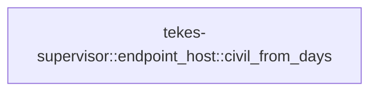

```mermaid
flowchart TD
  n0["endpoint::types::validate_session_id"]
  n1["profile::config::ConfigRepository::open"]
  n2["store::platform::NamedLock::try_exclusive"]
  n3["tekes-supervisor::endpoint_host::ProductionEndpointHost::draft_models"]
  n4["tekes-supervisor::endpoint_host::ProductionEndpointHost::models"]
  n5["tekes-supervisor::endpoint_host::ProductionEndpointHost::select_model"]
  n6["tekes-supervisor::endpoint_host::ProductionEndpointHost::cancel"]
  n7["tekes-supervisor::endpoint_host::ProductionEndpointHost::rename_session"]
  n8["tekes-supervisor::endpoint_host::ProductionEndpointHost::update_queue"]
  n9["tekes-supervisor::endpoint_host::ProductionEndpointHost::prompt"]
  n10["tekes-supervisor::endpoint_host::ProductionEndpointHost::attachment"]
  n11["tekes-supervisor::endpoint_host::ProductionEndpointHost::fork_session"]
  n12["tekes-supervisor::endpoint_host::ProductionEndpointHost::discard_session"]
  n13["tekes-supervisor::endpoint_host::ProductionEndpointHost::admission_gate"]
  n14["tekes-supervisor::endpoint_host::ProductionEndpointHost::ensure_active_session"]
  n15["tekes-supervisor::endpoint_host::ProductionEndpointHost::capabilities"]
  n16["tekes-supervisor::endpoint_host::ProductionEndpointHost::extension_capabilities"]
  n17["tekes-supervisor::endpoint_host::model_projection"]
  n18["tekes-supervisor::endpoint_host::model_is_configured"]
  n19["tekes-supervisor::endpoint_host::map_production_route_for"]
  n20["tekes-supervisor::endpoint_host::internal_failure"]
  n21["tekes-supervisor::endpoint_host::required_string"]
  n22["tekes-supervisor::endpoint_host::required_string_allow_whitespace"]
  n23["tekes-supervisor::endpoint_host::optional_bool"]
  n24["tekes-supervisor::endpoint_host::optional_string"]
  n25["tekes-supervisor::endpoint_host::require_object_fields"]
  n26["tekes-supervisor::endpoint_host::optional_u64"]
  n27["tekes-supervisor::endpoint_host::to_ijson"]
  n28["tekes-supervisor::endpoint_host::request_hash"]
  n29["tekes-supervisor::endpoint_host::mark_management_handoff"]
  n30["tekes-supervisor::endpoint_host::mark_event_handoff"]
  n31["tekes-supervisor::endpoint_host::endpoint_origin"]
  n32["tekes-supervisor::endpoint_host::validate_session_title"]
  n33["tekes-supervisor::endpoint_host::queue_action"]
  n34["tekes-supervisor::endpoint_host::queue_decision"]
  n35["tekes-supervisor::endpoint_host::map_persisted_queue_rejection"]
  n36["tekes-supervisor::endpoint_host::validate_time_zone"]
  n37["tekes-supervisor::endpoint_host::invalid"]
  n38["tekes-supervisor::endpoint_host::map_endpoint"]
  n39["tekes-supervisor::endpoint_host::EndpointRpcFailure::new"]
  n40["tekes-supervisor::endpoint_host::ProductionEndpointHost::create_workspace"]
  n41["tekes-supervisor::endpoint_host::ProductionEndpointHost::rename_workspace"]
  n42["tekes-supervisor::endpoint_host::ProductionEndpointHost::relocate_workspace"]
  n43["tekes-supervisor::endpoint_host::ProductionEndpointHost::archive_session"]
  n44["tekes-supervisor::endpoint_host::ProductionEndpointHost::unarchive_session"]
  n45["tekes-supervisor::endpoint_host::ProductionEndpointHost::create_session"]
  n46["tekes-supervisor::process_host::workspace_quiescence_lock_path"]
  n47["tools::guidance::IdentityProfile::parse"]
  n3 --> n1
  n3 --> n17
  n3 --> n19
  n3 --> n20
  n3 --> n25
  n4 --> n17
  n4 --> n19
  n4 --> n21
  n4 --> n25
  n4 --> n38
  n4 --> n39
  n5 --> n13
  n5 --> n18
  n5 --> n19
  n5 --> n20
  n5 --> n21
  n5 --> n24
  n5 --> n25
  n5 --> n27
  n5 --> n28
  n5 --> n29
  n5 --> n38
  n5 --> n39
  n6 --> n13
  n6 --> n19
  n6 --> n20
  n6 --> n21
  n6 --> n25
  n6 --> n27
  n6 --> n30
  n6 --> n31
  n6 --> n39
  n7 --> n13
  n7 --> n19
  n7 --> n20
  n7 --> n21
  n7 --> n22
  n7 --> n25
  n7 --> n27
  n7 --> n30
  n7 --> n31
  n7 --> n32
  n7 --> n39
  n8 --> n13
  n8 --> n19
  n8 --> n20
  n8 --> n21
  n8 --> n25
  n8 --> n27
  n8 --> n28
  n8 --> n29
  n8 --> n31
  n8 --> n33
  n8 --> n34
  n8 --> n35
  n8 --> n37
  n8 --> n39
  n9 --> n19
  n9 --> n21
  n9 --> n24
  n9 --> n25
  n9 --> n27
  n9 --> n30
  n9 --> n31
  n9 --> n36
  n9 --> n37
  n9 --> n39
  n10 --> n14
  n10 --> n21
  n10 --> n25
  n10 --> n27
  n11 --> n21
  n11 --> n23
  n11 --> n25
  n11 --> n26
  n11 --> n27
  n11 --> n28
  n11 --> n29
  n12 --> n19
  n12 --> n21
  n12 --> n25
  n12 --> n27
  n12 --> n28
  n12 --> n29
  n14 --> n0
  n14 --> n37
  n14 --> n39
  n40 --> n21
  n40 --> n25
  n40 --> n27
  n40 --> n28
  n40 --> n29
  n41 --> n21
  n41 --> n22
  n41 --> n25
  n41 --> n27
  n41 --> n28
  n41 --> n29
  n42 --> n2
  n42 --> n20
  n42 --> n21
  n42 --> n25
  n42 --> n27
  n42 --> n28
  n42 --> n29
  n42 --> n39
  n42 --> n46
  n43 --> n19
  n43 --> n21
  n43 --> n25
  n43 --> n27
  n43 --> n28
  n43 --> n29
  n44 --> n21
  n44 --> n25
  n44 --> n27
  n44 --> n28
  n44 --> n29
  n45 --> n24
  n45 --> n25
  n45 --> n27
  n45 --> n28
  n45 --> n29
  n45 --> n37
  n45 --> n39
  n45 --> n47
```

```mermaid
flowchart TD
  n0["endpoint::host::EndpointDispatcher::new"]
  n1["endpoint::idempotency::RpcRegistry::open"]
  n2["provider::dialect::resolve_profile"]
  n3["tekes-supervisor::endpoint_host::ProductionEndpointHost::method_class"]
  n4["tekes-supervisor::endpoint_host::ProductionEndpointHost::validate_request"]
  n5["tekes-supervisor::endpoint_host::ProductionEndpointHost::call"]
  n6["tekes-supervisor::endpoint_host::ProductionEndpointAssembly::open"]
  n7["tekes-supervisor::endpoint_host::ProductionEndpointAssembly::open_with_clock"]
  n8["tekes-supervisor::endpoint_host::ProductionEndpointAssembly::open_with_routes"]
  n9["tekes-supervisor::endpoint_host::ProductionEndpointAssembly::open_with_route_authority"]
  n10["tekes-supervisor::endpoint_host::ProductionEndpointAssembly::open_with_authorities"]
  n11["tekes-supervisor::endpoint_host::ProductionEndpointAssembly::open_with_full_authorities"]
  n12["tekes-supervisor::endpoint_host::ProductionEndpointAssembly::dispatch"]
  n13["tekes-supervisor::endpoint_host::ProductionEndpointAssembly::hub"]
  n14["tekes-supervisor::endpoint_host::ProductionEndpointAssembly::host"]
  n15["tekes-supervisor::endpoint_host::ProductionEndpointAssembly::admission_gates"]
  n16["tekes-supervisor::endpoint_host::ProductionEndpointAssembly::has_incomplete_management_operation"]
  n17["tekes-supervisor::endpoint_host::success"]
  n18["tekes-supervisor::endpoint_host::model_projection"]
  n19["tekes-supervisor::endpoint_host::model_is_configured"]
  n20["tekes-supervisor::endpoint_host::runtime_failure_name"]
  n21["tekes-supervisor::endpoint_host::map_production_route"]
  n22["tekes-supervisor::endpoint_host::map_production_route_for"]
  n23["tekes-supervisor::endpoint_host::sanitized_route_log_message"]
  n24["tekes-supervisor::endpoint_host::production_failure_is_exact_for"]
  n25["tekes-supervisor::endpoint_host::internal_failure"]
  n26["tekes-supervisor::endpoint_host::to_ijson"]
  n27["tekes-supervisor::endpoint_host::validate_production_payload"]
  n28["tekes-supervisor::endpoint_host::ProductionEndpointHost::open"]
  n29["tekes-supervisor::endpoint_host::ProductionEndpointHost::open_with_clock"]
  n30["tekes-supervisor::endpoint_host::ProductionEndpointHost::open_with_routes"]
  n31["tekes-supervisor::endpoint_host::ProductionEndpointHost::open_with_full_authorities"]
  n32["tekes-supervisor::endpoint_host::ProductionEndpointHost::open_with_route_authority"]
  n4 --> n27
  n6 --> n0
  n6 --> n1
  n6 --> n28
  n7 --> n0
  n7 --> n1
  n7 --> n29
  n8 --> n0
  n8 --> n1
  n8 --> n30
  n9 --> n0
  n9 --> n1
  n9 --> n32
  n10 --> n11
  n11 --> n0
  n11 --> n1
  n11 --> n31
  n18 --> n2
  n18 --> n19
  n18 --> n25
  n18 --> n26
  n19 --> n2
  n22 --> n21
  n22 --> n23
  n22 --> n24
  n22 --> n25
```

```mermaid
flowchart TD
  n0["schema::ijson::IJsonValue::parse"]
  n1["tekes-supervisor::endpoint_host::sanitized_route_log_message"]
  n2["tekes-supervisor::endpoint_host::production_failure_is_exact_for"]
  n3["tekes-supervisor::endpoint_host::route_error_is_exact"]
  n4["tekes-supervisor::endpoint_host::route_error_message"]
  n5["tekes-supervisor::endpoint_host::exact_string_fields"]
  n6["tekes-supervisor::endpoint_host::route_allows_error"]
  n7["tekes-supervisor::endpoint_host::internal_failure"]
  n8["tekes-supervisor::endpoint_host::failure"]
  n9["tekes-supervisor::endpoint_host::required_string"]
  n10["tekes-supervisor::endpoint_host::required_string_allow_whitespace"]
  n11["tekes-supervisor::endpoint_host::optional_bool"]
  n12["tekes-supervisor::endpoint_host::optional_string"]
  n13["tekes-supervisor::endpoint_host::require_object_fields"]
  n14["tekes-supervisor::endpoint_host::optional_u64"]
  n15["tekes-supervisor::endpoint_host::to_ijson"]
  n16["tekes-supervisor::endpoint_host::request_hash"]
  n17["tekes-supervisor::endpoint_host::mark_management_handoff"]
  n18["tekes-supervisor::endpoint_host::mark_event_handoff"]
  n19["tekes-supervisor::endpoint_host::endpoint_origin"]
  n20["tekes-supervisor::endpoint_host::validate_session_title"]
  n21["tekes-supervisor::endpoint_host::invalid"]
  n22["tekes-supervisor::endpoint_host::EndpointRpcFailure::new"]
  n1 --> n0
  n2 --> n3
  n2 --> n6
  n3 --> n4
  n3 --> n5
  n7 --> n22
  n9 --> n21
  n10 --> n21
  n11 --> n21
  n12 --> n21
  n13 --> n21
  n14 --> n21
  n15 --> n0
  n16 --> n22
  n17 --> n22
  n18 --> n7
```

```mermaid
flowchart TD
  n0["schema::ijson::IJsonValue::parse"]
  n1["schema::ijson::IJsonValue::parse_str"]
  n2["tekes-supervisor::endpoint_host::internal_failure"]
  n3["tekes-supervisor::endpoint_host::require_object_fields"]
  n4["tekes-supervisor::endpoint_host::PendingQueueAction::with_origin"]
  n5["tekes-supervisor::endpoint_host::queue_action"]
  n6["tekes-supervisor::endpoint_host::map_queue_rejection"]
  n7["tekes-supervisor::endpoint_host::queue_decision"]
  n8["tekes-supervisor::endpoint_host::map_persisted_queue_rejection"]
  n9["tekes-supervisor::endpoint_host::validate_time_zone"]
  n10["tekes-supervisor::endpoint_host::map_prompt_error"]
  n11["tekes-supervisor::endpoint_host::map_attachment_read_error"]
  n12["tekes-supervisor::endpoint_host::attachment_failure"]
  n13["tekes-supervisor::endpoint_host::attachment_reason"]
  n14["tekes-supervisor::endpoint_host::validate_extension_payload"]
  n15["tekes-supervisor::endpoint_host::validate_production_payload"]
  n16["tekes-supervisor::endpoint_host::invalid"]
  n17["tekes-supervisor::endpoint_host::map_endpoint"]
  n18["tekes-supervisor::endpoint_host::map_management"]
  n19["tekes-supervisor::endpoint_host::internal_json"]
  n20["tekes-supervisor::endpoint_host::internal_schema"]
  n21["tekes-supervisor::endpoint_host::internal_assembly"]
  n22["tekes-supervisor::endpoint_host::EndpointRpcFailure::new"]
  n23["tekes-supervisor::endpoint_host::system_timestamp"]
  n24["tekes-supervisor::endpoint_host::civil_from_days"]
  n5 --> n16
  n5 --> n22
  n6 --> n22
  n8 --> n2
  n8 --> n6
  n9 --> n16
  n10 --> n2
  n10 --> n12
  n10 --> n16
  n10 --> n22
  n11 --> n2
  n11 --> n12
  n11 --> n22
  n12 --> n22
  n14 --> n3
  n14 --> n22
  n15 --> n3
  n15 --> n14
  n16 --> n22
  n17 --> n22
  n18 --> n22
  n19 --> n22
  n20 --> n22
  n21 --> n22
  n22 --> n0
  n22 --> n1
  n23 --> n24
```

# tekes-supervisor::endpoint_host

[Package atlas](index.md) · [Source](../../src/endpoint_host.rs)

## Declarations

Visibility is the declaration spelling; trait members and reexports require their enclosing interface. `cfg` is not evaluated.

| Symbol | Kind | Visibility | Test / cfg |
|---|---|---|---|
| [tekes-supervisor::endpoint_host::EndpointRouteClass](../../src/endpoint_host.rs#L29) | enum_item | `pub` |  |
| [tekes-supervisor::endpoint_host::EndpointRoute](../../src/endpoint_host.rs#L37) | struct_item | `pub` |  |
| [tekes-supervisor::endpoint_host::TEKES_UNARY_ROUTES](../../src/endpoint_host.rs#L43) | const_item | `pub` |  |
| [tekes-supervisor::endpoint_host::route](../../src/endpoint_host.rs#L70) | function_item | `private` |  |
| [tekes-supervisor::endpoint_host::EndpointClock](../../src/endpoint_host.rs#L78) | type_item | `pub` |  |
| [tekes-supervisor::endpoint_host::RuntimeModelReadiness](../../src/endpoint_host.rs#L81) | struct_item | `pub` |  |
| [tekes-supervisor::endpoint_host::RuntimeProviderStatus](../../src/endpoint_host.rs#L88) | enum_item | `pub` |  |
| [tekes-supervisor::endpoint_host::RuntimeProviderFailure](../../src/endpoint_host.rs#L94) | enum_item | `pub` |  |
| [tekes-supervisor::endpoint_host::RuntimeProviderReadiness](../../src/endpoint_host.rs#L102) | struct_item | `pub` |  |
| [tekes-supervisor::endpoint_host::ProviderReadinessAuthority](../../src/endpoint_host.rs#L111) | trait_item | `pub` |  |
| [tekes-supervisor::endpoint_host::ProviderReadinessAuthority::readiness](../../src/endpoint_host.rs#L112) | function_signature_item | `private` |  |
| [tekes-supervisor::endpoint_host::ProviderReadinessAuthority::config_mutation_succeeded](../../src/endpoint_host.rs#L121) | function_item | `private` |  |
| [tekes-supervisor::endpoint_host::SessionDeliveryAuthority](../../src/endpoint_host.rs#L130) | trait_item | `pub` |  |
| [tekes-supervisor::endpoint_host::SessionDeliveryAuthority::session_metadata_changed](../../src/endpoint_host.rs#L134) | function_item | `private` |  |
| [tekes-supervisor::endpoint_host::SessionDeliveryAuthority::prompt](../../src/endpoint_host.rs#L136) | function_signature_item | `private` |  |
| [tekes-supervisor::endpoint_host::SessionDeliveryAuthority::cancel](../../src/endpoint_host.rs#L145) | function_signature_item | `private` |  |
| [tekes-supervisor::endpoint_host::SessionDeliveryAuthority::rename](../../src/endpoint_host.rs#L152) | function_signature_item | `private` |  |
| [tekes-supervisor::endpoint_host::SessionDeliveryAuthority::compact](../../src/endpoint_host.rs#L166) | function_item | `private` |  |
| [tekes-supervisor::endpoint_host::QueueTransactionAuthority](../../src/endpoint_host.rs#L183) | trait_item | `pub` |  |
| [tekes-supervisor::endpoint_host::QueueTransactionAuthority::execute](../../src/endpoint_host.rs#L184) | function_signature_item | `private` |  |
| [tekes-supervisor::endpoint_host::recover_pending_management](../../src/endpoint_host.rs#L197) | function_item | `pub(crate)` |  |
| [tekes-supervisor::endpoint_host::QueueRecoveryAdapter](../../src/endpoint_host.rs#L213) | struct_item | `private` |  |
| [tekes-supervisor::endpoint_host::QueueRecoveryAdapter::execute](../../src/endpoint_host.rs#L218) | function_item | `private` |  |
| [tekes-supervisor::endpoint_host::SessionAdmissionGates](../../src/endpoint_host.rs#L255) | struct_item | `pub` |  |
| [tekes-supervisor::endpoint_host::SessionAdmissionGates::gate](../../src/endpoint_host.rs#L260) | function_item | `pub` |  |
| [tekes-supervisor::endpoint_host::SessionInputAdmissionAuthority](../../src/endpoint_host.rs#L279) | struct_item | `pub` |  |
| [tekes-supervisor::endpoint_host::SessionInputAdmissionAuthority::new](../../src/endpoint_host.rs#L286) | function_item | `pub` |  |
| [tekes-supervisor::endpoint_host::SessionInputAdmissionAuthority::gates](../../src/endpoint_host.rs#L294) | function_item | `pub` |  |
| [tekes-supervisor::endpoint_host::SessionInputAdmissionAuthority::root](../../src/endpoint_host.rs#L300) | function_item | `pub` |  |
| [tekes-supervisor::endpoint_host::SessionInputAdmissionAuthority::with_active_session](../../src/endpoint_host.rs#L304) | function_item | `pub` |  |
| [tekes-supervisor::endpoint_host::SessionInputAdmissionAuthority::with_session_gate](../../src/endpoint_host.rs#L329) | function_item | `pub` |  |
| [tekes-supervisor::endpoint_host::session_details](../../src/endpoint_host.rs#L354) | function_item | `private` |  |
| [tekes-supervisor::endpoint_host::ProductionEndpointRoutes](../../src/endpoint_host.rs#L364) | trait_item | `pub` |  |
| [tekes-supervisor::endpoint_host::ProductionEndpointRoutes::capabilities](../../src/endpoint_host.rs#L365) | function_signature_item | `private` |  |
| [tekes-supervisor::endpoint_host::ProductionEndpointRoutes::extension_method_class](../../src/endpoint_host.rs#L370) | function_item | `private` |  |
| [tekes-supervisor::endpoint_host::ProductionEndpointRoutes::validate_extension_payload](../../src/endpoint_host.rs#L376) | function_item | `private` |  |
| [tekes-supervisor::endpoint_host::ProductionEndpointRoutes::extension_failure_is_exact](../../src/endpoint_host.rs#L391) | function_item | `private` |  |
| [tekes-supervisor::endpoint_host::ProductionEndpointRoutes::execute](../../src/endpoint_host.rs#L399) | function_signature_item | `private` |  |
| [tekes-supervisor::endpoint_host::CompositeProductionEndpointRoutes](../../src/endpoint_host.rs#L410) | struct_item | `pub` |  |
| [tekes-supervisor::endpoint_host::CompositeProductionEndpointRoutes::compose](../../src/endpoint_host.rs#L415) | function_item | `pub` |  |
| [tekes-supervisor::endpoint_host::CompositeProductionEndpointRoutes::owner](../../src/endpoint_host.rs#L443) | function_item | `private` |  |
| [tekes-supervisor::endpoint_host::CompositeProductionEndpointRoutes::capabilities](../../src/endpoint_host.rs#L449) | function_item | `private` |  |
| [tekes-supervisor::endpoint_host::CompositeProductionEndpointRoutes::extension_method_class](../../src/endpoint_host.rs#L453) | function_item | `private` |  |
| [tekes-supervisor::endpoint_host::CompositeProductionEndpointRoutes::validate_extension_payload](../../src/endpoint_host.rs#L457) | function_item | `private` |  |
| [tekes-supervisor::endpoint_host::CompositeProductionEndpointRoutes::extension_failure_is_exact](../../src/endpoint_host.rs#L467) | function_item | `private` |  |
| [tekes-supervisor::endpoint_host::CompositeProductionEndpointRoutes::execute](../../src/endpoint_host.rs#L476) | function_item | `private` |  |
| [tekes-supervisor::endpoint_host::ProductionRouteCompositionError](../../src/endpoint_host.rs#L489) | enum_item | `pub` |  |
| [tekes-supervisor::endpoint_host::unsupported_route](../../src/endpoint_host.rs#L496) | function_item | `private` |  |
| [tekes-supervisor::endpoint_host::ProductionRouteFailure](../../src/endpoint_host.rs#L506) | struct_item | `pub` |  |
| [tekes-supervisor::endpoint_host::ProductionRouteFailure::new](../../src/endpoint_host.rs#L513) | function_item | `pub` |  |
| [tekes-supervisor::endpoint_host::ProductionEndpointHost](../../src/endpoint_host.rs#L522) | struct_item | `pub` |  |
| [tekes-supervisor::endpoint_host::ProductionEndpointHost::mux_description](../../src/endpoint_host.rs#L540) | function_item | `pub` |  |
| [tekes-supervisor::endpoint_host::ProductionEndpointHost::open](../../src/endpoint_host.rs#L565) | function_item | `pub` |  |
| [tekes-supervisor::endpoint_host::ProductionEndpointHost::open_with_clock](../../src/endpoint_host.rs#L580) | function_item | `pub` |  |
| [tekes-supervisor::endpoint_host::ProductionEndpointHost::open_with_routes](../../src/endpoint_host.rs#L589) | function_item | `pub` |  |
| [tekes-supervisor::endpoint_host::ProductionEndpointHost::open_with_authorities](../../src/endpoint_host.rs#L598) | function_item | `pub` |  |
| [tekes-supervisor::endpoint_host::ProductionEndpointHost::open_with_full_authorities](../../src/endpoint_host.rs#L616) | function_item | `pub` |  |
| [tekes-supervisor::endpoint_host::ProductionEndpointHost::open_with_full_authorities_and_session_admission](../../src/endpoint_host.rs#L639) | function_item | `pub` |  |
| [tekes-supervisor::endpoint_host::ProductionEndpointHost::open_with_route_authority](../../src/endpoint_host.rs#L665) | function_item | `pub` |  |
| [tekes-supervisor::endpoint_host::ProductionEndpointHost::open_with_route_ownership](../../src/endpoint_host.rs#L688) | function_item | `private` |  |
| [tekes-supervisor::endpoint_host::ProductionEndpointHost::implemented_capabilities](../../src/endpoint_host.rs#L756) | function_item | `pub` |  |
| [tekes-supervisor::endpoint_host::ProductionEndpointHost::admission_gates](../../src/endpoint_host.rs#L765) | function_item | `pub` |  |
| [tekes-supervisor::endpoint_host::ProductionEndpointHost::has_incomplete_management_operation](../../src/endpoint_host.rs#L769) | function_item | `pub` |  |
| [tekes-supervisor::endpoint_host::ProductionEndpointHost::execute](../../src/endpoint_host.rs#L778) | function_item | `private` |  |
| [tekes-supervisor::endpoint_host::ProductionEndpointHost::execute_inner](../../src/endpoint_host.rs#L786) | function_item | `private` |  |
| [tekes-supervisor::endpoint_host::ProductionEndpointHost::execute_extension](../../src/endpoint_host.rs#L817) | function_item | `private` |  |
| [tekes-supervisor::endpoint_host::ProductionEndpointHost::create_workspace](../../src/endpoint_host.rs#L866) | function_item | `private` |  |
| [tekes-supervisor::endpoint_host::ProductionEndpointHost::rename_workspace](../../src/endpoint_host.rs#L883) | function_item | `private` |  |
| [tekes-supervisor::endpoint_host::ProductionEndpointHost::relocate_workspace](../../src/endpoint_host.rs#L905) | function_item | `private` |  |
| [tekes-supervisor::endpoint_host::ProductionEndpointHost::archive_session](../../src/endpoint_host.rs#L948) | function_item | `private` |  |
| [tekes-supervisor::endpoint_host::ProductionEndpointHost::unarchive_session](../../src/endpoint_host.rs#L971) | function_item | `private` |  |
| [tekes-supervisor::endpoint_host::ProductionEndpointHost::create_session](../../src/endpoint_host.rs#L988) | function_item | `private` |  |
| [tekes-supervisor::endpoint_host::ProductionEndpointHost::draft_models](../../src/endpoint_host.rs#L1040) | function_item | `private` |  |
| [tekes-supervisor::endpoint_host::ProductionEndpointHost::models](../../src/endpoint_host.rs#L1081) | function_item | `private` |  |
| [tekes-supervisor::endpoint_host::ProductionEndpointHost::select_model](../../src/endpoint_host.rs#L1101) | function_item | `private` |  |
| [tekes-supervisor::endpoint_host::ProductionEndpointHost::cancel](../../src/endpoint_host.rs#L1160) | function_item | `private` |  |
| [tekes-supervisor::endpoint_host::ProductionEndpointHost::rename_session](../../src/endpoint_host.rs#L1190) | function_item | `private` |  |
| [tekes-supervisor::endpoint_host::ProductionEndpointHost::update_queue](../../src/endpoint_host.rs#L1228) | function_item | `private` |  |
| [tekes-supervisor::endpoint_host::ProductionEndpointHost::prompt](../../src/endpoint_host.rs#L1317) | function_item | `private` |  |
| [tekes-supervisor::endpoint_host::ProductionEndpointHost::attachment](../../src/endpoint_host.rs#L1374) | function_item | `private` |  |
| [tekes-supervisor::endpoint_host::ProductionEndpointHost::fork_session](../../src/endpoint_host.rs#L1390) | function_item | `private` |  |
| [tekes-supervisor::endpoint_host::ProductionEndpointHost::discard_session](../../src/endpoint_host.rs#L1424) | function_item | `private` |  |
| [tekes-supervisor::endpoint_host::ProductionEndpointHost::admission_gate](../../src/endpoint_host.rs#L1447) | function_item | `private` |  |
| [tekes-supervisor::endpoint_host::ProductionEndpointHost::ensure_active_session](../../src/endpoint_host.rs#L1454) | function_item | `private` |  |
| [tekes-supervisor::endpoint_host::ProductionEndpointHost::capabilities](../../src/endpoint_host.rs#L1475) | function_item | `private` |  |
| [tekes-supervisor::endpoint_host::ProductionEndpointHost::extension_capabilities](../../src/endpoint_host.rs#L1496) | function_item | `private` |  |
| [tekes-supervisor::endpoint_host::ProductionEndpointHost::method_class](../../src/endpoint_host.rs#L1506) | function_item | `private` |  |
| [tekes-supervisor::endpoint_host::ProductionEndpointHost::validate_request](../../src/endpoint_host.rs#L1522) | function_item | `private` |  |
| [tekes-supervisor::endpoint_host::ProductionEndpointHost::call](../../src/endpoint_host.rs#L1546) | function_item | `private` |  |
| [tekes-supervisor::endpoint_host::ProductionEndpointAssembly](../../src/endpoint_host.rs#L1551) | struct_item | `pub` |  |
| [tekes-supervisor::endpoint_host::ProductionEndpointAssembly::open](../../src/endpoint_host.rs#L1558) | function_item | `pub` |  |
| [tekes-supervisor::endpoint_host::ProductionEndpointAssembly::open_with_clock](../../src/endpoint_host.rs#L1570) | function_item | `pub` |  |
| [tekes-supervisor::endpoint_host::ProductionEndpointAssembly::open_with_routes](../../src/endpoint_host.rs#L1583) | function_item | `pub` |  |
| [tekes-supervisor::endpoint_host::ProductionEndpointAssembly::open_with_route_authority](../../src/endpoint_host.rs#L1597) | function_item | `pub` |  |
| [tekes-supervisor::endpoint_host::ProductionEndpointAssembly::open_with_authorities](../../src/endpoint_host.rs#L1619) | function_item | `pub` |  |
| [tekes-supervisor::endpoint_host::ProductionEndpointAssembly::open_with_full_authorities](../../src/endpoint_host.rs#L1637) | function_item | `pub` |  |
| [tekes-supervisor::endpoint_host::ProductionEndpointAssembly::dispatch](../../src/endpoint_host.rs#L1662) | function_item | `pub` |  |
| [tekes-supervisor::endpoint_host::ProductionEndpointAssembly::hub](../../src/endpoint_host.rs#L1670) | function_item | `pub` |  |
| [tekes-supervisor::endpoint_host::ProductionEndpointAssembly::host](../../src/endpoint_host.rs#L1675) | function_item | `pub` |  |
| [tekes-supervisor::endpoint_host::ProductionEndpointAssembly::admission_gates](../../src/endpoint_host.rs#L1680) | function_item | `pub` |  |
| [tekes-supervisor::endpoint_host::ProductionEndpointAssembly::has_incomplete_management_operation](../../src/endpoint_host.rs#L1684) | function_item | `pub` |  |
| [tekes-supervisor::endpoint_host::success](../../src/endpoint_host.rs#L1692) | function_item | `private` |  |
| [tekes-supervisor::endpoint_host::model_projection](../../src/endpoint_host.rs#L1700) | function_item | `private` |  |
| [tekes-supervisor::endpoint_host::model_is_configured](../../src/endpoint_host.rs#L1796) | function_item | `private` |  |
| [tekes-supervisor::endpoint_host::runtime_failure_name](../../src/endpoint_host.rs#L1827) | function_item | `private` |  |
| [tekes-supervisor::endpoint_host::map_production_route](../../src/endpoint_host.rs#L1836) | function_item | `private` |  |
| [tekes-supervisor::endpoint_host::map_production_route_for](../../src/endpoint_host.rs#L1844) | function_item | `private` |  |
| [tekes-supervisor::endpoint_host::sanitized_route_log_message](../../src/endpoint_host.rs#L1858) | function_item | `private` |  |
| [tekes-supervisor::endpoint_host::production_failure_is_exact_for](../../src/endpoint_host.rs#L1878) | function_item | `pub(crate)` |  |
| [tekes-supervisor::endpoint_host::route_error_is_exact](../../src/endpoint_host.rs#L1885) | function_item | `private` |  |
| [tekes-supervisor::endpoint_host::route_error_message](../../src/endpoint_host.rs#L1957) | function_item | `private` |  |
| [tekes-supervisor::endpoint_host::exact_string_fields](../../src/endpoint_host.rs#L1987) | function_item | `private` |  |
| [tekes-supervisor::endpoint_host::route_allows_error](../../src/endpoint_host.rs#L2008) | function_item | `private` |  |
| [tekes-supervisor::endpoint_host::internal_failure](../../src/endpoint_host.rs#L2112) | function_item | `private` |  |
| [tekes-supervisor::endpoint_host::failure](../../src/endpoint_host.rs#L2116) | function_item | `private` |  |
| [tekes-supervisor::endpoint_host::required_string](../../src/endpoint_host.rs#L2128) | function_item | `private` |  |
| [tekes-supervisor::endpoint_host::required_string_allow_whitespace](../../src/endpoint_host.rs#L2137) | function_item | `private` |  |
| [tekes-supervisor::endpoint_host::optional_bool](../../src/endpoint_host.rs#L2148) | function_item | `private` |  |
| [tekes-supervisor::endpoint_host::optional_string](../../src/endpoint_host.rs#L2158) | function_item | `private` |  |
| [tekes-supervisor::endpoint_host::require_object_fields](../../src/endpoint_host.rs#L2169) | function_item | `private` |  |
| [tekes-supervisor::endpoint_host::optional_u64](../../src/endpoint_host.rs#L2185) | function_item | `private` |  |
| [tekes-supervisor::endpoint_host::to_ijson](../../src/endpoint_host.rs#L2195) | function_item | `private` |  |
| [tekes-supervisor::endpoint_host::request_hash](../../src/endpoint_host.rs#L2199) | function_item | `private` |  |
| [tekes-supervisor::endpoint_host::mark_management_handoff](../../src/endpoint_host.rs#L2213) | function_item | `private` |  |
| [tekes-supervisor::endpoint_host::mark_event_handoff](../../src/endpoint_host.rs#L2227) | function_item | `private` |  |
| [tekes-supervisor::endpoint_host::endpoint_origin](../../src/endpoint_host.rs#L2241) | function_item | `private` |  |
| [tekes-supervisor::endpoint_host::validate_session_title](../../src/endpoint_host.rs#L2256) | function_item | `private` |  |
| [tekes-supervisor::endpoint_host::PendingQueueAction](../../src/endpoint_host.rs#L2267) | enum_item | `private` |  |
| [tekes-supervisor::endpoint_host::PendingQueueAction::with_origin](../../src/endpoint_host.rs#L2274) | function_item | `private` |  |
| [tekes-supervisor::endpoint_host::queue_action](../../src/endpoint_host.rs#L2290) | function_item | `private` |  |
| [tekes-supervisor::endpoint_host::map_queue_rejection](../../src/endpoint_host.rs#L2340) | function_item | `private` |  |
| [tekes-supervisor::endpoint_host::queue_decision](../../src/endpoint_host.rs#L2364) | function_item | `private` |  |
| [tekes-supervisor::endpoint_host::map_persisted_queue_rejection](../../src/endpoint_host.rs#L2389) | function_item | `private` |  |
| [tekes-supervisor::endpoint_host::validate_time_zone](../../src/endpoint_host.rs#L2403) | function_item | `private` |  |
| [tekes-supervisor::endpoint_host::map_prompt_error](../../src/endpoint_host.rs#L2429) | function_item | `private` |  |
| [tekes-supervisor::endpoint_host::map_attachment_read_error](../../src/endpoint_host.rs#L2449) | function_item | `private` |  |
| [tekes-supervisor::endpoint_host::attachment_failure](../../src/endpoint_host.rs#L2466) | function_item | `private` |  |
| [tekes-supervisor::endpoint_host::attachment_reason](../../src/endpoint_host.rs#L2474) | function_item | `private` |  |
| [tekes-supervisor::endpoint_host::validate_extension_payload](../../src/endpoint_host.rs#L2489) | function_item | `private` |  |
| [tekes-supervisor::endpoint_host::validate_production_payload](../../src/endpoint_host.rs#L2537) | function_item | `private` |  |
| [tekes-supervisor::endpoint_host::invalid](../../src/endpoint_host.rs#L2554) | function_item | `private` |  |
| [tekes-supervisor::endpoint_host::map_endpoint](../../src/endpoint_host.rs#L2558) | function_item | `private` |  |
| [tekes-supervisor::endpoint_host::map_management](../../src/endpoint_host.rs#L2575) | function_item | `private` |  |
| [tekes-supervisor::endpoint_host::internal_json](../../src/endpoint_host.rs#L2673) | function_item | `private` |  |
| [tekes-supervisor::endpoint_host::internal_schema](../../src/endpoint_host.rs#L2677) | function_item | `private` |  |
| [tekes-supervisor::endpoint_host::internal_assembly](../../src/endpoint_host.rs#L2681) | function_item | `private` |  |
| [tekes-supervisor::endpoint_host::EndpointRpcFailure](../../src/endpoint_host.rs#L2685) | struct_item | `private` |  |
| [tekes-supervisor::endpoint_host::EndpointRpcFailure::new](../../src/endpoint_host.rs#L2692) | function_item | `private` |  |
| [tekes-supervisor::endpoint_host::system_timestamp](../../src/endpoint_host.rs#L2704) | function_item | `private` |  |
| [tekes-supervisor::endpoint_host::civil_from_days](../../src/endpoint_host.rs#L2721) | function_item | `private` |  |
| [tekes-supervisor::endpoint_host::EndpointAssemblyError](../../src/endpoint_host.rs#L2737) | enum_item | `pub` |  |

## Imports / reexports

| Local name | Source path | Visibility |
|---|---|---|
| `BTreeSet` | `std::collections::BTreeSet` | `private` |
| `HashMap` | `std::collections::HashMap` | `private` |
| `Path` | `std::path::Path` | `private` |
| `PathBuf` | `std::path::PathBuf` | `private` |
| `Arc` | `std::sync::Arc` | `private` |
| `Mutex` | `std::sync::Mutex` | `private` |
| `SystemTime` | `std::time::SystemTime` | `private` |
| `UNIX_EPOCH` | `std::time::UNIX_EPOCH` | `private` |
| `AttachmentAuthority` | `endpoint::AttachmentAuthority` | `private` |
| `AttachmentErrorReason` | `endpoint::AttachmentErrorReason` | `private` |
| `AttachmentReadError` | `endpoint::AttachmentReadError` | `private` |
| `ClientRequest` | `endpoint::ClientRequest` | `private` |
| `DurableHandoffProof` | `endpoint::DurableHandoffProof` | `private` |
| `EndpointDispatcher` | `endpoint::EndpointDispatcher` | `private` |
| `EndpointHost` | `endpoint::EndpointHost` | `private` |
| `EndpointHostCall` | `endpoint::EndpointHostCall` | `private` |
| `EndpointHostFuture` | `endpoint::EndpointHostFuture` | `private` |
| `EndpointSubscriptionHub` | `endpoint::EndpointSubscriptionHub` | `private` |
| `ForkSessionOperation` | `endpoint::ForkSessionOperation` | `private` |
| `HostFailure` | `endpoint::HostFailure` | `private` |
| `ManagementError` | `endpoint::ManagementError` | `private` |
| `ManagementStore` | `endpoint::ManagementStore` | `private` |
| `MaterializedPrompt` | `endpoint::MaterializedPrompt` | `private` |
| `NativeEndpoint` | `endpoint::NativeEndpoint` | `private` |
| `NativeEndpointError` | `endpoint::NativeEndpointError` | `private` |
| `PendingQueueTransaction` | `endpoint::PendingQueueTransaction` | `private` |
| `PromptMaterializeError` | `endpoint::PromptMaterializeError` | `private` |
| `PromptPart` | `endpoint::PromptPart` | `private` |
| `QueueRecoveryDriver` | `endpoint::QueueRecoveryDriver` | `private` |
| `QueueTransactionCompletion` | `endpoint::QueueTransactionCompletion` | `private` |
| `QueueTransactionDecision` | `endpoint::QueueTransactionDecision` | `private` |
| `QueueTransactionOperation` | `endpoint::QueueTransactionOperation` | `private` |
| `QueueTransactionState` | `endpoint::QueueTransactionState` | `private` |
| `RpcDurableIdentity` | `endpoint::RpcDurableIdentity` | `private` |
| `RpcError` | `endpoint::RpcError` | `private` |
| `RpcRegistry` | `endpoint::RpcRegistry` | `private` |
| `RpcResult` | `endpoint::RpcResult` | `private` |
| `SelectModelOperation` | `endpoint::SelectModelOperation` | `private` |
| `ServerResponse` | `endpoint::ServerResponse` | `private` |
| `SessionCreateOperation` | `endpoint::SessionCreateOperation` | `private` |
| `SessionHostDescription` | `endpoint::SessionHostDescription` | `private` |
| `IJsonValue` | `schema::IJsonValue` | `private` |
| `OriginTuple` | `schema::OriginTuple` | `private` |
| `Value` | `serde_json::Value` | `private` |
| `json` | `serde_json::json` | `private` |
| `Digest` | `sha2::Digest` | `private` |
| `Sha256` | `sha2::Sha256` | `private` |
| `Error` | `thiserror::Error` | `private` |

## Module declarations

| Module | Visibility | Attributes |
|---|---|---|

## Function call graphs

Edges below are syntactically resolved calls only, including private functions. Graphs partition callers into groups of 20; they are not execution order. All unresolved sites are listed below and in the JSON inventory.

Functions 1–20: 16 direct edges

Functions 21–40: 41 direct edges

Functions 41–60: 126 direct edges

Functions 61–80: 26 direct edges

Functions 81–100: 16 direct edges

Functions 101–120: 27 direct edges

Functions 121–121: 0 direct edges

## Call sites

Includes test functions (marked in declarations). Receiver-type-required sites need type analysis/manual tracing. Calls in closures are attributed to their enclosing function; their occurrence here does not mean the closure executes immediately.

| Caller | Callee expression | Source lines | Target / classification |
|---|---|---|---|
| `TEKES_UNARY_ROUTES` | `route` | [44](../../src/endpoint_host.rs#L44), [45](../../src/endpoint_host.rs#L45), [46](../../src/endpoint_host.rs#L46), [47](../../src/endpoint_host.rs#L47), [52](../../src/endpoint_host.rs#L52), [57](../../src/endpoint_host.rs#L57), [58](../../src/endpoint_host.rs#L58), [59](../../src/endpoint_host.rs#L59), [60](../../src/endpoint_host.rs#L60), [61](../../src/endpoint_host.rs#L61), [62](../../src/endpoint_host.rs#L62), [63](../../src/endpoint_host.rs#L63), [64](../../src/endpoint_host.rs#L64), [65](../../src/endpoint_host.rs#L65), [66](../../src/endpoint_host.rs#L66), [67](../../src/endpoint_host.rs#L67) | [tekes-supervisor::endpoint_host::route](../../src/endpoint_host.rs#L70) |
| `config_mutation_succeeded` | `Ok` | [122](../../src/endpoint_host.rs#L122) | external-constructor-callback-or-unresolved |
| `compact` | `Err` | [173](../../src/endpoint_host.rs#L173) | external-constructor-callback-or-unresolved |
| `compact` | `ProductionRouteFailure::new` | [173](../../src/endpoint_host.rs#L173) | [tekes-supervisor::endpoint_host::ProductionRouteFailure::new](../../src/endpoint_host.rs#L513) |
| `compact` | `IJsonValue::parse_str(r#"{"operation":"compact"}"#).expect` | [176](../../src/endpoint_host.rs#L176) | receiver-type-required |
| `compact` | `IJsonValue::parse_str` | [176](../../src/endpoint_host.rs#L176) | [schema::ijson::IJsonValue::parse_str](../../../schema/src/ijson.rs#L23) |
| `recover_pending_management` | `crate::host_runtime::system_timestamp()         .map_err` | [202](../../src/endpoint_host.rs#L202) | receiver-type-required |
| `recover_pending_management` | `crate::host_runtime::system_timestamp` | [202](../../src/endpoint_host.rs#L202) | [tekes-supervisor::host_runtime::system_timestamp](../../src/host_runtime.rs#L495) |
| `recover_pending_management` | `ManagementError::QueueRecoveryFailed` | [203](../../src/endpoint_host.rs#L203) | external-constructor-callback-or-unresolved |
| `recover_pending_management` | `error.to_string` | [203](../../src/endpoint_host.rs#L203) | receiver-type-required |
| `recover_pending_management` | `ManagementStore::open_recovering_again(         root,         &started_at,         Some(&QueueRecoveryAdapter { authority }),         validated,     )     .map` | [204](../../src/endpoint_host.rs#L204) | receiver-type-required |
| `recover_pending_management` | `ManagementStore::open_recovering_again` | [204](../../src/endpoint_host.rs#L204) | [endpoint::management::ManagementStore::open_recovering_again](../../../endpoint/src/management.rs#L375) |
| `recover_pending_management` | `Some` | [207](../../src/endpoint_host.rs#L207) | external-constructor-callback-or-unresolved |
| `execute` | `serde_json::from_slice(&pending.action.canonical_bytes()?)             .map_err` | [222](../../src/endpoint_host.rs#L222) | receiver-type-required |
| `execute` | `serde_json::from_slice` | [222](../../src/endpoint_host.rs#L222) | external-constructor-callback-or-unresolved |
| `execute` | `pending.action.canonical_bytes` | [222](../../src/endpoint_host.rs#L222) | receiver-type-required |
| `execute` | `pending.rpc_id.clone` | [225](../../src/endpoint_host.rs#L225), [226](../../src/endpoint_host.rs#L226) | receiver-type-required |
| `execute` | `pending.retract_origin.clone` | [228](../../src/endpoint_host.rs#L228) | receiver-type-required |
| `execute` | `transaction.validate().map_err` | [231](../../src/endpoint_host.rs#L231) | receiver-type-required |
| `execute` | `transaction.validate` | [231](../../src/endpoint_host.rs#L231) | receiver-type-required |
| `execute` | `ManagementError::QueueRecoveryFailed` | [232](../../src/endpoint_host.rs#L232), [237](../../src/endpoint_host.rs#L237), [244](../../src/endpoint_host.rs#L244), [246](../../src/endpoint_host.rs#L246) | external-constructor-callback-or-unresolved |
| `execute` | `transaction.replacement_origin` | [236](../../src/endpoint_host.rs#L236) | receiver-type-required |
| `execute` | `pending.replacement_origin.as_ref` | [236](../../src/endpoint_host.rs#L236) | receiver-type-required |
| `execute` | `Err` | [237](../../src/endpoint_host.rs#L237) | external-constructor-callback-or-unresolved |
| `execute` | `"prepared replacement origin disagrees with action".to_owned` | [238](../../src/endpoint_host.rs#L238) | receiver-type-required |
| `execute` | `self             .authority             .execute(&pending.session_id, &transaction)             .map_err` | [241](../../src/endpoint_host.rs#L241) | receiver-type-required |
| `execute` | `self             .authority             .execute` | [241](../../src/endpoint_host.rs#L241) | receiver-type-required |
| `execute` | `result.validate_for(&transaction).map_err` | [245](../../src/endpoint_host.rs#L245) | receiver-type-required |
| `execute` | `result.validate_for` | [245](../../src/endpoint_host.rs#L245) | receiver-type-required |
| `execute` | `Ok` | [250](../../src/endpoint_host.rs#L250) | external-constructor-callback-or-unresolved |
| `execute` | `queue_decision` | [250](../../src/endpoint_host.rs#L250) | [tekes-supervisor::endpoint_host::queue_decision](../../src/endpoint_host.rs#L2364) |
| `gate` | `self.gates.lock().map_err` | [261](../../src/endpoint_host.rs#L261) | receiver-type-required |
| `gate` | `self.gates.lock` | [261](../../src/endpoint_host.rs#L261) | receiver-type-required |
| `gate` | `ProductionRouteFailure::new` | [262](../../src/endpoint_host.rs#L262) | [tekes-supervisor::endpoint_host::ProductionRouteFailure::new](../../src/endpoint_host.rs#L513) |
| `gate` | `IJsonValue::parse_str("{}").expect` | [265](../../src/endpoint_host.rs#L265) | receiver-type-required |
| `gate` | `IJsonValue::parse_str` | [265](../../src/endpoint_host.rs#L265) | [schema::ijson::IJsonValue::parse_str](../../../schema/src/ijson.rs#L23) |
| `gate` | `Ok` | [268](../../src/endpoint_host.rs#L268) | external-constructor-callback-or-unresolved |
| `gate` | `gates             .entry(session_id.to_owned())             .or_insert_with(&#124;&#124; Arc::new(Mutex::new(())))             .clone` | [268](../../src/endpoint_host.rs#L268) | receiver-type-required |
| `gate` | `gates             .entry(session_id.to_owned())             .or_insert_with` | [268](../../src/endpoint_host.rs#L268) | receiver-type-required |
| `gate` | `gates             .entry` | [268](../../src/endpoint_host.rs#L268) | receiver-type-required |
| `gate` | `session_id.to_owned` | [269](../../src/endpoint_host.rs#L269) | receiver-type-required |
| `gate` | `Arc::new` | [270](../../src/endpoint_host.rs#L270) | external-constructor-callback-or-unresolved |
| `gate` | `Mutex::new` | [270](../../src/endpoint_host.rs#L270) | external-constructor-callback-or-unresolved |
| `new` | `root.into` | [288](../../src/endpoint_host.rs#L288) | receiver-type-required |
| `new` | `Arc::new` | [289](../../src/endpoint_host.rs#L289) | external-constructor-callback-or-unresolved |
| `new` | `SessionAdmissionGates::default` | [289](../../src/endpoint_host.rs#L289) | external-constructor-callback-or-unresolved |
| `gates` | `Arc::clone` | [295](../../src/endpoint_host.rs#L295) | external-constructor-callback-or-unresolved |
| `with_active_session` | `self.with_session_gate` | [310](../../src/endpoint_host.rs#L310) | [tekes-supervisor::endpoint_host::SessionInputAdmissionAuthority::with_session_gate](../../src/endpoint_host.rs#L329) |
| `with_active_session` | `self.root.join("archive").join(session_id).is_dir` | [311](../../src/endpoint_host.rs#L311) | receiver-type-required |
| `with_active_session` | `self.root.join("archive").join` | [311](../../src/endpoint_host.rs#L311) | receiver-type-required |
| `with_active_session` | `self.root.join` | [311](../../src/endpoint_host.rs#L311), [318](../../src/endpoint_host.rs#L318) | receiver-type-required |
| `with_active_session` | `Err` | [312](../../src/endpoint_host.rs#L312), [319](../../src/endpoint_host.rs#L319) | external-constructor-callback-or-unresolved |
| `with_active_session` | `map_failure` | [312](../../src/endpoint_host.rs#L312), [319](../../src/endpoint_host.rs#L319) | external-constructor-callback-or-unresolved |
| `with_active_session` | `ProductionRouteFailure::new` | [312](../../src/endpoint_host.rs#L312), [319](../../src/endpoint_host.rs#L319) | [tekes-supervisor::endpoint_host::ProductionRouteFailure::new](../../src/endpoint_host.rs#L513) |
| `with_active_session` | `session_details` | [315](../../src/endpoint_host.rs#L315), [322](../../src/endpoint_host.rs#L322) | [tekes-supervisor::endpoint_host::session_details](../../src/endpoint_host.rs#L354) |
| `with_active_session` | `self.root.join("threads").join(session_id).is_dir` | [318](../../src/endpoint_host.rs#L318) | receiver-type-required |
| `with_active_session` | `self.root.join("threads").join` | [318](../../src/endpoint_host.rs#L318) | receiver-type-required |
| `with_active_session` | `operation` | [325](../../src/endpoint_host.rs#L325) | external-constructor-callback-or-unresolved |
| `with_session_gate` | `endpoint::validate_session_id(session_id).is_err` | [335](../../src/endpoint_host.rs#L335) | receiver-type-required |
| `with_session_gate` | `endpoint::validate_session_id` | [335](../../src/endpoint_host.rs#L335) | [endpoint::types::validate_session_id](../../../endpoint/src/types.rs#L130) |
| `with_session_gate` | `Err` | [336](../../src/endpoint_host.rs#L336) | external-constructor-callback-or-unresolved |
| `with_session_gate` | `map_failure` | [336](../../src/endpoint_host.rs#L336), [344](../../src/endpoint_host.rs#L344) | external-constructor-callback-or-unresolved |
| `with_session_gate` | `ProductionRouteFailure::new` | [336](../../src/endpoint_host.rs#L336), [344](../../src/endpoint_host.rs#L344) | [tekes-supervisor::endpoint_host::ProductionRouteFailure::new](../../src/endpoint_host.rs#L513) |
| `with_session_gate` | `IJsonValue::parse_str("{}").expect` | [339](../../src/endpoint_host.rs#L339), [347](../../src/endpoint_host.rs#L347) | receiver-type-required |
| `with_session_gate` | `IJsonValue::parse_str` | [339](../../src/endpoint_host.rs#L339), [347](../../src/endpoint_host.rs#L347) | [schema::ijson::IJsonValue::parse_str](../../../schema/src/ijson.rs#L23) |
| `with_session_gate` | `self.gates.gate(session_id).map_err` | [342](../../src/endpoint_host.rs#L342) | receiver-type-required |
| `with_session_gate` | `self.gates.gate` | [342](../../src/endpoint_host.rs#L342) | receiver-type-required |
| `with_session_gate` | `gate.lock().map_err` | [343](../../src/endpoint_host.rs#L343) | receiver-type-required |
| `with_session_gate` | `gate.lock` | [343](../../src/endpoint_host.rs#L343) | receiver-type-required |
| `with_session_gate` | `operation` | [350](../../src/endpoint_host.rs#L350) | external-constructor-callback-or-unresolved |
| `session_details` | `IJsonValue::parse(&serde_json::to_vec(&json!({"sessionId":session_id})).expect("JSON"))         .expect` | [355](../../src/endpoint_host.rs#L355) | receiver-type-required |
| `session_details` | `IJsonValue::parse` | [355](../../src/endpoint_host.rs#L355) | [schema::ijson::IJsonValue::parse](../../../schema/src/ijson.rs#L16) |
| `session_details` | `serde_json::to_vec(&json!({"sessionId":session_id})).expect` | [355](../../src/endpoint_host.rs#L355) | receiver-type-required |
| `session_details` | `serde_json::to_vec` | [355](../../src/endpoint_host.rs#L355) | external-constructor-callback-or-unresolved |
| `validate_extension_payload` | `Err` | [381](../../src/endpoint_host.rs#L381) | external-constructor-callback-or-unresolved |
| `validate_extension_payload` | `ProductionRouteFailure::new` | [381](../../src/endpoint_host.rs#L381) | [tekes-supervisor::endpoint_host::ProductionRouteFailure::new](../../src/endpoint_host.rs#L513) |
| `validate_extension_payload` | `IJsonValue::parse(&serde_json::to_vec(&json!({"operation":operation})).expect("JSON"))                 .expect` | [384](../../src/endpoint_host.rs#L384) | receiver-type-required |
| `validate_extension_payload` | `IJsonValue::parse` | [384](../../src/endpoint_host.rs#L384) | [schema::ijson::IJsonValue::parse](../../../schema/src/ijson.rs#L16) |
| `validate_extension_payload` | `serde_json::to_vec(&json!({"operation":operation})).expect` | [384](../../src/endpoint_host.rs#L384) | receiver-type-required |
| `validate_extension_payload` | `serde_json::to_vec` | [384](../../src/endpoint_host.rs#L384) | external-constructor-callback-or-unresolved |
| `compose` | `HashMap::new` | [418](../../src/endpoint_host.rs#L418) | external-constructor-callback-or-unresolved |
| `compose` | `TEKES_UNARY_ROUTES             .iter()             .map(&#124;route&#124; route.name)             .collect::<BTreeSet<_>>` | [419](../../src/endpoint_host.rs#L419) | receiver-type-required |
| `compose` | `TEKES_UNARY_ROUTES             .iter()             .map` | [419](../../src/endpoint_host.rs#L419) | receiver-type-required |
| `compose` | `TEKES_UNARY_ROUTES             .iter` | [419](../../src/endpoint_host.rs#L419) | receiver-type-required |
| `compose` | `route.capabilities` | [424](../../src/endpoint_host.rs#L424) | receiver-type-required |
| `compose` | `frozen.contains` | [425](../../src/endpoint_host.rs#L425) | receiver-type-required |
| `compose` | `capability.as_str` | [425](../../src/endpoint_host.rs#L425) | receiver-type-required |
| `compose` | `Err` | [426](../../src/endpoint_host.rs#L426), [434](../../src/endpoint_host.rs#L434) | external-constructor-callback-or-unresolved |
| `compose` | `ProductionRouteCompositionError::FrozenCapability` | [426](../../src/endpoint_host.rs#L426) | external-constructor-callback-or-unresolved |
| `compose` | `owners                     .insert(capability.clone(), Arc::clone(&route))                     .is_some` | [430](../../src/endpoint_host.rs#L430) | receiver-type-required |
| `compose` | `owners                     .insert` | [430](../../src/endpoint_host.rs#L430) | receiver-type-required |
| `compose` | `capability.clone` | [431](../../src/endpoint_host.rs#L431) | receiver-type-required |
| `compose` | `Arc::clone` | [431](../../src/endpoint_host.rs#L431) | external-constructor-callback-or-unresolved |
| `compose` | `ProductionRouteCompositionError::DuplicateCapability` | [434](../../src/endpoint_host.rs#L434) | external-constructor-callback-or-unresolved |
| `compose` | `Ok` | [440](../../src/endpoint_host.rs#L440) | external-constructor-callback-or-unresolved |
| `owner` | `self.owners.get` | [444](../../src/endpoint_host.rs#L444) | receiver-type-required |
| `capabilities` | `self.owners.keys().cloned().collect` | [450](../../src/endpoint_host.rs#L450) | receiver-type-required |
| `capabilities` | `self.owners.keys().cloned` | [450](../../src/endpoint_host.rs#L450) | receiver-type-required |
| `capabilities` | `self.owners.keys` | [450](../../src/endpoint_host.rs#L450) | receiver-type-required |
| `extension_method_class` | `self.owner(method)?.extension_method_class` | [454](../../src/endpoint_host.rs#L454) | receiver-type-required |
| `extension_method_class` | `self.owner` | [454](../../src/endpoint_host.rs#L454) | receiver-type-required |
| `validate_extension_payload` | `self.owner(operation)             .ok_or_else(&#124;&#124; unsupported_route(operation))?             .validate_extension_payload` | [462](../../src/endpoint_host.rs#L462) | receiver-type-required |
| `validate_extension_payload` | `self.owner(operation)             .ok_or_else` | [462](../../src/endpoint_host.rs#L462) | receiver-type-required |
| `validate_extension_payload` | `self.owner` | [462](../../src/endpoint_host.rs#L462) | receiver-type-required |
| `validate_extension_payload` | `unsupported_route` | [463](../../src/endpoint_host.rs#L463) | [tekes-supervisor::endpoint_host::unsupported_route](../../src/endpoint_host.rs#L496) |
| `extension_failure_is_exact` | `self.owner(operation)             .is_some_and` | [472](../../src/endpoint_host.rs#L472) | receiver-type-required |
| `extension_failure_is_exact` | `self.owner` | [472](../../src/endpoint_host.rs#L472) | receiver-type-required |
| `extension_failure_is_exact` | `owner.extension_failure_is_exact` | [473](../../src/endpoint_host.rs#L473) | receiver-type-required |
| `execute` | `self.owner(&request.operation)             .ok_or_else(&#124;&#124; unsupported_route(&request.operation))?             .execute` | [482](../../src/endpoint_host.rs#L482) | receiver-type-required |
| `execute` | `self.owner(&request.operation)             .ok_or_else` | [482](../../src/endpoint_host.rs#L482) | receiver-type-required |
| `execute` | `self.owner` | [482](../../src/endpoint_host.rs#L482) | receiver-type-required |
| `execute` | `unsupported_route` | [483](../../src/endpoint_host.rs#L483) | [tekes-supervisor::endpoint_host::unsupported_route](../../src/endpoint_host.rs#L496) |
| `unsupported_route` | `ProductionRouteFailure::new` | [497](../../src/endpoint_host.rs#L497) | [tekes-supervisor::endpoint_host::ProductionRouteFailure::new](../../src/endpoint_host.rs#L513) |
| `unsupported_route` | `IJsonValue::parse(&serde_json::to_vec(&json!({"operation":operation})).expect("JSON"))             .expect` | [500](../../src/endpoint_host.rs#L500) | receiver-type-required |
| `unsupported_route` | `IJsonValue::parse` | [500](../../src/endpoint_host.rs#L500) | [schema::ijson::IJsonValue::parse](../../../schema/src/ijson.rs#L16) |
| `unsupported_route` | `serde_json::to_vec(&json!({"operation":operation})).expect` | [500](../../src/endpoint_host.rs#L500) | receiver-type-required |
| `unsupported_route` | `serde_json::to_vec` | [500](../../src/endpoint_host.rs#L500) | external-constructor-callback-or-unresolved |
| `new` | `code.into` | [515](../../src/endpoint_host.rs#L515) | receiver-type-required |
| `new` | `message.into` | [516](../../src/endpoint_host.rs#L516) | receiver-type-required |
| `mux_description` | `endpoint::SessionEndpointCapability::required` | [541](../../src/endpoint_host.rs#L541) | [endpoint::mux::SessionEndpointCapability::required](../../../endpoint/src/mux.rs#L34) |
| `mux_description` | `capabilities.extend` | [542](../../src/endpoint_host.rs#L542) | receiver-type-required |
| `mux_description` | `self.provider_readiness.is_some` | [546](../../src/endpoint_host.rs#L546) | receiver-type-required |
| `mux_description` | `capabilities.insert` | [547](../../src/endpoint_host.rs#L547) | receiver-type-required |
| `mux_description` | `"TekesKernel".to_owned` | [552](../../src/endpoint_host.rs#L552) | receiver-type-required |
| `mux_description` | `self.description.version.clone` | [553](../../src/endpoint_host.rs#L553) | receiver-type-required |
| `mux_description` | `self.description.cwd.clone` | [556](../../src/endpoint_host.rs#L556) | receiver-type-required |
| `mux_description` | `self.description.provider.clone` | [557](../../src/endpoint_host.rs#L557) | receiver-type-required |
| `mux_description` | `self.description.model.clone` | [558](../../src/endpoint_host.rs#L558) | receiver-type-required |
| `mux_description` | `self.description.home.clone` | [560](../../src/endpoint_host.rs#L560) | receiver-type-required |
| `open` | `Self::open_with_full_authorities` | [569](../../src/endpoint_host.rs#L569) | [tekes-supervisor::endpoint_host::ProductionEndpointHost::open_with_full_authorities](../../src/endpoint_host.rs#L616) |
| `open` | `Arc::new` | [572](../../src/endpoint_host.rs#L572) | external-constructor-callback-or-unresolved |
| `open_with_clock` | `root.as_ref` | [585](../../src/endpoint_host.rs#L585) | receiver-type-required |
| `open_with_clock` | `Self::open_with_full_authorities` | [586](../../src/endpoint_host.rs#L586) | [tekes-supervisor::endpoint_host::ProductionEndpointHost::open_with_full_authorities](../../src/endpoint_host.rs#L616) |
| `open_with_routes` | `Self::open_with_full_authorities` | [595](../../src/endpoint_host.rs#L595) | [tekes-supervisor::endpoint_host::ProductionEndpointHost::open_with_full_authorities](../../src/endpoint_host.rs#L616) |
| `open_with_authorities` | `Self::open_with_full_authorities` | [605](../../src/endpoint_host.rs#L605) | [tekes-supervisor::endpoint_host::ProductionEndpointHost::open_with_full_authorities](../../src/endpoint_host.rs#L616) |
| `open_with_full_authorities` | `Self::open_with_route_ownership` | [625](../../src/endpoint_host.rs#L625) | [tekes-supervisor::endpoint_host::ProductionEndpointHost::open_with_route_ownership](../../src/endpoint_host.rs#L688) |
| `open_with_full_authorities_and_session_admission` | `Self::open_with_route_ownership` | [649](../../src/endpoint_host.rs#L649) | [tekes-supervisor::endpoint_host::ProductionEndpointHost::open_with_route_ownership](../../src/endpoint_host.rs#L688) |
| `open_with_full_authorities_and_session_admission` | `Some` | [658](../../src/endpoint_host.rs#L658) | external-constructor-callback-or-unresolved |
| `open_with_route_authority` | `Self::open_with_route_ownership` | [674](../../src/endpoint_host.rs#L674) | [tekes-supervisor::endpoint_host::ProductionEndpointHost::open_with_route_ownership](../../src/endpoint_host.rs#L688) |
| `open_with_route_authority` | `Some` | [678](../../src/endpoint_host.rs#L678) | external-constructor-callback-or-unresolved |
| `open_with_route_ownership` | `root.as_ref` | [699](../../src/endpoint_host.rs#L699) | receiver-type-required |
| `open_with_route_ownership` | `routes.as_ref` | [700](../../src/endpoint_host.rs#L700) | receiver-type-required |
| `open_with_route_ownership` | `TEKES_UNARY_ROUTES                 .iter()                 .map(&#124;route&#124; route.name)                 .collect::<BTreeSet<_>>` | [701](../../src/endpoint_host.rs#L701) | receiver-type-required |
| `open_with_route_ownership` | `TEKES_UNARY_ROUTES                 .iter()                 .map` | [701](../../src/endpoint_host.rs#L701) | receiver-type-required |
| `open_with_route_ownership` | `TEKES_UNARY_ROUTES                 .iter` | [701](../../src/endpoint_host.rs#L701) | receiver-type-required |
| `open_with_route_ownership` | `extension.capabilities().iter().any` | [705](../../src/endpoint_host.rs#L705) | receiver-type-required |
| `open_with_route_ownership` | `extension.capabilities().iter` | [705](../../src/endpoint_host.rs#L705) | receiver-type-required |
| `open_with_route_ownership` | `extension.capabilities` | [705](../../src/endpoint_host.rs#L705) | receiver-type-required |
| `open_with_route_ownership` | `frozen.contains` | [707](../../src/endpoint_host.rs#L707), [709](../../src/endpoint_host.rs#L709) | receiver-type-required |
| `open_with_route_ownership` | `method.as_str` | [707](../../src/endpoint_host.rs#L707), [709](../../src/endpoint_host.rs#L709) | receiver-type-required |
| `open_with_route_ownership` | `Err` | [716](../../src/endpoint_host.rs#L716) | external-constructor-callback-or-unresolved |
| `open_with_route_ownership` | `clock` | [719](../../src/endpoint_host.rs#L719) | external-constructor-callback-or-unresolved |
| `open_with_route_ownership` | `PathBuf::from(&description.home).join` | [720](../../src/endpoint_host.rs#L720) | receiver-type-required |
| `open_with_route_ownership` | `PathBuf::from` | [720](../../src/endpoint_host.rs#L720) | external-constructor-callback-or-unresolved |
| `open_with_route_ownership` | `queue_authority             .as_deref()             .map` | [721](../../src/endpoint_host.rs#L721) | receiver-type-required |
| `open_with_route_ownership` | `queue_authority             .as_deref` | [721](../../src/endpoint_host.rs#L721) | receiver-type-required |
| `open_with_route_ownership` | `ManagementStore::open_at_with_queue_driver` | [724](../../src/endpoint_host.rs#L724) | [endpoint::management::ManagementStore::open_at_with_queue_driver](../../../endpoint/src/management.rs#L364) |
| `open_with_route_ownership` | `queue_recovery                 .as_ref()                 .map` | [727](../../src/endpoint_host.rs#L727) | receiver-type-required |
| `open_with_route_ownership` | `queue_recovery                 .as_ref` | [727](../../src/endpoint_host.rs#L727) | receiver-type-required |
| `open_with_route_ownership` | `Ok` | [733](../../src/endpoint_host.rs#L733) | external-constructor-callback-or-unresolved |
| `open_with_route_ownership` | `root.to_path_buf` | [734](../../src/endpoint_host.rs#L734), [750](../../src/endpoint_host.rs#L750) | receiver-type-required |
| `open_with_route_ownership` | `NativeEndpoint::open` | [735](../../src/endpoint_host.rs#L735) | [endpoint::service::NativeEndpoint::open](../../../endpoint/src/service.rs#L248) |
| `open_with_route_ownership` | `AttachmentAuthority::open` | [736](../../src/endpoint_host.rs#L736) | [endpoint::attachment::AttachmentAuthority::open](../../../endpoint/src/attachment.rs#L242) |
| `open_with_route_ownership` | `input_admission.unwrap_or_else` | [749](../../src/endpoint_host.rs#L749) | receiver-type-required |
| `open_with_route_ownership` | `Arc::new` | [750](../../src/endpoint_host.rs#L750) | external-constructor-callback-or-unresolved |
| `open_with_route_ownership` | `SessionInputAdmissionAuthority::new` | [750](../../src/endpoint_host.rs#L750) | [tekes-supervisor::endpoint_host::SessionInputAdmissionAuthority::new](../../src/endpoint_host.rs#L286) |
| `implemented_capabilities` | `TEKES_UNARY_ROUTES             .iter()             .filter(&#124;route&#124; route.implemented)             .map(&#124;route&#124; route.name.to_owned())             .collect` | [757](../../src/endpoint_host.rs#L757) | receiver-type-required |
| `implemented_capabilities` | `TEKES_UNARY_ROUTES             .iter()             .filter(&#124;route&#124; route.implemented)             .map` | [757](../../src/endpoint_host.rs#L757) | receiver-type-required |
| `implemented_capabilities` | `TEKES_UNARY_ROUTES             .iter()             .filter` | [757](../../src/endpoint_host.rs#L757) | receiver-type-required |
| `implemented_capabilities` | `TEKES_UNARY_ROUTES             .iter` | [757](../../src/endpoint_host.rs#L757) | receiver-type-required |
| `implemented_capabilities` | `route.name.to_owned` | [760](../../src/endpoint_host.rs#L760) | receiver-type-required |
| `admission_gates` | `self.input_admission.gates` | [766](../../src/endpoint_host.rs#L766) | receiver-type-required |
| `has_incomplete_management_operation` | `Ok` | [773](../../src/endpoint_host.rs#L773) | external-constructor-callback-or-unresolved |
| `has_incomplete_management_operation` | `self             .management             .has_incomplete_session_operation` | [773](../../src/endpoint_host.rs#L773) | receiver-type-required |
| `execute` | `self.execute_inner` | [779](../../src/endpoint_host.rs#L779) | [tekes-supervisor::endpoint_host::ProductionEndpointHost::execute_inner](../../src/endpoint_host.rs#L786) |
| `execute` | `success` | [780](../../src/endpoint_host.rs#L780) | [tekes-supervisor::endpoint_host::success](../../src/endpoint_host.rs#L1692) |
| `execute` | `failure` | [783](../../src/endpoint_host.rs#L783) | [tekes-supervisor::endpoint_host::failure](../../src/endpoint_host.rs#L2116) |
| `execute_inner` | `serde_json::from_slice(&request.payload.canonical_bytes().map_err(internal_schema)?)                 .map_err` | [788](../../src/endpoint_host.rs#L788) | receiver-type-required |
| `execute_inner` | `serde_json::from_slice` | [788](../../src/endpoint_host.rs#L788) | external-constructor-callback-or-unresolved |
| `execute_inner` | `request.payload.canonical_bytes().map_err` | [788](../../src/endpoint_host.rs#L788) | receiver-type-required |
| `execute_inner` | `request.payload.canonical_bytes` | [788](../../src/endpoint_host.rs#L788) | receiver-type-required |
| `execute_inner` | `request.operation.as_str` | [790](../../src/endpoint_host.rs#L790) | receiver-type-required |
| `execute_inner` | `self.create_workspace` | [791](../../src/endpoint_host.rs#L791) | [tekes-supervisor::endpoint_host::ProductionEndpointHost::create_workspace](../../src/endpoint_host.rs#L866) |
| `execute_inner` | `self.rename_workspace` | [792](../../src/endpoint_host.rs#L792) | [tekes-supervisor::endpoint_host::ProductionEndpointHost::rename_workspace](../../src/endpoint_host.rs#L883) |
| `execute_inner` | `self.relocate_workspace` | [793](../../src/endpoint_host.rs#L793) | [tekes-supervisor::endpoint_host::ProductionEndpointHost::relocate_workspace](../../src/endpoint_host.rs#L905) |
| `execute_inner` | `self.archive_session` | [794](../../src/endpoint_host.rs#L794) | [tekes-supervisor::endpoint_host::ProductionEndpointHost::archive_session](../../src/endpoint_host.rs#L948) |
| `execute_inner` | `self.unarchive_session` | [795](../../src/endpoint_host.rs#L795) | [tekes-supervisor::endpoint_host::ProductionEndpointHost::unarchive_session](../../src/endpoint_host.rs#L971) |
| `execute_inner` | `self.create_session` | [796](../../src/endpoint_host.rs#L796) | [tekes-supervisor::endpoint_host::ProductionEndpointHost::create_session](../../src/endpoint_host.rs#L988) |
| `execute_inner` | `self.provider_readiness.is_some` | [797](../../src/endpoint_host.rs#L797), [798](../../src/endpoint_host.rs#L798), [799](../../src/endpoint_host.rs#L799) | receiver-type-required |
| `execute_inner` | `self.models` | [797](../../src/endpoint_host.rs#L797) | [tekes-supervisor::endpoint_host::ProductionEndpointHost::models](../../src/endpoint_host.rs#L1081) |
| `execute_inner` | `self.draft_models` | [798](../../src/endpoint_host.rs#L798) | [tekes-supervisor::endpoint_host::ProductionEndpointHost::draft_models](../../src/endpoint_host.rs#L1040) |
| `execute_inner` | `self.select_model` | [800](../../src/endpoint_host.rs#L800) | [tekes-supervisor::endpoint_host::ProductionEndpointHost::select_model](../../src/endpoint_host.rs#L1101) |
| `execute_inner` | `self.delivery_authority.is_some` | [802](../../src/endpoint_host.rs#L802), [803](../../src/endpoint_host.rs#L803), [809](../../src/endpoint_host.rs#L809) | receiver-type-required |
| `execute_inner` | `self.cancel` | [802](../../src/endpoint_host.rs#L802) | [tekes-supervisor::endpoint_host::ProductionEndpointHost::cancel](../../src/endpoint_host.rs#L1160) |
| `execute_inner` | `self.rename_session` | [804](../../src/endpoint_host.rs#L804) | [tekes-supervisor::endpoint_host::ProductionEndpointHost::rename_session](../../src/endpoint_host.rs#L1190) |
| `execute_inner` | `self.queue_authority.is_some` | [806](../../src/endpoint_host.rs#L806) | receiver-type-required |
| `execute_inner` | `self.update_queue` | [807](../../src/endpoint_host.rs#L807) | [tekes-supervisor::endpoint_host::ProductionEndpointHost::update_queue](../../src/endpoint_host.rs#L1228) |
| `execute_inner` | `self.prompt` | [809](../../src/endpoint_host.rs#L809) | [tekes-supervisor::endpoint_host::ProductionEndpointHost::prompt](../../src/endpoint_host.rs#L1317) |
| `execute_inner` | `self.attachment` | [810](../../src/endpoint_host.rs#L810) | [tekes-supervisor::endpoint_host::ProductionEndpointHost::attachment](../../src/endpoint_host.rs#L1374) |
| `execute_inner` | `self.fork_session` | [811](../../src/endpoint_host.rs#L811) | [tekes-supervisor::endpoint_host::ProductionEndpointHost::fork_session](../../src/endpoint_host.rs#L1390) |
| `execute_inner` | `self.discard_session` | [812](../../src/endpoint_host.rs#L812) | [tekes-supervisor::endpoint_host::ProductionEndpointHost::discard_session](../../src/endpoint_host.rs#L1424) |
| `execute_inner` | `self.execute_extension` | [813](../../src/endpoint_host.rs#L813) | [tekes-supervisor::endpoint_host::ProductionEndpointHost::execute_extension](../../src/endpoint_host.rs#L817) |
| `execute_extension` | `self.routes.as_ref` | [823](../../src/endpoint_host.rs#L823) | receiver-type-required |
| `execute_extension` | `Err` | [824](../../src/endpoint_host.rs#L824), [831](../../src/endpoint_host.rs#L831) | external-constructor-callback-or-unresolved |
| `execute_extension` | `EndpointRpcFailure::new` | [824](../../src/endpoint_host.rs#L824), [831](../../src/endpoint_host.rs#L831) | [tekes-supervisor::endpoint_host::EndpointRpcFailure::new](../../src/endpoint_host.rs#L2692) |
| `execute_extension` | `routes.capabilities().contains` | [830](../../src/endpoint_host.rs#L830) | receiver-type-required |
| `execute_extension` | `routes.capabilities` | [830](../../src/endpoint_host.rs#L830) | receiver-type-required |
| `execute_extension` | `TEKES_UNARY_ROUTES             .iter()             .any` | [837](../../src/endpoint_host.rs#L837) | receiver-type-required |
| `execute_extension` | `TEKES_UNARY_ROUTES             .iter` | [837](../../src/endpoint_host.rs#L837) | receiver-type-required |
| `execute_extension` | `validate_extension_payload` | [841](../../src/endpoint_host.rs#L841) | [tekes-supervisor::endpoint_host::validate_extension_payload](../../src/endpoint_host.rs#L2489) |
| `execute_extension` | `routes                 .validate_extension_payload(operation, payload)                 .map_err` | [843](../../src/endpoint_host.rs#L843) | receiver-type-required |
| `execute_extension` | `routes                 .validate_extension_payload` | [843](../../src/endpoint_host.rs#L843) | receiver-type-required |
| `execute_extension` | `routes.extension_failure_is_exact` | [846](../../src/endpoint_host.rs#L846), [858](../../src/endpoint_host.rs#L858) | receiver-type-required |
| `execute_extension` | `map_production_route` | [847](../../src/endpoint_host.rs#L847), [859](../../src/endpoint_host.rs#L859) | [tekes-supervisor::endpoint_host::map_production_route](../../src/endpoint_host.rs#L1836) |
| `execute_extension` | `internal_failure` | [849](../../src/endpoint_host.rs#L849), [861](../../src/endpoint_host.rs#L861) | [tekes-supervisor::endpoint_host::internal_failure](../../src/endpoint_host.rs#L2112) |
| `execute_extension` | `routes             .execute(request, payload, &self.principal)             .map_err` | [853](../../src/endpoint_host.rs#L853) | receiver-type-required |
| `execute_extension` | `routes             .execute` | [853](../../src/endpoint_host.rs#L853) | receiver-type-required |
| `execute_extension` | `map_production_route_for` | [857](../../src/endpoint_host.rs#L857) | [tekes-supervisor::endpoint_host::map_production_route_for](../../src/endpoint_host.rs#L1844) |
| `create_workspace` | `require_object_fields` | [871](../../src/endpoint_host.rs#L871) | [tekes-supervisor::endpoint_host::require_object_fields](../../src/endpoint_host.rs#L2169) |
| `create_workspace` | `required_string` | [872](../../src/endpoint_host.rs#L872) | [tekes-supervisor::endpoint_host::required_string](../../src/endpoint_host.rs#L2128) |
| `create_workspace` | `(self.clock)().map_err` | [873](../../src/endpoint_host.rs#L873) | receiver-type-required |
| `create_workspace` | `(self.clock)` | [873](../../src/endpoint_host.rs#L873) | external-constructor-callback-or-unresolved |
| `create_workspace` | `request_hash` | [874](../../src/endpoint_host.rs#L874) | [tekes-supervisor::endpoint_host::request_hash](../../src/endpoint_host.rs#L2199) |
| `create_workspace` | `self             .management             .create_workspace(&request.rpc_id, &hash, path, &timestamp)             .map_err` | [875](../../src/endpoint_host.rs#L875) | receiver-type-required |
| `create_workspace` | `self             .management             .create_workspace` | [875](../../src/endpoint_host.rs#L875) | receiver-type-required |
| `create_workspace` | `mark_management_handoff` | [879](../../src/endpoint_host.rs#L879) | [tekes-supervisor::endpoint_host::mark_management_handoff](../../src/endpoint_host.rs#L2213) |
| `create_workspace` | `to_ijson` | [880](../../src/endpoint_host.rs#L880) | [tekes-supervisor::endpoint_host::to_ijson](../../src/endpoint_host.rs#L2195) |
| `rename_workspace` | `require_object_fields` | [888](../../src/endpoint_host.rs#L888) | [tekes-supervisor::endpoint_host::require_object_fields](../../src/endpoint_host.rs#L2169) |
| `rename_workspace` | `required_string` | [893](../../src/endpoint_host.rs#L893) | [tekes-supervisor::endpoint_host::required_string](../../src/endpoint_host.rs#L2128) |
| `rename_workspace` | `required_string_allow_whitespace` | [894](../../src/endpoint_host.rs#L894) | [tekes-supervisor::endpoint_host::required_string_allow_whitespace](../../src/endpoint_host.rs#L2137) |
| `rename_workspace` | `(self.clock)().map_err` | [895](../../src/endpoint_host.rs#L895) | receiver-type-required |
| `rename_workspace` | `(self.clock)` | [895](../../src/endpoint_host.rs#L895) | external-constructor-callback-or-unresolved |
| `rename_workspace` | `request_hash` | [896](../../src/endpoint_host.rs#L896) | [tekes-supervisor::endpoint_host::request_hash](../../src/endpoint_host.rs#L2199) |
| `rename_workspace` | `self             .management             .rename_workspace(&request.rpc_id, &hash, workspace_id, title, &timestamp)             .map_err` | [897](../../src/endpoint_host.rs#L897) | receiver-type-required |
| `rename_workspace` | `self             .management             .rename_workspace` | [897](../../src/endpoint_host.rs#L897) | receiver-type-required |
| `rename_workspace` | `mark_management_handoff` | [901](../../src/endpoint_host.rs#L901) | [tekes-supervisor::endpoint_host::mark_management_handoff](../../src/endpoint_host.rs#L2213) |
| `rename_workspace` | `to_ijson` | [902](../../src/endpoint_host.rs#L902) | [tekes-supervisor::endpoint_host::to_ijson](../../src/endpoint_host.rs#L2195) |
| `relocate_workspace` | `require_object_fields` | [910](../../src/endpoint_host.rs#L910) | [tekes-supervisor::endpoint_host::require_object_fields](../../src/endpoint_host.rs#L2169) |
| `relocate_workspace` | `required_string` | [915](../../src/endpoint_host.rs#L915), [916](../../src/endpoint_host.rs#L916), [917](../../src/endpoint_host.rs#L917) | [tekes-supervisor::endpoint_host::required_string](../../src/endpoint_host.rs#L2128) |
| `relocate_workspace` | `store::NamedLock::try_exclusive(             crate::process_host::workspace_quiescence_lock_path(&self.storage_root, workspace_id),         )         .map_err` | [920](../../src/endpoint_host.rs#L920) | receiver-type-required |
| `relocate_workspace` | `store::NamedLock::try_exclusive` | [920](../../src/endpoint_host.rs#L920) | [store::platform::NamedLock::try_exclusive](../../../store/src/platform.rs#L107) |
| `relocate_workspace` | `crate::process_host::workspace_quiescence_lock_path` | [921](../../src/endpoint_host.rs#L921) | [tekes-supervisor::process_host::workspace_quiescence_lock_path](../../src/process_host.rs#L6359) |
| `relocate_workspace` | `EndpointRpcFailure::new` | [924](../../src/endpoint_host.rs#L924) | [tekes-supervisor::endpoint_host::EndpointRpcFailure::new](../../src/endpoint_host.rs#L2692) |
| `relocate_workspace` | `internal_failure` | [929](../../src/endpoint_host.rs#L929) | [tekes-supervisor::endpoint_host::internal_failure](../../src/endpoint_host.rs#L2112) |
| `relocate_workspace` | `(self.clock)().map_err` | [931](../../src/endpoint_host.rs#L931) | receiver-type-required |
| `relocate_workspace` | `(self.clock)` | [931](../../src/endpoint_host.rs#L931) | external-constructor-callback-or-unresolved |
| `relocate_workspace` | `request_hash` | [932](../../src/endpoint_host.rs#L932) | [tekes-supervisor::endpoint_host::request_hash](../../src/endpoint_host.rs#L2199) |
| `relocate_workspace` | `self             .management             .relocate_workspace(                 &request.rpc_id,                 &hash,                 workspace_id,                 previous_path,                 path,                 &timestamp,             )             .map_err` | [933](../../src/endpoint_host.rs#L933) | receiver-type-required |
| `relocate_workspace` | `self             .management             .relocate_workspace` | [933](../../src/endpoint_host.rs#L933) | receiver-type-required |
| `relocate_workspace` | `mark_management_handoff` | [944](../../src/endpoint_host.rs#L944) | [tekes-supervisor::endpoint_host::mark_management_handoff](../../src/endpoint_host.rs#L2213) |
| `relocate_workspace` | `to_ijson` | [945](../../src/endpoint_host.rs#L945) | [tekes-supervisor::endpoint_host::to_ijson](../../src/endpoint_host.rs#L2195) |
| `archive_session` | `require_object_fields` | [953](../../src/endpoint_host.rs#L953) | [tekes-supervisor::endpoint_host::require_object_fields](../../src/endpoint_host.rs#L2169) |
| `archive_session` | `required_string` | [954](../../src/endpoint_host.rs#L954) | [tekes-supervisor::endpoint_host::required_string](../../src/endpoint_host.rs#L2128) |
| `archive_session` | `self.input_admission.with_session_gate` | [955](../../src/endpoint_host.rs#L955) | receiver-type-required |
| `archive_session` | `map_production_route_for` | [957](../../src/endpoint_host.rs#L957) | [tekes-supervisor::endpoint_host::map_production_route_for](../../src/endpoint_host.rs#L1844) |
| `archive_session` | `(self.clock)().map_err` | [959](../../src/endpoint_host.rs#L959) | receiver-type-required |
| `archive_session` | `(self.clock)` | [959](../../src/endpoint_host.rs#L959) | external-constructor-callback-or-unresolved |
| `archive_session` | `request_hash` | [960](../../src/endpoint_host.rs#L960) | [tekes-supervisor::endpoint_host::request_hash](../../src/endpoint_host.rs#L2199) |
| `archive_session` | `self                     .management                     .archive_session(&request.rpc_id, &hash, session_id, &timestamp)                     .map_err` | [961](../../src/endpoint_host.rs#L961) | receiver-type-required |
| `archive_session` | `self                     .management                     .archive_session` | [961](../../src/endpoint_host.rs#L961) | receiver-type-required |
| `archive_session` | `mark_management_handoff` | [965](../../src/endpoint_host.rs#L965) | [tekes-supervisor::endpoint_host::mark_management_handoff](../../src/endpoint_host.rs#L2213) |
| `archive_session` | `to_ijson` | [966](../../src/endpoint_host.rs#L966) | [tekes-supervisor::endpoint_host::to_ijson](../../src/endpoint_host.rs#L2195) |
| `unarchive_session` | `require_object_fields` | [976](../../src/endpoint_host.rs#L976) | [tekes-supervisor::endpoint_host::require_object_fields](../../src/endpoint_host.rs#L2169) |
| `unarchive_session` | `required_string` | [977](../../src/endpoint_host.rs#L977) | [tekes-supervisor::endpoint_host::required_string](../../src/endpoint_host.rs#L2128) |
| `unarchive_session` | `(self.clock)().map_err` | [978](../../src/endpoint_host.rs#L978) | receiver-type-required |
| `unarchive_session` | `(self.clock)` | [978](../../src/endpoint_host.rs#L978) | external-constructor-callback-or-unresolved |
| `unarchive_session` | `request_hash` | [979](../../src/endpoint_host.rs#L979) | [tekes-supervisor::endpoint_host::request_hash](../../src/endpoint_host.rs#L2199) |
| `unarchive_session` | `self             .management             .unarchive_session(&request.rpc_id, &hash, session_id, &timestamp)             .map_err` | [980](../../src/endpoint_host.rs#L980) | receiver-type-required |
| `unarchive_session` | `self             .management             .unarchive_session` | [980](../../src/endpoint_host.rs#L980) | receiver-type-required |
| `unarchive_session` | `mark_management_handoff` | [984](../../src/endpoint_host.rs#L984) | [tekes-supervisor::endpoint_host::mark_management_handoff](../../src/endpoint_host.rs#L2213) |
| `unarchive_session` | `to_ijson` | [985](../../src/endpoint_host.rs#L985) | [tekes-supervisor::endpoint_host::to_ijson](../../src/endpoint_host.rs#L2195) |
| `create_session` | `require_object_fields` | [993](../../src/endpoint_host.rs#L993) | [tekes-supervisor::endpoint_host::require_object_fields](../../src/endpoint_host.rs#L2169) |
| `create_session` | `payload.get("agentPreset").is_some` | [1004](../../src/endpoint_host.rs#L1004) | receiver-type-required |
| `create_session` | `payload.get` | [1004](../../src/endpoint_host.rs#L1004) | receiver-type-required |
| `create_session` | `Err` | [1005](../../src/endpoint_host.rs#L1005) | external-constructor-callback-or-unresolved |
| `create_session` | `EndpointRpcFailure::new` | [1005](../../src/endpoint_host.rs#L1005) | [tekes-supervisor::endpoint_host::EndpointRpcFailure::new](../../src/endpoint_host.rs#L2692) |
| `create_session` | `optional_string` | [1011](../../src/endpoint_host.rs#L1011), [1012](../../src/endpoint_host.rs#L1012), [1013](../../src/endpoint_host.rs#L1013), [1014](../../src/endpoint_host.rs#L1014) | [tekes-supervisor::endpoint_host::optional_string](../../src/endpoint_host.rs#L2158) |
| `create_session` | `optional_string(payload, "identityProfile")?             .map(&#124;value&#124; {                 tools::IdentityProfile::parse(value)                     .ok_or_else(&#124;&#124; invalid("identityProfile must be coding or general"))             })             .transpose` | [1014](../../src/endpoint_host.rs#L1014) | receiver-type-required |
| `create_session` | `optional_string(payload, "identityProfile")?             .map` | [1014](../../src/endpoint_host.rs#L1014) | receiver-type-required |
| `create_session` | `tools::IdentityProfile::parse(value)                     .ok_or_else` | [1016](../../src/endpoint_host.rs#L1016) | receiver-type-required |
| `create_session` | `tools::IdentityProfile::parse` | [1016](../../src/endpoint_host.rs#L1016) | [tools::guidance::IdentityProfile::parse](../../../tools/src/guidance.rs#L47) |
| `create_session` | `invalid` | [1017](../../src/endpoint_host.rs#L1017) | [tekes-supervisor::endpoint_host::invalid](../../src/endpoint_host.rs#L2554) |
| `create_session` | `(self.clock)().map_err` | [1020](../../src/endpoint_host.rs#L1020) | receiver-type-required |
| `create_session` | `(self.clock)` | [1020](../../src/endpoint_host.rs#L1020) | external-constructor-callback-or-unresolved |
| `create_session` | `request_hash` | [1021](../../src/endpoint_host.rs#L1021) | [tekes-supervisor::endpoint_host::request_hash](../../src/endpoint_host.rs#L2199) |
| `create_session` | `self             .management             .create_session(SessionCreateOperation {                 rpc_id: &request.rpc_id,                 request_sha256: &hash,                 requested_session_id: session_id,                 workspace_id,                 cwd,                 identity_profile,                 user_agent_dir: &self.user_agent_dir,                 started_at: &timestamp,                 principal: &self.principal,             })             .map_err` | [1022](../../src/endpoint_host.rs#L1022) | receiver-type-required |
| `create_session` | `self             .management             .create_session` | [1022](../../src/endpoint_host.rs#L1022) | receiver-type-required |
| `create_session` | `mark_management_handoff` | [1036](../../src/endpoint_host.rs#L1036) | [tekes-supervisor::endpoint_host::mark_management_handoff](../../src/endpoint_host.rs#L2213) |
| `create_session` | `to_ijson` | [1037](../../src/endpoint_host.rs#L1037) | [tekes-supervisor::endpoint_host::to_ijson](../../src/endpoint_host.rs#L2195) |
| `draft_models` | `require_object_fields` | [1041](../../src/endpoint_host.rs#L1041) | [tekes-supervisor::endpoint_host::require_object_fields](../../src/endpoint_host.rs#L2169) |
| `draft_models` | `profile::ConfigRepository::open(&self.storage_root).map_err` | [1043](../../src/endpoint_host.rs#L1043) | receiver-type-required |
| `draft_models` | `profile::ConfigRepository::open` | [1043](../../src/endpoint_host.rs#L1043) | [profile::config::ConfigRepository::open](../../../profile/src/config.rs#L684) |
| `draft_models` | `internal_failure` | [1043](../../src/endpoint_host.rs#L1043), [1044](../../src/endpoint_host.rs#L1044), [1045](../../src/endpoint_host.rs#L1045) | [tekes-supervisor::endpoint_host::internal_failure](../../src/endpoint_host.rs#L2112) |
| `draft_models` | `repository.providers().map_err` | [1044](../../src/endpoint_host.rs#L1044) | receiver-type-required |
| `draft_models` | `repository.providers` | [1044](../../src/endpoint_host.rs#L1044) | receiver-type-required |
| `draft_models` | `repository.settings().map_err` | [1045](../../src/endpoint_host.rs#L1045) | receiver-type-required |
| `draft_models` | `repository.settings` | [1045](../../src/endpoint_host.rs#L1045) | receiver-type-required |
| `draft_models` | `String::new` | [1060](../../src/endpoint_host.rs#L1060), [1061](../../src/endpoint_host.rs#L1061) | external-constructor-callback-or-unresolved |
| `draft_models` | `Default::default` | [1065](../../src/endpoint_host.rs#L1065) | external-constructor-callback-or-unresolved |
| `draft_models` | `self             .provider_readiness             .as_ref()             .ok_or_else(internal_failure)?             .readiness("", &config)             .map_err` | [1072](../../src/endpoint_host.rs#L1072) | receiver-type-required |
| `draft_models` | `self             .provider_readiness             .as_ref()             .ok_or_else(internal_failure)?             .readiness` | [1072](../../src/endpoint_host.rs#L1072) | receiver-type-required |
| `draft_models` | `self             .provider_readiness             .as_ref()             .ok_or_else` | [1072](../../src/endpoint_host.rs#L1072) | receiver-type-required |
| `draft_models` | `self             .provider_readiness             .as_ref` | [1072](../../src/endpoint_host.rs#L1072) | receiver-type-required |
| `draft_models` | `map_production_route_for` | [1077](../../src/endpoint_host.rs#L1077) | [tekes-supervisor::endpoint_host::map_production_route_for](../../src/endpoint_host.rs#L1844) |
| `draft_models` | `model_projection` | [1078](../../src/endpoint_host.rs#L1078) | [tekes-supervisor::endpoint_host::model_projection](../../src/endpoint_host.rs#L1700) |
| `models` | `require_object_fields` | [1082](../../src/endpoint_host.rs#L1082) | [tekes-supervisor::endpoint_host::require_object_fields](../../src/endpoint_host.rs#L2169) |
| `models` | `required_string` | [1083](../../src/endpoint_host.rs#L1083) | [tekes-supervisor::endpoint_host::required_string](../../src/endpoint_host.rs#L2128) |
| `models` | `self.provider_readiness.as_ref().ok_or_else` | [1084](../../src/endpoint_host.rs#L1084) | receiver-type-required |
| `models` | `self.provider_readiness.as_ref` | [1084](../../src/endpoint_host.rs#L1084) | receiver-type-required |
| `models` | `EndpointRpcFailure::new` | [1085](../../src/endpoint_host.rs#L1085) | [tekes-supervisor::endpoint_host::EndpointRpcFailure::new](../../src/endpoint_host.rs#L2692) |
| `models` | `self             .endpoint             .session_config_snapshot(session_id)             .map_err` | [1091](../../src/endpoint_host.rs#L1091) | receiver-type-required |
| `models` | `self             .endpoint             .session_config_snapshot` | [1091](../../src/endpoint_host.rs#L1091) | receiver-type-required |
| `models` | `map_endpoint` | [1094](../../src/endpoint_host.rs#L1094) | [tekes-supervisor::endpoint_host::map_endpoint](../../src/endpoint_host.rs#L2558) |
| `models` | `Some` | [1094](../../src/endpoint_host.rs#L1094) | external-constructor-callback-or-unresolved |
| `models` | `authority             .readiness(session_id, &config)             .map_err` | [1095](../../src/endpoint_host.rs#L1095) | receiver-type-required |
| `models` | `authority             .readiness` | [1095](../../src/endpoint_host.rs#L1095) | receiver-type-required |
| `models` | `map_production_route_for` | [1097](../../src/endpoint_host.rs#L1097) | [tekes-supervisor::endpoint_host::map_production_route_for](../../src/endpoint_host.rs#L1844) |
| `models` | `model_projection` | [1098](../../src/endpoint_host.rs#L1098) | [tekes-supervisor::endpoint_host::model_projection](../../src/endpoint_host.rs#L1700) |
| `select_model` | `require_object_fields` | [1106](../../src/endpoint_host.rs#L1106) | [tekes-supervisor::endpoint_host::require_object_fields](../../src/endpoint_host.rs#L2169) |
| `select_model` | `required_string` | [1111](../../src/endpoint_host.rs#L1111), [1112](../../src/endpoint_host.rs#L1112), [1113](../../src/endpoint_host.rs#L1113) | [tekes-supervisor::endpoint_host::required_string](../../src/endpoint_host.rs#L2128) |
| `select_model` | `optional_string` | [1114](../../src/endpoint_host.rs#L1114) | [tekes-supervisor::endpoint_host::optional_string](../../src/endpoint_host.rs#L2158) |
| `select_model` | `self.provider_readiness.as_ref().ok_or_else` | [1115](../../src/endpoint_host.rs#L1115) | receiver-type-required |
| `select_model` | `self.provider_readiness.as_ref` | [1115](../../src/endpoint_host.rs#L1115) | receiver-type-required |
| `select_model` | `EndpointRpcFailure::new` | [1116](../../src/endpoint_host.rs#L1116), [1129](../../src/endpoint_host.rs#L1129) | [tekes-supervisor::endpoint_host::EndpointRpcFailure::new](../../src/endpoint_host.rs#L2692) |
| `select_model` | `self.admission_gate` | [1122](../../src/endpoint_host.rs#L1122) | [tekes-supervisor::endpoint_host::ProductionEndpointHost::admission_gate](../../src/endpoint_host.rs#L1447) |
| `select_model` | `gate.lock().map_err` | [1123](../../src/endpoint_host.rs#L1123) | receiver-type-required |
| `select_model` | `gate.lock` | [1123](../../src/endpoint_host.rs#L1123) | receiver-type-required |
| `select_model` | `internal_failure` | [1123](../../src/endpoint_host.rs#L1123) | [tekes-supervisor::endpoint_host::internal_failure](../../src/endpoint_host.rs#L2112) |
| `select_model` | `self             .endpoint             .session_config_snapshot(session_id)             .map_err` | [1124](../../src/endpoint_host.rs#L1124) | receiver-type-required |
| `select_model` | `self             .endpoint             .session_config_snapshot` | [1124](../../src/endpoint_host.rs#L1124) | receiver-type-required |
| `select_model` | `map_endpoint` | [1127](../../src/endpoint_host.rs#L1127) | [tekes-supervisor::endpoint_host::map_endpoint](../../src/endpoint_host.rs#L2558) |
| `select_model` | `Some` | [1127](../../src/endpoint_host.rs#L1127) | external-constructor-callback-or-unresolved |
| `select_model` | `model_is_configured` | [1128](../../src/endpoint_host.rs#L1128) | [tekes-supervisor::endpoint_host::model_is_configured](../../src/endpoint_host.rs#L1796) |
| `select_model` | `Err` | [1129](../../src/endpoint_host.rs#L1129) | external-constructor-callback-or-unresolved |
| `select_model` | `(self.clock)().map_err` | [1135](../../src/endpoint_host.rs#L1135) | receiver-type-required |
| `select_model` | `(self.clock)` | [1135](../../src/endpoint_host.rs#L1135) | external-constructor-callback-or-unresolved |
| `select_model` | `request_hash` | [1136](../../src/endpoint_host.rs#L1136) | [tekes-supervisor::endpoint_host::request_hash](../../src/endpoint_host.rs#L2199) |
| `select_model` | `self             .management             .select_model(SelectModelOperation {                 rpc_id: &request.rpc_id,                 request_sha256: &hash,                 session_id,                 provider,                 model,                 reasoning_effort: effort,                 started_at: &timestamp,             })             .map_err` | [1137](../../src/endpoint_host.rs#L1137) | receiver-type-required |
| `select_model` | `self             .management             .select_model` | [1137](../../src/endpoint_host.rs#L1137) | receiver-type-required |
| `select_model` | `mark_management_handoff` | [1149](../../src/endpoint_host.rs#L1149) | [tekes-supervisor::endpoint_host::mark_management_handoff](../../src/endpoint_host.rs#L2213) |
| `select_model` | `authority             .config_mutation_succeeded(session_id)             .map_err` | [1150](../../src/endpoint_host.rs#L1150) | receiver-type-required |
| `select_model` | `authority             .config_mutation_succeeded` | [1150](../../src/endpoint_host.rs#L1150) | receiver-type-required |
| `select_model` | `map_production_route_for` | [1152](../../src/endpoint_host.rs#L1152) | [tekes-supervisor::endpoint_host::map_production_route_for](../../src/endpoint_host.rs#L1844) |
| `select_model` | `Value::String` | [1155](../../src/endpoint_host.rs#L1155) | external-constructor-callback-or-unresolved |
| `select_model` | `to_ijson` | [1157](../../src/endpoint_host.rs#L1157) | [tekes-supervisor::endpoint_host::to_ijson](../../src/endpoint_host.rs#L2195) |
| `cancel` | `require_object_fields` | [1165](../../src/endpoint_host.rs#L1165) | [tekes-supervisor::endpoint_host::require_object_fields](../../src/endpoint_host.rs#L2169) |
| `cancel` | `required_string` | [1166](../../src/endpoint_host.rs#L1166) | [tekes-supervisor::endpoint_host::required_string](../../src/endpoint_host.rs#L2128) |
| `cancel` | `self.delivery_authority.as_ref().ok_or_else` | [1167](../../src/endpoint_host.rs#L1167) | receiver-type-required |
| `cancel` | `self.delivery_authority.as_ref` | [1167](../../src/endpoint_host.rs#L1167) | receiver-type-required |
| `cancel` | `EndpointRpcFailure::new` | [1168](../../src/endpoint_host.rs#L1168) | [tekes-supervisor::endpoint_host::EndpointRpcFailure::new](../../src/endpoint_host.rs#L2692) |
| `cancel` | `self.admission_gate` | [1174](../../src/endpoint_host.rs#L1174) | [tekes-supervisor::endpoint_host::ProductionEndpointHost::admission_gate](../../src/endpoint_host.rs#L1447) |
| `cancel` | `gate.lock().map_err` | [1175](../../src/endpoint_host.rs#L1175) | receiver-type-required |
| `cancel` | `gate.lock` | [1175](../../src/endpoint_host.rs#L1175) | receiver-type-required |
| `cancel` | `internal_failure` | [1175](../../src/endpoint_host.rs#L1175) | [tekes-supervisor::endpoint_host::internal_failure](../../src/endpoint_host.rs#L2112) |
| `cancel` | `(self.clock)().map_err` | [1176](../../src/endpoint_host.rs#L1176) | receiver-type-required |
| `cancel` | `(self.clock)` | [1176](../../src/endpoint_host.rs#L1176) | external-constructor-callback-or-unresolved |
| `cancel` | `endpoint_origin` | [1177](../../src/endpoint_host.rs#L1177) | [tekes-supervisor::endpoint_host::endpoint_origin](../../src/endpoint_host.rs#L2241) |
| `cancel` | `authority             .cancel(session_id, &timestamp, &origin)             .map_err` | [1183](../../src/endpoint_host.rs#L1183) | receiver-type-required |
| `cancel` | `authority             .cancel` | [1183](../../src/endpoint_host.rs#L1183) | receiver-type-required |
| `cancel` | `map_production_route_for` | [1185](../../src/endpoint_host.rs#L1185) | [tekes-supervisor::endpoint_host::map_production_route_for](../../src/endpoint_host.rs#L1844) |
| `cancel` | `mark_event_handoff` | [1186](../../src/endpoint_host.rs#L1186) | [tekes-supervisor::endpoint_host::mark_event_handoff](../../src/endpoint_host.rs#L2227) |
| `cancel` | `to_ijson` | [1187](../../src/endpoint_host.rs#L1187) | [tekes-supervisor::endpoint_host::to_ijson](../../src/endpoint_host.rs#L2195) |
| `rename_session` | `require_object_fields` | [1195](../../src/endpoint_host.rs#L1195) | [tekes-supervisor::endpoint_host::require_object_fields](../../src/endpoint_host.rs#L2169) |
| `rename_session` | `required_string` | [1196](../../src/endpoint_host.rs#L1196) | [tekes-supervisor::endpoint_host::required_string](../../src/endpoint_host.rs#L2128) |
| `rename_session` | `required_string_allow_whitespace` | [1197](../../src/endpoint_host.rs#L1197) | [tekes-supervisor::endpoint_host::required_string_allow_whitespace](../../src/endpoint_host.rs#L2137) |
| `rename_session` | `validate_session_title(title).map_err` | [1198](../../src/endpoint_host.rs#L1198) | receiver-type-required |
| `rename_session` | `validate_session_title` | [1198](../../src/endpoint_host.rs#L1198) | [tekes-supervisor::endpoint_host::validate_session_title](../../src/endpoint_host.rs#L2256) |
| `rename_session` | `EndpointRpcFailure::new` | [1199](../../src/endpoint_host.rs#L1199), [1206](../../src/endpoint_host.rs#L1206) | [tekes-supervisor::endpoint_host::EndpointRpcFailure::new](../../src/endpoint_host.rs#L2692) |
| `rename_session` | `self.delivery_authority.as_ref().ok_or_else` | [1205](../../src/endpoint_host.rs#L1205) | receiver-type-required |
| `rename_session` | `self.delivery_authority.as_ref` | [1205](../../src/endpoint_host.rs#L1205) | receiver-type-required |
| `rename_session` | `self.admission_gate` | [1212](../../src/endpoint_host.rs#L1212) | [tekes-supervisor::endpoint_host::ProductionEndpointHost::admission_gate](../../src/endpoint_host.rs#L1447) |
| `rename_session` | `gate.lock().map_err` | [1213](../../src/endpoint_host.rs#L1213) | receiver-type-required |
| `rename_session` | `gate.lock` | [1213](../../src/endpoint_host.rs#L1213) | receiver-type-required |
| `rename_session` | `internal_failure` | [1213](../../src/endpoint_host.rs#L1213) | [tekes-supervisor::endpoint_host::internal_failure](../../src/endpoint_host.rs#L2112) |
| `rename_session` | `(self.clock)().map_err` | [1214](../../src/endpoint_host.rs#L1214) | receiver-type-required |
| `rename_session` | `(self.clock)` | [1214](../../src/endpoint_host.rs#L1214) | external-constructor-callback-or-unresolved |
| `rename_session` | `endpoint_origin` | [1215](../../src/endpoint_host.rs#L1215) | [tekes-supervisor::endpoint_host::endpoint_origin](../../src/endpoint_host.rs#L2241) |
| `rename_session` | `authority             .rename(session_id, &timestamp, &origin, title)             .map_err` | [1221](../../src/endpoint_host.rs#L1221) | receiver-type-required |
| `rename_session` | `authority             .rename` | [1221](../../src/endpoint_host.rs#L1221) | receiver-type-required |
| `rename_session` | `map_production_route_for` | [1223](../../src/endpoint_host.rs#L1223) | [tekes-supervisor::endpoint_host::map_production_route_for](../../src/endpoint_host.rs#L1844) |
| `rename_session` | `mark_event_handoff` | [1224](../../src/endpoint_host.rs#L1224) | [tekes-supervisor::endpoint_host::mark_event_handoff](../../src/endpoint_host.rs#L2227) |
| `rename_session` | `to_ijson` | [1225](../../src/endpoint_host.rs#L1225) | [tekes-supervisor::endpoint_host::to_ijson](../../src/endpoint_host.rs#L2195) |
| `update_queue` | `require_object_fields` | [1233](../../src/endpoint_host.rs#L1233) | [tekes-supervisor::endpoint_host::require_object_fields](../../src/endpoint_host.rs#L2169) |
| `update_queue` | `required_string` | [1238](../../src/endpoint_host.rs#L1238), [1239](../../src/endpoint_host.rs#L1239) | [tekes-supervisor::endpoint_host::required_string](../../src/endpoint_host.rs#L2128) |
| `update_queue` | `item_id             .strip_prefix("input:")             .and_then(&#124;value&#124; value.parse::<u64>().ok())             .filter(&#124;value&#124; *value > 0)             .ok_or_else` | [1240](../../src/endpoint_host.rs#L1240) | receiver-type-required |
| `update_queue` | `item_id             .strip_prefix("input:")             .and_then(&#124;value&#124; value.parse::<u64>().ok())             .filter` | [1240](../../src/endpoint_host.rs#L1240) | receiver-type-required |
| `update_queue` | `item_id             .strip_prefix("input:")             .and_then` | [1240](../../src/endpoint_host.rs#L1240) | receiver-type-required |
| `update_queue` | `item_id             .strip_prefix` | [1240](../../src/endpoint_host.rs#L1240) | receiver-type-required |
| `update_queue` | `value.parse::<u64>().ok` | [1242](../../src/endpoint_host.rs#L1242) | receiver-type-required |
| `update_queue` | `value.parse::<u64>` | [1242](../../src/endpoint_host.rs#L1242) | receiver-type-required |
| `update_queue` | `invalid` | [1244](../../src/endpoint_host.rs#L1244), [1245](../../src/endpoint_host.rs#L1245), [1274](../../src/endpoint_host.rs#L1274) | [tekes-supervisor::endpoint_host::invalid](../../src/endpoint_host.rs#L2554) |
| `update_queue` | `queue_action` | [1245](../../src/endpoint_host.rs#L1245) | [tekes-supervisor::endpoint_host::queue_action](../../src/endpoint_host.rs#L2290) |
| `update_queue` | `payload.get("action").ok_or_else` | [1245](../../src/endpoint_host.rs#L1245) | receiver-type-required |
| `update_queue` | `payload.get` | [1245](../../src/endpoint_host.rs#L1245) | receiver-type-required |
| `update_queue` | `self.queue_authority.as_ref().ok_or_else` | [1246](../../src/endpoint_host.rs#L1246) | receiver-type-required |
| `update_queue` | `self.queue_authority.as_ref` | [1246](../../src/endpoint_host.rs#L1246) | receiver-type-required |
| `update_queue` | `EndpointRpcFailure::new` | [1247](../../src/endpoint_host.rs#L1247) | [tekes-supervisor::endpoint_host::EndpointRpcFailure::new](../../src/endpoint_host.rs#L2692) |
| `update_queue` | `self.admission_gate` | [1253](../../src/endpoint_host.rs#L1253) | [tekes-supervisor::endpoint_host::ProductionEndpointHost::admission_gate](../../src/endpoint_host.rs#L1447) |
| `update_queue` | `gate.lock().map_err` | [1254](../../src/endpoint_host.rs#L1254) | receiver-type-required |
| `update_queue` | `gate.lock` | [1254](../../src/endpoint_host.rs#L1254) | receiver-type-required |
| `update_queue` | `internal_failure` | [1254](../../src/endpoint_host.rs#L1254), [1300](../../src/endpoint_host.rs#L1300) | [tekes-supervisor::endpoint_host::internal_failure](../../src/endpoint_host.rs#L2112) |
| `update_queue` | `request.rpc_id.clone` | [1256](../../src/endpoint_host.rs#L1256), [1257](../../src/endpoint_host.rs#L1257) | receiver-type-required |
| `update_queue` | `endpoint_origin` | [1259](../../src/endpoint_host.rs#L1259), [1265](../../src/endpoint_host.rs#L1265) | [tekes-supervisor::endpoint_host::endpoint_origin](../../src/endpoint_host.rs#L2241) |
| `update_queue` | `action.with_origin` | [1265](../../src/endpoint_host.rs#L1265) | receiver-type-required |
| `update_queue` | `transaction             .validate()             .map_err` | [1272](../../src/endpoint_host.rs#L1272) | receiver-type-required |
| `update_queue` | `transaction             .validate` | [1272](../../src/endpoint_host.rs#L1272) | receiver-type-required |
| `update_queue` | `to_ijson` | [1275](../../src/endpoint_host.rs#L1275), [1309](../../src/endpoint_host.rs#L1309) | [tekes-supervisor::endpoint_host::to_ijson](../../src/endpoint_host.rs#L2195) |
| `update_queue` | `request_hash` | [1276](../../src/endpoint_host.rs#L1276) | [tekes-supervisor::endpoint_host::request_hash](../../src/endpoint_host.rs#L2199) |
| `update_queue` | `(self.clock)().map_err` | [1277](../../src/endpoint_host.rs#L1277) | receiver-type-required |
| `update_queue` | `(self.clock)` | [1277](../../src/endpoint_host.rs#L1277) | external-constructor-callback-or-unresolved |
| `update_queue` | `self             .management             .prepare_queue_transaction(QueueTransactionOperation {                 rpc_id: &request.rpc_id,                 request_sha256: &hash,                 session_id,                 target_seq,                 action: &action,                 retract_origin: &transaction.retract_origin,                 replacement_origin: transaction.replacement_origin(),                 asset_digests: &[],                 started_at: &timestamp,             })             .map_err` | [1278](../../src/endpoint_host.rs#L1278) | receiver-type-required |
| `update_queue` | `self             .management             .prepare_queue_transaction` | [1278](../../src/endpoint_host.rs#L1278) | receiver-type-required |
| `update_queue` | `transaction.replacement_origin` | [1287](../../src/endpoint_host.rs#L1287) | receiver-type-required |
| `update_queue` | `authority                     .execute(session_id, &transaction)                     .map_err` | [1295](../../src/endpoint_host.rs#L1295) | receiver-type-required |
| `update_queue` | `authority                     .execute` | [1295](../../src/endpoint_host.rs#L1295) | receiver-type-required |
| `update_queue` | `map_production_route_for` | [1297](../../src/endpoint_host.rs#L1297) | [tekes-supervisor::endpoint_host::map_production_route_for](../../src/endpoint_host.rs#L1844) |
| `update_queue` | `result                     .validate_for(&transaction)                     .map_err` | [1298](../../src/endpoint_host.rs#L1298) | receiver-type-required |
| `update_queue` | `result                     .validate_for` | [1298](../../src/endpoint_host.rs#L1298) | receiver-type-required |
| `update_queue` | `self.management                     .complete_queue_transaction(&request.rpc_id, queue_decision(&result.outcome))                     .map_err` | [1301](../../src/endpoint_host.rs#L1301) | receiver-type-required |
| `update_queue` | `self.management                     .complete_queue_transaction` | [1301](../../src/endpoint_host.rs#L1301) | receiver-type-required |
| `update_queue` | `queue_decision` | [1302](../../src/endpoint_host.rs#L1302) | [tekes-supervisor::endpoint_host::queue_decision](../../src/endpoint_host.rs#L2364) |
| `update_queue` | `mark_management_handoff` | [1308](../../src/endpoint_host.rs#L1308) | [tekes-supervisor::endpoint_host::mark_management_handoff](../../src/endpoint_host.rs#L2213) |
| `update_queue` | `Err` | [1312](../../src/endpoint_host.rs#L1312) | external-constructor-callback-or-unresolved |
| `update_queue` | `map_persisted_queue_rejection` | [1312](../../src/endpoint_host.rs#L1312) | [tekes-supervisor::endpoint_host::map_persisted_queue_rejection](../../src/endpoint_host.rs#L2389) |
| `prompt` | `require_object_fields` | [1322](../../src/endpoint_host.rs#L1322) | [tekes-supervisor::endpoint_host::require_object_fields](../../src/endpoint_host.rs#L2169) |
| `prompt` | `required_string` | [1327](../../src/endpoint_host.rs#L1327), [1328](../../src/endpoint_host.rs#L1328) | [tekes-supervisor::endpoint_host::required_string](../../src/endpoint_host.rs#L2128) |
| `prompt` | `Err` | [1331](../../src/endpoint_host.rs#L1331) | external-constructor-callback-or-unresolved |
| `prompt` | `invalid` | [1331](../../src/endpoint_host.rs#L1331), [1340](../../src/endpoint_host.rs#L1340), [1342](../../src/endpoint_host.rs#L1342) | [tekes-supervisor::endpoint_host::invalid](../../src/endpoint_host.rs#L2554) |
| `prompt` | `optional_string` | [1333](../../src/endpoint_host.rs#L1333) | [tekes-supervisor::endpoint_host::optional_string](../../src/endpoint_host.rs#L2158) |
| `prompt` | `validate_time_zone` | [1334](../../src/endpoint_host.rs#L1334) | [tekes-supervisor::endpoint_host::validate_time_zone](../../src/endpoint_host.rs#L2403) |
| `prompt` | `serde_json::from_value(             payload                 .get("content")                 .cloned()                 .ok_or_else(&#124;&#124; invalid("content is required"))?,         )         .map_err` | [1336](../../src/endpoint_host.rs#L1336) | receiver-type-required |
| `prompt` | `serde_json::from_value` | [1336](../../src/endpoint_host.rs#L1336) | external-constructor-callback-or-unresolved |
| `prompt` | `payload                 .get("content")                 .cloned()                 .ok_or_else` | [1337](../../src/endpoint_host.rs#L1337) | receiver-type-required |
| `prompt` | `payload                 .get("content")                 .cloned` | [1337](../../src/endpoint_host.rs#L1337) | receiver-type-required |
| `prompt` | `payload                 .get` | [1337](../../src/endpoint_host.rs#L1337) | receiver-type-required |
| `prompt` | `self.delivery_authority.as_ref().ok_or_else` | [1343](../../src/endpoint_host.rs#L1343) | receiver-type-required |
| `prompt` | `self.delivery_authority.as_ref` | [1343](../../src/endpoint_host.rs#L1343) | receiver-type-required |
| `prompt` | `EndpointRpcFailure::new` | [1344](../../src/endpoint_host.rs#L1344) | [tekes-supervisor::endpoint_host::EndpointRpcFailure::new](../../src/endpoint_host.rs#L2692) |
| `prompt` | `self.input_admission.with_active_session` | [1350](../../src/endpoint_host.rs#L1350) | receiver-type-required |
| `prompt` | `map_production_route_for` | [1352](../../src/endpoint_host.rs#L1352), [1367](../../src/endpoint_host.rs#L1367) | [tekes-supervisor::endpoint_host::map_production_route_for](../../src/endpoint_host.rs#L1844) |
| `prompt` | `self                     .attachments                     .materialize_prompt_parts(session_id, &parts)                     .map_err` | [1354](../../src/endpoint_host.rs#L1354) | receiver-type-required |
| `prompt` | `self                     .attachments                     .materialize_prompt_parts` | [1354](../../src/endpoint_host.rs#L1354) | receiver-type-required |
| `prompt` | `(self.clock)().map_err` | [1358](../../src/endpoint_host.rs#L1358) | receiver-type-required |
| `prompt` | `(self.clock)` | [1358](../../src/endpoint_host.rs#L1358) | external-constructor-callback-or-unresolved |
| `prompt` | `endpoint_origin` | [1359](../../src/endpoint_host.rs#L1359) | [tekes-supervisor::endpoint_host::endpoint_origin](../../src/endpoint_host.rs#L2241) |
| `prompt` | `authority                     .prompt(session_id, &timestamp, &origin, &materialized, steer)                     .map_err` | [1365](../../src/endpoint_host.rs#L1365) | receiver-type-required |
| `prompt` | `authority                     .prompt` | [1365](../../src/endpoint_host.rs#L1365) | receiver-type-required |
| `prompt` | `mark_event_handoff` | [1368](../../src/endpoint_host.rs#L1368) | [tekes-supervisor::endpoint_host::mark_event_handoff](../../src/endpoint_host.rs#L2227) |
| `prompt` | `to_ijson` | [1369](../../src/endpoint_host.rs#L1369) | [tekes-supervisor::endpoint_host::to_ijson](../../src/endpoint_host.rs#L2195) |
| `attachment` | `require_object_fields` | [1375](../../src/endpoint_host.rs#L1375) | [tekes-supervisor::endpoint_host::require_object_fields](../../src/endpoint_host.rs#L2169) |
| `attachment` | `required_string` | [1380](../../src/endpoint_host.rs#L1380), [1381](../../src/endpoint_host.rs#L1381) | [tekes-supervisor::endpoint_host::required_string](../../src/endpoint_host.rs#L2128) |
| `attachment` | `self.ensure_active_session` | [1382](../../src/endpoint_host.rs#L1382) | [tekes-supervisor::endpoint_host::ProductionEndpointHost::ensure_active_session](../../src/endpoint_host.rs#L1454) |
| `attachment` | `self             .attachments             .read_authorized(session_id, attachment_id)             .map_err` | [1383](../../src/endpoint_host.rs#L1383) | receiver-type-required |
| `attachment` | `self             .attachments             .read_authorized` | [1383](../../src/endpoint_host.rs#L1383) | receiver-type-required |
| `attachment` | `to_ijson` | [1387](../../src/endpoint_host.rs#L1387) | [tekes-supervisor::endpoint_host::to_ijson](../../src/endpoint_host.rs#L2195) |
| `fork_session` | `require_object_fields` | [1395](../../src/endpoint_host.rs#L1395) | [tekes-supervisor::endpoint_host::require_object_fields](../../src/endpoint_host.rs#L2169) |
| `fork_session` | `required_string` | [1400](../../src/endpoint_host.rs#L1400) | [tekes-supervisor::endpoint_host::required_string](../../src/endpoint_host.rs#L2128) |
| `fork_session` | `optional_u64` | [1401](../../src/endpoint_host.rs#L1401) | [tekes-supervisor::endpoint_host::optional_u64](../../src/endpoint_host.rs#L2185) |
| `fork_session` | `optional_bool(payload, "ephemeral")?.unwrap_or` | [1402](../../src/endpoint_host.rs#L1402) | receiver-type-required |
| `fork_session` | `optional_bool` | [1402](../../src/endpoint_host.rs#L1402) | [tekes-supervisor::endpoint_host::optional_bool](../../src/endpoint_host.rs#L2148) |
| `fork_session` | `(self.clock)().map_err` | [1403](../../src/endpoint_host.rs#L1403) | receiver-type-required |
| `fork_session` | `(self.clock)` | [1403](../../src/endpoint_host.rs#L1403) | external-constructor-callback-or-unresolved |
| `fork_session` | `request_hash` | [1404](../../src/endpoint_host.rs#L1404) | [tekes-supervisor::endpoint_host::request_hash](../../src/endpoint_host.rs#L2199) |
| `fork_session` | `self             .management             .fork_session(ForkSessionOperation {                 rpc_id: &request.rpc_id,                 request_sha256: &hash,                 source_session_id: session_id,                 at_endpoint_seq: at_seq,                 started_at: &timestamp,                 principal: &self.principal,                 ephemeral,             })             .map_err` | [1405](../../src/endpoint_host.rs#L1405) | receiver-type-required |
| `fork_session` | `self             .management             .fork_session` | [1405](../../src/endpoint_host.rs#L1405) | receiver-type-required |
| `fork_session` | `mark_management_handoff` | [1417](../../src/endpoint_host.rs#L1417) | [tekes-supervisor::endpoint_host::mark_management_handoff](../../src/endpoint_host.rs#L2213) |
| `fork_session` | `to_ijson` | [1418](../../src/endpoint_host.rs#L1418) | [tekes-supervisor::endpoint_host::to_ijson](../../src/endpoint_host.rs#L2195) |
| `discard_session` | `require_object_fields` | [1429](../../src/endpoint_host.rs#L1429) | [tekes-supervisor::endpoint_host::require_object_fields](../../src/endpoint_host.rs#L2169) |
| `discard_session` | `required_string` | [1430](../../src/endpoint_host.rs#L1430) | [tekes-supervisor::endpoint_host::required_string](../../src/endpoint_host.rs#L2128) |
| `discard_session` | `self.input_admission.with_session_gate` | [1431](../../src/endpoint_host.rs#L1431) | receiver-type-required |
| `discard_session` | `map_production_route_for` | [1433](../../src/endpoint_host.rs#L1433) | [tekes-supervisor::endpoint_host::map_production_route_for](../../src/endpoint_host.rs#L1844) |
| `discard_session` | `(self.clock)().map_err` | [1435](../../src/endpoint_host.rs#L1435) | receiver-type-required |
| `discard_session` | `(self.clock)` | [1435](../../src/endpoint_host.rs#L1435) | external-constructor-callback-or-unresolved |
| `discard_session` | `request_hash` | [1436](../../src/endpoint_host.rs#L1436) | [tekes-supervisor::endpoint_host::request_hash](../../src/endpoint_host.rs#L2199) |
| `discard_session` | `self                     .management                     .discard_session(&request.rpc_id, &hash, session_id, &timestamp)                     .map_err` | [1437](../../src/endpoint_host.rs#L1437) | receiver-type-required |
| `discard_session` | `self                     .management                     .discard_session` | [1437](../../src/endpoint_host.rs#L1437) | receiver-type-required |
| `discard_session` | `mark_management_handoff` | [1441](../../src/endpoint_host.rs#L1441) | [tekes-supervisor::endpoint_host::mark_management_handoff](../../src/endpoint_host.rs#L2213) |
| `discard_session` | `to_ijson` | [1442](../../src/endpoint_host.rs#L1442) | [tekes-supervisor::endpoint_host::to_ijson](../../src/endpoint_host.rs#L2195) |
| `admission_gate` | `self.input_admission             .gates()             .gate(session_id)             .map_err` | [1448](../../src/endpoint_host.rs#L1448) | receiver-type-required |
| `admission_gate` | `self.input_admission             .gates()             .gate` | [1448](../../src/endpoint_host.rs#L1448) | receiver-type-required |
| `admission_gate` | `self.input_admission             .gates` | [1448](../../src/endpoint_host.rs#L1448) | receiver-type-required |
| `ensure_active_session` | `endpoint::validate_session_id(session_id).map_err` | [1455](../../src/endpoint_host.rs#L1455) | receiver-type-required |
| `ensure_active_session` | `endpoint::validate_session_id` | [1455](../../src/endpoint_host.rs#L1455) | [endpoint::types::validate_session_id](../../../endpoint/src/types.rs#L130) |
| `ensure_active_session` | `invalid` | [1455](../../src/endpoint_host.rs#L1455) | [tekes-supervisor::endpoint_host::invalid](../../src/endpoint_host.rs#L2554) |
| `ensure_active_session` | `self.storage_root.join("archive").join(session_id).is_dir` | [1456](../../src/endpoint_host.rs#L1456) | receiver-type-required |
| `ensure_active_session` | `self.storage_root.join("archive").join` | [1456](../../src/endpoint_host.rs#L1456) | receiver-type-required |
| `ensure_active_session` | `self.storage_root.join` | [1456](../../src/endpoint_host.rs#L1456), [1463](../../src/endpoint_host.rs#L1463) | receiver-type-required |
| `ensure_active_session` | `Err` | [1457](../../src/endpoint_host.rs#L1457), [1464](../../src/endpoint_host.rs#L1464) | external-constructor-callback-or-unresolved |
| `ensure_active_session` | `EndpointRpcFailure::new` | [1457](../../src/endpoint_host.rs#L1457), [1464](../../src/endpoint_host.rs#L1464) | [tekes-supervisor::endpoint_host::EndpointRpcFailure::new](../../src/endpoint_host.rs#L2692) |
| `ensure_active_session` | `self.storage_root.join("threads").join(session_id).is_dir` | [1463](../../src/endpoint_host.rs#L1463) | receiver-type-required |
| `ensure_active_session` | `self.storage_root.join("threads").join` | [1463](../../src/endpoint_host.rs#L1463) | receiver-type-required |
| `ensure_active_session` | `Ok` | [1470](../../src/endpoint_host.rs#L1470) | external-constructor-callback-or-unresolved |
| `capabilities` | `Self::implemented_capabilities` | [1476](../../src/endpoint_host.rs#L1476) | external-constructor-callback-or-unresolved |
| `capabilities` | `self.routes.as_ref` | [1477](../../src/endpoint_host.rs#L1477) | receiver-type-required |
| `capabilities` | `capabilities.extend` | [1478](../../src/endpoint_host.rs#L1478) | receiver-type-required |
| `capabilities` | `routes.capabilities` | [1478](../../src/endpoint_host.rs#L1478) | receiver-type-required |
| `capabilities` | `self.provider_readiness.is_some` | [1480](../../src/endpoint_host.rs#L1480) | receiver-type-required |
| `capabilities` | `capabilities.insert` | [1481](../../src/endpoint_host.rs#L1481), [1482](../../src/endpoint_host.rs#L1482), [1483](../../src/endpoint_host.rs#L1483), [1486](../../src/endpoint_host.rs#L1486), [1487](../../src/endpoint_host.rs#L1487), [1488](../../src/endpoint_host.rs#L1488), [1491](../../src/endpoint_host.rs#L1491) | receiver-type-required |
| `capabilities` | `"session.models".to_owned` | [1481](../../src/endpoint_host.rs#L1481) | receiver-type-required |
| `capabilities` | `"models.list".to_owned` | [1482](../../src/endpoint_host.rs#L1482) | receiver-type-required |
| `capabilities` | `"session.selectModel".to_owned` | [1483](../../src/endpoint_host.rs#L1483) | receiver-type-required |
| `capabilities` | `self.delivery_authority.is_some` | [1485](../../src/endpoint_host.rs#L1485) | receiver-type-required |
| `capabilities` | `"session.prompt".to_owned` | [1486](../../src/endpoint_host.rs#L1486) | receiver-type-required |
| `capabilities` | `"session.cancel".to_owned` | [1487](../../src/endpoint_host.rs#L1487) | receiver-type-required |
| `capabilities` | `"session.rename".to_owned` | [1488](../../src/endpoint_host.rs#L1488) | receiver-type-required |
| `capabilities` | `self.queue_authority.is_some` | [1490](../../src/endpoint_host.rs#L1490) | receiver-type-required |
| `capabilities` | `"session.updateQueue".to_owned` | [1491](../../src/endpoint_host.rs#L1491) | receiver-type-required |
| `extension_capabilities` | `self.routes                 .as_ref()                 .map_or_else` | [1498](../../src/endpoint_host.rs#L1498) | receiver-type-required |
| `extension_capabilities` | `self.routes                 .as_ref` | [1498](../../src/endpoint_host.rs#L1498) | receiver-type-required |
| `extension_capabilities` | `routes.capabilities` | [1500](../../src/endpoint_host.rs#L1500) | receiver-type-required |
| `extension_capabilities` | `BTreeSet::new` | [1502](../../src/endpoint_host.rs#L1502) | external-constructor-callback-or-unresolved |
| `method_class` | `TEKES_UNARY_ROUTES.iter().find` | [1507](../../src/endpoint_host.rs#L1507) | receiver-type-required |
| `method_class` | `TEKES_UNARY_ROUTES.iter` | [1507](../../src/endpoint_host.rs#L1507) | receiver-type-required |
| `method_class` | `self                 .routes                 .as_ref()                 .and_then(&#124;routes&#124; routes.extension_method_class(method))                 .unwrap_or` | [1514](../../src/endpoint_host.rs#L1514) | receiver-type-required |
| `method_class` | `self                 .routes                 .as_ref()                 .and_then` | [1514](../../src/endpoint_host.rs#L1514) | receiver-type-required |
| `method_class` | `self                 .routes                 .as_ref` | [1514](../../src/endpoint_host.rs#L1514) | receiver-type-required |
| `method_class` | `routes.extension_method_class` | [1517](../../src/endpoint_host.rs#L1517) | receiver-type-required |
| `validate_request` | `serde_json::from_slice(             &request                 .payload                 .canonical_bytes()                 .map_err(&#124;_&#124; HostFailure::InvalidRequest)?,         )         .map_err` | [1523](../../src/endpoint_host.rs#L1523) | receiver-type-required |
| `validate_request` | `serde_json::from_slice` | [1523](../../src/endpoint_host.rs#L1523) | external-constructor-callback-or-unresolved |
| `validate_request` | `request                 .payload                 .canonical_bytes()                 .map_err` | [1524](../../src/endpoint_host.rs#L1524) | receiver-type-required |
| `validate_request` | `request                 .payload                 .canonical_bytes` | [1524](../../src/endpoint_host.rs#L1524) | receiver-type-required |
| `validate_request` | `TEKES_UNARY_ROUTES             .iter()             .any` | [1530](../../src/endpoint_host.rs#L1530) | receiver-type-required |
| `validate_request` | `TEKES_UNARY_ROUTES             .iter` | [1530](../../src/endpoint_host.rs#L1530) | receiver-type-required |
| `validate_request` | `validate_production_payload(&request.method, &payload)                 .map_err` | [1534](../../src/endpoint_host.rs#L1534) | receiver-type-required |
| `validate_request` | `validate_production_payload` | [1534](../../src/endpoint_host.rs#L1534) | [tekes-supervisor::endpoint_host::validate_production_payload](../../src/endpoint_host.rs#L2537) |
| `validate_request` | `self.routes                 .as_ref()                 .filter(&#124;routes&#124; routes.capabilities().contains(&request.method))                 .ok_or(HostFailure::InvalidRequest)?                 .validate_extension_payload(&request.method, &payload)                 .map_err` | [1537](../../src/endpoint_host.rs#L1537) | receiver-type-required |
| `validate_request` | `self.routes                 .as_ref()                 .filter(&#124;routes&#124; routes.capabilities().contains(&request.method))                 .ok_or(HostFailure::InvalidRequest)?                 .validate_extension_payload` | [1537](../../src/endpoint_host.rs#L1537) | receiver-type-required |
| `validate_request` | `self.routes                 .as_ref()                 .filter(&#124;routes&#124; routes.capabilities().contains(&request.method))                 .ok_or` | [1537](../../src/endpoint_host.rs#L1537) | receiver-type-required |
| `validate_request` | `self.routes                 .as_ref()                 .filter` | [1537](../../src/endpoint_host.rs#L1537) | receiver-type-required |
| `validate_request` | `self.routes                 .as_ref` | [1537](../../src/endpoint_host.rs#L1537) | receiver-type-required |
| `validate_request` | `routes.capabilities().contains` | [1539](../../src/endpoint_host.rs#L1539) | receiver-type-required |
| `validate_request` | `routes.capabilities` | [1539](../../src/endpoint_host.rs#L1539) | receiver-type-required |
| `call` | `Box::pin` | [1547](../../src/endpoint_host.rs#L1547) | external-constructor-callback-or-unresolved |
| `call` | `std::future::ready` | [1547](../../src/endpoint_host.rs#L1547) | external-constructor-callback-or-unresolved |
| `call` | `self.execute` | [1547](../../src/endpoint_host.rs#L1547) | receiver-type-required |
| `open` | `root.as_ref` | [1562](../../src/endpoint_host.rs#L1562) | receiver-type-required |
| `open` | `Ok` | [1563](../../src/endpoint_host.rs#L1563) | external-constructor-callback-or-unresolved |
| `open` | `ProductionEndpointHost::open` | [1564](../../src/endpoint_host.rs#L1564) | [tekes-supervisor::endpoint_host::ProductionEndpointHost::open](../../src/endpoint_host.rs#L565) |
| `open` | `EndpointDispatcher::new` | [1565](../../src/endpoint_host.rs#L1565) | [endpoint::host::EndpointDispatcher::new](../../../endpoint/src/host.rs#L451) |
| `open` | `RpcRegistry::open` | [1565](../../src/endpoint_host.rs#L1565) | [endpoint::idempotency::RpcRegistry::open](../../../endpoint/src/idempotency.rs#L123) |
| `open` | `EndpointSubscriptionHub::default` | [1566](../../src/endpoint_host.rs#L1566) | external-constructor-callback-or-unresolved |
| `open_with_clock` | `root.as_ref` | [1575](../../src/endpoint_host.rs#L1575) | receiver-type-required |
| `open_with_clock` | `Ok` | [1576](../../src/endpoint_host.rs#L1576) | external-constructor-callback-or-unresolved |
| `open_with_clock` | `ProductionEndpointHost::open_with_clock` | [1577](../../src/endpoint_host.rs#L1577) | [tekes-supervisor::endpoint_host::ProductionEndpointHost::open_with_clock](../../src/endpoint_host.rs#L580) |
| `open_with_clock` | `EndpointDispatcher::new` | [1578](../../src/endpoint_host.rs#L1578) | [endpoint::host::EndpointDispatcher::new](../../../endpoint/src/host.rs#L451) |
| `open_with_clock` | `RpcRegistry::open` | [1578](../../src/endpoint_host.rs#L1578) | [endpoint::idempotency::RpcRegistry::open](../../../endpoint/src/idempotency.rs#L123) |
| `open_with_clock` | `EndpointSubscriptionHub::default` | [1579](../../src/endpoint_host.rs#L1579) | external-constructor-callback-or-unresolved |
| `open_with_routes` | `root.as_ref` | [1589](../../src/endpoint_host.rs#L1589) | receiver-type-required |
| `open_with_routes` | `Ok` | [1590](../../src/endpoint_host.rs#L1590) | external-constructor-callback-or-unresolved |
| `open_with_routes` | `ProductionEndpointHost::open_with_routes` | [1591](../../src/endpoint_host.rs#L1591) | [tekes-supervisor::endpoint_host::ProductionEndpointHost::open_with_routes](../../src/endpoint_host.rs#L589) |
| `open_with_routes` | `Some` | [1591](../../src/endpoint_host.rs#L1591) | external-constructor-callback-or-unresolved |
| `open_with_routes` | `EndpointDispatcher::new` | [1592](../../src/endpoint_host.rs#L1592) | [endpoint::host::EndpointDispatcher::new](../../../endpoint/src/host.rs#L451) |
| `open_with_routes` | `RpcRegistry::open` | [1592](../../src/endpoint_host.rs#L1592) | [endpoint::idempotency::RpcRegistry::open](../../../endpoint/src/idempotency.rs#L123) |
| `open_with_routes` | `EndpointSubscriptionHub::default` | [1593](../../src/endpoint_host.rs#L1593) | external-constructor-callback-or-unresolved |
| `open_with_route_authority` | `root.as_ref` | [1603](../../src/endpoint_host.rs#L1603) | receiver-type-required |
| `open_with_route_authority` | `Ok` | [1604](../../src/endpoint_host.rs#L1604) | external-constructor-callback-or-unresolved |
| `open_with_route_authority` | `ProductionEndpointHost::open_with_route_authority` | [1605](../../src/endpoint_host.rs#L1605) | [tekes-supervisor::endpoint_host::ProductionEndpointHost::open_with_route_authority](../../src/endpoint_host.rs#L665) |
| `open_with_route_authority` | `EndpointDispatcher::new` | [1614](../../src/endpoint_host.rs#L1614) | [endpoint::host::EndpointDispatcher::new](../../../endpoint/src/host.rs#L451) |
| `open_with_route_authority` | `RpcRegistry::open` | [1614](../../src/endpoint_host.rs#L1614) | [endpoint::idempotency::RpcRegistry::open](../../../endpoint/src/idempotency.rs#L123) |
| `open_with_route_authority` | `EndpointSubscriptionHub::default` | [1615](../../src/endpoint_host.rs#L1615) | external-constructor-callback-or-unresolved |
| `open_with_authorities` | `Self::open_with_full_authorities` | [1626](../../src/endpoint_host.rs#L1626) | [tekes-supervisor::endpoint_host::ProductionEndpointAssembly::open_with_full_authorities](../../src/endpoint_host.rs#L1637) |
| `open_with_full_authorities` | `root.as_ref` | [1646](../../src/endpoint_host.rs#L1646) | receiver-type-required |
| `open_with_full_authorities` | `Ok` | [1647](../../src/endpoint_host.rs#L1647) | external-constructor-callback-or-unresolved |
| `open_with_full_authorities` | `ProductionEndpointHost::open_with_full_authorities` | [1648](../../src/endpoint_host.rs#L1648) | [tekes-supervisor::endpoint_host::ProductionEndpointHost::open_with_full_authorities](../../src/endpoint_host.rs#L616) |
| `open_with_full_authorities` | `EndpointDispatcher::new` | [1657](../../src/endpoint_host.rs#L1657) | [endpoint::host::EndpointDispatcher::new](../../../endpoint/src/host.rs#L451) |
| `open_with_full_authorities` | `RpcRegistry::open` | [1657](../../src/endpoint_host.rs#L1657) | [endpoint::idempotency::RpcRegistry::open](../../../endpoint/src/idempotency.rs#L123) |
| `open_with_full_authorities` | `EndpointSubscriptionHub::default` | [1658](../../src/endpoint_host.rs#L1658) | external-constructor-callback-or-unresolved |
| `dispatch` | `Ok` | [1666](../../src/endpoint_host.rs#L1666) | external-constructor-callback-or-unresolved |
| `dispatch` | `self.dispatcher.dispatch` | [1666](../../src/endpoint_host.rs#L1666) | receiver-type-required |
| `admission_gates` | `self.host.admission_gates` | [1681](../../src/endpoint_host.rs#L1681) | receiver-type-required |
| `has_incomplete_management_operation` | `self.host.has_incomplete_management_operation` | [1688](../../src/endpoint_host.rs#L1688) | receiver-type-required |
| `success` | `Some` | [1695](../../src/endpoint_host.rs#L1695) | external-constructor-callback-or-unresolved |
| `model_projection` | `config         .session_settings         .as_ref()         .map(&#124;settings&#124; settings.provider.as_str())         .or(config.workspace.policy.provider.as_deref())         .or(config.settings.default_provider.as_deref())         .unwrap_or_default` | [1704](../../src/endpoint_host.rs#L1704) | receiver-type-required |
| `model_projection` | `config         .session_settings         .as_ref()         .map(&#124;settings&#124; settings.provider.as_str())         .or(config.workspace.policy.provider.as_deref())         .or` | [1704](../../src/endpoint_host.rs#L1704) | receiver-type-required |
| `model_projection` | `config         .session_settings         .as_ref()         .map(&#124;settings&#124; settings.provider.as_str())         .or` | [1704](../../src/endpoint_host.rs#L1704) | receiver-type-required |
| `model_projection` | `config         .session_settings         .as_ref()         .map` | [1704](../../src/endpoint_host.rs#L1704), [1711](../../src/endpoint_host.rs#L1711) | receiver-type-required |
| `model_projection` | `config         .session_settings         .as_ref` | [1704](../../src/endpoint_host.rs#L1704), [1711](../../src/endpoint_host.rs#L1711), [1718](../../src/endpoint_host.rs#L1718) | receiver-type-required |
| `model_projection` | `settings.provider.as_str` | [1707](../../src/endpoint_host.rs#L1707) | receiver-type-required |
| `model_projection` | `config.workspace.policy.provider.as_deref` | [1708](../../src/endpoint_host.rs#L1708) | receiver-type-required |
| `model_projection` | `config.settings.default_provider.as_deref` | [1709](../../src/endpoint_host.rs#L1709) | receiver-type-required |
| `model_projection` | `config         .session_settings         .as_ref()         .map(&#124;settings&#124; settings.model.as_str())         .or(config.workspace.policy.model.as_deref())         .or(config.settings.default_model.as_deref())         .unwrap_or_default` | [1711](../../src/endpoint_host.rs#L1711) | receiver-type-required |
| `model_projection` | `config         .session_settings         .as_ref()         .map(&#124;settings&#124; settings.model.as_str())         .or(config.workspace.policy.model.as_deref())         .or` | [1711](../../src/endpoint_host.rs#L1711) | receiver-type-required |
| `model_projection` | `config         .session_settings         .as_ref()         .map(&#124;settings&#124; settings.model.as_str())         .or` | [1711](../../src/endpoint_host.rs#L1711) | receiver-type-required |
| `model_projection` | `settings.model.as_str` | [1714](../../src/endpoint_host.rs#L1714) | receiver-type-required |
| `model_projection` | `config.workspace.policy.model.as_deref` | [1715](../../src/endpoint_host.rs#L1715) | receiver-type-required |
| `model_projection` | `config.settings.default_model.as_deref` | [1716](../../src/endpoint_host.rs#L1716) | receiver-type-required |
| `model_projection` | `config         .session_settings         .as_ref()         .and_then` | [1718](../../src/endpoint_host.rs#L1718) | receiver-type-required |
| `model_projection` | `settings.reasoning_effort.as_deref` | [1721](../../src/endpoint_host.rs#L1721) | receiver-type-required |
| `model_projection` | `Vec::new` | [1722](../../src/endpoint_host.rs#L1722), [1723](../../src/endpoint_host.rs#L1723), [1729](../../src/endpoint_host.rs#L1729) | external-constructor-callback-or-unresolved |
| `model_projection` | `provider.name.as_deref().unwrap_or` | [1725](../../src/endpoint_host.rs#L1725) | receiver-type-required |
| `model_projection` | `provider.name.as_deref` | [1725](../../src/endpoint_host.rs#L1725) | receiver-type-required |
| `model_projection` | `readiness             .iter()             .find` | [1726](../../src/endpoint_host.rs#L1726) | receiver-type-required |
| `model_projection` | `readiness             .iter` | [1726](../../src/endpoint_host.rs#L1726) | receiver-type-required |
| `model_projection` | `provider.models.iter().filter` | [1730](../../src/endpoint_host.rs#L1730) | receiver-type-required |
| `model_projection` | `provider.models.iter` | [1730](../../src/endpoint_host.rs#L1730) | receiver-type-required |
| `model_projection` | `provider::resolve_profile(provider, configured).ok` | [1731](../../src/endpoint_host.rs#L1731) | receiver-type-required |
| `model_projection` | `provider::resolve_profile` | [1731](../../src/endpoint_host.rs#L1731) | [provider::dialect::resolve_profile](../../../provider/src/dialect.rs#L692) |
| `model_projection` | `profile                 .as_ref()                 .map(&#124;profile&#124; profile.reasoning_efforts().to_vec())                 .unwrap_or_default` | [1732](../../src/endpoint_host.rs#L1732) | receiver-type-required |
| `model_projection` | `profile                 .as_ref()                 .map` | [1732](../../src/endpoint_host.rs#L1732) | receiver-type-required |
| `model_projection` | `profile                 .as_ref` | [1732](../../src/endpoint_host.rs#L1732), [1736](../../src/endpoint_host.rs#L1736) | receiver-type-required |
| `model_projection` | `profile.reasoning_efforts().to_vec` | [1734](../../src/endpoint_host.rs#L1734) | receiver-type-required |
| `model_projection` | `profile.reasoning_efforts` | [1734](../../src/endpoint_host.rs#L1734) | receiver-type-required |
| `model_projection` | `profile                 .as_ref()                 .and_then` | [1736](../../src/endpoint_host.rs#L1736) | receiver-type-required |
| `model_projection` | `profile.default_reasoning_effort().map` | [1738](../../src/endpoint_host.rs#L1738) | receiver-type-required |
| `model_projection` | `profile.default_reasoning_effort` | [1738](../../src/endpoint_host.rs#L1738) | receiver-type-required |
| `model_projection` | `efforts                 .iter()                 .any` | [1739](../../src/endpoint_host.rs#L1739) | receiver-type-required |
| `model_projection` | `efforts                 .iter` | [1739](../../src/endpoint_host.rs#L1739) | receiver-type-required |
| `model_projection` | `effort.is_empty` | [1741](../../src/endpoint_host.rs#L1741) | receiver-type-required |
| `model_projection` | `effort.as_bytes().iter().all` | [1741](../../src/endpoint_host.rs#L1741) | receiver-type-required |
| `model_projection` | `effort.as_bytes().iter` | [1741](../../src/endpoint_host.rs#L1741) | receiver-type-required |
| `model_projection` | `effort.as_bytes` | [1741](../../src/endpoint_host.rs#L1741) | receiver-type-required |
| `model_projection` | `Err` | [1743](../../src/endpoint_host.rs#L1743), [1746](../../src/endpoint_host.rs#L1746), [1752](../../src/endpoint_host.rs#L1752) | external-constructor-callback-or-unresolved |
| `model_projection` | `internal_failure` | [1743](../../src/endpoint_host.rs#L1743), [1746](../../src/endpoint_host.rs#L1746), [1752](../../src/endpoint_host.rs#L1752) | [tekes-supervisor::endpoint_host::internal_failure](../../src/endpoint_host.rs#L2112) |
| `model_projection` | `efforts.iter().collect::<BTreeSet<_>>().len` | [1745](../../src/endpoint_host.rs#L1745) | receiver-type-required |
| `model_projection` | `efforts.iter().collect::<BTreeSet<_>>` | [1745](../../src/endpoint_host.rs#L1745) | receiver-type-required |
| `model_projection` | `efforts.iter` | [1745](../../src/endpoint_host.rs#L1745) | receiver-type-required |
| `model_projection` | `efforts.len` | [1745](../../src/endpoint_host.rs#L1745) | receiver-type-required |
| `model_projection` | `default_effort                 .as_ref()                 .is_some_and` | [1748](../../src/endpoint_host.rs#L1748) | receiver-type-required |
| `model_projection` | `default_effort                 .as_ref` | [1748](../../src/endpoint_host.rs#L1748) | receiver-type-required |
| `model_projection` | `efforts.contains` | [1750](../../src/endpoint_host.rs#L1750) | receiver-type-required |
| `model_projection` | `efforts.is_empty` | [1756](../../src/endpoint_host.rs#L1756) | receiver-type-required |
| `model_projection` | `default_effort.as_ref` | [1762](../../src/endpoint_host.rs#L1762) | receiver-type-required |
| `model_projection` | `Value::String` | [1763](../../src/endpoint_host.rs#L1763), [1785](../../src/endpoint_host.rs#L1785) | external-constructor-callback-or-unresolved |
| `model_projection` | `default.clone` | [1763](../../src/endpoint_host.rs#L1763) | receiver-type-required |
| `model_projection` | `models.push` | [1766](../../src/endpoint_host.rs#L1766) | receiver-type-required |
| `model_projection` | `groups.push` | [1768](../../src/endpoint_host.rs#L1768) | receiver-type-required |
| `model_projection` | `runtime.map` | [1769](../../src/endpoint_host.rs#L1769) | receiver-type-required |
| `model_projection` | `failures.push` | [1771](../../src/endpoint_host.rs#L1771), [1776](../../src/endpoint_host.rs#L1776) | receiver-type-required |
| `model_projection` | `effort.to_owned` | [1785](../../src/endpoint_host.rs#L1785) | receiver-type-required |
| `model_projection` | `model_is_configured` | [1787](../../src/endpoint_host.rs#L1787) | [tekes-supervisor::endpoint_host::model_is_configured](../../src/endpoint_host.rs#L1796) |
| `model_projection` | `to_ijson` | [1788](../../src/endpoint_host.rs#L1788) | [tekes-supervisor::endpoint_host::to_ijson](../../src/endpoint_host.rs#L2195) |
| `model_is_configured` | `config         .providers         .providers         .iter()         .find` | [1802](../../src/endpoint_host.rs#L1802) | receiver-type-required |
| `model_is_configured` | `config         .providers         .providers         .iter` | [1802](../../src/endpoint_host.rs#L1802) | receiver-type-required |
| `model_is_configured` | `provider         .models         .iter()         .find` | [1810](../../src/endpoint_host.rs#L1810) | receiver-type-required |
| `model_is_configured` | `provider         .models         .iter` | [1810](../../src/endpoint_host.rs#L1810) | receiver-type-required |
| `model_is_configured` | `effort.is_none_or` | [1817](../../src/endpoint_host.rs#L1817) | receiver-type-required |
| `model_is_configured` | `provider::resolve_profile(provider, model).is_ok_and` | [1818](../../src/endpoint_host.rs#L1818) | receiver-type-required |
| `model_is_configured` | `provider::resolve_profile` | [1818](../../src/endpoint_host.rs#L1818) | [provider::dialect::resolve_profile](../../../provider/src/dialect.rs#L692) |
| `model_is_configured` | `profile                 .reasoning_efforts()                 .iter()                 .any` | [1819](../../src/endpoint_host.rs#L1819) | receiver-type-required |
| `model_is_configured` | `profile                 .reasoning_efforts()                 .iter` | [1819](../../src/endpoint_host.rs#L1819) | receiver-type-required |
| `model_is_configured` | `profile                 .reasoning_efforts` | [1819](../../src/endpoint_host.rs#L1819) | receiver-type-required |
| `map_production_route_for` | `production_failure_is_exact_for` | [1845](../../src/endpoint_host.rs#L1845) | [tekes-supervisor::endpoint_host::production_failure_is_exact_for](../../src/endpoint_host.rs#L1878) |
| `map_production_route_for` | `sanitized_route_log_message` | [1846](../../src/endpoint_host.rs#L1846) | [tekes-supervisor::endpoint_host::sanitized_route_log_message](../../src/endpoint_host.rs#L1858) |
| `map_production_route_for` | `internal_failure` | [1853](../../src/endpoint_host.rs#L1853) | [tekes-supervisor::endpoint_host::internal_failure](../../src/endpoint_host.rs#L2112) |
| `map_production_route_for` | `map_production_route` | [1855](../../src/endpoint_host.rs#L1855) | [tekes-supervisor::endpoint_host::map_production_route](../../src/endpoint_host.rs#L1836) |
| `sanitized_route_log_message` | `message.len().min` | [1859](../../src/endpoint_host.rs#L1859) | receiver-type-required |
| `sanitized_route_log_message` | `message.len` | [1859](../../src/endpoint_host.rs#L1859) | receiver-type-required |
| `sanitized_route_log_message` | `message.is_char_boundary` | [1860](../../src/endpoint_host.rs#L1860) | receiver-type-required |
| `sanitized_route_log_message` | `IJsonValue::parse(         &serde_json::to_vec(&serde_json::json!({"detail":&message[..end]}))             .expect("route log message is JSON"),     )     .expect` | [1863](../../src/endpoint_host.rs#L1863) | receiver-type-required |
| `sanitized_route_log_message` | `IJsonValue::parse` | [1863](../../src/endpoint_host.rs#L1863) | [schema::ijson::IJsonValue::parse](../../../schema/src/ijson.rs#L16) |
| `sanitized_route_log_message` | `serde_json::to_vec(&serde_json::json!({"detail":&message[..end]}))             .expect` | [1864](../../src/endpoint_host.rs#L1864) | receiver-type-required |
| `sanitized_route_log_message` | `serde_json::to_vec` | [1864](../../src/endpoint_host.rs#L1864) | external-constructor-callback-or-unresolved |
| `sanitized_route_log_message` | `tools::SecretScanner::default().scan` | [1868](../../src/endpoint_host.rs#L1868) | receiver-type-required |
| `sanitized_route_log_message` | `tools::SecretScanner::default` | [1868](../../src/endpoint_host.rs#L1868) | external-constructor-callback-or-unresolved |
| `sanitized_route_log_message` | `"<withheld>".to_owned` | [1870](../../src/endpoint_host.rs#L1870), [1875](../../src/endpoint_host.rs#L1875) | receiver-type-required |
| `sanitized_route_log_message` | `serde_json::to_value(scanned)         .ok()         .and_then(&#124;value&#124; value["detail"].as_str().map(str::to_owned))         .unwrap_or_else` | [1872](../../src/endpoint_host.rs#L1872) | receiver-type-required |
| `sanitized_route_log_message` | `serde_json::to_value(scanned)         .ok()         .and_then` | [1872](../../src/endpoint_host.rs#L1872) | receiver-type-required |
| `sanitized_route_log_message` | `serde_json::to_value(scanned)         .ok` | [1872](../../src/endpoint_host.rs#L1872) | receiver-type-required |
| `sanitized_route_log_message` | `serde_json::to_value` | [1872](../../src/endpoint_host.rs#L1872) | external-constructor-callback-or-unresolved |
| `sanitized_route_log_message` | `value["detail"].as_str().map` | [1874](../../src/endpoint_host.rs#L1874) | receiver-type-required |
| `sanitized_route_log_message` | `value["detail"].as_str` | [1874](../../src/endpoint_host.rs#L1874) | receiver-type-required |
| `production_failure_is_exact_for` | `route_allows_error` | [1882](../../src/endpoint_host.rs#L1882) | [tekes-supervisor::endpoint_host::route_allows_error](../../src/endpoint_host.rs#L2008) |
| `production_failure_is_exact_for` | `route_error_is_exact` | [1882](../../src/endpoint_host.rs#L1882) | [tekes-supervisor::endpoint_host::route_error_is_exact](../../src/endpoint_host.rs#L1885) |
| `route_error_is_exact` | `route_error_message` | [1886](../../src/endpoint_host.rs#L1886) | [tekes-supervisor::endpoint_host::route_error_message](../../src/endpoint_host.rs#L1957) |
| `route_error_is_exact` | `error.details.canonical_bytes` | [1892](../../src/endpoint_host.rs#L1892) | receiver-type-required |
| `route_error_is_exact` | `serde_json::from_slice::<Value>` | [1895](../../src/endpoint_host.rs#L1895) | external-constructor-callback-or-unresolved |
| `route_error_is_exact` | `error.code.as_str` | [1899](../../src/endpoint_host.rs#L1899) | receiver-type-required |
| `route_error_is_exact` | `details.is_empty` | [1900](../../src/endpoint_host.rs#L1900) | receiver-type-required |
| `route_error_is_exact` | `exact_string_fields` | [1901](../../src/endpoint_host.rs#L1901), [1903](../../src/endpoint_host.rs#L1903), [1906](../../src/endpoint_host.rs#L1906), [1909](../../src/endpoint_host.rs#L1909), [1912](../../src/endpoint_host.rs#L1912), [1914](../../src/endpoint_host.rs#L1914), [1915](../../src/endpoint_host.rs#L1915), [1917](../../src/endpoint_host.rs#L1917), [1919](../../src/endpoint_host.rs#L1919), [1931](../../src/endpoint_host.rs#L1931), [1952](../../src/endpoint_host.rs#L1952) | [tekes-supervisor::endpoint_host::exact_string_fields](../../src/endpoint_host.rs#L1987) |
| `route_error_is_exact` | `details.len` | [1921](../../src/endpoint_host.rs#L1921), [1928](../../src/endpoint_host.rs#L1928), [1934](../../src/endpoint_host.rs#L1934) | receiver-type-required |
| `route_error_is_exact` | `details.get("sessionId").is_some_and` | [1922](../../src/endpoint_host.rs#L1922) | receiver-type-required |
| `route_error_is_exact` | `details.get` | [1922](../../src/endpoint_host.rs#L1922), [1928](../../src/endpoint_host.rs#L1928) | receiver-type-required |
| `route_error_is_exact` | `details                     .get("atSeq")                     .is_some_and` | [1923](../../src/endpoint_host.rs#L1923) | receiver-type-required |
| `route_error_is_exact` | `details                     .get` | [1923](../../src/endpoint_host.rs#L1923), [1935](../../src/endpoint_host.rs#L1935) | receiver-type-required |
| `route_error_is_exact` | `value.as_u64().is_some` | [1925](../../src/endpoint_host.rs#L1925) | receiver-type-required |
| `route_error_is_exact` | `value.as_u64` | [1925](../../src/endpoint_host.rs#L1925) | receiver-type-required |
| `route_error_is_exact` | `details.get("limit").and_then` | [1928](../../src/endpoint_host.rs#L1928) | receiver-type-required |
| `route_error_is_exact` | `Some` | [1928](../../src/endpoint_host.rs#L1928) | external-constructor-callback-or-unresolved |
| `route_error_is_exact` | `details                     .get("reason")                     .and_then(Value::as_str)                     .is_some_and` | [1935](../../src/endpoint_host.rs#L1935) | receiver-type-required |
| `route_error_is_exact` | `details                     .get("reason")                     .and_then` | [1935](../../src/endpoint_host.rs#L1935) | receiver-type-required |
| `route_error_message` | `Some` | [1958](../../src/endpoint_host.rs#L1958) | external-constructor-callback-or-unresolved |
| `exact_string_fields` | `required         .iter()         .any` | [1992](../../src/endpoint_host.rs#L1992) | receiver-type-required |
| `exact_string_fields` | `required         .iter` | [1992](../../src/endpoint_host.rs#L1992) | receiver-type-required |
| `exact_string_fields` | `details.get(*key).is_some_and` | [1994](../../src/endpoint_host.rs#L1994), [1997](../../src/endpoint_host.rs#L1997) | receiver-type-required |
| `exact_string_fields` | `details.get` | [1994](../../src/endpoint_host.rs#L1994), [1997](../../src/endpoint_host.rs#L1997) | receiver-type-required |
| `exact_string_fields` | `optional             .iter()             .any` | [1995](../../src/endpoint_host.rs#L1995) | receiver-type-required |
| `exact_string_fields` | `optional             .iter` | [1995](../../src/endpoint_host.rs#L1995) | receiver-type-required |
| `exact_string_fields` | `value.is_string` | [1997](../../src/endpoint_host.rs#L1997) | receiver-type-required |
| `exact_string_fields` | `optional         .iter()         .filter(&#124;key&#124; details.contains_key(**key))         .count` | [2001](../../src/endpoint_host.rs#L2001) | receiver-type-required |
| `exact_string_fields` | `optional         .iter()         .filter` | [2001](../../src/endpoint_host.rs#L2001) | receiver-type-required |
| `exact_string_fields` | `optional         .iter` | [2001](../../src/endpoint_host.rs#L2001) | receiver-type-required |
| `exact_string_fields` | `details.contains_key` | [2003](../../src/endpoint_host.rs#L2003) | receiver-type-required |
| `exact_string_fields` | `details.len` | [2005](../../src/endpoint_host.rs#L2005) | receiver-type-required |
| `exact_string_fields` | `required.len` | [2005](../../src/endpoint_host.rs#L2005) | receiver-type-required |
| `internal_failure` | `EndpointRpcFailure::new` | [2113](../../src/endpoint_host.rs#L2113) | [tekes-supervisor::endpoint_host::EndpointRpcFailure::new](../../src/endpoint_host.rs#L2692) |
| `failure` | `Some` | [2120](../../src/endpoint_host.rs#L2120) | external-constructor-callback-or-unresolved |
| `required_string` | `value         .as_object()         .and_then(&#124;object&#124; object.get(key))         .and_then(Value::as_str)         .filter(&#124;value&#124; !value.is_empty())         .ok_or_else` | [2129](../../src/endpoint_host.rs#L2129) | receiver-type-required |
| `required_string` | `value         .as_object()         .and_then(&#124;object&#124; object.get(key))         .and_then(Value::as_str)         .filter` | [2129](../../src/endpoint_host.rs#L2129) | receiver-type-required |
| `required_string` | `value         .as_object()         .and_then(&#124;object&#124; object.get(key))         .and_then` | [2129](../../src/endpoint_host.rs#L2129) | receiver-type-required |
| `required_string` | `value         .as_object()         .and_then` | [2129](../../src/endpoint_host.rs#L2129) | receiver-type-required |
| `required_string` | `value         .as_object` | [2129](../../src/endpoint_host.rs#L2129) | receiver-type-required |
| `required_string` | `object.get` | [2131](../../src/endpoint_host.rs#L2131) | receiver-type-required |
| `required_string` | `value.is_empty` | [2133](../../src/endpoint_host.rs#L2133) | receiver-type-required |
| `required_string` | `invalid` | [2134](../../src/endpoint_host.rs#L2134) | [tekes-supervisor::endpoint_host::invalid](../../src/endpoint_host.rs#L2554) |
| `required_string_allow_whitespace` | `value         .as_object()         .and_then(&#124;object&#124; object.get(key))         .and_then(Value::as_str)         .ok_or_else` | [2141](../../src/endpoint_host.rs#L2141) | receiver-type-required |
| `required_string_allow_whitespace` | `value         .as_object()         .and_then(&#124;object&#124; object.get(key))         .and_then` | [2141](../../src/endpoint_host.rs#L2141) | receiver-type-required |
| `required_string_allow_whitespace` | `value         .as_object()         .and_then` | [2141](../../src/endpoint_host.rs#L2141) | receiver-type-required |
| `required_string_allow_whitespace` | `value         .as_object` | [2141](../../src/endpoint_host.rs#L2141) | receiver-type-required |
| `required_string_allow_whitespace` | `object.get` | [2143](../../src/endpoint_host.rs#L2143) | receiver-type-required |
| `required_string_allow_whitespace` | `invalid` | [2145](../../src/endpoint_host.rs#L2145) | [tekes-supervisor::endpoint_host::invalid](../../src/endpoint_host.rs#L2554) |
| `optional_bool` | `value.as_object().and_then` | [2149](../../src/endpoint_host.rs#L2149) | receiver-type-required |
| `optional_bool` | `value.as_object` | [2149](../../src/endpoint_host.rs#L2149) | receiver-type-required |
| `optional_bool` | `object.get` | [2149](../../src/endpoint_host.rs#L2149) | receiver-type-required |
| `optional_bool` | `Ok` | [2150](../../src/endpoint_host.rs#L2150) | external-constructor-callback-or-unresolved |
| `optional_bool` | `value         .as_bool()         .map(Some)         .ok_or_else` | [2152](../../src/endpoint_host.rs#L2152) | receiver-type-required |
| `optional_bool` | `value         .as_bool()         .map` | [2152](../../src/endpoint_host.rs#L2152) | receiver-type-required |
| `optional_bool` | `value         .as_bool` | [2152](../../src/endpoint_host.rs#L2152) | receiver-type-required |
| `optional_bool` | `invalid` | [2155](../../src/endpoint_host.rs#L2155) | [tekes-supervisor::endpoint_host::invalid](../../src/endpoint_host.rs#L2554) |
| `optional_string` | `value.as_object().and_then` | [2159](../../src/endpoint_host.rs#L2159) | receiver-type-required |
| `optional_string` | `value.as_object` | [2159](../../src/endpoint_host.rs#L2159) | receiver-type-required |
| `optional_string` | `object.get` | [2159](../../src/endpoint_host.rs#L2159) | receiver-type-required |
| `optional_string` | `Ok` | [2160](../../src/endpoint_host.rs#L2160) | external-constructor-callback-or-unresolved |
| `optional_string` | `value         .as_str()         .filter(&#124;value&#124; !value.is_empty())         .map(Some)         .ok_or_else` | [2162](../../src/endpoint_host.rs#L2162) | receiver-type-required |
| `optional_string` | `value         .as_str()         .filter(&#124;value&#124; !value.is_empty())         .map` | [2162](../../src/endpoint_host.rs#L2162) | receiver-type-required |
| `optional_string` | `value         .as_str()         .filter` | [2162](../../src/endpoint_host.rs#L2162) | receiver-type-required |
| `optional_string` | `value         .as_str` | [2162](../../src/endpoint_host.rs#L2162) | receiver-type-required |
| `optional_string` | `value.is_empty` | [2164](../../src/endpoint_host.rs#L2164) | receiver-type-required |
| `optional_string` | `invalid` | [2166](../../src/endpoint_host.rs#L2166) | [tekes-supervisor::endpoint_host::invalid](../../src/endpoint_host.rs#L2554) |
| `require_object_fields` | `value         .as_object()         .ok_or_else` | [2174](../../src/endpoint_host.rs#L2174) | receiver-type-required |
| `require_object_fields` | `value         .as_object` | [2174](../../src/endpoint_host.rs#L2174) | receiver-type-required |
| `require_object_fields` | `invalid` | [2176](../../src/endpoint_host.rs#L2176), [2180](../../src/endpoint_host.rs#L2180) | [tekes-supervisor::endpoint_host::invalid](../../src/endpoint_host.rs#L2554) |
| `require_object_fields` | `object.keys().any` | [2177](../../src/endpoint_host.rs#L2177) | receiver-type-required |
| `require_object_fields` | `object.keys` | [2177](../../src/endpoint_host.rs#L2177) | receiver-type-required |
| `require_object_fields` | `allowed.contains` | [2177](../../src/endpoint_host.rs#L2177) | receiver-type-required |
| `require_object_fields` | `key.as_str` | [2177](../../src/endpoint_host.rs#L2177) | receiver-type-required |
| `require_object_fields` | `required.iter().any` | [2178](../../src/endpoint_host.rs#L2178) | receiver-type-required |
| `require_object_fields` | `required.iter` | [2178](../../src/endpoint_host.rs#L2178) | receiver-type-required |
| `require_object_fields` | `object.contains_key` | [2178](../../src/endpoint_host.rs#L2178) | receiver-type-required |
| `require_object_fields` | `Err` | [2180](../../src/endpoint_host.rs#L2180) | external-constructor-callback-or-unresolved |
| `require_object_fields` | `Ok` | [2182](../../src/endpoint_host.rs#L2182) | external-constructor-callback-or-unresolved |
| `optional_u64` | `value.as_object().and_then` | [2186](../../src/endpoint_host.rs#L2186) | receiver-type-required |
| `optional_u64` | `value.as_object` | [2186](../../src/endpoint_host.rs#L2186) | receiver-type-required |
| `optional_u64` | `object.get` | [2186](../../src/endpoint_host.rs#L2186) | receiver-type-required |
| `optional_u64` | `Ok` | [2187](../../src/endpoint_host.rs#L2187) | external-constructor-callback-or-unresolved |
| `optional_u64` | `value         .as_u64()         .map(Some)         .ok_or_else` | [2189](../../src/endpoint_host.rs#L2189) | receiver-type-required |
| `optional_u64` | `value         .as_u64()         .map` | [2189](../../src/endpoint_host.rs#L2189) | receiver-type-required |
| `optional_u64` | `value         .as_u64` | [2189](../../src/endpoint_host.rs#L2189) | receiver-type-required |
| `optional_u64` | `invalid` | [2192](../../src/endpoint_host.rs#L2192) | [tekes-supervisor::endpoint_host::invalid](../../src/endpoint_host.rs#L2554) |
| `to_ijson` | `IJsonValue::parse(&serde_json::to_vec(value).map_err(internal_json)?).map_err` | [2196](../../src/endpoint_host.rs#L2196) | receiver-type-required |
| `to_ijson` | `IJsonValue::parse` | [2196](../../src/endpoint_host.rs#L2196) | [schema::ijson::IJsonValue::parse](../../../schema/src/ijson.rs#L16) |
| `to_ijson` | `serde_json::to_vec(value).map_err` | [2196](../../src/endpoint_host.rs#L2196) | receiver-type-required |
| `to_ijson` | `serde_json::to_vec` | [2196](../../src/endpoint_host.rs#L2196) | external-constructor-callback-or-unresolved |
| `request_hash` | `serde_json::from_slice(&request.payload.canonical_bytes().map_err(internal_schema)?)             .map_err` | [2201](../../src/endpoint_host.rs#L2201) | receiver-type-required |
| `request_hash` | `serde_json::from_slice` | [2201](../../src/endpoint_host.rs#L2201) | external-constructor-callback-or-unresolved |
| `request_hash` | `request.payload.canonical_bytes().map_err` | [2201](../../src/endpoint_host.rs#L2201) | receiver-type-required |
| `request_hash` | `request.payload.canonical_bytes` | [2201](../../src/endpoint_host.rs#L2201) | receiver-type-required |
| `request_hash` | `serde_json_canonicalizer::to_vec(&json!({         "type":"client-request",         "rpcId":request.rpc_id,         "method":request.operation,         "payload":payload,     }))     .map_err` | [2203](../../src/endpoint_host.rs#L2203) | receiver-type-required |
| `request_hash` | `serde_json_canonicalizer::to_vec` | [2203](../../src/endpoint_host.rs#L2203) | external-constructor-callback-or-unresolved |
| `request_hash` | `EndpointRpcFailure::new` | [2209](../../src/endpoint_host.rs#L2209) | [tekes-supervisor::endpoint_host::EndpointRpcFailure::new](../../src/endpoint_host.rs#L2692) |
| `request_hash` | `Ok` | [2210](../../src/endpoint_host.rs#L2210) | external-constructor-callback-or-unresolved |
| `mark_management_handoff` | `request         .handoff         .mark_handed_off(DurableHandoffProof {             delivery: "management".to_owned(),             durable_identity: Some(RpcDurableIdentity {                 kind: "management-operation".to_owned(),                 id: request.rpc_id.clone(),                 seq: None,             }),         })         .map_err` | [2214](../../src/endpoint_host.rs#L2214) | receiver-type-required |
| `mark_management_handoff` | `request         .handoff         .mark_handed_off` | [2214](../../src/endpoint_host.rs#L2214) | receiver-type-required |
| `mark_management_handoff` | `"management".to_owned` | [2217](../../src/endpoint_host.rs#L2217) | receiver-type-required |
| `mark_management_handoff` | `Some` | [2218](../../src/endpoint_host.rs#L2218) | external-constructor-callback-or-unresolved |
| `mark_management_handoff` | `"management-operation".to_owned` | [2219](../../src/endpoint_host.rs#L2219) | receiver-type-required |
| `mark_management_handoff` | `request.rpc_id.clone` | [2220](../../src/endpoint_host.rs#L2220) | receiver-type-required |
| `mark_management_handoff` | `EndpointRpcFailure::new` | [2224](../../src/endpoint_host.rs#L2224) | [tekes-supervisor::endpoint_host::EndpointRpcFailure::new](../../src/endpoint_host.rs#L2692) |
| `mark_event_handoff` | `request         .handoff         .mark_handed_off(DurableHandoffProof {             delivery: "locked-append".to_owned(),             durable_identity: Some(RpcDurableIdentity {                 kind: "event-origin".to_owned(),                 id: request.rpc_id.clone(),                 seq: Some(seq),             }),         })         .map_err` | [2228](../../src/endpoint_host.rs#L2228) | receiver-type-required |
| `mark_event_handoff` | `request         .handoff         .mark_handed_off` | [2228](../../src/endpoint_host.rs#L2228) | receiver-type-required |
| `mark_event_handoff` | `"locked-append".to_owned` | [2231](../../src/endpoint_host.rs#L2231) | receiver-type-required |
| `mark_event_handoff` | `Some` | [2232](../../src/endpoint_host.rs#L2232), [2235](../../src/endpoint_host.rs#L2235) | external-constructor-callback-or-unresolved |
| `mark_event_handoff` | `"event-origin".to_owned` | [2233](../../src/endpoint_host.rs#L2233) | receiver-type-required |
| `mark_event_handoff` | `request.rpc_id.clone` | [2234](../../src/endpoint_host.rs#L2234) | receiver-type-required |
| `mark_event_handoff` | `internal_failure` | [2238](../../src/endpoint_host.rs#L2238) | [tekes-supervisor::endpoint_host::internal_failure](../../src/endpoint_host.rs#L2112) |
| `endpoint_origin` | `principal.to_owned` | [2248](../../src/endpoint_host.rs#L2248) | receiver-type-required |
| `endpoint_origin` | `endpoint::ORIGIN_CLIENT.to_owned` | [2249](../../src/endpoint_host.rs#L2249) | receiver-type-required |
| `endpoint_origin` | `session_id.to_owned` | [2250](../../src/endpoint_host.rs#L2250) | receiver-type-required |
| `endpoint_origin` | `operation.to_owned` | [2251](../../src/endpoint_host.rs#L2251) | receiver-type-required |
| `endpoint_origin` | `rpc_id.to_owned` | [2252](../../src/endpoint_host.rs#L2252) | receiver-type-required |
| `validate_session_title` | `title.trim` | [2257](../../src/endpoint_host.rs#L2257) | receiver-type-required |
| `validate_session_title` | `title.is_empty` | [2258](../../src/endpoint_host.rs#L2258) | receiver-type-required |
| `validate_session_title` | `title.len` | [2259](../../src/endpoint_host.rs#L2259) | receiver-type-required |
| `validate_session_title` | `title.chars().any` | [2260](../../src/endpoint_host.rs#L2260) | receiver-type-required |
| `validate_session_title` | `title.chars` | [2260](../../src/endpoint_host.rs#L2260) | receiver-type-required |
| `validate_session_title` | `Err` | [2262](../../src/endpoint_host.rs#L2262) | external-constructor-callback-or-unresolved |
| `validate_session_title` | `Ok` | [2264](../../src/endpoint_host.rs#L2264) | external-constructor-callback-or-unresolved |
| `queue_action` | `value         .as_object()         .ok_or_else` | [2291](../../src/endpoint_host.rs#L2291) | receiver-type-required |
| `queue_action` | `value         .as_object` | [2291](../../src/endpoint_host.rs#L2291) | receiver-type-required |
| `queue_action` | `invalid` | [2293](../../src/endpoint_host.rs#L2293), [2297](../../src/endpoint_host.rs#L2297), [2312](../../src/endpoint_host.rs#L2312), [2336](../../src/endpoint_host.rs#L2336) | [tekes-supervisor::endpoint_host::invalid](../../src/endpoint_host.rs#L2554) |
| `queue_action` | `object         .get("kind")         .and_then(Value::as_str)         .ok_or_else` | [2294](../../src/endpoint_host.rs#L2294) | receiver-type-required |
| `queue_action` | `object         .get("kind")         .and_then` | [2294](../../src/endpoint_host.rs#L2294) | receiver-type-required |
| `queue_action` | `object         .get` | [2294](../../src/endpoint_host.rs#L2294) | receiver-type-required |
| `queue_action` | `object.len` | [2299](../../src/endpoint_host.rs#L2299), [2300](../../src/endpoint_host.rs#L2300), [2302](../../src/endpoint_host.rs#L2302) | receiver-type-required |
| `queue_action` | `Ok` | [2299](../../src/endpoint_host.rs#L2299), [2300](../../src/endpoint_host.rs#L2300), [2334](../../src/endpoint_host.rs#L2334) | external-constructor-callback-or-unresolved |
| `queue_action` | `object.contains_key` | [2303](../../src/endpoint_host.rs#L2303) | receiver-type-required |
| `queue_action` | `object                     .keys()                     .all` | [2304](../../src/endpoint_host.rs#L2304) | receiver-type-required |
| `queue_action` | `object                     .keys` | [2304](../../src/endpoint_host.rs#L2304) | receiver-type-required |
| `queue_action` | `object                 .get("content")                 .and_then(Value::as_array)                 .filter(&#124;values&#124; !values.is_empty())                 .ok_or_else` | [2308](../../src/endpoint_host.rs#L2308) | receiver-type-required |
| `queue_action` | `object                 .get("content")                 .and_then(Value::as_array)                 .filter` | [2308](../../src/endpoint_host.rs#L2308) | receiver-type-required |
| `queue_action` | `object                 .get("content")                 .and_then` | [2308](../../src/endpoint_host.rs#L2308) | receiver-type-required |
| `queue_action` | `object                 .get` | [2308](../../src/endpoint_host.rs#L2308) | receiver-type-required |
| `queue_action` | `values.is_empty` | [2311](../../src/endpoint_host.rs#L2311) | receiver-type-required |
| `queue_action` | `Vec::with_capacity` | [2313](../../src/endpoint_host.rs#L2313) | external-constructor-callback-or-unresolved |
| `queue_action` | `values.len` | [2313](../../src/endpoint_host.rs#L2313) | receiver-type-required |
| `queue_action` | `value                     .as_object()                     .filter(&#124;block&#124; {                         block.len() == 2                             && block.get("type").and_then(Value::as_str) == Some("text")                     })                     .and_then(&#124;block&#124; block.get("text"))                     .and_then(Value::as_str)                     .ok_or_else` | [2315](../../src/endpoint_host.rs#L2315) | receiver-type-required |
| `queue_action` | `value                     .as_object()                     .filter(&#124;block&#124; {                         block.len() == 2                             && block.get("type").and_then(Value::as_str) == Some("text")                     })                     .and_then(&#124;block&#124; block.get("text"))                     .and_then` | [2315](../../src/endpoint_host.rs#L2315) | receiver-type-required |
| `queue_action` | `value                     .as_object()                     .filter(&#124;block&#124; {                         block.len() == 2                             && block.get("type").and_then(Value::as_str) == Some("text")                     })                     .and_then` | [2315](../../src/endpoint_host.rs#L2315) | receiver-type-required |
| `queue_action` | `value                     .as_object()                     .filter` | [2315](../../src/endpoint_host.rs#L2315) | receiver-type-required |
| `queue_action` | `value                     .as_object` | [2315](../../src/endpoint_host.rs#L2315) | receiver-type-required |
| `queue_action` | `block.len` | [2318](../../src/endpoint_host.rs#L2318) | receiver-type-required |
| `queue_action` | `block.get("type").and_then` | [2319](../../src/endpoint_host.rs#L2319) | receiver-type-required |
| `queue_action` | `block.get` | [2319](../../src/endpoint_host.rs#L2319), [2321](../../src/endpoint_host.rs#L2321) | receiver-type-required |
| `queue_action` | `Some` | [2319](../../src/endpoint_host.rs#L2319) | external-constructor-callback-or-unresolved |
| `queue_action` | `EndpointRpcFailure::new` | [2324](../../src/endpoint_host.rs#L2324) | [tekes-supervisor::endpoint_host::EndpointRpcFailure::new](../../src/endpoint_host.rs#L2692) |
| `queue_action` | `content.push` | [2330](../../src/endpoint_host.rs#L2330) | receiver-type-required |
| `queue_action` | `block.to_owned` | [2331](../../src/endpoint_host.rs#L2331) | receiver-type-required |
| `queue_action` | `Err` | [2336](../../src/endpoint_host.rs#L2336) | external-constructor-callback-or-unresolved |
| `map_queue_rejection` | `EndpointRpcFailure::new` | [2346](../../src/endpoint_host.rs#L2346), [2351](../../src/endpoint_host.rs#L2351), [2356](../../src/endpoint_host.rs#L2356) | [tekes-supervisor::endpoint_host::EndpointRpcFailure::new](../../src/endpoint_host.rs#L2692) |
| `queue_decision` | `match code {                     worker_control::QueueTransactionRejectCode::QueueItemNotFound => {                         "queue-item-not-found"                     }                     worker_control::QueueTransactionRejectCode::SteerUnavailable => {                         "steer-unavailable"                     }                     worker_control::QueueTransactionRejectCode::AttachmentError => {                         "attachment-error"                     }                 }                 .to_owned` | [2371](../../src/endpoint_host.rs#L2371) | receiver-type-required |
| `queue_decision` | `reason.clone` | [2383](../../src/endpoint_host.rs#L2383) | receiver-type-required |
| `map_persisted_queue_rejection` | `internal_failure` | [2398](../../src/endpoint_host.rs#L2398) | [tekes-supervisor::endpoint_host::internal_failure](../../src/endpoint_host.rs#L2112) |
| `map_persisted_queue_rejection` | `map_queue_rejection` | [2400](../../src/endpoint_host.rs#L2400) | [tekes-supervisor::endpoint_host::map_queue_rejection](../../src/endpoint_host.rs#L2340) |
| `validate_time_zone` | `Ok` | [2405](../../src/endpoint_host.rs#L2405), [2426](../../src/endpoint_host.rs#L2426) | external-constructor-callback-or-unresolved |
| `validate_time_zone` | `value.trim` | [2407](../../src/endpoint_host.rs#L2407) | receiver-type-required |
| `validate_time_zone` | `value.is_ascii` | [2408](../../src/endpoint_host.rs#L2408) | receiver-type-required |
| `validate_time_zone` | `value.split('/').count` | [2409](../../src/endpoint_host.rs#L2409) | receiver-type-required |
| `validate_time_zone` | `value.split` | [2409](../../src/endpoint_host.rs#L2409), [2410](../../src/endpoint_host.rs#L2410) | receiver-type-required |
| `validate_time_zone` | `value.split('/').enumerate().any` | [2410](../../src/endpoint_host.rs#L2410) | receiver-type-required |
| `validate_time_zone` | `value.split('/').enumerate` | [2410](../../src/endpoint_host.rs#L2410) | receiver-type-required |
| `validate_time_zone` | `segment.is_empty` | [2411](../../src/endpoint_host.rs#L2411) | receiver-type-required |
| `validate_time_zone` | `segment.bytes().enumerate().any` | [2414](../../src/endpoint_host.rs#L2414) | receiver-type-required |
| `validate_time_zone` | `segment.bytes().enumerate` | [2414](../../src/endpoint_host.rs#L2414) | receiver-type-required |
| `validate_time_zone` | `segment.bytes` | [2414](../../src/endpoint_host.rs#L2414) | receiver-type-required |
| `validate_time_zone` | `byte.is_ascii_alphanumeric` | [2415](../../src/endpoint_host.rs#L2415) | receiver-type-required |
| `validate_time_zone` | `byte.is_ascii_alphabetic` | [2416](../../src/endpoint_host.rs#L2416) | receiver-type-required |
| `validate_time_zone` | `Err` | [2420](../../src/endpoint_host.rs#L2420), [2424](../../src/endpoint_host.rs#L2424) | external-constructor-callback-or-unresolved |
| `validate_time_zone` | `invalid` | [2420](../../src/endpoint_host.rs#L2420), [2424](../../src/endpoint_host.rs#L2424) | [tekes-supervisor::endpoint_host::invalid](../../src/endpoint_host.rs#L2554) |
| `validate_time_zone` | `Path::new("/usr/share/zoneinfo").join` | [2422](../../src/endpoint_host.rs#L2422) | receiver-type-required |
| `validate_time_zone` | `Path::new` | [2422](../../src/endpoint_host.rs#L2422) | external-constructor-callback-or-unresolved |
| `validate_time_zone` | `zone.is_file` | [2423](../../src/endpoint_host.rs#L2423) | receiver-type-required |
| `map_prompt_error` | `invalid` | [2433](../../src/endpoint_host.rs#L2433) | [tekes-supervisor::endpoint_host::invalid](../../src/endpoint_host.rs#L2554) |
| `map_prompt_error` | `attachment_failure` | [2434](../../src/endpoint_host.rs#L2434) | [tekes-supervisor::endpoint_host::attachment_failure](../../src/endpoint_host.rs#L2466) |
| `map_prompt_error` | `EndpointRpcFailure::new` | [2435](../../src/endpoint_host.rs#L2435), [2440](../../src/endpoint_host.rs#L2440) | [tekes-supervisor::endpoint_host::EndpointRpcFailure::new](../../src/endpoint_host.rs#L2692) |
| `map_prompt_error` | `internal_failure` | [2445](../../src/endpoint_host.rs#L2445) | [tekes-supervisor::endpoint_host::internal_failure](../../src/endpoint_host.rs#L2112) |
| `map_attachment_read_error` | `EndpointRpcFailure::new` | [2451](../../src/endpoint_host.rs#L2451), [2456](../../src/endpoint_host.rs#L2456) | [tekes-supervisor::endpoint_host::EndpointRpcFailure::new](../../src/endpoint_host.rs#L2692) |
| `map_attachment_read_error` | `attachment_failure` | [2461](../../src/endpoint_host.rs#L2461) | [tekes-supervisor::endpoint_host::attachment_failure](../../src/endpoint_host.rs#L2466) |
| `map_attachment_read_error` | `internal_failure` | [2462](../../src/endpoint_host.rs#L2462) | [tekes-supervisor::endpoint_host::internal_failure](../../src/endpoint_host.rs#L2112) |
| `attachment_failure` | `EndpointRpcFailure::new` | [2467](../../src/endpoint_host.rs#L2467) | [tekes-supervisor::endpoint_host::EndpointRpcFailure::new](../../src/endpoint_host.rs#L2692) |
| `validate_extension_payload` | `Err` | [2526](../../src/endpoint_host.rs#L2526) | external-constructor-callback-or-unresolved |
| `validate_extension_payload` | `EndpointRpcFailure::new` | [2526](../../src/endpoint_host.rs#L2526) | [tekes-supervisor::endpoint_host::EndpointRpcFailure::new](../../src/endpoint_host.rs#L2692) |
| `validate_extension_payload` | `require_object_fields` | [2533](../../src/endpoint_host.rs#L2533) | [tekes-supervisor::endpoint_host::require_object_fields](../../src/endpoint_host.rs#L2169) |
| `validate_extension_payload` | `Ok` | [2534](../../src/endpoint_host.rs#L2534) | external-constructor-callback-or-unresolved |
| `validate_production_payload` | `require_object_fields` | [2539](../../src/endpoint_host.rs#L2539), [2540](../../src/endpoint_host.rs#L2540), [2545](../../src/endpoint_host.rs#L2545) | [tekes-supervisor::endpoint_host::require_object_fields](../../src/endpoint_host.rs#L2169) |
| `validate_production_payload` | `validate_extension_payload` | [2550](../../src/endpoint_host.rs#L2550) | [tekes-supervisor::endpoint_host::validate_extension_payload](../../src/endpoint_host.rs#L2489) |
| `invalid` | `EndpointRpcFailure::new` | [2555](../../src/endpoint_host.rs#L2555) | [tekes-supervisor::endpoint_host::EndpointRpcFailure::new](../../src/endpoint_host.rs#L2692) |
| `map_endpoint` | `session.unwrap_or_default` | [2559](../../src/endpoint_host.rs#L2559) | receiver-type-required |
| `map_endpoint` | `EndpointRpcFailure::new` | [2561](../../src/endpoint_host.rs#L2561), [2566](../../src/endpoint_host.rs#L2566), [2571](../../src/endpoint_host.rs#L2571) | [tekes-supervisor::endpoint_host::EndpointRpcFailure::new](../../src/endpoint_host.rs#L2692) |
| `map_management` | `EndpointRpcFailure::new` | [2577](../../src/endpoint_host.rs#L2577), [2582](../../src/endpoint_host.rs#L2582), [2587](../../src/endpoint_host.rs#L2587), [2592](../../src/endpoint_host.rs#L2592), [2597](../../src/endpoint_host.rs#L2597), [2603](../../src/endpoint_host.rs#L2603), [2605](../../src/endpoint_host.rs#L2605), [2610](../../src/endpoint_host.rs#L2610), [2615](../../src/endpoint_host.rs#L2615), [2620](../../src/endpoint_host.rs#L2620), [2625](../../src/endpoint_host.rs#L2625), [2630](../../src/endpoint_host.rs#L2630), [2635](../../src/endpoint_host.rs#L2635), [2652](../../src/endpoint_host.rs#L2652), [2658](../../src/endpoint_host.rs#L2658), [2664](../../src/endpoint_host.rs#L2664), [2667](../../src/endpoint_host.rs#L2667), [2669](../../src/endpoint_host.rs#L2669) | [tekes-supervisor::endpoint_host::EndpointRpcFailure::new](../../src/endpoint_host.rs#L2692) |
| `map_management` | `Value::String` | [2650](../../src/endpoint_host.rs#L2650) | external-constructor-callback-or-unresolved |
| `internal_json` | `EndpointRpcFailure::new` | [2674](../../src/endpoint_host.rs#L2674) | [tekes-supervisor::endpoint_host::EndpointRpcFailure::new](../../src/endpoint_host.rs#L2692) |
| `internal_schema` | `EndpointRpcFailure::new` | [2678](../../src/endpoint_host.rs#L2678) | [tekes-supervisor::endpoint_host::EndpointRpcFailure::new](../../src/endpoint_host.rs#L2692) |
| `internal_assembly` | `EndpointRpcFailure::new` | [2682](../../src/endpoint_host.rs#L2682) | [tekes-supervisor::endpoint_host::EndpointRpcFailure::new](../../src/endpoint_host.rs#L2692) |
| `new` | `IJsonValue::parse(&serde_json::to_vec(&details).unwrap_or_else(&#124;_&#124; b"{}".to_vec()))                 .unwrap_or_else` | [2694](../../src/endpoint_host.rs#L2694) | receiver-type-required |
| `new` | `IJsonValue::parse` | [2694](../../src/endpoint_host.rs#L2694) | [schema::ijson::IJsonValue::parse](../../../schema/src/ijson.rs#L16) |
| `new` | `serde_json::to_vec(&details).unwrap_or_else` | [2694](../../src/endpoint_host.rs#L2694) | receiver-type-required |
| `new` | `serde_json::to_vec` | [2694](../../src/endpoint_host.rs#L2694) | external-constructor-callback-or-unresolved |
| `new` | `b"{}".to_vec` | [2694](../../src/endpoint_host.rs#L2694) | receiver-type-required |
| `new` | `IJsonValue::parse_str("{}").expect` | [2695](../../src/endpoint_host.rs#L2695) | receiver-type-required |
| `new` | `IJsonValue::parse_str` | [2695](../../src/endpoint_host.rs#L2695) | [schema::ijson::IJsonValue::parse_str](../../../schema/src/ijson.rs#L23) |
| `new` | `code.to_owned` | [2697](../../src/endpoint_host.rs#L2697) | receiver-type-required |
| `new` | `message.to_owned` | [2698](../../src/endpoint_host.rs#L2698) | receiver-type-required |
| `system_timestamp` | `SystemTime::now()         .duration_since(UNIX_EPOCH)         .map_err(&#124;error&#124; EndpointAssemblyError::Clock(error.to_string()))?         .as_secs` | [2705](../../src/endpoint_host.rs#L2705) | receiver-type-required |
| `system_timestamp` | `SystemTime::now()         .duration_since(UNIX_EPOCH)         .map_err` | [2705](../../src/endpoint_host.rs#L2705) | receiver-type-required |
| `system_timestamp` | `SystemTime::now()         .duration_since` | [2705](../../src/endpoint_host.rs#L2705) | receiver-type-required |
| `system_timestamp` | `SystemTime::now` | [2705](../../src/endpoint_host.rs#L2705) | external-constructor-callback-or-unresolved |
| `system_timestamp` | `EndpointAssemblyError::Clock` | [2707](../../src/endpoint_host.rs#L2707), [2710](../../src/endpoint_host.rs#L2710) | external-constructor-callback-or-unresolved |
| `system_timestamp` | `error.to_string` | [2707](../../src/endpoint_host.rs#L2707) | receiver-type-required |
| `system_timestamp` | `i64::try_from(seconds / 86_400)         .map_err` | [2709](../../src/endpoint_host.rs#L2709) | receiver-type-required |
| `system_timestamp` | `i64::try_from` | [2709](../../src/endpoint_host.rs#L2709) | external-constructor-callback-or-unresolved |
| `system_timestamp` | `"timestamp exceeds i64".to_owned` | [2710](../../src/endpoint_host.rs#L2710) | receiver-type-required |
| `system_timestamp` | `civil_from_days` | [2712](../../src/endpoint_host.rs#L2712) | [tekes-supervisor::endpoint_host::civil_from_days](../../src/endpoint_host.rs#L2721) |
| `system_timestamp` | `Ok` | [2716](../../src/endpoint_host.rs#L2716) | external-constructor-callback-or-unresolved |
| `civil_from_days` | `i64::from` | [2732](../../src/endpoint_host.rs#L2732) | external-constructor-callback-or-unresolved |
