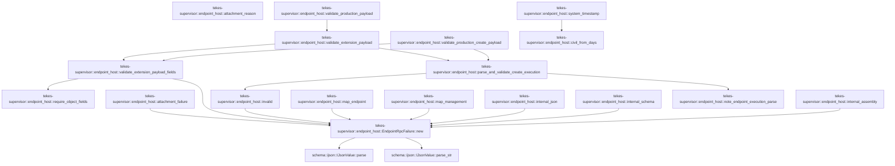

```mermaid
flowchart TD
  n0["endpoint::attachment::AttachmentAuthority::open"]
  n1["endpoint::service::NativeEndpoint::open"]
  n2["endpoint::session_operations::SessionOperations::open_sessions"]
  n3["profile::config::ConfigRepository::open"]
  n4["tekes-supervisor::endpoint_host::ProductionEndpointHost::create_session"]
  n5["tekes-supervisor::endpoint_host::ProductionEndpointHost::draft_models"]
  n6["tekes-supervisor::endpoint_host::ProductionEndpointHost::models"]
  n7["tekes-supervisor::endpoint_host::ProductionEndpointHost::select_model"]
  n8["tekes-supervisor::endpoint_host::ProductionEndpointHost::cancel"]
  n9["tekes-supervisor::endpoint_host::ProductionEndpointHost::rename_session"]
  n10["tekes-supervisor::endpoint_host::ProductionEndpointHost::update_queue"]
  n11["tekes-supervisor::endpoint_host::ProductionEndpointHost::prompt"]
  n12["tekes-supervisor::endpoint_host::ProductionEndpointHost::attachment"]
  n13["tekes-supervisor::endpoint_host::ProductionEndpointHost::fork_session"]
  n14["tekes-supervisor::endpoint_host::ProductionEndpointHost::discard_session"]
  n15["tekes-supervisor::endpoint_host::ProductionEndpointHost::admission_gate"]
  n16["tekes-supervisor::endpoint_host::success"]
  n17["tekes-supervisor::endpoint_host::model_projection"]
  n18["tekes-supervisor::endpoint_host::model_is_configured"]
  n19["tekes-supervisor::endpoint_host::map_production_route"]
  n20["tekes-supervisor::endpoint_host::map_production_route_for"]
  n21["tekes-supervisor::endpoint_host::internal_failure"]
  n22["tekes-supervisor::endpoint_host::failure"]
  n23["tekes-supervisor::endpoint_host::required_string"]
  n24["tekes-supervisor::endpoint_host::required_string_allow_whitespace"]
  n25["tekes-supervisor::endpoint_host::optional_string"]
  n26["tekes-supervisor::endpoint_host::require_object_fields"]
  n27["tekes-supervisor::endpoint_host::to_ijson"]
  n28["tekes-supervisor::endpoint_host::request_hash"]
  n29["tekes-supervisor::endpoint_host::mark_management_handoff"]
  n30["tekes-supervisor::endpoint_host::mark_event_handoff"]
  n31["tekes-supervisor::endpoint_host::endpoint_origin"]
  n32["tekes-supervisor::endpoint_host::validate_session_title"]
  n33["tekes-supervisor::endpoint_host::queue_action"]
  n34["tekes-supervisor::endpoint_host::queue_decision"]
  n35["tekes-supervisor::endpoint_host::map_persisted_queue_rejection"]
  n36["tekes-supervisor::endpoint_host::validate_time_zone"]
  n37["tekes-supervisor::endpoint_host::validate_extension_payload"]
  n38["tekes-supervisor::endpoint_host::invalid"]
  n39["tekes-supervisor::endpoint_host::map_endpoint"]
  n40["tekes-supervisor::endpoint_host::SessionInputAdmissionAuthority::new"]
  n41["tekes-supervisor::endpoint_host::EndpointRpcFailure::new"]
  n42["tekes-supervisor::endpoint_host::note_endpoint_execution_parse"]
  n43["tekes-supervisor::endpoint_host::take_validated_create_execution"]
  n44["tekes-supervisor::endpoint_host::take_validated_extension_request"]
  n45["tekes-supervisor::endpoint_host::ProductionEndpointHost::open_with_full_authorities_and_session_admission"]
  n46["tekes-supervisor::endpoint_host::ProductionEndpointHost::open_with_route_authority"]
  n47["tekes-supervisor::endpoint_host::ProductionEndpointHost::open_with_route_ownership"]
  n48["tekes-supervisor::endpoint_host::ProductionEndpointHost::implemented_capabilities"]
  n49["tekes-supervisor::endpoint_host::ProductionEndpointHost::admission_gates"]
  n50["tekes-supervisor::endpoint_host::ProductionEndpointHost::session_admission_authority"]
  n51["tekes-supervisor::endpoint_host::ProductionEndpointHost::has_incomplete_management_operation"]
  n52["tekes-supervisor::endpoint_host::ProductionEndpointHost::execute"]
  n53["tekes-supervisor::endpoint_host::ProductionEndpointHost::execute_inner"]
  n54["tekes-supervisor::endpoint_host::ProductionEndpointHost::execute_extension"]
  n55["tekes-supervisor::endpoint_host::ProductionEndpointHost::archive_session"]
  n56["tekes-supervisor::endpoint_host::ProductionEndpointHost::unarchive_session"]
  n57["tools::guidance::IdentityProfile::parse"]
  n4 --> n25
  n4 --> n26
  n4 --> n27
  n4 --> n28
  n4 --> n29
  n4 --> n38
  n4 --> n41
  n4 --> n42
  n4 --> n43
  n4 --> n57
  n5 --> n3
  n5 --> n17
  n5 --> n20
  n5 --> n21
  n5 --> n26
  n6 --> n17
  n6 --> n20
  n6 --> n23
  n6 --> n26
  n6 --> n39
  n6 --> n41
  n7 --> n15
  n7 --> n18
  n7 --> n20
  n7 --> n21
  n7 --> n23
  n7 --> n25
  n7 --> n26
  n7 --> n27
  n7 --> n28
  n7 --> n29
  n7 --> n39
  n7 --> n41
  n8 --> n15
  n8 --> n20
  n8 --> n21
  n8 --> n23
  n8 --> n26
  n8 --> n27
  n8 --> n30
  n8 --> n31
  n8 --> n41
  n9 --> n15
  n9 --> n20
  n9 --> n21
  n9 --> n23
  n9 --> n24
  n9 --> n26
  n9 --> n27
  n9 --> n30
  n9 --> n31
  n9 --> n32
  n9 --> n41
  n10 --> n15
  n10 --> n20
  n10 --> n21
  n10 --> n23
  n10 --> n26
  n10 --> n27
  n10 --> n28
  n10 --> n29
  n10 --> n31
  n10 --> n33
  n10 --> n34
  n10 --> n35
  n10 --> n38
  n10 --> n41
  n11 --> n20
  n11 --> n23
  n11 --> n25
  n11 --> n26
  n11 --> n27
  n11 --> n30
  n11 --> n31
  n11 --> n36
  n11 --> n38
  n11 --> n41
  n45 --> n47
  n46 --> n47
  n47 --> n0
  n47 --> n1
  n47 --> n2
  n47 --> n40
  n52 --> n16
  n52 --> n22
  n52 --> n53
  n53 --> n4
  n53 --> n5
  n53 --> n6
  n53 --> n7
  n53 --> n8
  n53 --> n9
  n53 --> n10
  n53 --> n11
  n53 --> n12
  n53 --> n13
  n53 --> n14
  n53 --> n54
  n53 --> n55
  n53 --> n56
  n54 --> n19
  n54 --> n20
  n54 --> n21
  n54 --> n37
  n54 --> n41
  n54 --> n44
  n55 --> n20
  n55 --> n23
  n55 --> n26
  n55 --> n27
  n55 --> n28
  n55 --> n29
  n56 --> n23
  n56 --> n26
  n56 --> n27
  n56 --> n28
  n56 --> n29
```

```mermaid
flowchart TD
  n0["endpoint::host::EndpointDispatcher::new"]
  n1["endpoint::idempotency::RpcRegistry::open"]
  n2["endpoint::types::validate_session_id"]
  n3["store::platform::DirectoryLock::shared"]
  n4["store::tail::scan_valid_prefix"]
  n5["tekes-supervisor::endpoint_host::ProductionEndpointHost::attachment"]
  n6["tekes-supervisor::endpoint_host::ProductionEndpointHost::fork_session"]
  n7["tekes-supervisor::endpoint_host::ProductionEndpointHost::discard_session"]
  n8["tekes-supervisor::endpoint_host::ProductionEndpointHost::admission_gate"]
  n9["tekes-supervisor::endpoint_host::ProductionEndpointHost::ensure_active_session"]
  n10["tekes-supervisor::endpoint_host::ProductionEndpointHost::reconcile_legacy_internal_prompt_inner"]
  n11["tekes-supervisor::endpoint_host::find_unique_matching_legacy_input"]
  n12["tekes-supervisor::endpoint_host::verify_and_sync_legacy_input"]
  n13["tekes-supervisor::endpoint_host::ProductionEndpointHost::capabilities"]
  n14["tekes-supervisor::endpoint_host::ProductionEndpointHost::extension_capabilities"]
  n15["tekes-supervisor::endpoint_host::ProductionEndpointHost::method_class"]
  n16["tekes-supervisor::endpoint_host::ProductionEndpointHost::validate_request"]
  n17["tekes-supervisor::endpoint_host::ProductionEndpointHost::reconcile_legacy_internal_prompt"]
  n18["tekes-supervisor::endpoint_host::ProductionEndpointHost::call"]
  n19["tekes-supervisor::endpoint_host::ProductionEndpointAssembly::open"]
  n20["tekes-supervisor::endpoint_host::ProductionEndpointAssembly::open_with_clock"]
  n21["tekes-supervisor::endpoint_host::ProductionEndpointAssembly::open_with_routes"]
  n22["tekes-supervisor::endpoint_host::ProductionEndpointAssembly::open_with_route_authority"]
  n23["tekes-supervisor::endpoint_host::ProductionEndpointAssembly::open_with_authorities"]
  n24["tekes-supervisor::endpoint_host::ProductionEndpointAssembly::open_with_full_authorities"]
  n25["tekes-supervisor::endpoint_host::map_production_route_for"]
  n26["tekes-supervisor::endpoint_host::required_string"]
  n27["tekes-supervisor::endpoint_host::optional_bool"]
  n28["tekes-supervisor::endpoint_host::optional_string"]
  n29["tekes-supervisor::endpoint_host::require_object_fields"]
  n30["tekes-supervisor::endpoint_host::optional_u64"]
  n31["tekes-supervisor::endpoint_host::to_ijson"]
  n32["tekes-supervisor::endpoint_host::request_hash"]
  n33["tekes-supervisor::endpoint_host::mark_management_handoff"]
  n34["tekes-supervisor::endpoint_host::endpoint_origin"]
  n35["tekes-supervisor::endpoint_host::validate_time_zone"]
  n36["tekes-supervisor::endpoint_host::validate_production_create_payload"]
  n37["tekes-supervisor::endpoint_host::validate_production_payload"]
  n38["tekes-supervisor::endpoint_host::invalid"]
  n39["tekes-supervisor::endpoint_host::EndpointRpcFailure::new"]
  n40["tekes-supervisor::endpoint_host::cache_validated_create_execution"]
  n41["tekes-supervisor::endpoint_host::cache_validated_extension_request"]
  n42["tekes-supervisor::endpoint_host::ProductionEndpointHost::open"]
  n43["tekes-supervisor::endpoint_host::ProductionEndpointHost::open_with_clock"]
  n44["tekes-supervisor::endpoint_host::ProductionEndpointHost::open_with_routes"]
  n45["tekes-supervisor::endpoint_host::ProductionEndpointHost::open_with_full_authorities"]
  n46["tekes-supervisor::endpoint_host::ProductionEndpointHost::open_with_route_authority"]
  n5 --> n9
  n5 --> n26
  n5 --> n29
  n5 --> n31
  n6 --> n26
  n6 --> n27
  n6 --> n29
  n6 --> n30
  n6 --> n31
  n6 --> n32
  n6 --> n33
  n7 --> n25
  n7 --> n26
  n7 --> n29
  n7 --> n31
  n7 --> n32
  n7 --> n33
  n9 --> n2
  n9 --> n38
  n9 --> n39
  n10 --> n2
  n10 --> n3
  n10 --> n12
  n10 --> n26
  n10 --> n28
  n10 --> n29
  n10 --> n34
  n10 --> n35
  n12 --> n4
  n12 --> n11
  n16 --> n36
  n16 --> n37
  n16 --> n40
  n16 --> n41
  n19 --> n0
  n19 --> n1
  n19 --> n42
  n20 --> n0
  n20 --> n1
  n20 --> n43
  n21 --> n0
  n21 --> n1
  n21 --> n44
  n22 --> n0
  n22 --> n1
  n22 --> n46
  n23 --> n24
  n24 --> n0
  n24 --> n1
  n24 --> n45
```

```mermaid
flowchart TD
  n0["provider::dialect::resolve_profile"]
  n1["schema::ijson::IJsonValue::parse"]
  n2["tekes-supervisor::endpoint_host::ProductionEndpointAssembly::dispatch"]
  n3["tekes-supervisor::endpoint_host::ProductionEndpointAssembly::hub"]
  n4["tekes-supervisor::endpoint_host::ProductionEndpointAssembly::host"]
  n5["tekes-supervisor::endpoint_host::ProductionEndpointAssembly::admission_gates"]
  n6["tekes-supervisor::endpoint_host::ProductionEndpointAssembly::has_incomplete_management_operation"]
  n7["tekes-supervisor::endpoint_host::success"]
  n8["tekes-supervisor::endpoint_host::model_projection"]
  n9["tekes-supervisor::endpoint_host::ConfiguredModels::model_available"]
  n10["tekes-supervisor::endpoint_host::model_is_configured"]
  n11["tekes-supervisor::endpoint_host::runtime_failure_name"]
  n12["tekes-supervisor::endpoint_host::map_production_route"]
  n13["tekes-supervisor::endpoint_host::map_production_route_for"]
  n14["tekes-supervisor::endpoint_host::sanitized_route_log_message"]
  n15["tekes-supervisor::endpoint_host::production_failure_is_exact_for"]
  n16["tekes-supervisor::endpoint_host::route_error_is_exact"]
  n17["tekes-supervisor::endpoint_host::route_error_message"]
  n18["tekes-supervisor::endpoint_host::exact_string_fields"]
  n19["tekes-supervisor::endpoint_host::route_allows_error"]
  n20["tekes-supervisor::endpoint_host::internal_failure"]
  n21["tekes-supervisor::endpoint_host::failure"]
  n22["tekes-supervisor::endpoint_host::to_ijson"]
  n23["tekes-supervisor::endpoint_host::EndpointRpcFailure::new"]
  n8 --> n0
  n8 --> n10
  n8 --> n20
  n8 --> n22
  n9 --> n10
  n10 --> n0
  n13 --> n12
  n13 --> n14
  n13 --> n15
  n13 --> n20
  n14 --> n1
  n15 --> n16
  n15 --> n19
  n16 --> n17
  n16 --> n18
  n20 --> n23
```

```mermaid
flowchart TD
  n0["schema::ijson::IJsonValue::parse"]
  n1["tekes-supervisor::endpoint_host::internal_failure"]
  n2["tekes-supervisor::endpoint_host::required_string"]
  n3["tekes-supervisor::endpoint_host::required_string_allow_whitespace"]
  n4["tekes-supervisor::endpoint_host::optional_bool"]
  n5["tekes-supervisor::endpoint_host::optional_string"]
  n6["tekes-supervisor::endpoint_host::require_object_fields"]
  n7["tekes-supervisor::endpoint_host::optional_u64"]
  n8["tekes-supervisor::endpoint_host::to_ijson"]
  n9["tekes-supervisor::endpoint_host::request_hash"]
  n10["tekes-supervisor::endpoint_host::mark_management_handoff"]
  n11["tekes-supervisor::endpoint_host::mark_event_handoff"]
  n12["tekes-supervisor::endpoint_host::endpoint_origin"]
  n13["tekes-supervisor::endpoint_host::validate_session_title"]
  n14["tekes-supervisor::endpoint_host::PendingQueueAction::with_origin"]
  n15["tekes-supervisor::endpoint_host::queue_action"]
  n16["tekes-supervisor::endpoint_host::map_queue_rejection"]
  n17["tekes-supervisor::endpoint_host::queue_decision"]
  n18["tekes-supervisor::endpoint_host::map_persisted_queue_rejection"]
  n19["tekes-supervisor::endpoint_host::validate_time_zone"]
  n20["tekes-supervisor::endpoint_host::map_prompt_error"]
  n21["tekes-supervisor::endpoint_host::map_attachment_read_error"]
  n22["tekes-supervisor::endpoint_host::attachment_failure"]
  n23["tekes-supervisor::endpoint_host::invalid"]
  n24["tekes-supervisor::endpoint_host::EndpointRpcFailure::new"]
  n2 --> n23
  n3 --> n23
  n4 --> n23
  n5 --> n23
  n6 --> n23
  n7 --> n23
  n8 --> n0
  n9 --> n24
  n10 --> n24
  n11 --> n1
  n15 --> n23
  n15 --> n24
  n16 --> n24
  n18 --> n1
  n18 --> n16
  n19 --> n23
  n20 --> n1
  n20 --> n22
  n20 --> n23
  n20 --> n24
  n21 --> n1
  n21 --> n22
  n21 --> n24
```

# tekes-supervisor::endpoint_host

[Package atlas](index.md) · [Source](../../src/endpoint_host.rs)

## Declarations

Visibility is the declaration spelling; trait members and reexports require their enclosing interface. `cfg` is not evaluated.

| Symbol | Kind | Visibility | Test / cfg |
|---|---|---|---|
| [tekes-supervisor::endpoint_host::note_endpoint_execution_parse](../../src/endpoint_host.rs#L32) | function_item | `private` |  |
| [tekes-supervisor::endpoint_host::reset_endpoint_execution_parses](../../src/endpoint_host.rs#L37) | function_item | `pub` |  |
| [tekes-supervisor::endpoint_host::endpoint_execution_parses](../../src/endpoint_host.rs#L43) | function_item | `pub` |  |
| [tekes-supervisor::endpoint_host::EndpointRouteClass](../../src/endpoint_host.rs#L48) | enum_item | `pub` |  |
| [tekes-supervisor::endpoint_host::EndpointRoute](../../src/endpoint_host.rs#L56) | struct_item | `pub` |  |
| [tekes-supervisor::endpoint_host::TEKES_UNARY_ROUTES](../../src/endpoint_host.rs#L62) | const_item | `pub` |  |
| [tekes-supervisor::endpoint_host::route](../../src/endpoint_host.rs#L78) | function_item | `private` |  |
| [tekes-supervisor::endpoint_host::EndpointClock](../../src/endpoint_host.rs#L86) | type_item | `pub` |  |
| [tekes-supervisor::endpoint_host::RuntimeModelReadiness](../../src/endpoint_host.rs#L89) | struct_item | `pub` |  |
| [tekes-supervisor::endpoint_host::RuntimeProviderStatus](../../src/endpoint_host.rs#L96) | enum_item | `pub` |  |
| [tekes-supervisor::endpoint_host::RuntimeProviderFailure](../../src/endpoint_host.rs#L102) | enum_item | `pub` |  |
| [tekes-supervisor::endpoint_host::RuntimeProviderReadiness](../../src/endpoint_host.rs#L110) | struct_item | `pub` |  |
| [tekes-supervisor::endpoint_host::ProviderReadinessAuthority](../../src/endpoint_host.rs#L119) | trait_item | `pub` |  |
| [tekes-supervisor::endpoint_host::ProviderReadinessAuthority::readiness](../../src/endpoint_host.rs#L120) | function_signature_item | `private` |  |
| [tekes-supervisor::endpoint_host::ProviderReadinessAuthority::config_mutation_succeeded](../../src/endpoint_host.rs#L129) | function_item | `private` |  |
| [tekes-supervisor::endpoint_host::SessionDeliveryAuthority](../../src/endpoint_host.rs#L138) | trait_item | `pub` |  |
| [tekes-supervisor::endpoint_host::SessionDeliveryAuthority::session_metadata_changed](../../src/endpoint_host.rs#L142) | function_item | `private` |  |
| [tekes-supervisor::endpoint_host::SessionDeliveryAuthority::workspace_metadata_changed](../../src/endpoint_host.rs#L146) | function_item | `private` |  |
| [tekes-supervisor::endpoint_host::SessionDeliveryAuthority::prompt](../../src/endpoint_host.rs#L148) | function_signature_item | `private` |  |
| [tekes-supervisor::endpoint_host::SessionDeliveryAuthority::cancel](../../src/endpoint_host.rs#L157) | function_signature_item | `private` |  |
| [tekes-supervisor::endpoint_host::SessionDeliveryAuthority::rename](../../src/endpoint_host.rs#L164) | function_signature_item | `private` |  |
| [tekes-supervisor::endpoint_host::SessionDeliveryAuthority::compact](../../src/endpoint_host.rs#L178) | function_item | `private` |  |
| [tekes-supervisor::endpoint_host::QueueTransactionAuthority](../../src/endpoint_host.rs#L195) | trait_item | `pub` |  |
| [tekes-supervisor::endpoint_host::QueueTransactionAuthority::execute](../../src/endpoint_host.rs#L196) | function_signature_item | `private` |  |
| [tekes-supervisor::endpoint_host::recover_pending_management](../../src/endpoint_host.rs#L209) | function_item | `pub(crate)` |  |
| [tekes-supervisor::endpoint_host::QueueRecoveryAdapter](../../src/endpoint_host.rs#L218) | struct_item | `private` |  |
| [tekes-supervisor::endpoint_host::QueueRecoveryAdapter::execute](../../src/endpoint_host.rs#L223) | function_item | `private` |  |
| [tekes-supervisor::endpoint_host::SessionAdmissionGates](../../src/endpoint_host.rs#L260) | struct_item | `pub` |  |
| [tekes-supervisor::endpoint_host::SessionAdmissionGates::gate](../../src/endpoint_host.rs#L265) | function_item | `pub` |  |
| [tekes-supervisor::endpoint_host::SessionInputAdmissionAuthority](../../src/endpoint_host.rs#L284) | struct_item | `pub` |  |
| [tekes-supervisor::endpoint_host::SessionInputAdmissionAuthority::new](../../src/endpoint_host.rs#L291) | function_item | `pub` |  |
| [tekes-supervisor::endpoint_host::SessionInputAdmissionAuthority::gates](../../src/endpoint_host.rs#L299) | function_item | `pub` |  |
| [tekes-supervisor::endpoint_host::SessionInputAdmissionAuthority::root](../../src/endpoint_host.rs#L305) | function_item | `pub` |  |
| [tekes-supervisor::endpoint_host::SessionInputAdmissionAuthority::with_active_session](../../src/endpoint_host.rs#L309) | function_item | `pub` |  |
| [tekes-supervisor::endpoint_host::SessionInputAdmissionAuthority::with_session_gate](../../src/endpoint_host.rs#L334) | function_item | `pub` |  |
| [tekes-supervisor::endpoint_host::session_details](../../src/endpoint_host.rs#L359) | function_item | `private` |  |
| [tekes-supervisor::endpoint_host::ProductionEndpointRoutes](../../src/endpoint_host.rs#L369) | trait_item | `pub` |  |
| [tekes-supervisor::endpoint_host::ProductionEndpointRoutes::capabilities](../../src/endpoint_host.rs#L370) | function_signature_item | `private` |  |
| [tekes-supervisor::endpoint_host::ProductionEndpointRoutes::extension_method_class](../../src/endpoint_host.rs#L375) | function_item | `private` |  |
| [tekes-supervisor::endpoint_host::ProductionEndpointRoutes::validate_extension_payload](../../src/endpoint_host.rs#L381) | function_item | `private` |  |
| [tekes-supervisor::endpoint_host::ProductionEndpointRoutes::extension_failure_is_exact](../../src/endpoint_host.rs#L396) | function_item | `private` |  |
| [tekes-supervisor::endpoint_host::ProductionEndpointRoutes::execute](../../src/endpoint_host.rs#L404) | function_signature_item | `private` |  |
| [tekes-supervisor::endpoint_host::CompositeProductionEndpointRoutes](../../src/endpoint_host.rs#L415) | struct_item | `pub` |  |
| [tekes-supervisor::endpoint_host::CompositeProductionEndpointRoutes::compose](../../src/endpoint_host.rs#L420) | function_item | `pub` |  |
| [tekes-supervisor::endpoint_host::CompositeProductionEndpointRoutes::owner](../../src/endpoint_host.rs#L448) | function_item | `private` |  |
| [tekes-supervisor::endpoint_host::CompositeProductionEndpointRoutes::capabilities](../../src/endpoint_host.rs#L454) | function_item | `private` |  |
| [tekes-supervisor::endpoint_host::CompositeProductionEndpointRoutes::extension_method_class](../../src/endpoint_host.rs#L458) | function_item | `private` |  |
| [tekes-supervisor::endpoint_host::CompositeProductionEndpointRoutes::validate_extension_payload](../../src/endpoint_host.rs#L462) | function_item | `private` |  |
| [tekes-supervisor::endpoint_host::CompositeProductionEndpointRoutes::extension_failure_is_exact](../../src/endpoint_host.rs#L472) | function_item | `private` |  |
| [tekes-supervisor::endpoint_host::CompositeProductionEndpointRoutes::execute](../../src/endpoint_host.rs#L481) | function_item | `private` |  |
| [tekes-supervisor::endpoint_host::ProductionRouteCompositionError](../../src/endpoint_host.rs#L494) | enum_item | `pub` |  |
| [tekes-supervisor::endpoint_host::unsupported_route](../../src/endpoint_host.rs#L501) | function_item | `private` |  |
| [tekes-supervisor::endpoint_host::ProductionRouteFailure](../../src/endpoint_host.rs#L511) | struct_item | `pub` |  |
| [tekes-supervisor::endpoint_host::ProductionRouteFailure::new](../../src/endpoint_host.rs#L518) | function_item | `pub` |  |
| [tekes-supervisor::endpoint_host::ProductionEndpointHost](../../src/endpoint_host.rs#L527) | struct_item | `pub` |  |
| [tekes-supervisor::endpoint_host::VALIDATED_REQUEST_CACHE_CAP](../../src/endpoint_host.rs#L546) | const_item | `private` |  |
| [tekes-supervisor::endpoint_host::cache_validated_create_execution](../../src/endpoint_host.rs#L548) | function_item | `private` |  |
| [tekes-supervisor::endpoint_host::take_validated_create_execution](../../src/endpoint_host.rs#L563) | function_item | `private` |  |
| [tekes-supervisor::endpoint_host::cache_validated_extension_request](../../src/endpoint_host.rs#L577) | function_item | `private` |  |
| [tekes-supervisor::endpoint_host::take_validated_extension_request](../../src/endpoint_host.rs#L592) | function_item | `private` |  |
| [tekes-supervisor::endpoint_host::ProductionEndpointHost::with_user_agent_dir](../../src/endpoint_host.rs#L616) | function_item | `pub` |  |
| [tekes-supervisor::endpoint_host::ProductionEndpointHost::mux_description](../../src/endpoint_host.rs#L621) | function_item | `pub` |  |
| [tekes-supervisor::endpoint_host::ProductionEndpointHost::open](../../src/endpoint_host.rs#L646) | function_item | `pub` |  |
| [tekes-supervisor::endpoint_host::ProductionEndpointHost::open_with_clock](../../src/endpoint_host.rs#L661) | function_item | `pub` |  |
| [tekes-supervisor::endpoint_host::ProductionEndpointHost::open_with_routes](../../src/endpoint_host.rs#L670) | function_item | `pub` |  |
| [tekes-supervisor::endpoint_host::ProductionEndpointHost::open_with_authorities](../../src/endpoint_host.rs#L679) | function_item | `pub` |  |
| [tekes-supervisor::endpoint_host::ProductionEndpointHost::open_with_full_authorities](../../src/endpoint_host.rs#L697) | function_item | `pub` |  |
| [tekes-supervisor::endpoint_host::ProductionEndpointHost::open_with_full_authorities_and_session_admission](../../src/endpoint_host.rs#L720) | function_item | `pub` |  |
| [tekes-supervisor::endpoint_host::ProductionEndpointHost::open_with_route_authority](../../src/endpoint_host.rs#L746) | function_item | `pub` |  |
| [tekes-supervisor::endpoint_host::ProductionEndpointHost::open_with_route_ownership](../../src/endpoint_host.rs#L769) | function_item | `private` |  |
| [tekes-supervisor::endpoint_host::ProductionEndpointHost::implemented_capabilities](../../src/endpoint_host.rs#L838) | function_item | `pub` |  |
| [tekes-supervisor::endpoint_host::ProductionEndpointHost::admission_gates](../../src/endpoint_host.rs#L847) | function_item | `pub` |  |
| [tekes-supervisor::endpoint_host::ProductionEndpointHost::session_admission_authority](../../src/endpoint_host.rs#L852) | function_item | `pub` |  |
| [tekes-supervisor::endpoint_host::ProductionEndpointHost::has_incomplete_management_operation](../../src/endpoint_host.rs#L856) | function_item | `pub` |  |
| [tekes-supervisor::endpoint_host::ProductionEndpointHost::execute](../../src/endpoint_host.rs#L865) | function_item | `private` |  |
| [tekes-supervisor::endpoint_host::ProductionEndpointHost::execute_inner](../../src/endpoint_host.rs#L873) | function_item | `private` |  |
| [tekes-supervisor::endpoint_host::ProductionEndpointHost::execute_extension](../../src/endpoint_host.rs#L901) | function_item | `private` |  |
| [tekes-supervisor::endpoint_host::ProductionEndpointHost::archive_session](../../src/endpoint_host.rs#L960) | function_item | `private` |  |
| [tekes-supervisor::endpoint_host::ProductionEndpointHost::unarchive_session](../../src/endpoint_host.rs#L983) | function_item | `private` |  |
| [tekes-supervisor::endpoint_host::ProductionEndpointHost::create_session](../../src/endpoint_host.rs#L1000) | function_item | `private` |  |
| [tekes-supervisor::endpoint_host::ProductionEndpointHost::draft_models](../../src/endpoint_host.rs#L1076) | function_item | `private` |  |
| [tekes-supervisor::endpoint_host::ProductionEndpointHost::models](../../src/endpoint_host.rs#L1113) | function_item | `private` |  |
| [tekes-supervisor::endpoint_host::ProductionEndpointHost::select_model](../../src/endpoint_host.rs#L1133) | function_item | `private` |  |
| [tekes-supervisor::endpoint_host::ProductionEndpointHost::cancel](../../src/endpoint_host.rs#L1192) | function_item | `private` |  |
| [tekes-supervisor::endpoint_host::ProductionEndpointHost::rename_session](../../src/endpoint_host.rs#L1222) | function_item | `private` |  |
| [tekes-supervisor::endpoint_host::ProductionEndpointHost::update_queue](../../src/endpoint_host.rs#L1260) | function_item | `private` |  |
| [tekes-supervisor::endpoint_host::ProductionEndpointHost::prompt](../../src/endpoint_host.rs#L1349) | function_item | `private` |  |
| [tekes-supervisor::endpoint_host::ProductionEndpointHost::attachment](../../src/endpoint_host.rs#L1406) | function_item | `private` |  |
| [tekes-supervisor::endpoint_host::ProductionEndpointHost::fork_session](../../src/endpoint_host.rs#L1422) | function_item | `private` |  |
| [tekes-supervisor::endpoint_host::ProductionEndpointHost::discard_session](../../src/endpoint_host.rs#L1459) | function_item | `private` |  |
| [tekes-supervisor::endpoint_host::ProductionEndpointHost::admission_gate](../../src/endpoint_host.rs#L1482) | function_item | `private` |  |
| [tekes-supervisor::endpoint_host::ProductionEndpointHost::ensure_active_session](../../src/endpoint_host.rs#L1489) | function_item | `private` |  |
| [tekes-supervisor::endpoint_host::ProductionEndpointHost::reconcile_legacy_internal_prompt_inner](../../src/endpoint_host.rs#L1508) | function_item | `private` |  |
| [tekes-supervisor::endpoint_host::find_unique_matching_legacy_input](../../src/endpoint_host.rs#L1578) | function_item | `private` |  |
| [tekes-supervisor::endpoint_host::verify_and_sync_legacy_input](../../src/endpoint_host.rs#L1613) | function_item | `private` |  |
| [tekes-supervisor::endpoint_host::ProductionEndpointHost::capabilities](../../src/endpoint_host.rs#L1657) | function_item | `private` |  |
| [tekes-supervisor::endpoint_host::ProductionEndpointHost::extension_capabilities](../../src/endpoint_host.rs#L1678) | function_item | `private` |  |
| [tekes-supervisor::endpoint_host::ProductionEndpointHost::method_class](../../src/endpoint_host.rs#L1688) | function_item | `private` |  |
| [tekes-supervisor::endpoint_host::ProductionEndpointHost::validate_request](../../src/endpoint_host.rs#L1704) | function_item | `private` |  |
| [tekes-supervisor::endpoint_host::ProductionEndpointHost::reconcile_legacy_internal_prompt](../../src/endpoint_host.rs#L1744) | function_item | `private` |  |
| [tekes-supervisor::endpoint_host::ProductionEndpointHost::call](../../src/endpoint_host.rs#L1752) | function_item | `private` |  |
| [tekes-supervisor::endpoint_host::ProductionEndpointAssembly](../../src/endpoint_host.rs#L1757) | struct_item | `pub` |  |
| [tekes-supervisor::endpoint_host::ProductionEndpointAssembly::open](../../src/endpoint_host.rs#L1764) | function_item | `pub` |  |
| [tekes-supervisor::endpoint_host::ProductionEndpointAssembly::open_with_clock](../../src/endpoint_host.rs#L1776) | function_item | `pub` |  |
| [tekes-supervisor::endpoint_host::ProductionEndpointAssembly::open_with_routes](../../src/endpoint_host.rs#L1789) | function_item | `pub` |  |
| [tekes-supervisor::endpoint_host::ProductionEndpointAssembly::open_with_route_authority](../../src/endpoint_host.rs#L1803) | function_item | `pub` |  |
| [tekes-supervisor::endpoint_host::ProductionEndpointAssembly::open_with_authorities](../../src/endpoint_host.rs#L1825) | function_item | `pub` |  |
| [tekes-supervisor::endpoint_host::ProductionEndpointAssembly::open_with_full_authorities](../../src/endpoint_host.rs#L1843) | function_item | `pub` |  |
| [tekes-supervisor::endpoint_host::ProductionEndpointAssembly::dispatch](../../src/endpoint_host.rs#L1868) | function_item | `pub` |  |
| [tekes-supervisor::endpoint_host::ProductionEndpointAssembly::hub](../../src/endpoint_host.rs#L1876) | function_item | `pub` |  |
| [tekes-supervisor::endpoint_host::ProductionEndpointAssembly::host](../../src/endpoint_host.rs#L1881) | function_item | `pub` |  |
| [tekes-supervisor::endpoint_host::ProductionEndpointAssembly::admission_gates](../../src/endpoint_host.rs#L1886) | function_item | `pub` |  |
| [tekes-supervisor::endpoint_host::ProductionEndpointAssembly::has_incomplete_management_operation](../../src/endpoint_host.rs#L1890) | function_item | `pub` |  |
| [tekes-supervisor::endpoint_host::success](../../src/endpoint_host.rs#L1898) | function_item | `private` |  |
| [tekes-supervisor::endpoint_host::model_projection](../../src/endpoint_host.rs#L1906) | function_item | `private` |  |
| [tekes-supervisor::endpoint_host::ConfiguredModels](../../src/endpoint_host.rs#L2001) | struct_item | `pub` |  |
| [tekes-supervisor::endpoint_host::ConfiguredModels::model_available](../../src/endpoint_host.rs#L2004) | function_item | `private` |  |
| [tekes-supervisor::endpoint_host::model_is_configured](../../src/endpoint_host.rs#L2015) | function_item | `private` |  |
| [tekes-supervisor::endpoint_host::runtime_failure_name](../../src/endpoint_host.rs#L2046) | function_item | `private` |  |
| [tekes-supervisor::endpoint_host::map_production_route](../../src/endpoint_host.rs#L2055) | function_item | `private` |  |
| [tekes-supervisor::endpoint_host::map_production_route_for](../../src/endpoint_host.rs#L2063) | function_item | `private` |  |
| [tekes-supervisor::endpoint_host::sanitized_route_log_message](../../src/endpoint_host.rs#L2077) | function_item | `private` |  |
| [tekes-supervisor::endpoint_host::production_failure_is_exact_for](../../src/endpoint_host.rs#L2097) | function_item | `pub(crate)` |  |
| [tekes-supervisor::endpoint_host::route_error_is_exact](../../src/endpoint_host.rs#L2104) | function_item | `private` |  |
| [tekes-supervisor::endpoint_host::route_error_message](../../src/endpoint_host.rs#L2188) | function_item | `private` |  |
| [tekes-supervisor::endpoint_host::exact_string_fields](../../src/endpoint_host.rs#L2220) | function_item | `private` |  |
| [tekes-supervisor::endpoint_host::route_allows_error](../../src/endpoint_host.rs#L2241) | function_item | `private` |  |
| [tekes-supervisor::endpoint_host::internal_failure](../../src/endpoint_host.rs#L2349) | function_item | `private` |  |
| [tekes-supervisor::endpoint_host::failure](../../src/endpoint_host.rs#L2353) | function_item | `private` |  |
| [tekes-supervisor::endpoint_host::required_string](../../src/endpoint_host.rs#L2365) | function_item | `private` |  |
| [tekes-supervisor::endpoint_host::required_string_allow_whitespace](../../src/endpoint_host.rs#L2374) | function_item | `private` |  |
| [tekes-supervisor::endpoint_host::optional_bool](../../src/endpoint_host.rs#L2385) | function_item | `private` |  |
| [tekes-supervisor::endpoint_host::optional_string](../../src/endpoint_host.rs#L2395) | function_item | `private` |  |
| [tekes-supervisor::endpoint_host::require_object_fields](../../src/endpoint_host.rs#L2406) | function_item | `private` |  |
| [tekes-supervisor::endpoint_host::optional_u64](../../src/endpoint_host.rs#L2422) | function_item | `private` |  |
| [tekes-supervisor::endpoint_host::to_ijson](../../src/endpoint_host.rs#L2432) | function_item | `private` |  |
| [tekes-supervisor::endpoint_host::request_hash](../../src/endpoint_host.rs#L2436) | function_item | `private` |  |
| [tekes-supervisor::endpoint_host::mark_management_handoff](../../src/endpoint_host.rs#L2450) | function_item | `private` |  |
| [tekes-supervisor::endpoint_host::mark_event_handoff](../../src/endpoint_host.rs#L2464) | function_item | `private` |  |
| [tekes-supervisor::endpoint_host::endpoint_origin](../../src/endpoint_host.rs#L2478) | function_item | `private` |  |
| [tekes-supervisor::endpoint_host::validate_session_title](../../src/endpoint_host.rs#L2493) | function_item | `private` |  |
| [tekes-supervisor::endpoint_host::PendingQueueAction](../../src/endpoint_host.rs#L2504) | enum_item | `private` |  |
| [tekes-supervisor::endpoint_host::PendingQueueAction::with_origin](../../src/endpoint_host.rs#L2511) | function_item | `private` |  |
| [tekes-supervisor::endpoint_host::queue_action](../../src/endpoint_host.rs#L2527) | function_item | `private` |  |
| [tekes-supervisor::endpoint_host::map_queue_rejection](../../src/endpoint_host.rs#L2577) | function_item | `private` |  |
| [tekes-supervisor::endpoint_host::queue_decision](../../src/endpoint_host.rs#L2601) | function_item | `private` |  |
| [tekes-supervisor::endpoint_host::map_persisted_queue_rejection](../../src/endpoint_host.rs#L2626) | function_item | `private` |  |
| [tekes-supervisor::endpoint_host::validate_time_zone](../../src/endpoint_host.rs#L2640) | function_item | `private` |  |
| [tekes-supervisor::endpoint_host::map_prompt_error](../../src/endpoint_host.rs#L2666) | function_item | `private` |  |
| [tekes-supervisor::endpoint_host::map_attachment_read_error](../../src/endpoint_host.rs#L2686) | function_item | `private` |  |
| [tekes-supervisor::endpoint_host::attachment_failure](../../src/endpoint_host.rs#L2703) | function_item | `private` |  |
| [tekes-supervisor::endpoint_host::attachment_reason](../../src/endpoint_host.rs#L2711) | function_item | `private` |  |
| [tekes-supervisor::endpoint_host::validate_extension_payload_fields](../../src/endpoint_host.rs#L2726) | function_item | `private` |  |
| [tekes-supervisor::endpoint_host::validate_extension_payload](../../src/endpoint_host.rs#L2779) | function_item | `private` |  |
| [tekes-supervisor::endpoint_host::validate_production_create_payload](../../src/endpoint_host.rs#L2788) | function_item | `private` |  |
| [tekes-supervisor::endpoint_host::parse_and_validate_create_execution](../../src/endpoint_host.rs#L2795) | function_item | `private` |  |
| [tekes-supervisor::endpoint_host::validate_production_payload](../../src/endpoint_host.rs#L2805) | function_item | `private` |  |
| [tekes-supervisor::endpoint_host::invalid](../../src/endpoint_host.rs#L2809) | function_item | `private` |  |
| [tekes-supervisor::endpoint_host::map_endpoint](../../src/endpoint_host.rs#L2813) | function_item | `private` |  |
| [tekes-supervisor::endpoint_host::map_management](../../src/endpoint_host.rs#L2830) | function_item | `private` |  |
| [tekes-supervisor::endpoint_host::internal_json](../../src/endpoint_host.rs#L2910) | function_item | `private` |  |
| [tekes-supervisor::endpoint_host::internal_schema](../../src/endpoint_host.rs#L2914) | function_item | `private` |  |
| [tekes-supervisor::endpoint_host::internal_assembly](../../src/endpoint_host.rs#L2918) | function_item | `private` |  |
| [tekes-supervisor::endpoint_host::EndpointRpcFailure](../../src/endpoint_host.rs#L2922) | struct_item | `private` |  |
| [tekes-supervisor::endpoint_host::EndpointRpcFailure::new](../../src/endpoint_host.rs#L2929) | function_item | `private` |  |
| [tekes-supervisor::endpoint_host::system_timestamp](../../src/endpoint_host.rs#L2941) | function_item | `private` |  |
| [tekes-supervisor::endpoint_host::civil_from_days](../../src/endpoint_host.rs#L2958) | function_item | `private` |  |
| [tekes-supervisor::endpoint_host::EndpointAssemblyError](../../src/endpoint_host.rs#L2974) | enum_item | `pub` |  |
| [tekes-supervisor::endpoint_host::legacy_reconcile_sync_tests::ToggleSync](../../src/endpoint_host.rs#L2995) | struct_item | `private` | test; #[cfg(test)] |
| [tekes-supervisor::endpoint_host::legacy_reconcile_sync_tests::ToggleSync::new](../../src/endpoint_host.rs#L3001) | function_item | `private` | test; #[cfg(test)] |
| [tekes-supervisor::endpoint_host::legacy_reconcile_sync_tests::ToggleSync::full_sync](../../src/endpoint_host.rs#L3010) | function_item | `private` | test; #[cfg(test)] |
| [tekes-supervisor::endpoint_host::legacy_reconcile_sync_tests::write_test_ledger](../../src/endpoint_host.rs#L3019) | function_item | `private` | test; #[cfg(test)] |
| [tekes-supervisor::endpoint_host::legacy_reconcile_sync_tests::legacy_reconcile_requires_sync_barrier_and_recovers_after_eio_clears](../../src/endpoint_host.rs#L3067) | function_item | `private` | test; #[cfg(test)] |
| [tekes-supervisor::endpoint_host::legacy_reconcile_sync_tests::verify_and_sync_legacy_input_preserves_torn_tail_across_all_outcomes](../../src/endpoint_host.rs#L3152) | function_item | `private` | test; #[cfg(test)] |

## Imports / reexports

| Local name | Source path | Visibility |
|---|---|---|
| `BTreeSet` | `std::collections::BTreeSet` | `private` |
| `HashMap` | `std::collections::HashMap` | `private` |
| `VecDeque` | `std::collections::VecDeque` | `private` |
| `Path` | `std::path::Path` | `private` |
| `PathBuf` | `std::path::PathBuf` | `private` |
| `Arc` | `std::sync::Arc` | `private` |
| `Mutex` | `std::sync::Mutex` | `private` |
| `SystemTime` | `std::time::SystemTime` | `private` |
| `UNIX_EPOCH` | `std::time::UNIX_EPOCH` | `private` |
| `AttachmentAuthority` | `endpoint::AttachmentAuthority` | `private` |
| `AttachmentErrorReason` | `endpoint::AttachmentErrorReason` | `private` |
| `AttachmentReadError` | `endpoint::AttachmentReadError` | `private` |
| `ClientRequest` | `endpoint::ClientRequest` | `private` |
| `DurableHandoffProof` | `endpoint::DurableHandoffProof` | `private` |
| `EndpointDispatcher` | `endpoint::EndpointDispatcher` | `private` |
| `EndpointHost` | `endpoint::EndpointHost` | `private` |
| `EndpointHostCall` | `endpoint::EndpointHostCall` | `private` |
| `EndpointHostFuture` | `endpoint::EndpointHostFuture` | `private` |
| `EndpointSubscriptionHub` | `endpoint::EndpointSubscriptionHub` | `private` |
| `ExecutionCreateOperation` | `endpoint::ExecutionCreateOperation` | `private` |
| `ForkSessionOperation` | `endpoint::ForkSessionOperation` | `private` |
| `HostFailure` | `endpoint::HostFailure` | `private` |
| `MaterializedPrompt` | `endpoint::MaterializedPrompt` | `private` |
| `NativeEndpoint` | `endpoint::NativeEndpoint` | `private` |
| `NativeEndpointError` | `endpoint::NativeEndpointError` | `private` |
| `PendingQueueTransaction` | `endpoint::PendingQueueTransaction` | `private` |
| `PromptMaterializeError` | `endpoint::PromptMaterializeError` | `private` |
| `PromptPart` | `endpoint::PromptPart` | `private` |
| `QueueRecoveryDriver` | `endpoint::QueueRecoveryDriver` | `private` |
| `QueueTransactionCompletion` | `endpoint::QueueTransactionCompletion` | `private` |
| `QueueTransactionDecision` | `endpoint::QueueTransactionDecision` | `private` |
| `QueueTransactionOperation` | `endpoint::QueueTransactionOperation` | `private` |
| `QueueTransactionState` | `endpoint::QueueTransactionState` | `private` |
| `RpcDurableIdentity` | `endpoint::RpcDurableIdentity` | `private` |
| `RpcError` | `endpoint::RpcError` | `private` |
| `RpcRegistry` | `endpoint::RpcRegistry` | `private` |
| `RpcResult` | `endpoint::RpcResult` | `private` |
| `SelectModelOperation` | `endpoint::SelectModelOperation` | `private` |
| `ServerResponse` | `endpoint::ServerResponse` | `private` |
| `SessionHostDescription` | `endpoint::SessionHostDescription` | `private` |
| `SessionOperationError` | `endpoint::SessionOperationError` | `private` |
| `SessionOperations` | `endpoint::SessionOperations` | `private` |
| `IJsonValue` | `schema::IJsonValue` | `private` |
| `OriginTuple` | `schema::OriginTuple` | `private` |
| `Value` | `serde_json::Value` | `private` |
| `json` | `serde_json::json` | `private` |
| `Digest` | `sha2::Digest` | `private` |
| `Sha256` | `sha2::Sha256` | `private` |
| `Error` | `thiserror::Error` | `private` |
| `AtomicBool` | `std::sync::atomic::AtomicBool` | `private` |
| `AtomicUsize` | `std::sync::atomic::AtomicUsize` | `private` |
| `Ordering` | `std::sync::atomic::Ordering` | `private` |
| `*` | `super::*` | `private` |

## Module declarations

| Module | Visibility | Attributes |
|---|---|---|
| `tekes-supervisor::endpoint_host::legacy_reconcile_sync_tests` | `private` | #[cfg(test)] |

## Function call graphs

Edges below are syntactically resolved calls only, including private functions. Graphs partition callers into groups of 20; they are not execution order. All unresolved sites are listed below and in the JSON inventory.

Functions 1–20: 15 direct edges

Functions 21–40: 10 direct edges

Functions 41–60: 117 direct edges

Functions 61–80: 50 direct edges

Functions 81–100: 16 direct edges

Functions 101–120: 23 direct edges

Functions 121–136: 19 direct edges

## Call sites

Includes test functions (marked in declarations). Receiver-type-required sites need type analysis/manual tracing. Calls in closures are attributed to their enclosing function; their occurrence here does not mean the closure executes immediately.

| Caller | Callee expression | Source lines | Target / classification |
|---|---|---|---|
| `note_endpoint_execution_parse` | `ENDPOINT_EXECUTION_PARSES.with` | [33](../../src/endpoint_host.rs#L33) | receiver-type-required |
| `note_endpoint_execution_parse` | `c.set` | [33](../../src/endpoint_host.rs#L33) | receiver-type-required |
| `note_endpoint_execution_parse` | `c.get` | [33](../../src/endpoint_host.rs#L33) | receiver-type-required |
| `reset_endpoint_execution_parses` | `ENDPOINT_EXECUTION_PARSES.with` | [38](../../src/endpoint_host.rs#L38) | receiver-type-required |
| `reset_endpoint_execution_parses` | `c.set` | [38](../../src/endpoint_host.rs#L38) | receiver-type-required |
| `endpoint_execution_parses` | `ENDPOINT_EXECUTION_PARSES.with` | [44](../../src/endpoint_host.rs#L44) | receiver-type-required |
| `TEKES_UNARY_ROUTES` | `route` | [63](../../src/endpoint_host.rs#L63), [64](../../src/endpoint_host.rs#L64), [65](../../src/endpoint_host.rs#L65), [66](../../src/endpoint_host.rs#L66), [67](../../src/endpoint_host.rs#L67), [68](../../src/endpoint_host.rs#L68), [69](../../src/endpoint_host.rs#L69), [70](../../src/endpoint_host.rs#L70), [71](../../src/endpoint_host.rs#L71), [72](../../src/endpoint_host.rs#L72), [73](../../src/endpoint_host.rs#L73), [74](../../src/endpoint_host.rs#L74), [75](../../src/endpoint_host.rs#L75) | [tekes-supervisor::endpoint_host::route](../../src/endpoint_host.rs#L78) |
| `config_mutation_succeeded` | `Ok` | [130](../../src/endpoint_host.rs#L130) | external-constructor-callback-or-unresolved |
| `compact` | `Err` | [185](../../src/endpoint_host.rs#L185) | external-constructor-callback-or-unresolved |
| `compact` | `ProductionRouteFailure::new` | [185](../../src/endpoint_host.rs#L185) | [tekes-supervisor::endpoint_host::ProductionRouteFailure::new](../../src/endpoint_host.rs#L518) |
| `compact` | `IJsonValue::parse_str(r#"{"operation":"compact"}"#).expect` | [188](../../src/endpoint_host.rs#L188) | receiver-type-required |
| `compact` | `IJsonValue::parse_str` | [188](../../src/endpoint_host.rs#L188) | [schema::ijson::IJsonValue::parse_str](../../../schema/src/ijson.rs#L23) |
| `recover_pending_management` | `SessionOperations::open_sessions(root)?         .recover_sessions` | [214](../../src/endpoint_host.rs#L214) | receiver-type-required |
| `recover_pending_management` | `SessionOperations::open_sessions` | [214](../../src/endpoint_host.rs#L214) | [endpoint::session_operations::SessionOperations::open_sessions](../../../endpoint/src/session_operations.rs#L364) |
| `recover_pending_management` | `Some` | [215](../../src/endpoint_host.rs#L215) | external-constructor-callback-or-unresolved |
| `execute` | `serde_json::from_slice(&pending.action.canonical_bytes()?)             .map_err` | [227](../../src/endpoint_host.rs#L227) | receiver-type-required |
| `execute` | `serde_json::from_slice` | [227](../../src/endpoint_host.rs#L227) | external-constructor-callback-or-unresolved |
| `execute` | `pending.action.canonical_bytes` | [227](../../src/endpoint_host.rs#L227) | receiver-type-required |
| `execute` | `pending.rpc_id.clone` | [230](../../src/endpoint_host.rs#L230), [231](../../src/endpoint_host.rs#L231) | receiver-type-required |
| `execute` | `pending.retract_origin.clone` | [233](../../src/endpoint_host.rs#L233) | receiver-type-required |
| `execute` | `transaction.validate().map_err` | [236](../../src/endpoint_host.rs#L236) | receiver-type-required |
| `execute` | `transaction.validate` | [236](../../src/endpoint_host.rs#L236) | receiver-type-required |
| `execute` | `SessionOperationError::QueueRecoveryFailed` | [237](../../src/endpoint_host.rs#L237), [242](../../src/endpoint_host.rs#L242), [249](../../src/endpoint_host.rs#L249), [251](../../src/endpoint_host.rs#L251) | external-constructor-callback-or-unresolved |
| `execute` | `transaction.replacement_origin` | [241](../../src/endpoint_host.rs#L241) | receiver-type-required |
| `execute` | `pending.replacement_origin.as_ref` | [241](../../src/endpoint_host.rs#L241) | receiver-type-required |
| `execute` | `Err` | [242](../../src/endpoint_host.rs#L242) | external-constructor-callback-or-unresolved |
| `execute` | `"prepared replacement origin disagrees with action".to_owned` | [243](../../src/endpoint_host.rs#L243) | receiver-type-required |
| `execute` | `self             .authority             .execute(&pending.session_id, &transaction)             .map_err` | [246](../../src/endpoint_host.rs#L246) | receiver-type-required |
| `execute` | `self             .authority             .execute` | [246](../../src/endpoint_host.rs#L246) | receiver-type-required |
| `execute` | `result.validate_for(&transaction).map_err` | [250](../../src/endpoint_host.rs#L250) | receiver-type-required |
| `execute` | `result.validate_for` | [250](../../src/endpoint_host.rs#L250) | receiver-type-required |
| `execute` | `Ok` | [255](../../src/endpoint_host.rs#L255) | external-constructor-callback-or-unresolved |
| `execute` | `queue_decision` | [255](../../src/endpoint_host.rs#L255) | [tekes-supervisor::endpoint_host::queue_decision](../../src/endpoint_host.rs#L2601) |
| `gate` | `self.gates.lock().map_err` | [266](../../src/endpoint_host.rs#L266) | receiver-type-required |
| `gate` | `self.gates.lock` | [266](../../src/endpoint_host.rs#L266) | receiver-type-required |
| `gate` | `ProductionRouteFailure::new` | [267](../../src/endpoint_host.rs#L267) | [tekes-supervisor::endpoint_host::ProductionRouteFailure::new](../../src/endpoint_host.rs#L518) |
| `gate` | `IJsonValue::parse_str("{}").expect` | [270](../../src/endpoint_host.rs#L270) | receiver-type-required |
| `gate` | `IJsonValue::parse_str` | [270](../../src/endpoint_host.rs#L270) | [schema::ijson::IJsonValue::parse_str](../../../schema/src/ijson.rs#L23) |
| `gate` | `Ok` | [273](../../src/endpoint_host.rs#L273) | external-constructor-callback-or-unresolved |
| `gate` | `gates             .entry(session_id.to_owned())             .or_insert_with(&#124;&#124; Arc::new(Mutex::new(())))             .clone` | [273](../../src/endpoint_host.rs#L273) | receiver-type-required |
| `gate` | `gates             .entry(session_id.to_owned())             .or_insert_with` | [273](../../src/endpoint_host.rs#L273) | receiver-type-required |
| `gate` | `gates             .entry` | [273](../../src/endpoint_host.rs#L273) | receiver-type-required |
| `gate` | `session_id.to_owned` | [274](../../src/endpoint_host.rs#L274) | receiver-type-required |
| `gate` | `Arc::new` | [275](../../src/endpoint_host.rs#L275) | external-constructor-callback-or-unresolved |
| `gate` | `Mutex::new` | [275](../../src/endpoint_host.rs#L275) | external-constructor-callback-or-unresolved |
| `new` | `root.into` | [293](../../src/endpoint_host.rs#L293) | receiver-type-required |
| `new` | `Arc::new` | [294](../../src/endpoint_host.rs#L294) | external-constructor-callback-or-unresolved |
| `new` | `SessionAdmissionGates::default` | [294](../../src/endpoint_host.rs#L294) | external-constructor-callback-or-unresolved |
| `gates` | `Arc::clone` | [300](../../src/endpoint_host.rs#L300) | external-constructor-callback-or-unresolved |
| `with_active_session` | `self.with_session_gate` | [315](../../src/endpoint_host.rs#L315) | [tekes-supervisor::endpoint_host::SessionInputAdmissionAuthority::with_session_gate](../../src/endpoint_host.rs#L334) |
| `with_active_session` | `self.root.join("archive").join(session_id).is_dir` | [316](../../src/endpoint_host.rs#L316) | receiver-type-required |
| `with_active_session` | `self.root.join("archive").join` | [316](../../src/endpoint_host.rs#L316) | receiver-type-required |
| `with_active_session` | `self.root.join` | [316](../../src/endpoint_host.rs#L316), [323](../../src/endpoint_host.rs#L323) | receiver-type-required |
| `with_active_session` | `Err` | [317](../../src/endpoint_host.rs#L317), [324](../../src/endpoint_host.rs#L324) | external-constructor-callback-or-unresolved |
| `with_active_session` | `map_failure` | [317](../../src/endpoint_host.rs#L317), [324](../../src/endpoint_host.rs#L324) | external-constructor-callback-or-unresolved |
| `with_active_session` | `ProductionRouteFailure::new` | [317](../../src/endpoint_host.rs#L317), [324](../../src/endpoint_host.rs#L324) | [tekes-supervisor::endpoint_host::ProductionRouteFailure::new](../../src/endpoint_host.rs#L518) |
| `with_active_session` | `session_details` | [320](../../src/endpoint_host.rs#L320), [327](../../src/endpoint_host.rs#L327) | [tekes-supervisor::endpoint_host::session_details](../../src/endpoint_host.rs#L359) |
| `with_active_session` | `self.root.join("threads").join(session_id).is_dir` | [323](../../src/endpoint_host.rs#L323) | receiver-type-required |
| `with_active_session` | `self.root.join("threads").join` | [323](../../src/endpoint_host.rs#L323) | receiver-type-required |
| `with_active_session` | `operation` | [330](../../src/endpoint_host.rs#L330) | external-constructor-callback-or-unresolved |
| `with_session_gate` | `endpoint::validate_session_id(session_id).is_err` | [340](../../src/endpoint_host.rs#L340) | receiver-type-required |
| `with_session_gate` | `endpoint::validate_session_id` | [340](../../src/endpoint_host.rs#L340) | [endpoint::types::validate_session_id](../../../endpoint/src/types.rs#L130) |
| `with_session_gate` | `Err` | [341](../../src/endpoint_host.rs#L341) | external-constructor-callback-or-unresolved |
| `with_session_gate` | `map_failure` | [341](../../src/endpoint_host.rs#L341), [349](../../src/endpoint_host.rs#L349) | external-constructor-callback-or-unresolved |
| `with_session_gate` | `ProductionRouteFailure::new` | [341](../../src/endpoint_host.rs#L341), [349](../../src/endpoint_host.rs#L349) | [tekes-supervisor::endpoint_host::ProductionRouteFailure::new](../../src/endpoint_host.rs#L518) |
| `with_session_gate` | `IJsonValue::parse_str("{}").expect` | [344](../../src/endpoint_host.rs#L344), [352](../../src/endpoint_host.rs#L352) | receiver-type-required |
| `with_session_gate` | `IJsonValue::parse_str` | [344](../../src/endpoint_host.rs#L344), [352](../../src/endpoint_host.rs#L352) | [schema::ijson::IJsonValue::parse_str](../../../schema/src/ijson.rs#L23) |
| `with_session_gate` | `self.gates.gate(session_id).map_err` | [347](../../src/endpoint_host.rs#L347) | receiver-type-required |
| `with_session_gate` | `self.gates.gate` | [347](../../src/endpoint_host.rs#L347) | receiver-type-required |
| `with_session_gate` | `gate.lock().map_err` | [348](../../src/endpoint_host.rs#L348) | receiver-type-required |
| `with_session_gate` | `gate.lock` | [348](../../src/endpoint_host.rs#L348) | receiver-type-required |
| `with_session_gate` | `operation` | [355](../../src/endpoint_host.rs#L355) | external-constructor-callback-or-unresolved |
| `session_details` | `IJsonValue::parse(&serde_json::to_vec(&json!({"sessionId":session_id})).expect("JSON"))         .expect` | [360](../../src/endpoint_host.rs#L360) | receiver-type-required |
| `session_details` | `IJsonValue::parse` | [360](../../src/endpoint_host.rs#L360) | [schema::ijson::IJsonValue::parse](../../../schema/src/ijson.rs#L16) |
| `session_details` | `serde_json::to_vec(&json!({"sessionId":session_id})).expect` | [360](../../src/endpoint_host.rs#L360) | receiver-type-required |
| `session_details` | `serde_json::to_vec` | [360](../../src/endpoint_host.rs#L360) | external-constructor-callback-or-unresolved |
| `validate_extension_payload` | `Err` | [386](../../src/endpoint_host.rs#L386) | external-constructor-callback-or-unresolved |
| `validate_extension_payload` | `ProductionRouteFailure::new` | [386](../../src/endpoint_host.rs#L386) | [tekes-supervisor::endpoint_host::ProductionRouteFailure::new](../../src/endpoint_host.rs#L518) |
| `validate_extension_payload` | `IJsonValue::parse(&serde_json::to_vec(&json!({"operation":operation})).expect("JSON"))                 .expect` | [389](../../src/endpoint_host.rs#L389) | receiver-type-required |
| `validate_extension_payload` | `IJsonValue::parse` | [389](../../src/endpoint_host.rs#L389) | [schema::ijson::IJsonValue::parse](../../../schema/src/ijson.rs#L16) |
| `validate_extension_payload` | `serde_json::to_vec(&json!({"operation":operation})).expect` | [389](../../src/endpoint_host.rs#L389) | receiver-type-required |
| `validate_extension_payload` | `serde_json::to_vec` | [389](../../src/endpoint_host.rs#L389) | external-constructor-callback-or-unresolved |
| `compose` | `HashMap::new` | [423](../../src/endpoint_host.rs#L423) | external-constructor-callback-or-unresolved |
| `compose` | `TEKES_UNARY_ROUTES             .iter()             .map(&#124;route&#124; route.name)             .collect::<BTreeSet<_>>` | [424](../../src/endpoint_host.rs#L424) | receiver-type-required |
| `compose` | `TEKES_UNARY_ROUTES             .iter()             .map` | [424](../../src/endpoint_host.rs#L424) | receiver-type-required |
| `compose` | `TEKES_UNARY_ROUTES             .iter` | [424](../../src/endpoint_host.rs#L424) | receiver-type-required |
| `compose` | `route.capabilities` | [429](../../src/endpoint_host.rs#L429) | receiver-type-required |
| `compose` | `frozen.contains` | [430](../../src/endpoint_host.rs#L430) | receiver-type-required |
| `compose` | `capability.as_str` | [430](../../src/endpoint_host.rs#L430) | receiver-type-required |
| `compose` | `Err` | [431](../../src/endpoint_host.rs#L431), [439](../../src/endpoint_host.rs#L439) | external-constructor-callback-or-unresolved |
| `compose` | `ProductionRouteCompositionError::FrozenCapability` | [431](../../src/endpoint_host.rs#L431) | external-constructor-callback-or-unresolved |
| `compose` | `owners                     .insert(capability.clone(), Arc::clone(&route))                     .is_some` | [435](../../src/endpoint_host.rs#L435) | receiver-type-required |
| `compose` | `owners                     .insert` | [435](../../src/endpoint_host.rs#L435) | receiver-type-required |
| `compose` | `capability.clone` | [436](../../src/endpoint_host.rs#L436) | receiver-type-required |
| `compose` | `Arc::clone` | [436](../../src/endpoint_host.rs#L436) | external-constructor-callback-or-unresolved |
| `compose` | `ProductionRouteCompositionError::DuplicateCapability` | [439](../../src/endpoint_host.rs#L439) | external-constructor-callback-or-unresolved |
| `compose` | `Ok` | [445](../../src/endpoint_host.rs#L445) | external-constructor-callback-or-unresolved |
| `owner` | `self.owners.get` | [449](../../src/endpoint_host.rs#L449) | receiver-type-required |
| `capabilities` | `self.owners.keys().cloned().collect` | [455](../../src/endpoint_host.rs#L455) | receiver-type-required |
| `capabilities` | `self.owners.keys().cloned` | [455](../../src/endpoint_host.rs#L455) | receiver-type-required |
| `capabilities` | `self.owners.keys` | [455](../../src/endpoint_host.rs#L455) | receiver-type-required |
| `extension_method_class` | `self.owner(method)?.extension_method_class` | [459](../../src/endpoint_host.rs#L459) | receiver-type-required |
| `extension_method_class` | `self.owner` | [459](../../src/endpoint_host.rs#L459) | receiver-type-required |
| `validate_extension_payload` | `self.owner(operation)             .ok_or_else(&#124;&#124; unsupported_route(operation))?             .validate_extension_payload` | [467](../../src/endpoint_host.rs#L467) | receiver-type-required |
| `validate_extension_payload` | `self.owner(operation)             .ok_or_else` | [467](../../src/endpoint_host.rs#L467) | receiver-type-required |
| `validate_extension_payload` | `self.owner` | [467](../../src/endpoint_host.rs#L467) | receiver-type-required |
| `validate_extension_payload` | `unsupported_route` | [468](../../src/endpoint_host.rs#L468) | [tekes-supervisor::endpoint_host::unsupported_route](../../src/endpoint_host.rs#L501) |
| `extension_failure_is_exact` | `self.owner(operation)             .is_some_and` | [477](../../src/endpoint_host.rs#L477) | receiver-type-required |
| `extension_failure_is_exact` | `self.owner` | [477](../../src/endpoint_host.rs#L477) | receiver-type-required |
| `extension_failure_is_exact` | `owner.extension_failure_is_exact` | [478](../../src/endpoint_host.rs#L478) | receiver-type-required |
| `execute` | `self.owner(&request.operation)             .ok_or_else(&#124;&#124; unsupported_route(&request.operation))?             .execute` | [487](../../src/endpoint_host.rs#L487) | receiver-type-required |
| `execute` | `self.owner(&request.operation)             .ok_or_else` | [487](../../src/endpoint_host.rs#L487) | receiver-type-required |
| `execute` | `self.owner` | [487](../../src/endpoint_host.rs#L487) | receiver-type-required |
| `execute` | `unsupported_route` | [488](../../src/endpoint_host.rs#L488) | [tekes-supervisor::endpoint_host::unsupported_route](../../src/endpoint_host.rs#L501) |
| `unsupported_route` | `ProductionRouteFailure::new` | [502](../../src/endpoint_host.rs#L502) | [tekes-supervisor::endpoint_host::ProductionRouteFailure::new](../../src/endpoint_host.rs#L518) |
| `unsupported_route` | `IJsonValue::parse(&serde_json::to_vec(&json!({"operation":operation})).expect("JSON"))             .expect` | [505](../../src/endpoint_host.rs#L505) | receiver-type-required |
| `unsupported_route` | `IJsonValue::parse` | [505](../../src/endpoint_host.rs#L505) | [schema::ijson::IJsonValue::parse](../../../schema/src/ijson.rs#L16) |
| `unsupported_route` | `serde_json::to_vec(&json!({"operation":operation})).expect` | [505](../../src/endpoint_host.rs#L505) | receiver-type-required |
| `unsupported_route` | `serde_json::to_vec` | [505](../../src/endpoint_host.rs#L505) | external-constructor-callback-or-unresolved |
| `new` | `code.into` | [520](../../src/endpoint_host.rs#L520) | receiver-type-required |
| `new` | `message.into` | [521](../../src/endpoint_host.rs#L521) | receiver-type-required |
| `cache_validated_create_execution` | `cache         .lock()         .unwrap_or_else` | [554](../../src/endpoint_host.rs#L554) | receiver-type-required |
| `cache_validated_create_execution` | `cache         .lock` | [554](../../src/endpoint_host.rs#L554) | receiver-type-required |
| `cache_validated_create_execution` | `guard.len` | [557](../../src/endpoint_host.rs#L557) | receiver-type-required |
| `cache_validated_create_execution` | `guard.pop_front` | [558](../../src/endpoint_host.rs#L558) | receiver-type-required |
| `cache_validated_create_execution` | `guard.push_back` | [560](../../src/endpoint_host.rs#L560) | receiver-type-required |
| `cache_validated_create_execution` | `rpc_id.to_owned` | [560](../../src/endpoint_host.rs#L560) | receiver-type-required |
| `take_validated_create_execution` | `cache         .lock()         .unwrap_or_else` | [568](../../src/endpoint_host.rs#L568) | receiver-type-required |
| `take_validated_create_execution` | `cache         .lock` | [568](../../src/endpoint_host.rs#L568) | receiver-type-required |
| `take_validated_create_execution` | `guard         .iter()         .position` | [571](../../src/endpoint_host.rs#L571) | receiver-type-required |
| `take_validated_create_execution` | `guard         .iter` | [571](../../src/endpoint_host.rs#L571) | receiver-type-required |
| `take_validated_create_execution` | `bytes.as_slice` | [573](../../src/endpoint_host.rs#L573) | receiver-type-required |
| `take_validated_create_execution` | `guard.remove(idx).map` | [574](../../src/endpoint_host.rs#L574) | receiver-type-required |
| `take_validated_create_execution` | `guard.remove` | [574](../../src/endpoint_host.rs#L574) | receiver-type-required |
| `cache_validated_extension_request` | `cache         .lock()         .unwrap_or_else` | [583](../../src/endpoint_host.rs#L583) | receiver-type-required |
| `cache_validated_extension_request` | `cache         .lock` | [583](../../src/endpoint_host.rs#L583) | receiver-type-required |
| `cache_validated_extension_request` | `guard.len` | [586](../../src/endpoint_host.rs#L586) | receiver-type-required |
| `cache_validated_extension_request` | `guard.pop_front` | [587](../../src/endpoint_host.rs#L587) | receiver-type-required |
| `cache_validated_extension_request` | `guard.push_back` | [589](../../src/endpoint_host.rs#L589) | receiver-type-required |
| `cache_validated_extension_request` | `operation.to_owned` | [589](../../src/endpoint_host.rs#L589) | receiver-type-required |
| `cache_validated_extension_request` | `rpc_id.to_owned` | [589](../../src/endpoint_host.rs#L589) | receiver-type-required |
| `take_validated_extension_request` | `cache         .lock()         .unwrap_or_else` | [598](../../src/endpoint_host.rs#L598) | receiver-type-required |
| `take_validated_extension_request` | `cache         .lock` | [598](../../src/endpoint_host.rs#L598) | receiver-type-required |
| `take_validated_extension_request` | `guard.iter().position` | [601](../../src/endpoint_host.rs#L601) | receiver-type-required |
| `take_validated_extension_request` | `guard.iter` | [601](../../src/endpoint_host.rs#L601) | receiver-type-required |
| `take_validated_extension_request` | `bytes.as_slice` | [602](../../src/endpoint_host.rs#L602) | receiver-type-required |
| `take_validated_extension_request` | `guard.remove` | [606](../../src/endpoint_host.rs#L606) | receiver-type-required |
| `with_user_agent_dir` | `user_agent_dir.to_path_buf` | [617](../../src/endpoint_host.rs#L617) | receiver-type-required |
| `mux_description` | `endpoint::SessionEndpointCapability::required` | [622](../../src/endpoint_host.rs#L622) | [endpoint::mux::SessionEndpointCapability::required](../../../endpoint/src/mux.rs#L34) |
| `mux_description` | `capabilities.extend` | [623](../../src/endpoint_host.rs#L623) | receiver-type-required |
| `mux_description` | `self.provider_readiness.is_some` | [627](../../src/endpoint_host.rs#L627) | receiver-type-required |
| `mux_description` | `capabilities.insert` | [628](../../src/endpoint_host.rs#L628) | receiver-type-required |
| `mux_description` | `"TekesKernel".to_owned` | [633](../../src/endpoint_host.rs#L633) | receiver-type-required |
| `mux_description` | `self.description.version.clone` | [634](../../src/endpoint_host.rs#L634) | receiver-type-required |
| `mux_description` | `self.description.cwd.clone` | [637](../../src/endpoint_host.rs#L637) | receiver-type-required |
| `mux_description` | `self.description.provider.clone` | [638](../../src/endpoint_host.rs#L638) | receiver-type-required |
| `mux_description` | `self.description.model.clone` | [639](../../src/endpoint_host.rs#L639) | receiver-type-required |
| `mux_description` | `self.description.home.clone` | [641](../../src/endpoint_host.rs#L641) | receiver-type-required |
| `open` | `Self::open_with_full_authorities` | [650](../../src/endpoint_host.rs#L650) | [tekes-supervisor::endpoint_host::ProductionEndpointHost::open_with_full_authorities](../../src/endpoint_host.rs#L697) |
| `open` | `Arc::new` | [653](../../src/endpoint_host.rs#L653) | external-constructor-callback-or-unresolved |
| `open_with_clock` | `root.as_ref` | [666](../../src/endpoint_host.rs#L666) | receiver-type-required |
| `open_with_clock` | `Self::open_with_full_authorities` | [667](../../src/endpoint_host.rs#L667) | [tekes-supervisor::endpoint_host::ProductionEndpointHost::open_with_full_authorities](../../src/endpoint_host.rs#L697) |
| `open_with_routes` | `Self::open_with_full_authorities` | [676](../../src/endpoint_host.rs#L676) | [tekes-supervisor::endpoint_host::ProductionEndpointHost::open_with_full_authorities](../../src/endpoint_host.rs#L697) |
| `open_with_authorities` | `Self::open_with_full_authorities` | [686](../../src/endpoint_host.rs#L686) | [tekes-supervisor::endpoint_host::ProductionEndpointHost::open_with_full_authorities](../../src/endpoint_host.rs#L697) |
| `open_with_full_authorities` | `Self::open_with_route_ownership` | [706](../../src/endpoint_host.rs#L706) | [tekes-supervisor::endpoint_host::ProductionEndpointHost::open_with_route_ownership](../../src/endpoint_host.rs#L769) |
| `open_with_full_authorities_and_session_admission` | `Self::open_with_route_ownership` | [730](../../src/endpoint_host.rs#L730) | [tekes-supervisor::endpoint_host::ProductionEndpointHost::open_with_route_ownership](../../src/endpoint_host.rs#L769) |
| `open_with_full_authorities_and_session_admission` | `Some` | [739](../../src/endpoint_host.rs#L739) | external-constructor-callback-or-unresolved |
| `open_with_route_authority` | `Self::open_with_route_ownership` | [755](../../src/endpoint_host.rs#L755) | [tekes-supervisor::endpoint_host::ProductionEndpointHost::open_with_route_ownership](../../src/endpoint_host.rs#L769) |
| `open_with_route_authority` | `Some` | [759](../../src/endpoint_host.rs#L759) | external-constructor-callback-or-unresolved |
| `open_with_route_ownership` | `root.as_ref` | [780](../../src/endpoint_host.rs#L780) | receiver-type-required |
| `open_with_route_ownership` | `routes.as_ref` | [781](../../src/endpoint_host.rs#L781) | receiver-type-required |
| `open_with_route_ownership` | `TEKES_UNARY_ROUTES                 .iter()                 .map(&#124;route&#124; route.name)                 .collect::<BTreeSet<_>>` | [782](../../src/endpoint_host.rs#L782) | receiver-type-required |
| `open_with_route_ownership` | `TEKES_UNARY_ROUTES                 .iter()                 .map` | [782](../../src/endpoint_host.rs#L782) | receiver-type-required |
| `open_with_route_ownership` | `TEKES_UNARY_ROUTES                 .iter` | [782](../../src/endpoint_host.rs#L782) | receiver-type-required |
| `open_with_route_ownership` | `extension.capabilities().iter().any` | [786](../../src/endpoint_host.rs#L786) | receiver-type-required |
| `open_with_route_ownership` | `extension.capabilities().iter` | [786](../../src/endpoint_host.rs#L786) | receiver-type-required |
| `open_with_route_ownership` | `extension.capabilities` | [786](../../src/endpoint_host.rs#L786) | receiver-type-required |
| `open_with_route_ownership` | `frozen.contains` | [788](../../src/endpoint_host.rs#L788), [790](../../src/endpoint_host.rs#L790) | receiver-type-required |
| `open_with_route_ownership` | `method.as_str` | [788](../../src/endpoint_host.rs#L788), [790](../../src/endpoint_host.rs#L790) | receiver-type-required |
| `open_with_route_ownership` | `Err` | [797](../../src/endpoint_host.rs#L797) | external-constructor-callback-or-unresolved |
| `open_with_route_ownership` | `PathBuf::from(&description.home).join` | [800](../../src/endpoint_host.rs#L800) | receiver-type-required |
| `open_with_route_ownership` | `PathBuf::from` | [800](../../src/endpoint_host.rs#L800) | external-constructor-callback-or-unresolved |
| `open_with_route_ownership` | `queue_authority             .as_deref()             .map` | [801](../../src/endpoint_host.rs#L801) | receiver-type-required |
| `open_with_route_ownership` | `queue_authority             .as_deref` | [801](../../src/endpoint_host.rs#L801) | receiver-type-required |
| `open_with_route_ownership` | `SessionOperations::open_sessions` | [804](../../src/endpoint_host.rs#L804) | [endpoint::session_operations::SessionOperations::open_sessions](../../../endpoint/src/session_operations.rs#L364) |
| `open_with_route_ownership` | `management.recover_sessions` | [805](../../src/endpoint_host.rs#L805) | receiver-type-required |
| `open_with_route_ownership` | `queue_recovery                 .as_ref()                 .map` | [806](../../src/endpoint_host.rs#L806) | receiver-type-required |
| `open_with_route_ownership` | `queue_recovery                 .as_ref` | [806](../../src/endpoint_host.rs#L806) | receiver-type-required |
| `open_with_route_ownership` | `Ok` | [813](../../src/endpoint_host.rs#L813) | external-constructor-callback-or-unresolved |
| `open_with_route_ownership` | `root.to_path_buf` | [814](../../src/endpoint_host.rs#L814), [830](../../src/endpoint_host.rs#L830) | receiver-type-required |
| `open_with_route_ownership` | `NativeEndpoint::open` | [815](../../src/endpoint_host.rs#L815) | [endpoint::service::NativeEndpoint::open](../../../endpoint/src/service.rs#L264) |
| `open_with_route_ownership` | `AttachmentAuthority::open` | [816](../../src/endpoint_host.rs#L816) | [endpoint::attachment::AttachmentAuthority::open](../../../endpoint/src/attachment.rs#L242) |
| `open_with_route_ownership` | `input_admission.unwrap_or_else` | [829](../../src/endpoint_host.rs#L829) | receiver-type-required |
| `open_with_route_ownership` | `Arc::new` | [830](../../src/endpoint_host.rs#L830) | external-constructor-callback-or-unresolved |
| `open_with_route_ownership` | `SessionInputAdmissionAuthority::new` | [830](../../src/endpoint_host.rs#L830) | [tekes-supervisor::endpoint_host::SessionInputAdmissionAuthority::new](../../src/endpoint_host.rs#L291) |
| `open_with_route_ownership` | `Mutex::new` | [832](../../src/endpoint_host.rs#L832), [833](../../src/endpoint_host.rs#L833) | external-constructor-callback-or-unresolved |
| `open_with_route_ownership` | `VecDeque::new` | [832](../../src/endpoint_host.rs#L832), [833](../../src/endpoint_host.rs#L833) | external-constructor-callback-or-unresolved |
| `implemented_capabilities` | `TEKES_UNARY_ROUTES             .iter()             .filter(&#124;route&#124; route.implemented)             .map(&#124;route&#124; route.name.to_owned())             .collect` | [839](../../src/endpoint_host.rs#L839) | receiver-type-required |
| `implemented_capabilities` | `TEKES_UNARY_ROUTES             .iter()             .filter(&#124;route&#124; route.implemented)             .map` | [839](../../src/endpoint_host.rs#L839) | receiver-type-required |
| `implemented_capabilities` | `TEKES_UNARY_ROUTES             .iter()             .filter` | [839](../../src/endpoint_host.rs#L839) | receiver-type-required |
| `implemented_capabilities` | `TEKES_UNARY_ROUTES             .iter` | [839](../../src/endpoint_host.rs#L839) | receiver-type-required |
| `implemented_capabilities` | `route.name.to_owned` | [842](../../src/endpoint_host.rs#L842) | receiver-type-required |
| `admission_gates` | `self.input_admission.gates` | [848](../../src/endpoint_host.rs#L848) | receiver-type-required |
| `session_admission_authority` | `Arc::clone` | [853](../../src/endpoint_host.rs#L853) | external-constructor-callback-or-unresolved |
| `has_incomplete_management_operation` | `Ok` | [860](../../src/endpoint_host.rs#L860) | external-constructor-callback-or-unresolved |
| `has_incomplete_management_operation` | `self             .management             .has_incomplete_session_operation` | [860](../../src/endpoint_host.rs#L860) | receiver-type-required |
| `execute` | `self.execute_inner` | [866](../../src/endpoint_host.rs#L866) | [tekes-supervisor::endpoint_host::ProductionEndpointHost::execute_inner](../../src/endpoint_host.rs#L873) |
| `execute` | `success` | [867](../../src/endpoint_host.rs#L867) | [tekes-supervisor::endpoint_host::success](../../src/endpoint_host.rs#L1898) |
| `execute` | `failure` | [870](../../src/endpoint_host.rs#L870) | [tekes-supervisor::endpoint_host::failure](../../src/endpoint_host.rs#L2353) |
| `execute_inner` | `serde_json::from_slice(&request.payload.canonical_bytes().map_err(internal_schema)?)                 .map_err` | [875](../../src/endpoint_host.rs#L875) | receiver-type-required |
| `execute_inner` | `serde_json::from_slice` | [875](../../src/endpoint_host.rs#L875) | external-constructor-callback-or-unresolved |
| `execute_inner` | `request.payload.canonical_bytes().map_err` | [875](../../src/endpoint_host.rs#L875) | receiver-type-required |
| `execute_inner` | `request.payload.canonical_bytes` | [875](../../src/endpoint_host.rs#L875) | receiver-type-required |
| `execute_inner` | `request.operation.as_str` | [877](../../src/endpoint_host.rs#L877) | receiver-type-required |
| `execute_inner` | `self.archive_session` | [878](../../src/endpoint_host.rs#L878) | [tekes-supervisor::endpoint_host::ProductionEndpointHost::archive_session](../../src/endpoint_host.rs#L960) |
| `execute_inner` | `self.unarchive_session` | [879](../../src/endpoint_host.rs#L879) | [tekes-supervisor::endpoint_host::ProductionEndpointHost::unarchive_session](../../src/endpoint_host.rs#L983) |
| `execute_inner` | `self.create_session` | [880](../../src/endpoint_host.rs#L880) | [tekes-supervisor::endpoint_host::ProductionEndpointHost::create_session](../../src/endpoint_host.rs#L1000) |
| `execute_inner` | `self.provider_readiness.is_some` | [881](../../src/endpoint_host.rs#L881), [882](../../src/endpoint_host.rs#L882), [883](../../src/endpoint_host.rs#L883) | receiver-type-required |
| `execute_inner` | `self.models` | [881](../../src/endpoint_host.rs#L881) | [tekes-supervisor::endpoint_host::ProductionEndpointHost::models](../../src/endpoint_host.rs#L1113) |
| `execute_inner` | `self.draft_models` | [882](../../src/endpoint_host.rs#L882) | [tekes-supervisor::endpoint_host::ProductionEndpointHost::draft_models](../../src/endpoint_host.rs#L1076) |
| `execute_inner` | `self.select_model` | [884](../../src/endpoint_host.rs#L884) | [tekes-supervisor::endpoint_host::ProductionEndpointHost::select_model](../../src/endpoint_host.rs#L1133) |
| `execute_inner` | `self.delivery_authority.is_some` | [886](../../src/endpoint_host.rs#L886), [887](../../src/endpoint_host.rs#L887), [893](../../src/endpoint_host.rs#L893) | receiver-type-required |
| `execute_inner` | `self.cancel` | [886](../../src/endpoint_host.rs#L886) | [tekes-supervisor::endpoint_host::ProductionEndpointHost::cancel](../../src/endpoint_host.rs#L1192) |
| `execute_inner` | `self.rename_session` | [888](../../src/endpoint_host.rs#L888) | [tekes-supervisor::endpoint_host::ProductionEndpointHost::rename_session](../../src/endpoint_host.rs#L1222) |
| `execute_inner` | `self.queue_authority.is_some` | [890](../../src/endpoint_host.rs#L890) | receiver-type-required |
| `execute_inner` | `self.update_queue` | [891](../../src/endpoint_host.rs#L891) | [tekes-supervisor::endpoint_host::ProductionEndpointHost::update_queue](../../src/endpoint_host.rs#L1260) |
| `execute_inner` | `self.prompt` | [893](../../src/endpoint_host.rs#L893) | [tekes-supervisor::endpoint_host::ProductionEndpointHost::prompt](../../src/endpoint_host.rs#L1349) |
| `execute_inner` | `self.attachment` | [894](../../src/endpoint_host.rs#L894) | [tekes-supervisor::endpoint_host::ProductionEndpointHost::attachment](../../src/endpoint_host.rs#L1406) |
| `execute_inner` | `self.fork_session` | [895](../../src/endpoint_host.rs#L895) | [tekes-supervisor::endpoint_host::ProductionEndpointHost::fork_session](../../src/endpoint_host.rs#L1422) |
| `execute_inner` | `self.discard_session` | [896](../../src/endpoint_host.rs#L896) | [tekes-supervisor::endpoint_host::ProductionEndpointHost::discard_session](../../src/endpoint_host.rs#L1459) |
| `execute_inner` | `self.execute_extension` | [897](../../src/endpoint_host.rs#L897) | [tekes-supervisor::endpoint_host::ProductionEndpointHost::execute_extension](../../src/endpoint_host.rs#L901) |
| `execute_extension` | `self.routes.as_ref` | [907](../../src/endpoint_host.rs#L907) | receiver-type-required |
| `execute_extension` | `Err` | [908](../../src/endpoint_host.rs#L908), [915](../../src/endpoint_host.rs#L915) | external-constructor-callback-or-unresolved |
| `execute_extension` | `EndpointRpcFailure::new` | [908](../../src/endpoint_host.rs#L908), [915](../../src/endpoint_host.rs#L915) | [tekes-supervisor::endpoint_host::EndpointRpcFailure::new](../../src/endpoint_host.rs#L2929) |
| `execute_extension` | `routes.capabilities().contains` | [914](../../src/endpoint_host.rs#L914) | receiver-type-required |
| `execute_extension` | `routes.capabilities` | [914](../../src/endpoint_host.rs#L914) | receiver-type-required |
| `execute_extension` | `TEKES_UNARY_ROUTES             .iter()             .any` | [921](../../src/endpoint_host.rs#L921) | receiver-type-required |
| `execute_extension` | `TEKES_UNARY_ROUTES             .iter` | [921](../../src/endpoint_host.rs#L921) | receiver-type-required |
| `execute_extension` | `validate_extension_payload` | [925](../../src/endpoint_host.rs#L925) | [tekes-supervisor::endpoint_host::validate_extension_payload](../../src/endpoint_host.rs#L2779) |
| `execute_extension` | `request.payload.canonical_bytes().ok().is_some_and` | [927](../../src/endpoint_host.rs#L927) | receiver-type-required |
| `execute_extension` | `request.payload.canonical_bytes().ok` | [927](../../src/endpoint_host.rs#L927) | receiver-type-required |
| `execute_extension` | `request.payload.canonical_bytes` | [927](../../src/endpoint_host.rs#L927) | receiver-type-required |
| `execute_extension` | `take_validated_extension_request` | [928](../../src/endpoint_host.rs#L928) | [tekes-supervisor::endpoint_host::take_validated_extension_request](../../src/endpoint_host.rs#L592) |
| `execute_extension` | `routes                     .validate_extension_payload(operation, payload)                     .map_err` | [936](../../src/endpoint_host.rs#L936) | receiver-type-required |
| `execute_extension` | `routes                     .validate_extension_payload` | [936](../../src/endpoint_host.rs#L936) | receiver-type-required |
| `execute_extension` | `routes.extension_failure_is_exact` | [939](../../src/endpoint_host.rs#L939), [952](../../src/endpoint_host.rs#L952) | receiver-type-required |
| `execute_extension` | `map_production_route` | [940](../../src/endpoint_host.rs#L940), [953](../../src/endpoint_host.rs#L953) | [tekes-supervisor::endpoint_host::map_production_route](../../src/endpoint_host.rs#L2055) |
| `execute_extension` | `internal_failure` | [942](../../src/endpoint_host.rs#L942), [955](../../src/endpoint_host.rs#L955) | [tekes-supervisor::endpoint_host::internal_failure](../../src/endpoint_host.rs#L2349) |
| `execute_extension` | `routes             .execute(request, payload, &self.principal)             .map_err` | [947](../../src/endpoint_host.rs#L947) | receiver-type-required |
| `execute_extension` | `routes             .execute` | [947](../../src/endpoint_host.rs#L947) | receiver-type-required |
| `execute_extension` | `map_production_route_for` | [951](../../src/endpoint_host.rs#L951) | [tekes-supervisor::endpoint_host::map_production_route_for](../../src/endpoint_host.rs#L2063) |
| `archive_session` | `require_object_fields` | [965](../../src/endpoint_host.rs#L965) | [tekes-supervisor::endpoint_host::require_object_fields](../../src/endpoint_host.rs#L2406) |
| `archive_session` | `required_string` | [966](../../src/endpoint_host.rs#L966) | [tekes-supervisor::endpoint_host::required_string](../../src/endpoint_host.rs#L2365) |
| `archive_session` | `self.input_admission.with_session_gate` | [967](../../src/endpoint_host.rs#L967) | receiver-type-required |
| `archive_session` | `map_production_route_for` | [969](../../src/endpoint_host.rs#L969) | [tekes-supervisor::endpoint_host::map_production_route_for](../../src/endpoint_host.rs#L2063) |
| `archive_session` | `(self.clock)().map_err` | [971](../../src/endpoint_host.rs#L971) | receiver-type-required |
| `archive_session` | `(self.clock)` | [971](../../src/endpoint_host.rs#L971) | external-constructor-callback-or-unresolved |
| `archive_session` | `request_hash` | [972](../../src/endpoint_host.rs#L972) | [tekes-supervisor::endpoint_host::request_hash](../../src/endpoint_host.rs#L2436) |
| `archive_session` | `self                     .management                     .archive_session(&request.rpc_id, &hash, session_id, &timestamp)                     .map_err` | [973](../../src/endpoint_host.rs#L973) | receiver-type-required |
| `archive_session` | `self                     .management                     .archive_session` | [973](../../src/endpoint_host.rs#L973) | receiver-type-required |
| `archive_session` | `mark_management_handoff` | [977](../../src/endpoint_host.rs#L977) | [tekes-supervisor::endpoint_host::mark_management_handoff](../../src/endpoint_host.rs#L2450) |
| `archive_session` | `to_ijson` | [978](../../src/endpoint_host.rs#L978) | [tekes-supervisor::endpoint_host::to_ijson](../../src/endpoint_host.rs#L2432) |
| `unarchive_session` | `require_object_fields` | [988](../../src/endpoint_host.rs#L988) | [tekes-supervisor::endpoint_host::require_object_fields](../../src/endpoint_host.rs#L2406) |
| `unarchive_session` | `required_string` | [989](../../src/endpoint_host.rs#L989) | [tekes-supervisor::endpoint_host::required_string](../../src/endpoint_host.rs#L2365) |
| `unarchive_session` | `(self.clock)().map_err` | [990](../../src/endpoint_host.rs#L990) | receiver-type-required |
| `unarchive_session` | `(self.clock)` | [990](../../src/endpoint_host.rs#L990) | external-constructor-callback-or-unresolved |
| `unarchive_session` | `request_hash` | [991](../../src/endpoint_host.rs#L991) | [tekes-supervisor::endpoint_host::request_hash](../../src/endpoint_host.rs#L2436) |
| `unarchive_session` | `self             .management             .unarchive_session(&request.rpc_id, &hash, session_id, &timestamp)             .map_err` | [992](../../src/endpoint_host.rs#L992) | receiver-type-required |
| `unarchive_session` | `self             .management             .unarchive_session` | [992](../../src/endpoint_host.rs#L992) | receiver-type-required |
| `unarchive_session` | `mark_management_handoff` | [996](../../src/endpoint_host.rs#L996) | [tekes-supervisor::endpoint_host::mark_management_handoff](../../src/endpoint_host.rs#L2450) |
| `unarchive_session` | `to_ijson` | [997](../../src/endpoint_host.rs#L997) | [tekes-supervisor::endpoint_host::to_ijson](../../src/endpoint_host.rs#L2432) |
| `create_session` | `require_object_fields` | [1005](../../src/endpoint_host.rs#L1005) | [tekes-supervisor::endpoint_host::require_object_fields](../../src/endpoint_host.rs#L2406) |
| `create_session` | `payload.get("agentPreset").is_some` | [1016](../../src/endpoint_host.rs#L1016) | receiver-type-required |
| `create_session` | `payload.get` | [1016](../../src/endpoint_host.rs#L1016), [1049](../../src/endpoint_host.rs#L1049) | receiver-type-required |
| `create_session` | `Err` | [1017](../../src/endpoint_host.rs#L1017), [1051](../../src/endpoint_host.rs#L1051) | external-constructor-callback-or-unresolved |
| `create_session` | `EndpointRpcFailure::new` | [1017](../../src/endpoint_host.rs#L1017) | [tekes-supervisor::endpoint_host::EndpointRpcFailure::new](../../src/endpoint_host.rs#L2929) |
| `create_session` | `request.payload.canonical_bytes().ok().and_then` | [1023](../../src/endpoint_host.rs#L1023) | receiver-type-required |
| `create_session` | `request.payload.canonical_bytes().ok` | [1023](../../src/endpoint_host.rs#L1023) | receiver-type-required |
| `create_session` | `request.payload.canonical_bytes` | [1023](../../src/endpoint_host.rs#L1023) | receiver-type-required |
| `create_session` | `take_validated_create_execution` | [1024](../../src/endpoint_host.rs#L1024) | [tekes-supervisor::endpoint_host::take_validated_create_execution](../../src/endpoint_host.rs#L563) |
| `create_session` | `note_endpoint_execution_parse` | [1033](../../src/endpoint_host.rs#L1033) | [tekes-supervisor::endpoint_host::note_endpoint_execution_parse](../../src/endpoint_host.rs#L32) |
| `create_session` | `serde_json::from_value(payload["execution"].clone()).map_err` | [1035](../../src/endpoint_host.rs#L1035) | receiver-type-required |
| `create_session` | `serde_json::from_value` | [1035](../../src/endpoint_host.rs#L1035) | external-constructor-callback-or-unresolved |
| `create_session` | `payload["execution"].clone` | [1035](../../src/endpoint_host.rs#L1035) | receiver-type-required |
| `create_session` | `invalid` | [1036](../../src/endpoint_host.rs#L1036), [1045](../../src/endpoint_host.rs#L1045), [1051](../../src/endpoint_host.rs#L1051) | [tekes-supervisor::endpoint_host::invalid](../../src/endpoint_host.rs#L2809) |
| `create_session` | `execution.validate().map_err` | [1038](../../src/endpoint_host.rs#L1038) | receiver-type-required |
| `create_session` | `execution.validate` | [1038](../../src/endpoint_host.rs#L1038) | receiver-type-required |
| `create_session` | `optional_string` | [1041](../../src/endpoint_host.rs#L1041), [1042](../../src/endpoint_host.rs#L1042) | [tekes-supervisor::endpoint_host::optional_string](../../src/endpoint_host.rs#L2395) |
| `create_session` | `optional_string(payload, "identityProfile")?             .map(&#124;value&#124; {                 tools::IdentityProfile::parse(value)                     .ok_or_else(&#124;&#124; invalid("identityProfile must be coding or general"))             })             .transpose` | [1042](../../src/endpoint_host.rs#L1042) | receiver-type-required |
| `create_session` | `optional_string(payload, "identityProfile")?             .map` | [1042](../../src/endpoint_host.rs#L1042) | receiver-type-required |
| `create_session` | `tools::IdentityProfile::parse(value)                     .ok_or_else` | [1044](../../src/endpoint_host.rs#L1044) | receiver-type-required |
| `create_session` | `tools::IdentityProfile::parse` | [1044](../../src/endpoint_host.rs#L1044) | [tools::guidance::IdentityProfile::parse](../../../tools/src/guidance.rs#L54) |
| `create_session` | `preset.is_some` | [1050](../../src/endpoint_host.rs#L1050) | receiver-type-required |
| `create_session` | `identity_profile.is_some` | [1050](../../src/endpoint_host.rs#L1050) | receiver-type-required |
| `create_session` | `(self.clock)().map_err` | [1053](../../src/endpoint_host.rs#L1053) | receiver-type-required |
| `create_session` | `(self.clock)` | [1053](../../src/endpoint_host.rs#L1053) | external-constructor-callback-or-unresolved |
| `create_session` | `request_hash` | [1054](../../src/endpoint_host.rs#L1054) | [tekes-supervisor::endpoint_host::request_hash](../../src/endpoint_host.rs#L2436) |
| `create_session` | `self             .management             .create_execution_session(                 ExecutionCreateOperation {                     rpc_id: &request.rpc_id,                     request_sha256: &hash,                     requested_session_id: session_id,                     identity_profile,                     preset,                     preset_models: Some(&ConfiguredModels),                     user_agent_dir: &self.user_agent_dir,                     started_at: &timestamp,                     principal: &self.principal,                 },                 &execution,             )             .map_err` | [1055](../../src/endpoint_host.rs#L1055) | receiver-type-required |
| `create_session` | `self             .management             .create_execution_session` | [1055](../../src/endpoint_host.rs#L1055) | receiver-type-required |
| `create_session` | `Some` | [1064](../../src/endpoint_host.rs#L1064) | external-constructor-callback-or-unresolved |
| `create_session` | `mark_management_handoff` | [1072](../../src/endpoint_host.rs#L1072) | [tekes-supervisor::endpoint_host::mark_management_handoff](../../src/endpoint_host.rs#L2450) |
| `create_session` | `to_ijson` | [1073](../../src/endpoint_host.rs#L1073) | [tekes-supervisor::endpoint_host::to_ijson](../../src/endpoint_host.rs#L2432) |
| `draft_models` | `require_object_fields` | [1077](../../src/endpoint_host.rs#L1077) | [tekes-supervisor::endpoint_host::require_object_fields](../../src/endpoint_host.rs#L2406) |
| `draft_models` | `profile::ConfigRepository::open(&self.storage_root).map_err` | [1079](../../src/endpoint_host.rs#L1079) | receiver-type-required |
| `draft_models` | `profile::ConfigRepository::open` | [1079](../../src/endpoint_host.rs#L1079) | [profile::config::ConfigRepository::open](../../../profile/src/config.rs#L568) |
| `draft_models` | `internal_failure` | [1079](../../src/endpoint_host.rs#L1079), [1080](../../src/endpoint_host.rs#L1080), [1081](../../src/endpoint_host.rs#L1081) | [tekes-supervisor::endpoint_host::internal_failure](../../src/endpoint_host.rs#L2349) |
| `draft_models` | `repository.providers().map_err` | [1080](../../src/endpoint_host.rs#L1080) | receiver-type-required |
| `draft_models` | `repository.providers` | [1080](../../src/endpoint_host.rs#L1080) | receiver-type-required |
| `draft_models` | `repository.settings().map_err` | [1081](../../src/endpoint_host.rs#L1081) | receiver-type-required |
| `draft_models` | `repository.settings` | [1081](../../src/endpoint_host.rs#L1081) | receiver-type-required |
| `draft_models` | `String::new` | [1094](../../src/endpoint_host.rs#L1094) | external-constructor-callback-or-unresolved |
| `draft_models` | `Default::default` | [1097](../../src/endpoint_host.rs#L1097) | external-constructor-callback-or-unresolved |
| `draft_models` | `self             .provider_readiness             .as_ref()             .ok_or_else(internal_failure)?             .readiness("", &config)             .map_err` | [1104](../../src/endpoint_host.rs#L1104) | receiver-type-required |
| `draft_models` | `self             .provider_readiness             .as_ref()             .ok_or_else(internal_failure)?             .readiness` | [1104](../../src/endpoint_host.rs#L1104) | receiver-type-required |
| `draft_models` | `self             .provider_readiness             .as_ref()             .ok_or_else` | [1104](../../src/endpoint_host.rs#L1104) | receiver-type-required |
| `draft_models` | `self             .provider_readiness             .as_ref` | [1104](../../src/endpoint_host.rs#L1104) | receiver-type-required |
| `draft_models` | `map_production_route_for` | [1109](../../src/endpoint_host.rs#L1109) | [tekes-supervisor::endpoint_host::map_production_route_for](../../src/endpoint_host.rs#L2063) |
| `draft_models` | `model_projection` | [1110](../../src/endpoint_host.rs#L1110) | [tekes-supervisor::endpoint_host::model_projection](../../src/endpoint_host.rs#L1906) |
| `models` | `require_object_fields` | [1114](../../src/endpoint_host.rs#L1114) | [tekes-supervisor::endpoint_host::require_object_fields](../../src/endpoint_host.rs#L2406) |
| `models` | `required_string` | [1115](../../src/endpoint_host.rs#L1115) | [tekes-supervisor::endpoint_host::required_string](../../src/endpoint_host.rs#L2365) |
| `models` | `self.provider_readiness.as_ref().ok_or_else` | [1116](../../src/endpoint_host.rs#L1116) | receiver-type-required |
| `models` | `self.provider_readiness.as_ref` | [1116](../../src/endpoint_host.rs#L1116) | receiver-type-required |
| `models` | `EndpointRpcFailure::new` | [1117](../../src/endpoint_host.rs#L1117) | [tekes-supervisor::endpoint_host::EndpointRpcFailure::new](../../src/endpoint_host.rs#L2929) |
| `models` | `self             .endpoint             .session_config_snapshot(session_id)             .map_err` | [1123](../../src/endpoint_host.rs#L1123) | receiver-type-required |
| `models` | `self             .endpoint             .session_config_snapshot` | [1123](../../src/endpoint_host.rs#L1123) | receiver-type-required |
| `models` | `map_endpoint` | [1126](../../src/endpoint_host.rs#L1126) | [tekes-supervisor::endpoint_host::map_endpoint](../../src/endpoint_host.rs#L2813) |
| `models` | `Some` | [1126](../../src/endpoint_host.rs#L1126) | external-constructor-callback-or-unresolved |
| `models` | `authority             .readiness(session_id, &config)             .map_err` | [1127](../../src/endpoint_host.rs#L1127) | receiver-type-required |
| `models` | `authority             .readiness` | [1127](../../src/endpoint_host.rs#L1127) | receiver-type-required |
| `models` | `map_production_route_for` | [1129](../../src/endpoint_host.rs#L1129) | [tekes-supervisor::endpoint_host::map_production_route_for](../../src/endpoint_host.rs#L2063) |
| `models` | `model_projection` | [1130](../../src/endpoint_host.rs#L1130) | [tekes-supervisor::endpoint_host::model_projection](../../src/endpoint_host.rs#L1906) |
| `select_model` | `require_object_fields` | [1138](../../src/endpoint_host.rs#L1138) | [tekes-supervisor::endpoint_host::require_object_fields](../../src/endpoint_host.rs#L2406) |
| `select_model` | `required_string` | [1143](../../src/endpoint_host.rs#L1143), [1144](../../src/endpoint_host.rs#L1144), [1145](../../src/endpoint_host.rs#L1145) | [tekes-supervisor::endpoint_host::required_string](../../src/endpoint_host.rs#L2365) |
| `select_model` | `optional_string` | [1146](../../src/endpoint_host.rs#L1146) | [tekes-supervisor::endpoint_host::optional_string](../../src/endpoint_host.rs#L2395) |
| `select_model` | `self.provider_readiness.as_ref().ok_or_else` | [1147](../../src/endpoint_host.rs#L1147) | receiver-type-required |
| `select_model` | `self.provider_readiness.as_ref` | [1147](../../src/endpoint_host.rs#L1147) | receiver-type-required |
| `select_model` | `EndpointRpcFailure::new` | [1148](../../src/endpoint_host.rs#L1148), [1161](../../src/endpoint_host.rs#L1161) | [tekes-supervisor::endpoint_host::EndpointRpcFailure::new](../../src/endpoint_host.rs#L2929) |
| `select_model` | `self.admission_gate` | [1154](../../src/endpoint_host.rs#L1154) | [tekes-supervisor::endpoint_host::ProductionEndpointHost::admission_gate](../../src/endpoint_host.rs#L1482) |
| `select_model` | `gate.lock().map_err` | [1155](../../src/endpoint_host.rs#L1155) | receiver-type-required |
| `select_model` | `gate.lock` | [1155](../../src/endpoint_host.rs#L1155) | receiver-type-required |
| `select_model` | `internal_failure` | [1155](../../src/endpoint_host.rs#L1155) | [tekes-supervisor::endpoint_host::internal_failure](../../src/endpoint_host.rs#L2349) |
| `select_model` | `self             .endpoint             .session_config_snapshot(session_id)             .map_err` | [1156](../../src/endpoint_host.rs#L1156) | receiver-type-required |
| `select_model` | `self             .endpoint             .session_config_snapshot` | [1156](../../src/endpoint_host.rs#L1156) | receiver-type-required |
| `select_model` | `map_endpoint` | [1159](../../src/endpoint_host.rs#L1159) | [tekes-supervisor::endpoint_host::map_endpoint](../../src/endpoint_host.rs#L2813) |
| `select_model` | `Some` | [1159](../../src/endpoint_host.rs#L1159) | external-constructor-callback-or-unresolved |
| `select_model` | `model_is_configured` | [1160](../../src/endpoint_host.rs#L1160) | [tekes-supervisor::endpoint_host::model_is_configured](../../src/endpoint_host.rs#L2015) |
| `select_model` | `Err` | [1161](../../src/endpoint_host.rs#L1161) | external-constructor-callback-or-unresolved |
| `select_model` | `(self.clock)().map_err` | [1167](../../src/endpoint_host.rs#L1167) | receiver-type-required |
| `select_model` | `(self.clock)` | [1167](../../src/endpoint_host.rs#L1167) | external-constructor-callback-or-unresolved |
| `select_model` | `request_hash` | [1168](../../src/endpoint_host.rs#L1168) | [tekes-supervisor::endpoint_host::request_hash](../../src/endpoint_host.rs#L2436) |
| `select_model` | `self             .management             .select_model(SelectModelOperation {                 rpc_id: &request.rpc_id,                 request_sha256: &hash,                 session_id,                 provider,                 model,                 reasoning_effort: effort,                 started_at: &timestamp,             })             .map_err` | [1169](../../src/endpoint_host.rs#L1169) | receiver-type-required |
| `select_model` | `self             .management             .select_model` | [1169](../../src/endpoint_host.rs#L1169) | receiver-type-required |
| `select_model` | `mark_management_handoff` | [1181](../../src/endpoint_host.rs#L1181) | [tekes-supervisor::endpoint_host::mark_management_handoff](../../src/endpoint_host.rs#L2450) |
| `select_model` | `authority             .config_mutation_succeeded(session_id)             .map_err` | [1182](../../src/endpoint_host.rs#L1182) | receiver-type-required |
| `select_model` | `authority             .config_mutation_succeeded` | [1182](../../src/endpoint_host.rs#L1182) | receiver-type-required |
| `select_model` | `map_production_route_for` | [1184](../../src/endpoint_host.rs#L1184) | [tekes-supervisor::endpoint_host::map_production_route_for](../../src/endpoint_host.rs#L2063) |
| `select_model` | `Value::String` | [1187](../../src/endpoint_host.rs#L1187) | external-constructor-callback-or-unresolved |
| `select_model` | `to_ijson` | [1189](../../src/endpoint_host.rs#L1189) | [tekes-supervisor::endpoint_host::to_ijson](../../src/endpoint_host.rs#L2432) |
| `cancel` | `require_object_fields` | [1197](../../src/endpoint_host.rs#L1197) | [tekes-supervisor::endpoint_host::require_object_fields](../../src/endpoint_host.rs#L2406) |
| `cancel` | `required_string` | [1198](../../src/endpoint_host.rs#L1198) | [tekes-supervisor::endpoint_host::required_string](../../src/endpoint_host.rs#L2365) |
| `cancel` | `self.delivery_authority.as_ref().ok_or_else` | [1199](../../src/endpoint_host.rs#L1199) | receiver-type-required |
| `cancel` | `self.delivery_authority.as_ref` | [1199](../../src/endpoint_host.rs#L1199) | receiver-type-required |
| `cancel` | `EndpointRpcFailure::new` | [1200](../../src/endpoint_host.rs#L1200) | [tekes-supervisor::endpoint_host::EndpointRpcFailure::new](../../src/endpoint_host.rs#L2929) |
| `cancel` | `self.admission_gate` | [1206](../../src/endpoint_host.rs#L1206) | [tekes-supervisor::endpoint_host::ProductionEndpointHost::admission_gate](../../src/endpoint_host.rs#L1482) |
| `cancel` | `gate.lock().map_err` | [1207](../../src/endpoint_host.rs#L1207) | receiver-type-required |
| `cancel` | `gate.lock` | [1207](../../src/endpoint_host.rs#L1207) | receiver-type-required |
| `cancel` | `internal_failure` | [1207](../../src/endpoint_host.rs#L1207) | [tekes-supervisor::endpoint_host::internal_failure](../../src/endpoint_host.rs#L2349) |
| `cancel` | `(self.clock)().map_err` | [1208](../../src/endpoint_host.rs#L1208) | receiver-type-required |
| `cancel` | `(self.clock)` | [1208](../../src/endpoint_host.rs#L1208) | external-constructor-callback-or-unresolved |
| `cancel` | `endpoint_origin` | [1209](../../src/endpoint_host.rs#L1209) | [tekes-supervisor::endpoint_host::endpoint_origin](../../src/endpoint_host.rs#L2478) |
| `cancel` | `authority             .cancel(session_id, &timestamp, &origin)             .map_err` | [1215](../../src/endpoint_host.rs#L1215) | receiver-type-required |
| `cancel` | `authority             .cancel` | [1215](../../src/endpoint_host.rs#L1215) | receiver-type-required |
| `cancel` | `map_production_route_for` | [1217](../../src/endpoint_host.rs#L1217) | [tekes-supervisor::endpoint_host::map_production_route_for](../../src/endpoint_host.rs#L2063) |
| `cancel` | `mark_event_handoff` | [1218](../../src/endpoint_host.rs#L1218) | [tekes-supervisor::endpoint_host::mark_event_handoff](../../src/endpoint_host.rs#L2464) |
| `cancel` | `to_ijson` | [1219](../../src/endpoint_host.rs#L1219) | [tekes-supervisor::endpoint_host::to_ijson](../../src/endpoint_host.rs#L2432) |
| `rename_session` | `require_object_fields` | [1227](../../src/endpoint_host.rs#L1227) | [tekes-supervisor::endpoint_host::require_object_fields](../../src/endpoint_host.rs#L2406) |
| `rename_session` | `required_string` | [1228](../../src/endpoint_host.rs#L1228) | [tekes-supervisor::endpoint_host::required_string](../../src/endpoint_host.rs#L2365) |
| `rename_session` | `required_string_allow_whitespace` | [1229](../../src/endpoint_host.rs#L1229) | [tekes-supervisor::endpoint_host::required_string_allow_whitespace](../../src/endpoint_host.rs#L2374) |
| `rename_session` | `validate_session_title(title).map_err` | [1230](../../src/endpoint_host.rs#L1230) | receiver-type-required |
| `rename_session` | `validate_session_title` | [1230](../../src/endpoint_host.rs#L1230) | [tekes-supervisor::endpoint_host::validate_session_title](../../src/endpoint_host.rs#L2493) |
| `rename_session` | `EndpointRpcFailure::new` | [1231](../../src/endpoint_host.rs#L1231), [1238](../../src/endpoint_host.rs#L1238) | [tekes-supervisor::endpoint_host::EndpointRpcFailure::new](../../src/endpoint_host.rs#L2929) |
| `rename_session` | `self.delivery_authority.as_ref().ok_or_else` | [1237](../../src/endpoint_host.rs#L1237) | receiver-type-required |
| `rename_session` | `self.delivery_authority.as_ref` | [1237](../../src/endpoint_host.rs#L1237) | receiver-type-required |
| `rename_session` | `self.admission_gate` | [1244](../../src/endpoint_host.rs#L1244) | [tekes-supervisor::endpoint_host::ProductionEndpointHost::admission_gate](../../src/endpoint_host.rs#L1482) |
| `rename_session` | `gate.lock().map_err` | [1245](../../src/endpoint_host.rs#L1245) | receiver-type-required |
| `rename_session` | `gate.lock` | [1245](../../src/endpoint_host.rs#L1245) | receiver-type-required |
| `rename_session` | `internal_failure` | [1245](../../src/endpoint_host.rs#L1245) | [tekes-supervisor::endpoint_host::internal_failure](../../src/endpoint_host.rs#L2349) |
| `rename_session` | `(self.clock)().map_err` | [1246](../../src/endpoint_host.rs#L1246) | receiver-type-required |
| `rename_session` | `(self.clock)` | [1246](../../src/endpoint_host.rs#L1246) | external-constructor-callback-or-unresolved |
| `rename_session` | `endpoint_origin` | [1247](../../src/endpoint_host.rs#L1247) | [tekes-supervisor::endpoint_host::endpoint_origin](../../src/endpoint_host.rs#L2478) |
| `rename_session` | `authority             .rename(session_id, &timestamp, &origin, title)             .map_err` | [1253](../../src/endpoint_host.rs#L1253) | receiver-type-required |
| `rename_session` | `authority             .rename` | [1253](../../src/endpoint_host.rs#L1253) | receiver-type-required |
| `rename_session` | `map_production_route_for` | [1255](../../src/endpoint_host.rs#L1255) | [tekes-supervisor::endpoint_host::map_production_route_for](../../src/endpoint_host.rs#L2063) |
| `rename_session` | `mark_event_handoff` | [1256](../../src/endpoint_host.rs#L1256) | [tekes-supervisor::endpoint_host::mark_event_handoff](../../src/endpoint_host.rs#L2464) |
| `rename_session` | `to_ijson` | [1257](../../src/endpoint_host.rs#L1257) | [tekes-supervisor::endpoint_host::to_ijson](../../src/endpoint_host.rs#L2432) |
| `update_queue` | `require_object_fields` | [1265](../../src/endpoint_host.rs#L1265) | [tekes-supervisor::endpoint_host::require_object_fields](../../src/endpoint_host.rs#L2406) |
| `update_queue` | `required_string` | [1270](../../src/endpoint_host.rs#L1270), [1271](../../src/endpoint_host.rs#L1271) | [tekes-supervisor::endpoint_host::required_string](../../src/endpoint_host.rs#L2365) |
| `update_queue` | `item_id             .strip_prefix("input:")             .and_then(&#124;value&#124; value.parse::<u64>().ok())             .filter(&#124;value&#124; *value > 0)             .ok_or_else` | [1272](../../src/endpoint_host.rs#L1272) | receiver-type-required |
| `update_queue` | `item_id             .strip_prefix("input:")             .and_then(&#124;value&#124; value.parse::<u64>().ok())             .filter` | [1272](../../src/endpoint_host.rs#L1272) | receiver-type-required |
| `update_queue` | `item_id             .strip_prefix("input:")             .and_then` | [1272](../../src/endpoint_host.rs#L1272) | receiver-type-required |
| `update_queue` | `item_id             .strip_prefix` | [1272](../../src/endpoint_host.rs#L1272) | receiver-type-required |
| `update_queue` | `value.parse::<u64>().ok` | [1274](../../src/endpoint_host.rs#L1274) | receiver-type-required |
| `update_queue` | `value.parse::<u64>` | [1274](../../src/endpoint_host.rs#L1274) | receiver-type-required |
| `update_queue` | `invalid` | [1276](../../src/endpoint_host.rs#L1276), [1277](../../src/endpoint_host.rs#L1277), [1306](../../src/endpoint_host.rs#L1306) | [tekes-supervisor::endpoint_host::invalid](../../src/endpoint_host.rs#L2809) |
| `update_queue` | `queue_action` | [1277](../../src/endpoint_host.rs#L1277) | [tekes-supervisor::endpoint_host::queue_action](../../src/endpoint_host.rs#L2527) |
| `update_queue` | `payload.get("action").ok_or_else` | [1277](../../src/endpoint_host.rs#L1277) | receiver-type-required |
| `update_queue` | `payload.get` | [1277](../../src/endpoint_host.rs#L1277) | receiver-type-required |
| `update_queue` | `self.queue_authority.as_ref().ok_or_else` | [1278](../../src/endpoint_host.rs#L1278) | receiver-type-required |
| `update_queue` | `self.queue_authority.as_ref` | [1278](../../src/endpoint_host.rs#L1278) | receiver-type-required |
| `update_queue` | `EndpointRpcFailure::new` | [1279](../../src/endpoint_host.rs#L1279) | [tekes-supervisor::endpoint_host::EndpointRpcFailure::new](../../src/endpoint_host.rs#L2929) |
| `update_queue` | `self.admission_gate` | [1285](../../src/endpoint_host.rs#L1285) | [tekes-supervisor::endpoint_host::ProductionEndpointHost::admission_gate](../../src/endpoint_host.rs#L1482) |
| `update_queue` | `gate.lock().map_err` | [1286](../../src/endpoint_host.rs#L1286) | receiver-type-required |
| `update_queue` | `gate.lock` | [1286](../../src/endpoint_host.rs#L1286) | receiver-type-required |
| `update_queue` | `internal_failure` | [1286](../../src/endpoint_host.rs#L1286), [1332](../../src/endpoint_host.rs#L1332) | [tekes-supervisor::endpoint_host::internal_failure](../../src/endpoint_host.rs#L2349) |
| `update_queue` | `request.rpc_id.clone` | [1288](../../src/endpoint_host.rs#L1288), [1289](../../src/endpoint_host.rs#L1289) | receiver-type-required |
| `update_queue` | `endpoint_origin` | [1291](../../src/endpoint_host.rs#L1291), [1297](../../src/endpoint_host.rs#L1297) | [tekes-supervisor::endpoint_host::endpoint_origin](../../src/endpoint_host.rs#L2478) |
| `update_queue` | `action.with_origin` | [1297](../../src/endpoint_host.rs#L1297) | receiver-type-required |
| `update_queue` | `transaction             .validate()             .map_err` | [1304](../../src/endpoint_host.rs#L1304) | receiver-type-required |
| `update_queue` | `transaction             .validate` | [1304](../../src/endpoint_host.rs#L1304) | receiver-type-required |
| `update_queue` | `to_ijson` | [1307](../../src/endpoint_host.rs#L1307), [1341](../../src/endpoint_host.rs#L1341) | [tekes-supervisor::endpoint_host::to_ijson](../../src/endpoint_host.rs#L2432) |
| `update_queue` | `request_hash` | [1308](../../src/endpoint_host.rs#L1308) | [tekes-supervisor::endpoint_host::request_hash](../../src/endpoint_host.rs#L2436) |
| `update_queue` | `(self.clock)().map_err` | [1309](../../src/endpoint_host.rs#L1309) | receiver-type-required |
| `update_queue` | `(self.clock)` | [1309](../../src/endpoint_host.rs#L1309) | external-constructor-callback-or-unresolved |
| `update_queue` | `self             .management             .prepare_queue_transaction(QueueTransactionOperation {                 rpc_id: &request.rpc_id,                 request_sha256: &hash,                 session_id,                 target_seq,                 action: &action,                 retract_origin: &transaction.retract_origin,                 replacement_origin: transaction.replacement_origin(),                 asset_digests: &[],                 started_at: &timestamp,             })             .map_err` | [1310](../../src/endpoint_host.rs#L1310) | receiver-type-required |
| `update_queue` | `self             .management             .prepare_queue_transaction` | [1310](../../src/endpoint_host.rs#L1310) | receiver-type-required |
| `update_queue` | `transaction.replacement_origin` | [1319](../../src/endpoint_host.rs#L1319) | receiver-type-required |
| `update_queue` | `authority                     .execute(session_id, &transaction)                     .map_err` | [1327](../../src/endpoint_host.rs#L1327) | receiver-type-required |
| `update_queue` | `authority                     .execute` | [1327](../../src/endpoint_host.rs#L1327) | receiver-type-required |
| `update_queue` | `map_production_route_for` | [1329](../../src/endpoint_host.rs#L1329) | [tekes-supervisor::endpoint_host::map_production_route_for](../../src/endpoint_host.rs#L2063) |
| `update_queue` | `result                     .validate_for(&transaction)                     .map_err` | [1330](../../src/endpoint_host.rs#L1330) | receiver-type-required |
| `update_queue` | `result                     .validate_for` | [1330](../../src/endpoint_host.rs#L1330) | receiver-type-required |
| `update_queue` | `self.management                     .complete_queue_transaction(&request.rpc_id, queue_decision(&result.outcome))                     .map_err` | [1333](../../src/endpoint_host.rs#L1333) | receiver-type-required |
| `update_queue` | `self.management                     .complete_queue_transaction` | [1333](../../src/endpoint_host.rs#L1333) | receiver-type-required |
| `update_queue` | `queue_decision` | [1334](../../src/endpoint_host.rs#L1334) | [tekes-supervisor::endpoint_host::queue_decision](../../src/endpoint_host.rs#L2601) |
| `update_queue` | `mark_management_handoff` | [1340](../../src/endpoint_host.rs#L1340) | [tekes-supervisor::endpoint_host::mark_management_handoff](../../src/endpoint_host.rs#L2450) |
| `update_queue` | `Err` | [1344](../../src/endpoint_host.rs#L1344) | external-constructor-callback-or-unresolved |
| `update_queue` | `map_persisted_queue_rejection` | [1344](../../src/endpoint_host.rs#L1344) | [tekes-supervisor::endpoint_host::map_persisted_queue_rejection](../../src/endpoint_host.rs#L2626) |
| `prompt` | `require_object_fields` | [1354](../../src/endpoint_host.rs#L1354) | [tekes-supervisor::endpoint_host::require_object_fields](../../src/endpoint_host.rs#L2406) |
| `prompt` | `required_string` | [1359](../../src/endpoint_host.rs#L1359), [1360](../../src/endpoint_host.rs#L1360) | [tekes-supervisor::endpoint_host::required_string](../../src/endpoint_host.rs#L2365) |
| `prompt` | `Err` | [1363](../../src/endpoint_host.rs#L1363) | external-constructor-callback-or-unresolved |
| `prompt` | `invalid` | [1363](../../src/endpoint_host.rs#L1363), [1372](../../src/endpoint_host.rs#L1372), [1374](../../src/endpoint_host.rs#L1374) | [tekes-supervisor::endpoint_host::invalid](../../src/endpoint_host.rs#L2809) |
| `prompt` | `optional_string` | [1365](../../src/endpoint_host.rs#L1365) | [tekes-supervisor::endpoint_host::optional_string](../../src/endpoint_host.rs#L2395) |
| `prompt` | `validate_time_zone` | [1366](../../src/endpoint_host.rs#L1366) | [tekes-supervisor::endpoint_host::validate_time_zone](../../src/endpoint_host.rs#L2640) |
| `prompt` | `serde_json::from_value(             payload                 .get("content")                 .cloned()                 .ok_or_else(&#124;&#124; invalid("content is required"))?,         )         .map_err` | [1368](../../src/endpoint_host.rs#L1368) | receiver-type-required |
| `prompt` | `serde_json::from_value` | [1368](../../src/endpoint_host.rs#L1368) | external-constructor-callback-or-unresolved |
| `prompt` | `payload                 .get("content")                 .cloned()                 .ok_or_else` | [1369](../../src/endpoint_host.rs#L1369) | receiver-type-required |
| `prompt` | `payload                 .get("content")                 .cloned` | [1369](../../src/endpoint_host.rs#L1369) | receiver-type-required |
| `prompt` | `payload                 .get` | [1369](../../src/endpoint_host.rs#L1369) | receiver-type-required |
| `prompt` | `self.delivery_authority.as_ref().ok_or_else` | [1375](../../src/endpoint_host.rs#L1375) | receiver-type-required |
| `prompt` | `self.delivery_authority.as_ref` | [1375](../../src/endpoint_host.rs#L1375) | receiver-type-required |
| `prompt` | `EndpointRpcFailure::new` | [1376](../../src/endpoint_host.rs#L1376) | [tekes-supervisor::endpoint_host::EndpointRpcFailure::new](../../src/endpoint_host.rs#L2929) |
| `prompt` | `self.input_admission.with_active_session` | [1382](../../src/endpoint_host.rs#L1382) | receiver-type-required |
| `prompt` | `map_production_route_for` | [1384](../../src/endpoint_host.rs#L1384), [1399](../../src/endpoint_host.rs#L1399) | [tekes-supervisor::endpoint_host::map_production_route_for](../../src/endpoint_host.rs#L2063) |
| `prompt` | `self                     .attachments                     .materialize_prompt_parts(session_id, &parts)                     .map_err` | [1386](../../src/endpoint_host.rs#L1386) | receiver-type-required |
| `prompt` | `self                     .attachments                     .materialize_prompt_parts` | [1386](../../src/endpoint_host.rs#L1386) | receiver-type-required |
| `prompt` | `(self.clock)().map_err` | [1390](../../src/endpoint_host.rs#L1390) | receiver-type-required |
| `prompt` | `(self.clock)` | [1390](../../src/endpoint_host.rs#L1390) | external-constructor-callback-or-unresolved |
| `prompt` | `endpoint_origin` | [1391](../../src/endpoint_host.rs#L1391) | [tekes-supervisor::endpoint_host::endpoint_origin](../../src/endpoint_host.rs#L2478) |
| `prompt` | `authority                     .prompt(session_id, &timestamp, &origin, &materialized, steer)                     .map_err` | [1397](../../src/endpoint_host.rs#L1397) | receiver-type-required |
| `prompt` | `authority                     .prompt` | [1397](../../src/endpoint_host.rs#L1397) | receiver-type-required |
| `prompt` | `mark_event_handoff` | [1400](../../src/endpoint_host.rs#L1400) | [tekes-supervisor::endpoint_host::mark_event_handoff](../../src/endpoint_host.rs#L2464) |
| `prompt` | `to_ijson` | [1401](../../src/endpoint_host.rs#L1401) | [tekes-supervisor::endpoint_host::to_ijson](../../src/endpoint_host.rs#L2432) |
| `attachment` | `require_object_fields` | [1407](../../src/endpoint_host.rs#L1407) | [tekes-supervisor::endpoint_host::require_object_fields](../../src/endpoint_host.rs#L2406) |
| `attachment` | `required_string` | [1412](../../src/endpoint_host.rs#L1412), [1413](../../src/endpoint_host.rs#L1413) | [tekes-supervisor::endpoint_host::required_string](../../src/endpoint_host.rs#L2365) |
| `attachment` | `self.ensure_active_session` | [1414](../../src/endpoint_host.rs#L1414) | [tekes-supervisor::endpoint_host::ProductionEndpointHost::ensure_active_session](../../src/endpoint_host.rs#L1489) |
| `attachment` | `self             .attachments             .read_authorized(session_id, attachment_id)             .map_err` | [1415](../../src/endpoint_host.rs#L1415) | receiver-type-required |
| `attachment` | `self             .attachments             .read_authorized` | [1415](../../src/endpoint_host.rs#L1415) | receiver-type-required |
| `attachment` | `to_ijson` | [1419](../../src/endpoint_host.rs#L1419) | [tekes-supervisor::endpoint_host::to_ijson](../../src/endpoint_host.rs#L2432) |
| `fork_session` | `require_object_fields` | [1427](../../src/endpoint_host.rs#L1427) | [tekes-supervisor::endpoint_host::require_object_fields](../../src/endpoint_host.rs#L2406) |
| `fork_session` | `required_string` | [1432](../../src/endpoint_host.rs#L1432) | [tekes-supervisor::endpoint_host::required_string](../../src/endpoint_host.rs#L2365) |
| `fork_session` | `optional_u64` | [1433](../../src/endpoint_host.rs#L1433) | [tekes-supervisor::endpoint_host::optional_u64](../../src/endpoint_host.rs#L2422) |
| `fork_session` | `optional_bool(payload, "ephemeral")?.unwrap_or` | [1434](../../src/endpoint_host.rs#L1434) | receiver-type-required |
| `fork_session` | `optional_bool` | [1434](../../src/endpoint_host.rs#L1434) | [tekes-supervisor::endpoint_host::optional_bool](../../src/endpoint_host.rs#L2385) |
| `fork_session` | `(self.clock)().map_err` | [1435](../../src/endpoint_host.rs#L1435) | receiver-type-required |
| `fork_session` | `(self.clock)` | [1435](../../src/endpoint_host.rs#L1435) | external-constructor-callback-or-unresolved |
| `fork_session` | `request_hash` | [1436](../../src/endpoint_host.rs#L1436) | [tekes-supervisor::endpoint_host::request_hash](../../src/endpoint_host.rs#L2436) |
| `fork_session` | `self             .management             .fork_session(ForkSessionOperation {                 rpc_id: &request.rpc_id,                 request_sha256: &hash,                 source_session_id: session_id,                 at_endpoint_seq: at_seq,                 started_at: &timestamp,                 principal: &self.principal,                 ephemeral,                 preset: payload.get("preset"),                 preset_models: Some(&ConfiguredModels),                 user_agent_dir: &self.user_agent_dir,             })             .map_err` | [1437](../../src/endpoint_host.rs#L1437) | receiver-type-required |
| `fork_session` | `self             .management             .fork_session` | [1437](../../src/endpoint_host.rs#L1437) | receiver-type-required |
| `fork_session` | `payload.get` | [1447](../../src/endpoint_host.rs#L1447) | receiver-type-required |
| `fork_session` | `Some` | [1448](../../src/endpoint_host.rs#L1448) | external-constructor-callback-or-unresolved |
| `fork_session` | `mark_management_handoff` | [1452](../../src/endpoint_host.rs#L1452) | [tekes-supervisor::endpoint_host::mark_management_handoff](../../src/endpoint_host.rs#L2450) |
| `fork_session` | `to_ijson` | [1453](../../src/endpoint_host.rs#L1453) | [tekes-supervisor::endpoint_host::to_ijson](../../src/endpoint_host.rs#L2432) |
| `discard_session` | `require_object_fields` | [1464](../../src/endpoint_host.rs#L1464) | [tekes-supervisor::endpoint_host::require_object_fields](../../src/endpoint_host.rs#L2406) |
| `discard_session` | `required_string` | [1465](../../src/endpoint_host.rs#L1465) | [tekes-supervisor::endpoint_host::required_string](../../src/endpoint_host.rs#L2365) |
| `discard_session` | `self.input_admission.with_session_gate` | [1466](../../src/endpoint_host.rs#L1466) | receiver-type-required |
| `discard_session` | `map_production_route_for` | [1468](../../src/endpoint_host.rs#L1468) | [tekes-supervisor::endpoint_host::map_production_route_for](../../src/endpoint_host.rs#L2063) |
| `discard_session` | `(self.clock)().map_err` | [1470](../../src/endpoint_host.rs#L1470) | receiver-type-required |
| `discard_session` | `(self.clock)` | [1470](../../src/endpoint_host.rs#L1470) | external-constructor-callback-or-unresolved |
| `discard_session` | `request_hash` | [1471](../../src/endpoint_host.rs#L1471) | [tekes-supervisor::endpoint_host::request_hash](../../src/endpoint_host.rs#L2436) |
| `discard_session` | `self                     .management                     .discard_session(&request.rpc_id, &hash, session_id, &timestamp)                     .map_err` | [1472](../../src/endpoint_host.rs#L1472) | receiver-type-required |
| `discard_session` | `self                     .management                     .discard_session` | [1472](../../src/endpoint_host.rs#L1472) | receiver-type-required |
| `discard_session` | `mark_management_handoff` | [1476](../../src/endpoint_host.rs#L1476) | [tekes-supervisor::endpoint_host::mark_management_handoff](../../src/endpoint_host.rs#L2450) |
| `discard_session` | `to_ijson` | [1477](../../src/endpoint_host.rs#L1477) | [tekes-supervisor::endpoint_host::to_ijson](../../src/endpoint_host.rs#L2432) |
| `admission_gate` | `self.input_admission             .gates()             .gate(session_id)             .map_err` | [1483](../../src/endpoint_host.rs#L1483) | receiver-type-required |
| `admission_gate` | `self.input_admission             .gates()             .gate` | [1483](../../src/endpoint_host.rs#L1483) | receiver-type-required |
| `admission_gate` | `self.input_admission             .gates` | [1483](../../src/endpoint_host.rs#L1483) | receiver-type-required |
| `ensure_active_session` | `endpoint::validate_session_id(session_id).map_err` | [1490](../../src/endpoint_host.rs#L1490) | receiver-type-required |
| `ensure_active_session` | `endpoint::validate_session_id` | [1490](../../src/endpoint_host.rs#L1490) | [endpoint::types::validate_session_id](../../../endpoint/src/types.rs#L130) |
| `ensure_active_session` | `invalid` | [1490](../../src/endpoint_host.rs#L1490) | [tekes-supervisor::endpoint_host::invalid](../../src/endpoint_host.rs#L2809) |
| `ensure_active_session` | `self.storage_root.join("archive").join(session_id).is_dir` | [1491](../../src/endpoint_host.rs#L1491) | receiver-type-required |
| `ensure_active_session` | `self.storage_root.join("archive").join` | [1491](../../src/endpoint_host.rs#L1491) | receiver-type-required |
| `ensure_active_session` | `self.storage_root.join` | [1491](../../src/endpoint_host.rs#L1491), [1498](../../src/endpoint_host.rs#L1498) | receiver-type-required |
| `ensure_active_session` | `Err` | [1492](../../src/endpoint_host.rs#L1492), [1499](../../src/endpoint_host.rs#L1499) | external-constructor-callback-or-unresolved |
| `ensure_active_session` | `EndpointRpcFailure::new` | [1492](../../src/endpoint_host.rs#L1492), [1499](../../src/endpoint_host.rs#L1499) | [tekes-supervisor::endpoint_host::EndpointRpcFailure::new](../../src/endpoint_host.rs#L2929) |
| `ensure_active_session` | `self.storage_root.join("threads").join(session_id).is_dir` | [1498](../../src/endpoint_host.rs#L1498) | receiver-type-required |
| `ensure_active_session` | `self.storage_root.join("threads").join` | [1498](../../src/endpoint_host.rs#L1498) | receiver-type-required |
| `ensure_active_session` | `Ok` | [1505](../../src/endpoint_host.rs#L1505) | external-constructor-callback-or-unresolved |
| `reconcile_legacy_internal_prompt_inner` | `claim.method` | [1514](../../src/endpoint_host.rs#L1514) | receiver-type-required |
| `reconcile_legacy_internal_prompt_inner` | `claim.rpc_id` | [1515](../../src/endpoint_host.rs#L1515) | receiver-type-required |
| `reconcile_legacy_internal_prompt_inner` | `serde_json::from_slice(&request.payload.canonical_bytes().ok()?).ok` | [1520](../../src/endpoint_host.rs#L1520) | receiver-type-required |
| `reconcile_legacy_internal_prompt_inner` | `serde_json::from_slice` | [1520](../../src/endpoint_host.rs#L1520) | external-constructor-callback-or-unresolved |
| `reconcile_legacy_internal_prompt_inner` | `request.payload.canonical_bytes().ok` | [1520](../../src/endpoint_host.rs#L1520) | receiver-type-required |
| `reconcile_legacy_internal_prompt_inner` | `request.payload.canonical_bytes` | [1520](../../src/endpoint_host.rs#L1520) | receiver-type-required |
| `reconcile_legacy_internal_prompt_inner` | `require_object_fields(             &payload,             &["sessionId", "mode", "content", "clientTimeZone"],             &["sessionId", "mode", "content"],         )         .ok` | [1521](../../src/endpoint_host.rs#L1521) | receiver-type-required |
| `reconcile_legacy_internal_prompt_inner` | `require_object_fields` | [1521](../../src/endpoint_host.rs#L1521) | [tekes-supervisor::endpoint_host::require_object_fields](../../src/endpoint_host.rs#L2406) |
| `reconcile_legacy_internal_prompt_inner` | `required_string(&payload, "sessionId").ok` | [1527](../../src/endpoint_host.rs#L1527) | receiver-type-required |
| `reconcile_legacy_internal_prompt_inner` | `required_string` | [1527](../../src/endpoint_host.rs#L1527), [1533](../../src/endpoint_host.rs#L1533) | [tekes-supervisor::endpoint_host::required_string](../../src/endpoint_host.rs#L2365) |
| `reconcile_legacy_internal_prompt_inner` | `claim.target_session` | [1528](../../src/endpoint_host.rs#L1528) | receiver-type-required |
| `reconcile_legacy_internal_prompt_inner` | `Some` | [1528](../../src/endpoint_host.rs#L1528) | external-constructor-callback-or-unresolved |
| `reconcile_legacy_internal_prompt_inner` | `endpoint::validate_session_id(session_id).is_err` | [1529](../../src/endpoint_host.rs#L1529) | receiver-type-required |
| `reconcile_legacy_internal_prompt_inner` | `endpoint::validate_session_id` | [1529](../../src/endpoint_host.rs#L1529) | [endpoint::types::validate_session_id](../../../endpoint/src/types.rs#L130) |
| `reconcile_legacy_internal_prompt_inner` | `required_string(&payload, "mode").ok` | [1533](../../src/endpoint_host.rs#L1533) | receiver-type-required |
| `reconcile_legacy_internal_prompt_inner` | `optional_string(&payload, "clientTimeZone").ok` | [1538](../../src/endpoint_host.rs#L1538) | receiver-type-required |
| `reconcile_legacy_internal_prompt_inner` | `optional_string` | [1538](../../src/endpoint_host.rs#L1538) | [tekes-supervisor::endpoint_host::optional_string](../../src/endpoint_host.rs#L2395) |
| `reconcile_legacy_internal_prompt_inner` | `validate_time_zone(time_zone).ok` | [1539](../../src/endpoint_host.rs#L1539) | receiver-type-required |
| `reconcile_legacy_internal_prompt_inner` | `validate_time_zone` | [1539](../../src/endpoint_host.rs#L1539) | [tekes-supervisor::endpoint_host::validate_time_zone](../../src/endpoint_host.rs#L2640) |
| `reconcile_legacy_internal_prompt_inner` | `serde_json::from_value(payload.get("content")?.clone()).ok` | [1542](../../src/endpoint_host.rs#L1542) | receiver-type-required |
| `reconcile_legacy_internal_prompt_inner` | `serde_json::from_value` | [1542](../../src/endpoint_host.rs#L1542) | external-constructor-callback-or-unresolved |
| `reconcile_legacy_internal_prompt_inner` | `payload.get("content")?.clone` | [1542](../../src/endpoint_host.rs#L1542) | receiver-type-required |
| `reconcile_legacy_internal_prompt_inner` | `payload.get` | [1542](../../src/endpoint_host.rs#L1542) | receiver-type-required |
| `reconcile_legacy_internal_prompt_inner` | `parts.is_empty` | [1543](../../src/endpoint_host.rs#L1543) | receiver-type-required |
| `reconcile_legacy_internal_prompt_inner` | `self.storage_root.join("threads").join` | [1546](../../src/endpoint_host.rs#L1546) | receiver-type-required |
| `reconcile_legacy_internal_prompt_inner` | `self.storage_root.join` | [1546](../../src/endpoint_host.rs#L1546), [1547](../../src/endpoint_host.rs#L1547) | receiver-type-required |
| `reconcile_legacy_internal_prompt_inner` | `self.storage_root.join("archive").join` | [1547](../../src/endpoint_host.rs#L1547) | receiver-type-required |
| `reconcile_legacy_internal_prompt_inner` | `active.is_dir` | [1548](../../src/endpoint_host.rs#L1548) | receiver-type-required |
| `reconcile_legacy_internal_prompt_inner` | `archived.is_dir` | [1550](../../src/endpoint_host.rs#L1550) | receiver-type-required |
| `reconcile_legacy_internal_prompt_inner` | `store::DirectoryLock::shared(&folder).ok` | [1555](../../src/endpoint_host.rs#L1555) | receiver-type-required |
| `reconcile_legacy_internal_prompt_inner` | `store::DirectoryLock::shared` | [1555](../../src/endpoint_host.rs#L1555) | [store::platform::DirectoryLock::shared](../../../store/src/platform.rs#L58) |
| `reconcile_legacy_internal_prompt_inner` | `folder.join` | [1556](../../src/endpoint_host.rs#L1556) | receiver-type-required |
| `reconcile_legacy_internal_prompt_inner` | `self             .attachments             .expected_prompt_blocks_read_only(&folder, &parts)             .ok` | [1557](../../src/endpoint_host.rs#L1557) | receiver-type-required |
| `reconcile_legacy_internal_prompt_inner` | `self             .attachments             .expected_prompt_blocks_read_only` | [1557](../../src/endpoint_host.rs#L1557) | receiver-type-required |
| `reconcile_legacy_internal_prompt_inner` | `endpoint_origin` | [1561](../../src/endpoint_host.rs#L1561) | [tekes-supervisor::endpoint_host::endpoint_origin](../../src/endpoint_host.rs#L2478) |
| `reconcile_legacy_internal_prompt_inner` | `verify_and_sync_legacy_input` | [1567](../../src/endpoint_host.rs#L1567) | [tekes-supervisor::endpoint_host::verify_and_sync_legacy_input](../../src/endpoint_host.rs#L1613) |
| `reconcile_legacy_internal_prompt_inner` | `Arc::new` | [1573](../../src/endpoint_host.rs#L1573) | external-constructor-callback-or-unresolved |
| `find_unique_matching_legacy_input` | `projection.events.iter().filter` | [1585](../../src/endpoint_host.rs#L1585) | receiver-type-required |
| `find_unique_matching_legacy_input` | `projection.events.iter` | [1585](../../src/endpoint_host.rs#L1585) | receiver-type-required |
| `find_unique_matching_legacy_input` | `event.kind` | [1586](../../src/endpoint_host.rs#L1586) | receiver-type-required |
| `find_unique_matching_legacy_input` | `event.origin_key` | [1587](../../src/endpoint_host.rs#L1587) | receiver-type-required |
| `find_unique_matching_legacy_input` | `Some` | [1587](../../src/endpoint_host.rs#L1587), [1588](../../src/endpoint_host.rs#L1588), [1604](../../src/endpoint_host.rs#L1604), [1610](../../src/endpoint_host.rs#L1610) | external-constructor-callback-or-unresolved |
| `find_unique_matching_legacy_input` | `event.origin_tuple().ok().flatten().as_ref` | [1588](../../src/endpoint_host.rs#L1588) | receiver-type-required |
| `find_unique_matching_legacy_input` | `event.origin_tuple().ok().flatten` | [1588](../../src/endpoint_host.rs#L1588) | receiver-type-required |
| `find_unique_matching_legacy_input` | `event.origin_tuple().ok` | [1588](../../src/endpoint_host.rs#L1588) | receiver-type-required |
| `find_unique_matching_legacy_input` | `event.origin_tuple` | [1588](../../src/endpoint_host.rs#L1588) | receiver-type-required |
| `find_unique_matching_legacy_input` | `serde_json::to_value` | [1592](../../src/endpoint_host.rs#L1592) | external-constructor-callback-or-unresolved |
| `find_unique_matching_legacy_input` | `event.raw` | [1592](../../src/endpoint_host.rs#L1592) | receiver-type-required |
| `find_unique_matching_legacy_input` | `event_value             .get("steer")             .and_then(Value::as_bool)             .unwrap_or` | [1595](../../src/endpoint_host.rs#L1595) | receiver-type-required |
| `find_unique_matching_legacy_input` | `event_value             .get("steer")             .and_then` | [1595](../../src/endpoint_host.rs#L1595) | receiver-type-required |
| `find_unique_matching_legacy_input` | `event_value             .get` | [1595](../../src/endpoint_host.rs#L1595) | receiver-type-required |
| `find_unique_matching_legacy_input` | `event_value                 .get("content")                 .and_then(&#124;value&#124; serde_json::from_value::<Vec<schema::Block>>(value.clone()).ok())                 .as_deref` | [1600](../../src/endpoint_host.rs#L1600) | receiver-type-required |
| `find_unique_matching_legacy_input` | `event_value                 .get("content")                 .and_then` | [1600](../../src/endpoint_host.rs#L1600) | receiver-type-required |
| `find_unique_matching_legacy_input` | `event_value                 .get` | [1600](../../src/endpoint_host.rs#L1600) | receiver-type-required |
| `find_unique_matching_legacy_input` | `serde_json::from_value::<Vec<schema::Block>>(value.clone()).ok` | [1602](../../src/endpoint_host.rs#L1602) | receiver-type-required |
| `find_unique_matching_legacy_input` | `serde_json::from_value::<Vec<schema::Block>>` | [1602](../../src/endpoint_host.rs#L1602) | external-constructor-callback-or-unresolved |
| `find_unique_matching_legacy_input` | `value.clone` | [1602](../../src/endpoint_host.rs#L1602) | receiver-type-required |
| `find_unique_matching_legacy_input` | `matches.next` | [1606](../../src/endpoint_host.rs#L1606), [1607](../../src/endpoint_host.rs#L1607) | receiver-type-required |
| `find_unique_matching_legacy_input` | `matches.next().is_some` | [1607](../../src/endpoint_host.rs#L1607) | receiver-type-required |
| `find_unique_matching_legacy_input` | `matched.seq` | [1610](../../src/endpoint_host.rs#L1610) | receiver-type-required |
| `verify_and_sync_legacy_input` | `std::fs::symlink_metadata(main_path)         .ok()?         .file_type()         .is_file` | [1624](../../src/endpoint_host.rs#L1624) | receiver-type-required |
| `verify_and_sync_legacy_input` | `std::fs::symlink_metadata(main_path)         .ok()?         .file_type` | [1624](../../src/endpoint_host.rs#L1624) | receiver-type-required |
| `verify_and_sync_legacy_input` | `std::fs::symlink_metadata(main_path)         .ok` | [1624](../../src/endpoint_host.rs#L1624) | receiver-type-required |
| `verify_and_sync_legacy_input` | `std::fs::symlink_metadata` | [1624](../../src/endpoint_host.rs#L1624) | external-constructor-callback-or-unresolved |
| `verify_and_sync_legacy_input` | `std::fs::OpenOptions::new()         .read(true)         .custom_flags(libc::O_CLOEXEC &#124; libc::O_NOFOLLOW)         .open(main_path)         .ok` | [1634](../../src/endpoint_host.rs#L1634) | receiver-type-required |
| `verify_and_sync_legacy_input` | `std::fs::OpenOptions::new()         .read(true)         .custom_flags(libc::O_CLOEXEC &#124; libc::O_NOFOLLOW)         .open` | [1634](../../src/endpoint_host.rs#L1634) | receiver-type-required |
| `verify_and_sync_legacy_input` | `std::fs::OpenOptions::new()         .read(true)         .custom_flags` | [1634](../../src/endpoint_host.rs#L1634) | receiver-type-required |
| `verify_and_sync_legacy_input` | `std::fs::OpenOptions::new()         .read` | [1634](../../src/endpoint_host.rs#L1634) | receiver-type-required |
| `verify_and_sync_legacy_input` | `std::fs::OpenOptions::new` | [1634](../../src/endpoint_host.rs#L1634) | external-constructor-callback-or-unresolved |
| `verify_and_sync_legacy_input` | `file.metadata().ok()?.is_file` | [1639](../../src/endpoint_host.rs#L1639) | receiver-type-required |
| `verify_and_sync_legacy_input` | `file.metadata().ok` | [1639](../../src/endpoint_host.rs#L1639) | receiver-type-required |
| `verify_and_sync_legacy_input` | `file.metadata` | [1639](../../src/endpoint_host.rs#L1639) | receiver-type-required |
| `verify_and_sync_legacy_input` | `Vec::new` | [1642](../../src/endpoint_host.rs#L1642) | external-constructor-callback-or-unresolved |
| `verify_and_sync_legacy_input` | `file.read_to_end(&mut bytes).ok` | [1643](../../src/endpoint_host.rs#L1643) | receiver-type-required |
| `verify_and_sync_legacy_input` | `file.read_to_end` | [1643](../../src/endpoint_host.rs#L1643) | receiver-type-required |
| `verify_and_sync_legacy_input` | `store::scan_valid_prefix` | [1644](../../src/endpoint_host.rs#L1644) | [store::tail::scan_valid_prefix](../../../store/src/tail.rs#L37) |
| `verify_and_sync_legacy_input` | `find_unique_matching_legacy_input` | [1645](../../src/endpoint_host.rs#L1645) | [tekes-supervisor::endpoint_host::find_unique_matching_legacy_input](../../src/endpoint_host.rs#L1578) |
| `verify_and_sync_legacy_input` | `scan.projection.as_ref` | [1646](../../src/endpoint_host.rs#L1646) | receiver-type-required |
| `verify_and_sync_legacy_input` | `sync.full_sync(&file).ok` | [1652](../../src/endpoint_host.rs#L1652) | receiver-type-required |
| `verify_and_sync_legacy_input` | `sync.full_sync` | [1652](../../src/endpoint_host.rs#L1652) | receiver-type-required |
| `verify_and_sync_legacy_input` | `Some` | [1653](../../src/endpoint_host.rs#L1653) | external-constructor-callback-or-unresolved |
| `capabilities` | `Self::implemented_capabilities` | [1658](../../src/endpoint_host.rs#L1658) | external-constructor-callback-or-unresolved |
| `capabilities` | `self.routes.as_ref` | [1659](../../src/endpoint_host.rs#L1659) | receiver-type-required |
| `capabilities` | `capabilities.extend` | [1660](../../src/endpoint_host.rs#L1660) | receiver-type-required |
| `capabilities` | `routes.capabilities` | [1660](../../src/endpoint_host.rs#L1660) | receiver-type-required |
| `capabilities` | `self.provider_readiness.is_some` | [1662](../../src/endpoint_host.rs#L1662) | receiver-type-required |
| `capabilities` | `capabilities.insert` | [1663](../../src/endpoint_host.rs#L1663), [1664](../../src/endpoint_host.rs#L1664), [1665](../../src/endpoint_host.rs#L1665), [1668](../../src/endpoint_host.rs#L1668), [1669](../../src/endpoint_host.rs#L1669), [1670](../../src/endpoint_host.rs#L1670), [1673](../../src/endpoint_host.rs#L1673) | receiver-type-required |
| `capabilities` | `"session.models".to_owned` | [1663](../../src/endpoint_host.rs#L1663) | receiver-type-required |
| `capabilities` | `"models.list".to_owned` | [1664](../../src/endpoint_host.rs#L1664) | receiver-type-required |
| `capabilities` | `"session.selectModel".to_owned` | [1665](../../src/endpoint_host.rs#L1665) | receiver-type-required |
| `capabilities` | `self.delivery_authority.is_some` | [1667](../../src/endpoint_host.rs#L1667) | receiver-type-required |
| `capabilities` | `"session.prompt".to_owned` | [1668](../../src/endpoint_host.rs#L1668) | receiver-type-required |
| `capabilities` | `"session.cancel".to_owned` | [1669](../../src/endpoint_host.rs#L1669) | receiver-type-required |
| `capabilities` | `"session.rename".to_owned` | [1670](../../src/endpoint_host.rs#L1670) | receiver-type-required |
| `capabilities` | `self.queue_authority.is_some` | [1672](../../src/endpoint_host.rs#L1672) | receiver-type-required |
| `capabilities` | `"session.updateQueue".to_owned` | [1673](../../src/endpoint_host.rs#L1673) | receiver-type-required |
| `extension_capabilities` | `self.routes                 .as_ref()                 .map_or_else` | [1680](../../src/endpoint_host.rs#L1680) | receiver-type-required |
| `extension_capabilities` | `self.routes                 .as_ref` | [1680](../../src/endpoint_host.rs#L1680) | receiver-type-required |
| `extension_capabilities` | `routes.capabilities` | [1682](../../src/endpoint_host.rs#L1682) | receiver-type-required |
| `extension_capabilities` | `BTreeSet::new` | [1684](../../src/endpoint_host.rs#L1684) | external-constructor-callback-or-unresolved |
| `method_class` | `TEKES_UNARY_ROUTES.iter().find` | [1689](../../src/endpoint_host.rs#L1689) | receiver-type-required |
| `method_class` | `TEKES_UNARY_ROUTES.iter` | [1689](../../src/endpoint_host.rs#L1689) | receiver-type-required |
| `method_class` | `self                 .routes                 .as_ref()                 .and_then(&#124;routes&#124; routes.extension_method_class(method))                 .unwrap_or` | [1696](../../src/endpoint_host.rs#L1696) | receiver-type-required |
| `method_class` | `self                 .routes                 .as_ref()                 .and_then` | [1696](../../src/endpoint_host.rs#L1696) | receiver-type-required |
| `method_class` | `self                 .routes                 .as_ref` | [1696](../../src/endpoint_host.rs#L1696) | receiver-type-required |
| `method_class` | `routes.extension_method_class` | [1699](../../src/endpoint_host.rs#L1699) | receiver-type-required |
| `validate_request` | `request             .payload             .canonical_bytes()             .map_err` | [1705](../../src/endpoint_host.rs#L1705) | receiver-type-required |
| `validate_request` | `request             .payload             .canonical_bytes` | [1705](../../src/endpoint_host.rs#L1705) | receiver-type-required |
| `validate_request` | `serde_json::from_slice(&canonical).map_err` | [1710](../../src/endpoint_host.rs#L1710) | receiver-type-required |
| `validate_request` | `serde_json::from_slice` | [1710](../../src/endpoint_host.rs#L1710) | external-constructor-callback-or-unresolved |
| `validate_request` | `validate_production_create_payload(&payload)                 .map_err` | [1712](../../src/endpoint_host.rs#L1712) | receiver-type-required |
| `validate_request` | `validate_production_create_payload` | [1712](../../src/endpoint_host.rs#L1712) | [tekes-supervisor::endpoint_host::validate_production_create_payload](../../src/endpoint_host.rs#L2788) |
| `validate_request` | `cache_validated_create_execution` | [1714](../../src/endpoint_host.rs#L1714) | [tekes-supervisor::endpoint_host::cache_validated_create_execution](../../src/endpoint_host.rs#L548) |
| `validate_request` | `Ok` | [1720](../../src/endpoint_host.rs#L1720), [1740](../../src/endpoint_host.rs#L1740) | external-constructor-callback-or-unresolved |
| `validate_request` | `TEKES_UNARY_ROUTES             .iter()             .any` | [1721](../../src/endpoint_host.rs#L1721) | receiver-type-required |
| `validate_request` | `TEKES_UNARY_ROUTES             .iter` | [1721](../../src/endpoint_host.rs#L1721) | receiver-type-required |
| `validate_request` | `validate_production_payload(&request.method, &payload)                 .map_err` | [1725](../../src/endpoint_host.rs#L1725) | receiver-type-required |
| `validate_request` | `validate_production_payload` | [1725](../../src/endpoint_host.rs#L1725) | [tekes-supervisor::endpoint_host::validate_production_payload](../../src/endpoint_host.rs#L2805) |
| `validate_request` | `self.routes                 .as_ref()                 .filter(&#124;routes&#124; routes.capabilities().contains(&request.method))                 .ok_or(HostFailure::InvalidRequest)?                 .validate_extension_payload(&request.method, &payload)                 .map_err` | [1728](../../src/endpoint_host.rs#L1728) | receiver-type-required |
| `validate_request` | `self.routes                 .as_ref()                 .filter(&#124;routes&#124; routes.capabilities().contains(&request.method))                 .ok_or(HostFailure::InvalidRequest)?                 .validate_extension_payload` | [1728](../../src/endpoint_host.rs#L1728) | receiver-type-required |
| `validate_request` | `self.routes                 .as_ref()                 .filter(&#124;routes&#124; routes.capabilities().contains(&request.method))                 .ok_or` | [1728](../../src/endpoint_host.rs#L1728) | receiver-type-required |
| `validate_request` | `self.routes                 .as_ref()                 .filter` | [1728](../../src/endpoint_host.rs#L1728) | receiver-type-required |
| `validate_request` | `self.routes                 .as_ref` | [1728](../../src/endpoint_host.rs#L1728) | receiver-type-required |
| `validate_request` | `routes.capabilities().contains` | [1730](../../src/endpoint_host.rs#L1730) | receiver-type-required |
| `validate_request` | `routes.capabilities` | [1730](../../src/endpoint_host.rs#L1730) | receiver-type-required |
| `validate_request` | `cache_validated_extension_request` | [1734](../../src/endpoint_host.rs#L1734) | [tekes-supervisor::endpoint_host::cache_validated_extension_request](../../src/endpoint_host.rs#L577) |
| `reconcile_legacy_internal_prompt` | `self.reconcile_legacy_internal_prompt_inner` | [1749](../../src/endpoint_host.rs#L1749) | receiver-type-required |
| `call` | `Box::pin` | [1753](../../src/endpoint_host.rs#L1753) | external-constructor-callback-or-unresolved |
| `call` | `std::future::ready` | [1753](../../src/endpoint_host.rs#L1753) | external-constructor-callback-or-unresolved |
| `call` | `self.execute` | [1753](../../src/endpoint_host.rs#L1753) | receiver-type-required |
| `open` | `root.as_ref` | [1768](../../src/endpoint_host.rs#L1768) | receiver-type-required |
| `open` | `Ok` | [1769](../../src/endpoint_host.rs#L1769) | external-constructor-callback-or-unresolved |
| `open` | `ProductionEndpointHost::open` | [1770](../../src/endpoint_host.rs#L1770) | [tekes-supervisor::endpoint_host::ProductionEndpointHost::open](../../src/endpoint_host.rs#L646) |
| `open` | `EndpointDispatcher::new` | [1771](../../src/endpoint_host.rs#L1771) | [endpoint::host::EndpointDispatcher::new](../../../endpoint/src/host.rs#L464) |
| `open` | `RpcRegistry::open` | [1771](../../src/endpoint_host.rs#L1771) | [endpoint::idempotency::RpcRegistry::open](../../../endpoint/src/idempotency.rs#L138) |
| `open` | `EndpointSubscriptionHub::default` | [1772](../../src/endpoint_host.rs#L1772) | external-constructor-callback-or-unresolved |
| `open_with_clock` | `root.as_ref` | [1781](../../src/endpoint_host.rs#L1781) | receiver-type-required |
| `open_with_clock` | `Ok` | [1782](../../src/endpoint_host.rs#L1782) | external-constructor-callback-or-unresolved |
| `open_with_clock` | `ProductionEndpointHost::open_with_clock` | [1783](../../src/endpoint_host.rs#L1783) | [tekes-supervisor::endpoint_host::ProductionEndpointHost::open_with_clock](../../src/endpoint_host.rs#L661) |
| `open_with_clock` | `EndpointDispatcher::new` | [1784](../../src/endpoint_host.rs#L1784) | [endpoint::host::EndpointDispatcher::new](../../../endpoint/src/host.rs#L464) |
| `open_with_clock` | `RpcRegistry::open` | [1784](../../src/endpoint_host.rs#L1784) | [endpoint::idempotency::RpcRegistry::open](../../../endpoint/src/idempotency.rs#L138) |
| `open_with_clock` | `EndpointSubscriptionHub::default` | [1785](../../src/endpoint_host.rs#L1785) | external-constructor-callback-or-unresolved |
| `open_with_routes` | `root.as_ref` | [1795](../../src/endpoint_host.rs#L1795) | receiver-type-required |
| `open_with_routes` | `Ok` | [1796](../../src/endpoint_host.rs#L1796) | external-constructor-callback-or-unresolved |
| `open_with_routes` | `ProductionEndpointHost::open_with_routes` | [1797](../../src/endpoint_host.rs#L1797) | [tekes-supervisor::endpoint_host::ProductionEndpointHost::open_with_routes](../../src/endpoint_host.rs#L670) |
| `open_with_routes` | `Some` | [1797](../../src/endpoint_host.rs#L1797) | external-constructor-callback-or-unresolved |
| `open_with_routes` | `EndpointDispatcher::new` | [1798](../../src/endpoint_host.rs#L1798) | [endpoint::host::EndpointDispatcher::new](../../../endpoint/src/host.rs#L464) |
| `open_with_routes` | `RpcRegistry::open` | [1798](../../src/endpoint_host.rs#L1798) | [endpoint::idempotency::RpcRegistry::open](../../../endpoint/src/idempotency.rs#L138) |
| `open_with_routes` | `EndpointSubscriptionHub::default` | [1799](../../src/endpoint_host.rs#L1799) | external-constructor-callback-or-unresolved |
| `open_with_route_authority` | `root.as_ref` | [1809](../../src/endpoint_host.rs#L1809) | receiver-type-required |
| `open_with_route_authority` | `Ok` | [1810](../../src/endpoint_host.rs#L1810) | external-constructor-callback-or-unresolved |
| `open_with_route_authority` | `ProductionEndpointHost::open_with_route_authority` | [1811](../../src/endpoint_host.rs#L1811) | [tekes-supervisor::endpoint_host::ProductionEndpointHost::open_with_route_authority](../../src/endpoint_host.rs#L746) |
| `open_with_route_authority` | `EndpointDispatcher::new` | [1820](../../src/endpoint_host.rs#L1820) | [endpoint::host::EndpointDispatcher::new](../../../endpoint/src/host.rs#L464) |
| `open_with_route_authority` | `RpcRegistry::open` | [1820](../../src/endpoint_host.rs#L1820) | [endpoint::idempotency::RpcRegistry::open](../../../endpoint/src/idempotency.rs#L138) |
| `open_with_route_authority` | `EndpointSubscriptionHub::default` | [1821](../../src/endpoint_host.rs#L1821) | external-constructor-callback-or-unresolved |
| `open_with_authorities` | `Self::open_with_full_authorities` | [1832](../../src/endpoint_host.rs#L1832) | [tekes-supervisor::endpoint_host::ProductionEndpointAssembly::open_with_full_authorities](../../src/endpoint_host.rs#L1843) |
| `open_with_full_authorities` | `root.as_ref` | [1852](../../src/endpoint_host.rs#L1852) | receiver-type-required |
| `open_with_full_authorities` | `Ok` | [1853](../../src/endpoint_host.rs#L1853) | external-constructor-callback-or-unresolved |
| `open_with_full_authorities` | `ProductionEndpointHost::open_with_full_authorities` | [1854](../../src/endpoint_host.rs#L1854) | [tekes-supervisor::endpoint_host::ProductionEndpointHost::open_with_full_authorities](../../src/endpoint_host.rs#L697) |
| `open_with_full_authorities` | `EndpointDispatcher::new` | [1863](../../src/endpoint_host.rs#L1863) | [endpoint::host::EndpointDispatcher::new](../../../endpoint/src/host.rs#L464) |
| `open_with_full_authorities` | `RpcRegistry::open` | [1863](../../src/endpoint_host.rs#L1863) | [endpoint::idempotency::RpcRegistry::open](../../../endpoint/src/idempotency.rs#L138) |
| `open_with_full_authorities` | `EndpointSubscriptionHub::default` | [1864](../../src/endpoint_host.rs#L1864) | external-constructor-callback-or-unresolved |
| `dispatch` | `Ok` | [1872](../../src/endpoint_host.rs#L1872) | external-constructor-callback-or-unresolved |
| `dispatch` | `self.dispatcher.dispatch` | [1872](../../src/endpoint_host.rs#L1872) | receiver-type-required |
| `admission_gates` | `self.host.admission_gates` | [1887](../../src/endpoint_host.rs#L1887) | receiver-type-required |
| `has_incomplete_management_operation` | `self.host.has_incomplete_management_operation` | [1894](../../src/endpoint_host.rs#L1894) | receiver-type-required |
| `success` | `Some` | [1901](../../src/endpoint_host.rs#L1901) | external-constructor-callback-or-unresolved |
| `model_projection` | `config         .session_settings         .as_ref()         .map(&#124;settings&#124; settings.provider.as_str())         .or(config.settings.default_provider.as_deref())         .unwrap_or_default` | [1910](../../src/endpoint_host.rs#L1910) | receiver-type-required |
| `model_projection` | `config         .session_settings         .as_ref()         .map(&#124;settings&#124; settings.provider.as_str())         .or` | [1910](../../src/endpoint_host.rs#L1910) | receiver-type-required |
| `model_projection` | `config         .session_settings         .as_ref()         .map` | [1910](../../src/endpoint_host.rs#L1910), [1916](../../src/endpoint_host.rs#L1916) | receiver-type-required |
| `model_projection` | `config         .session_settings         .as_ref` | [1910](../../src/endpoint_host.rs#L1910), [1916](../../src/endpoint_host.rs#L1916), [1922](../../src/endpoint_host.rs#L1922) | receiver-type-required |
| `model_projection` | `settings.provider.as_str` | [1913](../../src/endpoint_host.rs#L1913) | receiver-type-required |
| `model_projection` | `config.settings.default_provider.as_deref` | [1914](../../src/endpoint_host.rs#L1914) | receiver-type-required |
| `model_projection` | `config         .session_settings         .as_ref()         .map(&#124;settings&#124; settings.model.as_str())         .or(config.settings.default_model.as_deref())         .unwrap_or_default` | [1916](../../src/endpoint_host.rs#L1916) | receiver-type-required |
| `model_projection` | `config         .session_settings         .as_ref()         .map(&#124;settings&#124; settings.model.as_str())         .or` | [1916](../../src/endpoint_host.rs#L1916) | receiver-type-required |
| `model_projection` | `settings.model.as_str` | [1919](../../src/endpoint_host.rs#L1919) | receiver-type-required |
| `model_projection` | `config.settings.default_model.as_deref` | [1920](../../src/endpoint_host.rs#L1920) | receiver-type-required |
| `model_projection` | `config         .session_settings         .as_ref()         .and_then` | [1922](../../src/endpoint_host.rs#L1922) | receiver-type-required |
| `model_projection` | `settings.reasoning_effort.as_deref` | [1925](../../src/endpoint_host.rs#L1925) | receiver-type-required |
| `model_projection` | `Vec::new` | [1926](../../src/endpoint_host.rs#L1926), [1927](../../src/endpoint_host.rs#L1927), [1933](../../src/endpoint_host.rs#L1933) | external-constructor-callback-or-unresolved |
| `model_projection` | `provider.name.as_deref().unwrap_or` | [1929](../../src/endpoint_host.rs#L1929) | receiver-type-required |
| `model_projection` | `provider.name.as_deref` | [1929](../../src/endpoint_host.rs#L1929) | receiver-type-required |
| `model_projection` | `readiness             .iter()             .find` | [1930](../../src/endpoint_host.rs#L1930) | receiver-type-required |
| `model_projection` | `readiness             .iter` | [1930](../../src/endpoint_host.rs#L1930) | receiver-type-required |
| `model_projection` | `provider.models.iter().filter` | [1934](../../src/endpoint_host.rs#L1934) | receiver-type-required |
| `model_projection` | `provider.models.iter` | [1934](../../src/endpoint_host.rs#L1934) | receiver-type-required |
| `model_projection` | `provider::resolve_profile(provider, configured).ok` | [1935](../../src/endpoint_host.rs#L1935) | receiver-type-required |
| `model_projection` | `provider::resolve_profile` | [1935](../../src/endpoint_host.rs#L1935) | [provider::dialect::resolve_profile](../../../provider/src/dialect.rs#L714) |
| `model_projection` | `profile                 .as_ref()                 .map(&#124;profile&#124; profile.reasoning_efforts().to_vec())                 .unwrap_or_default` | [1936](../../src/endpoint_host.rs#L1936) | receiver-type-required |
| `model_projection` | `profile                 .as_ref()                 .map` | [1936](../../src/endpoint_host.rs#L1936) | receiver-type-required |
| `model_projection` | `profile                 .as_ref` | [1936](../../src/endpoint_host.rs#L1936), [1940](../../src/endpoint_host.rs#L1940) | receiver-type-required |
| `model_projection` | `profile.reasoning_efforts().to_vec` | [1938](../../src/endpoint_host.rs#L1938) | receiver-type-required |
| `model_projection` | `profile.reasoning_efforts` | [1938](../../src/endpoint_host.rs#L1938) | receiver-type-required |
| `model_projection` | `profile                 .as_ref()                 .and_then` | [1940](../../src/endpoint_host.rs#L1940) | receiver-type-required |
| `model_projection` | `profile.default_reasoning_effort().map` | [1942](../../src/endpoint_host.rs#L1942) | receiver-type-required |
| `model_projection` | `profile.default_reasoning_effort` | [1942](../../src/endpoint_host.rs#L1942) | receiver-type-required |
| `model_projection` | `efforts                 .iter()                 .any` | [1943](../../src/endpoint_host.rs#L1943) | receiver-type-required |
| `model_projection` | `efforts                 .iter` | [1943](../../src/endpoint_host.rs#L1943) | receiver-type-required |
| `model_projection` | `effort.is_empty` | [1945](../../src/endpoint_host.rs#L1945) | receiver-type-required |
| `model_projection` | `effort.as_bytes().iter().all` | [1945](../../src/endpoint_host.rs#L1945) | receiver-type-required |
| `model_projection` | `effort.as_bytes().iter` | [1945](../../src/endpoint_host.rs#L1945) | receiver-type-required |
| `model_projection` | `effort.as_bytes` | [1945](../../src/endpoint_host.rs#L1945) | receiver-type-required |
| `model_projection` | `Err` | [1947](../../src/endpoint_host.rs#L1947), [1950](../../src/endpoint_host.rs#L1950), [1956](../../src/endpoint_host.rs#L1956) | external-constructor-callback-or-unresolved |
| `model_projection` | `internal_failure` | [1947](../../src/endpoint_host.rs#L1947), [1950](../../src/endpoint_host.rs#L1950), [1956](../../src/endpoint_host.rs#L1956) | [tekes-supervisor::endpoint_host::internal_failure](../../src/endpoint_host.rs#L2349) |
| `model_projection` | `efforts.iter().collect::<BTreeSet<_>>().len` | [1949](../../src/endpoint_host.rs#L1949) | receiver-type-required |
| `model_projection` | `efforts.iter().collect::<BTreeSet<_>>` | [1949](../../src/endpoint_host.rs#L1949) | receiver-type-required |
| `model_projection` | `efforts.iter` | [1949](../../src/endpoint_host.rs#L1949) | receiver-type-required |
| `model_projection` | `efforts.len` | [1949](../../src/endpoint_host.rs#L1949) | receiver-type-required |
| `model_projection` | `default_effort                 .as_ref()                 .is_some_and` | [1952](../../src/endpoint_host.rs#L1952) | receiver-type-required |
| `model_projection` | `default_effort                 .as_ref` | [1952](../../src/endpoint_host.rs#L1952) | receiver-type-required |
| `model_projection` | `efforts.contains` | [1954](../../src/endpoint_host.rs#L1954) | receiver-type-required |
| `model_projection` | `efforts.is_empty` | [1960](../../src/endpoint_host.rs#L1960) | receiver-type-required |
| `model_projection` | `default_effort.as_ref` | [1966](../../src/endpoint_host.rs#L1966) | receiver-type-required |
| `model_projection` | `Value::String` | [1967](../../src/endpoint_host.rs#L1967), [1989](../../src/endpoint_host.rs#L1989) | external-constructor-callback-or-unresolved |
| `model_projection` | `default.clone` | [1967](../../src/endpoint_host.rs#L1967) | receiver-type-required |
| `model_projection` | `models.push` | [1970](../../src/endpoint_host.rs#L1970) | receiver-type-required |
| `model_projection` | `groups.push` | [1972](../../src/endpoint_host.rs#L1972) | receiver-type-required |
| `model_projection` | `runtime.map` | [1973](../../src/endpoint_host.rs#L1973) | receiver-type-required |
| `model_projection` | `failures.push` | [1975](../../src/endpoint_host.rs#L1975), [1980](../../src/endpoint_host.rs#L1980) | receiver-type-required |
| `model_projection` | `effort.to_owned` | [1989](../../src/endpoint_host.rs#L1989) | receiver-type-required |
| `model_projection` | `model_is_configured` | [1991](../../src/endpoint_host.rs#L1991) | [tekes-supervisor::endpoint_host::model_is_configured](../../src/endpoint_host.rs#L2015) |
| `model_projection` | `to_ijson` | [1992](../../src/endpoint_host.rs#L1992) | [tekes-supervisor::endpoint_host::to_ijson](../../src/endpoint_host.rs#L2432) |
| `model_available` | `model_is_configured` | [2011](../../src/endpoint_host.rs#L2011) | [tekes-supervisor::endpoint_host::model_is_configured](../../src/endpoint_host.rs#L2015) |
| `model_is_configured` | `config         .providers         .providers         .iter()         .find` | [2021](../../src/endpoint_host.rs#L2021) | receiver-type-required |
| `model_is_configured` | `config         .providers         .providers         .iter` | [2021](../../src/endpoint_host.rs#L2021) | receiver-type-required |
| `model_is_configured` | `provider         .models         .iter()         .find` | [2029](../../src/endpoint_host.rs#L2029) | receiver-type-required |
| `model_is_configured` | `provider         .models         .iter` | [2029](../../src/endpoint_host.rs#L2029) | receiver-type-required |
| `model_is_configured` | `effort.is_none_or` | [2036](../../src/endpoint_host.rs#L2036) | receiver-type-required |
| `model_is_configured` | `provider::resolve_profile(provider, model).is_ok_and` | [2037](../../src/endpoint_host.rs#L2037) | receiver-type-required |
| `model_is_configured` | `provider::resolve_profile` | [2037](../../src/endpoint_host.rs#L2037) | [provider::dialect::resolve_profile](../../../provider/src/dialect.rs#L714) |
| `model_is_configured` | `profile                 .reasoning_efforts()                 .iter()                 .any` | [2038](../../src/endpoint_host.rs#L2038) | receiver-type-required |
| `model_is_configured` | `profile                 .reasoning_efforts()                 .iter` | [2038](../../src/endpoint_host.rs#L2038) | receiver-type-required |
| `model_is_configured` | `profile                 .reasoning_efforts` | [2038](../../src/endpoint_host.rs#L2038) | receiver-type-required |
| `map_production_route_for` | `production_failure_is_exact_for` | [2064](../../src/endpoint_host.rs#L2064) | [tekes-supervisor::endpoint_host::production_failure_is_exact_for](../../src/endpoint_host.rs#L2097) |
| `map_production_route_for` | `sanitized_route_log_message` | [2065](../../src/endpoint_host.rs#L2065) | [tekes-supervisor::endpoint_host::sanitized_route_log_message](../../src/endpoint_host.rs#L2077) |
| `map_production_route_for` | `internal_failure` | [2072](../../src/endpoint_host.rs#L2072) | [tekes-supervisor::endpoint_host::internal_failure](../../src/endpoint_host.rs#L2349) |
| `map_production_route_for` | `map_production_route` | [2074](../../src/endpoint_host.rs#L2074) | [tekes-supervisor::endpoint_host::map_production_route](../../src/endpoint_host.rs#L2055) |
| `sanitized_route_log_message` | `message.len().min` | [2078](../../src/endpoint_host.rs#L2078) | receiver-type-required |
| `sanitized_route_log_message` | `message.len` | [2078](../../src/endpoint_host.rs#L2078) | receiver-type-required |
| `sanitized_route_log_message` | `message.is_char_boundary` | [2079](../../src/endpoint_host.rs#L2079) | receiver-type-required |
| `sanitized_route_log_message` | `IJsonValue::parse(         &serde_json::to_vec(&serde_json::json!({"detail":&message[..end]}))             .expect("route log message is JSON"),     )     .expect` | [2082](../../src/endpoint_host.rs#L2082) | receiver-type-required |
| `sanitized_route_log_message` | `IJsonValue::parse` | [2082](../../src/endpoint_host.rs#L2082) | [schema::ijson::IJsonValue::parse](../../../schema/src/ijson.rs#L16) |
| `sanitized_route_log_message` | `serde_json::to_vec(&serde_json::json!({"detail":&message[..end]}))             .expect` | [2083](../../src/endpoint_host.rs#L2083) | receiver-type-required |
| `sanitized_route_log_message` | `serde_json::to_vec` | [2083](../../src/endpoint_host.rs#L2083) | external-constructor-callback-or-unresolved |
| `sanitized_route_log_message` | `tools::SecretScanner::default().scan` | [2087](../../src/endpoint_host.rs#L2087) | receiver-type-required |
| `sanitized_route_log_message` | `tools::SecretScanner::default` | [2087](../../src/endpoint_host.rs#L2087) | external-constructor-callback-or-unresolved |
| `sanitized_route_log_message` | `"<withheld>".to_owned` | [2089](../../src/endpoint_host.rs#L2089), [2094](../../src/endpoint_host.rs#L2094) | receiver-type-required |
| `sanitized_route_log_message` | `serde_json::to_value(scanned)         .ok()         .and_then(&#124;value&#124; value["detail"].as_str().map(str::to_owned))         .unwrap_or_else` | [2091](../../src/endpoint_host.rs#L2091) | receiver-type-required |
| `sanitized_route_log_message` | `serde_json::to_value(scanned)         .ok()         .and_then` | [2091](../../src/endpoint_host.rs#L2091) | receiver-type-required |
| `sanitized_route_log_message` | `serde_json::to_value(scanned)         .ok` | [2091](../../src/endpoint_host.rs#L2091) | receiver-type-required |
| `sanitized_route_log_message` | `serde_json::to_value` | [2091](../../src/endpoint_host.rs#L2091) | external-constructor-callback-or-unresolved |
| `sanitized_route_log_message` | `value["detail"].as_str().map` | [2093](../../src/endpoint_host.rs#L2093) | receiver-type-required |
| `sanitized_route_log_message` | `value["detail"].as_str` | [2093](../../src/endpoint_host.rs#L2093) | receiver-type-required |
| `production_failure_is_exact_for` | `route_allows_error` | [2101](../../src/endpoint_host.rs#L2101) | [tekes-supervisor::endpoint_host::route_allows_error](../../src/endpoint_host.rs#L2241) |
| `production_failure_is_exact_for` | `route_error_is_exact` | [2101](../../src/endpoint_host.rs#L2101) | [tekes-supervisor::endpoint_host::route_error_is_exact](../../src/endpoint_host.rs#L2104) |
| `route_error_is_exact` | `route_error_message` | [2105](../../src/endpoint_host.rs#L2105) | [tekes-supervisor::endpoint_host::route_error_message](../../src/endpoint_host.rs#L2188) |
| `route_error_is_exact` | `error.details.canonical_bytes` | [2111](../../src/endpoint_host.rs#L2111) | receiver-type-required |
| `route_error_is_exact` | `serde_json::from_slice::<Value>` | [2114](../../src/endpoint_host.rs#L2114) | external-constructor-callback-or-unresolved |
| `route_error_is_exact` | `error.code.as_str` | [2118](../../src/endpoint_host.rs#L2118) | receiver-type-required |
| `route_error_is_exact` | `details.is_empty` | [2119](../../src/endpoint_host.rs#L2119) | receiver-type-required |
| `route_error_is_exact` | `exact_string_fields` | [2120](../../src/endpoint_host.rs#L2120), [2122](../../src/endpoint_host.rs#L2122), [2125](../../src/endpoint_host.rs#L2125), [2127](../../src/endpoint_host.rs#L2127), [2129](../../src/endpoint_host.rs#L2129), [2132](../../src/endpoint_host.rs#L2132), [2134](../../src/endpoint_host.rs#L2134), [2135](../../src/endpoint_host.rs#L2135), [2137](../../src/endpoint_host.rs#L2137), [2139](../../src/endpoint_host.rs#L2139), [2151](../../src/endpoint_host.rs#L2151), [2172](../../src/endpoint_host.rs#L2172), [2174](../../src/endpoint_host.rs#L2174) | [tekes-supervisor::endpoint_host::exact_string_fields](../../src/endpoint_host.rs#L2220) |
| `route_error_is_exact` | `details.len` | [2141](../../src/endpoint_host.rs#L2141), [2148](../../src/endpoint_host.rs#L2148), [2154](../../src/endpoint_host.rs#L2154) | receiver-type-required |
| `route_error_is_exact` | `details.get("sessionId").is_some_and` | [2142](../../src/endpoint_host.rs#L2142) | receiver-type-required |
| `route_error_is_exact` | `details.get` | [2142](../../src/endpoint_host.rs#L2142), [2148](../../src/endpoint_host.rs#L2148) | receiver-type-required |
| `route_error_is_exact` | `details                     .get("atSeq")                     .is_some_and` | [2143](../../src/endpoint_host.rs#L2143) | receiver-type-required |
| `route_error_is_exact` | `details                     .get` | [2143](../../src/endpoint_host.rs#L2143), [2155](../../src/endpoint_host.rs#L2155), [2175](../../src/endpoint_host.rs#L2175) | receiver-type-required |
| `route_error_is_exact` | `value.as_u64().is_some` | [2145](../../src/endpoint_host.rs#L2145) | receiver-type-required |
| `route_error_is_exact` | `value.as_u64` | [2145](../../src/endpoint_host.rs#L2145) | receiver-type-required |
| `route_error_is_exact` | `details.get("limit").and_then` | [2148](../../src/endpoint_host.rs#L2148) | receiver-type-required |
| `route_error_is_exact` | `Some` | [2148](../../src/endpoint_host.rs#L2148) | external-constructor-callback-or-unresolved |
| `route_error_is_exact` | `details                     .get("reason")                     .and_then(Value::as_str)                     .is_some_and` | [2155](../../src/endpoint_host.rs#L2155), [2175](../../src/endpoint_host.rs#L2175) | receiver-type-required |
| `route_error_is_exact` | `details                     .get("reason")                     .and_then` | [2155](../../src/endpoint_host.rs#L2155), [2175](../../src/endpoint_host.rs#L2175) | receiver-type-required |
| `route_error_is_exact` | `tools::PresetInvalidReason::ALL                             .iter()                             .any` | [2179](../../src/endpoint_host.rs#L2179) | receiver-type-required |
| `route_error_is_exact` | `tools::PresetInvalidReason::ALL                             .iter` | [2179](../../src/endpoint_host.rs#L2179) | receiver-type-required |
| `route_error_is_exact` | `known.as_str` | [2181](../../src/endpoint_host.rs#L2181) | receiver-type-required |
| `route_error_message` | `Some` | [2189](../../src/endpoint_host.rs#L2189) | external-constructor-callback-or-unresolved |
| `exact_string_fields` | `required         .iter()         .any` | [2225](../../src/endpoint_host.rs#L2225) | receiver-type-required |
| `exact_string_fields` | `required         .iter` | [2225](../../src/endpoint_host.rs#L2225) | receiver-type-required |
| `exact_string_fields` | `details.get(*key).is_some_and` | [2227](../../src/endpoint_host.rs#L2227), [2230](../../src/endpoint_host.rs#L2230) | receiver-type-required |
| `exact_string_fields` | `details.get` | [2227](../../src/endpoint_host.rs#L2227), [2230](../../src/endpoint_host.rs#L2230) | receiver-type-required |
| `exact_string_fields` | `optional             .iter()             .any` | [2228](../../src/endpoint_host.rs#L2228) | receiver-type-required |
| `exact_string_fields` | `optional             .iter` | [2228](../../src/endpoint_host.rs#L2228) | receiver-type-required |
| `exact_string_fields` | `value.is_string` | [2230](../../src/endpoint_host.rs#L2230) | receiver-type-required |
| `exact_string_fields` | `optional         .iter()         .filter(&#124;key&#124; details.contains_key(**key))         .count` | [2234](../../src/endpoint_host.rs#L2234) | receiver-type-required |
| `exact_string_fields` | `optional         .iter()         .filter` | [2234](../../src/endpoint_host.rs#L2234) | receiver-type-required |
| `exact_string_fields` | `optional         .iter` | [2234](../../src/endpoint_host.rs#L2234) | receiver-type-required |
| `exact_string_fields` | `details.contains_key` | [2236](../../src/endpoint_host.rs#L2236) | receiver-type-required |
| `exact_string_fields` | `details.len` | [2238](../../src/endpoint_host.rs#L2238) | receiver-type-required |
| `exact_string_fields` | `required.len` | [2238](../../src/endpoint_host.rs#L2238) | receiver-type-required |
| `internal_failure` | `EndpointRpcFailure::new` | [2350](../../src/endpoint_host.rs#L2350) | [tekes-supervisor::endpoint_host::EndpointRpcFailure::new](../../src/endpoint_host.rs#L2929) |
| `failure` | `Some` | [2357](../../src/endpoint_host.rs#L2357) | external-constructor-callback-or-unresolved |
| `required_string` | `value         .as_object()         .and_then(&#124;object&#124; object.get(key))         .and_then(Value::as_str)         .filter(&#124;value&#124; !value.is_empty())         .ok_or_else` | [2366](../../src/endpoint_host.rs#L2366) | receiver-type-required |
| `required_string` | `value         .as_object()         .and_then(&#124;object&#124; object.get(key))         .and_then(Value::as_str)         .filter` | [2366](../../src/endpoint_host.rs#L2366) | receiver-type-required |
| `required_string` | `value         .as_object()         .and_then(&#124;object&#124; object.get(key))         .and_then` | [2366](../../src/endpoint_host.rs#L2366) | receiver-type-required |
| `required_string` | `value         .as_object()         .and_then` | [2366](../../src/endpoint_host.rs#L2366) | receiver-type-required |
| `required_string` | `value         .as_object` | [2366](../../src/endpoint_host.rs#L2366) | receiver-type-required |
| `required_string` | `object.get` | [2368](../../src/endpoint_host.rs#L2368) | receiver-type-required |
| `required_string` | `value.is_empty` | [2370](../../src/endpoint_host.rs#L2370) | receiver-type-required |
| `required_string` | `invalid` | [2371](../../src/endpoint_host.rs#L2371) | [tekes-supervisor::endpoint_host::invalid](../../src/endpoint_host.rs#L2809) |
| `required_string_allow_whitespace` | `value         .as_object()         .and_then(&#124;object&#124; object.get(key))         .and_then(Value::as_str)         .ok_or_else` | [2378](../../src/endpoint_host.rs#L2378) | receiver-type-required |
| `required_string_allow_whitespace` | `value         .as_object()         .and_then(&#124;object&#124; object.get(key))         .and_then` | [2378](../../src/endpoint_host.rs#L2378) | receiver-type-required |
| `required_string_allow_whitespace` | `value         .as_object()         .and_then` | [2378](../../src/endpoint_host.rs#L2378) | receiver-type-required |
| `required_string_allow_whitespace` | `value         .as_object` | [2378](../../src/endpoint_host.rs#L2378) | receiver-type-required |
| `required_string_allow_whitespace` | `object.get` | [2380](../../src/endpoint_host.rs#L2380) | receiver-type-required |
| `required_string_allow_whitespace` | `invalid` | [2382](../../src/endpoint_host.rs#L2382) | [tekes-supervisor::endpoint_host::invalid](../../src/endpoint_host.rs#L2809) |
| `optional_bool` | `value.as_object().and_then` | [2386](../../src/endpoint_host.rs#L2386) | receiver-type-required |
| `optional_bool` | `value.as_object` | [2386](../../src/endpoint_host.rs#L2386) | receiver-type-required |
| `optional_bool` | `object.get` | [2386](../../src/endpoint_host.rs#L2386) | receiver-type-required |
| `optional_bool` | `Ok` | [2387](../../src/endpoint_host.rs#L2387) | external-constructor-callback-or-unresolved |
| `optional_bool` | `value         .as_bool()         .map(Some)         .ok_or_else` | [2389](../../src/endpoint_host.rs#L2389) | receiver-type-required |
| `optional_bool` | `value         .as_bool()         .map` | [2389](../../src/endpoint_host.rs#L2389) | receiver-type-required |
| `optional_bool` | `value         .as_bool` | [2389](../../src/endpoint_host.rs#L2389) | receiver-type-required |
| `optional_bool` | `invalid` | [2392](../../src/endpoint_host.rs#L2392) | [tekes-supervisor::endpoint_host::invalid](../../src/endpoint_host.rs#L2809) |
| `optional_string` | `value.as_object().and_then` | [2396](../../src/endpoint_host.rs#L2396) | receiver-type-required |
| `optional_string` | `value.as_object` | [2396](../../src/endpoint_host.rs#L2396) | receiver-type-required |
| `optional_string` | `object.get` | [2396](../../src/endpoint_host.rs#L2396) | receiver-type-required |
| `optional_string` | `Ok` | [2397](../../src/endpoint_host.rs#L2397) | external-constructor-callback-or-unresolved |
| `optional_string` | `value         .as_str()         .filter(&#124;value&#124; !value.is_empty())         .map(Some)         .ok_or_else` | [2399](../../src/endpoint_host.rs#L2399) | receiver-type-required |
| `optional_string` | `value         .as_str()         .filter(&#124;value&#124; !value.is_empty())         .map` | [2399](../../src/endpoint_host.rs#L2399) | receiver-type-required |
| `optional_string` | `value         .as_str()         .filter` | [2399](../../src/endpoint_host.rs#L2399) | receiver-type-required |
| `optional_string` | `value         .as_str` | [2399](../../src/endpoint_host.rs#L2399) | receiver-type-required |
| `optional_string` | `value.is_empty` | [2401](../../src/endpoint_host.rs#L2401) | receiver-type-required |
| `optional_string` | `invalid` | [2403](../../src/endpoint_host.rs#L2403) | [tekes-supervisor::endpoint_host::invalid](../../src/endpoint_host.rs#L2809) |
| `require_object_fields` | `value         .as_object()         .ok_or_else` | [2411](../../src/endpoint_host.rs#L2411) | receiver-type-required |
| `require_object_fields` | `value         .as_object` | [2411](../../src/endpoint_host.rs#L2411) | receiver-type-required |
| `require_object_fields` | `invalid` | [2413](../../src/endpoint_host.rs#L2413), [2417](../../src/endpoint_host.rs#L2417) | [tekes-supervisor::endpoint_host::invalid](../../src/endpoint_host.rs#L2809) |
| `require_object_fields` | `object.keys().any` | [2414](../../src/endpoint_host.rs#L2414) | receiver-type-required |
| `require_object_fields` | `object.keys` | [2414](../../src/endpoint_host.rs#L2414) | receiver-type-required |
| `require_object_fields` | `allowed.contains` | [2414](../../src/endpoint_host.rs#L2414) | receiver-type-required |
| `require_object_fields` | `key.as_str` | [2414](../../src/endpoint_host.rs#L2414) | receiver-type-required |
| `require_object_fields` | `required.iter().any` | [2415](../../src/endpoint_host.rs#L2415) | receiver-type-required |
| `require_object_fields` | `required.iter` | [2415](../../src/endpoint_host.rs#L2415) | receiver-type-required |
| `require_object_fields` | `object.contains_key` | [2415](../../src/endpoint_host.rs#L2415) | receiver-type-required |
| `require_object_fields` | `Err` | [2417](../../src/endpoint_host.rs#L2417) | external-constructor-callback-or-unresolved |
| `require_object_fields` | `Ok` | [2419](../../src/endpoint_host.rs#L2419) | external-constructor-callback-or-unresolved |
| `optional_u64` | `value.as_object().and_then` | [2423](../../src/endpoint_host.rs#L2423) | receiver-type-required |
| `optional_u64` | `value.as_object` | [2423](../../src/endpoint_host.rs#L2423) | receiver-type-required |
| `optional_u64` | `object.get` | [2423](../../src/endpoint_host.rs#L2423) | receiver-type-required |
| `optional_u64` | `Ok` | [2424](../../src/endpoint_host.rs#L2424) | external-constructor-callback-or-unresolved |
| `optional_u64` | `value         .as_u64()         .map(Some)         .ok_or_else` | [2426](../../src/endpoint_host.rs#L2426) | receiver-type-required |
| `optional_u64` | `value         .as_u64()         .map` | [2426](../../src/endpoint_host.rs#L2426) | receiver-type-required |
| `optional_u64` | `value         .as_u64` | [2426](../../src/endpoint_host.rs#L2426) | receiver-type-required |
| `optional_u64` | `invalid` | [2429](../../src/endpoint_host.rs#L2429) | [tekes-supervisor::endpoint_host::invalid](../../src/endpoint_host.rs#L2809) |
| `to_ijson` | `IJsonValue::parse(&serde_json::to_vec(value).map_err(internal_json)?).map_err` | [2433](../../src/endpoint_host.rs#L2433) | receiver-type-required |
| `to_ijson` | `IJsonValue::parse` | [2433](../../src/endpoint_host.rs#L2433) | [schema::ijson::IJsonValue::parse](../../../schema/src/ijson.rs#L16) |
| `to_ijson` | `serde_json::to_vec(value).map_err` | [2433](../../src/endpoint_host.rs#L2433) | receiver-type-required |
| `to_ijson` | `serde_json::to_vec` | [2433](../../src/endpoint_host.rs#L2433) | external-constructor-callback-or-unresolved |
| `request_hash` | `serde_json::from_slice(&request.payload.canonical_bytes().map_err(internal_schema)?)             .map_err` | [2438](../../src/endpoint_host.rs#L2438) | receiver-type-required |
| `request_hash` | `serde_json::from_slice` | [2438](../../src/endpoint_host.rs#L2438) | external-constructor-callback-or-unresolved |
| `request_hash` | `request.payload.canonical_bytes().map_err` | [2438](../../src/endpoint_host.rs#L2438) | receiver-type-required |
| `request_hash` | `request.payload.canonical_bytes` | [2438](../../src/endpoint_host.rs#L2438) | receiver-type-required |
| `request_hash` | `serde_json_canonicalizer::to_vec(&json!({         "type":"client-request",         "rpcId":request.rpc_id,         "method":request.operation,         "payload":payload,     }))     .map_err` | [2440](../../src/endpoint_host.rs#L2440) | receiver-type-required |
| `request_hash` | `serde_json_canonicalizer::to_vec` | [2440](../../src/endpoint_host.rs#L2440) | external-constructor-callback-or-unresolved |
| `request_hash` | `EndpointRpcFailure::new` | [2446](../../src/endpoint_host.rs#L2446) | [tekes-supervisor::endpoint_host::EndpointRpcFailure::new](../../src/endpoint_host.rs#L2929) |
| `request_hash` | `Ok` | [2447](../../src/endpoint_host.rs#L2447) | external-constructor-callback-or-unresolved |
| `mark_management_handoff` | `request         .handoff         .mark_handed_off(DurableHandoffProof {             delivery: "management".to_owned(),             durable_identity: Some(RpcDurableIdentity {                 kind: "management-operation".to_owned(),                 id: request.rpc_id.clone(),                 seq: None,             }),         })         .map_err` | [2451](../../src/endpoint_host.rs#L2451) | receiver-type-required |
| `mark_management_handoff` | `request         .handoff         .mark_handed_off` | [2451](../../src/endpoint_host.rs#L2451) | receiver-type-required |
| `mark_management_handoff` | `"management".to_owned` | [2454](../../src/endpoint_host.rs#L2454) | receiver-type-required |
| `mark_management_handoff` | `Some` | [2455](../../src/endpoint_host.rs#L2455) | external-constructor-callback-or-unresolved |
| `mark_management_handoff` | `"management-operation".to_owned` | [2456](../../src/endpoint_host.rs#L2456) | receiver-type-required |
| `mark_management_handoff` | `request.rpc_id.clone` | [2457](../../src/endpoint_host.rs#L2457) | receiver-type-required |
| `mark_management_handoff` | `EndpointRpcFailure::new` | [2461](../../src/endpoint_host.rs#L2461) | [tekes-supervisor::endpoint_host::EndpointRpcFailure::new](../../src/endpoint_host.rs#L2929) |
| `mark_event_handoff` | `request         .handoff         .mark_handed_off(DurableHandoffProof {             delivery: "locked-append".to_owned(),             durable_identity: Some(RpcDurableIdentity {                 kind: "event-origin".to_owned(),                 id: request.rpc_id.clone(),                 seq: Some(seq),             }),         })         .map_err` | [2465](../../src/endpoint_host.rs#L2465) | receiver-type-required |
| `mark_event_handoff` | `request         .handoff         .mark_handed_off` | [2465](../../src/endpoint_host.rs#L2465) | receiver-type-required |
| `mark_event_handoff` | `"locked-append".to_owned` | [2468](../../src/endpoint_host.rs#L2468) | receiver-type-required |
| `mark_event_handoff` | `Some` | [2469](../../src/endpoint_host.rs#L2469), [2472](../../src/endpoint_host.rs#L2472) | external-constructor-callback-or-unresolved |
| `mark_event_handoff` | `"event-origin".to_owned` | [2470](../../src/endpoint_host.rs#L2470) | receiver-type-required |
| `mark_event_handoff` | `request.rpc_id.clone` | [2471](../../src/endpoint_host.rs#L2471) | receiver-type-required |
| `mark_event_handoff` | `internal_failure` | [2475](../../src/endpoint_host.rs#L2475) | [tekes-supervisor::endpoint_host::internal_failure](../../src/endpoint_host.rs#L2349) |
| `endpoint_origin` | `principal.to_owned` | [2485](../../src/endpoint_host.rs#L2485) | receiver-type-required |
| `endpoint_origin` | `endpoint::ORIGIN_CLIENT.to_owned` | [2486](../../src/endpoint_host.rs#L2486) | receiver-type-required |
| `endpoint_origin` | `session_id.to_owned` | [2487](../../src/endpoint_host.rs#L2487) | receiver-type-required |
| `endpoint_origin` | `operation.to_owned` | [2488](../../src/endpoint_host.rs#L2488) | receiver-type-required |
| `endpoint_origin` | `rpc_id.to_owned` | [2489](../../src/endpoint_host.rs#L2489) | receiver-type-required |
| `validate_session_title` | `title.trim` | [2494](../../src/endpoint_host.rs#L2494) | receiver-type-required |
| `validate_session_title` | `title.is_empty` | [2495](../../src/endpoint_host.rs#L2495) | receiver-type-required |
| `validate_session_title` | `title.len` | [2496](../../src/endpoint_host.rs#L2496) | receiver-type-required |
| `validate_session_title` | `title.chars().any` | [2497](../../src/endpoint_host.rs#L2497) | receiver-type-required |
| `validate_session_title` | `title.chars` | [2497](../../src/endpoint_host.rs#L2497) | receiver-type-required |
| `validate_session_title` | `Err` | [2499](../../src/endpoint_host.rs#L2499) | external-constructor-callback-or-unresolved |
| `validate_session_title` | `Ok` | [2501](../../src/endpoint_host.rs#L2501) | external-constructor-callback-or-unresolved |
| `queue_action` | `value         .as_object()         .ok_or_else` | [2528](../../src/endpoint_host.rs#L2528) | receiver-type-required |
| `queue_action` | `value         .as_object` | [2528](../../src/endpoint_host.rs#L2528) | receiver-type-required |
| `queue_action` | `invalid` | [2530](../../src/endpoint_host.rs#L2530), [2534](../../src/endpoint_host.rs#L2534), [2549](../../src/endpoint_host.rs#L2549), [2573](../../src/endpoint_host.rs#L2573) | [tekes-supervisor::endpoint_host::invalid](../../src/endpoint_host.rs#L2809) |
| `queue_action` | `object         .get("kind")         .and_then(Value::as_str)         .ok_or_else` | [2531](../../src/endpoint_host.rs#L2531) | receiver-type-required |
| `queue_action` | `object         .get("kind")         .and_then` | [2531](../../src/endpoint_host.rs#L2531) | receiver-type-required |
| `queue_action` | `object         .get` | [2531](../../src/endpoint_host.rs#L2531) | receiver-type-required |
| `queue_action` | `object.len` | [2536](../../src/endpoint_host.rs#L2536), [2537](../../src/endpoint_host.rs#L2537), [2539](../../src/endpoint_host.rs#L2539) | receiver-type-required |
| `queue_action` | `Ok` | [2536](../../src/endpoint_host.rs#L2536), [2537](../../src/endpoint_host.rs#L2537), [2571](../../src/endpoint_host.rs#L2571) | external-constructor-callback-or-unresolved |
| `queue_action` | `object.contains_key` | [2540](../../src/endpoint_host.rs#L2540) | receiver-type-required |
| `queue_action` | `object                     .keys()                     .all` | [2541](../../src/endpoint_host.rs#L2541) | receiver-type-required |
| `queue_action` | `object                     .keys` | [2541](../../src/endpoint_host.rs#L2541) | receiver-type-required |
| `queue_action` | `object                 .get("content")                 .and_then(Value::as_array)                 .filter(&#124;values&#124; !values.is_empty())                 .ok_or_else` | [2545](../../src/endpoint_host.rs#L2545) | receiver-type-required |
| `queue_action` | `object                 .get("content")                 .and_then(Value::as_array)                 .filter` | [2545](../../src/endpoint_host.rs#L2545) | receiver-type-required |
| `queue_action` | `object                 .get("content")                 .and_then` | [2545](../../src/endpoint_host.rs#L2545) | receiver-type-required |
| `queue_action` | `object                 .get` | [2545](../../src/endpoint_host.rs#L2545) | receiver-type-required |
| `queue_action` | `values.is_empty` | [2548](../../src/endpoint_host.rs#L2548) | receiver-type-required |
| `queue_action` | `Vec::with_capacity` | [2550](../../src/endpoint_host.rs#L2550) | external-constructor-callback-or-unresolved |
| `queue_action` | `values.len` | [2550](../../src/endpoint_host.rs#L2550) | receiver-type-required |
| `queue_action` | `value                     .as_object()                     .filter(&#124;block&#124; {                         block.len() == 2                             && block.get("type").and_then(Value::as_str) == Some("text")                     })                     .and_then(&#124;block&#124; block.get("text"))                     .and_then(Value::as_str)                     .ok_or_else` | [2552](../../src/endpoint_host.rs#L2552) | receiver-type-required |
| `queue_action` | `value                     .as_object()                     .filter(&#124;block&#124; {                         block.len() == 2                             && block.get("type").and_then(Value::as_str) == Some("text")                     })                     .and_then(&#124;block&#124; block.get("text"))                     .and_then` | [2552](../../src/endpoint_host.rs#L2552) | receiver-type-required |
| `queue_action` | `value                     .as_object()                     .filter(&#124;block&#124; {                         block.len() == 2                             && block.get("type").and_then(Value::as_str) == Some("text")                     })                     .and_then` | [2552](../../src/endpoint_host.rs#L2552) | receiver-type-required |
| `queue_action` | `value                     .as_object()                     .filter` | [2552](../../src/endpoint_host.rs#L2552) | receiver-type-required |
| `queue_action` | `value                     .as_object` | [2552](../../src/endpoint_host.rs#L2552) | receiver-type-required |
| `queue_action` | `block.len` | [2555](../../src/endpoint_host.rs#L2555) | receiver-type-required |
| `queue_action` | `block.get("type").and_then` | [2556](../../src/endpoint_host.rs#L2556) | receiver-type-required |
| `queue_action` | `block.get` | [2556](../../src/endpoint_host.rs#L2556), [2558](../../src/endpoint_host.rs#L2558) | receiver-type-required |
| `queue_action` | `Some` | [2556](../../src/endpoint_host.rs#L2556) | external-constructor-callback-or-unresolved |
| `queue_action` | `EndpointRpcFailure::new` | [2561](../../src/endpoint_host.rs#L2561) | [tekes-supervisor::endpoint_host::EndpointRpcFailure::new](../../src/endpoint_host.rs#L2929) |
| `queue_action` | `content.push` | [2567](../../src/endpoint_host.rs#L2567) | receiver-type-required |
| `queue_action` | `block.to_owned` | [2568](../../src/endpoint_host.rs#L2568) | receiver-type-required |
| `queue_action` | `Err` | [2573](../../src/endpoint_host.rs#L2573) | external-constructor-callback-or-unresolved |
| `map_queue_rejection` | `EndpointRpcFailure::new` | [2583](../../src/endpoint_host.rs#L2583), [2588](../../src/endpoint_host.rs#L2588), [2593](../../src/endpoint_host.rs#L2593) | [tekes-supervisor::endpoint_host::EndpointRpcFailure::new](../../src/endpoint_host.rs#L2929) |
| `queue_decision` | `match code {                     worker_control::QueueTransactionRejectCode::QueueItemNotFound => {                         "queue-item-not-found"                     }                     worker_control::QueueTransactionRejectCode::SteerUnavailable => {                         "steer-unavailable"                     }                     worker_control::QueueTransactionRejectCode::AttachmentError => {                         "attachment-error"                     }                 }                 .to_owned` | [2608](../../src/endpoint_host.rs#L2608) | receiver-type-required |
| `queue_decision` | `reason.clone` | [2620](../../src/endpoint_host.rs#L2620) | receiver-type-required |
| `map_persisted_queue_rejection` | `internal_failure` | [2635](../../src/endpoint_host.rs#L2635) | [tekes-supervisor::endpoint_host::internal_failure](../../src/endpoint_host.rs#L2349) |
| `map_persisted_queue_rejection` | `map_queue_rejection` | [2637](../../src/endpoint_host.rs#L2637) | [tekes-supervisor::endpoint_host::map_queue_rejection](../../src/endpoint_host.rs#L2577) |
| `validate_time_zone` | `Ok` | [2642](../../src/endpoint_host.rs#L2642), [2663](../../src/endpoint_host.rs#L2663) | external-constructor-callback-or-unresolved |
| `validate_time_zone` | `value.trim` | [2644](../../src/endpoint_host.rs#L2644) | receiver-type-required |
| `validate_time_zone` | `value.is_ascii` | [2645](../../src/endpoint_host.rs#L2645) | receiver-type-required |
| `validate_time_zone` | `value.split('/').count` | [2646](../../src/endpoint_host.rs#L2646) | receiver-type-required |
| `validate_time_zone` | `value.split` | [2646](../../src/endpoint_host.rs#L2646), [2647](../../src/endpoint_host.rs#L2647) | receiver-type-required |
| `validate_time_zone` | `value.split('/').enumerate().any` | [2647](../../src/endpoint_host.rs#L2647) | receiver-type-required |
| `validate_time_zone` | `value.split('/').enumerate` | [2647](../../src/endpoint_host.rs#L2647) | receiver-type-required |
| `validate_time_zone` | `segment.is_empty` | [2648](../../src/endpoint_host.rs#L2648) | receiver-type-required |
| `validate_time_zone` | `segment.bytes().enumerate().any` | [2651](../../src/endpoint_host.rs#L2651) | receiver-type-required |
| `validate_time_zone` | `segment.bytes().enumerate` | [2651](../../src/endpoint_host.rs#L2651) | receiver-type-required |
| `validate_time_zone` | `segment.bytes` | [2651](../../src/endpoint_host.rs#L2651) | receiver-type-required |
| `validate_time_zone` | `byte.is_ascii_alphanumeric` | [2652](../../src/endpoint_host.rs#L2652) | receiver-type-required |
| `validate_time_zone` | `byte.is_ascii_alphabetic` | [2653](../../src/endpoint_host.rs#L2653) | receiver-type-required |
| `validate_time_zone` | `Err` | [2657](../../src/endpoint_host.rs#L2657), [2661](../../src/endpoint_host.rs#L2661) | external-constructor-callback-or-unresolved |
| `validate_time_zone` | `invalid` | [2657](../../src/endpoint_host.rs#L2657), [2661](../../src/endpoint_host.rs#L2661) | [tekes-supervisor::endpoint_host::invalid](../../src/endpoint_host.rs#L2809) |
| `validate_time_zone` | `Path::new("/usr/share/zoneinfo").join` | [2659](../../src/endpoint_host.rs#L2659) | receiver-type-required |
| `validate_time_zone` | `Path::new` | [2659](../../src/endpoint_host.rs#L2659) | external-constructor-callback-or-unresolved |
| `validate_time_zone` | `zone.is_file` | [2660](../../src/endpoint_host.rs#L2660) | receiver-type-required |
| `map_prompt_error` | `invalid` | [2670](../../src/endpoint_host.rs#L2670) | [tekes-supervisor::endpoint_host::invalid](../../src/endpoint_host.rs#L2809) |
| `map_prompt_error` | `attachment_failure` | [2671](../../src/endpoint_host.rs#L2671) | [tekes-supervisor::endpoint_host::attachment_failure](../../src/endpoint_host.rs#L2703) |
| `map_prompt_error` | `EndpointRpcFailure::new` | [2672](../../src/endpoint_host.rs#L2672), [2677](../../src/endpoint_host.rs#L2677) | [tekes-supervisor::endpoint_host::EndpointRpcFailure::new](../../src/endpoint_host.rs#L2929) |
| `map_prompt_error` | `internal_failure` | [2682](../../src/endpoint_host.rs#L2682) | [tekes-supervisor::endpoint_host::internal_failure](../../src/endpoint_host.rs#L2349) |
| `map_attachment_read_error` | `EndpointRpcFailure::new` | [2688](../../src/endpoint_host.rs#L2688), [2693](../../src/endpoint_host.rs#L2693) | [tekes-supervisor::endpoint_host::EndpointRpcFailure::new](../../src/endpoint_host.rs#L2929) |
| `map_attachment_read_error` | `attachment_failure` | [2698](../../src/endpoint_host.rs#L2698) | [tekes-supervisor::endpoint_host::attachment_failure](../../src/endpoint_host.rs#L2703) |
| `map_attachment_read_error` | `internal_failure` | [2699](../../src/endpoint_host.rs#L2699) | [tekes-supervisor::endpoint_host::internal_failure](../../src/endpoint_host.rs#L2349) |
| `attachment_failure` | `EndpointRpcFailure::new` | [2704](../../src/endpoint_host.rs#L2704) | [tekes-supervisor::endpoint_host::EndpointRpcFailure::new](../../src/endpoint_host.rs#L2929) |
| `validate_extension_payload_fields` | `Err` | [2768](../../src/endpoint_host.rs#L2768) | external-constructor-callback-or-unresolved |
| `validate_extension_payload_fields` | `EndpointRpcFailure::new` | [2768](../../src/endpoint_host.rs#L2768) | [tekes-supervisor::endpoint_host::EndpointRpcFailure::new](../../src/endpoint_host.rs#L2929) |
| `validate_extension_payload_fields` | `require_object_fields` | [2775](../../src/endpoint_host.rs#L2775) | [tekes-supervisor::endpoint_host::require_object_fields](../../src/endpoint_host.rs#L2406) |
| `validate_extension_payload_fields` | `Ok` | [2776](../../src/endpoint_host.rs#L2776) | external-constructor-callback-or-unresolved |
| `validate_extension_payload` | `validate_extension_payload_fields` | [2780](../../src/endpoint_host.rs#L2780) | [tekes-supervisor::endpoint_host::validate_extension_payload_fields](../../src/endpoint_host.rs#L2726) |
| `validate_extension_payload` | `parse_and_validate_create_execution(payload).map` | [2782](../../src/endpoint_host.rs#L2782) | receiver-type-required |
| `validate_extension_payload` | `parse_and_validate_create_execution` | [2782](../../src/endpoint_host.rs#L2782) | [tekes-supervisor::endpoint_host::parse_and_validate_create_execution](../../src/endpoint_host.rs#L2795) |
| `validate_extension_payload` | `Ok` | [2784](../../src/endpoint_host.rs#L2784) | external-constructor-callback-or-unresolved |
| `validate_production_create_payload` | `validate_extension_payload_fields` | [2791](../../src/endpoint_host.rs#L2791) | [tekes-supervisor::endpoint_host::validate_extension_payload_fields](../../src/endpoint_host.rs#L2726) |
| `validate_production_create_payload` | `parse_and_validate_create_execution` | [2792](../../src/endpoint_host.rs#L2792) | [tekes-supervisor::endpoint_host::parse_and_validate_create_execution](../../src/endpoint_host.rs#L2795) |
| `parse_and_validate_create_execution` | `note_endpoint_execution_parse` | [2798](../../src/endpoint_host.rs#L2798) | [tekes-supervisor::endpoint_host::note_endpoint_execution_parse](../../src/endpoint_host.rs#L32) |
| `parse_and_validate_create_execution` | `serde_json::from_value(payload["execution"].clone())         .map_err` | [2799](../../src/endpoint_host.rs#L2799) | receiver-type-required |
| `parse_and_validate_create_execution` | `serde_json::from_value` | [2799](../../src/endpoint_host.rs#L2799) | external-constructor-callback-or-unresolved |
| `parse_and_validate_create_execution` | `payload["execution"].clone` | [2799](../../src/endpoint_host.rs#L2799) | receiver-type-required |
| `parse_and_validate_create_execution` | `invalid` | [2800](../../src/endpoint_host.rs#L2800) | [tekes-supervisor::endpoint_host::invalid](../../src/endpoint_host.rs#L2809) |
| `parse_and_validate_create_execution` | `execution.validate().map_err` | [2801](../../src/endpoint_host.rs#L2801) | receiver-type-required |
| `parse_and_validate_create_execution` | `execution.validate` | [2801](../../src/endpoint_host.rs#L2801) | receiver-type-required |
| `parse_and_validate_create_execution` | `Ok` | [2802](../../src/endpoint_host.rs#L2802) | external-constructor-callback-or-unresolved |
| `validate_production_payload` | `validate_extension_payload` | [2806](../../src/endpoint_host.rs#L2806) | [tekes-supervisor::endpoint_host::validate_extension_payload](../../src/endpoint_host.rs#L2779) |
| `invalid` | `EndpointRpcFailure::new` | [2810](../../src/endpoint_host.rs#L2810) | [tekes-supervisor::endpoint_host::EndpointRpcFailure::new](../../src/endpoint_host.rs#L2929) |
| `map_endpoint` | `session.unwrap_or_default` | [2814](../../src/endpoint_host.rs#L2814) | receiver-type-required |
| `map_endpoint` | `EndpointRpcFailure::new` | [2816](../../src/endpoint_host.rs#L2816), [2821](../../src/endpoint_host.rs#L2821), [2826](../../src/endpoint_host.rs#L2826) | [tekes-supervisor::endpoint_host::EndpointRpcFailure::new](../../src/endpoint_host.rs#L2929) |
| `map_management` | `EndpointRpcFailure::new` | [2833](../../src/endpoint_host.rs#L2833), [2835](../../src/endpoint_host.rs#L2835), [2841](../../src/endpoint_host.rs#L2841), [2847](../../src/endpoint_host.rs#L2847), [2852](../../src/endpoint_host.rs#L2852), [2857](../../src/endpoint_host.rs#L2857), [2862](../../src/endpoint_host.rs#L2862), [2867](../../src/endpoint_host.rs#L2867), [2872](../../src/endpoint_host.rs#L2872), [2889](../../src/endpoint_host.rs#L2889), [2895](../../src/endpoint_host.rs#L2895), [2901](../../src/endpoint_host.rs#L2901), [2904](../../src/endpoint_host.rs#L2904), [2906](../../src/endpoint_host.rs#L2906) | [tekes-supervisor::endpoint_host::EndpointRpcFailure::new](../../src/endpoint_host.rs#L2929) |
| `map_management` | `invalid.detail` | [2838](../../src/endpoint_host.rs#L2838) | receiver-type-required |
| `map_management` | `Value::String` | [2887](../../src/endpoint_host.rs#L2887) | external-constructor-callback-or-unresolved |
| `internal_json` | `EndpointRpcFailure::new` | [2911](../../src/endpoint_host.rs#L2911) | [tekes-supervisor::endpoint_host::EndpointRpcFailure::new](../../src/endpoint_host.rs#L2929) |
| `internal_schema` | `EndpointRpcFailure::new` | [2915](../../src/endpoint_host.rs#L2915) | [tekes-supervisor::endpoint_host::EndpointRpcFailure::new](../../src/endpoint_host.rs#L2929) |
| `internal_assembly` | `EndpointRpcFailure::new` | [2919](../../src/endpoint_host.rs#L2919) | [tekes-supervisor::endpoint_host::EndpointRpcFailure::new](../../src/endpoint_host.rs#L2929) |
| `new` | `IJsonValue::parse(&serde_json::to_vec(&details).unwrap_or_else(&#124;_&#124; b"{}".to_vec()))                 .unwrap_or_else` | [2931](../../src/endpoint_host.rs#L2931) | receiver-type-required |
| `new` | `IJsonValue::parse` | [2931](../../src/endpoint_host.rs#L2931) | [schema::ijson::IJsonValue::parse](../../../schema/src/ijson.rs#L16) |
| `new` | `serde_json::to_vec(&details).unwrap_or_else` | [2931](../../src/endpoint_host.rs#L2931) | receiver-type-required |
| `new` | `serde_json::to_vec` | [2931](../../src/endpoint_host.rs#L2931) | external-constructor-callback-or-unresolved |
| `new` | `b"{}".to_vec` | [2931](../../src/endpoint_host.rs#L2931) | receiver-type-required |
| `new` | `IJsonValue::parse_str("{}").expect` | [2932](../../src/endpoint_host.rs#L2932) | receiver-type-required |
| `new` | `IJsonValue::parse_str` | [2932](../../src/endpoint_host.rs#L2932) | [schema::ijson::IJsonValue::parse_str](../../../schema/src/ijson.rs#L23) |
| `new` | `code.to_owned` | [2934](../../src/endpoint_host.rs#L2934) | receiver-type-required |
| `new` | `message.to_owned` | [2935](../../src/endpoint_host.rs#L2935) | receiver-type-required |
| `system_timestamp` | `SystemTime::now()         .duration_since(UNIX_EPOCH)         .map_err(&#124;error&#124; EndpointAssemblyError::Clock(error.to_string()))?         .as_secs` | [2942](../../src/endpoint_host.rs#L2942) | receiver-type-required |
| `system_timestamp` | `SystemTime::now()         .duration_since(UNIX_EPOCH)         .map_err` | [2942](../../src/endpoint_host.rs#L2942) | receiver-type-required |
| `system_timestamp` | `SystemTime::now()         .duration_since` | [2942](../../src/endpoint_host.rs#L2942) | receiver-type-required |
| `system_timestamp` | `SystemTime::now` | [2942](../../src/endpoint_host.rs#L2942) | external-constructor-callback-or-unresolved |
| `system_timestamp` | `EndpointAssemblyError::Clock` | [2944](../../src/endpoint_host.rs#L2944), [2947](../../src/endpoint_host.rs#L2947) | external-constructor-callback-or-unresolved |
| `system_timestamp` | `error.to_string` | [2944](../../src/endpoint_host.rs#L2944) | receiver-type-required |
| `system_timestamp` | `i64::try_from(seconds / 86_400)         .map_err` | [2946](../../src/endpoint_host.rs#L2946) | receiver-type-required |
| `system_timestamp` | `i64::try_from` | [2946](../../src/endpoint_host.rs#L2946) | external-constructor-callback-or-unresolved |
| `system_timestamp` | `"timestamp exceeds i64".to_owned` | [2947](../../src/endpoint_host.rs#L2947) | receiver-type-required |
| `system_timestamp` | `civil_from_days` | [2949](../../src/endpoint_host.rs#L2949) | [tekes-supervisor::endpoint_host::civil_from_days](../../src/endpoint_host.rs#L2958) |
| `system_timestamp` | `Ok` | [2953](../../src/endpoint_host.rs#L2953) | external-constructor-callback-or-unresolved |
| `civil_from_days` | `i64::from` | [2969](../../src/endpoint_host.rs#L2969) | external-constructor-callback-or-unresolved |
| `new` | `AtomicBool::new` | [3003](../../src/endpoint_host.rs#L3003) | external-constructor-callback-or-unresolved |
| `new` | `AtomicUsize::new` | [3004](../../src/endpoint_host.rs#L3004) | external-constructor-callback-or-unresolved |
| `full_sync` | `self.calls.fetch_add` | [3011](../../src/endpoint_host.rs#L3011) | receiver-type-required |
| `full_sync` | `self.fail.load` | [3012](../../src/endpoint_host.rs#L3012) | receiver-type-required |
| `full_sync` | `Err` | [3013](../../src/endpoint_host.rs#L3013) | external-constructor-callback-or-unresolved |
| `full_sync` | `std::io::Error::from_raw_os_error` | [3013](../../src/endpoint_host.rs#L3013) | external-constructor-callback-or-unresolved |
| `full_sync` | `store::FullSync::full_sync` | [3015](../../src/endpoint_host.rs#L3015) | [store::platform::FullSync::full_sync](../../../store/src/platform.rs#L31) |
| `write_test_ledger` | `schema::Event::decode(&serde_json::to_vec(&genesis).unwrap())             .unwrap()             .canonical_bytes()             .unwrap` | [3051](../../src/endpoint_host.rs#L3051) | receiver-type-required |
| `write_test_ledger` | `schema::Event::decode(&serde_json::to_vec(&genesis).unwrap())             .unwrap()             .canonical_bytes` | [3051](../../src/endpoint_host.rs#L3051) | receiver-type-required |
| `write_test_ledger` | `schema::Event::decode(&serde_json::to_vec(&genesis).unwrap())             .unwrap` | [3051](../../src/endpoint_host.rs#L3051) | receiver-type-required |
| `write_test_ledger` | `schema::Event::decode` | [3051](../../src/endpoint_host.rs#L3051), [3055](../../src/endpoint_host.rs#L3055) | [schema::event::Event::decode](../../../schema/src/event.rs#L166) |
| `write_test_ledger` | `serde_json::to_vec(&genesis).unwrap` | [3051](../../src/endpoint_host.rs#L3051) | receiver-type-required |
| `write_test_ledger` | `serde_json::to_vec` | [3051](../../src/endpoint_host.rs#L3051), [3055](../../src/endpoint_host.rs#L3055) | external-constructor-callback-or-unresolved |
| `write_test_ledger` | `schema::Event::decode(&serde_json::to_vec(&input).unwrap())             .unwrap()             .canonical_bytes()             .unwrap` | [3055](../../src/endpoint_host.rs#L3055) | receiver-type-required |
| `write_test_ledger` | `schema::Event::decode(&serde_json::to_vec(&input).unwrap())             .unwrap()             .canonical_bytes` | [3055](../../src/endpoint_host.rs#L3055) | receiver-type-required |
| `write_test_ledger` | `schema::Event::decode(&serde_json::to_vec(&input).unwrap())             .unwrap` | [3055](../../src/endpoint_host.rs#L3055) | receiver-type-required |
| `write_test_ledger` | `serde_json::to_vec(&input).unwrap` | [3055](../../src/endpoint_host.rs#L3055) | receiver-type-required |
| `write_test_ledger` | `bytes.push` | [3060](../../src/endpoint_host.rs#L3060), [3062](../../src/endpoint_host.rs#L3062) | receiver-type-required |
| `write_test_ledger` | `bytes.extend_from_slice` | [3061](../../src/endpoint_host.rs#L3061) | receiver-type-required |
| `write_test_ledger` | `std::fs::write(main_path, bytes).unwrap` | [3063](../../src/endpoint_host.rs#L3063) | receiver-type-required |
| `write_test_ledger` | `std::fs::write` | [3063](../../src/endpoint_host.rs#L3063) | external-constructor-callback-or-unresolved |
| `legacy_reconcile_requires_sync_barrier_and_recovers_after_eio_clears` | `tempfile::tempdir().expect` | [3068](../../src/endpoint_host.rs#L3068) | receiver-type-required |
| `legacy_reconcile_requires_sync_barrier_and_recovers_after_eio_clears` | `tempfile::tempdir` | [3068](../../src/endpoint_host.rs#L3068) | external-constructor-callback-or-unresolved |
| `legacy_reconcile_requires_sync_barrier_and_recovers_after_eio_clears` | `root.path().join("threads").join` | [3070](../../src/endpoint_host.rs#L3070) | receiver-type-required |
| `legacy_reconcile_requires_sync_barrier_and_recovers_after_eio_clears` | `root.path().join` | [3070](../../src/endpoint_host.rs#L3070) | receiver-type-required |
| `legacy_reconcile_requires_sync_barrier_and_recovers_after_eio_clears` | `root.path` | [3070](../../src/endpoint_host.rs#L3070) | receiver-type-required |
| `legacy_reconcile_requires_sync_barrier_and_recovers_after_eio_clears` | `std::fs::create_dir_all(&folder).expect` | [3071](../../src/endpoint_host.rs#L3071) | receiver-type-required |
| `legacy_reconcile_requires_sync_barrier_and_recovers_after_eio_clears` | `std::fs::create_dir_all` | [3071](../../src/endpoint_host.rs#L3071) | external-constructor-callback-or-unresolved |
| `legacy_reconcile_requires_sync_barrier_and_recovers_after_eio_clears` | `folder.join` | [3072](../../src/endpoint_host.rs#L3072) | receiver-type-required |
| `legacy_reconcile_requires_sync_barrier_and_recovers_after_eio_clears` | `"uid:501".to_owned` | [3074](../../src/endpoint_host.rs#L3074) | receiver-type-required |
| `legacy_reconcile_requires_sync_barrier_and_recovers_after_eio_clears` | `endpoint::ORIGIN_CLIENT.to_owned` | [3075](../../src/endpoint_host.rs#L3075) | receiver-type-required |
| `legacy_reconcile_requires_sync_barrier_and_recovers_after_eio_clears` | `session.to_owned` | [3076](../../src/endpoint_host.rs#L3076) | receiver-type-required |
| `legacy_reconcile_requires_sync_barrier_and_recovers_after_eio_clears` | `"session.prompt".to_owned` | [3077](../../src/endpoint_host.rs#L3077) | receiver-type-required |
| `legacy_reconcile_requires_sync_barrier_and_recovers_after_eio_clears` | `"rpc-sync-barrier".to_owned` | [3078](../../src/endpoint_host.rs#L3078) | receiver-type-required |
| `legacy_reconcile_requires_sync_barrier_and_recovers_after_eio_clears` | `write_test_ledger` | [3080](../../src/endpoint_host.rs#L3080) | [tekes-supervisor::endpoint_host::legacy_reconcile_sync_tests::write_test_ledger](../../src/endpoint_host.rs#L3019) |
| `legacy_reconcile_requires_sync_barrier_and_recovers_after_eio_clears` | `std::fs::read(&main_path).expect` | [3081](../../src/endpoint_host.rs#L3081) | receiver-type-required |
| `legacy_reconcile_requires_sync_barrier_and_recovers_after_eio_clears` | `std::fs::read` | [3081](../../src/endpoint_host.rs#L3081) | external-constructor-callback-or-unresolved |
| `legacy_reconcile_requires_sync_barrier_and_recovers_after_eio_clears` | `Arc::new` | [3086](../../src/endpoint_host.rs#L3086) | external-constructor-callback-or-unresolved |
| `legacy_reconcile_requires_sync_barrier_and_recovers_after_eio_clears` | `ToggleSync::new` | [3086](../../src/endpoint_host.rs#L3086) | [tekes-supervisor::endpoint_host::legacy_reconcile_sync_tests::ToggleSync::new](../../src/endpoint_host.rs#L3001) |
| `legacy_reconcile_requires_sync_barrier_and_recovers_after_eio_clears` | `sync.fail.store` | [3103](../../src/endpoint_host.rs#L3103), [3122](../../src/endpoint_host.rs#L3122), [3136](../../src/endpoint_host.rs#L3136) | receiver-type-required |
| `legacy_reconcile_requires_sync_barrier_and_recovers_after_eio_clears` | `store::LockedLedger::open(&main_path, schema::READER_VERSION).expect` | [3121](../../src/endpoint_host.rs#L3121) | receiver-type-required |
| `legacy_reconcile_requires_sync_barrier_and_recovers_after_eio_clears` | `store::LockedLedger::open` | [3121](../../src/endpoint_host.rs#L3121) | [store::tail::LockedLedger::open](../../../store/src/tail.rs#L187) |
| `verify_and_sync_legacy_input_preserves_torn_tail_across_all_outcomes` | `tempfile::tempdir().expect` | [3155](../../src/endpoint_host.rs#L3155) | receiver-type-required |
| `verify_and_sync_legacy_input_preserves_torn_tail_across_all_outcomes` | `tempfile::tempdir` | [3155](../../src/endpoint_host.rs#L3155) | external-constructor-callback-or-unresolved |
| `verify_and_sync_legacy_input_preserves_torn_tail_across_all_outcomes` | `root.path().join("threads").join` | [3157](../../src/endpoint_host.rs#L3157) | receiver-type-required |
| `verify_and_sync_legacy_input_preserves_torn_tail_across_all_outcomes` | `root.path().join` | [3157](../../src/endpoint_host.rs#L3157) | receiver-type-required |
| `verify_and_sync_legacy_input_preserves_torn_tail_across_all_outcomes` | `root.path` | [3157](../../src/endpoint_host.rs#L3157) | receiver-type-required |
| `verify_and_sync_legacy_input_preserves_torn_tail_across_all_outcomes` | `std::fs::create_dir_all(&folder).expect` | [3158](../../src/endpoint_host.rs#L3158) | receiver-type-required |
| `verify_and_sync_legacy_input_preserves_torn_tail_across_all_outcomes` | `std::fs::create_dir_all` | [3158](../../src/endpoint_host.rs#L3158) | external-constructor-callback-or-unresolved |
| `verify_and_sync_legacy_input_preserves_torn_tail_across_all_outcomes` | `folder.join` | [3159](../../src/endpoint_host.rs#L3159) | receiver-type-required |
| `verify_and_sync_legacy_input_preserves_torn_tail_across_all_outcomes` | `"uid:501".to_owned` | [3161](../../src/endpoint_host.rs#L3161) | receiver-type-required |
| `verify_and_sync_legacy_input_preserves_torn_tail_across_all_outcomes` | `endpoint::ORIGIN_CLIENT.to_owned` | [3162](../../src/endpoint_host.rs#L3162) | receiver-type-required |
| `verify_and_sync_legacy_input_preserves_torn_tail_across_all_outcomes` | `session.to_owned` | [3163](../../src/endpoint_host.rs#L3163) | receiver-type-required |
| `verify_and_sync_legacy_input_preserves_torn_tail_across_all_outcomes` | `"session.prompt".to_owned` | [3164](../../src/endpoint_host.rs#L3164) | receiver-type-required |
| `verify_and_sync_legacy_input_preserves_torn_tail_across_all_outcomes` | `"rpc-readonly-tail".to_owned` | [3165](../../src/endpoint_host.rs#L3165) | receiver-type-required |
| `verify_and_sync_legacy_input_preserves_torn_tail_across_all_outcomes` | `write_test_ledger` | [3167](../../src/endpoint_host.rs#L3167) | [tekes-supervisor::endpoint_host::legacy_reconcile_sync_tests::write_test_ledger](../../src/endpoint_host.rs#L3019) |
| `verify_and_sync_legacy_input_preserves_torn_tail_across_all_outcomes` | `std::fs::metadata(&main_path).expect("valid meta").len` | [3168](../../src/endpoint_host.rs#L3168) | receiver-type-required |
| `verify_and_sync_legacy_input_preserves_torn_tail_across_all_outcomes` | `std::fs::metadata(&main_path).expect` | [3168](../../src/endpoint_host.rs#L3168) | receiver-type-required |
| `verify_and_sync_legacy_input_preserves_torn_tail_across_all_outcomes` | `std::fs::metadata` | [3168](../../src/endpoint_host.rs#L3168) | external-constructor-callback-or-unresolved |
| `verify_and_sync_legacy_input_preserves_torn_tail_across_all_outcomes` | `std::fs::OpenOptions::new()                 .append(true)                 .open(&main_path)                 .expect` | [3174](../../src/endpoint_host.rs#L3174) | receiver-type-required |
| `verify_and_sync_legacy_input_preserves_torn_tail_across_all_outcomes` | `std::fs::OpenOptions::new()                 .append(true)                 .open` | [3174](../../src/endpoint_host.rs#L3174) | receiver-type-required |
| `verify_and_sync_legacy_input_preserves_torn_tail_across_all_outcomes` | `std::fs::OpenOptions::new()                 .append` | [3174](../../src/endpoint_host.rs#L3174) | receiver-type-required |
| `verify_and_sync_legacy_input_preserves_torn_tail_across_all_outcomes` | `std::fs::OpenOptions::new` | [3174](../../src/endpoint_host.rs#L3174) | external-constructor-callback-or-unresolved |
| `verify_and_sync_legacy_input_preserves_torn_tail_across_all_outcomes` | `file.write_all(torn_tail).expect` | [3178](../../src/endpoint_host.rs#L3178) | receiver-type-required |
| `verify_and_sync_legacy_input_preserves_torn_tail_across_all_outcomes` | `file.write_all` | [3178](../../src/endpoint_host.rs#L3178) | receiver-type-required |
| `verify_and_sync_legacy_input_preserves_torn_tail_across_all_outcomes` | `file.sync_all().expect` | [3179](../../src/endpoint_host.rs#L3179) | receiver-type-required |
| `verify_and_sync_legacy_input_preserves_torn_tail_across_all_outcomes` | `file.sync_all` | [3179](../../src/endpoint_host.rs#L3179) | receiver-type-required |
| `verify_and_sync_legacy_input_preserves_torn_tail_across_all_outcomes` | `std::fs::read(&main_path).expect` | [3181](../../src/endpoint_host.rs#L3181) | receiver-type-required |
| `verify_and_sync_legacy_input_preserves_torn_tail_across_all_outcomes` | `std::fs::read` | [3181](../../src/endpoint_host.rs#L3181) | external-constructor-callback-or-unresolved |
| `verify_and_sync_legacy_input_preserves_torn_tail_across_all_outcomes` | `Sha256::digest` | [3182](../../src/endpoint_host.rs#L3182) | external-constructor-callback-or-unresolved |
| `verify_and_sync_legacy_input_preserves_torn_tail_across_all_outcomes` | `Arc::new` | [3188](../../src/endpoint_host.rs#L3188) | external-constructor-callback-or-unresolved |
| `verify_and_sync_legacy_input_preserves_torn_tail_across_all_outcomes` | `ToggleSync::new` | [3188](../../src/endpoint_host.rs#L3188) | [tekes-supervisor::endpoint_host::legacy_reconcile_sync_tests::ToggleSync::new](../../src/endpoint_host.rs#L3001) |
| `verify_and_sync_legacy_input_preserves_torn_tail_across_all_outcomes` | `sync.fail.store` | [3226](../../src/endpoint_host.rs#L3226) | receiver-type-required |
| `verify_and_sync_legacy_input_preserves_torn_tail_across_all_outcomes` | `store::LockedLedger::open(&main_path, schema::READER_VERSION).expect` | [3247](../../src/endpoint_host.rs#L3247) | receiver-type-required |
| `verify_and_sync_legacy_input_preserves_torn_tail_across_all_outcomes` | `store::LockedLedger::open` | [3247](../../src/endpoint_host.rs#L3247) | [store::tail::LockedLedger::open](../../../store/src/tail.rs#L187) |
