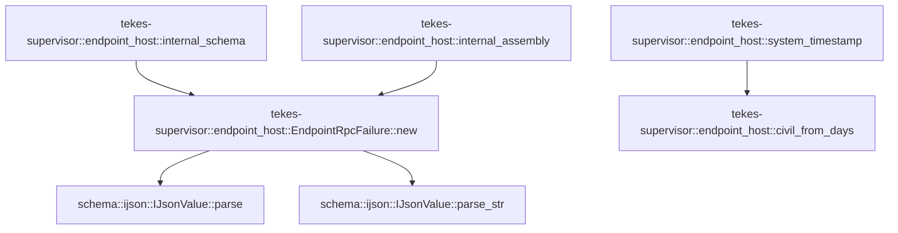

```mermaid
flowchart TD
  n0["endpoint::host::EndpointDispatcher::new"]
  n1["endpoint::idempotency::RpcRegistry::open"]
  n2["endpoint::types::validate_session_id"]
  n3["provider::dialect::resolve_profile"]
  n4["tekes-supervisor::endpoint_host::ProductionEndpointHost::ensure_active_session"]
  n5["tekes-supervisor::endpoint_host::ProductionEndpointHost::capabilities"]
  n6["tekes-supervisor::endpoint_host::ProductionEndpointHost::extension_capabilities"]
  n7["tekes-supervisor::endpoint_host::ProductionEndpointHost::method_class"]
  n8["tekes-supervisor::endpoint_host::ProductionEndpointHost::validate_request"]
  n9["tekes-supervisor::endpoint_host::ProductionEndpointHost::call"]
  n10["tekes-supervisor::endpoint_host::ProductionEndpointAssembly::open"]
  n11["tekes-supervisor::endpoint_host::ProductionEndpointAssembly::open_with_clock"]
  n12["tekes-supervisor::endpoint_host::ProductionEndpointAssembly::open_with_routes"]
  n13["tekes-supervisor::endpoint_host::ProductionEndpointAssembly::open_with_route_authority"]
  n14["tekes-supervisor::endpoint_host::ProductionEndpointAssembly::open_with_authorities"]
  n15["tekes-supervisor::endpoint_host::ProductionEndpointAssembly::open_with_full_authorities"]
  n16["tekes-supervisor::endpoint_host::ProductionEndpointAssembly::dispatch"]
  n17["tekes-supervisor::endpoint_host::ProductionEndpointAssembly::hub"]
  n18["tekes-supervisor::endpoint_host::ProductionEndpointAssembly::host"]
  n19["tekes-supervisor::endpoint_host::ProductionEndpointAssembly::admission_gates"]
  n20["tekes-supervisor::endpoint_host::ProductionEndpointAssembly::has_incomplete_management_operation"]
  n21["tekes-supervisor::endpoint_host::success"]
  n22["tekes-supervisor::endpoint_host::model_projection"]
  n23["tekes-supervisor::endpoint_host::ConfiguredModels::model_available"]
  n24["tekes-supervisor::endpoint_host::model_is_configured"]
  n25["tekes-supervisor::endpoint_host::internal_failure"]
  n26["tekes-supervisor::endpoint_host::to_ijson"]
  n27["tekes-supervisor::endpoint_host::validate_production_payload"]
  n28["tekes-supervisor::endpoint_host::invalid"]
  n29["tekes-supervisor::endpoint_host::EndpointRpcFailure::new"]
  n30["tekes-supervisor::endpoint_host::ProductionEndpointHost::open"]
  n31["tekes-supervisor::endpoint_host::ProductionEndpointHost::open_with_clock"]
  n32["tekes-supervisor::endpoint_host::ProductionEndpointHost::open_with_routes"]
  n33["tekes-supervisor::endpoint_host::ProductionEndpointHost::open_with_full_authorities"]
  n34["tekes-supervisor::endpoint_host::ProductionEndpointHost::open_with_route_authority"]
  n4 --> n2
  n4 --> n28
  n4 --> n29
  n8 --> n27
  n10 --> n0
  n10 --> n1
  n10 --> n30
  n11 --> n0
  n11 --> n1
  n11 --> n31
  n12 --> n0
  n12 --> n1
  n12 --> n32
  n13 --> n0
  n13 --> n1
  n13 --> n34
  n14 --> n15
  n15 --> n0
  n15 --> n1
  n15 --> n33
  n22 --> n3
  n22 --> n24
  n22 --> n25
  n22 --> n26
  n23 --> n24
```

```mermaid
flowchart TD
  n0["provider::dialect::resolve_profile"]
  n1["schema::ijson::IJsonValue::parse"]
  n2["tekes-supervisor::endpoint_host::model_is_configured"]
  n3["tekes-supervisor::endpoint_host::runtime_failure_name"]
  n4["tekes-supervisor::endpoint_host::map_production_route"]
  n5["tekes-supervisor::endpoint_host::map_production_route_for"]
  n6["tekes-supervisor::endpoint_host::sanitized_route_log_message"]
  n7["tekes-supervisor::endpoint_host::production_failure_is_exact_for"]
  n8["tekes-supervisor::endpoint_host::route_error_is_exact"]
  n9["tekes-supervisor::endpoint_host::route_error_message"]
  n10["tekes-supervisor::endpoint_host::exact_string_fields"]
  n11["tekes-supervisor::endpoint_host::route_allows_error"]
  n12["tekes-supervisor::endpoint_host::internal_failure"]
  n13["tekes-supervisor::endpoint_host::failure"]
  n14["tekes-supervisor::endpoint_host::required_string"]
  n15["tekes-supervisor::endpoint_host::required_string_allow_whitespace"]
  n16["tekes-supervisor::endpoint_host::optional_bool"]
  n17["tekes-supervisor::endpoint_host::optional_string"]
  n18["tekes-supervisor::endpoint_host::require_object_fields"]
  n19["tekes-supervisor::endpoint_host::optional_u64"]
  n20["tekes-supervisor::endpoint_host::to_ijson"]
  n21["tekes-supervisor::endpoint_host::request_hash"]
  n22["tekes-supervisor::endpoint_host::invalid"]
  n23["tekes-supervisor::endpoint_host::EndpointRpcFailure::new"]
  n2 --> n0
  n5 --> n4
  n5 --> n6
  n5 --> n7
  n5 --> n12
  n6 --> n1
  n7 --> n8
  n7 --> n11
  n8 --> n9
  n8 --> n10
  n12 --> n23
  n14 --> n22
  n15 --> n22
  n16 --> n22
  n17 --> n22
  n18 --> n22
  n19 --> n22
  n20 --> n1
  n21 --> n23
```

```mermaid
flowchart TD
  n0["tekes-supervisor::endpoint_host::internal_failure"]
  n1["tekes-supervisor::endpoint_host::require_object_fields"]
  n2["tekes-supervisor::endpoint_host::mark_management_handoff"]
  n3["tekes-supervisor::endpoint_host::mark_event_handoff"]
  n4["tekes-supervisor::endpoint_host::endpoint_origin"]
  n5["tekes-supervisor::endpoint_host::validate_session_title"]
  n6["tekes-supervisor::endpoint_host::PendingQueueAction::with_origin"]
  n7["tekes-supervisor::endpoint_host::queue_action"]
  n8["tekes-supervisor::endpoint_host::map_queue_rejection"]
  n9["tekes-supervisor::endpoint_host::queue_decision"]
  n10["tekes-supervisor::endpoint_host::map_persisted_queue_rejection"]
  n11["tekes-supervisor::endpoint_host::validate_time_zone"]
  n12["tekes-supervisor::endpoint_host::map_prompt_error"]
  n13["tekes-supervisor::endpoint_host::map_attachment_read_error"]
  n14["tekes-supervisor::endpoint_host::attachment_failure"]
  n15["tekes-supervisor::endpoint_host::attachment_reason"]
  n16["tekes-supervisor::endpoint_host::validate_extension_payload"]
  n17["tekes-supervisor::endpoint_host::validate_production_payload"]
  n18["tekes-supervisor::endpoint_host::invalid"]
  n19["tekes-supervisor::endpoint_host::map_endpoint"]
  n20["tekes-supervisor::endpoint_host::map_management"]
  n21["tekes-supervisor::endpoint_host::internal_json"]
  n22["tekes-supervisor::endpoint_host::EndpointRpcFailure::new"]
  n2 --> n22
  n3 --> n0
  n7 --> n18
  n7 --> n22
  n8 --> n22
  n10 --> n0
  n10 --> n8
  n11 --> n18
  n12 --> n0
  n12 --> n14
  n12 --> n18
  n12 --> n22
  n13 --> n0
  n13 --> n14
  n13 --> n22
  n14 --> n22
  n16 --> n1
  n16 --> n22
  n17 --> n1
  n17 --> n16
  n18 --> n22
  n19 --> n22
  n20 --> n22
  n21 --> n22
```

# tekes-supervisor::endpoint_host

[Package atlas](index.md) · [Source](../../src/endpoint_host.rs)

## Declarations

Visibility is the declaration spelling; trait members and reexports require their enclosing interface. `cfg` is not evaluated.

| Symbol | Kind | Visibility | Test / cfg |
|---|---|---|---|
| [tekes-supervisor::endpoint_host::EndpointRouteClass](../../src/endpoint_host.rs#L29) | enum_item | `pub` |  |
| [tekes-supervisor::endpoint_host::EndpointRoute](../../src/endpoint_host.rs#L37) | struct_item | `pub` |  |
| [tekes-supervisor::endpoint_host::TEKES_UNARY_ROUTES](../../src/endpoint_host.rs#L43) | const_item | `pub` |  |
| [tekes-supervisor::endpoint_host::route](../../src/endpoint_host.rs#L70) | function_item | `private` |  |
| [tekes-supervisor::endpoint_host::EndpointClock](../../src/endpoint_host.rs#L78) | type_item | `pub` |  |
| [tekes-supervisor::endpoint_host::RuntimeModelReadiness](../../src/endpoint_host.rs#L81) | struct_item | `pub` |  |
| [tekes-supervisor::endpoint_host::RuntimeProviderStatus](../../src/endpoint_host.rs#L88) | enum_item | `pub` |  |
| [tekes-supervisor::endpoint_host::RuntimeProviderFailure](../../src/endpoint_host.rs#L94) | enum_item | `pub` |  |
| [tekes-supervisor::endpoint_host::RuntimeProviderReadiness](../../src/endpoint_host.rs#L102) | struct_item | `pub` |  |
| [tekes-supervisor::endpoint_host::ProviderReadinessAuthority](../../src/endpoint_host.rs#L111) | trait_item | `pub` |  |
| [tekes-supervisor::endpoint_host::ProviderReadinessAuthority::readiness](../../src/endpoint_host.rs#L112) | function_signature_item | `private` |  |
| [tekes-supervisor::endpoint_host::ProviderReadinessAuthority::config_mutation_succeeded](../../src/endpoint_host.rs#L121) | function_item | `private` |  |
| [tekes-supervisor::endpoint_host::SessionDeliveryAuthority](../../src/endpoint_host.rs#L130) | trait_item | `pub` |  |
| [tekes-supervisor::endpoint_host::SessionDeliveryAuthority::session_metadata_changed](../../src/endpoint_host.rs#L134) | function_item | `private` |  |
| [tekes-supervisor::endpoint_host::SessionDeliveryAuthority::workspace_metadata_changed](../../src/endpoint_host.rs#L138) | function_item | `private` |  |
| [tekes-supervisor::endpoint_host::SessionDeliveryAuthority::prompt](../../src/endpoint_host.rs#L140) | function_signature_item | `private` |  |
| [tekes-supervisor::endpoint_host::SessionDeliveryAuthority::cancel](../../src/endpoint_host.rs#L149) | function_signature_item | `private` |  |
| [tekes-supervisor::endpoint_host::SessionDeliveryAuthority::rename](../../src/endpoint_host.rs#L156) | function_signature_item | `private` |  |
| [tekes-supervisor::endpoint_host::SessionDeliveryAuthority::compact](../../src/endpoint_host.rs#L170) | function_item | `private` |  |
| [tekes-supervisor::endpoint_host::QueueTransactionAuthority](../../src/endpoint_host.rs#L187) | trait_item | `pub` |  |
| [tekes-supervisor::endpoint_host::QueueTransactionAuthority::execute](../../src/endpoint_host.rs#L188) | function_signature_item | `private` |  |
| [tekes-supervisor::endpoint_host::recover_pending_management](../../src/endpoint_host.rs#L201) | function_item | `pub(crate)` |  |
| [tekes-supervisor::endpoint_host::QueueRecoveryAdapter](../../src/endpoint_host.rs#L217) | struct_item | `private` |  |
| [tekes-supervisor::endpoint_host::QueueRecoveryAdapter::execute](../../src/endpoint_host.rs#L222) | function_item | `private` |  |
| [tekes-supervisor::endpoint_host::SessionAdmissionGates](../../src/endpoint_host.rs#L259) | struct_item | `pub` |  |
| [tekes-supervisor::endpoint_host::SessionAdmissionGates::gate](../../src/endpoint_host.rs#L264) | function_item | `pub` |  |
| [tekes-supervisor::endpoint_host::SessionInputAdmissionAuthority](../../src/endpoint_host.rs#L283) | struct_item | `pub` |  |
| [tekes-supervisor::endpoint_host::SessionInputAdmissionAuthority::new](../../src/endpoint_host.rs#L290) | function_item | `pub` |  |
| [tekes-supervisor::endpoint_host::SessionInputAdmissionAuthority::gates](../../src/endpoint_host.rs#L298) | function_item | `pub` |  |
| [tekes-supervisor::endpoint_host::SessionInputAdmissionAuthority::root](../../src/endpoint_host.rs#L304) | function_item | `pub` |  |
| [tekes-supervisor::endpoint_host::SessionInputAdmissionAuthority::with_active_session](../../src/endpoint_host.rs#L308) | function_item | `pub` |  |
| [tekes-supervisor::endpoint_host::SessionInputAdmissionAuthority::with_session_gate](../../src/endpoint_host.rs#L333) | function_item | `pub` |  |
| [tekes-supervisor::endpoint_host::session_details](../../src/endpoint_host.rs#L358) | function_item | `private` |  |
| [tekes-supervisor::endpoint_host::ProductionEndpointRoutes](../../src/endpoint_host.rs#L368) | trait_item | `pub` |  |
| [tekes-supervisor::endpoint_host::ProductionEndpointRoutes::capabilities](../../src/endpoint_host.rs#L369) | function_signature_item | `private` |  |
| [tekes-supervisor::endpoint_host::ProductionEndpointRoutes::extension_method_class](../../src/endpoint_host.rs#L374) | function_item | `private` |  |
| [tekes-supervisor::endpoint_host::ProductionEndpointRoutes::validate_extension_payload](../../src/endpoint_host.rs#L380) | function_item | `private` |  |
| [tekes-supervisor::endpoint_host::ProductionEndpointRoutes::extension_failure_is_exact](../../src/endpoint_host.rs#L395) | function_item | `private` |  |
| [tekes-supervisor::endpoint_host::ProductionEndpointRoutes::execute](../../src/endpoint_host.rs#L403) | function_signature_item | `private` |  |
| [tekes-supervisor::endpoint_host::CompositeProductionEndpointRoutes](../../src/endpoint_host.rs#L414) | struct_item | `pub` |  |
| [tekes-supervisor::endpoint_host::CompositeProductionEndpointRoutes::compose](../../src/endpoint_host.rs#L419) | function_item | `pub` |  |
| [tekes-supervisor::endpoint_host::CompositeProductionEndpointRoutes::owner](../../src/endpoint_host.rs#L447) | function_item | `private` |  |
| [tekes-supervisor::endpoint_host::CompositeProductionEndpointRoutes::capabilities](../../src/endpoint_host.rs#L453) | function_item | `private` |  |
| [tekes-supervisor::endpoint_host::CompositeProductionEndpointRoutes::extension_method_class](../../src/endpoint_host.rs#L457) | function_item | `private` |  |
| [tekes-supervisor::endpoint_host::CompositeProductionEndpointRoutes::validate_extension_payload](../../src/endpoint_host.rs#L461) | function_item | `private` |  |
| [tekes-supervisor::endpoint_host::CompositeProductionEndpointRoutes::extension_failure_is_exact](../../src/endpoint_host.rs#L471) | function_item | `private` |  |
| [tekes-supervisor::endpoint_host::CompositeProductionEndpointRoutes::execute](../../src/endpoint_host.rs#L480) | function_item | `private` |  |
| [tekes-supervisor::endpoint_host::ProductionRouteCompositionError](../../src/endpoint_host.rs#L493) | enum_item | `pub` |  |
| [tekes-supervisor::endpoint_host::unsupported_route](../../src/endpoint_host.rs#L500) | function_item | `private` |  |
| [tekes-supervisor::endpoint_host::ProductionRouteFailure](../../src/endpoint_host.rs#L510) | struct_item | `pub` |  |
| [tekes-supervisor::endpoint_host::ProductionRouteFailure::new](../../src/endpoint_host.rs#L517) | function_item | `pub` |  |
| [tekes-supervisor::endpoint_host::ProductionEndpointHost](../../src/endpoint_host.rs#L526) | struct_item | `pub` |  |
| [tekes-supervisor::endpoint_host::ProductionEndpointHost::with_preset_mcp](../../src/endpoint_host.rs#L548) | function_item | `pub` |  |
| [tekes-supervisor::endpoint_host::ProductionEndpointHost::with_user_agent_dir](../../src/endpoint_host.rs#L561) | function_item | `pub` |  |
| [tekes-supervisor::endpoint_host::ProductionEndpointHost::mux_description](../../src/endpoint_host.rs#L566) | function_item | `pub` |  |
| [tekes-supervisor::endpoint_host::ProductionEndpointHost::open](../../src/endpoint_host.rs#L591) | function_item | `pub` |  |
| [tekes-supervisor::endpoint_host::ProductionEndpointHost::open_with_clock](../../src/endpoint_host.rs#L606) | function_item | `pub` |  |
| [tekes-supervisor::endpoint_host::ProductionEndpointHost::open_with_routes](../../src/endpoint_host.rs#L615) | function_item | `pub` |  |
| [tekes-supervisor::endpoint_host::ProductionEndpointHost::open_with_authorities](../../src/endpoint_host.rs#L624) | function_item | `pub` |  |
| [tekes-supervisor::endpoint_host::ProductionEndpointHost::open_with_full_authorities](../../src/endpoint_host.rs#L642) | function_item | `pub` |  |
| [tekes-supervisor::endpoint_host::ProductionEndpointHost::open_with_full_authorities_and_session_admission](../../src/endpoint_host.rs#L665) | function_item | `pub` |  |
| [tekes-supervisor::endpoint_host::ProductionEndpointHost::open_with_route_authority](../../src/endpoint_host.rs#L691) | function_item | `pub` |  |
| [tekes-supervisor::endpoint_host::ProductionEndpointHost::open_with_route_ownership](../../src/endpoint_host.rs#L714) | function_item | `private` |  |
| [tekes-supervisor::endpoint_host::ProductionEndpointHost::implemented_capabilities](../../src/endpoint_host.rs#L783) | function_item | `pub` |  |
| [tekes-supervisor::endpoint_host::ProductionEndpointHost::admission_gates](../../src/endpoint_host.rs#L792) | function_item | `pub` |  |
| [tekes-supervisor::endpoint_host::ProductionEndpointHost::has_incomplete_management_operation](../../src/endpoint_host.rs#L796) | function_item | `pub` |  |
| [tekes-supervisor::endpoint_host::ProductionEndpointHost::execute](../../src/endpoint_host.rs#L805) | function_item | `private` |  |
| [tekes-supervisor::endpoint_host::ProductionEndpointHost::execute_inner](../../src/endpoint_host.rs#L813) | function_item | `private` |  |
| [tekes-supervisor::endpoint_host::ProductionEndpointHost::execute_extension](../../src/endpoint_host.rs#L844) | function_item | `private` |  |
| [tekes-supervisor::endpoint_host::ProductionEndpointHost::create_workspace](../../src/endpoint_host.rs#L893) | function_item | `private` |  |
| [tekes-supervisor::endpoint_host::ProductionEndpointHost::rename_workspace](../../src/endpoint_host.rs#L910) | function_item | `private` |  |
| [tekes-supervisor::endpoint_host::ProductionEndpointHost::relocate_workspace](../../src/endpoint_host.rs#L932) | function_item | `private` |  |
| [tekes-supervisor::endpoint_host::ProductionEndpointHost::archive_session](../../src/endpoint_host.rs#L978) | function_item | `private` |  |
| [tekes-supervisor::endpoint_host::ProductionEndpointHost::unarchive_session](../../src/endpoint_host.rs#L1001) | function_item | `private` |  |
| [tekes-supervisor::endpoint_host::ProductionEndpointHost::create_session](../../src/endpoint_host.rs#L1018) | function_item | `private` |  |
| [tekes-supervisor::endpoint_host::ProductionEndpointHost::draft_models](../../src/endpoint_host.rs#L1085) | function_item | `private` |  |
| [tekes-supervisor::endpoint_host::ProductionEndpointHost::models](../../src/endpoint_host.rs#L1130) | function_item | `private` |  |
| [tekes-supervisor::endpoint_host::ProductionEndpointHost::select_model](../../src/endpoint_host.rs#L1150) | function_item | `private` |  |
| [tekes-supervisor::endpoint_host::ProductionEndpointHost::cancel](../../src/endpoint_host.rs#L1209) | function_item | `private` |  |
| [tekes-supervisor::endpoint_host::ProductionEndpointHost::rename_session](../../src/endpoint_host.rs#L1239) | function_item | `private` |  |
| [tekes-supervisor::endpoint_host::ProductionEndpointHost::update_queue](../../src/endpoint_host.rs#L1277) | function_item | `private` |  |
| [tekes-supervisor::endpoint_host::ProductionEndpointHost::prompt](../../src/endpoint_host.rs#L1366) | function_item | `private` |  |
| [tekes-supervisor::endpoint_host::ProductionEndpointHost::attachment](../../src/endpoint_host.rs#L1423) | function_item | `private` |  |
| [tekes-supervisor::endpoint_host::ProductionEndpointHost::fork_session](../../src/endpoint_host.rs#L1439) | function_item | `private` |  |
| [tekes-supervisor::endpoint_host::ProductionEndpointHost::discard_session](../../src/endpoint_host.rs#L1480) | function_item | `private` |  |
| [tekes-supervisor::endpoint_host::ProductionEndpointHost::admission_gate](../../src/endpoint_host.rs#L1503) | function_item | `private` |  |
| [tekes-supervisor::endpoint_host::ProductionEndpointHost::ensure_active_session](../../src/endpoint_host.rs#L1510) | function_item | `private` |  |
| [tekes-supervisor::endpoint_host::ProductionEndpointHost::capabilities](../../src/endpoint_host.rs#L1531) | function_item | `private` |  |
| [tekes-supervisor::endpoint_host::ProductionEndpointHost::extension_capabilities](../../src/endpoint_host.rs#L1552) | function_item | `private` |  |
| [tekes-supervisor::endpoint_host::ProductionEndpointHost::method_class](../../src/endpoint_host.rs#L1562) | function_item | `private` |  |
| [tekes-supervisor::endpoint_host::ProductionEndpointHost::validate_request](../../src/endpoint_host.rs#L1578) | function_item | `private` |  |
| [tekes-supervisor::endpoint_host::ProductionEndpointHost::call](../../src/endpoint_host.rs#L1602) | function_item | `private` |  |
| [tekes-supervisor::endpoint_host::ProductionEndpointAssembly](../../src/endpoint_host.rs#L1607) | struct_item | `pub` |  |
| [tekes-supervisor::endpoint_host::ProductionEndpointAssembly::open](../../src/endpoint_host.rs#L1614) | function_item | `pub` |  |
| [tekes-supervisor::endpoint_host::ProductionEndpointAssembly::open_with_clock](../../src/endpoint_host.rs#L1626) | function_item | `pub` |  |
| [tekes-supervisor::endpoint_host::ProductionEndpointAssembly::open_with_routes](../../src/endpoint_host.rs#L1639) | function_item | `pub` |  |
| [tekes-supervisor::endpoint_host::ProductionEndpointAssembly::open_with_route_authority](../../src/endpoint_host.rs#L1653) | function_item | `pub` |  |
| [tekes-supervisor::endpoint_host::ProductionEndpointAssembly::open_with_authorities](../../src/endpoint_host.rs#L1675) | function_item | `pub` |  |
| [tekes-supervisor::endpoint_host::ProductionEndpointAssembly::open_with_full_authorities](../../src/endpoint_host.rs#L1693) | function_item | `pub` |  |
| [tekes-supervisor::endpoint_host::ProductionEndpointAssembly::dispatch](../../src/endpoint_host.rs#L1718) | function_item | `pub` |  |
| [tekes-supervisor::endpoint_host::ProductionEndpointAssembly::hub](../../src/endpoint_host.rs#L1726) | function_item | `pub` |  |
| [tekes-supervisor::endpoint_host::ProductionEndpointAssembly::host](../../src/endpoint_host.rs#L1731) | function_item | `pub` |  |
| [tekes-supervisor::endpoint_host::ProductionEndpointAssembly::admission_gates](../../src/endpoint_host.rs#L1736) | function_item | `pub` |  |
| [tekes-supervisor::endpoint_host::ProductionEndpointAssembly::has_incomplete_management_operation](../../src/endpoint_host.rs#L1740) | function_item | `pub` |  |
| [tekes-supervisor::endpoint_host::success](../../src/endpoint_host.rs#L1748) | function_item | `private` |  |
| [tekes-supervisor::endpoint_host::model_projection](../../src/endpoint_host.rs#L1756) | function_item | `private` |  |
| [tekes-supervisor::endpoint_host::ConfiguredModels](../../src/endpoint_host.rs#L1853) | struct_item | `pub` |  |
| [tekes-supervisor::endpoint_host::ConfiguredModels::model_available](../../src/endpoint_host.rs#L1856) | function_item | `private` |  |
| [tekes-supervisor::endpoint_host::model_is_configured](../../src/endpoint_host.rs#L1867) | function_item | `private` |  |
| [tekes-supervisor::endpoint_host::runtime_failure_name](../../src/endpoint_host.rs#L1898) | function_item | `private` |  |
| [tekes-supervisor::endpoint_host::map_production_route](../../src/endpoint_host.rs#L1907) | function_item | `private` |  |
| [tekes-supervisor::endpoint_host::map_production_route_for](../../src/endpoint_host.rs#L1915) | function_item | `private` |  |
| [tekes-supervisor::endpoint_host::sanitized_route_log_message](../../src/endpoint_host.rs#L1929) | function_item | `private` |  |
| [tekes-supervisor::endpoint_host::production_failure_is_exact_for](../../src/endpoint_host.rs#L1949) | function_item | `pub(crate)` |  |
| [tekes-supervisor::endpoint_host::route_error_is_exact](../../src/endpoint_host.rs#L1956) | function_item | `private` |  |
| [tekes-supervisor::endpoint_host::route_error_message](../../src/endpoint_host.rs#L2040) | function_item | `private` |  |
| [tekes-supervisor::endpoint_host::exact_string_fields](../../src/endpoint_host.rs#L2072) | function_item | `private` |  |
| [tekes-supervisor::endpoint_host::route_allows_error](../../src/endpoint_host.rs#L2093) | function_item | `private` |  |
| [tekes-supervisor::endpoint_host::internal_failure](../../src/endpoint_host.rs#L2201) | function_item | `private` |  |
| [tekes-supervisor::endpoint_host::failure](../../src/endpoint_host.rs#L2205) | function_item | `private` |  |
| [tekes-supervisor::endpoint_host::required_string](../../src/endpoint_host.rs#L2217) | function_item | `private` |  |
| [tekes-supervisor::endpoint_host::required_string_allow_whitespace](../../src/endpoint_host.rs#L2226) | function_item | `private` |  |
| [tekes-supervisor::endpoint_host::optional_bool](../../src/endpoint_host.rs#L2237) | function_item | `private` |  |
| [tekes-supervisor::endpoint_host::optional_string](../../src/endpoint_host.rs#L2247) | function_item | `private` |  |
| [tekes-supervisor::endpoint_host::require_object_fields](../../src/endpoint_host.rs#L2258) | function_item | `private` |  |
| [tekes-supervisor::endpoint_host::optional_u64](../../src/endpoint_host.rs#L2274) | function_item | `private` |  |
| [tekes-supervisor::endpoint_host::to_ijson](../../src/endpoint_host.rs#L2284) | function_item | `private` |  |
| [tekes-supervisor::endpoint_host::request_hash](../../src/endpoint_host.rs#L2288) | function_item | `private` |  |
| [tekes-supervisor::endpoint_host::mark_management_handoff](../../src/endpoint_host.rs#L2302) | function_item | `private` |  |
| [tekes-supervisor::endpoint_host::mark_event_handoff](../../src/endpoint_host.rs#L2316) | function_item | `private` |  |
| [tekes-supervisor::endpoint_host::endpoint_origin](../../src/endpoint_host.rs#L2330) | function_item | `private` |  |
| [tekes-supervisor::endpoint_host::validate_session_title](../../src/endpoint_host.rs#L2345) | function_item | `private` |  |
| [tekes-supervisor::endpoint_host::PendingQueueAction](../../src/endpoint_host.rs#L2356) | enum_item | `private` |  |
| [tekes-supervisor::endpoint_host::PendingQueueAction::with_origin](../../src/endpoint_host.rs#L2363) | function_item | `private` |  |
| [tekes-supervisor::endpoint_host::queue_action](../../src/endpoint_host.rs#L2379) | function_item | `private` |  |
| [tekes-supervisor::endpoint_host::map_queue_rejection](../../src/endpoint_host.rs#L2429) | function_item | `private` |  |
| [tekes-supervisor::endpoint_host::queue_decision](../../src/endpoint_host.rs#L2453) | function_item | `private` |  |
| [tekes-supervisor::endpoint_host::map_persisted_queue_rejection](../../src/endpoint_host.rs#L2478) | function_item | `private` |  |
| [tekes-supervisor::endpoint_host::validate_time_zone](../../src/endpoint_host.rs#L2492) | function_item | `private` |  |
| [tekes-supervisor::endpoint_host::map_prompt_error](../../src/endpoint_host.rs#L2518) | function_item | `private` |  |
| [tekes-supervisor::endpoint_host::map_attachment_read_error](../../src/endpoint_host.rs#L2538) | function_item | `private` |  |
| [tekes-supervisor::endpoint_host::attachment_failure](../../src/endpoint_host.rs#L2555) | function_item | `private` |  |
| [tekes-supervisor::endpoint_host::attachment_reason](../../src/endpoint_host.rs#L2563) | function_item | `private` |  |
| [tekes-supervisor::endpoint_host::validate_extension_payload](../../src/endpoint_host.rs#L2578) | function_item | `private` |  |
| [tekes-supervisor::endpoint_host::validate_production_payload](../../src/endpoint_host.rs#L2631) | function_item | `private` |  |
| [tekes-supervisor::endpoint_host::invalid](../../src/endpoint_host.rs#L2648) | function_item | `private` |  |
| [tekes-supervisor::endpoint_host::map_endpoint](../../src/endpoint_host.rs#L2652) | function_item | `private` |  |
| [tekes-supervisor::endpoint_host::map_management](../../src/endpoint_host.rs#L2669) | function_item | `private` |  |
| [tekes-supervisor::endpoint_host::internal_json](../../src/endpoint_host.rs#L2777) | function_item | `private` |  |
| [tekes-supervisor::endpoint_host::internal_schema](../../src/endpoint_host.rs#L2781) | function_item | `private` |  |
| [tekes-supervisor::endpoint_host::internal_assembly](../../src/endpoint_host.rs#L2785) | function_item | `private` |  |
| [tekes-supervisor::endpoint_host::EndpointRpcFailure](../../src/endpoint_host.rs#L2789) | struct_item | `private` |  |
| [tekes-supervisor::endpoint_host::EndpointRpcFailure::new](../../src/endpoint_host.rs#L2796) | function_item | `private` |  |
| [tekes-supervisor::endpoint_host::system_timestamp](../../src/endpoint_host.rs#L2808) | function_item | `private` |  |
| [tekes-supervisor::endpoint_host::civil_from_days](../../src/endpoint_host.rs#L2825) | function_item | `private` |  |
| [tekes-supervisor::endpoint_host::EndpointAssemblyError](../../src/endpoint_host.rs#L2841) | enum_item | `pub` |  |

## Imports / reexports

| Local name | Source path | Visibility |
|---|---|---|
| `BTreeSet` | `std::collections::BTreeSet` | `private` |
| `HashMap` | `std::collections::HashMap` | `private` |
| `Path` | `std::path::Path` | `private` |
| `PathBuf` | `std::path::PathBuf` | `private` |
| `Arc` | `std::sync::Arc` | `private` |
| `Mutex` | `std::sync::Mutex` | `private` |
| `SystemTime` | `std::time::SystemTime` | `private` |
| `UNIX_EPOCH` | `std::time::UNIX_EPOCH` | `private` |
| `AttachmentAuthority` | `endpoint::AttachmentAuthority` | `private` |
| `AttachmentErrorReason` | `endpoint::AttachmentErrorReason` | `private` |
| `AttachmentReadError` | `endpoint::AttachmentReadError` | `private` |
| `ClientRequest` | `endpoint::ClientRequest` | `private` |
| `DurableHandoffProof` | `endpoint::DurableHandoffProof` | `private` |
| `EndpointDispatcher` | `endpoint::EndpointDispatcher` | `private` |
| `EndpointHost` | `endpoint::EndpointHost` | `private` |
| `EndpointHostCall` | `endpoint::EndpointHostCall` | `private` |
| `EndpointHostFuture` | `endpoint::EndpointHostFuture` | `private` |
| `EndpointSubscriptionHub` | `endpoint::EndpointSubscriptionHub` | `private` |
| `ForkSessionOperation` | `endpoint::ForkSessionOperation` | `private` |
| `HostFailure` | `endpoint::HostFailure` | `private` |
| `ManagementError` | `endpoint::ManagementError` | `private` |
| `ManagementStore` | `endpoint::ManagementStore` | `private` |
| `MaterializedPrompt` | `endpoint::MaterializedPrompt` | `private` |
| `NativeEndpoint` | `endpoint::NativeEndpoint` | `private` |
| `NativeEndpointError` | `endpoint::NativeEndpointError` | `private` |
| `PendingQueueTransaction` | `endpoint::PendingQueueTransaction` | `private` |
| `PromptMaterializeError` | `endpoint::PromptMaterializeError` | `private` |
| `PromptPart` | `endpoint::PromptPart` | `private` |
| `QueueRecoveryDriver` | `endpoint::QueueRecoveryDriver` | `private` |
| `QueueTransactionCompletion` | `endpoint::QueueTransactionCompletion` | `private` |
| `QueueTransactionDecision` | `endpoint::QueueTransactionDecision` | `private` |
| `QueueTransactionOperation` | `endpoint::QueueTransactionOperation` | `private` |
| `QueueTransactionState` | `endpoint::QueueTransactionState` | `private` |
| `RpcDurableIdentity` | `endpoint::RpcDurableIdentity` | `private` |
| `RpcError` | `endpoint::RpcError` | `private` |
| `RpcRegistry` | `endpoint::RpcRegistry` | `private` |
| `RpcResult` | `endpoint::RpcResult` | `private` |
| `SelectModelOperation` | `endpoint::SelectModelOperation` | `private` |
| `ServerResponse` | `endpoint::ServerResponse` | `private` |
| `SessionCreateOperation` | `endpoint::SessionCreateOperation` | `private` |
| `SessionHostDescription` | `endpoint::SessionHostDescription` | `private` |
| `IJsonValue` | `schema::IJsonValue` | `private` |
| `OriginTuple` | `schema::OriginTuple` | `private` |
| `Value` | `serde_json::Value` | `private` |
| `json` | `serde_json::json` | `private` |
| `Digest` | `sha2::Digest` | `private` |
| `Sha256` | `sha2::Sha256` | `private` |
| `Error` | `thiserror::Error` | `private` |

## Module declarations

| Module | Visibility | Attributes |
|---|---|---|

## Function call graphs

Edges below are syntactically resolved calls only, including private functions. Graphs partition callers into groups of 20; they are not execution order. All unresolved sites are listed below and in the JSON inventory.

Functions 1–20: 16 direct edges

Functions 21–40: 16 direct edges

Functions 41–60: 148 direct edges

Functions 61–80: 25 direct edges

Functions 81–100: 19 direct edges

Functions 101–120: 24 direct edges

Functions 121–125: 5 direct edges

## Call sites

Includes test functions (marked in declarations). Receiver-type-required sites need type analysis/manual tracing. Calls in closures are attributed to their enclosing function; their occurrence here does not mean the closure executes immediately.

| Caller | Callee expression | Source lines | Target / classification |
|---|---|---|---|
| `TEKES_UNARY_ROUTES` | `route` | [44](../../src/endpoint_host.rs#L44), [45](../../src/endpoint_host.rs#L45), [46](../../src/endpoint_host.rs#L46), [47](../../src/endpoint_host.rs#L47), [52](../../src/endpoint_host.rs#L52), [57](../../src/endpoint_host.rs#L57), [58](../../src/endpoint_host.rs#L58), [59](../../src/endpoint_host.rs#L59), [60](../../src/endpoint_host.rs#L60), [61](../../src/endpoint_host.rs#L61), [62](../../src/endpoint_host.rs#L62), [63](../../src/endpoint_host.rs#L63), [64](../../src/endpoint_host.rs#L64), [65](../../src/endpoint_host.rs#L65), [66](../../src/endpoint_host.rs#L66), [67](../../src/endpoint_host.rs#L67) | [tekes-supervisor::endpoint_host::route](../../src/endpoint_host.rs#L70) |
| `config_mutation_succeeded` | `Ok` | [122](../../src/endpoint_host.rs#L122) | external-constructor-callback-or-unresolved |
| `compact` | `Err` | [177](../../src/endpoint_host.rs#L177) | external-constructor-callback-or-unresolved |
| `compact` | `ProductionRouteFailure::new` | [177](../../src/endpoint_host.rs#L177) | [tekes-supervisor::endpoint_host::ProductionRouteFailure::new](../../src/endpoint_host.rs#L517) |
| `compact` | `IJsonValue::parse_str(r#"{"operation":"compact"}"#).expect` | [180](../../src/endpoint_host.rs#L180) | receiver-type-required |
| `compact` | `IJsonValue::parse_str` | [180](../../src/endpoint_host.rs#L180) | [schema::ijson::IJsonValue::parse_str](../../../schema/src/ijson.rs#L23) |
| `recover_pending_management` | `crate::host_runtime::system_timestamp()         .map_err` | [206](../../src/endpoint_host.rs#L206) | receiver-type-required |
| `recover_pending_management` | `crate::host_runtime::system_timestamp` | [206](../../src/endpoint_host.rs#L206) | [tekes-supervisor::host_runtime::system_timestamp](../../src/host_runtime.rs#L475) |
| `recover_pending_management` | `ManagementError::QueueRecoveryFailed` | [207](../../src/endpoint_host.rs#L207) | external-constructor-callback-or-unresolved |
| `recover_pending_management` | `error.to_string` | [207](../../src/endpoint_host.rs#L207) | receiver-type-required |
| `recover_pending_management` | `ManagementStore::open_recovering_again(         root,         &started_at,         Some(&QueueRecoveryAdapter { authority }),         validated,     )     .map` | [208](../../src/endpoint_host.rs#L208) | receiver-type-required |
| `recover_pending_management` | `ManagementStore::open_recovering_again` | [208](../../src/endpoint_host.rs#L208) | [endpoint::management::ManagementStore::open_recovering_again](../../../endpoint/src/management.rs#L487) |
| `recover_pending_management` | `Some` | [211](../../src/endpoint_host.rs#L211) | external-constructor-callback-or-unresolved |
| `execute` | `serde_json::from_slice(&pending.action.canonical_bytes()?)             .map_err` | [226](../../src/endpoint_host.rs#L226) | receiver-type-required |
| `execute` | `serde_json::from_slice` | [226](../../src/endpoint_host.rs#L226) | external-constructor-callback-or-unresolved |
| `execute` | `pending.action.canonical_bytes` | [226](../../src/endpoint_host.rs#L226) | receiver-type-required |
| `execute` | `pending.rpc_id.clone` | [229](../../src/endpoint_host.rs#L229), [230](../../src/endpoint_host.rs#L230) | receiver-type-required |
| `execute` | `pending.retract_origin.clone` | [232](../../src/endpoint_host.rs#L232) | receiver-type-required |
| `execute` | `transaction.validate().map_err` | [235](../../src/endpoint_host.rs#L235) | receiver-type-required |
| `execute` | `transaction.validate` | [235](../../src/endpoint_host.rs#L235) | receiver-type-required |
| `execute` | `ManagementError::QueueRecoveryFailed` | [236](../../src/endpoint_host.rs#L236), [241](../../src/endpoint_host.rs#L241), [248](../../src/endpoint_host.rs#L248), [250](../../src/endpoint_host.rs#L250) | external-constructor-callback-or-unresolved |
| `execute` | `transaction.replacement_origin` | [240](../../src/endpoint_host.rs#L240) | receiver-type-required |
| `execute` | `pending.replacement_origin.as_ref` | [240](../../src/endpoint_host.rs#L240) | receiver-type-required |
| `execute` | `Err` | [241](../../src/endpoint_host.rs#L241) | external-constructor-callback-or-unresolved |
| `execute` | `"prepared replacement origin disagrees with action".to_owned` | [242](../../src/endpoint_host.rs#L242) | receiver-type-required |
| `execute` | `self             .authority             .execute(&pending.session_id, &transaction)             .map_err` | [245](../../src/endpoint_host.rs#L245) | receiver-type-required |
| `execute` | `self             .authority             .execute` | [245](../../src/endpoint_host.rs#L245) | receiver-type-required |
| `execute` | `result.validate_for(&transaction).map_err` | [249](../../src/endpoint_host.rs#L249) | receiver-type-required |
| `execute` | `result.validate_for` | [249](../../src/endpoint_host.rs#L249) | receiver-type-required |
| `execute` | `Ok` | [254](../../src/endpoint_host.rs#L254) | external-constructor-callback-or-unresolved |
| `execute` | `queue_decision` | [254](../../src/endpoint_host.rs#L254) | [tekes-supervisor::endpoint_host::queue_decision](../../src/endpoint_host.rs#L2453) |
| `gate` | `self.gates.lock().map_err` | [265](../../src/endpoint_host.rs#L265) | receiver-type-required |
| `gate` | `self.gates.lock` | [265](../../src/endpoint_host.rs#L265) | receiver-type-required |
| `gate` | `ProductionRouteFailure::new` | [266](../../src/endpoint_host.rs#L266) | [tekes-supervisor::endpoint_host::ProductionRouteFailure::new](../../src/endpoint_host.rs#L517) |
| `gate` | `IJsonValue::parse_str("{}").expect` | [269](../../src/endpoint_host.rs#L269) | receiver-type-required |
| `gate` | `IJsonValue::parse_str` | [269](../../src/endpoint_host.rs#L269) | [schema::ijson::IJsonValue::parse_str](../../../schema/src/ijson.rs#L23) |
| `gate` | `Ok` | [272](../../src/endpoint_host.rs#L272) | external-constructor-callback-or-unresolved |
| `gate` | `gates             .entry(session_id.to_owned())             .or_insert_with(&#124;&#124; Arc::new(Mutex::new(())))             .clone` | [272](../../src/endpoint_host.rs#L272) | receiver-type-required |
| `gate` | `gates             .entry(session_id.to_owned())             .or_insert_with` | [272](../../src/endpoint_host.rs#L272) | receiver-type-required |
| `gate` | `gates             .entry` | [272](../../src/endpoint_host.rs#L272) | receiver-type-required |
| `gate` | `session_id.to_owned` | [273](../../src/endpoint_host.rs#L273) | receiver-type-required |
| `gate` | `Arc::new` | [274](../../src/endpoint_host.rs#L274) | external-constructor-callback-or-unresolved |
| `gate` | `Mutex::new` | [274](../../src/endpoint_host.rs#L274) | external-constructor-callback-or-unresolved |
| `new` | `root.into` | [292](../../src/endpoint_host.rs#L292) | receiver-type-required |
| `new` | `Arc::new` | [293](../../src/endpoint_host.rs#L293) | external-constructor-callback-or-unresolved |
| `new` | `SessionAdmissionGates::default` | [293](../../src/endpoint_host.rs#L293) | external-constructor-callback-or-unresolved |
| `gates` | `Arc::clone` | [299](../../src/endpoint_host.rs#L299) | external-constructor-callback-or-unresolved |
| `with_active_session` | `self.with_session_gate` | [314](../../src/endpoint_host.rs#L314) | [tekes-supervisor::endpoint_host::SessionInputAdmissionAuthority::with_session_gate](../../src/endpoint_host.rs#L333) |
| `with_active_session` | `self.root.join("archive").join(session_id).is_dir` | [315](../../src/endpoint_host.rs#L315) | receiver-type-required |
| `with_active_session` | `self.root.join("archive").join` | [315](../../src/endpoint_host.rs#L315) | receiver-type-required |
| `with_active_session` | `self.root.join` | [315](../../src/endpoint_host.rs#L315), [322](../../src/endpoint_host.rs#L322) | receiver-type-required |
| `with_active_session` | `Err` | [316](../../src/endpoint_host.rs#L316), [323](../../src/endpoint_host.rs#L323) | external-constructor-callback-or-unresolved |
| `with_active_session` | `map_failure` | [316](../../src/endpoint_host.rs#L316), [323](../../src/endpoint_host.rs#L323) | external-constructor-callback-or-unresolved |
| `with_active_session` | `ProductionRouteFailure::new` | [316](../../src/endpoint_host.rs#L316), [323](../../src/endpoint_host.rs#L323) | [tekes-supervisor::endpoint_host::ProductionRouteFailure::new](../../src/endpoint_host.rs#L517) |
| `with_active_session` | `session_details` | [319](../../src/endpoint_host.rs#L319), [326](../../src/endpoint_host.rs#L326) | [tekes-supervisor::endpoint_host::session_details](../../src/endpoint_host.rs#L358) |
| `with_active_session` | `self.root.join("threads").join(session_id).is_dir` | [322](../../src/endpoint_host.rs#L322) | receiver-type-required |
| `with_active_session` | `self.root.join("threads").join` | [322](../../src/endpoint_host.rs#L322) | receiver-type-required |
| `with_active_session` | `operation` | [329](../../src/endpoint_host.rs#L329) | external-constructor-callback-or-unresolved |
| `with_session_gate` | `endpoint::validate_session_id(session_id).is_err` | [339](../../src/endpoint_host.rs#L339) | receiver-type-required |
| `with_session_gate` | `endpoint::validate_session_id` | [339](../../src/endpoint_host.rs#L339) | [endpoint::types::validate_session_id](../../../endpoint/src/types.rs#L130) |
| `with_session_gate` | `Err` | [340](../../src/endpoint_host.rs#L340) | external-constructor-callback-or-unresolved |
| `with_session_gate` | `map_failure` | [340](../../src/endpoint_host.rs#L340), [348](../../src/endpoint_host.rs#L348) | external-constructor-callback-or-unresolved |
| `with_session_gate` | `ProductionRouteFailure::new` | [340](../../src/endpoint_host.rs#L340), [348](../../src/endpoint_host.rs#L348) | [tekes-supervisor::endpoint_host::ProductionRouteFailure::new](../../src/endpoint_host.rs#L517) |
| `with_session_gate` | `IJsonValue::parse_str("{}").expect` | [343](../../src/endpoint_host.rs#L343), [351](../../src/endpoint_host.rs#L351) | receiver-type-required |
| `with_session_gate` | `IJsonValue::parse_str` | [343](../../src/endpoint_host.rs#L343), [351](../../src/endpoint_host.rs#L351) | [schema::ijson::IJsonValue::parse_str](../../../schema/src/ijson.rs#L23) |
| `with_session_gate` | `self.gates.gate(session_id).map_err` | [346](../../src/endpoint_host.rs#L346) | receiver-type-required |
| `with_session_gate` | `self.gates.gate` | [346](../../src/endpoint_host.rs#L346) | receiver-type-required |
| `with_session_gate` | `gate.lock().map_err` | [347](../../src/endpoint_host.rs#L347) | receiver-type-required |
| `with_session_gate` | `gate.lock` | [347](../../src/endpoint_host.rs#L347) | receiver-type-required |
| `with_session_gate` | `operation` | [354](../../src/endpoint_host.rs#L354) | external-constructor-callback-or-unresolved |
| `session_details` | `IJsonValue::parse(&serde_json::to_vec(&json!({"sessionId":session_id})).expect("JSON"))         .expect` | [359](../../src/endpoint_host.rs#L359) | receiver-type-required |
| `session_details` | `IJsonValue::parse` | [359](../../src/endpoint_host.rs#L359) | [schema::ijson::IJsonValue::parse](../../../schema/src/ijson.rs#L16) |
| `session_details` | `serde_json::to_vec(&json!({"sessionId":session_id})).expect` | [359](../../src/endpoint_host.rs#L359) | receiver-type-required |
| `session_details` | `serde_json::to_vec` | [359](../../src/endpoint_host.rs#L359) | external-constructor-callback-or-unresolved |
| `validate_extension_payload` | `Err` | [385](../../src/endpoint_host.rs#L385) | external-constructor-callback-or-unresolved |
| `validate_extension_payload` | `ProductionRouteFailure::new` | [385](../../src/endpoint_host.rs#L385) | [tekes-supervisor::endpoint_host::ProductionRouteFailure::new](../../src/endpoint_host.rs#L517) |
| `validate_extension_payload` | `IJsonValue::parse(&serde_json::to_vec(&json!({"operation":operation})).expect("JSON"))                 .expect` | [388](../../src/endpoint_host.rs#L388) | receiver-type-required |
| `validate_extension_payload` | `IJsonValue::parse` | [388](../../src/endpoint_host.rs#L388) | [schema::ijson::IJsonValue::parse](../../../schema/src/ijson.rs#L16) |
| `validate_extension_payload` | `serde_json::to_vec(&json!({"operation":operation})).expect` | [388](../../src/endpoint_host.rs#L388) | receiver-type-required |
| `validate_extension_payload` | `serde_json::to_vec` | [388](../../src/endpoint_host.rs#L388) | external-constructor-callback-or-unresolved |
| `compose` | `HashMap::new` | [422](../../src/endpoint_host.rs#L422) | external-constructor-callback-or-unresolved |
| `compose` | `TEKES_UNARY_ROUTES             .iter()             .map(&#124;route&#124; route.name)             .collect::<BTreeSet<_>>` | [423](../../src/endpoint_host.rs#L423) | receiver-type-required |
| `compose` | `TEKES_UNARY_ROUTES             .iter()             .map` | [423](../../src/endpoint_host.rs#L423) | receiver-type-required |
| `compose` | `TEKES_UNARY_ROUTES             .iter` | [423](../../src/endpoint_host.rs#L423) | receiver-type-required |
| `compose` | `route.capabilities` | [428](../../src/endpoint_host.rs#L428) | receiver-type-required |
| `compose` | `frozen.contains` | [429](../../src/endpoint_host.rs#L429) | receiver-type-required |
| `compose` | `capability.as_str` | [429](../../src/endpoint_host.rs#L429) | receiver-type-required |
| `compose` | `Err` | [430](../../src/endpoint_host.rs#L430), [438](../../src/endpoint_host.rs#L438) | external-constructor-callback-or-unresolved |
| `compose` | `ProductionRouteCompositionError::FrozenCapability` | [430](../../src/endpoint_host.rs#L430) | external-constructor-callback-or-unresolved |
| `compose` | `owners                     .insert(capability.clone(), Arc::clone(&route))                     .is_some` | [434](../../src/endpoint_host.rs#L434) | receiver-type-required |
| `compose` | `owners                     .insert` | [434](../../src/endpoint_host.rs#L434) | receiver-type-required |
| `compose` | `capability.clone` | [435](../../src/endpoint_host.rs#L435) | receiver-type-required |
| `compose` | `Arc::clone` | [435](../../src/endpoint_host.rs#L435) | external-constructor-callback-or-unresolved |
| `compose` | `ProductionRouteCompositionError::DuplicateCapability` | [438](../../src/endpoint_host.rs#L438) | external-constructor-callback-or-unresolved |
| `compose` | `Ok` | [444](../../src/endpoint_host.rs#L444) | external-constructor-callback-or-unresolved |
| `owner` | `self.owners.get` | [448](../../src/endpoint_host.rs#L448) | receiver-type-required |
| `capabilities` | `self.owners.keys().cloned().collect` | [454](../../src/endpoint_host.rs#L454) | receiver-type-required |
| `capabilities` | `self.owners.keys().cloned` | [454](../../src/endpoint_host.rs#L454) | receiver-type-required |
| `capabilities` | `self.owners.keys` | [454](../../src/endpoint_host.rs#L454) | receiver-type-required |
| `extension_method_class` | `self.owner(method)?.extension_method_class` | [458](../../src/endpoint_host.rs#L458) | receiver-type-required |
| `extension_method_class` | `self.owner` | [458](../../src/endpoint_host.rs#L458) | receiver-type-required |
| `validate_extension_payload` | `self.owner(operation)             .ok_or_else(&#124;&#124; unsupported_route(operation))?             .validate_extension_payload` | [466](../../src/endpoint_host.rs#L466) | receiver-type-required |
| `validate_extension_payload` | `self.owner(operation)             .ok_or_else` | [466](../../src/endpoint_host.rs#L466) | receiver-type-required |
| `validate_extension_payload` | `self.owner` | [466](../../src/endpoint_host.rs#L466) | receiver-type-required |
| `validate_extension_payload` | `unsupported_route` | [467](../../src/endpoint_host.rs#L467) | [tekes-supervisor::endpoint_host::unsupported_route](../../src/endpoint_host.rs#L500) |
| `extension_failure_is_exact` | `self.owner(operation)             .is_some_and` | [476](../../src/endpoint_host.rs#L476) | receiver-type-required |
| `extension_failure_is_exact` | `self.owner` | [476](../../src/endpoint_host.rs#L476) | receiver-type-required |
| `extension_failure_is_exact` | `owner.extension_failure_is_exact` | [477](../../src/endpoint_host.rs#L477) | receiver-type-required |
| `execute` | `self.owner(&request.operation)             .ok_or_else(&#124;&#124; unsupported_route(&request.operation))?             .execute` | [486](../../src/endpoint_host.rs#L486) | receiver-type-required |
| `execute` | `self.owner(&request.operation)             .ok_or_else` | [486](../../src/endpoint_host.rs#L486) | receiver-type-required |
| `execute` | `self.owner` | [486](../../src/endpoint_host.rs#L486) | receiver-type-required |
| `execute` | `unsupported_route` | [487](../../src/endpoint_host.rs#L487) | [tekes-supervisor::endpoint_host::unsupported_route](../../src/endpoint_host.rs#L500) |
| `unsupported_route` | `ProductionRouteFailure::new` | [501](../../src/endpoint_host.rs#L501) | [tekes-supervisor::endpoint_host::ProductionRouteFailure::new](../../src/endpoint_host.rs#L517) |
| `unsupported_route` | `IJsonValue::parse(&serde_json::to_vec(&json!({"operation":operation})).expect("JSON"))             .expect` | [504](../../src/endpoint_host.rs#L504) | receiver-type-required |
| `unsupported_route` | `IJsonValue::parse` | [504](../../src/endpoint_host.rs#L504) | [schema::ijson::IJsonValue::parse](../../../schema/src/ijson.rs#L16) |
| `unsupported_route` | `serde_json::to_vec(&json!({"operation":operation})).expect` | [504](../../src/endpoint_host.rs#L504) | receiver-type-required |
| `unsupported_route` | `serde_json::to_vec` | [504](../../src/endpoint_host.rs#L504) | external-constructor-callback-or-unresolved |
| `new` | `code.into` | [519](../../src/endpoint_host.rs#L519) | receiver-type-required |
| `new` | `message.into` | [520](../../src/endpoint_host.rs#L520) | receiver-type-required |
| `with_preset_mcp` | `Some` | [552](../../src/endpoint_host.rs#L552) | external-constructor-callback-or-unresolved |
| `with_user_agent_dir` | `user_agent_dir.to_path_buf` | [562](../../src/endpoint_host.rs#L562) | receiver-type-required |
| `mux_description` | `endpoint::SessionEndpointCapability::required` | [567](../../src/endpoint_host.rs#L567) | [endpoint::mux::SessionEndpointCapability::required](../../../endpoint/src/mux.rs#L34) |
| `mux_description` | `capabilities.extend` | [568](../../src/endpoint_host.rs#L568) | receiver-type-required |
| `mux_description` | `self.provider_readiness.is_some` | [572](../../src/endpoint_host.rs#L572) | receiver-type-required |
| `mux_description` | `capabilities.insert` | [573](../../src/endpoint_host.rs#L573) | receiver-type-required |
| `mux_description` | `"TekesKernel".to_owned` | [578](../../src/endpoint_host.rs#L578) | receiver-type-required |
| `mux_description` | `self.description.version.clone` | [579](../../src/endpoint_host.rs#L579) | receiver-type-required |
| `mux_description` | `self.description.cwd.clone` | [582](../../src/endpoint_host.rs#L582) | receiver-type-required |
| `mux_description` | `self.description.provider.clone` | [583](../../src/endpoint_host.rs#L583) | receiver-type-required |
| `mux_description` | `self.description.model.clone` | [584](../../src/endpoint_host.rs#L584) | receiver-type-required |
| `mux_description` | `self.description.home.clone` | [586](../../src/endpoint_host.rs#L586) | receiver-type-required |
| `open` | `Self::open_with_full_authorities` | [595](../../src/endpoint_host.rs#L595) | [tekes-supervisor::endpoint_host::ProductionEndpointHost::open_with_full_authorities](../../src/endpoint_host.rs#L642) |
| `open` | `Arc::new` | [598](../../src/endpoint_host.rs#L598) | external-constructor-callback-or-unresolved |
| `open_with_clock` | `root.as_ref` | [611](../../src/endpoint_host.rs#L611) | receiver-type-required |
| `open_with_clock` | `Self::open_with_full_authorities` | [612](../../src/endpoint_host.rs#L612) | [tekes-supervisor::endpoint_host::ProductionEndpointHost::open_with_full_authorities](../../src/endpoint_host.rs#L642) |
| `open_with_routes` | `Self::open_with_full_authorities` | [621](../../src/endpoint_host.rs#L621) | [tekes-supervisor::endpoint_host::ProductionEndpointHost::open_with_full_authorities](../../src/endpoint_host.rs#L642) |
| `open_with_authorities` | `Self::open_with_full_authorities` | [631](../../src/endpoint_host.rs#L631) | [tekes-supervisor::endpoint_host::ProductionEndpointHost::open_with_full_authorities](../../src/endpoint_host.rs#L642) |
| `open_with_full_authorities` | `Self::open_with_route_ownership` | [651](../../src/endpoint_host.rs#L651) | [tekes-supervisor::endpoint_host::ProductionEndpointHost::open_with_route_ownership](../../src/endpoint_host.rs#L714) |
| `open_with_full_authorities_and_session_admission` | `Self::open_with_route_ownership` | [675](../../src/endpoint_host.rs#L675) | [tekes-supervisor::endpoint_host::ProductionEndpointHost::open_with_route_ownership](../../src/endpoint_host.rs#L714) |
| `open_with_full_authorities_and_session_admission` | `Some` | [684](../../src/endpoint_host.rs#L684) | external-constructor-callback-or-unresolved |
| `open_with_route_authority` | `Self::open_with_route_ownership` | [700](../../src/endpoint_host.rs#L700) | [tekes-supervisor::endpoint_host::ProductionEndpointHost::open_with_route_ownership](../../src/endpoint_host.rs#L714) |
| `open_with_route_authority` | `Some` | [704](../../src/endpoint_host.rs#L704) | external-constructor-callback-or-unresolved |
| `open_with_route_ownership` | `root.as_ref` | [725](../../src/endpoint_host.rs#L725) | receiver-type-required |
| `open_with_route_ownership` | `routes.as_ref` | [726](../../src/endpoint_host.rs#L726) | receiver-type-required |
| `open_with_route_ownership` | `TEKES_UNARY_ROUTES                 .iter()                 .map(&#124;route&#124; route.name)                 .collect::<BTreeSet<_>>` | [727](../../src/endpoint_host.rs#L727) | receiver-type-required |
| `open_with_route_ownership` | `TEKES_UNARY_ROUTES                 .iter()                 .map` | [727](../../src/endpoint_host.rs#L727) | receiver-type-required |
| `open_with_route_ownership` | `TEKES_UNARY_ROUTES                 .iter` | [727](../../src/endpoint_host.rs#L727) | receiver-type-required |
| `open_with_route_ownership` | `extension.capabilities().iter().any` | [731](../../src/endpoint_host.rs#L731) | receiver-type-required |
| `open_with_route_ownership` | `extension.capabilities().iter` | [731](../../src/endpoint_host.rs#L731) | receiver-type-required |
| `open_with_route_ownership` | `extension.capabilities` | [731](../../src/endpoint_host.rs#L731) | receiver-type-required |
| `open_with_route_ownership` | `frozen.contains` | [733](../../src/endpoint_host.rs#L733), [735](../../src/endpoint_host.rs#L735) | receiver-type-required |
| `open_with_route_ownership` | `method.as_str` | [733](../../src/endpoint_host.rs#L733), [735](../../src/endpoint_host.rs#L735) | receiver-type-required |
| `open_with_route_ownership` | `Err` | [742](../../src/endpoint_host.rs#L742) | external-constructor-callback-or-unresolved |
| `open_with_route_ownership` | `clock` | [745](../../src/endpoint_host.rs#L745) | external-constructor-callback-or-unresolved |
| `open_with_route_ownership` | `PathBuf::from(&description.home).join` | [746](../../src/endpoint_host.rs#L746) | receiver-type-required |
| `open_with_route_ownership` | `PathBuf::from` | [746](../../src/endpoint_host.rs#L746) | external-constructor-callback-or-unresolved |
| `open_with_route_ownership` | `queue_authority             .as_deref()             .map` | [747](../../src/endpoint_host.rs#L747) | receiver-type-required |
| `open_with_route_ownership` | `queue_authority             .as_deref` | [747](../../src/endpoint_host.rs#L747) | receiver-type-required |
| `open_with_route_ownership` | `ManagementStore::open_at_with_queue_driver` | [750](../../src/endpoint_host.rs#L750) | [endpoint::management::ManagementStore::open_at_with_queue_driver](../../../endpoint/src/management.rs#L476) |
| `open_with_route_ownership` | `queue_recovery                 .as_ref()                 .map` | [753](../../src/endpoint_host.rs#L753) | receiver-type-required |
| `open_with_route_ownership` | `queue_recovery                 .as_ref` | [753](../../src/endpoint_host.rs#L753) | receiver-type-required |
| `open_with_route_ownership` | `Ok` | [759](../../src/endpoint_host.rs#L759) | external-constructor-callback-or-unresolved |
| `open_with_route_ownership` | `root.to_path_buf` | [760](../../src/endpoint_host.rs#L760), [776](../../src/endpoint_host.rs#L776) | receiver-type-required |
| `open_with_route_ownership` | `NativeEndpoint::open` | [761](../../src/endpoint_host.rs#L761) | [endpoint::service::NativeEndpoint::open](../../../endpoint/src/service.rs#L342) |
| `open_with_route_ownership` | `AttachmentAuthority::open` | [762](../../src/endpoint_host.rs#L762) | [endpoint::attachment::AttachmentAuthority::open](../../../endpoint/src/attachment.rs#L242) |
| `open_with_route_ownership` | `input_admission.unwrap_or_else` | [775](../../src/endpoint_host.rs#L775) | receiver-type-required |
| `open_with_route_ownership` | `Arc::new` | [776](../../src/endpoint_host.rs#L776) | external-constructor-callback-or-unresolved |
| `open_with_route_ownership` | `SessionInputAdmissionAuthority::new` | [776](../../src/endpoint_host.rs#L776) | [tekes-supervisor::endpoint_host::SessionInputAdmissionAuthority::new](../../src/endpoint_host.rs#L290) |
| `implemented_capabilities` | `TEKES_UNARY_ROUTES             .iter()             .filter(&#124;route&#124; route.implemented)             .map(&#124;route&#124; route.name.to_owned())             .collect` | [784](../../src/endpoint_host.rs#L784) | receiver-type-required |
| `implemented_capabilities` | `TEKES_UNARY_ROUTES             .iter()             .filter(&#124;route&#124; route.implemented)             .map` | [784](../../src/endpoint_host.rs#L784) | receiver-type-required |
| `implemented_capabilities` | `TEKES_UNARY_ROUTES             .iter()             .filter` | [784](../../src/endpoint_host.rs#L784) | receiver-type-required |
| `implemented_capabilities` | `TEKES_UNARY_ROUTES             .iter` | [784](../../src/endpoint_host.rs#L784) | receiver-type-required |
| `implemented_capabilities` | `route.name.to_owned` | [787](../../src/endpoint_host.rs#L787) | receiver-type-required |
| `admission_gates` | `self.input_admission.gates` | [793](../../src/endpoint_host.rs#L793) | receiver-type-required |
| `has_incomplete_management_operation` | `Ok` | [800](../../src/endpoint_host.rs#L800) | external-constructor-callback-or-unresolved |
| `has_incomplete_management_operation` | `self             .management             .has_incomplete_session_operation` | [800](../../src/endpoint_host.rs#L800) | receiver-type-required |
| `execute` | `self.execute_inner` | [806](../../src/endpoint_host.rs#L806) | [tekes-supervisor::endpoint_host::ProductionEndpointHost::execute_inner](../../src/endpoint_host.rs#L813) |
| `execute` | `success` | [807](../../src/endpoint_host.rs#L807) | [tekes-supervisor::endpoint_host::success](../../src/endpoint_host.rs#L1748) |
| `execute` | `failure` | [810](../../src/endpoint_host.rs#L810) | [tekes-supervisor::endpoint_host::failure](../../src/endpoint_host.rs#L2205) |
| `execute_inner` | `serde_json::from_slice(&request.payload.canonical_bytes().map_err(internal_schema)?)                 .map_err` | [815](../../src/endpoint_host.rs#L815) | receiver-type-required |
| `execute_inner` | `serde_json::from_slice` | [815](../../src/endpoint_host.rs#L815) | external-constructor-callback-or-unresolved |
| `execute_inner` | `request.payload.canonical_bytes().map_err` | [815](../../src/endpoint_host.rs#L815) | receiver-type-required |
| `execute_inner` | `request.payload.canonical_bytes` | [815](../../src/endpoint_host.rs#L815) | receiver-type-required |
| `execute_inner` | `request.operation.as_str` | [817](../../src/endpoint_host.rs#L817) | receiver-type-required |
| `execute_inner` | `self.create_workspace` | [818](../../src/endpoint_host.rs#L818) | [tekes-supervisor::endpoint_host::ProductionEndpointHost::create_workspace](../../src/endpoint_host.rs#L893) |
| `execute_inner` | `self.rename_workspace` | [819](../../src/endpoint_host.rs#L819) | [tekes-supervisor::endpoint_host::ProductionEndpointHost::rename_workspace](../../src/endpoint_host.rs#L910) |
| `execute_inner` | `self.relocate_workspace` | [820](../../src/endpoint_host.rs#L820) | [tekes-supervisor::endpoint_host::ProductionEndpointHost::relocate_workspace](../../src/endpoint_host.rs#L932) |
| `execute_inner` | `self.archive_session` | [821](../../src/endpoint_host.rs#L821) | [tekes-supervisor::endpoint_host::ProductionEndpointHost::archive_session](../../src/endpoint_host.rs#L978) |
| `execute_inner` | `self.unarchive_session` | [822](../../src/endpoint_host.rs#L822) | [tekes-supervisor::endpoint_host::ProductionEndpointHost::unarchive_session](../../src/endpoint_host.rs#L1001) |
| `execute_inner` | `self.create_session` | [823](../../src/endpoint_host.rs#L823) | [tekes-supervisor::endpoint_host::ProductionEndpointHost::create_session](../../src/endpoint_host.rs#L1018) |
| `execute_inner` | `self.provider_readiness.is_some` | [824](../../src/endpoint_host.rs#L824), [825](../../src/endpoint_host.rs#L825), [826](../../src/endpoint_host.rs#L826) | receiver-type-required |
| `execute_inner` | `self.models` | [824](../../src/endpoint_host.rs#L824) | [tekes-supervisor::endpoint_host::ProductionEndpointHost::models](../../src/endpoint_host.rs#L1130) |
| `execute_inner` | `self.draft_models` | [825](../../src/endpoint_host.rs#L825) | [tekes-supervisor::endpoint_host::ProductionEndpointHost::draft_models](../../src/endpoint_host.rs#L1085) |
| `execute_inner` | `self.select_model` | [827](../../src/endpoint_host.rs#L827) | [tekes-supervisor::endpoint_host::ProductionEndpointHost::select_model](../../src/endpoint_host.rs#L1150) |
| `execute_inner` | `self.delivery_authority.is_some` | [829](../../src/endpoint_host.rs#L829), [830](../../src/endpoint_host.rs#L830), [836](../../src/endpoint_host.rs#L836) | receiver-type-required |
| `execute_inner` | `self.cancel` | [829](../../src/endpoint_host.rs#L829) | [tekes-supervisor::endpoint_host::ProductionEndpointHost::cancel](../../src/endpoint_host.rs#L1209) |
| `execute_inner` | `self.rename_session` | [831](../../src/endpoint_host.rs#L831) | [tekes-supervisor::endpoint_host::ProductionEndpointHost::rename_session](../../src/endpoint_host.rs#L1239) |
| `execute_inner` | `self.queue_authority.is_some` | [833](../../src/endpoint_host.rs#L833) | receiver-type-required |
| `execute_inner` | `self.update_queue` | [834](../../src/endpoint_host.rs#L834) | [tekes-supervisor::endpoint_host::ProductionEndpointHost::update_queue](../../src/endpoint_host.rs#L1277) |
| `execute_inner` | `self.prompt` | [836](../../src/endpoint_host.rs#L836) | [tekes-supervisor::endpoint_host::ProductionEndpointHost::prompt](../../src/endpoint_host.rs#L1366) |
| `execute_inner` | `self.attachment` | [837](../../src/endpoint_host.rs#L837) | [tekes-supervisor::endpoint_host::ProductionEndpointHost::attachment](../../src/endpoint_host.rs#L1423) |
| `execute_inner` | `self.fork_session` | [838](../../src/endpoint_host.rs#L838) | [tekes-supervisor::endpoint_host::ProductionEndpointHost::fork_session](../../src/endpoint_host.rs#L1439) |
| `execute_inner` | `self.discard_session` | [839](../../src/endpoint_host.rs#L839) | [tekes-supervisor::endpoint_host::ProductionEndpointHost::discard_session](../../src/endpoint_host.rs#L1480) |
| `execute_inner` | `self.execute_extension` | [840](../../src/endpoint_host.rs#L840) | [tekes-supervisor::endpoint_host::ProductionEndpointHost::execute_extension](../../src/endpoint_host.rs#L844) |
| `execute_extension` | `self.routes.as_ref` | [850](../../src/endpoint_host.rs#L850) | receiver-type-required |
| `execute_extension` | `Err` | [851](../../src/endpoint_host.rs#L851), [858](../../src/endpoint_host.rs#L858) | external-constructor-callback-or-unresolved |
| `execute_extension` | `EndpointRpcFailure::new` | [851](../../src/endpoint_host.rs#L851), [858](../../src/endpoint_host.rs#L858) | [tekes-supervisor::endpoint_host::EndpointRpcFailure::new](../../src/endpoint_host.rs#L2796) |
| `execute_extension` | `routes.capabilities().contains` | [857](../../src/endpoint_host.rs#L857) | receiver-type-required |
| `execute_extension` | `routes.capabilities` | [857](../../src/endpoint_host.rs#L857) | receiver-type-required |
| `execute_extension` | `TEKES_UNARY_ROUTES             .iter()             .any` | [864](../../src/endpoint_host.rs#L864) | receiver-type-required |
| `execute_extension` | `TEKES_UNARY_ROUTES             .iter` | [864](../../src/endpoint_host.rs#L864) | receiver-type-required |
| `execute_extension` | `validate_extension_payload` | [868](../../src/endpoint_host.rs#L868) | [tekes-supervisor::endpoint_host::validate_extension_payload](../../src/endpoint_host.rs#L2578) |
| `execute_extension` | `routes                 .validate_extension_payload(operation, payload)                 .map_err` | [870](../../src/endpoint_host.rs#L870) | receiver-type-required |
| `execute_extension` | `routes                 .validate_extension_payload` | [870](../../src/endpoint_host.rs#L870) | receiver-type-required |
| `execute_extension` | `routes.extension_failure_is_exact` | [873](../../src/endpoint_host.rs#L873), [885](../../src/endpoint_host.rs#L885) | receiver-type-required |
| `execute_extension` | `map_production_route` | [874](../../src/endpoint_host.rs#L874), [886](../../src/endpoint_host.rs#L886) | [tekes-supervisor::endpoint_host::map_production_route](../../src/endpoint_host.rs#L1907) |
| `execute_extension` | `internal_failure` | [876](../../src/endpoint_host.rs#L876), [888](../../src/endpoint_host.rs#L888) | [tekes-supervisor::endpoint_host::internal_failure](../../src/endpoint_host.rs#L2201) |
| `execute_extension` | `routes             .execute(request, payload, &self.principal)             .map_err` | [880](../../src/endpoint_host.rs#L880) | receiver-type-required |
| `execute_extension` | `routes             .execute` | [880](../../src/endpoint_host.rs#L880) | receiver-type-required |
| `execute_extension` | `map_production_route_for` | [884](../../src/endpoint_host.rs#L884) | [tekes-supervisor::endpoint_host::map_production_route_for](../../src/endpoint_host.rs#L1915) |
| `create_workspace` | `require_object_fields` | [898](../../src/endpoint_host.rs#L898) | [tekes-supervisor::endpoint_host::require_object_fields](../../src/endpoint_host.rs#L2258) |
| `create_workspace` | `required_string` | [899](../../src/endpoint_host.rs#L899) | [tekes-supervisor::endpoint_host::required_string](../../src/endpoint_host.rs#L2217) |
| `create_workspace` | `(self.clock)().map_err` | [900](../../src/endpoint_host.rs#L900) | receiver-type-required |
| `create_workspace` | `(self.clock)` | [900](../../src/endpoint_host.rs#L900) | external-constructor-callback-or-unresolved |
| `create_workspace` | `request_hash` | [901](../../src/endpoint_host.rs#L901) | [tekes-supervisor::endpoint_host::request_hash](../../src/endpoint_host.rs#L2288) |
| `create_workspace` | `self             .management             .create_workspace(&request.rpc_id, &hash, path, &timestamp)             .map_err` | [902](../../src/endpoint_host.rs#L902) | receiver-type-required |
| `create_workspace` | `self             .management             .create_workspace` | [902](../../src/endpoint_host.rs#L902) | receiver-type-required |
| `create_workspace` | `mark_management_handoff` | [906](../../src/endpoint_host.rs#L906) | [tekes-supervisor::endpoint_host::mark_management_handoff](../../src/endpoint_host.rs#L2302) |
| `create_workspace` | `to_ijson` | [907](../../src/endpoint_host.rs#L907) | [tekes-supervisor::endpoint_host::to_ijson](../../src/endpoint_host.rs#L2284) |
| `rename_workspace` | `require_object_fields` | [915](../../src/endpoint_host.rs#L915) | [tekes-supervisor::endpoint_host::require_object_fields](../../src/endpoint_host.rs#L2258) |
| `rename_workspace` | `required_string` | [920](../../src/endpoint_host.rs#L920) | [tekes-supervisor::endpoint_host::required_string](../../src/endpoint_host.rs#L2217) |
| `rename_workspace` | `required_string_allow_whitespace` | [921](../../src/endpoint_host.rs#L921) | [tekes-supervisor::endpoint_host::required_string_allow_whitespace](../../src/endpoint_host.rs#L2226) |
| `rename_workspace` | `(self.clock)().map_err` | [922](../../src/endpoint_host.rs#L922) | receiver-type-required |
| `rename_workspace` | `(self.clock)` | [922](../../src/endpoint_host.rs#L922) | external-constructor-callback-or-unresolved |
| `rename_workspace` | `request_hash` | [923](../../src/endpoint_host.rs#L923) | [tekes-supervisor::endpoint_host::request_hash](../../src/endpoint_host.rs#L2288) |
| `rename_workspace` | `self             .management             .rename_workspace(&request.rpc_id, &hash, workspace_id, title, &timestamp)             .map_err` | [924](../../src/endpoint_host.rs#L924) | receiver-type-required |
| `rename_workspace` | `self             .management             .rename_workspace` | [924](../../src/endpoint_host.rs#L924) | receiver-type-required |
| `rename_workspace` | `mark_management_handoff` | [928](../../src/endpoint_host.rs#L928) | [tekes-supervisor::endpoint_host::mark_management_handoff](../../src/endpoint_host.rs#L2302) |
| `rename_workspace` | `to_ijson` | [929](../../src/endpoint_host.rs#L929) | [tekes-supervisor::endpoint_host::to_ijson](../../src/endpoint_host.rs#L2284) |
| `relocate_workspace` | `require_object_fields` | [937](../../src/endpoint_host.rs#L937) | [tekes-supervisor::endpoint_host::require_object_fields](../../src/endpoint_host.rs#L2258) |
| `relocate_workspace` | `required_string` | [942](../../src/endpoint_host.rs#L942), [943](../../src/endpoint_host.rs#L943), [944](../../src/endpoint_host.rs#L944) | [tekes-supervisor::endpoint_host::required_string](../../src/endpoint_host.rs#L2217) |
| `relocate_workspace` | `store::NamedLock::try_exclusive(             crate::process_host::workspace_quiescence_lock_path(&self.storage_root, workspace_id),         )         .map_err` | [947](../../src/endpoint_host.rs#L947) | receiver-type-required |
| `relocate_workspace` | `store::NamedLock::try_exclusive` | [947](../../src/endpoint_host.rs#L947) | [store::platform::NamedLock::try_exclusive](../../../store/src/platform.rs#L107) |
| `relocate_workspace` | `crate::process_host::workspace_quiescence_lock_path` | [948](../../src/endpoint_host.rs#L948) | [tekes-supervisor::process_host::workspace_quiescence_lock_path](../../src/process_host.rs#L6541) |
| `relocate_workspace` | `EndpointRpcFailure::new` | [951](../../src/endpoint_host.rs#L951) | [tekes-supervisor::endpoint_host::EndpointRpcFailure::new](../../src/endpoint_host.rs#L2796) |
| `relocate_workspace` | `internal_failure` | [956](../../src/endpoint_host.rs#L956) | [tekes-supervisor::endpoint_host::internal_failure](../../src/endpoint_host.rs#L2201) |
| `relocate_workspace` | `(self.clock)().map_err` | [958](../../src/endpoint_host.rs#L958) | receiver-type-required |
| `relocate_workspace` | `(self.clock)` | [958](../../src/endpoint_host.rs#L958) | external-constructor-callback-or-unresolved |
| `relocate_workspace` | `request_hash` | [959](../../src/endpoint_host.rs#L959) | [tekes-supervisor::endpoint_host::request_hash](../../src/endpoint_host.rs#L2288) |
| `relocate_workspace` | `self             .management             .relocate_workspace(                 &request.rpc_id,                 &hash,                 workspace_id,                 previous_path,                 path,                 &timestamp,             )             .map_err` | [960](../../src/endpoint_host.rs#L960) | receiver-type-required |
| `relocate_workspace` | `self             .management             .relocate_workspace` | [960](../../src/endpoint_host.rs#L960) | receiver-type-required |
| `relocate_workspace` | `mark_management_handoff` | [971](../../src/endpoint_host.rs#L971) | [tekes-supervisor::endpoint_host::mark_management_handoff](../../src/endpoint_host.rs#L2302) |
| `relocate_workspace` | `authority.workspace_metadata_changed` | [973](../../src/endpoint_host.rs#L973) | receiver-type-required |
| `relocate_workspace` | `to_ijson` | [975](../../src/endpoint_host.rs#L975) | [tekes-supervisor::endpoint_host::to_ijson](../../src/endpoint_host.rs#L2284) |
| `archive_session` | `require_object_fields` | [983](../../src/endpoint_host.rs#L983) | [tekes-supervisor::endpoint_host::require_object_fields](../../src/endpoint_host.rs#L2258) |
| `archive_session` | `required_string` | [984](../../src/endpoint_host.rs#L984) | [tekes-supervisor::endpoint_host::required_string](../../src/endpoint_host.rs#L2217) |
| `archive_session` | `self.input_admission.with_session_gate` | [985](../../src/endpoint_host.rs#L985) | receiver-type-required |
| `archive_session` | `map_production_route_for` | [987](../../src/endpoint_host.rs#L987) | [tekes-supervisor::endpoint_host::map_production_route_for](../../src/endpoint_host.rs#L1915) |
| `archive_session` | `(self.clock)().map_err` | [989](../../src/endpoint_host.rs#L989) | receiver-type-required |
| `archive_session` | `(self.clock)` | [989](../../src/endpoint_host.rs#L989) | external-constructor-callback-or-unresolved |
| `archive_session` | `request_hash` | [990](../../src/endpoint_host.rs#L990) | [tekes-supervisor::endpoint_host::request_hash](../../src/endpoint_host.rs#L2288) |
| `archive_session` | `self                     .management                     .archive_session(&request.rpc_id, &hash, session_id, &timestamp)                     .map_err` | [991](../../src/endpoint_host.rs#L991) | receiver-type-required |
| `archive_session` | `self                     .management                     .archive_session` | [991](../../src/endpoint_host.rs#L991) | receiver-type-required |
| `archive_session` | `mark_management_handoff` | [995](../../src/endpoint_host.rs#L995) | [tekes-supervisor::endpoint_host::mark_management_handoff](../../src/endpoint_host.rs#L2302) |
| `archive_session` | `to_ijson` | [996](../../src/endpoint_host.rs#L996) | [tekes-supervisor::endpoint_host::to_ijson](../../src/endpoint_host.rs#L2284) |
| `unarchive_session` | `require_object_fields` | [1006](../../src/endpoint_host.rs#L1006) | [tekes-supervisor::endpoint_host::require_object_fields](../../src/endpoint_host.rs#L2258) |
| `unarchive_session` | `required_string` | [1007](../../src/endpoint_host.rs#L1007) | [tekes-supervisor::endpoint_host::required_string](../../src/endpoint_host.rs#L2217) |
| `unarchive_session` | `(self.clock)().map_err` | [1008](../../src/endpoint_host.rs#L1008) | receiver-type-required |
| `unarchive_session` | `(self.clock)` | [1008](../../src/endpoint_host.rs#L1008) | external-constructor-callback-or-unresolved |
| `unarchive_session` | `request_hash` | [1009](../../src/endpoint_host.rs#L1009) | [tekes-supervisor::endpoint_host::request_hash](../../src/endpoint_host.rs#L2288) |
| `unarchive_session` | `self             .management             .unarchive_session(&request.rpc_id, &hash, session_id, &timestamp)             .map_err` | [1010](../../src/endpoint_host.rs#L1010) | receiver-type-required |
| `unarchive_session` | `self             .management             .unarchive_session` | [1010](../../src/endpoint_host.rs#L1010) | receiver-type-required |
| `unarchive_session` | `mark_management_handoff` | [1014](../../src/endpoint_host.rs#L1014) | [tekes-supervisor::endpoint_host::mark_management_handoff](../../src/endpoint_host.rs#L2302) |
| `unarchive_session` | `to_ijson` | [1015](../../src/endpoint_host.rs#L1015) | [tekes-supervisor::endpoint_host::to_ijson](../../src/endpoint_host.rs#L2284) |
| `create_session` | `require_object_fields` | [1023](../../src/endpoint_host.rs#L1023) | [tekes-supervisor::endpoint_host::require_object_fields](../../src/endpoint_host.rs#L2258) |
| `create_session` | `payload.get("agentPreset").is_some` | [1036](../../src/endpoint_host.rs#L1036) | receiver-type-required |
| `create_session` | `payload.get` | [1036](../../src/endpoint_host.rs#L1036), [1054](../../src/endpoint_host.rs#L1054) | receiver-type-required |
| `create_session` | `Err` | [1037](../../src/endpoint_host.rs#L1037), [1056](../../src/endpoint_host.rs#L1056) | external-constructor-callback-or-unresolved |
| `create_session` | `EndpointRpcFailure::new` | [1037](../../src/endpoint_host.rs#L1037) | [tekes-supervisor::endpoint_host::EndpointRpcFailure::new](../../src/endpoint_host.rs#L2796) |
| `create_session` | `optional_string` | [1043](../../src/endpoint_host.rs#L1043), [1044](../../src/endpoint_host.rs#L1044), [1045](../../src/endpoint_host.rs#L1045), [1046](../../src/endpoint_host.rs#L1046), [1047](../../src/endpoint_host.rs#L1047) | [tekes-supervisor::endpoint_host::optional_string](../../src/endpoint_host.rs#L2247) |
| `create_session` | `optional_string(payload, "identityProfile")?             .map(&#124;value&#124; {                 tools::IdentityProfile::parse(value)                     .ok_or_else(&#124;&#124; invalid("identityProfile must be coding or general"))             })             .transpose` | [1047](../../src/endpoint_host.rs#L1047) | receiver-type-required |
| `create_session` | `optional_string(payload, "identityProfile")?             .map` | [1047](../../src/endpoint_host.rs#L1047) | receiver-type-required |
| `create_session` | `tools::IdentityProfile::parse(value)                     .ok_or_else` | [1049](../../src/endpoint_host.rs#L1049) | receiver-type-required |
| `create_session` | `tools::IdentityProfile::parse` | [1049](../../src/endpoint_host.rs#L1049) | [tools::guidance::IdentityProfile::parse](../../../tools/src/guidance.rs#L54) |
| `create_session` | `invalid` | [1050](../../src/endpoint_host.rs#L1050), [1056](../../src/endpoint_host.rs#L1056) | [tekes-supervisor::endpoint_host::invalid](../../src/endpoint_host.rs#L2648) |
| `create_session` | `preset.is_some` | [1055](../../src/endpoint_host.rs#L1055) | receiver-type-required |
| `create_session` | `identity_profile.is_some` | [1055](../../src/endpoint_host.rs#L1055) | receiver-type-required |
| `create_session` | `(self.clock)().map_err` | [1058](../../src/endpoint_host.rs#L1058) | receiver-type-required |
| `create_session` | `(self.clock)` | [1058](../../src/endpoint_host.rs#L1058) | external-constructor-callback-or-unresolved |
| `create_session` | `request_hash` | [1059](../../src/endpoint_host.rs#L1059) | [tekes-supervisor::endpoint_host::request_hash](../../src/endpoint_host.rs#L2288) |
| `create_session` | `self             .management             .create_session(SessionCreateOperation {                 rpc_id: &request.rpc_id,                 request_sha256: &hash,                 requested_session_id: session_id,                 workspace_id,                 cwd,                 environment,                 identity_profile,                 preset,                 preset_mcp: self                     .preset_mcp                     .as_deref()                     .map(&#124;source&#124; source as &dyn endpoint::PresetMcpSource),                 preset_models: Some(&ConfiguredModels),                 user_agent_dir: &self.user_agent_dir,                 started_at: &timestamp,                 principal: &self.principal,             })             .map_err` | [1060](../../src/endpoint_host.rs#L1060) | receiver-type-required |
| `create_session` | `self             .management             .create_session` | [1060](../../src/endpoint_host.rs#L1060) | receiver-type-required |
| `create_session` | `self                     .preset_mcp                     .as_deref()                     .map` | [1071](../../src/endpoint_host.rs#L1071) | receiver-type-required |
| `create_session` | `self                     .preset_mcp                     .as_deref` | [1071](../../src/endpoint_host.rs#L1071) | receiver-type-required |
| `create_session` | `Some` | [1075](../../src/endpoint_host.rs#L1075) | external-constructor-callback-or-unresolved |
| `create_session` | `mark_management_handoff` | [1081](../../src/endpoint_host.rs#L1081) | [tekes-supervisor::endpoint_host::mark_management_handoff](../../src/endpoint_host.rs#L2302) |
| `create_session` | `to_ijson` | [1082](../../src/endpoint_host.rs#L1082) | [tekes-supervisor::endpoint_host::to_ijson](../../src/endpoint_host.rs#L2284) |
| `draft_models` | `require_object_fields` | [1086](../../src/endpoint_host.rs#L1086) | [tekes-supervisor::endpoint_host::require_object_fields](../../src/endpoint_host.rs#L2258) |
| `draft_models` | `profile::ConfigRepository::open(&self.storage_root).map_err` | [1088](../../src/endpoint_host.rs#L1088) | receiver-type-required |
| `draft_models` | `profile::ConfigRepository::open` | [1088](../../src/endpoint_host.rs#L1088) | [profile::config::ConfigRepository::open](../../../profile/src/config.rs#L814) |
| `draft_models` | `internal_failure` | [1088](../../src/endpoint_host.rs#L1088), [1089](../../src/endpoint_host.rs#L1089), [1090](../../src/endpoint_host.rs#L1090) | [tekes-supervisor::endpoint_host::internal_failure](../../src/endpoint_host.rs#L2201) |
| `draft_models` | `repository.providers().map_err` | [1089](../../src/endpoint_host.rs#L1089) | receiver-type-required |
| `draft_models` | `repository.providers` | [1089](../../src/endpoint_host.rs#L1089) | receiver-type-required |
| `draft_models` | `repository.settings().map_err` | [1090](../../src/endpoint_host.rs#L1090) | receiver-type-required |
| `draft_models` | `repository.settings` | [1090](../../src/endpoint_host.rs#L1090) | receiver-type-required |
| `draft_models` | `String::new` | [1109](../../src/endpoint_host.rs#L1109), [1110](../../src/endpoint_host.rs#L1110) | external-constructor-callback-or-unresolved |
| `draft_models` | `Default::default` | [1114](../../src/endpoint_host.rs#L1114) | external-constructor-callback-or-unresolved |
| `draft_models` | `self             .provider_readiness             .as_ref()             .ok_or_else(internal_failure)?             .readiness("", &config)             .map_err` | [1121](../../src/endpoint_host.rs#L1121) | receiver-type-required |
| `draft_models` | `self             .provider_readiness             .as_ref()             .ok_or_else(internal_failure)?             .readiness` | [1121](../../src/endpoint_host.rs#L1121) | receiver-type-required |
| `draft_models` | `self             .provider_readiness             .as_ref()             .ok_or_else` | [1121](../../src/endpoint_host.rs#L1121) | receiver-type-required |
| `draft_models` | `self             .provider_readiness             .as_ref` | [1121](../../src/endpoint_host.rs#L1121) | receiver-type-required |
| `draft_models` | `map_production_route_for` | [1126](../../src/endpoint_host.rs#L1126) | [tekes-supervisor::endpoint_host::map_production_route_for](../../src/endpoint_host.rs#L1915) |
| `draft_models` | `model_projection` | [1127](../../src/endpoint_host.rs#L1127) | [tekes-supervisor::endpoint_host::model_projection](../../src/endpoint_host.rs#L1756) |
| `models` | `require_object_fields` | [1131](../../src/endpoint_host.rs#L1131) | [tekes-supervisor::endpoint_host::require_object_fields](../../src/endpoint_host.rs#L2258) |
| `models` | `required_string` | [1132](../../src/endpoint_host.rs#L1132) | [tekes-supervisor::endpoint_host::required_string](../../src/endpoint_host.rs#L2217) |
| `models` | `self.provider_readiness.as_ref().ok_or_else` | [1133](../../src/endpoint_host.rs#L1133) | receiver-type-required |
| `models` | `self.provider_readiness.as_ref` | [1133](../../src/endpoint_host.rs#L1133) | receiver-type-required |
| `models` | `EndpointRpcFailure::new` | [1134](../../src/endpoint_host.rs#L1134) | [tekes-supervisor::endpoint_host::EndpointRpcFailure::new](../../src/endpoint_host.rs#L2796) |
| `models` | `self             .endpoint             .session_config_snapshot(session_id)             .map_err` | [1140](../../src/endpoint_host.rs#L1140) | receiver-type-required |
| `models` | `self             .endpoint             .session_config_snapshot` | [1140](../../src/endpoint_host.rs#L1140) | receiver-type-required |
| `models` | `map_endpoint` | [1143](../../src/endpoint_host.rs#L1143) | [tekes-supervisor::endpoint_host::map_endpoint](../../src/endpoint_host.rs#L2652) |
| `models` | `Some` | [1143](../../src/endpoint_host.rs#L1143) | external-constructor-callback-or-unresolved |
| `models` | `authority             .readiness(session_id, &config)             .map_err` | [1144](../../src/endpoint_host.rs#L1144) | receiver-type-required |
| `models` | `authority             .readiness` | [1144](../../src/endpoint_host.rs#L1144) | receiver-type-required |
| `models` | `map_production_route_for` | [1146](../../src/endpoint_host.rs#L1146) | [tekes-supervisor::endpoint_host::map_production_route_for](../../src/endpoint_host.rs#L1915) |
| `models` | `model_projection` | [1147](../../src/endpoint_host.rs#L1147) | [tekes-supervisor::endpoint_host::model_projection](../../src/endpoint_host.rs#L1756) |
| `select_model` | `require_object_fields` | [1155](../../src/endpoint_host.rs#L1155) | [tekes-supervisor::endpoint_host::require_object_fields](../../src/endpoint_host.rs#L2258) |
| `select_model` | `required_string` | [1160](../../src/endpoint_host.rs#L1160), [1161](../../src/endpoint_host.rs#L1161), [1162](../../src/endpoint_host.rs#L1162) | [tekes-supervisor::endpoint_host::required_string](../../src/endpoint_host.rs#L2217) |
| `select_model` | `optional_string` | [1163](../../src/endpoint_host.rs#L1163) | [tekes-supervisor::endpoint_host::optional_string](../../src/endpoint_host.rs#L2247) |
| `select_model` | `self.provider_readiness.as_ref().ok_or_else` | [1164](../../src/endpoint_host.rs#L1164) | receiver-type-required |
| `select_model` | `self.provider_readiness.as_ref` | [1164](../../src/endpoint_host.rs#L1164) | receiver-type-required |
| `select_model` | `EndpointRpcFailure::new` | [1165](../../src/endpoint_host.rs#L1165), [1178](../../src/endpoint_host.rs#L1178) | [tekes-supervisor::endpoint_host::EndpointRpcFailure::new](../../src/endpoint_host.rs#L2796) |
| `select_model` | `self.admission_gate` | [1171](../../src/endpoint_host.rs#L1171) | [tekes-supervisor::endpoint_host::ProductionEndpointHost::admission_gate](../../src/endpoint_host.rs#L1503) |
| `select_model` | `gate.lock().map_err` | [1172](../../src/endpoint_host.rs#L1172) | receiver-type-required |
| `select_model` | `gate.lock` | [1172](../../src/endpoint_host.rs#L1172) | receiver-type-required |
| `select_model` | `internal_failure` | [1172](../../src/endpoint_host.rs#L1172) | [tekes-supervisor::endpoint_host::internal_failure](../../src/endpoint_host.rs#L2201) |
| `select_model` | `self             .endpoint             .session_config_snapshot(session_id)             .map_err` | [1173](../../src/endpoint_host.rs#L1173) | receiver-type-required |
| `select_model` | `self             .endpoint             .session_config_snapshot` | [1173](../../src/endpoint_host.rs#L1173) | receiver-type-required |
| `select_model` | `map_endpoint` | [1176](../../src/endpoint_host.rs#L1176) | [tekes-supervisor::endpoint_host::map_endpoint](../../src/endpoint_host.rs#L2652) |
| `select_model` | `Some` | [1176](../../src/endpoint_host.rs#L1176) | external-constructor-callback-or-unresolved |
| `select_model` | `model_is_configured` | [1177](../../src/endpoint_host.rs#L1177) | [tekes-supervisor::endpoint_host::model_is_configured](../../src/endpoint_host.rs#L1867) |
| `select_model` | `Err` | [1178](../../src/endpoint_host.rs#L1178) | external-constructor-callback-or-unresolved |
| `select_model` | `(self.clock)().map_err` | [1184](../../src/endpoint_host.rs#L1184) | receiver-type-required |
| `select_model` | `(self.clock)` | [1184](../../src/endpoint_host.rs#L1184) | external-constructor-callback-or-unresolved |
| `select_model` | `request_hash` | [1185](../../src/endpoint_host.rs#L1185) | [tekes-supervisor::endpoint_host::request_hash](../../src/endpoint_host.rs#L2288) |
| `select_model` | `self             .management             .select_model(SelectModelOperation {                 rpc_id: &request.rpc_id,                 request_sha256: &hash,                 session_id,                 provider,                 model,                 reasoning_effort: effort,                 started_at: &timestamp,             })             .map_err` | [1186](../../src/endpoint_host.rs#L1186) | receiver-type-required |
| `select_model` | `self             .management             .select_model` | [1186](../../src/endpoint_host.rs#L1186) | receiver-type-required |
| `select_model` | `mark_management_handoff` | [1198](../../src/endpoint_host.rs#L1198) | [tekes-supervisor::endpoint_host::mark_management_handoff](../../src/endpoint_host.rs#L2302) |
| `select_model` | `authority             .config_mutation_succeeded(session_id)             .map_err` | [1199](../../src/endpoint_host.rs#L1199) | receiver-type-required |
| `select_model` | `authority             .config_mutation_succeeded` | [1199](../../src/endpoint_host.rs#L1199) | receiver-type-required |
| `select_model` | `map_production_route_for` | [1201](../../src/endpoint_host.rs#L1201) | [tekes-supervisor::endpoint_host::map_production_route_for](../../src/endpoint_host.rs#L1915) |
| `select_model` | `Value::String` | [1204](../../src/endpoint_host.rs#L1204) | external-constructor-callback-or-unresolved |
| `select_model` | `to_ijson` | [1206](../../src/endpoint_host.rs#L1206) | [tekes-supervisor::endpoint_host::to_ijson](../../src/endpoint_host.rs#L2284) |
| `cancel` | `require_object_fields` | [1214](../../src/endpoint_host.rs#L1214) | [tekes-supervisor::endpoint_host::require_object_fields](../../src/endpoint_host.rs#L2258) |
| `cancel` | `required_string` | [1215](../../src/endpoint_host.rs#L1215) | [tekes-supervisor::endpoint_host::required_string](../../src/endpoint_host.rs#L2217) |
| `cancel` | `self.delivery_authority.as_ref().ok_or_else` | [1216](../../src/endpoint_host.rs#L1216) | receiver-type-required |
| `cancel` | `self.delivery_authority.as_ref` | [1216](../../src/endpoint_host.rs#L1216) | receiver-type-required |
| `cancel` | `EndpointRpcFailure::new` | [1217](../../src/endpoint_host.rs#L1217) | [tekes-supervisor::endpoint_host::EndpointRpcFailure::new](../../src/endpoint_host.rs#L2796) |
| `cancel` | `self.admission_gate` | [1223](../../src/endpoint_host.rs#L1223) | [tekes-supervisor::endpoint_host::ProductionEndpointHost::admission_gate](../../src/endpoint_host.rs#L1503) |
| `cancel` | `gate.lock().map_err` | [1224](../../src/endpoint_host.rs#L1224) | receiver-type-required |
| `cancel` | `gate.lock` | [1224](../../src/endpoint_host.rs#L1224) | receiver-type-required |
| `cancel` | `internal_failure` | [1224](../../src/endpoint_host.rs#L1224) | [tekes-supervisor::endpoint_host::internal_failure](../../src/endpoint_host.rs#L2201) |
| `cancel` | `(self.clock)().map_err` | [1225](../../src/endpoint_host.rs#L1225) | receiver-type-required |
| `cancel` | `(self.clock)` | [1225](../../src/endpoint_host.rs#L1225) | external-constructor-callback-or-unresolved |
| `cancel` | `endpoint_origin` | [1226](../../src/endpoint_host.rs#L1226) | [tekes-supervisor::endpoint_host::endpoint_origin](../../src/endpoint_host.rs#L2330) |
| `cancel` | `authority             .cancel(session_id, &timestamp, &origin)             .map_err` | [1232](../../src/endpoint_host.rs#L1232) | receiver-type-required |
| `cancel` | `authority             .cancel` | [1232](../../src/endpoint_host.rs#L1232) | receiver-type-required |
| `cancel` | `map_production_route_for` | [1234](../../src/endpoint_host.rs#L1234) | [tekes-supervisor::endpoint_host::map_production_route_for](../../src/endpoint_host.rs#L1915) |
| `cancel` | `mark_event_handoff` | [1235](../../src/endpoint_host.rs#L1235) | [tekes-supervisor::endpoint_host::mark_event_handoff](../../src/endpoint_host.rs#L2316) |
| `cancel` | `to_ijson` | [1236](../../src/endpoint_host.rs#L1236) | [tekes-supervisor::endpoint_host::to_ijson](../../src/endpoint_host.rs#L2284) |
| `rename_session` | `require_object_fields` | [1244](../../src/endpoint_host.rs#L1244) | [tekes-supervisor::endpoint_host::require_object_fields](../../src/endpoint_host.rs#L2258) |
| `rename_session` | `required_string` | [1245](../../src/endpoint_host.rs#L1245) | [tekes-supervisor::endpoint_host::required_string](../../src/endpoint_host.rs#L2217) |
| `rename_session` | `required_string_allow_whitespace` | [1246](../../src/endpoint_host.rs#L1246) | [tekes-supervisor::endpoint_host::required_string_allow_whitespace](../../src/endpoint_host.rs#L2226) |
| `rename_session` | `validate_session_title(title).map_err` | [1247](../../src/endpoint_host.rs#L1247) | receiver-type-required |
| `rename_session` | `validate_session_title` | [1247](../../src/endpoint_host.rs#L1247) | [tekes-supervisor::endpoint_host::validate_session_title](../../src/endpoint_host.rs#L2345) |
| `rename_session` | `EndpointRpcFailure::new` | [1248](../../src/endpoint_host.rs#L1248), [1255](../../src/endpoint_host.rs#L1255) | [tekes-supervisor::endpoint_host::EndpointRpcFailure::new](../../src/endpoint_host.rs#L2796) |
| `rename_session` | `self.delivery_authority.as_ref().ok_or_else` | [1254](../../src/endpoint_host.rs#L1254) | receiver-type-required |
| `rename_session` | `self.delivery_authority.as_ref` | [1254](../../src/endpoint_host.rs#L1254) | receiver-type-required |
| `rename_session` | `self.admission_gate` | [1261](../../src/endpoint_host.rs#L1261) | [tekes-supervisor::endpoint_host::ProductionEndpointHost::admission_gate](../../src/endpoint_host.rs#L1503) |
| `rename_session` | `gate.lock().map_err` | [1262](../../src/endpoint_host.rs#L1262) | receiver-type-required |
| `rename_session` | `gate.lock` | [1262](../../src/endpoint_host.rs#L1262) | receiver-type-required |
| `rename_session` | `internal_failure` | [1262](../../src/endpoint_host.rs#L1262) | [tekes-supervisor::endpoint_host::internal_failure](../../src/endpoint_host.rs#L2201) |
| `rename_session` | `(self.clock)().map_err` | [1263](../../src/endpoint_host.rs#L1263) | receiver-type-required |
| `rename_session` | `(self.clock)` | [1263](../../src/endpoint_host.rs#L1263) | external-constructor-callback-or-unresolved |
| `rename_session` | `endpoint_origin` | [1264](../../src/endpoint_host.rs#L1264) | [tekes-supervisor::endpoint_host::endpoint_origin](../../src/endpoint_host.rs#L2330) |
| `rename_session` | `authority             .rename(session_id, &timestamp, &origin, title)             .map_err` | [1270](../../src/endpoint_host.rs#L1270) | receiver-type-required |
| `rename_session` | `authority             .rename` | [1270](../../src/endpoint_host.rs#L1270) | receiver-type-required |
| `rename_session` | `map_production_route_for` | [1272](../../src/endpoint_host.rs#L1272) | [tekes-supervisor::endpoint_host::map_production_route_for](../../src/endpoint_host.rs#L1915) |
| `rename_session` | `mark_event_handoff` | [1273](../../src/endpoint_host.rs#L1273) | [tekes-supervisor::endpoint_host::mark_event_handoff](../../src/endpoint_host.rs#L2316) |
| `rename_session` | `to_ijson` | [1274](../../src/endpoint_host.rs#L1274) | [tekes-supervisor::endpoint_host::to_ijson](../../src/endpoint_host.rs#L2284) |
| `update_queue` | `require_object_fields` | [1282](../../src/endpoint_host.rs#L1282) | [tekes-supervisor::endpoint_host::require_object_fields](../../src/endpoint_host.rs#L2258) |
| `update_queue` | `required_string` | [1287](../../src/endpoint_host.rs#L1287), [1288](../../src/endpoint_host.rs#L1288) | [tekes-supervisor::endpoint_host::required_string](../../src/endpoint_host.rs#L2217) |
| `update_queue` | `item_id             .strip_prefix("input:")             .and_then(&#124;value&#124; value.parse::<u64>().ok())             .filter(&#124;value&#124; *value > 0)             .ok_or_else` | [1289](../../src/endpoint_host.rs#L1289) | receiver-type-required |
| `update_queue` | `item_id             .strip_prefix("input:")             .and_then(&#124;value&#124; value.parse::<u64>().ok())             .filter` | [1289](../../src/endpoint_host.rs#L1289) | receiver-type-required |
| `update_queue` | `item_id             .strip_prefix("input:")             .and_then` | [1289](../../src/endpoint_host.rs#L1289) | receiver-type-required |
| `update_queue` | `item_id             .strip_prefix` | [1289](../../src/endpoint_host.rs#L1289) | receiver-type-required |
| `update_queue` | `value.parse::<u64>().ok` | [1291](../../src/endpoint_host.rs#L1291) | receiver-type-required |
| `update_queue` | `value.parse::<u64>` | [1291](../../src/endpoint_host.rs#L1291) | receiver-type-required |
| `update_queue` | `invalid` | [1293](../../src/endpoint_host.rs#L1293), [1294](../../src/endpoint_host.rs#L1294), [1323](../../src/endpoint_host.rs#L1323) | [tekes-supervisor::endpoint_host::invalid](../../src/endpoint_host.rs#L2648) |
| `update_queue` | `queue_action` | [1294](../../src/endpoint_host.rs#L1294) | [tekes-supervisor::endpoint_host::queue_action](../../src/endpoint_host.rs#L2379) |
| `update_queue` | `payload.get("action").ok_or_else` | [1294](../../src/endpoint_host.rs#L1294) | receiver-type-required |
| `update_queue` | `payload.get` | [1294](../../src/endpoint_host.rs#L1294) | receiver-type-required |
| `update_queue` | `self.queue_authority.as_ref().ok_or_else` | [1295](../../src/endpoint_host.rs#L1295) | receiver-type-required |
| `update_queue` | `self.queue_authority.as_ref` | [1295](../../src/endpoint_host.rs#L1295) | receiver-type-required |
| `update_queue` | `EndpointRpcFailure::new` | [1296](../../src/endpoint_host.rs#L1296) | [tekes-supervisor::endpoint_host::EndpointRpcFailure::new](../../src/endpoint_host.rs#L2796) |
| `update_queue` | `self.admission_gate` | [1302](../../src/endpoint_host.rs#L1302) | [tekes-supervisor::endpoint_host::ProductionEndpointHost::admission_gate](../../src/endpoint_host.rs#L1503) |
| `update_queue` | `gate.lock().map_err` | [1303](../../src/endpoint_host.rs#L1303) | receiver-type-required |
| `update_queue` | `gate.lock` | [1303](../../src/endpoint_host.rs#L1303) | receiver-type-required |
| `update_queue` | `internal_failure` | [1303](../../src/endpoint_host.rs#L1303), [1349](../../src/endpoint_host.rs#L1349) | [tekes-supervisor::endpoint_host::internal_failure](../../src/endpoint_host.rs#L2201) |
| `update_queue` | `request.rpc_id.clone` | [1305](../../src/endpoint_host.rs#L1305), [1306](../../src/endpoint_host.rs#L1306) | receiver-type-required |
| `update_queue` | `endpoint_origin` | [1308](../../src/endpoint_host.rs#L1308), [1314](../../src/endpoint_host.rs#L1314) | [tekes-supervisor::endpoint_host::endpoint_origin](../../src/endpoint_host.rs#L2330) |
| `update_queue` | `action.with_origin` | [1314](../../src/endpoint_host.rs#L1314) | receiver-type-required |
| `update_queue` | `transaction             .validate()             .map_err` | [1321](../../src/endpoint_host.rs#L1321) | receiver-type-required |
| `update_queue` | `transaction             .validate` | [1321](../../src/endpoint_host.rs#L1321) | receiver-type-required |
| `update_queue` | `to_ijson` | [1324](../../src/endpoint_host.rs#L1324), [1358](../../src/endpoint_host.rs#L1358) | [tekes-supervisor::endpoint_host::to_ijson](../../src/endpoint_host.rs#L2284) |
| `update_queue` | `request_hash` | [1325](../../src/endpoint_host.rs#L1325) | [tekes-supervisor::endpoint_host::request_hash](../../src/endpoint_host.rs#L2288) |
| `update_queue` | `(self.clock)().map_err` | [1326](../../src/endpoint_host.rs#L1326) | receiver-type-required |
| `update_queue` | `(self.clock)` | [1326](../../src/endpoint_host.rs#L1326) | external-constructor-callback-or-unresolved |
| `update_queue` | `self             .management             .prepare_queue_transaction(QueueTransactionOperation {                 rpc_id: &request.rpc_id,                 request_sha256: &hash,                 session_id,                 target_seq,                 action: &action,                 retract_origin: &transaction.retract_origin,                 replacement_origin: transaction.replacement_origin(),                 asset_digests: &[],                 started_at: &timestamp,             })             .map_err` | [1327](../../src/endpoint_host.rs#L1327) | receiver-type-required |
| `update_queue` | `self             .management             .prepare_queue_transaction` | [1327](../../src/endpoint_host.rs#L1327) | receiver-type-required |
| `update_queue` | `transaction.replacement_origin` | [1336](../../src/endpoint_host.rs#L1336) | receiver-type-required |
| `update_queue` | `authority                     .execute(session_id, &transaction)                     .map_err` | [1344](../../src/endpoint_host.rs#L1344) | receiver-type-required |
| `update_queue` | `authority                     .execute` | [1344](../../src/endpoint_host.rs#L1344) | receiver-type-required |
| `update_queue` | `map_production_route_for` | [1346](../../src/endpoint_host.rs#L1346) | [tekes-supervisor::endpoint_host::map_production_route_for](../../src/endpoint_host.rs#L1915) |
| `update_queue` | `result                     .validate_for(&transaction)                     .map_err` | [1347](../../src/endpoint_host.rs#L1347) | receiver-type-required |
| `update_queue` | `result                     .validate_for` | [1347](../../src/endpoint_host.rs#L1347) | receiver-type-required |
| `update_queue` | `self.management                     .complete_queue_transaction(&request.rpc_id, queue_decision(&result.outcome))                     .map_err` | [1350](../../src/endpoint_host.rs#L1350) | receiver-type-required |
| `update_queue` | `self.management                     .complete_queue_transaction` | [1350](../../src/endpoint_host.rs#L1350) | receiver-type-required |
| `update_queue` | `queue_decision` | [1351](../../src/endpoint_host.rs#L1351) | [tekes-supervisor::endpoint_host::queue_decision](../../src/endpoint_host.rs#L2453) |
| `update_queue` | `mark_management_handoff` | [1357](../../src/endpoint_host.rs#L1357) | [tekes-supervisor::endpoint_host::mark_management_handoff](../../src/endpoint_host.rs#L2302) |
| `update_queue` | `Err` | [1361](../../src/endpoint_host.rs#L1361) | external-constructor-callback-or-unresolved |
| `update_queue` | `map_persisted_queue_rejection` | [1361](../../src/endpoint_host.rs#L1361) | [tekes-supervisor::endpoint_host::map_persisted_queue_rejection](../../src/endpoint_host.rs#L2478) |
| `prompt` | `require_object_fields` | [1371](../../src/endpoint_host.rs#L1371) | [tekes-supervisor::endpoint_host::require_object_fields](../../src/endpoint_host.rs#L2258) |
| `prompt` | `required_string` | [1376](../../src/endpoint_host.rs#L1376), [1377](../../src/endpoint_host.rs#L1377) | [tekes-supervisor::endpoint_host::required_string](../../src/endpoint_host.rs#L2217) |
| `prompt` | `Err` | [1380](../../src/endpoint_host.rs#L1380) | external-constructor-callback-or-unresolved |
| `prompt` | `invalid` | [1380](../../src/endpoint_host.rs#L1380), [1389](../../src/endpoint_host.rs#L1389), [1391](../../src/endpoint_host.rs#L1391) | [tekes-supervisor::endpoint_host::invalid](../../src/endpoint_host.rs#L2648) |
| `prompt` | `optional_string` | [1382](../../src/endpoint_host.rs#L1382) | [tekes-supervisor::endpoint_host::optional_string](../../src/endpoint_host.rs#L2247) |
| `prompt` | `validate_time_zone` | [1383](../../src/endpoint_host.rs#L1383) | [tekes-supervisor::endpoint_host::validate_time_zone](../../src/endpoint_host.rs#L2492) |
| `prompt` | `serde_json::from_value(             payload                 .get("content")                 .cloned()                 .ok_or_else(&#124;&#124; invalid("content is required"))?,         )         .map_err` | [1385](../../src/endpoint_host.rs#L1385) | receiver-type-required |
| `prompt` | `serde_json::from_value` | [1385](../../src/endpoint_host.rs#L1385) | external-constructor-callback-or-unresolved |
| `prompt` | `payload                 .get("content")                 .cloned()                 .ok_or_else` | [1386](../../src/endpoint_host.rs#L1386) | receiver-type-required |
| `prompt` | `payload                 .get("content")                 .cloned` | [1386](../../src/endpoint_host.rs#L1386) | receiver-type-required |
| `prompt` | `payload                 .get` | [1386](../../src/endpoint_host.rs#L1386) | receiver-type-required |
| `prompt` | `self.delivery_authority.as_ref().ok_or_else` | [1392](../../src/endpoint_host.rs#L1392) | receiver-type-required |
| `prompt` | `self.delivery_authority.as_ref` | [1392](../../src/endpoint_host.rs#L1392) | receiver-type-required |
| `prompt` | `EndpointRpcFailure::new` | [1393](../../src/endpoint_host.rs#L1393) | [tekes-supervisor::endpoint_host::EndpointRpcFailure::new](../../src/endpoint_host.rs#L2796) |
| `prompt` | `self.input_admission.with_active_session` | [1399](../../src/endpoint_host.rs#L1399) | receiver-type-required |
| `prompt` | `map_production_route_for` | [1401](../../src/endpoint_host.rs#L1401), [1416](../../src/endpoint_host.rs#L1416) | [tekes-supervisor::endpoint_host::map_production_route_for](../../src/endpoint_host.rs#L1915) |
| `prompt` | `self                     .attachments                     .materialize_prompt_parts(session_id, &parts)                     .map_err` | [1403](../../src/endpoint_host.rs#L1403) | receiver-type-required |
| `prompt` | `self                     .attachments                     .materialize_prompt_parts` | [1403](../../src/endpoint_host.rs#L1403) | receiver-type-required |
| `prompt` | `(self.clock)().map_err` | [1407](../../src/endpoint_host.rs#L1407) | receiver-type-required |
| `prompt` | `(self.clock)` | [1407](../../src/endpoint_host.rs#L1407) | external-constructor-callback-or-unresolved |
| `prompt` | `endpoint_origin` | [1408](../../src/endpoint_host.rs#L1408) | [tekes-supervisor::endpoint_host::endpoint_origin](../../src/endpoint_host.rs#L2330) |
| `prompt` | `authority                     .prompt(session_id, &timestamp, &origin, &materialized, steer)                     .map_err` | [1414](../../src/endpoint_host.rs#L1414) | receiver-type-required |
| `prompt` | `authority                     .prompt` | [1414](../../src/endpoint_host.rs#L1414) | receiver-type-required |
| `prompt` | `mark_event_handoff` | [1417](../../src/endpoint_host.rs#L1417) | [tekes-supervisor::endpoint_host::mark_event_handoff](../../src/endpoint_host.rs#L2316) |
| `prompt` | `to_ijson` | [1418](../../src/endpoint_host.rs#L1418) | [tekes-supervisor::endpoint_host::to_ijson](../../src/endpoint_host.rs#L2284) |
| `attachment` | `require_object_fields` | [1424](../../src/endpoint_host.rs#L1424) | [tekes-supervisor::endpoint_host::require_object_fields](../../src/endpoint_host.rs#L2258) |
| `attachment` | `required_string` | [1429](../../src/endpoint_host.rs#L1429), [1430](../../src/endpoint_host.rs#L1430) | [tekes-supervisor::endpoint_host::required_string](../../src/endpoint_host.rs#L2217) |
| `attachment` | `self.ensure_active_session` | [1431](../../src/endpoint_host.rs#L1431) | [tekes-supervisor::endpoint_host::ProductionEndpointHost::ensure_active_session](../../src/endpoint_host.rs#L1510) |
| `attachment` | `self             .attachments             .read_authorized(session_id, attachment_id)             .map_err` | [1432](../../src/endpoint_host.rs#L1432) | receiver-type-required |
| `attachment` | `self             .attachments             .read_authorized` | [1432](../../src/endpoint_host.rs#L1432) | receiver-type-required |
| `attachment` | `to_ijson` | [1436](../../src/endpoint_host.rs#L1436) | [tekes-supervisor::endpoint_host::to_ijson](../../src/endpoint_host.rs#L2284) |
| `fork_session` | `require_object_fields` | [1444](../../src/endpoint_host.rs#L1444) | [tekes-supervisor::endpoint_host::require_object_fields](../../src/endpoint_host.rs#L2258) |
| `fork_session` | `required_string` | [1449](../../src/endpoint_host.rs#L1449) | [tekes-supervisor::endpoint_host::required_string](../../src/endpoint_host.rs#L2217) |
| `fork_session` | `optional_u64` | [1450](../../src/endpoint_host.rs#L1450) | [tekes-supervisor::endpoint_host::optional_u64](../../src/endpoint_host.rs#L2274) |
| `fork_session` | `optional_bool(payload, "ephemeral")?.unwrap_or` | [1451](../../src/endpoint_host.rs#L1451) | receiver-type-required |
| `fork_session` | `optional_bool` | [1451](../../src/endpoint_host.rs#L1451) | [tekes-supervisor::endpoint_host::optional_bool](../../src/endpoint_host.rs#L2237) |
| `fork_session` | `(self.clock)().map_err` | [1452](../../src/endpoint_host.rs#L1452) | receiver-type-required |
| `fork_session` | `(self.clock)` | [1452](../../src/endpoint_host.rs#L1452) | external-constructor-callback-or-unresolved |
| `fork_session` | `request_hash` | [1453](../../src/endpoint_host.rs#L1453) | [tekes-supervisor::endpoint_host::request_hash](../../src/endpoint_host.rs#L2288) |
| `fork_session` | `self             .management             .fork_session(ForkSessionOperation {                 rpc_id: &request.rpc_id,                 request_sha256: &hash,                 source_session_id: session_id,                 at_endpoint_seq: at_seq,                 started_at: &timestamp,                 principal: &self.principal,                 ephemeral,                 preset: payload.get("preset"),                 preset_mcp: self                     .preset_mcp                     .as_deref()                     .map(&#124;source&#124; source as &dyn endpoint::PresetMcpSource),                 preset_models: Some(&ConfiguredModels),                 user_agent_dir: &self.user_agent_dir,             })             .map_err` | [1454](../../src/endpoint_host.rs#L1454) | receiver-type-required |
| `fork_session` | `self             .management             .fork_session` | [1454](../../src/endpoint_host.rs#L1454) | receiver-type-required |
| `fork_session` | `payload.get` | [1464](../../src/endpoint_host.rs#L1464) | receiver-type-required |
| `fork_session` | `self                     .preset_mcp                     .as_deref()                     .map` | [1465](../../src/endpoint_host.rs#L1465) | receiver-type-required |
| `fork_session` | `self                     .preset_mcp                     .as_deref` | [1465](../../src/endpoint_host.rs#L1465) | receiver-type-required |
| `fork_session` | `Some` | [1469](../../src/endpoint_host.rs#L1469) | external-constructor-callback-or-unresolved |
| `fork_session` | `mark_management_handoff` | [1473](../../src/endpoint_host.rs#L1473) | [tekes-supervisor::endpoint_host::mark_management_handoff](../../src/endpoint_host.rs#L2302) |
| `fork_session` | `to_ijson` | [1474](../../src/endpoint_host.rs#L1474) | [tekes-supervisor::endpoint_host::to_ijson](../../src/endpoint_host.rs#L2284) |
| `discard_session` | `require_object_fields` | [1485](../../src/endpoint_host.rs#L1485) | [tekes-supervisor::endpoint_host::require_object_fields](../../src/endpoint_host.rs#L2258) |
| `discard_session` | `required_string` | [1486](../../src/endpoint_host.rs#L1486) | [tekes-supervisor::endpoint_host::required_string](../../src/endpoint_host.rs#L2217) |
| `discard_session` | `self.input_admission.with_session_gate` | [1487](../../src/endpoint_host.rs#L1487) | receiver-type-required |
| `discard_session` | `map_production_route_for` | [1489](../../src/endpoint_host.rs#L1489) | [tekes-supervisor::endpoint_host::map_production_route_for](../../src/endpoint_host.rs#L1915) |
| `discard_session` | `(self.clock)().map_err` | [1491](../../src/endpoint_host.rs#L1491) | receiver-type-required |
| `discard_session` | `(self.clock)` | [1491](../../src/endpoint_host.rs#L1491) | external-constructor-callback-or-unresolved |
| `discard_session` | `request_hash` | [1492](../../src/endpoint_host.rs#L1492) | [tekes-supervisor::endpoint_host::request_hash](../../src/endpoint_host.rs#L2288) |
| `discard_session` | `self                     .management                     .discard_session(&request.rpc_id, &hash, session_id, &timestamp)                     .map_err` | [1493](../../src/endpoint_host.rs#L1493) | receiver-type-required |
| `discard_session` | `self                     .management                     .discard_session` | [1493](../../src/endpoint_host.rs#L1493) | receiver-type-required |
| `discard_session` | `mark_management_handoff` | [1497](../../src/endpoint_host.rs#L1497) | [tekes-supervisor::endpoint_host::mark_management_handoff](../../src/endpoint_host.rs#L2302) |
| `discard_session` | `to_ijson` | [1498](../../src/endpoint_host.rs#L1498) | [tekes-supervisor::endpoint_host::to_ijson](../../src/endpoint_host.rs#L2284) |
| `admission_gate` | `self.input_admission             .gates()             .gate(session_id)             .map_err` | [1504](../../src/endpoint_host.rs#L1504) | receiver-type-required |
| `admission_gate` | `self.input_admission             .gates()             .gate` | [1504](../../src/endpoint_host.rs#L1504) | receiver-type-required |
| `admission_gate` | `self.input_admission             .gates` | [1504](../../src/endpoint_host.rs#L1504) | receiver-type-required |
| `ensure_active_session` | `endpoint::validate_session_id(session_id).map_err` | [1511](../../src/endpoint_host.rs#L1511) | receiver-type-required |
| `ensure_active_session` | `endpoint::validate_session_id` | [1511](../../src/endpoint_host.rs#L1511) | [endpoint::types::validate_session_id](../../../endpoint/src/types.rs#L130) |
| `ensure_active_session` | `invalid` | [1511](../../src/endpoint_host.rs#L1511) | [tekes-supervisor::endpoint_host::invalid](../../src/endpoint_host.rs#L2648) |
| `ensure_active_session` | `self.storage_root.join("archive").join(session_id).is_dir` | [1512](../../src/endpoint_host.rs#L1512) | receiver-type-required |
| `ensure_active_session` | `self.storage_root.join("archive").join` | [1512](../../src/endpoint_host.rs#L1512) | receiver-type-required |
| `ensure_active_session` | `self.storage_root.join` | [1512](../../src/endpoint_host.rs#L1512), [1519](../../src/endpoint_host.rs#L1519) | receiver-type-required |
| `ensure_active_session` | `Err` | [1513](../../src/endpoint_host.rs#L1513), [1520](../../src/endpoint_host.rs#L1520) | external-constructor-callback-or-unresolved |
| `ensure_active_session` | `EndpointRpcFailure::new` | [1513](../../src/endpoint_host.rs#L1513), [1520](../../src/endpoint_host.rs#L1520) | [tekes-supervisor::endpoint_host::EndpointRpcFailure::new](../../src/endpoint_host.rs#L2796) |
| `ensure_active_session` | `self.storage_root.join("threads").join(session_id).is_dir` | [1519](../../src/endpoint_host.rs#L1519) | receiver-type-required |
| `ensure_active_session` | `self.storage_root.join("threads").join` | [1519](../../src/endpoint_host.rs#L1519) | receiver-type-required |
| `ensure_active_session` | `Ok` | [1526](../../src/endpoint_host.rs#L1526) | external-constructor-callback-or-unresolved |
| `capabilities` | `Self::implemented_capabilities` | [1532](../../src/endpoint_host.rs#L1532) | external-constructor-callback-or-unresolved |
| `capabilities` | `self.routes.as_ref` | [1533](../../src/endpoint_host.rs#L1533) | receiver-type-required |
| `capabilities` | `capabilities.extend` | [1534](../../src/endpoint_host.rs#L1534) | receiver-type-required |
| `capabilities` | `routes.capabilities` | [1534](../../src/endpoint_host.rs#L1534) | receiver-type-required |
| `capabilities` | `self.provider_readiness.is_some` | [1536](../../src/endpoint_host.rs#L1536) | receiver-type-required |
| `capabilities` | `capabilities.insert` | [1537](../../src/endpoint_host.rs#L1537), [1538](../../src/endpoint_host.rs#L1538), [1539](../../src/endpoint_host.rs#L1539), [1542](../../src/endpoint_host.rs#L1542), [1543](../../src/endpoint_host.rs#L1543), [1544](../../src/endpoint_host.rs#L1544), [1547](../../src/endpoint_host.rs#L1547) | receiver-type-required |
| `capabilities` | `"session.models".to_owned` | [1537](../../src/endpoint_host.rs#L1537) | receiver-type-required |
| `capabilities` | `"models.list".to_owned` | [1538](../../src/endpoint_host.rs#L1538) | receiver-type-required |
| `capabilities` | `"session.selectModel".to_owned` | [1539](../../src/endpoint_host.rs#L1539) | receiver-type-required |
| `capabilities` | `self.delivery_authority.is_some` | [1541](../../src/endpoint_host.rs#L1541) | receiver-type-required |
| `capabilities` | `"session.prompt".to_owned` | [1542](../../src/endpoint_host.rs#L1542) | receiver-type-required |
| `capabilities` | `"session.cancel".to_owned` | [1543](../../src/endpoint_host.rs#L1543) | receiver-type-required |
| `capabilities` | `"session.rename".to_owned` | [1544](../../src/endpoint_host.rs#L1544) | receiver-type-required |
| `capabilities` | `self.queue_authority.is_some` | [1546](../../src/endpoint_host.rs#L1546) | receiver-type-required |
| `capabilities` | `"session.updateQueue".to_owned` | [1547](../../src/endpoint_host.rs#L1547) | receiver-type-required |
| `extension_capabilities` | `self.routes                 .as_ref()                 .map_or_else` | [1554](../../src/endpoint_host.rs#L1554) | receiver-type-required |
| `extension_capabilities` | `self.routes                 .as_ref` | [1554](../../src/endpoint_host.rs#L1554) | receiver-type-required |
| `extension_capabilities` | `routes.capabilities` | [1556](../../src/endpoint_host.rs#L1556) | receiver-type-required |
| `extension_capabilities` | `BTreeSet::new` | [1558](../../src/endpoint_host.rs#L1558) | external-constructor-callback-or-unresolved |
| `method_class` | `TEKES_UNARY_ROUTES.iter().find` | [1563](../../src/endpoint_host.rs#L1563) | receiver-type-required |
| `method_class` | `TEKES_UNARY_ROUTES.iter` | [1563](../../src/endpoint_host.rs#L1563) | receiver-type-required |
| `method_class` | `self                 .routes                 .as_ref()                 .and_then(&#124;routes&#124; routes.extension_method_class(method))                 .unwrap_or` | [1570](../../src/endpoint_host.rs#L1570) | receiver-type-required |
| `method_class` | `self                 .routes                 .as_ref()                 .and_then` | [1570](../../src/endpoint_host.rs#L1570) | receiver-type-required |
| `method_class` | `self                 .routes                 .as_ref` | [1570](../../src/endpoint_host.rs#L1570) | receiver-type-required |
| `method_class` | `routes.extension_method_class` | [1573](../../src/endpoint_host.rs#L1573) | receiver-type-required |
| `validate_request` | `serde_json::from_slice(             &request                 .payload                 .canonical_bytes()                 .map_err(&#124;_&#124; HostFailure::InvalidRequest)?,         )         .map_err` | [1579](../../src/endpoint_host.rs#L1579) | receiver-type-required |
| `validate_request` | `serde_json::from_slice` | [1579](../../src/endpoint_host.rs#L1579) | external-constructor-callback-or-unresolved |
| `validate_request` | `request                 .payload                 .canonical_bytes()                 .map_err` | [1580](../../src/endpoint_host.rs#L1580) | receiver-type-required |
| `validate_request` | `request                 .payload                 .canonical_bytes` | [1580](../../src/endpoint_host.rs#L1580) | receiver-type-required |
| `validate_request` | `TEKES_UNARY_ROUTES             .iter()             .any` | [1586](../../src/endpoint_host.rs#L1586) | receiver-type-required |
| `validate_request` | `TEKES_UNARY_ROUTES             .iter` | [1586](../../src/endpoint_host.rs#L1586) | receiver-type-required |
| `validate_request` | `validate_production_payload(&request.method, &payload)                 .map_err` | [1590](../../src/endpoint_host.rs#L1590) | receiver-type-required |
| `validate_request` | `validate_production_payload` | [1590](../../src/endpoint_host.rs#L1590) | [tekes-supervisor::endpoint_host::validate_production_payload](../../src/endpoint_host.rs#L2631) |
| `validate_request` | `self.routes                 .as_ref()                 .filter(&#124;routes&#124; routes.capabilities().contains(&request.method))                 .ok_or(HostFailure::InvalidRequest)?                 .validate_extension_payload(&request.method, &payload)                 .map_err` | [1593](../../src/endpoint_host.rs#L1593) | receiver-type-required |
| `validate_request` | `self.routes                 .as_ref()                 .filter(&#124;routes&#124; routes.capabilities().contains(&request.method))                 .ok_or(HostFailure::InvalidRequest)?                 .validate_extension_payload` | [1593](../../src/endpoint_host.rs#L1593) | receiver-type-required |
| `validate_request` | `self.routes                 .as_ref()                 .filter(&#124;routes&#124; routes.capabilities().contains(&request.method))                 .ok_or` | [1593](../../src/endpoint_host.rs#L1593) | receiver-type-required |
| `validate_request` | `self.routes                 .as_ref()                 .filter` | [1593](../../src/endpoint_host.rs#L1593) | receiver-type-required |
| `validate_request` | `self.routes                 .as_ref` | [1593](../../src/endpoint_host.rs#L1593) | receiver-type-required |
| `validate_request` | `routes.capabilities().contains` | [1595](../../src/endpoint_host.rs#L1595) | receiver-type-required |
| `validate_request` | `routes.capabilities` | [1595](../../src/endpoint_host.rs#L1595) | receiver-type-required |
| `call` | `Box::pin` | [1603](../../src/endpoint_host.rs#L1603) | external-constructor-callback-or-unresolved |
| `call` | `std::future::ready` | [1603](../../src/endpoint_host.rs#L1603) | external-constructor-callback-or-unresolved |
| `call` | `self.execute` | [1603](../../src/endpoint_host.rs#L1603) | receiver-type-required |
| `open` | `root.as_ref` | [1618](../../src/endpoint_host.rs#L1618) | receiver-type-required |
| `open` | `Ok` | [1619](../../src/endpoint_host.rs#L1619) | external-constructor-callback-or-unresolved |
| `open` | `ProductionEndpointHost::open` | [1620](../../src/endpoint_host.rs#L1620) | [tekes-supervisor::endpoint_host::ProductionEndpointHost::open](../../src/endpoint_host.rs#L591) |
| `open` | `EndpointDispatcher::new` | [1621](../../src/endpoint_host.rs#L1621) | [endpoint::host::EndpointDispatcher::new](../../../endpoint/src/host.rs#L451) |
| `open` | `RpcRegistry::open` | [1621](../../src/endpoint_host.rs#L1621) | [endpoint::idempotency::RpcRegistry::open](../../../endpoint/src/idempotency.rs#L123) |
| `open` | `EndpointSubscriptionHub::default` | [1622](../../src/endpoint_host.rs#L1622) | external-constructor-callback-or-unresolved |
| `open_with_clock` | `root.as_ref` | [1631](../../src/endpoint_host.rs#L1631) | receiver-type-required |
| `open_with_clock` | `Ok` | [1632](../../src/endpoint_host.rs#L1632) | external-constructor-callback-or-unresolved |
| `open_with_clock` | `ProductionEndpointHost::open_with_clock` | [1633](../../src/endpoint_host.rs#L1633) | [tekes-supervisor::endpoint_host::ProductionEndpointHost::open_with_clock](../../src/endpoint_host.rs#L606) |
| `open_with_clock` | `EndpointDispatcher::new` | [1634](../../src/endpoint_host.rs#L1634) | [endpoint::host::EndpointDispatcher::new](../../../endpoint/src/host.rs#L451) |
| `open_with_clock` | `RpcRegistry::open` | [1634](../../src/endpoint_host.rs#L1634) | [endpoint::idempotency::RpcRegistry::open](../../../endpoint/src/idempotency.rs#L123) |
| `open_with_clock` | `EndpointSubscriptionHub::default` | [1635](../../src/endpoint_host.rs#L1635) | external-constructor-callback-or-unresolved |
| `open_with_routes` | `root.as_ref` | [1645](../../src/endpoint_host.rs#L1645) | receiver-type-required |
| `open_with_routes` | `Ok` | [1646](../../src/endpoint_host.rs#L1646) | external-constructor-callback-or-unresolved |
| `open_with_routes` | `ProductionEndpointHost::open_with_routes` | [1647](../../src/endpoint_host.rs#L1647) | [tekes-supervisor::endpoint_host::ProductionEndpointHost::open_with_routes](../../src/endpoint_host.rs#L615) |
| `open_with_routes` | `Some` | [1647](../../src/endpoint_host.rs#L1647) | external-constructor-callback-or-unresolved |
| `open_with_routes` | `EndpointDispatcher::new` | [1648](../../src/endpoint_host.rs#L1648) | [endpoint::host::EndpointDispatcher::new](../../../endpoint/src/host.rs#L451) |
| `open_with_routes` | `RpcRegistry::open` | [1648](../../src/endpoint_host.rs#L1648) | [endpoint::idempotency::RpcRegistry::open](../../../endpoint/src/idempotency.rs#L123) |
| `open_with_routes` | `EndpointSubscriptionHub::default` | [1649](../../src/endpoint_host.rs#L1649) | external-constructor-callback-or-unresolved |
| `open_with_route_authority` | `root.as_ref` | [1659](../../src/endpoint_host.rs#L1659) | receiver-type-required |
| `open_with_route_authority` | `Ok` | [1660](../../src/endpoint_host.rs#L1660) | external-constructor-callback-or-unresolved |
| `open_with_route_authority` | `ProductionEndpointHost::open_with_route_authority` | [1661](../../src/endpoint_host.rs#L1661) | [tekes-supervisor::endpoint_host::ProductionEndpointHost::open_with_route_authority](../../src/endpoint_host.rs#L691) |
| `open_with_route_authority` | `EndpointDispatcher::new` | [1670](../../src/endpoint_host.rs#L1670) | [endpoint::host::EndpointDispatcher::new](../../../endpoint/src/host.rs#L451) |
| `open_with_route_authority` | `RpcRegistry::open` | [1670](../../src/endpoint_host.rs#L1670) | [endpoint::idempotency::RpcRegistry::open](../../../endpoint/src/idempotency.rs#L123) |
| `open_with_route_authority` | `EndpointSubscriptionHub::default` | [1671](../../src/endpoint_host.rs#L1671) | external-constructor-callback-or-unresolved |
| `open_with_authorities` | `Self::open_with_full_authorities` | [1682](../../src/endpoint_host.rs#L1682) | [tekes-supervisor::endpoint_host::ProductionEndpointAssembly::open_with_full_authorities](../../src/endpoint_host.rs#L1693) |
| `open_with_full_authorities` | `root.as_ref` | [1702](../../src/endpoint_host.rs#L1702) | receiver-type-required |
| `open_with_full_authorities` | `Ok` | [1703](../../src/endpoint_host.rs#L1703) | external-constructor-callback-or-unresolved |
| `open_with_full_authorities` | `ProductionEndpointHost::open_with_full_authorities` | [1704](../../src/endpoint_host.rs#L1704) | [tekes-supervisor::endpoint_host::ProductionEndpointHost::open_with_full_authorities](../../src/endpoint_host.rs#L642) |
| `open_with_full_authorities` | `EndpointDispatcher::new` | [1713](../../src/endpoint_host.rs#L1713) | [endpoint::host::EndpointDispatcher::new](../../../endpoint/src/host.rs#L451) |
| `open_with_full_authorities` | `RpcRegistry::open` | [1713](../../src/endpoint_host.rs#L1713) | [endpoint::idempotency::RpcRegistry::open](../../../endpoint/src/idempotency.rs#L123) |
| `open_with_full_authorities` | `EndpointSubscriptionHub::default` | [1714](../../src/endpoint_host.rs#L1714) | external-constructor-callback-or-unresolved |
| `dispatch` | `Ok` | [1722](../../src/endpoint_host.rs#L1722) | external-constructor-callback-or-unresolved |
| `dispatch` | `self.dispatcher.dispatch` | [1722](../../src/endpoint_host.rs#L1722) | receiver-type-required |
| `admission_gates` | `self.host.admission_gates` | [1737](../../src/endpoint_host.rs#L1737) | receiver-type-required |
| `has_incomplete_management_operation` | `self.host.has_incomplete_management_operation` | [1744](../../src/endpoint_host.rs#L1744) | receiver-type-required |
| `success` | `Some` | [1751](../../src/endpoint_host.rs#L1751) | external-constructor-callback-or-unresolved |
| `model_projection` | `config         .session_settings         .as_ref()         .map(&#124;settings&#124; settings.provider.as_str())         .or(config.workspace.policy.provider.as_deref())         .or(config.settings.default_provider.as_deref())         .unwrap_or_default` | [1760](../../src/endpoint_host.rs#L1760) | receiver-type-required |
| `model_projection` | `config         .session_settings         .as_ref()         .map(&#124;settings&#124; settings.provider.as_str())         .or(config.workspace.policy.provider.as_deref())         .or` | [1760](../../src/endpoint_host.rs#L1760) | receiver-type-required |
| `model_projection` | `config         .session_settings         .as_ref()         .map(&#124;settings&#124; settings.provider.as_str())         .or` | [1760](../../src/endpoint_host.rs#L1760) | receiver-type-required |
| `model_projection` | `config         .session_settings         .as_ref()         .map` | [1760](../../src/endpoint_host.rs#L1760), [1767](../../src/endpoint_host.rs#L1767) | receiver-type-required |
| `model_projection` | `config         .session_settings         .as_ref` | [1760](../../src/endpoint_host.rs#L1760), [1767](../../src/endpoint_host.rs#L1767), [1774](../../src/endpoint_host.rs#L1774) | receiver-type-required |
| `model_projection` | `settings.provider.as_str` | [1763](../../src/endpoint_host.rs#L1763) | receiver-type-required |
| `model_projection` | `config.workspace.policy.provider.as_deref` | [1764](../../src/endpoint_host.rs#L1764) | receiver-type-required |
| `model_projection` | `config.settings.default_provider.as_deref` | [1765](../../src/endpoint_host.rs#L1765) | receiver-type-required |
| `model_projection` | `config         .session_settings         .as_ref()         .map(&#124;settings&#124; settings.model.as_str())         .or(config.workspace.policy.model.as_deref())         .or(config.settings.default_model.as_deref())         .unwrap_or_default` | [1767](../../src/endpoint_host.rs#L1767) | receiver-type-required |
| `model_projection` | `config         .session_settings         .as_ref()         .map(&#124;settings&#124; settings.model.as_str())         .or(config.workspace.policy.model.as_deref())         .or` | [1767](../../src/endpoint_host.rs#L1767) | receiver-type-required |
| `model_projection` | `config         .session_settings         .as_ref()         .map(&#124;settings&#124; settings.model.as_str())         .or` | [1767](../../src/endpoint_host.rs#L1767) | receiver-type-required |
| `model_projection` | `settings.model.as_str` | [1770](../../src/endpoint_host.rs#L1770) | receiver-type-required |
| `model_projection` | `config.workspace.policy.model.as_deref` | [1771](../../src/endpoint_host.rs#L1771) | receiver-type-required |
| `model_projection` | `config.settings.default_model.as_deref` | [1772](../../src/endpoint_host.rs#L1772) | receiver-type-required |
| `model_projection` | `config         .session_settings         .as_ref()         .and_then` | [1774](../../src/endpoint_host.rs#L1774) | receiver-type-required |
| `model_projection` | `settings.reasoning_effort.as_deref` | [1777](../../src/endpoint_host.rs#L1777) | receiver-type-required |
| `model_projection` | `Vec::new` | [1778](../../src/endpoint_host.rs#L1778), [1779](../../src/endpoint_host.rs#L1779), [1785](../../src/endpoint_host.rs#L1785) | external-constructor-callback-or-unresolved |
| `model_projection` | `provider.name.as_deref().unwrap_or` | [1781](../../src/endpoint_host.rs#L1781) | receiver-type-required |
| `model_projection` | `provider.name.as_deref` | [1781](../../src/endpoint_host.rs#L1781) | receiver-type-required |
| `model_projection` | `readiness             .iter()             .find` | [1782](../../src/endpoint_host.rs#L1782) | receiver-type-required |
| `model_projection` | `readiness             .iter` | [1782](../../src/endpoint_host.rs#L1782) | receiver-type-required |
| `model_projection` | `provider.models.iter().filter` | [1786](../../src/endpoint_host.rs#L1786) | receiver-type-required |
| `model_projection` | `provider.models.iter` | [1786](../../src/endpoint_host.rs#L1786) | receiver-type-required |
| `model_projection` | `provider::resolve_profile(provider, configured).ok` | [1787](../../src/endpoint_host.rs#L1787) | receiver-type-required |
| `model_projection` | `provider::resolve_profile` | [1787](../../src/endpoint_host.rs#L1787) | [provider::dialect::resolve_profile](../../../provider/src/dialect.rs#L692) |
| `model_projection` | `profile                 .as_ref()                 .map(&#124;profile&#124; profile.reasoning_efforts().to_vec())                 .unwrap_or_default` | [1788](../../src/endpoint_host.rs#L1788) | receiver-type-required |
| `model_projection` | `profile                 .as_ref()                 .map` | [1788](../../src/endpoint_host.rs#L1788) | receiver-type-required |
| `model_projection` | `profile                 .as_ref` | [1788](../../src/endpoint_host.rs#L1788), [1792](../../src/endpoint_host.rs#L1792) | receiver-type-required |
| `model_projection` | `profile.reasoning_efforts().to_vec` | [1790](../../src/endpoint_host.rs#L1790) | receiver-type-required |
| `model_projection` | `profile.reasoning_efforts` | [1790](../../src/endpoint_host.rs#L1790) | receiver-type-required |
| `model_projection` | `profile                 .as_ref()                 .and_then` | [1792](../../src/endpoint_host.rs#L1792) | receiver-type-required |
| `model_projection` | `profile.default_reasoning_effort().map` | [1794](../../src/endpoint_host.rs#L1794) | receiver-type-required |
| `model_projection` | `profile.default_reasoning_effort` | [1794](../../src/endpoint_host.rs#L1794) | receiver-type-required |
| `model_projection` | `efforts                 .iter()                 .any` | [1795](../../src/endpoint_host.rs#L1795) | receiver-type-required |
| `model_projection` | `efforts                 .iter` | [1795](../../src/endpoint_host.rs#L1795) | receiver-type-required |
| `model_projection` | `effort.is_empty` | [1797](../../src/endpoint_host.rs#L1797) | receiver-type-required |
| `model_projection` | `effort.as_bytes().iter().all` | [1797](../../src/endpoint_host.rs#L1797) | receiver-type-required |
| `model_projection` | `effort.as_bytes().iter` | [1797](../../src/endpoint_host.rs#L1797) | receiver-type-required |
| `model_projection` | `effort.as_bytes` | [1797](../../src/endpoint_host.rs#L1797) | receiver-type-required |
| `model_projection` | `Err` | [1799](../../src/endpoint_host.rs#L1799), [1802](../../src/endpoint_host.rs#L1802), [1808](../../src/endpoint_host.rs#L1808) | external-constructor-callback-or-unresolved |
| `model_projection` | `internal_failure` | [1799](../../src/endpoint_host.rs#L1799), [1802](../../src/endpoint_host.rs#L1802), [1808](../../src/endpoint_host.rs#L1808) | [tekes-supervisor::endpoint_host::internal_failure](../../src/endpoint_host.rs#L2201) |
| `model_projection` | `efforts.iter().collect::<BTreeSet<_>>().len` | [1801](../../src/endpoint_host.rs#L1801) | receiver-type-required |
| `model_projection` | `efforts.iter().collect::<BTreeSet<_>>` | [1801](../../src/endpoint_host.rs#L1801) | receiver-type-required |
| `model_projection` | `efforts.iter` | [1801](../../src/endpoint_host.rs#L1801) | receiver-type-required |
| `model_projection` | `efforts.len` | [1801](../../src/endpoint_host.rs#L1801) | receiver-type-required |
| `model_projection` | `default_effort                 .as_ref()                 .is_some_and` | [1804](../../src/endpoint_host.rs#L1804) | receiver-type-required |
| `model_projection` | `default_effort                 .as_ref` | [1804](../../src/endpoint_host.rs#L1804) | receiver-type-required |
| `model_projection` | `efforts.contains` | [1806](../../src/endpoint_host.rs#L1806) | receiver-type-required |
| `model_projection` | `efforts.is_empty` | [1812](../../src/endpoint_host.rs#L1812) | receiver-type-required |
| `model_projection` | `default_effort.as_ref` | [1818](../../src/endpoint_host.rs#L1818) | receiver-type-required |
| `model_projection` | `Value::String` | [1819](../../src/endpoint_host.rs#L1819), [1841](../../src/endpoint_host.rs#L1841) | external-constructor-callback-or-unresolved |
| `model_projection` | `default.clone` | [1819](../../src/endpoint_host.rs#L1819) | receiver-type-required |
| `model_projection` | `models.push` | [1822](../../src/endpoint_host.rs#L1822) | receiver-type-required |
| `model_projection` | `groups.push` | [1824](../../src/endpoint_host.rs#L1824) | receiver-type-required |
| `model_projection` | `runtime.map` | [1825](../../src/endpoint_host.rs#L1825) | receiver-type-required |
| `model_projection` | `failures.push` | [1827](../../src/endpoint_host.rs#L1827), [1832](../../src/endpoint_host.rs#L1832) | receiver-type-required |
| `model_projection` | `effort.to_owned` | [1841](../../src/endpoint_host.rs#L1841) | receiver-type-required |
| `model_projection` | `model_is_configured` | [1843](../../src/endpoint_host.rs#L1843) | [tekes-supervisor::endpoint_host::model_is_configured](../../src/endpoint_host.rs#L1867) |
| `model_projection` | `to_ijson` | [1844](../../src/endpoint_host.rs#L1844) | [tekes-supervisor::endpoint_host::to_ijson](../../src/endpoint_host.rs#L2284) |
| `model_available` | `model_is_configured` | [1863](../../src/endpoint_host.rs#L1863) | [tekes-supervisor::endpoint_host::model_is_configured](../../src/endpoint_host.rs#L1867) |
| `model_is_configured` | `config         .providers         .providers         .iter()         .find` | [1873](../../src/endpoint_host.rs#L1873) | receiver-type-required |
| `model_is_configured` | `config         .providers         .providers         .iter` | [1873](../../src/endpoint_host.rs#L1873) | receiver-type-required |
| `model_is_configured` | `provider         .models         .iter()         .find` | [1881](../../src/endpoint_host.rs#L1881) | receiver-type-required |
| `model_is_configured` | `provider         .models         .iter` | [1881](../../src/endpoint_host.rs#L1881) | receiver-type-required |
| `model_is_configured` | `effort.is_none_or` | [1888](../../src/endpoint_host.rs#L1888) | receiver-type-required |
| `model_is_configured` | `provider::resolve_profile(provider, model).is_ok_and` | [1889](../../src/endpoint_host.rs#L1889) | receiver-type-required |
| `model_is_configured` | `provider::resolve_profile` | [1889](../../src/endpoint_host.rs#L1889) | [provider::dialect::resolve_profile](../../../provider/src/dialect.rs#L692) |
| `model_is_configured` | `profile                 .reasoning_efforts()                 .iter()                 .any` | [1890](../../src/endpoint_host.rs#L1890) | receiver-type-required |
| `model_is_configured` | `profile                 .reasoning_efforts()                 .iter` | [1890](../../src/endpoint_host.rs#L1890) | receiver-type-required |
| `model_is_configured` | `profile                 .reasoning_efforts` | [1890](../../src/endpoint_host.rs#L1890) | receiver-type-required |
| `map_production_route_for` | `production_failure_is_exact_for` | [1916](../../src/endpoint_host.rs#L1916) | [tekes-supervisor::endpoint_host::production_failure_is_exact_for](../../src/endpoint_host.rs#L1949) |
| `map_production_route_for` | `sanitized_route_log_message` | [1917](../../src/endpoint_host.rs#L1917) | [tekes-supervisor::endpoint_host::sanitized_route_log_message](../../src/endpoint_host.rs#L1929) |
| `map_production_route_for` | `internal_failure` | [1924](../../src/endpoint_host.rs#L1924) | [tekes-supervisor::endpoint_host::internal_failure](../../src/endpoint_host.rs#L2201) |
| `map_production_route_for` | `map_production_route` | [1926](../../src/endpoint_host.rs#L1926) | [tekes-supervisor::endpoint_host::map_production_route](../../src/endpoint_host.rs#L1907) |
| `sanitized_route_log_message` | `message.len().min` | [1930](../../src/endpoint_host.rs#L1930) | receiver-type-required |
| `sanitized_route_log_message` | `message.len` | [1930](../../src/endpoint_host.rs#L1930) | receiver-type-required |
| `sanitized_route_log_message` | `message.is_char_boundary` | [1931](../../src/endpoint_host.rs#L1931) | receiver-type-required |
| `sanitized_route_log_message` | `IJsonValue::parse(         &serde_json::to_vec(&serde_json::json!({"detail":&message[..end]}))             .expect("route log message is JSON"),     )     .expect` | [1934](../../src/endpoint_host.rs#L1934) | receiver-type-required |
| `sanitized_route_log_message` | `IJsonValue::parse` | [1934](../../src/endpoint_host.rs#L1934) | [schema::ijson::IJsonValue::parse](../../../schema/src/ijson.rs#L16) |
| `sanitized_route_log_message` | `serde_json::to_vec(&serde_json::json!({"detail":&message[..end]}))             .expect` | [1935](../../src/endpoint_host.rs#L1935) | receiver-type-required |
| `sanitized_route_log_message` | `serde_json::to_vec` | [1935](../../src/endpoint_host.rs#L1935) | external-constructor-callback-or-unresolved |
| `sanitized_route_log_message` | `tools::SecretScanner::default().scan` | [1939](../../src/endpoint_host.rs#L1939) | receiver-type-required |
| `sanitized_route_log_message` | `tools::SecretScanner::default` | [1939](../../src/endpoint_host.rs#L1939) | external-constructor-callback-or-unresolved |
| `sanitized_route_log_message` | `"<withheld>".to_owned` | [1941](../../src/endpoint_host.rs#L1941), [1946](../../src/endpoint_host.rs#L1946) | receiver-type-required |
| `sanitized_route_log_message` | `serde_json::to_value(scanned)         .ok()         .and_then(&#124;value&#124; value["detail"].as_str().map(str::to_owned))         .unwrap_or_else` | [1943](../../src/endpoint_host.rs#L1943) | receiver-type-required |
| `sanitized_route_log_message` | `serde_json::to_value(scanned)         .ok()         .and_then` | [1943](../../src/endpoint_host.rs#L1943) | receiver-type-required |
| `sanitized_route_log_message` | `serde_json::to_value(scanned)         .ok` | [1943](../../src/endpoint_host.rs#L1943) | receiver-type-required |
| `sanitized_route_log_message` | `serde_json::to_value` | [1943](../../src/endpoint_host.rs#L1943) | external-constructor-callback-or-unresolved |
| `sanitized_route_log_message` | `value["detail"].as_str().map` | [1945](../../src/endpoint_host.rs#L1945) | receiver-type-required |
| `sanitized_route_log_message` | `value["detail"].as_str` | [1945](../../src/endpoint_host.rs#L1945) | receiver-type-required |
| `production_failure_is_exact_for` | `route_allows_error` | [1953](../../src/endpoint_host.rs#L1953) | [tekes-supervisor::endpoint_host::route_allows_error](../../src/endpoint_host.rs#L2093) |
| `production_failure_is_exact_for` | `route_error_is_exact` | [1953](../../src/endpoint_host.rs#L1953) | [tekes-supervisor::endpoint_host::route_error_is_exact](../../src/endpoint_host.rs#L1956) |
| `route_error_is_exact` | `route_error_message` | [1957](../../src/endpoint_host.rs#L1957) | [tekes-supervisor::endpoint_host::route_error_message](../../src/endpoint_host.rs#L2040) |
| `route_error_is_exact` | `error.details.canonical_bytes` | [1963](../../src/endpoint_host.rs#L1963) | receiver-type-required |
| `route_error_is_exact` | `serde_json::from_slice::<Value>` | [1966](../../src/endpoint_host.rs#L1966) | external-constructor-callback-or-unresolved |
| `route_error_is_exact` | `error.code.as_str` | [1970](../../src/endpoint_host.rs#L1970) | receiver-type-required |
| `route_error_is_exact` | `details.is_empty` | [1971](../../src/endpoint_host.rs#L1971) | receiver-type-required |
| `route_error_is_exact` | `exact_string_fields` | [1972](../../src/endpoint_host.rs#L1972), [1974](../../src/endpoint_host.rs#L1974), [1977](../../src/endpoint_host.rs#L1977), [1979](../../src/endpoint_host.rs#L1979), [1981](../../src/endpoint_host.rs#L1981), [1984](../../src/endpoint_host.rs#L1984), [1986](../../src/endpoint_host.rs#L1986), [1987](../../src/endpoint_host.rs#L1987), [1989](../../src/endpoint_host.rs#L1989), [1991](../../src/endpoint_host.rs#L1991), [2003](../../src/endpoint_host.rs#L2003), [2024](../../src/endpoint_host.rs#L2024), [2026](../../src/endpoint_host.rs#L2026) | [tekes-supervisor::endpoint_host::exact_string_fields](../../src/endpoint_host.rs#L2072) |
| `route_error_is_exact` | `details.len` | [1993](../../src/endpoint_host.rs#L1993), [2000](../../src/endpoint_host.rs#L2000), [2006](../../src/endpoint_host.rs#L2006) | receiver-type-required |
| `route_error_is_exact` | `details.get("sessionId").is_some_and` | [1994](../../src/endpoint_host.rs#L1994) | receiver-type-required |
| `route_error_is_exact` | `details.get` | [1994](../../src/endpoint_host.rs#L1994), [2000](../../src/endpoint_host.rs#L2000) | receiver-type-required |
| `route_error_is_exact` | `details                     .get("atSeq")                     .is_some_and` | [1995](../../src/endpoint_host.rs#L1995) | receiver-type-required |
| `route_error_is_exact` | `details                     .get` | [1995](../../src/endpoint_host.rs#L1995), [2007](../../src/endpoint_host.rs#L2007), [2027](../../src/endpoint_host.rs#L2027) | receiver-type-required |
| `route_error_is_exact` | `value.as_u64().is_some` | [1997](../../src/endpoint_host.rs#L1997) | receiver-type-required |
| `route_error_is_exact` | `value.as_u64` | [1997](../../src/endpoint_host.rs#L1997) | receiver-type-required |
| `route_error_is_exact` | `details.get("limit").and_then` | [2000](../../src/endpoint_host.rs#L2000) | receiver-type-required |
| `route_error_is_exact` | `Some` | [2000](../../src/endpoint_host.rs#L2000) | external-constructor-callback-or-unresolved |
| `route_error_is_exact` | `details                     .get("reason")                     .and_then(Value::as_str)                     .is_some_and` | [2007](../../src/endpoint_host.rs#L2007), [2027](../../src/endpoint_host.rs#L2027) | receiver-type-required |
| `route_error_is_exact` | `details                     .get("reason")                     .and_then` | [2007](../../src/endpoint_host.rs#L2007), [2027](../../src/endpoint_host.rs#L2027) | receiver-type-required |
| `route_error_is_exact` | `tools::PresetInvalidReason::ALL                             .iter()                             .any` | [2031](../../src/endpoint_host.rs#L2031) | receiver-type-required |
| `route_error_is_exact` | `tools::PresetInvalidReason::ALL                             .iter` | [2031](../../src/endpoint_host.rs#L2031) | receiver-type-required |
| `route_error_is_exact` | `known.as_str` | [2033](../../src/endpoint_host.rs#L2033) | receiver-type-required |
| `route_error_message` | `Some` | [2041](../../src/endpoint_host.rs#L2041) | external-constructor-callback-or-unresolved |
| `exact_string_fields` | `required         .iter()         .any` | [2077](../../src/endpoint_host.rs#L2077) | receiver-type-required |
| `exact_string_fields` | `required         .iter` | [2077](../../src/endpoint_host.rs#L2077) | receiver-type-required |
| `exact_string_fields` | `details.get(*key).is_some_and` | [2079](../../src/endpoint_host.rs#L2079), [2082](../../src/endpoint_host.rs#L2082) | receiver-type-required |
| `exact_string_fields` | `details.get` | [2079](../../src/endpoint_host.rs#L2079), [2082](../../src/endpoint_host.rs#L2082) | receiver-type-required |
| `exact_string_fields` | `optional             .iter()             .any` | [2080](../../src/endpoint_host.rs#L2080) | receiver-type-required |
| `exact_string_fields` | `optional             .iter` | [2080](../../src/endpoint_host.rs#L2080) | receiver-type-required |
| `exact_string_fields` | `value.is_string` | [2082](../../src/endpoint_host.rs#L2082) | receiver-type-required |
| `exact_string_fields` | `optional         .iter()         .filter(&#124;key&#124; details.contains_key(**key))         .count` | [2086](../../src/endpoint_host.rs#L2086) | receiver-type-required |
| `exact_string_fields` | `optional         .iter()         .filter` | [2086](../../src/endpoint_host.rs#L2086) | receiver-type-required |
| `exact_string_fields` | `optional         .iter` | [2086](../../src/endpoint_host.rs#L2086) | receiver-type-required |
| `exact_string_fields` | `details.contains_key` | [2088](../../src/endpoint_host.rs#L2088) | receiver-type-required |
| `exact_string_fields` | `details.len` | [2090](../../src/endpoint_host.rs#L2090) | receiver-type-required |
| `exact_string_fields` | `required.len` | [2090](../../src/endpoint_host.rs#L2090) | receiver-type-required |
| `internal_failure` | `EndpointRpcFailure::new` | [2202](../../src/endpoint_host.rs#L2202) | [tekes-supervisor::endpoint_host::EndpointRpcFailure::new](../../src/endpoint_host.rs#L2796) |
| `failure` | `Some` | [2209](../../src/endpoint_host.rs#L2209) | external-constructor-callback-or-unresolved |
| `required_string` | `value         .as_object()         .and_then(&#124;object&#124; object.get(key))         .and_then(Value::as_str)         .filter(&#124;value&#124; !value.is_empty())         .ok_or_else` | [2218](../../src/endpoint_host.rs#L2218) | receiver-type-required |
| `required_string` | `value         .as_object()         .and_then(&#124;object&#124; object.get(key))         .and_then(Value::as_str)         .filter` | [2218](../../src/endpoint_host.rs#L2218) | receiver-type-required |
| `required_string` | `value         .as_object()         .and_then(&#124;object&#124; object.get(key))         .and_then` | [2218](../../src/endpoint_host.rs#L2218) | receiver-type-required |
| `required_string` | `value         .as_object()         .and_then` | [2218](../../src/endpoint_host.rs#L2218) | receiver-type-required |
| `required_string` | `value         .as_object` | [2218](../../src/endpoint_host.rs#L2218) | receiver-type-required |
| `required_string` | `object.get` | [2220](../../src/endpoint_host.rs#L2220) | receiver-type-required |
| `required_string` | `value.is_empty` | [2222](../../src/endpoint_host.rs#L2222) | receiver-type-required |
| `required_string` | `invalid` | [2223](../../src/endpoint_host.rs#L2223) | [tekes-supervisor::endpoint_host::invalid](../../src/endpoint_host.rs#L2648) |
| `required_string_allow_whitespace` | `value         .as_object()         .and_then(&#124;object&#124; object.get(key))         .and_then(Value::as_str)         .ok_or_else` | [2230](../../src/endpoint_host.rs#L2230) | receiver-type-required |
| `required_string_allow_whitespace` | `value         .as_object()         .and_then(&#124;object&#124; object.get(key))         .and_then` | [2230](../../src/endpoint_host.rs#L2230) | receiver-type-required |
| `required_string_allow_whitespace` | `value         .as_object()         .and_then` | [2230](../../src/endpoint_host.rs#L2230) | receiver-type-required |
| `required_string_allow_whitespace` | `value         .as_object` | [2230](../../src/endpoint_host.rs#L2230) | receiver-type-required |
| `required_string_allow_whitespace` | `object.get` | [2232](../../src/endpoint_host.rs#L2232) | receiver-type-required |
| `required_string_allow_whitespace` | `invalid` | [2234](../../src/endpoint_host.rs#L2234) | [tekes-supervisor::endpoint_host::invalid](../../src/endpoint_host.rs#L2648) |
| `optional_bool` | `value.as_object().and_then` | [2238](../../src/endpoint_host.rs#L2238) | receiver-type-required |
| `optional_bool` | `value.as_object` | [2238](../../src/endpoint_host.rs#L2238) | receiver-type-required |
| `optional_bool` | `object.get` | [2238](../../src/endpoint_host.rs#L2238) | receiver-type-required |
| `optional_bool` | `Ok` | [2239](../../src/endpoint_host.rs#L2239) | external-constructor-callback-or-unresolved |
| `optional_bool` | `value         .as_bool()         .map(Some)         .ok_or_else` | [2241](../../src/endpoint_host.rs#L2241) | receiver-type-required |
| `optional_bool` | `value         .as_bool()         .map` | [2241](../../src/endpoint_host.rs#L2241) | receiver-type-required |
| `optional_bool` | `value         .as_bool` | [2241](../../src/endpoint_host.rs#L2241) | receiver-type-required |
| `optional_bool` | `invalid` | [2244](../../src/endpoint_host.rs#L2244) | [tekes-supervisor::endpoint_host::invalid](../../src/endpoint_host.rs#L2648) |
| `optional_string` | `value.as_object().and_then` | [2248](../../src/endpoint_host.rs#L2248) | receiver-type-required |
| `optional_string` | `value.as_object` | [2248](../../src/endpoint_host.rs#L2248) | receiver-type-required |
| `optional_string` | `object.get` | [2248](../../src/endpoint_host.rs#L2248) | receiver-type-required |
| `optional_string` | `Ok` | [2249](../../src/endpoint_host.rs#L2249) | external-constructor-callback-or-unresolved |
| `optional_string` | `value         .as_str()         .filter(&#124;value&#124; !value.is_empty())         .map(Some)         .ok_or_else` | [2251](../../src/endpoint_host.rs#L2251) | receiver-type-required |
| `optional_string` | `value         .as_str()         .filter(&#124;value&#124; !value.is_empty())         .map` | [2251](../../src/endpoint_host.rs#L2251) | receiver-type-required |
| `optional_string` | `value         .as_str()         .filter` | [2251](../../src/endpoint_host.rs#L2251) | receiver-type-required |
| `optional_string` | `value         .as_str` | [2251](../../src/endpoint_host.rs#L2251) | receiver-type-required |
| `optional_string` | `value.is_empty` | [2253](../../src/endpoint_host.rs#L2253) | receiver-type-required |
| `optional_string` | `invalid` | [2255](../../src/endpoint_host.rs#L2255) | [tekes-supervisor::endpoint_host::invalid](../../src/endpoint_host.rs#L2648) |
| `require_object_fields` | `value         .as_object()         .ok_or_else` | [2263](../../src/endpoint_host.rs#L2263) | receiver-type-required |
| `require_object_fields` | `value         .as_object` | [2263](../../src/endpoint_host.rs#L2263) | receiver-type-required |
| `require_object_fields` | `invalid` | [2265](../../src/endpoint_host.rs#L2265), [2269](../../src/endpoint_host.rs#L2269) | [tekes-supervisor::endpoint_host::invalid](../../src/endpoint_host.rs#L2648) |
| `require_object_fields` | `object.keys().any` | [2266](../../src/endpoint_host.rs#L2266) | receiver-type-required |
| `require_object_fields` | `object.keys` | [2266](../../src/endpoint_host.rs#L2266) | receiver-type-required |
| `require_object_fields` | `allowed.contains` | [2266](../../src/endpoint_host.rs#L2266) | receiver-type-required |
| `require_object_fields` | `key.as_str` | [2266](../../src/endpoint_host.rs#L2266) | receiver-type-required |
| `require_object_fields` | `required.iter().any` | [2267](../../src/endpoint_host.rs#L2267) | receiver-type-required |
| `require_object_fields` | `required.iter` | [2267](../../src/endpoint_host.rs#L2267) | receiver-type-required |
| `require_object_fields` | `object.contains_key` | [2267](../../src/endpoint_host.rs#L2267) | receiver-type-required |
| `require_object_fields` | `Err` | [2269](../../src/endpoint_host.rs#L2269) | external-constructor-callback-or-unresolved |
| `require_object_fields` | `Ok` | [2271](../../src/endpoint_host.rs#L2271) | external-constructor-callback-or-unresolved |
| `optional_u64` | `value.as_object().and_then` | [2275](../../src/endpoint_host.rs#L2275) | receiver-type-required |
| `optional_u64` | `value.as_object` | [2275](../../src/endpoint_host.rs#L2275) | receiver-type-required |
| `optional_u64` | `object.get` | [2275](../../src/endpoint_host.rs#L2275) | receiver-type-required |
| `optional_u64` | `Ok` | [2276](../../src/endpoint_host.rs#L2276) | external-constructor-callback-or-unresolved |
| `optional_u64` | `value         .as_u64()         .map(Some)         .ok_or_else` | [2278](../../src/endpoint_host.rs#L2278) | receiver-type-required |
| `optional_u64` | `value         .as_u64()         .map` | [2278](../../src/endpoint_host.rs#L2278) | receiver-type-required |
| `optional_u64` | `value         .as_u64` | [2278](../../src/endpoint_host.rs#L2278) | receiver-type-required |
| `optional_u64` | `invalid` | [2281](../../src/endpoint_host.rs#L2281) | [tekes-supervisor::endpoint_host::invalid](../../src/endpoint_host.rs#L2648) |
| `to_ijson` | `IJsonValue::parse(&serde_json::to_vec(value).map_err(internal_json)?).map_err` | [2285](../../src/endpoint_host.rs#L2285) | receiver-type-required |
| `to_ijson` | `IJsonValue::parse` | [2285](../../src/endpoint_host.rs#L2285) | [schema::ijson::IJsonValue::parse](../../../schema/src/ijson.rs#L16) |
| `to_ijson` | `serde_json::to_vec(value).map_err` | [2285](../../src/endpoint_host.rs#L2285) | receiver-type-required |
| `to_ijson` | `serde_json::to_vec` | [2285](../../src/endpoint_host.rs#L2285) | external-constructor-callback-or-unresolved |
| `request_hash` | `serde_json::from_slice(&request.payload.canonical_bytes().map_err(internal_schema)?)             .map_err` | [2290](../../src/endpoint_host.rs#L2290) | receiver-type-required |
| `request_hash` | `serde_json::from_slice` | [2290](../../src/endpoint_host.rs#L2290) | external-constructor-callback-or-unresolved |
| `request_hash` | `request.payload.canonical_bytes().map_err` | [2290](../../src/endpoint_host.rs#L2290) | receiver-type-required |
| `request_hash` | `request.payload.canonical_bytes` | [2290](../../src/endpoint_host.rs#L2290) | receiver-type-required |
| `request_hash` | `serde_json_canonicalizer::to_vec(&json!({         "type":"client-request",         "rpcId":request.rpc_id,         "method":request.operation,         "payload":payload,     }))     .map_err` | [2292](../../src/endpoint_host.rs#L2292) | receiver-type-required |
| `request_hash` | `serde_json_canonicalizer::to_vec` | [2292](../../src/endpoint_host.rs#L2292) | external-constructor-callback-or-unresolved |
| `request_hash` | `EndpointRpcFailure::new` | [2298](../../src/endpoint_host.rs#L2298) | [tekes-supervisor::endpoint_host::EndpointRpcFailure::new](../../src/endpoint_host.rs#L2796) |
| `request_hash` | `Ok` | [2299](../../src/endpoint_host.rs#L2299) | external-constructor-callback-or-unresolved |
| `mark_management_handoff` | `request         .handoff         .mark_handed_off(DurableHandoffProof {             delivery: "management".to_owned(),             durable_identity: Some(RpcDurableIdentity {                 kind: "management-operation".to_owned(),                 id: request.rpc_id.clone(),                 seq: None,             }),         })         .map_err` | [2303](../../src/endpoint_host.rs#L2303) | receiver-type-required |
| `mark_management_handoff` | `request         .handoff         .mark_handed_off` | [2303](../../src/endpoint_host.rs#L2303) | receiver-type-required |
| `mark_management_handoff` | `"management".to_owned` | [2306](../../src/endpoint_host.rs#L2306) | receiver-type-required |
| `mark_management_handoff` | `Some` | [2307](../../src/endpoint_host.rs#L2307) | external-constructor-callback-or-unresolved |
| `mark_management_handoff` | `"management-operation".to_owned` | [2308](../../src/endpoint_host.rs#L2308) | receiver-type-required |
| `mark_management_handoff` | `request.rpc_id.clone` | [2309](../../src/endpoint_host.rs#L2309) | receiver-type-required |
| `mark_management_handoff` | `EndpointRpcFailure::new` | [2313](../../src/endpoint_host.rs#L2313) | [tekes-supervisor::endpoint_host::EndpointRpcFailure::new](../../src/endpoint_host.rs#L2796) |
| `mark_event_handoff` | `request         .handoff         .mark_handed_off(DurableHandoffProof {             delivery: "locked-append".to_owned(),             durable_identity: Some(RpcDurableIdentity {                 kind: "event-origin".to_owned(),                 id: request.rpc_id.clone(),                 seq: Some(seq),             }),         })         .map_err` | [2317](../../src/endpoint_host.rs#L2317) | receiver-type-required |
| `mark_event_handoff` | `request         .handoff         .mark_handed_off` | [2317](../../src/endpoint_host.rs#L2317) | receiver-type-required |
| `mark_event_handoff` | `"locked-append".to_owned` | [2320](../../src/endpoint_host.rs#L2320) | receiver-type-required |
| `mark_event_handoff` | `Some` | [2321](../../src/endpoint_host.rs#L2321), [2324](../../src/endpoint_host.rs#L2324) | external-constructor-callback-or-unresolved |
| `mark_event_handoff` | `"event-origin".to_owned` | [2322](../../src/endpoint_host.rs#L2322) | receiver-type-required |
| `mark_event_handoff` | `request.rpc_id.clone` | [2323](../../src/endpoint_host.rs#L2323) | receiver-type-required |
| `mark_event_handoff` | `internal_failure` | [2327](../../src/endpoint_host.rs#L2327) | [tekes-supervisor::endpoint_host::internal_failure](../../src/endpoint_host.rs#L2201) |
| `endpoint_origin` | `principal.to_owned` | [2337](../../src/endpoint_host.rs#L2337) | receiver-type-required |
| `endpoint_origin` | `endpoint::ORIGIN_CLIENT.to_owned` | [2338](../../src/endpoint_host.rs#L2338) | receiver-type-required |
| `endpoint_origin` | `session_id.to_owned` | [2339](../../src/endpoint_host.rs#L2339) | receiver-type-required |
| `endpoint_origin` | `operation.to_owned` | [2340](../../src/endpoint_host.rs#L2340) | receiver-type-required |
| `endpoint_origin` | `rpc_id.to_owned` | [2341](../../src/endpoint_host.rs#L2341) | receiver-type-required |
| `validate_session_title` | `title.trim` | [2346](../../src/endpoint_host.rs#L2346) | receiver-type-required |
| `validate_session_title` | `title.is_empty` | [2347](../../src/endpoint_host.rs#L2347) | receiver-type-required |
| `validate_session_title` | `title.len` | [2348](../../src/endpoint_host.rs#L2348) | receiver-type-required |
| `validate_session_title` | `title.chars().any` | [2349](../../src/endpoint_host.rs#L2349) | receiver-type-required |
| `validate_session_title` | `title.chars` | [2349](../../src/endpoint_host.rs#L2349) | receiver-type-required |
| `validate_session_title` | `Err` | [2351](../../src/endpoint_host.rs#L2351) | external-constructor-callback-or-unresolved |
| `validate_session_title` | `Ok` | [2353](../../src/endpoint_host.rs#L2353) | external-constructor-callback-or-unresolved |
| `queue_action` | `value         .as_object()         .ok_or_else` | [2380](../../src/endpoint_host.rs#L2380) | receiver-type-required |
| `queue_action` | `value         .as_object` | [2380](../../src/endpoint_host.rs#L2380) | receiver-type-required |
| `queue_action` | `invalid` | [2382](../../src/endpoint_host.rs#L2382), [2386](../../src/endpoint_host.rs#L2386), [2401](../../src/endpoint_host.rs#L2401), [2425](../../src/endpoint_host.rs#L2425) | [tekes-supervisor::endpoint_host::invalid](../../src/endpoint_host.rs#L2648) |
| `queue_action` | `object         .get("kind")         .and_then(Value::as_str)         .ok_or_else` | [2383](../../src/endpoint_host.rs#L2383) | receiver-type-required |
| `queue_action` | `object         .get("kind")         .and_then` | [2383](../../src/endpoint_host.rs#L2383) | receiver-type-required |
| `queue_action` | `object         .get` | [2383](../../src/endpoint_host.rs#L2383) | receiver-type-required |
| `queue_action` | `object.len` | [2388](../../src/endpoint_host.rs#L2388), [2389](../../src/endpoint_host.rs#L2389), [2391](../../src/endpoint_host.rs#L2391) | receiver-type-required |
| `queue_action` | `Ok` | [2388](../../src/endpoint_host.rs#L2388), [2389](../../src/endpoint_host.rs#L2389), [2423](../../src/endpoint_host.rs#L2423) | external-constructor-callback-or-unresolved |
| `queue_action` | `object.contains_key` | [2392](../../src/endpoint_host.rs#L2392) | receiver-type-required |
| `queue_action` | `object                     .keys()                     .all` | [2393](../../src/endpoint_host.rs#L2393) | receiver-type-required |
| `queue_action` | `object                     .keys` | [2393](../../src/endpoint_host.rs#L2393) | receiver-type-required |
| `queue_action` | `object                 .get("content")                 .and_then(Value::as_array)                 .filter(&#124;values&#124; !values.is_empty())                 .ok_or_else` | [2397](../../src/endpoint_host.rs#L2397) | receiver-type-required |
| `queue_action` | `object                 .get("content")                 .and_then(Value::as_array)                 .filter` | [2397](../../src/endpoint_host.rs#L2397) | receiver-type-required |
| `queue_action` | `object                 .get("content")                 .and_then` | [2397](../../src/endpoint_host.rs#L2397) | receiver-type-required |
| `queue_action` | `object                 .get` | [2397](../../src/endpoint_host.rs#L2397) | receiver-type-required |
| `queue_action` | `values.is_empty` | [2400](../../src/endpoint_host.rs#L2400) | receiver-type-required |
| `queue_action` | `Vec::with_capacity` | [2402](../../src/endpoint_host.rs#L2402) | external-constructor-callback-or-unresolved |
| `queue_action` | `values.len` | [2402](../../src/endpoint_host.rs#L2402) | receiver-type-required |
| `queue_action` | `value                     .as_object()                     .filter(&#124;block&#124; {                         block.len() == 2                             && block.get("type").and_then(Value::as_str) == Some("text")                     })                     .and_then(&#124;block&#124; block.get("text"))                     .and_then(Value::as_str)                     .ok_or_else` | [2404](../../src/endpoint_host.rs#L2404) | receiver-type-required |
| `queue_action` | `value                     .as_object()                     .filter(&#124;block&#124; {                         block.len() == 2                             && block.get("type").and_then(Value::as_str) == Some("text")                     })                     .and_then(&#124;block&#124; block.get("text"))                     .and_then` | [2404](../../src/endpoint_host.rs#L2404) | receiver-type-required |
| `queue_action` | `value                     .as_object()                     .filter(&#124;block&#124; {                         block.len() == 2                             && block.get("type").and_then(Value::as_str) == Some("text")                     })                     .and_then` | [2404](../../src/endpoint_host.rs#L2404) | receiver-type-required |
| `queue_action` | `value                     .as_object()                     .filter` | [2404](../../src/endpoint_host.rs#L2404) | receiver-type-required |
| `queue_action` | `value                     .as_object` | [2404](../../src/endpoint_host.rs#L2404) | receiver-type-required |
| `queue_action` | `block.len` | [2407](../../src/endpoint_host.rs#L2407) | receiver-type-required |
| `queue_action` | `block.get("type").and_then` | [2408](../../src/endpoint_host.rs#L2408) | receiver-type-required |
| `queue_action` | `block.get` | [2408](../../src/endpoint_host.rs#L2408), [2410](../../src/endpoint_host.rs#L2410) | receiver-type-required |
| `queue_action` | `Some` | [2408](../../src/endpoint_host.rs#L2408) | external-constructor-callback-or-unresolved |
| `queue_action` | `EndpointRpcFailure::new` | [2413](../../src/endpoint_host.rs#L2413) | [tekes-supervisor::endpoint_host::EndpointRpcFailure::new](../../src/endpoint_host.rs#L2796) |
| `queue_action` | `content.push` | [2419](../../src/endpoint_host.rs#L2419) | receiver-type-required |
| `queue_action` | `block.to_owned` | [2420](../../src/endpoint_host.rs#L2420) | receiver-type-required |
| `queue_action` | `Err` | [2425](../../src/endpoint_host.rs#L2425) | external-constructor-callback-or-unresolved |
| `map_queue_rejection` | `EndpointRpcFailure::new` | [2435](../../src/endpoint_host.rs#L2435), [2440](../../src/endpoint_host.rs#L2440), [2445](../../src/endpoint_host.rs#L2445) | [tekes-supervisor::endpoint_host::EndpointRpcFailure::new](../../src/endpoint_host.rs#L2796) |
| `queue_decision` | `match code {                     worker_control::QueueTransactionRejectCode::QueueItemNotFound => {                         "queue-item-not-found"                     }                     worker_control::QueueTransactionRejectCode::SteerUnavailable => {                         "steer-unavailable"                     }                     worker_control::QueueTransactionRejectCode::AttachmentError => {                         "attachment-error"                     }                 }                 .to_owned` | [2460](../../src/endpoint_host.rs#L2460) | receiver-type-required |
| `queue_decision` | `reason.clone` | [2472](../../src/endpoint_host.rs#L2472) | receiver-type-required |
| `map_persisted_queue_rejection` | `internal_failure` | [2487](../../src/endpoint_host.rs#L2487) | [tekes-supervisor::endpoint_host::internal_failure](../../src/endpoint_host.rs#L2201) |
| `map_persisted_queue_rejection` | `map_queue_rejection` | [2489](../../src/endpoint_host.rs#L2489) | [tekes-supervisor::endpoint_host::map_queue_rejection](../../src/endpoint_host.rs#L2429) |
| `validate_time_zone` | `Ok` | [2494](../../src/endpoint_host.rs#L2494), [2515](../../src/endpoint_host.rs#L2515) | external-constructor-callback-or-unresolved |
| `validate_time_zone` | `value.trim` | [2496](../../src/endpoint_host.rs#L2496) | receiver-type-required |
| `validate_time_zone` | `value.is_ascii` | [2497](../../src/endpoint_host.rs#L2497) | receiver-type-required |
| `validate_time_zone` | `value.split('/').count` | [2498](../../src/endpoint_host.rs#L2498) | receiver-type-required |
| `validate_time_zone` | `value.split` | [2498](../../src/endpoint_host.rs#L2498), [2499](../../src/endpoint_host.rs#L2499) | receiver-type-required |
| `validate_time_zone` | `value.split('/').enumerate().any` | [2499](../../src/endpoint_host.rs#L2499) | receiver-type-required |
| `validate_time_zone` | `value.split('/').enumerate` | [2499](../../src/endpoint_host.rs#L2499) | receiver-type-required |
| `validate_time_zone` | `segment.is_empty` | [2500](../../src/endpoint_host.rs#L2500) | receiver-type-required |
| `validate_time_zone` | `segment.bytes().enumerate().any` | [2503](../../src/endpoint_host.rs#L2503) | receiver-type-required |
| `validate_time_zone` | `segment.bytes().enumerate` | [2503](../../src/endpoint_host.rs#L2503) | receiver-type-required |
| `validate_time_zone` | `segment.bytes` | [2503](../../src/endpoint_host.rs#L2503) | receiver-type-required |
| `validate_time_zone` | `byte.is_ascii_alphanumeric` | [2504](../../src/endpoint_host.rs#L2504) | receiver-type-required |
| `validate_time_zone` | `byte.is_ascii_alphabetic` | [2505](../../src/endpoint_host.rs#L2505) | receiver-type-required |
| `validate_time_zone` | `Err` | [2509](../../src/endpoint_host.rs#L2509), [2513](../../src/endpoint_host.rs#L2513) | external-constructor-callback-or-unresolved |
| `validate_time_zone` | `invalid` | [2509](../../src/endpoint_host.rs#L2509), [2513](../../src/endpoint_host.rs#L2513) | [tekes-supervisor::endpoint_host::invalid](../../src/endpoint_host.rs#L2648) |
| `validate_time_zone` | `Path::new("/usr/share/zoneinfo").join` | [2511](../../src/endpoint_host.rs#L2511) | receiver-type-required |
| `validate_time_zone` | `Path::new` | [2511](../../src/endpoint_host.rs#L2511) | external-constructor-callback-or-unresolved |
| `validate_time_zone` | `zone.is_file` | [2512](../../src/endpoint_host.rs#L2512) | receiver-type-required |
| `map_prompt_error` | `invalid` | [2522](../../src/endpoint_host.rs#L2522) | [tekes-supervisor::endpoint_host::invalid](../../src/endpoint_host.rs#L2648) |
| `map_prompt_error` | `attachment_failure` | [2523](../../src/endpoint_host.rs#L2523) | [tekes-supervisor::endpoint_host::attachment_failure](../../src/endpoint_host.rs#L2555) |
| `map_prompt_error` | `EndpointRpcFailure::new` | [2524](../../src/endpoint_host.rs#L2524), [2529](../../src/endpoint_host.rs#L2529) | [tekes-supervisor::endpoint_host::EndpointRpcFailure::new](../../src/endpoint_host.rs#L2796) |
| `map_prompt_error` | `internal_failure` | [2534](../../src/endpoint_host.rs#L2534) | [tekes-supervisor::endpoint_host::internal_failure](../../src/endpoint_host.rs#L2201) |
| `map_attachment_read_error` | `EndpointRpcFailure::new` | [2540](../../src/endpoint_host.rs#L2540), [2545](../../src/endpoint_host.rs#L2545) | [tekes-supervisor::endpoint_host::EndpointRpcFailure::new](../../src/endpoint_host.rs#L2796) |
| `map_attachment_read_error` | `attachment_failure` | [2550](../../src/endpoint_host.rs#L2550) | [tekes-supervisor::endpoint_host::attachment_failure](../../src/endpoint_host.rs#L2555) |
| `map_attachment_read_error` | `internal_failure` | [2551](../../src/endpoint_host.rs#L2551) | [tekes-supervisor::endpoint_host::internal_failure](../../src/endpoint_host.rs#L2201) |
| `attachment_failure` | `EndpointRpcFailure::new` | [2556](../../src/endpoint_host.rs#L2556) | [tekes-supervisor::endpoint_host::EndpointRpcFailure::new](../../src/endpoint_host.rs#L2796) |
| `validate_extension_payload` | `Err` | [2620](../../src/endpoint_host.rs#L2620) | external-constructor-callback-or-unresolved |
| `validate_extension_payload` | `EndpointRpcFailure::new` | [2620](../../src/endpoint_host.rs#L2620) | [tekes-supervisor::endpoint_host::EndpointRpcFailure::new](../../src/endpoint_host.rs#L2796) |
| `validate_extension_payload` | `require_object_fields` | [2627](../../src/endpoint_host.rs#L2627) | [tekes-supervisor::endpoint_host::require_object_fields](../../src/endpoint_host.rs#L2258) |
| `validate_extension_payload` | `Ok` | [2628](../../src/endpoint_host.rs#L2628) | external-constructor-callback-or-unresolved |
| `validate_production_payload` | `require_object_fields` | [2633](../../src/endpoint_host.rs#L2633), [2634](../../src/endpoint_host.rs#L2634), [2639](../../src/endpoint_host.rs#L2639) | [tekes-supervisor::endpoint_host::require_object_fields](../../src/endpoint_host.rs#L2258) |
| `validate_production_payload` | `validate_extension_payload` | [2644](../../src/endpoint_host.rs#L2644) | [tekes-supervisor::endpoint_host::validate_extension_payload](../../src/endpoint_host.rs#L2578) |
| `invalid` | `EndpointRpcFailure::new` | [2649](../../src/endpoint_host.rs#L2649) | [tekes-supervisor::endpoint_host::EndpointRpcFailure::new](../../src/endpoint_host.rs#L2796) |
| `map_endpoint` | `session.unwrap_or_default` | [2653](../../src/endpoint_host.rs#L2653) | receiver-type-required |
| `map_endpoint` | `EndpointRpcFailure::new` | [2655](../../src/endpoint_host.rs#L2655), [2660](../../src/endpoint_host.rs#L2660), [2665](../../src/endpoint_host.rs#L2665) | [tekes-supervisor::endpoint_host::EndpointRpcFailure::new](../../src/endpoint_host.rs#L2796) |
| `map_management` | `EndpointRpcFailure::new` | [2671](../../src/endpoint_host.rs#L2671), [2676](../../src/endpoint_host.rs#L2676), [2681](../../src/endpoint_host.rs#L2681), [2686](../../src/endpoint_host.rs#L2686), [2691](../../src/endpoint_host.rs#L2691), [2696](../../src/endpoint_host.rs#L2696), [2702](../../src/endpoint_host.rs#L2702), [2704](../../src/endpoint_host.rs#L2704), [2709](../../src/endpoint_host.rs#L2709), [2714](../../src/endpoint_host.rs#L2714), [2719](../../src/endpoint_host.rs#L2719), [2724](../../src/endpoint_host.rs#L2724), [2729](../../src/endpoint_host.rs#L2729), [2734](../../src/endpoint_host.rs#L2734), [2739](../../src/endpoint_host.rs#L2739), [2756](../../src/endpoint_host.rs#L2756), [2762](../../src/endpoint_host.rs#L2762), [2768](../../src/endpoint_host.rs#L2768), [2771](../../src/endpoint_host.rs#L2771), [2773](../../src/endpoint_host.rs#L2773) | [tekes-supervisor::endpoint_host::EndpointRpcFailure::new](../../src/endpoint_host.rs#L2796) |
| `map_management` | `invalid.detail` | [2707](../../src/endpoint_host.rs#L2707) | receiver-type-required |
| `map_management` | `Value::String` | [2754](../../src/endpoint_host.rs#L2754) | external-constructor-callback-or-unresolved |
| `internal_json` | `EndpointRpcFailure::new` | [2778](../../src/endpoint_host.rs#L2778) | [tekes-supervisor::endpoint_host::EndpointRpcFailure::new](../../src/endpoint_host.rs#L2796) |
| `internal_schema` | `EndpointRpcFailure::new` | [2782](../../src/endpoint_host.rs#L2782) | [tekes-supervisor::endpoint_host::EndpointRpcFailure::new](../../src/endpoint_host.rs#L2796) |
| `internal_assembly` | `EndpointRpcFailure::new` | [2786](../../src/endpoint_host.rs#L2786) | [tekes-supervisor::endpoint_host::EndpointRpcFailure::new](../../src/endpoint_host.rs#L2796) |
| `new` | `IJsonValue::parse(&serde_json::to_vec(&details).unwrap_or_else(&#124;_&#124; b"{}".to_vec()))                 .unwrap_or_else` | [2798](../../src/endpoint_host.rs#L2798) | receiver-type-required |
| `new` | `IJsonValue::parse` | [2798](../../src/endpoint_host.rs#L2798) | [schema::ijson::IJsonValue::parse](../../../schema/src/ijson.rs#L16) |
| `new` | `serde_json::to_vec(&details).unwrap_or_else` | [2798](../../src/endpoint_host.rs#L2798) | receiver-type-required |
| `new` | `serde_json::to_vec` | [2798](../../src/endpoint_host.rs#L2798) | external-constructor-callback-or-unresolved |
| `new` | `b"{}".to_vec` | [2798](../../src/endpoint_host.rs#L2798) | receiver-type-required |
| `new` | `IJsonValue::parse_str("{}").expect` | [2799](../../src/endpoint_host.rs#L2799) | receiver-type-required |
| `new` | `IJsonValue::parse_str` | [2799](../../src/endpoint_host.rs#L2799) | [schema::ijson::IJsonValue::parse_str](../../../schema/src/ijson.rs#L23) |
| `new` | `code.to_owned` | [2801](../../src/endpoint_host.rs#L2801) | receiver-type-required |
| `new` | `message.to_owned` | [2802](../../src/endpoint_host.rs#L2802) | receiver-type-required |
| `system_timestamp` | `SystemTime::now()         .duration_since(UNIX_EPOCH)         .map_err(&#124;error&#124; EndpointAssemblyError::Clock(error.to_string()))?         .as_secs` | [2809](../../src/endpoint_host.rs#L2809) | receiver-type-required |
| `system_timestamp` | `SystemTime::now()         .duration_since(UNIX_EPOCH)         .map_err` | [2809](../../src/endpoint_host.rs#L2809) | receiver-type-required |
| `system_timestamp` | `SystemTime::now()         .duration_since` | [2809](../../src/endpoint_host.rs#L2809) | receiver-type-required |
| `system_timestamp` | `SystemTime::now` | [2809](../../src/endpoint_host.rs#L2809) | external-constructor-callback-or-unresolved |
| `system_timestamp` | `EndpointAssemblyError::Clock` | [2811](../../src/endpoint_host.rs#L2811), [2814](../../src/endpoint_host.rs#L2814) | external-constructor-callback-or-unresolved |
| `system_timestamp` | `error.to_string` | [2811](../../src/endpoint_host.rs#L2811) | receiver-type-required |
| `system_timestamp` | `i64::try_from(seconds / 86_400)         .map_err` | [2813](../../src/endpoint_host.rs#L2813) | receiver-type-required |
| `system_timestamp` | `i64::try_from` | [2813](../../src/endpoint_host.rs#L2813) | external-constructor-callback-or-unresolved |
| `system_timestamp` | `"timestamp exceeds i64".to_owned` | [2814](../../src/endpoint_host.rs#L2814) | receiver-type-required |
| `system_timestamp` | `civil_from_days` | [2816](../../src/endpoint_host.rs#L2816) | [tekes-supervisor::endpoint_host::civil_from_days](../../src/endpoint_host.rs#L2825) |
| `system_timestamp` | `Ok` | [2820](../../src/endpoint_host.rs#L2820) | external-constructor-callback-or-unresolved |
| `civil_from_days` | `i64::from` | [2836](../../src/endpoint_host.rs#L2836) | external-constructor-callback-or-unresolved |
