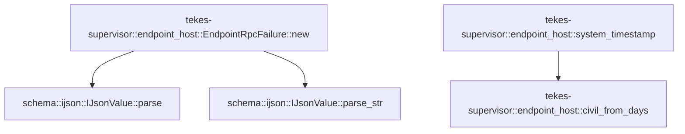

```mermaid
flowchart TD
  n0["endpoint::host::EndpointDispatcher::new"]
  n1["endpoint::idempotency::RpcRegistry::open"]
  n2["provider::dialect::resolve_profile"]
  n3["tekes-supervisor::endpoint_host::ProductionEndpointHost::extension_capabilities"]
  n4["tekes-supervisor::endpoint_host::ProductionEndpointHost::method_class"]
  n5["tekes-supervisor::endpoint_host::ProductionEndpointHost::validate_request"]
  n6["tekes-supervisor::endpoint_host::ProductionEndpointHost::call"]
  n7["tekes-supervisor::endpoint_host::ProductionEndpointAssembly::open"]
  n8["tekes-supervisor::endpoint_host::ProductionEndpointAssembly::open_with_clock"]
  n9["tekes-supervisor::endpoint_host::ProductionEndpointAssembly::open_with_routes"]
  n10["tekes-supervisor::endpoint_host::ProductionEndpointAssembly::open_with_route_authority"]
  n11["tekes-supervisor::endpoint_host::ProductionEndpointAssembly::open_with_authorities"]
  n12["tekes-supervisor::endpoint_host::ProductionEndpointAssembly::open_with_full_authorities"]
  n13["tekes-supervisor::endpoint_host::ProductionEndpointAssembly::dispatch"]
  n14["tekes-supervisor::endpoint_host::ProductionEndpointAssembly::hub"]
  n15["tekes-supervisor::endpoint_host::ProductionEndpointAssembly::host"]
  n16["tekes-supervisor::endpoint_host::ProductionEndpointAssembly::admission_gates"]
  n17["tekes-supervisor::endpoint_host::ProductionEndpointAssembly::has_incomplete_management_operation"]
  n18["tekes-supervisor::endpoint_host::success"]
  n19["tekes-supervisor::endpoint_host::model_projection"]
  n20["tekes-supervisor::endpoint_host::ConfiguredModels::model_available"]
  n21["tekes-supervisor::endpoint_host::model_is_configured"]
  n22["tekes-supervisor::endpoint_host::runtime_failure_name"]
  n23["tekes-supervisor::endpoint_host::internal_failure"]
  n24["tekes-supervisor::endpoint_host::to_ijson"]
  n25["tekes-supervisor::endpoint_host::validate_production_payload"]
  n26["tekes-supervisor::endpoint_host::ProductionEndpointHost::open"]
  n27["tekes-supervisor::endpoint_host::ProductionEndpointHost::open_with_clock"]
  n28["tekes-supervisor::endpoint_host::ProductionEndpointHost::open_with_routes"]
  n29["tekes-supervisor::endpoint_host::ProductionEndpointHost::open_with_full_authorities"]
  n30["tekes-supervisor::endpoint_host::ProductionEndpointHost::open_with_route_authority"]
  n5 --> n25
  n7 --> n0
  n7 --> n1
  n7 --> n26
  n8 --> n0
  n8 --> n1
  n8 --> n27
  n9 --> n0
  n9 --> n1
  n9 --> n28
  n10 --> n0
  n10 --> n1
  n10 --> n30
  n11 --> n12
  n12 --> n0
  n12 --> n1
  n12 --> n29
  n19 --> n2
  n19 --> n21
  n19 --> n23
  n19 --> n24
  n20 --> n21
  n21 --> n2
```

```mermaid
flowchart TD
  n0["schema::ijson::IJsonValue::parse"]
  n1["tekes-supervisor::endpoint_host::map_production_route"]
  n2["tekes-supervisor::endpoint_host::map_production_route_for"]
  n3["tekes-supervisor::endpoint_host::sanitized_route_log_message"]
  n4["tekes-supervisor::endpoint_host::production_failure_is_exact_for"]
  n5["tekes-supervisor::endpoint_host::route_error_is_exact"]
  n6["tekes-supervisor::endpoint_host::route_error_message"]
  n7["tekes-supervisor::endpoint_host::exact_string_fields"]
  n8["tekes-supervisor::endpoint_host::route_allows_error"]
  n9["tekes-supervisor::endpoint_host::internal_failure"]
  n10["tekes-supervisor::endpoint_host::failure"]
  n11["tekes-supervisor::endpoint_host::required_string"]
  n12["tekes-supervisor::endpoint_host::required_string_allow_whitespace"]
  n13["tekes-supervisor::endpoint_host::optional_bool"]
  n14["tekes-supervisor::endpoint_host::optional_string"]
  n15["tekes-supervisor::endpoint_host::require_object_fields"]
  n16["tekes-supervisor::endpoint_host::optional_u64"]
  n17["tekes-supervisor::endpoint_host::to_ijson"]
  n18["tekes-supervisor::endpoint_host::request_hash"]
  n19["tekes-supervisor::endpoint_host::mark_management_handoff"]
  n20["tekes-supervisor::endpoint_host::mark_event_handoff"]
  n21["tekes-supervisor::endpoint_host::invalid"]
  n22["tekes-supervisor::endpoint_host::EndpointRpcFailure::new"]
  n2 --> n1
  n2 --> n3
  n2 --> n4
  n2 --> n9
  n3 --> n0
  n4 --> n5
  n4 --> n8
  n5 --> n6
  n5 --> n7
  n9 --> n22
  n11 --> n21
  n12 --> n21
  n13 --> n21
  n14 --> n21
  n15 --> n21
  n16 --> n21
  n17 --> n0
  n18 --> n22
  n19 --> n22
  n20 --> n9
```

```mermaid
flowchart TD
  n0["tekes-supervisor::endpoint_host::internal_failure"]
  n1["tekes-supervisor::endpoint_host::require_object_fields"]
  n2["tekes-supervisor::endpoint_host::endpoint_origin"]
  n3["tekes-supervisor::endpoint_host::validate_session_title"]
  n4["tekes-supervisor::endpoint_host::PendingQueueAction::with_origin"]
  n5["tekes-supervisor::endpoint_host::queue_action"]
  n6["tekes-supervisor::endpoint_host::map_queue_rejection"]
  n7["tekes-supervisor::endpoint_host::queue_decision"]
  n8["tekes-supervisor::endpoint_host::map_persisted_queue_rejection"]
  n9["tekes-supervisor::endpoint_host::validate_time_zone"]
  n10["tekes-supervisor::endpoint_host::map_prompt_error"]
  n11["tekes-supervisor::endpoint_host::map_attachment_read_error"]
  n12["tekes-supervisor::endpoint_host::attachment_failure"]
  n13["tekes-supervisor::endpoint_host::attachment_reason"]
  n14["tekes-supervisor::endpoint_host::validate_extension_payload"]
  n15["tekes-supervisor::endpoint_host::validate_production_payload"]
  n16["tekes-supervisor::endpoint_host::invalid"]
  n17["tekes-supervisor::endpoint_host::map_endpoint"]
  n18["tekes-supervisor::endpoint_host::map_management"]
  n19["tekes-supervisor::endpoint_host::internal_json"]
  n20["tekes-supervisor::endpoint_host::internal_schema"]
  n21["tekes-supervisor::endpoint_host::internal_assembly"]
  n22["tekes-supervisor::endpoint_host::EndpointRpcFailure::new"]
  n5 --> n16
  n5 --> n22
  n6 --> n22
  n8 --> n0
  n8 --> n6
  n9 --> n16
  n10 --> n0
  n10 --> n12
  n10 --> n16
  n10 --> n22
  n11 --> n0
  n11 --> n12
  n11 --> n22
  n12 --> n22
  n14 --> n1
  n14 --> n22
  n15 --> n1
  n15 --> n14
  n16 --> n22
  n17 --> n22
  n18 --> n22
  n19 --> n22
  n20 --> n22
  n21 --> n22
```

# tekes-supervisor::endpoint_host

[Package atlas](index.md) · [Source](../../src/endpoint_host.rs)

## Declarations

Visibility is the declaration spelling; trait members and reexports require their enclosing interface. `cfg` is not evaluated.

| Symbol | Kind | Visibility | Test / cfg |
|---|---|---|---|
| [tekes-supervisor::endpoint_host::EndpointRouteClass](../../src/endpoint_host.rs#L29) | enum_item | `pub` |  |
| [tekes-supervisor::endpoint_host::EndpointRoute](../../src/endpoint_host.rs#L37) | struct_item | `pub` |  |
| [tekes-supervisor::endpoint_host::TEKES_UNARY_ROUTES](../../src/endpoint_host.rs#L43) | const_item | `pub` |  |
| [tekes-supervisor::endpoint_host::route](../../src/endpoint_host.rs#L70) | function_item | `private` |  |
| [tekes-supervisor::endpoint_host::EndpointClock](../../src/endpoint_host.rs#L78) | type_item | `pub` |  |
| [tekes-supervisor::endpoint_host::RuntimeModelReadiness](../../src/endpoint_host.rs#L81) | struct_item | `pub` |  |
| [tekes-supervisor::endpoint_host::RuntimeProviderStatus](../../src/endpoint_host.rs#L88) | enum_item | `pub` |  |
| [tekes-supervisor::endpoint_host::RuntimeProviderFailure](../../src/endpoint_host.rs#L94) | enum_item | `pub` |  |
| [tekes-supervisor::endpoint_host::RuntimeProviderReadiness](../../src/endpoint_host.rs#L102) | struct_item | `pub` |  |
| [tekes-supervisor::endpoint_host::ProviderReadinessAuthority](../../src/endpoint_host.rs#L111) | trait_item | `pub` |  |
| [tekes-supervisor::endpoint_host::ProviderReadinessAuthority::readiness](../../src/endpoint_host.rs#L112) | function_signature_item | `private` |  |
| [tekes-supervisor::endpoint_host::ProviderReadinessAuthority::config_mutation_succeeded](../../src/endpoint_host.rs#L121) | function_item | `private` |  |
| [tekes-supervisor::endpoint_host::SessionDeliveryAuthority](../../src/endpoint_host.rs#L130) | trait_item | `pub` |  |
| [tekes-supervisor::endpoint_host::SessionDeliveryAuthority::session_metadata_changed](../../src/endpoint_host.rs#L134) | function_item | `private` |  |
| [tekes-supervisor::endpoint_host::SessionDeliveryAuthority::prompt](../../src/endpoint_host.rs#L136) | function_signature_item | `private` |  |
| [tekes-supervisor::endpoint_host::SessionDeliveryAuthority::cancel](../../src/endpoint_host.rs#L145) | function_signature_item | `private` |  |
| [tekes-supervisor::endpoint_host::SessionDeliveryAuthority::rename](../../src/endpoint_host.rs#L152) | function_signature_item | `private` |  |
| [tekes-supervisor::endpoint_host::SessionDeliveryAuthority::compact](../../src/endpoint_host.rs#L166) | function_item | `private` |  |
| [tekes-supervisor::endpoint_host::QueueTransactionAuthority](../../src/endpoint_host.rs#L183) | trait_item | `pub` |  |
| [tekes-supervisor::endpoint_host::QueueTransactionAuthority::execute](../../src/endpoint_host.rs#L184) | function_signature_item | `private` |  |
| [tekes-supervisor::endpoint_host::recover_pending_management](../../src/endpoint_host.rs#L197) | function_item | `pub(crate)` |  |
| [tekes-supervisor::endpoint_host::QueueRecoveryAdapter](../../src/endpoint_host.rs#L213) | struct_item | `private` |  |
| [tekes-supervisor::endpoint_host::QueueRecoveryAdapter::execute](../../src/endpoint_host.rs#L218) | function_item | `private` |  |
| [tekes-supervisor::endpoint_host::SessionAdmissionGates](../../src/endpoint_host.rs#L255) | struct_item | `pub` |  |
| [tekes-supervisor::endpoint_host::SessionAdmissionGates::gate](../../src/endpoint_host.rs#L260) | function_item | `pub` |  |
| [tekes-supervisor::endpoint_host::SessionInputAdmissionAuthority](../../src/endpoint_host.rs#L279) | struct_item | `pub` |  |
| [tekes-supervisor::endpoint_host::SessionInputAdmissionAuthority::new](../../src/endpoint_host.rs#L286) | function_item | `pub` |  |
| [tekes-supervisor::endpoint_host::SessionInputAdmissionAuthority::gates](../../src/endpoint_host.rs#L294) | function_item | `pub` |  |
| [tekes-supervisor::endpoint_host::SessionInputAdmissionAuthority::root](../../src/endpoint_host.rs#L300) | function_item | `pub` |  |
| [tekes-supervisor::endpoint_host::SessionInputAdmissionAuthority::with_active_session](../../src/endpoint_host.rs#L304) | function_item | `pub` |  |
| [tekes-supervisor::endpoint_host::SessionInputAdmissionAuthority::with_session_gate](../../src/endpoint_host.rs#L329) | function_item | `pub` |  |
| [tekes-supervisor::endpoint_host::session_details](../../src/endpoint_host.rs#L354) | function_item | `private` |  |
| [tekes-supervisor::endpoint_host::ProductionEndpointRoutes](../../src/endpoint_host.rs#L364) | trait_item | `pub` |  |
| [tekes-supervisor::endpoint_host::ProductionEndpointRoutes::capabilities](../../src/endpoint_host.rs#L365) | function_signature_item | `private` |  |
| [tekes-supervisor::endpoint_host::ProductionEndpointRoutes::extension_method_class](../../src/endpoint_host.rs#L370) | function_item | `private` |  |
| [tekes-supervisor::endpoint_host::ProductionEndpointRoutes::validate_extension_payload](../../src/endpoint_host.rs#L376) | function_item | `private` |  |
| [tekes-supervisor::endpoint_host::ProductionEndpointRoutes::extension_failure_is_exact](../../src/endpoint_host.rs#L391) | function_item | `private` |  |
| [tekes-supervisor::endpoint_host::ProductionEndpointRoutes::execute](../../src/endpoint_host.rs#L399) | function_signature_item | `private` |  |
| [tekes-supervisor::endpoint_host::CompositeProductionEndpointRoutes](../../src/endpoint_host.rs#L410) | struct_item | `pub` |  |
| [tekes-supervisor::endpoint_host::CompositeProductionEndpointRoutes::compose](../../src/endpoint_host.rs#L415) | function_item | `pub` |  |
| [tekes-supervisor::endpoint_host::CompositeProductionEndpointRoutes::owner](../../src/endpoint_host.rs#L443) | function_item | `private` |  |
| [tekes-supervisor::endpoint_host::CompositeProductionEndpointRoutes::capabilities](../../src/endpoint_host.rs#L449) | function_item | `private` |  |
| [tekes-supervisor::endpoint_host::CompositeProductionEndpointRoutes::extension_method_class](../../src/endpoint_host.rs#L453) | function_item | `private` |  |
| [tekes-supervisor::endpoint_host::CompositeProductionEndpointRoutes::validate_extension_payload](../../src/endpoint_host.rs#L457) | function_item | `private` |  |
| [tekes-supervisor::endpoint_host::CompositeProductionEndpointRoutes::extension_failure_is_exact](../../src/endpoint_host.rs#L467) | function_item | `private` |  |
| [tekes-supervisor::endpoint_host::CompositeProductionEndpointRoutes::execute](../../src/endpoint_host.rs#L476) | function_item | `private` |  |
| [tekes-supervisor::endpoint_host::ProductionRouteCompositionError](../../src/endpoint_host.rs#L489) | enum_item | `pub` |  |
| [tekes-supervisor::endpoint_host::unsupported_route](../../src/endpoint_host.rs#L496) | function_item | `private` |  |
| [tekes-supervisor::endpoint_host::ProductionRouteFailure](../../src/endpoint_host.rs#L506) | struct_item | `pub` |  |
| [tekes-supervisor::endpoint_host::ProductionRouteFailure::new](../../src/endpoint_host.rs#L513) | function_item | `pub` |  |
| [tekes-supervisor::endpoint_host::ProductionEndpointHost](../../src/endpoint_host.rs#L522) | struct_item | `pub` |  |
| [tekes-supervisor::endpoint_host::ProductionEndpointHost::with_preset_mcp](../../src/endpoint_host.rs#L544) | function_item | `pub` |  |
| [tekes-supervisor::endpoint_host::ProductionEndpointHost::mux_description](../../src/endpoint_host.rs#L552) | function_item | `pub` |  |
| [tekes-supervisor::endpoint_host::ProductionEndpointHost::open](../../src/endpoint_host.rs#L577) | function_item | `pub` |  |
| [tekes-supervisor::endpoint_host::ProductionEndpointHost::open_with_clock](../../src/endpoint_host.rs#L592) | function_item | `pub` |  |
| [tekes-supervisor::endpoint_host::ProductionEndpointHost::open_with_routes](../../src/endpoint_host.rs#L601) | function_item | `pub` |  |
| [tekes-supervisor::endpoint_host::ProductionEndpointHost::open_with_authorities](../../src/endpoint_host.rs#L610) | function_item | `pub` |  |
| [tekes-supervisor::endpoint_host::ProductionEndpointHost::open_with_full_authorities](../../src/endpoint_host.rs#L628) | function_item | `pub` |  |
| [tekes-supervisor::endpoint_host::ProductionEndpointHost::open_with_full_authorities_and_session_admission](../../src/endpoint_host.rs#L651) | function_item | `pub` |  |
| [tekes-supervisor::endpoint_host::ProductionEndpointHost::open_with_route_authority](../../src/endpoint_host.rs#L677) | function_item | `pub` |  |
| [tekes-supervisor::endpoint_host::ProductionEndpointHost::open_with_route_ownership](../../src/endpoint_host.rs#L700) | function_item | `private` |  |
| [tekes-supervisor::endpoint_host::ProductionEndpointHost::implemented_capabilities](../../src/endpoint_host.rs#L769) | function_item | `pub` |  |
| [tekes-supervisor::endpoint_host::ProductionEndpointHost::admission_gates](../../src/endpoint_host.rs#L778) | function_item | `pub` |  |
| [tekes-supervisor::endpoint_host::ProductionEndpointHost::has_incomplete_management_operation](../../src/endpoint_host.rs#L782) | function_item | `pub` |  |
| [tekes-supervisor::endpoint_host::ProductionEndpointHost::execute](../../src/endpoint_host.rs#L791) | function_item | `private` |  |
| [tekes-supervisor::endpoint_host::ProductionEndpointHost::execute_inner](../../src/endpoint_host.rs#L799) | function_item | `private` |  |
| [tekes-supervisor::endpoint_host::ProductionEndpointHost::execute_extension](../../src/endpoint_host.rs#L830) | function_item | `private` |  |
| [tekes-supervisor::endpoint_host::ProductionEndpointHost::create_workspace](../../src/endpoint_host.rs#L879) | function_item | `private` |  |
| [tekes-supervisor::endpoint_host::ProductionEndpointHost::rename_workspace](../../src/endpoint_host.rs#L896) | function_item | `private` |  |
| [tekes-supervisor::endpoint_host::ProductionEndpointHost::relocate_workspace](../../src/endpoint_host.rs#L918) | function_item | `private` |  |
| [tekes-supervisor::endpoint_host::ProductionEndpointHost::archive_session](../../src/endpoint_host.rs#L961) | function_item | `private` |  |
| [tekes-supervisor::endpoint_host::ProductionEndpointHost::unarchive_session](../../src/endpoint_host.rs#L984) | function_item | `private` |  |
| [tekes-supervisor::endpoint_host::ProductionEndpointHost::create_session](../../src/endpoint_host.rs#L1001) | function_item | `private` |  |
| [tekes-supervisor::endpoint_host::ProductionEndpointHost::draft_models](../../src/endpoint_host.rs#L1065) | function_item | `private` |  |
| [tekes-supervisor::endpoint_host::ProductionEndpointHost::models](../../src/endpoint_host.rs#L1106) | function_item | `private` |  |
| [tekes-supervisor::endpoint_host::ProductionEndpointHost::select_model](../../src/endpoint_host.rs#L1126) | function_item | `private` |  |
| [tekes-supervisor::endpoint_host::ProductionEndpointHost::cancel](../../src/endpoint_host.rs#L1185) | function_item | `private` |  |
| [tekes-supervisor::endpoint_host::ProductionEndpointHost::rename_session](../../src/endpoint_host.rs#L1215) | function_item | `private` |  |
| [tekes-supervisor::endpoint_host::ProductionEndpointHost::update_queue](../../src/endpoint_host.rs#L1253) | function_item | `private` |  |
| [tekes-supervisor::endpoint_host::ProductionEndpointHost::prompt](../../src/endpoint_host.rs#L1342) | function_item | `private` |  |
| [tekes-supervisor::endpoint_host::ProductionEndpointHost::attachment](../../src/endpoint_host.rs#L1399) | function_item | `private` |  |
| [tekes-supervisor::endpoint_host::ProductionEndpointHost::fork_session](../../src/endpoint_host.rs#L1415) | function_item | `private` |  |
| [tekes-supervisor::endpoint_host::ProductionEndpointHost::discard_session](../../src/endpoint_host.rs#L1456) | function_item | `private` |  |
| [tekes-supervisor::endpoint_host::ProductionEndpointHost::admission_gate](../../src/endpoint_host.rs#L1479) | function_item | `private` |  |
| [tekes-supervisor::endpoint_host::ProductionEndpointHost::ensure_active_session](../../src/endpoint_host.rs#L1486) | function_item | `private` |  |
| [tekes-supervisor::endpoint_host::ProductionEndpointHost::capabilities](../../src/endpoint_host.rs#L1507) | function_item | `private` |  |
| [tekes-supervisor::endpoint_host::ProductionEndpointHost::extension_capabilities](../../src/endpoint_host.rs#L1528) | function_item | `private` |  |
| [tekes-supervisor::endpoint_host::ProductionEndpointHost::method_class](../../src/endpoint_host.rs#L1538) | function_item | `private` |  |
| [tekes-supervisor::endpoint_host::ProductionEndpointHost::validate_request](../../src/endpoint_host.rs#L1554) | function_item | `private` |  |
| [tekes-supervisor::endpoint_host::ProductionEndpointHost::call](../../src/endpoint_host.rs#L1578) | function_item | `private` |  |
| [tekes-supervisor::endpoint_host::ProductionEndpointAssembly](../../src/endpoint_host.rs#L1583) | struct_item | `pub` |  |
| [tekes-supervisor::endpoint_host::ProductionEndpointAssembly::open](../../src/endpoint_host.rs#L1590) | function_item | `pub` |  |
| [tekes-supervisor::endpoint_host::ProductionEndpointAssembly::open_with_clock](../../src/endpoint_host.rs#L1602) | function_item | `pub` |  |
| [tekes-supervisor::endpoint_host::ProductionEndpointAssembly::open_with_routes](../../src/endpoint_host.rs#L1615) | function_item | `pub` |  |
| [tekes-supervisor::endpoint_host::ProductionEndpointAssembly::open_with_route_authority](../../src/endpoint_host.rs#L1629) | function_item | `pub` |  |
| [tekes-supervisor::endpoint_host::ProductionEndpointAssembly::open_with_authorities](../../src/endpoint_host.rs#L1651) | function_item | `pub` |  |
| [tekes-supervisor::endpoint_host::ProductionEndpointAssembly::open_with_full_authorities](../../src/endpoint_host.rs#L1669) | function_item | `pub` |  |
| [tekes-supervisor::endpoint_host::ProductionEndpointAssembly::dispatch](../../src/endpoint_host.rs#L1694) | function_item | `pub` |  |
| [tekes-supervisor::endpoint_host::ProductionEndpointAssembly::hub](../../src/endpoint_host.rs#L1702) | function_item | `pub` |  |
| [tekes-supervisor::endpoint_host::ProductionEndpointAssembly::host](../../src/endpoint_host.rs#L1707) | function_item | `pub` |  |
| [tekes-supervisor::endpoint_host::ProductionEndpointAssembly::admission_gates](../../src/endpoint_host.rs#L1712) | function_item | `pub` |  |
| [tekes-supervisor::endpoint_host::ProductionEndpointAssembly::has_incomplete_management_operation](../../src/endpoint_host.rs#L1716) | function_item | `pub` |  |
| [tekes-supervisor::endpoint_host::success](../../src/endpoint_host.rs#L1724) | function_item | `private` |  |
| [tekes-supervisor::endpoint_host::model_projection](../../src/endpoint_host.rs#L1732) | function_item | `private` |  |
| [tekes-supervisor::endpoint_host::ConfiguredModels](../../src/endpoint_host.rs#L1829) | struct_item | `pub` |  |
| [tekes-supervisor::endpoint_host::ConfiguredModels::model_available](../../src/endpoint_host.rs#L1832) | function_item | `private` |  |
| [tekes-supervisor::endpoint_host::model_is_configured](../../src/endpoint_host.rs#L1843) | function_item | `private` |  |
| [tekes-supervisor::endpoint_host::runtime_failure_name](../../src/endpoint_host.rs#L1874) | function_item | `private` |  |
| [tekes-supervisor::endpoint_host::map_production_route](../../src/endpoint_host.rs#L1883) | function_item | `private` |  |
| [tekes-supervisor::endpoint_host::map_production_route_for](../../src/endpoint_host.rs#L1891) | function_item | `private` |  |
| [tekes-supervisor::endpoint_host::sanitized_route_log_message](../../src/endpoint_host.rs#L1905) | function_item | `private` |  |
| [tekes-supervisor::endpoint_host::production_failure_is_exact_for](../../src/endpoint_host.rs#L1925) | function_item | `pub(crate)` |  |
| [tekes-supervisor::endpoint_host::route_error_is_exact](../../src/endpoint_host.rs#L1932) | function_item | `private` |  |
| [tekes-supervisor::endpoint_host::route_error_message](../../src/endpoint_host.rs#L2015) | function_item | `private` |  |
| [tekes-supervisor::endpoint_host::exact_string_fields](../../src/endpoint_host.rs#L2046) | function_item | `private` |  |
| [tekes-supervisor::endpoint_host::route_allows_error](../../src/endpoint_host.rs#L2067) | function_item | `private` |  |
| [tekes-supervisor::endpoint_host::internal_failure](../../src/endpoint_host.rs#L2174) | function_item | `private` |  |
| [tekes-supervisor::endpoint_host::failure](../../src/endpoint_host.rs#L2178) | function_item | `private` |  |
| [tekes-supervisor::endpoint_host::required_string](../../src/endpoint_host.rs#L2190) | function_item | `private` |  |
| [tekes-supervisor::endpoint_host::required_string_allow_whitespace](../../src/endpoint_host.rs#L2199) | function_item | `private` |  |
| [tekes-supervisor::endpoint_host::optional_bool](../../src/endpoint_host.rs#L2210) | function_item | `private` |  |
| [tekes-supervisor::endpoint_host::optional_string](../../src/endpoint_host.rs#L2220) | function_item | `private` |  |
| [tekes-supervisor::endpoint_host::require_object_fields](../../src/endpoint_host.rs#L2231) | function_item | `private` |  |
| [tekes-supervisor::endpoint_host::optional_u64](../../src/endpoint_host.rs#L2247) | function_item | `private` |  |
| [tekes-supervisor::endpoint_host::to_ijson](../../src/endpoint_host.rs#L2257) | function_item | `private` |  |
| [tekes-supervisor::endpoint_host::request_hash](../../src/endpoint_host.rs#L2261) | function_item | `private` |  |
| [tekes-supervisor::endpoint_host::mark_management_handoff](../../src/endpoint_host.rs#L2275) | function_item | `private` |  |
| [tekes-supervisor::endpoint_host::mark_event_handoff](../../src/endpoint_host.rs#L2289) | function_item | `private` |  |
| [tekes-supervisor::endpoint_host::endpoint_origin](../../src/endpoint_host.rs#L2303) | function_item | `private` |  |
| [tekes-supervisor::endpoint_host::validate_session_title](../../src/endpoint_host.rs#L2318) | function_item | `private` |  |
| [tekes-supervisor::endpoint_host::PendingQueueAction](../../src/endpoint_host.rs#L2329) | enum_item | `private` |  |
| [tekes-supervisor::endpoint_host::PendingQueueAction::with_origin](../../src/endpoint_host.rs#L2336) | function_item | `private` |  |
| [tekes-supervisor::endpoint_host::queue_action](../../src/endpoint_host.rs#L2352) | function_item | `private` |  |
| [tekes-supervisor::endpoint_host::map_queue_rejection](../../src/endpoint_host.rs#L2402) | function_item | `private` |  |
| [tekes-supervisor::endpoint_host::queue_decision](../../src/endpoint_host.rs#L2426) | function_item | `private` |  |
| [tekes-supervisor::endpoint_host::map_persisted_queue_rejection](../../src/endpoint_host.rs#L2451) | function_item | `private` |  |
| [tekes-supervisor::endpoint_host::validate_time_zone](../../src/endpoint_host.rs#L2465) | function_item | `private` |  |
| [tekes-supervisor::endpoint_host::map_prompt_error](../../src/endpoint_host.rs#L2491) | function_item | `private` |  |
| [tekes-supervisor::endpoint_host::map_attachment_read_error](../../src/endpoint_host.rs#L2511) | function_item | `private` |  |
| [tekes-supervisor::endpoint_host::attachment_failure](../../src/endpoint_host.rs#L2528) | function_item | `private` |  |
| [tekes-supervisor::endpoint_host::attachment_reason](../../src/endpoint_host.rs#L2536) | function_item | `private` |  |
| [tekes-supervisor::endpoint_host::validate_extension_payload](../../src/endpoint_host.rs#L2551) | function_item | `private` |  |
| [tekes-supervisor::endpoint_host::validate_production_payload](../../src/endpoint_host.rs#L2603) | function_item | `private` |  |
| [tekes-supervisor::endpoint_host::invalid](../../src/endpoint_host.rs#L2620) | function_item | `private` |  |
| [tekes-supervisor::endpoint_host::map_endpoint](../../src/endpoint_host.rs#L2624) | function_item | `private` |  |
| [tekes-supervisor::endpoint_host::map_management](../../src/endpoint_host.rs#L2641) | function_item | `private` |  |
| [tekes-supervisor::endpoint_host::internal_json](../../src/endpoint_host.rs#L2744) | function_item | `private` |  |
| [tekes-supervisor::endpoint_host::internal_schema](../../src/endpoint_host.rs#L2748) | function_item | `private` |  |
| [tekes-supervisor::endpoint_host::internal_assembly](../../src/endpoint_host.rs#L2752) | function_item | `private` |  |
| [tekes-supervisor::endpoint_host::EndpointRpcFailure](../../src/endpoint_host.rs#L2756) | struct_item | `private` |  |
| [tekes-supervisor::endpoint_host::EndpointRpcFailure::new](../../src/endpoint_host.rs#L2763) | function_item | `private` |  |
| [tekes-supervisor::endpoint_host::system_timestamp](../../src/endpoint_host.rs#L2775) | function_item | `private` |  |
| [tekes-supervisor::endpoint_host::civil_from_days](../../src/endpoint_host.rs#L2792) | function_item | `private` |  |
| [tekes-supervisor::endpoint_host::EndpointAssemblyError](../../src/endpoint_host.rs#L2808) | enum_item | `pub` |  |

## Imports / reexports

| Local name | Source path | Visibility |
|---|---|---|
| `BTreeSet` | `std::collections::BTreeSet` | `private` |
| `HashMap` | `std::collections::HashMap` | `private` |
| `Path` | `std::path::Path` | `private` |
| `PathBuf` | `std::path::PathBuf` | `private` |
| `Arc` | `std::sync::Arc` | `private` |
| `Mutex` | `std::sync::Mutex` | `private` |
| `SystemTime` | `std::time::SystemTime` | `private` |
| `UNIX_EPOCH` | `std::time::UNIX_EPOCH` | `private` |
| `AttachmentAuthority` | `endpoint::AttachmentAuthority` | `private` |
| `AttachmentErrorReason` | `endpoint::AttachmentErrorReason` | `private` |
| `AttachmentReadError` | `endpoint::AttachmentReadError` | `private` |
| `ClientRequest` | `endpoint::ClientRequest` | `private` |
| `DurableHandoffProof` | `endpoint::DurableHandoffProof` | `private` |
| `EndpointDispatcher` | `endpoint::EndpointDispatcher` | `private` |
| `EndpointHost` | `endpoint::EndpointHost` | `private` |
| `EndpointHostCall` | `endpoint::EndpointHostCall` | `private` |
| `EndpointHostFuture` | `endpoint::EndpointHostFuture` | `private` |
| `EndpointSubscriptionHub` | `endpoint::EndpointSubscriptionHub` | `private` |
| `ForkSessionOperation` | `endpoint::ForkSessionOperation` | `private` |
| `HostFailure` | `endpoint::HostFailure` | `private` |
| `ManagementError` | `endpoint::ManagementError` | `private` |
| `ManagementStore` | `endpoint::ManagementStore` | `private` |
| `MaterializedPrompt` | `endpoint::MaterializedPrompt` | `private` |
| `NativeEndpoint` | `endpoint::NativeEndpoint` | `private` |
| `NativeEndpointError` | `endpoint::NativeEndpointError` | `private` |
| `PendingQueueTransaction` | `endpoint::PendingQueueTransaction` | `private` |
| `PromptMaterializeError` | `endpoint::PromptMaterializeError` | `private` |
| `PromptPart` | `endpoint::PromptPart` | `private` |
| `QueueRecoveryDriver` | `endpoint::QueueRecoveryDriver` | `private` |
| `QueueTransactionCompletion` | `endpoint::QueueTransactionCompletion` | `private` |
| `QueueTransactionDecision` | `endpoint::QueueTransactionDecision` | `private` |
| `QueueTransactionOperation` | `endpoint::QueueTransactionOperation` | `private` |
| `QueueTransactionState` | `endpoint::QueueTransactionState` | `private` |
| `RpcDurableIdentity` | `endpoint::RpcDurableIdentity` | `private` |
| `RpcError` | `endpoint::RpcError` | `private` |
| `RpcRegistry` | `endpoint::RpcRegistry` | `private` |
| `RpcResult` | `endpoint::RpcResult` | `private` |
| `SelectModelOperation` | `endpoint::SelectModelOperation` | `private` |
| `ServerResponse` | `endpoint::ServerResponse` | `private` |
| `SessionCreateOperation` | `endpoint::SessionCreateOperation` | `private` |
| `SessionHostDescription` | `endpoint::SessionHostDescription` | `private` |
| `IJsonValue` | `schema::IJsonValue` | `private` |
| `OriginTuple` | `schema::OriginTuple` | `private` |
| `Value` | `serde_json::Value` | `private` |
| `json` | `serde_json::json` | `private` |
| `Digest` | `sha2::Digest` | `private` |
| `Sha256` | `sha2::Sha256` | `private` |
| `Error` | `thiserror::Error` | `private` |

## Module declarations

| Module | Visibility | Attributes |
|---|---|---|

## Function call graphs

Edges below are syntactically resolved calls only, including private functions. Graphs partition callers into groups of 20; they are not execution order. All unresolved sites are listed below and in the JSON inventory.

Functions 1–20: 16 direct edges

Functions 21–40: 36 direct edges

Functions 41–60: 131 direct edges

Functions 61–80: 23 direct edges

Functions 81–100: 20 direct edges

Functions 101–120: 24 direct edges

Functions 121–123: 3 direct edges

## Call sites

Includes test functions (marked in declarations). Receiver-type-required sites need type analysis/manual tracing. Calls in closures are attributed to their enclosing function; their occurrence here does not mean the closure executes immediately.

| Caller | Callee expression | Source lines | Target / classification |
|---|---|---|---|
| `TEKES_UNARY_ROUTES` | `route` | [44](../../src/endpoint_host.rs#L44), [45](../../src/endpoint_host.rs#L45), [46](../../src/endpoint_host.rs#L46), [47](../../src/endpoint_host.rs#L47), [52](../../src/endpoint_host.rs#L52), [57](../../src/endpoint_host.rs#L57), [58](../../src/endpoint_host.rs#L58), [59](../../src/endpoint_host.rs#L59), [60](../../src/endpoint_host.rs#L60), [61](../../src/endpoint_host.rs#L61), [62](../../src/endpoint_host.rs#L62), [63](../../src/endpoint_host.rs#L63), [64](../../src/endpoint_host.rs#L64), [65](../../src/endpoint_host.rs#L65), [66](../../src/endpoint_host.rs#L66), [67](../../src/endpoint_host.rs#L67) | [tekes-supervisor::endpoint_host::route](../../src/endpoint_host.rs#L70) |
| `config_mutation_succeeded` | `Ok` | [122](../../src/endpoint_host.rs#L122) | external-constructor-callback-or-unresolved |
| `compact` | `Err` | [173](../../src/endpoint_host.rs#L173) | external-constructor-callback-or-unresolved |
| `compact` | `ProductionRouteFailure::new` | [173](../../src/endpoint_host.rs#L173) | [tekes-supervisor::endpoint_host::ProductionRouteFailure::new](../../src/endpoint_host.rs#L513) |
| `compact` | `IJsonValue::parse_str(r#"{"operation":"compact"}"#).expect` | [176](../../src/endpoint_host.rs#L176) | receiver-type-required |
| `compact` | `IJsonValue::parse_str` | [176](../../src/endpoint_host.rs#L176) | [schema::ijson::IJsonValue::parse_str](../../../schema/src/ijson.rs#L23) |
| `recover_pending_management` | `crate::host_runtime::system_timestamp()         .map_err` | [202](../../src/endpoint_host.rs#L202) | receiver-type-required |
| `recover_pending_management` | `crate::host_runtime::system_timestamp` | [202](../../src/endpoint_host.rs#L202) | [tekes-supervisor::host_runtime::system_timestamp](../../src/host_runtime.rs#L497) |
| `recover_pending_management` | `ManagementError::QueueRecoveryFailed` | [203](../../src/endpoint_host.rs#L203) | external-constructor-callback-or-unresolved |
| `recover_pending_management` | `error.to_string` | [203](../../src/endpoint_host.rs#L203) | receiver-type-required |
| `recover_pending_management` | `ManagementStore::open_recovering_again(         root,         &started_at,         Some(&QueueRecoveryAdapter { authority }),         validated,     )     .map` | [204](../../src/endpoint_host.rs#L204) | receiver-type-required |
| `recover_pending_management` | `ManagementStore::open_recovering_again` | [204](../../src/endpoint_host.rs#L204) | [endpoint::management::ManagementStore::open_recovering_again](../../../endpoint/src/management.rs#L486) |
| `recover_pending_management` | `Some` | [207](../../src/endpoint_host.rs#L207) | external-constructor-callback-or-unresolved |
| `execute` | `serde_json::from_slice(&pending.action.canonical_bytes()?)             .map_err` | [222](../../src/endpoint_host.rs#L222) | receiver-type-required |
| `execute` | `serde_json::from_slice` | [222](../../src/endpoint_host.rs#L222) | external-constructor-callback-or-unresolved |
| `execute` | `pending.action.canonical_bytes` | [222](../../src/endpoint_host.rs#L222) | receiver-type-required |
| `execute` | `pending.rpc_id.clone` | [225](../../src/endpoint_host.rs#L225), [226](../../src/endpoint_host.rs#L226) | receiver-type-required |
| `execute` | `pending.retract_origin.clone` | [228](../../src/endpoint_host.rs#L228) | receiver-type-required |
| `execute` | `transaction.validate().map_err` | [231](../../src/endpoint_host.rs#L231) | receiver-type-required |
| `execute` | `transaction.validate` | [231](../../src/endpoint_host.rs#L231) | receiver-type-required |
| `execute` | `ManagementError::QueueRecoveryFailed` | [232](../../src/endpoint_host.rs#L232), [237](../../src/endpoint_host.rs#L237), [244](../../src/endpoint_host.rs#L244), [246](../../src/endpoint_host.rs#L246) | external-constructor-callback-or-unresolved |
| `execute` | `transaction.replacement_origin` | [236](../../src/endpoint_host.rs#L236) | receiver-type-required |
| `execute` | `pending.replacement_origin.as_ref` | [236](../../src/endpoint_host.rs#L236) | receiver-type-required |
| `execute` | `Err` | [237](../../src/endpoint_host.rs#L237) | external-constructor-callback-or-unresolved |
| `execute` | `"prepared replacement origin disagrees with action".to_owned` | [238](../../src/endpoint_host.rs#L238) | receiver-type-required |
| `execute` | `self             .authority             .execute(&pending.session_id, &transaction)             .map_err` | [241](../../src/endpoint_host.rs#L241) | receiver-type-required |
| `execute` | `self             .authority             .execute` | [241](../../src/endpoint_host.rs#L241) | receiver-type-required |
| `execute` | `result.validate_for(&transaction).map_err` | [245](../../src/endpoint_host.rs#L245) | receiver-type-required |
| `execute` | `result.validate_for` | [245](../../src/endpoint_host.rs#L245) | receiver-type-required |
| `execute` | `Ok` | [250](../../src/endpoint_host.rs#L250) | external-constructor-callback-or-unresolved |
| `execute` | `queue_decision` | [250](../../src/endpoint_host.rs#L250) | [tekes-supervisor::endpoint_host::queue_decision](../../src/endpoint_host.rs#L2426) |
| `gate` | `self.gates.lock().map_err` | [261](../../src/endpoint_host.rs#L261) | receiver-type-required |
| `gate` | `self.gates.lock` | [261](../../src/endpoint_host.rs#L261) | receiver-type-required |
| `gate` | `ProductionRouteFailure::new` | [262](../../src/endpoint_host.rs#L262) | [tekes-supervisor::endpoint_host::ProductionRouteFailure::new](../../src/endpoint_host.rs#L513) |
| `gate` | `IJsonValue::parse_str("{}").expect` | [265](../../src/endpoint_host.rs#L265) | receiver-type-required |
| `gate` | `IJsonValue::parse_str` | [265](../../src/endpoint_host.rs#L265) | [schema::ijson::IJsonValue::parse_str](../../../schema/src/ijson.rs#L23) |
| `gate` | `Ok` | [268](../../src/endpoint_host.rs#L268) | external-constructor-callback-or-unresolved |
| `gate` | `gates             .entry(session_id.to_owned())             .or_insert_with(&#124;&#124; Arc::new(Mutex::new(())))             .clone` | [268](../../src/endpoint_host.rs#L268) | receiver-type-required |
| `gate` | `gates             .entry(session_id.to_owned())             .or_insert_with` | [268](../../src/endpoint_host.rs#L268) | receiver-type-required |
| `gate` | `gates             .entry` | [268](../../src/endpoint_host.rs#L268) | receiver-type-required |
| `gate` | `session_id.to_owned` | [269](../../src/endpoint_host.rs#L269) | receiver-type-required |
| `gate` | `Arc::new` | [270](../../src/endpoint_host.rs#L270) | external-constructor-callback-or-unresolved |
| `gate` | `Mutex::new` | [270](../../src/endpoint_host.rs#L270) | external-constructor-callback-or-unresolved |
| `new` | `root.into` | [288](../../src/endpoint_host.rs#L288) | receiver-type-required |
| `new` | `Arc::new` | [289](../../src/endpoint_host.rs#L289) | external-constructor-callback-or-unresolved |
| `new` | `SessionAdmissionGates::default` | [289](../../src/endpoint_host.rs#L289) | external-constructor-callback-or-unresolved |
| `gates` | `Arc::clone` | [295](../../src/endpoint_host.rs#L295) | external-constructor-callback-or-unresolved |
| `with_active_session` | `self.with_session_gate` | [310](../../src/endpoint_host.rs#L310) | [tekes-supervisor::endpoint_host::SessionInputAdmissionAuthority::with_session_gate](../../src/endpoint_host.rs#L329) |
| `with_active_session` | `self.root.join("archive").join(session_id).is_dir` | [311](../../src/endpoint_host.rs#L311) | receiver-type-required |
| `with_active_session` | `self.root.join("archive").join` | [311](../../src/endpoint_host.rs#L311) | receiver-type-required |
| `with_active_session` | `self.root.join` | [311](../../src/endpoint_host.rs#L311), [318](../../src/endpoint_host.rs#L318) | receiver-type-required |
| `with_active_session` | `Err` | [312](../../src/endpoint_host.rs#L312), [319](../../src/endpoint_host.rs#L319) | external-constructor-callback-or-unresolved |
| `with_active_session` | `map_failure` | [312](../../src/endpoint_host.rs#L312), [319](../../src/endpoint_host.rs#L319) | external-constructor-callback-or-unresolved |
| `with_active_session` | `ProductionRouteFailure::new` | [312](../../src/endpoint_host.rs#L312), [319](../../src/endpoint_host.rs#L319) | [tekes-supervisor::endpoint_host::ProductionRouteFailure::new](../../src/endpoint_host.rs#L513) |
| `with_active_session` | `session_details` | [315](../../src/endpoint_host.rs#L315), [322](../../src/endpoint_host.rs#L322) | [tekes-supervisor::endpoint_host::session_details](../../src/endpoint_host.rs#L354) |
| `with_active_session` | `self.root.join("threads").join(session_id).is_dir` | [318](../../src/endpoint_host.rs#L318) | receiver-type-required |
| `with_active_session` | `self.root.join("threads").join` | [318](../../src/endpoint_host.rs#L318) | receiver-type-required |
| `with_active_session` | `operation` | [325](../../src/endpoint_host.rs#L325) | external-constructor-callback-or-unresolved |
| `with_session_gate` | `endpoint::validate_session_id(session_id).is_err` | [335](../../src/endpoint_host.rs#L335) | receiver-type-required |
| `with_session_gate` | `endpoint::validate_session_id` | [335](../../src/endpoint_host.rs#L335) | [endpoint::types::validate_session_id](../../../endpoint/src/types.rs#L130) |
| `with_session_gate` | `Err` | [336](../../src/endpoint_host.rs#L336) | external-constructor-callback-or-unresolved |
| `with_session_gate` | `map_failure` | [336](../../src/endpoint_host.rs#L336), [344](../../src/endpoint_host.rs#L344) | external-constructor-callback-or-unresolved |
| `with_session_gate` | `ProductionRouteFailure::new` | [336](../../src/endpoint_host.rs#L336), [344](../../src/endpoint_host.rs#L344) | [tekes-supervisor::endpoint_host::ProductionRouteFailure::new](../../src/endpoint_host.rs#L513) |
| `with_session_gate` | `IJsonValue::parse_str("{}").expect` | [339](../../src/endpoint_host.rs#L339), [347](../../src/endpoint_host.rs#L347) | receiver-type-required |
| `with_session_gate` | `IJsonValue::parse_str` | [339](../../src/endpoint_host.rs#L339), [347](../../src/endpoint_host.rs#L347) | [schema::ijson::IJsonValue::parse_str](../../../schema/src/ijson.rs#L23) |
| `with_session_gate` | `self.gates.gate(session_id).map_err` | [342](../../src/endpoint_host.rs#L342) | receiver-type-required |
| `with_session_gate` | `self.gates.gate` | [342](../../src/endpoint_host.rs#L342) | receiver-type-required |
| `with_session_gate` | `gate.lock().map_err` | [343](../../src/endpoint_host.rs#L343) | receiver-type-required |
| `with_session_gate` | `gate.lock` | [343](../../src/endpoint_host.rs#L343) | receiver-type-required |
| `with_session_gate` | `operation` | [350](../../src/endpoint_host.rs#L350) | external-constructor-callback-or-unresolved |
| `session_details` | `IJsonValue::parse(&serde_json::to_vec(&json!({"sessionId":session_id})).expect("JSON"))         .expect` | [355](../../src/endpoint_host.rs#L355) | receiver-type-required |
| `session_details` | `IJsonValue::parse` | [355](../../src/endpoint_host.rs#L355) | [schema::ijson::IJsonValue::parse](../../../schema/src/ijson.rs#L16) |
| `session_details` | `serde_json::to_vec(&json!({"sessionId":session_id})).expect` | [355](../../src/endpoint_host.rs#L355) | receiver-type-required |
| `session_details` | `serde_json::to_vec` | [355](../../src/endpoint_host.rs#L355) | external-constructor-callback-or-unresolved |
| `validate_extension_payload` | `Err` | [381](../../src/endpoint_host.rs#L381) | external-constructor-callback-or-unresolved |
| `validate_extension_payload` | `ProductionRouteFailure::new` | [381](../../src/endpoint_host.rs#L381) | [tekes-supervisor::endpoint_host::ProductionRouteFailure::new](../../src/endpoint_host.rs#L513) |
| `validate_extension_payload` | `IJsonValue::parse(&serde_json::to_vec(&json!({"operation":operation})).expect("JSON"))                 .expect` | [384](../../src/endpoint_host.rs#L384) | receiver-type-required |
| `validate_extension_payload` | `IJsonValue::parse` | [384](../../src/endpoint_host.rs#L384) | [schema::ijson::IJsonValue::parse](../../../schema/src/ijson.rs#L16) |
| `validate_extension_payload` | `serde_json::to_vec(&json!({"operation":operation})).expect` | [384](../../src/endpoint_host.rs#L384) | receiver-type-required |
| `validate_extension_payload` | `serde_json::to_vec` | [384](../../src/endpoint_host.rs#L384) | external-constructor-callback-or-unresolved |
| `compose` | `HashMap::new` | [418](../../src/endpoint_host.rs#L418) | external-constructor-callback-or-unresolved |
| `compose` | `TEKES_UNARY_ROUTES             .iter()             .map(&#124;route&#124; route.name)             .collect::<BTreeSet<_>>` | [419](../../src/endpoint_host.rs#L419) | receiver-type-required |
| `compose` | `TEKES_UNARY_ROUTES             .iter()             .map` | [419](../../src/endpoint_host.rs#L419) | receiver-type-required |
| `compose` | `TEKES_UNARY_ROUTES             .iter` | [419](../../src/endpoint_host.rs#L419) | receiver-type-required |
| `compose` | `route.capabilities` | [424](../../src/endpoint_host.rs#L424) | receiver-type-required |
| `compose` | `frozen.contains` | [425](../../src/endpoint_host.rs#L425) | receiver-type-required |
| `compose` | `capability.as_str` | [425](../../src/endpoint_host.rs#L425) | receiver-type-required |
| `compose` | `Err` | [426](../../src/endpoint_host.rs#L426), [434](../../src/endpoint_host.rs#L434) | external-constructor-callback-or-unresolved |
| `compose` | `ProductionRouteCompositionError::FrozenCapability` | [426](../../src/endpoint_host.rs#L426) | external-constructor-callback-or-unresolved |
| `compose` | `owners                     .insert(capability.clone(), Arc::clone(&route))                     .is_some` | [430](../../src/endpoint_host.rs#L430) | receiver-type-required |
| `compose` | `owners                     .insert` | [430](../../src/endpoint_host.rs#L430) | receiver-type-required |
| `compose` | `capability.clone` | [431](../../src/endpoint_host.rs#L431) | receiver-type-required |
| `compose` | `Arc::clone` | [431](../../src/endpoint_host.rs#L431) | external-constructor-callback-or-unresolved |
| `compose` | `ProductionRouteCompositionError::DuplicateCapability` | [434](../../src/endpoint_host.rs#L434) | external-constructor-callback-or-unresolved |
| `compose` | `Ok` | [440](../../src/endpoint_host.rs#L440) | external-constructor-callback-or-unresolved |
| `owner` | `self.owners.get` | [444](../../src/endpoint_host.rs#L444) | receiver-type-required |
| `capabilities` | `self.owners.keys().cloned().collect` | [450](../../src/endpoint_host.rs#L450) | receiver-type-required |
| `capabilities` | `self.owners.keys().cloned` | [450](../../src/endpoint_host.rs#L450) | receiver-type-required |
| `capabilities` | `self.owners.keys` | [450](../../src/endpoint_host.rs#L450) | receiver-type-required |
| `extension_method_class` | `self.owner(method)?.extension_method_class` | [454](../../src/endpoint_host.rs#L454) | receiver-type-required |
| `extension_method_class` | `self.owner` | [454](../../src/endpoint_host.rs#L454) | receiver-type-required |
| `validate_extension_payload` | `self.owner(operation)             .ok_or_else(&#124;&#124; unsupported_route(operation))?             .validate_extension_payload` | [462](../../src/endpoint_host.rs#L462) | receiver-type-required |
| `validate_extension_payload` | `self.owner(operation)             .ok_or_else` | [462](../../src/endpoint_host.rs#L462) | receiver-type-required |
| `validate_extension_payload` | `self.owner` | [462](../../src/endpoint_host.rs#L462) | receiver-type-required |
| `validate_extension_payload` | `unsupported_route` | [463](../../src/endpoint_host.rs#L463) | [tekes-supervisor::endpoint_host::unsupported_route](../../src/endpoint_host.rs#L496) |
| `extension_failure_is_exact` | `self.owner(operation)             .is_some_and` | [472](../../src/endpoint_host.rs#L472) | receiver-type-required |
| `extension_failure_is_exact` | `self.owner` | [472](../../src/endpoint_host.rs#L472) | receiver-type-required |
| `extension_failure_is_exact` | `owner.extension_failure_is_exact` | [473](../../src/endpoint_host.rs#L473) | receiver-type-required |
| `execute` | `self.owner(&request.operation)             .ok_or_else(&#124;&#124; unsupported_route(&request.operation))?             .execute` | [482](../../src/endpoint_host.rs#L482) | receiver-type-required |
| `execute` | `self.owner(&request.operation)             .ok_or_else` | [482](../../src/endpoint_host.rs#L482) | receiver-type-required |
| `execute` | `self.owner` | [482](../../src/endpoint_host.rs#L482) | receiver-type-required |
| `execute` | `unsupported_route` | [483](../../src/endpoint_host.rs#L483) | [tekes-supervisor::endpoint_host::unsupported_route](../../src/endpoint_host.rs#L496) |
| `unsupported_route` | `ProductionRouteFailure::new` | [497](../../src/endpoint_host.rs#L497) | [tekes-supervisor::endpoint_host::ProductionRouteFailure::new](../../src/endpoint_host.rs#L513) |
| `unsupported_route` | `IJsonValue::parse(&serde_json::to_vec(&json!({"operation":operation})).expect("JSON"))             .expect` | [500](../../src/endpoint_host.rs#L500) | receiver-type-required |
| `unsupported_route` | `IJsonValue::parse` | [500](../../src/endpoint_host.rs#L500) | [schema::ijson::IJsonValue::parse](../../../schema/src/ijson.rs#L16) |
| `unsupported_route` | `serde_json::to_vec(&json!({"operation":operation})).expect` | [500](../../src/endpoint_host.rs#L500) | receiver-type-required |
| `unsupported_route` | `serde_json::to_vec` | [500](../../src/endpoint_host.rs#L500) | external-constructor-callback-or-unresolved |
| `new` | `code.into` | [515](../../src/endpoint_host.rs#L515) | receiver-type-required |
| `new` | `message.into` | [516](../../src/endpoint_host.rs#L516) | receiver-type-required |
| `with_preset_mcp` | `Some` | [548](../../src/endpoint_host.rs#L548) | external-constructor-callback-or-unresolved |
| `mux_description` | `endpoint::SessionEndpointCapability::required` | [553](../../src/endpoint_host.rs#L553) | [endpoint::mux::SessionEndpointCapability::required](../../../endpoint/src/mux.rs#L34) |
| `mux_description` | `capabilities.extend` | [554](../../src/endpoint_host.rs#L554) | receiver-type-required |
| `mux_description` | `self.provider_readiness.is_some` | [558](../../src/endpoint_host.rs#L558) | receiver-type-required |
| `mux_description` | `capabilities.insert` | [559](../../src/endpoint_host.rs#L559) | receiver-type-required |
| `mux_description` | `"TekesKernel".to_owned` | [564](../../src/endpoint_host.rs#L564) | receiver-type-required |
| `mux_description` | `self.description.version.clone` | [565](../../src/endpoint_host.rs#L565) | receiver-type-required |
| `mux_description` | `self.description.cwd.clone` | [568](../../src/endpoint_host.rs#L568) | receiver-type-required |
| `mux_description` | `self.description.provider.clone` | [569](../../src/endpoint_host.rs#L569) | receiver-type-required |
| `mux_description` | `self.description.model.clone` | [570](../../src/endpoint_host.rs#L570) | receiver-type-required |
| `mux_description` | `self.description.home.clone` | [572](../../src/endpoint_host.rs#L572) | receiver-type-required |
| `open` | `Self::open_with_full_authorities` | [581](../../src/endpoint_host.rs#L581) | [tekes-supervisor::endpoint_host::ProductionEndpointHost::open_with_full_authorities](../../src/endpoint_host.rs#L628) |
| `open` | `Arc::new` | [584](../../src/endpoint_host.rs#L584) | external-constructor-callback-or-unresolved |
| `open_with_clock` | `root.as_ref` | [597](../../src/endpoint_host.rs#L597) | receiver-type-required |
| `open_with_clock` | `Self::open_with_full_authorities` | [598](../../src/endpoint_host.rs#L598) | [tekes-supervisor::endpoint_host::ProductionEndpointHost::open_with_full_authorities](../../src/endpoint_host.rs#L628) |
| `open_with_routes` | `Self::open_with_full_authorities` | [607](../../src/endpoint_host.rs#L607) | [tekes-supervisor::endpoint_host::ProductionEndpointHost::open_with_full_authorities](../../src/endpoint_host.rs#L628) |
| `open_with_authorities` | `Self::open_with_full_authorities` | [617](../../src/endpoint_host.rs#L617) | [tekes-supervisor::endpoint_host::ProductionEndpointHost::open_with_full_authorities](../../src/endpoint_host.rs#L628) |
| `open_with_full_authorities` | `Self::open_with_route_ownership` | [637](../../src/endpoint_host.rs#L637) | [tekes-supervisor::endpoint_host::ProductionEndpointHost::open_with_route_ownership](../../src/endpoint_host.rs#L700) |
| `open_with_full_authorities_and_session_admission` | `Self::open_with_route_ownership` | [661](../../src/endpoint_host.rs#L661) | [tekes-supervisor::endpoint_host::ProductionEndpointHost::open_with_route_ownership](../../src/endpoint_host.rs#L700) |
| `open_with_full_authorities_and_session_admission` | `Some` | [670](../../src/endpoint_host.rs#L670) | external-constructor-callback-or-unresolved |
| `open_with_route_authority` | `Self::open_with_route_ownership` | [686](../../src/endpoint_host.rs#L686) | [tekes-supervisor::endpoint_host::ProductionEndpointHost::open_with_route_ownership](../../src/endpoint_host.rs#L700) |
| `open_with_route_authority` | `Some` | [690](../../src/endpoint_host.rs#L690) | external-constructor-callback-or-unresolved |
| `open_with_route_ownership` | `root.as_ref` | [711](../../src/endpoint_host.rs#L711) | receiver-type-required |
| `open_with_route_ownership` | `routes.as_ref` | [712](../../src/endpoint_host.rs#L712) | receiver-type-required |
| `open_with_route_ownership` | `TEKES_UNARY_ROUTES                 .iter()                 .map(&#124;route&#124; route.name)                 .collect::<BTreeSet<_>>` | [713](../../src/endpoint_host.rs#L713) | receiver-type-required |
| `open_with_route_ownership` | `TEKES_UNARY_ROUTES                 .iter()                 .map` | [713](../../src/endpoint_host.rs#L713) | receiver-type-required |
| `open_with_route_ownership` | `TEKES_UNARY_ROUTES                 .iter` | [713](../../src/endpoint_host.rs#L713) | receiver-type-required |
| `open_with_route_ownership` | `extension.capabilities().iter().any` | [717](../../src/endpoint_host.rs#L717) | receiver-type-required |
| `open_with_route_ownership` | `extension.capabilities().iter` | [717](../../src/endpoint_host.rs#L717) | receiver-type-required |
| `open_with_route_ownership` | `extension.capabilities` | [717](../../src/endpoint_host.rs#L717) | receiver-type-required |
| `open_with_route_ownership` | `frozen.contains` | [719](../../src/endpoint_host.rs#L719), [721](../../src/endpoint_host.rs#L721) | receiver-type-required |
| `open_with_route_ownership` | `method.as_str` | [719](../../src/endpoint_host.rs#L719), [721](../../src/endpoint_host.rs#L721) | receiver-type-required |
| `open_with_route_ownership` | `Err` | [728](../../src/endpoint_host.rs#L728) | external-constructor-callback-or-unresolved |
| `open_with_route_ownership` | `clock` | [731](../../src/endpoint_host.rs#L731) | external-constructor-callback-or-unresolved |
| `open_with_route_ownership` | `PathBuf::from(&description.home).join` | [732](../../src/endpoint_host.rs#L732) | receiver-type-required |
| `open_with_route_ownership` | `PathBuf::from` | [732](../../src/endpoint_host.rs#L732) | external-constructor-callback-or-unresolved |
| `open_with_route_ownership` | `queue_authority             .as_deref()             .map` | [733](../../src/endpoint_host.rs#L733) | receiver-type-required |
| `open_with_route_ownership` | `queue_authority             .as_deref` | [733](../../src/endpoint_host.rs#L733) | receiver-type-required |
| `open_with_route_ownership` | `ManagementStore::open_at_with_queue_driver` | [736](../../src/endpoint_host.rs#L736) | [endpoint::management::ManagementStore::open_at_with_queue_driver](../../../endpoint/src/management.rs#L475) |
| `open_with_route_ownership` | `queue_recovery                 .as_ref()                 .map` | [739](../../src/endpoint_host.rs#L739) | receiver-type-required |
| `open_with_route_ownership` | `queue_recovery                 .as_ref` | [739](../../src/endpoint_host.rs#L739) | receiver-type-required |
| `open_with_route_ownership` | `Ok` | [745](../../src/endpoint_host.rs#L745) | external-constructor-callback-or-unresolved |
| `open_with_route_ownership` | `root.to_path_buf` | [746](../../src/endpoint_host.rs#L746), [762](../../src/endpoint_host.rs#L762) | receiver-type-required |
| `open_with_route_ownership` | `NativeEndpoint::open` | [747](../../src/endpoint_host.rs#L747) | [endpoint::service::NativeEndpoint::open](../../../endpoint/src/service.rs#L263) |
| `open_with_route_ownership` | `AttachmentAuthority::open` | [748](../../src/endpoint_host.rs#L748) | [endpoint::attachment::AttachmentAuthority::open](../../../endpoint/src/attachment.rs#L242) |
| `open_with_route_ownership` | `input_admission.unwrap_or_else` | [761](../../src/endpoint_host.rs#L761) | receiver-type-required |
| `open_with_route_ownership` | `Arc::new` | [762](../../src/endpoint_host.rs#L762) | external-constructor-callback-or-unresolved |
| `open_with_route_ownership` | `SessionInputAdmissionAuthority::new` | [762](../../src/endpoint_host.rs#L762) | [tekes-supervisor::endpoint_host::SessionInputAdmissionAuthority::new](../../src/endpoint_host.rs#L286) |
| `implemented_capabilities` | `TEKES_UNARY_ROUTES             .iter()             .filter(&#124;route&#124; route.implemented)             .map(&#124;route&#124; route.name.to_owned())             .collect` | [770](../../src/endpoint_host.rs#L770) | receiver-type-required |
| `implemented_capabilities` | `TEKES_UNARY_ROUTES             .iter()             .filter(&#124;route&#124; route.implemented)             .map` | [770](../../src/endpoint_host.rs#L770) | receiver-type-required |
| `implemented_capabilities` | `TEKES_UNARY_ROUTES             .iter()             .filter` | [770](../../src/endpoint_host.rs#L770) | receiver-type-required |
| `implemented_capabilities` | `TEKES_UNARY_ROUTES             .iter` | [770](../../src/endpoint_host.rs#L770) | receiver-type-required |
| `implemented_capabilities` | `route.name.to_owned` | [773](../../src/endpoint_host.rs#L773) | receiver-type-required |
| `admission_gates` | `self.input_admission.gates` | [779](../../src/endpoint_host.rs#L779) | receiver-type-required |
| `has_incomplete_management_operation` | `Ok` | [786](../../src/endpoint_host.rs#L786) | external-constructor-callback-or-unresolved |
| `has_incomplete_management_operation` | `self             .management             .has_incomplete_session_operation` | [786](../../src/endpoint_host.rs#L786) | receiver-type-required |
| `execute` | `self.execute_inner` | [792](../../src/endpoint_host.rs#L792) | [tekes-supervisor::endpoint_host::ProductionEndpointHost::execute_inner](../../src/endpoint_host.rs#L799) |
| `execute` | `success` | [793](../../src/endpoint_host.rs#L793) | [tekes-supervisor::endpoint_host::success](../../src/endpoint_host.rs#L1724) |
| `execute` | `failure` | [796](../../src/endpoint_host.rs#L796) | [tekes-supervisor::endpoint_host::failure](../../src/endpoint_host.rs#L2178) |
| `execute_inner` | `serde_json::from_slice(&request.payload.canonical_bytes().map_err(internal_schema)?)                 .map_err` | [801](../../src/endpoint_host.rs#L801) | receiver-type-required |
| `execute_inner` | `serde_json::from_slice` | [801](../../src/endpoint_host.rs#L801) | external-constructor-callback-or-unresolved |
| `execute_inner` | `request.payload.canonical_bytes().map_err` | [801](../../src/endpoint_host.rs#L801) | receiver-type-required |
| `execute_inner` | `request.payload.canonical_bytes` | [801](../../src/endpoint_host.rs#L801) | receiver-type-required |
| `execute_inner` | `request.operation.as_str` | [803](../../src/endpoint_host.rs#L803) | receiver-type-required |
| `execute_inner` | `self.create_workspace` | [804](../../src/endpoint_host.rs#L804) | [tekes-supervisor::endpoint_host::ProductionEndpointHost::create_workspace](../../src/endpoint_host.rs#L879) |
| `execute_inner` | `self.rename_workspace` | [805](../../src/endpoint_host.rs#L805) | [tekes-supervisor::endpoint_host::ProductionEndpointHost::rename_workspace](../../src/endpoint_host.rs#L896) |
| `execute_inner` | `self.relocate_workspace` | [806](../../src/endpoint_host.rs#L806) | [tekes-supervisor::endpoint_host::ProductionEndpointHost::relocate_workspace](../../src/endpoint_host.rs#L918) |
| `execute_inner` | `self.archive_session` | [807](../../src/endpoint_host.rs#L807) | [tekes-supervisor::endpoint_host::ProductionEndpointHost::archive_session](../../src/endpoint_host.rs#L961) |
| `execute_inner` | `self.unarchive_session` | [808](../../src/endpoint_host.rs#L808) | [tekes-supervisor::endpoint_host::ProductionEndpointHost::unarchive_session](../../src/endpoint_host.rs#L984) |
| `execute_inner` | `self.create_session` | [809](../../src/endpoint_host.rs#L809) | [tekes-supervisor::endpoint_host::ProductionEndpointHost::create_session](../../src/endpoint_host.rs#L1001) |
| `execute_inner` | `self.provider_readiness.is_some` | [810](../../src/endpoint_host.rs#L810), [811](../../src/endpoint_host.rs#L811), [812](../../src/endpoint_host.rs#L812) | receiver-type-required |
| `execute_inner` | `self.models` | [810](../../src/endpoint_host.rs#L810) | [tekes-supervisor::endpoint_host::ProductionEndpointHost::models](../../src/endpoint_host.rs#L1106) |
| `execute_inner` | `self.draft_models` | [811](../../src/endpoint_host.rs#L811) | [tekes-supervisor::endpoint_host::ProductionEndpointHost::draft_models](../../src/endpoint_host.rs#L1065) |
| `execute_inner` | `self.select_model` | [813](../../src/endpoint_host.rs#L813) | [tekes-supervisor::endpoint_host::ProductionEndpointHost::select_model](../../src/endpoint_host.rs#L1126) |
| `execute_inner` | `self.delivery_authority.is_some` | [815](../../src/endpoint_host.rs#L815), [816](../../src/endpoint_host.rs#L816), [822](../../src/endpoint_host.rs#L822) | receiver-type-required |
| `execute_inner` | `self.cancel` | [815](../../src/endpoint_host.rs#L815) | [tekes-supervisor::endpoint_host::ProductionEndpointHost::cancel](../../src/endpoint_host.rs#L1185) |
| `execute_inner` | `self.rename_session` | [817](../../src/endpoint_host.rs#L817) | [tekes-supervisor::endpoint_host::ProductionEndpointHost::rename_session](../../src/endpoint_host.rs#L1215) |
| `execute_inner` | `self.queue_authority.is_some` | [819](../../src/endpoint_host.rs#L819) | receiver-type-required |
| `execute_inner` | `self.update_queue` | [820](../../src/endpoint_host.rs#L820) | [tekes-supervisor::endpoint_host::ProductionEndpointHost::update_queue](../../src/endpoint_host.rs#L1253) |
| `execute_inner` | `self.prompt` | [822](../../src/endpoint_host.rs#L822) | [tekes-supervisor::endpoint_host::ProductionEndpointHost::prompt](../../src/endpoint_host.rs#L1342) |
| `execute_inner` | `self.attachment` | [823](../../src/endpoint_host.rs#L823) | [tekes-supervisor::endpoint_host::ProductionEndpointHost::attachment](../../src/endpoint_host.rs#L1399) |
| `execute_inner` | `self.fork_session` | [824](../../src/endpoint_host.rs#L824) | [tekes-supervisor::endpoint_host::ProductionEndpointHost::fork_session](../../src/endpoint_host.rs#L1415) |
| `execute_inner` | `self.discard_session` | [825](../../src/endpoint_host.rs#L825) | [tekes-supervisor::endpoint_host::ProductionEndpointHost::discard_session](../../src/endpoint_host.rs#L1456) |
| `execute_inner` | `self.execute_extension` | [826](../../src/endpoint_host.rs#L826) | [tekes-supervisor::endpoint_host::ProductionEndpointHost::execute_extension](../../src/endpoint_host.rs#L830) |
| `execute_extension` | `self.routes.as_ref` | [836](../../src/endpoint_host.rs#L836) | receiver-type-required |
| `execute_extension` | `Err` | [837](../../src/endpoint_host.rs#L837), [844](../../src/endpoint_host.rs#L844) | external-constructor-callback-or-unresolved |
| `execute_extension` | `EndpointRpcFailure::new` | [837](../../src/endpoint_host.rs#L837), [844](../../src/endpoint_host.rs#L844) | [tekes-supervisor::endpoint_host::EndpointRpcFailure::new](../../src/endpoint_host.rs#L2763) |
| `execute_extension` | `routes.capabilities().contains` | [843](../../src/endpoint_host.rs#L843) | receiver-type-required |
| `execute_extension` | `routes.capabilities` | [843](../../src/endpoint_host.rs#L843) | receiver-type-required |
| `execute_extension` | `TEKES_UNARY_ROUTES             .iter()             .any` | [850](../../src/endpoint_host.rs#L850) | receiver-type-required |
| `execute_extension` | `TEKES_UNARY_ROUTES             .iter` | [850](../../src/endpoint_host.rs#L850) | receiver-type-required |
| `execute_extension` | `validate_extension_payload` | [854](../../src/endpoint_host.rs#L854) | [tekes-supervisor::endpoint_host::validate_extension_payload](../../src/endpoint_host.rs#L2551) |
| `execute_extension` | `routes                 .validate_extension_payload(operation, payload)                 .map_err` | [856](../../src/endpoint_host.rs#L856) | receiver-type-required |
| `execute_extension` | `routes                 .validate_extension_payload` | [856](../../src/endpoint_host.rs#L856) | receiver-type-required |
| `execute_extension` | `routes.extension_failure_is_exact` | [859](../../src/endpoint_host.rs#L859), [871](../../src/endpoint_host.rs#L871) | receiver-type-required |
| `execute_extension` | `map_production_route` | [860](../../src/endpoint_host.rs#L860), [872](../../src/endpoint_host.rs#L872) | [tekes-supervisor::endpoint_host::map_production_route](../../src/endpoint_host.rs#L1883) |
| `execute_extension` | `internal_failure` | [862](../../src/endpoint_host.rs#L862), [874](../../src/endpoint_host.rs#L874) | [tekes-supervisor::endpoint_host::internal_failure](../../src/endpoint_host.rs#L2174) |
| `execute_extension` | `routes             .execute(request, payload, &self.principal)             .map_err` | [866](../../src/endpoint_host.rs#L866) | receiver-type-required |
| `execute_extension` | `routes             .execute` | [866](../../src/endpoint_host.rs#L866) | receiver-type-required |
| `execute_extension` | `map_production_route_for` | [870](../../src/endpoint_host.rs#L870) | [tekes-supervisor::endpoint_host::map_production_route_for](../../src/endpoint_host.rs#L1891) |
| `create_workspace` | `require_object_fields` | [884](../../src/endpoint_host.rs#L884) | [tekes-supervisor::endpoint_host::require_object_fields](../../src/endpoint_host.rs#L2231) |
| `create_workspace` | `required_string` | [885](../../src/endpoint_host.rs#L885) | [tekes-supervisor::endpoint_host::required_string](../../src/endpoint_host.rs#L2190) |
| `create_workspace` | `(self.clock)().map_err` | [886](../../src/endpoint_host.rs#L886) | receiver-type-required |
| `create_workspace` | `(self.clock)` | [886](../../src/endpoint_host.rs#L886) | external-constructor-callback-or-unresolved |
| `create_workspace` | `request_hash` | [887](../../src/endpoint_host.rs#L887) | [tekes-supervisor::endpoint_host::request_hash](../../src/endpoint_host.rs#L2261) |
| `create_workspace` | `self             .management             .create_workspace(&request.rpc_id, &hash, path, &timestamp)             .map_err` | [888](../../src/endpoint_host.rs#L888) | receiver-type-required |
| `create_workspace` | `self             .management             .create_workspace` | [888](../../src/endpoint_host.rs#L888) | receiver-type-required |
| `create_workspace` | `mark_management_handoff` | [892](../../src/endpoint_host.rs#L892) | [tekes-supervisor::endpoint_host::mark_management_handoff](../../src/endpoint_host.rs#L2275) |
| `create_workspace` | `to_ijson` | [893](../../src/endpoint_host.rs#L893) | [tekes-supervisor::endpoint_host::to_ijson](../../src/endpoint_host.rs#L2257) |
| `rename_workspace` | `require_object_fields` | [901](../../src/endpoint_host.rs#L901) | [tekes-supervisor::endpoint_host::require_object_fields](../../src/endpoint_host.rs#L2231) |
| `rename_workspace` | `required_string` | [906](../../src/endpoint_host.rs#L906) | [tekes-supervisor::endpoint_host::required_string](../../src/endpoint_host.rs#L2190) |
| `rename_workspace` | `required_string_allow_whitespace` | [907](../../src/endpoint_host.rs#L907) | [tekes-supervisor::endpoint_host::required_string_allow_whitespace](../../src/endpoint_host.rs#L2199) |
| `rename_workspace` | `(self.clock)().map_err` | [908](../../src/endpoint_host.rs#L908) | receiver-type-required |
| `rename_workspace` | `(self.clock)` | [908](../../src/endpoint_host.rs#L908) | external-constructor-callback-or-unresolved |
| `rename_workspace` | `request_hash` | [909](../../src/endpoint_host.rs#L909) | [tekes-supervisor::endpoint_host::request_hash](../../src/endpoint_host.rs#L2261) |
| `rename_workspace` | `self             .management             .rename_workspace(&request.rpc_id, &hash, workspace_id, title, &timestamp)             .map_err` | [910](../../src/endpoint_host.rs#L910) | receiver-type-required |
| `rename_workspace` | `self             .management             .rename_workspace` | [910](../../src/endpoint_host.rs#L910) | receiver-type-required |
| `rename_workspace` | `mark_management_handoff` | [914](../../src/endpoint_host.rs#L914) | [tekes-supervisor::endpoint_host::mark_management_handoff](../../src/endpoint_host.rs#L2275) |
| `rename_workspace` | `to_ijson` | [915](../../src/endpoint_host.rs#L915) | [tekes-supervisor::endpoint_host::to_ijson](../../src/endpoint_host.rs#L2257) |
| `relocate_workspace` | `require_object_fields` | [923](../../src/endpoint_host.rs#L923) | [tekes-supervisor::endpoint_host::require_object_fields](../../src/endpoint_host.rs#L2231) |
| `relocate_workspace` | `required_string` | [928](../../src/endpoint_host.rs#L928), [929](../../src/endpoint_host.rs#L929), [930](../../src/endpoint_host.rs#L930) | [tekes-supervisor::endpoint_host::required_string](../../src/endpoint_host.rs#L2190) |
| `relocate_workspace` | `store::NamedLock::try_exclusive(             crate::process_host::workspace_quiescence_lock_path(&self.storage_root, workspace_id),         )         .map_err` | [933](../../src/endpoint_host.rs#L933) | receiver-type-required |
| `relocate_workspace` | `store::NamedLock::try_exclusive` | [933](../../src/endpoint_host.rs#L933) | [store::platform::NamedLock::try_exclusive](../../../store/src/platform.rs#L107) |
| `relocate_workspace` | `crate::process_host::workspace_quiescence_lock_path` | [934](../../src/endpoint_host.rs#L934) | [tekes-supervisor::process_host::workspace_quiescence_lock_path](../../src/process_host.rs#L6409) |
| `relocate_workspace` | `EndpointRpcFailure::new` | [937](../../src/endpoint_host.rs#L937) | [tekes-supervisor::endpoint_host::EndpointRpcFailure::new](../../src/endpoint_host.rs#L2763) |
| `relocate_workspace` | `internal_failure` | [942](../../src/endpoint_host.rs#L942) | [tekes-supervisor::endpoint_host::internal_failure](../../src/endpoint_host.rs#L2174) |
| `relocate_workspace` | `(self.clock)().map_err` | [944](../../src/endpoint_host.rs#L944) | receiver-type-required |
| `relocate_workspace` | `(self.clock)` | [944](../../src/endpoint_host.rs#L944) | external-constructor-callback-or-unresolved |
| `relocate_workspace` | `request_hash` | [945](../../src/endpoint_host.rs#L945) | [tekes-supervisor::endpoint_host::request_hash](../../src/endpoint_host.rs#L2261) |
| `relocate_workspace` | `self             .management             .relocate_workspace(                 &request.rpc_id,                 &hash,                 workspace_id,                 previous_path,                 path,                 &timestamp,             )             .map_err` | [946](../../src/endpoint_host.rs#L946) | receiver-type-required |
| `relocate_workspace` | `self             .management             .relocate_workspace` | [946](../../src/endpoint_host.rs#L946) | receiver-type-required |
| `relocate_workspace` | `mark_management_handoff` | [957](../../src/endpoint_host.rs#L957) | [tekes-supervisor::endpoint_host::mark_management_handoff](../../src/endpoint_host.rs#L2275) |
| `relocate_workspace` | `to_ijson` | [958](../../src/endpoint_host.rs#L958) | [tekes-supervisor::endpoint_host::to_ijson](../../src/endpoint_host.rs#L2257) |
| `archive_session` | `require_object_fields` | [966](../../src/endpoint_host.rs#L966) | [tekes-supervisor::endpoint_host::require_object_fields](../../src/endpoint_host.rs#L2231) |
| `archive_session` | `required_string` | [967](../../src/endpoint_host.rs#L967) | [tekes-supervisor::endpoint_host::required_string](../../src/endpoint_host.rs#L2190) |
| `archive_session` | `self.input_admission.with_session_gate` | [968](../../src/endpoint_host.rs#L968) | receiver-type-required |
| `archive_session` | `map_production_route_for` | [970](../../src/endpoint_host.rs#L970) | [tekes-supervisor::endpoint_host::map_production_route_for](../../src/endpoint_host.rs#L1891) |
| `archive_session` | `(self.clock)().map_err` | [972](../../src/endpoint_host.rs#L972) | receiver-type-required |
| `archive_session` | `(self.clock)` | [972](../../src/endpoint_host.rs#L972) | external-constructor-callback-or-unresolved |
| `archive_session` | `request_hash` | [973](../../src/endpoint_host.rs#L973) | [tekes-supervisor::endpoint_host::request_hash](../../src/endpoint_host.rs#L2261) |
| `archive_session` | `self                     .management                     .archive_session(&request.rpc_id, &hash, session_id, &timestamp)                     .map_err` | [974](../../src/endpoint_host.rs#L974) | receiver-type-required |
| `archive_session` | `self                     .management                     .archive_session` | [974](../../src/endpoint_host.rs#L974) | receiver-type-required |
| `archive_session` | `mark_management_handoff` | [978](../../src/endpoint_host.rs#L978) | [tekes-supervisor::endpoint_host::mark_management_handoff](../../src/endpoint_host.rs#L2275) |
| `archive_session` | `to_ijson` | [979](../../src/endpoint_host.rs#L979) | [tekes-supervisor::endpoint_host::to_ijson](../../src/endpoint_host.rs#L2257) |
| `unarchive_session` | `require_object_fields` | [989](../../src/endpoint_host.rs#L989) | [tekes-supervisor::endpoint_host::require_object_fields](../../src/endpoint_host.rs#L2231) |
| `unarchive_session` | `required_string` | [990](../../src/endpoint_host.rs#L990) | [tekes-supervisor::endpoint_host::required_string](../../src/endpoint_host.rs#L2190) |
| `unarchive_session` | `(self.clock)().map_err` | [991](../../src/endpoint_host.rs#L991) | receiver-type-required |
| `unarchive_session` | `(self.clock)` | [991](../../src/endpoint_host.rs#L991) | external-constructor-callback-or-unresolved |
| `unarchive_session` | `request_hash` | [992](../../src/endpoint_host.rs#L992) | [tekes-supervisor::endpoint_host::request_hash](../../src/endpoint_host.rs#L2261) |
| `unarchive_session` | `self             .management             .unarchive_session(&request.rpc_id, &hash, session_id, &timestamp)             .map_err` | [993](../../src/endpoint_host.rs#L993) | receiver-type-required |
| `unarchive_session` | `self             .management             .unarchive_session` | [993](../../src/endpoint_host.rs#L993) | receiver-type-required |
| `unarchive_session` | `mark_management_handoff` | [997](../../src/endpoint_host.rs#L997) | [tekes-supervisor::endpoint_host::mark_management_handoff](../../src/endpoint_host.rs#L2275) |
| `unarchive_session` | `to_ijson` | [998](../../src/endpoint_host.rs#L998) | [tekes-supervisor::endpoint_host::to_ijson](../../src/endpoint_host.rs#L2257) |
| `create_session` | `require_object_fields` | [1006](../../src/endpoint_host.rs#L1006) | [tekes-supervisor::endpoint_host::require_object_fields](../../src/endpoint_host.rs#L2231) |
| `create_session` | `payload.get("agentPreset").is_some` | [1018](../../src/endpoint_host.rs#L1018) | receiver-type-required |
| `create_session` | `payload.get` | [1018](../../src/endpoint_host.rs#L1018), [1035](../../src/endpoint_host.rs#L1035) | receiver-type-required |
| `create_session` | `Err` | [1019](../../src/endpoint_host.rs#L1019), [1037](../../src/endpoint_host.rs#L1037) | external-constructor-callback-or-unresolved |
| `create_session` | `EndpointRpcFailure::new` | [1019](../../src/endpoint_host.rs#L1019) | [tekes-supervisor::endpoint_host::EndpointRpcFailure::new](../../src/endpoint_host.rs#L2763) |
| `create_session` | `optional_string` | [1025](../../src/endpoint_host.rs#L1025), [1026](../../src/endpoint_host.rs#L1026), [1027](../../src/endpoint_host.rs#L1027), [1028](../../src/endpoint_host.rs#L1028) | [tekes-supervisor::endpoint_host::optional_string](../../src/endpoint_host.rs#L2220) |
| `create_session` | `optional_string(payload, "identityProfile")?             .map(&#124;value&#124; {                 tools::IdentityProfile::parse(value)                     .ok_or_else(&#124;&#124; invalid("identityProfile must be coding or general"))             })             .transpose` | [1028](../../src/endpoint_host.rs#L1028) | receiver-type-required |
| `create_session` | `optional_string(payload, "identityProfile")?             .map` | [1028](../../src/endpoint_host.rs#L1028) | receiver-type-required |
| `create_session` | `tools::IdentityProfile::parse(value)                     .ok_or_else` | [1030](../../src/endpoint_host.rs#L1030) | receiver-type-required |
| `create_session` | `tools::IdentityProfile::parse` | [1030](../../src/endpoint_host.rs#L1030) | [tools::guidance::IdentityProfile::parse](../../../tools/src/guidance.rs#L54) |
| `create_session` | `invalid` | [1031](../../src/endpoint_host.rs#L1031), [1037](../../src/endpoint_host.rs#L1037) | [tekes-supervisor::endpoint_host::invalid](../../src/endpoint_host.rs#L2620) |
| `create_session` | `preset.is_some` | [1036](../../src/endpoint_host.rs#L1036) | receiver-type-required |
| `create_session` | `identity_profile.is_some` | [1036](../../src/endpoint_host.rs#L1036) | receiver-type-required |
| `create_session` | `(self.clock)().map_err` | [1039](../../src/endpoint_host.rs#L1039) | receiver-type-required |
| `create_session` | `(self.clock)` | [1039](../../src/endpoint_host.rs#L1039) | external-constructor-callback-or-unresolved |
| `create_session` | `request_hash` | [1040](../../src/endpoint_host.rs#L1040) | [tekes-supervisor::endpoint_host::request_hash](../../src/endpoint_host.rs#L2261) |
| `create_session` | `self             .management             .create_session(SessionCreateOperation {                 rpc_id: &request.rpc_id,                 request_sha256: &hash,                 requested_session_id: session_id,                 workspace_id,                 cwd,                 identity_profile,                 preset,                 preset_mcp: self                     .preset_mcp                     .as_deref()                     .map(&#124;source&#124; source as &dyn endpoint::PresetMcpSource),                 preset_models: Some(&ConfiguredModels),                 user_agent_dir: &self.user_agent_dir,                 started_at: &timestamp,                 principal: &self.principal,             })             .map_err` | [1041](../../src/endpoint_host.rs#L1041) | receiver-type-required |
| `create_session` | `self             .management             .create_session` | [1041](../../src/endpoint_host.rs#L1041) | receiver-type-required |
| `create_session` | `self                     .preset_mcp                     .as_deref()                     .map` | [1051](../../src/endpoint_host.rs#L1051) | receiver-type-required |
| `create_session` | `self                     .preset_mcp                     .as_deref` | [1051](../../src/endpoint_host.rs#L1051) | receiver-type-required |
| `create_session` | `Some` | [1055](../../src/endpoint_host.rs#L1055) | external-constructor-callback-or-unresolved |
| `create_session` | `mark_management_handoff` | [1061](../../src/endpoint_host.rs#L1061) | [tekes-supervisor::endpoint_host::mark_management_handoff](../../src/endpoint_host.rs#L2275) |
| `create_session` | `to_ijson` | [1062](../../src/endpoint_host.rs#L1062) | [tekes-supervisor::endpoint_host::to_ijson](../../src/endpoint_host.rs#L2257) |
| `draft_models` | `require_object_fields` | [1066](../../src/endpoint_host.rs#L1066) | [tekes-supervisor::endpoint_host::require_object_fields](../../src/endpoint_host.rs#L2231) |
| `draft_models` | `profile::ConfigRepository::open(&self.storage_root).map_err` | [1068](../../src/endpoint_host.rs#L1068) | receiver-type-required |
| `draft_models` | `profile::ConfigRepository::open` | [1068](../../src/endpoint_host.rs#L1068) | [profile::config::ConfigRepository::open](../../../profile/src/config.rs#L688) |
| `draft_models` | `internal_failure` | [1068](../../src/endpoint_host.rs#L1068), [1069](../../src/endpoint_host.rs#L1069), [1070](../../src/endpoint_host.rs#L1070) | [tekes-supervisor::endpoint_host::internal_failure](../../src/endpoint_host.rs#L2174) |
| `draft_models` | `repository.providers().map_err` | [1069](../../src/endpoint_host.rs#L1069) | receiver-type-required |
| `draft_models` | `repository.providers` | [1069](../../src/endpoint_host.rs#L1069) | receiver-type-required |
| `draft_models` | `repository.settings().map_err` | [1070](../../src/endpoint_host.rs#L1070) | receiver-type-required |
| `draft_models` | `repository.settings` | [1070](../../src/endpoint_host.rs#L1070) | receiver-type-required |
| `draft_models` | `String::new` | [1085](../../src/endpoint_host.rs#L1085), [1086](../../src/endpoint_host.rs#L1086) | external-constructor-callback-or-unresolved |
| `draft_models` | `Default::default` | [1090](../../src/endpoint_host.rs#L1090) | external-constructor-callback-or-unresolved |
| `draft_models` | `self             .provider_readiness             .as_ref()             .ok_or_else(internal_failure)?             .readiness("", &config)             .map_err` | [1097](../../src/endpoint_host.rs#L1097) | receiver-type-required |
| `draft_models` | `self             .provider_readiness             .as_ref()             .ok_or_else(internal_failure)?             .readiness` | [1097](../../src/endpoint_host.rs#L1097) | receiver-type-required |
| `draft_models` | `self             .provider_readiness             .as_ref()             .ok_or_else` | [1097](../../src/endpoint_host.rs#L1097) | receiver-type-required |
| `draft_models` | `self             .provider_readiness             .as_ref` | [1097](../../src/endpoint_host.rs#L1097) | receiver-type-required |
| `draft_models` | `map_production_route_for` | [1102](../../src/endpoint_host.rs#L1102) | [tekes-supervisor::endpoint_host::map_production_route_for](../../src/endpoint_host.rs#L1891) |
| `draft_models` | `model_projection` | [1103](../../src/endpoint_host.rs#L1103) | [tekes-supervisor::endpoint_host::model_projection](../../src/endpoint_host.rs#L1732) |
| `models` | `require_object_fields` | [1107](../../src/endpoint_host.rs#L1107) | [tekes-supervisor::endpoint_host::require_object_fields](../../src/endpoint_host.rs#L2231) |
| `models` | `required_string` | [1108](../../src/endpoint_host.rs#L1108) | [tekes-supervisor::endpoint_host::required_string](../../src/endpoint_host.rs#L2190) |
| `models` | `self.provider_readiness.as_ref().ok_or_else` | [1109](../../src/endpoint_host.rs#L1109) | receiver-type-required |
| `models` | `self.provider_readiness.as_ref` | [1109](../../src/endpoint_host.rs#L1109) | receiver-type-required |
| `models` | `EndpointRpcFailure::new` | [1110](../../src/endpoint_host.rs#L1110) | [tekes-supervisor::endpoint_host::EndpointRpcFailure::new](../../src/endpoint_host.rs#L2763) |
| `models` | `self             .endpoint             .session_config_snapshot(session_id)             .map_err` | [1116](../../src/endpoint_host.rs#L1116) | receiver-type-required |
| `models` | `self             .endpoint             .session_config_snapshot` | [1116](../../src/endpoint_host.rs#L1116) | receiver-type-required |
| `models` | `map_endpoint` | [1119](../../src/endpoint_host.rs#L1119) | [tekes-supervisor::endpoint_host::map_endpoint](../../src/endpoint_host.rs#L2624) |
| `models` | `Some` | [1119](../../src/endpoint_host.rs#L1119) | external-constructor-callback-or-unresolved |
| `models` | `authority             .readiness(session_id, &config)             .map_err` | [1120](../../src/endpoint_host.rs#L1120) | receiver-type-required |
| `models` | `authority             .readiness` | [1120](../../src/endpoint_host.rs#L1120) | receiver-type-required |
| `models` | `map_production_route_for` | [1122](../../src/endpoint_host.rs#L1122) | [tekes-supervisor::endpoint_host::map_production_route_for](../../src/endpoint_host.rs#L1891) |
| `models` | `model_projection` | [1123](../../src/endpoint_host.rs#L1123) | [tekes-supervisor::endpoint_host::model_projection](../../src/endpoint_host.rs#L1732) |
| `select_model` | `require_object_fields` | [1131](../../src/endpoint_host.rs#L1131) | [tekes-supervisor::endpoint_host::require_object_fields](../../src/endpoint_host.rs#L2231) |
| `select_model` | `required_string` | [1136](../../src/endpoint_host.rs#L1136), [1137](../../src/endpoint_host.rs#L1137), [1138](../../src/endpoint_host.rs#L1138) | [tekes-supervisor::endpoint_host::required_string](../../src/endpoint_host.rs#L2190) |
| `select_model` | `optional_string` | [1139](../../src/endpoint_host.rs#L1139) | [tekes-supervisor::endpoint_host::optional_string](../../src/endpoint_host.rs#L2220) |
| `select_model` | `self.provider_readiness.as_ref().ok_or_else` | [1140](../../src/endpoint_host.rs#L1140) | receiver-type-required |
| `select_model` | `self.provider_readiness.as_ref` | [1140](../../src/endpoint_host.rs#L1140) | receiver-type-required |
| `select_model` | `EndpointRpcFailure::new` | [1141](../../src/endpoint_host.rs#L1141), [1154](../../src/endpoint_host.rs#L1154) | [tekes-supervisor::endpoint_host::EndpointRpcFailure::new](../../src/endpoint_host.rs#L2763) |
| `select_model` | `self.admission_gate` | [1147](../../src/endpoint_host.rs#L1147) | [tekes-supervisor::endpoint_host::ProductionEndpointHost::admission_gate](../../src/endpoint_host.rs#L1479) |
| `select_model` | `gate.lock().map_err` | [1148](../../src/endpoint_host.rs#L1148) | receiver-type-required |
| `select_model` | `gate.lock` | [1148](../../src/endpoint_host.rs#L1148) | receiver-type-required |
| `select_model` | `internal_failure` | [1148](../../src/endpoint_host.rs#L1148) | [tekes-supervisor::endpoint_host::internal_failure](../../src/endpoint_host.rs#L2174) |
| `select_model` | `self             .endpoint             .session_config_snapshot(session_id)             .map_err` | [1149](../../src/endpoint_host.rs#L1149) | receiver-type-required |
| `select_model` | `self             .endpoint             .session_config_snapshot` | [1149](../../src/endpoint_host.rs#L1149) | receiver-type-required |
| `select_model` | `map_endpoint` | [1152](../../src/endpoint_host.rs#L1152) | [tekes-supervisor::endpoint_host::map_endpoint](../../src/endpoint_host.rs#L2624) |
| `select_model` | `Some` | [1152](../../src/endpoint_host.rs#L1152) | external-constructor-callback-or-unresolved |
| `select_model` | `model_is_configured` | [1153](../../src/endpoint_host.rs#L1153) | [tekes-supervisor::endpoint_host::model_is_configured](../../src/endpoint_host.rs#L1843) |
| `select_model` | `Err` | [1154](../../src/endpoint_host.rs#L1154) | external-constructor-callback-or-unresolved |
| `select_model` | `(self.clock)().map_err` | [1160](../../src/endpoint_host.rs#L1160) | receiver-type-required |
| `select_model` | `(self.clock)` | [1160](../../src/endpoint_host.rs#L1160) | external-constructor-callback-or-unresolved |
| `select_model` | `request_hash` | [1161](../../src/endpoint_host.rs#L1161) | [tekes-supervisor::endpoint_host::request_hash](../../src/endpoint_host.rs#L2261) |
| `select_model` | `self             .management             .select_model(SelectModelOperation {                 rpc_id: &request.rpc_id,                 request_sha256: &hash,                 session_id,                 provider,                 model,                 reasoning_effort: effort,                 started_at: &timestamp,             })             .map_err` | [1162](../../src/endpoint_host.rs#L1162) | receiver-type-required |
| `select_model` | `self             .management             .select_model` | [1162](../../src/endpoint_host.rs#L1162) | receiver-type-required |
| `select_model` | `mark_management_handoff` | [1174](../../src/endpoint_host.rs#L1174) | [tekes-supervisor::endpoint_host::mark_management_handoff](../../src/endpoint_host.rs#L2275) |
| `select_model` | `authority             .config_mutation_succeeded(session_id)             .map_err` | [1175](../../src/endpoint_host.rs#L1175) | receiver-type-required |
| `select_model` | `authority             .config_mutation_succeeded` | [1175](../../src/endpoint_host.rs#L1175) | receiver-type-required |
| `select_model` | `map_production_route_for` | [1177](../../src/endpoint_host.rs#L1177) | [tekes-supervisor::endpoint_host::map_production_route_for](../../src/endpoint_host.rs#L1891) |
| `select_model` | `Value::String` | [1180](../../src/endpoint_host.rs#L1180) | external-constructor-callback-or-unresolved |
| `select_model` | `to_ijson` | [1182](../../src/endpoint_host.rs#L1182) | [tekes-supervisor::endpoint_host::to_ijson](../../src/endpoint_host.rs#L2257) |
| `cancel` | `require_object_fields` | [1190](../../src/endpoint_host.rs#L1190) | [tekes-supervisor::endpoint_host::require_object_fields](../../src/endpoint_host.rs#L2231) |
| `cancel` | `required_string` | [1191](../../src/endpoint_host.rs#L1191) | [tekes-supervisor::endpoint_host::required_string](../../src/endpoint_host.rs#L2190) |
| `cancel` | `self.delivery_authority.as_ref().ok_or_else` | [1192](../../src/endpoint_host.rs#L1192) | receiver-type-required |
| `cancel` | `self.delivery_authority.as_ref` | [1192](../../src/endpoint_host.rs#L1192) | receiver-type-required |
| `cancel` | `EndpointRpcFailure::new` | [1193](../../src/endpoint_host.rs#L1193) | [tekes-supervisor::endpoint_host::EndpointRpcFailure::new](../../src/endpoint_host.rs#L2763) |
| `cancel` | `self.admission_gate` | [1199](../../src/endpoint_host.rs#L1199) | [tekes-supervisor::endpoint_host::ProductionEndpointHost::admission_gate](../../src/endpoint_host.rs#L1479) |
| `cancel` | `gate.lock().map_err` | [1200](../../src/endpoint_host.rs#L1200) | receiver-type-required |
| `cancel` | `gate.lock` | [1200](../../src/endpoint_host.rs#L1200) | receiver-type-required |
| `cancel` | `internal_failure` | [1200](../../src/endpoint_host.rs#L1200) | [tekes-supervisor::endpoint_host::internal_failure](../../src/endpoint_host.rs#L2174) |
| `cancel` | `(self.clock)().map_err` | [1201](../../src/endpoint_host.rs#L1201) | receiver-type-required |
| `cancel` | `(self.clock)` | [1201](../../src/endpoint_host.rs#L1201) | external-constructor-callback-or-unresolved |
| `cancel` | `endpoint_origin` | [1202](../../src/endpoint_host.rs#L1202) | [tekes-supervisor::endpoint_host::endpoint_origin](../../src/endpoint_host.rs#L2303) |
| `cancel` | `authority             .cancel(session_id, &timestamp, &origin)             .map_err` | [1208](../../src/endpoint_host.rs#L1208) | receiver-type-required |
| `cancel` | `authority             .cancel` | [1208](../../src/endpoint_host.rs#L1208) | receiver-type-required |
| `cancel` | `map_production_route_for` | [1210](../../src/endpoint_host.rs#L1210) | [tekes-supervisor::endpoint_host::map_production_route_for](../../src/endpoint_host.rs#L1891) |
| `cancel` | `mark_event_handoff` | [1211](../../src/endpoint_host.rs#L1211) | [tekes-supervisor::endpoint_host::mark_event_handoff](../../src/endpoint_host.rs#L2289) |
| `cancel` | `to_ijson` | [1212](../../src/endpoint_host.rs#L1212) | [tekes-supervisor::endpoint_host::to_ijson](../../src/endpoint_host.rs#L2257) |
| `rename_session` | `require_object_fields` | [1220](../../src/endpoint_host.rs#L1220) | [tekes-supervisor::endpoint_host::require_object_fields](../../src/endpoint_host.rs#L2231) |
| `rename_session` | `required_string` | [1221](../../src/endpoint_host.rs#L1221) | [tekes-supervisor::endpoint_host::required_string](../../src/endpoint_host.rs#L2190) |
| `rename_session` | `required_string_allow_whitespace` | [1222](../../src/endpoint_host.rs#L1222) | [tekes-supervisor::endpoint_host::required_string_allow_whitespace](../../src/endpoint_host.rs#L2199) |
| `rename_session` | `validate_session_title(title).map_err` | [1223](../../src/endpoint_host.rs#L1223) | receiver-type-required |
| `rename_session` | `validate_session_title` | [1223](../../src/endpoint_host.rs#L1223) | [tekes-supervisor::endpoint_host::validate_session_title](../../src/endpoint_host.rs#L2318) |
| `rename_session` | `EndpointRpcFailure::new` | [1224](../../src/endpoint_host.rs#L1224), [1231](../../src/endpoint_host.rs#L1231) | [tekes-supervisor::endpoint_host::EndpointRpcFailure::new](../../src/endpoint_host.rs#L2763) |
| `rename_session` | `self.delivery_authority.as_ref().ok_or_else` | [1230](../../src/endpoint_host.rs#L1230) | receiver-type-required |
| `rename_session` | `self.delivery_authority.as_ref` | [1230](../../src/endpoint_host.rs#L1230) | receiver-type-required |
| `rename_session` | `self.admission_gate` | [1237](../../src/endpoint_host.rs#L1237) | [tekes-supervisor::endpoint_host::ProductionEndpointHost::admission_gate](../../src/endpoint_host.rs#L1479) |
| `rename_session` | `gate.lock().map_err` | [1238](../../src/endpoint_host.rs#L1238) | receiver-type-required |
| `rename_session` | `gate.lock` | [1238](../../src/endpoint_host.rs#L1238) | receiver-type-required |
| `rename_session` | `internal_failure` | [1238](../../src/endpoint_host.rs#L1238) | [tekes-supervisor::endpoint_host::internal_failure](../../src/endpoint_host.rs#L2174) |
| `rename_session` | `(self.clock)().map_err` | [1239](../../src/endpoint_host.rs#L1239) | receiver-type-required |
| `rename_session` | `(self.clock)` | [1239](../../src/endpoint_host.rs#L1239) | external-constructor-callback-or-unresolved |
| `rename_session` | `endpoint_origin` | [1240](../../src/endpoint_host.rs#L1240) | [tekes-supervisor::endpoint_host::endpoint_origin](../../src/endpoint_host.rs#L2303) |
| `rename_session` | `authority             .rename(session_id, &timestamp, &origin, title)             .map_err` | [1246](../../src/endpoint_host.rs#L1246) | receiver-type-required |
| `rename_session` | `authority             .rename` | [1246](../../src/endpoint_host.rs#L1246) | receiver-type-required |
| `rename_session` | `map_production_route_for` | [1248](../../src/endpoint_host.rs#L1248) | [tekes-supervisor::endpoint_host::map_production_route_for](../../src/endpoint_host.rs#L1891) |
| `rename_session` | `mark_event_handoff` | [1249](../../src/endpoint_host.rs#L1249) | [tekes-supervisor::endpoint_host::mark_event_handoff](../../src/endpoint_host.rs#L2289) |
| `rename_session` | `to_ijson` | [1250](../../src/endpoint_host.rs#L1250) | [tekes-supervisor::endpoint_host::to_ijson](../../src/endpoint_host.rs#L2257) |
| `update_queue` | `require_object_fields` | [1258](../../src/endpoint_host.rs#L1258) | [tekes-supervisor::endpoint_host::require_object_fields](../../src/endpoint_host.rs#L2231) |
| `update_queue` | `required_string` | [1263](../../src/endpoint_host.rs#L1263), [1264](../../src/endpoint_host.rs#L1264) | [tekes-supervisor::endpoint_host::required_string](../../src/endpoint_host.rs#L2190) |
| `update_queue` | `item_id             .strip_prefix("input:")             .and_then(&#124;value&#124; value.parse::<u64>().ok())             .filter(&#124;value&#124; *value > 0)             .ok_or_else` | [1265](../../src/endpoint_host.rs#L1265) | receiver-type-required |
| `update_queue` | `item_id             .strip_prefix("input:")             .and_then(&#124;value&#124; value.parse::<u64>().ok())             .filter` | [1265](../../src/endpoint_host.rs#L1265) | receiver-type-required |
| `update_queue` | `item_id             .strip_prefix("input:")             .and_then` | [1265](../../src/endpoint_host.rs#L1265) | receiver-type-required |
| `update_queue` | `item_id             .strip_prefix` | [1265](../../src/endpoint_host.rs#L1265) | receiver-type-required |
| `update_queue` | `value.parse::<u64>().ok` | [1267](../../src/endpoint_host.rs#L1267) | receiver-type-required |
| `update_queue` | `value.parse::<u64>` | [1267](../../src/endpoint_host.rs#L1267) | receiver-type-required |
| `update_queue` | `invalid` | [1269](../../src/endpoint_host.rs#L1269), [1270](../../src/endpoint_host.rs#L1270), [1299](../../src/endpoint_host.rs#L1299) | [tekes-supervisor::endpoint_host::invalid](../../src/endpoint_host.rs#L2620) |
| `update_queue` | `queue_action` | [1270](../../src/endpoint_host.rs#L1270) | [tekes-supervisor::endpoint_host::queue_action](../../src/endpoint_host.rs#L2352) |
| `update_queue` | `payload.get("action").ok_or_else` | [1270](../../src/endpoint_host.rs#L1270) | receiver-type-required |
| `update_queue` | `payload.get` | [1270](../../src/endpoint_host.rs#L1270) | receiver-type-required |
| `update_queue` | `self.queue_authority.as_ref().ok_or_else` | [1271](../../src/endpoint_host.rs#L1271) | receiver-type-required |
| `update_queue` | `self.queue_authority.as_ref` | [1271](../../src/endpoint_host.rs#L1271) | receiver-type-required |
| `update_queue` | `EndpointRpcFailure::new` | [1272](../../src/endpoint_host.rs#L1272) | [tekes-supervisor::endpoint_host::EndpointRpcFailure::new](../../src/endpoint_host.rs#L2763) |
| `update_queue` | `self.admission_gate` | [1278](../../src/endpoint_host.rs#L1278) | [tekes-supervisor::endpoint_host::ProductionEndpointHost::admission_gate](../../src/endpoint_host.rs#L1479) |
| `update_queue` | `gate.lock().map_err` | [1279](../../src/endpoint_host.rs#L1279) | receiver-type-required |
| `update_queue` | `gate.lock` | [1279](../../src/endpoint_host.rs#L1279) | receiver-type-required |
| `update_queue` | `internal_failure` | [1279](../../src/endpoint_host.rs#L1279), [1325](../../src/endpoint_host.rs#L1325) | [tekes-supervisor::endpoint_host::internal_failure](../../src/endpoint_host.rs#L2174) |
| `update_queue` | `request.rpc_id.clone` | [1281](../../src/endpoint_host.rs#L1281), [1282](../../src/endpoint_host.rs#L1282) | receiver-type-required |
| `update_queue` | `endpoint_origin` | [1284](../../src/endpoint_host.rs#L1284), [1290](../../src/endpoint_host.rs#L1290) | [tekes-supervisor::endpoint_host::endpoint_origin](../../src/endpoint_host.rs#L2303) |
| `update_queue` | `action.with_origin` | [1290](../../src/endpoint_host.rs#L1290) | receiver-type-required |
| `update_queue` | `transaction             .validate()             .map_err` | [1297](../../src/endpoint_host.rs#L1297) | receiver-type-required |
| `update_queue` | `transaction             .validate` | [1297](../../src/endpoint_host.rs#L1297) | receiver-type-required |
| `update_queue` | `to_ijson` | [1300](../../src/endpoint_host.rs#L1300), [1334](../../src/endpoint_host.rs#L1334) | [tekes-supervisor::endpoint_host::to_ijson](../../src/endpoint_host.rs#L2257) |
| `update_queue` | `request_hash` | [1301](../../src/endpoint_host.rs#L1301) | [tekes-supervisor::endpoint_host::request_hash](../../src/endpoint_host.rs#L2261) |
| `update_queue` | `(self.clock)().map_err` | [1302](../../src/endpoint_host.rs#L1302) | receiver-type-required |
| `update_queue` | `(self.clock)` | [1302](../../src/endpoint_host.rs#L1302) | external-constructor-callback-or-unresolved |
| `update_queue` | `self             .management             .prepare_queue_transaction(QueueTransactionOperation {                 rpc_id: &request.rpc_id,                 request_sha256: &hash,                 session_id,                 target_seq,                 action: &action,                 retract_origin: &transaction.retract_origin,                 replacement_origin: transaction.replacement_origin(),                 asset_digests: &[],                 started_at: &timestamp,             })             .map_err` | [1303](../../src/endpoint_host.rs#L1303) | receiver-type-required |
| `update_queue` | `self             .management             .prepare_queue_transaction` | [1303](../../src/endpoint_host.rs#L1303) | receiver-type-required |
| `update_queue` | `transaction.replacement_origin` | [1312](../../src/endpoint_host.rs#L1312) | receiver-type-required |
| `update_queue` | `authority                     .execute(session_id, &transaction)                     .map_err` | [1320](../../src/endpoint_host.rs#L1320) | receiver-type-required |
| `update_queue` | `authority                     .execute` | [1320](../../src/endpoint_host.rs#L1320) | receiver-type-required |
| `update_queue` | `map_production_route_for` | [1322](../../src/endpoint_host.rs#L1322) | [tekes-supervisor::endpoint_host::map_production_route_for](../../src/endpoint_host.rs#L1891) |
| `update_queue` | `result                     .validate_for(&transaction)                     .map_err` | [1323](../../src/endpoint_host.rs#L1323) | receiver-type-required |
| `update_queue` | `result                     .validate_for` | [1323](../../src/endpoint_host.rs#L1323) | receiver-type-required |
| `update_queue` | `self.management                     .complete_queue_transaction(&request.rpc_id, queue_decision(&result.outcome))                     .map_err` | [1326](../../src/endpoint_host.rs#L1326) | receiver-type-required |
| `update_queue` | `self.management                     .complete_queue_transaction` | [1326](../../src/endpoint_host.rs#L1326) | receiver-type-required |
| `update_queue` | `queue_decision` | [1327](../../src/endpoint_host.rs#L1327) | [tekes-supervisor::endpoint_host::queue_decision](../../src/endpoint_host.rs#L2426) |
| `update_queue` | `mark_management_handoff` | [1333](../../src/endpoint_host.rs#L1333) | [tekes-supervisor::endpoint_host::mark_management_handoff](../../src/endpoint_host.rs#L2275) |
| `update_queue` | `Err` | [1337](../../src/endpoint_host.rs#L1337) | external-constructor-callback-or-unresolved |
| `update_queue` | `map_persisted_queue_rejection` | [1337](../../src/endpoint_host.rs#L1337) | [tekes-supervisor::endpoint_host::map_persisted_queue_rejection](../../src/endpoint_host.rs#L2451) |
| `prompt` | `require_object_fields` | [1347](../../src/endpoint_host.rs#L1347) | [tekes-supervisor::endpoint_host::require_object_fields](../../src/endpoint_host.rs#L2231) |
| `prompt` | `required_string` | [1352](../../src/endpoint_host.rs#L1352), [1353](../../src/endpoint_host.rs#L1353) | [tekes-supervisor::endpoint_host::required_string](../../src/endpoint_host.rs#L2190) |
| `prompt` | `Err` | [1356](../../src/endpoint_host.rs#L1356) | external-constructor-callback-or-unresolved |
| `prompt` | `invalid` | [1356](../../src/endpoint_host.rs#L1356), [1365](../../src/endpoint_host.rs#L1365), [1367](../../src/endpoint_host.rs#L1367) | [tekes-supervisor::endpoint_host::invalid](../../src/endpoint_host.rs#L2620) |
| `prompt` | `optional_string` | [1358](../../src/endpoint_host.rs#L1358) | [tekes-supervisor::endpoint_host::optional_string](../../src/endpoint_host.rs#L2220) |
| `prompt` | `validate_time_zone` | [1359](../../src/endpoint_host.rs#L1359) | [tekes-supervisor::endpoint_host::validate_time_zone](../../src/endpoint_host.rs#L2465) |
| `prompt` | `serde_json::from_value(             payload                 .get("content")                 .cloned()                 .ok_or_else(&#124;&#124; invalid("content is required"))?,         )         .map_err` | [1361](../../src/endpoint_host.rs#L1361) | receiver-type-required |
| `prompt` | `serde_json::from_value` | [1361](../../src/endpoint_host.rs#L1361) | external-constructor-callback-or-unresolved |
| `prompt` | `payload                 .get("content")                 .cloned()                 .ok_or_else` | [1362](../../src/endpoint_host.rs#L1362) | receiver-type-required |
| `prompt` | `payload                 .get("content")                 .cloned` | [1362](../../src/endpoint_host.rs#L1362) | receiver-type-required |
| `prompt` | `payload                 .get` | [1362](../../src/endpoint_host.rs#L1362) | receiver-type-required |
| `prompt` | `self.delivery_authority.as_ref().ok_or_else` | [1368](../../src/endpoint_host.rs#L1368) | receiver-type-required |
| `prompt` | `self.delivery_authority.as_ref` | [1368](../../src/endpoint_host.rs#L1368) | receiver-type-required |
| `prompt` | `EndpointRpcFailure::new` | [1369](../../src/endpoint_host.rs#L1369) | [tekes-supervisor::endpoint_host::EndpointRpcFailure::new](../../src/endpoint_host.rs#L2763) |
| `prompt` | `self.input_admission.with_active_session` | [1375](../../src/endpoint_host.rs#L1375) | receiver-type-required |
| `prompt` | `map_production_route_for` | [1377](../../src/endpoint_host.rs#L1377), [1392](../../src/endpoint_host.rs#L1392) | [tekes-supervisor::endpoint_host::map_production_route_for](../../src/endpoint_host.rs#L1891) |
| `prompt` | `self                     .attachments                     .materialize_prompt_parts(session_id, &parts)                     .map_err` | [1379](../../src/endpoint_host.rs#L1379) | receiver-type-required |
| `prompt` | `self                     .attachments                     .materialize_prompt_parts` | [1379](../../src/endpoint_host.rs#L1379) | receiver-type-required |
| `prompt` | `(self.clock)().map_err` | [1383](../../src/endpoint_host.rs#L1383) | receiver-type-required |
| `prompt` | `(self.clock)` | [1383](../../src/endpoint_host.rs#L1383) | external-constructor-callback-or-unresolved |
| `prompt` | `endpoint_origin` | [1384](../../src/endpoint_host.rs#L1384) | [tekes-supervisor::endpoint_host::endpoint_origin](../../src/endpoint_host.rs#L2303) |
| `prompt` | `authority                     .prompt(session_id, &timestamp, &origin, &materialized, steer)                     .map_err` | [1390](../../src/endpoint_host.rs#L1390) | receiver-type-required |
| `prompt` | `authority                     .prompt` | [1390](../../src/endpoint_host.rs#L1390) | receiver-type-required |
| `prompt` | `mark_event_handoff` | [1393](../../src/endpoint_host.rs#L1393) | [tekes-supervisor::endpoint_host::mark_event_handoff](../../src/endpoint_host.rs#L2289) |
| `prompt` | `to_ijson` | [1394](../../src/endpoint_host.rs#L1394) | [tekes-supervisor::endpoint_host::to_ijson](../../src/endpoint_host.rs#L2257) |
| `attachment` | `require_object_fields` | [1400](../../src/endpoint_host.rs#L1400) | [tekes-supervisor::endpoint_host::require_object_fields](../../src/endpoint_host.rs#L2231) |
| `attachment` | `required_string` | [1405](../../src/endpoint_host.rs#L1405), [1406](../../src/endpoint_host.rs#L1406) | [tekes-supervisor::endpoint_host::required_string](../../src/endpoint_host.rs#L2190) |
| `attachment` | `self.ensure_active_session` | [1407](../../src/endpoint_host.rs#L1407) | [tekes-supervisor::endpoint_host::ProductionEndpointHost::ensure_active_session](../../src/endpoint_host.rs#L1486) |
| `attachment` | `self             .attachments             .read_authorized(session_id, attachment_id)             .map_err` | [1408](../../src/endpoint_host.rs#L1408) | receiver-type-required |
| `attachment` | `self             .attachments             .read_authorized` | [1408](../../src/endpoint_host.rs#L1408) | receiver-type-required |
| `attachment` | `to_ijson` | [1412](../../src/endpoint_host.rs#L1412) | [tekes-supervisor::endpoint_host::to_ijson](../../src/endpoint_host.rs#L2257) |
| `fork_session` | `require_object_fields` | [1420](../../src/endpoint_host.rs#L1420) | [tekes-supervisor::endpoint_host::require_object_fields](../../src/endpoint_host.rs#L2231) |
| `fork_session` | `required_string` | [1425](../../src/endpoint_host.rs#L1425) | [tekes-supervisor::endpoint_host::required_string](../../src/endpoint_host.rs#L2190) |
| `fork_session` | `optional_u64` | [1426](../../src/endpoint_host.rs#L1426) | [tekes-supervisor::endpoint_host::optional_u64](../../src/endpoint_host.rs#L2247) |
| `fork_session` | `optional_bool(payload, "ephemeral")?.unwrap_or` | [1427](../../src/endpoint_host.rs#L1427) | receiver-type-required |
| `fork_session` | `optional_bool` | [1427](../../src/endpoint_host.rs#L1427) | [tekes-supervisor::endpoint_host::optional_bool](../../src/endpoint_host.rs#L2210) |
| `fork_session` | `(self.clock)().map_err` | [1428](../../src/endpoint_host.rs#L1428) | receiver-type-required |
| `fork_session` | `(self.clock)` | [1428](../../src/endpoint_host.rs#L1428) | external-constructor-callback-or-unresolved |
| `fork_session` | `request_hash` | [1429](../../src/endpoint_host.rs#L1429) | [tekes-supervisor::endpoint_host::request_hash](../../src/endpoint_host.rs#L2261) |
| `fork_session` | `self             .management             .fork_session(ForkSessionOperation {                 rpc_id: &request.rpc_id,                 request_sha256: &hash,                 source_session_id: session_id,                 at_endpoint_seq: at_seq,                 started_at: &timestamp,                 principal: &self.principal,                 ephemeral,                 preset: payload.get("preset"),                 preset_mcp: self                     .preset_mcp                     .as_deref()                     .map(&#124;source&#124; source as &dyn endpoint::PresetMcpSource),                 preset_models: Some(&ConfiguredModels),                 user_agent_dir: &self.user_agent_dir,             })             .map_err` | [1430](../../src/endpoint_host.rs#L1430) | receiver-type-required |
| `fork_session` | `self             .management             .fork_session` | [1430](../../src/endpoint_host.rs#L1430) | receiver-type-required |
| `fork_session` | `payload.get` | [1440](../../src/endpoint_host.rs#L1440) | receiver-type-required |
| `fork_session` | `self                     .preset_mcp                     .as_deref()                     .map` | [1441](../../src/endpoint_host.rs#L1441) | receiver-type-required |
| `fork_session` | `self                     .preset_mcp                     .as_deref` | [1441](../../src/endpoint_host.rs#L1441) | receiver-type-required |
| `fork_session` | `Some` | [1445](../../src/endpoint_host.rs#L1445) | external-constructor-callback-or-unresolved |
| `fork_session` | `mark_management_handoff` | [1449](../../src/endpoint_host.rs#L1449) | [tekes-supervisor::endpoint_host::mark_management_handoff](../../src/endpoint_host.rs#L2275) |
| `fork_session` | `to_ijson` | [1450](../../src/endpoint_host.rs#L1450) | [tekes-supervisor::endpoint_host::to_ijson](../../src/endpoint_host.rs#L2257) |
| `discard_session` | `require_object_fields` | [1461](../../src/endpoint_host.rs#L1461) | [tekes-supervisor::endpoint_host::require_object_fields](../../src/endpoint_host.rs#L2231) |
| `discard_session` | `required_string` | [1462](../../src/endpoint_host.rs#L1462) | [tekes-supervisor::endpoint_host::required_string](../../src/endpoint_host.rs#L2190) |
| `discard_session` | `self.input_admission.with_session_gate` | [1463](../../src/endpoint_host.rs#L1463) | receiver-type-required |
| `discard_session` | `map_production_route_for` | [1465](../../src/endpoint_host.rs#L1465) | [tekes-supervisor::endpoint_host::map_production_route_for](../../src/endpoint_host.rs#L1891) |
| `discard_session` | `(self.clock)().map_err` | [1467](../../src/endpoint_host.rs#L1467) | receiver-type-required |
| `discard_session` | `(self.clock)` | [1467](../../src/endpoint_host.rs#L1467) | external-constructor-callback-or-unresolved |
| `discard_session` | `request_hash` | [1468](../../src/endpoint_host.rs#L1468) | [tekes-supervisor::endpoint_host::request_hash](../../src/endpoint_host.rs#L2261) |
| `discard_session` | `self                     .management                     .discard_session(&request.rpc_id, &hash, session_id, &timestamp)                     .map_err` | [1469](../../src/endpoint_host.rs#L1469) | receiver-type-required |
| `discard_session` | `self                     .management                     .discard_session` | [1469](../../src/endpoint_host.rs#L1469) | receiver-type-required |
| `discard_session` | `mark_management_handoff` | [1473](../../src/endpoint_host.rs#L1473) | [tekes-supervisor::endpoint_host::mark_management_handoff](../../src/endpoint_host.rs#L2275) |
| `discard_session` | `to_ijson` | [1474](../../src/endpoint_host.rs#L1474) | [tekes-supervisor::endpoint_host::to_ijson](../../src/endpoint_host.rs#L2257) |
| `admission_gate` | `self.input_admission             .gates()             .gate(session_id)             .map_err` | [1480](../../src/endpoint_host.rs#L1480) | receiver-type-required |
| `admission_gate` | `self.input_admission             .gates()             .gate` | [1480](../../src/endpoint_host.rs#L1480) | receiver-type-required |
| `admission_gate` | `self.input_admission             .gates` | [1480](../../src/endpoint_host.rs#L1480) | receiver-type-required |
| `ensure_active_session` | `endpoint::validate_session_id(session_id).map_err` | [1487](../../src/endpoint_host.rs#L1487) | receiver-type-required |
| `ensure_active_session` | `endpoint::validate_session_id` | [1487](../../src/endpoint_host.rs#L1487) | [endpoint::types::validate_session_id](../../../endpoint/src/types.rs#L130) |
| `ensure_active_session` | `invalid` | [1487](../../src/endpoint_host.rs#L1487) | [tekes-supervisor::endpoint_host::invalid](../../src/endpoint_host.rs#L2620) |
| `ensure_active_session` | `self.storage_root.join("archive").join(session_id).is_dir` | [1488](../../src/endpoint_host.rs#L1488) | receiver-type-required |
| `ensure_active_session` | `self.storage_root.join("archive").join` | [1488](../../src/endpoint_host.rs#L1488) | receiver-type-required |
| `ensure_active_session` | `self.storage_root.join` | [1488](../../src/endpoint_host.rs#L1488), [1495](../../src/endpoint_host.rs#L1495) | receiver-type-required |
| `ensure_active_session` | `Err` | [1489](../../src/endpoint_host.rs#L1489), [1496](../../src/endpoint_host.rs#L1496) | external-constructor-callback-or-unresolved |
| `ensure_active_session` | `EndpointRpcFailure::new` | [1489](../../src/endpoint_host.rs#L1489), [1496](../../src/endpoint_host.rs#L1496) | [tekes-supervisor::endpoint_host::EndpointRpcFailure::new](../../src/endpoint_host.rs#L2763) |
| `ensure_active_session` | `self.storage_root.join("threads").join(session_id).is_dir` | [1495](../../src/endpoint_host.rs#L1495) | receiver-type-required |
| `ensure_active_session` | `self.storage_root.join("threads").join` | [1495](../../src/endpoint_host.rs#L1495) | receiver-type-required |
| `ensure_active_session` | `Ok` | [1502](../../src/endpoint_host.rs#L1502) | external-constructor-callback-or-unresolved |
| `capabilities` | `Self::implemented_capabilities` | [1508](../../src/endpoint_host.rs#L1508) | external-constructor-callback-or-unresolved |
| `capabilities` | `self.routes.as_ref` | [1509](../../src/endpoint_host.rs#L1509) | receiver-type-required |
| `capabilities` | `capabilities.extend` | [1510](../../src/endpoint_host.rs#L1510) | receiver-type-required |
| `capabilities` | `routes.capabilities` | [1510](../../src/endpoint_host.rs#L1510) | receiver-type-required |
| `capabilities` | `self.provider_readiness.is_some` | [1512](../../src/endpoint_host.rs#L1512) | receiver-type-required |
| `capabilities` | `capabilities.insert` | [1513](../../src/endpoint_host.rs#L1513), [1514](../../src/endpoint_host.rs#L1514), [1515](../../src/endpoint_host.rs#L1515), [1518](../../src/endpoint_host.rs#L1518), [1519](../../src/endpoint_host.rs#L1519), [1520](../../src/endpoint_host.rs#L1520), [1523](../../src/endpoint_host.rs#L1523) | receiver-type-required |
| `capabilities` | `"session.models".to_owned` | [1513](../../src/endpoint_host.rs#L1513) | receiver-type-required |
| `capabilities` | `"models.list".to_owned` | [1514](../../src/endpoint_host.rs#L1514) | receiver-type-required |
| `capabilities` | `"session.selectModel".to_owned` | [1515](../../src/endpoint_host.rs#L1515) | receiver-type-required |
| `capabilities` | `self.delivery_authority.is_some` | [1517](../../src/endpoint_host.rs#L1517) | receiver-type-required |
| `capabilities` | `"session.prompt".to_owned` | [1518](../../src/endpoint_host.rs#L1518) | receiver-type-required |
| `capabilities` | `"session.cancel".to_owned` | [1519](../../src/endpoint_host.rs#L1519) | receiver-type-required |
| `capabilities` | `"session.rename".to_owned` | [1520](../../src/endpoint_host.rs#L1520) | receiver-type-required |
| `capabilities` | `self.queue_authority.is_some` | [1522](../../src/endpoint_host.rs#L1522) | receiver-type-required |
| `capabilities` | `"session.updateQueue".to_owned` | [1523](../../src/endpoint_host.rs#L1523) | receiver-type-required |
| `extension_capabilities` | `self.routes                 .as_ref()                 .map_or_else` | [1530](../../src/endpoint_host.rs#L1530) | receiver-type-required |
| `extension_capabilities` | `self.routes                 .as_ref` | [1530](../../src/endpoint_host.rs#L1530) | receiver-type-required |
| `extension_capabilities` | `routes.capabilities` | [1532](../../src/endpoint_host.rs#L1532) | receiver-type-required |
| `extension_capabilities` | `BTreeSet::new` | [1534](../../src/endpoint_host.rs#L1534) | external-constructor-callback-or-unresolved |
| `method_class` | `TEKES_UNARY_ROUTES.iter().find` | [1539](../../src/endpoint_host.rs#L1539) | receiver-type-required |
| `method_class` | `TEKES_UNARY_ROUTES.iter` | [1539](../../src/endpoint_host.rs#L1539) | receiver-type-required |
| `method_class` | `self                 .routes                 .as_ref()                 .and_then(&#124;routes&#124; routes.extension_method_class(method))                 .unwrap_or` | [1546](../../src/endpoint_host.rs#L1546) | receiver-type-required |
| `method_class` | `self                 .routes                 .as_ref()                 .and_then` | [1546](../../src/endpoint_host.rs#L1546) | receiver-type-required |
| `method_class` | `self                 .routes                 .as_ref` | [1546](../../src/endpoint_host.rs#L1546) | receiver-type-required |
| `method_class` | `routes.extension_method_class` | [1549](../../src/endpoint_host.rs#L1549) | receiver-type-required |
| `validate_request` | `serde_json::from_slice(             &request                 .payload                 .canonical_bytes()                 .map_err(&#124;_&#124; HostFailure::InvalidRequest)?,         )         .map_err` | [1555](../../src/endpoint_host.rs#L1555) | receiver-type-required |
| `validate_request` | `serde_json::from_slice` | [1555](../../src/endpoint_host.rs#L1555) | external-constructor-callback-or-unresolved |
| `validate_request` | `request                 .payload                 .canonical_bytes()                 .map_err` | [1556](../../src/endpoint_host.rs#L1556) | receiver-type-required |
| `validate_request` | `request                 .payload                 .canonical_bytes` | [1556](../../src/endpoint_host.rs#L1556) | receiver-type-required |
| `validate_request` | `TEKES_UNARY_ROUTES             .iter()             .any` | [1562](../../src/endpoint_host.rs#L1562) | receiver-type-required |
| `validate_request` | `TEKES_UNARY_ROUTES             .iter` | [1562](../../src/endpoint_host.rs#L1562) | receiver-type-required |
| `validate_request` | `validate_production_payload(&request.method, &payload)                 .map_err` | [1566](../../src/endpoint_host.rs#L1566) | receiver-type-required |
| `validate_request` | `validate_production_payload` | [1566](../../src/endpoint_host.rs#L1566) | [tekes-supervisor::endpoint_host::validate_production_payload](../../src/endpoint_host.rs#L2603) |
| `validate_request` | `self.routes                 .as_ref()                 .filter(&#124;routes&#124; routes.capabilities().contains(&request.method))                 .ok_or(HostFailure::InvalidRequest)?                 .validate_extension_payload(&request.method, &payload)                 .map_err` | [1569](../../src/endpoint_host.rs#L1569) | receiver-type-required |
| `validate_request` | `self.routes                 .as_ref()                 .filter(&#124;routes&#124; routes.capabilities().contains(&request.method))                 .ok_or(HostFailure::InvalidRequest)?                 .validate_extension_payload` | [1569](../../src/endpoint_host.rs#L1569) | receiver-type-required |
| `validate_request` | `self.routes                 .as_ref()                 .filter(&#124;routes&#124; routes.capabilities().contains(&request.method))                 .ok_or` | [1569](../../src/endpoint_host.rs#L1569) | receiver-type-required |
| `validate_request` | `self.routes                 .as_ref()                 .filter` | [1569](../../src/endpoint_host.rs#L1569) | receiver-type-required |
| `validate_request` | `self.routes                 .as_ref` | [1569](../../src/endpoint_host.rs#L1569) | receiver-type-required |
| `validate_request` | `routes.capabilities().contains` | [1571](../../src/endpoint_host.rs#L1571) | receiver-type-required |
| `validate_request` | `routes.capabilities` | [1571](../../src/endpoint_host.rs#L1571) | receiver-type-required |
| `call` | `Box::pin` | [1579](../../src/endpoint_host.rs#L1579) | external-constructor-callback-or-unresolved |
| `call` | `std::future::ready` | [1579](../../src/endpoint_host.rs#L1579) | external-constructor-callback-or-unresolved |
| `call` | `self.execute` | [1579](../../src/endpoint_host.rs#L1579) | receiver-type-required |
| `open` | `root.as_ref` | [1594](../../src/endpoint_host.rs#L1594) | receiver-type-required |
| `open` | `Ok` | [1595](../../src/endpoint_host.rs#L1595) | external-constructor-callback-or-unresolved |
| `open` | `ProductionEndpointHost::open` | [1596](../../src/endpoint_host.rs#L1596) | [tekes-supervisor::endpoint_host::ProductionEndpointHost::open](../../src/endpoint_host.rs#L577) |
| `open` | `EndpointDispatcher::new` | [1597](../../src/endpoint_host.rs#L1597) | [endpoint::host::EndpointDispatcher::new](../../../endpoint/src/host.rs#L451) |
| `open` | `RpcRegistry::open` | [1597](../../src/endpoint_host.rs#L1597) | [endpoint::idempotency::RpcRegistry::open](../../../endpoint/src/idempotency.rs#L123) |
| `open` | `EndpointSubscriptionHub::default` | [1598](../../src/endpoint_host.rs#L1598) | external-constructor-callback-or-unresolved |
| `open_with_clock` | `root.as_ref` | [1607](../../src/endpoint_host.rs#L1607) | receiver-type-required |
| `open_with_clock` | `Ok` | [1608](../../src/endpoint_host.rs#L1608) | external-constructor-callback-or-unresolved |
| `open_with_clock` | `ProductionEndpointHost::open_with_clock` | [1609](../../src/endpoint_host.rs#L1609) | [tekes-supervisor::endpoint_host::ProductionEndpointHost::open_with_clock](../../src/endpoint_host.rs#L592) |
| `open_with_clock` | `EndpointDispatcher::new` | [1610](../../src/endpoint_host.rs#L1610) | [endpoint::host::EndpointDispatcher::new](../../../endpoint/src/host.rs#L451) |
| `open_with_clock` | `RpcRegistry::open` | [1610](../../src/endpoint_host.rs#L1610) | [endpoint::idempotency::RpcRegistry::open](../../../endpoint/src/idempotency.rs#L123) |
| `open_with_clock` | `EndpointSubscriptionHub::default` | [1611](../../src/endpoint_host.rs#L1611) | external-constructor-callback-or-unresolved |
| `open_with_routes` | `root.as_ref` | [1621](../../src/endpoint_host.rs#L1621) | receiver-type-required |
| `open_with_routes` | `Ok` | [1622](../../src/endpoint_host.rs#L1622) | external-constructor-callback-or-unresolved |
| `open_with_routes` | `ProductionEndpointHost::open_with_routes` | [1623](../../src/endpoint_host.rs#L1623) | [tekes-supervisor::endpoint_host::ProductionEndpointHost::open_with_routes](../../src/endpoint_host.rs#L601) |
| `open_with_routes` | `Some` | [1623](../../src/endpoint_host.rs#L1623) | external-constructor-callback-or-unresolved |
| `open_with_routes` | `EndpointDispatcher::new` | [1624](../../src/endpoint_host.rs#L1624) | [endpoint::host::EndpointDispatcher::new](../../../endpoint/src/host.rs#L451) |
| `open_with_routes` | `RpcRegistry::open` | [1624](../../src/endpoint_host.rs#L1624) | [endpoint::idempotency::RpcRegistry::open](../../../endpoint/src/idempotency.rs#L123) |
| `open_with_routes` | `EndpointSubscriptionHub::default` | [1625](../../src/endpoint_host.rs#L1625) | external-constructor-callback-or-unresolved |
| `open_with_route_authority` | `root.as_ref` | [1635](../../src/endpoint_host.rs#L1635) | receiver-type-required |
| `open_with_route_authority` | `Ok` | [1636](../../src/endpoint_host.rs#L1636) | external-constructor-callback-or-unresolved |
| `open_with_route_authority` | `ProductionEndpointHost::open_with_route_authority` | [1637](../../src/endpoint_host.rs#L1637) | [tekes-supervisor::endpoint_host::ProductionEndpointHost::open_with_route_authority](../../src/endpoint_host.rs#L677) |
| `open_with_route_authority` | `EndpointDispatcher::new` | [1646](../../src/endpoint_host.rs#L1646) | [endpoint::host::EndpointDispatcher::new](../../../endpoint/src/host.rs#L451) |
| `open_with_route_authority` | `RpcRegistry::open` | [1646](../../src/endpoint_host.rs#L1646) | [endpoint::idempotency::RpcRegistry::open](../../../endpoint/src/idempotency.rs#L123) |
| `open_with_route_authority` | `EndpointSubscriptionHub::default` | [1647](../../src/endpoint_host.rs#L1647) | external-constructor-callback-or-unresolved |
| `open_with_authorities` | `Self::open_with_full_authorities` | [1658](../../src/endpoint_host.rs#L1658) | [tekes-supervisor::endpoint_host::ProductionEndpointAssembly::open_with_full_authorities](../../src/endpoint_host.rs#L1669) |
| `open_with_full_authorities` | `root.as_ref` | [1678](../../src/endpoint_host.rs#L1678) | receiver-type-required |
| `open_with_full_authorities` | `Ok` | [1679](../../src/endpoint_host.rs#L1679) | external-constructor-callback-or-unresolved |
| `open_with_full_authorities` | `ProductionEndpointHost::open_with_full_authorities` | [1680](../../src/endpoint_host.rs#L1680) | [tekes-supervisor::endpoint_host::ProductionEndpointHost::open_with_full_authorities](../../src/endpoint_host.rs#L628) |
| `open_with_full_authorities` | `EndpointDispatcher::new` | [1689](../../src/endpoint_host.rs#L1689) | [endpoint::host::EndpointDispatcher::new](../../../endpoint/src/host.rs#L451) |
| `open_with_full_authorities` | `RpcRegistry::open` | [1689](../../src/endpoint_host.rs#L1689) | [endpoint::idempotency::RpcRegistry::open](../../../endpoint/src/idempotency.rs#L123) |
| `open_with_full_authorities` | `EndpointSubscriptionHub::default` | [1690](../../src/endpoint_host.rs#L1690) | external-constructor-callback-or-unresolved |
| `dispatch` | `Ok` | [1698](../../src/endpoint_host.rs#L1698) | external-constructor-callback-or-unresolved |
| `dispatch` | `self.dispatcher.dispatch` | [1698](../../src/endpoint_host.rs#L1698) | receiver-type-required |
| `admission_gates` | `self.host.admission_gates` | [1713](../../src/endpoint_host.rs#L1713) | receiver-type-required |
| `has_incomplete_management_operation` | `self.host.has_incomplete_management_operation` | [1720](../../src/endpoint_host.rs#L1720) | receiver-type-required |
| `success` | `Some` | [1727](../../src/endpoint_host.rs#L1727) | external-constructor-callback-or-unresolved |
| `model_projection` | `config         .session_settings         .as_ref()         .map(&#124;settings&#124; settings.provider.as_str())         .or(config.workspace.policy.provider.as_deref())         .or(config.settings.default_provider.as_deref())         .unwrap_or_default` | [1736](../../src/endpoint_host.rs#L1736) | receiver-type-required |
| `model_projection` | `config         .session_settings         .as_ref()         .map(&#124;settings&#124; settings.provider.as_str())         .or(config.workspace.policy.provider.as_deref())         .or` | [1736](../../src/endpoint_host.rs#L1736) | receiver-type-required |
| `model_projection` | `config         .session_settings         .as_ref()         .map(&#124;settings&#124; settings.provider.as_str())         .or` | [1736](../../src/endpoint_host.rs#L1736) | receiver-type-required |
| `model_projection` | `config         .session_settings         .as_ref()         .map` | [1736](../../src/endpoint_host.rs#L1736), [1743](../../src/endpoint_host.rs#L1743) | receiver-type-required |
| `model_projection` | `config         .session_settings         .as_ref` | [1736](../../src/endpoint_host.rs#L1736), [1743](../../src/endpoint_host.rs#L1743), [1750](../../src/endpoint_host.rs#L1750) | receiver-type-required |
| `model_projection` | `settings.provider.as_str` | [1739](../../src/endpoint_host.rs#L1739) | receiver-type-required |
| `model_projection` | `config.workspace.policy.provider.as_deref` | [1740](../../src/endpoint_host.rs#L1740) | receiver-type-required |
| `model_projection` | `config.settings.default_provider.as_deref` | [1741](../../src/endpoint_host.rs#L1741) | receiver-type-required |
| `model_projection` | `config         .session_settings         .as_ref()         .map(&#124;settings&#124; settings.model.as_str())         .or(config.workspace.policy.model.as_deref())         .or(config.settings.default_model.as_deref())         .unwrap_or_default` | [1743](../../src/endpoint_host.rs#L1743) | receiver-type-required |
| `model_projection` | `config         .session_settings         .as_ref()         .map(&#124;settings&#124; settings.model.as_str())         .or(config.workspace.policy.model.as_deref())         .or` | [1743](../../src/endpoint_host.rs#L1743) | receiver-type-required |
| `model_projection` | `config         .session_settings         .as_ref()         .map(&#124;settings&#124; settings.model.as_str())         .or` | [1743](../../src/endpoint_host.rs#L1743) | receiver-type-required |
| `model_projection` | `settings.model.as_str` | [1746](../../src/endpoint_host.rs#L1746) | receiver-type-required |
| `model_projection` | `config.workspace.policy.model.as_deref` | [1747](../../src/endpoint_host.rs#L1747) | receiver-type-required |
| `model_projection` | `config.settings.default_model.as_deref` | [1748](../../src/endpoint_host.rs#L1748) | receiver-type-required |
| `model_projection` | `config         .session_settings         .as_ref()         .and_then` | [1750](../../src/endpoint_host.rs#L1750) | receiver-type-required |
| `model_projection` | `settings.reasoning_effort.as_deref` | [1753](../../src/endpoint_host.rs#L1753) | receiver-type-required |
| `model_projection` | `Vec::new` | [1754](../../src/endpoint_host.rs#L1754), [1755](../../src/endpoint_host.rs#L1755), [1761](../../src/endpoint_host.rs#L1761) | external-constructor-callback-or-unresolved |
| `model_projection` | `provider.name.as_deref().unwrap_or` | [1757](../../src/endpoint_host.rs#L1757) | receiver-type-required |
| `model_projection` | `provider.name.as_deref` | [1757](../../src/endpoint_host.rs#L1757) | receiver-type-required |
| `model_projection` | `readiness             .iter()             .find` | [1758](../../src/endpoint_host.rs#L1758) | receiver-type-required |
| `model_projection` | `readiness             .iter` | [1758](../../src/endpoint_host.rs#L1758) | receiver-type-required |
| `model_projection` | `provider.models.iter().filter` | [1762](../../src/endpoint_host.rs#L1762) | receiver-type-required |
| `model_projection` | `provider.models.iter` | [1762](../../src/endpoint_host.rs#L1762) | receiver-type-required |
| `model_projection` | `provider::resolve_profile(provider, configured).ok` | [1763](../../src/endpoint_host.rs#L1763) | receiver-type-required |
| `model_projection` | `provider::resolve_profile` | [1763](../../src/endpoint_host.rs#L1763) | [provider::dialect::resolve_profile](../../../provider/src/dialect.rs#L692) |
| `model_projection` | `profile                 .as_ref()                 .map(&#124;profile&#124; profile.reasoning_efforts().to_vec())                 .unwrap_or_default` | [1764](../../src/endpoint_host.rs#L1764) | receiver-type-required |
| `model_projection` | `profile                 .as_ref()                 .map` | [1764](../../src/endpoint_host.rs#L1764) | receiver-type-required |
| `model_projection` | `profile                 .as_ref` | [1764](../../src/endpoint_host.rs#L1764), [1768](../../src/endpoint_host.rs#L1768) | receiver-type-required |
| `model_projection` | `profile.reasoning_efforts().to_vec` | [1766](../../src/endpoint_host.rs#L1766) | receiver-type-required |
| `model_projection` | `profile.reasoning_efforts` | [1766](../../src/endpoint_host.rs#L1766) | receiver-type-required |
| `model_projection` | `profile                 .as_ref()                 .and_then` | [1768](../../src/endpoint_host.rs#L1768) | receiver-type-required |
| `model_projection` | `profile.default_reasoning_effort().map` | [1770](../../src/endpoint_host.rs#L1770) | receiver-type-required |
| `model_projection` | `profile.default_reasoning_effort` | [1770](../../src/endpoint_host.rs#L1770) | receiver-type-required |
| `model_projection` | `efforts                 .iter()                 .any` | [1771](../../src/endpoint_host.rs#L1771) | receiver-type-required |
| `model_projection` | `efforts                 .iter` | [1771](../../src/endpoint_host.rs#L1771) | receiver-type-required |
| `model_projection` | `effort.is_empty` | [1773](../../src/endpoint_host.rs#L1773) | receiver-type-required |
| `model_projection` | `effort.as_bytes().iter().all` | [1773](../../src/endpoint_host.rs#L1773) | receiver-type-required |
| `model_projection` | `effort.as_bytes().iter` | [1773](../../src/endpoint_host.rs#L1773) | receiver-type-required |
| `model_projection` | `effort.as_bytes` | [1773](../../src/endpoint_host.rs#L1773) | receiver-type-required |
| `model_projection` | `Err` | [1775](../../src/endpoint_host.rs#L1775), [1778](../../src/endpoint_host.rs#L1778), [1784](../../src/endpoint_host.rs#L1784) | external-constructor-callback-or-unresolved |
| `model_projection` | `internal_failure` | [1775](../../src/endpoint_host.rs#L1775), [1778](../../src/endpoint_host.rs#L1778), [1784](../../src/endpoint_host.rs#L1784) | [tekes-supervisor::endpoint_host::internal_failure](../../src/endpoint_host.rs#L2174) |
| `model_projection` | `efforts.iter().collect::<BTreeSet<_>>().len` | [1777](../../src/endpoint_host.rs#L1777) | receiver-type-required |
| `model_projection` | `efforts.iter().collect::<BTreeSet<_>>` | [1777](../../src/endpoint_host.rs#L1777) | receiver-type-required |
| `model_projection` | `efforts.iter` | [1777](../../src/endpoint_host.rs#L1777) | receiver-type-required |
| `model_projection` | `efforts.len` | [1777](../../src/endpoint_host.rs#L1777) | receiver-type-required |
| `model_projection` | `default_effort                 .as_ref()                 .is_some_and` | [1780](../../src/endpoint_host.rs#L1780) | receiver-type-required |
| `model_projection` | `default_effort                 .as_ref` | [1780](../../src/endpoint_host.rs#L1780) | receiver-type-required |
| `model_projection` | `efforts.contains` | [1782](../../src/endpoint_host.rs#L1782) | receiver-type-required |
| `model_projection` | `efforts.is_empty` | [1788](../../src/endpoint_host.rs#L1788) | receiver-type-required |
| `model_projection` | `default_effort.as_ref` | [1794](../../src/endpoint_host.rs#L1794) | receiver-type-required |
| `model_projection` | `Value::String` | [1795](../../src/endpoint_host.rs#L1795), [1817](../../src/endpoint_host.rs#L1817) | external-constructor-callback-or-unresolved |
| `model_projection` | `default.clone` | [1795](../../src/endpoint_host.rs#L1795) | receiver-type-required |
| `model_projection` | `models.push` | [1798](../../src/endpoint_host.rs#L1798) | receiver-type-required |
| `model_projection` | `groups.push` | [1800](../../src/endpoint_host.rs#L1800) | receiver-type-required |
| `model_projection` | `runtime.map` | [1801](../../src/endpoint_host.rs#L1801) | receiver-type-required |
| `model_projection` | `failures.push` | [1803](../../src/endpoint_host.rs#L1803), [1808](../../src/endpoint_host.rs#L1808) | receiver-type-required |
| `model_projection` | `effort.to_owned` | [1817](../../src/endpoint_host.rs#L1817) | receiver-type-required |
| `model_projection` | `model_is_configured` | [1819](../../src/endpoint_host.rs#L1819) | [tekes-supervisor::endpoint_host::model_is_configured](../../src/endpoint_host.rs#L1843) |
| `model_projection` | `to_ijson` | [1820](../../src/endpoint_host.rs#L1820) | [tekes-supervisor::endpoint_host::to_ijson](../../src/endpoint_host.rs#L2257) |
| `model_available` | `model_is_configured` | [1839](../../src/endpoint_host.rs#L1839) | [tekes-supervisor::endpoint_host::model_is_configured](../../src/endpoint_host.rs#L1843) |
| `model_is_configured` | `config         .providers         .providers         .iter()         .find` | [1849](../../src/endpoint_host.rs#L1849) | receiver-type-required |
| `model_is_configured` | `config         .providers         .providers         .iter` | [1849](../../src/endpoint_host.rs#L1849) | receiver-type-required |
| `model_is_configured` | `provider         .models         .iter()         .find` | [1857](../../src/endpoint_host.rs#L1857) | receiver-type-required |
| `model_is_configured` | `provider         .models         .iter` | [1857](../../src/endpoint_host.rs#L1857) | receiver-type-required |
| `model_is_configured` | `effort.is_none_or` | [1864](../../src/endpoint_host.rs#L1864) | receiver-type-required |
| `model_is_configured` | `provider::resolve_profile(provider, model).is_ok_and` | [1865](../../src/endpoint_host.rs#L1865) | receiver-type-required |
| `model_is_configured` | `provider::resolve_profile` | [1865](../../src/endpoint_host.rs#L1865) | [provider::dialect::resolve_profile](../../../provider/src/dialect.rs#L692) |
| `model_is_configured` | `profile                 .reasoning_efforts()                 .iter()                 .any` | [1866](../../src/endpoint_host.rs#L1866) | receiver-type-required |
| `model_is_configured` | `profile                 .reasoning_efforts()                 .iter` | [1866](../../src/endpoint_host.rs#L1866) | receiver-type-required |
| `model_is_configured` | `profile                 .reasoning_efforts` | [1866](../../src/endpoint_host.rs#L1866) | receiver-type-required |
| `map_production_route_for` | `production_failure_is_exact_for` | [1892](../../src/endpoint_host.rs#L1892) | [tekes-supervisor::endpoint_host::production_failure_is_exact_for](../../src/endpoint_host.rs#L1925) |
| `map_production_route_for` | `sanitized_route_log_message` | [1893](../../src/endpoint_host.rs#L1893) | [tekes-supervisor::endpoint_host::sanitized_route_log_message](../../src/endpoint_host.rs#L1905) |
| `map_production_route_for` | `internal_failure` | [1900](../../src/endpoint_host.rs#L1900) | [tekes-supervisor::endpoint_host::internal_failure](../../src/endpoint_host.rs#L2174) |
| `map_production_route_for` | `map_production_route` | [1902](../../src/endpoint_host.rs#L1902) | [tekes-supervisor::endpoint_host::map_production_route](../../src/endpoint_host.rs#L1883) |
| `sanitized_route_log_message` | `message.len().min` | [1906](../../src/endpoint_host.rs#L1906) | receiver-type-required |
| `sanitized_route_log_message` | `message.len` | [1906](../../src/endpoint_host.rs#L1906) | receiver-type-required |
| `sanitized_route_log_message` | `message.is_char_boundary` | [1907](../../src/endpoint_host.rs#L1907) | receiver-type-required |
| `sanitized_route_log_message` | `IJsonValue::parse(         &serde_json::to_vec(&serde_json::json!({"detail":&message[..end]}))             .expect("route log message is JSON"),     )     .expect` | [1910](../../src/endpoint_host.rs#L1910) | receiver-type-required |
| `sanitized_route_log_message` | `IJsonValue::parse` | [1910](../../src/endpoint_host.rs#L1910) | [schema::ijson::IJsonValue::parse](../../../schema/src/ijson.rs#L16) |
| `sanitized_route_log_message` | `serde_json::to_vec(&serde_json::json!({"detail":&message[..end]}))             .expect` | [1911](../../src/endpoint_host.rs#L1911) | receiver-type-required |
| `sanitized_route_log_message` | `serde_json::to_vec` | [1911](../../src/endpoint_host.rs#L1911) | external-constructor-callback-or-unresolved |
| `sanitized_route_log_message` | `tools::SecretScanner::default().scan` | [1915](../../src/endpoint_host.rs#L1915) | receiver-type-required |
| `sanitized_route_log_message` | `tools::SecretScanner::default` | [1915](../../src/endpoint_host.rs#L1915) | external-constructor-callback-or-unresolved |
| `sanitized_route_log_message` | `"<withheld>".to_owned` | [1917](../../src/endpoint_host.rs#L1917), [1922](../../src/endpoint_host.rs#L1922) | receiver-type-required |
| `sanitized_route_log_message` | `serde_json::to_value(scanned)         .ok()         .and_then(&#124;value&#124; value["detail"].as_str().map(str::to_owned))         .unwrap_or_else` | [1919](../../src/endpoint_host.rs#L1919) | receiver-type-required |
| `sanitized_route_log_message` | `serde_json::to_value(scanned)         .ok()         .and_then` | [1919](../../src/endpoint_host.rs#L1919) | receiver-type-required |
| `sanitized_route_log_message` | `serde_json::to_value(scanned)         .ok` | [1919](../../src/endpoint_host.rs#L1919) | receiver-type-required |
| `sanitized_route_log_message` | `serde_json::to_value` | [1919](../../src/endpoint_host.rs#L1919) | external-constructor-callback-or-unresolved |
| `sanitized_route_log_message` | `value["detail"].as_str().map` | [1921](../../src/endpoint_host.rs#L1921) | receiver-type-required |
| `sanitized_route_log_message` | `value["detail"].as_str` | [1921](../../src/endpoint_host.rs#L1921) | receiver-type-required |
| `production_failure_is_exact_for` | `route_allows_error` | [1929](../../src/endpoint_host.rs#L1929) | [tekes-supervisor::endpoint_host::route_allows_error](../../src/endpoint_host.rs#L2067) |
| `production_failure_is_exact_for` | `route_error_is_exact` | [1929](../../src/endpoint_host.rs#L1929) | [tekes-supervisor::endpoint_host::route_error_is_exact](../../src/endpoint_host.rs#L1932) |
| `route_error_is_exact` | `route_error_message` | [1933](../../src/endpoint_host.rs#L1933) | [tekes-supervisor::endpoint_host::route_error_message](../../src/endpoint_host.rs#L2015) |
| `route_error_is_exact` | `error.details.canonical_bytes` | [1939](../../src/endpoint_host.rs#L1939) | receiver-type-required |
| `route_error_is_exact` | `serde_json::from_slice::<Value>` | [1942](../../src/endpoint_host.rs#L1942) | external-constructor-callback-or-unresolved |
| `route_error_is_exact` | `error.code.as_str` | [1946](../../src/endpoint_host.rs#L1946) | receiver-type-required |
| `route_error_is_exact` | `details.is_empty` | [1947](../../src/endpoint_host.rs#L1947) | receiver-type-required |
| `route_error_is_exact` | `exact_string_fields` | [1948](../../src/endpoint_host.rs#L1948), [1950](../../src/endpoint_host.rs#L1950), [1953](../../src/endpoint_host.rs#L1953), [1956](../../src/endpoint_host.rs#L1956), [1959](../../src/endpoint_host.rs#L1959), [1961](../../src/endpoint_host.rs#L1961), [1962](../../src/endpoint_host.rs#L1962), [1964](../../src/endpoint_host.rs#L1964), [1966](../../src/endpoint_host.rs#L1966), [1978](../../src/endpoint_host.rs#L1978), [1999](../../src/endpoint_host.rs#L1999), [2001](../../src/endpoint_host.rs#L2001) | [tekes-supervisor::endpoint_host::exact_string_fields](../../src/endpoint_host.rs#L2046) |
| `route_error_is_exact` | `details.len` | [1968](../../src/endpoint_host.rs#L1968), [1975](../../src/endpoint_host.rs#L1975), [1981](../../src/endpoint_host.rs#L1981) | receiver-type-required |
| `route_error_is_exact` | `details.get("sessionId").is_some_and` | [1969](../../src/endpoint_host.rs#L1969) | receiver-type-required |
| `route_error_is_exact` | `details.get` | [1969](../../src/endpoint_host.rs#L1969), [1975](../../src/endpoint_host.rs#L1975) | receiver-type-required |
| `route_error_is_exact` | `details                     .get("atSeq")                     .is_some_and` | [1970](../../src/endpoint_host.rs#L1970) | receiver-type-required |
| `route_error_is_exact` | `details                     .get` | [1970](../../src/endpoint_host.rs#L1970), [1982](../../src/endpoint_host.rs#L1982), [2002](../../src/endpoint_host.rs#L2002) | receiver-type-required |
| `route_error_is_exact` | `value.as_u64().is_some` | [1972](../../src/endpoint_host.rs#L1972) | receiver-type-required |
| `route_error_is_exact` | `value.as_u64` | [1972](../../src/endpoint_host.rs#L1972) | receiver-type-required |
| `route_error_is_exact` | `details.get("limit").and_then` | [1975](../../src/endpoint_host.rs#L1975) | receiver-type-required |
| `route_error_is_exact` | `Some` | [1975](../../src/endpoint_host.rs#L1975) | external-constructor-callback-or-unresolved |
| `route_error_is_exact` | `details                     .get("reason")                     .and_then(Value::as_str)                     .is_some_and` | [1982](../../src/endpoint_host.rs#L1982), [2002](../../src/endpoint_host.rs#L2002) | receiver-type-required |
| `route_error_is_exact` | `details                     .get("reason")                     .and_then` | [1982](../../src/endpoint_host.rs#L1982), [2002](../../src/endpoint_host.rs#L2002) | receiver-type-required |
| `route_error_is_exact` | `tools::PresetInvalidReason::ALL                             .iter()                             .any` | [2006](../../src/endpoint_host.rs#L2006) | receiver-type-required |
| `route_error_is_exact` | `tools::PresetInvalidReason::ALL                             .iter` | [2006](../../src/endpoint_host.rs#L2006) | receiver-type-required |
| `route_error_is_exact` | `known.as_str` | [2008](../../src/endpoint_host.rs#L2008) | receiver-type-required |
| `route_error_message` | `Some` | [2016](../../src/endpoint_host.rs#L2016) | external-constructor-callback-or-unresolved |
| `exact_string_fields` | `required         .iter()         .any` | [2051](../../src/endpoint_host.rs#L2051) | receiver-type-required |
| `exact_string_fields` | `required         .iter` | [2051](../../src/endpoint_host.rs#L2051) | receiver-type-required |
| `exact_string_fields` | `details.get(*key).is_some_and` | [2053](../../src/endpoint_host.rs#L2053), [2056](../../src/endpoint_host.rs#L2056) | receiver-type-required |
| `exact_string_fields` | `details.get` | [2053](../../src/endpoint_host.rs#L2053), [2056](../../src/endpoint_host.rs#L2056) | receiver-type-required |
| `exact_string_fields` | `optional             .iter()             .any` | [2054](../../src/endpoint_host.rs#L2054) | receiver-type-required |
| `exact_string_fields` | `optional             .iter` | [2054](../../src/endpoint_host.rs#L2054) | receiver-type-required |
| `exact_string_fields` | `value.is_string` | [2056](../../src/endpoint_host.rs#L2056) | receiver-type-required |
| `exact_string_fields` | `optional         .iter()         .filter(&#124;key&#124; details.contains_key(**key))         .count` | [2060](../../src/endpoint_host.rs#L2060) | receiver-type-required |
| `exact_string_fields` | `optional         .iter()         .filter` | [2060](../../src/endpoint_host.rs#L2060) | receiver-type-required |
| `exact_string_fields` | `optional         .iter` | [2060](../../src/endpoint_host.rs#L2060) | receiver-type-required |
| `exact_string_fields` | `details.contains_key` | [2062](../../src/endpoint_host.rs#L2062) | receiver-type-required |
| `exact_string_fields` | `details.len` | [2064](../../src/endpoint_host.rs#L2064) | receiver-type-required |
| `exact_string_fields` | `required.len` | [2064](../../src/endpoint_host.rs#L2064) | receiver-type-required |
| `internal_failure` | `EndpointRpcFailure::new` | [2175](../../src/endpoint_host.rs#L2175) | [tekes-supervisor::endpoint_host::EndpointRpcFailure::new](../../src/endpoint_host.rs#L2763) |
| `failure` | `Some` | [2182](../../src/endpoint_host.rs#L2182) | external-constructor-callback-or-unresolved |
| `required_string` | `value         .as_object()         .and_then(&#124;object&#124; object.get(key))         .and_then(Value::as_str)         .filter(&#124;value&#124; !value.is_empty())         .ok_or_else` | [2191](../../src/endpoint_host.rs#L2191) | receiver-type-required |
| `required_string` | `value         .as_object()         .and_then(&#124;object&#124; object.get(key))         .and_then(Value::as_str)         .filter` | [2191](../../src/endpoint_host.rs#L2191) | receiver-type-required |
| `required_string` | `value         .as_object()         .and_then(&#124;object&#124; object.get(key))         .and_then` | [2191](../../src/endpoint_host.rs#L2191) | receiver-type-required |
| `required_string` | `value         .as_object()         .and_then` | [2191](../../src/endpoint_host.rs#L2191) | receiver-type-required |
| `required_string` | `value         .as_object` | [2191](../../src/endpoint_host.rs#L2191) | receiver-type-required |
| `required_string` | `object.get` | [2193](../../src/endpoint_host.rs#L2193) | receiver-type-required |
| `required_string` | `value.is_empty` | [2195](../../src/endpoint_host.rs#L2195) | receiver-type-required |
| `required_string` | `invalid` | [2196](../../src/endpoint_host.rs#L2196) | [tekes-supervisor::endpoint_host::invalid](../../src/endpoint_host.rs#L2620) |
| `required_string_allow_whitespace` | `value         .as_object()         .and_then(&#124;object&#124; object.get(key))         .and_then(Value::as_str)         .ok_or_else` | [2203](../../src/endpoint_host.rs#L2203) | receiver-type-required |
| `required_string_allow_whitespace` | `value         .as_object()         .and_then(&#124;object&#124; object.get(key))         .and_then` | [2203](../../src/endpoint_host.rs#L2203) | receiver-type-required |
| `required_string_allow_whitespace` | `value         .as_object()         .and_then` | [2203](../../src/endpoint_host.rs#L2203) | receiver-type-required |
| `required_string_allow_whitespace` | `value         .as_object` | [2203](../../src/endpoint_host.rs#L2203) | receiver-type-required |
| `required_string_allow_whitespace` | `object.get` | [2205](../../src/endpoint_host.rs#L2205) | receiver-type-required |
| `required_string_allow_whitespace` | `invalid` | [2207](../../src/endpoint_host.rs#L2207) | [tekes-supervisor::endpoint_host::invalid](../../src/endpoint_host.rs#L2620) |
| `optional_bool` | `value.as_object().and_then` | [2211](../../src/endpoint_host.rs#L2211) | receiver-type-required |
| `optional_bool` | `value.as_object` | [2211](../../src/endpoint_host.rs#L2211) | receiver-type-required |
| `optional_bool` | `object.get` | [2211](../../src/endpoint_host.rs#L2211) | receiver-type-required |
| `optional_bool` | `Ok` | [2212](../../src/endpoint_host.rs#L2212) | external-constructor-callback-or-unresolved |
| `optional_bool` | `value         .as_bool()         .map(Some)         .ok_or_else` | [2214](../../src/endpoint_host.rs#L2214) | receiver-type-required |
| `optional_bool` | `value         .as_bool()         .map` | [2214](../../src/endpoint_host.rs#L2214) | receiver-type-required |
| `optional_bool` | `value         .as_bool` | [2214](../../src/endpoint_host.rs#L2214) | receiver-type-required |
| `optional_bool` | `invalid` | [2217](../../src/endpoint_host.rs#L2217) | [tekes-supervisor::endpoint_host::invalid](../../src/endpoint_host.rs#L2620) |
| `optional_string` | `value.as_object().and_then` | [2221](../../src/endpoint_host.rs#L2221) | receiver-type-required |
| `optional_string` | `value.as_object` | [2221](../../src/endpoint_host.rs#L2221) | receiver-type-required |
| `optional_string` | `object.get` | [2221](../../src/endpoint_host.rs#L2221) | receiver-type-required |
| `optional_string` | `Ok` | [2222](../../src/endpoint_host.rs#L2222) | external-constructor-callback-or-unresolved |
| `optional_string` | `value         .as_str()         .filter(&#124;value&#124; !value.is_empty())         .map(Some)         .ok_or_else` | [2224](../../src/endpoint_host.rs#L2224) | receiver-type-required |
| `optional_string` | `value         .as_str()         .filter(&#124;value&#124; !value.is_empty())         .map` | [2224](../../src/endpoint_host.rs#L2224) | receiver-type-required |
| `optional_string` | `value         .as_str()         .filter` | [2224](../../src/endpoint_host.rs#L2224) | receiver-type-required |
| `optional_string` | `value         .as_str` | [2224](../../src/endpoint_host.rs#L2224) | receiver-type-required |
| `optional_string` | `value.is_empty` | [2226](../../src/endpoint_host.rs#L2226) | receiver-type-required |
| `optional_string` | `invalid` | [2228](../../src/endpoint_host.rs#L2228) | [tekes-supervisor::endpoint_host::invalid](../../src/endpoint_host.rs#L2620) |
| `require_object_fields` | `value         .as_object()         .ok_or_else` | [2236](../../src/endpoint_host.rs#L2236) | receiver-type-required |
| `require_object_fields` | `value         .as_object` | [2236](../../src/endpoint_host.rs#L2236) | receiver-type-required |
| `require_object_fields` | `invalid` | [2238](../../src/endpoint_host.rs#L2238), [2242](../../src/endpoint_host.rs#L2242) | [tekes-supervisor::endpoint_host::invalid](../../src/endpoint_host.rs#L2620) |
| `require_object_fields` | `object.keys().any` | [2239](../../src/endpoint_host.rs#L2239) | receiver-type-required |
| `require_object_fields` | `object.keys` | [2239](../../src/endpoint_host.rs#L2239) | receiver-type-required |
| `require_object_fields` | `allowed.contains` | [2239](../../src/endpoint_host.rs#L2239) | receiver-type-required |
| `require_object_fields` | `key.as_str` | [2239](../../src/endpoint_host.rs#L2239) | receiver-type-required |
| `require_object_fields` | `required.iter().any` | [2240](../../src/endpoint_host.rs#L2240) | receiver-type-required |
| `require_object_fields` | `required.iter` | [2240](../../src/endpoint_host.rs#L2240) | receiver-type-required |
| `require_object_fields` | `object.contains_key` | [2240](../../src/endpoint_host.rs#L2240) | receiver-type-required |
| `require_object_fields` | `Err` | [2242](../../src/endpoint_host.rs#L2242) | external-constructor-callback-or-unresolved |
| `require_object_fields` | `Ok` | [2244](../../src/endpoint_host.rs#L2244) | external-constructor-callback-or-unresolved |
| `optional_u64` | `value.as_object().and_then` | [2248](../../src/endpoint_host.rs#L2248) | receiver-type-required |
| `optional_u64` | `value.as_object` | [2248](../../src/endpoint_host.rs#L2248) | receiver-type-required |
| `optional_u64` | `object.get` | [2248](../../src/endpoint_host.rs#L2248) | receiver-type-required |
| `optional_u64` | `Ok` | [2249](../../src/endpoint_host.rs#L2249) | external-constructor-callback-or-unresolved |
| `optional_u64` | `value         .as_u64()         .map(Some)         .ok_or_else` | [2251](../../src/endpoint_host.rs#L2251) | receiver-type-required |
| `optional_u64` | `value         .as_u64()         .map` | [2251](../../src/endpoint_host.rs#L2251) | receiver-type-required |
| `optional_u64` | `value         .as_u64` | [2251](../../src/endpoint_host.rs#L2251) | receiver-type-required |
| `optional_u64` | `invalid` | [2254](../../src/endpoint_host.rs#L2254) | [tekes-supervisor::endpoint_host::invalid](../../src/endpoint_host.rs#L2620) |
| `to_ijson` | `IJsonValue::parse(&serde_json::to_vec(value).map_err(internal_json)?).map_err` | [2258](../../src/endpoint_host.rs#L2258) | receiver-type-required |
| `to_ijson` | `IJsonValue::parse` | [2258](../../src/endpoint_host.rs#L2258) | [schema::ijson::IJsonValue::parse](../../../schema/src/ijson.rs#L16) |
| `to_ijson` | `serde_json::to_vec(value).map_err` | [2258](../../src/endpoint_host.rs#L2258) | receiver-type-required |
| `to_ijson` | `serde_json::to_vec` | [2258](../../src/endpoint_host.rs#L2258) | external-constructor-callback-or-unresolved |
| `request_hash` | `serde_json::from_slice(&request.payload.canonical_bytes().map_err(internal_schema)?)             .map_err` | [2263](../../src/endpoint_host.rs#L2263) | receiver-type-required |
| `request_hash` | `serde_json::from_slice` | [2263](../../src/endpoint_host.rs#L2263) | external-constructor-callback-or-unresolved |
| `request_hash` | `request.payload.canonical_bytes().map_err` | [2263](../../src/endpoint_host.rs#L2263) | receiver-type-required |
| `request_hash` | `request.payload.canonical_bytes` | [2263](../../src/endpoint_host.rs#L2263) | receiver-type-required |
| `request_hash` | `serde_json_canonicalizer::to_vec(&json!({         "type":"client-request",         "rpcId":request.rpc_id,         "method":request.operation,         "payload":payload,     }))     .map_err` | [2265](../../src/endpoint_host.rs#L2265) | receiver-type-required |
| `request_hash` | `serde_json_canonicalizer::to_vec` | [2265](../../src/endpoint_host.rs#L2265) | external-constructor-callback-or-unresolved |
| `request_hash` | `EndpointRpcFailure::new` | [2271](../../src/endpoint_host.rs#L2271) | [tekes-supervisor::endpoint_host::EndpointRpcFailure::new](../../src/endpoint_host.rs#L2763) |
| `request_hash` | `Ok` | [2272](../../src/endpoint_host.rs#L2272) | external-constructor-callback-or-unresolved |
| `mark_management_handoff` | `request         .handoff         .mark_handed_off(DurableHandoffProof {             delivery: "management".to_owned(),             durable_identity: Some(RpcDurableIdentity {                 kind: "management-operation".to_owned(),                 id: request.rpc_id.clone(),                 seq: None,             }),         })         .map_err` | [2276](../../src/endpoint_host.rs#L2276) | receiver-type-required |
| `mark_management_handoff` | `request         .handoff         .mark_handed_off` | [2276](../../src/endpoint_host.rs#L2276) | receiver-type-required |
| `mark_management_handoff` | `"management".to_owned` | [2279](../../src/endpoint_host.rs#L2279) | receiver-type-required |
| `mark_management_handoff` | `Some` | [2280](../../src/endpoint_host.rs#L2280) | external-constructor-callback-or-unresolved |
| `mark_management_handoff` | `"management-operation".to_owned` | [2281](../../src/endpoint_host.rs#L2281) | receiver-type-required |
| `mark_management_handoff` | `request.rpc_id.clone` | [2282](../../src/endpoint_host.rs#L2282) | receiver-type-required |
| `mark_management_handoff` | `EndpointRpcFailure::new` | [2286](../../src/endpoint_host.rs#L2286) | [tekes-supervisor::endpoint_host::EndpointRpcFailure::new](../../src/endpoint_host.rs#L2763) |
| `mark_event_handoff` | `request         .handoff         .mark_handed_off(DurableHandoffProof {             delivery: "locked-append".to_owned(),             durable_identity: Some(RpcDurableIdentity {                 kind: "event-origin".to_owned(),                 id: request.rpc_id.clone(),                 seq: Some(seq),             }),         })         .map_err` | [2290](../../src/endpoint_host.rs#L2290) | receiver-type-required |
| `mark_event_handoff` | `request         .handoff         .mark_handed_off` | [2290](../../src/endpoint_host.rs#L2290) | receiver-type-required |
| `mark_event_handoff` | `"locked-append".to_owned` | [2293](../../src/endpoint_host.rs#L2293) | receiver-type-required |
| `mark_event_handoff` | `Some` | [2294](../../src/endpoint_host.rs#L2294), [2297](../../src/endpoint_host.rs#L2297) | external-constructor-callback-or-unresolved |
| `mark_event_handoff` | `"event-origin".to_owned` | [2295](../../src/endpoint_host.rs#L2295) | receiver-type-required |
| `mark_event_handoff` | `request.rpc_id.clone` | [2296](../../src/endpoint_host.rs#L2296) | receiver-type-required |
| `mark_event_handoff` | `internal_failure` | [2300](../../src/endpoint_host.rs#L2300) | [tekes-supervisor::endpoint_host::internal_failure](../../src/endpoint_host.rs#L2174) |
| `endpoint_origin` | `principal.to_owned` | [2310](../../src/endpoint_host.rs#L2310) | receiver-type-required |
| `endpoint_origin` | `endpoint::ORIGIN_CLIENT.to_owned` | [2311](../../src/endpoint_host.rs#L2311) | receiver-type-required |
| `endpoint_origin` | `session_id.to_owned` | [2312](../../src/endpoint_host.rs#L2312) | receiver-type-required |
| `endpoint_origin` | `operation.to_owned` | [2313](../../src/endpoint_host.rs#L2313) | receiver-type-required |
| `endpoint_origin` | `rpc_id.to_owned` | [2314](../../src/endpoint_host.rs#L2314) | receiver-type-required |
| `validate_session_title` | `title.trim` | [2319](../../src/endpoint_host.rs#L2319) | receiver-type-required |
| `validate_session_title` | `title.is_empty` | [2320](../../src/endpoint_host.rs#L2320) | receiver-type-required |
| `validate_session_title` | `title.len` | [2321](../../src/endpoint_host.rs#L2321) | receiver-type-required |
| `validate_session_title` | `title.chars().any` | [2322](../../src/endpoint_host.rs#L2322) | receiver-type-required |
| `validate_session_title` | `title.chars` | [2322](../../src/endpoint_host.rs#L2322) | receiver-type-required |
| `validate_session_title` | `Err` | [2324](../../src/endpoint_host.rs#L2324) | external-constructor-callback-or-unresolved |
| `validate_session_title` | `Ok` | [2326](../../src/endpoint_host.rs#L2326) | external-constructor-callback-or-unresolved |
| `queue_action` | `value         .as_object()         .ok_or_else` | [2353](../../src/endpoint_host.rs#L2353) | receiver-type-required |
| `queue_action` | `value         .as_object` | [2353](../../src/endpoint_host.rs#L2353) | receiver-type-required |
| `queue_action` | `invalid` | [2355](../../src/endpoint_host.rs#L2355), [2359](../../src/endpoint_host.rs#L2359), [2374](../../src/endpoint_host.rs#L2374), [2398](../../src/endpoint_host.rs#L2398) | [tekes-supervisor::endpoint_host::invalid](../../src/endpoint_host.rs#L2620) |
| `queue_action` | `object         .get("kind")         .and_then(Value::as_str)         .ok_or_else` | [2356](../../src/endpoint_host.rs#L2356) | receiver-type-required |
| `queue_action` | `object         .get("kind")         .and_then` | [2356](../../src/endpoint_host.rs#L2356) | receiver-type-required |
| `queue_action` | `object         .get` | [2356](../../src/endpoint_host.rs#L2356) | receiver-type-required |
| `queue_action` | `object.len` | [2361](../../src/endpoint_host.rs#L2361), [2362](../../src/endpoint_host.rs#L2362), [2364](../../src/endpoint_host.rs#L2364) | receiver-type-required |
| `queue_action` | `Ok` | [2361](../../src/endpoint_host.rs#L2361), [2362](../../src/endpoint_host.rs#L2362), [2396](../../src/endpoint_host.rs#L2396) | external-constructor-callback-or-unresolved |
| `queue_action` | `object.contains_key` | [2365](../../src/endpoint_host.rs#L2365) | receiver-type-required |
| `queue_action` | `object                     .keys()                     .all` | [2366](../../src/endpoint_host.rs#L2366) | receiver-type-required |
| `queue_action` | `object                     .keys` | [2366](../../src/endpoint_host.rs#L2366) | receiver-type-required |
| `queue_action` | `object                 .get("content")                 .and_then(Value::as_array)                 .filter(&#124;values&#124; !values.is_empty())                 .ok_or_else` | [2370](../../src/endpoint_host.rs#L2370) | receiver-type-required |
| `queue_action` | `object                 .get("content")                 .and_then(Value::as_array)                 .filter` | [2370](../../src/endpoint_host.rs#L2370) | receiver-type-required |
| `queue_action` | `object                 .get("content")                 .and_then` | [2370](../../src/endpoint_host.rs#L2370) | receiver-type-required |
| `queue_action` | `object                 .get` | [2370](../../src/endpoint_host.rs#L2370) | receiver-type-required |
| `queue_action` | `values.is_empty` | [2373](../../src/endpoint_host.rs#L2373) | receiver-type-required |
| `queue_action` | `Vec::with_capacity` | [2375](../../src/endpoint_host.rs#L2375) | external-constructor-callback-or-unresolved |
| `queue_action` | `values.len` | [2375](../../src/endpoint_host.rs#L2375) | receiver-type-required |
| `queue_action` | `value                     .as_object()                     .filter(&#124;block&#124; {                         block.len() == 2                             && block.get("type").and_then(Value::as_str) == Some("text")                     })                     .and_then(&#124;block&#124; block.get("text"))                     .and_then(Value::as_str)                     .ok_or_else` | [2377](../../src/endpoint_host.rs#L2377) | receiver-type-required |
| `queue_action` | `value                     .as_object()                     .filter(&#124;block&#124; {                         block.len() == 2                             && block.get("type").and_then(Value::as_str) == Some("text")                     })                     .and_then(&#124;block&#124; block.get("text"))                     .and_then` | [2377](../../src/endpoint_host.rs#L2377) | receiver-type-required |
| `queue_action` | `value                     .as_object()                     .filter(&#124;block&#124; {                         block.len() == 2                             && block.get("type").and_then(Value::as_str) == Some("text")                     })                     .and_then` | [2377](../../src/endpoint_host.rs#L2377) | receiver-type-required |
| `queue_action` | `value                     .as_object()                     .filter` | [2377](../../src/endpoint_host.rs#L2377) | receiver-type-required |
| `queue_action` | `value                     .as_object` | [2377](../../src/endpoint_host.rs#L2377) | receiver-type-required |
| `queue_action` | `block.len` | [2380](../../src/endpoint_host.rs#L2380) | receiver-type-required |
| `queue_action` | `block.get("type").and_then` | [2381](../../src/endpoint_host.rs#L2381) | receiver-type-required |
| `queue_action` | `block.get` | [2381](../../src/endpoint_host.rs#L2381), [2383](../../src/endpoint_host.rs#L2383) | receiver-type-required |
| `queue_action` | `Some` | [2381](../../src/endpoint_host.rs#L2381) | external-constructor-callback-or-unresolved |
| `queue_action` | `EndpointRpcFailure::new` | [2386](../../src/endpoint_host.rs#L2386) | [tekes-supervisor::endpoint_host::EndpointRpcFailure::new](../../src/endpoint_host.rs#L2763) |
| `queue_action` | `content.push` | [2392](../../src/endpoint_host.rs#L2392) | receiver-type-required |
| `queue_action` | `block.to_owned` | [2393](../../src/endpoint_host.rs#L2393) | receiver-type-required |
| `queue_action` | `Err` | [2398](../../src/endpoint_host.rs#L2398) | external-constructor-callback-or-unresolved |
| `map_queue_rejection` | `EndpointRpcFailure::new` | [2408](../../src/endpoint_host.rs#L2408), [2413](../../src/endpoint_host.rs#L2413), [2418](../../src/endpoint_host.rs#L2418) | [tekes-supervisor::endpoint_host::EndpointRpcFailure::new](../../src/endpoint_host.rs#L2763) |
| `queue_decision` | `match code {                     worker_control::QueueTransactionRejectCode::QueueItemNotFound => {                         "queue-item-not-found"                     }                     worker_control::QueueTransactionRejectCode::SteerUnavailable => {                         "steer-unavailable"                     }                     worker_control::QueueTransactionRejectCode::AttachmentError => {                         "attachment-error"                     }                 }                 .to_owned` | [2433](../../src/endpoint_host.rs#L2433) | receiver-type-required |
| `queue_decision` | `reason.clone` | [2445](../../src/endpoint_host.rs#L2445) | receiver-type-required |
| `map_persisted_queue_rejection` | `internal_failure` | [2460](../../src/endpoint_host.rs#L2460) | [tekes-supervisor::endpoint_host::internal_failure](../../src/endpoint_host.rs#L2174) |
| `map_persisted_queue_rejection` | `map_queue_rejection` | [2462](../../src/endpoint_host.rs#L2462) | [tekes-supervisor::endpoint_host::map_queue_rejection](../../src/endpoint_host.rs#L2402) |
| `validate_time_zone` | `Ok` | [2467](../../src/endpoint_host.rs#L2467), [2488](../../src/endpoint_host.rs#L2488) | external-constructor-callback-or-unresolved |
| `validate_time_zone` | `value.trim` | [2469](../../src/endpoint_host.rs#L2469) | receiver-type-required |
| `validate_time_zone` | `value.is_ascii` | [2470](../../src/endpoint_host.rs#L2470) | receiver-type-required |
| `validate_time_zone` | `value.split('/').count` | [2471](../../src/endpoint_host.rs#L2471) | receiver-type-required |
| `validate_time_zone` | `value.split` | [2471](../../src/endpoint_host.rs#L2471), [2472](../../src/endpoint_host.rs#L2472) | receiver-type-required |
| `validate_time_zone` | `value.split('/').enumerate().any` | [2472](../../src/endpoint_host.rs#L2472) | receiver-type-required |
| `validate_time_zone` | `value.split('/').enumerate` | [2472](../../src/endpoint_host.rs#L2472) | receiver-type-required |
| `validate_time_zone` | `segment.is_empty` | [2473](../../src/endpoint_host.rs#L2473) | receiver-type-required |
| `validate_time_zone` | `segment.bytes().enumerate().any` | [2476](../../src/endpoint_host.rs#L2476) | receiver-type-required |
| `validate_time_zone` | `segment.bytes().enumerate` | [2476](../../src/endpoint_host.rs#L2476) | receiver-type-required |
| `validate_time_zone` | `segment.bytes` | [2476](../../src/endpoint_host.rs#L2476) | receiver-type-required |
| `validate_time_zone` | `byte.is_ascii_alphanumeric` | [2477](../../src/endpoint_host.rs#L2477) | receiver-type-required |
| `validate_time_zone` | `byte.is_ascii_alphabetic` | [2478](../../src/endpoint_host.rs#L2478) | receiver-type-required |
| `validate_time_zone` | `Err` | [2482](../../src/endpoint_host.rs#L2482), [2486](../../src/endpoint_host.rs#L2486) | external-constructor-callback-or-unresolved |
| `validate_time_zone` | `invalid` | [2482](../../src/endpoint_host.rs#L2482), [2486](../../src/endpoint_host.rs#L2486) | [tekes-supervisor::endpoint_host::invalid](../../src/endpoint_host.rs#L2620) |
| `validate_time_zone` | `Path::new("/usr/share/zoneinfo").join` | [2484](../../src/endpoint_host.rs#L2484) | receiver-type-required |
| `validate_time_zone` | `Path::new` | [2484](../../src/endpoint_host.rs#L2484) | external-constructor-callback-or-unresolved |
| `validate_time_zone` | `zone.is_file` | [2485](../../src/endpoint_host.rs#L2485) | receiver-type-required |
| `map_prompt_error` | `invalid` | [2495](../../src/endpoint_host.rs#L2495) | [tekes-supervisor::endpoint_host::invalid](../../src/endpoint_host.rs#L2620) |
| `map_prompt_error` | `attachment_failure` | [2496](../../src/endpoint_host.rs#L2496) | [tekes-supervisor::endpoint_host::attachment_failure](../../src/endpoint_host.rs#L2528) |
| `map_prompt_error` | `EndpointRpcFailure::new` | [2497](../../src/endpoint_host.rs#L2497), [2502](../../src/endpoint_host.rs#L2502) | [tekes-supervisor::endpoint_host::EndpointRpcFailure::new](../../src/endpoint_host.rs#L2763) |
| `map_prompt_error` | `internal_failure` | [2507](../../src/endpoint_host.rs#L2507) | [tekes-supervisor::endpoint_host::internal_failure](../../src/endpoint_host.rs#L2174) |
| `map_attachment_read_error` | `EndpointRpcFailure::new` | [2513](../../src/endpoint_host.rs#L2513), [2518](../../src/endpoint_host.rs#L2518) | [tekes-supervisor::endpoint_host::EndpointRpcFailure::new](../../src/endpoint_host.rs#L2763) |
| `map_attachment_read_error` | `attachment_failure` | [2523](../../src/endpoint_host.rs#L2523) | [tekes-supervisor::endpoint_host::attachment_failure](../../src/endpoint_host.rs#L2528) |
| `map_attachment_read_error` | `internal_failure` | [2524](../../src/endpoint_host.rs#L2524) | [tekes-supervisor::endpoint_host::internal_failure](../../src/endpoint_host.rs#L2174) |
| `attachment_failure` | `EndpointRpcFailure::new` | [2529](../../src/endpoint_host.rs#L2529) | [tekes-supervisor::endpoint_host::EndpointRpcFailure::new](../../src/endpoint_host.rs#L2763) |
| `validate_extension_payload` | `Err` | [2592](../../src/endpoint_host.rs#L2592) | external-constructor-callback-or-unresolved |
| `validate_extension_payload` | `EndpointRpcFailure::new` | [2592](../../src/endpoint_host.rs#L2592) | [tekes-supervisor::endpoint_host::EndpointRpcFailure::new](../../src/endpoint_host.rs#L2763) |
| `validate_extension_payload` | `require_object_fields` | [2599](../../src/endpoint_host.rs#L2599) | [tekes-supervisor::endpoint_host::require_object_fields](../../src/endpoint_host.rs#L2231) |
| `validate_extension_payload` | `Ok` | [2600](../../src/endpoint_host.rs#L2600) | external-constructor-callback-or-unresolved |
| `validate_production_payload` | `require_object_fields` | [2605](../../src/endpoint_host.rs#L2605), [2606](../../src/endpoint_host.rs#L2606), [2611](../../src/endpoint_host.rs#L2611) | [tekes-supervisor::endpoint_host::require_object_fields](../../src/endpoint_host.rs#L2231) |
| `validate_production_payload` | `validate_extension_payload` | [2616](../../src/endpoint_host.rs#L2616) | [tekes-supervisor::endpoint_host::validate_extension_payload](../../src/endpoint_host.rs#L2551) |
| `invalid` | `EndpointRpcFailure::new` | [2621](../../src/endpoint_host.rs#L2621) | [tekes-supervisor::endpoint_host::EndpointRpcFailure::new](../../src/endpoint_host.rs#L2763) |
| `map_endpoint` | `session.unwrap_or_default` | [2625](../../src/endpoint_host.rs#L2625) | receiver-type-required |
| `map_endpoint` | `EndpointRpcFailure::new` | [2627](../../src/endpoint_host.rs#L2627), [2632](../../src/endpoint_host.rs#L2632), [2637](../../src/endpoint_host.rs#L2637) | [tekes-supervisor::endpoint_host::EndpointRpcFailure::new](../../src/endpoint_host.rs#L2763) |
| `map_management` | `EndpointRpcFailure::new` | [2643](../../src/endpoint_host.rs#L2643), [2648](../../src/endpoint_host.rs#L2648), [2653](../../src/endpoint_host.rs#L2653), [2658](../../src/endpoint_host.rs#L2658), [2663](../../src/endpoint_host.rs#L2663), [2669](../../src/endpoint_host.rs#L2669), [2671](../../src/endpoint_host.rs#L2671), [2676](../../src/endpoint_host.rs#L2676), [2681](../../src/endpoint_host.rs#L2681), [2686](../../src/endpoint_host.rs#L2686), [2691](../../src/endpoint_host.rs#L2691), [2696](../../src/endpoint_host.rs#L2696), [2701](../../src/endpoint_host.rs#L2701), [2706](../../src/endpoint_host.rs#L2706), [2723](../../src/endpoint_host.rs#L2723), [2729](../../src/endpoint_host.rs#L2729), [2735](../../src/endpoint_host.rs#L2735), [2738](../../src/endpoint_host.rs#L2738), [2740](../../src/endpoint_host.rs#L2740) | [tekes-supervisor::endpoint_host::EndpointRpcFailure::new](../../src/endpoint_host.rs#L2763) |
| `map_management` | `invalid.detail` | [2674](../../src/endpoint_host.rs#L2674) | receiver-type-required |
| `map_management` | `Value::String` | [2721](../../src/endpoint_host.rs#L2721) | external-constructor-callback-or-unresolved |
| `internal_json` | `EndpointRpcFailure::new` | [2745](../../src/endpoint_host.rs#L2745) | [tekes-supervisor::endpoint_host::EndpointRpcFailure::new](../../src/endpoint_host.rs#L2763) |
| `internal_schema` | `EndpointRpcFailure::new` | [2749](../../src/endpoint_host.rs#L2749) | [tekes-supervisor::endpoint_host::EndpointRpcFailure::new](../../src/endpoint_host.rs#L2763) |
| `internal_assembly` | `EndpointRpcFailure::new` | [2753](../../src/endpoint_host.rs#L2753) | [tekes-supervisor::endpoint_host::EndpointRpcFailure::new](../../src/endpoint_host.rs#L2763) |
| `new` | `IJsonValue::parse(&serde_json::to_vec(&details).unwrap_or_else(&#124;_&#124; b"{}".to_vec()))                 .unwrap_or_else` | [2765](../../src/endpoint_host.rs#L2765) | receiver-type-required |
| `new` | `IJsonValue::parse` | [2765](../../src/endpoint_host.rs#L2765) | [schema::ijson::IJsonValue::parse](../../../schema/src/ijson.rs#L16) |
| `new` | `serde_json::to_vec(&details).unwrap_or_else` | [2765](../../src/endpoint_host.rs#L2765) | receiver-type-required |
| `new` | `serde_json::to_vec` | [2765](../../src/endpoint_host.rs#L2765) | external-constructor-callback-or-unresolved |
| `new` | `b"{}".to_vec` | [2765](../../src/endpoint_host.rs#L2765) | receiver-type-required |
| `new` | `IJsonValue::parse_str("{}").expect` | [2766](../../src/endpoint_host.rs#L2766) | receiver-type-required |
| `new` | `IJsonValue::parse_str` | [2766](../../src/endpoint_host.rs#L2766) | [schema::ijson::IJsonValue::parse_str](../../../schema/src/ijson.rs#L23) |
| `new` | `code.to_owned` | [2768](../../src/endpoint_host.rs#L2768) | receiver-type-required |
| `new` | `message.to_owned` | [2769](../../src/endpoint_host.rs#L2769) | receiver-type-required |
| `system_timestamp` | `SystemTime::now()         .duration_since(UNIX_EPOCH)         .map_err(&#124;error&#124; EndpointAssemblyError::Clock(error.to_string()))?         .as_secs` | [2776](../../src/endpoint_host.rs#L2776) | receiver-type-required |
| `system_timestamp` | `SystemTime::now()         .duration_since(UNIX_EPOCH)         .map_err` | [2776](../../src/endpoint_host.rs#L2776) | receiver-type-required |
| `system_timestamp` | `SystemTime::now()         .duration_since` | [2776](../../src/endpoint_host.rs#L2776) | receiver-type-required |
| `system_timestamp` | `SystemTime::now` | [2776](../../src/endpoint_host.rs#L2776) | external-constructor-callback-or-unresolved |
| `system_timestamp` | `EndpointAssemblyError::Clock` | [2778](../../src/endpoint_host.rs#L2778), [2781](../../src/endpoint_host.rs#L2781) | external-constructor-callback-or-unresolved |
| `system_timestamp` | `error.to_string` | [2778](../../src/endpoint_host.rs#L2778) | receiver-type-required |
| `system_timestamp` | `i64::try_from(seconds / 86_400)         .map_err` | [2780](../../src/endpoint_host.rs#L2780) | receiver-type-required |
| `system_timestamp` | `i64::try_from` | [2780](../../src/endpoint_host.rs#L2780) | external-constructor-callback-or-unresolved |
| `system_timestamp` | `"timestamp exceeds i64".to_owned` | [2781](../../src/endpoint_host.rs#L2781) | receiver-type-required |
| `system_timestamp` | `civil_from_days` | [2783](../../src/endpoint_host.rs#L2783) | [tekes-supervisor::endpoint_host::civil_from_days](../../src/endpoint_host.rs#L2792) |
| `system_timestamp` | `Ok` | [2787](../../src/endpoint_host.rs#L2787) | external-constructor-callback-or-unresolved |
| `civil_from_days` | `i64::from` | [2803](../../src/endpoint_host.rs#L2803) | external-constructor-callback-or-unresolved |
