# tekes-supervisor::file_leases

[Package atlas](index.md) · [Source](../../src/file_leases.rs)

## Declarations

Visibility is the declaration spelling; trait members and reexports require their enclosing interface. `cfg` is not evaluated.

| Symbol | Kind | Visibility | Test / cfg |
|---|---|---|---|
| [tekes-supervisor::file_leases::MAX_BYTES](../../src/file_leases.rs#L9) | const_item | `private` |  |
| [tekes-supervisor::file_leases::MAX_LEASES](../../src/file_leases.rs#L10) | const_item | `private` |  |
| [tekes-supervisor::file_leases::TTL](../../src/file_leases.rs#L11) | const_item | `private` |  |
| [tekes-supervisor::file_leases::Lease](../../src/file_leases.rs#L13) | struct_item | `private` |  |
| [tekes-supervisor::file_leases::FileLeases](../../src/file_leases.rs#L20) | struct_item | `pub` |  |
| [tekes-supervisor::file_leases::SessionFileTransfer](../../src/file_leases.rs#L22) | struct_item | `pub` |  |
| [tekes-supervisor::file_leases::SessionFileTransfer::open](../../src/file_leases.rs#L29) | function_item | `pub` |  |
| [tekes-supervisor::file_leases::SessionFileTransfer::prepare](../../src/file_leases.rs#L39) | function_item | `private` |  |
| [tekes-supervisor::file_leases::SessionFileTransfer::prepare::SessionRequest](../../src/file_leases.rs#L42) | struct_item | `private` |  |
| [tekes-supervisor::file_leases::SessionFileTransfer::prepare::Source](../../src/file_leases.rs#L50) | enum_item | `private` |  |
| [tekes-supervisor::file_leases::SessionFileTransfer::prepare::AttachmentRequest](../../src/file_leases.rs#L60) | struct_item | `private` |  |
| [tekes-supervisor::file_leases::SessionFileTransfer::prepare::Request](../../src/file_leases.rs#L67) | enum_item | `private` |  |
| [tekes-supervisor::file_leases::SessionFileTransfer::read](../../src/file_leases.rs#L140) | function_item | `private` |  |
| [tekes-supervisor::file_leases::SessionFileTransfer::release](../../src/file_leases.rs#L144) | function_item | `private` |  |
| [tekes-supervisor::file_leases::FileLeases::insert](../../src/file_leases.rs#L150) | function_item | `pub` |  |
| [tekes-supervisor::file_leases::FileLeases::read](../../src/file_leases.rs#L187) | function_item | `pub` |  |
| [tekes-supervisor::file_leases::FileLeases::release](../../src/file_leases.rs#L196) | function_item | `pub` |  |
| [tekes-supervisor::file_leases::tests::attachment_transfer_preserves_metadata_and_requires_session_reference](../../src/file_leases.rs#L213) | function_item | `private` | test; #[cfg(test)] |
| [tekes-supervisor::file_leases::tests::attachment_transfer_serves_uploaded_files_through_the_same_path](../../src/file_leases.rs#L268) | function_item | `private` | test; #[cfg(test)] |
| [tekes-supervisor::file_leases::tests::lease_identity_owner_release_and_expiry](../../src/file_leases.rs#L303) | function_item | `private` | test; #[cfg(test)] |

## Imports / reexports

| Local name | Source path | Visibility |
|---|---|---|
| `_` | `base64::Engine` | `private` |
| `Digest` | `sha2::Digest` | `private` |
| `Sha256` | `sha2::Sha256` | `private` |
| `HashMap` | `std::collections::HashMap` | `private` |
| `Read` | `std::io::Read` | `private` |
| `Arc` | `std::sync::Arc` | `private` |
| `Mutex` | `std::sync::Mutex` | `private` |
| `Duration` | `std::time::Duration` | `private` |
| `Instant` | `std::time::Instant` | `private` |
| `*` | `super::*` | `private` |
| `FileTransferAuthority` | `transport::FileTransferAuthority` | `private` |

## Module declarations

| Module | Visibility | Attributes |
|---|---|---|
| `tekes-supervisor::file_leases::tests` | `private` | #[cfg(test)] |

## Function call graphs

Edges below are syntactically resolved calls only, including private functions. Graphs partition callers into groups of 20; they are not execution order. All unresolved sites are listed below and in the JSON inventory.

```mermaid
flowchart TD
  n0["endpoint::attachment::AttachmentAuthority::open"]
  n1["endpoint::types::validate_session_id"]
  n2["profile::config::ConfigRepository::open"]
  n3["profile::scope::SessionScope::locate"]
  n4["tekes-supervisor::file_leases::SessionFileTransfer::read"]
  n5["tekes-supervisor::file_leases::SessionFileTransfer::release"]
  n6["tekes-supervisor::file_leases::FileLeases::insert"]
  n7["tekes-supervisor::file_leases::FileLeases::read"]
  n8["tekes-supervisor::file_leases::FileLeases::release"]
  n9["tekes-supervisor::file_leases::SessionFileTransfer::open"]
  n10["tekes-supervisor::file_leases::SessionFileTransfer::prepare"]
  n11["workspace-service::file_snapshot"]
  n9 --> n0
  n10 --> n1
  n10 --> n2
  n10 --> n3
  n10 --> n11
```

Functions 1–7: 5 direct edges

## Call sites

Includes test functions (marked in declarations). Receiver-type-required sites need type analysis/manual tracing. Calls in closures are attributed to their enclosing function; their occurrence here does not mean the closure executes immediately.

| Caller | Callee expression | Source lines | Target / classification |
|---|---|---|---|
| `TTL` | `Duration::from_secs` | [11](../../src/file_leases.rs#L11) | external-constructor-callback-or-unresolved |
| `open` | `Ok` | [30](../../src/file_leases.rs#L30) | external-constructor-callback-or-unresolved |
| `open` | `root.to_path_buf` | [31](../../src/file_leases.rs#L31) | receiver-type-required |
| `open` | `endpoint::AttachmentAuthority::open` | [32](../../src/file_leases.rs#L32) | [endpoint::attachment::AttachmentAuthority::open](../../../endpoint/src/attachment.rs#L242) |
| `open` | `FileLeases::default` | [33](../../src/file_leases.rs#L33) | external-constructor-callback-or-unresolved |
| `prepare` | `serde_json::from_value(request).map_err` | [72](../../src/file_leases.rs#L72) | receiver-type-required |
| `prepare` | `serde_json::from_value` | [72](../../src/file_leases.rs#L72) | external-constructor-callback-or-unresolved |
| `prepare` | `endpoint::validate_session_id(&request.session_id)                     .map_err` | [75](../../src/file_leases.rs#L75) | receiver-type-required |
| `prepare` | `endpoint::validate_session_id` | [75](../../src/file_leases.rs#L75) | [endpoint::types::validate_session_id](../../../endpoint/src/types.rs#L130) |
| `prepare` | `profile::ConfigRepository::open(&self.root)                     .map_err` | [77](../../src/file_leases.rs#L77) | receiver-type-required |
| `prepare` | `profile::ConfigRepository::open` | [77](../../src/file_leases.rs#L77) | [profile::config::ConfigRepository::open](../../../profile/src/config.rs#L543) |
| `prepare` | `profile::SessionScope::locate(&self.root, &request.session_id)                     .map_err` | [79](../../src/file_leases.rs#L79) | receiver-type-required |
| `prepare` | `profile::SessionScope::locate` | [79](../../src/file_leases.rs#L79) | [profile::scope::SessionScope::locate](../../../profile/src/scope.rs#L11) |
| `prepare` | `scope                     .config(&repository)                     .map_err` | [81](../../src/file_leases.rs#L81) | receiver-type-required |
| `prepare` | `scope                     .config` | [81](../../src/file_leases.rs#L81) | receiver-type-required |
| `prepare` | `config.execution_cwd().ok_or` | [84](../../src/file_leases.rs#L84) | receiver-type-required |
| `prepare` | `config.execution_cwd` | [84](../../src/file_leases.rs#L84) | receiver-type-required |
| `prepare` | `workspace_service::file_snapshot(                     std::path::Path::new(&root),                     &request.path,                     request.maximum_bytes.min(MAX_BYTES),                 )                 .map_err` | [86](../../src/file_leases.rs#L86) | receiver-type-required |
| `prepare` | `workspace_service::file_snapshot` | [86](../../src/file_leases.rs#L86) | [workspace-service::file_snapshot](../../../workspace-service/src/lib.rs#L83) |
| `prepare` | `std::path::Path::new` | [87](../../src/file_leases.rs#L87) | external-constructor-callback-or-unresolved |
| `prepare` | `request.maximum_bytes.min` | [89](../../src/file_leases.rs#L89) | receiver-type-required |
| `prepare` | `error.code.to_owned` | [91](../../src/file_leases.rs#L91) | receiver-type-required |
| `prepare` | `self.leases.insert` | [92](../../src/file_leases.rs#L92), [133](../../src/file_leases.rs#L133) | receiver-type-required |
| `prepare` | `Err` | [96](../../src/file_leases.rs#L96), [131](../../src/file_leases.rs#L131) | external-constructor-callback-or-unresolved |
| `prepare` | `"Invalid snapshot limit".into` | [96](../../src/file_leases.rs#L96) | receiver-type-required |
| `prepare` | `self                     .attachments                     .read_authorized` | [106](../../src/file_leases.rs#L106) | receiver-type-required |
| `prepare` | `serde_json::to_value(image.attachment)                             .map_err` | [111](../../src/file_leases.rs#L111) | receiver-type-required |
| `prepare` | `serde_json::to_value` | [111](../../src/file_leases.rs#L111), [121](../../src/file_leases.rs#L121) | external-constructor-callback-or-unresolved |
| `prepare` | `self                             .attachments                             .read_authorized_file(&session_id, &attachment_id)                             .map_err` | [116](../../src/file_leases.rs#L116) | receiver-type-required |
| `prepare` | `self                             .attachments                             .read_authorized_file` | [116](../../src/file_leases.rs#L116) | receiver-type-required |
| `prepare` | `serde_json::to_value(file.attachment)                                 .map_err` | [121](../../src/file_leases.rs#L121) | receiver-type-required |
| `prepare` | `base64::engine::general_purpose::STANDARD                     .decode(data)                     .map_err` | [127](../../src/file_leases.rs#L127) | receiver-type-required |
| `prepare` | `base64::engine::general_purpose::STANDARD                     .decode` | [127](../../src/file_leases.rs#L127) | receiver-type-required |
| `prepare` | `bytes.len` | [130](../../src/file_leases.rs#L130) | receiver-type-required |
| `prepare` | `"Attachment exceeds snapshot limit".into` | [131](../../src/file_leases.rs#L131) | receiver-type-required |
| `prepare` | `Ok` | [135](../../src/file_leases.rs#L135) | external-constructor-callback-or-unresolved |
| `read` | `self.leases.read` | [141](../../src/file_leases.rs#L141) | receiver-type-required |
| `release` | `self.leases.release` | [145](../../src/file_leases.rs#L145) | receiver-type-required |
| `insert` | `self.0.lock().map_err` | [151](../../src/file_leases.rs#L151) | receiver-type-required |
| `insert` | `self.0.lock` | [151](../../src/file_leases.rs#L151) | receiver-type-required |
| `insert` | `Instant::now` | [152](../../src/file_leases.rs#L152) | external-constructor-callback-or-unresolved |
| `insert` | `leases.retain` | [153](../../src/file_leases.rs#L153) | receiver-type-required |
| `insert` | `leases.len` | [154](../../src/file_leases.rs#L154) | receiver-type-required |
| `insert` | `bytes.len` | [155](../../src/file_leases.rs#L155), [160](../../src/file_leases.rs#L160) | receiver-type-required |
| `insert` | `leases                 .values()                 .map(&#124;value&#124; value.bytes.len())                 .sum::<usize>` | [156](../../src/file_leases.rs#L156) | receiver-type-required |
| `insert` | `leases                 .values()                 .map` | [156](../../src/file_leases.rs#L156) | receiver-type-required |
| `insert` | `leases                 .values` | [156](../../src/file_leases.rs#L156) | receiver-type-required |
| `insert` | `value.bytes.len` | [158](../../src/file_leases.rs#L158) | receiver-type-required |
| `insert` | `Err` | [162](../../src/file_leases.rs#L162) | external-constructor-callback-or-unresolved |
| `insert` | `"Preview lease capacity exceeded".into` | [162](../../src/file_leases.rs#L162) | receiver-type-required |
| `insert` | `std::fs::File::open("/dev/urandom")                 .and_then(&#124;mut file&#124; file.read_exact(&mut random))                 .map_err` | [166](../../src/file_leases.rs#L166) | receiver-type-required |
| `insert` | `std::fs::File::open("/dev/urandom")                 .and_then` | [166](../../src/file_leases.rs#L166) | receiver-type-required |
| `insert` | `std::fs::File::open` | [166](../../src/file_leases.rs#L166) | external-constructor-callback-or-unresolved |
| `insert` | `file.read_exact` | [167](../../src/file_leases.rs#L167) | receiver-type-required |
| `insert` | `base64::engine::general_purpose::URL_SAFE_NO_PAD.encode` | [169](../../src/file_leases.rs#L169) | receiver-type-required |
| `insert` | `leases.contains_key` | [170](../../src/file_leases.rs#L170) | receiver-type-required |
| `insert` | `leases.insert` | [176](../../src/file_leases.rs#L176) | receiver-type-required |
| `insert` | `principal.to_owned` | [179](../../src/file_leases.rs#L179) | receiver-type-required |
| `insert` | `bytes.into` | [180](../../src/file_leases.rs#L180) | receiver-type-required |
| `insert` | `Ok` | [184](../../src/file_leases.rs#L184) | external-constructor-callback-or-unresolved |
| `read` | `self.0.lock().ok` | [188](../../src/file_leases.rs#L188) | receiver-type-required |
| `read` | `self.0.lock` | [188](../../src/file_leases.rs#L188) | receiver-type-required |
| `read` | `leases.retain` | [189](../../src/file_leases.rs#L189) | receiver-type-required |
| `read` | `Instant::now` | [189](../../src/file_leases.rs#L189) | external-constructor-callback-or-unresolved |
| `read` | `leases             .get(id)             .filter(&#124;value&#124; value.principal == principal)             .map` | [190](../../src/file_leases.rs#L190) | receiver-type-required |
| `read` | `leases             .get(id)             .filter` | [190](../../src/file_leases.rs#L190) | receiver-type-required |
| `read` | `leases             .get` | [190](../../src/file_leases.rs#L190) | receiver-type-required |
| `read` | `value.bytes.clone` | [193](../../src/file_leases.rs#L193) | receiver-type-required |
| `release` | `self.0.lock` | [197](../../src/file_leases.rs#L197) | receiver-type-required |
| `release` | `leases                 .get(id)                 .is_some_and` | [198](../../src/file_leases.rs#L198) | receiver-type-required |
| `release` | `leases                 .get` | [198](../../src/file_leases.rs#L198) | receiver-type-required |
| `release` | `leases.remove` | [202](../../src/file_leases.rs#L202) | receiver-type-required |
| `attachment_transfer_preserves_metadata_and_requires_session_reference` | `tempfile::tempdir().unwrap` | [215](../../src/file_leases.rs#L215) | receiver-type-required |
| `attachment_transfer_preserves_metadata_and_requires_session_reference` | `tempfile::tempdir` | [215](../../src/file_leases.rs#L215) | external-constructor-callback-or-unresolved |
| `attachment_transfer_preserves_metadata_and_requires_session_reference` | `root.path().join("threads").join` | [217](../../src/file_leases.rs#L217) | receiver-type-required |
| `attachment_transfer_preserves_metadata_and_requires_session_reference` | `root.path().join` | [217](../../src/file_leases.rs#L217) | receiver-type-required |
| `attachment_transfer_preserves_metadata_and_requires_session_reference` | `root.path` | [217](../../src/file_leases.rs#L217), [226](../../src/file_leases.rs#L226), [237](../../src/file_leases.rs#L237) | receiver-type-required |
| `attachment_transfer_preserves_metadata_and_requires_session_reference` | `std::fs::create_dir_all(folder.join("assets")).unwrap` | [218](../../src/file_leases.rs#L218) | receiver-type-required |
| `attachment_transfer_preserves_metadata_and_requires_session_reference` | `std::fs::create_dir_all` | [218](../../src/file_leases.rs#L218) | external-constructor-callback-or-unresolved |
| `attachment_transfer_preserves_metadata_and_requires_session_reference` | `folder.join` | [218](../../src/file_leases.rs#L218), [224](../../src/file_leases.rs#L224), [246](../../src/file_leases.rs#L246) | receiver-type-required |
| `attachment_transfer_preserves_metadata_and_requires_session_reference` | `serde_json_canonicalizer::to_vec(&genesis).unwrap` | [222](../../src/file_leases.rs#L222) | receiver-type-required |
| `attachment_transfer_preserves_metadata_and_requires_session_reference` | `serde_json_canonicalizer::to_vec` | [222](../../src/file_leases.rs#L222), [244](../../src/file_leases.rs#L244) | external-constructor-callback-or-unresolved |
| `attachment_transfer_preserves_metadata_and_requires_session_reference` | `ledger.push` | [223](../../src/file_leases.rs#L223), [245](../../src/file_leases.rs#L245) | receiver-type-required |
| `attachment_transfer_preserves_metadata_and_requires_session_reference` | `std::fs::write(folder.join("main.jsonl"), &ledger).unwrap` | [224](../../src/file_leases.rs#L224) | receiver-type-required |
| `attachment_transfer_preserves_metadata_and_requires_session_reference` | `std::fs::write` | [224](../../src/file_leases.rs#L224), [246](../../src/file_leases.rs#L246) | external-constructor-callback-or-unresolved |
| `attachment_transfer_preserves_metadata_and_requires_session_reference` | `endpoint::AttachmentAuthority::open` | [226](../../src/file_leases.rs#L226) | [endpoint::attachment::AttachmentAuthority::open](../../../endpoint/src/attachment.rs#L242) |
| `attachment_transfer_preserves_metadata_and_requires_session_reference` | `authority             .materialize_prompt_parts(                 session,                 &[endpoint::PromptPart::Image {                     media_type: endpoint::ImageMediaType::Png,                     data: data.into(),                     name: None,                 }],             )             .unwrap` | [227](../../src/file_leases.rs#L227) | receiver-type-required |
| `attachment_transfer_preserves_metadata_and_requires_session_reference` | `authority             .materialize_prompt_parts` | [227](../../src/file_leases.rs#L227) | receiver-type-required |
| `attachment_transfer_preserves_metadata_and_requires_session_reference` | `data.into` | [232](../../src/file_leases.rs#L232) | receiver-type-required |
| `attachment_transfer_preserves_metadata_and_requires_session_reference` | `SessionFileTransfer::open(root.path()).unwrap` | [237](../../src/file_leases.rs#L237) | receiver-type-required |
| `attachment_transfer_preserves_metadata_and_requires_session_reference` | `SessionFileTransfer::open` | [237](../../src/file_leases.rs#L237) | external-constructor-callback-or-unresolved |
| `attachment_transfer_preserves_metadata_and_requires_session_reference` | `ledger.extend` | [244](../../src/file_leases.rs#L244) | receiver-type-required |
| `attachment_transfer_preserves_metadata_and_requires_session_reference` | `serde_json_canonicalizer::to_vec(&input).unwrap` | [244](../../src/file_leases.rs#L244) | receiver-type-required |
| `attachment_transfer_preserves_metadata_and_requires_session_reference` | `std::fs::write(folder.join("main.jsonl"), ledger).unwrap` | [246](../../src/file_leases.rs#L246) | receiver-type-required |
| `attachment_transfer_preserves_metadata_and_requires_session_reference` | `transfer.prepare(request.clone()).unwrap` | [247](../../src/file_leases.rs#L247) | receiver-type-required |
| `attachment_transfer_preserves_metadata_and_requires_session_reference` | `transfer.prepare` | [247](../../src/file_leases.rs#L247) | receiver-type-required |
| `attachment_transfer_preserves_metadata_and_requires_session_reference` | `request.clone` | [247](../../src/file_leases.rs#L247) | receiver-type-required |
| `attachment_transfer_preserves_metadata_and_requires_session_reference` | `descriptor["lease"].as_str().unwrap` | [251](../../src/file_leases.rs#L251) | receiver-type-required |
| `attachment_transfer_preserves_metadata_and_requires_session_reference` | `descriptor["lease"].as_str` | [251](../../src/file_leases.rs#L251) | receiver-type-required |
| `attachment_transfer_preserves_metadata_and_requires_session_reference` | `transfer.release` | [261](../../src/file_leases.rs#L261) | receiver-type-required |
| `attachment_transfer_serves_uploaded_files_through_the_same_path` | `tempfile::tempdir().unwrap` | [270](../../src/file_leases.rs#L270) | receiver-type-required |
| `attachment_transfer_serves_uploaded_files_through_the_same_path` | `tempfile::tempdir` | [270](../../src/file_leases.rs#L270) | external-constructor-callback-or-unresolved |
| `attachment_transfer_serves_uploaded_files_through_the_same_path` | `root.path().join("threads").join` | [272](../../src/file_leases.rs#L272) | receiver-type-required |
| `attachment_transfer_serves_uploaded_files_through_the_same_path` | `root.path().join` | [272](../../src/file_leases.rs#L272) | receiver-type-required |
| `attachment_transfer_serves_uploaded_files_through_the_same_path` | `root.path` | [272](../../src/file_leases.rs#L272), [280](../../src/file_leases.rs#L280), [281](../../src/file_leases.rs#L281) | receiver-type-required |
| `attachment_transfer_serves_uploaded_files_through_the_same_path` | `std::fs::create_dir_all(folder.join("assets")).unwrap` | [273](../../src/file_leases.rs#L273) | receiver-type-required |
| `attachment_transfer_serves_uploaded_files_through_the_same_path` | `std::fs::create_dir_all` | [273](../../src/file_leases.rs#L273) | external-constructor-callback-or-unresolved |
| `attachment_transfer_serves_uploaded_files_through_the_same_path` | `folder.join` | [273](../../src/file_leases.rs#L273), [279](../../src/file_leases.rs#L279) | receiver-type-required |
| `attachment_transfer_serves_uploaded_files_through_the_same_path` | `serde_json_canonicalizer::to_vec(&genesis).unwrap` | [277](../../src/file_leases.rs#L277) | receiver-type-required |
| `attachment_transfer_serves_uploaded_files_through_the_same_path` | `serde_json_canonicalizer::to_vec` | [277](../../src/file_leases.rs#L277) | external-constructor-callback-or-unresolved |
| `attachment_transfer_serves_uploaded_files_through_the_same_path` | `ledger.push` | [278](../../src/file_leases.rs#L278) | receiver-type-required |
| `attachment_transfer_serves_uploaded_files_through_the_same_path` | `std::fs::write(folder.join("main.jsonl"), &ledger).unwrap` | [279](../../src/file_leases.rs#L279) | receiver-type-required |
| `attachment_transfer_serves_uploaded_files_through_the_same_path` | `std::fs::write` | [279](../../src/file_leases.rs#L279) | external-constructor-callback-or-unresolved |
| `attachment_transfer_serves_uploaded_files_through_the_same_path` | `SessionFileTransfer::open(root.path()).unwrap` | [280](../../src/file_leases.rs#L280) | receiver-type-required |
| `attachment_transfer_serves_uploaded_files_through_the_same_path` | `SessionFileTransfer::open` | [280](../../src/file_leases.rs#L280) | external-constructor-callback-or-unresolved |
| `attachment_transfer_serves_uploaded_files_through_the_same_path` | `endpoint::AttachmentAuthority::open` | [281](../../src/file_leases.rs#L281) | [endpoint::attachment::AttachmentAuthority::open](../../../endpoint/src/attachment.rs#L242) |
| `attachment_transfer_serves_uploaded_files_through_the_same_path` | `authority             .upload_file(session, "notes.txt", Some("text/plain"), "aGVsbG8gZmlsZQ==")             .unwrap` | [282](../../src/file_leases.rs#L282) | receiver-type-required |
| `attachment_transfer_serves_uploaded_files_through_the_same_path` | `authority             .upload_file` | [282](../../src/file_leases.rs#L282) | receiver-type-required |
| `attachment_transfer_serves_uploaded_files_through_the_same_path` | `Some` | [283](../../src/file_leases.rs#L283) | external-constructor-callback-or-unresolved |
| `attachment_transfer_serves_uploaded_files_through_the_same_path` | `transfer.prepare(request.clone()).unwrap` | [287](../../src/file_leases.rs#L287) | receiver-type-required |
| `attachment_transfer_serves_uploaded_files_through_the_same_path` | `transfer.prepare` | [287](../../src/file_leases.rs#L287) | receiver-type-required |
| `attachment_transfer_serves_uploaded_files_through_the_same_path` | `request.clone` | [287](../../src/file_leases.rs#L287) | receiver-type-required |
| `attachment_transfer_serves_uploaded_files_through_the_same_path` | `descriptor["lease"].as_str().unwrap` | [293](../../src/file_leases.rs#L293) | receiver-type-required |
| `attachment_transfer_serves_uploaded_files_through_the_same_path` | `descriptor["lease"].as_str` | [293](../../src/file_leases.rs#L293) | receiver-type-required |
| `attachment_transfer_serves_uploaded_files_through_the_same_path` | `transfer.release` | [298](../../src/file_leases.rs#L298) | receiver-type-required |
| `lease_identity_owner_release_and_expiry` | `FileLeases::default` | [304](../../src/file_leases.rs#L304) | external-constructor-callback-or-unresolved |
| `lease_identity_owner_release_and_expiry` | `leases.insert("owner", b"snapshot".to_vec()).unwrap` | [305](../../src/file_leases.rs#L305) | receiver-type-required |
| `lease_identity_owner_release_and_expiry` | `leases.insert` | [305](../../src/file_leases.rs#L305), [315](../../src/file_leases.rs#L315) | receiver-type-required |
| `lease_identity_owner_release_and_expiry` | `b"snapshot".to_vec` | [305](../../src/file_leases.rs#L305) | receiver-type-required |
| `lease_identity_owner_release_and_expiry` | `descriptor["lease"].as_str().unwrap` | [306](../../src/file_leases.rs#L306), [316](../../src/file_leases.rs#L316) | receiver-type-required |
| `lease_identity_owner_release_and_expiry` | `descriptor["lease"].as_str` | [306](../../src/file_leases.rs#L306), [316](../../src/file_leases.rs#L316) | receiver-type-required |
| `lease_identity_owner_release_and_expiry` | `leases.release` | [311](../../src/file_leases.rs#L311), [313](../../src/file_leases.rs#L313) | receiver-type-required |
| `lease_identity_owner_release_and_expiry` | `leases.insert("owner", vec![]).unwrap` | [315](../../src/file_leases.rs#L315) | receiver-type-required |
| `lease_identity_owner_release_and_expiry` | `leases.0.lock().unwrap().get_mut(id).unwrap` | [317](../../src/file_leases.rs#L317) | receiver-type-required |
| `lease_identity_owner_release_and_expiry` | `leases.0.lock().unwrap().get_mut` | [317](../../src/file_leases.rs#L317) | receiver-type-required |
| `lease_identity_owner_release_and_expiry` | `leases.0.lock().unwrap` | [317](../../src/file_leases.rs#L317) | receiver-type-required |
| `lease_identity_owner_release_and_expiry` | `leases.0.lock` | [317](../../src/file_leases.rs#L317) | receiver-type-required |
| `lease_identity_owner_release_and_expiry` | `Instant::now` | [317](../../src/file_leases.rs#L317) | external-constructor-callback-or-unresolved |
