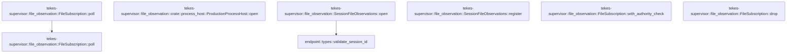

# tekes-supervisor::file_observation

[Package atlas](index.md) · [Source](../../src/file_observation.rs)

## Declarations

Visibility is the declaration spelling; trait members and reexports require their enclosing interface. `cfg` is not evaluated.

| Symbol | Kind | Visibility | Test / cfg |
|---|---|---|---|
| [tekes-supervisor::file_observation::State](../../src/file_observation.rs#L9) | struct_item | `private` |  |
| [tekes-supervisor::file_observation::SessionFileObservations](../../src/file_observation.rs#L15) | struct_item | `pub` |  |
| [tekes-supervisor::file_observation::FileSubscription](../../src/file_observation.rs#L17) | struct_item | `pub` |  |
| [tekes-supervisor::file_observation::SessionFileObservations::open](../../src/file_observation.rs#L26) | function_item | `pub` |  |
| [tekes-supervisor::file_observation::SessionFileObservations::register](../../src/file_observation.rs#L48) | function_item | `pub` |  |
| [tekes-supervisor::file_observation::FileSubscription::with_authority_check](../../src/file_observation.rs#L62) | function_item | `pub(crate)` |  |
| [tekes-supervisor::file_observation::FileSubscription::poll](../../src/file_observation.rs#L70) | function_item | `pub` |  |
| [tekes-supervisor::file_observation::FileSubscription::drop](../../src/file_observation.rs#L97) | function_item | `private` |  |
| [tekes-supervisor::file_observation::FileSubscription::poll](../../src/file_observation.rs#L105) | function_item | `private` |  |
| [tekes-supervisor::file_observation::crate::process_host::ProductionProcessHost::open](../../src/file_observation.rs#L111) | function_item | `private` |  |
| [tekes-supervisor::file_observation::tests::revoked_authority_stops_observation_before_file_poll](../../src/file_observation.rs#L122) | function_item | `private` | test; #[cfg(test)] |
| [tekes-supervisor::file_observation::tests::post_observation_authority_check_runs_when_frames_emit_not_when_idle](../../src/file_observation.rs#L143) | function_item | `private` | test; #[cfg(test)] |
| [tekes-supervisor::file_observation::tests::feeds_are_independent_session_scoped_and_released_on_drop](../../src/file_observation.rs#L200) | function_item | `private` | test; #[cfg(test)] |

## Imports / reexports

| Local name | Source path | Visibility |
|---|---|---|
| `Value` | `serde_json::Value` | `private` |
| `json` | `serde_json::json` | `private` |
| `BTreeMap` | `std::collections::BTreeMap` | `private` |
| `Path` | `std::path::Path` | `private` |
| `Arc` | `std::sync::Arc` | `private` |
| `Mutex` | `std::sync::Mutex` | `private` |
| `FileObservations` | `workspace_service::observation::FileObservations` | `private` |
| `*` | `super::*` | `private` |

## Module declarations

| Module | Visibility | Attributes |
|---|---|---|
| `tekes-supervisor::file_observation::tests` | `private` | #[cfg(test)] |

## Function call graphs

Edges below are syntactically resolved calls only, including private functions. Graphs partition callers into groups of 20; they are not execution order. All unresolved sites are listed below and in the JSON inventory.

Functions 1–7: 2 direct edges

## Call sites

Includes test functions (marked in declarations). Receiver-type-required sites need type analysis/manual tracing. Calls in closures are attributed to their enclosing function; their occurrence here does not mean the closure executes immediately.

| Caller | Callee expression | Source lines | Target / classification |
|---|---|---|---|
| `open` | `endpoint::validate_session_id(session_id).map_err` | [27](../../src/file_observation.rs#L27) | receiver-type-required |
| `open` | `endpoint::validate_session_id` | [27](../../src/file_observation.rs#L27) | [endpoint::types::validate_session_id](../../../endpoint/src/types.rs#L130) |
| `open` | `self.0.lock().map_err` | [28](../../src/file_observation.rs#L28) | receiver-type-required |
| `open` | `self.0.lock` | [28](../../src/file_observation.rs#L28) | receiver-type-required |
| `open` | `state.feeds.len` | [29](../../src/file_observation.rs#L29) | receiver-type-required |
| `open` | `Err` | [30](../../src/file_observation.rs#L30) | external-constructor-callback-or-unresolved |
| `open` | `"Too many file subscriptions".into` | [30](../../src/file_observation.rs#L30) | receiver-type-required |
| `open` | `state             .next_id             .checked_add(1)             .ok_or` | [32](../../src/file_observation.rs#L32) | receiver-type-required |
| `open` | `state             .next_id             .checked_add` | [32](../../src/file_observation.rs#L32) | receiver-type-required |
| `open` | `state             .feeds             .insert` | [37](../../src/file_observation.rs#L37) | receiver-type-required |
| `open` | `session_id.to_owned` | [39](../../src/file_observation.rs#L39) | receiver-type-required |
| `open` | `FileObservations::default` | [39](../../src/file_observation.rs#L39) | external-constructor-callback-or-unresolved |
| `open` | `Ok` | [40](../../src/file_observation.rs#L40) | external-constructor-callback-or-unresolved |
| `open` | `self.clone` | [41](../../src/file_observation.rs#L41) | receiver-type-required |
| `register` | `self.0.lock().map_err` | [49](../../src/file_observation.rs#L49) | receiver-type-required |
| `register` | `self.0.lock` | [49](../../src/file_observation.rs#L49) | receiver-type-required |
| `register` | `state.feeds.values_mut` | [50](../../src/file_observation.rs#L50) | receiver-type-required |
| `register` | `observations                     .register(root, relative)                     .map_err` | [52](../../src/file_observation.rs#L52) | receiver-type-required |
| `register` | `observations                     .register` | [52](../../src/file_observation.rs#L52) | receiver-type-required |
| `register` | `error.code.to_owned` | [54](../../src/file_observation.rs#L54) | receiver-type-required |
| `register` | `Ok` | [57](../../src/file_observation.rs#L57) | external-constructor-callback-or-unresolved |
| `with_authority_check` | `Some` | [66](../../src/file_observation.rs#L66) | external-constructor-callback-or-unresolved |
| `with_authority_check` | `Box::new` | [66](../../src/file_observation.rs#L66) | external-constructor-callback-or-unresolved |
| `poll` | `check` | [72](../../src/file_observation.rs#L72), [90](../../src/file_observation.rs#L90) | external-constructor-callback-or-unresolved |
| `poll` | `Ok` | [76](../../src/file_observation.rs#L76), [92](../../src/file_observation.rs#L92) | external-constructor-callback-or-unresolved |
| `poll` | `self                 .registry                 .0                 .lock()                 .map_err` | [79](../../src/file_observation.rs#L79) | receiver-type-required |
| `poll` | `self                 .registry                 .0                 .lock` | [79](../../src/file_observation.rs#L79) | receiver-type-required |
| `poll` | `state.feeds.get_mut(&self.id).ok_or` | [84](../../src/file_observation.rs#L84) | receiver-type-required |
| `poll` | `state.feeds.get_mut` | [84](../../src/file_observation.rs#L84) | receiver-type-required |
| `poll` | `observations.poll().map_err` | [85](../../src/file_observation.rs#L85) | receiver-type-required |
| `poll` | `observations.poll` | [85](../../src/file_observation.rs#L85) | receiver-type-required |
| `poll` | `error.code.to_owned` | [85](../../src/file_observation.rs#L85) | receiver-type-required |
| `poll` | `frames.is_empty` | [87](../../src/file_observation.rs#L87) | receiver-type-required |
| `drop` | `self.registry.0.lock` | [98](../../src/file_observation.rs#L98) | receiver-type-required |
| `drop` | `state.feeds.remove` | [99](../../src/file_observation.rs#L99) | receiver-type-required |
| `poll` | `FileSubscription::poll` | [106](../../src/file_observation.rs#L106) | [tekes-supervisor::file_observation::FileSubscription::poll](../../src/file_observation.rs#L70) |
| `open` | `self.client_file_changes(session_id)             .map(&#124;feed&#124; Box::new(feed) as Box<dyn transport::FileChangeFeed>)             .map_err` | [112](../../src/file_observation.rs#L112) | receiver-type-required |
| `open` | `self.client_file_changes(session_id)             .map` | [112](../../src/file_observation.rs#L112) | receiver-type-required |
| `open` | `self.client_file_changes` | [112](../../src/file_observation.rs#L112) | receiver-type-required |
| `open` | `Box::new` | [113](../../src/file_observation.rs#L113) | external-constructor-callback-or-unresolved |
| `open` | `error.to_string` | [114](../../src/file_observation.rs#L114) | receiver-type-required |
| `revoked_authority_stops_observation_before_file_poll` | `Arc::new` | [124](../../src/file_observation.rs#L124) | external-constructor-callback-or-unresolved |
| `revoked_authority_stops_observation_before_file_poll` | `AtomicBool::new` | [124](../../src/file_observation.rs#L124) | external-constructor-callback-or-unresolved |
| `revoked_authority_stops_observation_before_file_poll` | `SessionFileObservations::default` | [125](../../src/file_observation.rs#L125) | external-constructor-callback-or-unresolved |
| `revoked_authority_stops_observation_before_file_poll` | `allowed.clone` | [126](../../src/file_observation.rs#L126) | receiver-type-required |
| `revoked_authority_stops_observation_before_file_poll` | `registry             .open("018f0000-0000-7000-8000-000000000001")             .unwrap()             .with_authority_check` | [127](../../src/file_observation.rs#L127) | receiver-type-required |
| `revoked_authority_stops_observation_before_file_poll` | `registry             .open("018f0000-0000-7000-8000-000000000001")             .unwrap` | [127](../../src/file_observation.rs#L127) | receiver-type-required |
| `revoked_authority_stops_observation_before_file_poll` | `registry             .open` | [127](../../src/file_observation.rs#L127) | receiver-type-required |
| `revoked_authority_stops_observation_before_file_poll` | `check.load` | [131](../../src/file_observation.rs#L131) | receiver-type-required |
| `revoked_authority_stops_observation_before_file_poll` | `Ok` | [132](../../src/file_observation.rs#L132) | external-constructor-callback-or-unresolved |
| `revoked_authority_stops_observation_before_file_poll` | `Err` | [134](../../src/file_observation.rs#L134) | external-constructor-callback-or-unresolved |
| `revoked_authority_stops_observation_before_file_poll` | `"revoked".into` | [134](../../src/file_observation.rs#L134) | receiver-type-required |
| `revoked_authority_stops_observation_before_file_poll` | `allowed.store` | [138](../../src/file_observation.rs#L138) | receiver-type-required |
| `post_observation_authority_check_runs_when_frames_emit_not_when_idle` | `Arc::new` | [145](../../src/file_observation.rs#L145), [146](../../src/file_observation.rs#L146), [176](../../src/file_observation.rs#L176), [177](../../src/file_observation.rs#L177) | external-constructor-callback-or-unresolved |
| `post_observation_authority_check_runs_when_frames_emit_not_when_idle` | `AtomicBool::new` | [145](../../src/file_observation.rs#L145), [176](../../src/file_observation.rs#L176) | external-constructor-callback-or-unresolved |
| `post_observation_authority_check_runs_when_frames_emit_not_when_idle` | `AtomicUsize::new` | [146](../../src/file_observation.rs#L146), [177](../../src/file_observation.rs#L177) | external-constructor-callback-or-unresolved |
| `post_observation_authority_check_runs_when_frames_emit_not_when_idle` | `SessionFileObservations::default` | [147](../../src/file_observation.rs#L147) | external-constructor-callback-or-unresolved |
| `post_observation_authority_check_runs_when_frames_emit_not_when_idle` | `tempfile::tempdir().unwrap` | [149](../../src/file_observation.rs#L149) | receiver-type-required |
| `post_observation_authority_check_runs_when_frames_emit_not_when_idle` | `tempfile::tempdir` | [149](../../src/file_observation.rs#L149) | external-constructor-callback-or-unresolved |
| `post_observation_authority_check_runs_when_frames_emit_not_when_idle` | `std::fs::write(root.path().join("f.txt"), "before").unwrap` | [150](../../src/file_observation.rs#L150) | receiver-type-required |
| `post_observation_authority_check_runs_when_frames_emit_not_when_idle` | `std::fs::write` | [150](../../src/file_observation.rs#L150), [175](../../src/file_observation.rs#L175), [192](../../src/file_observation.rs#L192), [195](../../src/file_observation.rs#L195) | external-constructor-callback-or-unresolved |
| `post_observation_authority_check_runs_when_frames_emit_not_when_idle` | `root.path().join` | [150](../../src/file_observation.rs#L150), [175](../../src/file_observation.rs#L175), [192](../../src/file_observation.rs#L192), [195](../../src/file_observation.rs#L195) | receiver-type-required |
| `post_observation_authority_check_runs_when_frames_emit_not_when_idle` | `root.path` | [150](../../src/file_observation.rs#L150), [169](../../src/file_observation.rs#L169), [175](../../src/file_observation.rs#L175), [191](../../src/file_observation.rs#L191), [192](../../src/file_observation.rs#L192), [195](../../src/file_observation.rs#L195) | receiver-type-required |
| `post_observation_authority_check_runs_when_frames_emit_not_when_idle` | `Arc::clone` | [152](../../src/file_observation.rs#L152), [153](../../src/file_observation.rs#L153), [178](../../src/file_observation.rs#L178), [179](../../src/file_observation.rs#L179) | external-constructor-callback-or-unresolved |
| `post_observation_authority_check_runs_when_frames_emit_not_when_idle` | `registry             .open(session)             .unwrap()             .with_authority_check` | [154](../../src/file_observation.rs#L154), [180](../../src/file_observation.rs#L180) | receiver-type-required |
| `post_observation_authority_check_runs_when_frames_emit_not_when_idle` | `registry             .open(session)             .unwrap` | [154](../../src/file_observation.rs#L154), [180](../../src/file_observation.rs#L180) | receiver-type-required |
| `post_observation_authority_check_runs_when_frames_emit_not_when_idle` | `registry             .open` | [154](../../src/file_observation.rs#L154), [180](../../src/file_observation.rs#L180) | receiver-type-required |
| `post_observation_authority_check_runs_when_frames_emit_not_when_idle` | `checks_c.fetch_add` | [158](../../src/file_observation.rs#L158) | receiver-type-required |
| `post_observation_authority_check_runs_when_frames_emit_not_when_idle` | `allow_c.load` | [159](../../src/file_observation.rs#L159) | receiver-type-required |
| `post_observation_authority_check_runs_when_frames_emit_not_when_idle` | `Ok` | [160](../../src/file_observation.rs#L160), [188](../../src/file_observation.rs#L188) | external-constructor-callback-or-unresolved |
| `post_observation_authority_check_runs_when_frames_emit_not_when_idle` | `Err` | [162](../../src/file_observation.rs#L162), [186](../../src/file_observation.rs#L186) | external-constructor-callback-or-unresolved |
| `post_observation_authority_check_runs_when_frames_emit_not_when_idle` | `"revoked-after-emit".into` | [162](../../src/file_observation.rs#L162) | receiver-type-required |
| `post_observation_authority_check_runs_when_frames_emit_not_when_idle` | `registry.register(session, root.path(), "f.txt").unwrap` | [169](../../src/file_observation.rs#L169), [191](../../src/file_observation.rs#L191) | receiver-type-required |
| `post_observation_authority_check_runs_when_frames_emit_not_when_idle` | `registry.register` | [169](../../src/file_observation.rs#L169), [191](../../src/file_observation.rs#L191) | receiver-type-required |
| `post_observation_authority_check_runs_when_frames_emit_not_when_idle` | `std::fs::write(root.path().join("f.txt"), "after").unwrap` | [175](../../src/file_observation.rs#L175) | receiver-type-required |
| `post_observation_authority_check_runs_when_frames_emit_not_when_idle` | `cr.fetch_add` | [184](../../src/file_observation.rs#L184) | receiver-type-required |
| `post_observation_authority_check_runs_when_frames_emit_not_when_idle` | `ar.load` | [185](../../src/file_observation.rs#L185) | receiver-type-required |
| `post_observation_authority_check_runs_when_frames_emit_not_when_idle` | `"revoked-mid-poll".into` | [186](../../src/file_observation.rs#L186) | receiver-type-required |
| `post_observation_authority_check_runs_when_frames_emit_not_when_idle` | `std::fs::write(root.path().join("f.txt"), "v1").unwrap` | [192](../../src/file_observation.rs#L192) | receiver-type-required |
| `post_observation_authority_check_runs_when_frames_emit_not_when_idle` | `allow_race.store` | [194](../../src/file_observation.rs#L194) | receiver-type-required |
| `post_observation_authority_check_runs_when_frames_emit_not_when_idle` | `std::fs::write(root.path().join("f.txt"), "v2").unwrap` | [195](../../src/file_observation.rs#L195) | receiver-type-required |
| `feeds_are_independent_session_scoped_and_released_on_drop` | `SessionFileObservations::default` | [201](../../src/file_observation.rs#L201) | external-constructor-callback-or-unresolved |
| `feeds_are_independent_session_scoped_and_released_on_drop` | `registry.open(one).unwrap` | [204](../../src/file_observation.rs#L204), [205](../../src/file_observation.rs#L205), [222](../../src/file_observation.rs#L222) | receiver-type-required |
| `feeds_are_independent_session_scoped_and_released_on_drop` | `registry.open` | [204](../../src/file_observation.rs#L204), [205](../../src/file_observation.rs#L205), [206](../../src/file_observation.rs#L206), [222](../../src/file_observation.rs#L222) | receiver-type-required |
| `feeds_are_independent_session_scoped_and_released_on_drop` | `registry.open(two).unwrap` | [206](../../src/file_observation.rs#L206) | receiver-type-required |
| `feeds_are_independent_session_scoped_and_released_on_drop` | `tempfile::tempdir().unwrap` | [210](../../src/file_observation.rs#L210) | receiver-type-required |
| `feeds_are_independent_session_scoped_and_released_on_drop` | `tempfile::tempdir` | [210](../../src/file_observation.rs#L210) | external-constructor-callback-or-unresolved |
| `feeds_are_independent_session_scoped_and_released_on_drop` | `std::fs::write(root.path().join("file"), "before").unwrap` | [211](../../src/file_observation.rs#L211) | receiver-type-required |
| `feeds_are_independent_session_scoped_and_released_on_drop` | `std::fs::write` | [211](../../src/file_observation.rs#L211), [213](../../src/file_observation.rs#L213) | external-constructor-callback-or-unresolved |
| `feeds_are_independent_session_scoped_and_released_on_drop` | `root.path().join` | [211](../../src/file_observation.rs#L211), [213](../../src/file_observation.rs#L213) | receiver-type-required |
| `feeds_are_independent_session_scoped_and_released_on_drop` | `root.path` | [211](../../src/file_observation.rs#L211), [212](../../src/file_observation.rs#L212), [213](../../src/file_observation.rs#L213) | receiver-type-required |
| `feeds_are_independent_session_scoped_and_released_on_drop` | `registry.register(one, root.path(), "file").unwrap` | [212](../../src/file_observation.rs#L212) | receiver-type-required |
| `feeds_are_independent_session_scoped_and_released_on_drop` | `registry.register` | [212](../../src/file_observation.rs#L212) | receiver-type-required |
| `feeds_are_independent_session_scoped_and_released_on_drop` | `std::fs::write(root.path().join("file"), "after").unwrap` | [213](../../src/file_observation.rs#L213) | receiver-type-required |
| `feeds_are_independent_session_scoped_and_released_on_drop` | `drop` | [218](../../src/file_observation.rs#L218), [219](../../src/file_observation.rs#L219), [220](../../src/file_observation.rs#L220) | external-constructor-callback-or-unresolved |
