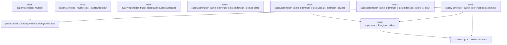

# tekes-supervisor::folder_trust

[Package atlas](index.md) · [Source](../../src/folder_trust.rs)

## Declarations

Visibility is the declaration spelling; trait members and reexports require their enclosing interface. `cfg` is not evaluated.

| Symbol | Kind | Visibility | Test / cfg |
|---|---|---|---|
| [tekes-supervisor::folder_trust::FolderTrustRoutes](../../src/folder_trust.rs#L15) | struct_item | `pub` |  |
| [tekes-supervisor::folder_trust::FolderTrustRoutes::new](../../src/folder_trust.rs#L19) | function_item | `pub` |  |
| [tekes-supervisor::folder_trust::Status](../../src/folder_trust.rs#L25) | struct_item | `private` |  |
| [tekes-supervisor::folder_trust::Request](../../src/folder_trust.rs#L30) | struct_item | `private` |  |
| [tekes-supervisor::folder_trust::Revoke](../../src/folder_trust.rs#L36) | struct_item | `private` |  |
| [tekes-supervisor::folder_trust::failure](../../src/folder_trust.rs#L40) | function_item | `private` |  |
| [tekes-supervisor::folder_trust::FolderTrustRoutes::capabilities](../../src/folder_trust.rs#L48) | function_item | `private` |  |
| [tekes-supervisor::folder_trust::FolderTrustRoutes::extension_method_class](../../src/folder_trust.rs#L58) | function_item | `private` |  |
| [tekes-supervisor::folder_trust::FolderTrustRoutes::validate_extension_payload](../../src/folder_trust.rs#L65) | function_item | `private` |  |
| [tekes-supervisor::folder_trust::FolderTrustRoutes::extension_failure_is_exact](../../src/folder_trust.rs#L83) | function_item | `private` |  |
| [tekes-supervisor::folder_trust::FolderTrustRoutes::execute](../../src/folder_trust.rs#L90) | function_item | `private` |  |
| [tekes-supervisor::folder_trust::cli](../../src/folder_trust.rs#L133) | function_item | `pub` |  |

## Imports / reexports

| Local name | Source path | Visibility |
|---|---|---|
| `ProductionEndpointRoutes` | `crate::endpoint_host::ProductionEndpointRoutes` | `private` |
| `ProductionRouteFailure` | `crate::endpoint_host::ProductionRouteFailure` | `private` |
| `EndpointHostCall` | `endpoint::EndpointHostCall` | `private` |
| `MethodClass` | `endpoint::MethodClass` | `private` |
| `FolderAuthorityStore` | `profile::FolderAuthorityStore` | `private` |
| `IJsonValue` | `schema::IJsonValue` | `private` |
| `Deserialize` | `serde::Deserialize` | `private` |
| `Value` | `serde_json::Value` | `private` |
| `json` | `serde_json::json` | `private` |
| `BTreeSet` | `std::collections::BTreeSet` | `private` |
| `io` | `std::io` | `private` |
| `BufRead` | `std::io::BufRead` | `private` |
| `Write` | `std::io::Write` | `private` |
| `PathBuf` | `std::path::PathBuf` | `private` |

## Module declarations

| Module | Visibility | Attributes |
|---|---|---|

## Function call graphs

Edges below are syntactically resolved calls only, including private functions. Graphs partition callers into groups of 20; they are not execution order. All unresolved sites are listed below and in the JSON inventory.

Functions 1–8: 6 direct edges

## Call sites

Includes test functions (marked in declarations). Receiver-type-required sites need type analysis/manual tracing. Calls in closures are attributed to their enclosing function; their occurrence here does not mean the closure executes immediately.

| Caller | Callee expression | Source lines | Target / classification |
|---|---|---|---|
| `failure` | `"folder-trust-refused".into` | [42](../../src/folder_trust.rs#L42) | receiver-type-required |
| `failure` | `error.to_string` | [43](../../src/folder_trust.rs#L43) | receiver-type-required |
| `failure` | `IJsonValue::parse(b"{}").expect` | [44](../../src/folder_trust.rs#L44) | receiver-type-required |
| `failure` | `IJsonValue::parse` | [44](../../src/folder_trust.rs#L44) | [schema::ijson::IJsonValue::parse](../../../schema/src/ijson.rs#L16) |
| `capabilities` | `[             "folders.trust.status",             "folders.trust.request",             "folders.trust.revoke",         ]         .into_iter()         .map(str::to_owned)         .collect` | [49](../../src/folder_trust.rs#L49) | receiver-type-required |
| `capabilities` | `[             "folders.trust.status",             "folders.trust.request",             "folders.trust.revoke",         ]         .into_iter()         .map` | [49](../../src/folder_trust.rs#L49) | receiver-type-required |
| `capabilities` | `[             "folders.trust.status",             "folders.trust.request",             "folders.trust.revoke",         ]         .into_iter` | [49](../../src/folder_trust.rs#L49) | receiver-type-required |
| `extension_method_class` | `Some` | [60](../../src/folder_trust.rs#L60), [61](../../src/folder_trust.rs#L61) | external-constructor-callback-or-unresolved |
| `validate_extension_payload` | `serde_json::from_value::<Status>(payload.clone())                 .map(&#124;_&#124; ())                 .map_err` | [71](../../src/folder_trust.rs#L71) | receiver-type-required |
| `validate_extension_payload` | `serde_json::from_value::<Status>(payload.clone())                 .map` | [71](../../src/folder_trust.rs#L71) | receiver-type-required |
| `validate_extension_payload` | `serde_json::from_value::<Status>` | [71](../../src/folder_trust.rs#L71) | external-constructor-callback-or-unresolved |
| `validate_extension_payload` | `payload.clone` | [71](../../src/folder_trust.rs#L71), [74](../../src/folder_trust.rs#L74), [77](../../src/folder_trust.rs#L77) | receiver-type-required |
| `validate_extension_payload` | `serde_json::from_value::<Request>(payload.clone())                 .map(&#124;_&#124; ())                 .map_err` | [74](../../src/folder_trust.rs#L74) | receiver-type-required |
| `validate_extension_payload` | `serde_json::from_value::<Request>(payload.clone())                 .map` | [74](../../src/folder_trust.rs#L74) | receiver-type-required |
| `validate_extension_payload` | `serde_json::from_value::<Request>` | [74](../../src/folder_trust.rs#L74) | external-constructor-callback-or-unresolved |
| `validate_extension_payload` | `serde_json::from_value::<Revoke>(payload.clone())                 .map(&#124;_&#124; ())                 .map_err` | [77](../../src/folder_trust.rs#L77) | receiver-type-required |
| `validate_extension_payload` | `serde_json::from_value::<Revoke>(payload.clone())                 .map` | [77](../../src/folder_trust.rs#L77) | receiver-type-required |
| `validate_extension_payload` | `serde_json::from_value::<Revoke>` | [77](../../src/folder_trust.rs#L77) | external-constructor-callback-or-unresolved |
| `validate_extension_payload` | `Err` | [80](../../src/folder_trust.rs#L80) | external-constructor-callback-or-unresolved |
| `validate_extension_payload` | `failure` | [80](../../src/folder_trust.rs#L80) | [tekes-supervisor::folder_trust::failure](../../src/folder_trust.rs#L40) |
| `execute` | `FolderAuthorityStore::new` | [96](../../src/folder_trust.rs#L96) | [profile::folder_authority::FolderAuthorityStore::new](../../../profile/src/folder_authority.rs#L86) |
| `execute` | `call.operation.as_str` | [97](../../src/folder_trust.rs#L97) | receiver-type-required |
| `execute` | `serde_json::from_value(payload.clone()).map_err` | [99](../../src/folder_trust.rs#L99), [103](../../src/folder_trust.rs#L103), [107](../../src/folder_trust.rs#L107) | receiver-type-required |
| `execute` | `serde_json::from_value` | [99](../../src/folder_trust.rs#L99), [103](../../src/folder_trust.rs#L103), [107](../../src/folder_trust.rs#L107) | external-constructor-callback-or-unresolved |
| `execute` | `payload.clone` | [99](../../src/folder_trust.rs#L99), [103](../../src/folder_trust.rs#L103), [107](../../src/folder_trust.rs#L107) | receiver-type-required |
| `execute` | `store                     .revoke(&call.rpc_id, input.expected_revision, &input.folder_id)                     .map_err` | [108](../../src/folder_trust.rs#L108) | receiver-type-required |
| `execute` | `store                     .revoke` | [108](../../src/folder_trust.rs#L108) | receiver-type-required |
| `execute` | `Err` | [113](../../src/folder_trust.rs#L113) | external-constructor-callback-or-unresolved |
| `execute` | `failure` | [113](../../src/folder_trust.rs#L113) | [tekes-supervisor::folder_trust::failure](../../src/folder_trust.rs#L40) |
| `execute` | `call.handoff                 .mark_handed_off(endpoint::DurableHandoffProof {                     delivery: "folder-authority-barrier".into(),                     durable_identity: Some(endpoint::RpcDurableIdentity {                         kind: "folder-trust".into(),                         id: call.rpc_id.clone(),                         seq: None,                     }),                 })                 .map_err` | [116](../../src/folder_trust.rs#L116) | receiver-type-required |
| `execute` | `call.handoff                 .mark_handed_off` | [116](../../src/folder_trust.rs#L116) | receiver-type-required |
| `execute` | `"folder-authority-barrier".into` | [118](../../src/folder_trust.rs#L118) | receiver-type-required |
| `execute` | `Some` | [119](../../src/folder_trust.rs#L119) | external-constructor-callback-or-unresolved |
| `execute` | `"folder-trust".into` | [120](../../src/folder_trust.rs#L120) | receiver-type-required |
| `execute` | `call.rpc_id.clone` | [121](../../src/folder_trust.rs#L121) | receiver-type-required |
| `execute` | `IJsonValue::parse(&serde_json::to_vec(&value).map_err(failure)?).map_err` | [127](../../src/folder_trust.rs#L127) | receiver-type-required |
| `execute` | `IJsonValue::parse` | [127](../../src/folder_trust.rs#L127) | [schema::ijson::IJsonValue::parse](../../../schema/src/ijson.rs#L16) |
| `execute` | `serde_json::to_vec(&value).map_err` | [127](../../src/folder_trust.rs#L127) | receiver-type-required |
| `execute` | `serde_json::to_vec` | [127](../../src/folder_trust.rs#L127) | external-constructor-callback-or-unresolved |
| `cli` | `args         .iter()         .map(&#124;arg&#124; {             arg.to_str()                 .ok_or_else(&#124;&#124; io::Error::other("non-utf8-argument"))         })         .collect::<io::Result<Vec<_>>>` | [134](../../src/folder_trust.rs#L134) | receiver-type-required |
| `cli` | `args         .iter()         .map` | [134](../../src/folder_trust.rs#L134) | receiver-type-required |
| `cli` | `args         .iter` | [134](../../src/folder_trust.rs#L134) | receiver-type-required |
| `cli` | `arg.to_str()                 .ok_or_else` | [137](../../src/folder_trust.rs#L137) | receiver-type-required |
| `cli` | `arg.to_str` | [137](../../src/folder_trust.rs#L137) | receiver-type-required |
| `cli` | `io::Error::other` | [138](../../src/folder_trust.rs#L138), [142](../../src/folder_trust.rs#L142), [189](../../src/folder_trust.rs#L189), [193](../../src/folder_trust.rs#L193), [197](../../src/folder_trust.rs#L197) | external-constructor-callback-or-unresolved |
| `cli` | `strings.len` | [141](../../src/folder_trust.rs#L141), [146](../../src/folder_trust.rs#L146), [149](../../src/folder_trust.rs#L149) | receiver-type-required |
| `cli` | `Err` | [142](../../src/folder_trust.rs#L142), [189](../../src/folder_trust.rs#L189), [193](../../src/folder_trust.rs#L193), [197](../../src/folder_trust.rs#L197) | external-constructor-callback-or-unresolved |
| `cli` | `FolderAuthorityStore::new` | [144](../../src/folder_trust.rs#L144) | [profile::folder_authority::FolderAuthorityStore::new](../../../profile/src/folder_authority.rs#L86) |
| `cli` | `PathBuf::from` | [144](../../src/folder_trust.rs#L144) | external-constructor-callback-or-unresolved |
| `cli` | `strings[6].parse::<u64>().map_err` | [150](../../src/folder_trust.rs#L150) | receiver-type-required |
| `cli` | `strings[6].parse::<u64>` | [150](../../src/folder_trust.rs#L150) | receiver-type-required |
| `cli` | `store.request` | [153](../../src/folder_trust.rs#L153) | receiver-type-required |
| `cli` | `std::path::Path::new` | [153](../../src/folder_trust.rs#L153) | external-constructor-callback-or-unresolved |
| `cli` | `store.revoke` | [155](../../src/folder_trust.rs#L155) | receiver-type-required |
| `cli` | `store.prior_grant` | [157](../../src/folder_trust.rs#L157) | receiver-type-required |
| `cli` | `Ok` | [163](../../src/folder_trust.rs#L163), [203](../../src/folder_trust.rs#L203) | external-constructor-callback-or-unresolved |
| `cli` | `store.pending` | [165](../../src/folder_trust.rs#L165) | receiver-type-required |
| `cli` | `std::fs::OpenOptions::new()                         .read(true)                         .write(true)                         .open` | [166](../../src/folder_trust.rs#L166) | receiver-type-required |
| `cli` | `std::fs::OpenOptions::new()                         .read(true)                         .write` | [166](../../src/folder_trust.rs#L166) | receiver-type-required |
| `cli` | `std::fs::OpenOptions::new()                         .read` | [166](../../src/folder_trust.rs#L166) | receiver-type-required |
| `cli` | `std::fs::OpenOptions::new` | [166](../../src/folder_trust.rs#L166) | external-constructor-callback-or-unresolved |
| `cli` | `terminal.flush` | [180](../../src/folder_trust.rs#L180) | receiver-type-required |
| `cli` | `String::new` | [181](../../src/folder_trust.rs#L181) | external-constructor-callback-or-unresolved |
| `cli` | `io::BufReader::new(terminal).read_line` | [182](../../src/folder_trust.rs#L182) | receiver-type-required |
| `cli` | `io::BufReader::new` | [182](../../src/folder_trust.rs#L182) | external-constructor-callback-or-unresolved |
| `cli` | `answer.trim_end` | [183](../../src/folder_trust.rs#L183) | receiver-type-required |
| `cli` | `store.grant_from_host` | [191](../../src/folder_trust.rs#L191) | receiver-type-required |
