# tekes-supervisor::host_runtime

[Package atlas](index.md) · [Source](../../src/host_runtime.rs)

## Declarations

Visibility is the declaration spelling; trait members and reexports require their enclosing interface. `cfg` is not evaluated.

| Symbol | Kind | Visibility | Test / cfg |
|---|---|---|---|
| [tekes-supervisor::host_runtime::SOURCE_REVISION](../../src/host_runtime.rs#L36) | const_item | `pub` |  |
| [tekes-supervisor::host_runtime::is_source_revision](../../src/host_runtime.rs#L47) | function_item | `private` |  |
| [tekes-supervisor::host_runtime::TERMINATE_REQUESTED](../../src/host_runtime.rs#L62) | static_item | `private` |  |
| [tekes-supervisor::host_runtime::ProductionRootLock](../../src/host_runtime.rs#L64) | struct_item | `pub` |  |
| [tekes-supervisor::host_runtime::ProductionRootLock::acquire](../../src/host_runtime.rs#L70) | function_item | `pub` |  |
| [tekes-supervisor::host_runtime::ProductionRootLock::path](../../src/host_runtime.rs#L102) | function_item | `pub` |  |
| [tekes-supervisor::host_runtime::ProductionRootLock::drop](../../src/host_runtime.rs#L108) | function_item | `private` |  |
| [tekes-supervisor::host_runtime::validate_directory](../../src/host_runtime.rs#L114) | function_item | `private` |  |
| [tekes-supervisor::host_runtime::validate_file_metadata](../../src/host_runtime.rs#L130) | function_item | `private` |  |
| [tekes-supervisor::host_runtime::effective_uid](../../src/host_runtime.rs#L149) | function_item | `private` |  |
| [tekes-supervisor::host_runtime::authority_root](../../src/host_runtime.rs#L154) | function_item | `private` |  |
| [tekes-supervisor::host_runtime::prepare_storage](../../src/host_runtime.rs#L160) | function_item | `pub` |  |
| [tekes-supervisor::host_runtime::preflight_storage](../../src/host_runtime.rs#L210) | function_item | `pub` |  |
| [tekes-supervisor::host_runtime::require_production_apfs](../../src/host_runtime.rs#L215) | function_item | `private` | #[cfg(target_os = "macos")] |
| [tekes-supervisor::host_runtime::require_production_apfs](../../src/host_runtime.rs#L239) | function_item | `private` | #[cfg(not(target_os = "macos"))] |
| [tekes-supervisor::host_runtime::require_production_filesystem_name](../../src/host_runtime.rs#L244) | function_item | `private` | test; #[cfg_attr(not(any(target_os = "macos", test)), allow(dead_code))] |
| [tekes-supervisor::host_runtime::reject_cloud_managed_storage](../../src/host_runtime.rs#L254) | function_item | `private` |  |
| [tekes-supervisor::host_runtime::is_icloud_mobile_documents_path](../../src/host_runtime.rs#L264) | function_item | `private` |  |
| [tekes-supervisor::host_runtime::assemble_application_endpoint_host](../../src/host_runtime.rs#L283) | function_item | `pub` |  |
| [tekes-supervisor::host_runtime::watch_shutdown](../../src/host_runtime.rs#L329) | function_item | `private` |  |
| [tekes-supervisor::host_runtime::wait_for_launcher_shutdown](../../src/host_runtime.rs#L366) | function_item | `pub` |  |
| [tekes-supervisor::host_runtime::request_termination](../../src/host_runtime.rs#L371) | function_item | `private` |  |
| [tekes-supervisor::host_runtime::install_termination_handler](../../src/host_runtime.rs#L375) | function_item | `pub(crate)` |  |
| [tekes-supervisor::host_runtime::duplicate_fd](../../src/host_runtime.rs#L392) | function_item | `private` |  |
| [tekes-supervisor::host_runtime::system_timestamp](../../src/host_runtime.rs#L406) | function_item | `pub` |  |
| [tekes-supervisor::host_runtime::DaemonError](../../src/host_runtime.rs#L434) | struct_item | `pub` |  |
| [tekes-supervisor::host_runtime::DaemonError::new](../../src/host_runtime.rs#L440) | function_item | `private` |  |
| [tekes-supervisor::host_runtime::DaemonError::protocol](../../src/host_runtime.rs#L447) | function_item | `pub(crate)` |  |
| [tekes-supervisor::host_runtime::DaemonError::io](../../src/host_runtime.rs#L451) | function_item | `pub(crate)` |  |
| [tekes-supervisor::host_runtime::DaemonError::store](../../src/host_runtime.rs#L455) | function_item | `pub(crate)` |  |
| [tekes-supervisor::host_runtime::DaemonError::already_running](../../src/host_runtime.rs#L474) | function_item | `private` |  |
| [tekes-supervisor::host_runtime::DaemonError::invalid_install](../../src/host_runtime.rs#L481) | function_item | `pub(crate)` |  |
| [tekes-supervisor::host_runtime::DaemonError::invalid_install_reason](../../src/host_runtime.rs#L485) | function_item | `pub(crate)` |  |
| [tekes-supervisor::host_runtime::DaemonError::invalid_config](../../src/host_runtime.rs#L489) | function_item | `pub(crate)` |  |
| [tekes-supervisor::host_runtime::DaemonError::corrupt](../../src/host_runtime.rs#L493) | function_item | `pub(crate)` |  |
| [tekes-supervisor::host_runtime::DaemonError::required_broker](../../src/host_runtime.rs#L497) | function_item | `pub(crate)` |  |
| [tekes-supervisor::host_runtime::DaemonError::bootstrap_code](../../src/host_runtime.rs#L502) | function_item | `pub` |  |
| [tekes-supervisor::host_runtime::DaemonError::from](../../src/host_runtime.rs#L508) | function_item | `private` |  |
| [tekes-supervisor::host_runtime::DaemonError::from](../../src/host_runtime.rs#L518) | function_item | `private` |  |
| [tekes-supervisor::host_runtime::tests::macos_storage_accepts_apfs_and_rejects_hfs](../../src/host_runtime.rs#L536) | function_item | `private` | test; #[cfg(test)] |
| [tekes-supervisor::host_runtime::tests::production_storage_rejects_mobile_documents_and_an_ancestor_symlink_alias](../../src/host_runtime.rs#L545) | function_item | `private` | test; #[cfg(test)] |
| [tekes-supervisor::host_runtime::tests::production_timestamp_is_event_millisecond_utc](../../src/host_runtime.rs#L571) | function_item | `private` | test; #[cfg(test)] |

## Imports / reexports

| Local name | Source path | Visibility |
|---|---|---|
| `CString` | `std::ffi::CString` | `private` |
| `OsStr` | `std::ffi::OsStr` | `private` |
| `fs` | `std::fs` | `private` |
| `File` | `std::fs::File` | `private` |
| `OpenOptions` | `std::fs::OpenOptions` | `private` |
| `io` | `std::io` | `private` |
| `Read` | `std::io::Read` | `private` |
| `AsRawFd` | `std::os::fd::AsRawFd` | `private` |
| `FromRawFd` | `std::os::fd::FromRawFd` | `private` |
| `RawFd` | `std::os::fd::RawFd` | `private` |
| `OsStrExt` | `std::os::unix::ffi::OsStrExt` | `private` |
| `DirBuilderExt` | `std::os::unix::fs::DirBuilderExt` | `private` |
| `MetadataExt` | `std::os::unix::fs::MetadataExt` | `private` |
| `OpenOptionsExt` | `std::os::unix::fs::OpenOptionsExt` | `private` |
| `Path` | `std::path::Path` | `private` |
| `PathBuf` | `std::path::PathBuf` | `private` |
| `Arc` | `std::sync::Arc` | `private` |
| `AtomicBool` | `std::sync::atomic::AtomicBool` | `private` |
| `Ordering` | `std::sync::atomic::Ordering` | `private` |
| `SessionHostDescription` | `endpoint::SessionHostDescription` | `private` |
| `InstructionResolver` | `profile::InstructionResolver` | `private` |
| `ResourceCatalog` | `profile::ResourceCatalog` | `private` |
| `StoreError` | `store::StoreError` | `private` |
| `ThreadStore` | `store::ThreadStore` | `private` |
| `Error` | `thiserror::Error` | `private` |
| `ProductionClientExtensions` | `crate::client_extensions::ProductionClientExtensions` | `private` |
| `ProductionCarrierError` | `crate::endpoint_carrier::ProductionCarrierError` | `private` |
| `CompositeProductionEndpointRoutes` | `crate::endpoint_host::CompositeProductionEndpointRoutes` | `private` |
| `EndpointClock` | `crate::endpoint_host::EndpointClock` | `private` |
| `ProductionEndpointHost` | `crate::endpoint_host::ProductionEndpointHost` | `private` |
| `ProviderReadinessAuthority` | `crate::endpoint_host::ProviderReadinessAuthority` | `private` |
| `QueueTransactionAuthority` | `crate::endpoint_host::QueueTransactionAuthority` | `private` |
| `SessionDeliveryAuthority` | `crate::endpoint_host::SessionDeliveryAuthority` | `private` |
| `SessionInputAdmissionAuthority` | `crate::endpoint_host::SessionInputAdmissionAuthority` | `private` |
| `ProductionProcessHost` | `crate::process_host::ProductionProcessHost` | `private` |
| `EndpointCommandInputAuthority` | `crate::resource_capability::EndpointCommandInputAuthority` | `private` |
| `fs` | `std::fs` | `private` |
| `symlink` | `std::os::unix::fs::symlink` | `private` |
| `reject_cloud_managed_storage` | `super::reject_cloud_managed_storage` | `private` |
| `require_production_filesystem_name` | `super::require_production_filesystem_name` | `private` |
| `system_timestamp` | `super::system_timestamp` | `private` |

## Module declarations

| Module | Visibility | Attributes |
|---|---|---|
| `tekes-supervisor::host_runtime::tests` | `private` | #[cfg(test)] |

## Function call graphs

Edges below are syntactically resolved calls only, including private functions. Graphs partition callers into groups of 20; they are not execution order. All unresolved sites are listed below and in the JSON inventory.

```mermaid
flowchart TD
  n0["profile::config::ConfigRepository::open"]
  n1["profile::instruction::InstructionResolver::new"]
  n2["profile::resources::ResourceCatalog::from_snapshot"]
  n3["store::folder::ThreadStore::open"]
  n4["store::platform::probe_local_filesystem"]
  n5["tekes-supervisor::boot_trace::phase"]
  n6["tekes-supervisor::client_extensions::ProductionClientExtensions::open"]
  n7["tekes-supervisor::endpoint_host::SessionInputAdmissionAuthority::new"]
  n8["tekes-supervisor::endpoint_host::CompositeProductionEndpointRoutes::compose"]
  n9["tekes-supervisor::endpoint_host::ProductionEndpointHost::open_with_full_authorities_and_session_admission"]
  n10["tekes-supervisor::host_runtime::ProductionRootLock::path"]
  n11["tekes-supervisor::host_runtime::ProductionRootLock::drop"]
  n12["tekes-supervisor::host_runtime::validate_directory"]
  n13["tekes-supervisor::host_runtime::validate_file_metadata"]
  n14["tekes-supervisor::host_runtime::effective_uid"]
  n15["tekes-supervisor::host_runtime::authority_root"]
  n16["tekes-supervisor::host_runtime::prepare_storage"]
  n17["tekes-supervisor::host_runtime::preflight_storage"]
  n18["tekes-supervisor::host_runtime::require_production_apfs"]
  n19["tekes-supervisor::host_runtime::require_production_apfs"]
  n20["tekes-supervisor::host_runtime::require_production_filesystem_name"]
  n21["tekes-supervisor::host_runtime::reject_cloud_managed_storage"]
  n22["tekes-supervisor::host_runtime::is_icloud_mobile_documents_path"]
  n23["tekes-supervisor::host_runtime::assemble_application_endpoint_host"]
  n24["tekes-supervisor::host_runtime::watch_shutdown"]
  n25["tekes-supervisor::host_runtime::wait_for_launcher_shutdown"]
  n26["tekes-supervisor::host_runtime::request_termination"]
  n27["tekes-supervisor::host_runtime::install_termination_handler"]
  n28["tekes-supervisor::host_runtime::duplicate_fd"]
  n29["tekes-supervisor::host_runtime::DaemonError::io"]
  n30["tekes-supervisor::host_runtime::DaemonError::store"]
  n31["tekes-supervisor::host_runtime::DaemonError::already_running"]
  n32["tekes-supervisor::host_runtime::is_source_revision"]
  n33["tekes-supervisor::host_runtime::DaemonError::invalid_install"]
  n34["tekes-supervisor::host_runtime::DaemonError::invalid_install_reason"]
  n35["tekes-supervisor::host_runtime::DaemonError::invalid_config"]
  n36["tekes-supervisor::host_runtime::DaemonError::corrupt"]
  n37["tekes-supervisor::host_runtime::ProductionRootLock::acquire"]
  n38["tekes-supervisor::resource_capability::EndpointCommandInputAuthority::new"]
  n12 --> n14
  n12 --> n33
  n12 --> n34
  n13 --> n14
  n13 --> n33
  n13 --> n34
  n15 --> n34
  n16 --> n0
  n16 --> n3
  n16 --> n4
  n16 --> n5
  n16 --> n12
  n16 --> n15
  n16 --> n21
  n16 --> n29
  n16 --> n35
  n17 --> n16
  n18 --> n20
  n18 --> n29
  n18 --> n30
  n21 --> n22
  n21 --> n30
  n23 --> n1
  n23 --> n2
  n23 --> n6
  n23 --> n7
  n23 --> n8
  n23 --> n9
  n23 --> n35
  n23 --> n36
  n23 --> n38
  n24 --> n29
  n25 --> n24
  n25 --> n28
  n27 --> n29
  n37 --> n12
  n37 --> n13
  n37 --> n29
  n37 --> n31
  n37 --> n33
```

Functions 1–20: 40 direct edges

Functions 21–34: 10 direct edges

```mermaid
flowchart TD
  n0["tekes-supervisor::host_runtime::system_timestamp"]
  n1["tekes-supervisor::host_runtime::DaemonError::new"]
  n2["tekes-supervisor::host_runtime::DaemonError::protocol"]
  n3["tekes-supervisor::host_runtime::DaemonError::io"]
  n4["tekes-supervisor::host_runtime::DaemonError::store"]
  n5["tekes-supervisor::host_runtime::DaemonError::already_running"]
  n6["tekes-supervisor::host_runtime::DaemonError::invalid_install"]
  n7["tekes-supervisor::host_runtime::DaemonError::invalid_install_reason"]
  n8["tekes-supervisor::host_runtime::DaemonError::invalid_config"]
  n9["tekes-supervisor::host_runtime::DaemonError::corrupt"]
  n10["tekes-supervisor::host_runtime::DaemonError::required_broker"]
  n11["tekes-supervisor::host_runtime::DaemonError::bootstrap_code"]
  n12["tekes-supervisor::host_runtime::DaemonError::from"]
  n13["tekes-supervisor::host_runtime::DaemonError::from"]
  n2 --> n1
  n3 --> n1
  n4 --> n1
  n4 --> n3
  n5 --> n1
  n6 --> n1
  n7 --> n1
  n8 --> n1
  n9 --> n1
  n10 --> n1
```

## Call sites

Includes test functions (marked in declarations). Receiver-type-required sites need type analysis/manual tracing. Calls in closures are attributed to their enclosing function; their occurrence here does not mean the closure executes immediately.

| Caller | Callee expression | Source lines | Target / classification |
|---|---|---|---|
| `SOURCE_REVISION` | `Some` | [42](../../src/host_runtime.rs#L42) | external-constructor-callback-or-unresolved |
| `is_source_revision` | `value.as_bytes` | [48](../../src/host_runtime.rs#L48) | receiver-type-required |
| `is_source_revision` | `bytes.len` | [49](../../src/host_runtime.rs#L49), [53](../../src/host_runtime.rs#L53) | receiver-type-required |
| `TERMINATE_REQUESTED` | `AtomicBool::new` | [62](../../src/host_runtime.rs#L62) | external-constructor-callback-or-unresolved |
| `acquire` | `validate_directory` | [71](../../src/host_runtime.rs#L71) | [tekes-supervisor::host_runtime::validate_directory](../../src/host_runtime.rs#L114) |
| `acquire` | `storage_root.join` | [72](../../src/host_runtime.rs#L72) | receiver-type-required |
| `acquire` | `OpenOptions::new()             .read(true)             .write(true)             .custom_flags(libc::O_CLOEXEC &#124; libc::O_NOFOLLOW)             .open(&path)             .map_err` | [73](../../src/host_runtime.rs#L73) | receiver-type-required |
| `acquire` | `OpenOptions::new()             .read(true)             .write(true)             .custom_flags(libc::O_CLOEXEC &#124; libc::O_NOFOLLOW)             .open` | [73](../../src/host_runtime.rs#L73) | receiver-type-required |
| `acquire` | `OpenOptions::new()             .read(true)             .write(true)             .custom_flags` | [73](../../src/host_runtime.rs#L73) | receiver-type-required |
| `acquire` | `OpenOptions::new()             .read(true)             .write` | [73](../../src/host_runtime.rs#L73) | receiver-type-required |
| `acquire` | `OpenOptions::new()             .read` | [73](../../src/host_runtime.rs#L73) | receiver-type-required |
| `acquire` | `OpenOptions::new` | [73](../../src/host_runtime.rs#L73) | external-constructor-callback-or-unresolved |
| `acquire` | `DaemonError::invalid_install` | [78](../../src/host_runtime.rs#L78) | [tekes-supervisor::host_runtime::DaemonError::invalid_install](../../src/host_runtime.rs#L481) |
| `acquire` | `path.clone` | [78](../../src/host_runtime.rs#L78) | receiver-type-required |
| `acquire` | `validate_file_metadata` | [79](../../src/host_runtime.rs#L79), [97](../../src/host_runtime.rs#L97) | [tekes-supervisor::host_runtime::validate_file_metadata](../../src/host_runtime.rs#L130) |
| `acquire` | `libc::flock` | [82](../../src/host_runtime.rs#L82) | external-constructor-callback-or-unresolved |
| `acquire` | `file.as_raw_fd` | [82](../../src/host_runtime.rs#L82) | receiver-type-required |
| `acquire` | `io::Error::last_os_error` | [85](../../src/host_runtime.rs#L85) | external-constructor-callback-or-unresolved |
| `acquire` | `error.kind` | [86](../../src/host_runtime.rs#L86) | receiver-type-required |
| `acquire` | `error                 .raw_os_error()                 .is_some_and` | [89](../../src/host_runtime.rs#L89) | receiver-type-required |
| `acquire` | `error                 .raw_os_error` | [89](../../src/host_runtime.rs#L89) | receiver-type-required |
| `acquire` | `Err` | [93](../../src/host_runtime.rs#L93), [95](../../src/host_runtime.rs#L95) | external-constructor-callback-or-unresolved |
| `acquire` | `DaemonError::already_running` | [93](../../src/host_runtime.rs#L93) | [tekes-supervisor::host_runtime::DaemonError::already_running](../../src/host_runtime.rs#L474) |
| `acquire` | `DaemonError::io` | [95](../../src/host_runtime.rs#L95) | [tekes-supervisor::host_runtime::DaemonError::io](../../src/host_runtime.rs#L451) |
| `acquire` | `Ok` | [98](../../src/host_runtime.rs#L98) | external-constructor-callback-or-unresolved |
| `drop` | `libc::flock` | [110](../../src/host_runtime.rs#L110) | external-constructor-callback-or-unresolved |
| `drop` | `self.file.as_raw_fd` | [110](../../src/host_runtime.rs#L110) | receiver-type-required |
| `validate_directory` | `fs::symlink_metadata(path)         .map_err` | [115](../../src/host_runtime.rs#L115) | receiver-type-required |
| `validate_directory` | `fs::symlink_metadata` | [115](../../src/host_runtime.rs#L115) | external-constructor-callback-or-unresolved |
| `validate_directory` | `DaemonError::invalid_install` | [116](../../src/host_runtime.rs#L116) | [tekes-supervisor::host_runtime::DaemonError::invalid_install](../../src/host_runtime.rs#L481) |
| `validate_directory` | `path.to_path_buf` | [116](../../src/host_runtime.rs#L116) | receiver-type-required |
| `validate_directory` | `metadata.file_type().is_symlink` | [117](../../src/host_runtime.rs#L117) | receiver-type-required |
| `validate_directory` | `metadata.file_type` | [117](../../src/host_runtime.rs#L117), [118](../../src/host_runtime.rs#L118) | receiver-type-required |
| `validate_directory` | `metadata.file_type().is_dir` | [118](../../src/host_runtime.rs#L118) | receiver-type-required |
| `validate_directory` | `metadata.uid` | [119](../../src/host_runtime.rs#L119) | receiver-type-required |
| `validate_directory` | `effective_uid` | [119](../../src/host_runtime.rs#L119) | [tekes-supervisor::host_runtime::effective_uid](../../src/host_runtime.rs#L149) |
| `validate_directory` | `metadata.mode` | [120](../../src/host_runtime.rs#L120) | receiver-type-required |
| `validate_directory` | `Err` | [122](../../src/host_runtime.rs#L122) | external-constructor-callback-or-unresolved |
| `validate_directory` | `DaemonError::invalid_install_reason` | [122](../../src/host_runtime.rs#L122) | [tekes-supervisor::host_runtime::DaemonError::invalid_install_reason](../../src/host_runtime.rs#L485) |
| `validate_directory` | `Ok` | [127](../../src/host_runtime.rs#L127) | external-constructor-callback-or-unresolved |
| `validate_file_metadata` | `file.metadata().map_err` | [131](../../src/host_runtime.rs#L131) | receiver-type-required |
| `validate_file_metadata` | `file.metadata` | [131](../../src/host_runtime.rs#L131) | receiver-type-required |
| `validate_file_metadata` | `fs::symlink_metadata(path)         .map_err` | [132](../../src/host_runtime.rs#L132) | receiver-type-required |
| `validate_file_metadata` | `fs::symlink_metadata` | [132](../../src/host_runtime.rs#L132) | external-constructor-callback-or-unresolved |
| `validate_file_metadata` | `DaemonError::invalid_install` | [133](../../src/host_runtime.rs#L133) | [tekes-supervisor::host_runtime::DaemonError::invalid_install](../../src/host_runtime.rs#L481) |
| `validate_file_metadata` | `path.to_path_buf` | [133](../../src/host_runtime.rs#L133) | receiver-type-required |
| `validate_file_metadata` | `pathname.file_type().is_symlink` | [134](../../src/host_runtime.rs#L134) | receiver-type-required |
| `validate_file_metadata` | `pathname.file_type` | [134](../../src/host_runtime.rs#L134), [135](../../src/host_runtime.rs#L135) | receiver-type-required |
| `validate_file_metadata` | `pathname.file_type().is_file` | [135](../../src/host_runtime.rs#L135) | receiver-type-required |
| `validate_file_metadata` | `descriptor.dev` | [136](../../src/host_runtime.rs#L136) | receiver-type-required |
| `validate_file_metadata` | `pathname.dev` | [136](../../src/host_runtime.rs#L136) | receiver-type-required |
| `validate_file_metadata` | `descriptor.ino` | [137](../../src/host_runtime.rs#L137) | receiver-type-required |
| `validate_file_metadata` | `pathname.ino` | [137](../../src/host_runtime.rs#L137) | receiver-type-required |
| `validate_file_metadata` | `descriptor.uid` | [138](../../src/host_runtime.rs#L138) | receiver-type-required |
| `validate_file_metadata` | `effective_uid` | [138](../../src/host_runtime.rs#L138) | [tekes-supervisor::host_runtime::effective_uid](../../src/host_runtime.rs#L149) |
| `validate_file_metadata` | `descriptor.mode` | [139](../../src/host_runtime.rs#L139) | receiver-type-required |
| `validate_file_metadata` | `Err` | [141](../../src/host_runtime.rs#L141) | external-constructor-callback-or-unresolved |
| `validate_file_metadata` | `DaemonError::invalid_install_reason` | [141](../../src/host_runtime.rs#L141) | [tekes-supervisor::host_runtime::DaemonError::invalid_install_reason](../../src/host_runtime.rs#L485) |
| `validate_file_metadata` | `Ok` | [146](../../src/host_runtime.rs#L146) | external-constructor-callback-or-unresolved |
| `effective_uid` | `libc::geteuid` | [151](../../src/host_runtime.rs#L151) | external-constructor-callback-or-unresolved |
| `authority_root` | `storage_root.parent().ok_or_else` | [155](../../src/host_runtime.rs#L155) | receiver-type-required |
| `authority_root` | `storage_root.parent` | [155](../../src/host_runtime.rs#L155) | receiver-type-required |
| `authority_root` | `DaemonError::invalid_install_reason` | [156](../../src/host_runtime.rs#L156) | [tekes-supervisor::host_runtime::DaemonError::invalid_install_reason](../../src/host_runtime.rs#L485) |
| `prepare_storage` | `validate_directory` | [161](../../src/host_runtime.rs#L161), [163](../../src/host_runtime.rs#L163), [181](../../src/host_runtime.rs#L181), [186](../../src/host_runtime.rs#L186) | [tekes-supervisor::host_runtime::validate_directory](../../src/host_runtime.rs#L114) |
| `prepare_storage` | `authority_root` | [162](../../src/host_runtime.rs#L162) | [tekes-supervisor::host_runtime::authority_root](../../src/host_runtime.rs#L154) |
| `prepare_storage` | `reject_cloud_managed_storage` | [164](../../src/host_runtime.rs#L164) | [tekes-supervisor::host_runtime::reject_cloud_managed_storage](../../src/host_runtime.rs#L254) |
| `prepare_storage` | `require_production_apfs` | [165](../../src/host_runtime.rs#L165) | ambiguous-cfg-or-overload |
| `prepare_storage` | `root.join` | [179](../../src/host_runtime.rs#L179) | receiver-type-required |
| `prepare_storage` | `fs::symlink_metadata` | [180](../../src/host_runtime.rs#L180) | external-constructor-callback-or-unresolved |
| `prepare_storage` | `error.kind` | [182](../../src/host_runtime.rs#L182) | receiver-type-required |
| `prepare_storage` | `fs::DirBuilder::new` | [183](../../src/host_runtime.rs#L183) | external-constructor-callback-or-unresolved |
| `prepare_storage` | `builder.mode` | [184](../../src/host_runtime.rs#L184) | receiver-type-required |
| `prepare_storage` | `builder.create(&path).map_err` | [185](../../src/host_runtime.rs#L185) | receiver-type-required |
| `prepare_storage` | `builder.create` | [185](../../src/host_runtime.rs#L185) | receiver-type-required |
| `prepare_storage` | `Err` | [188](../../src/host_runtime.rs#L188) | external-constructor-callback-or-unresolved |
| `prepare_storage` | `DaemonError::io` | [188](../../src/host_runtime.rs#L188) | [tekes-supervisor::host_runtime::DaemonError::io](../../src/host_runtime.rs#L451) |
| `prepare_storage` | `store::probe_local_filesystem(root).map_err` | [191](../../src/host_runtime.rs#L191) | receiver-type-required |
| `prepare_storage` | `store::probe_local_filesystem` | [191](../../src/host_runtime.rs#L191) | [store::platform::probe_local_filesystem](../../../store/src/platform.rs#L231) |
| `prepare_storage` | `ThreadStore::open(root).map_err` | [192](../../src/host_runtime.rs#L192) | receiver-type-required |
| `prepare_storage` | `ThreadStore::open` | [192](../../src/host_runtime.rs#L192) | [store::folder::ThreadStore::open](../../../store/src/folder.rs#L36) |
| `prepare_storage` | `store         .recover_rewrites_for_startup()         .map_err` | [193](../../src/host_runtime.rs#L193) | receiver-type-required |
| `prepare_storage` | `store         .recover_rewrites_for_startup` | [193](../../src/host_runtime.rs#L193) | receiver-type-required |
| `prepare_storage` | `store.gc_rewrite_debris().map_err` | [196](../../src/host_runtime.rs#L196) | receiver-type-required |
| `prepare_storage` | `store.gc_rewrite_debris` | [196](../../src/host_runtime.rs#L196) | receiver-type-required |
| `prepare_storage` | `crate::boot_trace::phase` | [197](../../src/host_runtime.rs#L197) | [tekes-supervisor::boot_trace::phase](../../src/boot_trace.rs#L60) |
| `prepare_storage` | `profile::ConfigRepository::open(root)         .map_err` | [202](../../src/host_runtime.rs#L202) | receiver-type-required |
| `prepare_storage` | `profile::ConfigRepository::open` | [202](../../src/host_runtime.rs#L202) | [profile::config::ConfigRepository::open](../../../profile/src/config.rs#L543) |
| `prepare_storage` | `DaemonError::invalid_config` | [203](../../src/host_runtime.rs#L203) | [tekes-supervisor::host_runtime::DaemonError::invalid_config](../../src/host_runtime.rs#L489) |
| `prepare_storage` | `error.to_string` | [203](../../src/host_runtime.rs#L203) | receiver-type-required |
| `prepare_storage` | `Ok` | [204](../../src/host_runtime.rs#L204) | external-constructor-callback-or-unresolved |
| `preflight_storage` | `prepare_storage(storage_root).map` | [211](../../src/host_runtime.rs#L211) | receiver-type-required |
| `preflight_storage` | `prepare_storage` | [211](../../src/host_runtime.rs#L211) | [tekes-supervisor::host_runtime::prepare_storage](../../src/host_runtime.rs#L160) |
| `require_production_apfs` | `CString::new(root.as_os_str().as_bytes()).map_err` | [216](../../src/host_runtime.rs#L216) | receiver-type-required |
| `require_production_apfs` | `CString::new` | [216](../../src/host_runtime.rs#L216) | external-constructor-callback-or-unresolved |
| `require_production_apfs` | `root.as_os_str().as_bytes` | [216](../../src/host_runtime.rs#L216) | receiver-type-required |
| `require_production_apfs` | `root.as_os_str` | [216](../../src/host_runtime.rs#L216) | receiver-type-required |
| `require_production_apfs` | `DaemonError::store` | [217](../../src/host_runtime.rs#L217) | [tekes-supervisor::host_runtime::DaemonError::store](../../src/host_runtime.rs#L455) |
| `require_production_apfs` | `StoreError::UnsupportedFilesystem` | [217](../../src/host_runtime.rs#L217) | external-constructor-callback-or-unresolved |
| `require_production_apfs` | `"storage path contains NUL".to_owned` | [218](../../src/host_runtime.rs#L218) | receiver-type-required |
| `require_production_apfs` | `std::mem::zeroed::<libc::statfs>` | [223](../../src/host_runtime.rs#L223) | external-constructor-callback-or-unresolved |
| `require_production_apfs` | `libc::statfs` | [225](../../src/host_runtime.rs#L225) | external-constructor-callback-or-unresolved |
| `require_production_apfs` | `path.as_ptr` | [225](../../src/host_runtime.rs#L225) | receiver-type-required |
| `require_production_apfs` | `Err` | [226](../../src/host_runtime.rs#L226) | external-constructor-callback-or-unresolved |
| `require_production_apfs` | `DaemonError::io` | [226](../../src/host_runtime.rs#L226) | [tekes-supervisor::host_runtime::DaemonError::io](../../src/host_runtime.rs#L451) |
| `require_production_apfs` | `io::Error::last_os_error` | [226](../../src/host_runtime.rs#L226) | external-constructor-callback-or-unresolved |
| `require_production_apfs` | `stat         .f_fstypename         .iter()         .map(&#124;value&#124; *value as u8)         .take_while(&#124;value&#124; *value != 0)         .collect::<Vec<_>>` | [228](../../src/host_runtime.rs#L228) | receiver-type-required |
| `require_production_apfs` | `stat         .f_fstypename         .iter()         .map(&#124;value&#124; *value as u8)         .take_while` | [228](../../src/host_runtime.rs#L228) | receiver-type-required |
| `require_production_apfs` | `stat         .f_fstypename         .iter()         .map` | [228](../../src/host_runtime.rs#L228) | receiver-type-required |
| `require_production_apfs` | `stat         .f_fstypename         .iter` | [228](../../src/host_runtime.rs#L228) | receiver-type-required |
| `require_production_apfs` | `require_production_filesystem_name` | [234](../../src/host_runtime.rs#L234) | [tekes-supervisor::host_runtime::require_production_filesystem_name](../../src/host_runtime.rs#L244) |
| `require_production_apfs` | `String::from_utf8_lossy(&name).to_ascii_lowercase` | [234](../../src/host_runtime.rs#L234) | receiver-type-required |
| `require_production_apfs` | `String::from_utf8_lossy` | [234](../../src/host_runtime.rs#L234) | external-constructor-callback-or-unresolved |
| `require_production_apfs` | `Ok` | [240](../../src/host_runtime.rs#L240) | external-constructor-callback-or-unresolved |
| `require_production_filesystem_name` | `Ok` | [246](../../src/host_runtime.rs#L246) | external-constructor-callback-or-unresolved |
| `require_production_filesystem_name` | `Err` | [248](../../src/host_runtime.rs#L248) | external-constructor-callback-or-unresolved |
| `require_production_filesystem_name` | `DaemonError::store` | [248](../../src/host_runtime.rs#L248) | [tekes-supervisor::host_runtime::DaemonError::store](../../src/host_runtime.rs#L455) |
| `require_production_filesystem_name` | `StoreError::UnsupportedFilesystem` | [248](../../src/host_runtime.rs#L248) | external-constructor-callback-or-unresolved |
| `reject_cloud_managed_storage` | `fs::canonicalize(storage_root).map_err` | [255](../../src/host_runtime.rs#L255) | receiver-type-required |
| `reject_cloud_managed_storage` | `fs::canonicalize` | [255](../../src/host_runtime.rs#L255) | external-constructor-callback-or-unresolved |
| `reject_cloud_managed_storage` | `is_icloud_mobile_documents_path` | [256](../../src/host_runtime.rs#L256) | [tekes-supervisor::host_runtime::is_icloud_mobile_documents_path](../../src/host_runtime.rs#L264) |
| `reject_cloud_managed_storage` | `Err` | [257](../../src/host_runtime.rs#L257) | external-constructor-callback-or-unresolved |
| `reject_cloud_managed_storage` | `DaemonError::store` | [257](../../src/host_runtime.rs#L257) | [tekes-supervisor::host_runtime::DaemonError::store](../../src/host_runtime.rs#L455) |
| `reject_cloud_managed_storage` | `StoreError::UnsupportedFilesystem` | [257](../../src/host_runtime.rs#L257) | external-constructor-callback-or-unresolved |
| `reject_cloud_managed_storage` | `"production storage is inside Library/Mobile Documents".to_owned` | [258](../../src/host_runtime.rs#L258) | receiver-type-required |
| `reject_cloud_managed_storage` | `Ok` | [261](../../src/host_runtime.rs#L261) | external-constructor-callback-or-unresolved |
| `is_icloud_mobile_documents_path` | `path.components` | [266](../../src/host_runtime.rs#L266) | receiver-type-required |
| `is_icloud_mobile_documents_path` | `OsStr::new` | [271](../../src/host_runtime.rs#L271), [274](../../src/host_runtime.rs#L274) | external-constructor-callback-or-unresolved |
| `assemble_application_endpoint_host` | `InstructionResolver::new(user_agent_dir, std::iter::empty::<&Path>())         .capture()         .map_err` | [290](../../src/host_runtime.rs#L290) | receiver-type-required |
| `assemble_application_endpoint_host` | `InstructionResolver::new(user_agent_dir, std::iter::empty::<&Path>())         .capture` | [290](../../src/host_runtime.rs#L290) | receiver-type-required |
| `assemble_application_endpoint_host` | `InstructionResolver::new` | [290](../../src/host_runtime.rs#L290) | [profile::instruction::InstructionResolver::new](../../../profile/src/instruction.rs#L288) |
| `assemble_application_endpoint_host` | `std::iter::empty::<&Path>` | [290](../../src/host_runtime.rs#L290) | external-constructor-callback-or-unresolved |
| `assemble_application_endpoint_host` | `DaemonError::invalid_config` | [292](../../src/host_runtime.rs#L292), [294](../../src/host_runtime.rs#L294) | [tekes-supervisor::host_runtime::DaemonError::invalid_config](../../src/host_runtime.rs#L489) |
| `assemble_application_endpoint_host` | `error.to_string` | [292](../../src/host_runtime.rs#L292), [294](../../src/host_runtime.rs#L294), [305](../../src/host_runtime.rs#L305), [314](../../src/host_runtime.rs#L314), [326](../../src/host_runtime.rs#L326) | receiver-type-required |
| `assemble_application_endpoint_host` | `ResourceCatalog::from_snapshot(&instruction)         .map_err` | [293](../../src/host_runtime.rs#L293) | receiver-type-required |
| `assemble_application_endpoint_host` | `ResourceCatalog::from_snapshot` | [293](../../src/host_runtime.rs#L293) | [profile::resources::ResourceCatalog::from_snapshot](../../../profile/src/resources.rs#L99) |
| `assemble_application_endpoint_host` | `Arc::clone` | [295](../../src/host_runtime.rs#L295), [304](../../src/host_runtime.rs#L304), [306](../../src/host_runtime.rs#L306), [308](../../src/host_runtime.rs#L308), [320](../../src/host_runtime.rs#L320), [321](../../src/host_runtime.rs#L321) | external-constructor-callback-or-unresolved |
| `assemble_application_endpoint_host` | `Arc::new` | [296](../../src/host_runtime.rs#L296), [299](../../src/host_runtime.rs#L299), [305](../../src/host_runtime.rs#L305), [319](../../src/host_runtime.rs#L319) | external-constructor-callback-or-unresolved |
| `assemble_application_endpoint_host` | `SessionInputAdmissionAuthority::new` | [296](../../src/host_runtime.rs#L296) | [tekes-supervisor::endpoint_host::SessionInputAdmissionAuthority::new](../../src/endpoint_host.rs#L272) |
| `assemble_application_endpoint_host` | `authority_root.to_path_buf` | [297](../../src/host_runtime.rs#L297) | receiver-type-required |
| `assemble_application_endpoint_host` | `ProductionClientExtensions::open(             authority_root,             catalog,             EndpointCommandInputAuthority::new(                 Arc::clone(&process_host) as Arc<dyn SessionDeliveryAuthority>,                 Arc::new(move &#124;&#124; command_clock().map_err(&#124;error&#124; error.to_string())),                 Arc::clone(&input_admission),             ),             Arc::clone(&process_host),         )         .map_err` | [300](../../src/host_runtime.rs#L300) | receiver-type-required |
| `assemble_application_endpoint_host` | `ProductionClientExtensions::open` | [300](../../src/host_runtime.rs#L300) | [tekes-supervisor::client_extensions::ProductionClientExtensions::open](../../src/client_extensions.rs#L318) |
| `assemble_application_endpoint_host` | `EndpointCommandInputAuthority::new` | [303](../../src/host_runtime.rs#L303) | [tekes-supervisor::resource_capability::EndpointCommandInputAuthority::new](../../src/resource_capability.rs#L384) |
| `assemble_application_endpoint_host` | `command_clock().map_err` | [305](../../src/host_runtime.rs#L305) | receiver-type-required |
| `assemble_application_endpoint_host` | `command_clock` | [305](../../src/host_runtime.rs#L305) | external-constructor-callback-or-unresolved |
| `assemble_application_endpoint_host` | `DaemonError::corrupt` | [310](../../src/host_runtime.rs#L310), [314](../../src/host_runtime.rs#L314), [326](../../src/host_runtime.rs#L326) | [tekes-supervisor::host_runtime::DaemonError::corrupt](../../src/host_runtime.rs#L493) |
| `assemble_application_endpoint_host` | `extensions.routes` | [312](../../src/host_runtime.rs#L312) | receiver-type-required |
| `assemble_application_endpoint_host` | `CompositeProductionEndpointRoutes::compose(extension_routes)         .map_err` | [313](../../src/host_runtime.rs#L313) | receiver-type-required |
| `assemble_application_endpoint_host` | `CompositeProductionEndpointRoutes::compose` | [313](../../src/host_runtime.rs#L313) | [tekes-supervisor::endpoint_host::CompositeProductionEndpointRoutes::compose](../../src/endpoint_host.rs#L401) |
| `assemble_application_endpoint_host` | `ProductionEndpointHost::open_with_full_authorities_and_session_admission(         authority_root,         description,         clock,         Some(Arc::new(routes)),         Some(Arc::clone(&process_host) as Arc<dyn ProviderReadinessAuthority>),         Some(Arc::clone(&process_host) as Arc<dyn SessionDeliveryAuthority>),         Some(process_host as Arc<dyn QueueTransactionAuthority>),         input_admission,     )     .map(&#124;host&#124; host.with_user_agent_dir(user_agent_dir))     .map_err` | [315](../../src/host_runtime.rs#L315) | receiver-type-required |
| `assemble_application_endpoint_host` | `ProductionEndpointHost::open_with_full_authorities_and_session_admission(         authority_root,         description,         clock,         Some(Arc::new(routes)),         Some(Arc::clone(&process_host) as Arc<dyn ProviderReadinessAuthority>),         Some(Arc::clone(&process_host) as Arc<dyn SessionDeliveryAuthority>),         Some(process_host as Arc<dyn QueueTransactionAuthority>),         input_admission,     )     .map` | [315](../../src/host_runtime.rs#L315) | receiver-type-required |
| `assemble_application_endpoint_host` | `ProductionEndpointHost::open_with_full_authorities_and_session_admission` | [315](../../src/host_runtime.rs#L315) | [tekes-supervisor::endpoint_host::ProductionEndpointHost::open_with_full_authorities_and_session_admission](../../src/endpoint_host.rs#L635) |
| `assemble_application_endpoint_host` | `Some` | [319](../../src/host_runtime.rs#L319), [320](../../src/host_runtime.rs#L320), [321](../../src/host_runtime.rs#L321), [322](../../src/host_runtime.rs#L322) | external-constructor-callback-or-unresolved |
| `assemble_application_endpoint_host` | `host.with_user_agent_dir` | [325](../../src/host_runtime.rs#L325) | receiver-type-required |
| `watch_shutdown` | `File::from_raw_fd` | [331](../../src/host_runtime.rs#L331) | external-constructor-callback-or-unresolved |
| `watch_shutdown` | `file.as_raw_fd` | [333](../../src/host_runtime.rs#L333) | receiver-type-required |
| `watch_shutdown` | `TERMINATE_REQUESTED.load` | [339](../../src/host_runtime.rs#L339) | receiver-type-required |
| `watch_shutdown` | `Ok` | [340](../../src/host_runtime.rs#L340), [355](../../src/host_runtime.rs#L355) | external-constructor-callback-or-unresolved |
| `watch_shutdown` | `libc::poll` | [343](../../src/host_runtime.rs#L343) | external-constructor-callback-or-unresolved |
| `watch_shutdown` | `io::Error::last_os_error` | [348](../../src/host_runtime.rs#L348) | external-constructor-callback-or-unresolved |
| `watch_shutdown` | `error.kind` | [349](../../src/host_runtime.rs#L349), [357](../../src/host_runtime.rs#L357) | receiver-type-required |
| `watch_shutdown` | `Err` | [352](../../src/host_runtime.rs#L352), [358](../../src/host_runtime.rs#L358) | external-constructor-callback-or-unresolved |
| `watch_shutdown` | `DaemonError::io` | [352](../../src/host_runtime.rs#L352), [358](../../src/host_runtime.rs#L358) | [tekes-supervisor::host_runtime::DaemonError::io](../../src/host_runtime.rs#L451) |
| `watch_shutdown` | `file.read` | [354](../../src/host_runtime.rs#L354) | receiver-type-required |
| `wait_for_launcher_shutdown` | `duplicate_fd(fd).map_err` | [367](../../src/host_runtime.rs#L367) | receiver-type-required |
| `wait_for_launcher_shutdown` | `duplicate_fd` | [367](../../src/host_runtime.rs#L367) | [tekes-supervisor::host_runtime::duplicate_fd](../../src/host_runtime.rs#L392) |
| `wait_for_launcher_shutdown` | `watch_shutdown` | [368](../../src/host_runtime.rs#L368) | [tekes-supervisor::host_runtime::watch_shutdown](../../src/host_runtime.rs#L329) |
| `request_termination` | `TERMINATE_REQUESTED.store` | [372](../../src/host_runtime.rs#L372) | receiver-type-required |
| `install_termination_handler` | `TERMINATE_REQUESTED.store` | [376](../../src/host_runtime.rs#L376) | receiver-type-required |
| `install_termination_handler` | `std::mem::zeroed::<libc::sigaction>` | [381](../../src/host_runtime.rs#L381) | external-constructor-callback-or-unresolved |
| `install_termination_handler` | `libc::sigemptyset` | [384](../../src/host_runtime.rs#L384) | external-constructor-callback-or-unresolved |
| `install_termination_handler` | `libc::sigaction` | [385](../../src/host_runtime.rs#L385) | external-constructor-callback-or-unresolved |
| `install_termination_handler` | `std::ptr::null_mut` | [385](../../src/host_runtime.rs#L385) | external-constructor-callback-or-unresolved |
| `install_termination_handler` | `Err` | [386](../../src/host_runtime.rs#L386) | external-constructor-callback-or-unresolved |
| `install_termination_handler` | `DaemonError::io` | [386](../../src/host_runtime.rs#L386) | [tekes-supervisor::host_runtime::DaemonError::io](../../src/host_runtime.rs#L451) |
| `install_termination_handler` | `io::Error::last_os_error` | [386](../../src/host_runtime.rs#L386) | external-constructor-callback-or-unresolved |
| `install_termination_handler` | `Ok` | [389](../../src/host_runtime.rs#L389) | external-constructor-callback-or-unresolved |
| `duplicate_fd` | `libc::fcntl` | [395](../../src/host_runtime.rs#L395) | external-constructor-callback-or-unresolved |
| `duplicate_fd` | `Ok` | [397](../../src/host_runtime.rs#L397) | external-constructor-callback-or-unresolved |
| `duplicate_fd` | `io::Error::last_os_error` | [399](../../src/host_runtime.rs#L399) | external-constructor-callback-or-unresolved |
| `duplicate_fd` | `error.kind` | [400](../../src/host_runtime.rs#L400) | receiver-type-required |
| `duplicate_fd` | `Err` | [401](../../src/host_runtime.rs#L401) | external-constructor-callback-or-unresolved |
| `system_timestamp` | `std::time::SystemTime::now()         .duration_since(std::time::UNIX_EPOCH)         .map_err` | [407](../../src/host_runtime.rs#L407) | receiver-type-required |
| `system_timestamp` | `std::time::SystemTime::now()         .duration_since` | [407](../../src/host_runtime.rs#L407) | receiver-type-required |
| `system_timestamp` | `std::time::SystemTime::now` | [407](../../src/host_runtime.rs#L407) | external-constructor-callback-or-unresolved |
| `system_timestamp` | `error.to_string` | [409](../../src/host_runtime.rs#L409), [411](../../src/host_runtime.rs#L411) | receiver-type-required |
| `system_timestamp` | `duration.as_secs` | [410](../../src/host_runtime.rs#L410) | receiver-type-required |
| `system_timestamp` | `i64::try_from(seconds / 86_400).map_err` | [411](../../src/host_runtime.rs#L411) | receiver-type-required |
| `system_timestamp` | `i64::try_from` | [411](../../src/host_runtime.rs#L411) | external-constructor-callback-or-unresolved |
| `system_timestamp` | `i64::from` | [421](../../src/host_runtime.rs#L421) | external-constructor-callback-or-unresolved |
| `system_timestamp` | `Ok` | [423](../../src/host_runtime.rs#L423) | external-constructor-callback-or-unresolved |
| `new` | `message.into` | [443](../../src/host_runtime.rs#L443) | receiver-type-required |
| `protocol` | `Self::new` | [448](../../src/host_runtime.rs#L448) | [tekes-supervisor::host_runtime::DaemonError::new](../../src/host_runtime.rs#L440) |
| `io` | `Self::new` | [452](../../src/host_runtime.rs#L452) | [tekes-supervisor::host_runtime::DaemonError::new](../../src/host_runtime.rs#L440) |
| `io` | `error.to_string` | [452](../../src/host_runtime.rs#L452) | receiver-type-required |
| `store` | `Self::new` | [457](../../src/host_runtime.rs#L457), [458](../../src/host_runtime.rs#L458), [460](../../src/host_runtime.rs#L460), [467](../../src/host_runtime.rs#L467), [470](../../src/host_runtime.rs#L470) | [tekes-supervisor::host_runtime::DaemonError::new](../../src/host_runtime.rs#L440) |
| `store` | `error.to_string` | [457](../../src/host_runtime.rs#L457), [458](../../src/host_runtime.rs#L458), [460](../../src/host_runtime.rs#L460), [467](../../src/host_runtime.rs#L467) | receiver-type-required |
| `store` | `Self::io` | [469](../../src/host_runtime.rs#L469) | [tekes-supervisor::host_runtime::DaemonError::io](../../src/host_runtime.rs#L451) |
| `store` | `other.to_string` | [470](../../src/host_runtime.rs#L470) | receiver-type-required |
| `already_running` | `Self::new` | [475](../../src/host_runtime.rs#L475) | [tekes-supervisor::host_runtime::DaemonError::new](../../src/host_runtime.rs#L440) |
| `invalid_install` | `Self::new` | [482](../../src/host_runtime.rs#L482) | [tekes-supervisor::host_runtime::DaemonError::new](../../src/host_runtime.rs#L440) |
| `invalid_install_reason` | `Self::new` | [486](../../src/host_runtime.rs#L486) | [tekes-supervisor::host_runtime::DaemonError::new](../../src/host_runtime.rs#L440) |
| `invalid_config` | `Self::new` | [490](../../src/host_runtime.rs#L490) | [tekes-supervisor::host_runtime::DaemonError::new](../../src/host_runtime.rs#L440) |
| `corrupt` | `Self::new` | [494](../../src/host_runtime.rs#L494) | [tekes-supervisor::host_runtime::DaemonError::new](../../src/host_runtime.rs#L440) |
| `required_broker` | `Self::new` | [498](../../src/host_runtime.rs#L498) | [tekes-supervisor::host_runtime::DaemonError::new](../../src/host_runtime.rs#L440) |
| `from` | `Self::io` | [510](../../src/host_runtime.rs#L510) | external-constructor-callback-or-unresolved |
| `from` | `Self::store` | [511](../../src/host_runtime.rs#L511) | external-constructor-callback-or-unresolved |
| `from` | `Self::corrupt` | [512](../../src/host_runtime.rs#L512) | external-constructor-callback-or-unresolved |
| `from` | `other.to_string` | [512](../../src/host_runtime.rs#L512) | receiver-type-required |
| `from` | `Self::io` | [520](../../src/host_runtime.rs#L520) | external-constructor-callback-or-unresolved |
| `from` | `Self::protocol` | [521](../../src/host_runtime.rs#L521) | external-constructor-callback-or-unresolved |
| `from` | `other.to_string` | [521](../../src/host_runtime.rs#L521) | receiver-type-required |
| `macos_storage_accepts_apfs_and_rejects_hfs` | `require_production_filesystem_name("apfs").expect` | [537](../../src/host_runtime.rs#L537) | receiver-type-required |
| `macos_storage_accepts_apfs_and_rejects_hfs` | `require_production_filesystem_name` | [537](../../src/host_runtime.rs#L537), [538](../../src/host_runtime.rs#L538) | [tekes-supervisor::host_runtime::require_production_filesystem_name](../../src/host_runtime.rs#L244) |
| `macos_storage_accepts_apfs_and_rejects_hfs` | `require_production_filesystem_name("hfs")             .expect_err` | [538](../../src/host_runtime.rs#L538) | receiver-type-required |
| `production_storage_rejects_mobile_documents_and_an_ancestor_symlink_alias` | `tempfile::tempdir().expect` | [546](../../src/host_runtime.rs#L546) | receiver-type-required |
| `production_storage_rejects_mobile_documents_and_an_ancestor_symlink_alias` | `tempfile::tempdir` | [546](../../src/host_runtime.rs#L546) | external-constructor-callback-or-unresolved |
| `production_storage_rejects_mobile_documents_and_an_ancestor_symlink_alias` | `directory             .path()             .join("Library")             .join("Mobile Documents")             .join("Tekes")             .join` | [547](../../src/host_runtime.rs#L547) | receiver-type-required |
| `production_storage_rejects_mobile_documents_and_an_ancestor_symlink_alias` | `directory             .path()             .join("Library")             .join("Mobile Documents")             .join` | [547](../../src/host_runtime.rs#L547) | receiver-type-required |
| `production_storage_rejects_mobile_documents_and_an_ancestor_symlink_alias` | `directory             .path()             .join("Library")             .join` | [547](../../src/host_runtime.rs#L547) | receiver-type-required |
| `production_storage_rejects_mobile_documents_and_an_ancestor_symlink_alias` | `directory             .path()             .join` | [547](../../src/host_runtime.rs#L547) | receiver-type-required |
| `production_storage_rejects_mobile_documents_and_an_ancestor_symlink_alias` | `directory             .path` | [547](../../src/host_runtime.rs#L547) | receiver-type-required |
| `production_storage_rejects_mobile_documents_and_an_ancestor_symlink_alias` | `fs::create_dir_all(&cloud).expect` | [553](../../src/host_runtime.rs#L553) | receiver-type-required |
| `production_storage_rejects_mobile_documents_and_an_ancestor_symlink_alias` | `fs::create_dir_all` | [553](../../src/host_runtime.rs#L553) | external-constructor-callback-or-unresolved |
| `production_storage_rejects_mobile_documents_and_an_ancestor_symlink_alias` | `reject_cloud_managed_storage(&cloud)             .expect_err` | [554](../../src/host_runtime.rs#L554) | receiver-type-required |
| `production_storage_rejects_mobile_documents_and_an_ancestor_symlink_alias` | `reject_cloud_managed_storage` | [554](../../src/host_runtime.rs#L554), [565](../../src/host_runtime.rs#L565) | [tekes-supervisor::host_runtime::reject_cloud_managed_storage](../../src/host_runtime.rs#L254) |
| `production_storage_rejects_mobile_documents_and_an_ancestor_symlink_alias` | `directory.path().join` | [558](../../src/host_runtime.rs#L558), [560](../../src/host_runtime.rs#L560) | receiver-type-required |
| `production_storage_rejects_mobile_documents_and_an_ancestor_symlink_alias` | `directory.path` | [558](../../src/host_runtime.rs#L558), [560](../../src/host_runtime.rs#L560) | receiver-type-required |
| `production_storage_rejects_mobile_documents_and_an_ancestor_symlink_alias` | `symlink(             directory.path().join("Library").join("Mobile Documents"),             &alias,         )         .expect` | [559](../../src/host_runtime.rs#L559) | receiver-type-required |
| `production_storage_rejects_mobile_documents_and_an_ancestor_symlink_alias` | `symlink` | [559](../../src/host_runtime.rs#L559) | external-constructor-callback-or-unresolved |
| `production_storage_rejects_mobile_documents_and_an_ancestor_symlink_alias` | `directory.path().join("Library").join` | [560](../../src/host_runtime.rs#L560) | receiver-type-required |
| `production_storage_rejects_mobile_documents_and_an_ancestor_symlink_alias` | `alias.join("Tekes").join` | [564](../../src/host_runtime.rs#L564) | receiver-type-required |
| `production_storage_rejects_mobile_documents_and_an_ancestor_symlink_alias` | `alias.join` | [564](../../src/host_runtime.rs#L564) | receiver-type-required |
| `production_storage_rejects_mobile_documents_and_an_ancestor_symlink_alias` | `reject_cloud_managed_storage(&aliased_storage)             .expect_err` | [565](../../src/host_runtime.rs#L565) | receiver-type-required |
| `production_timestamp_is_event_millisecond_utc` | `system_timestamp().expect` | [572](../../src/host_runtime.rs#L572) | receiver-type-required |
| `production_timestamp_is_event_millisecond_utc` | `system_timestamp` | [572](../../src/host_runtime.rs#L572) | [tekes-supervisor::host_runtime::system_timestamp](../../src/host_runtime.rs#L406) |
| `production_timestamp_is_event_millisecond_utc` | `schema::Event::decode(             &serde_json::to_vec(&serde_json::json!({                 "v":1,"seq":1,"kind":"stop_requested","ts":timestamp,                 "generation":1,"origin_key":"clock-test",                 "origin_tuple":{"principal":"test","client":"test","target":"test",                     "op":"cancel","key":"clock-test"}             }))             .expect("timestamp fixture JSON"),         )         .expect` | [573](../../src/host_runtime.rs#L573) | receiver-type-required |
| `production_timestamp_is_event_millisecond_utc` | `schema::Event::decode` | [573](../../src/host_runtime.rs#L573) | [schema::event::Event::decode](../../../schema/src/event.rs#L166) |
| `production_timestamp_is_event_millisecond_utc` | `serde_json::to_vec(&serde_json::json!({                 "v":1,"seq":1,"kind":"stop_requested","ts":timestamp,                 "generation":1,"origin_key":"clock-test",                 "origin_tuple":{"principal":"test","client":"test","target":"test",                     "op":"cancel","key":"clock-test"}             }))             .expect` | [574](../../src/host_runtime.rs#L574) | receiver-type-required |
| `production_timestamp_is_event_millisecond_utc` | `serde_json::to_vec` | [574](../../src/host_runtime.rs#L574) | external-constructor-callback-or-unresolved |
