# tekes-supervisor::host_runtime

[Package atlas](index.md) · [Source](../../src/host_runtime.rs)

## Declarations

Visibility is the declaration spelling; trait members and reexports require their enclosing interface. `cfg` is not evaluated.

| Symbol | Kind | Visibility | Test / cfg |
|---|---|---|---|
| [tekes-supervisor::host_runtime::SOURCE_REVISION](../../src/host_runtime.rs#L37) | const_item | `pub` |  |
| [tekes-supervisor::host_runtime::is_source_revision](../../src/host_runtime.rs#L48) | function_item | `private` |  |
| [tekes-supervisor::host_runtime::TERMINATE_REQUESTED](../../src/host_runtime.rs#L63) | static_item | `private` |  |
| [tekes-supervisor::host_runtime::ProductionRootLock](../../src/host_runtime.rs#L65) | struct_item | `pub` |  |
| [tekes-supervisor::host_runtime::ProductionRootLock::acquire](../../src/host_runtime.rs#L71) | function_item | `pub` |  |
| [tekes-supervisor::host_runtime::ProductionRootLock::path](../../src/host_runtime.rs#L103) | function_item | `pub` |  |
| [tekes-supervisor::host_runtime::ProductionRootLock::drop](../../src/host_runtime.rs#L109) | function_item | `private` |  |
| [tekes-supervisor::host_runtime::validate_directory](../../src/host_runtime.rs#L115) | function_item | `private` |  |
| [tekes-supervisor::host_runtime::validate_file_metadata](../../src/host_runtime.rs#L131) | function_item | `private` |  |
| [tekes-supervisor::host_runtime::effective_uid](../../src/host_runtime.rs#L150) | function_item | `private` |  |
| [tekes-supervisor::host_runtime::authority_root](../../src/host_runtime.rs#L155) | function_item | `private` |  |
| [tekes-supervisor::host_runtime::prepare_storage](../../src/host_runtime.rs#L161) | function_item | `pub` |  |
| [tekes-supervisor::host_runtime::preflight_storage](../../src/host_runtime.rs#L213) | function_item | `pub` |  |
| [tekes-supervisor::host_runtime::require_production_apfs](../../src/host_runtime.rs#L218) | function_item | `private` | #[cfg(target_os = "macos")] |
| [tekes-supervisor::host_runtime::require_production_apfs](../../src/host_runtime.rs#L242) | function_item | `private` | #[cfg(not(target_os = "macos"))] |
| [tekes-supervisor::host_runtime::require_production_filesystem_name](../../src/host_runtime.rs#L247) | function_item | `private` | test; #[cfg_attr(not(any(target_os = "macos", test)), allow(dead_code))] |
| [tekes-supervisor::host_runtime::reject_cloud_managed_storage](../../src/host_runtime.rs#L257) | function_item | `private` |  |
| [tekes-supervisor::host_runtime::is_icloud_mobile_documents_path](../../src/host_runtime.rs#L267) | function_item | `private` |  |
| [tekes-supervisor::host_runtime::assemble_application_endpoint_host](../../src/host_runtime.rs#L286) | function_item | `pub` |  |
| [tekes-supervisor::host_runtime::watch_shutdown](../../src/host_runtime.rs#L398) | function_item | `private` |  |
| [tekes-supervisor::host_runtime::wait_for_launcher_shutdown](../../src/host_runtime.rs#L435) | function_item | `pub` |  |
| [tekes-supervisor::host_runtime::request_termination](../../src/host_runtime.rs#L440) | function_item | `private` |  |
| [tekes-supervisor::host_runtime::install_termination_handler](../../src/host_runtime.rs#L444) | function_item | `pub(crate)` |  |
| [tekes-supervisor::host_runtime::duplicate_fd](../../src/host_runtime.rs#L461) | function_item | `private` |  |
| [tekes-supervisor::host_runtime::system_timestamp](../../src/host_runtime.rs#L475) | function_item | `pub` |  |
| [tekes-supervisor::host_runtime::DaemonError](../../src/host_runtime.rs#L503) | struct_item | `pub` |  |
| [tekes-supervisor::host_runtime::DaemonError::new](../../src/host_runtime.rs#L509) | function_item | `private` |  |
| [tekes-supervisor::host_runtime::DaemonError::protocol](../../src/host_runtime.rs#L516) | function_item | `pub(crate)` |  |
| [tekes-supervisor::host_runtime::DaemonError::io](../../src/host_runtime.rs#L520) | function_item | `pub(crate)` |  |
| [tekes-supervisor::host_runtime::DaemonError::store](../../src/host_runtime.rs#L524) | function_item | `pub(crate)` |  |
| [tekes-supervisor::host_runtime::DaemonError::already_running](../../src/host_runtime.rs#L543) | function_item | `private` |  |
| [tekes-supervisor::host_runtime::DaemonError::invalid_install](../../src/host_runtime.rs#L550) | function_item | `pub(crate)` |  |
| [tekes-supervisor::host_runtime::DaemonError::invalid_install_reason](../../src/host_runtime.rs#L554) | function_item | `pub(crate)` |  |
| [tekes-supervisor::host_runtime::DaemonError::invalid_config](../../src/host_runtime.rs#L558) | function_item | `pub(crate)` |  |
| [tekes-supervisor::host_runtime::DaemonError::corrupt](../../src/host_runtime.rs#L562) | function_item | `pub(crate)` |  |
| [tekes-supervisor::host_runtime::DaemonError::required_broker](../../src/host_runtime.rs#L566) | function_item | `pub(crate)` |  |
| [tekes-supervisor::host_runtime::DaemonError::bootstrap_code](../../src/host_runtime.rs#L571) | function_item | `pub` |  |
| [tekes-supervisor::host_runtime::DaemonError::from](../../src/host_runtime.rs#L577) | function_item | `private` |  |
| [tekes-supervisor::host_runtime::DaemonError::from](../../src/host_runtime.rs#L587) | function_item | `private` |  |
| [tekes-supervisor::host_runtime::tests::macos_storage_accepts_apfs_and_rejects_hfs](../../src/host_runtime.rs#L605) | function_item | `private` | test; #[cfg(test)] |
| [tekes-supervisor::host_runtime::tests::production_storage_rejects_mobile_documents_and_an_ancestor_symlink_alias](../../src/host_runtime.rs#L614) | function_item | `private` | test; #[cfg(test)] |
| [tekes-supervisor::host_runtime::tests::production_timestamp_is_event_millisecond_utc](../../src/host_runtime.rs#L640) | function_item | `private` | test; #[cfg(test)] |

## Imports / reexports

| Local name | Source path | Visibility |
|---|---|---|
| `CString` | `std::ffi::CString` | `private` |
| `OsStr` | `std::ffi::OsStr` | `private` |
| `fs` | `std::fs` | `private` |
| `File` | `std::fs::File` | `private` |
| `OpenOptions` | `std::fs::OpenOptions` | `private` |
| `io` | `std::io` | `private` |
| `Read` | `std::io::Read` | `private` |
| `AsRawFd` | `std::os::fd::AsRawFd` | `private` |
| `FromRawFd` | `std::os::fd::FromRawFd` | `private` |
| `RawFd` | `std::os::fd::RawFd` | `private` |
| `OsStrExt` | `std::os::unix::ffi::OsStrExt` | `private` |
| `DirBuilderExt` | `std::os::unix::fs::DirBuilderExt` | `private` |
| `MetadataExt` | `std::os::unix::fs::MetadataExt` | `private` |
| `OpenOptionsExt` | `std::os::unix::fs::OpenOptionsExt` | `private` |
| `Path` | `std::path::Path` | `private` |
| `PathBuf` | `std::path::PathBuf` | `private` |
| `Arc` | `std::sync::Arc` | `private` |
| `AtomicBool` | `std::sync::atomic::AtomicBool` | `private` |
| `Ordering` | `std::sync::atomic::Ordering` | `private` |
| `SessionHostDescription` | `endpoint::SessionHostDescription` | `private` |
| `ConfigRepository` | `profile::ConfigRepository` | `private` |
| `InstructionResolver` | `profile::InstructionResolver` | `private` |
| `ResourceCatalog` | `profile::ResourceCatalog` | `private` |
| `StoreError` | `store::StoreError` | `private` |
| `ThreadStore` | `store::ThreadStore` | `private` |
| `Error` | `thiserror::Error` | `private` |
| `ClientAdminRoutes` | `crate::client_admin::ClientAdminRoutes` | `private` |
| `ProductionClientExtensions` | `crate::client_extensions::ProductionClientExtensions` | `private` |
| `ProductionCarrierError` | `crate::endpoint_carrier::ProductionCarrierError` | `private` |
| `CompositeProductionEndpointRoutes` | `crate::endpoint_host::CompositeProductionEndpointRoutes` | `private` |
| `EndpointClock` | `crate::endpoint_host::EndpointClock` | `private` |
| `ProductionEndpointHost` | `crate::endpoint_host::ProductionEndpointHost` | `private` |
| `ProviderReadinessAuthority` | `crate::endpoint_host::ProviderReadinessAuthority` | `private` |
| `QueueTransactionAuthority` | `crate::endpoint_host::QueueTransactionAuthority` | `private` |
| `SessionDeliveryAuthority` | `crate::endpoint_host::SessionDeliveryAuthority` | `private` |
| `SessionInputAdmissionAuthority` | `crate::endpoint_host::SessionInputAdmissionAuthority` | `private` |
| `ProductionProcessHost` | `crate::process_host::ProductionProcessHost` | `private` |
| `EndpointCommandInputAuthority` | `crate::resource_capability::EndpointCommandInputAuthority` | `private` |
| `fs` | `std::fs` | `private` |
| `symlink` | `std::os::unix::fs::symlink` | `private` |
| `reject_cloud_managed_storage` | `super::reject_cloud_managed_storage` | `private` |
| `require_production_filesystem_name` | `super::require_production_filesystem_name` | `private` |
| `system_timestamp` | `super::system_timestamp` | `private` |

## Module declarations

| Module | Visibility | Attributes |
|---|---|---|
| `tekes-supervisor::host_runtime::tests` | `private` | #[cfg(test)] |

## Function call graphs

Edges below are syntactically resolved calls only, including private functions. Graphs partition callers into groups of 20; they are not execution order. All unresolved sites are listed below and in the JSON inventory.

```mermaid
flowchart TD
  n0["profile::config::ConfigRepository::open"]
  n1["profile::instruction::InstructionResolver::new"]
  n2["profile::resources::ResourceCatalog::from_snapshot"]
  n3["profile::scope::workspace_instructions"]
  n4["store::folder::ThreadStore::open"]
  n5["store::platform::probe_local_filesystem"]
  n6["tekes-supervisor::boot_trace::phase"]
  n7["tekes-supervisor::client_admin::ClientAdminRoutes::new"]
  n8["tekes-supervisor::client_extensions::ProductionClientExtensions::open"]
  n9["tekes-supervisor::endpoint_host::SessionInputAdmissionAuthority::new"]
  n10["tekes-supervisor::endpoint_host::CompositeProductionEndpointRoutes::compose"]
  n11["tekes-supervisor::endpoint_host::ProductionEndpointHost::open_with_full_authorities_and_session_admission"]
  n12["tekes-supervisor::host_runtime::ProductionRootLock::path"]
  n13["tekes-supervisor::host_runtime::ProductionRootLock::drop"]
  n14["tekes-supervisor::host_runtime::validate_directory"]
  n15["tekes-supervisor::host_runtime::validate_file_metadata"]
  n16["tekes-supervisor::host_runtime::effective_uid"]
  n17["tekes-supervisor::host_runtime::authority_root"]
  n18["tekes-supervisor::host_runtime::prepare_storage"]
  n19["tekes-supervisor::host_runtime::preflight_storage"]
  n20["tekes-supervisor::host_runtime::require_production_apfs"]
  n21["tekes-supervisor::host_runtime::require_production_apfs"]
  n22["tekes-supervisor::host_runtime::require_production_filesystem_name"]
  n23["tekes-supervisor::host_runtime::reject_cloud_managed_storage"]
  n24["tekes-supervisor::host_runtime::is_icloud_mobile_documents_path"]
  n25["tekes-supervisor::host_runtime::assemble_application_endpoint_host"]
  n26["tekes-supervisor::host_runtime::watch_shutdown"]
  n27["tekes-supervisor::host_runtime::wait_for_launcher_shutdown"]
  n28["tekes-supervisor::host_runtime::request_termination"]
  n29["tekes-supervisor::host_runtime::install_termination_handler"]
  n30["tekes-supervisor::host_runtime::duplicate_fd"]
  n31["tekes-supervisor::host_runtime::is_source_revision"]
  n32["tekes-supervisor::host_runtime::DaemonError::io"]
  n33["tekes-supervisor::host_runtime::DaemonError::store"]
  n34["tekes-supervisor::host_runtime::DaemonError::already_running"]
  n35["tekes-supervisor::host_runtime::DaemonError::invalid_install"]
  n36["tekes-supervisor::host_runtime::DaemonError::invalid_install_reason"]
  n37["tekes-supervisor::host_runtime::DaemonError::invalid_config"]
  n38["tekes-supervisor::host_runtime::DaemonError::corrupt"]
  n39["tekes-supervisor::host_runtime::ProductionRootLock::acquire"]
  n40["tekes-supervisor::resource_capability::EndpointCommandInputAuthority::new"]
  n41["tekes-supervisor::workspace_routes::WorkspaceRoutes::open"]
  n14 --> n16
  n14 --> n35
  n14 --> n36
  n15 --> n16
  n15 --> n35
  n15 --> n36
  n17 --> n36
  n18 --> n0
  n18 --> n4
  n18 --> n5
  n18 --> n6
  n18 --> n14
  n18 --> n17
  n18 --> n23
  n18 --> n32
  n18 --> n37
  n19 --> n18
  n20 --> n22
  n20 --> n32
  n20 --> n33
  n23 --> n24
  n23 --> n33
  n25 --> n0
  n25 --> n1
  n25 --> n2
  n25 --> n3
  n25 --> n7
  n25 --> n8
  n25 --> n9
  n25 --> n10
  n25 --> n11
  n25 --> n37
  n25 --> n38
  n25 --> n40
  n25 --> n41
  n26 --> n32
  n27 --> n26
  n27 --> n30
  n29 --> n32
  n39 --> n14
  n39 --> n15
  n39 --> n32
  n39 --> n34
  n39 --> n35
```

Functions 1–20: 44 direct edges

Functions 21–34: 10 direct edges

```mermaid
flowchart TD
  n0["tekes-supervisor::host_runtime::system_timestamp"]
  n1["tekes-supervisor::host_runtime::DaemonError::new"]
  n2["tekes-supervisor::host_runtime::DaemonError::protocol"]
  n3["tekes-supervisor::host_runtime::DaemonError::io"]
  n4["tekes-supervisor::host_runtime::DaemonError::store"]
  n5["tekes-supervisor::host_runtime::DaemonError::already_running"]
  n6["tekes-supervisor::host_runtime::DaemonError::invalid_install"]
  n7["tekes-supervisor::host_runtime::DaemonError::invalid_install_reason"]
  n8["tekes-supervisor::host_runtime::DaemonError::invalid_config"]
  n9["tekes-supervisor::host_runtime::DaemonError::corrupt"]
  n10["tekes-supervisor::host_runtime::DaemonError::required_broker"]
  n11["tekes-supervisor::host_runtime::DaemonError::bootstrap_code"]
  n12["tekes-supervisor::host_runtime::DaemonError::from"]
  n13["tekes-supervisor::host_runtime::DaemonError::from"]
  n2 --> n1
  n3 --> n1
  n4 --> n1
  n4 --> n3
  n5 --> n1
  n6 --> n1
  n7 --> n1
  n8 --> n1
  n9 --> n1
  n10 --> n1
```

## Call sites

Includes test functions (marked in declarations). Receiver-type-required sites need type analysis/manual tracing. Calls in closures are attributed to their enclosing function; their occurrence here does not mean the closure executes immediately.

| Caller | Callee expression | Source lines | Target / classification |
|---|---|---|---|
| `SOURCE_REVISION` | `Some` | [43](../../src/host_runtime.rs#L43) | external-constructor-callback-or-unresolved |
| `is_source_revision` | `value.as_bytes` | [49](../../src/host_runtime.rs#L49) | receiver-type-required |
| `is_source_revision` | `bytes.len` | [50](../../src/host_runtime.rs#L50), [54](../../src/host_runtime.rs#L54) | receiver-type-required |
| `TERMINATE_REQUESTED` | `AtomicBool::new` | [63](../../src/host_runtime.rs#L63) | external-constructor-callback-or-unresolved |
| `acquire` | `validate_directory` | [72](../../src/host_runtime.rs#L72) | [tekes-supervisor::host_runtime::validate_directory](../../src/host_runtime.rs#L115) |
| `acquire` | `storage_root.join` | [73](../../src/host_runtime.rs#L73) | receiver-type-required |
| `acquire` | `OpenOptions::new()             .read(true)             .write(true)             .custom_flags(libc::O_CLOEXEC &#124; libc::O_NOFOLLOW)             .open(&path)             .map_err` | [74](../../src/host_runtime.rs#L74) | receiver-type-required |
| `acquire` | `OpenOptions::new()             .read(true)             .write(true)             .custom_flags(libc::O_CLOEXEC &#124; libc::O_NOFOLLOW)             .open` | [74](../../src/host_runtime.rs#L74) | receiver-type-required |
| `acquire` | `OpenOptions::new()             .read(true)             .write(true)             .custom_flags` | [74](../../src/host_runtime.rs#L74) | receiver-type-required |
| `acquire` | `OpenOptions::new()             .read(true)             .write` | [74](../../src/host_runtime.rs#L74) | receiver-type-required |
| `acquire` | `OpenOptions::new()             .read` | [74](../../src/host_runtime.rs#L74) | receiver-type-required |
| `acquire` | `OpenOptions::new` | [74](../../src/host_runtime.rs#L74) | external-constructor-callback-or-unresolved |
| `acquire` | `DaemonError::invalid_install` | [79](../../src/host_runtime.rs#L79) | [tekes-supervisor::host_runtime::DaemonError::invalid_install](../../src/host_runtime.rs#L550) |
| `acquire` | `path.clone` | [79](../../src/host_runtime.rs#L79) | receiver-type-required |
| `acquire` | `validate_file_metadata` | [80](../../src/host_runtime.rs#L80), [98](../../src/host_runtime.rs#L98) | [tekes-supervisor::host_runtime::validate_file_metadata](../../src/host_runtime.rs#L131) |
| `acquire` | `libc::flock` | [83](../../src/host_runtime.rs#L83) | external-constructor-callback-or-unresolved |
| `acquire` | `file.as_raw_fd` | [83](../../src/host_runtime.rs#L83) | receiver-type-required |
| `acquire` | `io::Error::last_os_error` | [86](../../src/host_runtime.rs#L86) | external-constructor-callback-or-unresolved |
| `acquire` | `error.kind` | [87](../../src/host_runtime.rs#L87) | receiver-type-required |
| `acquire` | `error                 .raw_os_error()                 .is_some_and` | [90](../../src/host_runtime.rs#L90) | receiver-type-required |
| `acquire` | `error                 .raw_os_error` | [90](../../src/host_runtime.rs#L90) | receiver-type-required |
| `acquire` | `Err` | [94](../../src/host_runtime.rs#L94), [96](../../src/host_runtime.rs#L96) | external-constructor-callback-or-unresolved |
| `acquire` | `DaemonError::already_running` | [94](../../src/host_runtime.rs#L94) | [tekes-supervisor::host_runtime::DaemonError::already_running](../../src/host_runtime.rs#L543) |
| `acquire` | `DaemonError::io` | [96](../../src/host_runtime.rs#L96) | [tekes-supervisor::host_runtime::DaemonError::io](../../src/host_runtime.rs#L520) |
| `acquire` | `Ok` | [99](../../src/host_runtime.rs#L99) | external-constructor-callback-or-unresolved |
| `drop` | `libc::flock` | [111](../../src/host_runtime.rs#L111) | external-constructor-callback-or-unresolved |
| `drop` | `self.file.as_raw_fd` | [111](../../src/host_runtime.rs#L111) | receiver-type-required |
| `validate_directory` | `fs::symlink_metadata(path)         .map_err` | [116](../../src/host_runtime.rs#L116) | receiver-type-required |
| `validate_directory` | `fs::symlink_metadata` | [116](../../src/host_runtime.rs#L116) | external-constructor-callback-or-unresolved |
| `validate_directory` | `DaemonError::invalid_install` | [117](../../src/host_runtime.rs#L117) | [tekes-supervisor::host_runtime::DaemonError::invalid_install](../../src/host_runtime.rs#L550) |
| `validate_directory` | `path.to_path_buf` | [117](../../src/host_runtime.rs#L117) | receiver-type-required |
| `validate_directory` | `metadata.file_type().is_symlink` | [118](../../src/host_runtime.rs#L118) | receiver-type-required |
| `validate_directory` | `metadata.file_type` | [118](../../src/host_runtime.rs#L118), [119](../../src/host_runtime.rs#L119) | receiver-type-required |
| `validate_directory` | `metadata.file_type().is_dir` | [119](../../src/host_runtime.rs#L119) | receiver-type-required |
| `validate_directory` | `metadata.uid` | [120](../../src/host_runtime.rs#L120) | receiver-type-required |
| `validate_directory` | `effective_uid` | [120](../../src/host_runtime.rs#L120) | [tekes-supervisor::host_runtime::effective_uid](../../src/host_runtime.rs#L150) |
| `validate_directory` | `metadata.mode` | [121](../../src/host_runtime.rs#L121) | receiver-type-required |
| `validate_directory` | `Err` | [123](../../src/host_runtime.rs#L123) | external-constructor-callback-or-unresolved |
| `validate_directory` | `DaemonError::invalid_install_reason` | [123](../../src/host_runtime.rs#L123) | [tekes-supervisor::host_runtime::DaemonError::invalid_install_reason](../../src/host_runtime.rs#L554) |
| `validate_directory` | `Ok` | [128](../../src/host_runtime.rs#L128) | external-constructor-callback-or-unresolved |
| `validate_file_metadata` | `file.metadata().map_err` | [132](../../src/host_runtime.rs#L132) | receiver-type-required |
| `validate_file_metadata` | `file.metadata` | [132](../../src/host_runtime.rs#L132) | receiver-type-required |
| `validate_file_metadata` | `fs::symlink_metadata(path)         .map_err` | [133](../../src/host_runtime.rs#L133) | receiver-type-required |
| `validate_file_metadata` | `fs::symlink_metadata` | [133](../../src/host_runtime.rs#L133) | external-constructor-callback-or-unresolved |
| `validate_file_metadata` | `DaemonError::invalid_install` | [134](../../src/host_runtime.rs#L134) | [tekes-supervisor::host_runtime::DaemonError::invalid_install](../../src/host_runtime.rs#L550) |
| `validate_file_metadata` | `path.to_path_buf` | [134](../../src/host_runtime.rs#L134) | receiver-type-required |
| `validate_file_metadata` | `pathname.file_type().is_symlink` | [135](../../src/host_runtime.rs#L135) | receiver-type-required |
| `validate_file_metadata` | `pathname.file_type` | [135](../../src/host_runtime.rs#L135), [136](../../src/host_runtime.rs#L136) | receiver-type-required |
| `validate_file_metadata` | `pathname.file_type().is_file` | [136](../../src/host_runtime.rs#L136) | receiver-type-required |
| `validate_file_metadata` | `descriptor.dev` | [137](../../src/host_runtime.rs#L137) | receiver-type-required |
| `validate_file_metadata` | `pathname.dev` | [137](../../src/host_runtime.rs#L137) | receiver-type-required |
| `validate_file_metadata` | `descriptor.ino` | [138](../../src/host_runtime.rs#L138) | receiver-type-required |
| `validate_file_metadata` | `pathname.ino` | [138](../../src/host_runtime.rs#L138) | receiver-type-required |
| `validate_file_metadata` | `descriptor.uid` | [139](../../src/host_runtime.rs#L139) | receiver-type-required |
| `validate_file_metadata` | `effective_uid` | [139](../../src/host_runtime.rs#L139) | [tekes-supervisor::host_runtime::effective_uid](../../src/host_runtime.rs#L150) |
| `validate_file_metadata` | `descriptor.mode` | [140](../../src/host_runtime.rs#L140) | receiver-type-required |
| `validate_file_metadata` | `Err` | [142](../../src/host_runtime.rs#L142) | external-constructor-callback-or-unresolved |
| `validate_file_metadata` | `DaemonError::invalid_install_reason` | [142](../../src/host_runtime.rs#L142) | [tekes-supervisor::host_runtime::DaemonError::invalid_install_reason](../../src/host_runtime.rs#L554) |
| `validate_file_metadata` | `Ok` | [147](../../src/host_runtime.rs#L147) | external-constructor-callback-or-unresolved |
| `effective_uid` | `libc::geteuid` | [152](../../src/host_runtime.rs#L152) | external-constructor-callback-or-unresolved |
| `authority_root` | `storage_root.parent().ok_or_else` | [156](../../src/host_runtime.rs#L156) | receiver-type-required |
| `authority_root` | `storage_root.parent` | [156](../../src/host_runtime.rs#L156) | receiver-type-required |
| `authority_root` | `DaemonError::invalid_install_reason` | [157](../../src/host_runtime.rs#L157) | [tekes-supervisor::host_runtime::DaemonError::invalid_install_reason](../../src/host_runtime.rs#L554) |
| `prepare_storage` | `validate_directory` | [162](../../src/host_runtime.rs#L162), [164](../../src/host_runtime.rs#L164), [184](../../src/host_runtime.rs#L184), [189](../../src/host_runtime.rs#L189) | [tekes-supervisor::host_runtime::validate_directory](../../src/host_runtime.rs#L115) |
| `prepare_storage` | `authority_root` | [163](../../src/host_runtime.rs#L163) | [tekes-supervisor::host_runtime::authority_root](../../src/host_runtime.rs#L155) |
| `prepare_storage` | `reject_cloud_managed_storage` | [165](../../src/host_runtime.rs#L165) | [tekes-supervisor::host_runtime::reject_cloud_managed_storage](../../src/host_runtime.rs#L257) |
| `prepare_storage` | `require_production_apfs` | [166](../../src/host_runtime.rs#L166) | ambiguous-cfg-or-overload |
| `prepare_storage` | `root.join` | [182](../../src/host_runtime.rs#L182) | receiver-type-required |
| `prepare_storage` | `fs::symlink_metadata` | [183](../../src/host_runtime.rs#L183) | external-constructor-callback-or-unresolved |
| `prepare_storage` | `error.kind` | [185](../../src/host_runtime.rs#L185) | receiver-type-required |
| `prepare_storage` | `fs::DirBuilder::new` | [186](../../src/host_runtime.rs#L186) | external-constructor-callback-or-unresolved |
| `prepare_storage` | `builder.mode` | [187](../../src/host_runtime.rs#L187) | receiver-type-required |
| `prepare_storage` | `builder.create(&path).map_err` | [188](../../src/host_runtime.rs#L188) | receiver-type-required |
| `prepare_storage` | `builder.create` | [188](../../src/host_runtime.rs#L188) | receiver-type-required |
| `prepare_storage` | `Err` | [191](../../src/host_runtime.rs#L191) | external-constructor-callback-or-unresolved |
| `prepare_storage` | `DaemonError::io` | [191](../../src/host_runtime.rs#L191) | [tekes-supervisor::host_runtime::DaemonError::io](../../src/host_runtime.rs#L520) |
| `prepare_storage` | `store::probe_local_filesystem(root).map_err` | [194](../../src/host_runtime.rs#L194) | receiver-type-required |
| `prepare_storage` | `store::probe_local_filesystem` | [194](../../src/host_runtime.rs#L194) | [store::platform::probe_local_filesystem](../../../store/src/platform.rs#L231) |
| `prepare_storage` | `ThreadStore::open(root).map_err` | [195](../../src/host_runtime.rs#L195) | receiver-type-required |
| `prepare_storage` | `ThreadStore::open` | [195](../../src/host_runtime.rs#L195) | [store::folder::ThreadStore::open](../../../store/src/folder.rs#L36) |
| `prepare_storage` | `store         .recover_rewrites_for_startup()         .map_err` | [196](../../src/host_runtime.rs#L196) | receiver-type-required |
| `prepare_storage` | `store         .recover_rewrites_for_startup` | [196](../../src/host_runtime.rs#L196) | receiver-type-required |
| `prepare_storage` | `store.gc_rewrite_debris().map_err` | [199](../../src/host_runtime.rs#L199) | receiver-type-required |
| `prepare_storage` | `store.gc_rewrite_debris` | [199](../../src/host_runtime.rs#L199) | receiver-type-required |
| `prepare_storage` | `crate::boot_trace::phase` | [200](../../src/host_runtime.rs#L200) | [tekes-supervisor::boot_trace::phase](../../src/boot_trace.rs#L60) |
| `prepare_storage` | `profile::ConfigRepository::open(root)         .map_err` | [205](../../src/host_runtime.rs#L205) | receiver-type-required |
| `prepare_storage` | `profile::ConfigRepository::open` | [205](../../src/host_runtime.rs#L205) | [profile::config::ConfigRepository::open](../../../profile/src/config.rs#L814) |
| `prepare_storage` | `DaemonError::invalid_config` | [206](../../src/host_runtime.rs#L206) | [tekes-supervisor::host_runtime::DaemonError::invalid_config](../../src/host_runtime.rs#L558) |
| `prepare_storage` | `error.to_string` | [206](../../src/host_runtime.rs#L206) | receiver-type-required |
| `prepare_storage` | `Ok` | [207](../../src/host_runtime.rs#L207) | external-constructor-callback-or-unresolved |
| `preflight_storage` | `prepare_storage(storage_root).map` | [214](../../src/host_runtime.rs#L214) | receiver-type-required |
| `preflight_storage` | `prepare_storage` | [214](../../src/host_runtime.rs#L214) | [tekes-supervisor::host_runtime::prepare_storage](../../src/host_runtime.rs#L161) |
| `require_production_apfs` | `CString::new(root.as_os_str().as_bytes()).map_err` | [219](../../src/host_runtime.rs#L219) | receiver-type-required |
| `require_production_apfs` | `CString::new` | [219](../../src/host_runtime.rs#L219) | external-constructor-callback-or-unresolved |
| `require_production_apfs` | `root.as_os_str().as_bytes` | [219](../../src/host_runtime.rs#L219) | receiver-type-required |
| `require_production_apfs` | `root.as_os_str` | [219](../../src/host_runtime.rs#L219) | receiver-type-required |
| `require_production_apfs` | `DaemonError::store` | [220](../../src/host_runtime.rs#L220) | [tekes-supervisor::host_runtime::DaemonError::store](../../src/host_runtime.rs#L524) |
| `require_production_apfs` | `StoreError::UnsupportedFilesystem` | [220](../../src/host_runtime.rs#L220) | external-constructor-callback-or-unresolved |
| `require_production_apfs` | `"storage path contains NUL".to_owned` | [221](../../src/host_runtime.rs#L221) | receiver-type-required |
| `require_production_apfs` | `std::mem::zeroed::<libc::statfs>` | [226](../../src/host_runtime.rs#L226) | external-constructor-callback-or-unresolved |
| `require_production_apfs` | `libc::statfs` | [228](../../src/host_runtime.rs#L228) | external-constructor-callback-or-unresolved |
| `require_production_apfs` | `path.as_ptr` | [228](../../src/host_runtime.rs#L228) | receiver-type-required |
| `require_production_apfs` | `Err` | [229](../../src/host_runtime.rs#L229) | external-constructor-callback-or-unresolved |
| `require_production_apfs` | `DaemonError::io` | [229](../../src/host_runtime.rs#L229) | [tekes-supervisor::host_runtime::DaemonError::io](../../src/host_runtime.rs#L520) |
| `require_production_apfs` | `io::Error::last_os_error` | [229](../../src/host_runtime.rs#L229) | external-constructor-callback-or-unresolved |
| `require_production_apfs` | `stat         .f_fstypename         .iter()         .map(&#124;value&#124; *value as u8)         .take_while(&#124;value&#124; *value != 0)         .collect::<Vec<_>>` | [231](../../src/host_runtime.rs#L231) | receiver-type-required |
| `require_production_apfs` | `stat         .f_fstypename         .iter()         .map(&#124;value&#124; *value as u8)         .take_while` | [231](../../src/host_runtime.rs#L231) | receiver-type-required |
| `require_production_apfs` | `stat         .f_fstypename         .iter()         .map` | [231](../../src/host_runtime.rs#L231) | receiver-type-required |
| `require_production_apfs` | `stat         .f_fstypename         .iter` | [231](../../src/host_runtime.rs#L231) | receiver-type-required |
| `require_production_apfs` | `require_production_filesystem_name` | [237](../../src/host_runtime.rs#L237) | [tekes-supervisor::host_runtime::require_production_filesystem_name](../../src/host_runtime.rs#L247) |
| `require_production_apfs` | `String::from_utf8_lossy(&name).to_ascii_lowercase` | [237](../../src/host_runtime.rs#L237) | receiver-type-required |
| `require_production_apfs` | `String::from_utf8_lossy` | [237](../../src/host_runtime.rs#L237) | external-constructor-callback-or-unresolved |
| `require_production_apfs` | `Ok` | [243](../../src/host_runtime.rs#L243) | external-constructor-callback-or-unresolved |
| `require_production_filesystem_name` | `Ok` | [249](../../src/host_runtime.rs#L249) | external-constructor-callback-or-unresolved |
| `require_production_filesystem_name` | `Err` | [251](../../src/host_runtime.rs#L251) | external-constructor-callback-or-unresolved |
| `require_production_filesystem_name` | `DaemonError::store` | [251](../../src/host_runtime.rs#L251) | [tekes-supervisor::host_runtime::DaemonError::store](../../src/host_runtime.rs#L524) |
| `require_production_filesystem_name` | `StoreError::UnsupportedFilesystem` | [251](../../src/host_runtime.rs#L251) | external-constructor-callback-or-unresolved |
| `reject_cloud_managed_storage` | `fs::canonicalize(storage_root).map_err` | [258](../../src/host_runtime.rs#L258) | receiver-type-required |
| `reject_cloud_managed_storage` | `fs::canonicalize` | [258](../../src/host_runtime.rs#L258) | external-constructor-callback-or-unresolved |
| `reject_cloud_managed_storage` | `is_icloud_mobile_documents_path` | [259](../../src/host_runtime.rs#L259) | [tekes-supervisor::host_runtime::is_icloud_mobile_documents_path](../../src/host_runtime.rs#L267) |
| `reject_cloud_managed_storage` | `Err` | [260](../../src/host_runtime.rs#L260) | external-constructor-callback-or-unresolved |
| `reject_cloud_managed_storage` | `DaemonError::store` | [260](../../src/host_runtime.rs#L260) | [tekes-supervisor::host_runtime::DaemonError::store](../../src/host_runtime.rs#L524) |
| `reject_cloud_managed_storage` | `StoreError::UnsupportedFilesystem` | [260](../../src/host_runtime.rs#L260) | external-constructor-callback-or-unresolved |
| `reject_cloud_managed_storage` | `"production storage is inside Library/Mobile Documents".to_owned` | [261](../../src/host_runtime.rs#L261) | receiver-type-required |
| `reject_cloud_managed_storage` | `Ok` | [264](../../src/host_runtime.rs#L264) | external-constructor-callback-or-unresolved |
| `is_icloud_mobile_documents_path` | `path.components` | [269](../../src/host_runtime.rs#L269) | receiver-type-required |
| `is_icloud_mobile_documents_path` | `OsStr::new` | [274](../../src/host_runtime.rs#L274), [277](../../src/host_runtime.rs#L277) | external-constructor-callback-or-unresolved |
| `assemble_application_endpoint_host` | `ConfigRepository::open(authority_root)         .map_err` | [293](../../src/host_runtime.rs#L293) | receiver-type-required |
| `assemble_application_endpoint_host` | `ConfigRepository::open` | [293](../../src/host_runtime.rs#L293) | [profile::config::ConfigRepository::open](../../../profile/src/config.rs#L814) |
| `assemble_application_endpoint_host` | `DaemonError::invalid_config` | [294](../../src/host_runtime.rs#L294), [297](../../src/host_runtime.rs#L297), [299](../../src/host_runtime.rs#L299), [302](../../src/host_runtime.rs#L302), [326](../../src/host_runtime.rs#L326), [340](../../src/host_runtime.rs#L340), [343](../../src/host_runtime.rs#L343), [367](../../src/host_runtime.rs#L367), [375](../../src/host_runtime.rs#L375) | [tekes-supervisor::host_runtime::DaemonError::invalid_config](../../src/host_runtime.rs#L558) |
| `assemble_application_endpoint_host` | `error.to_string` | [294](../../src/host_runtime.rs#L294), [297](../../src/host_runtime.rs#L297), [299](../../src/host_runtime.rs#L299), [302](../../src/host_runtime.rs#L302), [326](../../src/host_runtime.rs#L326), [340](../../src/host_runtime.rs#L340), [343](../../src/host_runtime.rs#L343), [358](../../src/host_runtime.rs#L358), [379](../../src/host_runtime.rs#L379), [395](../../src/host_runtime.rs#L395) | receiver-type-required |
| `assemble_application_endpoint_host` | `InstructionResolver::new(user_agent_dir, std::iter::empty::<&Path>())         .capture()         .map_err` | [295](../../src/host_runtime.rs#L295) | receiver-type-required |
| `assemble_application_endpoint_host` | `InstructionResolver::new(user_agent_dir, std::iter::empty::<&Path>())         .capture` | [295](../../src/host_runtime.rs#L295) | receiver-type-required |
| `assemble_application_endpoint_host` | `InstructionResolver::new` | [295](../../src/host_runtime.rs#L295) | [profile::instruction::InstructionResolver::new](../../../profile/src/instruction.rs#L317) |
| `assemble_application_endpoint_host` | `std::iter::empty::<&Path>` | [295](../../src/host_runtime.rs#L295) | external-constructor-callback-or-unresolved |
| `assemble_application_endpoint_host` | `ResourceCatalog::from_snapshot(&instruction)         .map_err` | [298](../../src/host_runtime.rs#L298) | receiver-type-required |
| `assemble_application_endpoint_host` | `ResourceCatalog::from_snapshot` | [298](../../src/host_runtime.rs#L298), [342](../../src/host_runtime.rs#L342) | [profile::resources::ResourceCatalog::from_snapshot](../../../profile/src/resources.rs#L99) |
| `assemble_application_endpoint_host` | `repository         .workspaces()         .map_err(&#124;error&#124; DaemonError::invalid_config(error.to_string()))?         .into_iter()         .map(&#124;workspace&#124; {             let workspace_id = workspace.id.clone();             let authored_roots = workspace                 .folder_paths()                 .into_iter()                 .map(PathBuf::from)                 .collect::<Vec<_>>();              // A workspace may refer to a removable volume, a deleted temporary             // checkout, or another path that is not mounted at startup.             // It remains inventory authority, but it cannot contribute project             // resources until its roots are available again. Do not let that             // workspace prevent the host from binding its endpoint.             if authored_roots.iter().any(&#124;root&#124; !root.is_dir()) {                 return Ok((workspace_id, ResourceCatalog::default()));             }              let resolved = match repository.resolve(&workspace_id) {                 Ok(snapshot) => snapshot,                 Err(_) if authored_roots.iter().any(&#124;root&#124; !root.is_dir()) => {                     return Ok((workspace_id, ResourceCatalog::default()));                 }                 Err(error) => return Err(DaemonError::invalid_config(error.to_string())),             };             let snapshot = match profile::workspace_instructions(                 &repository,                 &workspace_id,                 user_agent_dir,                 &resolved,             )             .and_then(&#124;resolver&#124; resolver.capture())             {                 Ok(snapshot) => snapshot,                 Err(_) if authored_roots.iter().any(&#124;root&#124; !root.is_dir()) => {                     return Ok((workspace_id, ResourceCatalog::default()));                 }                 Err(error) => return Err(DaemonError::invalid_config(error.to_string())),             };             let catalog = ResourceCatalog::from_snapshot(&snapshot)                 .map_err(&#124;error&#124; DaemonError::invalid_config(error.to_string()))?;             Ok((workspace_id, catalog))         })         .collect::<Result<std::collections::BTreeMap<_, _>, DaemonError>>` | [300](../../src/host_runtime.rs#L300) | receiver-type-required |
| `assemble_application_endpoint_host` | `repository         .workspaces()         .map_err(&#124;error&#124; DaemonError::invalid_config(error.to_string()))?         .into_iter()         .map` | [300](../../src/host_runtime.rs#L300) | receiver-type-required |
| `assemble_application_endpoint_host` | `repository         .workspaces()         .map_err(&#124;error&#124; DaemonError::invalid_config(error.to_string()))?         .into_iter` | [300](../../src/host_runtime.rs#L300) | receiver-type-required |
| `assemble_application_endpoint_host` | `repository         .workspaces()         .map_err` | [300](../../src/host_runtime.rs#L300) | receiver-type-required |
| `assemble_application_endpoint_host` | `repository         .workspaces` | [300](../../src/host_runtime.rs#L300) | receiver-type-required |
| `assemble_application_endpoint_host` | `workspace.id.clone` | [305](../../src/host_runtime.rs#L305) | receiver-type-required |
| `assemble_application_endpoint_host` | `workspace                 .folder_paths()                 .into_iter()                 .map(PathBuf::from)                 .collect::<Vec<_>>` | [306](../../src/host_runtime.rs#L306) | receiver-type-required |
| `assemble_application_endpoint_host` | `workspace                 .folder_paths()                 .into_iter()                 .map` | [306](../../src/host_runtime.rs#L306) | receiver-type-required |
| `assemble_application_endpoint_host` | `workspace                 .folder_paths()                 .into_iter` | [306](../../src/host_runtime.rs#L306) | receiver-type-required |
| `assemble_application_endpoint_host` | `workspace                 .folder_paths` | [306](../../src/host_runtime.rs#L306) | receiver-type-required |
| `assemble_application_endpoint_host` | `authored_roots.iter().any` | [317](../../src/host_runtime.rs#L317), [323](../../src/host_runtime.rs#L323), [337](../../src/host_runtime.rs#L337) | receiver-type-required |
| `assemble_application_endpoint_host` | `authored_roots.iter` | [317](../../src/host_runtime.rs#L317), [323](../../src/host_runtime.rs#L323), [337](../../src/host_runtime.rs#L337) | receiver-type-required |
| `assemble_application_endpoint_host` | `root.is_dir` | [317](../../src/host_runtime.rs#L317), [323](../../src/host_runtime.rs#L323), [337](../../src/host_runtime.rs#L337) | receiver-type-required |
| `assemble_application_endpoint_host` | `Ok` | [318](../../src/host_runtime.rs#L318), [324](../../src/host_runtime.rs#L324), [338](../../src/host_runtime.rs#L338), [344](../../src/host_runtime.rs#L344) | external-constructor-callback-or-unresolved |
| `assemble_application_endpoint_host` | `ResourceCatalog::default` | [318](../../src/host_runtime.rs#L318), [324](../../src/host_runtime.rs#L324), [338](../../src/host_runtime.rs#L338) | external-constructor-callback-or-unresolved |
| `assemble_application_endpoint_host` | `repository.resolve` | [321](../../src/host_runtime.rs#L321) | receiver-type-required |
| `assemble_application_endpoint_host` | `Err` | [326](../../src/host_runtime.rs#L326), [340](../../src/host_runtime.rs#L340) | external-constructor-callback-or-unresolved |
| `assemble_application_endpoint_host` | `profile::workspace_instructions(                 &repository,                 &workspace_id,                 user_agent_dir,                 &resolved,             )             .and_then` | [328](../../src/host_runtime.rs#L328) | receiver-type-required |
| `assemble_application_endpoint_host` | `profile::workspace_instructions` | [328](../../src/host_runtime.rs#L328) | [profile::scope::workspace_instructions](../../../profile/src/scope.rs#L403) |
| `assemble_application_endpoint_host` | `resolver.capture` | [334](../../src/host_runtime.rs#L334) | receiver-type-required |
| `assemble_application_endpoint_host` | `ResourceCatalog::from_snapshot(&snapshot)                 .map_err` | [342](../../src/host_runtime.rs#L342) | receiver-type-required |
| `assemble_application_endpoint_host` | `Arc::clone` | [347](../../src/host_runtime.rs#L347), [357](../../src/host_runtime.rs#L357), [359](../../src/host_runtime.rs#L359), [361](../../src/host_runtime.rs#L361), [366](../../src/host_runtime.rs#L366), [386](../../src/host_runtime.rs#L386), [387](../../src/host_runtime.rs#L387) | external-constructor-callback-or-unresolved |
| `assemble_application_endpoint_host` | `Arc::new` | [348](../../src/host_runtime.rs#L348), [351](../../src/host_runtime.rs#L351), [358](../../src/host_runtime.rs#L358), [365](../../src/host_runtime.rs#L365), [373](../../src/host_runtime.rs#L373), [385](../../src/host_runtime.rs#L385) | external-constructor-callback-or-unresolved |
| `assemble_application_endpoint_host` | `SessionInputAdmissionAuthority::new` | [348](../../src/host_runtime.rs#L348) | [tekes-supervisor::endpoint_host::SessionInputAdmissionAuthority::new](../../src/endpoint_host.rs#L290) |
| `assemble_application_endpoint_host` | `authority_root.to_path_buf` | [349](../../src/host_runtime.rs#L349) | receiver-type-required |
| `assemble_application_endpoint_host` | `ProductionClientExtensions::open(             authority_root,             catalog,             workspace_resources,             EndpointCommandInputAuthority::new(                 Arc::clone(&process_host) as Arc<dyn SessionDeliveryAuthority>,                 Arc::new(move &#124;&#124; command_clock().map_err(&#124;error&#124; error.to_string())),                 Arc::clone(&input_admission),             ),             Arc::clone(&process_host),         )         .map_err` | [352](../../src/host_runtime.rs#L352) | receiver-type-required |
| `assemble_application_endpoint_host` | `ProductionClientExtensions::open` | [352](../../src/host_runtime.rs#L352) | [tekes-supervisor::client_extensions::ProductionClientExtensions::open](../../src/client_extensions.rs#L355) |
| `assemble_application_endpoint_host` | `EndpointCommandInputAuthority::new` | [356](../../src/host_runtime.rs#L356) | [tekes-supervisor::resource_capability::EndpointCommandInputAuthority::new](../../src/resource_capability.rs#L384) |
| `assemble_application_endpoint_host` | `command_clock().map_err` | [358](../../src/host_runtime.rs#L358) | receiver-type-required |
| `assemble_application_endpoint_host` | `command_clock` | [358](../../src/host_runtime.rs#L358) | external-constructor-callback-or-unresolved |
| `assemble_application_endpoint_host` | `DaemonError::corrupt` | [363](../../src/host_runtime.rs#L363), [379](../../src/host_runtime.rs#L379), [395](../../src/host_runtime.rs#L395) | [tekes-supervisor::host_runtime::DaemonError::corrupt](../../src/host_runtime.rs#L562) |
| `assemble_application_endpoint_host` | `ClientAdminRoutes::new(authority_root, Arc::clone(&process_host))             .map_err` | [366](../../src/host_runtime.rs#L366) | receiver-type-required |
| `assemble_application_endpoint_host` | `ClientAdminRoutes::new` | [366](../../src/host_runtime.rs#L366) | [tekes-supervisor::client_admin::ClientAdminRoutes::new](../../src/client_admin.rs#L54) |
| `assemble_application_endpoint_host` | `extensions.routes` | [369](../../src/host_runtime.rs#L369) | receiver-type-required |
| `assemble_application_endpoint_host` | `extension_routes.extend` | [370](../../src/host_runtime.rs#L370) | receiver-type-required |
| `assemble_application_endpoint_host` | `admin_routes.routes` | [370](../../src/host_runtime.rs#L370) | receiver-type-required |
| `assemble_application_endpoint_host` | `process_host.workspace_service_binary` | [371](../../src/host_runtime.rs#L371) | receiver-type-required |
| `assemble_application_endpoint_host` | `workspace_helper.is_file` | [372](../../src/host_runtime.rs#L372) | receiver-type-required |
| `assemble_application_endpoint_host` | `extension_routes.push` | [373](../../src/host_runtime.rs#L373) | receiver-type-required |
| `assemble_application_endpoint_host` | `crate::workspace_routes::WorkspaceRoutes::open(authority_root, workspace_helper)                 .map_err` | [374](../../src/host_runtime.rs#L374) | receiver-type-required |
| `assemble_application_endpoint_host` | `crate::workspace_routes::WorkspaceRoutes::open` | [374](../../src/host_runtime.rs#L374) | [tekes-supervisor::workspace_routes::WorkspaceRoutes::open](../../src/workspace_routes.rs#L42) |
| `assemble_application_endpoint_host` | `CompositeProductionEndpointRoutes::compose(extension_routes)         .map_err` | [378](../../src/host_runtime.rs#L378) | receiver-type-required |
| `assemble_application_endpoint_host` | `CompositeProductionEndpointRoutes::compose` | [378](../../src/host_runtime.rs#L378) | [tekes-supervisor::endpoint_host::CompositeProductionEndpointRoutes::compose](../../src/endpoint_host.rs#L419) |
| `assemble_application_endpoint_host` | `process_host.mcp_runtime` | [380](../../src/host_runtime.rs#L380) | receiver-type-required |
| `assemble_application_endpoint_host` | `ProductionEndpointHost::open_with_full_authorities_and_session_admission(         authority_root,         description,         clock,         Some(Arc::new(routes)),         Some(Arc::clone(&process_host) as Arc<dyn ProviderReadinessAuthority>),         Some(Arc::clone(&process_host) as Arc<dyn SessionDeliveryAuthority>),         Some(process_host as Arc<dyn QueueTransactionAuthority>),         input_admission,     )     .map(&#124;host&#124; {         host.with_preset_mcp(preset_mcp)             .with_user_agent_dir(user_agent_dir)     })     .map_err` | [381](../../src/host_runtime.rs#L381) | receiver-type-required |
| `assemble_application_endpoint_host` | `ProductionEndpointHost::open_with_full_authorities_and_session_admission(         authority_root,         description,         clock,         Some(Arc::new(routes)),         Some(Arc::clone(&process_host) as Arc<dyn ProviderReadinessAuthority>),         Some(Arc::clone(&process_host) as Arc<dyn SessionDeliveryAuthority>),         Some(process_host as Arc<dyn QueueTransactionAuthority>),         input_admission,     )     .map` | [381](../../src/host_runtime.rs#L381) | receiver-type-required |
| `assemble_application_endpoint_host` | `ProductionEndpointHost::open_with_full_authorities_and_session_admission` | [381](../../src/host_runtime.rs#L381) | [tekes-supervisor::endpoint_host::ProductionEndpointHost::open_with_full_authorities_and_session_admission](../../src/endpoint_host.rs#L665) |
| `assemble_application_endpoint_host` | `Some` | [385](../../src/host_runtime.rs#L385), [386](../../src/host_runtime.rs#L386), [387](../../src/host_runtime.rs#L387), [388](../../src/host_runtime.rs#L388) | external-constructor-callback-or-unresolved |
| `assemble_application_endpoint_host` | `host.with_preset_mcp(preset_mcp)             .with_user_agent_dir` | [392](../../src/host_runtime.rs#L392) | receiver-type-required |
| `assemble_application_endpoint_host` | `host.with_preset_mcp` | [392](../../src/host_runtime.rs#L392) | receiver-type-required |
| `watch_shutdown` | `File::from_raw_fd` | [400](../../src/host_runtime.rs#L400) | external-constructor-callback-or-unresolved |
| `watch_shutdown` | `file.as_raw_fd` | [402](../../src/host_runtime.rs#L402) | receiver-type-required |
| `watch_shutdown` | `TERMINATE_REQUESTED.load` | [408](../../src/host_runtime.rs#L408) | receiver-type-required |
| `watch_shutdown` | `Ok` | [409](../../src/host_runtime.rs#L409), [424](../../src/host_runtime.rs#L424) | external-constructor-callback-or-unresolved |
| `watch_shutdown` | `libc::poll` | [412](../../src/host_runtime.rs#L412) | external-constructor-callback-or-unresolved |
| `watch_shutdown` | `io::Error::last_os_error` | [417](../../src/host_runtime.rs#L417) | external-constructor-callback-or-unresolved |
| `watch_shutdown` | `error.kind` | [418](../../src/host_runtime.rs#L418), [426](../../src/host_runtime.rs#L426) | receiver-type-required |
| `watch_shutdown` | `Err` | [421](../../src/host_runtime.rs#L421), [427](../../src/host_runtime.rs#L427) | external-constructor-callback-or-unresolved |
| `watch_shutdown` | `DaemonError::io` | [421](../../src/host_runtime.rs#L421), [427](../../src/host_runtime.rs#L427) | [tekes-supervisor::host_runtime::DaemonError::io](../../src/host_runtime.rs#L520) |
| `watch_shutdown` | `file.read` | [423](../../src/host_runtime.rs#L423) | receiver-type-required |
| `wait_for_launcher_shutdown` | `duplicate_fd(fd).map_err` | [436](../../src/host_runtime.rs#L436) | receiver-type-required |
| `wait_for_launcher_shutdown` | `duplicate_fd` | [436](../../src/host_runtime.rs#L436) | [tekes-supervisor::host_runtime::duplicate_fd](../../src/host_runtime.rs#L461) |
| `wait_for_launcher_shutdown` | `watch_shutdown` | [437](../../src/host_runtime.rs#L437) | [tekes-supervisor::host_runtime::watch_shutdown](../../src/host_runtime.rs#L398) |
| `request_termination` | `TERMINATE_REQUESTED.store` | [441](../../src/host_runtime.rs#L441) | receiver-type-required |
| `install_termination_handler` | `TERMINATE_REQUESTED.store` | [445](../../src/host_runtime.rs#L445) | receiver-type-required |
| `install_termination_handler` | `std::mem::zeroed::<libc::sigaction>` | [450](../../src/host_runtime.rs#L450) | external-constructor-callback-or-unresolved |
| `install_termination_handler` | `libc::sigemptyset` | [453](../../src/host_runtime.rs#L453) | external-constructor-callback-or-unresolved |
| `install_termination_handler` | `libc::sigaction` | [454](../../src/host_runtime.rs#L454) | external-constructor-callback-or-unresolved |
| `install_termination_handler` | `std::ptr::null_mut` | [454](../../src/host_runtime.rs#L454) | external-constructor-callback-or-unresolved |
| `install_termination_handler` | `Err` | [455](../../src/host_runtime.rs#L455) | external-constructor-callback-or-unresolved |
| `install_termination_handler` | `DaemonError::io` | [455](../../src/host_runtime.rs#L455) | [tekes-supervisor::host_runtime::DaemonError::io](../../src/host_runtime.rs#L520) |
| `install_termination_handler` | `io::Error::last_os_error` | [455](../../src/host_runtime.rs#L455) | external-constructor-callback-or-unresolved |
| `install_termination_handler` | `Ok` | [458](../../src/host_runtime.rs#L458) | external-constructor-callback-or-unresolved |
| `duplicate_fd` | `libc::fcntl` | [464](../../src/host_runtime.rs#L464) | external-constructor-callback-or-unresolved |
| `duplicate_fd` | `Ok` | [466](../../src/host_runtime.rs#L466) | external-constructor-callback-or-unresolved |
| `duplicate_fd` | `io::Error::last_os_error` | [468](../../src/host_runtime.rs#L468) | external-constructor-callback-or-unresolved |
| `duplicate_fd` | `error.kind` | [469](../../src/host_runtime.rs#L469) | receiver-type-required |
| `duplicate_fd` | `Err` | [470](../../src/host_runtime.rs#L470) | external-constructor-callback-or-unresolved |
| `system_timestamp` | `std::time::SystemTime::now()         .duration_since(std::time::UNIX_EPOCH)         .map_err` | [476](../../src/host_runtime.rs#L476) | receiver-type-required |
| `system_timestamp` | `std::time::SystemTime::now()         .duration_since` | [476](../../src/host_runtime.rs#L476) | receiver-type-required |
| `system_timestamp` | `std::time::SystemTime::now` | [476](../../src/host_runtime.rs#L476) | external-constructor-callback-or-unresolved |
| `system_timestamp` | `error.to_string` | [478](../../src/host_runtime.rs#L478), [480](../../src/host_runtime.rs#L480) | receiver-type-required |
| `system_timestamp` | `duration.as_secs` | [479](../../src/host_runtime.rs#L479) | receiver-type-required |
| `system_timestamp` | `i64::try_from(seconds / 86_400).map_err` | [480](../../src/host_runtime.rs#L480) | receiver-type-required |
| `system_timestamp` | `i64::try_from` | [480](../../src/host_runtime.rs#L480) | external-constructor-callback-or-unresolved |
| `system_timestamp` | `i64::from` | [490](../../src/host_runtime.rs#L490) | external-constructor-callback-or-unresolved |
| `system_timestamp` | `Ok` | [492](../../src/host_runtime.rs#L492) | external-constructor-callback-or-unresolved |
| `new` | `message.into` | [512](../../src/host_runtime.rs#L512) | receiver-type-required |
| `protocol` | `Self::new` | [517](../../src/host_runtime.rs#L517) | [tekes-supervisor::host_runtime::DaemonError::new](../../src/host_runtime.rs#L509) |
| `io` | `Self::new` | [521](../../src/host_runtime.rs#L521) | [tekes-supervisor::host_runtime::DaemonError::new](../../src/host_runtime.rs#L509) |
| `io` | `error.to_string` | [521](../../src/host_runtime.rs#L521) | receiver-type-required |
| `store` | `Self::new` | [526](../../src/host_runtime.rs#L526), [527](../../src/host_runtime.rs#L527), [529](../../src/host_runtime.rs#L529), [536](../../src/host_runtime.rs#L536), [539](../../src/host_runtime.rs#L539) | [tekes-supervisor::host_runtime::DaemonError::new](../../src/host_runtime.rs#L509) |
| `store` | `error.to_string` | [526](../../src/host_runtime.rs#L526), [527](../../src/host_runtime.rs#L527), [529](../../src/host_runtime.rs#L529), [536](../../src/host_runtime.rs#L536) | receiver-type-required |
| `store` | `Self::io` | [538](../../src/host_runtime.rs#L538) | [tekes-supervisor::host_runtime::DaemonError::io](../../src/host_runtime.rs#L520) |
| `store` | `other.to_string` | [539](../../src/host_runtime.rs#L539) | receiver-type-required |
| `already_running` | `Self::new` | [544](../../src/host_runtime.rs#L544) | [tekes-supervisor::host_runtime::DaemonError::new](../../src/host_runtime.rs#L509) |
| `invalid_install` | `Self::new` | [551](../../src/host_runtime.rs#L551) | [tekes-supervisor::host_runtime::DaemonError::new](../../src/host_runtime.rs#L509) |
| `invalid_install_reason` | `Self::new` | [555](../../src/host_runtime.rs#L555) | [tekes-supervisor::host_runtime::DaemonError::new](../../src/host_runtime.rs#L509) |
| `invalid_config` | `Self::new` | [559](../../src/host_runtime.rs#L559) | [tekes-supervisor::host_runtime::DaemonError::new](../../src/host_runtime.rs#L509) |
| `corrupt` | `Self::new` | [563](../../src/host_runtime.rs#L563) | [tekes-supervisor::host_runtime::DaemonError::new](../../src/host_runtime.rs#L509) |
| `required_broker` | `Self::new` | [567](../../src/host_runtime.rs#L567) | [tekes-supervisor::host_runtime::DaemonError::new](../../src/host_runtime.rs#L509) |
| `from` | `Self::io` | [579](../../src/host_runtime.rs#L579) | external-constructor-callback-or-unresolved |
| `from` | `Self::store` | [580](../../src/host_runtime.rs#L580) | external-constructor-callback-or-unresolved |
| `from` | `Self::corrupt` | [581](../../src/host_runtime.rs#L581) | external-constructor-callback-or-unresolved |
| `from` | `other.to_string` | [581](../../src/host_runtime.rs#L581) | receiver-type-required |
| `from` | `Self::io` | [589](../../src/host_runtime.rs#L589) | external-constructor-callback-or-unresolved |
| `from` | `Self::protocol` | [590](../../src/host_runtime.rs#L590) | external-constructor-callback-or-unresolved |
| `from` | `other.to_string` | [590](../../src/host_runtime.rs#L590) | receiver-type-required |
| `macos_storage_accepts_apfs_and_rejects_hfs` | `require_production_filesystem_name("apfs").expect` | [606](../../src/host_runtime.rs#L606) | receiver-type-required |
| `macos_storage_accepts_apfs_and_rejects_hfs` | `require_production_filesystem_name` | [606](../../src/host_runtime.rs#L606), [607](../../src/host_runtime.rs#L607) | [tekes-supervisor::host_runtime::require_production_filesystem_name](../../src/host_runtime.rs#L247) |
| `macos_storage_accepts_apfs_and_rejects_hfs` | `require_production_filesystem_name("hfs")             .expect_err` | [607](../../src/host_runtime.rs#L607) | receiver-type-required |
| `production_storage_rejects_mobile_documents_and_an_ancestor_symlink_alias` | `tempfile::tempdir().expect` | [615](../../src/host_runtime.rs#L615) | receiver-type-required |
| `production_storage_rejects_mobile_documents_and_an_ancestor_symlink_alias` | `tempfile::tempdir` | [615](../../src/host_runtime.rs#L615) | external-constructor-callback-or-unresolved |
| `production_storage_rejects_mobile_documents_and_an_ancestor_symlink_alias` | `directory             .path()             .join("Library")             .join("Mobile Documents")             .join("Tekes")             .join` | [616](../../src/host_runtime.rs#L616) | receiver-type-required |
| `production_storage_rejects_mobile_documents_and_an_ancestor_symlink_alias` | `directory             .path()             .join("Library")             .join("Mobile Documents")             .join` | [616](../../src/host_runtime.rs#L616) | receiver-type-required |
| `production_storage_rejects_mobile_documents_and_an_ancestor_symlink_alias` | `directory             .path()             .join("Library")             .join` | [616](../../src/host_runtime.rs#L616) | receiver-type-required |
| `production_storage_rejects_mobile_documents_and_an_ancestor_symlink_alias` | `directory             .path()             .join` | [616](../../src/host_runtime.rs#L616) | receiver-type-required |
| `production_storage_rejects_mobile_documents_and_an_ancestor_symlink_alias` | `directory             .path` | [616](../../src/host_runtime.rs#L616) | receiver-type-required |
| `production_storage_rejects_mobile_documents_and_an_ancestor_symlink_alias` | `fs::create_dir_all(&cloud).expect` | [622](../../src/host_runtime.rs#L622) | receiver-type-required |
| `production_storage_rejects_mobile_documents_and_an_ancestor_symlink_alias` | `fs::create_dir_all` | [622](../../src/host_runtime.rs#L622) | external-constructor-callback-or-unresolved |
| `production_storage_rejects_mobile_documents_and_an_ancestor_symlink_alias` | `reject_cloud_managed_storage(&cloud)             .expect_err` | [623](../../src/host_runtime.rs#L623) | receiver-type-required |
| `production_storage_rejects_mobile_documents_and_an_ancestor_symlink_alias` | `reject_cloud_managed_storage` | [623](../../src/host_runtime.rs#L623), [634](../../src/host_runtime.rs#L634) | [tekes-supervisor::host_runtime::reject_cloud_managed_storage](../../src/host_runtime.rs#L257) |
| `production_storage_rejects_mobile_documents_and_an_ancestor_symlink_alias` | `directory.path().join` | [627](../../src/host_runtime.rs#L627), [629](../../src/host_runtime.rs#L629) | receiver-type-required |
| `production_storage_rejects_mobile_documents_and_an_ancestor_symlink_alias` | `directory.path` | [627](../../src/host_runtime.rs#L627), [629](../../src/host_runtime.rs#L629) | receiver-type-required |
| `production_storage_rejects_mobile_documents_and_an_ancestor_symlink_alias` | `symlink(             directory.path().join("Library").join("Mobile Documents"),             &alias,         )         .expect` | [628](../../src/host_runtime.rs#L628) | receiver-type-required |
| `production_storage_rejects_mobile_documents_and_an_ancestor_symlink_alias` | `symlink` | [628](../../src/host_runtime.rs#L628) | external-constructor-callback-or-unresolved |
| `production_storage_rejects_mobile_documents_and_an_ancestor_symlink_alias` | `directory.path().join("Library").join` | [629](../../src/host_runtime.rs#L629) | receiver-type-required |
| `production_storage_rejects_mobile_documents_and_an_ancestor_symlink_alias` | `alias.join("Tekes").join` | [633](../../src/host_runtime.rs#L633) | receiver-type-required |
| `production_storage_rejects_mobile_documents_and_an_ancestor_symlink_alias` | `alias.join` | [633](../../src/host_runtime.rs#L633) | receiver-type-required |
| `production_storage_rejects_mobile_documents_and_an_ancestor_symlink_alias` | `reject_cloud_managed_storage(&aliased_storage)             .expect_err` | [634](../../src/host_runtime.rs#L634) | receiver-type-required |
| `production_timestamp_is_event_millisecond_utc` | `system_timestamp().expect` | [641](../../src/host_runtime.rs#L641) | receiver-type-required |
| `production_timestamp_is_event_millisecond_utc` | `system_timestamp` | [641](../../src/host_runtime.rs#L641) | [tekes-supervisor::host_runtime::system_timestamp](../../src/host_runtime.rs#L475) |
| `production_timestamp_is_event_millisecond_utc` | `schema::Event::decode(             &serde_json::to_vec(&serde_json::json!({                 "v":1,"seq":1,"kind":"stop_requested","ts":timestamp,                 "generation":1,"origin_key":"clock-test",                 "origin_tuple":{"principal":"test","client":"test","target":"test",                     "op":"cancel","key":"clock-test"}             }))             .expect("timestamp fixture JSON"),         )         .expect` | [642](../../src/host_runtime.rs#L642) | receiver-type-required |
| `production_timestamp_is_event_millisecond_utc` | `schema::Event::decode` | [642](../../src/host_runtime.rs#L642) | [schema::event::Event::decode](../../../schema/src/event.rs#L163) |
| `production_timestamp_is_event_millisecond_utc` | `serde_json::to_vec(&serde_json::json!({                 "v":1,"seq":1,"kind":"stop_requested","ts":timestamp,                 "generation":1,"origin_key":"clock-test",                 "origin_tuple":{"principal":"test","client":"test","target":"test",                     "op":"cancel","key":"clock-test"}             }))             .expect` | [643](../../src/host_runtime.rs#L643) | receiver-type-required |
| `production_timestamp_is_event_millisecond_utc` | `serde_json::to_vec` | [643](../../src/host_runtime.rs#L643) | external-constructor-callback-or-unresolved |
