# tekes-supervisor

[Package atlas](index.md) · [Source](../../src/lib.rs)

## Declarations

Visibility is the declaration spelling; trait members and reexports require their enclosing interface. `cfg` is not evaluated.

| Symbol | Kind | Visibility | Test / cfg |
|---|---|---|---|
| [tekes-supervisor::ChildLaunchState](../../src/lib.rs#L49) | enum_item | `pub` |  |
| [tekes-supervisor::ChildLaunchRegistry](../../src/lib.rs#L58) | struct_item | `pub` |  |
| [tekes-supervisor::ChildLaunchRegistry::record](../../src/lib.rs#L63) | function_item | `pub` |  |
| [tekes-supervisor::ChildLaunchRegistry::resolve](../../src/lib.rs#L73) | function_item | `pub` |  |
| [tekes-supervisor::launch_failure](../../src/lib.rs#L89) | function_item | `private` |  |
| [tekes-supervisor::WorkerLaunchSpec](../../src/lib.rs#L99) | struct_item | `pub` |  |
| [tekes-supervisor::ProfiledWorkerLaunchSpec](../../src/lib.rs#L111) | struct_item | `pub` |  |
| [tekes-supervisor::WorkerLaunch](../../src/lib.rs#L120) | struct_item | `pub` |  |
| [tekes-supervisor::WorkerLaunchBindings](../../src/lib.rs#L133) | struct_item | `pub` |  |
| [tekes-supervisor::WorkerLaunchBindingResolver](../../src/lib.rs#L141) | type_item | `private` |  |
| [tekes-supervisor::WorkerLaunchBindings::default](../../src/lib.rs#L145) | function_item | `private` |  |
| [tekes-supervisor::launch_profiled_worker_with_bindings](../../src/lib.rs#L157) | function_item | `pub` |  |
| [tekes-supervisor::launch_profiled_worker_with_credentials](../../src/lib.rs#L165) | function_item | `pub` |  |
| [tekes-supervisor::launch_profiled_worker_with_credentials_and_provider_test_redirect](../../src/lib.rs#L177) | function_item | `pub` |  |
| [tekes-supervisor::launch_profiled_worker_with_secret_store_and_binding_resolver](../../src/lib.rs#L198) | function_item | `pub` |  |
| [tekes-supervisor::launch_profiled_worker_inner](../../src/lib.rs#L218) | function_item | `private` |  |
| [tekes-supervisor::launch_worker_inner](../../src/lib.rs#L299) | function_item | `private` |  |
| [tekes-supervisor::closed_command](../../src/lib.rs#L438) | function_item | `private` |  |
| [tekes-supervisor::FORWARDED_PROXY_VARIABLES](../../src/lib.rs#L446) | const_item | `private` |  |
| [tekes-supervisor::forwarded_worker_environment](../../src/lib.rs#L465) | function_item | `pub` |  |
| [tekes-supervisor::forwarded_environment_from](../../src/lib.rs#L472) | function_item | `private` |  |
| [tekes-supervisor::snapshot_path](../../src/lib.rs#L479) | function_item | `private` |  |
| [tekes-supervisor::open_snapshot](../../src/lib.rs#L490) | function_item | `private` |  |
| [tekes-supervisor::clear_cloexec](../../src/lib.rs#L497) | function_item | `private` |  |
| [tekes-supervisor::LaunchError](../../src/lib.rs#L508) | enum_item | `pub` |  |
| [tekes-supervisor::tests::worker_environment_forwards_only_the_evidence_capture_directory](../../src/lib.rs#L535) | function_item | `private` | test; #[cfg(test)] |
| [tekes-supervisor::tests::worker_command_drops_the_complete_ambient_environment](../../src/lib.rs#L566) | function_item | `private` | test; #[cfg(test)] |

## Imports / reexports

| Local name | Source path | Visibility |
|---|---|---|
| `BTreeMap` | `std::collections::BTreeMap` | `private` |
| `File` | `std::fs::File` | `private` |
| `OpenOptions` | `std::fs::OpenOptions` | `private` |
| `io` | `std::io` | `private` |
| `AsRawFd` | `std::os::fd::AsRawFd` | `private` |
| `OpenOptionsExt` | `std::os::unix::fs::OpenOptionsExt` | `private` |
| `UnixStream` | `std::os::unix::net::UnixStream` | `private` |
| `CommandExt` | `std::os::unix::process::CommandExt` | `private` |
| `Path` | `std::path::Path` | `private` |
| `PathBuf` | `std::path::PathBuf` | `private` |
| `Child` | `std::process::Child` | `private` |
| `Command` | `std::process::Command` | `private` |
| `Stdio` | `std::process::Stdio` | `private` |
| `ConfigRepository` | `profile::ConfigRepository` | `private` |
| `ConfigSnapshot` | `profile::ConfigSnapshot` | `private` |
| `DynamicToolCatalog` | `profile::DynamicToolCatalog` | `private` |
| `InstructionSnapshot` | `profile::InstructionSnapshot` | `private` |
| `LaunchBindings` | `profile::LaunchBindings` | `private` |
| `LaunchProfile` | `profile::LaunchProfile` | `private` |
| `ProfileError` | `profile::ProfileError` | `private` |
| `CredentialBroker` | `provider::CredentialBroker` | `private` |
| `CredentialBrokerControl` | `provider::CredentialBrokerControl` | `private` |
| `CredentialScope` | `provider::CredentialScope` | `private` |
| `ResolvedCredentialBindings` | `provider::ResolvedCredentialBindings` | `private` |
| `RevokedCredentialScope` | `provider::RevokedCredentialScope` | `private` |
| `SecretStore` | `provider::SecretStore` | `private` |
| `resolve_config_credentials` | `provider::resolve_config_credentials` | `private` |
| `start_credential_channel` | `provider::start_credential_channel` | `private` |
| `LaunchChild` | `worker_control::LaunchChild` | `private` |
| `LaunchResult` | `worker_control::LaunchResult` | `private` |
| `closed_command` | `super::closed_command` | `private` |
| `forwarded_environment_from` | `super::forwarded_environment_from` | `private` |

## Module declarations

| Module | Visibility | Attributes |
|---|---|---|
| `tekes-supervisor::boot_trace` | `pub` |  |
| `tekes-supervisor::bootstrap` | `private` |  |
| `tekes-supervisor::builtin` | `pub` |  |
| `tekes-supervisor::catalog` | `private` |  |
| `tekes-supervisor::bounded_child_history` | `private` |  |
| `tekes-supervisor::client_extensions` | `pub` |  |
| `tekes-supervisor::context_usage` | `private` |  |
| `tekes-supervisor::continuation_journal` | `pub` |  |
| `tekes-supervisor::dynamic_bindings` | `pub` |  |
| `tekes-supervisor::endpoint_carrier` | `pub` |  |
| `tekes-supervisor::endpoint_host` | `pub` |  |
| `tekes-supervisor::file_leases` | `pub` |  |
| `tekes-supervisor::file_observation` | `pub` |  |
| `tekes-supervisor::host_runtime` | `pub` |  |
| `tekes-supervisor::mcp_continuation` | `pub` |  |
| `tekes-supervisor::mcp_runtime` | `pub` |  |
| `tekes-supervisor::process_host` | `pub` |  |
| `tekes-supervisor::production_tool_control` | `pub` |  |
| `tekes-supervisor::request_index` | `private` |  |
| `tekes-supervisor::resource_capability` | `pub` |  |
| `tekes-supervisor::stdio_channels` | `pub` |  |
| `tekes-supervisor::thread_card` | `private` |  |
| `tekes-supervisor::tool_control` | `pub` |  |
| `tekes-supervisor::tests` | `private` | #[cfg(test)] |

## Function call graphs

Edges below are syntactically resolved calls only, including private functions. Graphs partition callers into groups of 20; they are not execution order. All unresolved sites are listed below and in the JSON inventory.

```mermaid
flowchart TD
  n0["profile::config::ConfigSnapshot::decode"]
  n1["profile::instruction::LaunchProfile::resolve_and_publish_for_scope"]
  n2["profile::instruction::InstructionSnapshot::decode"]
  n3["profile::launch::LaunchBindings::bind"]
  n4["profile::launch::LaunchBindings::bind_with_unavailable"]
  n5["profile::launch::LaunchBindings::decode_verified"]
  n6["profile::scope::SessionScope::for_ledger"]
  n7["provider::credential::CredentialBroker::with_revoked"]
  n8["provider::credential::start_credential_channel"]
  n9["provider::request::endpoint_origin"]
  n10["provider::secret_store::resolve_config_credentials"]
  n11["store::asset::AssetStore::new"]
  n12["tekes-supervisor::WorkerLaunchBindings::default"]
  n13["tekes-supervisor::launch_profiled_worker_with_bindings"]
  n14["tekes-supervisor::launch_profiled_worker_with_credentials"]
  n15["tekes-supervisor::launch_profiled_worker_with_credentials_and_provider_test_redirect"]
  n16["tekes-supervisor::launch_profiled_worker_with_secret_store_and_binding_resolver"]
  n17["tekes-supervisor::launch_profiled_worker_inner"]
  n18["tekes-supervisor::launch_worker_inner"]
  n19["tekes-supervisor::closed_command"]
  n20["tekes-supervisor::forwarded_worker_environment"]
  n21["tekes-supervisor::forwarded_environment_from"]
  n22["tekes-supervisor::snapshot_path"]
  n23["tekes-supervisor::open_snapshot"]
  n24["tekes-supervisor::clear_cloexec"]
  n25["tekes-supervisor::ChildLaunchRegistry::record"]
  n26["tekes-supervisor::ChildLaunchRegistry::resolve"]
  n27["tekes-supervisor::launch_failure"]
  n13 --> n17
  n14 --> n17
  n15 --> n17
  n16 --> n17
  n17 --> n1
  n17 --> n4
  n17 --> n6
  n17 --> n10
  n17 --> n11
  n17 --> n18
  n18 --> n0
  n18 --> n2
  n18 --> n3
  n18 --> n5
  n18 --> n7
  n18 --> n8
  n18 --> n9
  n18 --> n11
  n18 --> n19
  n18 --> n20
  n18 --> n22
  n18 --> n23
  n18 --> n24
  n20 --> n21
  n26 --> n27
```

Functions 1–16: 25 direct edges

## Call sites

Includes test functions (marked in declarations). Receiver-type-required sites need type analysis/manual tracing. Calls in closures are attributed to their enclosing function; their occurrence here does not mean the closure executes immediately.

| Caller | Callee expression | Source lines | Target / classification |
|---|---|---|---|
| `record` | `self.children.insert` | [69](../../src/lib.rs#L69) | receiver-type-required |
| `record` | `child.into` | [69](../../src/lib.rs#L69) | receiver-type-required |
| `record` | `spawn_id.into` | [69](../../src/lib.rs#L69) | receiver-type-required |
| `resolve` | `self.children.get` | [74](../../src/lib.rs#L74) | receiver-type-required |
| `resolve` | `launch_failure` | [75](../../src/lib.rs#L75), [77](../../src/lib.rs#L77) | [tekes-supervisor::launch_failure](../../src/lib.rs#L89) |
| `resolve` | `request.child.clone` | [80](../../src/lib.rs#L80) | receiver-type-required |
| `resolve` | `request.spawn_id.clone` | [81](../../src/lib.rs#L81) | receiver-type-required |
| `launch_failure` | `request.child.clone` | [91](../../src/lib.rs#L91) | receiver-type-required |
| `launch_failure` | `request.spawn_id.clone` | [92](../../src/lib.rs#L92) | receiver-type-required |
| `launch_failure` | `Some` | [94](../../src/lib.rs#L94) | external-constructor-callback-or-unresolved |
| `launch_failure` | `error.to_owned` | [94](../../src/lib.rs#L94) | receiver-type-required |
| `default` | `Vec::new` | [150](../../src/lib.rs#L150), [152](../../src/lib.rs#L152) | external-constructor-callback-or-unresolved |
| `launch_profiled_worker_with_bindings` | `launch_profiled_worker_inner` | [162](../../src/lib.rs#L162) | [tekes-supervisor::launch_profiled_worker_inner](../../src/lib.rs#L218) |
| `launch_profiled_worker_with_bindings` | `Some` | [162](../../src/lib.rs#L162) | external-constructor-callback-or-unresolved |
| `launch_profiled_worker_with_credentials` | `launch_profiled_worker_inner` | [170](../../src/lib.rs#L170) | [tekes-supervisor::launch_profiled_worker_inner](../../src/lib.rs#L218) |
| `launch_profiled_worker_with_credentials` | `Some` | [170](../../src/lib.rs#L170) | external-constructor-callback-or-unresolved |
| `launch_profiled_worker_with_credentials_and_provider_test_redirect` | `launch_profiled_worker_inner` | [183](../../src/lib.rs#L183) | [tekes-supervisor::launch_profiled_worker_inner](../../src/lib.rs#L218) |
| `launch_profiled_worker_with_credentials_and_provider_test_redirect` | `Some` | [186](../../src/lib.rs#L186), [190](../../src/lib.rs#L190) | external-constructor-callback-or-unresolved |
| `launch_profiled_worker_with_secret_store_and_binding_resolver` | `launch_profiled_worker_inner` | [207](../../src/lib.rs#L207) | [tekes-supervisor::launch_profiled_worker_inner](../../src/lib.rs#L218) |
| `launch_profiled_worker_with_secret_store_and_binding_resolver` | `Some` | [211](../../src/lib.rs#L211), [213](../../src/lib.rs#L213) | external-constructor-callback-or-unresolved |
| `launch_profiled_worker_inner` | `spec         .ledger         .parent()         .ok_or` | [227](../../src/lib.rs#L227) | receiver-type-required |
| `launch_profiled_worker_inner` | `spec         .ledger         .parent` | [227](../../src/lib.rs#L227) | receiver-type-required |
| `launch_profiled_worker_inner` | `store::AssetStore::new` | [231](../../src/lib.rs#L231) | [store::asset::AssetStore::new](../../../store/src/asset.rs#L27) |
| `launch_profiled_worker_inner` | `folder.join` | [231](../../src/lib.rs#L231) | receiver-type-required |
| `launch_profiled_worker_inner` | `profile::SessionScope::for_ledger` | [235](../../src/lib.rs#L235) | [profile::scope::SessionScope::for_ledger](../../../profile/src/scope.rs#L25) |
| `launch_profiled_worker_inner` | `LaunchProfile::resolve_and_publish_for_scope` | [236](../../src/lib.rs#L236) | [profile::instruction::LaunchProfile::resolve_and_publish_for_scope](../../../profile/src/instruction.rs#L149) |
| `launch_profiled_worker_inner` | `resolver(&profile.config, &profile.instruction)             .map_err` | [244](../../src/lib.rs#L244) | receiver-type-required |
| `launch_profiled_worker_inner` | `resolver` | [244](../../src/lib.rs#L244) | external-constructor-callback-or-unresolved |
| `launch_profiled_worker_inner` | `WorkerLaunchBindings::default` | [246](../../src/lib.rs#L246) | external-constructor-callback-or-unresolved |
| `launch_profiled_worker_inner` | `Err` | [248](../../src/lib.rs#L248) | external-constructor-callback-or-unresolved |
| `launch_profiled_worker_inner` | `LaunchError::BindingResolution` | [248](../../src/lib.rs#L248) | external-constructor-callback-or-unresolved |
| `launch_profiled_worker_inner` | `"launch bindings and a binding resolver are mutually exclusive".into` | [249](../../src/lib.rs#L249) | receiver-type-required |
| `launch_profiled_worker_inner` | `LaunchBindings::bind_with_unavailable` | [253](../../src/lib.rs#L253) | [profile::launch::LaunchBindings::bind_with_unavailable](../../../profile/src/launch.rs#L193) |
| `launch_profiled_worker_inner` | `spec.binary.clone` | [260](../../src/lib.rs#L260) | receiver-type-required |
| `launch_profiled_worker_inner` | `spec.ledger.clone` | [261](../../src/lib.rs#L261) | receiver-type-required |
| `launch_profiled_worker_inner` | `spec.timestamp.clone` | [262](../../src/lib.rs#L262) | receiver-type-required |
| `launch_profiled_worker_inner` | `spec.run_id.clone` | [263](../../src/lib.rs#L263) | receiver-type-required |
| `launch_profiled_worker_inner` | `spec.binary_attribution.clone` | [264](../../src/lib.rs#L264) | receiver-type-required |
| `launch_profiled_worker_inner` | `assets.root().to_path_buf` | [265](../../src/lib.rs#L265) | receiver-type-required |
| `launch_profiled_worker_inner` | `assets.root` | [265](../../src/lib.rs#L265) | receiver-type-required |
| `launch_profiled_worker_inner` | `resolve_config_credentials(&profile.config, store)             .map_err` | [271](../../src/lib.rs#L271) | receiver-type-required |
| `launch_profiled_worker_inner` | `resolve_config_credentials` | [271](../../src/lib.rs#L271) | [provider::secret_store::resolve_config_credentials](../../../provider/src/secret_store.rs#L294) |
| `launch_profiled_worker_inner` | `bindings.active.is_empty` | [273](../../src/lib.rs#L273) | receiver-type-required |
| `launch_profiled_worker_inner` | `bindings.revoked.is_empty` | [273](../../src/lib.rs#L273) | receiver-type-required |
| `launch_profiled_worker_inner` | `Some` | [276](../../src/lib.rs#L276), [278](../../src/lib.rs#L278), [292](../../src/lib.rs#L292) | external-constructor-callback-or-unresolved |
| `launch_profiled_worker_inner` | `bindings.active.clone` | [276](../../src/lib.rs#L276) | receiver-type-required |
| `launch_profiled_worker_inner` | `bindings.revoked.clone` | [276](../../src/lib.rs#L276) | receiver-type-required |
| `launch_profiled_worker_inner` | `scopes.map` | [281](../../src/lib.rs#L281) | receiver-type-required |
| `launch_profiled_worker_inner` | `Vec::new` | [281](../../src/lib.rs#L281) | external-constructor-callback-or-unresolved |
| `launch_profiled_worker_inner` | `credentials         .map(&#124;(scopes, revoked)&#124; {             let (supervisor, worker) = UnixStream::pair()?;             Ok::<_, io::Error>((supervisor, worker, scopes, revoked))         })         .transpose` | [283](../../src/lib.rs#L283) | receiver-type-required |
| `launch_profiled_worker_inner` | `credentials         .map` | [283](../../src/lib.rs#L283) | receiver-type-required |
| `launch_profiled_worker_inner` | `UnixStream::pair` | [285](../../src/lib.rs#L285) | external-constructor-callback-or-unresolved |
| `launch_profiled_worker_inner` | `Ok::<_, io::Error>` | [286](../../src/lib.rs#L286) | external-constructor-callback-or-unresolved |
| `launch_profiled_worker_inner` | `launch_worker_inner` | [289](../../src/lib.rs#L289) | [tekes-supervisor::launch_worker_inner](../../src/lib.rs#L299) |
| `launch_profiled_worker_inner` | `Ok` | [296](../../src/lib.rs#L296) | external-constructor-callback-or-unresolved |
| `launch_worker_inner` | `snapshot_path` | [310](../../src/lib.rs#L310), [311](../../src/lib.rs#L311), [342](../../src/lib.rs#L342) | [tekes-supervisor::snapshot_path](../../src/lib.rs#L479) |
| `launch_worker_inner` | `std::fs::read` | [315](../../src/lib.rs#L315), [316](../../src/lib.rs#L316), [343](../../src/lib.rs#L343) | external-constructor-callback-or-unresolved |
| `launch_worker_inner` | `ConfigSnapshot::decode` | [317](../../src/lib.rs#L317) | [profile::config::ConfigSnapshot::decode](../../../profile/src/config.rs#L194) |
| `launch_worker_inner` | `InstructionSnapshot::decode` | [318](../../src/lib.rs#L318) | [profile::instruction::InstructionSnapshot::decode](../../../profile/src/instruction.rs#L186) |
| `launch_worker_inner` | `instruction.validate_against_config` | [319](../../src/lib.rs#L319) | receiver-type-required |
| `launch_worker_inner` | `config.digest` | [320](../../src/lib.rs#L320) | receiver-type-required |
| `launch_worker_inner` | `Err` | [321](../../src/lib.rs#L321), [324](../../src/lib.rs#L324) | external-constructor-callback-or-unresolved |
| `launch_worker_inner` | `LaunchError::DigestMismatch` | [321](../../src/lib.rs#L321), [324](../../src/lib.rs#L324) | external-constructor-callback-or-unresolved |
| `launch_worker_inner` | `instruction.digest` | [323](../../src/lib.rs#L323) | receiver-type-required |
| `launch_worker_inner` | `bindings.validate_against` | [328](../../src/lib.rs#L328) | receiver-type-required |
| `launch_worker_inner` | `bindings.clone` | [329](../../src/lib.rs#L329) | receiver-type-required |
| `launch_worker_inner` | `LaunchBindings::bind` | [331](../../src/lib.rs#L331) | [profile::launch::LaunchBindings::bind](../../../profile/src/launch.rs#L181) |
| `launch_worker_inner` | `Vec::new` | [336](../../src/lib.rs#L336) | external-constructor-callback-or-unresolved |
| `launch_worker_inner` | `store::AssetStore::new` | [340](../../src/lib.rs#L340) | [store::asset::AssetStore::new](../../../store/src/asset.rs#L27) |
| `launch_worker_inner` | `launch_bindings.publish` | [341](../../src/lib.rs#L341) | receiver-type-required |
| `launch_worker_inner` | `LaunchBindings::decode_verified` | [344](../../src/lib.rs#L344) | [profile::launch::LaunchBindings::decode_verified](../../../profile/src/launch.rs#L235) |
| `launch_worker_inner` | `open_snapshot` | [346](../../src/lib.rs#L346), [347](../../src/lib.rs#L347), [348](../../src/lib.rs#L348) | [tekes-supervisor::open_snapshot](../../src/lib.rs#L490) |
| `launch_worker_inner` | `config_file.as_raw_fd` | [350](../../src/lib.rs#L350) | receiver-type-required |
| `launch_worker_inner` | `instruction_file.as_raw_fd` | [351](../../src/lib.rs#L351) | receiver-type-required |
| `launch_worker_inner` | `launch_bindings_file.as_raw_fd` | [352](../../src/lib.rs#L352) | receiver-type-required |
| `launch_worker_inner` | `credential         .as_ref()         .map` | [353](../../src/lib.rs#L353) | receiver-type-required |
| `launch_worker_inner` | `credential         .as_ref` | [353](../../src/lib.rs#L353) | receiver-type-required |
| `launch_worker_inner` | `worker.as_raw_fd` | [355](../../src/lib.rs#L355) | receiver-type-required |
| `launch_worker_inner` | `config.providers.web_search.as_ref().is_some_and` | [356](../../src/lib.rs#L356) | receiver-type-required |
| `launch_worker_inner` | `config.providers.web_search.as_ref` | [356](../../src/lib.rs#L356) | receiver-type-required |
| `launch_worker_inner` | `provider::endpoint_origin` | [357](../../src/lib.rs#L357) | [provider::request::endpoint_origin](../../../provider/src/request.rs#L113) |
| `launch_worker_inner` | `credential.as_ref().is_some_and` | [360](../../src/lib.rs#L360) | receiver-type-required |
| `launch_worker_inner` | `credential.as_ref` | [360](../../src/lib.rs#L360) | receiver-type-required |
| `launch_worker_inner` | `active.iter().any` | [361](../../src/lib.rs#L361) | receiver-type-required |
| `launch_worker_inner` | `active.iter` | [361](../../src/lib.rs#L361) | receiver-type-required |
| `launch_worker_inner` | `closed_command` | [369](../../src/lib.rs#L369) | [tekes-supervisor::closed_command](../../src/lib.rs#L438) |
| `launch_worker_inner` | `command         .arg(&spec.ledger)         .args(["--timestamp", &spec.timestamp])         .args(["--run-id", &spec.run_id])         .args(["--binary", &spec.binary_attribution])         .args(["--config-fd", &config_fd.to_string()])         .args(["--instruction-fd", &instruction_fd.to_string()])         .args(["--launch-bindings-fd", &launch_bindings_fd.to_string()])         .args(["--launch-bindings-digest", &launch_bindings_digest])         .stdin(Stdio::piped())         .stdout(Stdio::piped())         .stderr` | [370](../../src/lib.rs#L370) | receiver-type-required |
| `launch_worker_inner` | `command         .arg(&spec.ledger)         .args(["--timestamp", &spec.timestamp])         .args(["--run-id", &spec.run_id])         .args(["--binary", &spec.binary_attribution])         .args(["--config-fd", &config_fd.to_string()])         .args(["--instruction-fd", &instruction_fd.to_string()])         .args(["--launch-bindings-fd", &launch_bindings_fd.to_string()])         .args(["--launch-bindings-digest", &launch_bindings_digest])         .stdin(Stdio::piped())         .stdout` | [370](../../src/lib.rs#L370) | receiver-type-required |
| `launch_worker_inner` | `command         .arg(&spec.ledger)         .args(["--timestamp", &spec.timestamp])         .args(["--run-id", &spec.run_id])         .args(["--binary", &spec.binary_attribution])         .args(["--config-fd", &config_fd.to_string()])         .args(["--instruction-fd", &instruction_fd.to_string()])         .args(["--launch-bindings-fd", &launch_bindings_fd.to_string()])         .args(["--launch-bindings-digest", &launch_bindings_digest])         .stdin` | [370](../../src/lib.rs#L370) | receiver-type-required |
| `launch_worker_inner` | `command         .arg(&spec.ledger)         .args(["--timestamp", &spec.timestamp])         .args(["--run-id", &spec.run_id])         .args(["--binary", &spec.binary_attribution])         .args(["--config-fd", &config_fd.to_string()])         .args(["--instruction-fd", &instruction_fd.to_string()])         .args(["--launch-bindings-fd", &launch_bindings_fd.to_string()])         .args` | [370](../../src/lib.rs#L370) | receiver-type-required |
| `launch_worker_inner` | `command         .arg(&spec.ledger)         .args(["--timestamp", &spec.timestamp])         .args(["--run-id", &spec.run_id])         .args(["--binary", &spec.binary_attribution])         .args(["--config-fd", &config_fd.to_string()])         .args(["--instruction-fd", &instruction_fd.to_string()])         .args` | [370](../../src/lib.rs#L370) | receiver-type-required |
| `launch_worker_inner` | `command         .arg(&spec.ledger)         .args(["--timestamp", &spec.timestamp])         .args(["--run-id", &spec.run_id])         .args(["--binary", &spec.binary_attribution])         .args(["--config-fd", &config_fd.to_string()])         .args` | [370](../../src/lib.rs#L370) | receiver-type-required |
| `launch_worker_inner` | `command         .arg(&spec.ledger)         .args(["--timestamp", &spec.timestamp])         .args(["--run-id", &spec.run_id])         .args(["--binary", &spec.binary_attribution])         .args` | [370](../../src/lib.rs#L370) | receiver-type-required |
| `launch_worker_inner` | `command         .arg(&spec.ledger)         .args(["--timestamp", &spec.timestamp])         .args(["--run-id", &spec.run_id])         .args` | [370](../../src/lib.rs#L370) | receiver-type-required |
| `launch_worker_inner` | `command         .arg(&spec.ledger)         .args(["--timestamp", &spec.timestamp])         .args` | [370](../../src/lib.rs#L370) | receiver-type-required |
| `launch_worker_inner` | `command         .arg(&spec.ledger)         .args` | [370](../../src/lib.rs#L370) | receiver-type-required |
| `launch_worker_inner` | `command         .arg` | [370](../../src/lib.rs#L370) | receiver-type-required |
| `launch_worker_inner` | `config_fd.to_string` | [375](../../src/lib.rs#L375) | receiver-type-required |
| `launch_worker_inner` | `instruction_fd.to_string` | [376](../../src/lib.rs#L376) | receiver-type-required |
| `launch_worker_inner` | `launch_bindings_fd.to_string` | [377](../../src/lib.rs#L377) | receiver-type-required |
| `launch_worker_inner` | `Stdio::piped` | [379](../../src/lib.rs#L379), [380](../../src/lib.rs#L380), [381](../../src/lib.rs#L381) | external-constructor-callback-or-unresolved |
| `launch_worker_inner` | `command.args` | [383](../../src/lib.rs#L383), [386](../../src/lib.rs#L386), [389](../../src/lib.rs#L389) | receiver-type-required |
| `launch_worker_inner` | `fd.to_string` | [383](../../src/lib.rs#L383) | receiver-type-required |
| `launch_worker_inner` | `forwarded_worker_environment` | [391](../../src/lib.rs#L391) | [tekes-supervisor::forwarded_worker_environment](../../src/lib.rs#L465) |
| `launch_worker_inner` | `command.env` | [392](../../src/lib.rs#L392) | receiver-type-required |
| `launch_worker_inner` | `command.pre_exec` | [399](../../src/lib.rs#L399) | receiver-type-required |
| `launch_worker_inner` | `clear_cloexec` | [400](../../src/lib.rs#L400), [401](../../src/lib.rs#L401), [402](../../src/lib.rs#L402), [404](../../src/lib.rs#L404) | [tekes-supervisor::clear_cloexec](../../src/lib.rs#L497) |
| `launch_worker_inner` | `Ok` | [406](../../src/lib.rs#L406), [425](../../src/lib.rs#L425) | external-constructor-callback-or-unresolved |
| `launch_worker_inner` | `command.spawn` | [409](../../src/lib.rs#L409) | receiver-type-required |
| `launch_worker_inner` | `credential.map_or` | [411](../../src/lib.rs#L411) | receiver-type-required |
| `launch_worker_inner` | `drop` | [412](../../src/lib.rs#L412) | external-constructor-callback-or-unresolved |
| `launch_worker_inner` | `start_credential_channel` | [413](../../src/lib.rs#L413) | [provider::credential::start_credential_channel](../../../provider/src/credential.rs#L519) |
| `launch_worker_inner` | `CredentialBroker::with_revoked` | [415](../../src/lib.rs#L415) | [provider::credential::CredentialBroker::with_revoked](../../../provider/src/credential.rs#L360) |
| `launch_worker_inner` | `std::thread::spawn` | [417](../../src/lib.rs#L417) | external-constructor-callback-or-unresolved |
| `launch_worker_inner` | `service                     .join()                     .map_err(&#124;_&#124; "credential broker service panicked".to_owned())?                     .map_err` | [418](../../src/lib.rs#L418) | receiver-type-required |
| `launch_worker_inner` | `service                     .join()                     .map_err` | [418](../../src/lib.rs#L418) | receiver-type-required |
| `launch_worker_inner` | `service                     .join` | [418](../../src/lib.rs#L418) | receiver-type-required |
| `launch_worker_inner` | `"credential broker service panicked".to_owned` | [420](../../src/lib.rs#L420) | receiver-type-required |
| `launch_worker_inner` | `error.to_string` | [421](../../src/lib.rs#L421) | receiver-type-required |
| `launch_worker_inner` | `Some` | [423](../../src/lib.rs#L423) | external-constructor-callback-or-unresolved |
| `launch_worker_inner` | `spec.config_digest.clone` | [429](../../src/lib.rs#L429) | receiver-type-required |
| `launch_worker_inner` | `spec.instruction_digest.clone` | [430](../../src/lib.rs#L430) | receiver-type-required |
| `closed_command` | `Command::new` | [439](../../src/lib.rs#L439) | external-constructor-callback-or-unresolved |
| `closed_command` | `command.env_clear` | [440](../../src/lib.rs#L440) | receiver-type-required |
| `forwarded_worker_environment` | `forwarded_environment_from` | [466](../../src/lib.rs#L466) | [tekes-supervisor::forwarded_environment_from](../../src/lib.rs#L472) |
| `forwarded_worker_environment` | `std::env::var(name).ok` | [466](../../src/lib.rs#L466) | receiver-type-required |
| `forwarded_worker_environment` | `std::env::var` | [466](../../src/lib.rs#L466) | external-constructor-callback-or-unresolved |
| `forwarded_environment_from` | `std::iter::once("TEKES_KERNEL_LIVE_ARTIFACT")         .chain(FORWARDED_PROXY_VARIABLES)         .filter_map(&#124;name&#124; lookup(name).map(&#124;value&#124; (name.to_owned(), value)))         .collect` | [473](../../src/lib.rs#L473) | receiver-type-required |
| `forwarded_environment_from` | `std::iter::once("TEKES_KERNEL_LIVE_ARTIFACT")         .chain(FORWARDED_PROXY_VARIABLES)         .filter_map` | [473](../../src/lib.rs#L473) | receiver-type-required |
| `forwarded_environment_from` | `std::iter::once("TEKES_KERNEL_LIVE_ARTIFACT")         .chain` | [473](../../src/lib.rs#L473) | receiver-type-required |
| `forwarded_environment_from` | `std::iter::once` | [473](../../src/lib.rs#L473) | external-constructor-callback-or-unresolved |
| `forwarded_environment_from` | `lookup(name).map` | [475](../../src/lib.rs#L475) | receiver-type-required |
| `forwarded_environment_from` | `lookup` | [475](../../src/lib.rs#L475) | external-constructor-callback-or-unresolved |
| `forwarded_environment_from` | `name.to_owned` | [475](../../src/lib.rs#L475) | receiver-type-required |
| `snapshot_path` | `digest.len` | [480](../../src/lib.rs#L480) | receiver-type-required |
| `snapshot_path` | `digest             .bytes()             .all` | [481](../../src/lib.rs#L481) | receiver-type-required |
| `snapshot_path` | `digest             .bytes` | [481](../../src/lib.rs#L481) | receiver-type-required |
| `snapshot_path` | `byte.is_ascii_hexdigit` | [483](../../src/lib.rs#L483) | receiver-type-required |
| `snapshot_path` | `byte.is_ascii_uppercase` | [483](../../src/lib.rs#L483) | receiver-type-required |
| `snapshot_path` | `Err` | [485](../../src/lib.rs#L485) | external-constructor-callback-or-unresolved |
| `snapshot_path` | `Ok` | [487](../../src/lib.rs#L487) | external-constructor-callback-or-unresolved |
| `snapshot_path` | `assets.join` | [487](../../src/lib.rs#L487) | receiver-type-required |
| `open_snapshot` | `Ok` | [491](../../src/lib.rs#L491) | external-constructor-callback-or-unresolved |
| `open_snapshot` | `OpenOptions::new()         .read(true)         .custom_flags(libc::O_CLOEXEC &#124; libc::O_NOFOLLOW)         .open` | [491](../../src/lib.rs#L491) | receiver-type-required |
| `open_snapshot` | `OpenOptions::new()         .read(true)         .custom_flags` | [491](../../src/lib.rs#L491) | receiver-type-required |
| `open_snapshot` | `OpenOptions::new()         .read` | [491](../../src/lib.rs#L491) | receiver-type-required |
| `open_snapshot` | `OpenOptions::new` | [491](../../src/lib.rs#L491) | external-constructor-callback-or-unresolved |
| `clear_cloexec` | `libc::fcntl` | [500](../../src/lib.rs#L500) | external-constructor-callback-or-unresolved |
| `clear_cloexec` | `Err` | [501](../../src/lib.rs#L501) | external-constructor-callback-or-unresolved |
| `clear_cloexec` | `io::Error::last_os_error` | [501](../../src/lib.rs#L501) | external-constructor-callback-or-unresolved |
| `clear_cloexec` | `Ok` | [503](../../src/lib.rs#L503) | external-constructor-callback-or-unresolved |
| `worker_environment_forwards_only_the_evidence_capture_directory` | `std::collections::BTreeMap::from` | [537](../../src/lib.rs#L537) | external-constructor-callback-or-unresolved |
| `worker_environment_forwards_only_the_evidence_capture_directory` | `closed_command` | [556](../../src/lib.rs#L556) | [tekes-supervisor::closed_command](../../src/lib.rs#L438) |
| `worker_environment_forwards_only_the_evidence_capture_directory` | `std::path::Path::new` | [556](../../src/lib.rs#L556) | external-constructor-callback-or-unresolved |
| `worker_environment_forwards_only_the_evidence_capture_directory` | `command.env` | [557](../../src/lib.rs#L557) | receiver-type-required |
| `worker_environment_forwards_only_the_evidence_capture_directory` | `command.output().expect` | [558](../../src/lib.rs#L558) | receiver-type-required |
| `worker_environment_forwards_only_the_evidence_capture_directory` | `command.output` | [558](../../src/lib.rs#L558) | receiver-type-required |
| `worker_command_drops_the_complete_ambient_environment` | `closed_command(std::path::Path::new("/usr/bin/env"))             .output()             .expect` | [567](../../src/lib.rs#L567) | receiver-type-required |
| `worker_command_drops_the_complete_ambient_environment` | `closed_command(std::path::Path::new("/usr/bin/env"))             .output` | [567](../../src/lib.rs#L567) | receiver-type-required |
| `worker_command_drops_the_complete_ambient_environment` | `closed_command` | [567](../../src/lib.rs#L567) | [tekes-supervisor::closed_command](../../src/lib.rs#L438) |
| `worker_command_drops_the_complete_ambient_environment` | `std::path::Path::new` | [567](../../src/lib.rs#L567) | external-constructor-callback-or-unresolved |
