# tekes-supervisor

[Package atlas](index.md) · [Source](../../src/lib.rs)

## Declarations

Visibility is the declaration spelling; trait members and reexports require their enclosing interface. `cfg` is not evaluated.

| Symbol | Kind | Visibility | Test / cfg |
|---|---|---|---|
| [tekes-supervisor::ChildLaunchState](../../src/lib.rs#L48) | enum_item | `pub` |  |
| [tekes-supervisor::ChildLaunchRegistry](../../src/lib.rs#L57) | struct_item | `pub` |  |
| [tekes-supervisor::ChildLaunchRegistry::record](../../src/lib.rs#L62) | function_item | `pub` |  |
| [tekes-supervisor::ChildLaunchRegistry::resolve](../../src/lib.rs#L72) | function_item | `pub` |  |
| [tekes-supervisor::launch_failure](../../src/lib.rs#L88) | function_item | `private` |  |
| [tekes-supervisor::WorkerLaunchSpec](../../src/lib.rs#L98) | struct_item | `pub` |  |
| [tekes-supervisor::ProfiledWorkerLaunchSpec](../../src/lib.rs#L110) | struct_item | `pub` |  |
| [tekes-supervisor::WorkerLaunch](../../src/lib.rs#L123) | struct_item | `pub` |  |
| [tekes-supervisor::WorkerLaunchBindings](../../src/lib.rs#L136) | struct_item | `pub` |  |
| [tekes-supervisor::WorkerLaunchBindingResolver](../../src/lib.rs#L144) | type_item | `private` |  |
| [tekes-supervisor::WorkerLaunchBindings::default](../../src/lib.rs#L148) | function_item | `private` |  |
| [tekes-supervisor::launch_profiled_worker_with_bindings](../../src/lib.rs#L160) | function_item | `pub` |  |
| [tekes-supervisor::launch_profiled_worker_with_credentials](../../src/lib.rs#L168) | function_item | `pub` |  |
| [tekes-supervisor::launch_profiled_worker_with_credentials_and_provider_test_redirect](../../src/lib.rs#L180) | function_item | `pub` |  |
| [tekes-supervisor::launch_profiled_worker_with_secret_store_and_binding_resolver](../../src/lib.rs#L201) | function_item | `pub` |  |
| [tekes-supervisor::launch_profiled_worker_inner](../../src/lib.rs#L221) | function_item | `private` |  |
| [tekes-supervisor::launch_worker_inner](../../src/lib.rs#L311) | function_item | `private` |  |
| [tekes-supervisor::closed_command](../../src/lib.rs#L450) | function_item | `private` |  |
| [tekes-supervisor::FORWARDED_PROXY_VARIABLES](../../src/lib.rs#L458) | const_item | `private` |  |
| [tekes-supervisor::forwarded_worker_environment](../../src/lib.rs#L477) | function_item | `pub` |  |
| [tekes-supervisor::forwarded_environment_from](../../src/lib.rs#L484) | function_item | `private` |  |
| [tekes-supervisor::snapshot_path](../../src/lib.rs#L491) | function_item | `private` |  |
| [tekes-supervisor::open_snapshot](../../src/lib.rs#L502) | function_item | `private` |  |
| [tekes-supervisor::clear_cloexec](../../src/lib.rs#L509) | function_item | `private` |  |
| [tekes-supervisor::LaunchError](../../src/lib.rs#L520) | enum_item | `pub` |  |
| [tekes-supervisor::tests::worker_environment_forwards_only_the_evidence_capture_directory](../../src/lib.rs#L547) | function_item | `private` | test; #[cfg(test)] |
| [tekes-supervisor::tests::worker_command_drops_the_complete_ambient_environment](../../src/lib.rs#L578) | function_item | `private` | test; #[cfg(test)] |

## Imports / reexports

| Local name | Source path | Visibility |
|---|---|---|
| `BTreeMap` | `std::collections::BTreeMap` | `private` |
| `File` | `std::fs::File` | `private` |
| `OpenOptions` | `std::fs::OpenOptions` | `private` |
| `io` | `std::io` | `private` |
| `AsRawFd` | `std::os::fd::AsRawFd` | `private` |
| `OpenOptionsExt` | `std::os::unix::fs::OpenOptionsExt` | `private` |
| `UnixStream` | `std::os::unix::net::UnixStream` | `private` |
| `CommandExt` | `std::os::unix::process::CommandExt` | `private` |
| `Path` | `std::path::Path` | `private` |
| `PathBuf` | `std::path::PathBuf` | `private` |
| `Child` | `std::process::Child` | `private` |
| `Command` | `std::process::Command` | `private` |
| `Stdio` | `std::process::Stdio` | `private` |
| `ConfigRepository` | `profile::ConfigRepository` | `private` |
| `ConfigSnapshot` | `profile::ConfigSnapshot` | `private` |
| `DynamicToolCatalog` | `profile::DynamicToolCatalog` | `private` |
| `InstructionSnapshot` | `profile::InstructionSnapshot` | `private` |
| `LaunchBindings` | `profile::LaunchBindings` | `private` |
| `LaunchProfile` | `profile::LaunchProfile` | `private` |
| `ProfileError` | `profile::ProfileError` | `private` |
| `CredentialBroker` | `provider::CredentialBroker` | `private` |
| `CredentialBrokerControl` | `provider::CredentialBrokerControl` | `private` |
| `CredentialScope` | `provider::CredentialScope` | `private` |
| `ResolvedCredentialBindings` | `provider::ResolvedCredentialBindings` | `private` |
| `RevokedCredentialScope` | `provider::RevokedCredentialScope` | `private` |
| `SecretStore` | `provider::SecretStore` | `private` |
| `resolve_config_credentials` | `provider::resolve_config_credentials` | `private` |
| `start_credential_channel` | `provider::start_credential_channel` | `private` |
| `LaunchChild` | `worker_control::LaunchChild` | `private` |
| `LaunchResult` | `worker_control::LaunchResult` | `private` |
| `closed_command` | `super::closed_command` | `private` |
| `forwarded_environment_from` | `super::forwarded_environment_from` | `private` |

## Module declarations

| Module | Visibility | Attributes |
|---|---|---|
| `tekes-supervisor::boot_trace` | `pub` |  |
| `tekes-supervisor::bootstrap` | `private` |  |
| `tekes-supervisor::builtin` | `pub` |  |
| `tekes-supervisor::catalog` | `private` |  |
| `tekes-supervisor::client_admin` | `pub` |  |
| `tekes-supervisor::client_extensions` | `pub` |  |
| `tekes-supervisor::context_usage` | `private` |  |
| `tekes-supervisor::continuation_journal` | `pub` |  |
| `tekes-supervisor::dynamic_bindings` | `pub` |  |
| `tekes-supervisor::endpoint_carrier` | `pub` |  |
| `tekes-supervisor::endpoint_host` | `pub` |  |
| `tekes-supervisor::file_leases` | `pub` |  |
| `tekes-supervisor::file_observation` | `pub` |  |
| `tekes-supervisor::host_runtime` | `pub` |  |
| `tekes-supervisor::mcp_continuation` | `pub` |  |
| `tekes-supervisor::mcp_runtime` | `pub` |  |
| `tekes-supervisor::process_host` | `pub` |  |
| `tekes-supervisor::production_tool_control` | `pub` |  |
| `tekes-supervisor::request_index` | `private` |  |
| `tekes-supervisor::resource_capability` | `pub` |  |
| `tekes-supervisor::thread_card` | `private` |  |
| `tekes-supervisor::tool_control` | `pub` |  |
| `tekes-supervisor::workspace_routes` | `pub` |  |
| `tekes-supervisor::tests` | `private` | #[cfg(test)] |
| `tekes-supervisor::folder_trust` | `pub` |  |
| `tekes-supervisor::mcp_admission` | `private` |  |
| `tekes-supervisor::mcp_scope` | `private` |  |

## Function call graphs

Edges below are syntactically resolved calls only, including private functions. Graphs partition callers into groups of 20; they are not execution order. All unresolved sites are listed below and in the JSON inventory.

```mermaid
flowchart TD
  n0["profile::config::ConfigSnapshot::decode"]
  n1["profile::instruction::LaunchProfile::resolve_and_publish_for_scope"]
  n2["profile::instruction::InstructionSnapshot::decode"]
  n3["profile::launch::LaunchBindings::bind"]
  n4["profile::launch::LaunchBindings::bind_with_unavailable"]
  n5["profile::launch::LaunchBindings::decode_verified"]
  n6["profile::scope::SessionScope::for_ledger"]
  n7["provider::credential::CredentialBroker::with_revoked"]
  n8["provider::credential::start_credential_channel"]
  n9["provider::request::endpoint_origin"]
  n10["provider::secret_store::resolve_config_credentials"]
  n11["store::asset::AssetStore::new"]
  n12["tekes-supervisor::WorkerLaunchBindings::default"]
  n13["tekes-supervisor::launch_profiled_worker_with_bindings"]
  n14["tekes-supervisor::launch_profiled_worker_with_credentials"]
  n15["tekes-supervisor::launch_profiled_worker_with_credentials_and_provider_test_redirect"]
  n16["tekes-supervisor::launch_profiled_worker_with_secret_store_and_binding_resolver"]
  n17["tekes-supervisor::launch_profiled_worker_inner"]
  n18["tekes-supervisor::launch_worker_inner"]
  n19["tekes-supervisor::closed_command"]
  n20["tekes-supervisor::forwarded_worker_environment"]
  n21["tekes-supervisor::forwarded_environment_from"]
  n22["tekes-supervisor::snapshot_path"]
  n23["tekes-supervisor::open_snapshot"]
  n24["tekes-supervisor::clear_cloexec"]
  n25["tekes-supervisor::ChildLaunchRegistry::record"]
  n26["tekes-supervisor::ChildLaunchRegistry::resolve"]
  n27["tekes-supervisor::launch_failure"]
  n13 --> n17
  n14 --> n17
  n15 --> n17
  n16 --> n17
  n17 --> n1
  n17 --> n4
  n17 --> n6
  n17 --> n10
  n17 --> n11
  n17 --> n18
  n18 --> n0
  n18 --> n2
  n18 --> n3
  n18 --> n5
  n18 --> n7
  n18 --> n8
  n18 --> n9
  n18 --> n11
  n18 --> n19
  n18 --> n20
  n18 --> n22
  n18 --> n23
  n18 --> n24
  n20 --> n21
  n26 --> n27
```

Functions 1–16: 25 direct edges

## Call sites

Includes test functions (marked in declarations). Receiver-type-required sites need type analysis/manual tracing. Calls in closures are attributed to their enclosing function; their occurrence here does not mean the closure executes immediately.

| Caller | Callee expression | Source lines | Target / classification |
|---|---|---|---|
| `record` | `self.children.insert` | [68](../../src/lib.rs#L68) | receiver-type-required |
| `record` | `child.into` | [68](../../src/lib.rs#L68) | receiver-type-required |
| `record` | `spawn_id.into` | [68](../../src/lib.rs#L68) | receiver-type-required |
| `resolve` | `self.children.get` | [73](../../src/lib.rs#L73) | receiver-type-required |
| `resolve` | `launch_failure` | [74](../../src/lib.rs#L74), [76](../../src/lib.rs#L76) | [tekes-supervisor::launch_failure](../../src/lib.rs#L88) |
| `resolve` | `request.child.clone` | [79](../../src/lib.rs#L79) | receiver-type-required |
| `resolve` | `request.spawn_id.clone` | [80](../../src/lib.rs#L80) | receiver-type-required |
| `launch_failure` | `request.child.clone` | [90](../../src/lib.rs#L90) | receiver-type-required |
| `launch_failure` | `request.spawn_id.clone` | [91](../../src/lib.rs#L91) | receiver-type-required |
| `launch_failure` | `Some` | [93](../../src/lib.rs#L93) | external-constructor-callback-or-unresolved |
| `launch_failure` | `error.to_owned` | [93](../../src/lib.rs#L93) | receiver-type-required |
| `default` | `Vec::new` | [153](../../src/lib.rs#L153), [155](../../src/lib.rs#L155) | external-constructor-callback-or-unresolved |
| `launch_profiled_worker_with_bindings` | `launch_profiled_worker_inner` | [165](../../src/lib.rs#L165) | [tekes-supervisor::launch_profiled_worker_inner](../../src/lib.rs#L221) |
| `launch_profiled_worker_with_bindings` | `Some` | [165](../../src/lib.rs#L165) | external-constructor-callback-or-unresolved |
| `launch_profiled_worker_with_credentials` | `launch_profiled_worker_inner` | [173](../../src/lib.rs#L173) | [tekes-supervisor::launch_profiled_worker_inner](../../src/lib.rs#L221) |
| `launch_profiled_worker_with_credentials` | `Some` | [173](../../src/lib.rs#L173) | external-constructor-callback-or-unresolved |
| `launch_profiled_worker_with_credentials_and_provider_test_redirect` | `launch_profiled_worker_inner` | [186](../../src/lib.rs#L186) | [tekes-supervisor::launch_profiled_worker_inner](../../src/lib.rs#L221) |
| `launch_profiled_worker_with_credentials_and_provider_test_redirect` | `Some` | [189](../../src/lib.rs#L189), [193](../../src/lib.rs#L193) | external-constructor-callback-or-unresolved |
| `launch_profiled_worker_with_secret_store_and_binding_resolver` | `launch_profiled_worker_inner` | [210](../../src/lib.rs#L210) | [tekes-supervisor::launch_profiled_worker_inner](../../src/lib.rs#L221) |
| `launch_profiled_worker_with_secret_store_and_binding_resolver` | `Some` | [214](../../src/lib.rs#L214), [216](../../src/lib.rs#L216) | external-constructor-callback-or-unresolved |
| `launch_profiled_worker_inner` | `spec         .ledger         .parent()         .ok_or` | [230](../../src/lib.rs#L230) | receiver-type-required |
| `launch_profiled_worker_inner` | `spec         .ledger         .parent` | [230](../../src/lib.rs#L230) | receiver-type-required |
| `launch_profiled_worker_inner` | `store::AssetStore::new` | [234](../../src/lib.rs#L234) | [store::asset::AssetStore::new](../../../store/src/asset.rs#L27) |
| `launch_profiled_worker_inner` | `folder.join` | [234](../../src/lib.rs#L234) | receiver-type-required |
| `launch_profiled_worker_inner` | `profile::SessionScope::for_ledger` | [238](../../src/lib.rs#L238) | [profile::scope::SessionScope::for_ledger](../../../profile/src/scope.rs#L52) |
| `launch_profiled_worker_inner` | `scope.workspace_id` | [239](../../src/lib.rs#L239) | receiver-type-required |
| `launch_profiled_worker_inner` | `scope.folder_binding` | [240](../../src/lib.rs#L240) | receiver-type-required |
| `launch_profiled_worker_inner` | `spec.folder_binding.as_deref` | [240](../../src/lib.rs#L240) | receiver-type-required |
| `launch_profiled_worker_inner` | `Err` | [242](../../src/lib.rs#L242), [260](../../src/lib.rs#L260) | external-constructor-callback-or-unresolved |
| `launch_profiled_worker_inner` | `profile::ProfileError::InvalidReference {             path: spec.ledger.clone(),             reason: "launch spec does not match the ledger genesis scope".to_owned(),         }         .into` | [242](../../src/lib.rs#L242) | receiver-type-required |
| `launch_profiled_worker_inner` | `spec.ledger.clone` | [243](../../src/lib.rs#L243), [273](../../src/lib.rs#L273) | receiver-type-required |
| `launch_profiled_worker_inner` | `"launch spec does not match the ledger genesis scope".to_owned` | [244](../../src/lib.rs#L244) | receiver-type-required |
| `launch_profiled_worker_inner` | `LaunchProfile::resolve_and_publish_for_scope` | [248](../../src/lib.rs#L248) | [profile::instruction::LaunchProfile::resolve_and_publish_for_scope](../../../profile/src/instruction.rs#L177) |
| `launch_profiled_worker_inner` | `resolver(&profile.config, &profile.instruction)             .map_err` | [256](../../src/lib.rs#L256) | receiver-type-required |
| `launch_profiled_worker_inner` | `resolver` | [256](../../src/lib.rs#L256) | external-constructor-callback-or-unresolved |
| `launch_profiled_worker_inner` | `WorkerLaunchBindings::default` | [258](../../src/lib.rs#L258) | external-constructor-callback-or-unresolved |
| `launch_profiled_worker_inner` | `LaunchError::BindingResolution` | [260](../../src/lib.rs#L260) | external-constructor-callback-or-unresolved |
| `launch_profiled_worker_inner` | `"launch bindings and a binding resolver are mutually exclusive".into` | [261](../../src/lib.rs#L261) | receiver-type-required |
| `launch_profiled_worker_inner` | `LaunchBindings::bind_with_unavailable` | [265](../../src/lib.rs#L265) | [profile::launch::LaunchBindings::bind_with_unavailable](../../../profile/src/launch.rs#L193) |
| `launch_profiled_worker_inner` | `spec.binary.clone` | [272](../../src/lib.rs#L272) | receiver-type-required |
| `launch_profiled_worker_inner` | `spec.timestamp.clone` | [274](../../src/lib.rs#L274) | receiver-type-required |
| `launch_profiled_worker_inner` | `spec.run_id.clone` | [275](../../src/lib.rs#L275) | receiver-type-required |
| `launch_profiled_worker_inner` | `spec.binary_attribution.clone` | [276](../../src/lib.rs#L276) | receiver-type-required |
| `launch_profiled_worker_inner` | `assets.root().to_path_buf` | [277](../../src/lib.rs#L277) | receiver-type-required |
| `launch_profiled_worker_inner` | `assets.root` | [277](../../src/lib.rs#L277) | receiver-type-required |
| `launch_profiled_worker_inner` | `resolve_config_credentials(&profile.config, store)             .map_err` | [283](../../src/lib.rs#L283) | receiver-type-required |
| `launch_profiled_worker_inner` | `resolve_config_credentials` | [283](../../src/lib.rs#L283) | [provider::secret_store::resolve_config_credentials](../../../provider/src/secret_store.rs#L294) |
| `launch_profiled_worker_inner` | `bindings.active.is_empty` | [285](../../src/lib.rs#L285) | receiver-type-required |
| `launch_profiled_worker_inner` | `bindings.revoked.is_empty` | [285](../../src/lib.rs#L285) | receiver-type-required |
| `launch_profiled_worker_inner` | `Some` | [288](../../src/lib.rs#L288), [290](../../src/lib.rs#L290), [304](../../src/lib.rs#L304) | external-constructor-callback-or-unresolved |
| `launch_profiled_worker_inner` | `bindings.active.clone` | [288](../../src/lib.rs#L288) | receiver-type-required |
| `launch_profiled_worker_inner` | `bindings.revoked.clone` | [288](../../src/lib.rs#L288) | receiver-type-required |
| `launch_profiled_worker_inner` | `scopes.map` | [293](../../src/lib.rs#L293) | receiver-type-required |
| `launch_profiled_worker_inner` | `Vec::new` | [293](../../src/lib.rs#L293) | external-constructor-callback-or-unresolved |
| `launch_profiled_worker_inner` | `credentials         .map(&#124;(scopes, revoked)&#124; {             let (supervisor, worker) = UnixStream::pair()?;             Ok::<_, io::Error>((supervisor, worker, scopes, revoked))         })         .transpose` | [295](../../src/lib.rs#L295) | receiver-type-required |
| `launch_profiled_worker_inner` | `credentials         .map` | [295](../../src/lib.rs#L295) | receiver-type-required |
| `launch_profiled_worker_inner` | `UnixStream::pair` | [297](../../src/lib.rs#L297) | external-constructor-callback-or-unresolved |
| `launch_profiled_worker_inner` | `Ok::<_, io::Error>` | [298](../../src/lib.rs#L298) | external-constructor-callback-or-unresolved |
| `launch_profiled_worker_inner` | `launch_worker_inner` | [301](../../src/lib.rs#L301) | [tekes-supervisor::launch_worker_inner](../../src/lib.rs#L311) |
| `launch_profiled_worker_inner` | `Ok` | [308](../../src/lib.rs#L308) | external-constructor-callback-or-unresolved |
| `launch_worker_inner` | `snapshot_path` | [322](../../src/lib.rs#L322), [323](../../src/lib.rs#L323), [354](../../src/lib.rs#L354) | [tekes-supervisor::snapshot_path](../../src/lib.rs#L491) |
| `launch_worker_inner` | `std::fs::read` | [327](../../src/lib.rs#L327), [328](../../src/lib.rs#L328), [355](../../src/lib.rs#L355) | external-constructor-callback-or-unresolved |
| `launch_worker_inner` | `ConfigSnapshot::decode` | [329](../../src/lib.rs#L329) | [profile::config::ConfigSnapshot::decode](../../../profile/src/config.rs#L419) |
| `launch_worker_inner` | `InstructionSnapshot::decode` | [330](../../src/lib.rs#L330) | [profile::instruction::InstructionSnapshot::decode](../../../profile/src/instruction.rs#L214) |
| `launch_worker_inner` | `instruction.validate_against_config` | [331](../../src/lib.rs#L331) | receiver-type-required |
| `launch_worker_inner` | `config.digest` | [332](../../src/lib.rs#L332) | receiver-type-required |
| `launch_worker_inner` | `Err` | [333](../../src/lib.rs#L333), [336](../../src/lib.rs#L336) | external-constructor-callback-or-unresolved |
| `launch_worker_inner` | `LaunchError::DigestMismatch` | [333](../../src/lib.rs#L333), [336](../../src/lib.rs#L336) | external-constructor-callback-or-unresolved |
| `launch_worker_inner` | `instruction.digest` | [335](../../src/lib.rs#L335) | receiver-type-required |
| `launch_worker_inner` | `bindings.validate_against` | [340](../../src/lib.rs#L340) | receiver-type-required |
| `launch_worker_inner` | `bindings.clone` | [341](../../src/lib.rs#L341) | receiver-type-required |
| `launch_worker_inner` | `LaunchBindings::bind` | [343](../../src/lib.rs#L343) | [profile::launch::LaunchBindings::bind](../../../profile/src/launch.rs#L181) |
| `launch_worker_inner` | `Vec::new` | [348](../../src/lib.rs#L348) | external-constructor-callback-or-unresolved |
| `launch_worker_inner` | `store::AssetStore::new` | [352](../../src/lib.rs#L352) | [store::asset::AssetStore::new](../../../store/src/asset.rs#L27) |
| `launch_worker_inner` | `launch_bindings.publish` | [353](../../src/lib.rs#L353) | receiver-type-required |
| `launch_worker_inner` | `LaunchBindings::decode_verified` | [356](../../src/lib.rs#L356) | [profile::launch::LaunchBindings::decode_verified](../../../profile/src/launch.rs#L235) |
| `launch_worker_inner` | `open_snapshot` | [358](../../src/lib.rs#L358), [359](../../src/lib.rs#L359), [360](../../src/lib.rs#L360) | [tekes-supervisor::open_snapshot](../../src/lib.rs#L502) |
| `launch_worker_inner` | `config_file.as_raw_fd` | [362](../../src/lib.rs#L362) | receiver-type-required |
| `launch_worker_inner` | `instruction_file.as_raw_fd` | [363](../../src/lib.rs#L363) | receiver-type-required |
| `launch_worker_inner` | `launch_bindings_file.as_raw_fd` | [364](../../src/lib.rs#L364) | receiver-type-required |
| `launch_worker_inner` | `credential         .as_ref()         .map` | [365](../../src/lib.rs#L365) | receiver-type-required |
| `launch_worker_inner` | `credential         .as_ref` | [365](../../src/lib.rs#L365) | receiver-type-required |
| `launch_worker_inner` | `worker.as_raw_fd` | [367](../../src/lib.rs#L367) | receiver-type-required |
| `launch_worker_inner` | `config.providers.web_search.as_ref().is_some_and` | [368](../../src/lib.rs#L368) | receiver-type-required |
| `launch_worker_inner` | `config.providers.web_search.as_ref` | [368](../../src/lib.rs#L368) | receiver-type-required |
| `launch_worker_inner` | `provider::endpoint_origin` | [369](../../src/lib.rs#L369) | [provider::request::endpoint_origin](../../../provider/src/request.rs#L113) |
| `launch_worker_inner` | `credential.as_ref().is_some_and` | [372](../../src/lib.rs#L372) | receiver-type-required |
| `launch_worker_inner` | `credential.as_ref` | [372](../../src/lib.rs#L372) | receiver-type-required |
| `launch_worker_inner` | `active.iter().any` | [373](../../src/lib.rs#L373) | receiver-type-required |
| `launch_worker_inner` | `active.iter` | [373](../../src/lib.rs#L373) | receiver-type-required |
| `launch_worker_inner` | `closed_command` | [381](../../src/lib.rs#L381) | [tekes-supervisor::closed_command](../../src/lib.rs#L450) |
| `launch_worker_inner` | `command         .arg(&spec.ledger)         .args(["--timestamp", &spec.timestamp])         .args(["--run-id", &spec.run_id])         .args(["--binary", &spec.binary_attribution])         .args(["--config-fd", &config_fd.to_string()])         .args(["--instruction-fd", &instruction_fd.to_string()])         .args(["--launch-bindings-fd", &launch_bindings_fd.to_string()])         .args(["--launch-bindings-digest", &launch_bindings_digest])         .stdin(Stdio::piped())         .stdout(Stdio::piped())         .stderr` | [382](../../src/lib.rs#L382) | receiver-type-required |
| `launch_worker_inner` | `command         .arg(&spec.ledger)         .args(["--timestamp", &spec.timestamp])         .args(["--run-id", &spec.run_id])         .args(["--binary", &spec.binary_attribution])         .args(["--config-fd", &config_fd.to_string()])         .args(["--instruction-fd", &instruction_fd.to_string()])         .args(["--launch-bindings-fd", &launch_bindings_fd.to_string()])         .args(["--launch-bindings-digest", &launch_bindings_digest])         .stdin(Stdio::piped())         .stdout` | [382](../../src/lib.rs#L382) | receiver-type-required |
| `launch_worker_inner` | `command         .arg(&spec.ledger)         .args(["--timestamp", &spec.timestamp])         .args(["--run-id", &spec.run_id])         .args(["--binary", &spec.binary_attribution])         .args(["--config-fd", &config_fd.to_string()])         .args(["--instruction-fd", &instruction_fd.to_string()])         .args(["--launch-bindings-fd", &launch_bindings_fd.to_string()])         .args(["--launch-bindings-digest", &launch_bindings_digest])         .stdin` | [382](../../src/lib.rs#L382) | receiver-type-required |
| `launch_worker_inner` | `command         .arg(&spec.ledger)         .args(["--timestamp", &spec.timestamp])         .args(["--run-id", &spec.run_id])         .args(["--binary", &spec.binary_attribution])         .args(["--config-fd", &config_fd.to_string()])         .args(["--instruction-fd", &instruction_fd.to_string()])         .args(["--launch-bindings-fd", &launch_bindings_fd.to_string()])         .args` | [382](../../src/lib.rs#L382) | receiver-type-required |
| `launch_worker_inner` | `command         .arg(&spec.ledger)         .args(["--timestamp", &spec.timestamp])         .args(["--run-id", &spec.run_id])         .args(["--binary", &spec.binary_attribution])         .args(["--config-fd", &config_fd.to_string()])         .args(["--instruction-fd", &instruction_fd.to_string()])         .args` | [382](../../src/lib.rs#L382) | receiver-type-required |
| `launch_worker_inner` | `command         .arg(&spec.ledger)         .args(["--timestamp", &spec.timestamp])         .args(["--run-id", &spec.run_id])         .args(["--binary", &spec.binary_attribution])         .args(["--config-fd", &config_fd.to_string()])         .args` | [382](../../src/lib.rs#L382) | receiver-type-required |
| `launch_worker_inner` | `command         .arg(&spec.ledger)         .args(["--timestamp", &spec.timestamp])         .args(["--run-id", &spec.run_id])         .args(["--binary", &spec.binary_attribution])         .args` | [382](../../src/lib.rs#L382) | receiver-type-required |
| `launch_worker_inner` | `command         .arg(&spec.ledger)         .args(["--timestamp", &spec.timestamp])         .args(["--run-id", &spec.run_id])         .args` | [382](../../src/lib.rs#L382) | receiver-type-required |
| `launch_worker_inner` | `command         .arg(&spec.ledger)         .args(["--timestamp", &spec.timestamp])         .args` | [382](../../src/lib.rs#L382) | receiver-type-required |
| `launch_worker_inner` | `command         .arg(&spec.ledger)         .args` | [382](../../src/lib.rs#L382) | receiver-type-required |
| `launch_worker_inner` | `command         .arg` | [382](../../src/lib.rs#L382) | receiver-type-required |
| `launch_worker_inner` | `config_fd.to_string` | [387](../../src/lib.rs#L387) | receiver-type-required |
| `launch_worker_inner` | `instruction_fd.to_string` | [388](../../src/lib.rs#L388) | receiver-type-required |
| `launch_worker_inner` | `launch_bindings_fd.to_string` | [389](../../src/lib.rs#L389) | receiver-type-required |
| `launch_worker_inner` | `Stdio::piped` | [391](../../src/lib.rs#L391), [392](../../src/lib.rs#L392), [393](../../src/lib.rs#L393) | external-constructor-callback-or-unresolved |
| `launch_worker_inner` | `command.args` | [395](../../src/lib.rs#L395), [398](../../src/lib.rs#L398), [401](../../src/lib.rs#L401) | receiver-type-required |
| `launch_worker_inner` | `fd.to_string` | [395](../../src/lib.rs#L395) | receiver-type-required |
| `launch_worker_inner` | `forwarded_worker_environment` | [403](../../src/lib.rs#L403) | [tekes-supervisor::forwarded_worker_environment](../../src/lib.rs#L477) |
| `launch_worker_inner` | `command.env` | [404](../../src/lib.rs#L404) | receiver-type-required |
| `launch_worker_inner` | `command.pre_exec` | [411](../../src/lib.rs#L411) | receiver-type-required |
| `launch_worker_inner` | `clear_cloexec` | [412](../../src/lib.rs#L412), [413](../../src/lib.rs#L413), [414](../../src/lib.rs#L414), [416](../../src/lib.rs#L416) | [tekes-supervisor::clear_cloexec](../../src/lib.rs#L509) |
| `launch_worker_inner` | `Ok` | [418](../../src/lib.rs#L418), [437](../../src/lib.rs#L437) | external-constructor-callback-or-unresolved |
| `launch_worker_inner` | `command.spawn` | [421](../../src/lib.rs#L421) | receiver-type-required |
| `launch_worker_inner` | `credential.map_or` | [423](../../src/lib.rs#L423) | receiver-type-required |
| `launch_worker_inner` | `drop` | [424](../../src/lib.rs#L424) | external-constructor-callback-or-unresolved |
| `launch_worker_inner` | `start_credential_channel` | [425](../../src/lib.rs#L425) | [provider::credential::start_credential_channel](../../../provider/src/credential.rs#L519) |
| `launch_worker_inner` | `CredentialBroker::with_revoked` | [427](../../src/lib.rs#L427) | [provider::credential::CredentialBroker::with_revoked](../../../provider/src/credential.rs#L360) |
| `launch_worker_inner` | `std::thread::spawn` | [429](../../src/lib.rs#L429) | external-constructor-callback-or-unresolved |
| `launch_worker_inner` | `service                     .join()                     .map_err(&#124;_&#124; "credential broker service panicked".to_owned())?                     .map_err` | [430](../../src/lib.rs#L430) | receiver-type-required |
| `launch_worker_inner` | `service                     .join()                     .map_err` | [430](../../src/lib.rs#L430) | receiver-type-required |
| `launch_worker_inner` | `service                     .join` | [430](../../src/lib.rs#L430) | receiver-type-required |
| `launch_worker_inner` | `"credential broker service panicked".to_owned` | [432](../../src/lib.rs#L432) | receiver-type-required |
| `launch_worker_inner` | `error.to_string` | [433](../../src/lib.rs#L433) | receiver-type-required |
| `launch_worker_inner` | `Some` | [435](../../src/lib.rs#L435) | external-constructor-callback-or-unresolved |
| `launch_worker_inner` | `spec.config_digest.clone` | [441](../../src/lib.rs#L441) | receiver-type-required |
| `launch_worker_inner` | `spec.instruction_digest.clone` | [442](../../src/lib.rs#L442) | receiver-type-required |
| `closed_command` | `Command::new` | [451](../../src/lib.rs#L451) | external-constructor-callback-or-unresolved |
| `closed_command` | `command.env_clear` | [452](../../src/lib.rs#L452) | receiver-type-required |
| `forwarded_worker_environment` | `forwarded_environment_from` | [478](../../src/lib.rs#L478) | [tekes-supervisor::forwarded_environment_from](../../src/lib.rs#L484) |
| `forwarded_worker_environment` | `std::env::var(name).ok` | [478](../../src/lib.rs#L478) | receiver-type-required |
| `forwarded_worker_environment` | `std::env::var` | [478](../../src/lib.rs#L478) | external-constructor-callback-or-unresolved |
| `forwarded_environment_from` | `std::iter::once("TEKES_KERNEL_LIVE_ARTIFACT")         .chain(FORWARDED_PROXY_VARIABLES)         .filter_map(&#124;name&#124; lookup(name).map(&#124;value&#124; (name.to_owned(), value)))         .collect` | [485](../../src/lib.rs#L485) | receiver-type-required |
| `forwarded_environment_from` | `std::iter::once("TEKES_KERNEL_LIVE_ARTIFACT")         .chain(FORWARDED_PROXY_VARIABLES)         .filter_map` | [485](../../src/lib.rs#L485) | receiver-type-required |
| `forwarded_environment_from` | `std::iter::once("TEKES_KERNEL_LIVE_ARTIFACT")         .chain` | [485](../../src/lib.rs#L485) | receiver-type-required |
| `forwarded_environment_from` | `std::iter::once` | [485](../../src/lib.rs#L485) | external-constructor-callback-or-unresolved |
| `forwarded_environment_from` | `lookup(name).map` | [487](../../src/lib.rs#L487) | receiver-type-required |
| `forwarded_environment_from` | `lookup` | [487](../../src/lib.rs#L487) | external-constructor-callback-or-unresolved |
| `forwarded_environment_from` | `name.to_owned` | [487](../../src/lib.rs#L487) | receiver-type-required |
| `snapshot_path` | `digest.len` | [492](../../src/lib.rs#L492) | receiver-type-required |
| `snapshot_path` | `digest             .bytes()             .all` | [493](../../src/lib.rs#L493) | receiver-type-required |
| `snapshot_path` | `digest             .bytes` | [493](../../src/lib.rs#L493) | receiver-type-required |
| `snapshot_path` | `byte.is_ascii_hexdigit` | [495](../../src/lib.rs#L495) | receiver-type-required |
| `snapshot_path` | `byte.is_ascii_uppercase` | [495](../../src/lib.rs#L495) | receiver-type-required |
| `snapshot_path` | `Err` | [497](../../src/lib.rs#L497) | external-constructor-callback-or-unresolved |
| `snapshot_path` | `Ok` | [499](../../src/lib.rs#L499) | external-constructor-callback-or-unresolved |
| `snapshot_path` | `assets.join` | [499](../../src/lib.rs#L499) | receiver-type-required |
| `open_snapshot` | `Ok` | [503](../../src/lib.rs#L503) | external-constructor-callback-or-unresolved |
| `open_snapshot` | `OpenOptions::new()         .read(true)         .custom_flags(libc::O_CLOEXEC &#124; libc::O_NOFOLLOW)         .open` | [503](../../src/lib.rs#L503) | receiver-type-required |
| `open_snapshot` | `OpenOptions::new()         .read(true)         .custom_flags` | [503](../../src/lib.rs#L503) | receiver-type-required |
| `open_snapshot` | `OpenOptions::new()         .read` | [503](../../src/lib.rs#L503) | receiver-type-required |
| `open_snapshot` | `OpenOptions::new` | [503](../../src/lib.rs#L503) | external-constructor-callback-or-unresolved |
| `clear_cloexec` | `libc::fcntl` | [512](../../src/lib.rs#L512) | external-constructor-callback-or-unresolved |
| `clear_cloexec` | `Err` | [513](../../src/lib.rs#L513) | external-constructor-callback-or-unresolved |
| `clear_cloexec` | `io::Error::last_os_error` | [513](../../src/lib.rs#L513) | external-constructor-callback-or-unresolved |
| `clear_cloexec` | `Ok` | [515](../../src/lib.rs#L515) | external-constructor-callback-or-unresolved |
| `worker_environment_forwards_only_the_evidence_capture_directory` | `std::collections::BTreeMap::from` | [549](../../src/lib.rs#L549) | external-constructor-callback-or-unresolved |
| `worker_environment_forwards_only_the_evidence_capture_directory` | `closed_command` | [568](../../src/lib.rs#L568) | [tekes-supervisor::closed_command](../../src/lib.rs#L450) |
| `worker_environment_forwards_only_the_evidence_capture_directory` | `std::path::Path::new` | [568](../../src/lib.rs#L568) | external-constructor-callback-or-unresolved |
| `worker_environment_forwards_only_the_evidence_capture_directory` | `command.env` | [569](../../src/lib.rs#L569) | receiver-type-required |
| `worker_environment_forwards_only_the_evidence_capture_directory` | `command.output().expect` | [570](../../src/lib.rs#L570) | receiver-type-required |
| `worker_environment_forwards_only_the_evidence_capture_directory` | `command.output` | [570](../../src/lib.rs#L570) | receiver-type-required |
| `worker_command_drops_the_complete_ambient_environment` | `closed_command(std::path::Path::new("/usr/bin/env"))             .output()             .expect` | [579](../../src/lib.rs#L579) | receiver-type-required |
| `worker_command_drops_the_complete_ambient_environment` | `closed_command(std::path::Path::new("/usr/bin/env"))             .output` | [579](../../src/lib.rs#L579) | receiver-type-required |
| `worker_command_drops_the_complete_ambient_environment` | `closed_command` | [579](../../src/lib.rs#L579) | [tekes-supervisor::closed_command](../../src/lib.rs#L450) |
| `worker_command_drops_the_complete_ambient_environment` | `std::path::Path::new` | [579](../../src/lib.rs#L579) | external-constructor-callback-or-unresolved |
