# tekes-supervisor::mcp_runtime

[Package atlas](index.md) · [Source](../../src/mcp_runtime.rs)

## Declarations

Visibility is the declaration spelling; trait members and reexports require their enclosing interface. `cfg` is not evaluated.

| Symbol | Kind | Visibility | Test / cfg |
|---|---|---|---|
| [tekes-supervisor::mcp_runtime::SecretAccess](../../src/mcp_runtime.rs#L30) | struct_item | `pub` |  |
| [tekes-supervisor::mcp_runtime::StdioOpen](../../src/mcp_runtime.rs#L36) | type_item | `pub` |  |
| [tekes-supervisor::mcp_runtime::StdioConnector](../../src/mcp_runtime.rs#L43) | trait_item | `pub` |  |
| [tekes-supervisor::mcp_runtime::StdioConnector::open](../../src/mcp_runtime.rs#L44) | function_signature_item | `private` |  |
| [tekes-supervisor::mcp_runtime::NoStdio](../../src/mcp_runtime.rs#L46) | struct_item | `private` |  |
| [tekes-supervisor::mcp_runtime::NoStdio::open](../../src/mcp_runtime.rs#L48) | function_item | `private` |  |
| [tekes-supervisor::mcp_runtime::SecretAccess::read_only](../../src/mcp_runtime.rs#L53) | function_item | `pub` |  |
| [tekes-supervisor::mcp_runtime::McpSessionBinding](../../src/mcp_runtime.rs#L60) | struct_item | `pub` |  |
| [tekes-supervisor::mcp_runtime::McpSessionBinding::unavailable_tools](../../src/mcp_runtime.rs#L69) | function_item | `pub` |  |
| [tekes-supervisor::mcp_runtime::McpSessionBinding::unavailable_tools_with_prior_calls](../../src/mcp_runtime.rs#L80) | function_item | `pub` |  |
| [tekes-supervisor::mcp_runtime::McpRuntime](../../src/mcp_runtime.rs#L105) | struct_item | `pub` |  |
| [tekes-supervisor::mcp_runtime::PreparedServer](../../src/mcp_runtime.rs#L108) | struct_item | `private` |  |
| [tekes-supervisor::mcp_runtime::McpRuntime::new](../../src/mcp_runtime.rs#L115) | function_item | `pub` |  |
| [tekes-supervisor::mcp_runtime::McpRuntime::set_stdio_connector](../../src/mcp_runtime.rs#L120) | function_item | `pub` |  |
| [tekes-supervisor::mcp_runtime::McpRuntime::prepare_session](../../src/mcp_runtime.rs#L127) | function_item | `pub` |  |
| [tekes-supervisor::mcp_runtime::prepare_server_cancellable](../../src/mcp_runtime.rs#L224) | function_item | `private` |  |
| [tekes-supervisor::mcp_runtime::with_preparation_runtime](../../src/mcp_runtime.rs#L331) | function_item | `private` |  |
| [tekes-supervisor::mcp_runtime::json_to_ijson](../../src/mcp_runtime.rs#L350) | function_item | `private` |  |
| [tekes-supervisor::mcp_runtime::resolve_secret](../../src/mcp_runtime.rs#L355) | function_item | `private` |  |
| [tekes-supervisor::mcp_runtime::authorization_identity](../../src/mcp_runtime.rs#L375) | function_item | `private` |  |
| [tekes-supervisor::mcp_runtime::generation_lock](../../src/mcp_runtime.rs#L390) | function_item | `private` |  |
| [tekes-supervisor::mcp_runtime::generation_lock::LOCKS](../../src/mcp_runtime.rs#L391) | static_item | `private` |  |
| [tekes-supervisor::mcp_runtime::McpDynamicSupervisorAuthority](../../src/mcp_runtime.rs#L406) | struct_item | `pub` |  |
| [tekes-supervisor::mcp_runtime::McpRoute](../../src/mcp_runtime.rs#L415) | struct_item | `pub` |  |
| [tekes-supervisor::mcp_runtime::McpRouteContract](../../src/mcp_runtime.rs#L424) | struct_item | `pub` |  |
| [tekes-supervisor::mcp_runtime::McpRouteContract::capture](../../src/mcp_runtime.rs#L435) | function_item | `private` |  |
| [tekes-supervisor::mcp_runtime::reconcile_authority_digest](../../src/mcp_runtime.rs#L472) | function_item | `private` |  |
| [tekes-supervisor::mcp_runtime::route_contract_digest](../../src/mcp_runtime.rs#L496) | function_item | `private` |  |
| [tekes-supervisor::mcp_runtime::RoutePeerError](../../src/mcp_runtime.rs#L521) | enum_item | `private` |  |
| [tekes-supervisor::mcp_runtime::route_preparation_error](../../src/mcp_runtime.rs#L526) | function_item | `private` |  |
| [tekes-supervisor::mcp_runtime::validate_reconnected_contract](../../src/mcp_runtime.rs#L535) | function_item | `private` |  |
| [tekes-supervisor::mcp_runtime::McpDynamicSupervisorAuthority::new](../../src/mcp_runtime.rs#L573) | function_item | `private` |  |
| [tekes-supervisor::mcp_runtime::McpDynamicSupervisorAuthority::drop](../../src/mcp_runtime.rs#L589) | function_item | `private` |  |
| [tekes-supervisor::mcp_runtime::McpDynamicSupervisorAuthority::prepare_route](../../src/mcp_runtime.rs#L604) | function_item | `private` |  |
| [tekes-supervisor::mcp_runtime::McpDynamicSupervisorAuthority::call_route](../../src/mcp_runtime.rs#L647) | function_item | `private` |  |
| [tekes-supervisor::mcp_runtime::REQUIRED_TASK_TTL_MS](../../src/mcp_runtime.rs#L691) | const_item | `private` |  |
| [tekes-supervisor::mcp_runtime::continuation_identity](../../src/mcp_runtime.rs#L694) | function_item | `private` |  |
| [tekes-supervisor::mcp_runtime::map_journal_error](../../src/mcp_runtime.rs#L703) | function_item | `private` |  |
| [tekes-supervisor::mcp_runtime::terminal_tool_value](../../src/mcp_runtime.rs#L710) | function_item | `private` |  |
| [tekes-supervisor::mcp_runtime::McpDynamicSupervisorAuthority::supports](../../src/mcp_runtime.rs#L723) | function_item | `private` |  |
| [tekes-supervisor::mcp_runtime::McpDynamicSupervisorAuthority::execute](../../src/mcp_runtime.rs#L727) | function_item | `private` |  |
| [tekes-supervisor::mcp_runtime::McpDynamicSupervisorAuthority::execute_outcome](../../src/mcp_runtime.rs#L741) | function_item | `private` |  |
| [tekes-supervisor::mcp_runtime::McpDynamicSupervisorAuthority::continue_task](../../src/mcp_runtime.rs#L794) | function_item | `private` |  |
| [tekes-supervisor::mcp_runtime::McpDynamicSupervisorAuthority::reconcile](../../src/mcp_runtime.rs#L806) | function_item | `private` |  |
| [tekes-supervisor::mcp_runtime::McpDynamicSupervisorAuthority::authority_fingerprint](../../src/mcp_runtime.rs#L852) | function_item | `private` |  |
| [tekes-supervisor::mcp_runtime::McpDynamicSupervisorAuthority::cancel_inflight](../../src/mcp_runtime.rs#L858) | function_item | `private` |  |
| [tekes-supervisor::mcp_runtime::McpDynamicSupervisorAuthority::current_cancellation](../../src/mcp_runtime.rs#L871) | function_item | `private` |  |
| [tekes-supervisor::mcp_runtime::McpDynamicSupervisorAuthority::ensure_route_peer](../../src/mcp_runtime.rs#L878) | function_item | `private` |  |
| [tekes-supervisor::mcp_runtime::McpDynamicSupervisorAuthority::validate_route_generation](../../src/mcp_runtime.rs#L983) | function_item | `private` |  |
| [tekes-supervisor::mcp_runtime::map_mcp_error](../../src/mcp_runtime.rs#L1004) | function_item | `private` |  |
| [tekes-supervisor::mcp_runtime::parse_external_effect_resolution](../../src/mcp_runtime.rs#L1030) | function_item | `private` |  |
| [tekes-supervisor::mcp_runtime::resolve_http_secret](../../src/mcp_runtime.rs#L1136) | function_item | `private` |  |
| [tekes-supervisor::mcp_runtime::resolve_http_secret::Grant](../../src/mcp_runtime.rs#L1143) | struct_item | `private` |  |
| [tekes-supervisor::mcp_runtime::tests::unavailable_tools_excuses_vanished_tools_only_for_configured_connections](../../src/mcp_runtime.rs#L1170) | function_item | `private` | test; #[cfg(test)] |

## Imports / reexports

| Local name | Source path | Visibility |
|---|---|---|
| `ContinuationBinding` | `crate::continuation_journal::ContinuationBinding` | `private` |
| `ContinuationJournal` | `crate::continuation_journal::ContinuationJournal` | `private` |
| `ContinuationJournalError` | `crate::continuation_journal::ContinuationJournalError` | `private` |
| `resolve_task` | `crate::mcp_continuation::resolve_task` | `private` |
| `task_authority` | `crate::mcp_continuation::task_authority` | `private` |
| `DynamicExecutionOutcome` | `crate::production_tool_control::DynamicExecutionOutcome` | `private` |
| `DynamicSupervisorAuthority` | `crate::production_tool_control::DynamicSupervisorAuthority` | `private` |
| `SupervisorOperationError` | `crate::production_tool_control::SupervisorOperationError` | `private` |
| `ExternalEffectResolution` | `crate::tool_control::ExternalEffectResolution` | `private` |
| `HttpRequestAuthorization` | `mcp::HttpRequestAuthorization` | `private` |
| `HttpTransport` | `mcp::HttpTransport` | `private` |
| `McpBroker` | `mcp::McpBroker` | `private` |
| `McpBrokerHandle` | `mcp::McpBrokerHandle` | `private` |
| `McpCancellationToken` | `mcp::McpCancellationToken` | `private` |
| `McpClient` | `mcp::McpClient` | `private` |
| `McpError` | `mcp::McpError` | `private` |
| `McpImplementation` | `mcp::McpImplementation` | `private` |
| `McpPeer` | `mcp::McpPeer` | `private` |
| `McpPoolKey` | `mcp::McpPoolKey` | `private` |
| `McpTool` | `mcp::McpTool` | `private` |
| `McpToolCallContext` | `mcp::McpToolCallContext` | `private` |
| `PipeTransport` | `mcp::PipeTransport` | `private` |
| `ProtocolMode` | `mcp::ProtocolMode` | `private` |
| `project_catalog_partial` | `mcp::project_catalog_partial` | `private` |
| `DynamicTool` | `profile::DynamicTool` | `private` |
| `DynamicToolCatalog` | `profile::DynamicToolCatalog` | `private` |
| `DynamicToolSourceKind` | `profile::DynamicToolSourceKind` | `private` |
| `SecretRecord` | `provider::SecretRecord` | `private` |
| `SecretResolution` | `provider::SecretResolution` | `private` |
| `SecretStore` | `provider::SecretStore` | `private` |
| `IJsonValue` | `schema::IJsonValue` | `private` |
| `Value` | `serde_json::Value` | `private` |
| `json` | `serde_json::json` | `private` |
| `Digest` | `sha2::Digest` | `private` |
| `Sha256` | `sha2::Sha256` | `private` |
| `BTreeMap` | `std::collections::BTreeMap` | `private` |
| `Path` | `std::path::Path` | `private` |
| `Arc` | `std::sync::Arc` | `private` |
| `Mutex` | `std::sync::Mutex` | `private` |
| `thread` | `std::thread` | `private` |
| `ToolControl` | `worker_control::ToolControl` | `private` |
| `ToolContinuationRequest` | `worker_control::continuation::ToolContinuationRequest` | `private` |
| `ToolContinuationResponse` | `worker_control::continuation::ToolContinuationResponse` | `private` |
| `Zeroize` | `zeroize::Zeroize` | `private` |
| `*` | `super::*` | `private` |

## Module declarations

| Module | Visibility | Attributes |
|---|---|---|
| `tekes-supervisor::mcp_runtime::tests` | `private` | #[cfg(test)] |

## Function call graphs

Edges below are syntactically resolved calls only, including private functions. Graphs partition callers into groups of 20; they are not execution order. All unresolved sites are listed below and in the JSON inventory.

Functions 1–20: 17 direct edges

Functions 21–38: 25 direct edges

```mermaid
flowchart TD
  n0["mcp::projection::project_catalog_partial"]
  n1["mcp::types::McpTask::validate_result"]
  n2["schema::ijson::IJsonValue::parse"]
  n3["tekes-supervisor::continuation_journal::ContinuationJournal::open"]
  n4["tekes-supervisor::mcp_continuation::task_authority"]
  n5["tekes-supervisor::mcp_continuation::resolve_task"]
  n6["tekes-supervisor::mcp_runtime::map_mcp_error"]
  n7["tekes-supervisor::mcp_runtime::parse_external_effect_resolution"]
  n8["tekes-supervisor::mcp_runtime::resolve_http_secret"]
  n9["tekes-supervisor::mcp_runtime::prepare_server_cancellable"]
  n10["tekes-supervisor::mcp_runtime::with_preparation_runtime"]
  n11["tekes-supervisor::mcp_runtime::json_to_ijson"]
  n12["tekes-supervisor::mcp_runtime::resolve_secret"]
  n13["tekes-supervisor::mcp_runtime::generation_lock"]
  n14["tekes-supervisor::mcp_runtime::McpRouteContract::capture"]
  n15["tekes-supervisor::mcp_runtime::validate_reconnected_contract"]
  n16["tekes-supervisor::mcp_runtime::McpDynamicSupervisorAuthority::prepare_route"]
  n17["tekes-supervisor::mcp_runtime::McpDynamicSupervisorAuthority::call_route"]
  n18["tekes-supervisor::mcp_runtime::continuation_identity"]
  n19["tekes-supervisor::mcp_runtime::map_journal_error"]
  n20["tekes-supervisor::mcp_runtime::terminal_tool_value"]
  n21["tekes-supervisor::mcp_runtime::McpDynamicSupervisorAuthority::supports"]
  n22["tekes-supervisor::mcp_runtime::McpDynamicSupervisorAuthority::execute"]
  n23["tekes-supervisor::mcp_runtime::McpDynamicSupervisorAuthority::execute_outcome"]
  n24["tekes-supervisor::mcp_runtime::McpDynamicSupervisorAuthority::continue_task"]
  n25["tekes-supervisor::mcp_runtime::McpDynamicSupervisorAuthority::reconcile"]
  n26["tekes-supervisor::mcp_runtime::McpDynamicSupervisorAuthority::authority_fingerprint"]
  n27["tekes-supervisor::mcp_runtime::McpDynamicSupervisorAuthority::cancel_inflight"]
  n28["tekes-supervisor::mcp_runtime::McpDynamicSupervisorAuthority::current_cancellation"]
  n29["tekes-supervisor::mcp_runtime::McpDynamicSupervisorAuthority::ensure_route_peer"]
  n30["tekes-supervisor::mcp_runtime::McpDynamicSupervisorAuthority::validate_route_generation"]
  n31["worker-control::durable::ToolControlResult::success"]
  n7 --> n11
  n7 --> n31
  n8 --> n12
  n16 --> n28
  n16 --> n29
  n17 --> n16
  n20 --> n11
  n22 --> n20
  n23 --> n1
  n23 --> n3
  n23 --> n4
  n23 --> n11
  n23 --> n18
  n23 --> n20
  n24 --> n3
  n24 --> n5
  n25 --> n2
  n25 --> n7
  n29 --> n0
  n29 --> n9
  n29 --> n10
  n29 --> n13
  n29 --> n14
  n29 --> n15
  n29 --> n30
```

## Call sites

Includes test functions (marked in declarations). Receiver-type-required sites need type analysis/manual tracing. Calls in closures are attributed to their enclosing function; their occurrence here does not mean the closure executes immediately.

| Caller | Callee expression | Source lines | Target / classification |
|---|---|---|---|
| `open` | `Box::pin` | [49](../../src/mcp_runtime.rs#L49) | external-constructor-callback-or-unresolved |
| `open` | `Err` | [49](../../src/mcp_runtime.rs#L49) | external-constructor-callback-or-unresolved |
| `open` | `std::io::Error::other` | [49](../../src/mcp_runtime.rs#L49) | external-constructor-callback-or-unresolved |
| `read_only` | `Arc::new` | [56](../../src/mcp_runtime.rs#L56) | external-constructor-callback-or-unresolved |
| `read_only` | `std::sync::RwLock::new` | [56](../../src/mcp_runtime.rs#L56) | external-constructor-callback-or-unresolved |
| `unavailable_tools` | `self.refused_tools             .iter()             .filter(&#124;name&#124; allowed.contains(name))             .cloned()             .collect` | [70](../../src/mcp_runtime.rs#L70) | receiver-type-required |
| `unavailable_tools` | `self.refused_tools             .iter()             .filter(&#124;name&#124; allowed.contains(name))             .cloned` | [70](../../src/mcp_runtime.rs#L70) | receiver-type-required |
| `unavailable_tools` | `self.refused_tools             .iter()             .filter` | [70](../../src/mcp_runtime.rs#L70) | receiver-type-required |
| `unavailable_tools` | `self.refused_tools             .iter` | [70](../../src/mcp_runtime.rs#L70) | receiver-type-required |
| `unavailable_tools` | `allowed.contains` | [72](../../src/mcp_runtime.rs#L72) | receiver-type-required |
| `unavailable_tools_with_prior_calls` | `std::collections::BTreeSet::new` | [85](../../src/mcp_runtime.rs#L85) | external-constructor-callback-or-unresolved |
| `unavailable_tools_with_prior_calls` | `self.refused_tools.contains` | [87](../../src/mcp_runtime.rs#L87) | receiver-type-required |
| `unavailable_tools_with_prior_calls` | `unavailable.insert` | [88](../../src/mcp_runtime.rs#L88), [99](../../src/mcp_runtime.rs#L99) | receiver-type-required |
| `unavailable_tools_with_prior_calls` | `name.clone` | [88](../../src/mcp_runtime.rs#L88), [99](../../src/mcp_runtime.rs#L99) | receiver-type-required |
| `unavailable_tools_with_prior_calls` | `prior_calls.contains` | [91](../../src/mcp_runtime.rs#L91) | receiver-type-required |
| `unavailable_tools_with_prior_calls` | `self.catalog.tools.iter().any` | [92](../../src/mcp_runtime.rs#L92) | receiver-type-required |
| `unavailable_tools_with_prior_calls` | `self.catalog.tools.iter` | [92](../../src/mcp_runtime.rs#L92) | receiver-type-required |
| `unavailable_tools_with_prior_calls` | `self.connection_names.iter().any` | [93](../../src/mcp_runtime.rs#L93) | receiver-type-required |
| `unavailable_tools_with_prior_calls` | `self.connection_names.iter` | [93](../../src/mcp_runtime.rs#L93) | receiver-type-required |
| `unavailable_tools_with_prior_calls` | `name.strip_prefix("mcp__")                         .and_then(&#124;rest&#124; rest.strip_prefix(conn))                         .is_some_and` | [94](../../src/mcp_runtime.rs#L94) | receiver-type-required |
| `unavailable_tools_with_prior_calls` | `name.strip_prefix("mcp__")                         .and_then` | [94](../../src/mcp_runtime.rs#L94) | receiver-type-required |
| `unavailable_tools_with_prior_calls` | `name.strip_prefix` | [94](../../src/mcp_runtime.rs#L94) | receiver-type-required |
| `unavailable_tools_with_prior_calls` | `rest.strip_prefix` | [95](../../src/mcp_runtime.rs#L95) | receiver-type-required |
| `unavailable_tools_with_prior_calls` | `tail.starts_with` | [96](../../src/mcp_runtime.rs#L96) | receiver-type-required |
| `unavailable_tools_with_prior_calls` | `unavailable.into_iter().collect` | [102](../../src/mcp_runtime.rs#L102) | receiver-type-required |
| `unavailable_tools_with_prior_calls` | `unavailable.into_iter` | [102](../../src/mcp_runtime.rs#L102) | receiver-type-required |
| `new` | `Ok` | [116](../../src/mcp_runtime.rs#L116) | external-constructor-callback-or-unresolved |
| `new` | `SecretAccess::read_only` | [117](../../src/mcp_runtime.rs#L117) | [tekes-supervisor::mcp_runtime::SecretAccess::read_only](../../src/mcp_runtime.rs#L53) |
| `set_stdio_connector` | `self             .secrets             .channels             .write()             .unwrap_or_else` | [121](../../src/mcp_runtime.rs#L121) | receiver-type-required |
| `set_stdio_connector` | `self             .secrets             .channels             .write` | [121](../../src/mcp_runtime.rs#L121) | receiver-type-required |
| `prepare_session` | `Arc::new` | [132](../../src/mcp_runtime.rs#L132), [218](../../src/mcp_runtime.rs#L218) | external-constructor-callback-or-unresolved |
| `prepare_session` | `McpBroker::start` | [132](../../src/mcp_runtime.rs#L132) | [mcp::broker::McpBroker::start](../../../mcp/src/broker.rs#L75) |
| `prepare_session` | `BTreeMap::new` | [133](../../src/mcp_runtime.rs#L133), [140](../../src/mcp_runtime.rs#L140), [162](../../src/mcp_runtime.rs#L162) | external-constructor-callback-or-unresolved |
| `prepare_session` | `Vec::new` | [134](../../src/mcp_runtime.rs#L134) | external-constructor-callback-or-unresolved |
| `prepare_session` | `std::collections::BTreeSet::new` | [135](../../src/mcp_runtime.rs#L135) | external-constructor-callback-or-unresolved |
| `prepare_session` | `Vec::with_capacity` | [136](../../src/mcp_runtime.rs#L136) | external-constructor-callback-or-unresolved |
| `prepare_session` | `connections.len` | [136](../../src/mcp_runtime.rs#L136) | receiver-type-required |
| `prepare_session` | `McpDynamicSupervisorAuthority::new` | [138](../../src/mcp_runtime.rs#L138) | [tekes-supervisor::mcp_runtime::McpDynamicSupervisorAuthority::new](../../src/mcp_runtime.rs#L573) |
| `prepare_session` | `Arc::clone` | [139](../../src/mcp_runtime.rs#L139) | external-constructor-callback-or-unresolved |
| `prepare_session` | `self.secrets.clone` | [141](../../src/mcp_runtime.rs#L141), [149](../../src/mcp_runtime.rs#L149) | receiver-type-required |
| `prepare_session` | `connection_names.push` | [144](../../src/mcp_runtime.rs#L144) | receiver-type-required |
| `prepare_session` | `connection.name.clone` | [144](../../src/mcp_runtime.rs#L144) | receiver-type-required |
| `prepare_session` | `with_preparation_runtime` | [145](../../src/mcp_runtime.rs#L145) | [tekes-supervisor::mcp_runtime::with_preparation_runtime](../../src/mcp_runtime.rs#L331) |
| `prepare_session` | `prepare_server_cancellable` | [146](../../src/mcp_runtime.rs#L146) | [tekes-supervisor::mcp_runtime::prepare_server_cancellable](../../src/mcp_runtime.rs#L224) |
| `prepare_session` | `McpCancellationToken::default` | [151](../../src/mcp_runtime.rs#L151) | external-constructor-callback-or-unresolved |
| `prepare_session` | `project_catalog_partial(&connection.name, &prepared.tools, true)                 .map_err` | [154](../../src/mcp_runtime.rs#L154) | receiver-type-required |
| `prepare_session` | `project_catalog_partial` | [154](../../src/mcp_runtime.rs#L154) | [mcp::projection::project_catalog_partial](../../../mcp/src/projection.rs#L115) |
| `prepare_session` | `McpError::Conflict` | [155](../../src/mcp_runtime.rs#L155), [173](../../src/mcp_runtime.rs#L173), [184](../../src/mcp_runtime.rs#L184), [202](../../src/mcp_runtime.rs#L202), [217](../../src/mcp_runtime.rs#L217) | external-constructor-callback-or-unresolved |
| `prepare_session` | `e.to_string` | [155](../../src/mcp_runtime.rs#L155), [217](../../src/mcp_runtime.rs#L217) | receiver-type-required |
| `prepare_session` | `refused_tools.extend` | [156](../../src/mcp_runtime.rs#L156) | receiver-type-required |
| `prepare_session` | `projection                     .refused                     .iter()                     .filter_map` | [157](../../src/mcp_runtime.rs#L157) | receiver-type-required |
| `prepare_session` | `projection                     .refused                     .iter` | [157](../../src/mcp_runtime.rs#L157) | receiver-type-required |
| `prepare_session` | `refusal.name.clone` | [160](../../src/mcp_runtime.rs#L160) | receiver-type-required |
| `prepare_session` | `prepared                     .tools                     .iter()                     .find(&#124;tool&#124; {                         mcp::project_name(&connection.name, &tool.name)                             .ok()                             .as_deref()                             == Some(&dynamic.name)                     })                     .ok_or_else` | [164](../../src/mcp_runtime.rs#L164) | receiver-type-required |
| `prepare_session` | `prepared                     .tools                     .iter()                     .find` | [164](../../src/mcp_runtime.rs#L164) | receiver-type-required |
| `prepare_session` | `prepared                     .tools                     .iter` | [164](../../src/mcp_runtime.rs#L164) | receiver-type-required |
| `prepare_session` | `mcp::project_name(&connection.name, &tool.name)                             .ok()                             .as_deref` | [168](../../src/mcp_runtime.rs#L168) | receiver-type-required |
| `prepare_session` | `mcp::project_name(&connection.name, &tool.name)                             .ok` | [168](../../src/mcp_runtime.rs#L168) | receiver-type-required |
| `prepare_session` | `mcp::project_name` | [168](../../src/mcp_runtime.rs#L168) | [mcp::projection::project_name](../../../mcp/src/projection.rs#L14) |
| `prepare_session` | `Some` | [171](../../src/mcp_runtime.rs#L171) | external-constructor-callback-or-unresolved |
| `prepare_session` | `"MCP projection lost remote tool".into` | [173](../../src/mcp_runtime.rs#L173) | receiver-type-required |
| `prepare_session` | `dynamic                     .external_effect                     .as_ref()                     .map(&#124;binding&#124; {                         prepared                             .tools                             .iter()                             .find(&#124;tool&#124; tool.name == binding.reconcile_tool)                             .cloned()                             .ok_or_else(&#124;&#124; {                                 McpError::Conflict("MCP reconciliation tool missing".into())                             })                     })                     .transpose` | [174](../../src/mcp_runtime.rs#L174) | receiver-type-required |
| `prepare_session` | `dynamic                     .external_effect                     .as_ref()                     .map` | [174](../../src/mcp_runtime.rs#L174) | receiver-type-required |
| `prepare_session` | `dynamic                     .external_effect                     .as_ref` | [174](../../src/mcp_runtime.rs#L174) | receiver-type-required |
| `prepare_session` | `prepared                             .tools                             .iter()                             .find(&#124;tool&#124; tool.name == binding.reconcile_tool)                             .cloned()                             .ok_or_else` | [178](../../src/mcp_runtime.rs#L178) | receiver-type-required |
| `prepare_session` | `prepared                             .tools                             .iter()                             .find(&#124;tool&#124; tool.name == binding.reconcile_tool)                             .cloned` | [178](../../src/mcp_runtime.rs#L178) | receiver-type-required |
| `prepare_session` | `prepared                             .tools                             .iter()                             .find` | [178](../../src/mcp_runtime.rs#L178) | receiver-type-required |
| `prepare_session` | `prepared                             .tools                             .iter` | [178](../../src/mcp_runtime.rs#L178) | receiver-type-required |
| `prepare_session` | `"MCP reconciliation tool missing".into` | [184](../../src/mcp_runtime.rs#L184) | receiver-type-required |
| `prepare_session` | `McpRouteContract::capture` | [188](../../src/mcp_runtime.rs#L188) | [tekes-supervisor::mcp_runtime::McpRouteContract::capture](../../src/mcp_runtime.rs#L435) |
| `prepare_session` | `prepared.peer.as_ref` | [189](../../src/mcp_runtime.rs#L189) | receiver-type-required |
| `prepare_session` | `effect.clone` | [191](../../src/mcp_runtime.rs#L191) | receiver-type-required |
| `prepare_session` | `prepared.key.clone` | [195](../../src/mcp_runtime.rs#L195) | receiver-type-required |
| `prepare_session` | `effect.name.clone` | [196](../../src/mcp_runtime.rs#L196) | receiver-type-required |
| `prepare_session` | `prepared.credential_floors.clone` | [197](../../src/mcp_runtime.rs#L197) | receiver-type-required |
| `prepare_session` | `connection.clone` | [198](../../src/mcp_runtime.rs#L198) | receiver-type-required |
| `prepare_session` | `routes.insert(dynamic.name.clone(), route.clone()).is_some` | [201](../../src/mcp_runtime.rs#L201) | receiver-type-required |
| `prepare_session` | `routes.insert` | [201](../../src/mcp_runtime.rs#L201) | receiver-type-required |
| `prepare_session` | `dynamic.name.clone` | [201](../../src/mcp_runtime.rs#L201), [204](../../src/mcp_runtime.rs#L204) | receiver-type-required |
| `prepare_session` | `route.clone` | [201](../../src/mcp_runtime.rs#L201) | receiver-type-required |
| `prepare_session` | `Err` | [202](../../src/mcp_runtime.rs#L202) | external-constructor-callback-or-unresolved |
| `prepare_session` | `"duplicate host MCP tool name".into` | [202](../../src/mcp_runtime.rs#L202) | receiver-type-required |
| `prepare_session` | `server_routes.insert` | [204](../../src/mcp_runtime.rs#L204) | receiver-type-required |
| `prepare_session` | `server_routes.is_empty` | [206](../../src/mcp_runtime.rs#L206) | receiver-type-required |
| `prepare_session` | `broker                 .handle()                 .register` | [209](../../src/mcp_runtime.rs#L209) | receiver-type-required |
| `prepare_session` | `broker                 .handle` | [209](../../src/mcp_runtime.rs#L209) | receiver-type-required |
| `prepare_session` | `authority.routes.extend` | [212](../../src/mcp_runtime.rs#L212) | receiver-type-required |
| `prepare_session` | `tools.extend` | [213](../../src/mcp_runtime.rs#L213) | receiver-type-required |
| `prepare_session` | `Ok` | [215](../../src/mcp_runtime.rs#L215) | external-constructor-callback-or-unresolved |
| `prepare_session` | `DynamicToolCatalog::resolve(tools)                 .map_err` | [216](../../src/mcp_runtime.rs#L216) | receiver-type-required |
| `prepare_session` | `DynamicToolCatalog::resolve` | [216](../../src/mcp_runtime.rs#L216) | [profile::launch::DynamicToolCatalog::resolve](../../../profile/src/launch.rs#L128) |
| `prepare_session` | `refused_tools.into_iter().collect` | [219](../../src/mcp_runtime.rs#L219) | receiver-type-required |
| `prepare_session` | `refused_tools.into_iter` | [219](../../src/mcp_runtime.rs#L219) | receiver-type-required |
| `prepare_server_cancellable` | `cancellation.is_cancelled` | [231](../../src/mcp_runtime.rs#L231) | receiver-type-required |
| `prepare_server_cancellable` | `Err` | [232](../../src/mcp_runtime.rs#L232), [268](../../src/mcp_runtime.rs#L268), [309](../../src/mcp_runtime.rs#L309) | external-constructor-callback-or-unresolved |
| `prepare_server_cancellable` | `server         .validate()         .map_err` | [234](../../src/mcp_runtime.rs#L234) | receiver-type-required |
| `prepare_server_cancellable` | `server         .validate` | [234](../../src/mcp_runtime.rs#L234) | receiver-type-required |
| `prepare_server_cancellable` | `McpError::Protocol` | [236](../../src/mcp_runtime.rs#L236), [259](../../src/mcp_runtime.rs#L259) | external-constructor-callback-or-unresolved |
| `prepare_server_cancellable` | `e.into` | [236](../../src/mcp_runtime.rs#L236) | receiver-type-required |
| `prepare_server_cancellable` | `runtime.enter` | [237](../../src/mcp_runtime.rs#L237) | receiver-type-required |
| `prepare_server_cancellable` | `Vec::new` | [238](../../src/mcp_runtime.rs#L238) | external-constructor-callback-or-unresolved |
| `prepare_server_cancellable` | `credential_id                 .as_ref()                 .map(&#124;id&#124; {                     resolve_http_secret(id, secrets.store.as_ref(), url).map(                         &#124;(mut material, generation)&#124; {                             material.zeroize();                             (id.clone(), generation)                         },                     )                 })                 .transpose()?                 .into_iter()                 .collect` | [241](../../src/mcp_runtime.rs#L241) | receiver-type-required |
| `prepare_server_cancellable` | `credential_id                 .as_ref()                 .map(&#124;id&#124; {                     resolve_http_secret(id, secrets.store.as_ref(), url).map(                         &#124;(mut material, generation)&#124; {                             material.zeroize();                             (id.clone(), generation)                         },                     )                 })                 .transpose()?                 .into_iter` | [241](../../src/mcp_runtime.rs#L241) | receiver-type-required |
| `prepare_server_cancellable` | `credential_id                 .as_ref()                 .map(&#124;id&#124; {                     resolve_http_secret(id, secrets.store.as_ref(), url).map(                         &#124;(mut material, generation)&#124; {                             material.zeroize();                             (id.clone(), generation)                         },                     )                 })                 .transpose` | [241](../../src/mcp_runtime.rs#L241) | receiver-type-required |
| `prepare_server_cancellable` | `credential_id                 .as_ref()                 .map` | [241](../../src/mcp_runtime.rs#L241) | receiver-type-required |
| `prepare_server_cancellable` | `credential_id                 .as_ref` | [241](../../src/mcp_runtime.rs#L241) | receiver-type-required |
| `prepare_server_cancellable` | `resolve_http_secret(id, secrets.store.as_ref(), url).map` | [244](../../src/mcp_runtime.rs#L244) | receiver-type-required |
| `prepare_server_cancellable` | `resolve_http_secret` | [244](../../src/mcp_runtime.rs#L244), [265](../../src/mcp_runtime.rs#L265) | [tekes-supervisor::mcp_runtime::resolve_http_secret](../../src/mcp_runtime.rs#L1136) |
| `prepare_server_cancellable` | `secrets.store.as_ref` | [244](../../src/mcp_runtime.rs#L244) | receiver-type-required |
| `prepare_server_cancellable` | `material.zeroize` | [246](../../src/mcp_runtime.rs#L246) | receiver-type-required |
| `prepare_server_cancellable` | `id.clone` | [247](../../src/mcp_runtime.rs#L247) | receiver-type-required |
| `prepare_server_cancellable` | `floors.clone` | [254](../../src/mcp_runtime.rs#L254) | receiver-type-required |
| `prepare_server_cancellable` | `secrets.store.clone` | [255](../../src/mcp_runtime.rs#L255) | receiver-type-required |
| `prepare_server_cancellable` | `url.clone` | [256](../../src/mcp_runtime.rs#L256) | receiver-type-required |
| `prepare_server_cancellable` | `HttpTransport::new_with_request_authorization_provider` | [257](../../src/mcp_runtime.rs#L257) | [mcp::transport::HttpTransport::new_with_request_authorization_provider](../../../mcp/src/transport.rs#L890) |
| `prepare_server_cancellable` | `url.parse()                     .map_err` | [258](../../src/mcp_runtime.rs#L258) | receiver-type-required |
| `prepare_server_cancellable` | `url.parse` | [258](../../src/mcp_runtime.rs#L258) | receiver-type-required |
| `prepare_server_cancellable` | `"invalid MCP URL".into` | [259](../../src/mcp_runtime.rs#L259) | receiver-type-required |
| `prepare_server_cancellable` | `BTreeMap::new` | [260](../../src/mcp_runtime.rs#L260), [275](../../src/mcp_runtime.rs#L275) | external-constructor-callback-or-unresolved |
| `prepare_server_cancellable` | `authorization_store.as_ref` | [265](../../src/mcp_runtime.rs#L265) | receiver-type-required |
| `prepare_server_cancellable` | `token.zeroize` | [267](../../src/mcp_runtime.rs#L267) | receiver-type-required |
| `prepare_server_cancellable` | `McpError::Conflict` | [268](../../src/mcp_runtime.rs#L268) | external-constructor-callback-or-unresolved |
| `prepare_server_cancellable` | `"MCP credential generation changed".into` | [269](../../src/mcp_runtime.rs#L269) | receiver-type-required |
| `prepare_server_cancellable` | `Some` | [272](../../src/mcp_runtime.rs#L272) | external-constructor-callback-or-unresolved |
| `prepare_server_cancellable` | `Ok` | [274](../../src/mcp_runtime.rs#L274), [318](../../src/mcp_runtime.rs#L318) | external-constructor-callback-or-unresolved |
| `prepare_server_cancellable` | `authorization_identity` | [276](../../src/mcp_runtime.rs#L276), [323](../../src/mcp_runtime.rs#L323) | [tekes-supervisor::mcp_runtime::authorization_identity](../../src/mcp_runtime.rs#L375) |
| `prepare_server_cancellable` | `McpClient::new` | [282](../../src/mcp_runtime.rs#L282), [301](../../src/mcp_runtime.rs#L301) | [mcp::client::McpClient::new](../../../mcp/src/client.rs#L149) |
| `prepare_server_cancellable` | `server.name.clone` | [282](../../src/mcp_runtime.rs#L282), [301](../../src/mcp_runtime.rs#L301), [321](../../src/mcp_runtime.rs#L321) | receiver-type-required |
| `prepare_server_cancellable` | `runtime                 .block_on` | [283](../../src/mcp_runtime.rs#L283), [302](../../src/mcp_runtime.rs#L302) | receiver-type-required |
| `prepare_server_cancellable` | `client.connect_cancellable` | [284](../../src/mcp_runtime.rs#L284), [303](../../src/mcp_runtime.rs#L303) | receiver-type-required |
| `prepare_server_cancellable` | `cancellation.clone` | [284](../../src/mcp_runtime.rs#L284), [303](../../src/mcp_runtime.rs#L303) | receiver-type-required |
| `prepare_server_cancellable` | `Box::new` | [285](../../src/mcp_runtime.rs#L285), [304](../../src/mcp_runtime.rs#L304) | external-constructor-callback-or-unresolved |
| `prepare_server_cancellable` | `secrets                 .channels                 .read()                 .unwrap_or_else(std::sync::PoisonError::into_inner)                 .clone` | [288](../../src/mcp_runtime.rs#L288) | receiver-type-required |
| `prepare_server_cancellable` | `secrets                 .channels                 .read()                 .unwrap_or_else` | [288](../../src/mcp_runtime.rs#L288) | receiver-type-required |
| `prepare_server_cancellable` | `secrets                 .channels                 .read` | [288](../../src/mcp_runtime.rs#L288) | receiver-type-required |
| `prepare_server_cancellable` | `runtime.block_on` | [293](../../src/mcp_runtime.rs#L293), [307](../../src/mcp_runtime.rs#L307), [309](../../src/mcp_runtime.rs#L309) | receiver-type-required |
| `prepare_server_cancellable` | `PipeTransport::new` | [300](../../src/mcp_runtime.rs#L300) | [mcp::transport::PipeTransport::new](../../../mcp/src/transport.rs#L95) |
| `prepare_server_cancellable` | `client.close` | [309](../../src/mcp_runtime.rs#L309) | receiver-type-required |
| `prepare_server_cancellable` | `session.into` | [320](../../src/mcp_runtime.rs#L320) | receiver-type-required |
| `with_preparation_runtime` | `thread::scope` | [336](../../src/mcp_runtime.rs#L336) | external-constructor-callback-or-unresolved |
| `with_preparation_runtime` | `scope             .spawn(move &#124;&#124; {                 let runtime = tokio::runtime::Builder::new_current_thread()                     .enable_all()                     .build()                     .map_err(&#124;error&#124; McpError::Transport(error.to_string()))?;                 operation(&runtime)             })             .join()             .map_err` | [337](../../src/mcp_runtime.rs#L337) | receiver-type-required |
| `with_preparation_runtime` | `scope             .spawn(move &#124;&#124; {                 let runtime = tokio::runtime::Builder::new_current_thread()                     .enable_all()                     .build()                     .map_err(&#124;error&#124; McpError::Transport(error.to_string()))?;                 operation(&runtime)             })             .join` | [337](../../src/mcp_runtime.rs#L337) | receiver-type-required |
| `with_preparation_runtime` | `scope             .spawn` | [337](../../src/mcp_runtime.rs#L337) | receiver-type-required |
| `with_preparation_runtime` | `tokio::runtime::Builder::new_current_thread()                     .enable_all()                     .build()                     .map_err` | [339](../../src/mcp_runtime.rs#L339) | receiver-type-required |
| `with_preparation_runtime` | `tokio::runtime::Builder::new_current_thread()                     .enable_all()                     .build` | [339](../../src/mcp_runtime.rs#L339) | receiver-type-required |
| `with_preparation_runtime` | `tokio::runtime::Builder::new_current_thread()                     .enable_all` | [339](../../src/mcp_runtime.rs#L339) | receiver-type-required |
| `with_preparation_runtime` | `tokio::runtime::Builder::new_current_thread` | [339](../../src/mcp_runtime.rs#L339) | external-constructor-callback-or-unresolved |
| `with_preparation_runtime` | `McpError::Transport` | [342](../../src/mcp_runtime.rs#L342), [346](../../src/mcp_runtime.rs#L346) | external-constructor-callback-or-unresolved |
| `with_preparation_runtime` | `error.to_string` | [342](../../src/mcp_runtime.rs#L342) | receiver-type-required |
| `with_preparation_runtime` | `operation` | [343](../../src/mcp_runtime.rs#L343) | external-constructor-callback-or-unresolved |
| `with_preparation_runtime` | `"MCP preparation runtime failed".to_owned` | [346](../../src/mcp_runtime.rs#L346) | receiver-type-required |
| `json_to_ijson` | `IJsonValue::parse(&serde_json::to_vec(value).map_err(&#124;error&#124; error.to_string())?)         .map_err` | [351](../../src/mcp_runtime.rs#L351) | receiver-type-required |
| `json_to_ijson` | `IJsonValue::parse` | [351](../../src/mcp_runtime.rs#L351) | [schema::ijson::IJsonValue::parse](../../../schema/src/ijson.rs#L16) |
| `json_to_ijson` | `serde_json::to_vec(value).map_err` | [351](../../src/mcp_runtime.rs#L351) | receiver-type-required |
| `json_to_ijson` | `serde_json::to_vec` | [351](../../src/mcp_runtime.rs#L351) | external-constructor-callback-or-unresolved |
| `json_to_ijson` | `error.to_string` | [351](../../src/mcp_runtime.rs#L351), [352](../../src/mcp_runtime.rs#L352) | receiver-type-required |
| `resolve_secret` | `secrets         .resolve(credential)         .map_err` | [356](../../src/mcp_runtime.rs#L356) | receiver-type-required |
| `resolve_secret` | `secrets         .resolve` | [356](../../src/mcp_runtime.rs#L356) | receiver-type-required |
| `resolve_secret` | `McpError::Transport` | [358](../../src/mcp_runtime.rs#L358), [369](../../src/mcp_runtime.rs#L369) | external-constructor-callback-or-unresolved |
| `resolve_secret` | `"MCP credential store unavailable".to_owned` | [358](../../src/mcp_runtime.rs#L358) | receiver-type-required |
| `resolve_secret` | `Ok` | [364](../../src/mcp_runtime.rs#L364) | external-constructor-callback-or-unresolved |
| `resolve_secret` | `material.clone` | [364](../../src/mcp_runtime.rs#L364) | receiver-type-required |
| `resolve_secret` | `Err` | [369](../../src/mcp_runtime.rs#L369) | external-constructor-callback-or-unresolved |
| `authorization_identity` | `parts.is_empty` | [376](../../src/mcp_runtime.rs#L376) | receiver-type-required |
| `authorization_identity` | `"anonymous".to_owned` | [377](../../src/mcp_runtime.rs#L377) | receiver-type-required |
| `authorization_identity` | `Sha256::new` | [379](../../src/mcp_runtime.rs#L379) | external-constructor-callback-or-unresolved |
| `authorization_identity` | `hasher.update` | [380](../../src/mcp_runtime.rs#L380), [382](../../src/mcp_runtime.rs#L382), [383](../../src/mcp_runtime.rs#L383), [384](../../src/mcp_runtime.rs#L384), [385](../../src/mcp_runtime.rs#L385) | receiver-type-required |
| `authorization_identity` | `credential.as_bytes` | [382](../../src/mcp_runtime.rs#L382) | receiver-type-required |
| `authorization_identity` | `generation.to_be_bytes` | [384](../../src/mcp_runtime.rs#L384) | receiver-type-required |
| `generation_lock` | `LOCKS         .get_or_init(&#124;&#124; Mutex::new(BTreeMap::new()))         .lock()         .unwrap_or_else` | [393](../../src/mcp_runtime.rs#L393) | receiver-type-required |
| `generation_lock` | `LOCKS         .get_or_init(&#124;&#124; Mutex::new(BTreeMap::new()))         .lock` | [393](../../src/mcp_runtime.rs#L393) | receiver-type-required |
| `generation_lock` | `LOCKS         .get_or_init` | [393](../../src/mcp_runtime.rs#L393) | receiver-type-required |
| `generation_lock` | `Mutex::new` | [394](../../src/mcp_runtime.rs#L394), [401](../../src/mcp_runtime.rs#L401) | external-constructor-callback-or-unresolved |
| `generation_lock` | `BTreeMap::new` | [394](../../src/mcp_runtime.rs#L394) | external-constructor-callback-or-unresolved |
| `generation_lock` | `locks.retain` | [397](../../src/mcp_runtime.rs#L397) | receiver-type-required |
| `generation_lock` | `lock.strong_count` | [397](../../src/mcp_runtime.rs#L397) | receiver-type-required |
| `generation_lock` | `locks.get(key).and_then` | [398](../../src/mcp_runtime.rs#L398) | receiver-type-required |
| `generation_lock` | `locks.get` | [398](../../src/mcp_runtime.rs#L398) | receiver-type-required |
| `generation_lock` | `Arc::new` | [401](../../src/mcp_runtime.rs#L401) | external-constructor-callback-or-unresolved |
| `generation_lock` | `locks.insert` | [402](../../src/mcp_runtime.rs#L402) | receiver-type-required |
| `generation_lock` | `key.clone` | [402](../../src/mcp_runtime.rs#L402) | receiver-type-required |
| `generation_lock` | `Arc::downgrade` | [402](../../src/mcp_runtime.rs#L402) | external-constructor-callback-or-unresolved |
| `LOCKS` | `std::sync::OnceLock::new` | [392](../../src/mcp_runtime.rs#L392) | external-constructor-callback-or-unresolved |
| `capture` | `peer.protocol_version().to_owned` | [441](../../src/mcp_runtime.rs#L441) | receiver-type-required |
| `capture` | `peer.protocol_version` | [441](../../src/mcp_runtime.rs#L441) | receiver-type-required |
| `capture` | `peer.server_identity().cloned().ok_or_else` | [442](../../src/mcp_runtime.rs#L442) | receiver-type-required |
| `capture` | `peer.server_identity().cloned` | [442](../../src/mcp_runtime.rs#L442) | receiver-type-required |
| `capture` | `peer.server_identity` | [442](../../src/mcp_runtime.rs#L442) | receiver-type-required |
| `capture` | `McpError::Protocol` | [443](../../src/mcp_runtime.rs#L443) | external-constructor-callback-or-unresolved |
| `capture` | `"MCP handshake omitted server identity".to_owned` | [443](../../src/mcp_runtime.rs#L443) | receiver-type-required |
| `capture` | `peer.catalog_generation` | [445](../../src/mcp_runtime.rs#L445) | receiver-type-required |
| `capture` | `route_contract_digest` | [446](../../src/mcp_runtime.rs#L446) | [tekes-supervisor::mcp_runtime::route_contract_digest](../../src/mcp_runtime.rs#L496) |
| `capture` | `reconcile_tool.as_ref` | [451](../../src/mcp_runtime.rs#L451), [458](../../src/mcp_runtime.rs#L458) | receiver-type-required |
| `capture` | `reconcile_authority_digest` | [453](../../src/mcp_runtime.rs#L453) | [tekes-supervisor::mcp_runtime::reconcile_authority_digest](../../src/mcp_runtime.rs#L472) |
| `capture` | `Ok` | [460](../../src/mcp_runtime.rs#L460) | external-constructor-callback-or-unresolved |
| `reconcile_authority_digest` | `Ok` | [487](../../src/mcp_runtime.rs#L487) | external-constructor-callback-or-unresolved |
| `route_contract_digest` | `Ok` | [511](../../src/mcp_runtime.rs#L511) | external-constructor-callback-or-unresolved |
| `route_preparation_error` | `RoutePeerError::Unavailable` | [529](../../src/mcp_runtime.rs#L529) | external-constructor-callback-or-unresolved |
| `route_preparation_error` | `RoutePeerError::ContractChanged` | [531](../../src/mcp_runtime.rs#L531) | external-constructor-callback-or-unresolved |
| `route_preparation_error` | `other.to_string` | [531](../../src/mcp_runtime.rs#L531) | receiver-type-required |
| `validate_reconnected_contract` | `Err` | [540](../../src/mcp_runtime.rs#L540), [545](../../src/mcp_runtime.rs#L545), [550](../../src/mcp_runtime.rs#L550), [555](../../src/mcp_runtime.rs#L555), [560](../../src/mcp_runtime.rs#L560), [565](../../src/mcp_runtime.rs#L565) | external-constructor-callback-or-unresolved |
| `validate_reconnected_contract` | `RoutePeerError::ContractChanged` | [540](../../src/mcp_runtime.rs#L540), [545](../../src/mcp_runtime.rs#L545), [550](../../src/mcp_runtime.rs#L550), [555](../../src/mcp_runtime.rs#L555), [560](../../src/mcp_runtime.rs#L560), [565](../../src/mcp_runtime.rs#L565) | external-constructor-callback-or-unresolved |
| `validate_reconnected_contract` | `"negotiated protocol version changed".to_owned` | [541](../../src/mcp_runtime.rs#L541) | receiver-type-required |
| `validate_reconnected_contract` | `"negotiated server identity changed".to_owned` | [546](../../src/mcp_runtime.rs#L546) | receiver-type-required |
| `validate_reconnected_contract` | `"catalog generation changed during reconnect".to_owned` | [551](../../src/mcp_runtime.rs#L551) | receiver-type-required |
| `validate_reconnected_contract` | `"effect tool canonical contract changed".to_owned` | [556](../../src/mcp_runtime.rs#L556) | receiver-type-required |
| `validate_reconnected_contract` | `"reconciliation tool canonical contract changed".to_owned` | [561](../../src/mcp_runtime.rs#L561) | receiver-type-required |
| `validate_reconnected_contract` | `"MCP route contract digest changed".to_owned` | [566](../../src/mcp_runtime.rs#L566) | receiver-type-required |
| `validate_reconnected_contract` | `Ok` | [569](../../src/mcp_runtime.rs#L569) | external-constructor-callback-or-unresolved |
| `new` | `owner.handle` | [579](../../src/mcp_runtime.rs#L579) | receiver-type-required |
| `new` | `Arc::new` | [583](../../src/mcp_runtime.rs#L583) | external-constructor-callback-or-unresolved |
| `new` | `Mutex::new` | [583](../../src/mcp_runtime.rs#L583) | external-constructor-callback-or-unresolved |
| `new` | `McpCancellationToken::default` | [583](../../src/mcp_runtime.rs#L583) | external-constructor-callback-or-unresolved |
| `drop` | `self             .routes             .values()             .map(&#124;route&#124; route.key.clone())             .collect::<std::collections::BTreeSet<_>>` | [590](../../src/mcp_runtime.rs#L590) | receiver-type-required |
| `drop` | `self             .routes             .values()             .map` | [590](../../src/mcp_runtime.rs#L590) | receiver-type-required |
| `drop` | `self             .routes             .values` | [590](../../src/mcp_runtime.rs#L590) | receiver-type-required |
| `drop` | `route.key.clone` | [593](../../src/mcp_runtime.rs#L593) | receiver-type-required |
| `drop` | `self.broker.release` | [596](../../src/mcp_runtime.rs#L596) | receiver-type-required |
| `prepare_route` | `self.routes.get(&tool.name).ok_or_else` | [608](../../src/mcp_runtime.rs#L608) | receiver-type-required |
| `prepare_route` | `self.routes.get` | [608](../../src/mcp_runtime.rs#L608) | receiver-type-required |
| `prepare_route` | `SupervisorOperationError::Unsupported` | [609](../../src/mcp_runtime.rs#L609) | external-constructor-callback-or-unresolved |
| `prepare_route` | `self.current_cancellation` | [611](../../src/mcp_runtime.rs#L611) | [tekes-supervisor::mcp_runtime::McpDynamicSupervisorAuthority::current_cancellation](../../src/mcp_runtime.rs#L871) |
| `prepare_route` | `self.ensure_route_peer` | [612](../../src/mcp_runtime.rs#L612) | [tekes-supervisor::mcp_runtime::McpDynamicSupervisorAuthority::ensure_route_peer](../../src/mcp_runtime.rs#L878) |
| `prepare_route` | `cancellation.clone` | [612](../../src/mcp_runtime.rs#L612) | receiver-type-required |
| `prepare_route` | `self.broker.remove` | [613](../../src/mcp_runtime.rs#L613), [638](../../src/mcp_runtime.rs#L638) | receiver-type-required |
| `prepare_route` | `route.key.clone` | [613](../../src/mcp_runtime.rs#L613), [638](../../src/mcp_runtime.rs#L638) | receiver-type-required |
| `prepare_route` | `Err` | [614](../../src/mcp_runtime.rs#L614), [639](../../src/mcp_runtime.rs#L639) | external-constructor-callback-or-unresolved |
| `prepare_route` | `SupervisorOperationError::Unavailable` | [615](../../src/mcp_runtime.rs#L615), [630](../../src/mcp_runtime.rs#L630), [639](../../src/mcp_runtime.rs#L639) | external-constructor-callback-or-unresolved |
| `prepare_route` | `tool.external_effect.is_some` | [618](../../src/mcp_runtime.rs#L618) | receiver-type-required |
| `prepare_route` | `SupervisorOperationError::EffectConflicted` | [619](../../src/mcp_runtime.rs#L619) | external-constructor-callback-or-unresolved |
| `prepare_route` | `SupervisorOperationError::Conflict` | [623](../../src/mcp_runtime.rs#L623) | external-constructor-callback-or-unresolved |
| `prepare_route` | `self.secrets.store.resolve(credential).map_err` | [629](../../src/mcp_runtime.rs#L629) | receiver-type-required |
| `prepare_route` | `self.secrets.store.resolve` | [629](../../src/mcp_runtime.rs#L629) | receiver-type-required |
| `prepare_route` | `"MCP credential store unavailable".to_owned` | [630](../../src/mcp_runtime.rs#L630) | receiver-type-required |
| `prepare_route` | `Ok` | [644](../../src/mcp_runtime.rs#L644) | external-constructor-callback-or-unresolved |
| `call_route` | `self.prepare_route` | [652](../../src/mcp_runtime.rs#L652) | [tekes-supervisor::mcp_runtime::McpDynamicSupervisorAuthority::prepare_route](../../src/mcp_runtime.rs#L604) |
| `call_route` | `route.contract.effect_tool.requires_task` | [655](../../src/mcp_runtime.rs#L655) | receiver-type-required |
| `call_route` | `self.broker.call_tool_augmented` | [656](../../src/mcp_runtime.rs#L656) | receiver-type-required |
| `call_route` | `route.key.clone` | [657](../../src/mcp_runtime.rs#L657), [668](../../src/mcp_runtime.rs#L668), [678](../../src/mcp_runtime.rs#L678) | receiver-type-required |
| `call_route` | `route.remote_name.clone` | [658](../../src/mcp_runtime.rs#L658), [669](../../src/mcp_runtime.rs#L669), [679](../../src/mcp_runtime.rs#L679) | receiver-type-required |
| `call_route` | `request.arguments.clone` | [659](../../src/mcp_runtime.rs#L659), [670](../../src/mcp_runtime.rs#L670), [680](../../src/mcp_runtime.rs#L680) | receiver-type-required |
| `call_route` | `tool.external_effect.as_ref().map` | [660](../../src/mcp_runtime.rs#L660) | receiver-type-required |
| `call_route` | `tool.external_effect.as_ref` | [660](../../src/mcp_runtime.rs#L660) | receiver-type-required |
| `call_route` | `request.request_id.clone` | [661](../../src/mcp_runtime.rs#L661), [672](../../src/mcp_runtime.rs#L672) | receiver-type-required |
| `call_route` | `tool.external_effect.is_some` | [666](../../src/mcp_runtime.rs#L666) | receiver-type-required |
| `call_route` | `self.broker.call_tool_with_context` | [667](../../src/mcp_runtime.rs#L667) | receiver-type-required |
| `call_route` | `self.broker.call_tool` | [677](../../src/mcp_runtime.rs#L677) | receiver-type-required |
| `call_route` | `result.map_err` | [684](../../src/mcp_runtime.rs#L684) | receiver-type-required |
| `call_route` | `serde_json::to_value(&result)             .map_err` | [685](../../src/mcp_runtime.rs#L685) | receiver-type-required |
| `call_route` | `serde_json::to_value` | [685](../../src/mcp_runtime.rs#L685) | external-constructor-callback-or-unresolved |
| `call_route` | `SupervisorOperationError::Protocol` | [686](../../src/mcp_runtime.rs#L686) | external-constructor-callback-or-unresolved |
| `call_route` | `error.to_string` | [686](../../src/mcp_runtime.rs#L686) | receiver-type-required |
| `continuation_identity` | `Sha256::new` | [695](../../src/mcp_runtime.rs#L695) | external-constructor-callback-or-unresolved |
| `continuation_identity` | `digest.update` | [696](../../src/mcp_runtime.rs#L696), [697](../../src/mcp_runtime.rs#L697), [698](../../src/mcp_runtime.rs#L698), [699](../../src/mcp_runtime.rs#L699) | receiver-type-required |
| `continuation_identity` | `request_id.as_bytes` | [697](../../src/mcp_runtime.rs#L697) | receiver-type-required |
| `continuation_identity` | `task_id.as_bytes` | [699](../../src/mcp_runtime.rs#L699) | receiver-type-required |
| `map_journal_error` | `SupervisorOperationError::Conflict` | [705](../../src/mcp_runtime.rs#L705) | external-constructor-callback-or-unresolved |
| `map_journal_error` | `SupervisorOperationError::Unavailable` | [706](../../src/mcp_runtime.rs#L706) | external-constructor-callback-or-unresolved |
| `map_journal_error` | `other.to_string` | [706](../../src/mcp_runtime.rs#L706) | receiver-type-required |
| `terminal_tool_value` | `raw.get` | [711](../../src/mcp_runtime.rs#L711) | receiver-type-required |
| `terminal_tool_value` | `Err` | [712](../../src/mcp_runtime.rs#L712), [716](../../src/mcp_runtime.rs#L716) | external-constructor-callback-or-unresolved |
| `terminal_tool_value` | `SupervisorOperationError::ToolFailed` | [712](../../src/mcp_runtime.rs#L712) | external-constructor-callback-or-unresolved |
| `terminal_tool_value` | `raw.to_string` | [712](../../src/mcp_runtime.rs#L712) | receiver-type-required |
| `terminal_tool_value` | `json_to_ijson(&raw).map_err` | [714](../../src/mcp_runtime.rs#L714) | receiver-type-required |
| `terminal_tool_value` | `json_to_ijson` | [714](../../src/mcp_runtime.rs#L714) | [tekes-supervisor::mcp_runtime::json_to_ijson](../../src/mcp_runtime.rs#L350) |
| `terminal_tool_value` | `SupervisorOperationError::Protocol` | [716](../../src/mcp_runtime.rs#L716) | external-constructor-callback-or-unresolved |
| `terminal_tool_value` | `"MCP tool result isError must be boolean".into` | [717](../../src/mcp_runtime.rs#L717) | receiver-type-required |
| `supports` | `self.routes.contains_key` | [724](../../src/mcp_runtime.rs#L724) | receiver-type-required |
| `execute` | `self.call_route` | [732](../../src/mcp_runtime.rs#L732) | receiver-type-required |
| `execute` | `terminal_tool_value` | [733](../../src/mcp_runtime.rs#L733) | [tekes-supervisor::mcp_runtime::terminal_tool_value](../../src/mcp_runtime.rs#L710) |
| `execute_outcome` | `self.call_route` | [747](../../src/mcp_runtime.rs#L747) | receiver-type-required |
| `execute_outcome` | `raw.get("task").filter` | [748](../../src/mcp_runtime.rs#L748) | receiver-type-required |
| `execute_outcome` | `raw.get` | [748](../../src/mcp_runtime.rs#L748) | receiver-type-required |
| `execute_outcome` | `task.is_object` | [748](../../src/mcp_runtime.rs#L748) | receiver-type-required |
| `execute_outcome` | `terminal_tool_value(raw).map` | [749](../../src/mcp_runtime.rs#L749) | receiver-type-required |
| `execute_outcome` | `terminal_tool_value` | [749](../../src/mcp_runtime.rs#L749), [763](../../src/mcp_runtime.rs#L763) | [tekes-supervisor::mcp_runtime::terminal_tool_value](../../src/mcp_runtime.rs#L710) |
| `execute_outcome` | `task["taskId"]             .as_str()             .filter(&#124;id&#124; !id.is_empty())             .ok_or_else` | [751](../../src/mcp_runtime.rs#L751) | receiver-type-required |
| `execute_outcome` | `task["taskId"]             .as_str()             .filter` | [751](../../src/mcp_runtime.rs#L751) | receiver-type-required |
| `execute_outcome` | `task["taskId"]             .as_str` | [751](../../src/mcp_runtime.rs#L751) | receiver-type-required |
| `execute_outcome` | `id.is_empty` | [753](../../src/mcp_runtime.rs#L753) | receiver-type-required |
| `execute_outcome` | `SupervisorOperationError::Protocol` | [755](../../src/mcp_runtime.rs#L755), [759](../../src/mcp_runtime.rs#L759) | external-constructor-callback-or-unresolved |
| `execute_outcome` | `"MCP task result lacks taskId".to_owned` | [755](../../src/mcp_runtime.rs#L755) | receiver-type-required |
| `execute_outcome` | `json_to_ijson(task).map_err` | [757](../../src/mcp_runtime.rs#L757) | receiver-type-required |
| `execute_outcome` | `json_to_ijson` | [757](../../src/mcp_runtime.rs#L757) | [tekes-supervisor::mcp_runtime::json_to_ijson](../../src/mcp_runtime.rs#L350) |
| `execute_outcome` | `mcp::McpTask::validate_result(&task_value, task_id)             .map_err` | [758](../../src/mcp_runtime.rs#L758) | receiver-type-required |
| `execute_outcome` | `mcp::McpTask::validate_result` | [758](../../src/mcp_runtime.rs#L758) | [mcp::types::McpTask::validate_result](../../../mcp/src/types.rs#L564) |
| `execute_outcome` | `error.to_string` | [759](../../src/mcp_runtime.rs#L759) | receiver-type-required |
| `execute_outcome` | `validated.status.as_str` | [760](../../src/mcp_runtime.rs#L760) | receiver-type-required |
| `execute_outcome` | `terminal_tool_value(task["result"].clone())                     .map` | [763](../../src/mcp_runtime.rs#L763) | receiver-type-required |
| `execute_outcome` | `task["result"].clone` | [763](../../src/mcp_runtime.rs#L763) | receiver-type-required |
| `execute_outcome` | `Err` | [767](../../src/mcp_runtime.rs#L767) | external-constructor-callback-or-unresolved |
| `execute_outcome` | `SupervisorOperationError::ToolFailed` | [767](../../src/mcp_runtime.rs#L767) | external-constructor-callback-or-unresolved |
| `execute_outcome` | `self.routes.get(&tool.name).ok_or_else` | [775](../../src/mcp_runtime.rs#L775) | receiver-type-required |
| `execute_outcome` | `self.routes.get` | [775](../../src/mcp_runtime.rs#L775) | receiver-type-required |
| `execute_outcome` | `SupervisorOperationError::Unsupported` | [776](../../src/mcp_runtime.rs#L776) | external-constructor-callback-or-unresolved |
| `execute_outcome` | `continuation_identity` | [778](../../src/mcp_runtime.rs#L778) | [tekes-supervisor::mcp_runtime::continuation_identity](../../src/mcp_runtime.rs#L694) |
| `execute_outcome` | `ContinuationJournal::open(continuation_root).map_err` | [779](../../src/mcp_runtime.rs#L779) | receiver-type-required |
| `execute_outcome` | `ContinuationJournal::open` | [779](../../src/mcp_runtime.rs#L779) | [tekes-supervisor::continuation_journal::ContinuationJournal::open](../../src/continuation_journal.rs#L49) |
| `execute_outcome` | `journal             .bind(&ContinuationBinding {                 original: request.clone(),                 continuation_id: continuation_id.clone(),                 authority: task_authority(&route.key).map_err(map_journal_error)?,                 initial_state: task_value.clone(),             })             .map_err` | [780](../../src/mcp_runtime.rs#L780) | receiver-type-required |
| `execute_outcome` | `journal             .bind` | [780](../../src/mcp_runtime.rs#L780) | receiver-type-required |
| `execute_outcome` | `request.clone` | [782](../../src/mcp_runtime.rs#L782) | receiver-type-required |
| `execute_outcome` | `continuation_id.clone` | [783](../../src/mcp_runtime.rs#L783) | receiver-type-required |
| `execute_outcome` | `task_authority(&route.key).map_err` | [784](../../src/mcp_runtime.rs#L784) | receiver-type-required |
| `execute_outcome` | `task_authority` | [784](../../src/mcp_runtime.rs#L784) | [tekes-supervisor::mcp_continuation::task_authority](../../src/mcp_continuation.rs#L21) |
| `execute_outcome` | `task_value.clone` | [785](../../src/mcp_runtime.rs#L785) | receiver-type-required |
| `execute_outcome` | `Ok` | [788](../../src/mcp_runtime.rs#L788) | external-constructor-callback-or-unresolved |
| `continue_task` | `self.prepare_route` | [800](../../src/mcp_runtime.rs#L800) | receiver-type-required |
| `continue_task` | `ContinuationJournal::open(continuation_root).map_err` | [801](../../src/mcp_runtime.rs#L801) | receiver-type-required |
| `continue_task` | `ContinuationJournal::open` | [801](../../src/mcp_runtime.rs#L801) | [tekes-supervisor::continuation_journal::ContinuationJournal::open](../../src/continuation_journal.rs#L49) |
| `continue_task` | `resolve_task(&journal, &self.broker, &route.key, request, cancellation)             .map_err` | [802](../../src/mcp_runtime.rs#L802) | receiver-type-required |
| `continue_task` | `resolve_task` | [802](../../src/mcp_runtime.rs#L802) | [tekes-supervisor::mcp_continuation::resolve_task](../../src/mcp_continuation.rs#L27) |
| `reconcile` | `self.routes.get` | [812](../../src/mcp_runtime.rs#L812) | receiver-type-required |
| `reconcile` | `self.current_cancellation` | [817](../../src/mcp_runtime.rs#L817) | receiver-type-required |
| `reconcile` | `self.ensure_route_peer` | [818](../../src/mcp_runtime.rs#L818) | receiver-type-required |
| `reconcile` | `cancellation.clone` | [818](../../src/mcp_runtime.rs#L818) | receiver-type-required |
| `reconcile` | `IJsonValue::parse` | [828](../../src/mcp_runtime.rs#L828) | [schema::ijson::IJsonValue::parse](../../../schema/src/ijson.rs#L16) |
| `reconcile` | `serde_json::to_vec(&json!({"idempotencyKey":request.request_id}))                 .expect` | [829](../../src/mcp_runtime.rs#L829) | receiver-type-required |
| `reconcile` | `serde_json::to_vec` | [829](../../src/mcp_runtime.rs#L829) | external-constructor-callback-or-unresolved |
| `reconcile` | `self.broker.call_tool` | [839](../../src/mcp_runtime.rs#L839) | receiver-type-required |
| `reconcile` | `route.key.clone` | [840](../../src/mcp_runtime.rs#L840) | receiver-type-required |
| `reconcile` | `binding.reconcile_tool.clone` | [841](../../src/mcp_runtime.rs#L841) | receiver-type-required |
| `reconcile` | `parse_external_effect_resolution` | [845](../../src/mcp_runtime.rs#L845) | [tekes-supervisor::mcp_runtime::parse_external_effect_resolution](../../src/mcp_runtime.rs#L1030) |
| `authority_fingerprint` | `self.routes             .get(&tool.name)             .map` | [853](../../src/mcp_runtime.rs#L853) | receiver-type-required |
| `authority_fingerprint` | `self.routes             .get` | [853](../../src/mcp_runtime.rs#L853) | receiver-type-required |
| `authority_fingerprint` | `route.contract.authority_digest.clone` | [855](../../src/mcp_runtime.rs#L855) | receiver-type-required |
| `cancel_inflight` | `self                 .cancellation                 .lock()                 .unwrap_or_else` | [860](../../src/mcp_runtime.rs#L860) | receiver-type-required |
| `cancel_inflight` | `self                 .cancellation                 .lock` | [860](../../src/mcp_runtime.rs#L860) | receiver-type-required |
| `cancel_inflight` | `std::mem::take` | [864](../../src/mcp_runtime.rs#L864) | external-constructor-callback-or-unresolved |
| `cancel_inflight` | `cancelled.cancel` | [866](../../src/mcp_runtime.rs#L866) | receiver-type-required |
| `current_cancellation` | `self.cancellation             .lock()             .unwrap_or_else(std::sync::PoisonError::into_inner)             .clone` | [872](../../src/mcp_runtime.rs#L872) | receiver-type-required |
| `current_cancellation` | `self.cancellation             .lock()             .unwrap_or_else` | [872](../../src/mcp_runtime.rs#L872) | receiver-type-required |
| `current_cancellation` | `self.cancellation             .lock` | [872](../../src/mcp_runtime.rs#L872) | receiver-type-required |
| `ensure_route_peer` | `generation_lock` | [884](../../src/mcp_runtime.rs#L884) | [tekes-supervisor::mcp_runtime::generation_lock](../../src/mcp_runtime.rs#L390) |
| `ensure_route_peer` | `creation             .lock()             .unwrap_or_else` | [885](../../src/mcp_runtime.rs#L885) | receiver-type-required |
| `ensure_route_peer` | `creation             .lock` | [885](../../src/mcp_runtime.rs#L885) | receiver-type-required |
| `ensure_route_peer` | `cancellation.is_cancelled` | [888](../../src/mcp_runtime.rs#L888) | receiver-type-required |
| `ensure_route_peer` | `Err` | [889](../../src/mcp_runtime.rs#L889), [904](../../src/mcp_runtime.rs#L904), [919](../../src/mcp_runtime.rs#L919), [974](../../src/mcp_runtime.rs#L974) | external-constructor-callback-or-unresolved |
| `ensure_route_peer` | `RoutePeerError::Unavailable` | [889](../../src/mcp_runtime.rs#L889), [898](../../src/mcp_runtime.rs#L898), [980](../../src/mcp_runtime.rs#L980) | external-constructor-callback-or-unresolved |
| `ensure_route_peer` | `"MCP operation was cancelled".to_owned` | [890](../../src/mcp_runtime.rs#L890) | receiver-type-required |
| `ensure_route_peer` | `self.validate_route_generation(route)             .map_err` | [893](../../src/mcp_runtime.rs#L893) | receiver-type-required |
| `ensure_route_peer` | `self.validate_route_generation` | [893](../../src/mcp_runtime.rs#L893) | [tekes-supervisor::mcp_runtime::McpDynamicSupervisorAuthority::validate_route_generation](../../src/mcp_runtime.rs#L983) |
| `ensure_route_peer` | `self             .broker             .catalog_generation(route.key.clone())             .map_err` | [895](../../src/mcp_runtime.rs#L895) | receiver-type-required |
| `ensure_route_peer` | `self             .broker             .catalog_generation` | [895](../../src/mcp_runtime.rs#L895) | receiver-type-required |
| `ensure_route_peer` | `route.key.clone` | [897](../../src/mcp_runtime.rs#L897), [903](../../src/mcp_runtime.rs#L903) | receiver-type-required |
| `ensure_route_peer` | `error.to_string` | [898](../../src/mcp_runtime.rs#L898), [962](../../src/mcp_runtime.rs#L962), [980](../../src/mcp_runtime.rs#L980) | receiver-type-required |
| `ensure_route_peer` | `Ok` | [901](../../src/mcp_runtime.rs#L901) | external-constructor-callback-or-unresolved |
| `ensure_route_peer` | `self.broker.remove` | [903](../../src/mcp_runtime.rs#L903) | receiver-type-required |
| `ensure_route_peer` | `RoutePeerError::ContractChanged` | [904](../../src/mcp_runtime.rs#L904), [919](../../src/mcp_runtime.rs#L919), [928](../../src/mcp_runtime.rs#L928), [944](../../src/mcp_runtime.rs#L944), [962](../../src/mcp_runtime.rs#L962), [969](../../src/mcp_runtime.rs#L969), [974](../../src/mcp_runtime.rs#L974) | external-constructor-callback-or-unresolved |
| `ensure_route_peer` | `"MCP catalog generation changed".to_owned` | [905](../../src/mcp_runtime.rs#L905) | receiver-type-required |
| `ensure_route_peer` | `with_preparation_runtime(&#124;runtime&#124; {             prepare_server_cancellable(                 &route.key.session_id,                 &route.server,                 self.secrets.clone(),                 runtime,                 cancellation,             )         })         .map_err` | [908](../../src/mcp_runtime.rs#L908) | receiver-type-required |
| `ensure_route_peer` | `with_preparation_runtime` | [908](../../src/mcp_runtime.rs#L908) | [tekes-supervisor::mcp_runtime::with_preparation_runtime](../../src/mcp_runtime.rs#L331) |
| `ensure_route_peer` | `prepare_server_cancellable` | [909](../../src/mcp_runtime.rs#L909) | [tekes-supervisor::mcp_runtime::prepare_server_cancellable](../../src/mcp_runtime.rs#L224) |
| `ensure_route_peer` | `self.secrets.clone` | [912](../../src/mcp_runtime.rs#L912) | receiver-type-required |
| `ensure_route_peer` | `"reconnected MCP pool or credential identity changed".to_owned` | [920](../../src/mcp_runtime.rs#L920) | receiver-type-required |
| `ensure_route_peer` | `prepared             .tools             .iter()             .find(&#124;tool&#124; tool.name == route.remote_name)             .ok_or_else(&#124;&#124; {                 RoutePeerError::ContractChanged(                     "reconnected MCP catalog lost the effect tool".to_owned(),                 )             })?             .clone` | [923](../../src/mcp_runtime.rs#L923) | receiver-type-required |
| `ensure_route_peer` | `prepared             .tools             .iter()             .find(&#124;tool&#124; tool.name == route.remote_name)             .ok_or_else` | [923](../../src/mcp_runtime.rs#L923) | receiver-type-required |
| `ensure_route_peer` | `prepared             .tools             .iter()             .find` | [923](../../src/mcp_runtime.rs#L923) | receiver-type-required |
| `ensure_route_peer` | `prepared             .tools             .iter` | [923](../../src/mcp_runtime.rs#L923) | receiver-type-required |
| `ensure_route_peer` | `"reconnected MCP catalog lost the effect tool".to_owned` | [929](../../src/mcp_runtime.rs#L929) | receiver-type-required |
| `ensure_route_peer` | `route             .contract             .reconcile_tool             .as_ref()             .map(&#124;expected&#124; {                 prepared                     .tools                     .iter()                     .find(&#124;tool&#124; tool.name == expected.name)                     .cloned()                     .ok_or_else(&#124;&#124; {                         RoutePeerError::ContractChanged(                             "reconnected MCP catalog lost the reconciliation tool".to_owned(),                         )                     })             })             .transpose` | [933](../../src/mcp_runtime.rs#L933) | receiver-type-required |
| `ensure_route_peer` | `route             .contract             .reconcile_tool             .as_ref()             .map` | [933](../../src/mcp_runtime.rs#L933) | receiver-type-required |
| `ensure_route_peer` | `route             .contract             .reconcile_tool             .as_ref` | [933](../../src/mcp_runtime.rs#L933) | receiver-type-required |
| `ensure_route_peer` | `prepared                     .tools                     .iter()                     .find(&#124;tool&#124; tool.name == expected.name)                     .cloned()                     .ok_or_else` | [938](../../src/mcp_runtime.rs#L938) | receiver-type-required |
| `ensure_route_peer` | `prepared                     .tools                     .iter()                     .find(&#124;tool&#124; tool.name == expected.name)                     .cloned` | [938](../../src/mcp_runtime.rs#L938) | receiver-type-required |
| `ensure_route_peer` | `prepared                     .tools                     .iter()                     .find` | [938](../../src/mcp_runtime.rs#L938) | receiver-type-required |
| `ensure_route_peer` | `prepared                     .tools                     .iter` | [938](../../src/mcp_runtime.rs#L938) | receiver-type-required |
| `ensure_route_peer` | `"reconnected MCP catalog lost the reconciliation tool".to_owned` | [945](../../src/mcp_runtime.rs#L945) | receiver-type-required |
| `ensure_route_peer` | `McpRouteContract::capture(             prepared.peer.as_ref(),             &route.server.name,             effect_tool,             reconcile_tool,         )         .map_err` | [950](../../src/mcp_runtime.rs#L950) | receiver-type-required |
| `ensure_route_peer` | `McpRouteContract::capture` | [950](../../src/mcp_runtime.rs#L950) | [tekes-supervisor::mcp_runtime::McpRouteContract::capture](../../src/mcp_runtime.rs#L435) |
| `ensure_route_peer` | `prepared.peer.as_ref` | [951](../../src/mcp_runtime.rs#L951) | receiver-type-required |
| `ensure_route_peer` | `validate_reconnected_contract` | [957](../../src/mcp_runtime.rs#L957) | [tekes-supervisor::mcp_runtime::validate_reconnected_contract](../../src/mcp_runtime.rs#L535) |
| `ensure_route_peer` | `project_catalog_partial(&route.server.name, &prepared.tools, true)             .map_err` | [961](../../src/mcp_runtime.rs#L961) | receiver-type-required |
| `ensure_route_peer` | `project_catalog_partial` | [961](../../src/mcp_runtime.rs#L961) | [mcp::projection::project_catalog_partial](../../../mcp/src/projection.rs#L115) |
| `ensure_route_peer` | `projected             .tools             .iter()             .find(&#124;tool&#124; tool.name == expected_tool.name)             .ok_or_else` | [964](../../src/mcp_runtime.rs#L964) | receiver-type-required |
| `ensure_route_peer` | `projected             .tools             .iter()             .find` | [964](../../src/mcp_runtime.rs#L964) | receiver-type-required |
| `ensure_route_peer` | `projected             .tools             .iter` | [964](../../src/mcp_runtime.rs#L964) | receiver-type-required |
| `ensure_route_peer` | `"reconnected MCP catalog lost the effectful tool".to_owned` | [970](../../src/mcp_runtime.rs#L970) | receiver-type-required |
| `ensure_route_peer` | `"reconnected MCP catalog changed the projected effect contract".to_owned` | [975](../../src/mcp_runtime.rs#L975) | receiver-type-required |
| `ensure_route_peer` | `self.broker             .register(prepared.key, prepared.peer, false)             .map_err` | [978](../../src/mcp_runtime.rs#L978) | receiver-type-required |
| `ensure_route_peer` | `self.broker             .register` | [978](../../src/mcp_runtime.rs#L978) | receiver-type-required |
| `validate_route_generation` | `self                 .secrets                 .store                 .resolve(credential_id)                 .map_err` | [985](../../src/mcp_runtime.rs#L985) | receiver-type-required |
| `validate_route_generation` | `self                 .secrets                 .store                 .resolve` | [985](../../src/mcp_runtime.rs#L985) | receiver-type-required |
| `validate_route_generation` | `"credential store is unavailable".to_owned` | [989](../../src/mcp_runtime.rs#L989) | receiver-type-required |
| `validate_route_generation` | `Err` | [995](../../src/mcp_runtime.rs#L995) | external-constructor-callback-or-unresolved |
| `validate_route_generation` | `Ok` | [1000](../../src/mcp_runtime.rs#L1000) | external-constructor-callback-or-unresolved |
| `map_mcp_error` | `SupervisorOperationError::Timeout` | [1006](../../src/mcp_runtime.rs#L1006) | external-constructor-callback-or-unresolved |
| `map_mcp_error` | `SupervisorOperationError::Unsupported` | [1007](../../src/mcp_runtime.rs#L1007), [1009](../../src/mcp_runtime.rs#L1009) | external-constructor-callback-or-unresolved |
| `map_mcp_error` | `SupervisorOperationError::Protocol` | [1012](../../src/mcp_runtime.rs#L1012) | external-constructor-callback-or-unresolved |
| `map_mcp_error` | `SupervisorOperationError::Unavailable` | [1015](../../src/mcp_runtime.rs#L1015), [1024](../../src/mcp_runtime.rs#L1024), [1026](../../src/mcp_runtime.rs#L1026) | external-constructor-callback-or-unresolved |
| `map_mcp_error` | `SupervisorOperationError::AmbiguousEffect` | [1018](../../src/mcp_runtime.rs#L1018) | external-constructor-callback-or-unresolved |
| `map_mcp_error` | `"MCP tool effect is unknown".to_owned` | [1018](../../src/mcp_runtime.rs#L1018) | receiver-type-required |
| `map_mcp_error` | `SupervisorOperationError::Limit` | [1021](../../src/mcp_runtime.rs#L1021) | external-constructor-callback-or-unresolved |
| `map_mcp_error` | `"MCP catalog bound exceeded".to_owned` | [1021](../../src/mcp_runtime.rs#L1021) | receiver-type-required |
| `map_mcp_error` | `"MCP call cancelled".to_owned` | [1024](../../src/mcp_runtime.rs#L1024) | receiver-type-required |
| `parse_external_effect_resolution` | `value         .canonical_bytes()         .map_err(&#124;error&#124; error.to_string())         .and_then` | [1034](../../src/mcp_runtime.rs#L1034) | receiver-type-required |
| `parse_external_effect_resolution` | `value         .canonical_bytes()         .map_err` | [1034](../../src/mcp_runtime.rs#L1034) | receiver-type-required |
| `parse_external_effect_resolution` | `value         .canonical_bytes` | [1034](../../src/mcp_runtime.rs#L1034) | receiver-type-required |
| `parse_external_effect_resolution` | `error.to_string` | [1036](../../src/mcp_runtime.rs#L1036), [1037](../../src/mcp_runtime.rs#L1037) | receiver-type-required |
| `parse_external_effect_resolution` | `serde_json::from_slice(&bytes).map_err` | [1037](../../src/mcp_runtime.rs#L1037) | receiver-type-required |
| `parse_external_effect_resolution` | `serde_json::from_slice` | [1037](../../src/mcp_runtime.rs#L1037) | external-constructor-callback-or-unresolved |
| `parse_external_effect_resolution` | `result.get("status").is_some` | [1049](../../src/mcp_runtime.rs#L1049) | receiver-type-required |
| `parse_external_effect_resolution` | `result.get` | [1049](../../src/mcp_runtime.rs#L1049), [1051](../../src/mcp_runtime.rs#L1051), [1055](../../src/mcp_runtime.rs#L1055) | receiver-type-required |
| `parse_external_effect_resolution` | `Some` | [1051](../../src/mcp_runtime.rs#L1051) | external-constructor-callback-or-unresolved |
| `parse_external_effect_resolution` | `Value::Bool` | [1051](../../src/mcp_runtime.rs#L1051) | external-constructor-callback-or-unresolved |
| `parse_external_effect_resolution` | `"MCP reconciliation tool returned an error".to_owned` | [1053](../../src/mcp_runtime.rs#L1053) | receiver-type-required |
| `parse_external_effect_resolution` | `structured.clone` | [1056](../../src/mcp_runtime.rs#L1056) | receiver-type-required |
| `parse_external_effect_resolution` | `result         .get("content")         .and_then(Value::as_array)         .and_then(&#124;items&#124; items.first())         .and_then(&#124;item&#124; item.get("text"))         .and_then` | [1057](../../src/mcp_runtime.rs#L1057) | receiver-type-required |
| `parse_external_effect_resolution` | `result         .get("content")         .and_then(Value::as_array)         .and_then(&#124;items&#124; items.first())         .and_then` | [1057](../../src/mcp_runtime.rs#L1057) | receiver-type-required |
| `parse_external_effect_resolution` | `result         .get("content")         .and_then(Value::as_array)         .and_then` | [1057](../../src/mcp_runtime.rs#L1057) | receiver-type-required |
| `parse_external_effect_resolution` | `result         .get("content")         .and_then` | [1057](../../src/mcp_runtime.rs#L1057) | receiver-type-required |
| `parse_external_effect_resolution` | `result         .get` | [1057](../../src/mcp_runtime.rs#L1057) | receiver-type-required |
| `parse_external_effect_resolution` | `items.first` | [1060](../../src/mcp_runtime.rs#L1060) | receiver-type-required |
| `parse_external_effect_resolution` | `item.get` | [1061](../../src/mcp_runtime.rs#L1061) | receiver-type-required |
| `parse_external_effect_resolution` | `serde_json::from_str::<Value>` | [1064](../../src/mcp_runtime.rs#L1064) | external-constructor-callback-or-unresolved |
| `parse_external_effect_resolution` | `"MCP reconciliation text is not JSON".to_owned` | [1068](../../src/mcp_runtime.rs#L1068) | receiver-type-required |
| `parse_external_effect_resolution` | `raw.get("status").and_then` | [1075](../../src/mcp_runtime.rs#L1075) | receiver-type-required |
| `parse_external_effect_resolution` | `raw.get` | [1075](../../src/mcp_runtime.rs#L1075), [1087](../../src/mcp_runtime.rs#L1087) | receiver-type-required |
| `parse_external_effect_resolution` | `"MCP reconciliation result has no closed status".to_owned` | [1077](../../src/mcp_runtime.rs#L1077) | receiver-type-required |
| `parse_external_effect_resolution` | `raw.as_object().is_none_or` | [1082](../../src/mcp_runtime.rs#L1082), [1113](../../src/mcp_runtime.rs#L1113) | receiver-type-required |
| `parse_external_effect_resolution` | `raw.as_object` | [1082](../../src/mcp_runtime.rs#L1082), [1105](../../src/mcp_runtime.rs#L1105), [1113](../../src/mcp_runtime.rs#L1113) | receiver-type-required |
| `parse_external_effect_resolution` | `object.len` | [1082](../../src/mcp_runtime.rs#L1082), [1105](../../src/mcp_runtime.rs#L1105), [1113](../../src/mcp_runtime.rs#L1113) | receiver-type-required |
| `parse_external_effect_resolution` | `"confirmed reconciliation result has unknown fields".to_owned` | [1084](../../src/mcp_runtime.rs#L1084) | receiver-type-required |
| `parse_external_effect_resolution` | `"confirmed reconciliation result has no value".to_owned` | [1089](../../src/mcp_runtime.rs#L1089) | receiver-type-required |
| `parse_external_effect_resolution` | `json_to_ijson` | [1092](../../src/mcp_runtime.rs#L1092) | [tekes-supervisor::mcp_runtime::json_to_ijson](../../src/mcp_runtime.rs#L350) |
| `parse_external_effect_resolution` | `ExternalEffectResolution::Confirmed` | [1094](../../src/mcp_runtime.rs#L1094) | external-constructor-callback-or-unresolved |
| `parse_external_effect_resolution` | `worker_control::ToolControlResult::success` | [1094](../../src/mcp_runtime.rs#L1094) | [worker-control::durable::ToolControlResult::success](../../../worker-control/src/durable.rs#L360) |
| `parse_external_effect_resolution` | `request.request_id.clone` | [1095](../../src/mcp_runtime.rs#L1095) | receiver-type-required |
| `parse_external_effect_resolution` | `request.call_id.clone` | [1096](../../src/mcp_runtime.rs#L1096) | receiver-type-required |
| `parse_external_effect_resolution` | `raw.as_object().is_some_and` | [1105](../../src/mcp_runtime.rs#L1105) | receiver-type-required |
| `parse_external_effect_resolution` | `raw                 .get("reason")                 .and_then(Value::as_str)                 .filter` | [1109](../../src/mcp_runtime.rs#L1109) | receiver-type-required |
| `parse_external_effect_resolution` | `raw                 .get("reason")                 .and_then` | [1109](../../src/mcp_runtime.rs#L1109) | receiver-type-required |
| `parse_external_effect_resolution` | `raw                 .get` | [1109](../../src/mcp_runtime.rs#L1109) | receiver-type-required |
| `parse_external_effect_resolution` | `value.is_empty` | [1112](../../src/mcp_runtime.rs#L1112) | receiver-type-required |
| `parse_external_effect_resolution` | `reason.is_none` | [1113](../../src/mcp_runtime.rs#L1113) | receiver-type-required |
| `parse_external_effect_resolution` | `reason.expect("checked nonempty reason").to_owned` | [1120](../../src/mcp_runtime.rs#L1120) | receiver-type-required |
| `parse_external_effect_resolution` | `reason.expect` | [1120](../../src/mcp_runtime.rs#L1120) | receiver-type-required |
| `resolve_http_secret` | `resolve_secret` | [1148](../../src/mcp_runtime.rs#L1148) | [tekes-supervisor::mcp_runtime::resolve_secret](../../src/mcp_runtime.rs#L355) |
| `resolve_http_secret` | `zeroize::Zeroizing::new` | [1149](../../src/mcp_runtime.rs#L1149) | external-constructor-callback-or-unresolved |
| `resolve_http_secret` | `serde_json::from_str(&material)         .map_err` | [1150](../../src/mcp_runtime.rs#L1150) | receiver-type-required |
| `resolve_http_secret` | `serde_json::from_str` | [1150](../../src/mcp_runtime.rs#L1150) | external-constructor-callback-or-unresolved |
| `resolve_http_secret` | `McpError::Conflict` | [1151](../../src/mcp_runtime.rs#L1151), [1158](../../src/mcp_runtime.rs#L1158) | external-constructor-callback-or-unresolved |
| `resolve_http_secret` | `"MCP credential is not a host-scoped grant".into` | [1151](../../src/mcp_runtime.rs#L1151) | receiver-type-required |
| `resolve_http_secret` | `url::Url::parse(&grant.url).ok` | [1153](../../src/mcp_runtime.rs#L1153) | receiver-type-required |
| `resolve_http_secret` | `url::Url::parse` | [1153](../../src/mcp_runtime.rs#L1153) | external-constructor-callback-or-unresolved |
| `resolve_http_secret` | `url::Url::parse(destination).ok` | [1153](../../src/mcp_runtime.rs#L1153) | receiver-type-required |
| `resolve_http_secret` | `grant.token.is_empty` | [1154](../../src/mcp_runtime.rs#L1154) | receiver-type-required |
| `resolve_http_secret` | `grant.token.chars().any` | [1155](../../src/mcp_runtime.rs#L1155) | receiver-type-required |
| `resolve_http_secret` | `grant.token.chars` | [1155](../../src/mcp_runtime.rs#L1155) | receiver-type-required |
| `resolve_http_secret` | `grant.token.zeroize` | [1157](../../src/mcp_runtime.rs#L1157) | receiver-type-required |
| `resolve_http_secret` | `Err` | [1158](../../src/mcp_runtime.rs#L1158) | external-constructor-callback-or-unresolved |
| `resolve_http_secret` | `"MCP credential destination differs".into` | [1159](../../src/mcp_runtime.rs#L1159) | receiver-type-required |
| `resolve_http_secret` | `Ok` | [1162](../../src/mcp_runtime.rs#L1162) | external-constructor-callback-or-unresolved |
| `resolve_http_secret` | `std::mem::take` | [1162](../../src/mcp_runtime.rs#L1162) | external-constructor-callback-or-unresolved |
| `unavailable_tools_excuses_vanished_tools_only_for_configured_connections` | `Arc::new` | [1171](../../src/mcp_runtime.rs#L1171), [1172](../../src/mcp_runtime.rs#L1172), [1174](../../src/mcp_runtime.rs#L1174) | external-constructor-callback-or-unresolved |
| `unavailable_tools_excuses_vanished_tools_only_for_configured_connections` | `McpDynamicSupervisorAuthority::new` | [1171](../../src/mcp_runtime.rs#L1171) | external-constructor-callback-or-unresolved |
| `unavailable_tools_excuses_vanished_tools_only_for_configured_connections` | `McpBroker::start().expect` | [1172](../../src/mcp_runtime.rs#L1172) | receiver-type-required |
| `unavailable_tools_excuses_vanished_tools_only_for_configured_connections` | `McpBroker::start` | [1172](../../src/mcp_runtime.rs#L1172) | external-constructor-callback-or-unresolved |
| `unavailable_tools_excuses_vanished_tools_only_for_configured_connections` | `BTreeMap::new` | [1173](../../src/mcp_runtime.rs#L1173) | external-constructor-callback-or-unresolved |
| `unavailable_tools_excuses_vanished_tools_only_for_configured_connections` | `SecretAccess::read_only` | [1174](../../src/mcp_runtime.rs#L1174) | external-constructor-callback-or-unresolved |
| `unavailable_tools_excuses_vanished_tools_only_for_configured_connections` | `provider::MemorySecretStore::new` | [1174](../../src/mcp_runtime.rs#L1174) | [provider::secret_store::MemorySecretStore::new](../../../provider/src/secret_store.rs#L179) |
| `unavailable_tools_excuses_vanished_tools_only_for_configured_connections` | `DynamicToolCatalog::default` | [1177](../../src/mcp_runtime.rs#L1177) | external-constructor-callback-or-unresolved |
| `unavailable_tools_excuses_vanished_tools_only_for_configured_connections` | `std::collections::BTreeSet::new` | [1188](../../src/mcp_runtime.rs#L1188) | external-constructor-callback-or-unresolved |
| `unavailable_tools_excuses_vanished_tools_only_for_configured_connections` | `prior_calls.insert` | [1189](../../src/mcp_runtime.rs#L1189) | receiver-type-required |
| `unavailable_tools_excuses_vanished_tools_only_for_configured_connections` | `"mcp__probe__removed".to_owned` | [1189](../../src/mcp_runtime.rs#L1189) | receiver-type-required |
