```mermaid
flowchart TD
  n0["mcp::projection::project_catalog_partial"]
  n1["mcp::projection::project_name"]
  n2["profile::launch::DynamicToolCatalog::resolve"]
  n3["tekes-supervisor::mcp_runtime::McpRuntime::list_resource_catalog"]
  n4["tekes-supervisor::mcp_runtime::McpRuntime::read_resource"]
  n5["tekes-supervisor::mcp_runtime::close_prepared_result"]
  n6["tekes-supervisor::mcp_runtime::collect_prepared_resources"]
  n7["tekes-supervisor::mcp_runtime::read_prepared_resource"]
  n8["tekes-supervisor::mcp_runtime::resource_binding_digest"]
  n9["tekes-supervisor::mcp_runtime::resource_catalog_generation"]
  n10["tekes-supervisor::mcp_runtime::with_preparation_runtime"]
  n11["tekes-supervisor::mcp_runtime::McpManagementRoutes::new"]
  n12["tekes-supervisor::mcp_runtime::McpManagementRoutes::capabilities"]
  n13["tekes-supervisor::mcp_runtime::json_to_ijson"]
  n14["tekes-supervisor::mcp_runtime::binding_fingerprint"]
  n15["tekes-supervisor::mcp_runtime::log_tool_refusals"]
  n16["tekes-supervisor::mcp_runtime::prepare_server"]
  n17["tekes-supervisor::mcp_runtime::credential_fields"]
  n18["tekes-supervisor::mcp_runtime::McpRouteContract::capture"]
  n19["tekes-supervisor::mcp_runtime::McpDynamicSupervisorAuthority::new"]
  n20["tekes-supervisor::mcp_runtime::McpRuntime::secret_access"]
  n21["tekes-supervisor::mcp_runtime::McpRuntime::set_tool_refusal_state"]
  n22["tekes-supervisor::mcp_runtime::McpRuntime::get_server"]
  n23["tekes-supervisor::mcp_runtime::McpRuntime::close_mutation_generations"]
  n24["tekes-supervisor::mcp_runtime::McpRuntime::reconcile_authority"]
  n25["tekes-supervisor::mcp_runtime::McpRuntime::prepare_workspace"]
  n26["tekes-supervisor::mcp_runtime::McpRuntime::bind_prepared_server"]
  n27["tekes-supervisor::mcp_runtime::McpRuntime::resolve_plugins"]
  n28["tekes-supervisor::mcp_runtime::McpRuntime::project_plugin_servers"]
  n29["tekes-supervisor::mcp_runtime::McpRuntime::servers_with_plugins"]
  n30["tekes-supervisor::mcp_runtime::McpRuntime::servers_with_plugins_degraded"]
  n31["tekes-supervisor::mcp_runtime::McpRuntime::require_bound_credentials"]
  n32["tekes-supervisor::mcp_runtime::McpRuntime::probe_server"]
  n3 --> n6
  n3 --> n10
  n3 --> n14
  n3 --> n16
  n3 --> n20
  n3 --> n29
  n3 --> n31
  n4 --> n7
  n4 --> n10
  n4 --> n16
  n4 --> n20
  n4 --> n22
  n4 --> n27
  n4 --> n31
  n6 --> n5
  n6 --> n8
  n6 --> n9
  n7 --> n5
  n7 --> n8
  n7 --> n9
  n25 --> n2
  n25 --> n10
  n25 --> n14
  n25 --> n15
  n25 --> n16
  n25 --> n19
  n25 --> n20
  n25 --> n21
  n25 --> n26
  n25 --> n30
  n25 --> n31
  n26 --> n0
  n26 --> n1
  n26 --> n18
  n29 --> n30
  n30 --> n27
  n30 --> n28
  n31 --> n17
  n32 --> n10
  n32 --> n13
  n32 --> n16
  n32 --> n20
  n32 --> n22
  n32 --> n27
  n32 --> n31
```

```mermaid
flowchart TD
  n0["mcp::client::McpClient::new"]
  n1["mcp::transport::StdioTransport::spawn"]
  n2["mcp::transport::HttpTransport::new_with_request_authorization_provider"]
  n3["provider::oauth::OAuthTokenExchange::new"]
  n4["provider::oauth::OAuthGrant::decode_material"]
  n5["schema::ijson::IJsonValue::parse"]
  n6["tekes-supervisor::endpoint_host::ProductionRouteFailure::new"]
  n7["tekes-supervisor::mcp_runtime::McpManagementRoutes::extension_method_class"]
  n8["tekes-supervisor::mcp_runtime::McpManagementRoutes::validate_extension_payload"]
  n9["tekes-supervisor::mcp_runtime::McpManagementRoutes::extension_failure_is_exact"]
  n10["tekes-supervisor::mcp_runtime::McpManagementRoutes::execute"]
  n11["tekes-supervisor::mcp_runtime::parse"]
  n12["tekes-supervisor::mcp_runtime::mutation_response"]
  n13["tekes-supervisor::mcp_runtime::map_registry_failure"]
  n14["tekes-supervisor::mcp_runtime::not_found"]
  n15["tekes-supervisor::mcp_runtime::internal_failure"]
  n16["tekes-supervisor::mcp_runtime::route_failure"]
  n17["tekes-supervisor::mcp_runtime::json_to_ijson"]
  n18["tekes-supervisor::mcp_runtime::binding_fingerprint"]
  n19["tekes-supervisor::mcp_runtime::tool_refusals_readiness"]
  n20["tekes-supervisor::mcp_runtime::refused_tool_json"]
  n21["tekes-supervisor::mcp_runtime::tool_refusal_json"]
  n22["tekes-supervisor::mcp_runtime::log_tool_refusals"]
  n23["tekes-supervisor::mcp_runtime::prepare_server"]
  n24["tekes-supervisor::mcp_runtime::prepare_server_cancellable"]
  n25["tekes-supervisor::mcp_runtime::http_request_authorization"]
  n26["tekes-supervisor::mcp_runtime::credential_fields"]
  n27["tekes-supervisor::mcp_runtime::SecretMaterial::resolve_map"]
  n28["tekes-supervisor::mcp_runtime::resolve_secret"]
  n29["tekes-supervisor::mcp_runtime::authorization_identity"]
  n30["tekes-supervisor::mcp_runtime::scope_name"]
  n31["tekes-supervisor::mcp_runtime::protocol_name"]
  n8 --> n11
  n8 --> n16
  n10 --> n11
  n10 --> n12
  n10 --> n16
  n10 --> n17
  n10 --> n19
  n11 --> n16
  n12 --> n15
  n12 --> n17
  n13 --> n14
  n13 --> n16
  n14 --> n16
  n15 --> n16
  n16 --> n6
  n16 --> n17
  n17 --> n5
  n20 --> n21
  n23 --> n24
  n24 --> n0
  n24 --> n1
  n24 --> n2
  n24 --> n3
  n24 --> n4
  n24 --> n25
  n24 --> n27
  n24 --> n28
  n24 --> n30
  n24 --> n31
  n25 --> n27
  n25 --> n28
  n25 --> n29
```

# tekes-supervisor::mcp_runtime

[Package atlas](index.md) · [Source](../../src/mcp_runtime.rs)

## Declarations

Visibility is the declaration spelling; trait members and reexports require their enclosing interface. `cfg` is not evaluated.

| Symbol | Kind | Visibility | Test / cfg |
|---|---|---|---|
| [tekes-supervisor::mcp_runtime::McpWorkspaceBinding](../../src/mcp_runtime.rs#L43) | struct_item | `pub` |  |
| [tekes-supervisor::mcp_runtime::McpWorkspaceBinding::refused_allowed_tools](../../src/mcp_runtime.rs#L67) | function_item | `pub` |  |
| [tekes-supervisor::mcp_runtime::McpWorkspaceBinding::refused_allowed_tool_names](../../src/mcp_runtime.rs#L82) | function_item | `pub` |  |
| [tekes-supervisor::mcp_runtime::McpServerFailure](../../src/mcp_runtime.rs#L95) | struct_item | `pub` |  |
| [tekes-supervisor::mcp_runtime::McpRefusedTool](../../src/mcp_runtime.rs#L104) | struct_item | `pub` |  |
| [tekes-supervisor::mcp_runtime::MAX_REPORTED_TOOL_REFUSALS](../../src/mcp_runtime.rs#L112) | const_item | `pub` |  |
| [tekes-supervisor::mcp_runtime::McpResourceBinding](../../src/mcp_runtime.rs#L115) | struct_item | `pub` |  |
| [tekes-supervisor::mcp_runtime::McpRuntime](../../src/mcp_runtime.rs#L123) | struct_item | `pub` |  |
| [tekes-supervisor::mcp_runtime::ProductionPluginStore](../../src/mcp_runtime.rs#L141) | type_item | `pub` |  |
| [tekes-supervisor::mcp_runtime::ProductionMcpAuthorities](../../src/mcp_runtime.rs#L142) | type_item | `pub` |  |
| [tekes-supervisor::mcp_runtime::PluginMcpResolver](../../src/mcp_runtime.rs#L144) | trait_item | `pub` |  |
| [tekes-supervisor::mcp_runtime::PluginMcpResolver::resolve](../../src/mcp_runtime.rs#L145) | function_signature_item | `private` |  |
| [tekes-supervisor::mcp_runtime::PluginMcpResolver::components](../../src/mcp_runtime.rs#L150) | function_item | `private` |  |
| [tekes-supervisor::mcp_runtime::PluginStoreMcpResolver](../../src/mcp_runtime.rs#L155) | struct_item | `pub` |  |
| [tekes-supervisor::mcp_runtime::PluginStoreMcpResolver::new](../../src/mcp_runtime.rs#L161) | function_item | `pub` |  |
| [tekes-supervisor::mcp_runtime::PluginStoreMcpResolver::from_shared](../../src/mcp_runtime.rs#L168) | function_item | `pub` |  |
| [tekes-supervisor::mcp_runtime::PluginStoreMcpResolver::resolve](../../src/mcp_runtime.rs#L174) | function_item | `private` |  |
| [tekes-supervisor::mcp_runtime::PluginStoreMcpResolver::components](../../src/mcp_runtime.rs#L185) | function_item | `private` |  |
| [tekes-supervisor::mcp_runtime::DegradedWorkspaceServers](../../src/mcp_runtime.rs#L219) | type_item | `private` |  |
| [tekes-supervisor::mcp_runtime::CachedBinding](../../src/mcp_runtime.rs#L225) | struct_item | `private` |  |
| [tekes-supervisor::mcp_runtime::McpRuntime::open](../../src/mcp_runtime.rs#L240) | function_item | `pub` |  |
| [tekes-supervisor::mcp_runtime::McpRuntime::open_with_plugin_resolver](../../src/mcp_runtime.rs#L247) | function_item | `pub` |  |
| [tekes-supervisor::mcp_runtime::McpRuntime::open_with_authorities](../../src/mcp_runtime.rs#L255) | function_item | `pub` |  |
| [tekes-supervisor::mcp_runtime::McpRuntime::open_production_authorities](../../src/mcp_runtime.rs#L275) | function_item | `pub` |  |
| [tekes-supervisor::mcp_runtime::McpRuntime::open_production_authorities_with_mutation](../../src/mcp_runtime.rs#L290) | function_item | `pub` |  |
| [tekes-supervisor::mcp_runtime::McpRuntime::secret_access](../../src/mcp_runtime.rs#L340) | function_item | `private` |  |
| [tekes-supervisor::mcp_runtime::McpRuntime::list_servers](../../src/mcp_runtime.rs#L347) | function_item | `pub` |  |
| [tekes-supervisor::mcp_runtime::McpRuntime::server_readiness](../../src/mcp_runtime.rs#L361) | function_item | `private` |  |
| [tekes-supervisor::mcp_runtime::McpRuntime::server_tool_refusals](../../src/mcp_runtime.rs#L369) | function_item | `private` |  |
| [tekes-supervisor::mcp_runtime::McpRuntime::set_tool_refusal_state](../../src/mcp_runtime.rs#L378) | function_item | `private` |  |
| [tekes-supervisor::mcp_runtime::McpRuntime::get_server](../../src/mcp_runtime.rs#L390) | function_item | `pub` |  |
| [tekes-supervisor::mcp_runtime::McpRuntime::mutate](../../src/mcp_runtime.rs#L407) | function_item | `pub` |  |
| [tekes-supervisor::mcp_runtime::McpRuntime::bind_oauth](../../src/mcp_runtime.rs#L424) | function_item | `pub` |  |
| [tekes-supervisor::mcp_runtime::McpRuntime::close_mutation_generations](../../src/mcp_runtime.rs#L450) | function_item | `private` |  |
| [tekes-supervisor::mcp_runtime::McpRuntime::reconcile_authority](../../src/mcp_runtime.rs#L489) | function_item | `pub` |  |
| [tekes-supervisor::mcp_runtime::McpRuntime::prepare_workspace](../../src/mcp_runtime.rs#L527) | function_item | `pub` |  |
| [tekes-supervisor::mcp_runtime::McpRuntime::bind_prepared_server](../../src/mcp_runtime.rs#L732) | function_item | `private` |  |
| [tekes-supervisor::mcp_runtime::McpRuntime::resolve_plugins](../../src/mcp_runtime.rs#L840) | function_item | `private` |  |
| [tekes-supervisor::mcp_runtime::McpRuntime::project_plugin_servers](../../src/mcp_runtime.rs#L872) | function_item | `private` |  |
| [tekes-supervisor::mcp_runtime::McpRuntime::servers_with_plugins](../../src/mcp_runtime.rs#L919) | function_item | `private` |  |
| [tekes-supervisor::mcp_runtime::McpRuntime::servers_with_plugins_degraded](../../src/mcp_runtime.rs#L935) | function_item | `private` |  |
| [tekes-supervisor::mcp_runtime::McpRuntime::require_bound_credentials](../../src/mcp_runtime.rs#L979) | function_item | `private` |  |
| [tekes-supervisor::mcp_runtime::McpRuntime::probe_server](../../src/mcp_runtime.rs#L994) | function_item | `pub` |  |
| [tekes-supervisor::mcp_runtime::McpRuntime::list_resource_catalog](../../src/mcp_runtime.rs#L1024) | function_item | `pub` |  |
| [tekes-supervisor::mcp_runtime::McpRuntime::read_resource](../../src/mcp_runtime.rs#L1077) | function_item | `pub` |  |
| [tekes-supervisor::mcp_runtime::close_prepared_result](../../src/mcp_runtime.rs#L1108) | function_item | `private` |  |
| [tekes-supervisor::mcp_runtime::collect_prepared_resources](../../src/mcp_runtime.rs#L1121) | function_item | `private` |  |
| [tekes-supervisor::mcp_runtime::read_prepared_resource](../../src/mcp_runtime.rs#L1151) | function_item | `private` |  |
| [tekes-supervisor::mcp_runtime::resource_binding_digest](../../src/mcp_runtime.rs#L1186) | function_item | `private` |  |
| [tekes-supervisor::mcp_runtime::resource_catalog_generation](../../src/mcp_runtime.rs#L1212) | function_item | `private` |  |
| [tekes-supervisor::mcp_runtime::with_preparation_runtime](../../src/mcp_runtime.rs#L1235) | function_item | `private` |  |
| [tekes-supervisor::mcp_runtime::MCP_MANAGEMENT_METHODS](../../src/mcp_runtime.rs#L1254) | const_item | `pub` |  |
| [tekes-supervisor::mcp_runtime::McpManagementRoutes](../../src/mcp_runtime.rs#L1264) | struct_item | `pub` |  |
| [tekes-supervisor::mcp_runtime::McpManagementRoutes::new](../../src/mcp_runtime.rs#L1270) | function_item | `pub` |  |
| [tekes-supervisor::mcp_runtime::McpListRequest](../../src/mcp_runtime.rs#L1277) | struct_item | `private` |  |
| [tekes-supervisor::mcp_runtime::McpReferenceRequest](../../src/mcp_runtime.rs#L1283) | struct_item | `private` |  |
| [tekes-supervisor::mcp_runtime::McpSaveRequest](../../src/mcp_runtime.rs#L1289) | struct_item | `private` |  |
| [tekes-supervisor::mcp_runtime::McpOauthStartRequest](../../src/mcp_runtime.rs#L1296) | struct_item | `private` |  |
| [tekes-supervisor::mcp_runtime::McpManagementRoutes::capabilities](../../src/mcp_runtime.rs#L1303) | function_item | `private` |  |
| [tekes-supervisor::mcp_runtime::McpManagementRoutes::extension_method_class](../../src/mcp_runtime.rs#L1310) | function_item | `private` |  |
| [tekes-supervisor::mcp_runtime::McpManagementRoutes::validate_extension_payload](../../src/mcp_runtime.rs#L1320) | function_item | `private` |  |
| [tekes-supervisor::mcp_runtime::McpManagementRoutes::extension_failure_is_exact](../../src/mcp_runtime.rs#L1340) | function_item | `private` |  |
| [tekes-supervisor::mcp_runtime::McpManagementRoutes::execute](../../src/mcp_runtime.rs#L1357) | function_item | `private` |  |
| [tekes-supervisor::mcp_runtime::parse](../../src/mcp_runtime.rs#L1463) | function_item | `private` |  |
| [tekes-supervisor::mcp_runtime::mutation_response](../../src/mcp_runtime.rs#L1473) | function_item | `private` |  |
| [tekes-supervisor::mcp_runtime::map_registry_failure](../../src/mcp_runtime.rs#L1492) | function_item | `private` |  |
| [tekes-supervisor::mcp_runtime::not_found](../../src/mcp_runtime.rs#L1520) | function_item | `private` |  |
| [tekes-supervisor::mcp_runtime::internal_failure](../../src/mcp_runtime.rs#L1523) | function_item | `private` |  |
| [tekes-supervisor::mcp_runtime::route_failure](../../src/mcp_runtime.rs#L1530) | function_item | `private` |  |
| [tekes-supervisor::mcp_runtime::json_to_ijson](../../src/mcp_runtime.rs#L1537) | function_item | `private` |  |
| [tekes-supervisor::mcp_runtime::binding_fingerprint](../../src/mcp_runtime.rs#L1542) | function_item | `private` |  |
| [tekes-supervisor::mcp_runtime::tool_refusals_readiness](../../src/mcp_runtime.rs#L1603) | function_item | `private` |  |
| [tekes-supervisor::mcp_runtime::refused_tool_json](../../src/mcp_runtime.rs#L1620) | function_item | `pub(crate)` |  |
| [tekes-supervisor::mcp_runtime::tool_refusal_json](../../src/mcp_runtime.rs#L1631) | function_item | `pub(crate)` |  |
| [tekes-supervisor::mcp_runtime::log_tool_refusals](../../src/mcp_runtime.rs#L1652) | function_item | `private` |  |
| [tekes-supervisor::mcp_runtime::BoundServer](../../src/mcp_runtime.rs#L1674) | struct_item | `private` |  |
| [tekes-supervisor::mcp_runtime::PreparedServer](../../src/mcp_runtime.rs#L1682) | struct_item | `private` |  |
| [tekes-supervisor::mcp_runtime::prepare_server](../../src/mcp_runtime.rs#L1689) | function_item | `private` |  |
| [tekes-supervisor::mcp_runtime::prepare_server_cancellable](../../src/mcp_runtime.rs#L1704) | function_item | `private` |  |
| [tekes-supervisor::mcp_runtime::http_request_authorization](../../src/mcp_runtime.rs#L1848) | function_item | `private` |  |
| [tekes-supervisor::mcp_runtime::credential_fields](../../src/mcp_runtime.rs#L1887) | function_item | `private` |  |
| [tekes-supervisor::mcp_runtime::current_operating_system_version](../../src/mcp_runtime.rs#L1911) | function_item | `pub(crate)` |  |
| [tekes-supervisor::mcp_runtime::current_plugin_architecture](../../src/mcp_runtime.rs#L1927) | function_item | `private` |  |
| [tekes-supervisor::mcp_runtime::SecretMaterial](../../src/mcp_runtime.rs#L1935) | struct_item | `private` |  |
| [tekes-supervisor::mcp_runtime::SecretMaterial::resolve_map](../../src/mcp_runtime.rs#L1941) | function_item | `private` |  |
| [tekes-supervisor::mcp_runtime::SecretMaterial::zeroize](../../src/mcp_runtime.rs#L1964) | function_item | `private` |  |
| [tekes-supervisor::mcp_runtime::resolve_secret](../../src/mcp_runtime.rs#L1971) | function_item | `private` |  |
| [tekes-supervisor::mcp_runtime::authorization_identity](../../src/mcp_runtime.rs#L1991) | function_item | `private` |  |
| [tekes-supervisor::mcp_runtime::scope_name](../../src/mcp_runtime.rs#L2006) | function_item | `private` |  |
| [tekes-supervisor::mcp_runtime::protocol_name](../../src/mcp_runtime.rs#L2014) | function_item | `private` |  |
| [tekes-supervisor::mcp_runtime::SecretAccess](../../src/mcp_runtime.rs#L2025) | struct_item | `pub` |  |
| [tekes-supervisor::mcp_runtime::SecretAccess::read_only](../../src/mcp_runtime.rs#L2032) | function_item | `pub` |  |
| [tekes-supervisor::mcp_runtime::McpDynamicSupervisorAuthority](../../src/mcp_runtime.rs#L2041) | struct_item | `pub` |  |
| [tekes-supervisor::mcp_runtime::McpRoute](../../src/mcp_runtime.rs#L2051) | struct_item | `pub` |  |
| [tekes-supervisor::mcp_runtime::McpRouteContract](../../src/mcp_runtime.rs#L2061) | struct_item | `pub` |  |
| [tekes-supervisor::mcp_runtime::McpRouteContract::capture](../../src/mcp_runtime.rs#L2071) | function_item | `private` |  |
| [tekes-supervisor::mcp_runtime::route_contract_digest](../../src/mcp_runtime.rs#L2099) | function_item | `private` |  |
| [tekes-supervisor::mcp_runtime::RoutePeerError](../../src/mcp_runtime.rs#L2124) | enum_item | `private` |  |
| [tekes-supervisor::mcp_runtime::route_preparation_error](../../src/mcp_runtime.rs#L2129) | function_item | `private` |  |
| [tekes-supervisor::mcp_runtime::validate_reconnected_contract](../../src/mcp_runtime.rs#L2138) | function_item | `private` |  |
| [tekes-supervisor::mcp_runtime::McpDynamicSupervisorAuthority::new](../../src/mcp_runtime.rs#L2177) | function_item | `pub` |  |
| [tekes-supervisor::mcp_runtime::McpDynamicSupervisorAuthority::drop](../../src/mcp_runtime.rs#L2196) | function_item | `private` |  |
| [tekes-supervisor::mcp_runtime::McpDynamicSupervisorAuthority::prepare_route](../../src/mcp_runtime.rs#L2211) | function_item | `private` |  |
| [tekes-supervisor::mcp_runtime::McpDynamicSupervisorAuthority::call_route](../../src/mcp_runtime.rs#L2254) | function_item | `private` |  |
| [tekes-supervisor::mcp_runtime::REQUIRED_TASK_TTL_MS](../../src/mcp_runtime.rs#L2298) | const_item | `private` |  |
| [tekes-supervisor::mcp_runtime::continuation_identity](../../src/mcp_runtime.rs#L2301) | function_item | `private` |  |
| [tekes-supervisor::mcp_runtime::map_journal_error](../../src/mcp_runtime.rs#L2310) | function_item | `private` |  |
| [tekes-supervisor::mcp_runtime::terminal_tool_value](../../src/mcp_runtime.rs#L2317) | function_item | `private` |  |
| [tekes-supervisor::mcp_runtime::McpDynamicSupervisorAuthority::supports](../../src/mcp_runtime.rs#L2330) | function_item | `private` |  |
| [tekes-supervisor::mcp_runtime::McpDynamicSupervisorAuthority::execute](../../src/mcp_runtime.rs#L2334) | function_item | `private` |  |
| [tekes-supervisor::mcp_runtime::McpDynamicSupervisorAuthority::execute_outcome](../../src/mcp_runtime.rs#L2347) | function_item | `private` |  |
| [tekes-supervisor::mcp_runtime::McpDynamicSupervisorAuthority::continue_task](../../src/mcp_runtime.rs#L2400) | function_item | `private` |  |
| [tekes-supervisor::mcp_runtime::McpDynamicSupervisorAuthority::reconcile](../../src/mcp_runtime.rs#L2412) | function_item | `private` |  |
| [tekes-supervisor::mcp_runtime::McpDynamicSupervisorAuthority::cancel_inflight](../../src/mcp_runtime.rs#L2458) | function_item | `private` |  |
| [tekes-supervisor::mcp_runtime::McpDynamicSupervisorAuthority::current_cancellation](../../src/mcp_runtime.rs#L2471) | function_item | `private` |  |
| [tekes-supervisor::mcp_runtime::McpDynamicSupervisorAuthority::ensure_route_peer](../../src/mcp_runtime.rs#L2478) | function_item | `private` |  |
| [tekes-supervisor::mcp_runtime::McpDynamicSupervisorAuthority::validate_route_generation](../../src/mcp_runtime.rs#L2597) | function_item | `private` |  |
| [tekes-supervisor::mcp_runtime::map_mcp_error](../../src/mcp_runtime.rs#L2653) | function_item | `private` |  |
| [tekes-supervisor::mcp_runtime::parse_external_effect_resolution](../../src/mcp_runtime.rs#L2679) | function_item | `private` |  |
| [tekes-supervisor::mcp_runtime::tests::reconcile_accepts_standard_mcp_text_result_envelope](../../src/mcp_runtime.rs#L2788) | function_item | `private` | test; #[cfg(test)] |
| [tekes-supervisor::mcp_runtime::tests::oauth_binding_exchanges_kernel_grants_and_injects_platform_tokens](../../src/mcp_runtime.rs#L2814) | function_item | `private` | test; #[cfg(test)] |
| [tekes-supervisor::mcp_runtime::tests::CancellationRotationPeer](../../src/mcp_runtime.rs#L2950) | struct_item | `private` | test; #[cfg(test)] |
| [tekes-supervisor::mcp_runtime::tests::CancellationRotationPeer::server_name](../../src/mcp_runtime.rs#L2961) | function_item | `private` | test; #[cfg(test)] |
| [tekes-supervisor::mcp_runtime::tests::CancellationRotationPeer::protocol_version](../../src/mcp_runtime.rs#L2965) | function_item | `private` | test; #[cfg(test)] |
| [tekes-supervisor::mcp_runtime::tests::CancellationRotationPeer::server_identity](../../src/mcp_runtime.rs#L2969) | function_item | `private` | test; #[cfg(test)] |
| [tekes-supervisor::mcp_runtime::tests::CancellationRotationPeer::capabilities](../../src/mcp_runtime.rs#L2973) | function_item | `private` | test; #[cfg(test)] |
| [tekes-supervisor::mcp_runtime::tests::CancellationRotationPeer::capabilities::CAPABILITIES](../../src/mcp_runtime.rs#L2974) | static_item | `private` | test; #[cfg(test)] |
| [tekes-supervisor::mcp_runtime::tests::CancellationRotationPeer::catalog_generation](../../src/mcp_runtime.rs#L2989) | function_item | `private` | test; #[cfg(test)] |
| [tekes-supervisor::mcp_runtime::tests::CancellationRotationPeer::list_tools](../../src/mcp_runtime.rs#L2993) | function_item | `private` | test; #[cfg(test)] |
| [tekes-supervisor::mcp_runtime::tests::CancellationRotationPeer::list_prompts](../../src/mcp_runtime.rs#L2997) | function_item | `private` | test; #[cfg(test)] |
| [tekes-supervisor::mcp_runtime::tests::CancellationRotationPeer::list_resources](../../src/mcp_runtime.rs#L3001) | function_item | `private` | test; #[cfg(test)] |
| [tekes-supervisor::mcp_runtime::tests::CancellationRotationPeer::call_tool](../../src/mcp_runtime.rs#L3005) | function_item | `private` | test; #[cfg(test)] |
| [tekes-supervisor::mcp_runtime::tests::CancellationRotationPeer::call_tool_with_context](../../src/mcp_runtime.rs#L3042) | function_item | `private` | test; #[cfg(test)] |
| [tekes-supervisor::mcp_runtime::tests::CancellationRotationPeer::get_prompt](../../src/mcp_runtime.rs#L3069) | function_item | `private` | test; #[cfg(test)] |
| [tekes-supervisor::mcp_runtime::tests::CancellationRotationPeer::read_resource](../../src/mcp_runtime.rs#L3077) | function_item | `private` | test; #[cfg(test)] |
| [tekes-supervisor::mcp_runtime::tests::CancellationRotationPeer::task_operation](../../src/mcp_runtime.rs#L3081) | function_item | `private` | test; #[cfg(test)] |
| [tekes-supervisor::mcp_runtime::tests::CancellationRotationPeer::close](../../src/mcp_runtime.rs#L3089) | function_item | `private` | test; #[cfg(test)] |
| [tekes-supervisor::mcp_runtime::tests::ResourcePeer](../../src/mcp_runtime.rs#L3094) | struct_item | `private` | test; #[cfg(test)] |
| [tekes-supervisor::mcp_runtime::tests::ResourcePeer::server_name](../../src/mcp_runtime.rs#L3103) | function_item | `private` | test; #[cfg(test)] |
| [tekes-supervisor::mcp_runtime::tests::ResourcePeer::protocol_version](../../src/mcp_runtime.rs#L3107) | function_item | `private` | test; #[cfg(test)] |
| [tekes-supervisor::mcp_runtime::tests::ResourcePeer::server_identity](../../src/mcp_runtime.rs#L3111) | function_item | `private` | test; #[cfg(test)] |
| [tekes-supervisor::mcp_runtime::tests::ResourcePeer::capabilities](../../src/mcp_runtime.rs#L3115) | function_item | `private` | test; #[cfg(test)] |
| [tekes-supervisor::mcp_runtime::tests::ResourcePeer::list_tools](../../src/mcp_runtime.rs#L3119) | function_item | `private` | test; #[cfg(test)] |
| [tekes-supervisor::mcp_runtime::tests::ResourcePeer::list_prompts](../../src/mcp_runtime.rs#L3123) | function_item | `private` | test; #[cfg(test)] |
| [tekes-supervisor::mcp_runtime::tests::ResourcePeer::list_resources](../../src/mcp_runtime.rs#L3127) | function_item | `private` | test; #[cfg(test)] |
| [tekes-supervisor::mcp_runtime::tests::ResourcePeer::call_tool](../../src/mcp_runtime.rs#L3136) | function_item | `private` | test; #[cfg(test)] |
| [tekes-supervisor::mcp_runtime::tests::ResourcePeer::get_prompt](../../src/mcp_runtime.rs#L3145) | function_item | `private` | test; #[cfg(test)] |
| [tekes-supervisor::mcp_runtime::tests::ResourcePeer::read_resource](../../src/mcp_runtime.rs#L3153) | function_item | `private` | test; #[cfg(test)] |
| [tekes-supervisor::mcp_runtime::tests::ResourcePeer::task_operation](../../src/mcp_runtime.rs#L3161) | function_item | `private` | test; #[cfg(test)] |
| [tekes-supervisor::mcp_runtime::tests::ResourcePeer::close](../../src/mcp_runtime.rs#L3169) | function_item | `private` | test; #[cfg(test)] |
| [tekes-supervisor::mcp_runtime::tests::preparation_cancellation_reaps_real_stdio_during_handshake_and_catalog](../../src/mcp_runtime.rs#L3176) | function_item | `private` | test; #[cfg(test)] |
| [tekes-supervisor::mcp_runtime::tests::resource_test_server](../../src/mcp_runtime.rs#L3254) | function_item | `private` | test; #[cfg(test)] |
| [tekes-supervisor::mcp_runtime::tests::prepared_resource_peer](../../src/mcp_runtime.rs#L3275) | function_item | `private` | test; #[cfg(test)] |
| [tekes-supervisor::mcp_runtime::tests::cancellation_rotation_tool](../../src/mcp_runtime.rs#L3317) | function_item | `private` | test; #[cfg(test)] |
| [tekes-supervisor::mcp_runtime::tests::cancellation_route_contract](../../src/mcp_runtime.rs#L3353) | function_item | `private` | test; #[cfg(test)] |
| [tekes-supervisor::mcp_runtime::tests::refresh_test_contract_digest](../../src/mcp_runtime.rs#L3402) | function_item | `private` | test; #[cfg(test)] |
| [tekes-supervisor::mcp_runtime::tests::reconnected_route_contract_rejects_authority_and_reconcile_drift](../../src/mcp_runtime.rs#L3414) | function_item | `private` | test; #[cfg(test)] |
| [tekes-supervisor::mcp_runtime::tests::ReconnectDrift](../../src/mcp_runtime.rs#L3462) | enum_item | `private` | test; #[cfg(test)] |
| [tekes-supervisor::mcp_runtime::tests::live_https_loader_exposes_and_executes_cloudflare_documentation](../../src/mcp_runtime.rs#L3471) | function_item | `private` | test; #[cfg(test)] |
| [tekes-supervisor::mcp_runtime::tests::loader_exposes_and_executes_remote_greeting_through_dynamic_authority](../../src/mcp_runtime.rs#L3537) | function_item | `private` | test; #[cfg(test)] |
| [tekes-supervisor::mcp_runtime::tests::write_effect_server](../../src/mcp_runtime.rs#L3614) | function_item | `private` | test; #[cfg(test)] |
| [tekes-supervisor::mcp_runtime::tests::prepare_workspace_degrades_when_the_registry_file_is_unreadable](../../src/mcp_runtime.rs#L3701) | function_item | `private` | test; #[cfg(test)] |
| [tekes-supervisor::mcp_runtime::tests::write_stdio_catalog_server](../../src/mcp_runtime.rs#L3731) | function_item | `private` | test; #[cfg(test)] |
| [tekes-supervisor::mcp_runtime::tests::stdio_user_server](../../src/mcp_runtime.rs#L3743) | function_item | `private` | test; #[cfg(test)] |
| [tekes-supervisor::mcp_runtime::tests::prepare_workspace_refuses_only_the_tool_whose_schema_fails_projection](../../src/mcp_runtime.rs#L3769) | function_item | `private` | test; #[cfg(test)] |
| [tekes-supervisor::mcp_runtime::tests::a_refused_tool_sharing_a_healthy_tools_projected_name_is_not_unavailable](../../src/mcp_runtime.rs#L3890) | function_item | `private` | test; #[cfg(test)] |
| [tekes-supervisor::mcp_runtime::tests::refusal_reports_are_bounded](../../src/mcp_runtime.rs#L3929) | function_item | `private` | test; #[cfg(test)] |
| [tekes-supervisor::mcp_runtime::tests::loader_rejects_remote_tool_error_through_dynamic_authority](../../src/mcp_runtime.rs#L3952) | function_item | `private` | test; #[cfg(test)] |
| [tekes-supervisor::mcp_runtime::tests::peer_eviction_reconnect_drift_never_registers_or_queries_reconciliation](../../src/mcp_runtime.rs#L4028) | function_item | `private` | test; #[cfg(test)] |
| [tekes-supervisor::mcp_runtime::tests::reconnect_tolerates_a_still_refused_sibling_tool](../../src/mcp_runtime.rs#L4127) | function_item | `private` | test; #[cfg(test)] |
| [tekes-supervisor::mcp_runtime::tests::not_found_then_catalog_drift_blocks_retry_before_effect_dispatch](../../src/mcp_runtime.rs#L4211) | function_item | `private` | test; #[cfg(test)] |
| [tekes-supervisor::mcp_runtime::tests::cancellation_rotates_generation_before_reconcile_and_later_calls](../../src/mcp_runtime.rs#L4294) | function_item | `private` | test; #[cfg(test)] |
| [tekes-supervisor::mcp_runtime::tests::resource_peers_close_on_every_negative_exit](../../src/mcp_runtime.rs#L4470) | function_item | `private` | test; #[cfg(test)] |
| [tekes-supervisor::mcp_runtime::tests::production_plugin_architecture_uses_the_package_vocabulary](../../src/mcp_runtime.rs#L4519) | function_item | `private` | test; #[cfg(test)] |
| [tekes-supervisor::mcp_runtime::tests::production_http_authorization_is_resolved_per_send](../../src/mcp_runtime.rs#L4528) | function_item | `private` | test; #[cfg(test)] |
| [tekes-supervisor::mcp_runtime::tests::AsyncTaskPeer](../../src/mcp_runtime.rs#L4597) | struct_item | `private` | test; #[cfg(test)] |
| [tekes-supervisor::mcp_runtime::tests::AsyncTaskPeer::state](../../src/mcp_runtime.rs#L4610) | function_item | `private` | test; #[cfg(test)] |
| [tekes-supervisor::mcp_runtime::tests::AsyncTaskPeer::server_name](../../src/mcp_runtime.rs#L4627) | function_item | `private` | test; #[cfg(test)] |
| [tekes-supervisor::mcp_runtime::tests::AsyncTaskPeer::protocol_version](../../src/mcp_runtime.rs#L4630) | function_item | `private` | test; #[cfg(test)] |
| [tekes-supervisor::mcp_runtime::tests::AsyncTaskPeer::server_identity](../../src/mcp_runtime.rs#L4633) | function_item | `private` | test; #[cfg(test)] |
| [tekes-supervisor::mcp_runtime::tests::AsyncTaskPeer::capabilities](../../src/mcp_runtime.rs#L4636) | function_item | `private` | test; #[cfg(test)] |
| [tekes-supervisor::mcp_runtime::tests::AsyncTaskPeer::catalog_generation](../../src/mcp_runtime.rs#L4639) | function_item | `private` | test; #[cfg(test)] |
| [tekes-supervisor::mcp_runtime::tests::AsyncTaskPeer::list_tools](../../src/mcp_runtime.rs#L4642) | function_item | `private` | test; #[cfg(test)] |
| [tekes-supervisor::mcp_runtime::tests::AsyncTaskPeer::list_prompts](../../src/mcp_runtime.rs#L4645) | function_item | `private` | test; #[cfg(test)] |
| [tekes-supervisor::mcp_runtime::tests::AsyncTaskPeer::list_resources](../../src/mcp_runtime.rs#L4648) | function_item | `private` | test; #[cfg(test)] |
| [tekes-supervisor::mcp_runtime::tests::AsyncTaskPeer::call_tool](../../src/mcp_runtime.rs#L4651) | function_item | `private` | test; #[cfg(test)] |
| [tekes-supervisor::mcp_runtime::tests::AsyncTaskPeer::call_tool_augmented](../../src/mcp_runtime.rs#L4659) | function_item | `private` | test; #[cfg(test)] |
| [tekes-supervisor::mcp_runtime::tests::AsyncTaskPeer::get_prompt](../../src/mcp_runtime.rs#L4672) | function_item | `private` | test; #[cfg(test)] |
| [tekes-supervisor::mcp_runtime::tests::AsyncTaskPeer::read_resource](../../src/mcp_runtime.rs#L4679) | function_item | `private` | test; #[cfg(test)] |
| [tekes-supervisor::mcp_runtime::tests::AsyncTaskPeer::task_operation](../../src/mcp_runtime.rs#L4682) | function_item | `private` | test; #[cfg(test)] |
| [tekes-supervisor::mcp_runtime::tests::AsyncTaskPeer::close](../../src/mcp_runtime.rs#L4725) | function_item | `private` | test; #[cfg(test)] |
| [tekes-supervisor::mcp_runtime::tests::task_result_binds_continuation_and_steps_reach_one_terminal](../../src/mcp_runtime.rs#L4736) | function_item | `private` | test; #[cfg(test)] |

## Imports / reexports

| Local name | Source path | Visibility |
|---|---|---|
| `BTreeMap` | `std::collections::BTreeMap` | `private` |
| `BTreeSet` | `std::collections::BTreeSet` | `private` |
| `Path` | `std::path::Path` | `private` |
| `PathBuf` | `std::path::PathBuf` | `private` |
| `Arc` | `std::sync::Arc` | `private` |
| `Mutex` | `std::sync::Mutex` | `private` |
| `Weak` | `std::sync::Weak` | `private` |
| `thread` | `std::thread` | `private` |
| `CredentialValue` | `mcp::CredentialValue` | `private` |
| `HttpRequestAuthorization` | `mcp::HttpRequestAuthorization` | `private` |
| `HttpTransport` | `mcp::HttpTransport` | `private` |
| `McpBroker` | `mcp::McpBroker` | `private` |
| `McpBrokerHandle` | `mcp::McpBrokerHandle` | `private` |
| `McpCancellationToken` | `mcp::McpCancellationToken` | `private` |
| `McpClient` | `mcp::McpClient` | `private` |
| `McpCredentialFieldOperation` | `mcp::McpCredentialFieldOperation` | `private` |
| `McpCredentialReferenceState` | `mcp::McpCredentialReferenceState` | `private` |
| `McpError` | `mcp::McpError` | `private` |
| `McpImplementation` | `mcp::McpImplementation` | `private` |
| `McpManagementMutation` | `mcp::McpManagementMutation` | `private` |
| `McpMutationReceipt` | `mcp::McpMutationReceipt` | `private` |
| `McpPeer` | `mcp::McpPeer` | `private` |
| `McpPoolKey` | `mcp::McpPoolKey` | `private` |
| `McpRegistryError` | `mcp::McpRegistryError` | `private` |
| `McpRegistryStore` | `mcp::McpRegistryStore` | `private` |
| `McpResource` | `mcp::McpResource` | `private` |
| `McpScope` | `mcp::McpScope` | `private` |
| `McpServerConfig` | `mcp::McpServerConfig` | `private` |
| `McpServerReference` | `mcp::McpServerReference` | `private` |
| `McpTool` | `mcp::McpTool` | `private` |
| `McpToolCallContext` | `mcp::McpToolCallContext` | `private` |
| `McpToolRefusal` | `mcp::McpToolRefusal` | `private` |
| `McpTransportConfig` | `mcp::McpTransportConfig` | `private` |
| `ProtocolMode` | `mcp::ProtocolMode` | `private` |
| `StdioTransport` | `mcp::StdioTransport` | `private` |
| `project_catalog_partial` | `mcp::project_catalog_partial` | `private` |
| `ComponentKind` | `plugins::ComponentKind` | `private` |
| `HostEnvironment` | `plugins::HostEnvironment` | `private` |
| `MacOsNativeHelperVerifier` | `plugins::MacOsNativeHelperVerifier` | `private` |
| `NativeHelperVerifier` | `plugins::NativeHelperVerifier` | `private` |
| `OperatingSystem` | `plugins::OperatingSystem` | `private` |
| `PluginComponentReference` | `plugins::PluginComponentReference` | `private` |
| `PluginStore` | `plugins::PluginStore` | `private` |
| `PluginVersion` | `plugins::PluginVersion` | `private` |
| `ResolvedPluginExecutable` | `plugins::ResolvedPluginExecutable` | `private` |
| `SignaturePolicy` | `plugins::SignaturePolicy` | `private` |
| `DynamicTool` | `profile::DynamicTool` | `private` |
| `DynamicToolCatalog` | `profile::DynamicToolCatalog` | `private` |
| `DynamicToolSourceKind` | `profile::DynamicToolSourceKind` | `private` |
| `SecretMutationAuthority` | `provider::SecretMutationAuthority` | `private` |
| `SecretRecord` | `provider::SecretRecord` | `private` |
| `SecretResolution` | `provider::SecretResolution` | `private` |
| `SecretStore` | `provider::SecretStore` | `private` |
| `IJsonValue` | `schema::IJsonValue` | `private` |
| `Deserialize` | `serde::Deserialize` | `private` |
| `DeserializeOwned` | `serde::de::DeserializeOwned` | `private` |
| `Value` | `serde_json::Value` | `private` |
| `json` | `serde_json::json` | `private` |
| `Digest` | `sha2::Digest` | `private` |
| `Sha256` | `sha2::Sha256` | `private` |
| `ToolControl` | `worker_control::ToolControl` | `private` |
| `Zeroize` | `zeroize::Zeroize` | `private` |
| `ContinuationBinding` | `crate::continuation_journal::ContinuationBinding` | `private` |
| `ContinuationJournal` | `crate::continuation_journal::ContinuationJournal` | `private` |
| `ContinuationJournalError` | `crate::continuation_journal::ContinuationJournalError` | `private` |
| `ProductionEndpointRoutes` | `crate::endpoint_host::ProductionEndpointRoutes` | `private` |
| `ProductionRouteFailure` | `crate::endpoint_host::ProductionRouteFailure` | `private` |
| `resolve_task` | `crate::mcp_continuation::resolve_task` | `private` |
| `task_authority` | `crate::mcp_continuation::task_authority` | `private` |
| `DynamicExecutionOutcome` | `crate::production_tool_control::DynamicExecutionOutcome` | `private` |
| `DynamicSupervisorAuthority` | `crate::production_tool_control::DynamicSupervisorAuthority` | `private` |
| `SupervisorOperationError` | `crate::production_tool_control::SupervisorOperationError` | `private` |
| `ExternalEffectResolution` | `crate::tool_control::ExternalEffectResolution` | `private` |
| `EndpointHostCall` | `endpoint::EndpointHostCall` | `private` |
| `ToolContinuationRequest` | `worker_control::continuation::ToolContinuationRequest` | `private` |
| `ToolContinuationResponse` | `worker_control::continuation::ToolContinuationResponse` | `private` |
| `*` | `super::*` | `private` |
| `McpCapabilities` | `mcp::McpCapabilities` | `private` |
| `McpImplementation` | `mcp::McpImplementation` | `private` |
| `MemorySecretStore` | `provider::MemorySecretStore` | `private` |
| `VecDeque` | `std::collections::VecDeque` | `private` |
| `fs` | `std::fs` | `private` |
| `PermissionsExt` | `std::os::unix::fs::PermissionsExt` | `private` |
| `Path` | `std::path::Path` | `private` |
| `AtomicUsize` | `std::sync::atomic::AtomicUsize` | `private` |
| `Ordering` | `std::sync::atomic::Ordering` | `private` |
| `ContinuationOperation` | `worker_control::continuation::ContinuationOperation` | `private` |
| `ToolContinuationOutcome` | `worker_control::continuation::ToolContinuationOutcome` | `private` |

## Module declarations

| Module | Visibility | Attributes |
|---|---|---|
| `tekes-supervisor::mcp_runtime::tests` | `private` | #[cfg(test)] |

## Function call graphs

Edges below are syntactically resolved calls only, including private functions. Graphs partition callers into groups of 20; they are not execution order. All unresolved sites are listed below and in the JSON inventory.

Functions 1–20: 14 direct edges

Functions 21–40: 45 direct edges

Functions 41–60: 32 direct edges

Functions 61–80: 6 direct edges

Functions 81–91: 20 direct edges

## Call sites

Includes test functions (marked in declarations). Receiver-type-required sites need type analysis/manual tracing. Calls in closures are attributed to their enclosing function; their occurrence here does not mean the closure executes immediately.

| Caller | Callee expression | Source lines | Target / classification |
|---|---|---|---|
| `refused_allowed_tools` | `self.tool_refusals             .iter()             .filter(&#124;refused&#124; {                 refused.refusal.name.as_ref().is_some_and(&#124;name&#124; {                     allowed_tools.contains(name)                         && !self.catalog.tools.iter().any(&#124;tool&#124; tool.name == *name)                 })             })             .cloned()             .collect` | [68](../../src/mcp_runtime.rs#L68) | receiver-type-required |
| `refused_allowed_tools` | `self.tool_refusals             .iter()             .filter(&#124;refused&#124; {                 refused.refusal.name.as_ref().is_some_and(&#124;name&#124; {                     allowed_tools.contains(name)                         && !self.catalog.tools.iter().any(&#124;tool&#124; tool.name == *name)                 })             })             .cloned` | [68](../../src/mcp_runtime.rs#L68) | receiver-type-required |
| `refused_allowed_tools` | `self.tool_refusals             .iter()             .filter` | [68](../../src/mcp_runtime.rs#L68) | receiver-type-required |
| `refused_allowed_tools` | `self.tool_refusals             .iter` | [68](../../src/mcp_runtime.rs#L68) | receiver-type-required |
| `refused_allowed_tools` | `refused.refusal.name.as_ref().is_some_and` | [71](../../src/mcp_runtime.rs#L71) | receiver-type-required |
| `refused_allowed_tools` | `refused.refusal.name.as_ref` | [71](../../src/mcp_runtime.rs#L71) | receiver-type-required |
| `refused_allowed_tools` | `allowed_tools.contains` | [72](../../src/mcp_runtime.rs#L72) | receiver-type-required |
| `refused_allowed_tools` | `self.catalog.tools.iter().any` | [73](../../src/mcp_runtime.rs#L73) | receiver-type-required |
| `refused_allowed_tools` | `self.catalog.tools.iter` | [73](../../src/mcp_runtime.rs#L73) | receiver-type-required |
| `refused_allowed_tool_names` | `self.refused_allowed_tools(allowed_tools)             .into_iter()             .filter_map(&#124;refused&#124; refused.refusal.name)             .collect` | [83](../../src/mcp_runtime.rs#L83) | receiver-type-required |
| `refused_allowed_tool_names` | `self.refused_allowed_tools(allowed_tools)             .into_iter()             .filter_map` | [83](../../src/mcp_runtime.rs#L83) | receiver-type-required |
| `refused_allowed_tool_names` | `self.refused_allowed_tools(allowed_tools)             .into_iter` | [83](../../src/mcp_runtime.rs#L83) | receiver-type-required |
| `refused_allowed_tool_names` | `self.refused_allowed_tools` | [83](../../src/mcp_runtime.rs#L83) | [tekes-supervisor::mcp_runtime::McpWorkspaceBinding::refused_allowed_tools](../../src/mcp_runtime.rs#L67) |
| `components` | `Ok` | [151](../../src/mcp_runtime.rs#L151) | external-constructor-callback-or-unresolved |
| `components` | `Vec::new` | [151](../../src/mcp_runtime.rs#L151) | external-constructor-callback-or-unresolved |
| `new` | `Arc::new` | [163](../../src/mcp_runtime.rs#L163) | external-constructor-callback-or-unresolved |
| `new` | `Mutex::new` | [163](../../src/mcp_runtime.rs#L163) | external-constructor-callback-or-unresolved |
| `resolve` | `self.store             .lock()             .unwrap_or_else(std::sync::PoisonError::into_inner)             .resolve_executable_component(reference)             .map_err` | [178](../../src/mcp_runtime.rs#L178) | receiver-type-required |
| `resolve` | `self.store             .lock()             .unwrap_or_else(std::sync::PoisonError::into_inner)             .resolve_executable_component` | [178](../../src/mcp_runtime.rs#L178) | receiver-type-required |
| `resolve` | `self.store             .lock()             .unwrap_or_else` | [178](../../src/mcp_runtime.rs#L178) | receiver-type-required |
| `resolve` | `self.store             .lock` | [178](../../src/mcp_runtime.rs#L178) | receiver-type-required |
| `resolve` | `error.to_string` | [182](../../src/mcp_runtime.rs#L182) | receiver-type-required |
| `components` | `self             .store             .lock()             .unwrap_or_else` | [186](../../src/mcp_runtime.rs#L186) | receiver-type-required |
| `components` | `self             .store             .lock` | [186](../../src/mcp_runtime.rs#L186) | receiver-type-required |
| `components` | `store.components().map_err` | [190](../../src/mcp_runtime.rs#L190) | receiver-type-required |
| `components` | `store.components` | [190](../../src/mcp_runtime.rs#L190) | receiver-type-required |
| `components` | `error.to_string` | [190](../../src/mcp_runtime.rs#L190), [204](../../src/mcp_runtime.rs#L204) | receiver-type-required |
| `components` | `components             .into_iter()             .filter(&#124;component&#124; component.component_type == ComponentKind::McpServer)             .map(&#124;component&#124; PluginComponentReference {                 plugin_id: component.owner_plugin_id,                 component_id: component.component_id,             })             .collect::<Vec<_>>` | [191](../../src/mcp_runtime.rs#L191) | receiver-type-required |
| `components` | `components             .into_iter()             .filter(&#124;component&#124; component.component_type == ComponentKind::McpServer)             .map` | [191](../../src/mcp_runtime.rs#L191) | receiver-type-required |
| `components` | `components             .into_iter()             .filter` | [191](../../src/mcp_runtime.rs#L191) | receiver-type-required |
| `components` | `components             .into_iter` | [191](../../src/mcp_runtime.rs#L191) | receiver-type-required |
| `components` | `references             .into_iter()             .map(&#124;reference&#124; {                 store                     .resolve_executable_component(&reference)                     .map_err(&#124;error&#124; error.to_string())?                     .ok_or_else(&#124;&#124; {                         format!(                             "plugin MCP component {}/{} lost runtime eligibility",                             reference.plugin_id, reference.component_id                         )                     })             })             .collect` | [199](../../src/mcp_runtime.rs#L199) | receiver-type-required |
| `components` | `references             .into_iter()             .map` | [199](../../src/mcp_runtime.rs#L199) | receiver-type-required |
| `components` | `references             .into_iter` | [199](../../src/mcp_runtime.rs#L199) | receiver-type-required |
| `components` | `store                     .resolve_executable_component(&reference)                     .map_err(&#124;error&#124; error.to_string())?                     .ok_or_else` | [202](../../src/mcp_runtime.rs#L202) | receiver-type-required |
| `components` | `store                     .resolve_executable_component(&reference)                     .map_err` | [202](../../src/mcp_runtime.rs#L202) | receiver-type-required |
| `components` | `store                     .resolve_executable_component` | [202](../../src/mcp_runtime.rs#L202) | receiver-type-required |
| `open` | `Self::open_with_plugin_resolver` | [244](../../src/mcp_runtime.rs#L244) | [tekes-supervisor::mcp_runtime::McpRuntime::open_with_plugin_resolver](../../src/mcp_runtime.rs#L247) |
| `open_with_plugin_resolver` | `Self::open_with_authorities` | [252](../../src/mcp_runtime.rs#L252) | [tekes-supervisor::mcp_runtime::McpRuntime::open_with_authorities](../../src/mcp_runtime.rs#L255) |
| `open_with_authorities` | `Ok` | [261](../../src/mcp_runtime.rs#L261) | external-constructor-callback-or-unresolved |
| `open_with_authorities` | `McpRegistryStore::new` | [262](../../src/mcp_runtime.rs#L262) | [mcp::management::McpRegistryStore::new](../../../mcp/src/management.rs#L383) |
| `open_with_authorities` | `McpBroker::start` | [266](../../src/mcp_runtime.rs#L266) | [mcp::broker::McpBroker::start](../../../mcp/src/broker.rs#L62) |
| `open_with_authorities` | `Mutex::new` | [267](../../src/mcp_runtime.rs#L267), [268](../../src/mcp_runtime.rs#L268), [269](../../src/mcp_runtime.rs#L269), [270](../../src/mcp_runtime.rs#L270) | external-constructor-callback-or-unresolved |
| `open_with_authorities` | `BTreeMap::new` | [268](../../src/mcp_runtime.rs#L268), [269](../../src/mcp_runtime.rs#L269), [270](../../src/mcp_runtime.rs#L270) | external-constructor-callback-or-unresolved |
| `open_with_authorities` | `uuid::Uuid::new_v4().to_string` | [271](../../src/mcp_runtime.rs#L271) | receiver-type-required |
| `open_with_authorities` | `uuid::Uuid::new_v4` | [271](../../src/mcp_runtime.rs#L271) | external-constructor-callback-or-unresolved |
| `open_production_authorities` | `Self::open_production_authorities_with_mutation` | [281](../../src/mcp_runtime.rs#L281) | [tekes-supervisor::mcp_runtime::McpRuntime::open_production_authorities_with_mutation](../../src/mcp_runtime.rs#L290) |
| `open_production_authorities_with_mutation` | `build.parse::<PluginVersion>` | [297](../../src/mcp_runtime.rs#L297) | receiver-type-required |
| `open_production_authorities_with_mutation` | `Self::open_with_authorities(config_root, secret_store, secret_mutation, None)                 .map` | [301](../../src/mcp_runtime.rs#L301) | receiver-type-required |
| `open_production_authorities_with_mutation` | `Self::open_with_authorities` | [301](../../src/mcp_runtime.rs#L301), [329](../../src/mcp_runtime.rs#L329) | [tekes-supervisor::mcp_runtime::McpRuntime::open_with_authorities](../../src/mcp_runtime.rs#L255) |
| `open_production_authorities_with_mutation` | `PluginStore::open(             plugin_root,             HostEnvironment {                 host_version,                 operating_system,                 operating_system_version: current_operating_system_version(),                 architecture: current_plugin_architecture(),             },             SignaturePolicy {                 allow_unsigned_local: true,                 trusted_publishers: BTreeMap::new(),             },             MacOsNativeHelperVerifier,         )         .map_err` | [311](../../src/mcp_runtime.rs#L311) | receiver-type-required |
| `open_production_authorities_with_mutation` | `PluginStore::open` | [311](../../src/mcp_runtime.rs#L311) | external-constructor-callback-or-unresolved |
| `open_production_authorities_with_mutation` | `current_operating_system_version` | [316](../../src/mcp_runtime.rs#L316) | [tekes-supervisor::mcp_runtime::current_operating_system_version](../../src/mcp_runtime.rs#L1911) |
| `open_production_authorities_with_mutation` | `current_plugin_architecture` | [317](../../src/mcp_runtime.rs#L317) | [tekes-supervisor::mcp_runtime::current_plugin_architecture](../../src/mcp_runtime.rs#L1927) |
| `open_production_authorities_with_mutation` | `BTreeMap::new` | [321](../../src/mcp_runtime.rs#L321) | external-constructor-callback-or-unresolved |
| `open_production_authorities_with_mutation` | `McpError::Conflict` | [326](../../src/mcp_runtime.rs#L326) | external-constructor-callback-or-unresolved |
| `open_production_authorities_with_mutation` | `Arc::new` | [328](../../src/mcp_runtime.rs#L328), [333](../../src/mcp_runtime.rs#L333) | external-constructor-callback-or-unresolved |
| `open_production_authorities_with_mutation` | `Mutex::new` | [328](../../src/mcp_runtime.rs#L328) | external-constructor-callback-or-unresolved |
| `open_production_authorities_with_mutation` | `Self::open_with_authorities(             config_root,             secret_store,             secret_mutation,             Some(Arc::new(PluginStoreMcpResolver::from_shared(Arc::clone(                 &store,             )))),         )         .map` | [329](../../src/mcp_runtime.rs#L329) | receiver-type-required |
| `open_production_authorities_with_mutation` | `Some` | [333](../../src/mcp_runtime.rs#L333), [337](../../src/mcp_runtime.rs#L337) | external-constructor-callback-or-unresolved |
| `open_production_authorities_with_mutation` | `PluginStoreMcpResolver::from_shared` | [333](../../src/mcp_runtime.rs#L333) | [tekes-supervisor::mcp_runtime::PluginStoreMcpResolver::from_shared](../../src/mcp_runtime.rs#L168) |
| `open_production_authorities_with_mutation` | `Arc::clone` | [333](../../src/mcp_runtime.rs#L333) | external-constructor-callback-or-unresolved |
| `secret_access` | `Arc::clone` | [342](../../src/mcp_runtime.rs#L342) | external-constructor-callback-or-unresolved |
| `secret_access` | `self.secret_mutation.clone` | [343](../../src/mcp_runtime.rs#L343) | receiver-type-required |
| `list_servers` | `self.registry.list` | [351](../../src/mcp_runtime.rs#L351) | receiver-type-required |
| `list_servers` | `servers.retain` | [352](../../src/mcp_runtime.rs#L352) | receiver-type-required |
| `list_servers` | `self             .project_plugin_servers(workspace_id)             .map_err` | [353](../../src/mcp_runtime.rs#L353) | receiver-type-required |
| `list_servers` | `self             .project_plugin_servers` | [353](../../src/mcp_runtime.rs#L353) | [tekes-supervisor::mcp_runtime::McpRuntime::project_plugin_servers](../../src/mcp_runtime.rs#L872) |
| `list_servers` | `McpRegistryError::Invalid` | [355](../../src/mcp_runtime.rs#L355) | external-constructor-callback-or-unresolved |
| `list_servers` | `error.to_string` | [355](../../src/mcp_runtime.rs#L355) | receiver-type-required |
| `list_servers` | `servers.extend` | [356](../../src/mcp_runtime.rs#L356) | receiver-type-required |
| `list_servers` | `projected.into_iter().map` | [356](../../src/mcp_runtime.rs#L356) | receiver-type-required |
| `list_servers` | `projected.into_iter` | [356](../../src/mcp_runtime.rs#L356) | receiver-type-required |
| `list_servers` | `servers.sort_by` | [357](../../src/mcp_runtime.rs#L357) | receiver-type-required |
| `list_servers` | `left.reference.cmp` | [357](../../src/mcp_runtime.rs#L357) | receiver-type-required |
| `list_servers` | `Ok` | [358](../../src/mcp_runtime.rs#L358) | external-constructor-callback-or-unresolved |
| `server_readiness` | `self.failure_states             .lock()             .unwrap_or_else(std::sync::PoisonError::into_inner)             .get(reference)             .copied` | [362](../../src/mcp_runtime.rs#L362) | receiver-type-required |
| `server_readiness` | `self.failure_states             .lock()             .unwrap_or_else(std::sync::PoisonError::into_inner)             .get` | [362](../../src/mcp_runtime.rs#L362) | receiver-type-required |
| `server_readiness` | `self.failure_states             .lock()             .unwrap_or_else` | [362](../../src/mcp_runtime.rs#L362) | receiver-type-required |
| `server_readiness` | `self.failure_states             .lock` | [362](../../src/mcp_runtime.rs#L362) | receiver-type-required |
| `server_tool_refusals` | `self.tool_refusal_states             .lock()             .unwrap_or_else(std::sync::PoisonError::into_inner)             .get(reference)             .cloned()             .unwrap_or_default` | [370](../../src/mcp_runtime.rs#L370) | receiver-type-required |
| `server_tool_refusals` | `self.tool_refusal_states             .lock()             .unwrap_or_else(std::sync::PoisonError::into_inner)             .get(reference)             .cloned` | [370](../../src/mcp_runtime.rs#L370) | receiver-type-required |
| `server_tool_refusals` | `self.tool_refusal_states             .lock()             .unwrap_or_else(std::sync::PoisonError::into_inner)             .get` | [370](../../src/mcp_runtime.rs#L370) | receiver-type-required |
| `server_tool_refusals` | `self.tool_refusal_states             .lock()             .unwrap_or_else` | [370](../../src/mcp_runtime.rs#L370) | receiver-type-required |
| `server_tool_refusals` | `self.tool_refusal_states             .lock` | [370](../../src/mcp_runtime.rs#L370) | receiver-type-required |
| `set_tool_refusal_state` | `self             .tool_refusal_states             .lock()             .unwrap_or_else` | [379](../../src/mcp_runtime.rs#L379) | receiver-type-required |
| `set_tool_refusal_state` | `self             .tool_refusal_states             .lock` | [379](../../src/mcp_runtime.rs#L379) | receiver-type-required |
| `set_tool_refusal_state` | `refused.is_empty` | [383](../../src/mcp_runtime.rs#L383) | receiver-type-required |
| `set_tool_refusal_state` | `states.remove` | [384](../../src/mcp_runtime.rs#L384) | receiver-type-required |
| `set_tool_refusal_state` | `states.insert` | [386](../../src/mcp_runtime.rs#L386) | receiver-type-required |
| `set_tool_refusal_state` | `reference.clone` | [386](../../src/mcp_runtime.rs#L386) | receiver-type-required |
| `set_tool_refusal_state` | `refused.to_vec` | [386](../../src/mcp_runtime.rs#L386) | receiver-type-required |
| `get_server` | `self.registry.get` | [395](../../src/mcp_runtime.rs#L395) | receiver-type-required |
| `get_server` | `self.project_plugin_servers(&reference.workspace_id)             .map_err(&#124;error&#124; McpRegistryError::Invalid(error.to_string()))             .map` | [397](../../src/mcp_runtime.rs#L397) | receiver-type-required |
| `get_server` | `self.project_plugin_servers(&reference.workspace_id)             .map_err` | [397](../../src/mcp_runtime.rs#L397) | receiver-type-required |
| `get_server` | `self.project_plugin_servers` | [397](../../src/mcp_runtime.rs#L397) | [tekes-supervisor::mcp_runtime::McpRuntime::project_plugin_servers](../../src/mcp_runtime.rs#L872) |
| `get_server` | `McpRegistryError::Invalid` | [398](../../src/mcp_runtime.rs#L398) | external-constructor-callback-or-unresolved |
| `get_server` | `error.to_string` | [398](../../src/mcp_runtime.rs#L398) | receiver-type-required |
| `get_server` | `servers                     .into_iter()                     .map(&#124;(server, _)&#124; server)                     .find` | [400](../../src/mcp_runtime.rs#L400) | receiver-type-required |
| `get_server` | `servers                     .into_iter()                     .map` | [400](../../src/mcp_runtime.rs#L400) | receiver-type-required |
| `get_server` | `servers                     .into_iter` | [400](../../src/mcp_runtime.rs#L400) | receiver-type-required |
| `mutate` | `Err` | [413](../../src/mcp_runtime.rs#L413) | external-constructor-callback-or-unresolved |
| `mutate` | `McpRegistryError::Invalid` | [413](../../src/mcp_runtime.rs#L413) | external-constructor-callback-or-unresolved |
| `mutate` | `"OAuth bind requires the trusted completion authority".to_owned` | [414](../../src/mcp_runtime.rs#L414) | receiver-type-required |
| `mutate` | `self.registry.mutate_idempotent` | [417](../../src/mcp_runtime.rs#L417) | receiver-type-required |
| `mutate` | `self.close_mutation_generations` | [418](../../src/mcp_runtime.rs#L418) | [tekes-supervisor::mcp_runtime::McpRuntime::close_mutation_generations](../../src/mcp_runtime.rs#L450) |
| `mutate` | `Ok` | [419](../../src/mcp_runtime.rs#L419) | external-constructor-callback-or-unresolved |
| `bind_oauth` | `reference.clone` | [431](../../src/mcp_runtime.rs#L431) | receiver-type-required |
| `bind_oauth` | `credential_id.to_owned` | [432](../../src/mcp_runtime.rs#L432) | receiver-type-required |
| `bind_oauth` | `self.registry.committed_receipt` | [434](../../src/mcp_runtime.rs#L434) | receiver-type-required |
| `bind_oauth` | `Ok` | [435](../../src/mcp_runtime.rs#L435), [447](../../src/mcp_runtime.rs#L447) | external-constructor-callback-or-unresolved |
| `bind_oauth` | `Err` | [441](../../src/mcp_runtime.rs#L441) | external-constructor-callback-or-unresolved |
| `bind_oauth` | `McpRegistryError::Invalid` | [441](../../src/mcp_runtime.rs#L441) | external-constructor-callback-or-unresolved |
| `bind_oauth` | `"OAuth credential is not active in SecretStore".to_owned` | [442](../../src/mcp_runtime.rs#L442) | receiver-type-required |
| `bind_oauth` | `self.registry.mutate_idempotent` | [445](../../src/mcp_runtime.rs#L445) | receiver-type-required |
| `bind_oauth` | `self.close_mutation_generations` | [446](../../src/mcp_runtime.rs#L446) | [tekes-supervisor::mcp_runtime::McpRuntime::close_mutation_generations](../../src/mcp_runtime.rs#L450) |
| `close_mutation_generations` | `self                 .bindings                 .lock()                 .unwrap_or_else` | [459](../../src/mcp_runtime.rs#L459) | receiver-type-required |
| `close_mutation_generations` | `self                 .bindings                 .lock` | [459](../../src/mcp_runtime.rs#L459) | receiver-type-required |
| `close_mutation_generations` | `bindings.get_mut` | [463](../../src/mcp_runtime.rs#L463) | receiver-type-required |
| `close_mutation_generations` | `cached.fingerprint.clear` | [466](../../src/mcp_runtime.rs#L466) | receiver-type-required |
| `close_mutation_generations` | `cached                 .authority                 .upgrade()                 .map_or_else` | [467](../../src/mcp_runtime.rs#L467) | receiver-type-required |
| `close_mutation_generations` | `cached                 .authority                 .upgrade` | [467](../../src/mcp_runtime.rs#L467) | receiver-type-required |
| `close_mutation_generations` | `authority                         .routes                         .values()                         .filter(&#124;route&#124; route.server.reference == *reference)                         .map(&#124;route&#124; route.key.clone())                         .collect` | [471](../../src/mcp_runtime.rs#L471) | receiver-type-required |
| `close_mutation_generations` | `authority                         .routes                         .values()                         .filter(&#124;route&#124; route.server.reference == *reference)                         .map` | [471](../../src/mcp_runtime.rs#L471) | receiver-type-required |
| `close_mutation_generations` | `authority                         .routes                         .values()                         .filter` | [471](../../src/mcp_runtime.rs#L471) | receiver-type-required |
| `close_mutation_generations` | `authority                         .routes                         .values` | [471](../../src/mcp_runtime.rs#L471) | receiver-type-required |
| `close_mutation_generations` | `route.key.clone` | [475](../../src/mcp_runtime.rs#L475) | receiver-type-required |
| `close_mutation_generations` | `self.broker.handle().remove` | [480](../../src/mcp_runtime.rs#L480) | receiver-type-required |
| `close_mutation_generations` | `self.broker.handle` | [480](../../src/mcp_runtime.rs#L480) | receiver-type-required |
| `reconcile_authority` | `self             .bindings             .lock()             .unwrap_or_else(std::sync::PoisonError::into_inner)             .iter()             .filter_map(&#124;(workspace, binding)&#124; {                 binding                     .authority                     .upgrade()                     .map(&#124;authority&#124; (workspace.clone(), authority))             })             .collect::<Vec<_>>` | [490](../../src/mcp_runtime.rs#L490) | receiver-type-required |
| `reconcile_authority` | `self             .bindings             .lock()             .unwrap_or_else(std::sync::PoisonError::into_inner)             .iter()             .filter_map` | [490](../../src/mcp_runtime.rs#L490) | receiver-type-required |
| `reconcile_authority` | `self             .bindings             .lock()             .unwrap_or_else(std::sync::PoisonError::into_inner)             .iter` | [490](../../src/mcp_runtime.rs#L490) | receiver-type-required |
| `reconcile_authority` | `self             .bindings             .lock()             .unwrap_or_else` | [490](../../src/mcp_runtime.rs#L490), [515](../../src/mcp_runtime.rs#L515) | receiver-type-required |
| `reconcile_authority` | `self             .bindings             .lock` | [490](../../src/mcp_runtime.rs#L490), [515](../../src/mcp_runtime.rs#L515) | receiver-type-required |
| `reconcile_authority` | `binding                     .authority                     .upgrade()                     .map` | [496](../../src/mcp_runtime.rs#L496) | receiver-type-required |
| `reconcile_authority` | `binding                     .authority                     .upgrade` | [496](../../src/mcp_runtime.rs#L496) | receiver-type-required |
| `reconcile_authority` | `workspace.clone` | [499](../../src/mcp_runtime.rs#L499), [507](../../src/mcp_runtime.rs#L507) | receiver-type-required |
| `reconcile_authority` | `BTreeSet::new` | [502](../../src/mcp_runtime.rs#L502), [503](../../src/mcp_runtime.rs#L503) | external-constructor-callback-or-unresolved |
| `reconcile_authority` | `authority.routes.values` | [505](../../src/mcp_runtime.rs#L505) | receiver-type-required |
| `reconcile_authority` | `authority.validate_route_generation(route).is_err` | [506](../../src/mcp_runtime.rs#L506) | receiver-type-required |
| `reconcile_authority` | `authority.validate_route_generation` | [506](../../src/mcp_runtime.rs#L506) | receiver-type-required |
| `reconcile_authority` | `stale_workspaces.insert` | [507](../../src/mcp_runtime.rs#L507) | receiver-type-required |
| `reconcile_authority` | `stale_keys.insert` | [508](../../src/mcp_runtime.rs#L508) | receiver-type-required |
| `reconcile_authority` | `route.key.clone` | [508](../../src/mcp_runtime.rs#L508) | receiver-type-required |
| `reconcile_authority` | `self.broker.handle().remove` | [513](../../src/mcp_runtime.rs#L513) | receiver-type-required |
| `reconcile_authority` | `self.broker.handle` | [513](../../src/mcp_runtime.rs#L513) | receiver-type-required |
| `reconcile_authority` | `key.clone` | [513](../../src/mcp_runtime.rs#L513) | receiver-type-required |
| `reconcile_authority` | `cache.get_mut` | [520](../../src/mcp_runtime.rs#L520) | receiver-type-required |
| `reconcile_authority` | `binding.fingerprint.clear` | [521](../../src/mcp_runtime.rs#L521) | receiver-type-required |
| `reconcile_authority` | `Ok` | [524](../../src/mcp_runtime.rs#L524) | external-constructor-callback-or-unresolved |
| `reconcile_authority` | `stale_keys.len` | [524](../../src/mcp_runtime.rs#L524) | receiver-type-required |
| `prepare_workspace` | `self             .preparation             .lock()             .unwrap_or_else` | [528](../../src/mcp_runtime.rs#L528) | receiver-type-required |
| `prepare_workspace` | `self             .preparation             .lock` | [528](../../src/mcp_runtime.rs#L528) | receiver-type-required |
| `prepare_workspace` | `self.servers_with_plugins_degraded` | [533](../../src/mcp_runtime.rs#L533), [696](../../src/mcp_runtime.rs#L696) | [tekes-supervisor::mcp_runtime::McpRuntime::servers_with_plugins_degraded](../../src/mcp_runtime.rs#L935) |
| `prepare_workspace` | `binding_fingerprint` | [535](../../src/mcp_runtime.rs#L535), [698](../../src/mcp_runtime.rs#L698) | [tekes-supervisor::mcp_runtime::binding_fingerprint](../../src/mcp_runtime.rs#L1542) |
| `prepare_workspace` | `self.secret_store.as_ref` | [535](../../src/mcp_runtime.rs#L535), [698](../../src/mcp_runtime.rs#L698) | receiver-type-required |
| `prepare_workspace` | `self             .bindings             .lock()             .unwrap_or_else(std::sync::PoisonError::into_inner)             .remove` | [536](../../src/mcp_runtime.rs#L536) | receiver-type-required |
| `prepare_workspace` | `self             .bindings             .lock()             .unwrap_or_else` | [536](../../src/mcp_runtime.rs#L536) | receiver-type-required |
| `prepare_workspace` | `self             .bindings             .lock` | [536](../../src/mcp_runtime.rs#L536) | receiver-type-required |
| `prepare_workspace` | `binding.catalog_generations.iter().all` | [542](../../src/mcp_runtime.rs#L542) | receiver-type-required |
| `prepare_workspace` | `binding.catalog_generations.iter` | [542](../../src/mcp_runtime.rs#L542) | receiver-type-required |
| `prepare_workspace` | `self.broker                     .handle()                     .catalog_generation(key.clone())                     .ok()                     .flatten` | [543](../../src/mcp_runtime.rs#L543) | receiver-type-required |
| `prepare_workspace` | `self.broker                     .handle()                     .catalog_generation(key.clone())                     .ok` | [543](../../src/mcp_runtime.rs#L543) | receiver-type-required |
| `prepare_workspace` | `self.broker                     .handle()                     .catalog_generation` | [543](../../src/mcp_runtime.rs#L543) | receiver-type-required |
| `prepare_workspace` | `self.broker                     .handle` | [543](../../src/mcp_runtime.rs#L543) | receiver-type-required |
| `prepare_workspace` | `key.clone` | [545](../../src/mcp_runtime.rs#L545) | receiver-type-required |
| `prepare_workspace` | `Some` | [548](../../src/mcp_runtime.rs#L548), [675](../../src/mcp_runtime.rs#L675) | external-constructor-callback-or-unresolved |
| `prepare_workspace` | `binding.failures.is_empty` | [550](../../src/mcp_runtime.rs#L550) | receiver-type-required |
| `prepare_workspace` | `binding.registry_failure.is_none` | [551](../../src/mcp_runtime.rs#L551) | receiver-type-required |
| `prepare_workspace` | `binding.authority.upgrade().unwrap_or_else` | [559](../../src/mcp_runtime.rs#L559) | receiver-type-required |
| `prepare_workspace` | `binding.authority.upgrade` | [559](../../src/mcp_runtime.rs#L559) | receiver-type-required |
| `prepare_workspace` | `Arc::new` | [560](../../src/mcp_runtime.rs#L560), [689](../../src/mcp_runtime.rs#L689) | external-constructor-callback-or-unresolved |
| `prepare_workspace` | `McpDynamicSupervisorAuthority::new` | [560](../../src/mcp_runtime.rs#L560), [689](../../src/mcp_runtime.rs#L689) | [tekes-supervisor::mcp_runtime::McpDynamicSupervisorAuthority::new](../../src/mcp_runtime.rs#L2177) |
| `prepare_workspace` | `self.broker.handle` | [561](../../src/mcp_runtime.rs#L561), [586](../../src/mcp_runtime.rs#L586), [690](../../src/mcp_runtime.rs#L690) | receiver-type-required |
| `prepare_workspace` | `binding.routes.clone` | [562](../../src/mcp_runtime.rs#L562) | receiver-type-required |
| `prepare_workspace` | `self.secret_access` | [563](../../src/mcp_runtime.rs#L563), [618](../../src/mcp_runtime.rs#L618), [692](../../src/mcp_runtime.rs#L692) | [tekes-supervisor::mcp_runtime::McpRuntime::secret_access](../../src/mcp_runtime.rs#L340) |
| `prepare_workspace` | `self.registry.clone` | [564](../../src/mcp_runtime.rs#L564), [693](../../src/mcp_runtime.rs#L693) | receiver-type-required |
| `prepare_workspace` | `self.plugin_resolver.clone` | [565](../../src/mcp_runtime.rs#L565), [694](../../src/mcp_runtime.rs#L694) | receiver-type-required |
| `prepare_workspace` | `binding.catalog.clone` | [568](../../src/mcp_runtime.rs#L568) | receiver-type-required |
| `prepare_workspace` | `binding.failures.clone` | [569](../../src/mcp_runtime.rs#L569) | receiver-type-required |
| `prepare_workspace` | `binding.tool_refusals.clone` | [570](../../src/mcp_runtime.rs#L570) | receiver-type-required |
| `prepare_workspace` | `Arc::downgrade` | [572](../../src/mcp_runtime.rs#L572), [712](../../src/mcp_runtime.rs#L712) | external-constructor-callback-or-unresolved |
| `prepare_workspace` | `self.bindings                     .lock()                     .unwrap_or_else(std::sync::PoisonError::into_inner)                     .insert` | [573](../../src/mcp_runtime.rs#L573) | receiver-type-required |
| `prepare_workspace` | `self.bindings                     .lock()                     .unwrap_or_else` | [573](../../src/mcp_runtime.rs#L573) | receiver-type-required |
| `prepare_workspace` | `self.bindings                     .lock` | [573](../../src/mcp_runtime.rs#L573) | receiver-type-required |
| `prepare_workspace` | `workspace.to_owned` | [576](../../src/mcp_runtime.rs#L576), [708](../../src/mcp_runtime.rs#L708) | receiver-type-required |
| `prepare_workspace` | `Ok` | [577](../../src/mcp_runtime.rs#L577), [685](../../src/mcp_runtime.rs#L685), [720](../../src/mcp_runtime.rs#L720) | external-constructor-callback-or-unresolved |
| `prepare_workspace` | `binding.catalog_generations.into_keys` | [585](../../src/mcp_runtime.rs#L585) | receiver-type-required |
| `prepare_workspace` | `self.broker.handle().remove` | [586](../../src/mcp_runtime.rs#L586) | receiver-type-required |
| `prepare_workspace` | `with_preparation_runtime` | [590](../../src/mcp_runtime.rs#L590) | [tekes-supervisor::mcp_runtime::with_preparation_runtime](../../src/mcp_runtime.rs#L1235) |
| `prepare_workspace` | `Vec::new` | [591](../../src/mcp_runtime.rs#L591), [594](../../src/mcp_runtime.rs#L594), [595](../../src/mcp_runtime.rs#L595) | external-constructor-callback-or-unresolved |
| `prepare_workspace` | `BTreeMap::new` | [592](../../src/mcp_runtime.rs#L592), [593](../../src/mcp_runtime.rs#L593) | external-constructor-callback-or-unresolved |
| `prepare_workspace` | `servers.iter().zip` | [596](../../src/mcp_runtime.rs#L596) | receiver-type-required |
| `prepare_workspace` | `servers.iter` | [596](../../src/mcp_runtime.rs#L596) | receiver-type-required |
| `prepare_workspace` | `self.require_bound_credentials` | [597](../../src/mcp_runtime.rs#L597) | [tekes-supervisor::mcp_runtime::McpRuntime::require_bound_credentials](../../src/mcp_runtime.rs#L979) |
| `prepare_workspace` | `failures.push` | [603](../../src/mcp_runtime.rs#L603), [628](../../src/mcp_runtime.rs#L628), [672](../../src/mcp_runtime.rs#L672) | receiver-type-required |
| `prepare_workspace` | `server.reference.clone` | [604](../../src/mcp_runtime.rs#L604), [611](../../src/mcp_runtime.rs#L611), [629](../../src/mcp_runtime.rs#L629), [636](../../src/mcp_runtime.rs#L636), [660](../../src/mcp_runtime.rs#L660), [673](../../src/mcp_runtime.rs#L673), [680](../../src/mcp_runtime.rs#L680) | receiver-type-required |
| `prepare_workspace` | `self.failure_states                             .lock()                             .unwrap_or_else(std::sync::PoisonError::into_inner)                             .insert` | [608](../../src/mcp_runtime.rs#L608) | receiver-type-required |
| `prepare_workspace` | `self.failure_states                             .lock()                             .unwrap_or_else` | [608](../../src/mcp_runtime.rs#L608) | receiver-type-required |
| `prepare_workspace` | `self.failure_states                             .lock` | [608](../../src/mcp_runtime.rs#L608) | receiver-type-required |
| `prepare_workspace` | `self.set_tool_refusal_state` | [612](../../src/mcp_runtime.rs#L612), [637](../../src/mcp_runtime.rs#L637), [657](../../src/mcp_runtime.rs#L657), [681](../../src/mcp_runtime.rs#L681) | [tekes-supervisor::mcp_runtime::McpRuntime::set_tool_refusal_state](../../src/mcp_runtime.rs#L378) |
| `prepare_workspace` | `prepare_server` | [615](../../src/mcp_runtime.rs#L615) | [tekes-supervisor::mcp_runtime::prepare_server](../../src/mcp_runtime.rs#L1689) |
| `prepare_workspace` | `plugin.as_ref` | [617](../../src/mcp_runtime.rs#L617), [651](../../src/mcp_runtime.rs#L651) | receiver-type-required |
| `prepare_workspace` | `self.failure_states                                 .lock()                                 .unwrap_or_else(std::sync::PoisonError::into_inner)                                 .insert` | [633](../../src/mcp_runtime.rs#L633), [677](../../src/mcp_runtime.rs#L677) | receiver-type-required |
| `prepare_workspace` | `self.failure_states                                 .lock()                                 .unwrap_or_else` | [633](../../src/mcp_runtime.rs#L633), [677](../../src/mcp_runtime.rs#L677) | receiver-type-required |
| `prepare_workspace` | `self.failure_states                                 .lock` | [633](../../src/mcp_runtime.rs#L633), [677](../../src/mcp_runtime.rs#L677) | receiver-type-required |
| `prepare_workspace` | `self.failure_states                         .lock()                         .unwrap_or_else(std::sync::PoisonError::into_inner)                         .remove` | [641](../../src/mcp_runtime.rs#L641) | receiver-type-required |
| `prepare_workspace` | `self.failure_states                         .lock()                         .unwrap_or_else` | [641](../../src/mcp_runtime.rs#L641) | receiver-type-required |
| `prepare_workspace` | `self.failure_states                         .lock` | [641](../../src/mcp_runtime.rs#L641) | receiver-type-required |
| `prepare_workspace` | `self.bind_prepared_server` | [651](../../src/mcp_runtime.rs#L651) | [tekes-supervisor::mcp_runtime::McpRuntime::bind_prepared_server](../../src/mcp_runtime.rs#L732) |
| `prepare_workspace` | `routes.extend` | [653](../../src/mcp_runtime.rs#L653) | receiver-type-required |
| `prepare_workspace` | `catalog_generations.insert` | [654](../../src/mcp_runtime.rs#L654) | receiver-type-required |
| `prepare_workspace` | `tools.extend` | [655](../../src/mcp_runtime.rs#L655) | receiver-type-required |
| `prepare_workspace` | `log_tool_refusals` | [656](../../src/mcp_runtime.rs#L656) | [tekes-supervisor::mcp_runtime::log_tool_refusals](../../src/mcp_runtime.rs#L1652) |
| `prepare_workspace` | `tool_refusals.extend` | [658](../../src/mcp_runtime.rs#L658) | receiver-type-required |
| `prepare_workspace` | `bound.refused.into_iter().map` | [658](../../src/mcp_runtime.rs#L658) | receiver-type-required |
| `prepare_workspace` | `bound.refused.into_iter` | [658](../../src/mcp_runtime.rs#L658) | receiver-type-required |
| `prepare_workspace` | `error.to_string` | [666](../../src/mcp_runtime.rs#L666), [688](../../src/mcp_runtime.rs#L688) | receiver-type-required |
| `prepare_workspace` | `DynamicToolCatalog::resolve(tools)             .map_err` | [687](../../src/mcp_runtime.rs#L687) | receiver-type-required |
| `prepare_workspace` | `DynamicToolCatalog::resolve` | [687](../../src/mcp_runtime.rs#L687) | [profile::launch::DynamicToolCatalog::resolve](../../../profile/src/launch.rs#L128) |
| `prepare_workspace` | `McpError::Conflict` | [688](../../src/mcp_runtime.rs#L688), [700](../../src/mcp_runtime.rs#L700) | external-constructor-callback-or-unresolved |
| `prepare_workspace` | `routes.clone` | [691](../../src/mcp_runtime.rs#L691) | receiver-type-required |
| `prepare_workspace` | `Err` | [700](../../src/mcp_runtime.rs#L700) | external-constructor-callback-or-unresolved |
| `prepare_workspace` | `"MCP authority changed while its generation was prepared".to_owned` | [701](../../src/mcp_runtime.rs#L701) | receiver-type-required |
| `prepare_workspace` | `self.bindings             .lock()             .unwrap_or_else(std::sync::PoisonError::into_inner)             .insert` | [704](../../src/mcp_runtime.rs#L704) | receiver-type-required |
| `prepare_workspace` | `self.bindings             .lock()             .unwrap_or_else` | [704](../../src/mcp_runtime.rs#L704) | receiver-type-required |
| `prepare_workspace` | `self.bindings             .lock` | [704](../../src/mcp_runtime.rs#L704) | receiver-type-required |
| `prepare_workspace` | `catalog.clone` | [711](../../src/mcp_runtime.rs#L711) | receiver-type-required |
| `prepare_workspace` | `failures.clone` | [715](../../src/mcp_runtime.rs#L715) | receiver-type-required |
| `prepare_workspace` | `tool_refusals.clone` | [716](../../src/mcp_runtime.rs#L716) | receiver-type-required |
| `prepare_workspace` | `registry_failure.clone` | [717](../../src/mcp_runtime.rs#L717) | receiver-type-required |
| `bind_prepared_server` | `project_catalog_partial(&server.reference.name, &prepared.tools, server.always_on)                 .map_err` | [740](../../src/mcp_runtime.rs#L740) | receiver-type-required |
| `bind_prepared_server` | `project_catalog_partial` | [740](../../src/mcp_runtime.rs#L740) | [mcp::projection::project_catalog_partial](../../../mcp/src/projection.rs#L115) |
| `bind_prepared_server` | `McpError::Conflict` | [741](../../src/mcp_runtime.rs#L741), [764](../../src/mcp_runtime.rs#L764), [774](../../src/mcp_runtime.rs#L774), [789](../../src/mcp_runtime.rs#L789), [817](../../src/mcp_runtime.rs#L817) | external-constructor-callback-or-unresolved |
| `bind_prepared_server` | `error.to_string` | [741](../../src/mcp_runtime.rs#L741) | receiver-type-required |
| `bind_prepared_server` | `projected             .tools             .iter()             .map(&#124;tool&#124; tool.name.as_str())             .collect::<BTreeSet<_>>` | [746](../../src/mcp_runtime.rs#L746) | receiver-type-required |
| `bind_prepared_server` | `projected             .tools             .iter()             .map` | [746](../../src/mcp_runtime.rs#L746) | receiver-type-required |
| `bind_prepared_server` | `projected             .tools             .iter` | [746](../../src/mcp_runtime.rs#L746) | receiver-type-required |
| `bind_prepared_server` | `tool.name.as_str` | [749](../../src/mcp_runtime.rs#L749) | receiver-type-required |
| `bind_prepared_server` | `prepared             .tools             .iter()             .filter_map(&#124;remote&#124; {                 mcp::project_name(&server.reference.name, &remote.name)                     .ok()                     .filter(&#124;name&#124; projected_names.contains(name.as_str()))                     .map(&#124;projected&#124; (projected, remote.name.clone()))             })             .collect::<BTreeMap<_, _>>` | [751](../../src/mcp_runtime.rs#L751) | receiver-type-required |
| `bind_prepared_server` | `prepared             .tools             .iter()             .filter_map` | [751](../../src/mcp_runtime.rs#L751) | receiver-type-required |
| `bind_prepared_server` | `prepared             .tools             .iter` | [751](../../src/mcp_runtime.rs#L751) | receiver-type-required |
| `bind_prepared_server` | `mcp::project_name(&server.reference.name, &remote.name)                     .ok()                     .filter(&#124;name&#124; projected_names.contains(name.as_str()))                     .map` | [755](../../src/mcp_runtime.rs#L755) | receiver-type-required |
| `bind_prepared_server` | `mcp::project_name(&server.reference.name, &remote.name)                     .ok()                     .filter` | [755](../../src/mcp_runtime.rs#L755) | receiver-type-required |
| `bind_prepared_server` | `mcp::project_name(&server.reference.name, &remote.name)                     .ok` | [755](../../src/mcp_runtime.rs#L755) | receiver-type-required |
| `bind_prepared_server` | `mcp::project_name` | [755](../../src/mcp_runtime.rs#L755) | [mcp::projection::project_name](../../../mcp/src/projection.rs#L14) |
| `bind_prepared_server` | `projected_names.contains` | [757](../../src/mcp_runtime.rs#L757) | receiver-type-required |
| `bind_prepared_server` | `name.as_str` | [757](../../src/mcp_runtime.rs#L757) | receiver-type-required |
| `bind_prepared_server` | `remote.name.clone` | [758](../../src/mcp_runtime.rs#L758) | receiver-type-required |
| `bind_prepared_server` | `BTreeMap::new` | [761](../../src/mcp_runtime.rs#L761) | external-constructor-callback-or-unresolved |
| `bind_prepared_server` | `remote_names.get(&dynamic.name).ok_or_else` | [763](../../src/mcp_runtime.rs#L763) | receiver-type-required |
| `bind_prepared_server` | `remote_names.get` | [763](../../src/mcp_runtime.rs#L763) | receiver-type-required |
| `bind_prepared_server` | `prepared                 .tools                 .iter()                 .find(&#124;tool&#124; tool.name == *remote_name)                 .ok_or_else` | [769](../../src/mcp_runtime.rs#L769) | receiver-type-required |
| `bind_prepared_server` | `prepared                 .tools                 .iter()                 .find` | [769](../../src/mcp_runtime.rs#L769) | receiver-type-required |
| `bind_prepared_server` | `prepared                 .tools                 .iter` | [769](../../src/mcp_runtime.rs#L769) | receiver-type-required |
| `bind_prepared_server` | `dynamic                 .external_effect                 .as_ref()                 .map(&#124;binding&#124; {                     prepared                         .tools                         .iter()                         .find(&#124;tool&#124; tool.name == binding.reconcile_tool)                         .cloned()                         .ok_or_else(&#124;&#124; {                             McpError::Conflict(format!(                                 "projected MCP tool {} lost reconciliation contract {}",                                 dynamic.name, binding.reconcile_tool                             ))                         })                 })                 .transpose` | [779](../../src/mcp_runtime.rs#L779) | receiver-type-required |
| `bind_prepared_server` | `dynamic                 .external_effect                 .as_ref()                 .map` | [779](../../src/mcp_runtime.rs#L779) | receiver-type-required |
| `bind_prepared_server` | `dynamic                 .external_effect                 .as_ref` | [779](../../src/mcp_runtime.rs#L779) | receiver-type-required |
| `bind_prepared_server` | `prepared                         .tools                         .iter()                         .find(&#124;tool&#124; tool.name == binding.reconcile_tool)                         .cloned()                         .ok_or_else` | [783](../../src/mcp_runtime.rs#L783) | receiver-type-required |
| `bind_prepared_server` | `prepared                         .tools                         .iter()                         .find(&#124;tool&#124; tool.name == binding.reconcile_tool)                         .cloned` | [783](../../src/mcp_runtime.rs#L783) | receiver-type-required |
| `bind_prepared_server` | `prepared                         .tools                         .iter()                         .find` | [783](../../src/mcp_runtime.rs#L783) | receiver-type-required |
| `bind_prepared_server` | `prepared                         .tools                         .iter` | [783](../../src/mcp_runtime.rs#L783) | receiver-type-required |
| `bind_prepared_server` | `McpRouteContract::capture` | [796](../../src/mcp_runtime.rs#L796) | [tekes-supervisor::mcp_runtime::McpRouteContract::capture](../../src/mcp_runtime.rs#L2071) |
| `bind_prepared_server` | `prepared.peer.as_ref` | [797](../../src/mcp_runtime.rs#L797) | receiver-type-required |
| `bind_prepared_server` | `effect_tool.clone` | [798](../../src/mcp_runtime.rs#L798) | receiver-type-required |
| `bind_prepared_server` | `existing_routes.contains_key` | [801](../../src/mcp_runtime.rs#L801) | receiver-type-required |
| `bind_prepared_server` | `routes                     .insert(                         dynamic.name.clone(),                         McpRoute {                             key: prepared.key.clone(),                             remote_name: remote_name.clone(),                             credential_floors: prepared.credential_floors.clone(),                             server: server.clone(),                             plugin_generation: plugin                                 .map(&#124;plugin&#124; plugin.plugin_generation.clone()),                             contract,                         },                     )                     .is_some` | [802](../../src/mcp_runtime.rs#L802) | receiver-type-required |
| `bind_prepared_server` | `routes                     .insert` | [802](../../src/mcp_runtime.rs#L802) | receiver-type-required |
| `bind_prepared_server` | `dynamic.name.clone` | [804](../../src/mcp_runtime.rs#L804) | receiver-type-required |
| `bind_prepared_server` | `prepared.key.clone` | [806](../../src/mcp_runtime.rs#L806), [825](../../src/mcp_runtime.rs#L825), [829](../../src/mcp_runtime.rs#L829) | receiver-type-required |
| `bind_prepared_server` | `remote_name.clone` | [807](../../src/mcp_runtime.rs#L807) | receiver-type-required |
| `bind_prepared_server` | `prepared.credential_floors.clone` | [808](../../src/mcp_runtime.rs#L808) | receiver-type-required |
| `bind_prepared_server` | `server.clone` | [809](../../src/mcp_runtime.rs#L809) | receiver-type-required |
| `bind_prepared_server` | `plugin                                 .map` | [810](../../src/mcp_runtime.rs#L810) | receiver-type-required |
| `bind_prepared_server` | `plugin.plugin_generation.clone` | [811](../../src/mcp_runtime.rs#L811) | receiver-type-required |
| `bind_prepared_server` | `Err` | [817](../../src/mcp_runtime.rs#L817) | external-constructor-callback-or-unresolved |
| `bind_prepared_server` | `self.broker             .handle()             .register` | [823](../../src/mcp_runtime.rs#L823) | receiver-type-required |
| `bind_prepared_server` | `self.broker             .handle` | [823](../../src/mcp_runtime.rs#L823) | receiver-type-required |
| `bind_prepared_server` | `self             .broker             .handle()             .catalog_generation(prepared.key.clone())?             .ok_or_else` | [826](../../src/mcp_runtime.rs#L826) | receiver-type-required |
| `bind_prepared_server` | `self             .broker             .handle()             .catalog_generation` | [826](../../src/mcp_runtime.rs#L826) | receiver-type-required |
| `bind_prepared_server` | `self             .broker             .handle` | [826](../../src/mcp_runtime.rs#L826) | receiver-type-required |
| `bind_prepared_server` | `McpError::Transport` | [830](../../src/mcp_runtime.rs#L830) | external-constructor-callback-or-unresolved |
| `bind_prepared_server` | `"MCP peer disappeared after register".to_owned` | [830](../../src/mcp_runtime.rs#L830) | receiver-type-required |
| `bind_prepared_server` | `Ok` | [831](../../src/mcp_runtime.rs#L831) | external-constructor-callback-or-unresolved |
| `resolve_plugins` | `servers             .iter()             .map(&#124;server&#124; {                 let Some(reference) = &server.plugin_component else {                     return Ok(None);                 };                 let resolver = self.plugin_resolver.as_ref().ok_or_else(&#124;&#124; {                     McpError::Conflict("plugin MCP resolver is unavailable".to_owned())                 })?;                 let resolved = resolver                     .resolve(reference)                     .map_err(McpError::Conflict)?                     .ok_or_else(&#124;&#124; {                         McpError::Conflict(format!(                             "plugin MCP component {}/{} is not enabled and fully granted",                             reference.plugin_id, reference.component_id                         ))                     })?;                 if resolved.component_type != ComponentKind::McpServer {                     return Err(McpError::Conflict(                         "plugin component is not an MCP server".to_owned(),                     ));                 }                 Ok(Some(resolved))             })             .collect` | [844](../../src/mcp_runtime.rs#L844) | receiver-type-required |
| `resolve_plugins` | `servers             .iter()             .map` | [844](../../src/mcp_runtime.rs#L844) | receiver-type-required |
| `resolve_plugins` | `servers             .iter` | [844](../../src/mcp_runtime.rs#L844) | receiver-type-required |
| `resolve_plugins` | `Ok` | [848](../../src/mcp_runtime.rs#L848), [867](../../src/mcp_runtime.rs#L867) | external-constructor-callback-or-unresolved |
| `resolve_plugins` | `self.plugin_resolver.as_ref().ok_or_else` | [850](../../src/mcp_runtime.rs#L850) | receiver-type-required |
| `resolve_plugins` | `self.plugin_resolver.as_ref` | [850](../../src/mcp_runtime.rs#L850) | receiver-type-required |
| `resolve_plugins` | `McpError::Conflict` | [851](../../src/mcp_runtime.rs#L851), [857](../../src/mcp_runtime.rs#L857), [863](../../src/mcp_runtime.rs#L863) | external-constructor-callback-or-unresolved |
| `resolve_plugins` | `"plugin MCP resolver is unavailable".to_owned` | [851](../../src/mcp_runtime.rs#L851) | receiver-type-required |
| `resolve_plugins` | `resolver                     .resolve(reference)                     .map_err(McpError::Conflict)?                     .ok_or_else` | [853](../../src/mcp_runtime.rs#L853) | receiver-type-required |
| `resolve_plugins` | `resolver                     .resolve(reference)                     .map_err` | [853](../../src/mcp_runtime.rs#L853) | receiver-type-required |
| `resolve_plugins` | `resolver                     .resolve` | [853](../../src/mcp_runtime.rs#L853) | receiver-type-required |
| `resolve_plugins` | `Err` | [863](../../src/mcp_runtime.rs#L863) | external-constructor-callback-or-unresolved |
| `resolve_plugins` | `"plugin component is not an MCP server".to_owned` | [864](../../src/mcp_runtime.rs#L864) | receiver-type-required |
| `resolve_plugins` | `Some` | [867](../../src/mcp_runtime.rs#L867) | external-constructor-callback-or-unresolved |
| `project_plugin_servers` | `Ok` | [877](../../src/mcp_runtime.rs#L877), [914](../../src/mcp_runtime.rs#L914) | external-constructor-callback-or-unresolved |
| `project_plugin_servers` | `Vec::new` | [877](../../src/mcp_runtime.rs#L877), [903](../../src/mcp_runtime.rs#L903) | external-constructor-callback-or-unresolved |
| `project_plugin_servers` | `resolver.components().map_err` | [879](../../src/mcp_runtime.rs#L879) | receiver-type-required |
| `project_plugin_servers` | `resolver.components` | [879](../../src/mcp_runtime.rs#L879) | receiver-type-required |
| `project_plugin_servers` | `projected.sort_by` | [880](../../src/mcp_runtime.rs#L880) | receiver-type-required |
| `project_plugin_servers` | `left.reference.cmp` | [880](../../src/mcp_runtime.rs#L880) | receiver-type-required |
| `project_plugin_servers` | `BTreeSet::new` | [881](../../src/mcp_runtime.rs#L881) | external-constructor-callback-or-unresolved |
| `project_plugin_servers` | `projected             .into_iter()             .map(&#124;resolved&#124; {                 if resolved.component_type != ComponentKind::McpServer {                     return Err(McpError::Conflict(                         "plugin projection returned a non-MCP component".to_owned(),                     ));                 }                 let name = resolved.reference.component_id.clone();                 if !names.insert(name.clone()) {                     return Err(McpError::Conflict(format!(                         "plugin MCP server name {name} is duplicated"                     )));                 }                 let server = McpServerConfig {                     reference: McpServerReference {                         workspace_id: workspace.to_owned(),                         scope: McpScope::Plugin,                         name,                     },                     transport: McpTransportConfig::Stdio {                         command: Vec::new(),                         cwd: None,                         environment: BTreeMap::new(),                     },                     enabled: true,                     always_on: false,                     protocol_mode: ProtocolMode::Auto,                     owner: Some(resolved.reference.plugin_id.clone()),                     plugin_component: Some(resolved.reference.clone()),                     project_trusted: false,                 };                 Ok((server, resolved))             })             .collect` | [882](../../src/mcp_runtime.rs#L882) | receiver-type-required |
| `project_plugin_servers` | `projected             .into_iter()             .map` | [882](../../src/mcp_runtime.rs#L882) | receiver-type-required |
| `project_plugin_servers` | `projected             .into_iter` | [882](../../src/mcp_runtime.rs#L882) | receiver-type-required |
| `project_plugin_servers` | `Err` | [886](../../src/mcp_runtime.rs#L886), [892](../../src/mcp_runtime.rs#L892) | external-constructor-callback-or-unresolved |
| `project_plugin_servers` | `McpError::Conflict` | [886](../../src/mcp_runtime.rs#L886), [892](../../src/mcp_runtime.rs#L892) | external-constructor-callback-or-unresolved |
| `project_plugin_servers` | `"plugin projection returned a non-MCP component".to_owned` | [887](../../src/mcp_runtime.rs#L887) | receiver-type-required |
| `project_plugin_servers` | `resolved.reference.component_id.clone` | [890](../../src/mcp_runtime.rs#L890) | receiver-type-required |
| `project_plugin_servers` | `names.insert` | [891](../../src/mcp_runtime.rs#L891) | receiver-type-required |
| `project_plugin_servers` | `name.clone` | [891](../../src/mcp_runtime.rs#L891) | receiver-type-required |
| `project_plugin_servers` | `workspace.to_owned` | [898](../../src/mcp_runtime.rs#L898) | receiver-type-required |
| `project_plugin_servers` | `BTreeMap::new` | [905](../../src/mcp_runtime.rs#L905) | external-constructor-callback-or-unresolved |
| `project_plugin_servers` | `Some` | [910](../../src/mcp_runtime.rs#L910), [911](../../src/mcp_runtime.rs#L911) | external-constructor-callback-or-unresolved |
| `project_plugin_servers` | `resolved.reference.plugin_id.clone` | [910](../../src/mcp_runtime.rs#L910) | receiver-type-required |
| `project_plugin_servers` | `resolved.reference.clone` | [911](../../src/mcp_runtime.rs#L911) | receiver-type-required |
| `servers_with_plugins` | `self.servers_with_plugins_degraded` | [923](../../src/mcp_runtime.rs#L923) | [tekes-supervisor::mcp_runtime::McpRuntime::servers_with_plugins_degraded](../../src/mcp_runtime.rs#L935) |
| `servers_with_plugins` | `Err` | [925](../../src/mcp_runtime.rs#L925) | external-constructor-callback-or-unresolved |
| `servers_with_plugins` | `McpError::Conflict` | [925](../../src/mcp_runtime.rs#L925) | external-constructor-callback-or-unresolved |
| `servers_with_plugins` | `Ok` | [926](../../src/mcp_runtime.rs#L926) | external-constructor-callback-or-unresolved |
| `servers_with_plugins_degraded` | `self.registry.load` | [939](../../src/mcp_runtime.rs#L939) | receiver-type-required |
| `servers_with_plugins_degraded` | `registry                     .servers                     .retain` | [944](../../src/mcp_runtime.rs#L944) | receiver-type-required |
| `servers_with_plugins_degraded` | `registry.resolve` | [947](../../src/mcp_runtime.rs#L947) | receiver-type-required |
| `servers_with_plugins_degraded` | `resolved.into_iter().cloned().collect::<Vec<_>>` | [948](../../src/mcp_runtime.rs#L948) | receiver-type-required |
| `servers_with_plugins_degraded` | `resolved.into_iter().cloned` | [948](../../src/mcp_runtime.rs#L948) | receiver-type-required |
| `servers_with_plugins_degraded` | `resolved.into_iter` | [948](../../src/mcp_runtime.rs#L948) | receiver-type-required |
| `servers_with_plugins_degraded` | `Vec::new` | [949](../../src/mcp_runtime.rs#L949), [952](../../src/mcp_runtime.rs#L952) | external-constructor-callback-or-unresolved |
| `servers_with_plugins_degraded` | `Some` | [949](../../src/mcp_runtime.rs#L949), [952](../../src/mcp_runtime.rs#L952), [972](../../src/mcp_runtime.rs#L972) | external-constructor-callback-or-unresolved |
| `servers_with_plugins_degraded` | `error.to_string` | [949](../../src/mcp_runtime.rs#L949), [952](../../src/mcp_runtime.rs#L952) | receiver-type-required |
| `servers_with_plugins_degraded` | `self.resolve_plugins` | [957](../../src/mcp_runtime.rs#L957) | [tekes-supervisor::mcp_runtime::McpRuntime::resolve_plugins](../../src/mcp_runtime.rs#L840) |
| `servers_with_plugins_degraded` | `configured             .into_iter()             .zip(configured_plugins)             .collect::<Vec<_>>` | [958](../../src/mcp_runtime.rs#L958) | receiver-type-required |
| `servers_with_plugins_degraded` | `configured             .into_iter()             .zip` | [958](../../src/mcp_runtime.rs#L958) | receiver-type-required |
| `servers_with_plugins_degraded` | `configured             .into_iter` | [958](../../src/mcp_runtime.rs#L958) | receiver-type-required |
| `servers_with_plugins_degraded` | `self.project_plugin_servers` | [962](../../src/mcp_runtime.rs#L962) | [tekes-supervisor::mcp_runtime::McpRuntime::project_plugin_servers](../../src/mcp_runtime.rs#L872) |
| `servers_with_plugins_degraded` | `pairs                 .iter()                 .any` | [963](../../src/mcp_runtime.rs#L963) | receiver-type-required |
| `servers_with_plugins_degraded` | `pairs                 .iter` | [963](../../src/mcp_runtime.rs#L963) | receiver-type-required |
| `servers_with_plugins_degraded` | `Err` | [967](../../src/mcp_runtime.rs#L967) | external-constructor-callback-or-unresolved |
| `servers_with_plugins_degraded` | `McpError::Conflict` | [967](../../src/mcp_runtime.rs#L967) | external-constructor-callback-or-unresolved |
| `servers_with_plugins_degraded` | `pairs.push` | [972](../../src/mcp_runtime.rs#L972) | receiver-type-required |
| `servers_with_plugins_degraded` | `pairs.sort_by` | [974](../../src/mcp_runtime.rs#L974) | receiver-type-required |
| `servers_with_plugins_degraded` | `left.0.reference.name.cmp` | [974](../../src/mcp_runtime.rs#L974) | receiver-type-required |
| `servers_with_plugins_degraded` | `pairs.into_iter().unzip` | [975](../../src/mcp_runtime.rs#L975) | receiver-type-required |
| `servers_with_plugins_degraded` | `pairs.into_iter` | [975](../../src/mcp_runtime.rs#L975) | receiver-type-required |
| `servers_with_plugins_degraded` | `Ok` | [976](../../src/mcp_runtime.rs#L976) | external-constructor-callback-or-unresolved |
| `require_bound_credentials` | `credential_fields` | [980](../../src/mcp_runtime.rs#L980) | [tekes-supervisor::mcp_runtime::credential_fields](../../src/mcp_runtime.rs#L1887) |
| `require_bound_credentials` | `self                 .registry                 .credential_reference_state(&server.reference, &field, &credential_id)                 .map_err` | [981](../../src/mcp_runtime.rs#L981) | receiver-type-required |
| `require_bound_credentials` | `self                 .registry                 .credential_reference_state` | [981](../../src/mcp_runtime.rs#L981) | receiver-type-required |
| `require_bound_credentials` | `McpError::Conflict` | [984](../../src/mcp_runtime.rs#L984) | external-constructor-callback-or-unresolved |
| `require_bound_credentials` | `error.to_string` | [984](../../src/mcp_runtime.rs#L984) | receiver-type-required |
| `require_bound_credentials` | `Some` | [985](../../src/mcp_runtime.rs#L985) | external-constructor-callback-or-unresolved |
| `require_bound_credentials` | `Err` | [986](../../src/mcp_runtime.rs#L986) | external-constructor-callback-or-unresolved |
| `require_bound_credentials` | `McpError::Transport` | [986](../../src/mcp_runtime.rs#L986) | external-constructor-callback-or-unresolved |
| `require_bound_credentials` | `Ok` | [991](../../src/mcp_runtime.rs#L991) | external-constructor-callback-or-unresolved |
| `probe_server` | `self             .get_server(reference)             .map_err(&#124;error&#124; McpError::Conflict(error.to_string()))?             .ok_or_else` | [995](../../src/mcp_runtime.rs#L995) | receiver-type-required |
| `probe_server` | `self             .get_server(reference)             .map_err` | [995](../../src/mcp_runtime.rs#L995) | receiver-type-required |
| `probe_server` | `self             .get_server` | [995](../../src/mcp_runtime.rs#L995) | [tekes-supervisor::mcp_runtime::McpRuntime::get_server](../../src/mcp_runtime.rs#L390) |
| `probe_server` | `McpError::Conflict` | [997](../../src/mcp_runtime.rs#L997), [998](../../src/mcp_runtime.rs#L998) | external-constructor-callback-or-unresolved |
| `probe_server` | `error.to_string` | [997](../../src/mcp_runtime.rs#L997) | receiver-type-required |
| `probe_server` | `"MCP server was not found".to_owned` | [998](../../src/mcp_runtime.rs#L998) | receiver-type-required |
| `probe_server` | `self.require_bound_credentials` | [999](../../src/mcp_runtime.rs#L999) | [tekes-supervisor::mcp_runtime::McpRuntime::require_bound_credentials](../../src/mcp_runtime.rs#L979) |
| `probe_server` | `self.resolve_plugins` | [1000](../../src/mcp_runtime.rs#L1000) | [tekes-supervisor::mcp_runtime::McpRuntime::resolve_plugins](../../src/mcp_runtime.rs#L840) |
| `probe_server` | `std::slice::from_ref` | [1000](../../src/mcp_runtime.rs#L1000) | external-constructor-callback-or-unresolved |
| `probe_server` | `with_preparation_runtime` | [1001](../../src/mcp_runtime.rs#L1001) | [tekes-supervisor::mcp_runtime::with_preparation_runtime](../../src/mcp_runtime.rs#L1235) |
| `probe_server` | `prepare_server` | [1003](../../src/mcp_runtime.rs#L1003) | [tekes-supervisor::mcp_runtime::prepare_server](../../src/mcp_runtime.rs#L1689) |
| `probe_server` | `plugins[0].as_ref` | [1003](../../src/mcp_runtime.rs#L1003) | receiver-type-required |
| `probe_server` | `self.secret_access` | [1003](../../src/mcp_runtime.rs#L1003) | [tekes-supervisor::mcp_runtime::McpRuntime::secret_access](../../src/mcp_runtime.rs#L340) |
| `probe_server` | `prepared.peer.capabilities().clone` | [1004](../../src/mcp_runtime.rs#L1004) | receiver-type-required |
| `probe_server` | `prepared.peer.capabilities` | [1004](../../src/mcp_runtime.rs#L1004) | receiver-type-required |
| `probe_server` | `prepared.peer.server_name().to_owned` | [1005](../../src/mcp_runtime.rs#L1005) | receiver-type-required |
| `probe_server` | `prepared.peer.server_name` | [1005](../../src/mcp_runtime.rs#L1005) | receiver-type-required |
| `probe_server` | `prepared                 .tools                 .iter()                 .map(&#124;tool&#124; tool.name.clone())                 .collect::<Vec<_>>` | [1006](../../src/mcp_runtime.rs#L1006) | receiver-type-required |
| `probe_server` | `prepared                 .tools                 .iter()                 .map` | [1006](../../src/mcp_runtime.rs#L1006) | receiver-type-required |
| `probe_server` | `prepared                 .tools                 .iter` | [1006](../../src/mcp_runtime.rs#L1006) | receiver-type-required |
| `probe_server` | `tool.name.clone` | [1009](../../src/mcp_runtime.rs#L1009) | receiver-type-required |
| `probe_server` | `runtime.block_on` | [1011](../../src/mcp_runtime.rs#L1011) | receiver-type-required |
| `probe_server` | `prepared.peer.close` | [1011](../../src/mcp_runtime.rs#L1011) | receiver-type-required |
| `probe_server` | `json_to_ijson(&json!({                 "server":{"name":server_name},                 "capabilities":capabilities,                 "catalog":{"toolCount":tools.len(),"tools":tools}             }))             .map_err` | [1012](../../src/mcp_runtime.rs#L1012) | receiver-type-required |
| `probe_server` | `json_to_ijson` | [1012](../../src/mcp_runtime.rs#L1012) | [tekes-supervisor::mcp_runtime::json_to_ijson](../../src/mcp_runtime.rs#L1537) |
| `list_resource_catalog` | `self             .preparation             .lock()             .unwrap_or_else` | [1028](../../src/mcp_runtime.rs#L1028) | receiver-type-required |
| `list_resource_catalog` | `self             .preparation             .lock` | [1028](../../src/mcp_runtime.rs#L1028) | receiver-type-required |
| `list_resource_catalog` | `self.servers_with_plugins` | [1032](../../src/mcp_runtime.rs#L1032), [1049](../../src/mcp_runtime.rs#L1049) | [tekes-supervisor::mcp_runtime::McpRuntime::servers_with_plugins](../../src/mcp_runtime.rs#L919) |
| `list_resource_catalog` | `binding_fingerprint` | [1033](../../src/mcp_runtime.rs#L1033), [1050](../../src/mcp_runtime.rs#L1050) | [tekes-supervisor::mcp_runtime::binding_fingerprint](../../src/mcp_runtime.rs#L1542) |
| `list_resource_catalog` | `self.secret_store.as_ref` | [1033](../../src/mcp_runtime.rs#L1033), [1050](../../src/mcp_runtime.rs#L1050) | receiver-type-required |
| `list_resource_catalog` | `with_preparation_runtime` | [1034](../../src/mcp_runtime.rs#L1034) | [tekes-supervisor::mcp_runtime::with_preparation_runtime](../../src/mcp_runtime.rs#L1235) |
| `list_resource_catalog` | `Vec::new` | [1035](../../src/mcp_runtime.rs#L1035) | external-constructor-callback-or-unresolved |
| `list_resource_catalog` | `servers.iter().zip` | [1036](../../src/mcp_runtime.rs#L1036) | receiver-type-required |
| `list_resource_catalog` | `servers.iter` | [1036](../../src/mcp_runtime.rs#L1036) | receiver-type-required |
| `list_resource_catalog` | `self.require_bound_credentials` | [1037](../../src/mcp_runtime.rs#L1037) | [tekes-supervisor::mcp_runtime::McpRuntime::require_bound_credentials](../../src/mcp_runtime.rs#L979) |
| `list_resource_catalog` | `prepare_server` | [1039](../../src/mcp_runtime.rs#L1039) | [tekes-supervisor::mcp_runtime::prepare_server](../../src/mcp_runtime.rs#L1689) |
| `list_resource_catalog` | `plugin.as_ref` | [1039](../../src/mcp_runtime.rs#L1039) | receiver-type-required |
| `list_resource_catalog` | `self.secret_access` | [1039](../../src/mcp_runtime.rs#L1039) | [tekes-supervisor::mcp_runtime::McpRuntime::secret_access](../../src/mcp_runtime.rs#L340) |
| `list_resource_catalog` | `items.extend` | [1040](../../src/mcp_runtime.rs#L1040) | receiver-type-required |
| `list_resource_catalog` | `collect_prepared_resources` | [1040](../../src/mcp_runtime.rs#L1040) | [tekes-supervisor::mcp_runtime::collect_prepared_resources](../../src/mcp_runtime.rs#L1121) |
| `list_resource_catalog` | `Ok` | [1047](../../src/mcp_runtime.rs#L1047), [1074](../../src/mcp_runtime.rs#L1074) | external-constructor-callback-or-unresolved |
| `list_resource_catalog` | `Err` | [1053](../../src/mcp_runtime.rs#L1053) | external-constructor-callback-or-unresolved |
| `list_resource_catalog` | `McpError::Conflict` | [1053](../../src/mcp_runtime.rs#L1053) | external-constructor-callback-or-unresolved |
| `list_resource_catalog` | `"MCP resource generation changed during the read".to_owned` | [1054](../../src/mcp_runtime.rs#L1054) | receiver-type-required |
| `list_resource_catalog` | `items.sort_by` | [1057](../../src/mcp_runtime.rs#L1057) | receiver-type-required |
| `list_resource_catalog` | `left.server                 .cmp(&right.server)                 .then_with` | [1058](../../src/mcp_runtime.rs#L1058) | receiver-type-required |
| `list_resource_catalog` | `left.server                 .cmp` | [1058](../../src/mcp_runtime.rs#L1058) | receiver-type-required |
| `list_resource_catalog` | `left.resource.uri.cmp` | [1060](../../src/mcp_runtime.rs#L1060) | receiver-type-required |
| `read_resource` | `self             .preparation             .lock()             .unwrap_or_else` | [1083](../../src/mcp_runtime.rs#L1083) | receiver-type-required |
| `read_resource` | `self             .preparation             .lock` | [1083](../../src/mcp_runtime.rs#L1083) | receiver-type-required |
| `read_resource` | `self             .get_server(reference)             .map_err(&#124;error&#124; McpError::Conflict(error.to_string()))?             .ok_or_else` | [1087](../../src/mcp_runtime.rs#L1087) | receiver-type-required |
| `read_resource` | `self             .get_server(reference)             .map_err` | [1087](../../src/mcp_runtime.rs#L1087) | receiver-type-required |
| `read_resource` | `self             .get_server` | [1087](../../src/mcp_runtime.rs#L1087) | [tekes-supervisor::mcp_runtime::McpRuntime::get_server](../../src/mcp_runtime.rs#L390) |
| `read_resource` | `McpError::Conflict` | [1089](../../src/mcp_runtime.rs#L1089), [1090](../../src/mcp_runtime.rs#L1090) | external-constructor-callback-or-unresolved |
| `read_resource` | `error.to_string` | [1089](../../src/mcp_runtime.rs#L1089) | receiver-type-required |
| `read_resource` | `"MCP server was not found".to_owned` | [1090](../../src/mcp_runtime.rs#L1090) | receiver-type-required |
| `read_resource` | `self.require_bound_credentials` | [1091](../../src/mcp_runtime.rs#L1091) | [tekes-supervisor::mcp_runtime::McpRuntime::require_bound_credentials](../../src/mcp_runtime.rs#L979) |
| `read_resource` | `self.resolve_plugins` | [1092](../../src/mcp_runtime.rs#L1092) | [tekes-supervisor::mcp_runtime::McpRuntime::resolve_plugins](../../src/mcp_runtime.rs#L840) |
| `read_resource` | `std::slice::from_ref` | [1092](../../src/mcp_runtime.rs#L1092) | external-constructor-callback-or-unresolved |
| `read_resource` | `with_preparation_runtime` | [1093](../../src/mcp_runtime.rs#L1093) | [tekes-supervisor::mcp_runtime::with_preparation_runtime](../../src/mcp_runtime.rs#L1235) |
| `read_resource` | `prepare_server` | [1095](../../src/mcp_runtime.rs#L1095) | [tekes-supervisor::mcp_runtime::prepare_server](../../src/mcp_runtime.rs#L1689) |
| `read_resource` | `plugin[0].as_ref` | [1095](../../src/mcp_runtime.rs#L1095) | receiver-type-required |
| `read_resource` | `self.secret_access` | [1095](../../src/mcp_runtime.rs#L1095) | [tekes-supervisor::mcp_runtime::McpRuntime::secret_access](../../src/mcp_runtime.rs#L340) |
| `read_resource` | `read_prepared_resource` | [1096](../../src/mcp_runtime.rs#L1096) | [tekes-supervisor::mcp_runtime::read_prepared_resource](../../src/mcp_runtime.rs#L1151) |
| `close_prepared_result` | `runtime.block_on` | [1113](../../src/mcp_runtime.rs#L1113) | receiver-type-required |
| `close_prepared_result` | `prepared.peer.close` | [1113](../../src/mcp_runtime.rs#L1113) | receiver-type-required |
| `close_prepared_result` | `Err` | [1115](../../src/mcp_runtime.rs#L1115), [1117](../../src/mcp_runtime.rs#L1117) | external-constructor-callback-or-unresolved |
| `close_prepared_result` | `Ok` | [1116](../../src/mcp_runtime.rs#L1116) | external-constructor-callback-or-unresolved |
| `collect_prepared_resources` | `(&#124;&#124; {         if !prepared.peer.capabilities().resources {             return Ok(Vec::new());         }         let resources = runtime.block_on(prepared.peer.list_resources())?;         let catalog_generation = resource_catalog_generation(             runtime_instance,             prepared.peer.catalog_generation(),             &resources,         )?;         let binding_digest =             resource_binding_digest(&server.reference, prepared, &catalog_generation)?;         Ok(resources             .into_iter()             .map(&#124;resource&#124; McpResourceBinding {                 server: server.reference.clone(),                 binding_digest: binding_digest.clone(),                 resource,             })             .collect())     })` | [1127](../../src/mcp_runtime.rs#L1127) | external-constructor-callback-or-unresolved |
| `collect_prepared_resources` | `prepared.peer.capabilities` | [1128](../../src/mcp_runtime.rs#L1128) | receiver-type-required |
| `collect_prepared_resources` | `Ok` | [1129](../../src/mcp_runtime.rs#L1129), [1139](../../src/mcp_runtime.rs#L1139) | external-constructor-callback-or-unresolved |
| `collect_prepared_resources` | `Vec::new` | [1129](../../src/mcp_runtime.rs#L1129) | external-constructor-callback-or-unresolved |
| `collect_prepared_resources` | `runtime.block_on` | [1131](../../src/mcp_runtime.rs#L1131) | receiver-type-required |
| `collect_prepared_resources` | `prepared.peer.list_resources` | [1131](../../src/mcp_runtime.rs#L1131) | receiver-type-required |
| `collect_prepared_resources` | `resource_catalog_generation` | [1132](../../src/mcp_runtime.rs#L1132) | [tekes-supervisor::mcp_runtime::resource_catalog_generation](../../src/mcp_runtime.rs#L1212) |
| `collect_prepared_resources` | `prepared.peer.catalog_generation` | [1134](../../src/mcp_runtime.rs#L1134) | receiver-type-required |
| `collect_prepared_resources` | `resource_binding_digest` | [1138](../../src/mcp_runtime.rs#L1138) | [tekes-supervisor::mcp_runtime::resource_binding_digest](../../src/mcp_runtime.rs#L1186) |
| `collect_prepared_resources` | `resources             .into_iter()             .map(&#124;resource&#124; McpResourceBinding {                 server: server.reference.clone(),                 binding_digest: binding_digest.clone(),                 resource,             })             .collect` | [1139](../../src/mcp_runtime.rs#L1139) | receiver-type-required |
| `collect_prepared_resources` | `resources             .into_iter()             .map` | [1139](../../src/mcp_runtime.rs#L1139) | receiver-type-required |
| `collect_prepared_resources` | `resources             .into_iter` | [1139](../../src/mcp_runtime.rs#L1139) | receiver-type-required |
| `collect_prepared_resources` | `server.reference.clone` | [1142](../../src/mcp_runtime.rs#L1142) | receiver-type-required |
| `collect_prepared_resources` | `binding_digest.clone` | [1143](../../src/mcp_runtime.rs#L1143) | receiver-type-required |
| `collect_prepared_resources` | `close_prepared_result` | [1148](../../src/mcp_runtime.rs#L1148) | [tekes-supervisor::mcp_runtime::close_prepared_result](../../src/mcp_runtime.rs#L1108) |
| `read_prepared_resource` | `(&#124;&#124; {         if !prepared.peer.capabilities().resources {             return Err(McpError::Conflict(                 "MCP server does not advertise resources".to_owned(),             ));         }         let resources = runtime.block_on(prepared.peer.list_resources())?;         let catalog_generation = resource_catalog_generation(             runtime_instance,             prepared.peer.catalog_generation(),             &resources,         )?;         if resource_binding_digest(reference, prepared, &catalog_generation)? != binding_digest {             return Err(McpError::Conflict(                 "MCP resource binding is stale".to_owned(),             ));         }         if !resources.iter().any(&#124;resource&#124; resource.uri == uri) {             return Err(McpError::Conflict(                 "MCP resource binding is stale".to_owned(),             ));         }         runtime.block_on(prepared.peer.read_resource(uri))     })` | [1159](../../src/mcp_runtime.rs#L1159) | external-constructor-callback-or-unresolved |
| `read_prepared_resource` | `prepared.peer.capabilities` | [1160](../../src/mcp_runtime.rs#L1160) | receiver-type-required |
| `read_prepared_resource` | `Err` | [1161](../../src/mcp_runtime.rs#L1161), [1172](../../src/mcp_runtime.rs#L1172), [1177](../../src/mcp_runtime.rs#L1177) | external-constructor-callback-or-unresolved |
| `read_prepared_resource` | `McpError::Conflict` | [1161](../../src/mcp_runtime.rs#L1161), [1172](../../src/mcp_runtime.rs#L1172), [1177](../../src/mcp_runtime.rs#L1177) | external-constructor-callback-or-unresolved |
| `read_prepared_resource` | `"MCP server does not advertise resources".to_owned` | [1162](../../src/mcp_runtime.rs#L1162) | receiver-type-required |
| `read_prepared_resource` | `runtime.block_on` | [1165](../../src/mcp_runtime.rs#L1165), [1181](../../src/mcp_runtime.rs#L1181) | receiver-type-required |
| `read_prepared_resource` | `prepared.peer.list_resources` | [1165](../../src/mcp_runtime.rs#L1165) | receiver-type-required |
| `read_prepared_resource` | `resource_catalog_generation` | [1166](../../src/mcp_runtime.rs#L1166) | [tekes-supervisor::mcp_runtime::resource_catalog_generation](../../src/mcp_runtime.rs#L1212) |
| `read_prepared_resource` | `prepared.peer.catalog_generation` | [1168](../../src/mcp_runtime.rs#L1168) | receiver-type-required |
| `read_prepared_resource` | `resource_binding_digest` | [1171](../../src/mcp_runtime.rs#L1171) | [tekes-supervisor::mcp_runtime::resource_binding_digest](../../src/mcp_runtime.rs#L1186) |
| `read_prepared_resource` | `"MCP resource binding is stale".to_owned` | [1173](../../src/mcp_runtime.rs#L1173), [1178](../../src/mcp_runtime.rs#L1178) | receiver-type-required |
| `read_prepared_resource` | `resources.iter().any` | [1176](../../src/mcp_runtime.rs#L1176) | receiver-type-required |
| `read_prepared_resource` | `resources.iter` | [1176](../../src/mcp_runtime.rs#L1176) | receiver-type-required |
| `read_prepared_resource` | `prepared.peer.read_resource` | [1181](../../src/mcp_runtime.rs#L1181) | receiver-type-required |
| `read_prepared_resource` | `close_prepared_result` | [1183](../../src/mcp_runtime.rs#L1183) | [tekes-supervisor::mcp_runtime::close_prepared_result](../../src/mcp_runtime.rs#L1108) |
| `resource_binding_digest` | `prepared         .peer         .server_identity()         .ok_or_else` | [1191](../../src/mcp_runtime.rs#L1191) | receiver-type-required |
| `resource_binding_digest` | `prepared         .peer         .server_identity` | [1191](../../src/mcp_runtime.rs#L1191) | receiver-type-required |
| `resource_binding_digest` | `McpError::Protocol` | [1194](../../src/mcp_runtime.rs#L1194) | external-constructor-callback-or-unresolved |
| `resource_binding_digest` | `"MCP handshake omitted server identity".to_owned` | [1194](../../src/mcp_runtime.rs#L1194) | receiver-type-required |
| `resource_binding_digest` | `Ok` | [1203](../../src/mcp_runtime.rs#L1203) | external-constructor-callback-or-unresolved |
| `resource_catalog_generation` | `Ok` | [1222](../../src/mcp_runtime.rs#L1222) | external-constructor-callback-or-unresolved |
| `with_preparation_runtime` | `thread::scope` | [1240](../../src/mcp_runtime.rs#L1240) | external-constructor-callback-or-unresolved |
| `with_preparation_runtime` | `scope             .spawn(move &#124;&#124; {                 let runtime = tokio::runtime::Builder::new_current_thread()                     .enable_all()                     .build()                     .map_err(&#124;error&#124; McpError::Transport(error.to_string()))?;                 operation(&runtime)             })             .join()             .map_err` | [1241](../../src/mcp_runtime.rs#L1241) | receiver-type-required |
| `with_preparation_runtime` | `scope             .spawn(move &#124;&#124; {                 let runtime = tokio::runtime::Builder::new_current_thread()                     .enable_all()                     .build()                     .map_err(&#124;error&#124; McpError::Transport(error.to_string()))?;                 operation(&runtime)             })             .join` | [1241](../../src/mcp_runtime.rs#L1241) | receiver-type-required |
| `with_preparation_runtime` | `scope             .spawn` | [1241](../../src/mcp_runtime.rs#L1241) | receiver-type-required |
| `with_preparation_runtime` | `tokio::runtime::Builder::new_current_thread()                     .enable_all()                     .build()                     .map_err` | [1243](../../src/mcp_runtime.rs#L1243) | receiver-type-required |
| `with_preparation_runtime` | `tokio::runtime::Builder::new_current_thread()                     .enable_all()                     .build` | [1243](../../src/mcp_runtime.rs#L1243) | receiver-type-required |
| `with_preparation_runtime` | `tokio::runtime::Builder::new_current_thread()                     .enable_all` | [1243](../../src/mcp_runtime.rs#L1243) | receiver-type-required |
| `with_preparation_runtime` | `tokio::runtime::Builder::new_current_thread` | [1243](../../src/mcp_runtime.rs#L1243) | external-constructor-callback-or-unresolved |
| `with_preparation_runtime` | `McpError::Transport` | [1246](../../src/mcp_runtime.rs#L1246), [1250](../../src/mcp_runtime.rs#L1250) | external-constructor-callback-or-unresolved |
| `with_preparation_runtime` | `error.to_string` | [1246](../../src/mcp_runtime.rs#L1246) | receiver-type-required |
| `with_preparation_runtime` | `operation` | [1247](../../src/mcp_runtime.rs#L1247) | external-constructor-callback-or-unresolved |
| `with_preparation_runtime` | `"MCP preparation runtime failed".to_owned` | [1250](../../src/mcp_runtime.rs#L1250) | receiver-type-required |
| `capabilities` | `MCP_MANAGEMENT_METHODS             .into_iter()             .map(str::to_owned)             .collect` | [1304](../../src/mcp_runtime.rs#L1304) | receiver-type-required |
| `capabilities` | `MCP_MANAGEMENT_METHODS             .into_iter()             .map` | [1304](../../src/mcp_runtime.rs#L1304) | receiver-type-required |
| `capabilities` | `MCP_MANAGEMENT_METHODS             .into_iter` | [1304](../../src/mcp_runtime.rs#L1304) | receiver-type-required |
| `extension_method_class` | `Some` | [1312](../../src/mcp_runtime.rs#L1312), [1314](../../src/mcp_runtime.rs#L1314) | external-constructor-callback-or-unresolved |
| `validate_extension_payload` | `parse::<McpListRequest>(payload).map` | [1326](../../src/mcp_runtime.rs#L1326) | receiver-type-required |
| `validate_extension_payload` | `parse::<McpListRequest>` | [1326](../../src/mcp_runtime.rs#L1326) | [tekes-supervisor::mcp_runtime::parse](../../src/mcp_runtime.rs#L1463) |
| `validate_extension_payload` | `parse::<McpReferenceRequest>(payload).map` | [1328](../../src/mcp_runtime.rs#L1328) | receiver-type-required |
| `validate_extension_payload` | `parse::<McpReferenceRequest>` | [1328](../../src/mcp_runtime.rs#L1328) | [tekes-supervisor::mcp_runtime::parse](../../src/mcp_runtime.rs#L1463) |
| `validate_extension_payload` | `parse::<McpSaveRequest>(payload).map` | [1330](../../src/mcp_runtime.rs#L1330) | receiver-type-required |
| `validate_extension_payload` | `parse::<McpSaveRequest>` | [1330](../../src/mcp_runtime.rs#L1330) | [tekes-supervisor::mcp_runtime::parse](../../src/mcp_runtime.rs#L1463) |
| `validate_extension_payload` | `parse::<McpOauthStartRequest>(payload).map` | [1331](../../src/mcp_runtime.rs#L1331) | receiver-type-required |
| `validate_extension_payload` | `parse::<McpOauthStartRequest>` | [1331](../../src/mcp_runtime.rs#L1331) | [tekes-supervisor::mcp_runtime::parse](../../src/mcp_runtime.rs#L1463) |
| `validate_extension_payload` | `Err` | [1332](../../src/mcp_runtime.rs#L1332) | external-constructor-callback-or-unresolved |
| `validate_extension_payload` | `route_failure` | [1332](../../src/mcp_runtime.rs#L1332) | [tekes-supervisor::mcp_runtime::route_failure](../../src/mcp_runtime.rs#L1530) |
| `execute` | `request.operation.as_str` | [1363](../../src/mcp_runtime.rs#L1363) | receiver-type-required |
| `execute` | `parse` | [1365](../../src/mcp_runtime.rs#L1365), [1383](../../src/mcp_runtime.rs#L1383), [1392](../../src/mcp_runtime.rs#L1392), [1405](../../src/mcp_runtime.rs#L1405), [1417](../../src/mcp_runtime.rs#L1417), [1429](../../src/mcp_runtime.rs#L1429), [1443](../../src/mcp_runtime.rs#L1443) | [tekes-supervisor::mcp_runtime::parse](../../src/mcp_runtime.rs#L1463) |
| `execute` | `self                     .runtime                     .list_servers(&input.workspace_id)                     .map_err` | [1366](../../src/mcp_runtime.rs#L1366) | receiver-type-required |
| `execute` | `self                     .runtime                     .list_servers` | [1366](../../src/mcp_runtime.rs#L1366) | receiver-type-required |
| `execute` | `servers.into_iter().map(&#124;server&#124; {                     let readiness = self.runtime.server_readiness(&server.reference).map_or_else(                         &#124;&#124; {                             let refused = self.runtime.server_tool_refusals(&server.reference);                             tool_refusals_readiness(&refused)                         },                         &#124;code&#124; json!({"state":"refresh-failed","code":code}),                     );                     json!({"editable":server.reference.scope != mcp::McpScope::Plugin,"readiness":readiness,"server":server})                 }).collect::<Vec<_>>` | [1370](../../src/mcp_runtime.rs#L1370) | receiver-type-required |
| `execute` | `servers.into_iter().map` | [1370](../../src/mcp_runtime.rs#L1370) | receiver-type-required |
| `execute` | `servers.into_iter` | [1370](../../src/mcp_runtime.rs#L1370) | receiver-type-required |
| `execute` | `self.runtime.server_readiness(&server.reference).map_or_else` | [1371](../../src/mcp_runtime.rs#L1371) | receiver-type-required |
| `execute` | `self.runtime.server_readiness` | [1371](../../src/mcp_runtime.rs#L1371) | receiver-type-required |
| `execute` | `self.runtime.server_tool_refusals` | [1373](../../src/mcp_runtime.rs#L1373) | receiver-type-required |
| `execute` | `tool_refusals_readiness` | [1374](../../src/mcp_runtime.rs#L1374) | [tekes-supervisor::mcp_runtime::tool_refusals_readiness](../../src/mcp_runtime.rs#L1603) |
| `execute` | `json_to_ijson(&json!({"servers":servers})).map_err` | [1380](../../src/mcp_runtime.rs#L1380) | receiver-type-required |
| `execute` | `json_to_ijson` | [1380](../../src/mcp_runtime.rs#L1380), [1389](../../src/mcp_runtime.rs#L1389) | [tekes-supervisor::mcp_runtime::json_to_ijson](../../src/mcp_runtime.rs#L1537) |
| `execute` | `self                     .runtime                     .get_server(&input.reference)                     .map_err(map_registry_failure)?                     .ok_or_else` | [1384](../../src/mcp_runtime.rs#L1384) | receiver-type-required |
| `execute` | `self                     .runtime                     .get_server(&input.reference)                     .map_err` | [1384](../../src/mcp_runtime.rs#L1384) | receiver-type-required |
| `execute` | `self                     .runtime                     .get_server` | [1384](../../src/mcp_runtime.rs#L1384) | receiver-type-required |
| `execute` | `json_to_ijson(&json!({"editable":server.reference.scope != mcp::McpScope::Plugin,"server":server})).map_err` | [1389](../../src/mcp_runtime.rs#L1389) | receiver-type-required |
| `execute` | `mutation_response` | [1393](../../src/mcp_runtime.rs#L1393), [1406](../../src/mcp_runtime.rs#L1406), [1430](../../src/mcp_runtime.rs#L1430), [1444](../../src/mcp_runtime.rs#L1444) | [tekes-supervisor::mcp_runtime::mutation_response](../../src/mcp_runtime.rs#L1473) |
| `execute` | `self.runtime.mutate` | [1395](../../src/mcp_runtime.rs#L1395), [1408](../../src/mcp_runtime.rs#L1408), [1432](../../src/mcp_runtime.rs#L1432), [1446](../../src/mcp_runtime.rs#L1446) | receiver-type-required |
| `execute` | `self.runtime                     .probe_server(&input.reference)                     .map_err` | [1418](../../src/mcp_runtime.rs#L1418) | receiver-type-required |
| `execute` | `self.runtime                     .probe_server` | [1418](../../src/mcp_runtime.rs#L1418) | receiver-type-required |
| `execute` | `route_failure` | [1421](../../src/mcp_runtime.rs#L1421), [1454](../../src/mcp_runtime.rs#L1454) | [tekes-supervisor::mcp_runtime::route_failure](../../src/mcp_runtime.rs#L1530) |
| `execute` | `Err` | [1454](../../src/mcp_runtime.rs#L1454) | external-constructor-callback-or-unresolved |
| `parse` | `serde_json::from_value(payload.clone()).map_err` | [1464](../../src/mcp_runtime.rs#L1464) | receiver-type-required |
| `parse` | `serde_json::from_value` | [1464](../../src/mcp_runtime.rs#L1464) | external-constructor-callback-or-unresolved |
| `parse` | `payload.clone` | [1464](../../src/mcp_runtime.rs#L1464) | receiver-type-required |
| `parse` | `route_failure` | [1465](../../src/mcp_runtime.rs#L1465) | [tekes-supervisor::mcp_runtime::route_failure](../../src/mcp_runtime.rs#L1530) |
| `mutation_response` | `result.map_err` | [1477](../../src/mcp_runtime.rs#L1477) | receiver-type-required |
| `mutation_response` | `request         .handoff         .mark_handed_off(endpoint::DurableHandoffProof {             delivery: "mcp-registry-barrier".to_owned(),             durable_identity: Some(endpoint::RpcDurableIdentity {                 kind: "mcp-rpc".to_owned(),                 id: request.rpc_id.clone(),                 seq: None,             }),         })         .map_err` | [1478](../../src/mcp_runtime.rs#L1478) | receiver-type-required |
| `mutation_response` | `request         .handoff         .mark_handed_off` | [1478](../../src/mcp_runtime.rs#L1478) | receiver-type-required |
| `mutation_response` | `"mcp-registry-barrier".to_owned` | [1481](../../src/mcp_runtime.rs#L1481) | receiver-type-required |
| `mutation_response` | `Some` | [1482](../../src/mcp_runtime.rs#L1482) | external-constructor-callback-or-unresolved |
| `mutation_response` | `"mcp-rpc".to_owned` | [1483](../../src/mcp_runtime.rs#L1483) | receiver-type-required |
| `mutation_response` | `request.rpc_id.clone` | [1484](../../src/mcp_runtime.rs#L1484) | receiver-type-required |
| `mutation_response` | `internal_failure` | [1488](../../src/mcp_runtime.rs#L1488) | [tekes-supervisor::mcp_runtime::internal_failure](../../src/mcp_runtime.rs#L1523) |
| `mutation_response` | `"MCP durable handoff proof failed".to_owned` | [1488](../../src/mcp_runtime.rs#L1488) | receiver-type-required |
| `mutation_response` | `json_to_ijson(&json!({"receipt":receipt})).map_err` | [1489](../../src/mcp_runtime.rs#L1489) | receiver-type-required |
| `mutation_response` | `json_to_ijson` | [1489](../../src/mcp_runtime.rs#L1489) | [tekes-supervisor::mcp_runtime::json_to_ijson](../../src/mcp_runtime.rs#L1537) |
| `map_registry_failure` | `route_failure` | [1494](../../src/mcp_runtime.rs#L1494), [1499](../../src/mcp_runtime.rs#L1499), [1504](../../src/mcp_runtime.rs#L1504), [1512](../../src/mcp_runtime.rs#L1512) | [tekes-supervisor::mcp_runtime::route_failure](../../src/mcp_runtime.rs#L1530) |
| `map_registry_failure` | `not_found` | [1509](../../src/mcp_runtime.rs#L1509) | [tekes-supervisor::mcp_runtime::not_found](../../src/mcp_runtime.rs#L1520) |
| `not_found` | `route_failure` | [1521](../../src/mcp_runtime.rs#L1521) | [tekes-supervisor::mcp_runtime::route_failure](../../src/mcp_runtime.rs#L1530) |
| `internal_failure` | `route_failure` | [1524](../../src/mcp_runtime.rs#L1524) | [tekes-supervisor::mcp_runtime::route_failure](../../src/mcp_runtime.rs#L1530) |
| `route_failure` | `ProductionRouteFailure::new` | [1531](../../src/mcp_runtime.rs#L1531) | [tekes-supervisor::endpoint_host::ProductionRouteFailure::new](../../src/endpoint_host.rs#L513) |
| `route_failure` | `json_to_ijson(&details).expect` | [1534](../../src/mcp_runtime.rs#L1534) | receiver-type-required |
| `route_failure` | `json_to_ijson` | [1534](../../src/mcp_runtime.rs#L1534) | [tekes-supervisor::mcp_runtime::json_to_ijson](../../src/mcp_runtime.rs#L1537) |
| `json_to_ijson` | `IJsonValue::parse(&serde_json::to_vec(value).map_err(&#124;error&#124; error.to_string())?)         .map_err` | [1538](../../src/mcp_runtime.rs#L1538) | receiver-type-required |
| `json_to_ijson` | `IJsonValue::parse` | [1538](../../src/mcp_runtime.rs#L1538) | [schema::ijson::IJsonValue::parse](../../../schema/src/ijson.rs#L16) |
| `json_to_ijson` | `serde_json::to_vec(value).map_err` | [1538](../../src/mcp_runtime.rs#L1538) | receiver-type-required |
| `json_to_ijson` | `serde_json::to_vec` | [1538](../../src/mcp_runtime.rs#L1538) | external-constructor-callback-or-unresolved |
| `json_to_ijson` | `error.to_string` | [1538](../../src/mcp_runtime.rs#L1538), [1539](../../src/mcp_runtime.rs#L1539) | receiver-type-required |
| `binding_fingerprint` | `serde_json_canonicalizer::to_vec(&servers)         .map_err` | [1547](../../src/mcp_runtime.rs#L1547) | receiver-type-required |
| `binding_fingerprint` | `serde_json_canonicalizer::to_vec` | [1547](../../src/mcp_runtime.rs#L1547) | external-constructor-callback-or-unresolved |
| `binding_fingerprint` | `McpError::Protocol` | [1548](../../src/mcp_runtime.rs#L1548) | external-constructor-callback-or-unresolved |
| `binding_fingerprint` | `error.to_string` | [1548](../../src/mcp_runtime.rs#L1548) | receiver-type-required |
| `binding_fingerprint` | `BTreeSet::new` | [1549](../../src/mcp_runtime.rs#L1549) | external-constructor-callback-or-unresolved |
| `binding_fingerprint` | `environment.values` | [1553](../../src/mcp_runtime.rs#L1553) | receiver-type-required |
| `binding_fingerprint` | `credential_ids.insert` | [1555](../../src/mcp_runtime.rs#L1555), [1562](../../src/mcp_runtime.rs#L1562), [1566](../../src/mcp_runtime.rs#L1566) | receiver-type-required |
| `binding_fingerprint` | `credential.as_str` | [1555](../../src/mcp_runtime.rs#L1555), [1562](../../src/mcp_runtime.rs#L1562), [1566](../../src/mcp_runtime.rs#L1566) | receiver-type-required |
| `binding_fingerprint` | `headers.values` | [1560](../../src/mcp_runtime.rs#L1560) | receiver-type-required |
| `binding_fingerprint` | `Sha256::new` | [1571](../../src/mcp_runtime.rs#L1571) | external-constructor-callback-or-unresolved |
| `binding_fingerprint` | `hasher.update` | [1572](../../src/mcp_runtime.rs#L1572), [1573](../../src/mcp_runtime.rs#L1573), [1575](../../src/mcp_runtime.rs#L1575), [1576](../../src/mcp_runtime.rs#L1576), [1577](../../src/mcp_runtime.rs#L1577), [1578](../../src/mcp_runtime.rs#L1578), [1581](../../src/mcp_runtime.rs#L1581), [1582](../../src/mcp_runtime.rs#L1582), [1585](../../src/mcp_runtime.rs#L1585), [1586](../../src/mcp_runtime.rs#L1586), [1589](../../src/mcp_runtime.rs#L1589), [1590](../../src/mcp_runtime.rs#L1590), [1592](../../src/mcp_runtime.rs#L1592), [1593](../../src/mcp_runtime.rs#L1593), [1595](../../src/mcp_runtime.rs#L1595) | receiver-type-required |
| `binding_fingerprint` | `plugins.iter().flatten` | [1574](../../src/mcp_runtime.rs#L1574) | receiver-type-required |
| `binding_fingerprint` | `plugins.iter` | [1574](../../src/mcp_runtime.rs#L1574) | receiver-type-required |
| `binding_fingerprint` | `plugin.plugin_generation.as_bytes` | [1575](../../src/mcp_runtime.rs#L1575) | receiver-type-required |
| `binding_fingerprint` | `plugin.executable_path.as_os_str().as_encoded_bytes` | [1577](../../src/mcp_runtime.rs#L1577) | receiver-type-required |
| `binding_fingerprint` | `plugin.executable_path.as_os_str` | [1577](../../src/mcp_runtime.rs#L1577) | receiver-type-required |
| `binding_fingerprint` | `credential.as_bytes` | [1581](../../src/mcp_runtime.rs#L1581) | receiver-type-required |
| `binding_fingerprint` | `secrets.resolve` | [1583](../../src/mcp_runtime.rs#L1583) | receiver-type-required |
| `binding_fingerprint` | `record.generation().to_be_bytes` | [1586](../../src/mcp_runtime.rs#L1586) | receiver-type-required |
| `binding_fingerprint` | `record.generation` | [1586](../../src/mcp_runtime.rs#L1586) | receiver-type-required |
| `binding_fingerprint` | `generation.to_be_bytes` | [1590](../../src/mcp_runtime.rs#L1590) | receiver-type-required |
| `binding_fingerprint` | `Ok` | [1597](../../src/mcp_runtime.rs#L1597) | external-constructor-callback-or-unresolved |
| `tool_refusals_readiness` | `refused.is_empty` | [1604](../../src/mcp_runtime.rs#L1604) | receiver-type-required |
| `refused_tool_json` | `tool_refusal_json` | [1621](../../src/mcp_runtime.rs#L1621) | [tekes-supervisor::mcp_runtime::tool_refusal_json](../../src/mcp_runtime.rs#L1631) |
| `refused_tool_json` | `value         .as_object_mut()         .expect("object literal")         .insert` | [1622](../../src/mcp_runtime.rs#L1622) | receiver-type-required |
| `refused_tool_json` | `value         .as_object_mut()         .expect` | [1622](../../src/mcp_runtime.rs#L1622) | receiver-type-required |
| `refused_tool_json` | `value         .as_object_mut` | [1622](../../src/mcp_runtime.rs#L1622) | receiver-type-required |
| `refused_tool_json` | `"server".to_owned` | [1625](../../src/mcp_runtime.rs#L1625) | receiver-type-required |
| `tool_refusal_json` | `value.as_object_mut().expect` | [1637](../../src/mcp_runtime.rs#L1637) | receiver-type-required |
| `tool_refusal_json` | `value.as_object_mut` | [1637](../../src/mcp_runtime.rs#L1637) | receiver-type-required |
| `tool_refusal_json` | `object.insert` | [1639](../../src/mcp_runtime.rs#L1639), [1642](../../src/mcp_runtime.rs#L1642), [1645](../../src/mcp_runtime.rs#L1645) | receiver-type-required |
| `tool_refusal_json` | `"name".to_owned` | [1639](../../src/mcp_runtime.rs#L1639) | receiver-type-required |
| `tool_refusal_json` | `"pointer".to_owned` | [1642](../../src/mcp_runtime.rs#L1642) | receiver-type-required |
| `tool_refusal_json` | `"keyword".to_owned` | [1645](../../src/mcp_runtime.rs#L1645) | receiver-type-required |
| `log_tool_refusals` | `refused.iter().take` | [1653](../../src/mcp_runtime.rs#L1653) | receiver-type-required |
| `log_tool_refusals` | `refused.iter` | [1653](../../src/mcp_runtime.rs#L1653) | receiver-type-required |
| `log_tool_refusals` | `refused.len` | [1664](../../src/mcp_runtime.rs#L1664) | receiver-type-required |
| `prepare_server` | `prepare_server_cancellable` | [1695](../../src/mcp_runtime.rs#L1695) | [tekes-supervisor::mcp_runtime::prepare_server_cancellable](../../src/mcp_runtime.rs#L1704) |
| `prepare_server` | `McpCancellationToken::default` | [1700](../../src/mcp_runtime.rs#L1700) | external-constructor-callback-or-unresolved |
| `prepare_server_cancellable` | `cancellation.is_cancelled` | [1711](../../src/mcp_runtime.rs#L1711) | receiver-type-required |
| `prepare_server_cancellable` | `Err` | [1712](../../src/mcp_runtime.rs#L1712), [1827](../../src/mcp_runtime.rs#L1827) | external-constructor-callback-or-unresolved |
| `prepare_server_cancellable` | `runtime.enter` | [1714](../../src/mcp_runtime.rs#L1714) | receiver-type-required |
| `prepare_server_cancellable` | `serde_json_canonicalizer::to_vec(config)         .map_err` | [1715](../../src/mcp_runtime.rs#L1715) | receiver-type-required |
| `prepare_server_cancellable` | `serde_json_canonicalizer::to_vec` | [1715](../../src/mcp_runtime.rs#L1715) | external-constructor-callback-or-unresolved |
| `prepare_server_cancellable` | `McpError::Protocol` | [1716](../../src/mcp_runtime.rs#L1716) | external-constructor-callback-or-unresolved |
| `prepare_server_cancellable` | `error.to_string` | [1716](../../src/mcp_runtime.rs#L1716), [1780](../../src/mcp_runtime.rs#L1780) | receiver-type-required |
| `prepare_server_cancellable` | `SecretMaterial::resolve_map` | [1726](../../src/mcp_runtime.rs#L1726), [1748](../../src/mcp_runtime.rs#L1748) | [tekes-supervisor::mcp_runtime::SecretMaterial::resolve_map](../../src/mcp_runtime.rs#L1941) |
| `prepare_server_cancellable` | `secrets.store.as_ref` | [1726](../../src/mcp_runtime.rs#L1726), [1748](../../src/mcp_runtime.rs#L1748), [1758](../../src/mcp_runtime.rs#L1758) | receiver-type-required |
| `prepare_server_cancellable` | `plugin.data_path.clone` | [1731](../../src/mcp_runtime.rs#L1731) | receiver-type-required |
| `prepare_server_cancellable` | `Some` | [1732](../../src/mcp_runtime.rs#L1732), [1768](../../src/mcp_runtime.rs#L1768) | external-constructor-callback-or-unresolved |
| `prepare_server_cancellable` | `cwd.as_ref().map` | [1734](../../src/mcp_runtime.rs#L1734) | receiver-type-required |
| `prepare_server_cancellable` | `cwd.as_ref` | [1734](../../src/mcp_runtime.rs#L1734) | receiver-type-required |
| `prepare_server_cancellable` | `StdioTransport::spawn` | [1736](../../src/mcp_runtime.rs#L1736) | [mcp::transport::StdioTransport::spawn](../../../mcp/src/transport.rs#L136) |
| `prepare_server_cancellable` | `material.zeroize` | [1737](../../src/mcp_runtime.rs#L1737), [1750](../../src/mcp_runtime.rs#L1750) | receiver-type-required |
| `prepare_server_cancellable` | `McpClient::new` | [1738](../../src/mcp_runtime.rs#L1738), [1799](../../src/mcp_runtime.rs#L1799) | [mcp::client::McpClient::new](../../../mcp/src/client.rs#L140) |
| `prepare_server_cancellable` | `config.reference.name.clone` | [1738](../../src/mcp_runtime.rs#L1738), [1799](../../src/mcp_runtime.rs#L1799), [1834](../../src/mcp_runtime.rs#L1834) | receiver-type-required |
| `prepare_server_cancellable` | `runtime                 .block_on` | [1739](../../src/mcp_runtime.rs#L1739), [1800](../../src/mcp_runtime.rs#L1800) | receiver-type-required |
| `prepare_server_cancellable` | `client.connect_cancellable` | [1740](../../src/mcp_runtime.rs#L1740), [1801](../../src/mcp_runtime.rs#L1801) | receiver-type-required |
| `prepare_server_cancellable` | `cancellation.clone` | [1740](../../src/mcp_runtime.rs#L1740), [1801](../../src/mcp_runtime.rs#L1801) | receiver-type-required |
| `prepare_server_cancellable` | `Box::new` | [1741](../../src/mcp_runtime.rs#L1741), [1814](../../src/mcp_runtime.rs#L1814) | external-constructor-callback-or-unresolved |
| `prepare_server_cancellable` | `material.authority.clone` | [1749](../../src/mcp_runtime.rs#L1749) | receiver-type-required |
| `prepare_server_cancellable` | `resolve_secret` | [1758](../../src/mcp_runtime.rs#L1758) | [tekes-supervisor::mcp_runtime::resolve_secret](../../src/mcp_runtime.rs#L1971) |
| `prepare_server_cancellable` | `provider::OAuthGrant::decode_material(&transient).is_some` | [1759](../../src/mcp_runtime.rs#L1759) | receiver-type-required |
| `prepare_server_cancellable` | `provider::OAuthGrant::decode_material` | [1759](../../src/mcp_runtime.rs#L1759) | [provider::oauth::OAuthGrant::decode_material](../../../provider/src/oauth.rs#L97) |
| `prepare_server_cancellable` | `transient.zeroize` | [1760](../../src/mcp_runtime.rs#L1760) | receiver-type-required |
| `prepare_server_cancellable` | `secrets.mutation.clone().ok_or_else` | [1762](../../src/mcp_runtime.rs#L1762) | receiver-type-required |
| `prepare_server_cancellable` | `secrets.mutation.clone` | [1762](../../src/mcp_runtime.rs#L1762) | receiver-type-required |
| `prepare_server_cancellable` | `McpError::Transport` | [1763](../../src/mcp_runtime.rs#L1763), [1780](../../src/mcp_runtime.rs#L1780) | external-constructor-callback-or-unresolved |
| `prepare_server_cancellable` | `"OAuth refresh grant requires the Kernel secret mutation authority"                                 .to_owned` | [1764](../../src/mcp_runtime.rs#L1764) | receiver-type-required |
| `prepare_server_cancellable` | `Arc::new` | [1768](../../src/mcp_runtime.rs#L1768) | external-constructor-callback-or-unresolved |
| `prepare_server_cancellable` | `provider::OAuthTokenExchange::new` | [1768](../../src/mcp_runtime.rs#L1768) | [provider::oauth::OAuthTokenExchange::new](../../../provider/src/oauth.rs#L236) |
| `prepare_server_cancellable` | `credential.clone` | [1769](../../src/mcp_runtime.rs#L1769), [1774](../../src/mcp_runtime.rs#L1774) | receiver-type-required |
| `prepare_server_cancellable` | `Arc::clone` | [1770](../../src/mcp_runtime.rs#L1770), [1784](../../src/mcp_runtime.rs#L1784) | external-constructor-callback-or-unresolved |
| `prepare_server_cancellable` | `authority.push` | [1774](../../src/mcp_runtime.rs#L1774) | receiver-type-required |
| `prepare_server_cancellable` | `authority.sort` | [1776](../../src/mcp_runtime.rs#L1776) | receiver-type-required |
| `prepare_server_cancellable` | `authority.dedup` | [1777](../../src/mcp_runtime.rs#L1777) | receiver-type-required |
| `prepare_server_cancellable` | `url                 .parse()                 .map_err` | [1778](../../src/mcp_runtime.rs#L1778) | receiver-type-required |
| `prepare_server_cancellable` | `url                 .parse` | [1778](../../src/mcp_runtime.rs#L1778) | receiver-type-required |
| `prepare_server_cancellable` | `headers.clone` | [1781](../../src/mcp_runtime.rs#L1781) | receiver-type-required |
| `prepare_server_cancellable` | `oauth.clone` | [1782](../../src/mcp_runtime.rs#L1782), [1783](../../src/mcp_runtime.rs#L1783) | receiver-type-required |
| `prepare_server_cancellable` | `exchange.clone` | [1785](../../src/mcp_runtime.rs#L1785) | receiver-type-required |
| `prepare_server_cancellable` | `HttpTransport::new_with_request_authorization_provider` | [1786](../../src/mcp_runtime.rs#L1786) | [mcp::transport::HttpTransport::new_with_request_authorization_provider](../../../mcp/src/transport.rs#L727) |
| `prepare_server_cancellable` | `BTreeMap::new` | [1788](../../src/mcp_runtime.rs#L1788) | external-constructor-callback-or-unresolved |
| `prepare_server_cancellable` | `http_request_authorization` | [1790](../../src/mcp_runtime.rs#L1790) | [tekes-supervisor::mcp_runtime::http_request_authorization](../../src/mcp_runtime.rs#L1848) |
| `prepare_server_cancellable` | `request_oauth.as_deref` | [1792](../../src/mcp_runtime.rs#L1792) | receiver-type-required |
| `prepare_server_cancellable` | `request_secrets.as_ref` | [1793](../../src/mcp_runtime.rs#L1793) | receiver-type-required |
| `prepare_server_cancellable` | `request_exchange.as_deref` | [1794](../../src/mcp_runtime.rs#L1794) | receiver-type-required |
| `prepare_server_cancellable` | `exchange.as_ref` | [1802](../../src/mcp_runtime.rs#L1802) | receiver-type-required |
| `prepare_server_cancellable` | `oauth_id.as_ref` | [1802](../../src/mcp_runtime.rs#L1802) | receiver-type-required |
| `prepare_server_cancellable` | `exchange.cached_generation` | [1806](../../src/mcp_runtime.rs#L1806) | receiver-type-required |
| `prepare_server_cancellable` | `runtime.block_on` | [1817](../../src/mcp_runtime.rs#L1817), [1826](../../src/mcp_runtime.rs#L1826) | receiver-type-required |
| `prepare_server_cancellable` | `peer.close` | [1826](../../src/mcp_runtime.rs#L1826) | receiver-type-required |
| `prepare_server_cancellable` | `authorization_identity` | [1830](../../src/mcp_runtime.rs#L1830) | external-constructor-callback-or-unresolved |
| `prepare_server_cancellable` | `config.reference.workspace_id.clone` | [1832](../../src/mcp_runtime.rs#L1832) | receiver-type-required |
| `prepare_server_cancellable` | `scope_name(config.reference.scope).to_owned` | [1833](../../src/mcp_runtime.rs#L1833) | receiver-type-required |
| `prepare_server_cancellable` | `scope_name` | [1833](../../src/mcp_runtime.rs#L1833) | [tekes-supervisor::mcp_runtime::scope_name](../../src/mcp_runtime.rs#L2006) |
| `prepare_server_cancellable` | `protocol_name(config.protocol_mode).to_owned` | [1837](../../src/mcp_runtime.rs#L1837) | receiver-type-required |
| `prepare_server_cancellable` | `protocol_name` | [1837](../../src/mcp_runtime.rs#L1837) | [tekes-supervisor::mcp_runtime::protocol_name](../../src/mcp_runtime.rs#L2014) |
| `prepare_server_cancellable` | `plugin.map` | [1838](../../src/mcp_runtime.rs#L1838) | receiver-type-required |
| `prepare_server_cancellable` | `value.plugin_generation.clone` | [1838](../../src/mcp_runtime.rs#L1838) | receiver-type-required |
| `prepare_server_cancellable` | `Ok` | [1840](../../src/mcp_runtime.rs#L1840) | external-constructor-callback-or-unresolved |
| `http_request_authorization` | `SecretMaterial::resolve_map` | [1854](../../src/mcp_runtime.rs#L1854) | [tekes-supervisor::mcp_runtime::SecretMaterial::resolve_map](../../src/mcp_runtime.rs#L1941) |
| `http_request_authorization` | `material.authority.clone` | [1855](../../src/mcp_runtime.rs#L1855) | receiver-type-required |
| `http_request_authorization` | `exchange                     .bearer()                     .map_err` | [1864](../../src/mcp_runtime.rs#L1864) | receiver-type-required |
| `http_request_authorization` | `exchange                     .bearer` | [1864](../../src/mcp_runtime.rs#L1864) | receiver-type-required |
| `http_request_authorization` | `McpError::Transport` | [1866](../../src/mcp_runtime.rs#L1866) | external-constructor-callback-or-unresolved |
| `http_request_authorization` | `error.to_string` | [1866](../../src/mcp_runtime.rs#L1866) | receiver-type-required |
| `http_request_authorization` | `authority.push` | [1867](../../src/mcp_runtime.rs#L1867), [1873](../../src/mcp_runtime.rs#L1873) | receiver-type-required |
| `http_request_authorization` | `credential.to_owned` | [1867](../../src/mcp_runtime.rs#L1867), [1873](../../src/mcp_runtime.rs#L1873) | receiver-type-required |
| `http_request_authorization` | `Some` | [1868](../../src/mcp_runtime.rs#L1868), [1869](../../src/mcp_runtime.rs#L1869), [1874](../../src/mcp_runtime.rs#L1874) | external-constructor-callback-or-unresolved |
| `http_request_authorization` | `resolve_secret` | [1872](../../src/mcp_runtime.rs#L1872) | [tekes-supervisor::mcp_runtime::resolve_secret](../../src/mcp_runtime.rs#L1971) |
| `http_request_authorization` | `authority.sort` | [1878](../../src/mcp_runtime.rs#L1878) | receiver-type-required |
| `http_request_authorization` | `authority.dedup` | [1879](../../src/mcp_runtime.rs#L1879) | receiver-type-required |
| `http_request_authorization` | `Ok` | [1880](../../src/mcp_runtime.rs#L1880) | external-constructor-callback-or-unresolved |
| `http_request_authorization` | `oauth_identity.unwrap_or_else` | [1881](../../src/mcp_runtime.rs#L1881) | receiver-type-required |
| `http_request_authorization` | `authorization_identity` | [1881](../../src/mcp_runtime.rs#L1881) | [tekes-supervisor::mcp_runtime::authorization_identity](../../src/mcp_runtime.rs#L1991) |
| `http_request_authorization` | `std::mem::take` | [1882](../../src/mcp_runtime.rs#L1882) | external-constructor-callback-or-unresolved |
| `credential_fields` | `BTreeMap::new` | [1888](../../src/mcp_runtime.rs#L1888) | external-constructor-callback-or-unresolved |
| `credential_fields` | `fields.insert` | [1893](../../src/mcp_runtime.rs#L1893), [1900](../../src/mcp_runtime.rs#L1900), [1904](../../src/mcp_runtime.rs#L1904) | receiver-type-required |
| `credential_fields` | `credential.clone` | [1893](../../src/mcp_runtime.rs#L1893), [1900](../../src/mcp_runtime.rs#L1900), [1904](../../src/mcp_runtime.rs#L1904) | receiver-type-required |
| `credential_fields` | `"oauth".to_owned` | [1904](../../src/mcp_runtime.rs#L1904) | receiver-type-required |
| `current_operating_system_version` | `std::process::Command::new("/usr/bin/sw_vers")         .arg("-productVersion")         .output` | [1913](../../src/mcp_runtime.rs#L1913) | receiver-type-required |
| `current_operating_system_version` | `std::process::Command::new("/usr/bin/sw_vers")         .arg` | [1913](../../src/mcp_runtime.rs#L1913) | receiver-type-required |
| `current_operating_system_version` | `std::process::Command::new` | [1913](../../src/mcp_runtime.rs#L1913) | external-constructor-callback-or-unresolved |
| `current_operating_system_version` | `output.status.success` | [1917](../../src/mcp_runtime.rs#L1917) | receiver-type-required |
| `current_operating_system_version` | `String::from_utf8_lossy(&output.stdout).trim().to_owned` | [1918](../../src/mcp_runtime.rs#L1918) | receiver-type-required |
| `current_operating_system_version` | `String::from_utf8_lossy(&output.stdout).trim` | [1918](../../src/mcp_runtime.rs#L1918) | receiver-type-required |
| `current_operating_system_version` | `String::from_utf8_lossy` | [1918](../../src/mcp_runtime.rs#L1918) | external-constructor-callback-or-unresolved |
| `current_operating_system_version` | `value.is_empty` | [1919](../../src/mcp_runtime.rs#L1919) | receiver-type-required |
| `current_operating_system_version` | `"0".to_owned` | [1924](../../src/mcp_runtime.rs#L1924) | receiver-type-required |
| `current_plugin_architecture` | `"arm64".to_owned` | [1929](../../src/mcp_runtime.rs#L1929) | receiver-type-required |
| `current_plugin_architecture` | `std::env::consts::ARCH.to_owned` | [1931](../../src/mcp_runtime.rs#L1931) | receiver-type-required |
| `resolve_map` | `BTreeMap::new` | [1945](../../src/mcp_runtime.rs#L1945) | external-constructor-callback-or-unresolved |
| `resolve_map` | `Vec::new` | [1946](../../src/mcp_runtime.rs#L1946) | external-constructor-callback-or-unresolved |
| `resolve_map` | `values.insert` | [1950](../../src/mcp_runtime.rs#L1950), [1954](../../src/mcp_runtime.rs#L1954) | receiver-type-required |
| `resolve_map` | `name.clone` | [1950](../../src/mcp_runtime.rs#L1950), [1954](../../src/mcp_runtime.rs#L1954) | receiver-type-required |
| `resolve_map` | `literal.clone` | [1950](../../src/mcp_runtime.rs#L1950) | receiver-type-required |
| `resolve_map` | `resolve_secret` | [1953](../../src/mcp_runtime.rs#L1953) | [tekes-supervisor::mcp_runtime::resolve_secret](../../src/mcp_runtime.rs#L1971) |
| `resolve_map` | `authority.push` | [1955](../../src/mcp_runtime.rs#L1955) | receiver-type-required |
| `resolve_map` | `credential.clone` | [1955](../../src/mcp_runtime.rs#L1955) | receiver-type-required |
| `resolve_map` | `authority.sort` | [1959](../../src/mcp_runtime.rs#L1959) | receiver-type-required |
| `resolve_map` | `authority.dedup` | [1960](../../src/mcp_runtime.rs#L1960) | receiver-type-required |
| `resolve_map` | `Ok` | [1961](../../src/mcp_runtime.rs#L1961) | external-constructor-callback-or-unresolved |
| `zeroize` | `self.values.values_mut` | [1965](../../src/mcp_runtime.rs#L1965) | receiver-type-required |
| `zeroize` | `value.zeroize` | [1966](../../src/mcp_runtime.rs#L1966) | receiver-type-required |
| `resolve_secret` | `secrets         .resolve(credential)         .map_err` | [1972](../../src/mcp_runtime.rs#L1972) | receiver-type-required |
| `resolve_secret` | `secrets         .resolve` | [1972](../../src/mcp_runtime.rs#L1972) | receiver-type-required |
| `resolve_secret` | `McpError::Transport` | [1974](../../src/mcp_runtime.rs#L1974), [1985](../../src/mcp_runtime.rs#L1985) | external-constructor-callback-or-unresolved |
| `resolve_secret` | `"MCP credential store unavailable".to_owned` | [1974](../../src/mcp_runtime.rs#L1974) | receiver-type-required |
| `resolve_secret` | `Ok` | [1980](../../src/mcp_runtime.rs#L1980) | external-constructor-callback-or-unresolved |
| `resolve_secret` | `material.clone` | [1980](../../src/mcp_runtime.rs#L1980) | receiver-type-required |
| `resolve_secret` | `Err` | [1985](../../src/mcp_runtime.rs#L1985) | external-constructor-callback-or-unresolved |
| `authorization_identity` | `parts.is_empty` | [1992](../../src/mcp_runtime.rs#L1992) | receiver-type-required |
| `authorization_identity` | `"anonymous".to_owned` | [1993](../../src/mcp_runtime.rs#L1993) | receiver-type-required |
| `authorization_identity` | `Sha256::new` | [1995](../../src/mcp_runtime.rs#L1995) | external-constructor-callback-or-unresolved |
| `authorization_identity` | `hasher.update` | [1996](../../src/mcp_runtime.rs#L1996), [1998](../../src/mcp_runtime.rs#L1998), [1999](../../src/mcp_runtime.rs#L1999), [2000](../../src/mcp_runtime.rs#L2000), [2001](../../src/mcp_runtime.rs#L2001) | receiver-type-required |
| `authorization_identity` | `credential.as_bytes` | [1998](../../src/mcp_runtime.rs#L1998) | receiver-type-required |
| `authorization_identity` | `generation.to_be_bytes` | [2000](../../src/mcp_runtime.rs#L2000) | receiver-type-required |
| `capture` | `peer.protocol_version().to_owned` | [2076](../../src/mcp_runtime.rs#L2076) | receiver-type-required |
| `capture` | `peer.protocol_version` | [2076](../../src/mcp_runtime.rs#L2076) | receiver-type-required |
| `capture` | `peer.server_identity().cloned().ok_or_else` | [2077](../../src/mcp_runtime.rs#L2077) | receiver-type-required |
| `capture` | `peer.server_identity().cloned` | [2077](../../src/mcp_runtime.rs#L2077) | receiver-type-required |
| `capture` | `peer.server_identity` | [2077](../../src/mcp_runtime.rs#L2077) | receiver-type-required |
| `capture` | `McpError::Protocol` | [2078](../../src/mcp_runtime.rs#L2078) | external-constructor-callback-or-unresolved |
| `capture` | `"MCP handshake omitted server identity".to_owned` | [2078](../../src/mcp_runtime.rs#L2078) | receiver-type-required |
| `capture` | `peer.catalog_generation` | [2080](../../src/mcp_runtime.rs#L2080) | receiver-type-required |
| `capture` | `route_contract_digest` | [2081](../../src/mcp_runtime.rs#L2081) | [tekes-supervisor::mcp_runtime::route_contract_digest](../../src/mcp_runtime.rs#L2099) |
| `capture` | `reconcile_tool.as_ref` | [2086](../../src/mcp_runtime.rs#L2086) | receiver-type-required |
| `capture` | `Ok` | [2088](../../src/mcp_runtime.rs#L2088) | external-constructor-callback-or-unresolved |
| `route_contract_digest` | `Ok` | [2114](../../src/mcp_runtime.rs#L2114) | external-constructor-callback-or-unresolved |
| `route_preparation_error` | `RoutePeerError::Unavailable` | [2132](../../src/mcp_runtime.rs#L2132) | external-constructor-callback-or-unresolved |
| `route_preparation_error` | `RoutePeerError::ContractChanged` | [2134](../../src/mcp_runtime.rs#L2134) | external-constructor-callback-or-unresolved |
| `route_preparation_error` | `other.to_string` | [2134](../../src/mcp_runtime.rs#L2134) | receiver-type-required |
| `validate_reconnected_contract` | `Err` | [2143](../../src/mcp_runtime.rs#L2143), [2148](../../src/mcp_runtime.rs#L2148), [2153](../../src/mcp_runtime.rs#L2153), [2158](../../src/mcp_runtime.rs#L2158), [2163](../../src/mcp_runtime.rs#L2163), [2168](../../src/mcp_runtime.rs#L2168) | external-constructor-callback-or-unresolved |
| `validate_reconnected_contract` | `RoutePeerError::ContractChanged` | [2143](../../src/mcp_runtime.rs#L2143), [2148](../../src/mcp_runtime.rs#L2148), [2153](../../src/mcp_runtime.rs#L2153), [2158](../../src/mcp_runtime.rs#L2158), [2163](../../src/mcp_runtime.rs#L2163), [2168](../../src/mcp_runtime.rs#L2168) | external-constructor-callback-or-unresolved |
| `validate_reconnected_contract` | `"negotiated protocol version changed".to_owned` | [2144](../../src/mcp_runtime.rs#L2144) | receiver-type-required |
| `validate_reconnected_contract` | `"negotiated server identity changed".to_owned` | [2149](../../src/mcp_runtime.rs#L2149) | receiver-type-required |
| `validate_reconnected_contract` | `"catalog generation changed during reconnect".to_owned` | [2154](../../src/mcp_runtime.rs#L2154) | receiver-type-required |
| `validate_reconnected_contract` | `"effect tool canonical contract changed".to_owned` | [2159](../../src/mcp_runtime.rs#L2159) | receiver-type-required |
| `validate_reconnected_contract` | `"reconciliation tool canonical contract changed".to_owned` | [2164](../../src/mcp_runtime.rs#L2164) | receiver-type-required |
| `validate_reconnected_contract` | `"MCP route contract digest changed".to_owned` | [2169](../../src/mcp_runtime.rs#L2169) | receiver-type-required |
| `validate_reconnected_contract` | `Ok` | [2172](../../src/mcp_runtime.rs#L2172) | external-constructor-callback-or-unresolved |
| `new` | `Arc::new` | [2190](../../src/mcp_runtime.rs#L2190) | external-constructor-callback-or-unresolved |
| `new` | `Mutex::new` | [2190](../../src/mcp_runtime.rs#L2190) | external-constructor-callback-or-unresolved |
| `new` | `McpCancellationToken::default` | [2190](../../src/mcp_runtime.rs#L2190) | external-constructor-callback-or-unresolved |
| `drop` | `self             .routes             .values()             .map(&#124;route&#124; route.key.clone())             .collect::<std::collections::BTreeSet<_>>` | [2197](../../src/mcp_runtime.rs#L2197) | receiver-type-required |
| `drop` | `self             .routes             .values()             .map` | [2197](../../src/mcp_runtime.rs#L2197) | receiver-type-required |
| `drop` | `self             .routes             .values` | [2197](../../src/mcp_runtime.rs#L2197) | receiver-type-required |
| `drop` | `route.key.clone` | [2200](../../src/mcp_runtime.rs#L2200) | receiver-type-required |
| `drop` | `self.broker.release` | [2203](../../src/mcp_runtime.rs#L2203) | receiver-type-required |
| `prepare_route` | `self.routes.get(&tool.name).ok_or_else` | [2215](../../src/mcp_runtime.rs#L2215) | receiver-type-required |
| `prepare_route` | `self.routes.get` | [2215](../../src/mcp_runtime.rs#L2215) | receiver-type-required |
| `prepare_route` | `SupervisorOperationError::Unsupported` | [2216](../../src/mcp_runtime.rs#L2216) | external-constructor-callback-or-unresolved |
| `prepare_route` | `self.current_cancellation` | [2218](../../src/mcp_runtime.rs#L2218) | [tekes-supervisor::mcp_runtime::McpDynamicSupervisorAuthority::current_cancellation](../../src/mcp_runtime.rs#L2471) |
| `prepare_route` | `self.ensure_route_peer` | [2219](../../src/mcp_runtime.rs#L2219) | [tekes-supervisor::mcp_runtime::McpDynamicSupervisorAuthority::ensure_route_peer](../../src/mcp_runtime.rs#L2478) |
| `prepare_route` | `cancellation.clone` | [2219](../../src/mcp_runtime.rs#L2219) | receiver-type-required |
| `prepare_route` | `self.broker.remove` | [2220](../../src/mcp_runtime.rs#L2220), [2245](../../src/mcp_runtime.rs#L2245) | receiver-type-required |
| `prepare_route` | `route.key.clone` | [2220](../../src/mcp_runtime.rs#L2220), [2245](../../src/mcp_runtime.rs#L2245) | receiver-type-required |
| `prepare_route` | `Err` | [2221](../../src/mcp_runtime.rs#L2221), [2246](../../src/mcp_runtime.rs#L2246) | external-constructor-callback-or-unresolved |
| `prepare_route` | `SupervisorOperationError::Unavailable` | [2222](../../src/mcp_runtime.rs#L2222), [2237](../../src/mcp_runtime.rs#L2237), [2246](../../src/mcp_runtime.rs#L2246) | external-constructor-callback-or-unresolved |
| `prepare_route` | `tool.external_effect.is_some` | [2225](../../src/mcp_runtime.rs#L2225) | receiver-type-required |
| `prepare_route` | `SupervisorOperationError::EffectConflicted` | [2226](../../src/mcp_runtime.rs#L2226) | external-constructor-callback-or-unresolved |
| `prepare_route` | `SupervisorOperationError::Conflict` | [2230](../../src/mcp_runtime.rs#L2230) | external-constructor-callback-or-unresolved |
| `prepare_route` | `self.secrets.store.resolve(credential).map_err` | [2236](../../src/mcp_runtime.rs#L2236) | receiver-type-required |
| `prepare_route` | `self.secrets.store.resolve` | [2236](../../src/mcp_runtime.rs#L2236) | receiver-type-required |
| `prepare_route` | `"MCP credential store unavailable".to_owned` | [2237](../../src/mcp_runtime.rs#L2237) | receiver-type-required |
| `prepare_route` | `Ok` | [2251](../../src/mcp_runtime.rs#L2251) | external-constructor-callback-or-unresolved |
| `call_route` | `self.prepare_route` | [2259](../../src/mcp_runtime.rs#L2259) | [tekes-supervisor::mcp_runtime::McpDynamicSupervisorAuthority::prepare_route](../../src/mcp_runtime.rs#L2211) |
| `call_route` | `route.contract.effect_tool.requires_task` | [2262](../../src/mcp_runtime.rs#L2262) | receiver-type-required |
| `call_route` | `self.broker.call_tool_augmented` | [2263](../../src/mcp_runtime.rs#L2263) | receiver-type-required |
| `call_route` | `route.key.clone` | [2264](../../src/mcp_runtime.rs#L2264), [2275](../../src/mcp_runtime.rs#L2275), [2285](../../src/mcp_runtime.rs#L2285) | receiver-type-required |
| `call_route` | `route.remote_name.clone` | [2265](../../src/mcp_runtime.rs#L2265), [2276](../../src/mcp_runtime.rs#L2276), [2286](../../src/mcp_runtime.rs#L2286) | receiver-type-required |
| `call_route` | `request.arguments.clone` | [2266](../../src/mcp_runtime.rs#L2266), [2277](../../src/mcp_runtime.rs#L2277), [2287](../../src/mcp_runtime.rs#L2287) | receiver-type-required |
| `call_route` | `tool.external_effect.as_ref().map` | [2267](../../src/mcp_runtime.rs#L2267) | receiver-type-required |
| `call_route` | `tool.external_effect.as_ref` | [2267](../../src/mcp_runtime.rs#L2267) | receiver-type-required |
| `call_route` | `request.request_id.clone` | [2268](../../src/mcp_runtime.rs#L2268), [2279](../../src/mcp_runtime.rs#L2279) | receiver-type-required |
| `call_route` | `tool.external_effect.is_some` | [2273](../../src/mcp_runtime.rs#L2273) | receiver-type-required |
| `call_route` | `self.broker.call_tool_with_context` | [2274](../../src/mcp_runtime.rs#L2274) | receiver-type-required |
| `call_route` | `self.broker.call_tool` | [2284](../../src/mcp_runtime.rs#L2284) | receiver-type-required |
| `call_route` | `result.map_err` | [2291](../../src/mcp_runtime.rs#L2291) | receiver-type-required |
| `call_route` | `serde_json::to_value(&result)             .map_err` | [2292](../../src/mcp_runtime.rs#L2292) | receiver-type-required |
| `call_route` | `serde_json::to_value` | [2292](../../src/mcp_runtime.rs#L2292) | external-constructor-callback-or-unresolved |
| `call_route` | `SupervisorOperationError::Protocol` | [2293](../../src/mcp_runtime.rs#L2293) | external-constructor-callback-or-unresolved |
| `call_route` | `error.to_string` | [2293](../../src/mcp_runtime.rs#L2293) | receiver-type-required |
| `continuation_identity` | `Sha256::new` | [2302](../../src/mcp_runtime.rs#L2302) | external-constructor-callback-or-unresolved |
| `continuation_identity` | `digest.update` | [2303](../../src/mcp_runtime.rs#L2303), [2304](../../src/mcp_runtime.rs#L2304), [2305](../../src/mcp_runtime.rs#L2305), [2306](../../src/mcp_runtime.rs#L2306) | receiver-type-required |
| `continuation_identity` | `request_id.as_bytes` | [2304](../../src/mcp_runtime.rs#L2304) | receiver-type-required |
| `continuation_identity` | `task_id.as_bytes` | [2306](../../src/mcp_runtime.rs#L2306) | receiver-type-required |
| `map_journal_error` | `SupervisorOperationError::Conflict` | [2312](../../src/mcp_runtime.rs#L2312) | external-constructor-callback-or-unresolved |
| `map_journal_error` | `SupervisorOperationError::Unavailable` | [2313](../../src/mcp_runtime.rs#L2313) | external-constructor-callback-or-unresolved |
| `map_journal_error` | `other.to_string` | [2313](../../src/mcp_runtime.rs#L2313) | receiver-type-required |
| `terminal_tool_value` | `raw.get` | [2318](../../src/mcp_runtime.rs#L2318) | receiver-type-required |
| `terminal_tool_value` | `Err` | [2319](../../src/mcp_runtime.rs#L2319), [2323](../../src/mcp_runtime.rs#L2323) | external-constructor-callback-or-unresolved |
| `terminal_tool_value` | `SupervisorOperationError::ToolFailed` | [2319](../../src/mcp_runtime.rs#L2319) | external-constructor-callback-or-unresolved |
| `terminal_tool_value` | `raw.to_string` | [2319](../../src/mcp_runtime.rs#L2319) | receiver-type-required |
| `terminal_tool_value` | `json_to_ijson(&raw).map_err` | [2321](../../src/mcp_runtime.rs#L2321) | receiver-type-required |
| `terminal_tool_value` | `json_to_ijson` | [2321](../../src/mcp_runtime.rs#L2321) | [tekes-supervisor::mcp_runtime::json_to_ijson](../../src/mcp_runtime.rs#L1537) |
| `terminal_tool_value` | `SupervisorOperationError::Protocol` | [2323](../../src/mcp_runtime.rs#L2323) | external-constructor-callback-or-unresolved |
| `terminal_tool_value` | `"MCP tool result isError must be boolean".into` | [2324](../../src/mcp_runtime.rs#L2324) | receiver-type-required |
| `supports` | `self.routes.contains_key` | [2331](../../src/mcp_runtime.rs#L2331) | receiver-type-required |
| `execute` | `self.call_route` | [2339](../../src/mcp_runtime.rs#L2339) | receiver-type-required |
| `execute` | `terminal_tool_value` | [2340](../../src/mcp_runtime.rs#L2340) | [tekes-supervisor::mcp_runtime::terminal_tool_value](../../src/mcp_runtime.rs#L2317) |
| `execute_outcome` | `self.call_route` | [2353](../../src/mcp_runtime.rs#L2353) | receiver-type-required |
| `execute_outcome` | `raw.get("task").filter` | [2354](../../src/mcp_runtime.rs#L2354) | receiver-type-required |
| `execute_outcome` | `raw.get` | [2354](../../src/mcp_runtime.rs#L2354) | receiver-type-required |
| `execute_outcome` | `task.is_object` | [2354](../../src/mcp_runtime.rs#L2354) | receiver-type-required |
| `execute_outcome` | `terminal_tool_value(raw).map` | [2355](../../src/mcp_runtime.rs#L2355) | receiver-type-required |
| `execute_outcome` | `terminal_tool_value` | [2355](../../src/mcp_runtime.rs#L2355), [2369](../../src/mcp_runtime.rs#L2369) | [tekes-supervisor::mcp_runtime::terminal_tool_value](../../src/mcp_runtime.rs#L2317) |
| `execute_outcome` | `task["taskId"]             .as_str()             .filter(&#124;id&#124; !id.is_empty())             .ok_or_else` | [2357](../../src/mcp_runtime.rs#L2357) | receiver-type-required |
| `execute_outcome` | `task["taskId"]             .as_str()             .filter` | [2357](../../src/mcp_runtime.rs#L2357) | receiver-type-required |
| `execute_outcome` | `task["taskId"]             .as_str` | [2357](../../src/mcp_runtime.rs#L2357) | receiver-type-required |
| `execute_outcome` | `id.is_empty` | [2359](../../src/mcp_runtime.rs#L2359) | receiver-type-required |
| `execute_outcome` | `SupervisorOperationError::Protocol` | [2361](../../src/mcp_runtime.rs#L2361), [2365](../../src/mcp_runtime.rs#L2365) | external-constructor-callback-or-unresolved |
| `execute_outcome` | `"MCP task result lacks taskId".to_owned` | [2361](../../src/mcp_runtime.rs#L2361) | receiver-type-required |
| `execute_outcome` | `json_to_ijson(task).map_err` | [2363](../../src/mcp_runtime.rs#L2363) | receiver-type-required |
| `execute_outcome` | `json_to_ijson` | [2363](../../src/mcp_runtime.rs#L2363) | [tekes-supervisor::mcp_runtime::json_to_ijson](../../src/mcp_runtime.rs#L1537) |
| `execute_outcome` | `mcp::McpTask::validate_result(&task_value, task_id)             .map_err` | [2364](../../src/mcp_runtime.rs#L2364) | receiver-type-required |
| `execute_outcome` | `mcp::McpTask::validate_result` | [2364](../../src/mcp_runtime.rs#L2364) | [mcp::types::McpTask::validate_result](../../../mcp/src/types.rs#L556) |
| `execute_outcome` | `error.to_string` | [2365](../../src/mcp_runtime.rs#L2365) | receiver-type-required |
| `execute_outcome` | `validated.status.as_str` | [2366](../../src/mcp_runtime.rs#L2366) | receiver-type-required |
| `execute_outcome` | `terminal_tool_value(task["result"].clone())                     .map` | [2369](../../src/mcp_runtime.rs#L2369) | receiver-type-required |
| `execute_outcome` | `task["result"].clone` | [2369](../../src/mcp_runtime.rs#L2369) | receiver-type-required |
| `execute_outcome` | `Err` | [2373](../../src/mcp_runtime.rs#L2373) | external-constructor-callback-or-unresolved |
| `execute_outcome` | `SupervisorOperationError::ToolFailed` | [2373](../../src/mcp_runtime.rs#L2373) | external-constructor-callback-or-unresolved |
| `execute_outcome` | `self.routes.get(&tool.name).ok_or_else` | [2381](../../src/mcp_runtime.rs#L2381) | receiver-type-required |
| `execute_outcome` | `self.routes.get` | [2381](../../src/mcp_runtime.rs#L2381) | receiver-type-required |
| `execute_outcome` | `SupervisorOperationError::Unsupported` | [2382](../../src/mcp_runtime.rs#L2382) | external-constructor-callback-or-unresolved |
| `execute_outcome` | `continuation_identity` | [2384](../../src/mcp_runtime.rs#L2384) | [tekes-supervisor::mcp_runtime::continuation_identity](../../src/mcp_runtime.rs#L2301) |
| `execute_outcome` | `ContinuationJournal::open(continuation_root).map_err` | [2385](../../src/mcp_runtime.rs#L2385) | receiver-type-required |
| `execute_outcome` | `ContinuationJournal::open` | [2385](../../src/mcp_runtime.rs#L2385) | [tekes-supervisor::continuation_journal::ContinuationJournal::open](../../src/continuation_journal.rs#L49) |
| `execute_outcome` | `journal             .bind(&ContinuationBinding {                 original: request.clone(),                 continuation_id: continuation_id.clone(),                 authority: task_authority(&route.key).map_err(map_journal_error)?,                 initial_state: task_value.clone(),             })             .map_err` | [2386](../../src/mcp_runtime.rs#L2386) | receiver-type-required |
| `execute_outcome` | `journal             .bind` | [2386](../../src/mcp_runtime.rs#L2386) | receiver-type-required |
| `execute_outcome` | `request.clone` | [2388](../../src/mcp_runtime.rs#L2388) | receiver-type-required |
| `execute_outcome` | `continuation_id.clone` | [2389](../../src/mcp_runtime.rs#L2389) | receiver-type-required |
| `execute_outcome` | `task_authority(&route.key).map_err` | [2390](../../src/mcp_runtime.rs#L2390) | receiver-type-required |
| `execute_outcome` | `task_authority` | [2390](../../src/mcp_runtime.rs#L2390) | [tekes-supervisor::mcp_continuation::task_authority](../../src/mcp_continuation.rs#L21) |
| `execute_outcome` | `task_value.clone` | [2391](../../src/mcp_runtime.rs#L2391) | receiver-type-required |
| `execute_outcome` | `Ok` | [2394](../../src/mcp_runtime.rs#L2394) | external-constructor-callback-or-unresolved |
| `continue_task` | `self.prepare_route` | [2406](../../src/mcp_runtime.rs#L2406) | receiver-type-required |
| `continue_task` | `ContinuationJournal::open(continuation_root).map_err` | [2407](../../src/mcp_runtime.rs#L2407) | receiver-type-required |
| `continue_task` | `ContinuationJournal::open` | [2407](../../src/mcp_runtime.rs#L2407) | [tekes-supervisor::continuation_journal::ContinuationJournal::open](../../src/continuation_journal.rs#L49) |
| `continue_task` | `resolve_task(&journal, &self.broker, &route.key, request, cancellation)             .map_err` | [2408](../../src/mcp_runtime.rs#L2408) | receiver-type-required |
| `continue_task` | `resolve_task` | [2408](../../src/mcp_runtime.rs#L2408) | [tekes-supervisor::mcp_continuation::resolve_task](../../src/mcp_continuation.rs#L27) |
| `reconcile` | `self.routes.get` | [2418](../../src/mcp_runtime.rs#L2418) | receiver-type-required |
| `reconcile` | `self.current_cancellation` | [2423](../../src/mcp_runtime.rs#L2423) | receiver-type-required |
| `reconcile` | `self.ensure_route_peer` | [2424](../../src/mcp_runtime.rs#L2424) | receiver-type-required |
| `reconcile` | `cancellation.clone` | [2424](../../src/mcp_runtime.rs#L2424) | receiver-type-required |
| `reconcile` | `IJsonValue::parse` | [2434](../../src/mcp_runtime.rs#L2434) | [schema::ijson::IJsonValue::parse](../../../schema/src/ijson.rs#L16) |
| `reconcile` | `serde_json::to_vec(&json!({"idempotencyKey":request.request_id}))                 .expect` | [2435](../../src/mcp_runtime.rs#L2435) | receiver-type-required |
| `reconcile` | `serde_json::to_vec` | [2435](../../src/mcp_runtime.rs#L2435) | external-constructor-callback-or-unresolved |
| `reconcile` | `self.broker.call_tool` | [2445](../../src/mcp_runtime.rs#L2445) | receiver-type-required |
| `reconcile` | `route.key.clone` | [2446](../../src/mcp_runtime.rs#L2446) | receiver-type-required |
| `reconcile` | `binding.reconcile_tool.clone` | [2447](../../src/mcp_runtime.rs#L2447) | receiver-type-required |
| `reconcile` | `parse_external_effect_resolution` | [2451](../../src/mcp_runtime.rs#L2451) | [tekes-supervisor::mcp_runtime::parse_external_effect_resolution](../../src/mcp_runtime.rs#L2679) |
| `cancel_inflight` | `self                 .cancellation                 .lock()                 .unwrap_or_else` | [2460](../../src/mcp_runtime.rs#L2460) | receiver-type-required |
| `cancel_inflight` | `self                 .cancellation                 .lock` | [2460](../../src/mcp_runtime.rs#L2460) | receiver-type-required |
| `cancel_inflight` | `std::mem::take` | [2464](../../src/mcp_runtime.rs#L2464) | external-constructor-callback-or-unresolved |
| `cancel_inflight` | `cancelled.cancel` | [2466](../../src/mcp_runtime.rs#L2466) | receiver-type-required |
| `current_cancellation` | `self.cancellation             .lock()             .unwrap_or_else(std::sync::PoisonError::into_inner)             .clone` | [2472](../../src/mcp_runtime.rs#L2472) | receiver-type-required |
| `current_cancellation` | `self.cancellation             .lock()             .unwrap_or_else` | [2472](../../src/mcp_runtime.rs#L2472) | receiver-type-required |
| `current_cancellation` | `self.cancellation             .lock` | [2472](../../src/mcp_runtime.rs#L2472) | receiver-type-required |
| `ensure_route_peer` | `cancellation.is_cancelled` | [2484](../../src/mcp_runtime.rs#L2484) | receiver-type-required |
| `ensure_route_peer` | `Err` | [2485](../../src/mcp_runtime.rs#L2485), [2500](../../src/mcp_runtime.rs#L2500), [2533](../../src/mcp_runtime.rs#L2533), [2588](../../src/mcp_runtime.rs#L2588) | external-constructor-callback-or-unresolved |
| `ensure_route_peer` | `RoutePeerError::Unavailable` | [2485](../../src/mcp_runtime.rs#L2485), [2494](../../src/mcp_runtime.rs#L2494), [2509](../../src/mcp_runtime.rs#L2509), [2594](../../src/mcp_runtime.rs#L2594) | external-constructor-callback-or-unresolved |
| `ensure_route_peer` | `"MCP operation was cancelled".to_owned` | [2486](../../src/mcp_runtime.rs#L2486) | receiver-type-required |
| `ensure_route_peer` | `self.validate_route_generation(route)             .map_err` | [2489](../../src/mcp_runtime.rs#L2489) | receiver-type-required |
| `ensure_route_peer` | `self.validate_route_generation` | [2489](../../src/mcp_runtime.rs#L2489) | [tekes-supervisor::mcp_runtime::McpDynamicSupervisorAuthority::validate_route_generation](../../src/mcp_runtime.rs#L2597) |
| `ensure_route_peer` | `self             .broker             .catalog_generation(route.key.clone())             .map_err` | [2491](../../src/mcp_runtime.rs#L2491) | receiver-type-required |
| `ensure_route_peer` | `self             .broker             .catalog_generation` | [2491](../../src/mcp_runtime.rs#L2491) | receiver-type-required |
| `ensure_route_peer` | `route.key.clone` | [2493](../../src/mcp_runtime.rs#L2493), [2499](../../src/mcp_runtime.rs#L2499) | receiver-type-required |
| `ensure_route_peer` | `error.to_string` | [2494](../../src/mcp_runtime.rs#L2494), [2576](../../src/mcp_runtime.rs#L2576), [2594](../../src/mcp_runtime.rs#L2594) | receiver-type-required |
| `ensure_route_peer` | `Ok` | [2497](../../src/mcp_runtime.rs#L2497) | external-constructor-callback-or-unresolved |
| `ensure_route_peer` | `self.broker.remove` | [2499](../../src/mcp_runtime.rs#L2499) | receiver-type-required |
| `ensure_route_peer` | `RoutePeerError::ContractChanged` | [2500](../../src/mcp_runtime.rs#L2500), [2514](../../src/mcp_runtime.rs#L2514), [2533](../../src/mcp_runtime.rs#L2533), [2542](../../src/mcp_runtime.rs#L2542), [2558](../../src/mcp_runtime.rs#L2558), [2576](../../src/mcp_runtime.rs#L2576), [2583](../../src/mcp_runtime.rs#L2583), [2588](../../src/mcp_runtime.rs#L2588) | external-constructor-callback-or-unresolved |
| `ensure_route_peer` | `"MCP catalog generation changed".to_owned` | [2501](../../src/mcp_runtime.rs#L2501) | receiver-type-required |
| `ensure_route_peer` | `Some` | [2505](../../src/mcp_runtime.rs#L2505) | external-constructor-callback-or-unresolved |
| `ensure_route_peer` | `self.plugin_resolver                     .as_ref()                     .ok_or_else(&#124;&#124; {                         RoutePeerError::Unavailable("plugin MCP resolver is unavailable".to_owned())                     })?                     .resolve(reference)                     .map_err(RoutePeerError::Unavailable)?                     .ok_or_else` | [2506](../../src/mcp_runtime.rs#L2506) | receiver-type-required |
| `ensure_route_peer` | `self.plugin_resolver                     .as_ref()                     .ok_or_else(&#124;&#124; {                         RoutePeerError::Unavailable("plugin MCP resolver is unavailable".to_owned())                     })?                     .resolve(reference)                     .map_err` | [2506](../../src/mcp_runtime.rs#L2506) | receiver-type-required |
| `ensure_route_peer` | `self.plugin_resolver                     .as_ref()                     .ok_or_else(&#124;&#124; {                         RoutePeerError::Unavailable("plugin MCP resolver is unavailable".to_owned())                     })?                     .resolve` | [2506](../../src/mcp_runtime.rs#L2506) | receiver-type-required |
| `ensure_route_peer` | `self.plugin_resolver                     .as_ref()                     .ok_or_else` | [2506](../../src/mcp_runtime.rs#L2506) | receiver-type-required |
| `ensure_route_peer` | `self.plugin_resolver                     .as_ref` | [2506](../../src/mcp_runtime.rs#L2506) | receiver-type-required |
| `ensure_route_peer` | `"plugin MCP resolver is unavailable".to_owned` | [2509](../../src/mcp_runtime.rs#L2509) | receiver-type-required |
| `ensure_route_peer` | `"plugin MCP component is unavailable".to_owned` | [2515](../../src/mcp_runtime.rs#L2515) | receiver-type-required |
| `ensure_route_peer` | `with_preparation_runtime(&#124;runtime&#124; {             prepare_server_cancellable(                 &route.server,                 plugin.as_ref(),                 self.secrets.clone(),                 runtime,                 cancellation,             )         })         .map_err` | [2522](../../src/mcp_runtime.rs#L2522) | receiver-type-required |
| `ensure_route_peer` | `with_preparation_runtime` | [2522](../../src/mcp_runtime.rs#L2522) | [tekes-supervisor::mcp_runtime::with_preparation_runtime](../../src/mcp_runtime.rs#L1235) |
| `ensure_route_peer` | `prepare_server_cancellable` | [2523](../../src/mcp_runtime.rs#L2523) | [tekes-supervisor::mcp_runtime::prepare_server_cancellable](../../src/mcp_runtime.rs#L1704) |
| `ensure_route_peer` | `plugin.as_ref` | [2525](../../src/mcp_runtime.rs#L2525) | receiver-type-required |
| `ensure_route_peer` | `self.secrets.clone` | [2526](../../src/mcp_runtime.rs#L2526) | receiver-type-required |
| `ensure_route_peer` | `"reconnected MCP pool or credential identity changed".to_owned` | [2534](../../src/mcp_runtime.rs#L2534) | receiver-type-required |
| `ensure_route_peer` | `prepared             .tools             .iter()             .find(&#124;tool&#124; tool.name == route.remote_name)             .ok_or_else(&#124;&#124; {                 RoutePeerError::ContractChanged(                     "reconnected MCP catalog lost the effect tool".to_owned(),                 )             })?             .clone` | [2537](../../src/mcp_runtime.rs#L2537) | receiver-type-required |
| `ensure_route_peer` | `prepared             .tools             .iter()             .find(&#124;tool&#124; tool.name == route.remote_name)             .ok_or_else` | [2537](../../src/mcp_runtime.rs#L2537) | receiver-type-required |
| `ensure_route_peer` | `prepared             .tools             .iter()             .find` | [2537](../../src/mcp_runtime.rs#L2537) | receiver-type-required |
| `ensure_route_peer` | `prepared             .tools             .iter` | [2537](../../src/mcp_runtime.rs#L2537) | receiver-type-required |
| `ensure_route_peer` | `"reconnected MCP catalog lost the effect tool".to_owned` | [2543](../../src/mcp_runtime.rs#L2543) | receiver-type-required |
| `ensure_route_peer` | `route             .contract             .reconcile_tool             .as_ref()             .map(&#124;expected&#124; {                 prepared                     .tools                     .iter()                     .find(&#124;tool&#124; tool.name == expected.name)                     .cloned()                     .ok_or_else(&#124;&#124; {                         RoutePeerError::ContractChanged(                             "reconnected MCP catalog lost the reconciliation tool".to_owned(),                         )                     })             })             .transpose` | [2547](../../src/mcp_runtime.rs#L2547) | receiver-type-required |
| `ensure_route_peer` | `route             .contract             .reconcile_tool             .as_ref()             .map` | [2547](../../src/mcp_runtime.rs#L2547) | receiver-type-required |
| `ensure_route_peer` | `route             .contract             .reconcile_tool             .as_ref` | [2547](../../src/mcp_runtime.rs#L2547) | receiver-type-required |
| `ensure_route_peer` | `prepared                     .tools                     .iter()                     .find(&#124;tool&#124; tool.name == expected.name)                     .cloned()                     .ok_or_else` | [2552](../../src/mcp_runtime.rs#L2552) | receiver-type-required |
| `ensure_route_peer` | `prepared                     .tools                     .iter()                     .find(&#124;tool&#124; tool.name == expected.name)                     .cloned` | [2552](../../src/mcp_runtime.rs#L2552) | receiver-type-required |
| `ensure_route_peer` | `prepared                     .tools                     .iter()                     .find` | [2552](../../src/mcp_runtime.rs#L2552) | receiver-type-required |
| `ensure_route_peer` | `prepared                     .tools                     .iter` | [2552](../../src/mcp_runtime.rs#L2552) | receiver-type-required |
| `ensure_route_peer` | `"reconnected MCP catalog lost the reconciliation tool".to_owned` | [2559](../../src/mcp_runtime.rs#L2559) | receiver-type-required |
| `ensure_route_peer` | `McpRouteContract::capture(prepared.peer.as_ref(), effect_tool, reconcile_tool)                 .map_err` | [2565](../../src/mcp_runtime.rs#L2565) | receiver-type-required |
| `ensure_route_peer` | `McpRouteContract::capture` | [2565](../../src/mcp_runtime.rs#L2565) | [tekes-supervisor::mcp_runtime::McpRouteContract::capture](../../src/mcp_runtime.rs#L2071) |
| `ensure_route_peer` | `prepared.peer.as_ref` | [2565](../../src/mcp_runtime.rs#L2565) | receiver-type-required |
| `ensure_route_peer` | `validate_reconnected_contract` | [2567](../../src/mcp_runtime.rs#L2567) | [tekes-supervisor::mcp_runtime::validate_reconnected_contract](../../src/mcp_runtime.rs#L2138) |
| `ensure_route_peer` | `project_catalog_partial(             &route.server.reference.name,             &prepared.tools,             route.server.always_on,         )         .map_err` | [2571](../../src/mcp_runtime.rs#L2571) | receiver-type-required |
| `ensure_route_peer` | `project_catalog_partial` | [2571](../../src/mcp_runtime.rs#L2571) | [mcp::projection::project_catalog_partial](../../../mcp/src/projection.rs#L115) |
| `ensure_route_peer` | `projected             .tools             .iter()             .find(&#124;tool&#124; tool.name == expected_tool.name)             .ok_or_else` | [2578](../../src/mcp_runtime.rs#L2578) | receiver-type-required |
| `ensure_route_peer` | `projected             .tools             .iter()             .find` | [2578](../../src/mcp_runtime.rs#L2578) | receiver-type-required |
| `ensure_route_peer` | `projected             .tools             .iter` | [2578](../../src/mcp_runtime.rs#L2578) | receiver-type-required |
| `ensure_route_peer` | `"reconnected MCP catalog lost the effectful tool".to_owned` | [2584](../../src/mcp_runtime.rs#L2584) | receiver-type-required |
| `ensure_route_peer` | `"reconnected MCP catalog changed the projected effect contract".to_owned` | [2589](../../src/mcp_runtime.rs#L2589) | receiver-type-required |
| `ensure_route_peer` | `self.broker             .register(prepared.key, prepared.peer, route.server.always_on)             .map_err` | [2592](../../src/mcp_runtime.rs#L2592) | receiver-type-required |
| `ensure_route_peer` | `self.broker             .register` | [2592](../../src/mcp_runtime.rs#L2592) | receiver-type-required |
| `validate_route_generation` | `self                 .plugin_resolver                 .as_ref()                 .ok_or_else` | [2599](../../src/mcp_runtime.rs#L2599) | receiver-type-required |
| `validate_route_generation` | `self                 .plugin_resolver                 .as_ref` | [2599](../../src/mcp_runtime.rs#L2599) | receiver-type-required |
| `validate_route_generation` | `"plugin MCP resolver is unavailable".to_owned` | [2602](../../src/mcp_runtime.rs#L2602) | receiver-type-required |
| `validate_route_generation` | `resolver.resolve(reference)?.ok_or_else` | [2603](../../src/mcp_runtime.rs#L2603) | receiver-type-required |
| `validate_route_generation` | `resolver.resolve` | [2603](../../src/mcp_runtime.rs#L2603) | receiver-type-required |
| `validate_route_generation` | `"plugin component is disabled, uninstalled, or under-granted".to_owned` | [2604](../../src/mcp_runtime.rs#L2604) | receiver-type-required |
| `validate_route_generation` | `Some` | [2607](../../src/mcp_runtime.rs#L2607), [2629](../../src/mcp_runtime.rs#L2629) | external-constructor-callback-or-unresolved |
| `validate_route_generation` | `route.plugin_generation.as_ref` | [2607](../../src/mcp_runtime.rs#L2607) | receiver-type-required |
| `validate_route_generation` | `Err` | [2609](../../src/mcp_runtime.rs#L2609), [2618](../../src/mcp_runtime.rs#L2618), [2621](../../src/mcp_runtime.rs#L2621), [2630](../../src/mcp_runtime.rs#L2630), [2644](../../src/mcp_runtime.rs#L2644) | external-constructor-callback-or-unresolved |
| `validate_route_generation` | `"plugin package or grant generation changed".to_owned` | [2609](../../src/mcp_runtime.rs#L2609) | receiver-type-required |
| `validate_route_generation` | `self                 .registry                 .get(&route.server.reference)                 .map_err(&#124;error&#124; error.to_string())?                 .ok_or_else` | [2612](../../src/mcp_runtime.rs#L2612) | receiver-type-required |
| `validate_route_generation` | `self                 .registry                 .get(&route.server.reference)                 .map_err` | [2612](../../src/mcp_runtime.rs#L2612) | receiver-type-required |
| `validate_route_generation` | `self                 .registry                 .get` | [2612](../../src/mcp_runtime.rs#L2612) | receiver-type-required |
| `validate_route_generation` | `error.to_string` | [2615](../../src/mcp_runtime.rs#L2615), [2628](../../src/mcp_runtime.rs#L2628) | receiver-type-required |
| `validate_route_generation` | `"server was removed".to_owned` | [2616](../../src/mcp_runtime.rs#L2616) | receiver-type-required |
| `validate_route_generation` | `"server configuration generation changed".to_owned` | [2618](../../src/mcp_runtime.rs#L2618) | receiver-type-required |
| `validate_route_generation` | `"project server trust was revoked".to_owned` | [2621](../../src/mcp_runtime.rs#L2621) | receiver-type-required |
| `validate_route_generation` | `credential_fields` | [2624](../../src/mcp_runtime.rs#L2624) | [tekes-supervisor::mcp_runtime::credential_fields](../../src/mcp_runtime.rs#L1887) |
| `validate_route_generation` | `self                 .registry                 .credential_reference_state(&route.server.reference, &field, &credential_id)                 .map_err` | [2625](../../src/mcp_runtime.rs#L2625) | receiver-type-required |
| `validate_route_generation` | `self                 .registry                 .credential_reference_state` | [2625](../../src/mcp_runtime.rs#L2625) | receiver-type-required |
| `validate_route_generation` | `self                 .secrets                 .store                 .resolve(credential_id)                 .map_err` | [2634](../../src/mcp_runtime.rs#L2634) | receiver-type-required |
| `validate_route_generation` | `self                 .secrets                 .store                 .resolve` | [2634](../../src/mcp_runtime.rs#L2634) | receiver-type-required |
| `validate_route_generation` | `"credential store is unavailable".to_owned` | [2638](../../src/mcp_runtime.rs#L2638) | receiver-type-required |
| `validate_route_generation` | `Ok` | [2649](../../src/mcp_runtime.rs#L2649) | external-constructor-callback-or-unresolved |
| `map_mcp_error` | `SupervisorOperationError::Timeout` | [2655](../../src/mcp_runtime.rs#L2655) | external-constructor-callback-or-unresolved |
| `map_mcp_error` | `SupervisorOperationError::Unsupported` | [2656](../../src/mcp_runtime.rs#L2656), [2658](../../src/mcp_runtime.rs#L2658) | external-constructor-callback-or-unresolved |
| `map_mcp_error` | `SupervisorOperationError::Protocol` | [2661](../../src/mcp_runtime.rs#L2661) | external-constructor-callback-or-unresolved |
| `map_mcp_error` | `SupervisorOperationError::Unavailable` | [2664](../../src/mcp_runtime.rs#L2664), [2673](../../src/mcp_runtime.rs#L2673), [2675](../../src/mcp_runtime.rs#L2675) | external-constructor-callback-or-unresolved |
| `map_mcp_error` | `SupervisorOperationError::AmbiguousEffect` | [2667](../../src/mcp_runtime.rs#L2667) | external-constructor-callback-or-unresolved |
| `map_mcp_error` | `"MCP tool effect is unknown".to_owned` | [2667](../../src/mcp_runtime.rs#L2667) | receiver-type-required |
| `map_mcp_error` | `SupervisorOperationError::Limit` | [2670](../../src/mcp_runtime.rs#L2670) | external-constructor-callback-or-unresolved |
| `map_mcp_error` | `"MCP catalog bound exceeded".to_owned` | [2670](../../src/mcp_runtime.rs#L2670) | receiver-type-required |
| `map_mcp_error` | `"MCP call cancelled".to_owned` | [2673](../../src/mcp_runtime.rs#L2673) | receiver-type-required |
| `parse_external_effect_resolution` | `value         .canonical_bytes()         .map_err(&#124;error&#124; error.to_string())         .and_then` | [2683](../../src/mcp_runtime.rs#L2683) | receiver-type-required |
| `parse_external_effect_resolution` | `value         .canonical_bytes()         .map_err` | [2683](../../src/mcp_runtime.rs#L2683) | receiver-type-required |
| `parse_external_effect_resolution` | `value         .canonical_bytes` | [2683](../../src/mcp_runtime.rs#L2683) | receiver-type-required |
| `parse_external_effect_resolution` | `error.to_string` | [2685](../../src/mcp_runtime.rs#L2685), [2686](../../src/mcp_runtime.rs#L2686) | receiver-type-required |
| `parse_external_effect_resolution` | `serde_json::from_slice(&bytes).map_err` | [2686](../../src/mcp_runtime.rs#L2686) | receiver-type-required |
| `parse_external_effect_resolution` | `serde_json::from_slice` | [2686](../../src/mcp_runtime.rs#L2686) | external-constructor-callback-or-unresolved |
| `parse_external_effect_resolution` | `result.get("status").is_some` | [2698](../../src/mcp_runtime.rs#L2698) | receiver-type-required |
| `parse_external_effect_resolution` | `result.get` | [2698](../../src/mcp_runtime.rs#L2698), [2700](../../src/mcp_runtime.rs#L2700), [2704](../../src/mcp_runtime.rs#L2704) | receiver-type-required |
| `parse_external_effect_resolution` | `Some` | [2700](../../src/mcp_runtime.rs#L2700) | external-constructor-callback-or-unresolved |
| `parse_external_effect_resolution` | `Value::Bool` | [2700](../../src/mcp_runtime.rs#L2700) | external-constructor-callback-or-unresolved |
| `parse_external_effect_resolution` | `"MCP reconciliation tool returned an error".to_owned` | [2702](../../src/mcp_runtime.rs#L2702) | receiver-type-required |
| `parse_external_effect_resolution` | `structured.clone` | [2705](../../src/mcp_runtime.rs#L2705) | receiver-type-required |
| `parse_external_effect_resolution` | `result         .get("content")         .and_then(Value::as_array)         .and_then(&#124;items&#124; items.first())         .and_then(&#124;item&#124; item.get("text"))         .and_then` | [2706](../../src/mcp_runtime.rs#L2706) | receiver-type-required |
| `parse_external_effect_resolution` | `result         .get("content")         .and_then(Value::as_array)         .and_then(&#124;items&#124; items.first())         .and_then` | [2706](../../src/mcp_runtime.rs#L2706) | receiver-type-required |
| `parse_external_effect_resolution` | `result         .get("content")         .and_then(Value::as_array)         .and_then` | [2706](../../src/mcp_runtime.rs#L2706) | receiver-type-required |
| `parse_external_effect_resolution` | `result         .get("content")         .and_then` | [2706](../../src/mcp_runtime.rs#L2706) | receiver-type-required |
| `parse_external_effect_resolution` | `result         .get` | [2706](../../src/mcp_runtime.rs#L2706) | receiver-type-required |
| `parse_external_effect_resolution` | `items.first` | [2709](../../src/mcp_runtime.rs#L2709) | receiver-type-required |
| `parse_external_effect_resolution` | `item.get` | [2710](../../src/mcp_runtime.rs#L2710) | receiver-type-required |
| `parse_external_effect_resolution` | `serde_json::from_str::<Value>` | [2713](../../src/mcp_runtime.rs#L2713) | external-constructor-callback-or-unresolved |
| `parse_external_effect_resolution` | `"MCP reconciliation text is not JSON".to_owned` | [2717](../../src/mcp_runtime.rs#L2717) | receiver-type-required |
| `parse_external_effect_resolution` | `raw.get("status").and_then` | [2724](../../src/mcp_runtime.rs#L2724) | receiver-type-required |
| `parse_external_effect_resolution` | `raw.get` | [2724](../../src/mcp_runtime.rs#L2724), [2736](../../src/mcp_runtime.rs#L2736) | receiver-type-required |
| `parse_external_effect_resolution` | `"MCP reconciliation result has no closed status".to_owned` | [2726](../../src/mcp_runtime.rs#L2726) | receiver-type-required |
| `parse_external_effect_resolution` | `raw.as_object().is_none_or` | [2731](../../src/mcp_runtime.rs#L2731), [2762](../../src/mcp_runtime.rs#L2762) | receiver-type-required |
| `parse_external_effect_resolution` | `raw.as_object` | [2731](../../src/mcp_runtime.rs#L2731), [2754](../../src/mcp_runtime.rs#L2754), [2762](../../src/mcp_runtime.rs#L2762) | receiver-type-required |
| `parse_external_effect_resolution` | `object.len` | [2731](../../src/mcp_runtime.rs#L2731), [2754](../../src/mcp_runtime.rs#L2754), [2762](../../src/mcp_runtime.rs#L2762) | receiver-type-required |
| `parse_external_effect_resolution` | `"confirmed reconciliation result has unknown fields".to_owned` | [2733](../../src/mcp_runtime.rs#L2733) | receiver-type-required |
| `parse_external_effect_resolution` | `"confirmed reconciliation result has no value".to_owned` | [2738](../../src/mcp_runtime.rs#L2738) | receiver-type-required |
| `parse_external_effect_resolution` | `json_to_ijson` | [2741](../../src/mcp_runtime.rs#L2741) | [tekes-supervisor::mcp_runtime::json_to_ijson](../../src/mcp_runtime.rs#L1537) |
| `parse_external_effect_resolution` | `ExternalEffectResolution::Confirmed` | [2743](../../src/mcp_runtime.rs#L2743) | external-constructor-callback-or-unresolved |
| `parse_external_effect_resolution` | `worker_control::ToolControlResult::success` | [2743](../../src/mcp_runtime.rs#L2743) | [worker-control::durable::ToolControlResult::success](../../../worker-control/src/durable.rs#L360) |
| `parse_external_effect_resolution` | `request.request_id.clone` | [2744](../../src/mcp_runtime.rs#L2744) | receiver-type-required |
| `parse_external_effect_resolution` | `request.call_id.clone` | [2745](../../src/mcp_runtime.rs#L2745) | receiver-type-required |
| `parse_external_effect_resolution` | `raw.as_object().is_some_and` | [2754](../../src/mcp_runtime.rs#L2754) | receiver-type-required |
| `parse_external_effect_resolution` | `raw                 .get("reason")                 .and_then(Value::as_str)                 .filter` | [2758](../../src/mcp_runtime.rs#L2758) | receiver-type-required |
| `parse_external_effect_resolution` | `raw                 .get("reason")                 .and_then` | [2758](../../src/mcp_runtime.rs#L2758) | receiver-type-required |
| `parse_external_effect_resolution` | `raw                 .get` | [2758](../../src/mcp_runtime.rs#L2758) | receiver-type-required |
| `parse_external_effect_resolution` | `value.is_empty` | [2761](../../src/mcp_runtime.rs#L2761) | receiver-type-required |
| `parse_external_effect_resolution` | `reason.is_none` | [2762](../../src/mcp_runtime.rs#L2762) | receiver-type-required |
| `parse_external_effect_resolution` | `reason.expect("checked nonempty reason").to_owned` | [2769](../../src/mcp_runtime.rs#L2769) | receiver-type-required |
| `parse_external_effect_resolution` | `reason.expect` | [2769](../../src/mcp_runtime.rs#L2769) | receiver-type-required |
| `reconcile_accepts_standard_mcp_text_result_envelope` | `ToolControl::new(             "018f0000-0000-7000-8000-000000000001",             "018f0000-0000-7000-8000-000000000002",             1,             "call-1",             "mcp__pdf2cad__create_run",             IJsonValue::parse_str("{}").unwrap(),         )         .unwrap` | [2789](../../src/mcp_runtime.rs#L2789) | receiver-type-required |
| `reconcile_accepts_standard_mcp_text_result_envelope` | `ToolControl::new` | [2789](../../src/mcp_runtime.rs#L2789) | external-constructor-callback-or-unresolved |
| `reconcile_accepts_standard_mcp_text_result_envelope` | `IJsonValue::parse_str("{}").unwrap` | [2795](../../src/mcp_runtime.rs#L2795) | receiver-type-required |
| `reconcile_accepts_standard_mcp_text_result_envelope` | `IJsonValue::parse_str` | [2795](../../src/mcp_runtime.rs#L2795), [2798](../../src/mcp_runtime.rs#L2798) | external-constructor-callback-or-unresolved |
| `reconcile_accepts_standard_mcp_text_result_envelope` | `IJsonValue::parse_str(             r#"{"content":[{"type":"text","text":"{\"status\":\"not_found\"}"}],"isError":false}"#,         )         .unwrap` | [2798](../../src/mcp_runtime.rs#L2798) | receiver-type-required |
| `oauth_binding_exchanges_kernel_grants_and_injects_platform_tokens` | `std::net::TcpListener::bind("127.0.0.1:0").unwrap` | [2816](../../src/mcp_runtime.rs#L2816) | receiver-type-required |
| `oauth_binding_exchanges_kernel_grants_and_injects_platform_tokens` | `std::net::TcpListener::bind` | [2816](../../src/mcp_runtime.rs#L2816) | external-constructor-callback-or-unresolved |
| `oauth_binding_exchanges_kernel_grants_and_injects_platform_tokens` | `std::thread::spawn` | [2818](../../src/mcp_runtime.rs#L2818) | external-constructor-callback-or-unresolved |
| `oauth_binding_exchanges_kernel_grants_and_injects_platform_tokens` | `listener.accept().unwrap` | [2826](../../src/mcp_runtime.rs#L2826) | receiver-type-required |
| `oauth_binding_exchanges_kernel_grants_and_injects_platform_tokens` | `listener.accept` | [2826](../../src/mcp_runtime.rs#L2826) | receiver-type-required |
| `oauth_binding_exchanges_kernel_grants_and_injects_platform_tokens` | `Vec::new` | [2828](../../src/mcp_runtime.rs#L2828) | external-constructor-callback-or-unresolved |
| `oauth_binding_exchanges_kernel_grants_and_injects_platform_tokens` | `stream.read(&mut bytes).unwrap` | [2830](../../src/mcp_runtime.rs#L2830) | receiver-type-required |
| `oauth_binding_exchanges_kernel_grants_and_injects_platform_tokens` | `stream.read` | [2830](../../src/mcp_runtime.rs#L2830) | receiver-type-required |
| `oauth_binding_exchanges_kernel_grants_and_injects_platform_tokens` | `request.extend_from_slice` | [2831](../../src/mcp_runtime.rs#L2831) | receiver-type-required |
| `oauth_binding_exchanges_kernel_grants_and_injects_platform_tokens` | `request.windows(4).position` | [2832](../../src/mcp_runtime.rs#L2832) | receiver-type-required |
| `oauth_binding_exchanges_kernel_grants_and_injects_platform_tokens` | `request.windows` | [2832](../../src/mcp_runtime.rs#L2832) | receiver-type-required |
| `oauth_binding_exchanges_kernel_grants_and_injects_platform_tokens` | `String::from_utf8_lossy(&request[..end + 4]).to_ascii_lowercase` | [2834](../../src/mcp_runtime.rs#L2834) | receiver-type-required |
| `oauth_binding_exchanges_kernel_grants_and_injects_platform_tokens` | `String::from_utf8_lossy` | [2834](../../src/mcp_runtime.rs#L2834) | external-constructor-callback-or-unresolved |
| `oauth_binding_exchanges_kernel_grants_and_injects_platform_tokens` | `headers                             .lines()                             .find_map(&#124;l&#124; l.strip_prefix("content-length: "))                             .and_then(&#124;v&#124; v.trim().parse::<usize>().ok())                             .unwrap_or` | [2835](../../src/mcp_runtime.rs#L2835) | receiver-type-required |
| `oauth_binding_exchanges_kernel_grants_and_injects_platform_tokens` | `headers                             .lines()                             .find_map(&#124;l&#124; l.strip_prefix("content-length: "))                             .and_then` | [2835](../../src/mcp_runtime.rs#L2835) | receiver-type-required |
| `oauth_binding_exchanges_kernel_grants_and_injects_platform_tokens` | `headers                             .lines()                             .find_map` | [2835](../../src/mcp_runtime.rs#L2835) | receiver-type-required |
| `oauth_binding_exchanges_kernel_grants_and_injects_platform_tokens` | `headers                             .lines` | [2835](../../src/mcp_runtime.rs#L2835) | receiver-type-required |
| `oauth_binding_exchanges_kernel_grants_and_injects_platform_tokens` | `l.strip_prefix` | [2837](../../src/mcp_runtime.rs#L2837) | receiver-type-required |
| `oauth_binding_exchanges_kernel_grants_and_injects_platform_tokens` | `v.trim().parse::<usize>().ok` | [2838](../../src/mcp_runtime.rs#L2838) | receiver-type-required |
| `oauth_binding_exchanges_kernel_grants_and_injects_platform_tokens` | `v.trim().parse::<usize>` | [2838](../../src/mcp_runtime.rs#L2838) | receiver-type-required |
| `oauth_binding_exchanges_kernel_grants_and_injects_platform_tokens` | `v.trim` | [2838](../../src/mcp_runtime.rs#L2838) | receiver-type-required |
| `oauth_binding_exchanges_kernel_grants_and_injects_platform_tokens` | `request.len` | [2840](../../src/mcp_runtime.rs#L2840) | receiver-type-required |
| `oauth_binding_exchanges_kernel_grants_and_injects_platform_tokens` | `write!(stream, "HTTP/1.1 {status} X\r\ncontent-type: application/json\r\ncontent-length: {}\r\nconnection: close\r\n\r\n{body}", body.len()).unwrap` | [2848](../../src/mcp_runtime.rs#L2848) | receiver-type-required |
| `oauth_binding_exchanges_kernel_grants_and_injects_platform_tokens` | `Arc::new` | [2851](../../src/mcp_runtime.rs#L2851) | external-constructor-callback-or-unresolved |
| `oauth_binding_exchanges_kernel_grants_and_injects_platform_tokens` | `MemorySecretStore::new` | [2851](../../src/mcp_runtime.rs#L2851) | [provider::secret_store::MemorySecretStore::new](../../../provider/src/secret_store.rs#L179) |
| `oauth_binding_exchanges_kernel_grants_and_injects_platform_tokens` | `provider::mint_oauth_grant(             store.as_ref(),             store.as_ref(),             "oauth-cf",             &provider::OAuthGrant::new(token_endpoint, "client-1", "refresh-1"),         )         .unwrap` | [2852](../../src/mcp_runtime.rs#L2852) | receiver-type-required |
| `oauth_binding_exchanges_kernel_grants_and_injects_platform_tokens` | `provider::mint_oauth_grant` | [2852](../../src/mcp_runtime.rs#L2852) | [provider::oauth::mint_oauth_grant](../../../provider/src/oauth.rs#L122) |
| `oauth_binding_exchanges_kernel_grants_and_injects_platform_tokens` | `store.as_ref` | [2853](../../src/mcp_runtime.rs#L2853), [2854](../../src/mcp_runtime.rs#L2854), [2877](../../src/mcp_runtime.rs#L2877), [2891](../../src/mcp_runtime.rs#L2891), [2899](../../src/mcp_runtime.rs#L2899), [2908](../../src/mcp_runtime.rs#L2908), [2924](../../src/mcp_runtime.rs#L2924), [2936](../../src/mcp_runtime.rs#L2936) | receiver-type-required |
| `oauth_binding_exchanges_kernel_grants_and_injects_platform_tokens` | `provider::OAuthGrant::new` | [2856](../../src/mcp_runtime.rs#L2856) | [provider::oauth::OAuthGrant::new](../../../provider/src/oauth.rs#L65) |
| `oauth_binding_exchanges_kernel_grants_and_injects_platform_tokens` | `store             .publish(                 "platform-token",                 SecretRecord::Active {                     generation: 4,                     material: "installed-access-token".to_owned(),                 },             )             .unwrap` | [2859](../../src/mcp_runtime.rs#L2859) | receiver-type-required |
| `oauth_binding_exchanges_kernel_grants_and_injects_platform_tokens` | `store             .publish` | [2859](../../src/mcp_runtime.rs#L2859) | receiver-type-required |
| `oauth_binding_exchanges_kernel_grants_and_injects_platform_tokens` | `"installed-access-token".to_owned` | [2864](../../src/mcp_runtime.rs#L2864) | receiver-type-required |
| `oauth_binding_exchanges_kernel_grants_and_injects_platform_tokens` | `BTreeMap::new` | [2868](../../src/mcp_runtime.rs#L2868) | external-constructor-callback-or-unresolved |
| `oauth_binding_exchanges_kernel_grants_and_injects_platform_tokens` | `headers.insert` | [2869](../../src/mcp_runtime.rs#L2869) | receiver-type-required |
| `oauth_binding_exchanges_kernel_grants_and_injects_platform_tokens` | `"x-tenant".to_owned` | [2870](../../src/mcp_runtime.rs#L2870) | receiver-type-required |
| `oauth_binding_exchanges_kernel_grants_and_injects_platform_tokens` | `"acme".to_owned` | [2872](../../src/mcp_runtime.rs#L2872) | receiver-type-required |
| `oauth_binding_exchanges_kernel_grants_and_injects_platform_tokens` | `provider::OAuthTokenExchange::new` | [2875](../../src/mcp_runtime.rs#L2875), [2904](../../src/mcp_runtime.rs#L2904), [2934](../../src/mcp_runtime.rs#L2934) | [provider::oauth::OAuthTokenExchange::new](../../../provider/src/oauth.rs#L236) |
| `oauth_binding_exchanges_kernel_grants_and_injects_platform_tokens` | `store.clone` | [2875](../../src/mcp_runtime.rs#L2875), [2904](../../src/mcp_runtime.rs#L2904), [2934](../../src/mcp_runtime.rs#L2934) | receiver-type-required |
| `oauth_binding_exchanges_kernel_grants_and_injects_platform_tokens` | `http_request_authorization(&headers, Some("oauth-cf"), store.as_ref(), Some(&exchange))                 .unwrap` | [2877](../../src/mcp_runtime.rs#L2877), [2891](../../src/mcp_runtime.rs#L2891) | receiver-type-required |
| `oauth_binding_exchanges_kernel_grants_and_injects_platform_tokens` | `http_request_authorization` | [2877](../../src/mcp_runtime.rs#L2877), [2891](../../src/mcp_runtime.rs#L2891), [2899](../../src/mcp_runtime.rs#L2899), [2905](../../src/mcp_runtime.rs#L2905), [2921](../../src/mcp_runtime.rs#L2921), [2936](../../src/mcp_runtime.rs#L2936) | external-constructor-callback-or-unresolved |
| `oauth_binding_exchanges_kernel_grants_and_injects_platform_tokens` | `Some` | [2877](../../src/mcp_runtime.rs#L2877), [2891](../../src/mcp_runtime.rs#L2891), [2899](../../src/mcp_runtime.rs#L2899), [2907](../../src/mcp_runtime.rs#L2907), [2909](../../src/mcp_runtime.rs#L2909), [2923](../../src/mcp_runtime.rs#L2923), [2925](../../src/mcp_runtime.rs#L2925), [2936](../../src/mcp_runtime.rs#L2936) | external-constructor-callback-or-unresolved |
| `oauth_binding_exchanges_kernel_grants_and_injects_platform_tokens` | `http_request_authorization(&headers, Some("platform-token"), store.as_ref(), None)                 .unwrap` | [2899](../../src/mcp_runtime.rs#L2899) | receiver-type-required |
| `oauth_binding_exchanges_kernel_grants_and_injects_platform_tokens` | `http_request_authorization(             &headers,             Some("oauth-cf"),             store.as_ref(),             Some(&restarted),         )         .map(&#124;_&#124; ())         .unwrap_err` | [2905](../../src/mcp_runtime.rs#L2905), [2921](../../src/mcp_runtime.rs#L2921) | receiver-type-required |
| `oauth_binding_exchanges_kernel_grants_and_injects_platform_tokens` | `http_request_authorization(             &headers,             Some("oauth-cf"),             store.as_ref(),             Some(&restarted),         )         .map` | [2905](../../src/mcp_runtime.rs#L2905), [2921](../../src/mcp_runtime.rs#L2921) | receiver-type-required |
| `oauth_binding_exchanges_kernel_grants_and_injects_platform_tokens` | `http_request_authorization(&headers, Some("oauth-cf"), store.as_ref(), Some(&later))                 .map(&#124;_&#124; ())                 .unwrap_err` | [2936](../../src/mcp_runtime.rs#L2936) | receiver-type-required |
| `oauth_binding_exchanges_kernel_grants_and_injects_platform_tokens` | `http_request_authorization(&headers, Some("oauth-cf"), store.as_ref(), Some(&later))                 .map` | [2936](../../src/mcp_runtime.rs#L2936) | receiver-type-required |
| `oauth_binding_exchanges_kernel_grants_and_injects_platform_tokens` | `server.join().unwrap` | [2940](../../src/mcp_runtime.rs#L2940) | receiver-type-required |
| `oauth_binding_exchanges_kernel_grants_and_injects_platform_tokens` | `server.join` | [2940](../../src/mcp_runtime.rs#L2940) | receiver-type-required |
| `server_identity` | `Some` | [2970](../../src/mcp_runtime.rs#L2970) | external-constructor-callback-or-unresolved |
| `CAPABILITIES` | `BTreeMap::new` | [2980](../../src/mcp_runtime.rs#L2980) | external-constructor-callback-or-unresolved |
| `catalog_generation` | `self.catalog_generation.load` | [2990](../../src/mcp_runtime.rs#L2990) | receiver-type-required |
| `list_tools` | `Box::pin` | [2994](../../src/mcp_runtime.rs#L2994) | external-constructor-callback-or-unresolved |
| `list_tools` | `Ok` | [2994](../../src/mcp_runtime.rs#L2994) | external-constructor-callback-or-unresolved |
| `list_tools` | `Vec::new` | [2994](../../src/mcp_runtime.rs#L2994) | external-constructor-callback-or-unresolved |
| `list_prompts` | `Box::pin` | [2998](../../src/mcp_runtime.rs#L2998) | external-constructor-callback-or-unresolved |
| `list_prompts` | `Ok` | [2998](../../src/mcp_runtime.rs#L2998) | external-constructor-callback-or-unresolved |
| `list_prompts` | `Vec::new` | [2998](../../src/mcp_runtime.rs#L2998) | external-constructor-callback-or-unresolved |
| `list_resources` | `Box::pin` | [3002](../../src/mcp_runtime.rs#L3002) | external-constructor-callback-or-unresolved |
| `list_resources` | `Ok` | [3002](../../src/mcp_runtime.rs#L3002) | external-constructor-callback-or-unresolved |
| `list_resources` | `Vec::new` | [3002](../../src/mcp_runtime.rs#L3002) | external-constructor-callback-or-unresolved |
| `call_tool` | `self.cancellation_states                 .lock()                 .unwrap_or_else(std::sync::PoisonError::into_inner)                 .push` | [3011](../../src/mcp_runtime.rs#L3011) | receiver-type-required |
| `call_tool` | `self.cancellation_states                 .lock()                 .unwrap_or_else` | [3011](../../src/mcp_runtime.rs#L3011) | receiver-type-required |
| `call_tool` | `self.cancellation_states                 .lock` | [3011](../../src/mcp_runtime.rs#L3011) | receiver-type-required |
| `call_tool` | `cancellation.is_cancelled` | [3014](../../src/mcp_runtime.rs#L3014) | receiver-type-required |
| `call_tool` | `serde_json::from_slice(                     &arguments.canonical_bytes().expect("reconcile arguments"),                 )                 .expect` | [3016](../../src/mcp_runtime.rs#L3016) | receiver-type-required |
| `call_tool` | `serde_json::from_slice` | [3016](../../src/mcp_runtime.rs#L3016) | external-constructor-callback-or-unresolved |
| `call_tool` | `arguments.canonical_bytes().expect` | [3017](../../src/mcp_runtime.rs#L3017) | receiver-type-required |
| `call_tool` | `arguments.canonical_bytes` | [3017](../../src/mcp_runtime.rs#L3017) | receiver-type-required |
| `call_tool` | `self.reconcile_keys                     .lock()                     .unwrap_or_else(std::sync::PoisonError::into_inner)                     .push` | [3020](../../src/mcp_runtime.rs#L3020) | receiver-type-required |
| `call_tool` | `self.reconcile_keys                     .lock()                     .unwrap_or_else` | [3020](../../src/mcp_runtime.rs#L3020) | receiver-type-required |
| `call_tool` | `self.reconcile_keys                     .lock` | [3020](../../src/mcp_runtime.rs#L3020) | receiver-type-required |
| `call_tool` | `raw["idempotencyKey"]                             .as_str()                             .expect("idempotency key")                             .to_owned` | [3024](../../src/mcp_runtime.rs#L3024) | receiver-type-required |
| `call_tool` | `raw["idempotencyKey"]                             .as_str()                             .expect` | [3024](../../src/mcp_runtime.rs#L3024) | receiver-type-required |
| `call_tool` | `raw["idempotencyKey"]                             .as_str` | [3024](../../src/mcp_runtime.rs#L3024) | receiver-type-required |
| `call_tool` | `self                     .reconcile_results                     .lock()                     .unwrap_or_else(std::sync::PoisonError::into_inner)                     .pop_front()                     .expect` | [3029](../../src/mcp_runtime.rs#L3029) | receiver-type-required |
| `call_tool` | `self                     .reconcile_results                     .lock()                     .unwrap_or_else(std::sync::PoisonError::into_inner)                     .pop_front` | [3029](../../src/mcp_runtime.rs#L3029) | receiver-type-required |
| `call_tool` | `self                     .reconcile_results                     .lock()                     .unwrap_or_else` | [3029](../../src/mcp_runtime.rs#L3029) | receiver-type-required |
| `call_tool` | `self                     .reconcile_results                     .lock` | [3029](../../src/mcp_runtime.rs#L3029) | receiver-type-required |
| `call_tool` | `Box::pin` | [3035](../../src/mcp_runtime.rs#L3035), [3037](../../src/mcp_runtime.rs#L3037) | external-constructor-callback-or-unresolved |
| `call_tool` | `json_to_ijson(&result).map_err` | [3035](../../src/mcp_runtime.rs#L3035) | receiver-type-required |
| `call_tool` | `json_to_ijson` | [3035](../../src/mcp_runtime.rs#L3035), [3038](../../src/mcp_runtime.rs#L3038) | external-constructor-callback-or-unresolved |
| `call_tool` | `json_to_ijson(&json!({"ordinary":"ok"})).map_err` | [3038](../../src/mcp_runtime.rs#L3038) | receiver-type-required |
| `call_tool_with_context` | `self.effect_keys                 .lock()                 .unwrap_or_else(std::sync::PoisonError::into_inner)                 .push` | [3049](../../src/mcp_runtime.rs#L3049) | receiver-type-required |
| `call_tool_with_context` | `self.effect_keys                 .lock()                 .unwrap_or_else` | [3049](../../src/mcp_runtime.rs#L3049) | receiver-type-required |
| `call_tool_with_context` | `self.effect_keys                 .lock` | [3049](../../src/mcp_runtime.rs#L3049) | receiver-type-required |
| `call_tool_with_context` | `self                 .dispatched                 .lock()                 .unwrap_or_else(std::sync::PoisonError::into_inner)                 .take` | [3053](../../src/mcp_runtime.rs#L3053) | receiver-type-required |
| `call_tool_with_context` | `self                 .dispatched                 .lock()                 .unwrap_or_else` | [3053](../../src/mcp_runtime.rs#L3053) | receiver-type-required |
| `call_tool_with_context` | `self                 .dispatched                 .lock` | [3053](../../src/mcp_runtime.rs#L3053) | receiver-type-required |
| `call_tool_with_context` | `dispatched.send` | [3059](../../src/mcp_runtime.rs#L3059) | receiver-type-required |
| `call_tool_with_context` | `Box::pin` | [3061](../../src/mcp_runtime.rs#L3061) | external-constructor-callback-or-unresolved |
| `call_tool_with_context` | `cancellation.is_cancelled` | [3062](../../src/mcp_runtime.rs#L3062) | receiver-type-required |
| `call_tool_with_context` | `tokio::task::yield_now` | [3063](../../src/mcp_runtime.rs#L3063) | external-constructor-callback-or-unresolved |
| `call_tool_with_context` | `Err` | [3065](../../src/mcp_runtime.rs#L3065) | external-constructor-callback-or-unresolved |
| `get_prompt` | `Box::pin` | [3074](../../src/mcp_runtime.rs#L3074) | external-constructor-callback-or-unresolved |
| `get_prompt` | `Err` | [3074](../../src/mcp_runtime.rs#L3074) | external-constructor-callback-or-unresolved |
| `get_prompt` | `McpError::Unsupported` | [3074](../../src/mcp_runtime.rs#L3074) | external-constructor-callback-or-unresolved |
| `get_prompt` | `"unused".to_owned` | [3074](../../src/mcp_runtime.rs#L3074) | receiver-type-required |
| `read_resource` | `Box::pin` | [3078](../../src/mcp_runtime.rs#L3078) | external-constructor-callback-or-unresolved |
| `read_resource` | `Err` | [3078](../../src/mcp_runtime.rs#L3078) | external-constructor-callback-or-unresolved |
| `read_resource` | `McpError::Unsupported` | [3078](../../src/mcp_runtime.rs#L3078) | external-constructor-callback-or-unresolved |
| `read_resource` | `"unused".to_owned` | [3078](../../src/mcp_runtime.rs#L3078) | receiver-type-required |
| `task_operation` | `Box::pin` | [3086](../../src/mcp_runtime.rs#L3086) | external-constructor-callback-or-unresolved |
| `task_operation` | `Err` | [3086](../../src/mcp_runtime.rs#L3086) | external-constructor-callback-or-unresolved |
| `task_operation` | `McpError::Unsupported` | [3086](../../src/mcp_runtime.rs#L3086) | external-constructor-callback-or-unresolved |
| `task_operation` | `"unused".to_owned` | [3086](../../src/mcp_runtime.rs#L3086) | receiver-type-required |
| `close` | `Box::pin` | [3090](../../src/mcp_runtime.rs#L3090) | external-constructor-callback-or-unresolved |
| `close` | `Ok` | [3090](../../src/mcp_runtime.rs#L3090) | external-constructor-callback-or-unresolved |
| `server_identity` | `Some` | [3112](../../src/mcp_runtime.rs#L3112) | external-constructor-callback-or-unresolved |
| `list_tools` | `Box::pin` | [3120](../../src/mcp_runtime.rs#L3120) | external-constructor-callback-or-unresolved |
| `list_tools` | `Ok` | [3120](../../src/mcp_runtime.rs#L3120) | external-constructor-callback-or-unresolved |
| `list_tools` | `Vec::new` | [3120](../../src/mcp_runtime.rs#L3120) | external-constructor-callback-or-unresolved |
| `list_prompts` | `Box::pin` | [3124](../../src/mcp_runtime.rs#L3124) | external-constructor-callback-or-unresolved |
| `list_prompts` | `Ok` | [3124](../../src/mcp_runtime.rs#L3124) | external-constructor-callback-or-unresolved |
| `list_prompts` | `Vec::new` | [3124](../../src/mcp_runtime.rs#L3124) | external-constructor-callback-or-unresolved |
| `list_resources` | `Err` | [3129](../../src/mcp_runtime.rs#L3129) | external-constructor-callback-or-unresolved |
| `list_resources` | `McpError::Transport` | [3129](../../src/mcp_runtime.rs#L3129) | external-constructor-callback-or-unresolved |
| `list_resources` | `"injected list failure".to_owned` | [3129](../../src/mcp_runtime.rs#L3129) | receiver-type-required |
| `list_resources` | `Ok` | [3131](../../src/mcp_runtime.rs#L3131) | external-constructor-callback-or-unresolved |
| `list_resources` | `self.resources.clone` | [3131](../../src/mcp_runtime.rs#L3131) | receiver-type-required |
| `list_resources` | `Box::pin` | [3133](../../src/mcp_runtime.rs#L3133) | external-constructor-callback-or-unresolved |
| `call_tool` | `Box::pin` | [3142](../../src/mcp_runtime.rs#L3142) | external-constructor-callback-or-unresolved |
| `call_tool` | `Err` | [3142](../../src/mcp_runtime.rs#L3142) | external-constructor-callback-or-unresolved |
| `call_tool` | `McpError::Unsupported` | [3142](../../src/mcp_runtime.rs#L3142) | external-constructor-callback-or-unresolved |
| `call_tool` | `"unused".to_owned` | [3142](../../src/mcp_runtime.rs#L3142) | receiver-type-required |
| `get_prompt` | `Box::pin` | [3150](../../src/mcp_runtime.rs#L3150) | external-constructor-callback-or-unresolved |
| `get_prompt` | `Err` | [3150](../../src/mcp_runtime.rs#L3150) | external-constructor-callback-or-unresolved |
| `get_prompt` | `McpError::Unsupported` | [3150](../../src/mcp_runtime.rs#L3150) | external-constructor-callback-or-unresolved |
| `get_prompt` | `"unused".to_owned` | [3150](../../src/mcp_runtime.rs#L3150) | receiver-type-required |
| `read_resource` | `uri.to_owned` | [3154](../../src/mcp_runtime.rs#L3154) | receiver-type-required |
| `read_resource` | `Box::pin` | [3155](../../src/mcp_runtime.rs#L3155) | external-constructor-callback-or-unresolved |
| `read_resource` | `json_to_ijson(&json!({"contents":[{"text":"ok","uri":uri}]}))                     .map_err` | [3156](../../src/mcp_runtime.rs#L3156) | receiver-type-required |
| `read_resource` | `json_to_ijson` | [3156](../../src/mcp_runtime.rs#L3156) | external-constructor-callback-or-unresolved |
| `task_operation` | `Box::pin` | [3166](../../src/mcp_runtime.rs#L3166) | external-constructor-callback-or-unresolved |
| `task_operation` | `Err` | [3166](../../src/mcp_runtime.rs#L3166) | external-constructor-callback-or-unresolved |
| `task_operation` | `McpError::Unsupported` | [3166](../../src/mcp_runtime.rs#L3166) | external-constructor-callback-or-unresolved |
| `task_operation` | `"unused".to_owned` | [3166](../../src/mcp_runtime.rs#L3166) | receiver-type-required |
| `close` | `self.closes.fetch_add` | [3170](../../src/mcp_runtime.rs#L3170) | receiver-type-required |
| `close` | `Box::pin` | [3171](../../src/mcp_runtime.rs#L3171) | external-constructor-callback-or-unresolved |
| `close` | `Ok` | [3171](../../src/mcp_runtime.rs#L3171) | external-constructor-callback-or-unresolved |
| `preparation_cancellation_reaps_real_stdio_during_handshake_and_catalog` | `tempfile::tempdir().unwrap` | [3179](../../src/mcp_runtime.rs#L3179) | receiver-type-required |
| `preparation_cancellation_reaps_real_stdio_during_handshake_and_catalog` | `tempfile::tempdir` | [3179](../../src/mcp_runtime.rs#L3179) | external-constructor-callback-or-unresolved |
| `preparation_cancellation_reaps_real_stdio_during_handshake_and_catalog` | `root.path().join` | [3180](../../src/mcp_runtime.rs#L3180), [3181](../../src/mcp_runtime.rs#L3181) | receiver-type-required |
| `preparation_cancellation_reaps_real_stdio_during_handshake_and_catalog` | `root.path` | [3180](../../src/mcp_runtime.rs#L3180), [3181](../../src/mcp_runtime.rs#L3181) | receiver-type-required |
| `preparation_cancellation_reaps_real_stdio_during_handshake_and_catalog` | `std::fs::write(&script, r#" import json, os, sys, time stage, marker, version = sys.argv[1:] for line in sys.stdin:     request = json.loads(line)     if stage == 'handshake' or request['method'] == 'tools/list':         with open(marker, 'w') as f: f.write(str(os.getpid()))         time.sleep(30)     elif request['method'] == 'initialize':         print(json.dumps({'jsonrpc':'2.0','id':request['id'],'result':{'protocolVersion':version,'capabilities':{'tools':{}},'serverInfo':{'name':'silent','version':'1'}}}), flush=True) "#).unwrap` | [3182](../../src/mcp_runtime.rs#L3182) | receiver-type-required |
| `preparation_cancellation_reaps_real_stdio_during_handshake_and_catalog` | `std::fs::write` | [3182](../../src/mcp_runtime.rs#L3182) | external-constructor-callback-or-unresolved |
| `preparation_cancellation_reaps_real_stdio_during_handshake_and_catalog` | `resource_test_server` | [3193](../../src/mcp_runtime.rs#L3193) | [tekes-supervisor::mcp_runtime::tests::resource_test_server](../../src/mcp_runtime.rs#L3254) |
| `preparation_cancellation_reaps_real_stdio_during_handshake_and_catalog` | `BTreeMap::new` | [3204](../../src/mcp_runtime.rs#L3204) | external-constructor-callback-or-unresolved |
| `preparation_cancellation_reaps_real_stdio_during_handshake_and_catalog` | `McpCancellationToken::default` | [3206](../../src/mcp_runtime.rs#L3206) | external-constructor-callback-or-unresolved |
| `preparation_cancellation_reaps_real_stdio_during_handshake_and_catalog` | `cancellation.clone` | [3207](../../src/mcp_runtime.rs#L3207) | receiver-type-required |
| `preparation_cancellation_reaps_real_stdio_during_handshake_and_catalog` | `marker.clone` | [3208](../../src/mcp_runtime.rs#L3208) | receiver-type-required |
| `preparation_cancellation_reaps_real_stdio_during_handshake_and_catalog` | `std::thread::spawn` | [3209](../../src/mcp_runtime.rs#L3209) | external-constructor-callback-or-unresolved |
| `preparation_cancellation_reaps_real_stdio_during_handshake_and_catalog` | `std::time::Instant::now` | [3210](../../src/mcp_runtime.rs#L3210), [3224](../../src/mcp_runtime.rs#L3224) | external-constructor-callback-or-unresolved |
| `preparation_cancellation_reaps_real_stdio_during_handshake_and_catalog` | `Duration::from_secs` | [3210](../../src/mcp_runtime.rs#L3210) | external-constructor-callback-or-unresolved |
| `preparation_cancellation_reaps_real_stdio_during_handshake_and_catalog` | `std::fs::read_to_string(&marker_copy)                     .ok()                     .and_then(&#124;value&#124; value.trim().parse::<i32>().ok())                     .is_none` | [3211](../../src/mcp_runtime.rs#L3211) | receiver-type-required |
| `preparation_cancellation_reaps_real_stdio_during_handshake_and_catalog` | `std::fs::read_to_string(&marker_copy)                     .ok()                     .and_then` | [3211](../../src/mcp_runtime.rs#L3211) | receiver-type-required |
| `preparation_cancellation_reaps_real_stdio_during_handshake_and_catalog` | `std::fs::read_to_string(&marker_copy)                     .ok` | [3211](../../src/mcp_runtime.rs#L3211) | receiver-type-required |
| `preparation_cancellation_reaps_real_stdio_during_handshake_and_catalog` | `std::fs::read_to_string` | [3211](../../src/mcp_runtime.rs#L3211), [3237](../../src/mcp_runtime.rs#L3237) | external-constructor-callback-or-unresolved |
| `preparation_cancellation_reaps_real_stdio_during_handshake_and_catalog` | `value.trim().parse::<i32>().ok` | [3213](../../src/mcp_runtime.rs#L3213) | receiver-type-required |
| `preparation_cancellation_reaps_real_stdio_during_handshake_and_catalog` | `value.trim().parse::<i32>` | [3213](../../src/mcp_runtime.rs#L3213) | receiver-type-required |
| `preparation_cancellation_reaps_real_stdio_during_handshake_and_catalog` | `value.trim` | [3213](../../src/mcp_runtime.rs#L3213) | receiver-type-required |
| `preparation_cancellation_reaps_real_stdio_during_handshake_and_catalog` | `std::thread::sleep` | [3220](../../src/mcp_runtime.rs#L3220) | external-constructor-callback-or-unresolved |
| `preparation_cancellation_reaps_real_stdio_during_handshake_and_catalog` | `Duration::from_millis` | [3220](../../src/mcp_runtime.rs#L3220) | external-constructor-callback-or-unresolved |
| `preparation_cancellation_reaps_real_stdio_during_handshake_and_catalog` | `trigger.cancel` | [3222](../../src/mcp_runtime.rs#L3222) | receiver-type-required |
| `preparation_cancellation_reaps_real_stdio_during_handshake_and_catalog` | `with_preparation_runtime` | [3225](../../src/mcp_runtime.rs#L3225) | external-constructor-callback-or-unresolved |
| `preparation_cancellation_reaps_real_stdio_during_handshake_and_catalog` | `prepare_server_cancellable` | [3226](../../src/mcp_runtime.rs#L3226) | external-constructor-callback-or-unresolved |
| `preparation_cancellation_reaps_real_stdio_during_handshake_and_catalog` | `SecretAccess::read_only` | [3229](../../src/mcp_runtime.rs#L3229) | external-constructor-callback-or-unresolved |
| `preparation_cancellation_reaps_real_stdio_during_handshake_and_catalog` | `Arc::new` | [3229](../../src/mcp_runtime.rs#L3229) | external-constructor-callback-or-unresolved |
| `preparation_cancellation_reaps_real_stdio_during_handshake_and_catalog` | `MemorySecretStore::new` | [3229](../../src/mcp_runtime.rs#L3229) | [provider::secret_store::MemorySecretStore::new](../../../provider/src/secret_store.rs#L179) |
| `preparation_cancellation_reaps_real_stdio_during_handshake_and_catalog` | `canceller.join().unwrap` | [3234](../../src/mcp_runtime.rs#L3234) | receiver-type-required |
| `preparation_cancellation_reaps_real_stdio_during_handshake_and_catalog` | `canceller.join` | [3234](../../src/mcp_runtime.rs#L3234) | receiver-type-required |
| `preparation_cancellation_reaps_real_stdio_during_handshake_and_catalog` | `std::fs::read_to_string(marker)                 .unwrap()                 .trim()                 .parse()                 .unwrap` | [3237](../../src/mcp_runtime.rs#L3237) | receiver-type-required |
| `preparation_cancellation_reaps_real_stdio_during_handshake_and_catalog` | `std::fs::read_to_string(marker)                 .unwrap()                 .trim()                 .parse` | [3237](../../src/mcp_runtime.rs#L3237) | receiver-type-required |
| `preparation_cancellation_reaps_real_stdio_during_handshake_and_catalog` | `std::fs::read_to_string(marker)                 .unwrap()                 .trim` | [3237](../../src/mcp_runtime.rs#L3237) | receiver-type-required |
| `preparation_cancellation_reaps_real_stdio_during_handshake_and_catalog` | `std::fs::read_to_string(marker)                 .unwrap` | [3237](../../src/mcp_runtime.rs#L3237) | receiver-type-required |
| `resource_test_server` | `"ws".to_owned` | [3257](../../src/mcp_runtime.rs#L3257) | receiver-type-required |
| `resource_test_server` | `"resources".to_owned` | [3259](../../src/mcp_runtime.rs#L3259) | receiver-type-required |
| `resource_test_server` | `BTreeMap::new` | [3264](../../src/mcp_runtime.rs#L3264) | external-constructor-callback-or-unresolved |
| `prepared_resource_peer` | `resource_test_server` | [3280](../../src/mcp_runtime.rs#L3280) | [tekes-supervisor::mcp_runtime::tests::resource_test_server](../../src/mcp_runtime.rs#L3254) |
| `prepared_resource_peer` | `"ws".to_owned` | [3283](../../src/mcp_runtime.rs#L3283) | receiver-type-required |
| `prepared_resource_peer` | `"user".to_owned` | [3284](../../src/mcp_runtime.rs#L3284) | receiver-type-required |
| `prepared_resource_peer` | `"resources".to_owned` | [3285](../../src/mcp_runtime.rs#L3285) | receiver-type-required |
| `prepared_resource_peer` | `"config".to_owned` | [3286](../../src/mcp_runtime.rs#L3286) | receiver-type-required |
| `prepared_resource_peer` | `"anonymous".to_owned` | [3287](../../src/mcp_runtime.rs#L3287) | receiver-type-required |
| `prepared_resource_peer` | `"modern".to_owned` | [3288](../../src/mcp_runtime.rs#L3288) | receiver-type-required |
| `prepared_resource_peer` | `Box::new` | [3291](../../src/mcp_runtime.rs#L3291) | external-constructor-callback-or-unresolved |
| `prepared_resource_peer` | `McpCapabilities::default` | [3294](../../src/mcp_runtime.rs#L3294) | external-constructor-callback-or-unresolved |
| `prepared_resource_peer` | `"1".to_owned` | [3298](../../src/mcp_runtime.rs#L3298) | receiver-type-required |
| `prepared_resource_peer` | `Vec::new` | [3312](../../src/mcp_runtime.rs#L3312), [3313](../../src/mcp_runtime.rs#L3313) | external-constructor-callback-or-unresolved |
| `cancellation_rotation_tool` | `DynamicTool::declared(             name,             profile::DynamicToolSource {                 kind: DynamicToolSourceKind::Mcp,                 id: "rotation".to_owned(),             },             if external {                 profile::DynamicToolEffect::ExternalProcess             } else {                 profile::DynamicToolEffect::ReadOnly             },             true,             Vec::new(),             json_to_ijson(&json!({                 "name":name,                 "description":"rotation test tool",                 "parameters":{                     "type":"object",                     "properties":{},                     "required":[],                     "additionalProperties":false                 }             }))             .expect("tool schema"),         )         .expect` | [3318](../../src/mcp_runtime.rs#L3318) | receiver-type-required |
| `cancellation_rotation_tool` | `DynamicTool::declared` | [3318](../../src/mcp_runtime.rs#L3318) | external-constructor-callback-or-unresolved |
| `cancellation_rotation_tool` | `"rotation".to_owned` | [3322](../../src/mcp_runtime.rs#L3322) | receiver-type-required |
| `cancellation_rotation_tool` | `Vec::new` | [3330](../../src/mcp_runtime.rs#L3330) | external-constructor-callback-or-unresolved |
| `cancellation_rotation_tool` | `json_to_ijson(&json!({                 "name":name,                 "description":"rotation test tool",                 "parameters":{                     "type":"object",                     "properties":{},                     "required":[],                     "additionalProperties":false                 }             }))             .expect` | [3331](../../src/mcp_runtime.rs#L3331) | receiver-type-required |
| `cancellation_rotation_tool` | `json_to_ijson` | [3331](../../src/mcp_runtime.rs#L3331) | external-constructor-callback-or-unresolved |
| `cancellation_rotation_tool` | `Some` | [3345](../../src/mcp_runtime.rs#L3345) | external-constructor-callback-or-unresolved |
| `cancellation_rotation_tool` | `"orders/get_by_idempotency_key".to_owned` | [3347](../../src/mcp_runtime.rs#L3347) | receiver-type-required |
| `cancellation_route_contract` | `"rotation".to_owned` | [3358](../../src/mcp_runtime.rs#L3358) | receiver-type-required |
| `cancellation_route_contract` | `"1".to_owned` | [3359](../../src/mcp_runtime.rs#L3359) | receiver-type-required |
| `cancellation_route_contract` | `name.to_owned` | [3366](../../src/mcp_runtime.rs#L3366) | receiver-type-required |
| `cancellation_route_contract` | `"rotation test tool".to_owned` | [3367](../../src/mcp_runtime.rs#L3367) | receiver-type-required |
| `cancellation_route_contract` | `json_to_ijson(&json!({                 "type":"object",                 "properties":{},                 "required":[],                 "additionalProperties":false             }))             .expect` | [3368](../../src/mcp_runtime.rs#L3368) | receiver-type-required |
| `cancellation_route_contract` | `json_to_ijson` | [3368](../../src/mcp_runtime.rs#L3368) | external-constructor-callback-or-unresolved |
| `cancellation_route_contract` | `tool` | [3382](../../src/mcp_runtime.rs#L3382), [3383](../../src/mcp_runtime.rs#L3383) | external-constructor-callback-or-unresolved |
| `cancellation_route_contract` | `reconcile_name.is_none` | [3382](../../src/mcp_runtime.rs#L3382) | receiver-type-required |
| `cancellation_route_contract` | `reconcile_name.map` | [3383](../../src/mcp_runtime.rs#L3383) | receiver-type-required |
| `cancellation_route_contract` | `route_contract_digest(             "2026-07-28",             &identity,             0,             &effect_tool,             reconcile_tool.as_ref(),         )         .expect` | [3384](../../src/mcp_runtime.rs#L3384) | receiver-type-required |
| `cancellation_route_contract` | `route_contract_digest` | [3384](../../src/mcp_runtime.rs#L3384) | external-constructor-callback-or-unresolved |
| `cancellation_route_contract` | `reconcile_tool.as_ref` | [3389](../../src/mcp_runtime.rs#L3389) | receiver-type-required |
| `cancellation_route_contract` | `"2026-07-28".to_owned` | [3393](../../src/mcp_runtime.rs#L3393) | receiver-type-required |
| `refresh_test_contract_digest` | `route_contract_digest(             &contract.protocol_version,             &contract.server_identity,             contract.catalog_generation,             &contract.effect_tool,             contract.reconcile_tool.as_ref(),         )         .expect` | [3403](../../src/mcp_runtime.rs#L3403) | receiver-type-required |
| `refresh_test_contract_digest` | `route_contract_digest` | [3403](../../src/mcp_runtime.rs#L3403) | external-constructor-callback-or-unresolved |
| `refresh_test_contract_digest` | `contract.reconcile_tool.as_ref` | [3408](../../src/mcp_runtime.rs#L3408) | receiver-type-required |
| `reconnected_route_contract_rejects_authority_and_reconcile_drift` | `cancellation_route_contract` | [3416](../../src/mcp_runtime.rs#L3416) | [tekes-supervisor::mcp_runtime::tests::cancellation_route_contract](../../src/mcp_runtime.rs#L3353) |
| `reconnected_route_contract_rejects_authority_and_reconcile_drift` | `Some` | [3416](../../src/mcp_runtime.rs#L3416) | external-constructor-callback-or-unresolved |
| `reconnected_route_contract_rejects_authority_and_reconcile_drift` | `expected.clone` | [3419](../../src/mcp_runtime.rs#L3419), [3423](../../src/mcp_runtime.rs#L3423), [3427](../../src/mcp_runtime.rs#L3427), [3444](../../src/mcp_runtime.rs#L3444) | receiver-type-required |
| `reconnected_route_contract_rejects_authority_and_reconcile_drift` | `"2".to_owned` | [3420](../../src/mcp_runtime.rs#L3420) | receiver-type-required |
| `reconnected_route_contract_rejects_authority_and_reconcile_drift` | `refresh_test_contract_digest` | [3421](../../src/mcp_runtime.rs#L3421), [3425](../../src/mcp_runtime.rs#L3425), [3442](../../src/mcp_runtime.rs#L3442), [3451](../../src/mcp_runtime.rs#L3451) | [tekes-supervisor::mcp_runtime::tests::refresh_test_contract_digest](../../src/mcp_runtime.rs#L3402) |
| `reconnected_route_contract_rejects_authority_and_reconcile_drift` | `"2027-01-01".to_owned` | [3424](../../src/mcp_runtime.rs#L3424) | receiver-type-required |
| `reconnected_route_contract_rejects_authority_and_reconcile_drift` | `schema             .reconcile_tool             .as_mut()             .expect` | [3428](../../src/mcp_runtime.rs#L3428) | receiver-type-required |
| `reconnected_route_contract_rejects_authority_and_reconcile_drift` | `schema             .reconcile_tool             .as_mut` | [3428](../../src/mcp_runtime.rs#L3428) | receiver-type-required |
| `reconnected_route_contract_rejects_authority_and_reconcile_drift` | `json_to_ijson(&json!({             "type":"object",             "properties":{                 "idempotencyKey":{"type":"string"},                 "region":{"type":"string"}             },             "required":["idempotencyKey"],             "additionalProperties":false         }))         .expect` | [3432](../../src/mcp_runtime.rs#L3432) | receiver-type-required |
| `reconnected_route_contract_rejects_authority_and_reconcile_drift` | `json_to_ijson` | [3432](../../src/mcp_runtime.rs#L3432) | external-constructor-callback-or-unresolved |
| `reconnected_route_contract_rejects_authority_and_reconcile_drift` | `annotations             .reconcile_tool             .as_mut()             .expect` | [3445](../../src/mcp_runtime.rs#L3445) | receiver-type-required |
| `reconnected_route_contract_rejects_authority_and_reconcile_drift` | `annotations             .reconcile_tool             .as_mut` | [3445](../../src/mcp_runtime.rs#L3445) | receiver-type-required |
| `live_https_loader_exposes_and_executes_cloudflare_documentation` | `tempfile::tempdir().unwrap` | [3472](../../src/mcp_runtime.rs#L3472) | receiver-type-required |
| `live_https_loader_exposes_and_executes_cloudflare_documentation` | `tempfile::tempdir` | [3472](../../src/mcp_runtime.rs#L3472) | external-constructor-callback-or-unresolved |
| `live_https_loader_exposes_and_executes_cloudflare_documentation` | `McpRuntime::open(root.path(), Arc::new(MemorySecretStore::new())).unwrap` | [3473](../../src/mcp_runtime.rs#L3473) | receiver-type-required |
| `live_https_loader_exposes_and_executes_cloudflare_documentation` | `McpRuntime::open` | [3473](../../src/mcp_runtime.rs#L3473) | external-constructor-callback-or-unresolved |
| `live_https_loader_exposes_and_executes_cloudflare_documentation` | `root.path` | [3473](../../src/mcp_runtime.rs#L3473) | receiver-type-required |
| `live_https_loader_exposes_and_executes_cloudflare_documentation` | `Arc::new` | [3473](../../src/mcp_runtime.rs#L3473) | external-constructor-callback-or-unresolved |
| `live_https_loader_exposes_and_executes_cloudflare_documentation` | `MemorySecretStore::new` | [3473](../../src/mcp_runtime.rs#L3473) | [provider::secret_store::MemorySecretStore::new](../../../provider/src/secret_store.rs#L179) |
| `live_https_loader_exposes_and_executes_cloudflare_documentation` | `"ws".into` | [3476](../../src/mcp_runtime.rs#L3476) | receiver-type-required |
| `live_https_loader_exposes_and_executes_cloudflare_documentation` | `"cfdocs".into` | [3478](../../src/mcp_runtime.rs#L3478) | receiver-type-required |
| `live_https_loader_exposes_and_executes_cloudflare_documentation` | `"https://docs.mcp.cloudflare.com/mcp".into` | [3481](../../src/mcp_runtime.rs#L3481) | receiver-type-required |
| `live_https_loader_exposes_and_executes_cloudflare_documentation` | `BTreeMap::new` | [3482](../../src/mcp_runtime.rs#L3482), [3497](../../src/mcp_runtime.rs#L3497) | external-constructor-callback-or-unresolved |
| `live_https_loader_exposes_and_executes_cloudflare_documentation` | `runtime             .mutate(                 "save-cfdocs",                 &McpManagementMutation::Save {                     server,                     credential_fields: BTreeMap::new(),                 },             )             .unwrap` | [3492](../../src/mcp_runtime.rs#L3492) | receiver-type-required |
| `live_https_loader_exposes_and_executes_cloudflare_documentation` | `runtime             .mutate` | [3492](../../src/mcp_runtime.rs#L3492) | receiver-type-required |
| `live_https_loader_exposes_and_executes_cloudflare_documentation` | `runtime.prepare_workspace("ws").unwrap` | [3501](../../src/mcp_runtime.rs#L3501) | receiver-type-required |
| `live_https_loader_exposes_and_executes_cloudflare_documentation` | `runtime.prepare_workspace` | [3501](../../src/mcp_runtime.rs#L3501) | receiver-type-required |
| `live_https_loader_exposes_and_executes_cloudflare_documentation` | `binding             .catalog             .tools             .iter()             .find(&#124;tool&#124; tool.name == "mcp__cfdocs__search_cloudflare_documentation")             .expect` | [3503](../../src/mcp_runtime.rs#L3503) | receiver-type-required |
| `live_https_loader_exposes_and_executes_cloudflare_documentation` | `binding             .catalog             .tools             .iter()             .find` | [3503](../../src/mcp_runtime.rs#L3503) | receiver-type-required |
| `live_https_loader_exposes_and_executes_cloudflare_documentation` | `binding             .catalog             .tools             .iter` | [3503](../../src/mcp_runtime.rs#L3503) | receiver-type-required |
| `live_https_loader_exposes_and_executes_cloudflare_documentation` | `ToolControl::new(             "018f0000-0000-7000-8000-000000000001",             "018f0000-0000-7000-8000-000000000001",             1,             "call-cfdocs",             tool.name.clone(),             json_to_ijson(&json!({"query":"MCP server/discover"})).unwrap(),         )         .unwrap` | [3510](../../src/mcp_runtime.rs#L3510) | receiver-type-required |
| `live_https_loader_exposes_and_executes_cloudflare_documentation` | `ToolControl::new` | [3510](../../src/mcp_runtime.rs#L3510) | external-constructor-callback-or-unresolved |
| `live_https_loader_exposes_and_executes_cloudflare_documentation` | `tool.name.clone` | [3515](../../src/mcp_runtime.rs#L3515) | receiver-type-required |
| `live_https_loader_exposes_and_executes_cloudflare_documentation` | `json_to_ijson(&json!({"query":"MCP server/discover"})).unwrap` | [3516](../../src/mcp_runtime.rs#L3516) | receiver-type-required |
| `live_https_loader_exposes_and_executes_cloudflare_documentation` | `json_to_ijson` | [3516](../../src/mcp_runtime.rs#L3516) | external-constructor-callback-or-unresolved |
| `live_https_loader_exposes_and_executes_cloudflare_documentation` | `binding             .authority             .execute(tool, &request)             .expect` | [3519](../../src/mcp_runtime.rs#L3519) | receiver-type-required |
| `live_https_loader_exposes_and_executes_cloudflare_documentation` | `binding             .authority             .execute` | [3519](../../src/mcp_runtime.rs#L3519) | receiver-type-required |
| `live_https_loader_exposes_and_executes_cloudflare_documentation` | `serde_json::from_slice(&result.canonical_bytes().unwrap()).unwrap` | [3523](../../src/mcp_runtime.rs#L3523) | receiver-type-required |
| `live_https_loader_exposes_and_executes_cloudflare_documentation` | `serde_json::from_slice` | [3523](../../src/mcp_runtime.rs#L3523) | external-constructor-callback-or-unresolved |
| `live_https_loader_exposes_and_executes_cloudflare_documentation` | `result.canonical_bytes().unwrap` | [3523](../../src/mcp_runtime.rs#L3523) | receiver-type-required |
| `live_https_loader_exposes_and_executes_cloudflare_documentation` | `result.canonical_bytes` | [3523](../../src/mcp_runtime.rs#L3523) | receiver-type-required |
| `loader_exposes_and_executes_remote_greeting_through_dynamic_authority` | `tempfile::tempdir().unwrap` | [3538](../../src/mcp_runtime.rs#L3538) | receiver-type-required |
| `loader_exposes_and_executes_remote_greeting_through_dynamic_authority` | `tempfile::tempdir` | [3538](../../src/mcp_runtime.rs#L3538) | external-constructor-callback-or-unresolved |
| `loader_exposes_and_executes_remote_greeting_through_dynamic_authority` | `root.path().join` | [3539](../../src/mcp_runtime.rs#L3539), [3540](../../src/mcp_runtime.rs#L3540) | receiver-type-required |
| `loader_exposes_and_executes_remote_greeting_through_dynamic_authority` | `root.path` | [3539](../../src/mcp_runtime.rs#L3539), [3540](../../src/mcp_runtime.rs#L3540), [3553](../../src/mcp_runtime.rs#L3553) | receiver-type-required |
| `loader_exposes_and_executes_remote_greeting_through_dynamic_authority` | `fs::write(&script, r#"#!/bin/sh log=$1 while IFS= read -r line; do printf '%s\n' "$line" >> "$log" case "$line" in *'"method":"initialize"'*) printf '%s\n' '{"jsonrpc":"2.0","id":1,"result":{"protocolVersion":"__LEGACY_VERSION__","capabilities":{"tools":{}},"serverInfo":{"name":"greeting","version":"1"}}}' ;; *'"method":"tools/list"'*) printf '%s\n' '{"jsonrpc":"2.0","id":2,"result":{"tools":[{"name":"greet","description":"Greeting","annotations":{"readOnlyHint":true},"inputSchema":{"type":"object","properties":{"who":{"type":"string"}},"required":["who"],"additionalProperties":false}}]}}' ;; *'"method":"tools/call"'*) printf '%s\n' '{"jsonrpc":"2.0","id":3,"result":{"content":[{"type":"text","text":"hello, world"}],"isError":false}}' ;; esac done "#.replace("__LEGACY_VERSION__", mcp::LEGACY_PROTOCOL_VERSION)).unwrap` | [3541](../../src/mcp_runtime.rs#L3541) | receiver-type-required |
| `loader_exposes_and_executes_remote_greeting_through_dynamic_authority` | `fs::write` | [3541](../../src/mcp_runtime.rs#L3541) | external-constructor-callback-or-unresolved |
| `loader_exposes_and_executes_remote_greeting_through_dynamic_authority` | `r#"#!/bin/sh log=$1 while IFS= read -r line; do printf '%s\n' "$line" >> "$log" case "$line" in *'"method":"initialize"'*) printf '%s\n' '{"jsonrpc":"2.0","id":1,"result":{"protocolVersion":"__LEGACY_VERSION__","capabilities":{"tools":{}},"serverInfo":{"name":"greeting","version":"1"}}}' ;; *'"method":"tools/list"'*) printf '%s\n' '{"jsonrpc":"2.0","id":2,"result":{"tools":[{"name":"greet","description":"Greeting","annotations":{"readOnlyHint":true},"inputSchema":{"type":"object","properties":{"who":{"type":"string"}},"required":["who"],"additionalProperties":false}}]}}' ;; *'"method":"tools/call"'*) printf '%s\n' '{"jsonrpc":"2.0","id":3,"result":{"content":[{"type":"text","text":"hello, world"}],"isError":false}}' ;; esac done "#.replace` | [3541](../../src/mcp_runtime.rs#L3541) | receiver-type-required |
| `loader_exposes_and_executes_remote_greeting_through_dynamic_authority` | `fs::set_permissions(&script, fs::Permissions::from_mode(0o755)).unwrap` | [3552](../../src/mcp_runtime.rs#L3552) | receiver-type-required |
| `loader_exposes_and_executes_remote_greeting_through_dynamic_authority` | `fs::set_permissions` | [3552](../../src/mcp_runtime.rs#L3552) | external-constructor-callback-or-unresolved |
| `loader_exposes_and_executes_remote_greeting_through_dynamic_authority` | `fs::Permissions::from_mode` | [3552](../../src/mcp_runtime.rs#L3552) | external-constructor-callback-or-unresolved |
| `loader_exposes_and_executes_remote_greeting_through_dynamic_authority` | `McpRuntime::open(root.path(), Arc::new(MemorySecretStore::new())).unwrap` | [3553](../../src/mcp_runtime.rs#L3553) | receiver-type-required |
| `loader_exposes_and_executes_remote_greeting_through_dynamic_authority` | `McpRuntime::open` | [3553](../../src/mcp_runtime.rs#L3553) | external-constructor-callback-or-unresolved |
| `loader_exposes_and_executes_remote_greeting_through_dynamic_authority` | `Arc::new` | [3553](../../src/mcp_runtime.rs#L3553) | external-constructor-callback-or-unresolved |
| `loader_exposes_and_executes_remote_greeting_through_dynamic_authority` | `MemorySecretStore::new` | [3553](../../src/mcp_runtime.rs#L3553) | [provider::secret_store::MemorySecretStore::new](../../../provider/src/secret_store.rs#L179) |
| `loader_exposes_and_executes_remote_greeting_through_dynamic_authority` | `"ws".into` | [3556](../../src/mcp_runtime.rs#L3556) | receiver-type-required |
| `loader_exposes_and_executes_remote_greeting_through_dynamic_authority` | `"remote".into` | [3558](../../src/mcp_runtime.rs#L3558) | receiver-type-required |
| `loader_exposes_and_executes_remote_greeting_through_dynamic_authority` | `BTreeMap::new` | [3566](../../src/mcp_runtime.rs#L3566), [3580](../../src/mcp_runtime.rs#L3580) | external-constructor-callback-or-unresolved |
| `loader_exposes_and_executes_remote_greeting_through_dynamic_authority` | `runtime             .mutate(                 "save-greeting",                 &McpManagementMutation::Save {                     server,                     credential_fields: BTreeMap::new(),                 },             )             .unwrap` | [3575](../../src/mcp_runtime.rs#L3575) | receiver-type-required |
| `loader_exposes_and_executes_remote_greeting_through_dynamic_authority` | `runtime             .mutate` | [3575](../../src/mcp_runtime.rs#L3575) | receiver-type-required |
| `loader_exposes_and_executes_remote_greeting_through_dynamic_authority` | `runtime.prepare_workspace("ws").unwrap` | [3584](../../src/mcp_runtime.rs#L3584) | receiver-type-required |
| `loader_exposes_and_executes_remote_greeting_through_dynamic_authority` | `runtime.prepare_workspace` | [3584](../../src/mcp_runtime.rs#L3584) | receiver-type-required |
| `loader_exposes_and_executes_remote_greeting_through_dynamic_authority` | `ToolControl::new(             "018f0000-0000-7000-8000-000000000001",             "018f0000-0000-7000-8000-000000000001",             1,             "call-greeting",             tool.name.clone(),             json_to_ijson(&json!({"who":"world"})).unwrap(),         )         .unwrap` | [3590](../../src/mcp_runtime.rs#L3590) | receiver-type-required |
| `loader_exposes_and_executes_remote_greeting_through_dynamic_authority` | `ToolControl::new` | [3590](../../src/mcp_runtime.rs#L3590) | external-constructor-callback-or-unresolved |
| `loader_exposes_and_executes_remote_greeting_through_dynamic_authority` | `tool.name.clone` | [3595](../../src/mcp_runtime.rs#L3595) | receiver-type-required |
| `loader_exposes_and_executes_remote_greeting_through_dynamic_authority` | `json_to_ijson(&json!({"who":"world"})).unwrap` | [3596](../../src/mcp_runtime.rs#L3596) | receiver-type-required |
| `loader_exposes_and_executes_remote_greeting_through_dynamic_authority` | `json_to_ijson` | [3596](../../src/mcp_runtime.rs#L3596) | external-constructor-callback-or-unresolved |
| `loader_exposes_and_executes_remote_greeting_through_dynamic_authority` | `binding.authority.execute(tool, &request).unwrap` | [3599](../../src/mcp_runtime.rs#L3599) | receiver-type-required |
| `loader_exposes_and_executes_remote_greeting_through_dynamic_authority` | `binding.authority.execute` | [3599](../../src/mcp_runtime.rs#L3599) | receiver-type-required |
| `loader_exposes_and_executes_remote_greeting_through_dynamic_authority` | `serde_json::from_slice(&result.canonical_bytes().unwrap()).unwrap` | [3600](../../src/mcp_runtime.rs#L3600) | receiver-type-required |
| `loader_exposes_and_executes_remote_greeting_through_dynamic_authority` | `serde_json::from_slice` | [3600](../../src/mcp_runtime.rs#L3600) | external-constructor-callback-or-unresolved |
| `loader_exposes_and_executes_remote_greeting_through_dynamic_authority` | `result.canonical_bytes().unwrap` | [3600](../../src/mcp_runtime.rs#L3600) | receiver-type-required |
| `loader_exposes_and_executes_remote_greeting_through_dynamic_authority` | `result.canonical_bytes` | [3600](../../src/mcp_runtime.rs#L3600) | receiver-type-required |
| `loader_exposes_and_executes_remote_greeting_through_dynamic_authority` | `fs::read_to_string(log).unwrap` | [3603](../../src/mcp_runtime.rs#L3603) | receiver-type-required |
| `loader_exposes_and_executes_remote_greeting_through_dynamic_authority` | `fs::read_to_string` | [3603](../../src/mcp_runtime.rs#L3603) | external-constructor-callback-or-unresolved |
| `loader_exposes_and_executes_remote_greeting_through_dynamic_authority` | `requests             .lines()             .map(&#124;line&#124; serde_json::from_str(line).unwrap())             .filter(&#124;request: &Value&#124; request["method"] == "tools/call")             .collect` | [3604](../../src/mcp_runtime.rs#L3604) | receiver-type-required |
| `loader_exposes_and_executes_remote_greeting_through_dynamic_authority` | `requests             .lines()             .map(&#124;line&#124; serde_json::from_str(line).unwrap())             .filter` | [3604](../../src/mcp_runtime.rs#L3604) | receiver-type-required |
| `loader_exposes_and_executes_remote_greeting_through_dynamic_authority` | `requests             .lines()             .map` | [3604](../../src/mcp_runtime.rs#L3604) | receiver-type-required |
| `loader_exposes_and_executes_remote_greeting_through_dynamic_authority` | `requests             .lines` | [3604](../../src/mcp_runtime.rs#L3604) | receiver-type-required |
| `loader_exposes_and_executes_remote_greeting_through_dynamic_authority` | `serde_json::from_str(line).unwrap` | [3606](../../src/mcp_runtime.rs#L3606) | receiver-type-required |
| `loader_exposes_and_executes_remote_greeting_through_dynamic_authority` | `serde_json::from_str` | [3606](../../src/mcp_runtime.rs#L3606) | external-constructor-callback-or-unresolved |
| `write_effect_server` | `serde_json::to_string(&json!({             "jsonrpc":"2.0",             "id":1,             "result":{                 "protocolVersion":protocol_version,                 "capabilities":{"tools":{}},                 "serverInfo":{"name":"orders","version":identity_version}             }         }))         .expect` | [3639](../../src/mcp_runtime.rs#L3639) | receiver-type-required |
| `write_effect_server` | `serde_json::to_string` | [3639](../../src/mcp_runtime.rs#L3639), [3649](../../src/mcp_runtime.rs#L3649), [3682](../../src/mcp_runtime.rs#L3682) | external-constructor-callback-or-unresolved |
| `write_effect_server` | `serde_json::to_string(&json!({             "jsonrpc":"2.0",             "id":2,             "result":{"tools":[                 {                     "name":"orders/create",                     "description":effect_description,                     "inputSchema":{                         "type":"object",                         "properties":{"sku":{"type":"string"}},                         "required":["sku"],                         "additionalProperties":false                     },                     "annotations":{"readOnlyHint":false,"destructiveHint":true},                     "_meta":{"io.tekes/externalEffect":{                         "version":1,                         "reconcileTool":"orders/get_by_idempotency_key"                     }}                 },                 {                     "name":"orders/get_by_idempotency_key",                     "description":reconcile_description,                     "inputSchema":{                         "type":"object",                         "properties":{"idempotencyKey":{"type":"string"}},                         "required":["idempotencyKey"],                         "additionalProperties":false                     },                     "annotations":{"readOnlyHint":true,"destructiveHint":false}                 }             ]}         }))         .expect` | [3649](../../src/mcp_runtime.rs#L3649) | receiver-type-required |
| `write_effect_server` | `serde_json::to_string(&json!({             "jsonrpc":"2.0",             "id":3,             "result":{"status":"not_found"}         }))         .expect` | [3682](../../src/mcp_runtime.rs#L3682) | receiver-type-required |
| `write_effect_server` | `fs::write(path, script).expect` | [3696](../../src/mcp_runtime.rs#L3696) | receiver-type-required |
| `write_effect_server` | `fs::write` | [3696](../../src/mcp_runtime.rs#L3696) | external-constructor-callback-or-unresolved |
| `write_effect_server` | `fs::set_permissions(path, fs::Permissions::from_mode(0o755)).expect` | [3697](../../src/mcp_runtime.rs#L3697) | receiver-type-required |
| `write_effect_server` | `fs::set_permissions` | [3697](../../src/mcp_runtime.rs#L3697) | external-constructor-callback-or-unresolved |
| `write_effect_server` | `fs::Permissions::from_mode` | [3697](../../src/mcp_runtime.rs#L3697) | external-constructor-callback-or-unresolved |
| `prepare_workspace_degrades_when_the_registry_file_is_unreadable` | `tempfile::tempdir().unwrap` | [3702](../../src/mcp_runtime.rs#L3702) | receiver-type-required |
| `prepare_workspace_degrades_when_the_registry_file_is_unreadable` | `tempfile::tempdir` | [3702](../../src/mcp_runtime.rs#L3702) | external-constructor-callback-or-unresolved |
| `prepare_workspace_degrades_when_the_registry_file_is_unreadable` | `fs::write(             root.path().join("mcp-servers.json"),             b"{\"format\":1,\"servers\":[]} \n",         )         .unwrap` | [3703](../../src/mcp_runtime.rs#L3703) | receiver-type-required |
| `prepare_workspace_degrades_when_the_registry_file_is_unreadable` | `fs::write` | [3703](../../src/mcp_runtime.rs#L3703), [3722](../../src/mcp_runtime.rs#L3722) | external-constructor-callback-or-unresolved |
| `prepare_workspace_degrades_when_the_registry_file_is_unreadable` | `root.path().join` | [3704](../../src/mcp_runtime.rs#L3704), [3723](../../src/mcp_runtime.rs#L3723) | receiver-type-required |
| `prepare_workspace_degrades_when_the_registry_file_is_unreadable` | `root.path` | [3704](../../src/mcp_runtime.rs#L3704), [3708](../../src/mcp_runtime.rs#L3708), [3723](../../src/mcp_runtime.rs#L3723) | receiver-type-required |
| `prepare_workspace_degrades_when_the_registry_file_is_unreadable` | `McpRuntime::open(root.path(), Arc::new(MemorySecretStore::new())).unwrap` | [3708](../../src/mcp_runtime.rs#L3708) | receiver-type-required |
| `prepare_workspace_degrades_when_the_registry_file_is_unreadable` | `McpRuntime::open` | [3708](../../src/mcp_runtime.rs#L3708) | external-constructor-callback-or-unresolved |
| `prepare_workspace_degrades_when_the_registry_file_is_unreadable` | `Arc::new` | [3708](../../src/mcp_runtime.rs#L3708) | external-constructor-callback-or-unresolved |
| `prepare_workspace_degrades_when_the_registry_file_is_unreadable` | `MemorySecretStore::new` | [3708](../../src/mcp_runtime.rs#L3708) | [provider::secret_store::MemorySecretStore::new](../../../provider/src/secret_store.rs#L179) |
| `prepare_workspace_degrades_when_the_registry_file_is_unreadable` | `runtime             .prepare_workspace("ws")             .expect` | [3709](../../src/mcp_runtime.rs#L3709) | receiver-type-required |
| `prepare_workspace_degrades_when_the_registry_file_is_unreadable` | `runtime             .prepare_workspace` | [3709](../../src/mcp_runtime.rs#L3709) | receiver-type-required |
| `prepare_workspace_degrades_when_the_registry_file_is_unreadable` | `binding             .registry_failure             .expect` | [3714](../../src/mcp_runtime.rs#L3714) | receiver-type-required |
| `prepare_workspace_degrades_when_the_registry_file_is_unreadable` | `fs::write(             root.path().join("mcp-servers.json"),             b"{\"format\":1,\"servers\":[]}\n",         )         .unwrap` | [3722](../../src/mcp_runtime.rs#L3722) | receiver-type-required |
| `prepare_workspace_degrades_when_the_registry_file_is_unreadable` | `runtime.prepare_workspace("ws").expect` | [3727](../../src/mcp_runtime.rs#L3727) | receiver-type-required |
| `prepare_workspace_degrades_when_the_registry_file_is_unreadable` | `runtime.prepare_workspace` | [3727](../../src/mcp_runtime.rs#L3727) | receiver-type-required |
| `write_stdio_catalog_server` | `fs::write(             script,             format!(                 "#!/bin/sh\nwhile IFS= read -r line; do\ncase \"$line\" in\n*'\"method\":\"initialize\"'*) printf '%s\\n' '{{\"jsonrpc\":\"2.0\",\"id\":1,\"result\":{{\"protocolVersion\":\"{}\",\"capabilities\":{{\"tools\":{{}}}},\"serverInfo\":{{\"name\":\"catalog\",\"version\":\"1\"}}}}}}' ;;\n*'\"method\":\"tools/list\"'*) printf '%s\\n' '{{\"jsonrpc\":\"2.0\",\"id\":2,\"result\":{{\"tools\":{tools_json}}}}}' ;;\nesac\ndone\n",                 mcp::LEGACY_PROTOCOL_VERSION             ),         )         .unwrap` | [3732](../../src/mcp_runtime.rs#L3732) | receiver-type-required |
| `write_stdio_catalog_server` | `fs::write` | [3732](../../src/mcp_runtime.rs#L3732) | external-constructor-callback-or-unresolved |
| `write_stdio_catalog_server` | `fs::set_permissions(script, fs::Permissions::from_mode(0o755)).unwrap` | [3740](../../src/mcp_runtime.rs#L3740) | receiver-type-required |
| `write_stdio_catalog_server` | `fs::set_permissions` | [3740](../../src/mcp_runtime.rs#L3740) | external-constructor-callback-or-unresolved |
| `write_stdio_catalog_server` | `fs::Permissions::from_mode` | [3740](../../src/mcp_runtime.rs#L3740) | external-constructor-callback-or-unresolved |
| `stdio_user_server` | `"ws".into` | [3746](../../src/mcp_runtime.rs#L3746) | receiver-type-required |
| `stdio_user_server` | `name.into` | [3748](../../src/mcp_runtime.rs#L3748) | receiver-type-required |
| `stdio_user_server` | `BTreeMap::new` | [3753](../../src/mcp_runtime.rs#L3753) | external-constructor-callback-or-unresolved |
| `prepare_workspace_refuses_only_the_tool_whose_schema_fails_projection` | `tempfile::tempdir().unwrap` | [3770](../../src/mcp_runtime.rs#L3770) | receiver-type-required |
| `prepare_workspace_refuses_only_the_tool_whose_schema_fails_projection` | `tempfile::tempdir` | [3770](../../src/mcp_runtime.rs#L3770) | external-constructor-callback-or-unresolved |
| `prepare_workspace_refuses_only_the_tool_whose_schema_fails_projection` | `root.path().join` | [3771](../../src/mcp_runtime.rs#L3771), [3772](../../src/mcp_runtime.rs#L3772), [3773](../../src/mcp_runtime.rs#L3773) | receiver-type-required |
| `prepare_workspace_refuses_only_the_tool_whose_schema_fails_projection` | `root.path` | [3771](../../src/mcp_runtime.rs#L3771), [3772](../../src/mcp_runtime.rs#L3772), [3773](../../src/mcp_runtime.rs#L3773), [3786](../../src/mcp_runtime.rs#L3786) | receiver-type-required |
| `prepare_workspace_refuses_only_the_tool_whose_schema_fails_projection` | `write_stdio_catalog_server` | [3774](../../src/mcp_runtime.rs#L3774), [3778](../../src/mcp_runtime.rs#L3778), [3782](../../src/mcp_runtime.rs#L3782) | [tekes-supervisor::mcp_runtime::tests::write_stdio_catalog_server](../../src/mcp_runtime.rs#L3731) |
| `prepare_workspace_refuses_only_the_tool_whose_schema_fails_projection` | `McpRuntime::open(root.path(), Arc::new(MemorySecretStore::new())).unwrap` | [3786](../../src/mcp_runtime.rs#L3786) | receiver-type-required |
| `prepare_workspace_refuses_only_the_tool_whose_schema_fails_projection` | `McpRuntime::open` | [3786](../../src/mcp_runtime.rs#L3786) | external-constructor-callback-or-unresolved |
| `prepare_workspace_refuses_only_the_tool_whose_schema_fails_projection` | `Arc::new` | [3786](../../src/mcp_runtime.rs#L3786) | external-constructor-callback-or-unresolved |
| `prepare_workspace_refuses_only_the_tool_whose_schema_fails_projection` | `MemorySecretStore::new` | [3786](../../src/mcp_runtime.rs#L3786) | [provider::secret_store::MemorySecretStore::new](../../../provider/src/secret_store.rs#L179) |
| `prepare_workspace_refuses_only_the_tool_whose_schema_fails_projection` | `runtime                 .mutate(                     &format!("save-{name}"),                     &McpManagementMutation::Save {                         server: stdio_user_server(name, script),                         credential_fields: BTreeMap::new(),                     },                 )                 .unwrap` | [3788](../../src/mcp_runtime.rs#L3788) | receiver-type-required |
| `prepare_workspace_refuses_only_the_tool_whose_schema_fails_projection` | `runtime                 .mutate` | [3788](../../src/mcp_runtime.rs#L3788) | receiver-type-required |
| `prepare_workspace_refuses_only_the_tool_whose_schema_fails_projection` | `stdio_user_server` | [3792](../../src/mcp_runtime.rs#L3792), [3852](../../src/mcp_runtime.rs#L3852), [3857](../../src/mcp_runtime.rs#L3857) | [tekes-supervisor::mcp_runtime::tests::stdio_user_server](../../src/mcp_runtime.rs#L3743) |
| `prepare_workspace_refuses_only_the_tool_whose_schema_fails_projection` | `BTreeMap::new` | [3793](../../src/mcp_runtime.rs#L3793) | external-constructor-callback-or-unresolved |
| `prepare_workspace_refuses_only_the_tool_whose_schema_fails_projection` | `runtime             .prepare_workspace("ws")             .expect` | [3798](../../src/mcp_runtime.rs#L3798) | receiver-type-required |
| `prepare_workspace_refuses_only_the_tool_whose_schema_fails_projection` | `runtime             .prepare_workspace` | [3798](../../src/mcp_runtime.rs#L3798) | receiver-type-required |
| `prepare_workspace_refuses_only_the_tool_whose_schema_fails_projection` | `binding             .tool_refusals             .iter()             .map(&#124;refused&#124; {                 (                     refused.server.name.as_str(),                     refused.refusal.tool.as_str(),                     refused.refusal.pointer.as_deref().unwrap_or(""),                     refused.refusal.keyword.as_deref().unwrap_or(""),                 )             })             .collect::<Vec<_>>` | [3816](../../src/mcp_runtime.rs#L3816) | receiver-type-required |
| `prepare_workspace_refuses_only_the_tool_whose_schema_fails_projection` | `binding             .tool_refusals             .iter()             .map` | [3816](../../src/mcp_runtime.rs#L3816) | receiver-type-required |
| `prepare_workspace_refuses_only_the_tool_whose_schema_fails_projection` | `binding             .tool_refusals             .iter` | [3816](../../src/mcp_runtime.rs#L3816) | receiver-type-required |
| `prepare_workspace_refuses_only_the_tool_whose_schema_fails_projection` | `refused.server.name.as_str` | [3821](../../src/mcp_runtime.rs#L3821) | receiver-type-required |
| `prepare_workspace_refuses_only_the_tool_whose_schema_fails_projection` | `refused.refusal.tool.as_str` | [3822](../../src/mcp_runtime.rs#L3822) | receiver-type-required |
| `prepare_workspace_refuses_only_the_tool_whose_schema_fails_projection` | `refused.refusal.pointer.as_deref().unwrap_or` | [3823](../../src/mcp_runtime.rs#L3823) | receiver-type-required |
| `prepare_workspace_refuses_only_the_tool_whose_schema_fails_projection` | `refused.refusal.pointer.as_deref` | [3823](../../src/mcp_runtime.rs#L3823) | receiver-type-required |
| `prepare_workspace_refuses_only_the_tool_whose_schema_fails_projection` | `refused.refusal.keyword.as_deref().unwrap_or` | [3824](../../src/mcp_runtime.rs#L3824) | receiver-type-required |
| `prepare_workspace_refuses_only_the_tool_whose_schema_fails_projection` | `refused.refusal.keyword.as_deref` | [3824](../../src/mcp_runtime.rs#L3824) | receiver-type-required |
| `prepare_workspace_refuses_only_the_tool_whose_schema_fails_projection` | `tool_refusals_readiness` | [3856](../../src/mcp_runtime.rs#L3856) | external-constructor-callback-or-unresolved |
| `prepare_workspace_refuses_only_the_tool_whose_schema_fails_projection` | `runtime.server_tool_refusals` | [3857](../../src/mcp_runtime.rs#L3857) | receiver-type-required |
| `prepare_workspace_refuses_only_the_tool_whose_schema_fails_projection` | `runtime.prepare_workspace("ws").expect` | [3881](../../src/mcp_runtime.rs#L3881) | receiver-type-required |
| `prepare_workspace_refuses_only_the_tool_whose_schema_fails_projection` | `runtime.prepare_workspace` | [3881](../../src/mcp_runtime.rs#L3881) | receiver-type-required |
| `a_refused_tool_sharing_a_healthy_tools_projected_name_is_not_unavailable` | `tempfile::tempdir().unwrap` | [3891](../../src/mcp_runtime.rs#L3891) | receiver-type-required |
| `a_refused_tool_sharing_a_healthy_tools_projected_name_is_not_unavailable` | `tempfile::tempdir` | [3891](../../src/mcp_runtime.rs#L3891) | external-constructor-callback-or-unresolved |
| `a_refused_tool_sharing_a_healthy_tools_projected_name_is_not_unavailable` | `root.path().join` | [3892](../../src/mcp_runtime.rs#L3892), [3893](../../src/mcp_runtime.rs#L3893) | receiver-type-required |
| `a_refused_tool_sharing_a_healthy_tools_projected_name_is_not_unavailable` | `root.path` | [3892](../../src/mcp_runtime.rs#L3892), [3893](../../src/mcp_runtime.rs#L3893), [3902](../../src/mcp_runtime.rs#L3902) | receiver-type-required |
| `a_refused_tool_sharing_a_healthy_tools_projected_name_is_not_unavailable` | `write_stdio_catalog_server` | [3894](../../src/mcp_runtime.rs#L3894), [3898](../../src/mcp_runtime.rs#L3898) | [tekes-supervisor::mcp_runtime::tests::write_stdio_catalog_server](../../src/mcp_runtime.rs#L3731) |
| `a_refused_tool_sharing_a_healthy_tools_projected_name_is_not_unavailable` | `McpRuntime::open(root.path(), Arc::new(MemorySecretStore::new())).unwrap` | [3902](../../src/mcp_runtime.rs#L3902) | receiver-type-required |
| `a_refused_tool_sharing_a_healthy_tools_projected_name_is_not_unavailable` | `McpRuntime::open` | [3902](../../src/mcp_runtime.rs#L3902) | external-constructor-callback-or-unresolved |
| `a_refused_tool_sharing_a_healthy_tools_projected_name_is_not_unavailable` | `Arc::new` | [3902](../../src/mcp_runtime.rs#L3902) | external-constructor-callback-or-unresolved |
| `a_refused_tool_sharing_a_healthy_tools_projected_name_is_not_unavailable` | `MemorySecretStore::new` | [3902](../../src/mcp_runtime.rs#L3902) | [provider::secret_store::MemorySecretStore::new](../../../provider/src/secret_store.rs#L179) |
| `a_refused_tool_sharing_a_healthy_tools_projected_name_is_not_unavailable` | `runtime                 .mutate(                     &format!("save-{name}"),                     &McpManagementMutation::Save {                         server: stdio_user_server(name, script),                         credential_fields: BTreeMap::new(),                     },                 )                 .unwrap` | [3904](../../src/mcp_runtime.rs#L3904) | receiver-type-required |
| `a_refused_tool_sharing_a_healthy_tools_projected_name_is_not_unavailable` | `runtime                 .mutate` | [3904](../../src/mcp_runtime.rs#L3904) | receiver-type-required |
| `a_refused_tool_sharing_a_healthy_tools_projected_name_is_not_unavailable` | `stdio_user_server` | [3908](../../src/mcp_runtime.rs#L3908) | [tekes-supervisor::mcp_runtime::tests::stdio_user_server](../../src/mcp_runtime.rs#L3743) |
| `a_refused_tool_sharing_a_healthy_tools_projected_name_is_not_unavailable` | `BTreeMap::new` | [3909](../../src/mcp_runtime.rs#L3909) | external-constructor-callback-or-unresolved |
| `a_refused_tool_sharing_a_healthy_tools_projected_name_is_not_unavailable` | `runtime.prepare_workspace("ws").unwrap` | [3914](../../src/mcp_runtime.rs#L3914) | receiver-type-required |
| `a_refused_tool_sharing_a_healthy_tools_projected_name_is_not_unavailable` | `runtime.prepare_workspace` | [3914](../../src/mcp_runtime.rs#L3914) | receiver-type-required |
| `refusal_reports_are_bounded` | `(0..MAX_REPORTED_TOOL_REFUSALS + 5)             .map(&#124;index&#124; McpToolRefusal {                 tool: format!("tool{index}"),                 name: Some(format!("mcp__probe__tool{index}")),                 code: "schema-refused",                 pointer: Some("/parameters".to_owned()),                 keyword: None,                 reason: "reason".to_owned(),             })             .collect::<Vec<_>>` | [3930](../../src/mcp_runtime.rs#L3930) | receiver-type-required |
| `refusal_reports_are_bounded` | `(0..MAX_REPORTED_TOOL_REFUSALS + 5)             .map` | [3930](../../src/mcp_runtime.rs#L3930) | receiver-type-required |
| `refusal_reports_are_bounded` | `Some` | [3933](../../src/mcp_runtime.rs#L3933), [3935](../../src/mcp_runtime.rs#L3935) | external-constructor-callback-or-unresolved |
| `refusal_reports_are_bounded` | `"/parameters".to_owned` | [3935](../../src/mcp_runtime.rs#L3935) | receiver-type-required |
| `refusal_reports_are_bounded` | `"reason".to_owned` | [3937](../../src/mcp_runtime.rs#L3937) | receiver-type-required |
| `refusal_reports_are_bounded` | `tool_refusals_readiness` | [3940](../../src/mcp_runtime.rs#L3940) | external-constructor-callback-or-unresolved |
| `loader_rejects_remote_tool_error_through_dynamic_authority` | `tempfile::tempdir().unwrap` | [3953](../../src/mcp_runtime.rs#L3953) | receiver-type-required |
| `loader_rejects_remote_tool_error_through_dynamic_authority` | `tempfile::tempdir` | [3953](../../src/mcp_runtime.rs#L3953) | external-constructor-callback-or-unresolved |
| `loader_rejects_remote_tool_error_through_dynamic_authority` | `root.path().join` | [3954](../../src/mcp_runtime.rs#L3954), [3955](../../src/mcp_runtime.rs#L3955) | receiver-type-required |
| `loader_rejects_remote_tool_error_through_dynamic_authority` | `root.path` | [3954](../../src/mcp_runtime.rs#L3954), [3955](../../src/mcp_runtime.rs#L3955), [3968](../../src/mcp_runtime.rs#L3968) | receiver-type-required |
| `loader_rejects_remote_tool_error_through_dynamic_authority` | `fs::write(&script, r#"#!/bin/sh log=$1 while IFS= read -r line; do printf '%s\n' "$line" >> "$log" case "$line" in *'"method":"initialize"'*) printf '%s\n' '{"jsonrpc":"2.0","id":1,"result":{"protocolVersion":"__LEGACY_VERSION__","capabilities":{"tools":{}},"serverInfo":{"name":"greeting","version":"1"}}}' ;; *'"method":"tools/list"'*) printf '%s\n' '{"jsonrpc":"2.0","id":2,"result":{"tools":[{"name":"greet","description":"Greeting","annotations":{"readOnlyHint":true},"inputSchema":{"type":"object","properties":{"who":{"type":"string"}},"required":["who"],"additionalProperties":false}}]}}' ;; *'"method":"tools/call"'*) printf '%s\n' '{"jsonrpc":"2.0","id":3,"result":{"content":[{"type":"text","text":"hello, world"}],"isError":true}}' ;; esac done "#.replace("__LEGACY_VERSION__", mcp::LEGACY_PROTOCOL_VERSION)).unwrap` | [3956](../../src/mcp_runtime.rs#L3956) | receiver-type-required |
| `loader_rejects_remote_tool_error_through_dynamic_authority` | `fs::write` | [3956](../../src/mcp_runtime.rs#L3956) | external-constructor-callback-or-unresolved |
| `loader_rejects_remote_tool_error_through_dynamic_authority` | `r#"#!/bin/sh log=$1 while IFS= read -r line; do printf '%s\n' "$line" >> "$log" case "$line" in *'"method":"initialize"'*) printf '%s\n' '{"jsonrpc":"2.0","id":1,"result":{"protocolVersion":"__LEGACY_VERSION__","capabilities":{"tools":{}},"serverInfo":{"name":"greeting","version":"1"}}}' ;; *'"method":"tools/list"'*) printf '%s\n' '{"jsonrpc":"2.0","id":2,"result":{"tools":[{"name":"greet","description":"Greeting","annotations":{"readOnlyHint":true},"inputSchema":{"type":"object","properties":{"who":{"type":"string"}},"required":["who"],"additionalProperties":false}}]}}' ;; *'"method":"tools/call"'*) printf '%s\n' '{"jsonrpc":"2.0","id":3,"result":{"content":[{"type":"text","text":"hello, world"}],"isError":true}}' ;; esac done "#.replace` | [3956](../../src/mcp_runtime.rs#L3956) | receiver-type-required |
| `loader_rejects_remote_tool_error_through_dynamic_authority` | `fs::set_permissions(&script, fs::Permissions::from_mode(0o755)).unwrap` | [3967](../../src/mcp_runtime.rs#L3967) | receiver-type-required |
| `loader_rejects_remote_tool_error_through_dynamic_authority` | `fs::set_permissions` | [3967](../../src/mcp_runtime.rs#L3967) | external-constructor-callback-or-unresolved |
| `loader_rejects_remote_tool_error_through_dynamic_authority` | `fs::Permissions::from_mode` | [3967](../../src/mcp_runtime.rs#L3967) | external-constructor-callback-or-unresolved |
| `loader_rejects_remote_tool_error_through_dynamic_authority` | `McpRuntime::open(root.path(), Arc::new(MemorySecretStore::new())).unwrap` | [3968](../../src/mcp_runtime.rs#L3968) | receiver-type-required |
| `loader_rejects_remote_tool_error_through_dynamic_authority` | `McpRuntime::open` | [3968](../../src/mcp_runtime.rs#L3968) | external-constructor-callback-or-unresolved |
| `loader_rejects_remote_tool_error_through_dynamic_authority` | `Arc::new` | [3968](../../src/mcp_runtime.rs#L3968) | external-constructor-callback-or-unresolved |
| `loader_rejects_remote_tool_error_through_dynamic_authority` | `MemorySecretStore::new` | [3968](../../src/mcp_runtime.rs#L3968) | [provider::secret_store::MemorySecretStore::new](../../../provider/src/secret_store.rs#L179) |
| `loader_rejects_remote_tool_error_through_dynamic_authority` | `"ws".into` | [3971](../../src/mcp_runtime.rs#L3971) | receiver-type-required |
| `loader_rejects_remote_tool_error_through_dynamic_authority` | `"remote".into` | [3973](../../src/mcp_runtime.rs#L3973) | receiver-type-required |
| `loader_rejects_remote_tool_error_through_dynamic_authority` | `BTreeMap::new` | [3981](../../src/mcp_runtime.rs#L3981), [3995](../../src/mcp_runtime.rs#L3995) | external-constructor-callback-or-unresolved |
| `loader_rejects_remote_tool_error_through_dynamic_authority` | `runtime             .mutate(                 "save-greeting",                 &McpManagementMutation::Save {                     server,                     credential_fields: BTreeMap::new(),                 },             )             .unwrap` | [3990](../../src/mcp_runtime.rs#L3990) | receiver-type-required |
| `loader_rejects_remote_tool_error_through_dynamic_authority` | `runtime             .mutate` | [3990](../../src/mcp_runtime.rs#L3990) | receiver-type-required |
| `loader_rejects_remote_tool_error_through_dynamic_authority` | `runtime.prepare_workspace("ws").unwrap` | [3999](../../src/mcp_runtime.rs#L3999) | receiver-type-required |
| `loader_rejects_remote_tool_error_through_dynamic_authority` | `runtime.prepare_workspace` | [3999](../../src/mcp_runtime.rs#L3999) | receiver-type-required |
| `loader_rejects_remote_tool_error_through_dynamic_authority` | `ToolControl::new(             "018f0000-0000-7000-8000-000000000001",             "018f0000-0000-7000-8000-000000000001",             1,             "call-greeting",             tool.name.clone(),             json_to_ijson(&json!({"who":"world"})).unwrap(),         )         .unwrap` | [4005](../../src/mcp_runtime.rs#L4005) | receiver-type-required |
| `loader_rejects_remote_tool_error_through_dynamic_authority` | `ToolControl::new` | [4005](../../src/mcp_runtime.rs#L4005) | external-constructor-callback-or-unresolved |
| `loader_rejects_remote_tool_error_through_dynamic_authority` | `tool.name.clone` | [4010](../../src/mcp_runtime.rs#L4010) | receiver-type-required |
| `loader_rejects_remote_tool_error_through_dynamic_authority` | `json_to_ijson(&json!({"who":"world"})).unwrap` | [4011](../../src/mcp_runtime.rs#L4011) | receiver-type-required |
| `loader_rejects_remote_tool_error_through_dynamic_authority` | `json_to_ijson` | [4011](../../src/mcp_runtime.rs#L4011) | external-constructor-callback-or-unresolved |
| `loader_rejects_remote_tool_error_through_dynamic_authority` | `fs::read_to_string(log).unwrap` | [4016](../../src/mcp_runtime.rs#L4016) | receiver-type-required |
| `loader_rejects_remote_tool_error_through_dynamic_authority` | `fs::read_to_string` | [4016](../../src/mcp_runtime.rs#L4016) | external-constructor-callback-or-unresolved |
| `loader_rejects_remote_tool_error_through_dynamic_authority` | `requests             .lines()             .map(&#124;line&#124; serde_json::from_str(line).unwrap())             .filter(&#124;request: &Value&#124; request["method"] == "tools/call")             .collect` | [4017](../../src/mcp_runtime.rs#L4017) | receiver-type-required |
| `loader_rejects_remote_tool_error_through_dynamic_authority` | `requests             .lines()             .map(&#124;line&#124; serde_json::from_str(line).unwrap())             .filter` | [4017](../../src/mcp_runtime.rs#L4017) | receiver-type-required |
| `loader_rejects_remote_tool_error_through_dynamic_authority` | `requests             .lines()             .map` | [4017](../../src/mcp_runtime.rs#L4017) | receiver-type-required |
| `loader_rejects_remote_tool_error_through_dynamic_authority` | `requests             .lines` | [4017](../../src/mcp_runtime.rs#L4017) | receiver-type-required |
| `loader_rejects_remote_tool_error_through_dynamic_authority` | `serde_json::from_str(line).unwrap` | [4019](../../src/mcp_runtime.rs#L4019) | receiver-type-required |
| `loader_rejects_remote_tool_error_through_dynamic_authority` | `serde_json::from_str` | [4019](../../src/mcp_runtime.rs#L4019) | external-constructor-callback-or-unresolved |
| `peer_eviction_reconnect_drift_never_registers_or_queries_reconciliation` | `tempfile::tempdir().expect` | [4035](../../src/mcp_runtime.rs#L4035) | receiver-type-required |
| `peer_eviction_reconnect_drift_never_registers_or_queries_reconciliation` | `tempfile::tempdir` | [4035](../../src/mcp_runtime.rs#L4035) | external-constructor-callback-or-unresolved |
| `peer_eviction_reconnect_drift_never_registers_or_queries_reconciliation` | `root.path().join` | [4036](../../src/mcp_runtime.rs#L4036), [4037](../../src/mcp_runtime.rs#L4037) | receiver-type-required |
| `peer_eviction_reconnect_drift_never_registers_or_queries_reconciliation` | `root.path` | [4036](../../src/mcp_runtime.rs#L4036), [4037](../../src/mcp_runtime.rs#L4037), [4040](../../src/mcp_runtime.rs#L4040) | receiver-type-required |
| `peer_eviction_reconnect_drift_never_registers_or_queries_reconciliation` | `write_effect_server` | [4038](../../src/mcp_runtime.rs#L4038), [4092](../../src/mcp_runtime.rs#L4092) | [tekes-supervisor::mcp_runtime::tests::write_effect_server](../../src/mcp_runtime.rs#L3614) |
| `peer_eviction_reconnect_drift_never_registers_or_queries_reconciliation` | `McpRuntime::open(root.path(), Arc::new(MemorySecretStore::new())).expect` | [4040](../../src/mcp_runtime.rs#L4040) | receiver-type-required |
| `peer_eviction_reconnect_drift_never_registers_or_queries_reconciliation` | `McpRuntime::open` | [4040](../../src/mcp_runtime.rs#L4040) | external-constructor-callback-or-unresolved |
| `peer_eviction_reconnect_drift_never_registers_or_queries_reconciliation` | `Arc::new` | [4040](../../src/mcp_runtime.rs#L4040) | external-constructor-callback-or-unresolved |
| `peer_eviction_reconnect_drift_never_registers_or_queries_reconciliation` | `MemorySecretStore::new` | [4040](../../src/mcp_runtime.rs#L4040) | [provider::secret_store::MemorySecretStore::new](../../../provider/src/secret_store.rs#L179) |
| `peer_eviction_reconnect_drift_never_registers_or_queries_reconciliation` | `"ws".to_owned` | [4043](../../src/mcp_runtime.rs#L4043) | receiver-type-required |
| `peer_eviction_reconnect_drift_never_registers_or_queries_reconciliation` | `"orders".to_owned` | [4045](../../src/mcp_runtime.rs#L4045) | receiver-type-required |
| `peer_eviction_reconnect_drift_never_registers_or_queries_reconciliation` | `BTreeMap::new` | [4053](../../src/mcp_runtime.rs#L4053), [4067](../../src/mcp_runtime.rs#L4067) | external-constructor-callback-or-unresolved |
| `peer_eviction_reconnect_drift_never_registers_or_queries_reconciliation` | `runtime                 .mutate(                     "save-orders",                     &McpManagementMutation::Save {                         server,                         credential_fields: BTreeMap::new(),                     },                 )                 .expect` | [4062](../../src/mcp_runtime.rs#L4062) | receiver-type-required |
| `peer_eviction_reconnect_drift_never_registers_or_queries_reconciliation` | `runtime                 .mutate` | [4062](../../src/mcp_runtime.rs#L4062) | receiver-type-required |
| `peer_eviction_reconnect_drift_never_registers_or_queries_reconciliation` | `runtime.prepare_workspace("ws").expect` | [4071](../../src/mcp_runtime.rs#L4071) | receiver-type-required |
| `peer_eviction_reconnect_drift_never_registers_or_queries_reconciliation` | `runtime.prepare_workspace` | [4071](../../src/mcp_runtime.rs#L4071) | receiver-type-required |
| `peer_eviction_reconnect_drift_never_registers_or_queries_reconciliation` | `binding                 .catalog                 .tools                 .iter()                 .find(&#124;tool&#124; tool.external_effect.is_some())                 .expect("effect tool")                 .clone` | [4072](../../src/mcp_runtime.rs#L4072) | receiver-type-required |
| `peer_eviction_reconnect_drift_never_registers_or_queries_reconciliation` | `binding                 .catalog                 .tools                 .iter()                 .find(&#124;tool&#124; tool.external_effect.is_some())                 .expect` | [4072](../../src/mcp_runtime.rs#L4072) | receiver-type-required |
| `peer_eviction_reconnect_drift_never_registers_or_queries_reconciliation` | `binding                 .catalog                 .tools                 .iter()                 .find` | [4072](../../src/mcp_runtime.rs#L4072) | receiver-type-required |
| `peer_eviction_reconnect_drift_never_registers_or_queries_reconciliation` | `binding                 .catalog                 .tools                 .iter` | [4072](../../src/mcp_runtime.rs#L4072) | receiver-type-required |
| `peer_eviction_reconnect_drift_never_registers_or_queries_reconciliation` | `tool.external_effect.is_some` | [4076](../../src/mcp_runtime.rs#L4076) | receiver-type-required |
| `peer_eviction_reconnect_drift_never_registers_or_queries_reconciliation` | `binding                 .authority                 .routes                 .get(&tool.name)                 .expect("effect route")                 .clone` | [4079](../../src/mcp_runtime.rs#L4079) | receiver-type-required |
| `peer_eviction_reconnect_drift_never_registers_or_queries_reconciliation` | `binding                 .authority                 .routes                 .get(&tool.name)                 .expect` | [4079](../../src/mcp_runtime.rs#L4079) | receiver-type-required |
| `peer_eviction_reconnect_drift_never_registers_or_queries_reconciliation` | `binding                 .authority                 .routes                 .get` | [4079](../../src/mcp_runtime.rs#L4079) | receiver-type-required |
| `peer_eviction_reconnect_drift_never_registers_or_queries_reconciliation` | `Some` | [4092](../../src/mcp_runtime.rs#L4092) | external-constructor-callback-or-unresolved |
| `peer_eviction_reconnect_drift_never_registers_or_queries_reconciliation` | `ToolControl::new(                 "018f0000-0000-7000-8000-000000000001",                 "018f0000-0000-7000-8000-000000000001",                 1,                 "call-orders",                 tool.name.clone(),                 json_to_ijson(&json!({"sku":"one"})).expect("arguments"),             )             .expect` | [4093](../../src/mcp_runtime.rs#L4093) | receiver-type-required |
| `peer_eviction_reconnect_drift_never_registers_or_queries_reconciliation` | `ToolControl::new` | [4093](../../src/mcp_runtime.rs#L4093) | external-constructor-callback-or-unresolved |
| `peer_eviction_reconnect_drift_never_registers_or_queries_reconciliation` | `tool.name.clone` | [4098](../../src/mcp_runtime.rs#L4098) | receiver-type-required |
| `peer_eviction_reconnect_drift_never_registers_or_queries_reconciliation` | `json_to_ijson(&json!({"sku":"one"})).expect` | [4099](../../src/mcp_runtime.rs#L4099) | receiver-type-required |
| `peer_eviction_reconnect_drift_never_registers_or_queries_reconciliation` | `json_to_ijson` | [4099](../../src/mcp_runtime.rs#L4099) | external-constructor-callback-or-unresolved |
| `peer_eviction_reconnect_drift_never_registers_or_queries_reconciliation` | `fs::read_to_string(&log).expect` | [4116](../../src/mcp_runtime.rs#L4116) | receiver-type-required |
| `peer_eviction_reconnect_drift_never_registers_or_queries_reconciliation` | `fs::read_to_string` | [4116](../../src/mcp_runtime.rs#L4116) | external-constructor-callback-or-unresolved |
| `reconnect_tolerates_a_still_refused_sibling_tool` | `tempfile::tempdir().expect` | [4128](../../src/mcp_runtime.rs#L4128) | receiver-type-required |
| `reconnect_tolerates_a_still_refused_sibling_tool` | `tempfile::tempdir` | [4128](../../src/mcp_runtime.rs#L4128) | external-constructor-callback-or-unresolved |
| `reconnect_tolerates_a_still_refused_sibling_tool` | `root.path().join` | [4129](../../src/mcp_runtime.rs#L4129), [4130](../../src/mcp_runtime.rs#L4130) | receiver-type-required |
| `reconnect_tolerates_a_still_refused_sibling_tool` | `root.path` | [4129](../../src/mcp_runtime.rs#L4129), [4130](../../src/mcp_runtime.rs#L4130), [4142](../../src/mcp_runtime.rs#L4142) | receiver-type-required |
| `reconnect_tolerates_a_still_refused_sibling_tool` | `write_effect_server` | [4131](../../src/mcp_runtime.rs#L4131) | [tekes-supervisor::mcp_runtime::tests::write_effect_server](../../src/mcp_runtime.rs#L3614) |
| `reconnect_tolerates_a_still_refused_sibling_tool` | `fs::read_to_string(&script).expect` | [4132](../../src/mcp_runtime.rs#L4132) | receiver-type-required |
| `reconnect_tolerates_a_still_refused_sibling_tool` | `fs::read_to_string` | [4132](../../src/mcp_runtime.rs#L4132) | external-constructor-callback-or-unresolved |
| `reconnect_tolerates_a_still_refused_sibling_tool` | `source.replacen` | [4134](../../src/mcp_runtime.rs#L4134) | receiver-type-required |
| `reconnect_tolerates_a_still_refused_sibling_tool` | `fs::write(&script, injected).expect` | [4140](../../src/mcp_runtime.rs#L4140) | receiver-type-required |
| `reconnect_tolerates_a_still_refused_sibling_tool` | `fs::write` | [4140](../../src/mcp_runtime.rs#L4140) | external-constructor-callback-or-unresolved |
| `reconnect_tolerates_a_still_refused_sibling_tool` | `McpRuntime::open(root.path(), Arc::new(MemorySecretStore::new())).expect` | [4142](../../src/mcp_runtime.rs#L4142) | receiver-type-required |
| `reconnect_tolerates_a_still_refused_sibling_tool` | `McpRuntime::open` | [4142](../../src/mcp_runtime.rs#L4142) | external-constructor-callback-or-unresolved |
| `reconnect_tolerates_a_still_refused_sibling_tool` | `Arc::new` | [4142](../../src/mcp_runtime.rs#L4142) | external-constructor-callback-or-unresolved |
| `reconnect_tolerates_a_still_refused_sibling_tool` | `MemorySecretStore::new` | [4142](../../src/mcp_runtime.rs#L4142) | [provider::secret_store::MemorySecretStore::new](../../../provider/src/secret_store.rs#L179) |
| `reconnect_tolerates_a_still_refused_sibling_tool` | `stdio_user_server` | [4143](../../src/mcp_runtime.rs#L4143) | [tekes-supervisor::mcp_runtime::tests::stdio_user_server](../../src/mcp_runtime.rs#L3743) |
| `reconnect_tolerates_a_still_refused_sibling_tool` | `BTreeMap::new` | [4150](../../src/mcp_runtime.rs#L4150), [4157](../../src/mcp_runtime.rs#L4157) | external-constructor-callback-or-unresolved |
| `reconnect_tolerates_a_still_refused_sibling_tool` | `runtime             .mutate(                 "save-orders",                 &McpManagementMutation::Save {                     server,                     credential_fields: BTreeMap::new(),                 },             )             .expect` | [4152](../../src/mcp_runtime.rs#L4152) | receiver-type-required |
| `reconnect_tolerates_a_still_refused_sibling_tool` | `runtime             .mutate` | [4152](../../src/mcp_runtime.rs#L4152) | receiver-type-required |
| `reconnect_tolerates_a_still_refused_sibling_tool` | `runtime.prepare_workspace("ws").expect` | [4161](../../src/mcp_runtime.rs#L4161) | receiver-type-required |
| `reconnect_tolerates_a_still_refused_sibling_tool` | `runtime.prepare_workspace` | [4161](../../src/mcp_runtime.rs#L4161) | receiver-type-required |
| `reconnect_tolerates_a_still_refused_sibling_tool` | `binding             .catalog             .tools             .iter()             .find(&#124;tool&#124; tool.external_effect.is_some())             .expect("effect tool")             .clone` | [4165](../../src/mcp_runtime.rs#L4165) | receiver-type-required |
| `reconnect_tolerates_a_still_refused_sibling_tool` | `binding             .catalog             .tools             .iter()             .find(&#124;tool&#124; tool.external_effect.is_some())             .expect` | [4165](../../src/mcp_runtime.rs#L4165) | receiver-type-required |
| `reconnect_tolerates_a_still_refused_sibling_tool` | `binding             .catalog             .tools             .iter()             .find` | [4165](../../src/mcp_runtime.rs#L4165) | receiver-type-required |
| `reconnect_tolerates_a_still_refused_sibling_tool` | `binding             .catalog             .tools             .iter` | [4165](../../src/mcp_runtime.rs#L4165) | receiver-type-required |
| `reconnect_tolerates_a_still_refused_sibling_tool` | `tool.external_effect.is_some` | [4169](../../src/mcp_runtime.rs#L4169) | receiver-type-required |
| `reconnect_tolerates_a_still_refused_sibling_tool` | `binding             .authority             .routes             .get(&tool.name)             .expect("effect route")             .clone` | [4172](../../src/mcp_runtime.rs#L4172) | receiver-type-required |
| `reconnect_tolerates_a_still_refused_sibling_tool` | `binding             .authority             .routes             .get(&tool.name)             .expect` | [4172](../../src/mcp_runtime.rs#L4172) | receiver-type-required |
| `reconnect_tolerates_a_still_refused_sibling_tool` | `binding             .authority             .routes             .get` | [4172](../../src/mcp_runtime.rs#L4172) | receiver-type-required |
| `reconnect_tolerates_a_still_refused_sibling_tool` | `ToolControl::new(             "018f0000-0000-7000-8000-000000000001",             "018f0000-0000-7000-8000-000000000001",             1,             "call-orders",             tool.name.clone(),             json_to_ijson(&json!({"sku":"one"})).expect("arguments"),         )         .expect` | [4185](../../src/mcp_runtime.rs#L4185) | receiver-type-required |
| `reconnect_tolerates_a_still_refused_sibling_tool` | `ToolControl::new` | [4185](../../src/mcp_runtime.rs#L4185) | external-constructor-callback-or-unresolved |
| `reconnect_tolerates_a_still_refused_sibling_tool` | `tool.name.clone` | [4190](../../src/mcp_runtime.rs#L4190) | receiver-type-required |
| `reconnect_tolerates_a_still_refused_sibling_tool` | `json_to_ijson(&json!({"sku":"one"})).expect` | [4191](../../src/mcp_runtime.rs#L4191) | receiver-type-required |
| `reconnect_tolerates_a_still_refused_sibling_tool` | `json_to_ijson` | [4191](../../src/mcp_runtime.rs#L4191) | external-constructor-callback-or-unresolved |
| `reconnect_tolerates_a_still_refused_sibling_tool` | `binding.authority.reconcile` | [4194](../../src/mcp_runtime.rs#L4194) | receiver-type-required |
| `not_found_then_catalog_drift_blocks_retry_before_effect_dispatch` | `tempfile::tempdir().expect` | [4212](../../src/mcp_runtime.rs#L4212) | receiver-type-required |
| `not_found_then_catalog_drift_blocks_retry_before_effect_dispatch` | `tempfile::tempdir` | [4212](../../src/mcp_runtime.rs#L4212) | external-constructor-callback-or-unresolved |
| `not_found_then_catalog_drift_blocks_retry_before_effect_dispatch` | `root.path().join` | [4213](../../src/mcp_runtime.rs#L4213), [4214](../../src/mcp_runtime.rs#L4214) | receiver-type-required |
| `not_found_then_catalog_drift_blocks_retry_before_effect_dispatch` | `root.path` | [4213](../../src/mcp_runtime.rs#L4213), [4214](../../src/mcp_runtime.rs#L4214), [4217](../../src/mcp_runtime.rs#L4217) | receiver-type-required |
| `not_found_then_catalog_drift_blocks_retry_before_effect_dispatch` | `write_effect_server` | [4215](../../src/mcp_runtime.rs#L4215) | [tekes-supervisor::mcp_runtime::tests::write_effect_server](../../src/mcp_runtime.rs#L3614) |
| `not_found_then_catalog_drift_blocks_retry_before_effect_dispatch` | `McpRuntime::open(root.path(), Arc::new(MemorySecretStore::new())).expect` | [4217](../../src/mcp_runtime.rs#L4217) | receiver-type-required |
| `not_found_then_catalog_drift_blocks_retry_before_effect_dispatch` | `McpRuntime::open` | [4217](../../src/mcp_runtime.rs#L4217) | external-constructor-callback-or-unresolved |
| `not_found_then_catalog_drift_blocks_retry_before_effect_dispatch` | `Arc::new` | [4217](../../src/mcp_runtime.rs#L4217) | external-constructor-callback-or-unresolved |
| `not_found_then_catalog_drift_blocks_retry_before_effect_dispatch` | `MemorySecretStore::new` | [4217](../../src/mcp_runtime.rs#L4217) | [provider::secret_store::MemorySecretStore::new](../../../provider/src/secret_store.rs#L179) |
| `not_found_then_catalog_drift_blocks_retry_before_effect_dispatch` | `"ws".to_owned` | [4220](../../src/mcp_runtime.rs#L4220) | receiver-type-required |
| `not_found_then_catalog_drift_blocks_retry_before_effect_dispatch` | `"orders".to_owned` | [4222](../../src/mcp_runtime.rs#L4222) | receiver-type-required |
| `not_found_then_catalog_drift_blocks_retry_before_effect_dispatch` | `BTreeMap::new` | [4230](../../src/mcp_runtime.rs#L4230), [4244](../../src/mcp_runtime.rs#L4244) | external-constructor-callback-or-unresolved |
| `not_found_then_catalog_drift_blocks_retry_before_effect_dispatch` | `runtime             .mutate(                 "save-orders",                 &McpManagementMutation::Save {                     server,                     credential_fields: BTreeMap::new(),                 },             )             .expect` | [4239](../../src/mcp_runtime.rs#L4239) | receiver-type-required |
| `not_found_then_catalog_drift_blocks_retry_before_effect_dispatch` | `runtime             .mutate` | [4239](../../src/mcp_runtime.rs#L4239) | receiver-type-required |
| `not_found_then_catalog_drift_blocks_retry_before_effect_dispatch` | `runtime.prepare_workspace("ws").expect` | [4248](../../src/mcp_runtime.rs#L4248) | receiver-type-required |
| `not_found_then_catalog_drift_blocks_retry_before_effect_dispatch` | `runtime.prepare_workspace` | [4248](../../src/mcp_runtime.rs#L4248) | receiver-type-required |
| `not_found_then_catalog_drift_blocks_retry_before_effect_dispatch` | `binding             .catalog             .tools             .iter()             .find(&#124;tool&#124; tool.external_effect.is_some())             .expect("effect tool")             .clone` | [4249](../../src/mcp_runtime.rs#L4249) | receiver-type-required |
| `not_found_then_catalog_drift_blocks_retry_before_effect_dispatch` | `binding             .catalog             .tools             .iter()             .find(&#124;tool&#124; tool.external_effect.is_some())             .expect` | [4249](../../src/mcp_runtime.rs#L4249) | receiver-type-required |
| `not_found_then_catalog_drift_blocks_retry_before_effect_dispatch` | `binding             .catalog             .tools             .iter()             .find` | [4249](../../src/mcp_runtime.rs#L4249) | receiver-type-required |
| `not_found_then_catalog_drift_blocks_retry_before_effect_dispatch` | `binding             .catalog             .tools             .iter` | [4249](../../src/mcp_runtime.rs#L4249) | receiver-type-required |
| `not_found_then_catalog_drift_blocks_retry_before_effect_dispatch` | `tool.external_effect.is_some` | [4253](../../src/mcp_runtime.rs#L4253) | receiver-type-required |
| `not_found_then_catalog_drift_blocks_retry_before_effect_dispatch` | `binding             .authority             .routes             .get(&tool.name)             .expect("effect route")             .clone` | [4256](../../src/mcp_runtime.rs#L4256) | receiver-type-required |
| `not_found_then_catalog_drift_blocks_retry_before_effect_dispatch` | `binding             .authority             .routes             .get(&tool.name)             .expect` | [4256](../../src/mcp_runtime.rs#L4256) | receiver-type-required |
| `not_found_then_catalog_drift_blocks_retry_before_effect_dispatch` | `binding             .authority             .routes             .get` | [4256](../../src/mcp_runtime.rs#L4256) | receiver-type-required |
| `not_found_then_catalog_drift_blocks_retry_before_effect_dispatch` | `ToolControl::new(             "018f0000-0000-7000-8000-000000000001",             "018f0000-0000-7000-8000-000000000001",             1,             "call-orders",             tool.name.clone(),             json_to_ijson(&json!({"sku":"one"})).expect("arguments"),         )         .expect` | [4262](../../src/mcp_runtime.rs#L4262) | receiver-type-required |
| `not_found_then_catalog_drift_blocks_retry_before_effect_dispatch` | `ToolControl::new` | [4262](../../src/mcp_runtime.rs#L4262) | external-constructor-callback-or-unresolved |
| `not_found_then_catalog_drift_blocks_retry_before_effect_dispatch` | `tool.name.clone` | [4267](../../src/mcp_runtime.rs#L4267) | receiver-type-required |
| `not_found_then_catalog_drift_blocks_retry_before_effect_dispatch` | `json_to_ijson(&json!({"sku":"one"})).expect` | [4268](../../src/mcp_runtime.rs#L4268) | receiver-type-required |
| `not_found_then_catalog_drift_blocks_retry_before_effect_dispatch` | `json_to_ijson` | [4268](../../src/mcp_runtime.rs#L4268) | external-constructor-callback-or-unresolved |
| `not_found_then_catalog_drift_blocks_retry_before_effect_dispatch` | `fs::read_to_string(log).expect` | [4288](../../src/mcp_runtime.rs#L4288) | receiver-type-required |
| `not_found_then_catalog_drift_blocks_retry_before_effect_dispatch` | `fs::read_to_string` | [4288](../../src/mcp_runtime.rs#L4288) | external-constructor-callback-or-unresolved |
| `cancellation_rotates_generation_before_reconcile_and_later_calls` | `tempfile::tempdir().expect` | [4295](../../src/mcp_runtime.rs#L4295) | receiver-type-required |
| `cancellation_rotates_generation_before_reconcile_and_later_calls` | `tempfile::tempdir` | [4295](../../src/mcp_runtime.rs#L4295) | external-constructor-callback-or-unresolved |
| `cancellation_rotates_generation_before_reconcile_and_later_calls` | `McpRegistryStore::new` | [4296](../../src/mcp_runtime.rs#L4296) | external-constructor-callback-or-unresolved |
| `cancellation_rotates_generation_before_reconcile_and_later_calls` | `root.path` | [4296](../../src/mcp_runtime.rs#L4296) | receiver-type-required |
| `cancellation_rotates_generation_before_reconcile_and_later_calls` | `resource_test_server` | [4297](../../src/mcp_runtime.rs#L4297) | [tekes-supervisor::mcp_runtime::tests::resource_test_server](../../src/mcp_runtime.rs#L3254) |
| `cancellation_rotates_generation_before_reconcile_and_later_calls` | `"rotation".to_owned` | [4298](../../src/mcp_runtime.rs#L4298), [4312](../../src/mcp_runtime.rs#L4312), [4335](../../src/mcp_runtime.rs#L4335) | receiver-type-required |
| `cancellation_rotates_generation_before_reconcile_and_later_calls` | `registry             .mutate_idempotent(                 "save-rotation",                 &McpManagementMutation::Save {                     server: server.clone(),                     credential_fields: BTreeMap::new(),                 },             )             .expect` | [4299](../../src/mcp_runtime.rs#L4299) | receiver-type-required |
| `cancellation_rotates_generation_before_reconcile_and_later_calls` | `registry             .mutate_idempotent` | [4299](../../src/mcp_runtime.rs#L4299) | receiver-type-required |
| `cancellation_rotates_generation_before_reconcile_and_later_calls` | `server.clone` | [4303](../../src/mcp_runtime.rs#L4303), [4362](../../src/mcp_runtime.rs#L4362) | receiver-type-required |
| `cancellation_rotates_generation_before_reconcile_and_later_calls` | `BTreeMap::new` | [4304](../../src/mcp_runtime.rs#L4304) | external-constructor-callback-or-unresolved |
| `cancellation_rotates_generation_before_reconcile_and_later_calls` | `"ws".to_owned` | [4310](../../src/mcp_runtime.rs#L4310) | receiver-type-required |
| `cancellation_rotates_generation_before_reconcile_and_later_calls` | `"user".to_owned` | [4311](../../src/mcp_runtime.rs#L4311) | receiver-type-required |
| `cancellation_rotates_generation_before_reconcile_and_later_calls` | `"rotation-config".to_owned` | [4313](../../src/mcp_runtime.rs#L4313) | receiver-type-required |
| `cancellation_rotates_generation_before_reconcile_and_later_calls` | `"anonymous".to_owned` | [4314](../../src/mcp_runtime.rs#L4314) | receiver-type-required |
| `cancellation_rotates_generation_before_reconcile_and_later_calls` | `"modern".to_owned` | [4315](../../src/mcp_runtime.rs#L4315) | receiver-type-required |
| `cancellation_rotates_generation_before_reconcile_and_later_calls` | `std::sync::mpsc::channel` | [4318](../../src/mcp_runtime.rs#L4318) | external-constructor-callback-or-unresolved |
| `cancellation_rotates_generation_before_reconcile_and_later_calls` | `Arc::new` | [4319](../../src/mcp_runtime.rs#L4319), [4320](../../src/mcp_runtime.rs#L4320), [4321](../../src/mcp_runtime.rs#L4321), [4322](../../src/mcp_runtime.rs#L4322), [4323](../../src/mcp_runtime.rs#L4323), [4382](../../src/mcp_runtime.rs#L4382), [4385](../../src/mcp_runtime.rs#L4385) | external-constructor-callback-or-unresolved |
| `cancellation_rotates_generation_before_reconcile_and_later_calls` | `Mutex::new` | [4319](../../src/mcp_runtime.rs#L4319), [4320](../../src/mcp_runtime.rs#L4320), [4321](../../src/mcp_runtime.rs#L4321), [4323](../../src/mcp_runtime.rs#L4323), [4342](../../src/mcp_runtime.rs#L4342) | external-constructor-callback-or-unresolved |
| `cancellation_rotates_generation_before_reconcile_and_later_calls` | `Vec::new` | [4319](../../src/mcp_runtime.rs#L4319), [4320](../../src/mcp_runtime.rs#L4320), [4321](../../src/mcp_runtime.rs#L4321), [4361](../../src/mcp_runtime.rs#L4361), [4375](../../src/mcp_runtime.rs#L4375) | external-constructor-callback-or-unresolved |
| `cancellation_rotates_generation_before_reconcile_and_later_calls` | `AtomicUsize::new` | [4322](../../src/mcp_runtime.rs#L4322) | external-constructor-callback-or-unresolved |
| `cancellation_rotates_generation_before_reconcile_and_later_calls` | `VecDeque::from` | [4323](../../src/mcp_runtime.rs#L4323) | external-constructor-callback-or-unresolved |
| `cancellation_rotates_generation_before_reconcile_and_later_calls` | `McpBroker::start().expect` | [4328](../../src/mcp_runtime.rs#L4328) | receiver-type-required |
| `cancellation_rotates_generation_before_reconcile_and_later_calls` | `McpBroker::start` | [4328](../../src/mcp_runtime.rs#L4328) | external-constructor-callback-or-unresolved |
| `cancellation_rotates_generation_before_reconcile_and_later_calls` | `broker.handle` | [4329](../../src/mcp_runtime.rs#L4329) | receiver-type-required |
| `cancellation_rotates_generation_before_reconcile_and_later_calls` | `handle             .register(                 key.clone(),                 Box::new(CancellationRotationPeer {                     identity: McpImplementation {                         name: "rotation".to_owned(),                         version: "1".to_owned(),                         title: None,                         icons: None,                         description: None,                         website_url: None,                     },                     dispatched: Mutex::new(Some(dispatched_tx)),                     effect_keys: Arc::clone(&effect_keys),                     reconcile_keys: Arc::clone(&reconcile_keys),                     cancellation_states: Arc::clone(&cancellation_states),                     reconcile_results,                     catalog_generation: Arc::clone(&catalog_generation),                 }),                 false,             )             .expect` | [4330](../../src/mcp_runtime.rs#L4330) | receiver-type-required |
| `cancellation_rotates_generation_before_reconcile_and_later_calls` | `handle             .register` | [4330](../../src/mcp_runtime.rs#L4330) | receiver-type-required |
| `cancellation_rotates_generation_before_reconcile_and_later_calls` | `key.clone` | [4332](../../src/mcp_runtime.rs#L4332), [4359](../../src/mcp_runtime.rs#L4359) | receiver-type-required |
| `cancellation_rotates_generation_before_reconcile_and_later_calls` | `Box::new` | [4333](../../src/mcp_runtime.rs#L4333) | external-constructor-callback-or-unresolved |
| `cancellation_rotates_generation_before_reconcile_and_later_calls` | `"1".to_owned` | [4336](../../src/mcp_runtime.rs#L4336) | receiver-type-required |
| `cancellation_rotates_generation_before_reconcile_and_later_calls` | `Some` | [4342](../../src/mcp_runtime.rs#L4342), [4366](../../src/mcp_runtime.rs#L4366) | external-constructor-callback-or-unresolved |
| `cancellation_rotates_generation_before_reconcile_and_later_calls` | `Arc::clone` | [4343](../../src/mcp_runtime.rs#L4343), [4344](../../src/mcp_runtime.rs#L4344), [4345](../../src/mcp_runtime.rs#L4345), [4347](../../src/mcp_runtime.rs#L4347), [4399](../../src/mcp_runtime.rs#L4399) | external-constructor-callback-or-unresolved |
| `cancellation_rotates_generation_before_reconcile_and_later_calls` | `cancellation_rotation_tool` | [4353](../../src/mcp_runtime.rs#L4353), [4354](../../src/mcp_runtime.rs#L4354) | [tekes-supervisor::mcp_runtime::tests::cancellation_rotation_tool](../../src/mcp_runtime.rs#L3317) |
| `cancellation_rotates_generation_before_reconcile_and_later_calls` | `BTreeMap::from` | [4355](../../src/mcp_runtime.rs#L4355) | external-constructor-callback-or-unresolved |
| `cancellation_rotates_generation_before_reconcile_and_later_calls` | `external.name.clone` | [4357](../../src/mcp_runtime.rs#L4357), [4394](../../src/mcp_runtime.rs#L4394) | receiver-type-required |
| `cancellation_rotates_generation_before_reconcile_and_later_calls` | `"orders/create".to_owned` | [4360](../../src/mcp_runtime.rs#L4360) | receiver-type-required |
| `cancellation_rotates_generation_before_reconcile_and_later_calls` | `cancellation_route_contract` | [4364](../../src/mcp_runtime.rs#L4364), [4378](../../src/mcp_runtime.rs#L4378) | [tekes-supervisor::mcp_runtime::tests::cancellation_route_contract](../../src/mcp_runtime.rs#L3353) |
| `cancellation_rotates_generation_before_reconcile_and_later_calls` | `ordinary.name.clone` | [4371](../../src/mcp_runtime.rs#L4371) | receiver-type-required |
| `cancellation_rotates_generation_before_reconcile_and_later_calls` | `"orders/status".to_owned` | [4374](../../src/mcp_runtime.rs#L4374) | receiver-type-required |
| `cancellation_rotates_generation_before_reconcile_and_later_calls` | `McpDynamicSupervisorAuthority::new` | [4382](../../src/mcp_runtime.rs#L4382) | external-constructor-callback-or-unresolved |
| `cancellation_rotates_generation_before_reconcile_and_later_calls` | `SecretAccess::read_only` | [4385](../../src/mcp_runtime.rs#L4385) | external-constructor-callback-or-unresolved |
| `cancellation_rotates_generation_before_reconcile_and_later_calls` | `MemorySecretStore::new` | [4385](../../src/mcp_runtime.rs#L4385) | [provider::secret_store::MemorySecretStore::new](../../../provider/src/secret_store.rs#L179) |
| `cancellation_rotates_generation_before_reconcile_and_later_calls` | `ToolControl::new(             "018f0000-0000-7000-8000-000000000001",             "018f0000-0000-7000-8000-000000000001",             1,             "call-rotation",             external.name.clone(),             json_to_ijson(&json!({})).expect("arguments"),         )         .expect` | [4389](../../src/mcp_runtime.rs#L4389) | receiver-type-required |
| `cancellation_rotates_generation_before_reconcile_and_later_calls` | `ToolControl::new` | [4389](../../src/mcp_runtime.rs#L4389) | external-constructor-callback-or-unresolved |
| `cancellation_rotates_generation_before_reconcile_and_later_calls` | `json_to_ijson(&json!({})).expect` | [4395](../../src/mcp_runtime.rs#L4395) | receiver-type-required |
| `cancellation_rotates_generation_before_reconcile_and_later_calls` | `json_to_ijson` | [4395](../../src/mcp_runtime.rs#L4395) | external-constructor-callback-or-unresolved |
| `cancellation_rotates_generation_before_reconcile_and_later_calls` | `external.clone` | [4400](../../src/mcp_runtime.rs#L4400) | receiver-type-required |
| `cancellation_rotates_generation_before_reconcile_and_later_calls` | `request.clone` | [4401](../../src/mcp_runtime.rs#L4401) | receiver-type-required |
| `cancellation_rotates_generation_before_reconcile_and_later_calls` | `std::thread::spawn` | [4403](../../src/mcp_runtime.rs#L4403) | external-constructor-callback-or-unresolved |
| `cancellation_rotates_generation_before_reconcile_and_later_calls` | `executing.execute` | [4403](../../src/mcp_runtime.rs#L4403) | receiver-type-required |
| `cancellation_rotates_generation_before_reconcile_and_later_calls` | `dispatched_rx             .recv_timeout(std::time::Duration::from_secs(2))             .expect` | [4404](../../src/mcp_runtime.rs#L4404) | receiver-type-required |
| `cancellation_rotates_generation_before_reconcile_and_later_calls` | `dispatched_rx             .recv_timeout` | [4404](../../src/mcp_runtime.rs#L4404) | receiver-type-required |
| `cancellation_rotates_generation_before_reconcile_and_later_calls` | `std::time::Duration::from_secs` | [4405](../../src/mcp_runtime.rs#L4405) | external-constructor-callback-or-unresolved |
| `cancellation_rotates_generation_before_reconcile_and_later_calls` | `authority.cancel_inflight` | [4407](../../src/mcp_runtime.rs#L4407) | receiver-type-required |
| `cancellation_rotates_generation_before_reconcile_and_later_calls` | `authority             .execute(&ordinary, &request)             .expect` | [4425](../../src/mcp_runtime.rs#L4425) | receiver-type-required |
| `cancellation_rotates_generation_before_reconcile_and_later_calls` | `authority             .execute` | [4425](../../src/mcp_runtime.rs#L4425) | receiver-type-required |
| `cancellation_rotates_generation_before_reconcile_and_later_calls` | `serde_json::from_slice(&ordinary_result.canonical_bytes().expect("ordinary bytes"))                 .expect` | [4429](../../src/mcp_runtime.rs#L4429) | receiver-type-required |
| `cancellation_rotates_generation_before_reconcile_and_later_calls` | `serde_json::from_slice` | [4429](../../src/mcp_runtime.rs#L4429) | external-constructor-callback-or-unresolved |
| `cancellation_rotates_generation_before_reconcile_and_later_calls` | `ordinary_result.canonical_bytes().expect` | [4429](../../src/mcp_runtime.rs#L4429) | receiver-type-required |
| `cancellation_rotates_generation_before_reconcile_and_later_calls` | `ordinary_result.canonical_bytes` | [4429](../../src/mcp_runtime.rs#L4429) | receiver-type-required |
| `cancellation_rotates_generation_before_reconcile_and_later_calls` | `catalog_generation.store` | [4433](../../src/mcp_runtime.rs#L4433) | receiver-type-required |
| `cancellation_rotates_generation_before_reconcile_and_later_calls` | `drop` | [4465](../../src/mcp_runtime.rs#L4465), [4466](../../src/mcp_runtime.rs#L4466) | external-constructor-callback-or-unresolved |
| `resource_peers_close_on_every_negative_exit` | `tokio::runtime::Builder::new_current_thread()             .enable_all()             .build()             .expect` | [4471](../../src/mcp_runtime.rs#L4471) | receiver-type-required |
| `resource_peers_close_on_every_negative_exit` | `tokio::runtime::Builder::new_current_thread()             .enable_all()             .build` | [4471](../../src/mcp_runtime.rs#L4471) | receiver-type-required |
| `resource_peers_close_on_every_negative_exit` | `tokio::runtime::Builder::new_current_thread()             .enable_all` | [4471](../../src/mcp_runtime.rs#L4471) | receiver-type-required |
| `resource_peers_close_on_every_negative_exit` | `tokio::runtime::Builder::new_current_thread` | [4471](../../src/mcp_runtime.rs#L4471) | external-constructor-callback-or-unresolved |
| `resource_peers_close_on_every_negative_exit` | `resource_test_server` | [4475](../../src/mcp_runtime.rs#L4475) | [tekes-supervisor::mcp_runtime::tests::resource_test_server](../../src/mcp_runtime.rs#L3254) |
| `resource_peers_close_on_every_negative_exit` | `Arc::new` | [4478](../../src/mcp_runtime.rs#L4478), [4491](../../src/mcp_runtime.rs#L4491) | external-constructor-callback-or-unresolved |
| `resource_peers_close_on_every_negative_exit` | `AtomicUsize::new` | [4478](../../src/mcp_runtime.rs#L4478), [4491](../../src/mcp_runtime.rs#L4491) | external-constructor-callback-or-unresolved |
| `resource_peers_close_on_every_negative_exit` | `prepared_resource_peer` | [4480](../../src/mcp_runtime.rs#L4480), [4492](../../src/mcp_runtime.rs#L4492) | [tekes-supervisor::mcp_runtime::tests::prepared_resource_peer](../../src/mcp_runtime.rs#L3275) |
| `resource_peers_close_on_every_negative_exit` | `Arc::clone` | [4480](../../src/mcp_runtime.rs#L4480), [4492](../../src/mcp_runtime.rs#L4492) | external-constructor-callback-or-unresolved |
| `resource_peers_close_on_every_negative_exit` | `collect_prepared_resources` | [4481](../../src/mcp_runtime.rs#L4481) | external-constructor-callback-or-unresolved |
| `resource_peers_close_on_every_negative_exit` | `resource_catalog_generation("instance", 0, &resources).expect` | [4499](../../src/mcp_runtime.rs#L4499) | receiver-type-required |
| `resource_peers_close_on_every_negative_exit` | `resource_catalog_generation` | [4499](../../src/mcp_runtime.rs#L4499) | external-constructor-callback-or-unresolved |
| `resource_peers_close_on_every_negative_exit` | `resource_binding_digest(&server.reference, &prepared, &catalog_generation)                 .expect` | [4500](../../src/mcp_runtime.rs#L4500) | receiver-type-required |
| `resource_peers_close_on_every_negative_exit` | `resource_binding_digest` | [4500](../../src/mcp_runtime.rs#L4500) | external-constructor-callback-or-unresolved |
| `production_http_authorization_is_resolved_per_send` | `MemorySecretStore::new` | [4529](../../src/mcp_runtime.rs#L4529) | [provider::secret_store::MemorySecretStore::new](../../../provider/src/secret_store.rs#L179) |
| `production_http_authorization_is_resolved_per_send` | `secrets             .publish(                 "header-ref",                 SecretRecord::Active {                     generation: 1,                     material: "header-one".to_owned(),                 },             )             .expect` | [4530](../../src/mcp_runtime.rs#L4530) | receiver-type-required |
| `production_http_authorization_is_resolved_per_send` | `secrets             .publish` | [4530](../../src/mcp_runtime.rs#L4530), [4539](../../src/mcp_runtime.rs#L4539), [4561](../../src/mcp_runtime.rs#L4561), [4570](../../src/mcp_runtime.rs#L4570), [4586](../../src/mcp_runtime.rs#L4586) | receiver-type-required |
| `production_http_authorization_is_resolved_per_send` | `"header-one".to_owned` | [4535](../../src/mcp_runtime.rs#L4535) | receiver-type-required |
| `production_http_authorization_is_resolved_per_send` | `secrets             .publish(                 "oauth-ref",                 SecretRecord::Active {                     generation: 1,                     material: "bearer-one".to_owned(),                 },             )             .expect` | [4539](../../src/mcp_runtime.rs#L4539) | receiver-type-required |
| `production_http_authorization_is_resolved_per_send` | `"bearer-one".to_owned` | [4544](../../src/mcp_runtime.rs#L4544) | receiver-type-required |
| `production_http_authorization_is_resolved_per_send` | `BTreeMap::from` | [4548](../../src/mcp_runtime.rs#L4548) | external-constructor-callback-or-unresolved |
| `production_http_authorization_is_resolved_per_send` | `"X-Private".to_owned` | [4549](../../src/mcp_runtime.rs#L4549) | receiver-type-required |
| `production_http_authorization_is_resolved_per_send` | `"header-ref".to_owned` | [4551](../../src/mcp_runtime.rs#L4551) | receiver-type-required |
| `production_http_authorization_is_resolved_per_send` | `http_request_authorization(&configured, Some("oauth-ref"), &secrets, None)             .expect` | [4554](../../src/mcp_runtime.rs#L4554), [4579](../../src/mcp_runtime.rs#L4579) | receiver-type-required |
| `production_http_authorization_is_resolved_per_send` | `http_request_authorization` | [4554](../../src/mcp_runtime.rs#L4554), [4579](../../src/mcp_runtime.rs#L4579) | external-constructor-callback-or-unresolved |
| `production_http_authorization_is_resolved_per_send` | `Some` | [4554](../../src/mcp_runtime.rs#L4554), [4579](../../src/mcp_runtime.rs#L4579) | external-constructor-callback-or-unresolved |
| `production_http_authorization_is_resolved_per_send` | `first.identity.clone` | [4556](../../src/mcp_runtime.rs#L4556) | receiver-type-required |
| `production_http_authorization_is_resolved_per_send` | `drop` | [4559](../../src/mcp_runtime.rs#L4559), [4584](../../src/mcp_runtime.rs#L4584) | external-constructor-callback-or-unresolved |
| `production_http_authorization_is_resolved_per_send` | `secrets             .publish(                 "header-ref",                 SecretRecord::Active {                     generation: 2,                     material: "header-two".to_owned(),                 },             )             .expect` | [4561](../../src/mcp_runtime.rs#L4561) | receiver-type-required |
| `production_http_authorization_is_resolved_per_send` | `"header-two".to_owned` | [4566](../../src/mcp_runtime.rs#L4566) | receiver-type-required |
| `production_http_authorization_is_resolved_per_send` | `secrets             .publish(                 "oauth-ref",                 SecretRecord::Active {                     generation: 2,                     material: "bearer-two".to_owned(),                 },             )             .expect` | [4570](../../src/mcp_runtime.rs#L4570) | receiver-type-required |
| `production_http_authorization_is_resolved_per_send` | `"bearer-two".to_owned` | [4575](../../src/mcp_runtime.rs#L4575) | receiver-type-required |
| `production_http_authorization_is_resolved_per_send` | `secrets             .publish("oauth-ref", SecretRecord::Revoked { generation: 3 })             .expect` | [4586](../../src/mcp_runtime.rs#L4586) | receiver-type-required |
| `server_identity` | `Some` | [4634](../../src/mcp_runtime.rs#L4634) | external-constructor-callback-or-unresolved |
| `list_tools` | `Box::pin` | [4643](../../src/mcp_runtime.rs#L4643) | external-constructor-callback-or-unresolved |
| `list_tools` | `Ok` | [4643](../../src/mcp_runtime.rs#L4643) | external-constructor-callback-or-unresolved |
| `list_tools` | `Vec::new` | [4643](../../src/mcp_runtime.rs#L4643) | external-constructor-callback-or-unresolved |
| `list_prompts` | `Box::pin` | [4646](../../src/mcp_runtime.rs#L4646) | external-constructor-callback-or-unresolved |
| `list_prompts` | `Ok` | [4646](../../src/mcp_runtime.rs#L4646) | external-constructor-callback-or-unresolved |
| `list_prompts` | `Vec::new` | [4646](../../src/mcp_runtime.rs#L4646) | external-constructor-callback-or-unresolved |
| `list_resources` | `Box::pin` | [4649](../../src/mcp_runtime.rs#L4649) | external-constructor-callback-or-unresolved |
| `list_resources` | `Ok` | [4649](../../src/mcp_runtime.rs#L4649) | external-constructor-callback-or-unresolved |
| `list_resources` | `Vec::new` | [4649](../../src/mcp_runtime.rs#L4649) | external-constructor-callback-or-unresolved |
| `call_tool_augmented` | `self.calls.fetch_add` | [4667](../../src/mcp_runtime.rs#L4667) | receiver-type-required |
| `call_tool_augmented` | `self.augmented_ttls.lock().unwrap().push` | [4668](../../src/mcp_runtime.rs#L4668) | receiver-type-required |
| `call_tool_augmented` | `self.augmented_ttls.lock().unwrap` | [4668](../../src/mcp_runtime.rs#L4668) | receiver-type-required |
| `call_tool_augmented` | `self.augmented_ttls.lock` | [4668](../../src/mcp_runtime.rs#L4668) | receiver-type-required |
| `call_tool_augmented` | `Box::pin` | [4670](../../src/mcp_runtime.rs#L4670) | external-constructor-callback-or-unresolved |
| `call_tool_augmented` | `json_to_ijson(&created).map_err` | [4670](../../src/mcp_runtime.rs#L4670) | receiver-type-required |
| `call_tool_augmented` | `json_to_ijson` | [4670](../../src/mcp_runtime.rs#L4670) | external-constructor-callback-or-unresolved |
| `get_prompt` | `Box::pin` | [4677](../../src/mcp_runtime.rs#L4677) | external-constructor-callback-or-unresolved |
| `get_prompt` | `Err` | [4677](../../src/mcp_runtime.rs#L4677) | external-constructor-callback-or-unresolved |
| `get_prompt` | `McpError::Unsupported` | [4677](../../src/mcp_runtime.rs#L4677) | external-constructor-callback-or-unresolved |
| `get_prompt` | `"unused".to_owned` | [4677](../../src/mcp_runtime.rs#L4677) | receiver-type-required |
| `read_resource` | `Box::pin` | [4680](../../src/mcp_runtime.rs#L4680) | external-constructor-callback-or-unresolved |
| `read_resource` | `Err` | [4680](../../src/mcp_runtime.rs#L4680) | external-constructor-callback-or-unresolved |
| `read_resource` | `McpError::Unsupported` | [4680](../../src/mcp_runtime.rs#L4680) | external-constructor-callback-or-unresolved |
| `read_resource` | `"unused".to_owned` | [4680](../../src/mcp_runtime.rs#L4680) | receiver-type-required |
| `task_operation` | `serde_json::from_slice(&params.canonical_bytes().expect("params"))                 .expect` | [4687](../../src/mcp_runtime.rs#L4687) | receiver-type-required |
| `task_operation` | `serde_json::from_slice` | [4687](../../src/mcp_runtime.rs#L4687) | external-constructor-callback-or-unresolved |
| `task_operation` | `params.canonical_bytes().expect` | [4687](../../src/mcp_runtime.rs#L4687) | receiver-type-required |
| `task_operation` | `params.canonical_bytes` | [4687](../../src/mcp_runtime.rs#L4687) | receiver-type-required |
| `task_operation` | `self.gets.fetch_add` | [4695](../../src/mcp_runtime.rs#L4695) | receiver-type-required |
| `task_operation` | `self.updates.lock().unwrap().is_empty` | [4696](../../src/mcp_runtime.rs#L4696) | receiver-type-required |
| `task_operation` | `self.updates.lock().unwrap` | [4696](../../src/mcp_runtime.rs#L4696) | receiver-type-required |
| `task_operation` | `self.updates.lock` | [4696](../../src/mcp_runtime.rs#L4696) | receiver-type-required |
| `task_operation` | `self.cancels.load` | [4697](../../src/mcp_runtime.rs#L4697) | receiver-type-required |
| `task_operation` | `self.state` | [4698](../../src/mcp_runtime.rs#L4698), [4701](../../src/mcp_runtime.rs#L4701), [4703](../../src/mcp_runtime.rs#L4703), [4705](../../src/mcp_runtime.rs#L4705), [4707](../../src/mcp_runtime.rs#L4707), [4715](../../src/mcp_runtime.rs#L4715), [4719](../../src/mcp_runtime.rs#L4719) | receiver-type-required |
| `task_operation` | `self.polls_after_update.fetch_add` | [4699](../../src/mcp_runtime.rs#L4699) | receiver-type-required |
| `task_operation` | `self.updates                         .lock()                         .unwrap()                         .push` | [4711](../../src/mcp_runtime.rs#L4711) | receiver-type-required |
| `task_operation` | `self.updates                         .lock()                         .unwrap` | [4711](../../src/mcp_runtime.rs#L4711) | receiver-type-required |
| `task_operation` | `self.updates                         .lock` | [4711](../../src/mcp_runtime.rs#L4711) | receiver-type-required |
| `task_operation` | `params["inputResponses"].clone` | [4714](../../src/mcp_runtime.rs#L4714) | receiver-type-required |
| `task_operation` | `self.cancels.fetch_add` | [4718](../../src/mcp_runtime.rs#L4718) | receiver-type-required |
| `task_operation` | `Box::pin` | [4723](../../src/mcp_runtime.rs#L4723) | external-constructor-callback-or-unresolved |
| `task_operation` | `json_to_ijson(&state).map_err` | [4723](../../src/mcp_runtime.rs#L4723) | receiver-type-required |
| `task_operation` | `json_to_ijson` | [4723](../../src/mcp_runtime.rs#L4723) | external-constructor-callback-or-unresolved |
| `close` | `Box::pin` | [4726](../../src/mcp_runtime.rs#L4726) | external-constructor-callback-or-unresolved |
| `close` | `Ok` | [4726](../../src/mcp_runtime.rs#L4726) | external-constructor-callback-or-unresolved |
| `task_result_binds_continuation_and_steps_reach_one_terminal` | `tempfile::tempdir().expect` | [4737](../../src/mcp_runtime.rs#L4737) | receiver-type-required |
| `task_result_binds_continuation_and_steps_reach_one_terminal` | `tempfile::tempdir` | [4737](../../src/mcp_runtime.rs#L4737) | external-constructor-callback-or-unresolved |
| `task_result_binds_continuation_and_steps_reach_one_terminal` | `McpRegistryStore::new` | [4738](../../src/mcp_runtime.rs#L4738) | external-constructor-callback-or-unresolved |
| `task_result_binds_continuation_and_steps_reach_one_terminal` | `root.path` | [4738](../../src/mcp_runtime.rs#L4738), [4832](../../src/mcp_runtime.rs#L4832) | receiver-type-required |
| `task_result_binds_continuation_and_steps_reach_one_terminal` | `resource_test_server` | [4739](../../src/mcp_runtime.rs#L4739) | [tekes-supervisor::mcp_runtime::tests::resource_test_server](../../src/mcp_runtime.rs#L3254) |
| `task_result_binds_continuation_and_steps_reach_one_terminal` | `"rotation".to_owned` | [4740](../../src/mcp_runtime.rs#L4740), [4753](../../src/mcp_runtime.rs#L4753), [4771](../../src/mcp_runtime.rs#L4771) | receiver-type-required |
| `task_result_binds_continuation_and_steps_reach_one_terminal` | `registry             .mutate_idempotent(                 "save-async",                 &McpManagementMutation::Save {                     server: server.clone(),                     credential_fields: BTreeMap::new(),                 },             )             .expect` | [4741](../../src/mcp_runtime.rs#L4741) | receiver-type-required |
| `task_result_binds_continuation_and_steps_reach_one_terminal` | `registry             .mutate_idempotent` | [4741](../../src/mcp_runtime.rs#L4741) | receiver-type-required |
| `task_result_binds_continuation_and_steps_reach_one_terminal` | `server.clone` | [4745](../../src/mcp_runtime.rs#L4745) | receiver-type-required |
| `task_result_binds_continuation_and_steps_reach_one_terminal` | `BTreeMap::new` | [4746](../../src/mcp_runtime.rs#L4746), [4784](../../src/mcp_runtime.rs#L4784) | external-constructor-callback-or-unresolved |
| `task_result_binds_continuation_and_steps_reach_one_terminal` | `"ws".to_owned` | [4751](../../src/mcp_runtime.rs#L4751) | receiver-type-required |
| `task_result_binds_continuation_and_steps_reach_one_terminal` | `"user".to_owned` | [4752](../../src/mcp_runtime.rs#L4752) | receiver-type-required |
| `task_result_binds_continuation_and_steps_reach_one_terminal` | `"rotation-config".to_owned` | [4754](../../src/mcp_runtime.rs#L4754) | receiver-type-required |
| `task_result_binds_continuation_and_steps_reach_one_terminal` | `"anonymous".to_owned` | [4755](../../src/mcp_runtime.rs#L4755) | receiver-type-required |
| `task_result_binds_continuation_and_steps_reach_one_terminal` | `"modern".to_owned` | [4756](../../src/mcp_runtime.rs#L4756) | receiver-type-required |
| `task_result_binds_continuation_and_steps_reach_one_terminal` | `Arc::new` | [4759](../../src/mcp_runtime.rs#L4759), [4760](../../src/mcp_runtime.rs#L4760), [4761](../../src/mcp_runtime.rs#L4761), [4762](../../src/mcp_runtime.rs#L4762), [4763](../../src/mcp_runtime.rs#L4763), [4794](../../src/mcp_runtime.rs#L4794), [4819](../../src/mcp_runtime.rs#L4819) | external-constructor-callback-or-unresolved |
| `task_result_binds_continuation_and_steps_reach_one_terminal` | `AtomicUsize::new` | [4759](../../src/mcp_runtime.rs#L4759), [4760](../../src/mcp_runtime.rs#L4760), [4762](../../src/mcp_runtime.rs#L4762), [4794](../../src/mcp_runtime.rs#L4794) | external-constructor-callback-or-unresolved |
| `task_result_binds_continuation_and_steps_reach_one_terminal` | `Mutex::new` | [4761](../../src/mcp_runtime.rs#L4761), [4763](../../src/mcp_runtime.rs#L4763) | external-constructor-callback-or-unresolved |
| `task_result_binds_continuation_and_steps_reach_one_terminal` | `Vec::new` | [4761](../../src/mcp_runtime.rs#L4761), [4763](../../src/mcp_runtime.rs#L4763), [4810](../../src/mcp_runtime.rs#L4810) | external-constructor-callback-or-unresolved |
| `task_result_binds_continuation_and_steps_reach_one_terminal` | `McpBroker::start().expect` | [4764](../../src/mcp_runtime.rs#L4764) | receiver-type-required |
| `task_result_binds_continuation_and_steps_reach_one_terminal` | `McpBroker::start` | [4764](../../src/mcp_runtime.rs#L4764) | external-constructor-callback-or-unresolved |
| `task_result_binds_continuation_and_steps_reach_one_terminal` | `broker.handle` | [4765](../../src/mcp_runtime.rs#L4765) | receiver-type-required |
| `task_result_binds_continuation_and_steps_reach_one_terminal` | `handle             .register(                 key.clone(),                 Box::new(AsyncTaskPeer {                     identity: McpImplementation {                         name: "rotation".to_owned(),                         version: "1".to_owned(),                         title: None,                         icons: None,                         description: None,                         website_url: None,                     },                     capabilities: McpCapabilities {                         tools: true,                         prompts: false,                         resources: false,                         tasks: true,                         subscriptions: false,                         extensions: BTreeMap::new(),                         tools_list_changed: false,                         prompts_list_changed: false,                         resources_list_changed: false,                         resources_subscribe: false,                     },                     calls: Arc::clone(&calls),                     gets: Arc::clone(&gets),                     updates: Arc::clone(&updates),                     cancels: Arc::clone(&cancels),                     polls_after_update: Arc::new(AtomicUsize::new(0)),                     augmented_ttls: Arc::clone(&augmented_ttls),                 }),                 false,             )             .expect` | [4766](../../src/mcp_runtime.rs#L4766) | receiver-type-required |
| `task_result_binds_continuation_and_steps_reach_one_terminal` | `handle             .register` | [4766](../../src/mcp_runtime.rs#L4766) | receiver-type-required |
| `task_result_binds_continuation_and_steps_reach_one_terminal` | `key.clone` | [4768](../../src/mcp_runtime.rs#L4768), [4808](../../src/mcp_runtime.rs#L4808) | receiver-type-required |
| `task_result_binds_continuation_and_steps_reach_one_terminal` | `Box::new` | [4769](../../src/mcp_runtime.rs#L4769) | external-constructor-callback-or-unresolved |
| `task_result_binds_continuation_and_steps_reach_one_terminal` | `"1".to_owned` | [4772](../../src/mcp_runtime.rs#L4772) | receiver-type-required |
| `task_result_binds_continuation_and_steps_reach_one_terminal` | `Arc::clone` | [4790](../../src/mcp_runtime.rs#L4790), [4791](../../src/mcp_runtime.rs#L4791), [4792](../../src/mcp_runtime.rs#L4792), [4793](../../src/mcp_runtime.rs#L4793), [4795](../../src/mcp_runtime.rs#L4795) | external-constructor-callback-or-unresolved |
| `task_result_binds_continuation_and_steps_reach_one_terminal` | `cancellation_rotation_tool` | [4800](../../src/mcp_runtime.rs#L4800) | [tekes-supervisor::mcp_runtime::tests::cancellation_rotation_tool](../../src/mcp_runtime.rs#L3317) |
| `task_result_binds_continuation_and_steps_reach_one_terminal` | `cancellation_route_contract` | [4801](../../src/mcp_runtime.rs#L4801) | [tekes-supervisor::mcp_runtime::tests::cancellation_route_contract](../../src/mcp_runtime.rs#L3353) |
| `task_result_binds_continuation_and_steps_reach_one_terminal` | `Some` | [4802](../../src/mcp_runtime.rs#L4802) | external-constructor-callback-or-unresolved |
| `task_result_binds_continuation_and_steps_reach_one_terminal` | `BTreeMap::from` | [4805](../../src/mcp_runtime.rs#L4805) | external-constructor-callback-or-unresolved |
| `task_result_binds_continuation_and_steps_reach_one_terminal` | `tool.name.clone` | [4806](../../src/mcp_runtime.rs#L4806), [4828](../../src/mcp_runtime.rs#L4828) | receiver-type-required |
| `task_result_binds_continuation_and_steps_reach_one_terminal` | `"async/run".to_owned` | [4809](../../src/mcp_runtime.rs#L4809) | receiver-type-required |
| `task_result_binds_continuation_and_steps_reach_one_terminal` | `McpDynamicSupervisorAuthority::new` | [4816](../../src/mcp_runtime.rs#L4816) | external-constructor-callback-or-unresolved |
| `task_result_binds_continuation_and_steps_reach_one_terminal` | `SecretAccess::read_only` | [4819](../../src/mcp_runtime.rs#L4819) | external-constructor-callback-or-unresolved |
| `task_result_binds_continuation_and_steps_reach_one_terminal` | `MemorySecretStore::new` | [4819](../../src/mcp_runtime.rs#L4819) | [provider::secret_store::MemorySecretStore::new](../../../provider/src/secret_store.rs#L179) |
| `task_result_binds_continuation_and_steps_reach_one_terminal` | `ToolControl::new(             "018f0000-0000-7000-8000-000000000001",             "018f0000-0000-7000-8000-000000000001",             1,             "call-async",             tool.name.clone(),             json_to_ijson(&json!({})).expect("arguments"),         )         .expect` | [4823](../../src/mcp_runtime.rs#L4823) | receiver-type-required |
| `task_result_binds_continuation_and_steps_reach_one_terminal` | `ToolControl::new` | [4823](../../src/mcp_runtime.rs#L4823) | external-constructor-callback-or-unresolved |
| `task_result_binds_continuation_and_steps_reach_one_terminal` | `json_to_ijson(&json!({})).expect` | [4829](../../src/mcp_runtime.rs#L4829) | receiver-type-required |
| `task_result_binds_continuation_and_steps_reach_one_terminal` | `json_to_ijson` | [4829](../../src/mcp_runtime.rs#L4829), [4889](../../src/mcp_runtime.rs#L4889) | external-constructor-callback-or-unresolved |
| `task_result_binds_continuation_and_steps_reach_one_terminal` | `root.path().join` | [4832](../../src/mcp_runtime.rs#L4832) | receiver-type-required |
| `task_result_binds_continuation_and_steps_reach_one_terminal` | `authority             .execute_outcome(&tool, &request, &continuation_root)             .expect` | [4834](../../src/mcp_runtime.rs#L4834) | receiver-type-required |
| `task_result_binds_continuation_and_steps_reach_one_terminal` | `authority             .execute_outcome` | [4834](../../src/mcp_runtime.rs#L4834) | receiver-type-required |
| `task_result_binds_continuation_and_steps_reach_one_terminal` | `serde_json::from_slice(&state.canonical_bytes().unwrap()).unwrap` | [4850](../../src/mcp_runtime.rs#L4850), [4885](../../src/mcp_runtime.rs#L4885) | receiver-type-required |
| `task_result_binds_continuation_and_steps_reach_one_terminal` | `serde_json::from_slice` | [4850](../../src/mcp_runtime.rs#L4850), [4885](../../src/mcp_runtime.rs#L4885), [4920](../../src/mcp_runtime.rs#L4920) | external-constructor-callback-or-unresolved |
| `task_result_binds_continuation_and_steps_reach_one_terminal` | `state.canonical_bytes().unwrap` | [4850](../../src/mcp_runtime.rs#L4850), [4885](../../src/mcp_runtime.rs#L4885) | receiver-type-required |
| `task_result_binds_continuation_and_steps_reach_one_terminal` | `state.canonical_bytes` | [4850](../../src/mcp_runtime.rs#L4850), [4885](../../src/mcp_runtime.rs#L4885) | receiver-type-required |
| `task_result_binds_continuation_and_steps_reach_one_terminal` | `ToolContinuationRequest::new(request.clone(), continuation_id.clone(), n, action)                 .expect` | [4861](../../src/mcp_runtime.rs#L4861) | receiver-type-required |
| `task_result_binds_continuation_and_steps_reach_one_terminal` | `ToolContinuationRequest::new` | [4861](../../src/mcp_runtime.rs#L4861) | external-constructor-callback-or-unresolved |
| `task_result_binds_continuation_and_steps_reach_one_terminal` | `request.clone` | [4861](../../src/mcp_runtime.rs#L4861) | receiver-type-required |
| `task_result_binds_continuation_and_steps_reach_one_terminal` | `continuation_id.clone` | [4861](../../src/mcp_runtime.rs#L4861) | receiver-type-required |
| `task_result_binds_continuation_and_steps_reach_one_terminal` | `authority             .continue_task(                 &tool,                 &step(1, ContinuationOperation::Query),                 &continuation_root,             )             .expect` | [4864](../../src/mcp_runtime.rs#L4864) | receiver-type-required |
| `task_result_binds_continuation_and_steps_reach_one_terminal` | `authority             .continue_task` | [4864](../../src/mcp_runtime.rs#L4864), [4875](../../src/mcp_runtime.rs#L4875), [4896](../../src/mcp_runtime.rs#L4896), [4910](../../src/mcp_runtime.rs#L4910), [4924](../../src/mcp_runtime.rs#L4924) | receiver-type-required |
| `task_result_binds_continuation_and_steps_reach_one_terminal` | `step` | [4867](../../src/mcp_runtime.rs#L4867), [4878](../../src/mcp_runtime.rs#L4878), [4890](../../src/mcp_runtime.rs#L4890), [4913](../../src/mcp_runtime.rs#L4913), [4927](../../src/mcp_runtime.rs#L4927) | external-constructor-callback-or-unresolved |
| `task_result_binds_continuation_and_steps_reach_one_terminal` | `authority             .continue_task(                 &tool,                 &step(2, ContinuationOperation::Query),                 &continuation_root,             )             .expect` | [4875](../../src/mcp_runtime.rs#L4875) | receiver-type-required |
| `task_result_binds_continuation_and_steps_reach_one_terminal` | `json_to_ijson(&json!({"answer":"yes"})).unwrap` | [4889](../../src/mcp_runtime.rs#L4889) | receiver-type-required |
| `task_result_binds_continuation_and_steps_reach_one_terminal` | `authority             .continue_task(&tool, &update, &continuation_root)             .expect` | [4896](../../src/mcp_runtime.rs#L4896) | receiver-type-required |
| `task_result_binds_continuation_and_steps_reach_one_terminal` | `authority             .continue_task(                 &tool,                 &step(4, ContinuationOperation::Query),                 &continuation_root,             )             .expect` | [4910](../../src/mcp_runtime.rs#L4910), [4924](../../src/mcp_runtime.rs#L4924) | receiver-type-required |
| `task_result_binds_continuation_and_steps_reach_one_terminal` | `serde_json::from_slice(&value.canonical_bytes().unwrap()).unwrap` | [4920](../../src/mcp_runtime.rs#L4920) | receiver-type-required |
| `task_result_binds_continuation_and_steps_reach_one_terminal` | `value.canonical_bytes().unwrap` | [4920](../../src/mcp_runtime.rs#L4920) | receiver-type-required |
| `task_result_binds_continuation_and_steps_reach_one_terminal` | `value.canonical_bytes` | [4920](../../src/mcp_runtime.rs#L4920) | receiver-type-required |
| `task_result_binds_continuation_and_steps_reach_one_terminal` | `gets.load` | [4923](../../src/mcp_runtime.rs#L4923) | receiver-type-required |
| `task_result_binds_continuation_and_steps_reach_one_terminal` | `drop` | [4966](../../src/mcp_runtime.rs#L4966), [4967](../../src/mcp_runtime.rs#L4967) | external-constructor-callback-or-unresolved |
