```mermaid
flowchart TD
  n0["mcp::projection::project_catalog_partial"]
  n1["mcp::projection::project_name"]
  n2["profile::launch::DynamicToolCatalog::resolve"]
  n3["tekes-supervisor::mcp_runtime::McpRuntime::list_resource_catalog"]
  n4["tekes-supervisor::mcp_runtime::McpRuntime::read_resource"]
  n5["tekes-supervisor::mcp_runtime::close_prepared_result"]
  n6["tekes-supervisor::mcp_runtime::collect_prepared_resources"]
  n7["tekes-supervisor::mcp_runtime::read_prepared_resource"]
  n8["tekes-supervisor::mcp_runtime::resource_binding_digest"]
  n9["tekes-supervisor::mcp_runtime::resource_catalog_generation"]
  n10["tekes-supervisor::mcp_runtime::with_preparation_runtime"]
  n11["tekes-supervisor::mcp_runtime::McpManagementRoutes::new"]
  n12["tekes-supervisor::mcp_runtime::McpManagementRoutes::capabilities"]
  n13["tekes-supervisor::mcp_runtime::json_to_ijson"]
  n14["tekes-supervisor::mcp_runtime::binding_fingerprint"]
  n15["tekes-supervisor::mcp_runtime::log_tool_refusals"]
  n16["tekes-supervisor::mcp_runtime::prepare_server"]
  n17["tekes-supervisor::mcp_runtime::credential_fields"]
  n18["tekes-supervisor::mcp_runtime::McpRouteContract::capture"]
  n19["tekes-supervisor::mcp_runtime::McpDynamicSupervisorAuthority::new"]
  n20["tekes-supervisor::mcp_runtime::McpRuntime::secret_access"]
  n21["tekes-supervisor::mcp_runtime::McpRuntime::set_tool_refusal_state"]
  n22["tekes-supervisor::mcp_runtime::McpRuntime::get_server"]
  n23["tekes-supervisor::mcp_runtime::McpRuntime::close_mutation_generations"]
  n24["tekes-supervisor::mcp_runtime::McpRuntime::reconcile_authority"]
  n25["tekes-supervisor::mcp_runtime::McpRuntime::prepare_workspace"]
  n26["tekes-supervisor::mcp_runtime::McpRuntime::bind_prepared_server"]
  n27["tekes-supervisor::mcp_runtime::McpRuntime::resolve_plugins"]
  n28["tekes-supervisor::mcp_runtime::McpRuntime::project_plugin_servers"]
  n29["tekes-supervisor::mcp_runtime::McpRuntime::servers_with_plugins"]
  n30["tekes-supervisor::mcp_runtime::McpRuntime::servers_with_plugins_degraded"]
  n31["tekes-supervisor::mcp_runtime::McpRuntime::require_bound_credentials"]
  n32["tekes-supervisor::mcp_runtime::McpRuntime::probe_server"]
  n3 --> n6
  n3 --> n10
  n3 --> n14
  n3 --> n16
  n3 --> n20
  n3 --> n29
  n3 --> n31
  n4 --> n7
  n4 --> n10
  n4 --> n16
  n4 --> n20
  n4 --> n22
  n4 --> n27
  n4 --> n31
  n6 --> n5
  n6 --> n8
  n6 --> n9
  n7 --> n5
  n7 --> n8
  n7 --> n9
  n25 --> n2
  n25 --> n10
  n25 --> n14
  n25 --> n15
  n25 --> n16
  n25 --> n19
  n25 --> n20
  n25 --> n21
  n25 --> n26
  n25 --> n30
  n25 --> n31
  n26 --> n0
  n26 --> n1
  n26 --> n18
  n29 --> n30
  n30 --> n27
  n30 --> n28
  n31 --> n17
  n32 --> n10
  n32 --> n13
  n32 --> n16
  n32 --> n20
  n32 --> n22
  n32 --> n27
  n32 --> n31
```

```mermaid
flowchart TD
  n0["mcp::client::McpClient::new"]
  n1["mcp::transport::StdioTransport::spawn"]
  n2["mcp::transport::HttpTransport::new_with_request_authorization_provider"]
  n3["provider::oauth::OAuthTokenExchange::new"]
  n4["provider::oauth::OAuthGrant::decode_material"]
  n5["schema::ijson::IJsonValue::parse"]
  n6["tekes-supervisor::endpoint_host::ProductionRouteFailure::new"]
  n7["tekes-supervisor::mcp_runtime::McpManagementRoutes::extension_method_class"]
  n8["tekes-supervisor::mcp_runtime::McpManagementRoutes::validate_extension_payload"]
  n9["tekes-supervisor::mcp_runtime::McpManagementRoutes::extension_failure_is_exact"]
  n10["tekes-supervisor::mcp_runtime::McpManagementRoutes::execute"]
  n11["tekes-supervisor::mcp_runtime::parse"]
  n12["tekes-supervisor::mcp_runtime::mutation_response"]
  n13["tekes-supervisor::mcp_runtime::map_registry_failure"]
  n14["tekes-supervisor::mcp_runtime::not_found"]
  n15["tekes-supervisor::mcp_runtime::internal_failure"]
  n16["tekes-supervisor::mcp_runtime::route_failure"]
  n17["tekes-supervisor::mcp_runtime::json_to_ijson"]
  n18["tekes-supervisor::mcp_runtime::binding_fingerprint"]
  n19["tekes-supervisor::mcp_runtime::tool_refusals_readiness"]
  n20["tekes-supervisor::mcp_runtime::refused_tool_json"]
  n21["tekes-supervisor::mcp_runtime::tool_refusal_json"]
  n22["tekes-supervisor::mcp_runtime::log_tool_refusals"]
  n23["tekes-supervisor::mcp_runtime::prepare_server"]
  n24["tekes-supervisor::mcp_runtime::prepare_server_cancellable"]
  n25["tekes-supervisor::mcp_runtime::http_request_authorization"]
  n26["tekes-supervisor::mcp_runtime::credential_fields"]
  n27["tekes-supervisor::mcp_runtime::SecretMaterial::resolve_map"]
  n28["tekes-supervisor::mcp_runtime::resolve_secret"]
  n29["tekes-supervisor::mcp_runtime::authorization_identity"]
  n30["tekes-supervisor::mcp_runtime::scope_name"]
  n31["tekes-supervisor::mcp_runtime::protocol_name"]
  n8 --> n11
  n8 --> n16
  n10 --> n11
  n10 --> n12
  n10 --> n16
  n10 --> n17
  n10 --> n19
  n11 --> n16
  n12 --> n15
  n12 --> n17
  n13 --> n14
  n13 --> n16
  n14 --> n16
  n15 --> n16
  n16 --> n6
  n16 --> n17
  n17 --> n5
  n20 --> n21
  n23 --> n24
  n24 --> n0
  n24 --> n1
  n24 --> n2
  n24 --> n3
  n24 --> n4
  n24 --> n25
  n24 --> n27
  n24 --> n28
  n24 --> n30
  n24 --> n31
  n25 --> n27
  n25 --> n28
  n25 --> n29
```

# tekes-supervisor::mcp_runtime

[Package atlas](index.md) · [Source](../../src/mcp_runtime.rs)

## Declarations

Visibility is the declaration spelling; trait members and reexports require their enclosing interface. `cfg` is not evaluated.

| Symbol | Kind | Visibility | Test / cfg |
|---|---|---|---|
| [tekes-supervisor::mcp_runtime::McpWorkspaceBinding](../../src/mcp_runtime.rs#L43) | struct_item | `pub` |  |
| [tekes-supervisor::mcp_runtime::McpWorkspaceBinding::refused_allowed_tools](../../src/mcp_runtime.rs#L64) | function_item | `pub` |  |
| [tekes-supervisor::mcp_runtime::McpWorkspaceBinding::refused_allowed_tool_names](../../src/mcp_runtime.rs#L80) | function_item | `pub` |  |
| [tekes-supervisor::mcp_runtime::McpServerFailure](../../src/mcp_runtime.rs#L93) | struct_item | `pub` |  |
| [tekes-supervisor::mcp_runtime::McpRefusedTool](../../src/mcp_runtime.rs#L102) | struct_item | `pub` |  |
| [tekes-supervisor::mcp_runtime::MAX_REPORTED_TOOL_REFUSALS](../../src/mcp_runtime.rs#L110) | const_item | `pub` |  |
| [tekes-supervisor::mcp_runtime::McpResourceBinding](../../src/mcp_runtime.rs#L113) | struct_item | `pub` |  |
| [tekes-supervisor::mcp_runtime::McpRuntime](../../src/mcp_runtime.rs#L121) | struct_item | `pub` |  |
| [tekes-supervisor::mcp_runtime::ProductionPluginStore](../../src/mcp_runtime.rs#L139) | type_item | `pub` |  |
| [tekes-supervisor::mcp_runtime::ProductionMcpAuthorities](../../src/mcp_runtime.rs#L140) | type_item | `pub` |  |
| [tekes-supervisor::mcp_runtime::PluginMcpResolver](../../src/mcp_runtime.rs#L142) | trait_item | `pub` |  |
| [tekes-supervisor::mcp_runtime::PluginMcpResolver::resolve](../../src/mcp_runtime.rs#L143) | function_signature_item | `private` |  |
| [tekes-supervisor::mcp_runtime::PluginMcpResolver::components](../../src/mcp_runtime.rs#L148) | function_item | `private` |  |
| [tekes-supervisor::mcp_runtime::PluginStoreMcpResolver](../../src/mcp_runtime.rs#L153) | struct_item | `pub` |  |
| [tekes-supervisor::mcp_runtime::PluginStoreMcpResolver::new](../../src/mcp_runtime.rs#L159) | function_item | `pub` |  |
| [tekes-supervisor::mcp_runtime::PluginStoreMcpResolver::from_shared](../../src/mcp_runtime.rs#L166) | function_item | `pub` |  |
| [tekes-supervisor::mcp_runtime::PluginStoreMcpResolver::resolve](../../src/mcp_runtime.rs#L172) | function_item | `private` |  |
| [tekes-supervisor::mcp_runtime::PluginStoreMcpResolver::components](../../src/mcp_runtime.rs#L183) | function_item | `private` |  |
| [tekes-supervisor::mcp_runtime::DegradedWorkspaceServers](../../src/mcp_runtime.rs#L217) | type_item | `private` |  |
| [tekes-supervisor::mcp_runtime::CachedBinding](../../src/mcp_runtime.rs#L223) | struct_item | `private` |  |
| [tekes-supervisor::mcp_runtime::McpRuntime::open](../../src/mcp_runtime.rs#L238) | function_item | `pub` |  |
| [tekes-supervisor::mcp_runtime::McpRuntime::open_with_plugin_resolver](../../src/mcp_runtime.rs#L245) | function_item | `pub` |  |
| [tekes-supervisor::mcp_runtime::McpRuntime::open_with_authorities](../../src/mcp_runtime.rs#L253) | function_item | `pub` |  |
| [tekes-supervisor::mcp_runtime::McpRuntime::open_production_authorities](../../src/mcp_runtime.rs#L273) | function_item | `pub` |  |
| [tekes-supervisor::mcp_runtime::McpRuntime::open_production_authorities_with_mutation](../../src/mcp_runtime.rs#L288) | function_item | `pub` |  |
| [tekes-supervisor::mcp_runtime::McpRuntime::secret_access](../../src/mcp_runtime.rs#L338) | function_item | `private` |  |
| [tekes-supervisor::mcp_runtime::McpRuntime::list_servers](../../src/mcp_runtime.rs#L345) | function_item | `pub` |  |
| [tekes-supervisor::mcp_runtime::McpRuntime::server_readiness](../../src/mcp_runtime.rs#L359) | function_item | `private` |  |
| [tekes-supervisor::mcp_runtime::McpRuntime::server_tool_refusals](../../src/mcp_runtime.rs#L367) | function_item | `private` |  |
| [tekes-supervisor::mcp_runtime::McpRuntime::set_tool_refusal_state](../../src/mcp_runtime.rs#L376) | function_item | `private` |  |
| [tekes-supervisor::mcp_runtime::McpRuntime::get_server](../../src/mcp_runtime.rs#L388) | function_item | `pub` |  |
| [tekes-supervisor::mcp_runtime::McpRuntime::mutate](../../src/mcp_runtime.rs#L405) | function_item | `pub` |  |
| [tekes-supervisor::mcp_runtime::McpRuntime::bind_oauth](../../src/mcp_runtime.rs#L422) | function_item | `pub` |  |
| [tekes-supervisor::mcp_runtime::McpRuntime::close_mutation_generations](../../src/mcp_runtime.rs#L448) | function_item | `private` |  |
| [tekes-supervisor::mcp_runtime::McpRuntime::reconcile_authority](../../src/mcp_runtime.rs#L487) | function_item | `pub` |  |
| [tekes-supervisor::mcp_runtime::McpRuntime::prepare_workspace](../../src/mcp_runtime.rs#L525) | function_item | `pub` |  |
| [tekes-supervisor::mcp_runtime::McpRuntime::bind_prepared_server](../../src/mcp_runtime.rs#L730) | function_item | `private` |  |
| [tekes-supervisor::mcp_runtime::McpRuntime::resolve_plugins](../../src/mcp_runtime.rs#L838) | function_item | `private` |  |
| [tekes-supervisor::mcp_runtime::McpRuntime::project_plugin_servers](../../src/mcp_runtime.rs#L870) | function_item | `private` |  |
| [tekes-supervisor::mcp_runtime::McpRuntime::servers_with_plugins](../../src/mcp_runtime.rs#L917) | function_item | `private` |  |
| [tekes-supervisor::mcp_runtime::McpRuntime::servers_with_plugins_degraded](../../src/mcp_runtime.rs#L933) | function_item | `private` |  |
| [tekes-supervisor::mcp_runtime::McpRuntime::require_bound_credentials](../../src/mcp_runtime.rs#L977) | function_item | `private` |  |
| [tekes-supervisor::mcp_runtime::McpRuntime::probe_server](../../src/mcp_runtime.rs#L992) | function_item | `pub` |  |
| [tekes-supervisor::mcp_runtime::McpRuntime::list_resource_catalog](../../src/mcp_runtime.rs#L1022) | function_item | `pub` |  |
| [tekes-supervisor::mcp_runtime::McpRuntime::read_resource](../../src/mcp_runtime.rs#L1075) | function_item | `pub` |  |
| [tekes-supervisor::mcp_runtime::close_prepared_result](../../src/mcp_runtime.rs#L1106) | function_item | `private` |  |
| [tekes-supervisor::mcp_runtime::collect_prepared_resources](../../src/mcp_runtime.rs#L1119) | function_item | `private` |  |
| [tekes-supervisor::mcp_runtime::read_prepared_resource](../../src/mcp_runtime.rs#L1149) | function_item | `private` |  |
| [tekes-supervisor::mcp_runtime::resource_binding_digest](../../src/mcp_runtime.rs#L1184) | function_item | `private` |  |
| [tekes-supervisor::mcp_runtime::resource_catalog_generation](../../src/mcp_runtime.rs#L1210) | function_item | `private` |  |
| [tekes-supervisor::mcp_runtime::with_preparation_runtime](../../src/mcp_runtime.rs#L1233) | function_item | `private` |  |
| [tekes-supervisor::mcp_runtime::MCP_MANAGEMENT_METHODS](../../src/mcp_runtime.rs#L1252) | const_item | `pub` |  |
| [tekes-supervisor::mcp_runtime::McpManagementRoutes](../../src/mcp_runtime.rs#L1262) | struct_item | `pub` |  |
| [tekes-supervisor::mcp_runtime::McpManagementRoutes::new](../../src/mcp_runtime.rs#L1268) | function_item | `pub` |  |
| [tekes-supervisor::mcp_runtime::McpListRequest](../../src/mcp_runtime.rs#L1275) | struct_item | `private` |  |
| [tekes-supervisor::mcp_runtime::McpReferenceRequest](../../src/mcp_runtime.rs#L1281) | struct_item | `private` |  |
| [tekes-supervisor::mcp_runtime::McpSaveRequest](../../src/mcp_runtime.rs#L1287) | struct_item | `private` |  |
| [tekes-supervisor::mcp_runtime::McpOauthStartRequest](../../src/mcp_runtime.rs#L1294) | struct_item | `private` |  |
| [tekes-supervisor::mcp_runtime::McpManagementRoutes::capabilities](../../src/mcp_runtime.rs#L1301) | function_item | `private` |  |
| [tekes-supervisor::mcp_runtime::McpManagementRoutes::extension_method_class](../../src/mcp_runtime.rs#L1308) | function_item | `private` |  |
| [tekes-supervisor::mcp_runtime::McpManagementRoutes::validate_extension_payload](../../src/mcp_runtime.rs#L1318) | function_item | `private` |  |
| [tekes-supervisor::mcp_runtime::McpManagementRoutes::extension_failure_is_exact](../../src/mcp_runtime.rs#L1338) | function_item | `private` |  |
| [tekes-supervisor::mcp_runtime::McpManagementRoutes::execute](../../src/mcp_runtime.rs#L1355) | function_item | `private` |  |
| [tekes-supervisor::mcp_runtime::parse](../../src/mcp_runtime.rs#L1461) | function_item | `private` |  |
| [tekes-supervisor::mcp_runtime::mutation_response](../../src/mcp_runtime.rs#L1471) | function_item | `private` |  |
| [tekes-supervisor::mcp_runtime::map_registry_failure](../../src/mcp_runtime.rs#L1490) | function_item | `private` |  |
| [tekes-supervisor::mcp_runtime::not_found](../../src/mcp_runtime.rs#L1518) | function_item | `private` |  |
| [tekes-supervisor::mcp_runtime::internal_failure](../../src/mcp_runtime.rs#L1521) | function_item | `private` |  |
| [tekes-supervisor::mcp_runtime::route_failure](../../src/mcp_runtime.rs#L1528) | function_item | `private` |  |
| [tekes-supervisor::mcp_runtime::json_to_ijson](../../src/mcp_runtime.rs#L1535) | function_item | `private` |  |
| [tekes-supervisor::mcp_runtime::binding_fingerprint](../../src/mcp_runtime.rs#L1540) | function_item | `private` |  |
| [tekes-supervisor::mcp_runtime::tool_refusals_readiness](../../src/mcp_runtime.rs#L1601) | function_item | `private` |  |
| [tekes-supervisor::mcp_runtime::refused_tool_json](../../src/mcp_runtime.rs#L1618) | function_item | `pub(crate)` |  |
| [tekes-supervisor::mcp_runtime::tool_refusal_json](../../src/mcp_runtime.rs#L1629) | function_item | `pub(crate)` |  |
| [tekes-supervisor::mcp_runtime::log_tool_refusals](../../src/mcp_runtime.rs#L1650) | function_item | `private` |  |
| [tekes-supervisor::mcp_runtime::BoundServer](../../src/mcp_runtime.rs#L1672) | struct_item | `private` |  |
| [tekes-supervisor::mcp_runtime::PreparedServer](../../src/mcp_runtime.rs#L1680) | struct_item | `private` |  |
| [tekes-supervisor::mcp_runtime::prepare_server](../../src/mcp_runtime.rs#L1687) | function_item | `private` |  |
| [tekes-supervisor::mcp_runtime::prepare_server_cancellable](../../src/mcp_runtime.rs#L1702) | function_item | `private` |  |
| [tekes-supervisor::mcp_runtime::http_request_authorization](../../src/mcp_runtime.rs#L1846) | function_item | `private` |  |
| [tekes-supervisor::mcp_runtime::credential_fields](../../src/mcp_runtime.rs#L1885) | function_item | `private` |  |
| [tekes-supervisor::mcp_runtime::current_operating_system_version](../../src/mcp_runtime.rs#L1909) | function_item | `pub(crate)` |  |
| [tekes-supervisor::mcp_runtime::current_plugin_architecture](../../src/mcp_runtime.rs#L1925) | function_item | `private` |  |
| [tekes-supervisor::mcp_runtime::SecretMaterial](../../src/mcp_runtime.rs#L1933) | struct_item | `private` |  |
| [tekes-supervisor::mcp_runtime::SecretMaterial::resolve_map](../../src/mcp_runtime.rs#L1939) | function_item | `private` |  |
| [tekes-supervisor::mcp_runtime::SecretMaterial::zeroize](../../src/mcp_runtime.rs#L1962) | function_item | `private` |  |
| [tekes-supervisor::mcp_runtime::resolve_secret](../../src/mcp_runtime.rs#L1969) | function_item | `private` |  |
| [tekes-supervisor::mcp_runtime::authorization_identity](../../src/mcp_runtime.rs#L1989) | function_item | `private` |  |
| [tekes-supervisor::mcp_runtime::scope_name](../../src/mcp_runtime.rs#L2004) | function_item | `private` |  |
| [tekes-supervisor::mcp_runtime::protocol_name](../../src/mcp_runtime.rs#L2012) | function_item | `private` |  |
| [tekes-supervisor::mcp_runtime::SecretAccess](../../src/mcp_runtime.rs#L2023) | struct_item | `pub` |  |
| [tekes-supervisor::mcp_runtime::SecretAccess::read_only](../../src/mcp_runtime.rs#L2030) | function_item | `pub` |  |
| [tekes-supervisor::mcp_runtime::McpDynamicSupervisorAuthority](../../src/mcp_runtime.rs#L2039) | struct_item | `pub` |  |
| [tekes-supervisor::mcp_runtime::McpRoute](../../src/mcp_runtime.rs#L2049) | struct_item | `pub` |  |
| [tekes-supervisor::mcp_runtime::McpRouteContract](../../src/mcp_runtime.rs#L2059) | struct_item | `pub` |  |
| [tekes-supervisor::mcp_runtime::McpRouteContract::capture](../../src/mcp_runtime.rs#L2069) | function_item | `private` |  |
| [tekes-supervisor::mcp_runtime::route_contract_digest](../../src/mcp_runtime.rs#L2097) | function_item | `private` |  |
| [tekes-supervisor::mcp_runtime::RoutePeerError](../../src/mcp_runtime.rs#L2122) | enum_item | `private` |  |
| [tekes-supervisor::mcp_runtime::route_preparation_error](../../src/mcp_runtime.rs#L2127) | function_item | `private` |  |
| [tekes-supervisor::mcp_runtime::validate_reconnected_contract](../../src/mcp_runtime.rs#L2136) | function_item | `private` |  |
| [tekes-supervisor::mcp_runtime::McpDynamicSupervisorAuthority::new](../../src/mcp_runtime.rs#L2175) | function_item | `pub` |  |
| [tekes-supervisor::mcp_runtime::McpDynamicSupervisorAuthority::drop](../../src/mcp_runtime.rs#L2194) | function_item | `private` |  |
| [tekes-supervisor::mcp_runtime::McpDynamicSupervisorAuthority::prepare_route](../../src/mcp_runtime.rs#L2209) | function_item | `private` |  |
| [tekes-supervisor::mcp_runtime::McpDynamicSupervisorAuthority::call_route](../../src/mcp_runtime.rs#L2252) | function_item | `private` |  |
| [tekes-supervisor::mcp_runtime::REQUIRED_TASK_TTL_MS](../../src/mcp_runtime.rs#L2296) | const_item | `private` |  |
| [tekes-supervisor::mcp_runtime::continuation_identity](../../src/mcp_runtime.rs#L2299) | function_item | `private` |  |
| [tekes-supervisor::mcp_runtime::map_journal_error](../../src/mcp_runtime.rs#L2308) | function_item | `private` |  |
| [tekes-supervisor::mcp_runtime::terminal_tool_value](../../src/mcp_runtime.rs#L2315) | function_item | `private` |  |
| [tekes-supervisor::mcp_runtime::McpDynamicSupervisorAuthority::supports](../../src/mcp_runtime.rs#L2328) | function_item | `private` |  |
| [tekes-supervisor::mcp_runtime::McpDynamicSupervisorAuthority::execute](../../src/mcp_runtime.rs#L2332) | function_item | `private` |  |
| [tekes-supervisor::mcp_runtime::McpDynamicSupervisorAuthority::execute_outcome](../../src/mcp_runtime.rs#L2345) | function_item | `private` |  |
| [tekes-supervisor::mcp_runtime::McpDynamicSupervisorAuthority::continue_task](../../src/mcp_runtime.rs#L2398) | function_item | `private` |  |
| [tekes-supervisor::mcp_runtime::McpDynamicSupervisorAuthority::reconcile](../../src/mcp_runtime.rs#L2410) | function_item | `private` |  |
| [tekes-supervisor::mcp_runtime::McpDynamicSupervisorAuthority::cancel_inflight](../../src/mcp_runtime.rs#L2456) | function_item | `private` |  |
| [tekes-supervisor::mcp_runtime::McpDynamicSupervisorAuthority::current_cancellation](../../src/mcp_runtime.rs#L2469) | function_item | `private` |  |
| [tekes-supervisor::mcp_runtime::McpDynamicSupervisorAuthority::ensure_route_peer](../../src/mcp_runtime.rs#L2476) | function_item | `private` |  |
| [tekes-supervisor::mcp_runtime::McpDynamicSupervisorAuthority::validate_route_generation](../../src/mcp_runtime.rs#L2595) | function_item | `private` |  |
| [tekes-supervisor::mcp_runtime::map_mcp_error](../../src/mcp_runtime.rs#L2651) | function_item | `private` |  |
| [tekes-supervisor::mcp_runtime::parse_external_effect_resolution](../../src/mcp_runtime.rs#L2677) | function_item | `private` |  |
| [tekes-supervisor::mcp_runtime::tests::reconcile_accepts_standard_mcp_text_result_envelope](../../src/mcp_runtime.rs#L2786) | function_item | `private` | test; #[cfg(test)] |
| [tekes-supervisor::mcp_runtime::tests::oauth_binding_exchanges_kernel_grants_and_injects_platform_tokens](../../src/mcp_runtime.rs#L2812) | function_item | `private` | test; #[cfg(test)] |
| [tekes-supervisor::mcp_runtime::tests::CancellationRotationPeer](../../src/mcp_runtime.rs#L2948) | struct_item | `private` | test; #[cfg(test)] |
| [tekes-supervisor::mcp_runtime::tests::CancellationRotationPeer::server_name](../../src/mcp_runtime.rs#L2959) | function_item | `private` | test; #[cfg(test)] |
| [tekes-supervisor::mcp_runtime::tests::CancellationRotationPeer::protocol_version](../../src/mcp_runtime.rs#L2963) | function_item | `private` | test; #[cfg(test)] |
| [tekes-supervisor::mcp_runtime::tests::CancellationRotationPeer::server_identity](../../src/mcp_runtime.rs#L2967) | function_item | `private` | test; #[cfg(test)] |
| [tekes-supervisor::mcp_runtime::tests::CancellationRotationPeer::capabilities](../../src/mcp_runtime.rs#L2971) | function_item | `private` | test; #[cfg(test)] |
| [tekes-supervisor::mcp_runtime::tests::CancellationRotationPeer::capabilities::CAPABILITIES](../../src/mcp_runtime.rs#L2972) | static_item | `private` | test; #[cfg(test)] |
| [tekes-supervisor::mcp_runtime::tests::CancellationRotationPeer::catalog_generation](../../src/mcp_runtime.rs#L2987) | function_item | `private` | test; #[cfg(test)] |
| [tekes-supervisor::mcp_runtime::tests::CancellationRotationPeer::list_tools](../../src/mcp_runtime.rs#L2991) | function_item | `private` | test; #[cfg(test)] |
| [tekes-supervisor::mcp_runtime::tests::CancellationRotationPeer::list_prompts](../../src/mcp_runtime.rs#L2995) | function_item | `private` | test; #[cfg(test)] |
| [tekes-supervisor::mcp_runtime::tests::CancellationRotationPeer::list_resources](../../src/mcp_runtime.rs#L2999) | function_item | `private` | test; #[cfg(test)] |
| [tekes-supervisor::mcp_runtime::tests::CancellationRotationPeer::call_tool](../../src/mcp_runtime.rs#L3003) | function_item | `private` | test; #[cfg(test)] |
| [tekes-supervisor::mcp_runtime::tests::CancellationRotationPeer::call_tool_with_context](../../src/mcp_runtime.rs#L3040) | function_item | `private` | test; #[cfg(test)] |
| [tekes-supervisor::mcp_runtime::tests::CancellationRotationPeer::get_prompt](../../src/mcp_runtime.rs#L3067) | function_item | `private` | test; #[cfg(test)] |
| [tekes-supervisor::mcp_runtime::tests::CancellationRotationPeer::read_resource](../../src/mcp_runtime.rs#L3075) | function_item | `private` | test; #[cfg(test)] |
| [tekes-supervisor::mcp_runtime::tests::CancellationRotationPeer::task_operation](../../src/mcp_runtime.rs#L3079) | function_item | `private` | test; #[cfg(test)] |
| [tekes-supervisor::mcp_runtime::tests::CancellationRotationPeer::close](../../src/mcp_runtime.rs#L3087) | function_item | `private` | test; #[cfg(test)] |
| [tekes-supervisor::mcp_runtime::tests::ResourcePeer](../../src/mcp_runtime.rs#L3092) | struct_item | `private` | test; #[cfg(test)] |
| [tekes-supervisor::mcp_runtime::tests::ResourcePeer::server_name](../../src/mcp_runtime.rs#L3101) | function_item | `private` | test; #[cfg(test)] |
| [tekes-supervisor::mcp_runtime::tests::ResourcePeer::protocol_version](../../src/mcp_runtime.rs#L3105) | function_item | `private` | test; #[cfg(test)] |
| [tekes-supervisor::mcp_runtime::tests::ResourcePeer::server_identity](../../src/mcp_runtime.rs#L3109) | function_item | `private` | test; #[cfg(test)] |
| [tekes-supervisor::mcp_runtime::tests::ResourcePeer::capabilities](../../src/mcp_runtime.rs#L3113) | function_item | `private` | test; #[cfg(test)] |
| [tekes-supervisor::mcp_runtime::tests::ResourcePeer::list_tools](../../src/mcp_runtime.rs#L3117) | function_item | `private` | test; #[cfg(test)] |
| [tekes-supervisor::mcp_runtime::tests::ResourcePeer::list_prompts](../../src/mcp_runtime.rs#L3121) | function_item | `private` | test; #[cfg(test)] |
| [tekes-supervisor::mcp_runtime::tests::ResourcePeer::list_resources](../../src/mcp_runtime.rs#L3125) | function_item | `private` | test; #[cfg(test)] |
| [tekes-supervisor::mcp_runtime::tests::ResourcePeer::call_tool](../../src/mcp_runtime.rs#L3134) | function_item | `private` | test; #[cfg(test)] |
| [tekes-supervisor::mcp_runtime::tests::ResourcePeer::get_prompt](../../src/mcp_runtime.rs#L3143) | function_item | `private` | test; #[cfg(test)] |
| [tekes-supervisor::mcp_runtime::tests::ResourcePeer::read_resource](../../src/mcp_runtime.rs#L3151) | function_item | `private` | test; #[cfg(test)] |
| [tekes-supervisor::mcp_runtime::tests::ResourcePeer::task_operation](../../src/mcp_runtime.rs#L3159) | function_item | `private` | test; #[cfg(test)] |
| [tekes-supervisor::mcp_runtime::tests::ResourcePeer::close](../../src/mcp_runtime.rs#L3167) | function_item | `private` | test; #[cfg(test)] |
| [tekes-supervisor::mcp_runtime::tests::preparation_cancellation_reaps_real_stdio_during_handshake_and_catalog](../../src/mcp_runtime.rs#L3174) | function_item | `private` | test; #[cfg(test)] |
| [tekes-supervisor::mcp_runtime::tests::resource_test_server](../../src/mcp_runtime.rs#L3252) | function_item | `private` | test; #[cfg(test)] |
| [tekes-supervisor::mcp_runtime::tests::prepared_resource_peer](../../src/mcp_runtime.rs#L3273) | function_item | `private` | test; #[cfg(test)] |
| [tekes-supervisor::mcp_runtime::tests::cancellation_rotation_tool](../../src/mcp_runtime.rs#L3315) | function_item | `private` | test; #[cfg(test)] |
| [tekes-supervisor::mcp_runtime::tests::cancellation_route_contract](../../src/mcp_runtime.rs#L3351) | function_item | `private` | test; #[cfg(test)] |
| [tekes-supervisor::mcp_runtime::tests::refresh_test_contract_digest](../../src/mcp_runtime.rs#L3400) | function_item | `private` | test; #[cfg(test)] |
| [tekes-supervisor::mcp_runtime::tests::reconnected_route_contract_rejects_authority_and_reconcile_drift](../../src/mcp_runtime.rs#L3412) | function_item | `private` | test; #[cfg(test)] |
| [tekes-supervisor::mcp_runtime::tests::ReconnectDrift](../../src/mcp_runtime.rs#L3460) | enum_item | `private` | test; #[cfg(test)] |
| [tekes-supervisor::mcp_runtime::tests::live_https_loader_exposes_and_executes_cloudflare_documentation](../../src/mcp_runtime.rs#L3469) | function_item | `private` | test; #[cfg(test)] |
| [tekes-supervisor::mcp_runtime::tests::loader_exposes_and_executes_remote_greeting_through_dynamic_authority](../../src/mcp_runtime.rs#L3535) | function_item | `private` | test; #[cfg(test)] |
| [tekes-supervisor::mcp_runtime::tests::write_effect_server](../../src/mcp_runtime.rs#L3612) | function_item | `private` | test; #[cfg(test)] |
| [tekes-supervisor::mcp_runtime::tests::prepare_workspace_degrades_when_the_registry_file_is_unreadable](../../src/mcp_runtime.rs#L3699) | function_item | `private` | test; #[cfg(test)] |
| [tekes-supervisor::mcp_runtime::tests::write_stdio_catalog_server](../../src/mcp_runtime.rs#L3729) | function_item | `private` | test; #[cfg(test)] |
| [tekes-supervisor::mcp_runtime::tests::stdio_user_server](../../src/mcp_runtime.rs#L3741) | function_item | `private` | test; #[cfg(test)] |
| [tekes-supervisor::mcp_runtime::tests::prepare_workspace_refuses_only_the_tool_whose_schema_fails_projection](../../src/mcp_runtime.rs#L3767) | function_item | `private` | test; #[cfg(test)] |
| [tekes-supervisor::mcp_runtime::tests::refusal_reports_are_bounded](../../src/mcp_runtime.rs#L3887) | function_item | `private` | test; #[cfg(test)] |
| [tekes-supervisor::mcp_runtime::tests::loader_rejects_remote_tool_error_through_dynamic_authority](../../src/mcp_runtime.rs#L3910) | function_item | `private` | test; #[cfg(test)] |
| [tekes-supervisor::mcp_runtime::tests::peer_eviction_reconnect_drift_never_registers_or_queries_reconciliation](../../src/mcp_runtime.rs#L3986) | function_item | `private` | test; #[cfg(test)] |
| [tekes-supervisor::mcp_runtime::tests::reconnect_tolerates_a_still_refused_sibling_tool](../../src/mcp_runtime.rs#L4085) | function_item | `private` | test; #[cfg(test)] |
| [tekes-supervisor::mcp_runtime::tests::not_found_then_catalog_drift_blocks_retry_before_effect_dispatch](../../src/mcp_runtime.rs#L4169) | function_item | `private` | test; #[cfg(test)] |
| [tekes-supervisor::mcp_runtime::tests::cancellation_rotates_generation_before_reconcile_and_later_calls](../../src/mcp_runtime.rs#L4252) | function_item | `private` | test; #[cfg(test)] |
| [tekes-supervisor::mcp_runtime::tests::resource_peers_close_on_every_negative_exit](../../src/mcp_runtime.rs#L4428) | function_item | `private` | test; #[cfg(test)] |
| [tekes-supervisor::mcp_runtime::tests::production_plugin_architecture_uses_the_package_vocabulary](../../src/mcp_runtime.rs#L4477) | function_item | `private` | test; #[cfg(test)] |
| [tekes-supervisor::mcp_runtime::tests::production_http_authorization_is_resolved_per_send](../../src/mcp_runtime.rs#L4486) | function_item | `private` | test; #[cfg(test)] |
| [tekes-supervisor::mcp_runtime::tests::AsyncTaskPeer](../../src/mcp_runtime.rs#L4555) | struct_item | `private` | test; #[cfg(test)] |
| [tekes-supervisor::mcp_runtime::tests::AsyncTaskPeer::state](../../src/mcp_runtime.rs#L4568) | function_item | `private` | test; #[cfg(test)] |
| [tekes-supervisor::mcp_runtime::tests::AsyncTaskPeer::server_name](../../src/mcp_runtime.rs#L4585) | function_item | `private` | test; #[cfg(test)] |
| [tekes-supervisor::mcp_runtime::tests::AsyncTaskPeer::protocol_version](../../src/mcp_runtime.rs#L4588) | function_item | `private` | test; #[cfg(test)] |
| [tekes-supervisor::mcp_runtime::tests::AsyncTaskPeer::server_identity](../../src/mcp_runtime.rs#L4591) | function_item | `private` | test; #[cfg(test)] |
| [tekes-supervisor::mcp_runtime::tests::AsyncTaskPeer::capabilities](../../src/mcp_runtime.rs#L4594) | function_item | `private` | test; #[cfg(test)] |
| [tekes-supervisor::mcp_runtime::tests::AsyncTaskPeer::catalog_generation](../../src/mcp_runtime.rs#L4597) | function_item | `private` | test; #[cfg(test)] |
| [tekes-supervisor::mcp_runtime::tests::AsyncTaskPeer::list_tools](../../src/mcp_runtime.rs#L4600) | function_item | `private` | test; #[cfg(test)] |
| [tekes-supervisor::mcp_runtime::tests::AsyncTaskPeer::list_prompts](../../src/mcp_runtime.rs#L4603) | function_item | `private` | test; #[cfg(test)] |
| [tekes-supervisor::mcp_runtime::tests::AsyncTaskPeer::list_resources](../../src/mcp_runtime.rs#L4606) | function_item | `private` | test; #[cfg(test)] |
| [tekes-supervisor::mcp_runtime::tests::AsyncTaskPeer::call_tool](../../src/mcp_runtime.rs#L4609) | function_item | `private` | test; #[cfg(test)] |
| [tekes-supervisor::mcp_runtime::tests::AsyncTaskPeer::call_tool_augmented](../../src/mcp_runtime.rs#L4617) | function_item | `private` | test; #[cfg(test)] |
| [tekes-supervisor::mcp_runtime::tests::AsyncTaskPeer::get_prompt](../../src/mcp_runtime.rs#L4630) | function_item | `private` | test; #[cfg(test)] |
| [tekes-supervisor::mcp_runtime::tests::AsyncTaskPeer::read_resource](../../src/mcp_runtime.rs#L4637) | function_item | `private` | test; #[cfg(test)] |
| [tekes-supervisor::mcp_runtime::tests::AsyncTaskPeer::task_operation](../../src/mcp_runtime.rs#L4640) | function_item | `private` | test; #[cfg(test)] |
| [tekes-supervisor::mcp_runtime::tests::AsyncTaskPeer::close](../../src/mcp_runtime.rs#L4683) | function_item | `private` | test; #[cfg(test)] |
| [tekes-supervisor::mcp_runtime::tests::task_result_binds_continuation_and_steps_reach_one_terminal](../../src/mcp_runtime.rs#L4694) | function_item | `private` | test; #[cfg(test)] |

## Imports / reexports

| Local name | Source path | Visibility |
|---|---|---|
| `BTreeMap` | `std::collections::BTreeMap` | `private` |
| `BTreeSet` | `std::collections::BTreeSet` | `private` |
| `Path` | `std::path::Path` | `private` |
| `PathBuf` | `std::path::PathBuf` | `private` |
| `Arc` | `std::sync::Arc` | `private` |
| `Mutex` | `std::sync::Mutex` | `private` |
| `Weak` | `std::sync::Weak` | `private` |
| `thread` | `std::thread` | `private` |
| `CredentialValue` | `mcp::CredentialValue` | `private` |
| `HttpRequestAuthorization` | `mcp::HttpRequestAuthorization` | `private` |
| `HttpTransport` | `mcp::HttpTransport` | `private` |
| `McpBroker` | `mcp::McpBroker` | `private` |
| `McpBrokerHandle` | `mcp::McpBrokerHandle` | `private` |
| `McpCancellationToken` | `mcp::McpCancellationToken` | `private` |
| `McpClient` | `mcp::McpClient` | `private` |
| `McpCredentialFieldOperation` | `mcp::McpCredentialFieldOperation` | `private` |
| `McpCredentialReferenceState` | `mcp::McpCredentialReferenceState` | `private` |
| `McpError` | `mcp::McpError` | `private` |
| `McpImplementation` | `mcp::McpImplementation` | `private` |
| `McpManagementMutation` | `mcp::McpManagementMutation` | `private` |
| `McpMutationReceipt` | `mcp::McpMutationReceipt` | `private` |
| `McpPeer` | `mcp::McpPeer` | `private` |
| `McpPoolKey` | `mcp::McpPoolKey` | `private` |
| `McpRegistryError` | `mcp::McpRegistryError` | `private` |
| `McpRegistryStore` | `mcp::McpRegistryStore` | `private` |
| `McpResource` | `mcp::McpResource` | `private` |
| `McpScope` | `mcp::McpScope` | `private` |
| `McpServerConfig` | `mcp::McpServerConfig` | `private` |
| `McpServerReference` | `mcp::McpServerReference` | `private` |
| `McpTool` | `mcp::McpTool` | `private` |
| `McpToolCallContext` | `mcp::McpToolCallContext` | `private` |
| `McpToolRefusal` | `mcp::McpToolRefusal` | `private` |
| `McpTransportConfig` | `mcp::McpTransportConfig` | `private` |
| `ProtocolMode` | `mcp::ProtocolMode` | `private` |
| `StdioTransport` | `mcp::StdioTransport` | `private` |
| `project_catalog_partial` | `mcp::project_catalog_partial` | `private` |
| `ComponentKind` | `plugins::ComponentKind` | `private` |
| `HostEnvironment` | `plugins::HostEnvironment` | `private` |
| `MacOsNativeHelperVerifier` | `plugins::MacOsNativeHelperVerifier` | `private` |
| `NativeHelperVerifier` | `plugins::NativeHelperVerifier` | `private` |
| `OperatingSystem` | `plugins::OperatingSystem` | `private` |
| `PluginComponentReference` | `plugins::PluginComponentReference` | `private` |
| `PluginStore` | `plugins::PluginStore` | `private` |
| `PluginVersion` | `plugins::PluginVersion` | `private` |
| `ResolvedPluginExecutable` | `plugins::ResolvedPluginExecutable` | `private` |
| `SignaturePolicy` | `plugins::SignaturePolicy` | `private` |
| `DynamicTool` | `profile::DynamicTool` | `private` |
| `DynamicToolCatalog` | `profile::DynamicToolCatalog` | `private` |
| `DynamicToolSourceKind` | `profile::DynamicToolSourceKind` | `private` |
| `SecretMutationAuthority` | `provider::SecretMutationAuthority` | `private` |
| `SecretRecord` | `provider::SecretRecord` | `private` |
| `SecretResolution` | `provider::SecretResolution` | `private` |
| `SecretStore` | `provider::SecretStore` | `private` |
| `IJsonValue` | `schema::IJsonValue` | `private` |
| `Deserialize` | `serde::Deserialize` | `private` |
| `DeserializeOwned` | `serde::de::DeserializeOwned` | `private` |
| `Value` | `serde_json::Value` | `private` |
| `json` | `serde_json::json` | `private` |
| `Digest` | `sha2::Digest` | `private` |
| `Sha256` | `sha2::Sha256` | `private` |
| `ToolControl` | `worker_control::ToolControl` | `private` |
| `Zeroize` | `zeroize::Zeroize` | `private` |
| `ContinuationBinding` | `crate::continuation_journal::ContinuationBinding` | `private` |
| `ContinuationJournal` | `crate::continuation_journal::ContinuationJournal` | `private` |
| `ContinuationJournalError` | `crate::continuation_journal::ContinuationJournalError` | `private` |
| `ProductionEndpointRoutes` | `crate::endpoint_host::ProductionEndpointRoutes` | `private` |
| `ProductionRouteFailure` | `crate::endpoint_host::ProductionRouteFailure` | `private` |
| `resolve_task` | `crate::mcp_continuation::resolve_task` | `private` |
| `task_authority` | `crate::mcp_continuation::task_authority` | `private` |
| `DynamicExecutionOutcome` | `crate::production_tool_control::DynamicExecutionOutcome` | `private` |
| `DynamicSupervisorAuthority` | `crate::production_tool_control::DynamicSupervisorAuthority` | `private` |
| `SupervisorOperationError` | `crate::production_tool_control::SupervisorOperationError` | `private` |
| `ExternalEffectResolution` | `crate::tool_control::ExternalEffectResolution` | `private` |
| `EndpointHostCall` | `endpoint::EndpointHostCall` | `private` |
| `ToolContinuationRequest` | `worker_control::continuation::ToolContinuationRequest` | `private` |
| `ToolContinuationResponse` | `worker_control::continuation::ToolContinuationResponse` | `private` |
| `*` | `super::*` | `private` |
| `McpCapabilities` | `mcp::McpCapabilities` | `private` |
| `McpImplementation` | `mcp::McpImplementation` | `private` |
| `MemorySecretStore` | `provider::MemorySecretStore` | `private` |
| `VecDeque` | `std::collections::VecDeque` | `private` |
| `fs` | `std::fs` | `private` |
| `PermissionsExt` | `std::os::unix::fs::PermissionsExt` | `private` |
| `Path` | `std::path::Path` | `private` |
| `AtomicUsize` | `std::sync::atomic::AtomicUsize` | `private` |
| `Ordering` | `std::sync::atomic::Ordering` | `private` |
| `ContinuationOperation` | `worker_control::continuation::ContinuationOperation` | `private` |
| `ToolContinuationOutcome` | `worker_control::continuation::ToolContinuationOutcome` | `private` |

## Module declarations

| Module | Visibility | Attributes |
|---|---|---|
| `tekes-supervisor::mcp_runtime::tests` | `private` | #[cfg(test)] |

## Function call graphs

Edges below are syntactically resolved calls only, including private functions. Graphs partition callers into groups of 20; they are not execution order. All unresolved sites are listed below and in the JSON inventory.

Functions 1–20: 14 direct edges

Functions 21–40: 45 direct edges

Functions 41–60: 32 direct edges

Functions 61–80: 6 direct edges

Functions 81–91: 20 direct edges

## Call sites

Includes test functions (marked in declarations). Receiver-type-required sites need type analysis/manual tracing. Calls in closures are attributed to their enclosing function; their occurrence here does not mean the closure executes immediately.

| Caller | Callee expression | Source lines | Target / classification |
|---|---|---|---|
| `refused_allowed_tools` | `self.tool_refusals             .iter()             .filter(&#124;refused&#124; {                 refused                     .refusal                     .name                     .as_ref()                     .is_some_and(&#124;name&#124; allowed_tools.contains(name))             })             .cloned()             .collect` | [65](../../src/mcp_runtime.rs#L65) | receiver-type-required |
| `refused_allowed_tools` | `self.tool_refusals             .iter()             .filter(&#124;refused&#124; {                 refused                     .refusal                     .name                     .as_ref()                     .is_some_and(&#124;name&#124; allowed_tools.contains(name))             })             .cloned` | [65](../../src/mcp_runtime.rs#L65) | receiver-type-required |
| `refused_allowed_tools` | `self.tool_refusals             .iter()             .filter` | [65](../../src/mcp_runtime.rs#L65) | receiver-type-required |
| `refused_allowed_tools` | `self.tool_refusals             .iter` | [65](../../src/mcp_runtime.rs#L65) | receiver-type-required |
| `refused_allowed_tools` | `refused                     .refusal                     .name                     .as_ref()                     .is_some_and` | [68](../../src/mcp_runtime.rs#L68) | receiver-type-required |
| `refused_allowed_tools` | `refused                     .refusal                     .name                     .as_ref` | [68](../../src/mcp_runtime.rs#L68) | receiver-type-required |
| `refused_allowed_tools` | `allowed_tools.contains` | [72](../../src/mcp_runtime.rs#L72) | receiver-type-required |
| `refused_allowed_tool_names` | `self.refused_allowed_tools(allowed_tools)             .into_iter()             .filter_map(&#124;refused&#124; refused.refusal.name)             .collect` | [81](../../src/mcp_runtime.rs#L81) | receiver-type-required |
| `refused_allowed_tool_names` | `self.refused_allowed_tools(allowed_tools)             .into_iter()             .filter_map` | [81](../../src/mcp_runtime.rs#L81) | receiver-type-required |
| `refused_allowed_tool_names` | `self.refused_allowed_tools(allowed_tools)             .into_iter` | [81](../../src/mcp_runtime.rs#L81) | receiver-type-required |
| `refused_allowed_tool_names` | `self.refused_allowed_tools` | [81](../../src/mcp_runtime.rs#L81) | [tekes-supervisor::mcp_runtime::McpWorkspaceBinding::refused_allowed_tools](../../src/mcp_runtime.rs#L64) |
| `components` | `Ok` | [149](../../src/mcp_runtime.rs#L149) | external-constructor-callback-or-unresolved |
| `components` | `Vec::new` | [149](../../src/mcp_runtime.rs#L149) | external-constructor-callback-or-unresolved |
| `new` | `Arc::new` | [161](../../src/mcp_runtime.rs#L161) | external-constructor-callback-or-unresolved |
| `new` | `Mutex::new` | [161](../../src/mcp_runtime.rs#L161) | external-constructor-callback-or-unresolved |
| `resolve` | `self.store             .lock()             .unwrap_or_else(std::sync::PoisonError::into_inner)             .resolve_executable_component(reference)             .map_err` | [176](../../src/mcp_runtime.rs#L176) | receiver-type-required |
| `resolve` | `self.store             .lock()             .unwrap_or_else(std::sync::PoisonError::into_inner)             .resolve_executable_component` | [176](../../src/mcp_runtime.rs#L176) | receiver-type-required |
| `resolve` | `self.store             .lock()             .unwrap_or_else` | [176](../../src/mcp_runtime.rs#L176) | receiver-type-required |
| `resolve` | `self.store             .lock` | [176](../../src/mcp_runtime.rs#L176) | receiver-type-required |
| `resolve` | `error.to_string` | [180](../../src/mcp_runtime.rs#L180) | receiver-type-required |
| `components` | `self             .store             .lock()             .unwrap_or_else` | [184](../../src/mcp_runtime.rs#L184) | receiver-type-required |
| `components` | `self             .store             .lock` | [184](../../src/mcp_runtime.rs#L184) | receiver-type-required |
| `components` | `store.components().map_err` | [188](../../src/mcp_runtime.rs#L188) | receiver-type-required |
| `components` | `store.components` | [188](../../src/mcp_runtime.rs#L188) | receiver-type-required |
| `components` | `error.to_string` | [188](../../src/mcp_runtime.rs#L188), [202](../../src/mcp_runtime.rs#L202) | receiver-type-required |
| `components` | `components             .into_iter()             .filter(&#124;component&#124; component.component_type == ComponentKind::McpServer)             .map(&#124;component&#124; PluginComponentReference {                 plugin_id: component.owner_plugin_id,                 component_id: component.component_id,             })             .collect::<Vec<_>>` | [189](../../src/mcp_runtime.rs#L189) | receiver-type-required |
| `components` | `components             .into_iter()             .filter(&#124;component&#124; component.component_type == ComponentKind::McpServer)             .map` | [189](../../src/mcp_runtime.rs#L189) | receiver-type-required |
| `components` | `components             .into_iter()             .filter` | [189](../../src/mcp_runtime.rs#L189) | receiver-type-required |
| `components` | `components             .into_iter` | [189](../../src/mcp_runtime.rs#L189) | receiver-type-required |
| `components` | `references             .into_iter()             .map(&#124;reference&#124; {                 store                     .resolve_executable_component(&reference)                     .map_err(&#124;error&#124; error.to_string())?                     .ok_or_else(&#124;&#124; {                         format!(                             "plugin MCP component {}/{} lost runtime eligibility",                             reference.plugin_id, reference.component_id                         )                     })             })             .collect` | [197](../../src/mcp_runtime.rs#L197) | receiver-type-required |
| `components` | `references             .into_iter()             .map` | [197](../../src/mcp_runtime.rs#L197) | receiver-type-required |
| `components` | `references             .into_iter` | [197](../../src/mcp_runtime.rs#L197) | receiver-type-required |
| `components` | `store                     .resolve_executable_component(&reference)                     .map_err(&#124;error&#124; error.to_string())?                     .ok_or_else` | [200](../../src/mcp_runtime.rs#L200) | receiver-type-required |
| `components` | `store                     .resolve_executable_component(&reference)                     .map_err` | [200](../../src/mcp_runtime.rs#L200) | receiver-type-required |
| `components` | `store                     .resolve_executable_component` | [200](../../src/mcp_runtime.rs#L200) | receiver-type-required |
| `open` | `Self::open_with_plugin_resolver` | [242](../../src/mcp_runtime.rs#L242) | [tekes-supervisor::mcp_runtime::McpRuntime::open_with_plugin_resolver](../../src/mcp_runtime.rs#L245) |
| `open_with_plugin_resolver` | `Self::open_with_authorities` | [250](../../src/mcp_runtime.rs#L250) | [tekes-supervisor::mcp_runtime::McpRuntime::open_with_authorities](../../src/mcp_runtime.rs#L253) |
| `open_with_authorities` | `Ok` | [259](../../src/mcp_runtime.rs#L259) | external-constructor-callback-or-unresolved |
| `open_with_authorities` | `McpRegistryStore::new` | [260](../../src/mcp_runtime.rs#L260) | [mcp::management::McpRegistryStore::new](../../../mcp/src/management.rs#L383) |
| `open_with_authorities` | `McpBroker::start` | [264](../../src/mcp_runtime.rs#L264) | [mcp::broker::McpBroker::start](../../../mcp/src/broker.rs#L62) |
| `open_with_authorities` | `Mutex::new` | [265](../../src/mcp_runtime.rs#L265), [266](../../src/mcp_runtime.rs#L266), [267](../../src/mcp_runtime.rs#L267), [268](../../src/mcp_runtime.rs#L268) | external-constructor-callback-or-unresolved |
| `open_with_authorities` | `BTreeMap::new` | [266](../../src/mcp_runtime.rs#L266), [267](../../src/mcp_runtime.rs#L267), [268](../../src/mcp_runtime.rs#L268) | external-constructor-callback-or-unresolved |
| `open_with_authorities` | `uuid::Uuid::new_v4().to_string` | [269](../../src/mcp_runtime.rs#L269) | receiver-type-required |
| `open_with_authorities` | `uuid::Uuid::new_v4` | [269](../../src/mcp_runtime.rs#L269) | external-constructor-callback-or-unresolved |
| `open_production_authorities` | `Self::open_production_authorities_with_mutation` | [279](../../src/mcp_runtime.rs#L279) | [tekes-supervisor::mcp_runtime::McpRuntime::open_production_authorities_with_mutation](../../src/mcp_runtime.rs#L288) |
| `open_production_authorities_with_mutation` | `build.parse::<PluginVersion>` | [295](../../src/mcp_runtime.rs#L295) | receiver-type-required |
| `open_production_authorities_with_mutation` | `Self::open_with_authorities(config_root, secret_store, secret_mutation, None)                 .map` | [299](../../src/mcp_runtime.rs#L299) | receiver-type-required |
| `open_production_authorities_with_mutation` | `Self::open_with_authorities` | [299](../../src/mcp_runtime.rs#L299), [327](../../src/mcp_runtime.rs#L327) | [tekes-supervisor::mcp_runtime::McpRuntime::open_with_authorities](../../src/mcp_runtime.rs#L253) |
| `open_production_authorities_with_mutation` | `PluginStore::open(             plugin_root,             HostEnvironment {                 host_version,                 operating_system,                 operating_system_version: current_operating_system_version(),                 architecture: current_plugin_architecture(),             },             SignaturePolicy {                 allow_unsigned_local: true,                 trusted_publishers: BTreeMap::new(),             },             MacOsNativeHelperVerifier,         )         .map_err` | [309](../../src/mcp_runtime.rs#L309) | receiver-type-required |
| `open_production_authorities_with_mutation` | `PluginStore::open` | [309](../../src/mcp_runtime.rs#L309) | external-constructor-callback-or-unresolved |
| `open_production_authorities_with_mutation` | `current_operating_system_version` | [314](../../src/mcp_runtime.rs#L314) | [tekes-supervisor::mcp_runtime::current_operating_system_version](../../src/mcp_runtime.rs#L1909) |
| `open_production_authorities_with_mutation` | `current_plugin_architecture` | [315](../../src/mcp_runtime.rs#L315) | [tekes-supervisor::mcp_runtime::current_plugin_architecture](../../src/mcp_runtime.rs#L1925) |
| `open_production_authorities_with_mutation` | `BTreeMap::new` | [319](../../src/mcp_runtime.rs#L319) | external-constructor-callback-or-unresolved |
| `open_production_authorities_with_mutation` | `McpError::Conflict` | [324](../../src/mcp_runtime.rs#L324) | external-constructor-callback-or-unresolved |
| `open_production_authorities_with_mutation` | `Arc::new` | [326](../../src/mcp_runtime.rs#L326), [331](../../src/mcp_runtime.rs#L331) | external-constructor-callback-or-unresolved |
| `open_production_authorities_with_mutation` | `Mutex::new` | [326](../../src/mcp_runtime.rs#L326) | external-constructor-callback-or-unresolved |
| `open_production_authorities_with_mutation` | `Self::open_with_authorities(             config_root,             secret_store,             secret_mutation,             Some(Arc::new(PluginStoreMcpResolver::from_shared(Arc::clone(                 &store,             )))),         )         .map` | [327](../../src/mcp_runtime.rs#L327) | receiver-type-required |
| `open_production_authorities_with_mutation` | `Some` | [331](../../src/mcp_runtime.rs#L331), [335](../../src/mcp_runtime.rs#L335) | external-constructor-callback-or-unresolved |
| `open_production_authorities_with_mutation` | `PluginStoreMcpResolver::from_shared` | [331](../../src/mcp_runtime.rs#L331) | [tekes-supervisor::mcp_runtime::PluginStoreMcpResolver::from_shared](../../src/mcp_runtime.rs#L166) |
| `open_production_authorities_with_mutation` | `Arc::clone` | [331](../../src/mcp_runtime.rs#L331) | external-constructor-callback-or-unresolved |
| `secret_access` | `Arc::clone` | [340](../../src/mcp_runtime.rs#L340) | external-constructor-callback-or-unresolved |
| `secret_access` | `self.secret_mutation.clone` | [341](../../src/mcp_runtime.rs#L341) | receiver-type-required |
| `list_servers` | `self.registry.list` | [349](../../src/mcp_runtime.rs#L349) | receiver-type-required |
| `list_servers` | `servers.retain` | [350](../../src/mcp_runtime.rs#L350) | receiver-type-required |
| `list_servers` | `self             .project_plugin_servers(workspace_id)             .map_err` | [351](../../src/mcp_runtime.rs#L351) | receiver-type-required |
| `list_servers` | `self             .project_plugin_servers` | [351](../../src/mcp_runtime.rs#L351) | [tekes-supervisor::mcp_runtime::McpRuntime::project_plugin_servers](../../src/mcp_runtime.rs#L870) |
| `list_servers` | `McpRegistryError::Invalid` | [353](../../src/mcp_runtime.rs#L353) | external-constructor-callback-or-unresolved |
| `list_servers` | `error.to_string` | [353](../../src/mcp_runtime.rs#L353) | receiver-type-required |
| `list_servers` | `servers.extend` | [354](../../src/mcp_runtime.rs#L354) | receiver-type-required |
| `list_servers` | `projected.into_iter().map` | [354](../../src/mcp_runtime.rs#L354) | receiver-type-required |
| `list_servers` | `projected.into_iter` | [354](../../src/mcp_runtime.rs#L354) | receiver-type-required |
| `list_servers` | `servers.sort_by` | [355](../../src/mcp_runtime.rs#L355) | receiver-type-required |
| `list_servers` | `left.reference.cmp` | [355](../../src/mcp_runtime.rs#L355) | receiver-type-required |
| `list_servers` | `Ok` | [356](../../src/mcp_runtime.rs#L356) | external-constructor-callback-or-unresolved |
| `server_readiness` | `self.failure_states             .lock()             .unwrap_or_else(std::sync::PoisonError::into_inner)             .get(reference)             .copied` | [360](../../src/mcp_runtime.rs#L360) | receiver-type-required |
| `server_readiness` | `self.failure_states             .lock()             .unwrap_or_else(std::sync::PoisonError::into_inner)             .get` | [360](../../src/mcp_runtime.rs#L360) | receiver-type-required |
| `server_readiness` | `self.failure_states             .lock()             .unwrap_or_else` | [360](../../src/mcp_runtime.rs#L360) | receiver-type-required |
| `server_readiness` | `self.failure_states             .lock` | [360](../../src/mcp_runtime.rs#L360) | receiver-type-required |
| `server_tool_refusals` | `self.tool_refusal_states             .lock()             .unwrap_or_else(std::sync::PoisonError::into_inner)             .get(reference)             .cloned()             .unwrap_or_default` | [368](../../src/mcp_runtime.rs#L368) | receiver-type-required |
| `server_tool_refusals` | `self.tool_refusal_states             .lock()             .unwrap_or_else(std::sync::PoisonError::into_inner)             .get(reference)             .cloned` | [368](../../src/mcp_runtime.rs#L368) | receiver-type-required |
| `server_tool_refusals` | `self.tool_refusal_states             .lock()             .unwrap_or_else(std::sync::PoisonError::into_inner)             .get` | [368](../../src/mcp_runtime.rs#L368) | receiver-type-required |
| `server_tool_refusals` | `self.tool_refusal_states             .lock()             .unwrap_or_else` | [368](../../src/mcp_runtime.rs#L368) | receiver-type-required |
| `server_tool_refusals` | `self.tool_refusal_states             .lock` | [368](../../src/mcp_runtime.rs#L368) | receiver-type-required |
| `set_tool_refusal_state` | `self             .tool_refusal_states             .lock()             .unwrap_or_else` | [377](../../src/mcp_runtime.rs#L377) | receiver-type-required |
| `set_tool_refusal_state` | `self             .tool_refusal_states             .lock` | [377](../../src/mcp_runtime.rs#L377) | receiver-type-required |
| `set_tool_refusal_state` | `refused.is_empty` | [381](../../src/mcp_runtime.rs#L381) | receiver-type-required |
| `set_tool_refusal_state` | `states.remove` | [382](../../src/mcp_runtime.rs#L382) | receiver-type-required |
| `set_tool_refusal_state` | `states.insert` | [384](../../src/mcp_runtime.rs#L384) | receiver-type-required |
| `set_tool_refusal_state` | `reference.clone` | [384](../../src/mcp_runtime.rs#L384) | receiver-type-required |
| `set_tool_refusal_state` | `refused.to_vec` | [384](../../src/mcp_runtime.rs#L384) | receiver-type-required |
| `get_server` | `self.registry.get` | [393](../../src/mcp_runtime.rs#L393) | receiver-type-required |
| `get_server` | `self.project_plugin_servers(&reference.workspace_id)             .map_err(&#124;error&#124; McpRegistryError::Invalid(error.to_string()))             .map` | [395](../../src/mcp_runtime.rs#L395) | receiver-type-required |
| `get_server` | `self.project_plugin_servers(&reference.workspace_id)             .map_err` | [395](../../src/mcp_runtime.rs#L395) | receiver-type-required |
| `get_server` | `self.project_plugin_servers` | [395](../../src/mcp_runtime.rs#L395) | [tekes-supervisor::mcp_runtime::McpRuntime::project_plugin_servers](../../src/mcp_runtime.rs#L870) |
| `get_server` | `McpRegistryError::Invalid` | [396](../../src/mcp_runtime.rs#L396) | external-constructor-callback-or-unresolved |
| `get_server` | `error.to_string` | [396](../../src/mcp_runtime.rs#L396) | receiver-type-required |
| `get_server` | `servers                     .into_iter()                     .map(&#124;(server, _)&#124; server)                     .find` | [398](../../src/mcp_runtime.rs#L398) | receiver-type-required |
| `get_server` | `servers                     .into_iter()                     .map` | [398](../../src/mcp_runtime.rs#L398) | receiver-type-required |
| `get_server` | `servers                     .into_iter` | [398](../../src/mcp_runtime.rs#L398) | receiver-type-required |
| `mutate` | `Err` | [411](../../src/mcp_runtime.rs#L411) | external-constructor-callback-or-unresolved |
| `mutate` | `McpRegistryError::Invalid` | [411](../../src/mcp_runtime.rs#L411) | external-constructor-callback-or-unresolved |
| `mutate` | `"OAuth bind requires the trusted completion authority".to_owned` | [412](../../src/mcp_runtime.rs#L412) | receiver-type-required |
| `mutate` | `self.registry.mutate_idempotent` | [415](../../src/mcp_runtime.rs#L415) | receiver-type-required |
| `mutate` | `self.close_mutation_generations` | [416](../../src/mcp_runtime.rs#L416) | [tekes-supervisor::mcp_runtime::McpRuntime::close_mutation_generations](../../src/mcp_runtime.rs#L448) |
| `mutate` | `Ok` | [417](../../src/mcp_runtime.rs#L417) | external-constructor-callback-or-unresolved |
| `bind_oauth` | `reference.clone` | [429](../../src/mcp_runtime.rs#L429) | receiver-type-required |
| `bind_oauth` | `credential_id.to_owned` | [430](../../src/mcp_runtime.rs#L430) | receiver-type-required |
| `bind_oauth` | `self.registry.committed_receipt` | [432](../../src/mcp_runtime.rs#L432) | receiver-type-required |
| `bind_oauth` | `Ok` | [433](../../src/mcp_runtime.rs#L433), [445](../../src/mcp_runtime.rs#L445) | external-constructor-callback-or-unresolved |
| `bind_oauth` | `Err` | [439](../../src/mcp_runtime.rs#L439) | external-constructor-callback-or-unresolved |
| `bind_oauth` | `McpRegistryError::Invalid` | [439](../../src/mcp_runtime.rs#L439) | external-constructor-callback-or-unresolved |
| `bind_oauth` | `"OAuth credential is not active in SecretStore".to_owned` | [440](../../src/mcp_runtime.rs#L440) | receiver-type-required |
| `bind_oauth` | `self.registry.mutate_idempotent` | [443](../../src/mcp_runtime.rs#L443) | receiver-type-required |
| `bind_oauth` | `self.close_mutation_generations` | [444](../../src/mcp_runtime.rs#L444) | [tekes-supervisor::mcp_runtime::McpRuntime::close_mutation_generations](../../src/mcp_runtime.rs#L448) |
| `close_mutation_generations` | `self                 .bindings                 .lock()                 .unwrap_or_else` | [457](../../src/mcp_runtime.rs#L457) | receiver-type-required |
| `close_mutation_generations` | `self                 .bindings                 .lock` | [457](../../src/mcp_runtime.rs#L457) | receiver-type-required |
| `close_mutation_generations` | `bindings.get_mut` | [461](../../src/mcp_runtime.rs#L461) | receiver-type-required |
| `close_mutation_generations` | `cached.fingerprint.clear` | [464](../../src/mcp_runtime.rs#L464) | receiver-type-required |
| `close_mutation_generations` | `cached                 .authority                 .upgrade()                 .map_or_else` | [465](../../src/mcp_runtime.rs#L465) | receiver-type-required |
| `close_mutation_generations` | `cached                 .authority                 .upgrade` | [465](../../src/mcp_runtime.rs#L465) | receiver-type-required |
| `close_mutation_generations` | `authority                         .routes                         .values()                         .filter(&#124;route&#124; route.server.reference == *reference)                         .map(&#124;route&#124; route.key.clone())                         .collect` | [469](../../src/mcp_runtime.rs#L469) | receiver-type-required |
| `close_mutation_generations` | `authority                         .routes                         .values()                         .filter(&#124;route&#124; route.server.reference == *reference)                         .map` | [469](../../src/mcp_runtime.rs#L469) | receiver-type-required |
| `close_mutation_generations` | `authority                         .routes                         .values()                         .filter` | [469](../../src/mcp_runtime.rs#L469) | receiver-type-required |
| `close_mutation_generations` | `authority                         .routes                         .values` | [469](../../src/mcp_runtime.rs#L469) | receiver-type-required |
| `close_mutation_generations` | `route.key.clone` | [473](../../src/mcp_runtime.rs#L473) | receiver-type-required |
| `close_mutation_generations` | `self.broker.handle().remove` | [478](../../src/mcp_runtime.rs#L478) | receiver-type-required |
| `close_mutation_generations` | `self.broker.handle` | [478](../../src/mcp_runtime.rs#L478) | receiver-type-required |
| `reconcile_authority` | `self             .bindings             .lock()             .unwrap_or_else(std::sync::PoisonError::into_inner)             .iter()             .filter_map(&#124;(workspace, binding)&#124; {                 binding                     .authority                     .upgrade()                     .map(&#124;authority&#124; (workspace.clone(), authority))             })             .collect::<Vec<_>>` | [488](../../src/mcp_runtime.rs#L488) | receiver-type-required |
| `reconcile_authority` | `self             .bindings             .lock()             .unwrap_or_else(std::sync::PoisonError::into_inner)             .iter()             .filter_map` | [488](../../src/mcp_runtime.rs#L488) | receiver-type-required |
| `reconcile_authority` | `self             .bindings             .lock()             .unwrap_or_else(std::sync::PoisonError::into_inner)             .iter` | [488](../../src/mcp_runtime.rs#L488) | receiver-type-required |
| `reconcile_authority` | `self             .bindings             .lock()             .unwrap_or_else` | [488](../../src/mcp_runtime.rs#L488), [513](../../src/mcp_runtime.rs#L513) | receiver-type-required |
| `reconcile_authority` | `self             .bindings             .lock` | [488](../../src/mcp_runtime.rs#L488), [513](../../src/mcp_runtime.rs#L513) | receiver-type-required |
| `reconcile_authority` | `binding                     .authority                     .upgrade()                     .map` | [494](../../src/mcp_runtime.rs#L494) | receiver-type-required |
| `reconcile_authority` | `binding                     .authority                     .upgrade` | [494](../../src/mcp_runtime.rs#L494) | receiver-type-required |
| `reconcile_authority` | `workspace.clone` | [497](../../src/mcp_runtime.rs#L497), [505](../../src/mcp_runtime.rs#L505) | receiver-type-required |
| `reconcile_authority` | `BTreeSet::new` | [500](../../src/mcp_runtime.rs#L500), [501](../../src/mcp_runtime.rs#L501) | external-constructor-callback-or-unresolved |
| `reconcile_authority` | `authority.routes.values` | [503](../../src/mcp_runtime.rs#L503) | receiver-type-required |
| `reconcile_authority` | `authority.validate_route_generation(route).is_err` | [504](../../src/mcp_runtime.rs#L504) | receiver-type-required |
| `reconcile_authority` | `authority.validate_route_generation` | [504](../../src/mcp_runtime.rs#L504) | receiver-type-required |
| `reconcile_authority` | `stale_workspaces.insert` | [505](../../src/mcp_runtime.rs#L505) | receiver-type-required |
| `reconcile_authority` | `stale_keys.insert` | [506](../../src/mcp_runtime.rs#L506) | receiver-type-required |
| `reconcile_authority` | `route.key.clone` | [506](../../src/mcp_runtime.rs#L506) | receiver-type-required |
| `reconcile_authority` | `self.broker.handle().remove` | [511](../../src/mcp_runtime.rs#L511) | receiver-type-required |
| `reconcile_authority` | `self.broker.handle` | [511](../../src/mcp_runtime.rs#L511) | receiver-type-required |
| `reconcile_authority` | `key.clone` | [511](../../src/mcp_runtime.rs#L511) | receiver-type-required |
| `reconcile_authority` | `cache.get_mut` | [518](../../src/mcp_runtime.rs#L518) | receiver-type-required |
| `reconcile_authority` | `binding.fingerprint.clear` | [519](../../src/mcp_runtime.rs#L519) | receiver-type-required |
| `reconcile_authority` | `Ok` | [522](../../src/mcp_runtime.rs#L522) | external-constructor-callback-or-unresolved |
| `reconcile_authority` | `stale_keys.len` | [522](../../src/mcp_runtime.rs#L522) | receiver-type-required |
| `prepare_workspace` | `self             .preparation             .lock()             .unwrap_or_else` | [526](../../src/mcp_runtime.rs#L526) | receiver-type-required |
| `prepare_workspace` | `self             .preparation             .lock` | [526](../../src/mcp_runtime.rs#L526) | receiver-type-required |
| `prepare_workspace` | `self.servers_with_plugins_degraded` | [531](../../src/mcp_runtime.rs#L531), [694](../../src/mcp_runtime.rs#L694) | [tekes-supervisor::mcp_runtime::McpRuntime::servers_with_plugins_degraded](../../src/mcp_runtime.rs#L933) |
| `prepare_workspace` | `binding_fingerprint` | [533](../../src/mcp_runtime.rs#L533), [696](../../src/mcp_runtime.rs#L696) | [tekes-supervisor::mcp_runtime::binding_fingerprint](../../src/mcp_runtime.rs#L1540) |
| `prepare_workspace` | `self.secret_store.as_ref` | [533](../../src/mcp_runtime.rs#L533), [696](../../src/mcp_runtime.rs#L696) | receiver-type-required |
| `prepare_workspace` | `self             .bindings             .lock()             .unwrap_or_else(std::sync::PoisonError::into_inner)             .remove` | [534](../../src/mcp_runtime.rs#L534) | receiver-type-required |
| `prepare_workspace` | `self             .bindings             .lock()             .unwrap_or_else` | [534](../../src/mcp_runtime.rs#L534) | receiver-type-required |
| `prepare_workspace` | `self             .bindings             .lock` | [534](../../src/mcp_runtime.rs#L534) | receiver-type-required |
| `prepare_workspace` | `binding.catalog_generations.iter().all` | [540](../../src/mcp_runtime.rs#L540) | receiver-type-required |
| `prepare_workspace` | `binding.catalog_generations.iter` | [540](../../src/mcp_runtime.rs#L540) | receiver-type-required |
| `prepare_workspace` | `self.broker                     .handle()                     .catalog_generation(key.clone())                     .ok()                     .flatten` | [541](../../src/mcp_runtime.rs#L541) | receiver-type-required |
| `prepare_workspace` | `self.broker                     .handle()                     .catalog_generation(key.clone())                     .ok` | [541](../../src/mcp_runtime.rs#L541) | receiver-type-required |
| `prepare_workspace` | `self.broker                     .handle()                     .catalog_generation` | [541](../../src/mcp_runtime.rs#L541) | receiver-type-required |
| `prepare_workspace` | `self.broker                     .handle` | [541](../../src/mcp_runtime.rs#L541) | receiver-type-required |
| `prepare_workspace` | `key.clone` | [543](../../src/mcp_runtime.rs#L543) | receiver-type-required |
| `prepare_workspace` | `Some` | [546](../../src/mcp_runtime.rs#L546), [673](../../src/mcp_runtime.rs#L673) | external-constructor-callback-or-unresolved |
| `prepare_workspace` | `binding.failures.is_empty` | [548](../../src/mcp_runtime.rs#L548) | receiver-type-required |
| `prepare_workspace` | `binding.registry_failure.is_none` | [549](../../src/mcp_runtime.rs#L549) | receiver-type-required |
| `prepare_workspace` | `binding.authority.upgrade().unwrap_or_else` | [557](../../src/mcp_runtime.rs#L557) | receiver-type-required |
| `prepare_workspace` | `binding.authority.upgrade` | [557](../../src/mcp_runtime.rs#L557) | receiver-type-required |
| `prepare_workspace` | `Arc::new` | [558](../../src/mcp_runtime.rs#L558), [687](../../src/mcp_runtime.rs#L687) | external-constructor-callback-or-unresolved |
| `prepare_workspace` | `McpDynamicSupervisorAuthority::new` | [558](../../src/mcp_runtime.rs#L558), [687](../../src/mcp_runtime.rs#L687) | [tekes-supervisor::mcp_runtime::McpDynamicSupervisorAuthority::new](../../src/mcp_runtime.rs#L2175) |
| `prepare_workspace` | `self.broker.handle` | [559](../../src/mcp_runtime.rs#L559), [584](../../src/mcp_runtime.rs#L584), [688](../../src/mcp_runtime.rs#L688) | receiver-type-required |
| `prepare_workspace` | `binding.routes.clone` | [560](../../src/mcp_runtime.rs#L560) | receiver-type-required |
| `prepare_workspace` | `self.secret_access` | [561](../../src/mcp_runtime.rs#L561), [616](../../src/mcp_runtime.rs#L616), [690](../../src/mcp_runtime.rs#L690) | [tekes-supervisor::mcp_runtime::McpRuntime::secret_access](../../src/mcp_runtime.rs#L338) |
| `prepare_workspace` | `self.registry.clone` | [562](../../src/mcp_runtime.rs#L562), [691](../../src/mcp_runtime.rs#L691) | receiver-type-required |
| `prepare_workspace` | `self.plugin_resolver.clone` | [563](../../src/mcp_runtime.rs#L563), [692](../../src/mcp_runtime.rs#L692) | receiver-type-required |
| `prepare_workspace` | `binding.catalog.clone` | [566](../../src/mcp_runtime.rs#L566) | receiver-type-required |
| `prepare_workspace` | `binding.failures.clone` | [567](../../src/mcp_runtime.rs#L567) | receiver-type-required |
| `prepare_workspace` | `binding.tool_refusals.clone` | [568](../../src/mcp_runtime.rs#L568) | receiver-type-required |
| `prepare_workspace` | `Arc::downgrade` | [570](../../src/mcp_runtime.rs#L570), [710](../../src/mcp_runtime.rs#L710) | external-constructor-callback-or-unresolved |
| `prepare_workspace` | `self.bindings                     .lock()                     .unwrap_or_else(std::sync::PoisonError::into_inner)                     .insert` | [571](../../src/mcp_runtime.rs#L571) | receiver-type-required |
| `prepare_workspace` | `self.bindings                     .lock()                     .unwrap_or_else` | [571](../../src/mcp_runtime.rs#L571) | receiver-type-required |
| `prepare_workspace` | `self.bindings                     .lock` | [571](../../src/mcp_runtime.rs#L571) | receiver-type-required |
| `prepare_workspace` | `workspace.to_owned` | [574](../../src/mcp_runtime.rs#L574), [706](../../src/mcp_runtime.rs#L706) | receiver-type-required |
| `prepare_workspace` | `Ok` | [575](../../src/mcp_runtime.rs#L575), [683](../../src/mcp_runtime.rs#L683), [718](../../src/mcp_runtime.rs#L718) | external-constructor-callback-or-unresolved |
| `prepare_workspace` | `binding.catalog_generations.into_keys` | [583](../../src/mcp_runtime.rs#L583) | receiver-type-required |
| `prepare_workspace` | `self.broker.handle().remove` | [584](../../src/mcp_runtime.rs#L584) | receiver-type-required |
| `prepare_workspace` | `with_preparation_runtime` | [588](../../src/mcp_runtime.rs#L588) | [tekes-supervisor::mcp_runtime::with_preparation_runtime](../../src/mcp_runtime.rs#L1233) |
| `prepare_workspace` | `Vec::new` | [589](../../src/mcp_runtime.rs#L589), [592](../../src/mcp_runtime.rs#L592), [593](../../src/mcp_runtime.rs#L593) | external-constructor-callback-or-unresolved |
| `prepare_workspace` | `BTreeMap::new` | [590](../../src/mcp_runtime.rs#L590), [591](../../src/mcp_runtime.rs#L591) | external-constructor-callback-or-unresolved |
| `prepare_workspace` | `servers.iter().zip` | [594](../../src/mcp_runtime.rs#L594) | receiver-type-required |
| `prepare_workspace` | `servers.iter` | [594](../../src/mcp_runtime.rs#L594) | receiver-type-required |
| `prepare_workspace` | `self.require_bound_credentials` | [595](../../src/mcp_runtime.rs#L595) | [tekes-supervisor::mcp_runtime::McpRuntime::require_bound_credentials](../../src/mcp_runtime.rs#L977) |
| `prepare_workspace` | `failures.push` | [601](../../src/mcp_runtime.rs#L601), [626](../../src/mcp_runtime.rs#L626), [670](../../src/mcp_runtime.rs#L670) | receiver-type-required |
| `prepare_workspace` | `server.reference.clone` | [602](../../src/mcp_runtime.rs#L602), [609](../../src/mcp_runtime.rs#L609), [627](../../src/mcp_runtime.rs#L627), [634](../../src/mcp_runtime.rs#L634), [658](../../src/mcp_runtime.rs#L658), [671](../../src/mcp_runtime.rs#L671), [678](../../src/mcp_runtime.rs#L678) | receiver-type-required |
| `prepare_workspace` | `self.failure_states                             .lock()                             .unwrap_or_else(std::sync::PoisonError::into_inner)                             .insert` | [606](../../src/mcp_runtime.rs#L606) | receiver-type-required |
| `prepare_workspace` | `self.failure_states                             .lock()                             .unwrap_or_else` | [606](../../src/mcp_runtime.rs#L606) | receiver-type-required |
| `prepare_workspace` | `self.failure_states                             .lock` | [606](../../src/mcp_runtime.rs#L606) | receiver-type-required |
| `prepare_workspace` | `self.set_tool_refusal_state` | [610](../../src/mcp_runtime.rs#L610), [635](../../src/mcp_runtime.rs#L635), [655](../../src/mcp_runtime.rs#L655), [679](../../src/mcp_runtime.rs#L679) | [tekes-supervisor::mcp_runtime::McpRuntime::set_tool_refusal_state](../../src/mcp_runtime.rs#L376) |
| `prepare_workspace` | `prepare_server` | [613](../../src/mcp_runtime.rs#L613) | [tekes-supervisor::mcp_runtime::prepare_server](../../src/mcp_runtime.rs#L1687) |
| `prepare_workspace` | `plugin.as_ref` | [615](../../src/mcp_runtime.rs#L615), [649](../../src/mcp_runtime.rs#L649) | receiver-type-required |
| `prepare_workspace` | `self.failure_states                                 .lock()                                 .unwrap_or_else(std::sync::PoisonError::into_inner)                                 .insert` | [631](../../src/mcp_runtime.rs#L631), [675](../../src/mcp_runtime.rs#L675) | receiver-type-required |
| `prepare_workspace` | `self.failure_states                                 .lock()                                 .unwrap_or_else` | [631](../../src/mcp_runtime.rs#L631), [675](../../src/mcp_runtime.rs#L675) | receiver-type-required |
| `prepare_workspace` | `self.failure_states                                 .lock` | [631](../../src/mcp_runtime.rs#L631), [675](../../src/mcp_runtime.rs#L675) | receiver-type-required |
| `prepare_workspace` | `self.failure_states                         .lock()                         .unwrap_or_else(std::sync::PoisonError::into_inner)                         .remove` | [639](../../src/mcp_runtime.rs#L639) | receiver-type-required |
| `prepare_workspace` | `self.failure_states                         .lock()                         .unwrap_or_else` | [639](../../src/mcp_runtime.rs#L639) | receiver-type-required |
| `prepare_workspace` | `self.failure_states                         .lock` | [639](../../src/mcp_runtime.rs#L639) | receiver-type-required |
| `prepare_workspace` | `self.bind_prepared_server` | [649](../../src/mcp_runtime.rs#L649) | [tekes-supervisor::mcp_runtime::McpRuntime::bind_prepared_server](../../src/mcp_runtime.rs#L730) |
| `prepare_workspace` | `routes.extend` | [651](../../src/mcp_runtime.rs#L651) | receiver-type-required |
| `prepare_workspace` | `catalog_generations.insert` | [652](../../src/mcp_runtime.rs#L652) | receiver-type-required |
| `prepare_workspace` | `tools.extend` | [653](../../src/mcp_runtime.rs#L653) | receiver-type-required |
| `prepare_workspace` | `log_tool_refusals` | [654](../../src/mcp_runtime.rs#L654) | [tekes-supervisor::mcp_runtime::log_tool_refusals](../../src/mcp_runtime.rs#L1650) |
| `prepare_workspace` | `tool_refusals.extend` | [656](../../src/mcp_runtime.rs#L656) | receiver-type-required |
| `prepare_workspace` | `bound.refused.into_iter().map` | [656](../../src/mcp_runtime.rs#L656) | receiver-type-required |
| `prepare_workspace` | `bound.refused.into_iter` | [656](../../src/mcp_runtime.rs#L656) | receiver-type-required |
| `prepare_workspace` | `error.to_string` | [664](../../src/mcp_runtime.rs#L664), [686](../../src/mcp_runtime.rs#L686) | receiver-type-required |
| `prepare_workspace` | `DynamicToolCatalog::resolve(tools)             .map_err` | [685](../../src/mcp_runtime.rs#L685) | receiver-type-required |
| `prepare_workspace` | `DynamicToolCatalog::resolve` | [685](../../src/mcp_runtime.rs#L685) | [profile::launch::DynamicToolCatalog::resolve](../../../profile/src/launch.rs#L128) |
| `prepare_workspace` | `McpError::Conflict` | [686](../../src/mcp_runtime.rs#L686), [698](../../src/mcp_runtime.rs#L698) | external-constructor-callback-or-unresolved |
| `prepare_workspace` | `routes.clone` | [689](../../src/mcp_runtime.rs#L689) | receiver-type-required |
| `prepare_workspace` | `Err` | [698](../../src/mcp_runtime.rs#L698) | external-constructor-callback-or-unresolved |
| `prepare_workspace` | `"MCP authority changed while its generation was prepared".to_owned` | [699](../../src/mcp_runtime.rs#L699) | receiver-type-required |
| `prepare_workspace` | `self.bindings             .lock()             .unwrap_or_else(std::sync::PoisonError::into_inner)             .insert` | [702](../../src/mcp_runtime.rs#L702) | receiver-type-required |
| `prepare_workspace` | `self.bindings             .lock()             .unwrap_or_else` | [702](../../src/mcp_runtime.rs#L702) | receiver-type-required |
| `prepare_workspace` | `self.bindings             .lock` | [702](../../src/mcp_runtime.rs#L702) | receiver-type-required |
| `prepare_workspace` | `catalog.clone` | [709](../../src/mcp_runtime.rs#L709) | receiver-type-required |
| `prepare_workspace` | `failures.clone` | [713](../../src/mcp_runtime.rs#L713) | receiver-type-required |
| `prepare_workspace` | `tool_refusals.clone` | [714](../../src/mcp_runtime.rs#L714) | receiver-type-required |
| `prepare_workspace` | `registry_failure.clone` | [715](../../src/mcp_runtime.rs#L715) | receiver-type-required |
| `bind_prepared_server` | `project_catalog_partial(&server.reference.name, &prepared.tools, server.always_on)                 .map_err` | [738](../../src/mcp_runtime.rs#L738) | receiver-type-required |
| `bind_prepared_server` | `project_catalog_partial` | [738](../../src/mcp_runtime.rs#L738) | [mcp::projection::project_catalog_partial](../../../mcp/src/projection.rs#L112) |
| `bind_prepared_server` | `McpError::Conflict` | [739](../../src/mcp_runtime.rs#L739), [762](../../src/mcp_runtime.rs#L762), [772](../../src/mcp_runtime.rs#L772), [787](../../src/mcp_runtime.rs#L787), [815](../../src/mcp_runtime.rs#L815) | external-constructor-callback-or-unresolved |
| `bind_prepared_server` | `error.to_string` | [739](../../src/mcp_runtime.rs#L739) | receiver-type-required |
| `bind_prepared_server` | `projected             .tools             .iter()             .map(&#124;tool&#124; tool.name.as_str())             .collect::<BTreeSet<_>>` | [744](../../src/mcp_runtime.rs#L744) | receiver-type-required |
| `bind_prepared_server` | `projected             .tools             .iter()             .map` | [744](../../src/mcp_runtime.rs#L744) | receiver-type-required |
| `bind_prepared_server` | `projected             .tools             .iter` | [744](../../src/mcp_runtime.rs#L744) | receiver-type-required |
| `bind_prepared_server` | `tool.name.as_str` | [747](../../src/mcp_runtime.rs#L747) | receiver-type-required |
| `bind_prepared_server` | `prepared             .tools             .iter()             .filter_map(&#124;remote&#124; {                 mcp::project_name(&server.reference.name, &remote.name)                     .ok()                     .filter(&#124;name&#124; projected_names.contains(name.as_str()))                     .map(&#124;projected&#124; (projected, remote.name.clone()))             })             .collect::<BTreeMap<_, _>>` | [749](../../src/mcp_runtime.rs#L749) | receiver-type-required |
| `bind_prepared_server` | `prepared             .tools             .iter()             .filter_map` | [749](../../src/mcp_runtime.rs#L749) | receiver-type-required |
| `bind_prepared_server` | `prepared             .tools             .iter` | [749](../../src/mcp_runtime.rs#L749) | receiver-type-required |
| `bind_prepared_server` | `mcp::project_name(&server.reference.name, &remote.name)                     .ok()                     .filter(&#124;name&#124; projected_names.contains(name.as_str()))                     .map` | [753](../../src/mcp_runtime.rs#L753) | receiver-type-required |
| `bind_prepared_server` | `mcp::project_name(&server.reference.name, &remote.name)                     .ok()                     .filter` | [753](../../src/mcp_runtime.rs#L753) | receiver-type-required |
| `bind_prepared_server` | `mcp::project_name(&server.reference.name, &remote.name)                     .ok` | [753](../../src/mcp_runtime.rs#L753) | receiver-type-required |
| `bind_prepared_server` | `mcp::project_name` | [753](../../src/mcp_runtime.rs#L753) | [mcp::projection::project_name](../../../mcp/src/projection.rs#L14) |
| `bind_prepared_server` | `projected_names.contains` | [755](../../src/mcp_runtime.rs#L755) | receiver-type-required |
| `bind_prepared_server` | `name.as_str` | [755](../../src/mcp_runtime.rs#L755) | receiver-type-required |
| `bind_prepared_server` | `remote.name.clone` | [756](../../src/mcp_runtime.rs#L756) | receiver-type-required |
| `bind_prepared_server` | `BTreeMap::new` | [759](../../src/mcp_runtime.rs#L759) | external-constructor-callback-or-unresolved |
| `bind_prepared_server` | `remote_names.get(&dynamic.name).ok_or_else` | [761](../../src/mcp_runtime.rs#L761) | receiver-type-required |
| `bind_prepared_server` | `remote_names.get` | [761](../../src/mcp_runtime.rs#L761) | receiver-type-required |
| `bind_prepared_server` | `prepared                 .tools                 .iter()                 .find(&#124;tool&#124; tool.name == *remote_name)                 .ok_or_else` | [767](../../src/mcp_runtime.rs#L767) | receiver-type-required |
| `bind_prepared_server` | `prepared                 .tools                 .iter()                 .find` | [767](../../src/mcp_runtime.rs#L767) | receiver-type-required |
| `bind_prepared_server` | `prepared                 .tools                 .iter` | [767](../../src/mcp_runtime.rs#L767) | receiver-type-required |
| `bind_prepared_server` | `dynamic                 .external_effect                 .as_ref()                 .map(&#124;binding&#124; {                     prepared                         .tools                         .iter()                         .find(&#124;tool&#124; tool.name == binding.reconcile_tool)                         .cloned()                         .ok_or_else(&#124;&#124; {                             McpError::Conflict(format!(                                 "projected MCP tool {} lost reconciliation contract {}",                                 dynamic.name, binding.reconcile_tool                             ))                         })                 })                 .transpose` | [777](../../src/mcp_runtime.rs#L777) | receiver-type-required |
| `bind_prepared_server` | `dynamic                 .external_effect                 .as_ref()                 .map` | [777](../../src/mcp_runtime.rs#L777) | receiver-type-required |
| `bind_prepared_server` | `dynamic                 .external_effect                 .as_ref` | [777](../../src/mcp_runtime.rs#L777) | receiver-type-required |
| `bind_prepared_server` | `prepared                         .tools                         .iter()                         .find(&#124;tool&#124; tool.name == binding.reconcile_tool)                         .cloned()                         .ok_or_else` | [781](../../src/mcp_runtime.rs#L781) | receiver-type-required |
| `bind_prepared_server` | `prepared                         .tools                         .iter()                         .find(&#124;tool&#124; tool.name == binding.reconcile_tool)                         .cloned` | [781](../../src/mcp_runtime.rs#L781) | receiver-type-required |
| `bind_prepared_server` | `prepared                         .tools                         .iter()                         .find` | [781](../../src/mcp_runtime.rs#L781) | receiver-type-required |
| `bind_prepared_server` | `prepared                         .tools                         .iter` | [781](../../src/mcp_runtime.rs#L781) | receiver-type-required |
| `bind_prepared_server` | `McpRouteContract::capture` | [794](../../src/mcp_runtime.rs#L794) | [tekes-supervisor::mcp_runtime::McpRouteContract::capture](../../src/mcp_runtime.rs#L2069) |
| `bind_prepared_server` | `prepared.peer.as_ref` | [795](../../src/mcp_runtime.rs#L795) | receiver-type-required |
| `bind_prepared_server` | `effect_tool.clone` | [796](../../src/mcp_runtime.rs#L796) | receiver-type-required |
| `bind_prepared_server` | `existing_routes.contains_key` | [799](../../src/mcp_runtime.rs#L799) | receiver-type-required |
| `bind_prepared_server` | `routes                     .insert(                         dynamic.name.clone(),                         McpRoute {                             key: prepared.key.clone(),                             remote_name: remote_name.clone(),                             credential_floors: prepared.credential_floors.clone(),                             server: server.clone(),                             plugin_generation: plugin                                 .map(&#124;plugin&#124; plugin.plugin_generation.clone()),                             contract,                         },                     )                     .is_some` | [800](../../src/mcp_runtime.rs#L800) | receiver-type-required |
| `bind_prepared_server` | `routes                     .insert` | [800](../../src/mcp_runtime.rs#L800) | receiver-type-required |
| `bind_prepared_server` | `dynamic.name.clone` | [802](../../src/mcp_runtime.rs#L802) | receiver-type-required |
| `bind_prepared_server` | `prepared.key.clone` | [804](../../src/mcp_runtime.rs#L804), [823](../../src/mcp_runtime.rs#L823), [827](../../src/mcp_runtime.rs#L827) | receiver-type-required |
| `bind_prepared_server` | `remote_name.clone` | [805](../../src/mcp_runtime.rs#L805) | receiver-type-required |
| `bind_prepared_server` | `prepared.credential_floors.clone` | [806](../../src/mcp_runtime.rs#L806) | receiver-type-required |
| `bind_prepared_server` | `server.clone` | [807](../../src/mcp_runtime.rs#L807) | receiver-type-required |
| `bind_prepared_server` | `plugin                                 .map` | [808](../../src/mcp_runtime.rs#L808) | receiver-type-required |
| `bind_prepared_server` | `plugin.plugin_generation.clone` | [809](../../src/mcp_runtime.rs#L809) | receiver-type-required |
| `bind_prepared_server` | `Err` | [815](../../src/mcp_runtime.rs#L815) | external-constructor-callback-or-unresolved |
| `bind_prepared_server` | `self.broker             .handle()             .register` | [821](../../src/mcp_runtime.rs#L821) | receiver-type-required |
| `bind_prepared_server` | `self.broker             .handle` | [821](../../src/mcp_runtime.rs#L821) | receiver-type-required |
| `bind_prepared_server` | `self             .broker             .handle()             .catalog_generation(prepared.key.clone())?             .ok_or_else` | [824](../../src/mcp_runtime.rs#L824) | receiver-type-required |
| `bind_prepared_server` | `self             .broker             .handle()             .catalog_generation` | [824](../../src/mcp_runtime.rs#L824) | receiver-type-required |
| `bind_prepared_server` | `self             .broker             .handle` | [824](../../src/mcp_runtime.rs#L824) | receiver-type-required |
| `bind_prepared_server` | `McpError::Transport` | [828](../../src/mcp_runtime.rs#L828) | external-constructor-callback-or-unresolved |
| `bind_prepared_server` | `"MCP peer disappeared after register".to_owned` | [828](../../src/mcp_runtime.rs#L828) | receiver-type-required |
| `bind_prepared_server` | `Ok` | [829](../../src/mcp_runtime.rs#L829) | external-constructor-callback-or-unresolved |
| `resolve_plugins` | `servers             .iter()             .map(&#124;server&#124; {                 let Some(reference) = &server.plugin_component else {                     return Ok(None);                 };                 let resolver = self.plugin_resolver.as_ref().ok_or_else(&#124;&#124; {                     McpError::Conflict("plugin MCP resolver is unavailable".to_owned())                 })?;                 let resolved = resolver                     .resolve(reference)                     .map_err(McpError::Conflict)?                     .ok_or_else(&#124;&#124; {                         McpError::Conflict(format!(                             "plugin MCP component {}/{} is not enabled and fully granted",                             reference.plugin_id, reference.component_id                         ))                     })?;                 if resolved.component_type != ComponentKind::McpServer {                     return Err(McpError::Conflict(                         "plugin component is not an MCP server".to_owned(),                     ));                 }                 Ok(Some(resolved))             })             .collect` | [842](../../src/mcp_runtime.rs#L842) | receiver-type-required |
| `resolve_plugins` | `servers             .iter()             .map` | [842](../../src/mcp_runtime.rs#L842) | receiver-type-required |
| `resolve_plugins` | `servers             .iter` | [842](../../src/mcp_runtime.rs#L842) | receiver-type-required |
| `resolve_plugins` | `Ok` | [846](../../src/mcp_runtime.rs#L846), [865](../../src/mcp_runtime.rs#L865) | external-constructor-callback-or-unresolved |
| `resolve_plugins` | `self.plugin_resolver.as_ref().ok_or_else` | [848](../../src/mcp_runtime.rs#L848) | receiver-type-required |
| `resolve_plugins` | `self.plugin_resolver.as_ref` | [848](../../src/mcp_runtime.rs#L848) | receiver-type-required |
| `resolve_plugins` | `McpError::Conflict` | [849](../../src/mcp_runtime.rs#L849), [855](../../src/mcp_runtime.rs#L855), [861](../../src/mcp_runtime.rs#L861) | external-constructor-callback-or-unresolved |
| `resolve_plugins` | `"plugin MCP resolver is unavailable".to_owned` | [849](../../src/mcp_runtime.rs#L849) | receiver-type-required |
| `resolve_plugins` | `resolver                     .resolve(reference)                     .map_err(McpError::Conflict)?                     .ok_or_else` | [851](../../src/mcp_runtime.rs#L851) | receiver-type-required |
| `resolve_plugins` | `resolver                     .resolve(reference)                     .map_err` | [851](../../src/mcp_runtime.rs#L851) | receiver-type-required |
| `resolve_plugins` | `resolver                     .resolve` | [851](../../src/mcp_runtime.rs#L851) | receiver-type-required |
| `resolve_plugins` | `Err` | [861](../../src/mcp_runtime.rs#L861) | external-constructor-callback-or-unresolved |
| `resolve_plugins` | `"plugin component is not an MCP server".to_owned` | [862](../../src/mcp_runtime.rs#L862) | receiver-type-required |
| `resolve_plugins` | `Some` | [865](../../src/mcp_runtime.rs#L865) | external-constructor-callback-or-unresolved |
| `project_plugin_servers` | `Ok` | [875](../../src/mcp_runtime.rs#L875), [912](../../src/mcp_runtime.rs#L912) | external-constructor-callback-or-unresolved |
| `project_plugin_servers` | `Vec::new` | [875](../../src/mcp_runtime.rs#L875), [901](../../src/mcp_runtime.rs#L901) | external-constructor-callback-or-unresolved |
| `project_plugin_servers` | `resolver.components().map_err` | [877](../../src/mcp_runtime.rs#L877) | receiver-type-required |
| `project_plugin_servers` | `resolver.components` | [877](../../src/mcp_runtime.rs#L877) | receiver-type-required |
| `project_plugin_servers` | `projected.sort_by` | [878](../../src/mcp_runtime.rs#L878) | receiver-type-required |
| `project_plugin_servers` | `left.reference.cmp` | [878](../../src/mcp_runtime.rs#L878) | receiver-type-required |
| `project_plugin_servers` | `BTreeSet::new` | [879](../../src/mcp_runtime.rs#L879) | external-constructor-callback-or-unresolved |
| `project_plugin_servers` | `projected             .into_iter()             .map(&#124;resolved&#124; {                 if resolved.component_type != ComponentKind::McpServer {                     return Err(McpError::Conflict(                         "plugin projection returned a non-MCP component".to_owned(),                     ));                 }                 let name = resolved.reference.component_id.clone();                 if !names.insert(name.clone()) {                     return Err(McpError::Conflict(format!(                         "plugin MCP server name {name} is duplicated"                     )));                 }                 let server = McpServerConfig {                     reference: McpServerReference {                         workspace_id: workspace.to_owned(),                         scope: McpScope::Plugin,                         name,                     },                     transport: McpTransportConfig::Stdio {                         command: Vec::new(),                         cwd: None,                         environment: BTreeMap::new(),                     },                     enabled: true,                     always_on: false,                     protocol_mode: ProtocolMode::Auto,                     owner: Some(resolved.reference.plugin_id.clone()),                     plugin_component: Some(resolved.reference.clone()),                     project_trusted: false,                 };                 Ok((server, resolved))             })             .collect` | [880](../../src/mcp_runtime.rs#L880) | receiver-type-required |
| `project_plugin_servers` | `projected             .into_iter()             .map` | [880](../../src/mcp_runtime.rs#L880) | receiver-type-required |
| `project_plugin_servers` | `projected             .into_iter` | [880](../../src/mcp_runtime.rs#L880) | receiver-type-required |
| `project_plugin_servers` | `Err` | [884](../../src/mcp_runtime.rs#L884), [890](../../src/mcp_runtime.rs#L890) | external-constructor-callback-or-unresolved |
| `project_plugin_servers` | `McpError::Conflict` | [884](../../src/mcp_runtime.rs#L884), [890](../../src/mcp_runtime.rs#L890) | external-constructor-callback-or-unresolved |
| `project_plugin_servers` | `"plugin projection returned a non-MCP component".to_owned` | [885](../../src/mcp_runtime.rs#L885) | receiver-type-required |
| `project_plugin_servers` | `resolved.reference.component_id.clone` | [888](../../src/mcp_runtime.rs#L888) | receiver-type-required |
| `project_plugin_servers` | `names.insert` | [889](../../src/mcp_runtime.rs#L889) | receiver-type-required |
| `project_plugin_servers` | `name.clone` | [889](../../src/mcp_runtime.rs#L889) | receiver-type-required |
| `project_plugin_servers` | `workspace.to_owned` | [896](../../src/mcp_runtime.rs#L896) | receiver-type-required |
| `project_plugin_servers` | `BTreeMap::new` | [903](../../src/mcp_runtime.rs#L903) | external-constructor-callback-or-unresolved |
| `project_plugin_servers` | `Some` | [908](../../src/mcp_runtime.rs#L908), [909](../../src/mcp_runtime.rs#L909) | external-constructor-callback-or-unresolved |
| `project_plugin_servers` | `resolved.reference.plugin_id.clone` | [908](../../src/mcp_runtime.rs#L908) | receiver-type-required |
| `project_plugin_servers` | `resolved.reference.clone` | [909](../../src/mcp_runtime.rs#L909) | receiver-type-required |
| `servers_with_plugins` | `self.servers_with_plugins_degraded` | [921](../../src/mcp_runtime.rs#L921) | [tekes-supervisor::mcp_runtime::McpRuntime::servers_with_plugins_degraded](../../src/mcp_runtime.rs#L933) |
| `servers_with_plugins` | `Err` | [923](../../src/mcp_runtime.rs#L923) | external-constructor-callback-or-unresolved |
| `servers_with_plugins` | `McpError::Conflict` | [923](../../src/mcp_runtime.rs#L923) | external-constructor-callback-or-unresolved |
| `servers_with_plugins` | `Ok` | [924](../../src/mcp_runtime.rs#L924) | external-constructor-callback-or-unresolved |
| `servers_with_plugins_degraded` | `self.registry.load` | [937](../../src/mcp_runtime.rs#L937) | receiver-type-required |
| `servers_with_plugins_degraded` | `registry                     .servers                     .retain` | [942](../../src/mcp_runtime.rs#L942) | receiver-type-required |
| `servers_with_plugins_degraded` | `registry.resolve` | [945](../../src/mcp_runtime.rs#L945) | receiver-type-required |
| `servers_with_plugins_degraded` | `resolved.into_iter().cloned().collect::<Vec<_>>` | [946](../../src/mcp_runtime.rs#L946) | receiver-type-required |
| `servers_with_plugins_degraded` | `resolved.into_iter().cloned` | [946](../../src/mcp_runtime.rs#L946) | receiver-type-required |
| `servers_with_plugins_degraded` | `resolved.into_iter` | [946](../../src/mcp_runtime.rs#L946) | receiver-type-required |
| `servers_with_plugins_degraded` | `Vec::new` | [947](../../src/mcp_runtime.rs#L947), [950](../../src/mcp_runtime.rs#L950) | external-constructor-callback-or-unresolved |
| `servers_with_plugins_degraded` | `Some` | [947](../../src/mcp_runtime.rs#L947), [950](../../src/mcp_runtime.rs#L950), [970](../../src/mcp_runtime.rs#L970) | external-constructor-callback-or-unresolved |
| `servers_with_plugins_degraded` | `error.to_string` | [947](../../src/mcp_runtime.rs#L947), [950](../../src/mcp_runtime.rs#L950) | receiver-type-required |
| `servers_with_plugins_degraded` | `self.resolve_plugins` | [955](../../src/mcp_runtime.rs#L955) | [tekes-supervisor::mcp_runtime::McpRuntime::resolve_plugins](../../src/mcp_runtime.rs#L838) |
| `servers_with_plugins_degraded` | `configured             .into_iter()             .zip(configured_plugins)             .collect::<Vec<_>>` | [956](../../src/mcp_runtime.rs#L956) | receiver-type-required |
| `servers_with_plugins_degraded` | `configured             .into_iter()             .zip` | [956](../../src/mcp_runtime.rs#L956) | receiver-type-required |
| `servers_with_plugins_degraded` | `configured             .into_iter` | [956](../../src/mcp_runtime.rs#L956) | receiver-type-required |
| `servers_with_plugins_degraded` | `self.project_plugin_servers` | [960](../../src/mcp_runtime.rs#L960) | [tekes-supervisor::mcp_runtime::McpRuntime::project_plugin_servers](../../src/mcp_runtime.rs#L870) |
| `servers_with_plugins_degraded` | `pairs                 .iter()                 .any` | [961](../../src/mcp_runtime.rs#L961) | receiver-type-required |
| `servers_with_plugins_degraded` | `pairs                 .iter` | [961](../../src/mcp_runtime.rs#L961) | receiver-type-required |
| `servers_with_plugins_degraded` | `Err` | [965](../../src/mcp_runtime.rs#L965) | external-constructor-callback-or-unresolved |
| `servers_with_plugins_degraded` | `McpError::Conflict` | [965](../../src/mcp_runtime.rs#L965) | external-constructor-callback-or-unresolved |
| `servers_with_plugins_degraded` | `pairs.push` | [970](../../src/mcp_runtime.rs#L970) | receiver-type-required |
| `servers_with_plugins_degraded` | `pairs.sort_by` | [972](../../src/mcp_runtime.rs#L972) | receiver-type-required |
| `servers_with_plugins_degraded` | `left.0.reference.name.cmp` | [972](../../src/mcp_runtime.rs#L972) | receiver-type-required |
| `servers_with_plugins_degraded` | `pairs.into_iter().unzip` | [973](../../src/mcp_runtime.rs#L973) | receiver-type-required |
| `servers_with_plugins_degraded` | `pairs.into_iter` | [973](../../src/mcp_runtime.rs#L973) | receiver-type-required |
| `servers_with_plugins_degraded` | `Ok` | [974](../../src/mcp_runtime.rs#L974) | external-constructor-callback-or-unresolved |
| `require_bound_credentials` | `credential_fields` | [978](../../src/mcp_runtime.rs#L978) | [tekes-supervisor::mcp_runtime::credential_fields](../../src/mcp_runtime.rs#L1885) |
| `require_bound_credentials` | `self                 .registry                 .credential_reference_state(&server.reference, &field, &credential_id)                 .map_err` | [979](../../src/mcp_runtime.rs#L979) | receiver-type-required |
| `require_bound_credentials` | `self                 .registry                 .credential_reference_state` | [979](../../src/mcp_runtime.rs#L979) | receiver-type-required |
| `require_bound_credentials` | `McpError::Conflict` | [982](../../src/mcp_runtime.rs#L982) | external-constructor-callback-or-unresolved |
| `require_bound_credentials` | `error.to_string` | [982](../../src/mcp_runtime.rs#L982) | receiver-type-required |
| `require_bound_credentials` | `Some` | [983](../../src/mcp_runtime.rs#L983) | external-constructor-callback-or-unresolved |
| `require_bound_credentials` | `Err` | [984](../../src/mcp_runtime.rs#L984) | external-constructor-callback-or-unresolved |
| `require_bound_credentials` | `McpError::Transport` | [984](../../src/mcp_runtime.rs#L984) | external-constructor-callback-or-unresolved |
| `require_bound_credentials` | `Ok` | [989](../../src/mcp_runtime.rs#L989) | external-constructor-callback-or-unresolved |
| `probe_server` | `self             .get_server(reference)             .map_err(&#124;error&#124; McpError::Conflict(error.to_string()))?             .ok_or_else` | [993](../../src/mcp_runtime.rs#L993) | receiver-type-required |
| `probe_server` | `self             .get_server(reference)             .map_err` | [993](../../src/mcp_runtime.rs#L993) | receiver-type-required |
| `probe_server` | `self             .get_server` | [993](../../src/mcp_runtime.rs#L993) | [tekes-supervisor::mcp_runtime::McpRuntime::get_server](../../src/mcp_runtime.rs#L388) |
| `probe_server` | `McpError::Conflict` | [995](../../src/mcp_runtime.rs#L995), [996](../../src/mcp_runtime.rs#L996) | external-constructor-callback-or-unresolved |
| `probe_server` | `error.to_string` | [995](../../src/mcp_runtime.rs#L995) | receiver-type-required |
| `probe_server` | `"MCP server was not found".to_owned` | [996](../../src/mcp_runtime.rs#L996) | receiver-type-required |
| `probe_server` | `self.require_bound_credentials` | [997](../../src/mcp_runtime.rs#L997) | [tekes-supervisor::mcp_runtime::McpRuntime::require_bound_credentials](../../src/mcp_runtime.rs#L977) |
| `probe_server` | `self.resolve_plugins` | [998](../../src/mcp_runtime.rs#L998) | [tekes-supervisor::mcp_runtime::McpRuntime::resolve_plugins](../../src/mcp_runtime.rs#L838) |
| `probe_server` | `std::slice::from_ref` | [998](../../src/mcp_runtime.rs#L998) | external-constructor-callback-or-unresolved |
| `probe_server` | `with_preparation_runtime` | [999](../../src/mcp_runtime.rs#L999) | [tekes-supervisor::mcp_runtime::with_preparation_runtime](../../src/mcp_runtime.rs#L1233) |
| `probe_server` | `prepare_server` | [1001](../../src/mcp_runtime.rs#L1001) | [tekes-supervisor::mcp_runtime::prepare_server](../../src/mcp_runtime.rs#L1687) |
| `probe_server` | `plugins[0].as_ref` | [1001](../../src/mcp_runtime.rs#L1001) | receiver-type-required |
| `probe_server` | `self.secret_access` | [1001](../../src/mcp_runtime.rs#L1001) | [tekes-supervisor::mcp_runtime::McpRuntime::secret_access](../../src/mcp_runtime.rs#L338) |
| `probe_server` | `prepared.peer.capabilities().clone` | [1002](../../src/mcp_runtime.rs#L1002) | receiver-type-required |
| `probe_server` | `prepared.peer.capabilities` | [1002](../../src/mcp_runtime.rs#L1002) | receiver-type-required |
| `probe_server` | `prepared.peer.server_name().to_owned` | [1003](../../src/mcp_runtime.rs#L1003) | receiver-type-required |
| `probe_server` | `prepared.peer.server_name` | [1003](../../src/mcp_runtime.rs#L1003) | receiver-type-required |
| `probe_server` | `prepared                 .tools                 .iter()                 .map(&#124;tool&#124; tool.name.clone())                 .collect::<Vec<_>>` | [1004](../../src/mcp_runtime.rs#L1004) | receiver-type-required |
| `probe_server` | `prepared                 .tools                 .iter()                 .map` | [1004](../../src/mcp_runtime.rs#L1004) | receiver-type-required |
| `probe_server` | `prepared                 .tools                 .iter` | [1004](../../src/mcp_runtime.rs#L1004) | receiver-type-required |
| `probe_server` | `tool.name.clone` | [1007](../../src/mcp_runtime.rs#L1007) | receiver-type-required |
| `probe_server` | `runtime.block_on` | [1009](../../src/mcp_runtime.rs#L1009) | receiver-type-required |
| `probe_server` | `prepared.peer.close` | [1009](../../src/mcp_runtime.rs#L1009) | receiver-type-required |
| `probe_server` | `json_to_ijson(&json!({                 "server":{"name":server_name},                 "capabilities":capabilities,                 "catalog":{"toolCount":tools.len(),"tools":tools}             }))             .map_err` | [1010](../../src/mcp_runtime.rs#L1010) | receiver-type-required |
| `probe_server` | `json_to_ijson` | [1010](../../src/mcp_runtime.rs#L1010) | [tekes-supervisor::mcp_runtime::json_to_ijson](../../src/mcp_runtime.rs#L1535) |
| `list_resource_catalog` | `self             .preparation             .lock()             .unwrap_or_else` | [1026](../../src/mcp_runtime.rs#L1026) | receiver-type-required |
| `list_resource_catalog` | `self             .preparation             .lock` | [1026](../../src/mcp_runtime.rs#L1026) | receiver-type-required |
| `list_resource_catalog` | `self.servers_with_plugins` | [1030](../../src/mcp_runtime.rs#L1030), [1047](../../src/mcp_runtime.rs#L1047) | [tekes-supervisor::mcp_runtime::McpRuntime::servers_with_plugins](../../src/mcp_runtime.rs#L917) |
| `list_resource_catalog` | `binding_fingerprint` | [1031](../../src/mcp_runtime.rs#L1031), [1048](../../src/mcp_runtime.rs#L1048) | [tekes-supervisor::mcp_runtime::binding_fingerprint](../../src/mcp_runtime.rs#L1540) |
| `list_resource_catalog` | `self.secret_store.as_ref` | [1031](../../src/mcp_runtime.rs#L1031), [1048](../../src/mcp_runtime.rs#L1048) | receiver-type-required |
| `list_resource_catalog` | `with_preparation_runtime` | [1032](../../src/mcp_runtime.rs#L1032) | [tekes-supervisor::mcp_runtime::with_preparation_runtime](../../src/mcp_runtime.rs#L1233) |
| `list_resource_catalog` | `Vec::new` | [1033](../../src/mcp_runtime.rs#L1033) | external-constructor-callback-or-unresolved |
| `list_resource_catalog` | `servers.iter().zip` | [1034](../../src/mcp_runtime.rs#L1034) | receiver-type-required |
| `list_resource_catalog` | `servers.iter` | [1034](../../src/mcp_runtime.rs#L1034) | receiver-type-required |
| `list_resource_catalog` | `self.require_bound_credentials` | [1035](../../src/mcp_runtime.rs#L1035) | [tekes-supervisor::mcp_runtime::McpRuntime::require_bound_credentials](../../src/mcp_runtime.rs#L977) |
| `list_resource_catalog` | `prepare_server` | [1037](../../src/mcp_runtime.rs#L1037) | [tekes-supervisor::mcp_runtime::prepare_server](../../src/mcp_runtime.rs#L1687) |
| `list_resource_catalog` | `plugin.as_ref` | [1037](../../src/mcp_runtime.rs#L1037) | receiver-type-required |
| `list_resource_catalog` | `self.secret_access` | [1037](../../src/mcp_runtime.rs#L1037) | [tekes-supervisor::mcp_runtime::McpRuntime::secret_access](../../src/mcp_runtime.rs#L338) |
| `list_resource_catalog` | `items.extend` | [1038](../../src/mcp_runtime.rs#L1038) | receiver-type-required |
| `list_resource_catalog` | `collect_prepared_resources` | [1038](../../src/mcp_runtime.rs#L1038) | [tekes-supervisor::mcp_runtime::collect_prepared_resources](../../src/mcp_runtime.rs#L1119) |
| `list_resource_catalog` | `Ok` | [1045](../../src/mcp_runtime.rs#L1045), [1072](../../src/mcp_runtime.rs#L1072) | external-constructor-callback-or-unresolved |
| `list_resource_catalog` | `Err` | [1051](../../src/mcp_runtime.rs#L1051) | external-constructor-callback-or-unresolved |
| `list_resource_catalog` | `McpError::Conflict` | [1051](../../src/mcp_runtime.rs#L1051) | external-constructor-callback-or-unresolved |
| `list_resource_catalog` | `"MCP resource generation changed during the read".to_owned` | [1052](../../src/mcp_runtime.rs#L1052) | receiver-type-required |
| `list_resource_catalog` | `items.sort_by` | [1055](../../src/mcp_runtime.rs#L1055) | receiver-type-required |
| `list_resource_catalog` | `left.server                 .cmp(&right.server)                 .then_with` | [1056](../../src/mcp_runtime.rs#L1056) | receiver-type-required |
| `list_resource_catalog` | `left.server                 .cmp` | [1056](../../src/mcp_runtime.rs#L1056) | receiver-type-required |
| `list_resource_catalog` | `left.resource.uri.cmp` | [1058](../../src/mcp_runtime.rs#L1058) | receiver-type-required |
| `read_resource` | `self             .preparation             .lock()             .unwrap_or_else` | [1081](../../src/mcp_runtime.rs#L1081) | receiver-type-required |
| `read_resource` | `self             .preparation             .lock` | [1081](../../src/mcp_runtime.rs#L1081) | receiver-type-required |
| `read_resource` | `self             .get_server(reference)             .map_err(&#124;error&#124; McpError::Conflict(error.to_string()))?             .ok_or_else` | [1085](../../src/mcp_runtime.rs#L1085) | receiver-type-required |
| `read_resource` | `self             .get_server(reference)             .map_err` | [1085](../../src/mcp_runtime.rs#L1085) | receiver-type-required |
| `read_resource` | `self             .get_server` | [1085](../../src/mcp_runtime.rs#L1085) | [tekes-supervisor::mcp_runtime::McpRuntime::get_server](../../src/mcp_runtime.rs#L388) |
| `read_resource` | `McpError::Conflict` | [1087](../../src/mcp_runtime.rs#L1087), [1088](../../src/mcp_runtime.rs#L1088) | external-constructor-callback-or-unresolved |
| `read_resource` | `error.to_string` | [1087](../../src/mcp_runtime.rs#L1087) | receiver-type-required |
| `read_resource` | `"MCP server was not found".to_owned` | [1088](../../src/mcp_runtime.rs#L1088) | receiver-type-required |
| `read_resource` | `self.require_bound_credentials` | [1089](../../src/mcp_runtime.rs#L1089) | [tekes-supervisor::mcp_runtime::McpRuntime::require_bound_credentials](../../src/mcp_runtime.rs#L977) |
| `read_resource` | `self.resolve_plugins` | [1090](../../src/mcp_runtime.rs#L1090) | [tekes-supervisor::mcp_runtime::McpRuntime::resolve_plugins](../../src/mcp_runtime.rs#L838) |
| `read_resource` | `std::slice::from_ref` | [1090](../../src/mcp_runtime.rs#L1090) | external-constructor-callback-or-unresolved |
| `read_resource` | `with_preparation_runtime` | [1091](../../src/mcp_runtime.rs#L1091) | [tekes-supervisor::mcp_runtime::with_preparation_runtime](../../src/mcp_runtime.rs#L1233) |
| `read_resource` | `prepare_server` | [1093](../../src/mcp_runtime.rs#L1093) | [tekes-supervisor::mcp_runtime::prepare_server](../../src/mcp_runtime.rs#L1687) |
| `read_resource` | `plugin[0].as_ref` | [1093](../../src/mcp_runtime.rs#L1093) | receiver-type-required |
| `read_resource` | `self.secret_access` | [1093](../../src/mcp_runtime.rs#L1093) | [tekes-supervisor::mcp_runtime::McpRuntime::secret_access](../../src/mcp_runtime.rs#L338) |
| `read_resource` | `read_prepared_resource` | [1094](../../src/mcp_runtime.rs#L1094) | [tekes-supervisor::mcp_runtime::read_prepared_resource](../../src/mcp_runtime.rs#L1149) |
| `close_prepared_result` | `runtime.block_on` | [1111](../../src/mcp_runtime.rs#L1111) | receiver-type-required |
| `close_prepared_result` | `prepared.peer.close` | [1111](../../src/mcp_runtime.rs#L1111) | receiver-type-required |
| `close_prepared_result` | `Err` | [1113](../../src/mcp_runtime.rs#L1113), [1115](../../src/mcp_runtime.rs#L1115) | external-constructor-callback-or-unresolved |
| `close_prepared_result` | `Ok` | [1114](../../src/mcp_runtime.rs#L1114) | external-constructor-callback-or-unresolved |
| `collect_prepared_resources` | `(&#124;&#124; {         if !prepared.peer.capabilities().resources {             return Ok(Vec::new());         }         let resources = runtime.block_on(prepared.peer.list_resources())?;         let catalog_generation = resource_catalog_generation(             runtime_instance,             prepared.peer.catalog_generation(),             &resources,         )?;         let binding_digest =             resource_binding_digest(&server.reference, prepared, &catalog_generation)?;         Ok(resources             .into_iter()             .map(&#124;resource&#124; McpResourceBinding {                 server: server.reference.clone(),                 binding_digest: binding_digest.clone(),                 resource,             })             .collect())     })` | [1125](../../src/mcp_runtime.rs#L1125) | external-constructor-callback-or-unresolved |
| `collect_prepared_resources` | `prepared.peer.capabilities` | [1126](../../src/mcp_runtime.rs#L1126) | receiver-type-required |
| `collect_prepared_resources` | `Ok` | [1127](../../src/mcp_runtime.rs#L1127), [1137](../../src/mcp_runtime.rs#L1137) | external-constructor-callback-or-unresolved |
| `collect_prepared_resources` | `Vec::new` | [1127](../../src/mcp_runtime.rs#L1127) | external-constructor-callback-or-unresolved |
| `collect_prepared_resources` | `runtime.block_on` | [1129](../../src/mcp_runtime.rs#L1129) | receiver-type-required |
| `collect_prepared_resources` | `prepared.peer.list_resources` | [1129](../../src/mcp_runtime.rs#L1129) | receiver-type-required |
| `collect_prepared_resources` | `resource_catalog_generation` | [1130](../../src/mcp_runtime.rs#L1130) | [tekes-supervisor::mcp_runtime::resource_catalog_generation](../../src/mcp_runtime.rs#L1210) |
| `collect_prepared_resources` | `prepared.peer.catalog_generation` | [1132](../../src/mcp_runtime.rs#L1132) | receiver-type-required |
| `collect_prepared_resources` | `resource_binding_digest` | [1136](../../src/mcp_runtime.rs#L1136) | [tekes-supervisor::mcp_runtime::resource_binding_digest](../../src/mcp_runtime.rs#L1184) |
| `collect_prepared_resources` | `resources             .into_iter()             .map(&#124;resource&#124; McpResourceBinding {                 server: server.reference.clone(),                 binding_digest: binding_digest.clone(),                 resource,             })             .collect` | [1137](../../src/mcp_runtime.rs#L1137) | receiver-type-required |
| `collect_prepared_resources` | `resources             .into_iter()             .map` | [1137](../../src/mcp_runtime.rs#L1137) | receiver-type-required |
| `collect_prepared_resources` | `resources             .into_iter` | [1137](../../src/mcp_runtime.rs#L1137) | receiver-type-required |
| `collect_prepared_resources` | `server.reference.clone` | [1140](../../src/mcp_runtime.rs#L1140) | receiver-type-required |
| `collect_prepared_resources` | `binding_digest.clone` | [1141](../../src/mcp_runtime.rs#L1141) | receiver-type-required |
| `collect_prepared_resources` | `close_prepared_result` | [1146](../../src/mcp_runtime.rs#L1146) | [tekes-supervisor::mcp_runtime::close_prepared_result](../../src/mcp_runtime.rs#L1106) |
| `read_prepared_resource` | `(&#124;&#124; {         if !prepared.peer.capabilities().resources {             return Err(McpError::Conflict(                 "MCP server does not advertise resources".to_owned(),             ));         }         let resources = runtime.block_on(prepared.peer.list_resources())?;         let catalog_generation = resource_catalog_generation(             runtime_instance,             prepared.peer.catalog_generation(),             &resources,         )?;         if resource_binding_digest(reference, prepared, &catalog_generation)? != binding_digest {             return Err(McpError::Conflict(                 "MCP resource binding is stale".to_owned(),             ));         }         if !resources.iter().any(&#124;resource&#124; resource.uri == uri) {             return Err(McpError::Conflict(                 "MCP resource binding is stale".to_owned(),             ));         }         runtime.block_on(prepared.peer.read_resource(uri))     })` | [1157](../../src/mcp_runtime.rs#L1157) | external-constructor-callback-or-unresolved |
| `read_prepared_resource` | `prepared.peer.capabilities` | [1158](../../src/mcp_runtime.rs#L1158) | receiver-type-required |
| `read_prepared_resource` | `Err` | [1159](../../src/mcp_runtime.rs#L1159), [1170](../../src/mcp_runtime.rs#L1170), [1175](../../src/mcp_runtime.rs#L1175) | external-constructor-callback-or-unresolved |
| `read_prepared_resource` | `McpError::Conflict` | [1159](../../src/mcp_runtime.rs#L1159), [1170](../../src/mcp_runtime.rs#L1170), [1175](../../src/mcp_runtime.rs#L1175) | external-constructor-callback-or-unresolved |
| `read_prepared_resource` | `"MCP server does not advertise resources".to_owned` | [1160](../../src/mcp_runtime.rs#L1160) | receiver-type-required |
| `read_prepared_resource` | `runtime.block_on` | [1163](../../src/mcp_runtime.rs#L1163), [1179](../../src/mcp_runtime.rs#L1179) | receiver-type-required |
| `read_prepared_resource` | `prepared.peer.list_resources` | [1163](../../src/mcp_runtime.rs#L1163) | receiver-type-required |
| `read_prepared_resource` | `resource_catalog_generation` | [1164](../../src/mcp_runtime.rs#L1164) | [tekes-supervisor::mcp_runtime::resource_catalog_generation](../../src/mcp_runtime.rs#L1210) |
| `read_prepared_resource` | `prepared.peer.catalog_generation` | [1166](../../src/mcp_runtime.rs#L1166) | receiver-type-required |
| `read_prepared_resource` | `resource_binding_digest` | [1169](../../src/mcp_runtime.rs#L1169) | [tekes-supervisor::mcp_runtime::resource_binding_digest](../../src/mcp_runtime.rs#L1184) |
| `read_prepared_resource` | `"MCP resource binding is stale".to_owned` | [1171](../../src/mcp_runtime.rs#L1171), [1176](../../src/mcp_runtime.rs#L1176) | receiver-type-required |
| `read_prepared_resource` | `resources.iter().any` | [1174](../../src/mcp_runtime.rs#L1174) | receiver-type-required |
| `read_prepared_resource` | `resources.iter` | [1174](../../src/mcp_runtime.rs#L1174) | receiver-type-required |
| `read_prepared_resource` | `prepared.peer.read_resource` | [1179](../../src/mcp_runtime.rs#L1179) | receiver-type-required |
| `read_prepared_resource` | `close_prepared_result` | [1181](../../src/mcp_runtime.rs#L1181) | [tekes-supervisor::mcp_runtime::close_prepared_result](../../src/mcp_runtime.rs#L1106) |
| `resource_binding_digest` | `prepared         .peer         .server_identity()         .ok_or_else` | [1189](../../src/mcp_runtime.rs#L1189) | receiver-type-required |
| `resource_binding_digest` | `prepared         .peer         .server_identity` | [1189](../../src/mcp_runtime.rs#L1189) | receiver-type-required |
| `resource_binding_digest` | `McpError::Protocol` | [1192](../../src/mcp_runtime.rs#L1192) | external-constructor-callback-or-unresolved |
| `resource_binding_digest` | `"MCP handshake omitted server identity".to_owned` | [1192](../../src/mcp_runtime.rs#L1192) | receiver-type-required |
| `resource_binding_digest` | `Ok` | [1201](../../src/mcp_runtime.rs#L1201) | external-constructor-callback-or-unresolved |
| `resource_catalog_generation` | `Ok` | [1220](../../src/mcp_runtime.rs#L1220) | external-constructor-callback-or-unresolved |
| `with_preparation_runtime` | `thread::scope` | [1238](../../src/mcp_runtime.rs#L1238) | external-constructor-callback-or-unresolved |
| `with_preparation_runtime` | `scope             .spawn(move &#124;&#124; {                 let runtime = tokio::runtime::Builder::new_current_thread()                     .enable_all()                     .build()                     .map_err(&#124;error&#124; McpError::Transport(error.to_string()))?;                 operation(&runtime)             })             .join()             .map_err` | [1239](../../src/mcp_runtime.rs#L1239) | receiver-type-required |
| `with_preparation_runtime` | `scope             .spawn(move &#124;&#124; {                 let runtime = tokio::runtime::Builder::new_current_thread()                     .enable_all()                     .build()                     .map_err(&#124;error&#124; McpError::Transport(error.to_string()))?;                 operation(&runtime)             })             .join` | [1239](../../src/mcp_runtime.rs#L1239) | receiver-type-required |
| `with_preparation_runtime` | `scope             .spawn` | [1239](../../src/mcp_runtime.rs#L1239) | receiver-type-required |
| `with_preparation_runtime` | `tokio::runtime::Builder::new_current_thread()                     .enable_all()                     .build()                     .map_err` | [1241](../../src/mcp_runtime.rs#L1241) | receiver-type-required |
| `with_preparation_runtime` | `tokio::runtime::Builder::new_current_thread()                     .enable_all()                     .build` | [1241](../../src/mcp_runtime.rs#L1241) | receiver-type-required |
| `with_preparation_runtime` | `tokio::runtime::Builder::new_current_thread()                     .enable_all` | [1241](../../src/mcp_runtime.rs#L1241) | receiver-type-required |
| `with_preparation_runtime` | `tokio::runtime::Builder::new_current_thread` | [1241](../../src/mcp_runtime.rs#L1241) | external-constructor-callback-or-unresolved |
| `with_preparation_runtime` | `McpError::Transport` | [1244](../../src/mcp_runtime.rs#L1244), [1248](../../src/mcp_runtime.rs#L1248) | external-constructor-callback-or-unresolved |
| `with_preparation_runtime` | `error.to_string` | [1244](../../src/mcp_runtime.rs#L1244) | receiver-type-required |
| `with_preparation_runtime` | `operation` | [1245](../../src/mcp_runtime.rs#L1245) | external-constructor-callback-or-unresolved |
| `with_preparation_runtime` | `"MCP preparation runtime failed".to_owned` | [1248](../../src/mcp_runtime.rs#L1248) | receiver-type-required |
| `capabilities` | `MCP_MANAGEMENT_METHODS             .into_iter()             .map(str::to_owned)             .collect` | [1302](../../src/mcp_runtime.rs#L1302) | receiver-type-required |
| `capabilities` | `MCP_MANAGEMENT_METHODS             .into_iter()             .map` | [1302](../../src/mcp_runtime.rs#L1302) | receiver-type-required |
| `capabilities` | `MCP_MANAGEMENT_METHODS             .into_iter` | [1302](../../src/mcp_runtime.rs#L1302) | receiver-type-required |
| `extension_method_class` | `Some` | [1310](../../src/mcp_runtime.rs#L1310), [1312](../../src/mcp_runtime.rs#L1312) | external-constructor-callback-or-unresolved |
| `validate_extension_payload` | `parse::<McpListRequest>(payload).map` | [1324](../../src/mcp_runtime.rs#L1324) | receiver-type-required |
| `validate_extension_payload` | `parse::<McpListRequest>` | [1324](../../src/mcp_runtime.rs#L1324) | [tekes-supervisor::mcp_runtime::parse](../../src/mcp_runtime.rs#L1461) |
| `validate_extension_payload` | `parse::<McpReferenceRequest>(payload).map` | [1326](../../src/mcp_runtime.rs#L1326) | receiver-type-required |
| `validate_extension_payload` | `parse::<McpReferenceRequest>` | [1326](../../src/mcp_runtime.rs#L1326) | [tekes-supervisor::mcp_runtime::parse](../../src/mcp_runtime.rs#L1461) |
| `validate_extension_payload` | `parse::<McpSaveRequest>(payload).map` | [1328](../../src/mcp_runtime.rs#L1328) | receiver-type-required |
| `validate_extension_payload` | `parse::<McpSaveRequest>` | [1328](../../src/mcp_runtime.rs#L1328) | [tekes-supervisor::mcp_runtime::parse](../../src/mcp_runtime.rs#L1461) |
| `validate_extension_payload` | `parse::<McpOauthStartRequest>(payload).map` | [1329](../../src/mcp_runtime.rs#L1329) | receiver-type-required |
| `validate_extension_payload` | `parse::<McpOauthStartRequest>` | [1329](../../src/mcp_runtime.rs#L1329) | [tekes-supervisor::mcp_runtime::parse](../../src/mcp_runtime.rs#L1461) |
| `validate_extension_payload` | `Err` | [1330](../../src/mcp_runtime.rs#L1330) | external-constructor-callback-or-unresolved |
| `validate_extension_payload` | `route_failure` | [1330](../../src/mcp_runtime.rs#L1330) | [tekes-supervisor::mcp_runtime::route_failure](../../src/mcp_runtime.rs#L1528) |
| `execute` | `request.operation.as_str` | [1361](../../src/mcp_runtime.rs#L1361) | receiver-type-required |
| `execute` | `parse` | [1363](../../src/mcp_runtime.rs#L1363), [1381](../../src/mcp_runtime.rs#L1381), [1390](../../src/mcp_runtime.rs#L1390), [1403](../../src/mcp_runtime.rs#L1403), [1415](../../src/mcp_runtime.rs#L1415), [1427](../../src/mcp_runtime.rs#L1427), [1441](../../src/mcp_runtime.rs#L1441) | [tekes-supervisor::mcp_runtime::parse](../../src/mcp_runtime.rs#L1461) |
| `execute` | `self                     .runtime                     .list_servers(&input.workspace_id)                     .map_err` | [1364](../../src/mcp_runtime.rs#L1364) | receiver-type-required |
| `execute` | `self                     .runtime                     .list_servers` | [1364](../../src/mcp_runtime.rs#L1364) | receiver-type-required |
| `execute` | `servers.into_iter().map(&#124;server&#124; {                     let readiness = self.runtime.server_readiness(&server.reference).map_or_else(                         &#124;&#124; {                             let refused = self.runtime.server_tool_refusals(&server.reference);                             tool_refusals_readiness(&refused)                         },                         &#124;code&#124; json!({"state":"refresh-failed","code":code}),                     );                     json!({"editable":server.reference.scope != mcp::McpScope::Plugin,"readiness":readiness,"server":server})                 }).collect::<Vec<_>>` | [1368](../../src/mcp_runtime.rs#L1368) | receiver-type-required |
| `execute` | `servers.into_iter().map` | [1368](../../src/mcp_runtime.rs#L1368) | receiver-type-required |
| `execute` | `servers.into_iter` | [1368](../../src/mcp_runtime.rs#L1368) | receiver-type-required |
| `execute` | `self.runtime.server_readiness(&server.reference).map_or_else` | [1369](../../src/mcp_runtime.rs#L1369) | receiver-type-required |
| `execute` | `self.runtime.server_readiness` | [1369](../../src/mcp_runtime.rs#L1369) | receiver-type-required |
| `execute` | `self.runtime.server_tool_refusals` | [1371](../../src/mcp_runtime.rs#L1371) | receiver-type-required |
| `execute` | `tool_refusals_readiness` | [1372](../../src/mcp_runtime.rs#L1372) | [tekes-supervisor::mcp_runtime::tool_refusals_readiness](../../src/mcp_runtime.rs#L1601) |
| `execute` | `json_to_ijson(&json!({"servers":servers})).map_err` | [1378](../../src/mcp_runtime.rs#L1378) | receiver-type-required |
| `execute` | `json_to_ijson` | [1378](../../src/mcp_runtime.rs#L1378), [1387](../../src/mcp_runtime.rs#L1387) | [tekes-supervisor::mcp_runtime::json_to_ijson](../../src/mcp_runtime.rs#L1535) |
| `execute` | `self                     .runtime                     .get_server(&input.reference)                     .map_err(map_registry_failure)?                     .ok_or_else` | [1382](../../src/mcp_runtime.rs#L1382) | receiver-type-required |
| `execute` | `self                     .runtime                     .get_server(&input.reference)                     .map_err` | [1382](../../src/mcp_runtime.rs#L1382) | receiver-type-required |
| `execute` | `self                     .runtime                     .get_server` | [1382](../../src/mcp_runtime.rs#L1382) | receiver-type-required |
| `execute` | `json_to_ijson(&json!({"editable":server.reference.scope != mcp::McpScope::Plugin,"server":server})).map_err` | [1387](../../src/mcp_runtime.rs#L1387) | receiver-type-required |
| `execute` | `mutation_response` | [1391](../../src/mcp_runtime.rs#L1391), [1404](../../src/mcp_runtime.rs#L1404), [1428](../../src/mcp_runtime.rs#L1428), [1442](../../src/mcp_runtime.rs#L1442) | [tekes-supervisor::mcp_runtime::mutation_response](../../src/mcp_runtime.rs#L1471) |
| `execute` | `self.runtime.mutate` | [1393](../../src/mcp_runtime.rs#L1393), [1406](../../src/mcp_runtime.rs#L1406), [1430](../../src/mcp_runtime.rs#L1430), [1444](../../src/mcp_runtime.rs#L1444) | receiver-type-required |
| `execute` | `self.runtime                     .probe_server(&input.reference)                     .map_err` | [1416](../../src/mcp_runtime.rs#L1416) | receiver-type-required |
| `execute` | `self.runtime                     .probe_server` | [1416](../../src/mcp_runtime.rs#L1416) | receiver-type-required |
| `execute` | `route_failure` | [1419](../../src/mcp_runtime.rs#L1419), [1452](../../src/mcp_runtime.rs#L1452) | [tekes-supervisor::mcp_runtime::route_failure](../../src/mcp_runtime.rs#L1528) |
| `execute` | `Err` | [1452](../../src/mcp_runtime.rs#L1452) | external-constructor-callback-or-unresolved |
| `parse` | `serde_json::from_value(payload.clone()).map_err` | [1462](../../src/mcp_runtime.rs#L1462) | receiver-type-required |
| `parse` | `serde_json::from_value` | [1462](../../src/mcp_runtime.rs#L1462) | external-constructor-callback-or-unresolved |
| `parse` | `payload.clone` | [1462](../../src/mcp_runtime.rs#L1462) | receiver-type-required |
| `parse` | `route_failure` | [1463](../../src/mcp_runtime.rs#L1463) | [tekes-supervisor::mcp_runtime::route_failure](../../src/mcp_runtime.rs#L1528) |
| `mutation_response` | `result.map_err` | [1475](../../src/mcp_runtime.rs#L1475) | receiver-type-required |
| `mutation_response` | `request         .handoff         .mark_handed_off(endpoint::DurableHandoffProof {             delivery: "mcp-registry-barrier".to_owned(),             durable_identity: Some(endpoint::RpcDurableIdentity {                 kind: "mcp-rpc".to_owned(),                 id: request.rpc_id.clone(),                 seq: None,             }),         })         .map_err` | [1476](../../src/mcp_runtime.rs#L1476) | receiver-type-required |
| `mutation_response` | `request         .handoff         .mark_handed_off` | [1476](../../src/mcp_runtime.rs#L1476) | receiver-type-required |
| `mutation_response` | `"mcp-registry-barrier".to_owned` | [1479](../../src/mcp_runtime.rs#L1479) | receiver-type-required |
| `mutation_response` | `Some` | [1480](../../src/mcp_runtime.rs#L1480) | external-constructor-callback-or-unresolved |
| `mutation_response` | `"mcp-rpc".to_owned` | [1481](../../src/mcp_runtime.rs#L1481) | receiver-type-required |
| `mutation_response` | `request.rpc_id.clone` | [1482](../../src/mcp_runtime.rs#L1482) | receiver-type-required |
| `mutation_response` | `internal_failure` | [1486](../../src/mcp_runtime.rs#L1486) | [tekes-supervisor::mcp_runtime::internal_failure](../../src/mcp_runtime.rs#L1521) |
| `mutation_response` | `"MCP durable handoff proof failed".to_owned` | [1486](../../src/mcp_runtime.rs#L1486) | receiver-type-required |
| `mutation_response` | `json_to_ijson(&json!({"receipt":receipt})).map_err` | [1487](../../src/mcp_runtime.rs#L1487) | receiver-type-required |
| `mutation_response` | `json_to_ijson` | [1487](../../src/mcp_runtime.rs#L1487) | [tekes-supervisor::mcp_runtime::json_to_ijson](../../src/mcp_runtime.rs#L1535) |
| `map_registry_failure` | `route_failure` | [1492](../../src/mcp_runtime.rs#L1492), [1497](../../src/mcp_runtime.rs#L1497), [1502](../../src/mcp_runtime.rs#L1502), [1510](../../src/mcp_runtime.rs#L1510) | [tekes-supervisor::mcp_runtime::route_failure](../../src/mcp_runtime.rs#L1528) |
| `map_registry_failure` | `not_found` | [1507](../../src/mcp_runtime.rs#L1507) | [tekes-supervisor::mcp_runtime::not_found](../../src/mcp_runtime.rs#L1518) |
| `not_found` | `route_failure` | [1519](../../src/mcp_runtime.rs#L1519) | [tekes-supervisor::mcp_runtime::route_failure](../../src/mcp_runtime.rs#L1528) |
| `internal_failure` | `route_failure` | [1522](../../src/mcp_runtime.rs#L1522) | [tekes-supervisor::mcp_runtime::route_failure](../../src/mcp_runtime.rs#L1528) |
| `route_failure` | `ProductionRouteFailure::new` | [1529](../../src/mcp_runtime.rs#L1529) | [tekes-supervisor::endpoint_host::ProductionRouteFailure::new](../../src/endpoint_host.rs#L513) |
| `route_failure` | `json_to_ijson(&details).expect` | [1532](../../src/mcp_runtime.rs#L1532) | receiver-type-required |
| `route_failure` | `json_to_ijson` | [1532](../../src/mcp_runtime.rs#L1532) | [tekes-supervisor::mcp_runtime::json_to_ijson](../../src/mcp_runtime.rs#L1535) |
| `json_to_ijson` | `IJsonValue::parse(&serde_json::to_vec(value).map_err(&#124;error&#124; error.to_string())?)         .map_err` | [1536](../../src/mcp_runtime.rs#L1536) | receiver-type-required |
| `json_to_ijson` | `IJsonValue::parse` | [1536](../../src/mcp_runtime.rs#L1536) | [schema::ijson::IJsonValue::parse](../../../schema/src/ijson.rs#L16) |
| `json_to_ijson` | `serde_json::to_vec(value).map_err` | [1536](../../src/mcp_runtime.rs#L1536) | receiver-type-required |
| `json_to_ijson` | `serde_json::to_vec` | [1536](../../src/mcp_runtime.rs#L1536) | external-constructor-callback-or-unresolved |
| `json_to_ijson` | `error.to_string` | [1536](../../src/mcp_runtime.rs#L1536), [1537](../../src/mcp_runtime.rs#L1537) | receiver-type-required |
| `binding_fingerprint` | `serde_json_canonicalizer::to_vec(&servers)         .map_err` | [1545](../../src/mcp_runtime.rs#L1545) | receiver-type-required |
| `binding_fingerprint` | `serde_json_canonicalizer::to_vec` | [1545](../../src/mcp_runtime.rs#L1545) | external-constructor-callback-or-unresolved |
| `binding_fingerprint` | `McpError::Protocol` | [1546](../../src/mcp_runtime.rs#L1546) | external-constructor-callback-or-unresolved |
| `binding_fingerprint` | `error.to_string` | [1546](../../src/mcp_runtime.rs#L1546) | receiver-type-required |
| `binding_fingerprint` | `BTreeSet::new` | [1547](../../src/mcp_runtime.rs#L1547) | external-constructor-callback-or-unresolved |
| `binding_fingerprint` | `environment.values` | [1551](../../src/mcp_runtime.rs#L1551) | receiver-type-required |
| `binding_fingerprint` | `credential_ids.insert` | [1553](../../src/mcp_runtime.rs#L1553), [1560](../../src/mcp_runtime.rs#L1560), [1564](../../src/mcp_runtime.rs#L1564) | receiver-type-required |
| `binding_fingerprint` | `credential.as_str` | [1553](../../src/mcp_runtime.rs#L1553), [1560](../../src/mcp_runtime.rs#L1560), [1564](../../src/mcp_runtime.rs#L1564) | receiver-type-required |
| `binding_fingerprint` | `headers.values` | [1558](../../src/mcp_runtime.rs#L1558) | receiver-type-required |
| `binding_fingerprint` | `Sha256::new` | [1569](../../src/mcp_runtime.rs#L1569) | external-constructor-callback-or-unresolved |
| `binding_fingerprint` | `hasher.update` | [1570](../../src/mcp_runtime.rs#L1570), [1571](../../src/mcp_runtime.rs#L1571), [1573](../../src/mcp_runtime.rs#L1573), [1574](../../src/mcp_runtime.rs#L1574), [1575](../../src/mcp_runtime.rs#L1575), [1576](../../src/mcp_runtime.rs#L1576), [1579](../../src/mcp_runtime.rs#L1579), [1580](../../src/mcp_runtime.rs#L1580), [1583](../../src/mcp_runtime.rs#L1583), [1584](../../src/mcp_runtime.rs#L1584), [1587](../../src/mcp_runtime.rs#L1587), [1588](../../src/mcp_runtime.rs#L1588), [1590](../../src/mcp_runtime.rs#L1590), [1591](../../src/mcp_runtime.rs#L1591), [1593](../../src/mcp_runtime.rs#L1593) | receiver-type-required |
| `binding_fingerprint` | `plugins.iter().flatten` | [1572](../../src/mcp_runtime.rs#L1572) | receiver-type-required |
| `binding_fingerprint` | `plugins.iter` | [1572](../../src/mcp_runtime.rs#L1572) | receiver-type-required |
| `binding_fingerprint` | `plugin.plugin_generation.as_bytes` | [1573](../../src/mcp_runtime.rs#L1573) | receiver-type-required |
| `binding_fingerprint` | `plugin.executable_path.as_os_str().as_encoded_bytes` | [1575](../../src/mcp_runtime.rs#L1575) | receiver-type-required |
| `binding_fingerprint` | `plugin.executable_path.as_os_str` | [1575](../../src/mcp_runtime.rs#L1575) | receiver-type-required |
| `binding_fingerprint` | `credential.as_bytes` | [1579](../../src/mcp_runtime.rs#L1579) | receiver-type-required |
| `binding_fingerprint` | `secrets.resolve` | [1581](../../src/mcp_runtime.rs#L1581) | receiver-type-required |
| `binding_fingerprint` | `record.generation().to_be_bytes` | [1584](../../src/mcp_runtime.rs#L1584) | receiver-type-required |
| `binding_fingerprint` | `record.generation` | [1584](../../src/mcp_runtime.rs#L1584) | receiver-type-required |
| `binding_fingerprint` | `generation.to_be_bytes` | [1588](../../src/mcp_runtime.rs#L1588) | receiver-type-required |
| `binding_fingerprint` | `Ok` | [1595](../../src/mcp_runtime.rs#L1595) | external-constructor-callback-or-unresolved |
| `tool_refusals_readiness` | `refused.is_empty` | [1602](../../src/mcp_runtime.rs#L1602) | receiver-type-required |
| `refused_tool_json` | `tool_refusal_json` | [1619](../../src/mcp_runtime.rs#L1619) | [tekes-supervisor::mcp_runtime::tool_refusal_json](../../src/mcp_runtime.rs#L1629) |
| `refused_tool_json` | `value         .as_object_mut()         .expect("object literal")         .insert` | [1620](../../src/mcp_runtime.rs#L1620) | receiver-type-required |
| `refused_tool_json` | `value         .as_object_mut()         .expect` | [1620](../../src/mcp_runtime.rs#L1620) | receiver-type-required |
| `refused_tool_json` | `value         .as_object_mut` | [1620](../../src/mcp_runtime.rs#L1620) | receiver-type-required |
| `refused_tool_json` | `"server".to_owned` | [1623](../../src/mcp_runtime.rs#L1623) | receiver-type-required |
| `tool_refusal_json` | `value.as_object_mut().expect` | [1635](../../src/mcp_runtime.rs#L1635) | receiver-type-required |
| `tool_refusal_json` | `value.as_object_mut` | [1635](../../src/mcp_runtime.rs#L1635) | receiver-type-required |
| `tool_refusal_json` | `object.insert` | [1637](../../src/mcp_runtime.rs#L1637), [1640](../../src/mcp_runtime.rs#L1640), [1643](../../src/mcp_runtime.rs#L1643) | receiver-type-required |
| `tool_refusal_json` | `"name".to_owned` | [1637](../../src/mcp_runtime.rs#L1637) | receiver-type-required |
| `tool_refusal_json` | `"pointer".to_owned` | [1640](../../src/mcp_runtime.rs#L1640) | receiver-type-required |
| `tool_refusal_json` | `"keyword".to_owned` | [1643](../../src/mcp_runtime.rs#L1643) | receiver-type-required |
| `log_tool_refusals` | `refused.iter().take` | [1651](../../src/mcp_runtime.rs#L1651) | receiver-type-required |
| `log_tool_refusals` | `refused.iter` | [1651](../../src/mcp_runtime.rs#L1651) | receiver-type-required |
| `log_tool_refusals` | `refused.len` | [1662](../../src/mcp_runtime.rs#L1662) | receiver-type-required |
| `prepare_server` | `prepare_server_cancellable` | [1693](../../src/mcp_runtime.rs#L1693) | [tekes-supervisor::mcp_runtime::prepare_server_cancellable](../../src/mcp_runtime.rs#L1702) |
| `prepare_server` | `McpCancellationToken::default` | [1698](../../src/mcp_runtime.rs#L1698) | external-constructor-callback-or-unresolved |
| `prepare_server_cancellable` | `cancellation.is_cancelled` | [1709](../../src/mcp_runtime.rs#L1709) | receiver-type-required |
| `prepare_server_cancellable` | `Err` | [1710](../../src/mcp_runtime.rs#L1710), [1825](../../src/mcp_runtime.rs#L1825) | external-constructor-callback-or-unresolved |
| `prepare_server_cancellable` | `runtime.enter` | [1712](../../src/mcp_runtime.rs#L1712) | receiver-type-required |
| `prepare_server_cancellable` | `serde_json_canonicalizer::to_vec(config)         .map_err` | [1713](../../src/mcp_runtime.rs#L1713) | receiver-type-required |
| `prepare_server_cancellable` | `serde_json_canonicalizer::to_vec` | [1713](../../src/mcp_runtime.rs#L1713) | external-constructor-callback-or-unresolved |
| `prepare_server_cancellable` | `McpError::Protocol` | [1714](../../src/mcp_runtime.rs#L1714) | external-constructor-callback-or-unresolved |
| `prepare_server_cancellable` | `error.to_string` | [1714](../../src/mcp_runtime.rs#L1714), [1778](../../src/mcp_runtime.rs#L1778) | receiver-type-required |
| `prepare_server_cancellable` | `SecretMaterial::resolve_map` | [1724](../../src/mcp_runtime.rs#L1724), [1746](../../src/mcp_runtime.rs#L1746) | [tekes-supervisor::mcp_runtime::SecretMaterial::resolve_map](../../src/mcp_runtime.rs#L1939) |
| `prepare_server_cancellable` | `secrets.store.as_ref` | [1724](../../src/mcp_runtime.rs#L1724), [1746](../../src/mcp_runtime.rs#L1746), [1756](../../src/mcp_runtime.rs#L1756) | receiver-type-required |
| `prepare_server_cancellable` | `plugin.data_path.clone` | [1729](../../src/mcp_runtime.rs#L1729) | receiver-type-required |
| `prepare_server_cancellable` | `Some` | [1730](../../src/mcp_runtime.rs#L1730), [1766](../../src/mcp_runtime.rs#L1766) | external-constructor-callback-or-unresolved |
| `prepare_server_cancellable` | `cwd.as_ref().map` | [1732](../../src/mcp_runtime.rs#L1732) | receiver-type-required |
| `prepare_server_cancellable` | `cwd.as_ref` | [1732](../../src/mcp_runtime.rs#L1732) | receiver-type-required |
| `prepare_server_cancellable` | `StdioTransport::spawn` | [1734](../../src/mcp_runtime.rs#L1734) | [mcp::transport::StdioTransport::spawn](../../../mcp/src/transport.rs#L136) |
| `prepare_server_cancellable` | `material.zeroize` | [1735](../../src/mcp_runtime.rs#L1735), [1748](../../src/mcp_runtime.rs#L1748) | receiver-type-required |
| `prepare_server_cancellable` | `McpClient::new` | [1736](../../src/mcp_runtime.rs#L1736), [1797](../../src/mcp_runtime.rs#L1797) | [mcp::client::McpClient::new](../../../mcp/src/client.rs#L140) |
| `prepare_server_cancellable` | `config.reference.name.clone` | [1736](../../src/mcp_runtime.rs#L1736), [1797](../../src/mcp_runtime.rs#L1797), [1832](../../src/mcp_runtime.rs#L1832) | receiver-type-required |
| `prepare_server_cancellable` | `runtime                 .block_on` | [1737](../../src/mcp_runtime.rs#L1737), [1798](../../src/mcp_runtime.rs#L1798) | receiver-type-required |
| `prepare_server_cancellable` | `client.connect_cancellable` | [1738](../../src/mcp_runtime.rs#L1738), [1799](../../src/mcp_runtime.rs#L1799) | receiver-type-required |
| `prepare_server_cancellable` | `cancellation.clone` | [1738](../../src/mcp_runtime.rs#L1738), [1799](../../src/mcp_runtime.rs#L1799) | receiver-type-required |
| `prepare_server_cancellable` | `Box::new` | [1739](../../src/mcp_runtime.rs#L1739), [1812](../../src/mcp_runtime.rs#L1812) | external-constructor-callback-or-unresolved |
| `prepare_server_cancellable` | `material.authority.clone` | [1747](../../src/mcp_runtime.rs#L1747) | receiver-type-required |
| `prepare_server_cancellable` | `resolve_secret` | [1756](../../src/mcp_runtime.rs#L1756) | [tekes-supervisor::mcp_runtime::resolve_secret](../../src/mcp_runtime.rs#L1969) |
| `prepare_server_cancellable` | `provider::OAuthGrant::decode_material(&transient).is_some` | [1757](../../src/mcp_runtime.rs#L1757) | receiver-type-required |
| `prepare_server_cancellable` | `provider::OAuthGrant::decode_material` | [1757](../../src/mcp_runtime.rs#L1757) | [provider::oauth::OAuthGrant::decode_material](../../../provider/src/oauth.rs#L97) |
| `prepare_server_cancellable` | `transient.zeroize` | [1758](../../src/mcp_runtime.rs#L1758) | receiver-type-required |
| `prepare_server_cancellable` | `secrets.mutation.clone().ok_or_else` | [1760](../../src/mcp_runtime.rs#L1760) | receiver-type-required |
| `prepare_server_cancellable` | `secrets.mutation.clone` | [1760](../../src/mcp_runtime.rs#L1760) | receiver-type-required |
| `prepare_server_cancellable` | `McpError::Transport` | [1761](../../src/mcp_runtime.rs#L1761), [1778](../../src/mcp_runtime.rs#L1778) | external-constructor-callback-or-unresolved |
| `prepare_server_cancellable` | `"OAuth refresh grant requires the Kernel secret mutation authority"                                 .to_owned` | [1762](../../src/mcp_runtime.rs#L1762) | receiver-type-required |
| `prepare_server_cancellable` | `Arc::new` | [1766](../../src/mcp_runtime.rs#L1766) | external-constructor-callback-or-unresolved |
| `prepare_server_cancellable` | `provider::OAuthTokenExchange::new` | [1766](../../src/mcp_runtime.rs#L1766) | [provider::oauth::OAuthTokenExchange::new](../../../provider/src/oauth.rs#L236) |
| `prepare_server_cancellable` | `credential.clone` | [1767](../../src/mcp_runtime.rs#L1767), [1772](../../src/mcp_runtime.rs#L1772) | receiver-type-required |
| `prepare_server_cancellable` | `Arc::clone` | [1768](../../src/mcp_runtime.rs#L1768), [1782](../../src/mcp_runtime.rs#L1782) | external-constructor-callback-or-unresolved |
| `prepare_server_cancellable` | `authority.push` | [1772](../../src/mcp_runtime.rs#L1772) | receiver-type-required |
| `prepare_server_cancellable` | `authority.sort` | [1774](../../src/mcp_runtime.rs#L1774) | receiver-type-required |
| `prepare_server_cancellable` | `authority.dedup` | [1775](../../src/mcp_runtime.rs#L1775) | receiver-type-required |
| `prepare_server_cancellable` | `url                 .parse()                 .map_err` | [1776](../../src/mcp_runtime.rs#L1776) | receiver-type-required |
| `prepare_server_cancellable` | `url                 .parse` | [1776](../../src/mcp_runtime.rs#L1776) | receiver-type-required |
| `prepare_server_cancellable` | `headers.clone` | [1779](../../src/mcp_runtime.rs#L1779) | receiver-type-required |
| `prepare_server_cancellable` | `oauth.clone` | [1780](../../src/mcp_runtime.rs#L1780), [1781](../../src/mcp_runtime.rs#L1781) | receiver-type-required |
| `prepare_server_cancellable` | `exchange.clone` | [1783](../../src/mcp_runtime.rs#L1783) | receiver-type-required |
| `prepare_server_cancellable` | `HttpTransport::new_with_request_authorization_provider` | [1784](../../src/mcp_runtime.rs#L1784) | [mcp::transport::HttpTransport::new_with_request_authorization_provider](../../../mcp/src/transport.rs#L727) |
| `prepare_server_cancellable` | `BTreeMap::new` | [1786](../../src/mcp_runtime.rs#L1786) | external-constructor-callback-or-unresolved |
| `prepare_server_cancellable` | `http_request_authorization` | [1788](../../src/mcp_runtime.rs#L1788) | [tekes-supervisor::mcp_runtime::http_request_authorization](../../src/mcp_runtime.rs#L1846) |
| `prepare_server_cancellable` | `request_oauth.as_deref` | [1790](../../src/mcp_runtime.rs#L1790) | receiver-type-required |
| `prepare_server_cancellable` | `request_secrets.as_ref` | [1791](../../src/mcp_runtime.rs#L1791) | receiver-type-required |
| `prepare_server_cancellable` | `request_exchange.as_deref` | [1792](../../src/mcp_runtime.rs#L1792) | receiver-type-required |
| `prepare_server_cancellable` | `exchange.as_ref` | [1800](../../src/mcp_runtime.rs#L1800) | receiver-type-required |
| `prepare_server_cancellable` | `oauth_id.as_ref` | [1800](../../src/mcp_runtime.rs#L1800) | receiver-type-required |
| `prepare_server_cancellable` | `exchange.cached_generation` | [1804](../../src/mcp_runtime.rs#L1804) | receiver-type-required |
| `prepare_server_cancellable` | `runtime.block_on` | [1815](../../src/mcp_runtime.rs#L1815), [1824](../../src/mcp_runtime.rs#L1824) | receiver-type-required |
| `prepare_server_cancellable` | `peer.close` | [1824](../../src/mcp_runtime.rs#L1824) | receiver-type-required |
| `prepare_server_cancellable` | `authorization_identity` | [1828](../../src/mcp_runtime.rs#L1828) | external-constructor-callback-or-unresolved |
| `prepare_server_cancellable` | `config.reference.workspace_id.clone` | [1830](../../src/mcp_runtime.rs#L1830) | receiver-type-required |
| `prepare_server_cancellable` | `scope_name(config.reference.scope).to_owned` | [1831](../../src/mcp_runtime.rs#L1831) | receiver-type-required |
| `prepare_server_cancellable` | `scope_name` | [1831](../../src/mcp_runtime.rs#L1831) | [tekes-supervisor::mcp_runtime::scope_name](../../src/mcp_runtime.rs#L2004) |
| `prepare_server_cancellable` | `protocol_name(config.protocol_mode).to_owned` | [1835](../../src/mcp_runtime.rs#L1835) | receiver-type-required |
| `prepare_server_cancellable` | `protocol_name` | [1835](../../src/mcp_runtime.rs#L1835) | [tekes-supervisor::mcp_runtime::protocol_name](../../src/mcp_runtime.rs#L2012) |
| `prepare_server_cancellable` | `plugin.map` | [1836](../../src/mcp_runtime.rs#L1836) | receiver-type-required |
| `prepare_server_cancellable` | `value.plugin_generation.clone` | [1836](../../src/mcp_runtime.rs#L1836) | receiver-type-required |
| `prepare_server_cancellable` | `Ok` | [1838](../../src/mcp_runtime.rs#L1838) | external-constructor-callback-or-unresolved |
| `http_request_authorization` | `SecretMaterial::resolve_map` | [1852](../../src/mcp_runtime.rs#L1852) | [tekes-supervisor::mcp_runtime::SecretMaterial::resolve_map](../../src/mcp_runtime.rs#L1939) |
| `http_request_authorization` | `material.authority.clone` | [1853](../../src/mcp_runtime.rs#L1853) | receiver-type-required |
| `http_request_authorization` | `exchange                     .bearer()                     .map_err` | [1862](../../src/mcp_runtime.rs#L1862) | receiver-type-required |
| `http_request_authorization` | `exchange                     .bearer` | [1862](../../src/mcp_runtime.rs#L1862) | receiver-type-required |
| `http_request_authorization` | `McpError::Transport` | [1864](../../src/mcp_runtime.rs#L1864) | external-constructor-callback-or-unresolved |
| `http_request_authorization` | `error.to_string` | [1864](../../src/mcp_runtime.rs#L1864) | receiver-type-required |
| `http_request_authorization` | `authority.push` | [1865](../../src/mcp_runtime.rs#L1865), [1871](../../src/mcp_runtime.rs#L1871) | receiver-type-required |
| `http_request_authorization` | `credential.to_owned` | [1865](../../src/mcp_runtime.rs#L1865), [1871](../../src/mcp_runtime.rs#L1871) | receiver-type-required |
| `http_request_authorization` | `Some` | [1866](../../src/mcp_runtime.rs#L1866), [1867](../../src/mcp_runtime.rs#L1867), [1872](../../src/mcp_runtime.rs#L1872) | external-constructor-callback-or-unresolved |
| `http_request_authorization` | `resolve_secret` | [1870](../../src/mcp_runtime.rs#L1870) | [tekes-supervisor::mcp_runtime::resolve_secret](../../src/mcp_runtime.rs#L1969) |
| `http_request_authorization` | `authority.sort` | [1876](../../src/mcp_runtime.rs#L1876) | receiver-type-required |
| `http_request_authorization` | `authority.dedup` | [1877](../../src/mcp_runtime.rs#L1877) | receiver-type-required |
| `http_request_authorization` | `Ok` | [1878](../../src/mcp_runtime.rs#L1878) | external-constructor-callback-or-unresolved |
| `http_request_authorization` | `oauth_identity.unwrap_or_else` | [1879](../../src/mcp_runtime.rs#L1879) | receiver-type-required |
| `http_request_authorization` | `authorization_identity` | [1879](../../src/mcp_runtime.rs#L1879) | [tekes-supervisor::mcp_runtime::authorization_identity](../../src/mcp_runtime.rs#L1989) |
| `http_request_authorization` | `std::mem::take` | [1880](../../src/mcp_runtime.rs#L1880) | external-constructor-callback-or-unresolved |
| `credential_fields` | `BTreeMap::new` | [1886](../../src/mcp_runtime.rs#L1886) | external-constructor-callback-or-unresolved |
| `credential_fields` | `fields.insert` | [1891](../../src/mcp_runtime.rs#L1891), [1898](../../src/mcp_runtime.rs#L1898), [1902](../../src/mcp_runtime.rs#L1902) | receiver-type-required |
| `credential_fields` | `credential.clone` | [1891](../../src/mcp_runtime.rs#L1891), [1898](../../src/mcp_runtime.rs#L1898), [1902](../../src/mcp_runtime.rs#L1902) | receiver-type-required |
| `credential_fields` | `"oauth".to_owned` | [1902](../../src/mcp_runtime.rs#L1902) | receiver-type-required |
| `current_operating_system_version` | `std::process::Command::new("/usr/bin/sw_vers")         .arg("-productVersion")         .output` | [1911](../../src/mcp_runtime.rs#L1911) | receiver-type-required |
| `current_operating_system_version` | `std::process::Command::new("/usr/bin/sw_vers")         .arg` | [1911](../../src/mcp_runtime.rs#L1911) | receiver-type-required |
| `current_operating_system_version` | `std::process::Command::new` | [1911](../../src/mcp_runtime.rs#L1911) | external-constructor-callback-or-unresolved |
| `current_operating_system_version` | `output.status.success` | [1915](../../src/mcp_runtime.rs#L1915) | receiver-type-required |
| `current_operating_system_version` | `String::from_utf8_lossy(&output.stdout).trim().to_owned` | [1916](../../src/mcp_runtime.rs#L1916) | receiver-type-required |
| `current_operating_system_version` | `String::from_utf8_lossy(&output.stdout).trim` | [1916](../../src/mcp_runtime.rs#L1916) | receiver-type-required |
| `current_operating_system_version` | `String::from_utf8_lossy` | [1916](../../src/mcp_runtime.rs#L1916) | external-constructor-callback-or-unresolved |
| `current_operating_system_version` | `value.is_empty` | [1917](../../src/mcp_runtime.rs#L1917) | receiver-type-required |
| `current_operating_system_version` | `"0".to_owned` | [1922](../../src/mcp_runtime.rs#L1922) | receiver-type-required |
| `current_plugin_architecture` | `"arm64".to_owned` | [1927](../../src/mcp_runtime.rs#L1927) | receiver-type-required |
| `current_plugin_architecture` | `std::env::consts::ARCH.to_owned` | [1929](../../src/mcp_runtime.rs#L1929) | receiver-type-required |
| `resolve_map` | `BTreeMap::new` | [1943](../../src/mcp_runtime.rs#L1943) | external-constructor-callback-or-unresolved |
| `resolve_map` | `Vec::new` | [1944](../../src/mcp_runtime.rs#L1944) | external-constructor-callback-or-unresolved |
| `resolve_map` | `values.insert` | [1948](../../src/mcp_runtime.rs#L1948), [1952](../../src/mcp_runtime.rs#L1952) | receiver-type-required |
| `resolve_map` | `name.clone` | [1948](../../src/mcp_runtime.rs#L1948), [1952](../../src/mcp_runtime.rs#L1952) | receiver-type-required |
| `resolve_map` | `literal.clone` | [1948](../../src/mcp_runtime.rs#L1948) | receiver-type-required |
| `resolve_map` | `resolve_secret` | [1951](../../src/mcp_runtime.rs#L1951) | [tekes-supervisor::mcp_runtime::resolve_secret](../../src/mcp_runtime.rs#L1969) |
| `resolve_map` | `authority.push` | [1953](../../src/mcp_runtime.rs#L1953) | receiver-type-required |
| `resolve_map` | `credential.clone` | [1953](../../src/mcp_runtime.rs#L1953) | receiver-type-required |
| `resolve_map` | `authority.sort` | [1957](../../src/mcp_runtime.rs#L1957) | receiver-type-required |
| `resolve_map` | `authority.dedup` | [1958](../../src/mcp_runtime.rs#L1958) | receiver-type-required |
| `resolve_map` | `Ok` | [1959](../../src/mcp_runtime.rs#L1959) | external-constructor-callback-or-unresolved |
| `zeroize` | `self.values.values_mut` | [1963](../../src/mcp_runtime.rs#L1963) | receiver-type-required |
| `zeroize` | `value.zeroize` | [1964](../../src/mcp_runtime.rs#L1964) | receiver-type-required |
| `resolve_secret` | `secrets         .resolve(credential)         .map_err` | [1970](../../src/mcp_runtime.rs#L1970) | receiver-type-required |
| `resolve_secret` | `secrets         .resolve` | [1970](../../src/mcp_runtime.rs#L1970) | receiver-type-required |
| `resolve_secret` | `McpError::Transport` | [1972](../../src/mcp_runtime.rs#L1972), [1983](../../src/mcp_runtime.rs#L1983) | external-constructor-callback-or-unresolved |
| `resolve_secret` | `"MCP credential store unavailable".to_owned` | [1972](../../src/mcp_runtime.rs#L1972) | receiver-type-required |
| `resolve_secret` | `Ok` | [1978](../../src/mcp_runtime.rs#L1978) | external-constructor-callback-or-unresolved |
| `resolve_secret` | `material.clone` | [1978](../../src/mcp_runtime.rs#L1978) | receiver-type-required |
| `resolve_secret` | `Err` | [1983](../../src/mcp_runtime.rs#L1983) | external-constructor-callback-or-unresolved |
| `authorization_identity` | `parts.is_empty` | [1990](../../src/mcp_runtime.rs#L1990) | receiver-type-required |
| `authorization_identity` | `"anonymous".to_owned` | [1991](../../src/mcp_runtime.rs#L1991) | receiver-type-required |
| `authorization_identity` | `Sha256::new` | [1993](../../src/mcp_runtime.rs#L1993) | external-constructor-callback-or-unresolved |
| `authorization_identity` | `hasher.update` | [1994](../../src/mcp_runtime.rs#L1994), [1996](../../src/mcp_runtime.rs#L1996), [1997](../../src/mcp_runtime.rs#L1997), [1998](../../src/mcp_runtime.rs#L1998), [1999](../../src/mcp_runtime.rs#L1999) | receiver-type-required |
| `authorization_identity` | `credential.as_bytes` | [1996](../../src/mcp_runtime.rs#L1996) | receiver-type-required |
| `authorization_identity` | `generation.to_be_bytes` | [1998](../../src/mcp_runtime.rs#L1998) | receiver-type-required |
| `capture` | `peer.protocol_version().to_owned` | [2074](../../src/mcp_runtime.rs#L2074) | receiver-type-required |
| `capture` | `peer.protocol_version` | [2074](../../src/mcp_runtime.rs#L2074) | receiver-type-required |
| `capture` | `peer.server_identity().cloned().ok_or_else` | [2075](../../src/mcp_runtime.rs#L2075) | receiver-type-required |
| `capture` | `peer.server_identity().cloned` | [2075](../../src/mcp_runtime.rs#L2075) | receiver-type-required |
| `capture` | `peer.server_identity` | [2075](../../src/mcp_runtime.rs#L2075) | receiver-type-required |
| `capture` | `McpError::Protocol` | [2076](../../src/mcp_runtime.rs#L2076) | external-constructor-callback-or-unresolved |
| `capture` | `"MCP handshake omitted server identity".to_owned` | [2076](../../src/mcp_runtime.rs#L2076) | receiver-type-required |
| `capture` | `peer.catalog_generation` | [2078](../../src/mcp_runtime.rs#L2078) | receiver-type-required |
| `capture` | `route_contract_digest` | [2079](../../src/mcp_runtime.rs#L2079) | [tekes-supervisor::mcp_runtime::route_contract_digest](../../src/mcp_runtime.rs#L2097) |
| `capture` | `reconcile_tool.as_ref` | [2084](../../src/mcp_runtime.rs#L2084) | receiver-type-required |
| `capture` | `Ok` | [2086](../../src/mcp_runtime.rs#L2086) | external-constructor-callback-or-unresolved |
| `route_contract_digest` | `Ok` | [2112](../../src/mcp_runtime.rs#L2112) | external-constructor-callback-or-unresolved |
| `route_preparation_error` | `RoutePeerError::Unavailable` | [2130](../../src/mcp_runtime.rs#L2130) | external-constructor-callback-or-unresolved |
| `route_preparation_error` | `RoutePeerError::ContractChanged` | [2132](../../src/mcp_runtime.rs#L2132) | external-constructor-callback-or-unresolved |
| `route_preparation_error` | `other.to_string` | [2132](../../src/mcp_runtime.rs#L2132) | receiver-type-required |
| `validate_reconnected_contract` | `Err` | [2141](../../src/mcp_runtime.rs#L2141), [2146](../../src/mcp_runtime.rs#L2146), [2151](../../src/mcp_runtime.rs#L2151), [2156](../../src/mcp_runtime.rs#L2156), [2161](../../src/mcp_runtime.rs#L2161), [2166](../../src/mcp_runtime.rs#L2166) | external-constructor-callback-or-unresolved |
| `validate_reconnected_contract` | `RoutePeerError::ContractChanged` | [2141](../../src/mcp_runtime.rs#L2141), [2146](../../src/mcp_runtime.rs#L2146), [2151](../../src/mcp_runtime.rs#L2151), [2156](../../src/mcp_runtime.rs#L2156), [2161](../../src/mcp_runtime.rs#L2161), [2166](../../src/mcp_runtime.rs#L2166) | external-constructor-callback-or-unresolved |
| `validate_reconnected_contract` | `"negotiated protocol version changed".to_owned` | [2142](../../src/mcp_runtime.rs#L2142) | receiver-type-required |
| `validate_reconnected_contract` | `"negotiated server identity changed".to_owned` | [2147](../../src/mcp_runtime.rs#L2147) | receiver-type-required |
| `validate_reconnected_contract` | `"catalog generation changed during reconnect".to_owned` | [2152](../../src/mcp_runtime.rs#L2152) | receiver-type-required |
| `validate_reconnected_contract` | `"effect tool canonical contract changed".to_owned` | [2157](../../src/mcp_runtime.rs#L2157) | receiver-type-required |
| `validate_reconnected_contract` | `"reconciliation tool canonical contract changed".to_owned` | [2162](../../src/mcp_runtime.rs#L2162) | receiver-type-required |
| `validate_reconnected_contract` | `"MCP route contract digest changed".to_owned` | [2167](../../src/mcp_runtime.rs#L2167) | receiver-type-required |
| `validate_reconnected_contract` | `Ok` | [2170](../../src/mcp_runtime.rs#L2170) | external-constructor-callback-or-unresolved |
| `new` | `Arc::new` | [2188](../../src/mcp_runtime.rs#L2188) | external-constructor-callback-or-unresolved |
| `new` | `Mutex::new` | [2188](../../src/mcp_runtime.rs#L2188) | external-constructor-callback-or-unresolved |
| `new` | `McpCancellationToken::default` | [2188](../../src/mcp_runtime.rs#L2188) | external-constructor-callback-or-unresolved |
| `drop` | `self             .routes             .values()             .map(&#124;route&#124; route.key.clone())             .collect::<std::collections::BTreeSet<_>>` | [2195](../../src/mcp_runtime.rs#L2195) | receiver-type-required |
| `drop` | `self             .routes             .values()             .map` | [2195](../../src/mcp_runtime.rs#L2195) | receiver-type-required |
| `drop` | `self             .routes             .values` | [2195](../../src/mcp_runtime.rs#L2195) | receiver-type-required |
| `drop` | `route.key.clone` | [2198](../../src/mcp_runtime.rs#L2198) | receiver-type-required |
| `drop` | `self.broker.release` | [2201](../../src/mcp_runtime.rs#L2201) | receiver-type-required |
| `prepare_route` | `self.routes.get(&tool.name).ok_or_else` | [2213](../../src/mcp_runtime.rs#L2213) | receiver-type-required |
| `prepare_route` | `self.routes.get` | [2213](../../src/mcp_runtime.rs#L2213) | receiver-type-required |
| `prepare_route` | `SupervisorOperationError::Unsupported` | [2214](../../src/mcp_runtime.rs#L2214) | external-constructor-callback-or-unresolved |
| `prepare_route` | `self.current_cancellation` | [2216](../../src/mcp_runtime.rs#L2216) | [tekes-supervisor::mcp_runtime::McpDynamicSupervisorAuthority::current_cancellation](../../src/mcp_runtime.rs#L2469) |
| `prepare_route` | `self.ensure_route_peer` | [2217](../../src/mcp_runtime.rs#L2217) | [tekes-supervisor::mcp_runtime::McpDynamicSupervisorAuthority::ensure_route_peer](../../src/mcp_runtime.rs#L2476) |
| `prepare_route` | `cancellation.clone` | [2217](../../src/mcp_runtime.rs#L2217) | receiver-type-required |
| `prepare_route` | `self.broker.remove` | [2218](../../src/mcp_runtime.rs#L2218), [2243](../../src/mcp_runtime.rs#L2243) | receiver-type-required |
| `prepare_route` | `route.key.clone` | [2218](../../src/mcp_runtime.rs#L2218), [2243](../../src/mcp_runtime.rs#L2243) | receiver-type-required |
| `prepare_route` | `Err` | [2219](../../src/mcp_runtime.rs#L2219), [2244](../../src/mcp_runtime.rs#L2244) | external-constructor-callback-or-unresolved |
| `prepare_route` | `SupervisorOperationError::Unavailable` | [2220](../../src/mcp_runtime.rs#L2220), [2235](../../src/mcp_runtime.rs#L2235), [2244](../../src/mcp_runtime.rs#L2244) | external-constructor-callback-or-unresolved |
| `prepare_route` | `tool.external_effect.is_some` | [2223](../../src/mcp_runtime.rs#L2223) | receiver-type-required |
| `prepare_route` | `SupervisorOperationError::EffectConflicted` | [2224](../../src/mcp_runtime.rs#L2224) | external-constructor-callback-or-unresolved |
| `prepare_route` | `SupervisorOperationError::Conflict` | [2228](../../src/mcp_runtime.rs#L2228) | external-constructor-callback-or-unresolved |
| `prepare_route` | `self.secrets.store.resolve(credential).map_err` | [2234](../../src/mcp_runtime.rs#L2234) | receiver-type-required |
| `prepare_route` | `self.secrets.store.resolve` | [2234](../../src/mcp_runtime.rs#L2234) | receiver-type-required |
| `prepare_route` | `"MCP credential store unavailable".to_owned` | [2235](../../src/mcp_runtime.rs#L2235) | receiver-type-required |
| `prepare_route` | `Ok` | [2249](../../src/mcp_runtime.rs#L2249) | external-constructor-callback-or-unresolved |
| `call_route` | `self.prepare_route` | [2257](../../src/mcp_runtime.rs#L2257) | [tekes-supervisor::mcp_runtime::McpDynamicSupervisorAuthority::prepare_route](../../src/mcp_runtime.rs#L2209) |
| `call_route` | `route.contract.effect_tool.requires_task` | [2260](../../src/mcp_runtime.rs#L2260) | receiver-type-required |
| `call_route` | `self.broker.call_tool_augmented` | [2261](../../src/mcp_runtime.rs#L2261) | receiver-type-required |
| `call_route` | `route.key.clone` | [2262](../../src/mcp_runtime.rs#L2262), [2273](../../src/mcp_runtime.rs#L2273), [2283](../../src/mcp_runtime.rs#L2283) | receiver-type-required |
| `call_route` | `route.remote_name.clone` | [2263](../../src/mcp_runtime.rs#L2263), [2274](../../src/mcp_runtime.rs#L2274), [2284](../../src/mcp_runtime.rs#L2284) | receiver-type-required |
| `call_route` | `request.arguments.clone` | [2264](../../src/mcp_runtime.rs#L2264), [2275](../../src/mcp_runtime.rs#L2275), [2285](../../src/mcp_runtime.rs#L2285) | receiver-type-required |
| `call_route` | `tool.external_effect.as_ref().map` | [2265](../../src/mcp_runtime.rs#L2265) | receiver-type-required |
| `call_route` | `tool.external_effect.as_ref` | [2265](../../src/mcp_runtime.rs#L2265) | receiver-type-required |
| `call_route` | `request.request_id.clone` | [2266](../../src/mcp_runtime.rs#L2266), [2277](../../src/mcp_runtime.rs#L2277) | receiver-type-required |
| `call_route` | `tool.external_effect.is_some` | [2271](../../src/mcp_runtime.rs#L2271) | receiver-type-required |
| `call_route` | `self.broker.call_tool_with_context` | [2272](../../src/mcp_runtime.rs#L2272) | receiver-type-required |
| `call_route` | `self.broker.call_tool` | [2282](../../src/mcp_runtime.rs#L2282) | receiver-type-required |
| `call_route` | `result.map_err` | [2289](../../src/mcp_runtime.rs#L2289) | receiver-type-required |
| `call_route` | `serde_json::to_value(&result)             .map_err` | [2290](../../src/mcp_runtime.rs#L2290) | receiver-type-required |
| `call_route` | `serde_json::to_value` | [2290](../../src/mcp_runtime.rs#L2290) | external-constructor-callback-or-unresolved |
| `call_route` | `SupervisorOperationError::Protocol` | [2291](../../src/mcp_runtime.rs#L2291) | external-constructor-callback-or-unresolved |
| `call_route` | `error.to_string` | [2291](../../src/mcp_runtime.rs#L2291) | receiver-type-required |
| `continuation_identity` | `Sha256::new` | [2300](../../src/mcp_runtime.rs#L2300) | external-constructor-callback-or-unresolved |
| `continuation_identity` | `digest.update` | [2301](../../src/mcp_runtime.rs#L2301), [2302](../../src/mcp_runtime.rs#L2302), [2303](../../src/mcp_runtime.rs#L2303), [2304](../../src/mcp_runtime.rs#L2304) | receiver-type-required |
| `continuation_identity` | `request_id.as_bytes` | [2302](../../src/mcp_runtime.rs#L2302) | receiver-type-required |
| `continuation_identity` | `task_id.as_bytes` | [2304](../../src/mcp_runtime.rs#L2304) | receiver-type-required |
| `map_journal_error` | `SupervisorOperationError::Conflict` | [2310](../../src/mcp_runtime.rs#L2310) | external-constructor-callback-or-unresolved |
| `map_journal_error` | `SupervisorOperationError::Unavailable` | [2311](../../src/mcp_runtime.rs#L2311) | external-constructor-callback-or-unresolved |
| `map_journal_error` | `other.to_string` | [2311](../../src/mcp_runtime.rs#L2311) | receiver-type-required |
| `terminal_tool_value` | `raw.get` | [2316](../../src/mcp_runtime.rs#L2316) | receiver-type-required |
| `terminal_tool_value` | `Err` | [2317](../../src/mcp_runtime.rs#L2317), [2321](../../src/mcp_runtime.rs#L2321) | external-constructor-callback-or-unresolved |
| `terminal_tool_value` | `SupervisorOperationError::ToolFailed` | [2317](../../src/mcp_runtime.rs#L2317) | external-constructor-callback-or-unresolved |
| `terminal_tool_value` | `raw.to_string` | [2317](../../src/mcp_runtime.rs#L2317) | receiver-type-required |
| `terminal_tool_value` | `json_to_ijson(&raw).map_err` | [2319](../../src/mcp_runtime.rs#L2319) | receiver-type-required |
| `terminal_tool_value` | `json_to_ijson` | [2319](../../src/mcp_runtime.rs#L2319) | [tekes-supervisor::mcp_runtime::json_to_ijson](../../src/mcp_runtime.rs#L1535) |
| `terminal_tool_value` | `SupervisorOperationError::Protocol` | [2321](../../src/mcp_runtime.rs#L2321) | external-constructor-callback-or-unresolved |
| `terminal_tool_value` | `"MCP tool result isError must be boolean".into` | [2322](../../src/mcp_runtime.rs#L2322) | receiver-type-required |
| `supports` | `self.routes.contains_key` | [2329](../../src/mcp_runtime.rs#L2329) | receiver-type-required |
| `execute` | `self.call_route` | [2337](../../src/mcp_runtime.rs#L2337) | receiver-type-required |
| `execute` | `terminal_tool_value` | [2338](../../src/mcp_runtime.rs#L2338) | [tekes-supervisor::mcp_runtime::terminal_tool_value](../../src/mcp_runtime.rs#L2315) |
| `execute_outcome` | `self.call_route` | [2351](../../src/mcp_runtime.rs#L2351) | receiver-type-required |
| `execute_outcome` | `raw.get("task").filter` | [2352](../../src/mcp_runtime.rs#L2352) | receiver-type-required |
| `execute_outcome` | `raw.get` | [2352](../../src/mcp_runtime.rs#L2352) | receiver-type-required |
| `execute_outcome` | `task.is_object` | [2352](../../src/mcp_runtime.rs#L2352) | receiver-type-required |
| `execute_outcome` | `terminal_tool_value(raw).map` | [2353](../../src/mcp_runtime.rs#L2353) | receiver-type-required |
| `execute_outcome` | `terminal_tool_value` | [2353](../../src/mcp_runtime.rs#L2353), [2367](../../src/mcp_runtime.rs#L2367) | [tekes-supervisor::mcp_runtime::terminal_tool_value](../../src/mcp_runtime.rs#L2315) |
| `execute_outcome` | `task["taskId"]             .as_str()             .filter(&#124;id&#124; !id.is_empty())             .ok_or_else` | [2355](../../src/mcp_runtime.rs#L2355) | receiver-type-required |
| `execute_outcome` | `task["taskId"]             .as_str()             .filter` | [2355](../../src/mcp_runtime.rs#L2355) | receiver-type-required |
| `execute_outcome` | `task["taskId"]             .as_str` | [2355](../../src/mcp_runtime.rs#L2355) | receiver-type-required |
| `execute_outcome` | `id.is_empty` | [2357](../../src/mcp_runtime.rs#L2357) | receiver-type-required |
| `execute_outcome` | `SupervisorOperationError::Protocol` | [2359](../../src/mcp_runtime.rs#L2359), [2363](../../src/mcp_runtime.rs#L2363) | external-constructor-callback-or-unresolved |
| `execute_outcome` | `"MCP task result lacks taskId".to_owned` | [2359](../../src/mcp_runtime.rs#L2359) | receiver-type-required |
| `execute_outcome` | `json_to_ijson(task).map_err` | [2361](../../src/mcp_runtime.rs#L2361) | receiver-type-required |
| `execute_outcome` | `json_to_ijson` | [2361](../../src/mcp_runtime.rs#L2361) | [tekes-supervisor::mcp_runtime::json_to_ijson](../../src/mcp_runtime.rs#L1535) |
| `execute_outcome` | `mcp::McpTask::validate_result(&task_value, task_id)             .map_err` | [2362](../../src/mcp_runtime.rs#L2362) | receiver-type-required |
| `execute_outcome` | `mcp::McpTask::validate_result` | [2362](../../src/mcp_runtime.rs#L2362) | [mcp::types::McpTask::validate_result](../../../mcp/src/types.rs#L556) |
| `execute_outcome` | `error.to_string` | [2363](../../src/mcp_runtime.rs#L2363) | receiver-type-required |
| `execute_outcome` | `validated.status.as_str` | [2364](../../src/mcp_runtime.rs#L2364) | receiver-type-required |
| `execute_outcome` | `terminal_tool_value(task["result"].clone())                     .map` | [2367](../../src/mcp_runtime.rs#L2367) | receiver-type-required |
| `execute_outcome` | `task["result"].clone` | [2367](../../src/mcp_runtime.rs#L2367) | receiver-type-required |
| `execute_outcome` | `Err` | [2371](../../src/mcp_runtime.rs#L2371) | external-constructor-callback-or-unresolved |
| `execute_outcome` | `SupervisorOperationError::ToolFailed` | [2371](../../src/mcp_runtime.rs#L2371) | external-constructor-callback-or-unresolved |
| `execute_outcome` | `self.routes.get(&tool.name).ok_or_else` | [2379](../../src/mcp_runtime.rs#L2379) | receiver-type-required |
| `execute_outcome` | `self.routes.get` | [2379](../../src/mcp_runtime.rs#L2379) | receiver-type-required |
| `execute_outcome` | `SupervisorOperationError::Unsupported` | [2380](../../src/mcp_runtime.rs#L2380) | external-constructor-callback-or-unresolved |
| `execute_outcome` | `continuation_identity` | [2382](../../src/mcp_runtime.rs#L2382) | [tekes-supervisor::mcp_runtime::continuation_identity](../../src/mcp_runtime.rs#L2299) |
| `execute_outcome` | `ContinuationJournal::open(continuation_root).map_err` | [2383](../../src/mcp_runtime.rs#L2383) | receiver-type-required |
| `execute_outcome` | `ContinuationJournal::open` | [2383](../../src/mcp_runtime.rs#L2383) | [tekes-supervisor::continuation_journal::ContinuationJournal::open](../../src/continuation_journal.rs#L49) |
| `execute_outcome` | `journal             .bind(&ContinuationBinding {                 original: request.clone(),                 continuation_id: continuation_id.clone(),                 authority: task_authority(&route.key).map_err(map_journal_error)?,                 initial_state: task_value.clone(),             })             .map_err` | [2384](../../src/mcp_runtime.rs#L2384) | receiver-type-required |
| `execute_outcome` | `journal             .bind` | [2384](../../src/mcp_runtime.rs#L2384) | receiver-type-required |
| `execute_outcome` | `request.clone` | [2386](../../src/mcp_runtime.rs#L2386) | receiver-type-required |
| `execute_outcome` | `continuation_id.clone` | [2387](../../src/mcp_runtime.rs#L2387) | receiver-type-required |
| `execute_outcome` | `task_authority(&route.key).map_err` | [2388](../../src/mcp_runtime.rs#L2388) | receiver-type-required |
| `execute_outcome` | `task_authority` | [2388](../../src/mcp_runtime.rs#L2388) | [tekes-supervisor::mcp_continuation::task_authority](../../src/mcp_continuation.rs#L21) |
| `execute_outcome` | `task_value.clone` | [2389](../../src/mcp_runtime.rs#L2389) | receiver-type-required |
| `execute_outcome` | `Ok` | [2392](../../src/mcp_runtime.rs#L2392) | external-constructor-callback-or-unresolved |
| `continue_task` | `self.prepare_route` | [2404](../../src/mcp_runtime.rs#L2404) | receiver-type-required |
| `continue_task` | `ContinuationJournal::open(continuation_root).map_err` | [2405](../../src/mcp_runtime.rs#L2405) | receiver-type-required |
| `continue_task` | `ContinuationJournal::open` | [2405](../../src/mcp_runtime.rs#L2405) | [tekes-supervisor::continuation_journal::ContinuationJournal::open](../../src/continuation_journal.rs#L49) |
| `continue_task` | `resolve_task(&journal, &self.broker, &route.key, request, cancellation)             .map_err` | [2406](../../src/mcp_runtime.rs#L2406) | receiver-type-required |
| `continue_task` | `resolve_task` | [2406](../../src/mcp_runtime.rs#L2406) | [tekes-supervisor::mcp_continuation::resolve_task](../../src/mcp_continuation.rs#L27) |
| `reconcile` | `self.routes.get` | [2416](../../src/mcp_runtime.rs#L2416) | receiver-type-required |
| `reconcile` | `self.current_cancellation` | [2421](../../src/mcp_runtime.rs#L2421) | receiver-type-required |
| `reconcile` | `self.ensure_route_peer` | [2422](../../src/mcp_runtime.rs#L2422) | receiver-type-required |
| `reconcile` | `cancellation.clone` | [2422](../../src/mcp_runtime.rs#L2422) | receiver-type-required |
| `reconcile` | `IJsonValue::parse` | [2432](../../src/mcp_runtime.rs#L2432) | [schema::ijson::IJsonValue::parse](../../../schema/src/ijson.rs#L16) |
| `reconcile` | `serde_json::to_vec(&json!({"idempotencyKey":request.request_id}))                 .expect` | [2433](../../src/mcp_runtime.rs#L2433) | receiver-type-required |
| `reconcile` | `serde_json::to_vec` | [2433](../../src/mcp_runtime.rs#L2433) | external-constructor-callback-or-unresolved |
| `reconcile` | `self.broker.call_tool` | [2443](../../src/mcp_runtime.rs#L2443) | receiver-type-required |
| `reconcile` | `route.key.clone` | [2444](../../src/mcp_runtime.rs#L2444) | receiver-type-required |
| `reconcile` | `binding.reconcile_tool.clone` | [2445](../../src/mcp_runtime.rs#L2445) | receiver-type-required |
| `reconcile` | `parse_external_effect_resolution` | [2449](../../src/mcp_runtime.rs#L2449) | [tekes-supervisor::mcp_runtime::parse_external_effect_resolution](../../src/mcp_runtime.rs#L2677) |
| `cancel_inflight` | `self                 .cancellation                 .lock()                 .unwrap_or_else` | [2458](../../src/mcp_runtime.rs#L2458) | receiver-type-required |
| `cancel_inflight` | `self                 .cancellation                 .lock` | [2458](../../src/mcp_runtime.rs#L2458) | receiver-type-required |
| `cancel_inflight` | `std::mem::take` | [2462](../../src/mcp_runtime.rs#L2462) | external-constructor-callback-or-unresolved |
| `cancel_inflight` | `cancelled.cancel` | [2464](../../src/mcp_runtime.rs#L2464) | receiver-type-required |
| `current_cancellation` | `self.cancellation             .lock()             .unwrap_or_else(std::sync::PoisonError::into_inner)             .clone` | [2470](../../src/mcp_runtime.rs#L2470) | receiver-type-required |
| `current_cancellation` | `self.cancellation             .lock()             .unwrap_or_else` | [2470](../../src/mcp_runtime.rs#L2470) | receiver-type-required |
| `current_cancellation` | `self.cancellation             .lock` | [2470](../../src/mcp_runtime.rs#L2470) | receiver-type-required |
| `ensure_route_peer` | `cancellation.is_cancelled` | [2482](../../src/mcp_runtime.rs#L2482) | receiver-type-required |
| `ensure_route_peer` | `Err` | [2483](../../src/mcp_runtime.rs#L2483), [2498](../../src/mcp_runtime.rs#L2498), [2531](../../src/mcp_runtime.rs#L2531), [2586](../../src/mcp_runtime.rs#L2586) | external-constructor-callback-or-unresolved |
| `ensure_route_peer` | `RoutePeerError::Unavailable` | [2483](../../src/mcp_runtime.rs#L2483), [2492](../../src/mcp_runtime.rs#L2492), [2507](../../src/mcp_runtime.rs#L2507), [2592](../../src/mcp_runtime.rs#L2592) | external-constructor-callback-or-unresolved |
| `ensure_route_peer` | `"MCP operation was cancelled".to_owned` | [2484](../../src/mcp_runtime.rs#L2484) | receiver-type-required |
| `ensure_route_peer` | `self.validate_route_generation(route)             .map_err` | [2487](../../src/mcp_runtime.rs#L2487) | receiver-type-required |
| `ensure_route_peer` | `self.validate_route_generation` | [2487](../../src/mcp_runtime.rs#L2487) | [tekes-supervisor::mcp_runtime::McpDynamicSupervisorAuthority::validate_route_generation](../../src/mcp_runtime.rs#L2595) |
| `ensure_route_peer` | `self             .broker             .catalog_generation(route.key.clone())             .map_err` | [2489](../../src/mcp_runtime.rs#L2489) | receiver-type-required |
| `ensure_route_peer` | `self             .broker             .catalog_generation` | [2489](../../src/mcp_runtime.rs#L2489) | receiver-type-required |
| `ensure_route_peer` | `route.key.clone` | [2491](../../src/mcp_runtime.rs#L2491), [2497](../../src/mcp_runtime.rs#L2497) | receiver-type-required |
| `ensure_route_peer` | `error.to_string` | [2492](../../src/mcp_runtime.rs#L2492), [2574](../../src/mcp_runtime.rs#L2574), [2592](../../src/mcp_runtime.rs#L2592) | receiver-type-required |
| `ensure_route_peer` | `Ok` | [2495](../../src/mcp_runtime.rs#L2495) | external-constructor-callback-or-unresolved |
| `ensure_route_peer` | `self.broker.remove` | [2497](../../src/mcp_runtime.rs#L2497) | receiver-type-required |
| `ensure_route_peer` | `RoutePeerError::ContractChanged` | [2498](../../src/mcp_runtime.rs#L2498), [2512](../../src/mcp_runtime.rs#L2512), [2531](../../src/mcp_runtime.rs#L2531), [2540](../../src/mcp_runtime.rs#L2540), [2556](../../src/mcp_runtime.rs#L2556), [2574](../../src/mcp_runtime.rs#L2574), [2581](../../src/mcp_runtime.rs#L2581), [2586](../../src/mcp_runtime.rs#L2586) | external-constructor-callback-or-unresolved |
| `ensure_route_peer` | `"MCP catalog generation changed".to_owned` | [2499](../../src/mcp_runtime.rs#L2499) | receiver-type-required |
| `ensure_route_peer` | `Some` | [2503](../../src/mcp_runtime.rs#L2503) | external-constructor-callback-or-unresolved |
| `ensure_route_peer` | `self.plugin_resolver                     .as_ref()                     .ok_or_else(&#124;&#124; {                         RoutePeerError::Unavailable("plugin MCP resolver is unavailable".to_owned())                     })?                     .resolve(reference)                     .map_err(RoutePeerError::Unavailable)?                     .ok_or_else` | [2504](../../src/mcp_runtime.rs#L2504) | receiver-type-required |
| `ensure_route_peer` | `self.plugin_resolver                     .as_ref()                     .ok_or_else(&#124;&#124; {                         RoutePeerError::Unavailable("plugin MCP resolver is unavailable".to_owned())                     })?                     .resolve(reference)                     .map_err` | [2504](../../src/mcp_runtime.rs#L2504) | receiver-type-required |
| `ensure_route_peer` | `self.plugin_resolver                     .as_ref()                     .ok_or_else(&#124;&#124; {                         RoutePeerError::Unavailable("plugin MCP resolver is unavailable".to_owned())                     })?                     .resolve` | [2504](../../src/mcp_runtime.rs#L2504) | receiver-type-required |
| `ensure_route_peer` | `self.plugin_resolver                     .as_ref()                     .ok_or_else` | [2504](../../src/mcp_runtime.rs#L2504) | receiver-type-required |
| `ensure_route_peer` | `self.plugin_resolver                     .as_ref` | [2504](../../src/mcp_runtime.rs#L2504) | receiver-type-required |
| `ensure_route_peer` | `"plugin MCP resolver is unavailable".to_owned` | [2507](../../src/mcp_runtime.rs#L2507) | receiver-type-required |
| `ensure_route_peer` | `"plugin MCP component is unavailable".to_owned` | [2513](../../src/mcp_runtime.rs#L2513) | receiver-type-required |
| `ensure_route_peer` | `with_preparation_runtime(&#124;runtime&#124; {             prepare_server_cancellable(                 &route.server,                 plugin.as_ref(),                 self.secrets.clone(),                 runtime,                 cancellation,             )         })         .map_err` | [2520](../../src/mcp_runtime.rs#L2520) | receiver-type-required |
| `ensure_route_peer` | `with_preparation_runtime` | [2520](../../src/mcp_runtime.rs#L2520) | [tekes-supervisor::mcp_runtime::with_preparation_runtime](../../src/mcp_runtime.rs#L1233) |
| `ensure_route_peer` | `prepare_server_cancellable` | [2521](../../src/mcp_runtime.rs#L2521) | [tekes-supervisor::mcp_runtime::prepare_server_cancellable](../../src/mcp_runtime.rs#L1702) |
| `ensure_route_peer` | `plugin.as_ref` | [2523](../../src/mcp_runtime.rs#L2523) | receiver-type-required |
| `ensure_route_peer` | `self.secrets.clone` | [2524](../../src/mcp_runtime.rs#L2524) | receiver-type-required |
| `ensure_route_peer` | `"reconnected MCP pool or credential identity changed".to_owned` | [2532](../../src/mcp_runtime.rs#L2532) | receiver-type-required |
| `ensure_route_peer` | `prepared             .tools             .iter()             .find(&#124;tool&#124; tool.name == route.remote_name)             .ok_or_else(&#124;&#124; {                 RoutePeerError::ContractChanged(                     "reconnected MCP catalog lost the effect tool".to_owned(),                 )             })?             .clone` | [2535](../../src/mcp_runtime.rs#L2535) | receiver-type-required |
| `ensure_route_peer` | `prepared             .tools             .iter()             .find(&#124;tool&#124; tool.name == route.remote_name)             .ok_or_else` | [2535](../../src/mcp_runtime.rs#L2535) | receiver-type-required |
| `ensure_route_peer` | `prepared             .tools             .iter()             .find` | [2535](../../src/mcp_runtime.rs#L2535) | receiver-type-required |
| `ensure_route_peer` | `prepared             .tools             .iter` | [2535](../../src/mcp_runtime.rs#L2535) | receiver-type-required |
| `ensure_route_peer` | `"reconnected MCP catalog lost the effect tool".to_owned` | [2541](../../src/mcp_runtime.rs#L2541) | receiver-type-required |
| `ensure_route_peer` | `route             .contract             .reconcile_tool             .as_ref()             .map(&#124;expected&#124; {                 prepared                     .tools                     .iter()                     .find(&#124;tool&#124; tool.name == expected.name)                     .cloned()                     .ok_or_else(&#124;&#124; {                         RoutePeerError::ContractChanged(                             "reconnected MCP catalog lost the reconciliation tool".to_owned(),                         )                     })             })             .transpose` | [2545](../../src/mcp_runtime.rs#L2545) | receiver-type-required |
| `ensure_route_peer` | `route             .contract             .reconcile_tool             .as_ref()             .map` | [2545](../../src/mcp_runtime.rs#L2545) | receiver-type-required |
| `ensure_route_peer` | `route             .contract             .reconcile_tool             .as_ref` | [2545](../../src/mcp_runtime.rs#L2545) | receiver-type-required |
| `ensure_route_peer` | `prepared                     .tools                     .iter()                     .find(&#124;tool&#124; tool.name == expected.name)                     .cloned()                     .ok_or_else` | [2550](../../src/mcp_runtime.rs#L2550) | receiver-type-required |
| `ensure_route_peer` | `prepared                     .tools                     .iter()                     .find(&#124;tool&#124; tool.name == expected.name)                     .cloned` | [2550](../../src/mcp_runtime.rs#L2550) | receiver-type-required |
| `ensure_route_peer` | `prepared                     .tools                     .iter()                     .find` | [2550](../../src/mcp_runtime.rs#L2550) | receiver-type-required |
| `ensure_route_peer` | `prepared                     .tools                     .iter` | [2550](../../src/mcp_runtime.rs#L2550) | receiver-type-required |
| `ensure_route_peer` | `"reconnected MCP catalog lost the reconciliation tool".to_owned` | [2557](../../src/mcp_runtime.rs#L2557) | receiver-type-required |
| `ensure_route_peer` | `McpRouteContract::capture(prepared.peer.as_ref(), effect_tool, reconcile_tool)                 .map_err` | [2563](../../src/mcp_runtime.rs#L2563) | receiver-type-required |
| `ensure_route_peer` | `McpRouteContract::capture` | [2563](../../src/mcp_runtime.rs#L2563) | [tekes-supervisor::mcp_runtime::McpRouteContract::capture](../../src/mcp_runtime.rs#L2069) |
| `ensure_route_peer` | `prepared.peer.as_ref` | [2563](../../src/mcp_runtime.rs#L2563) | receiver-type-required |
| `ensure_route_peer` | `validate_reconnected_contract` | [2565](../../src/mcp_runtime.rs#L2565) | [tekes-supervisor::mcp_runtime::validate_reconnected_contract](../../src/mcp_runtime.rs#L2136) |
| `ensure_route_peer` | `project_catalog_partial(             &route.server.reference.name,             &prepared.tools,             route.server.always_on,         )         .map_err` | [2569](../../src/mcp_runtime.rs#L2569) | receiver-type-required |
| `ensure_route_peer` | `project_catalog_partial` | [2569](../../src/mcp_runtime.rs#L2569) | [mcp::projection::project_catalog_partial](../../../mcp/src/projection.rs#L112) |
| `ensure_route_peer` | `projected             .tools             .iter()             .find(&#124;tool&#124; tool.name == expected_tool.name)             .ok_or_else` | [2576](../../src/mcp_runtime.rs#L2576) | receiver-type-required |
| `ensure_route_peer` | `projected             .tools             .iter()             .find` | [2576](../../src/mcp_runtime.rs#L2576) | receiver-type-required |
| `ensure_route_peer` | `projected             .tools             .iter` | [2576](../../src/mcp_runtime.rs#L2576) | receiver-type-required |
| `ensure_route_peer` | `"reconnected MCP catalog lost the effectful tool".to_owned` | [2582](../../src/mcp_runtime.rs#L2582) | receiver-type-required |
| `ensure_route_peer` | `"reconnected MCP catalog changed the projected effect contract".to_owned` | [2587](../../src/mcp_runtime.rs#L2587) | receiver-type-required |
| `ensure_route_peer` | `self.broker             .register(prepared.key, prepared.peer, route.server.always_on)             .map_err` | [2590](../../src/mcp_runtime.rs#L2590) | receiver-type-required |
| `ensure_route_peer` | `self.broker             .register` | [2590](../../src/mcp_runtime.rs#L2590) | receiver-type-required |
| `validate_route_generation` | `self                 .plugin_resolver                 .as_ref()                 .ok_or_else` | [2597](../../src/mcp_runtime.rs#L2597) | receiver-type-required |
| `validate_route_generation` | `self                 .plugin_resolver                 .as_ref` | [2597](../../src/mcp_runtime.rs#L2597) | receiver-type-required |
| `validate_route_generation` | `"plugin MCP resolver is unavailable".to_owned` | [2600](../../src/mcp_runtime.rs#L2600) | receiver-type-required |
| `validate_route_generation` | `resolver.resolve(reference)?.ok_or_else` | [2601](../../src/mcp_runtime.rs#L2601) | receiver-type-required |
| `validate_route_generation` | `resolver.resolve` | [2601](../../src/mcp_runtime.rs#L2601) | receiver-type-required |
| `validate_route_generation` | `"plugin component is disabled, uninstalled, or under-granted".to_owned` | [2602](../../src/mcp_runtime.rs#L2602) | receiver-type-required |
| `validate_route_generation` | `Some` | [2605](../../src/mcp_runtime.rs#L2605), [2627](../../src/mcp_runtime.rs#L2627) | external-constructor-callback-or-unresolved |
| `validate_route_generation` | `route.plugin_generation.as_ref` | [2605](../../src/mcp_runtime.rs#L2605) | receiver-type-required |
| `validate_route_generation` | `Err` | [2607](../../src/mcp_runtime.rs#L2607), [2616](../../src/mcp_runtime.rs#L2616), [2619](../../src/mcp_runtime.rs#L2619), [2628](../../src/mcp_runtime.rs#L2628), [2642](../../src/mcp_runtime.rs#L2642) | external-constructor-callback-or-unresolved |
| `validate_route_generation` | `"plugin package or grant generation changed".to_owned` | [2607](../../src/mcp_runtime.rs#L2607) | receiver-type-required |
| `validate_route_generation` | `self                 .registry                 .get(&route.server.reference)                 .map_err(&#124;error&#124; error.to_string())?                 .ok_or_else` | [2610](../../src/mcp_runtime.rs#L2610) | receiver-type-required |
| `validate_route_generation` | `self                 .registry                 .get(&route.server.reference)                 .map_err` | [2610](../../src/mcp_runtime.rs#L2610) | receiver-type-required |
| `validate_route_generation` | `self                 .registry                 .get` | [2610](../../src/mcp_runtime.rs#L2610) | receiver-type-required |
| `validate_route_generation` | `error.to_string` | [2613](../../src/mcp_runtime.rs#L2613), [2626](../../src/mcp_runtime.rs#L2626) | receiver-type-required |
| `validate_route_generation` | `"server was removed".to_owned` | [2614](../../src/mcp_runtime.rs#L2614) | receiver-type-required |
| `validate_route_generation` | `"server configuration generation changed".to_owned` | [2616](../../src/mcp_runtime.rs#L2616) | receiver-type-required |
| `validate_route_generation` | `"project server trust was revoked".to_owned` | [2619](../../src/mcp_runtime.rs#L2619) | receiver-type-required |
| `validate_route_generation` | `credential_fields` | [2622](../../src/mcp_runtime.rs#L2622) | [tekes-supervisor::mcp_runtime::credential_fields](../../src/mcp_runtime.rs#L1885) |
| `validate_route_generation` | `self                 .registry                 .credential_reference_state(&route.server.reference, &field, &credential_id)                 .map_err` | [2623](../../src/mcp_runtime.rs#L2623) | receiver-type-required |
| `validate_route_generation` | `self                 .registry                 .credential_reference_state` | [2623](../../src/mcp_runtime.rs#L2623) | receiver-type-required |
| `validate_route_generation` | `self                 .secrets                 .store                 .resolve(credential_id)                 .map_err` | [2632](../../src/mcp_runtime.rs#L2632) | receiver-type-required |
| `validate_route_generation` | `self                 .secrets                 .store                 .resolve` | [2632](../../src/mcp_runtime.rs#L2632) | receiver-type-required |
| `validate_route_generation` | `"credential store is unavailable".to_owned` | [2636](../../src/mcp_runtime.rs#L2636) | receiver-type-required |
| `validate_route_generation` | `Ok` | [2647](../../src/mcp_runtime.rs#L2647) | external-constructor-callback-or-unresolved |
| `map_mcp_error` | `SupervisorOperationError::Timeout` | [2653](../../src/mcp_runtime.rs#L2653) | external-constructor-callback-or-unresolved |
| `map_mcp_error` | `SupervisorOperationError::Unsupported` | [2654](../../src/mcp_runtime.rs#L2654), [2656](../../src/mcp_runtime.rs#L2656) | external-constructor-callback-or-unresolved |
| `map_mcp_error` | `SupervisorOperationError::Protocol` | [2659](../../src/mcp_runtime.rs#L2659) | external-constructor-callback-or-unresolved |
| `map_mcp_error` | `SupervisorOperationError::Unavailable` | [2662](../../src/mcp_runtime.rs#L2662), [2671](../../src/mcp_runtime.rs#L2671), [2673](../../src/mcp_runtime.rs#L2673) | external-constructor-callback-or-unresolved |
| `map_mcp_error` | `SupervisorOperationError::AmbiguousEffect` | [2665](../../src/mcp_runtime.rs#L2665) | external-constructor-callback-or-unresolved |
| `map_mcp_error` | `"MCP tool effect is unknown".to_owned` | [2665](../../src/mcp_runtime.rs#L2665) | receiver-type-required |
| `map_mcp_error` | `SupervisorOperationError::Limit` | [2668](../../src/mcp_runtime.rs#L2668) | external-constructor-callback-or-unresolved |
| `map_mcp_error` | `"MCP catalog bound exceeded".to_owned` | [2668](../../src/mcp_runtime.rs#L2668) | receiver-type-required |
| `map_mcp_error` | `"MCP call cancelled".to_owned` | [2671](../../src/mcp_runtime.rs#L2671) | receiver-type-required |
| `parse_external_effect_resolution` | `value         .canonical_bytes()         .map_err(&#124;error&#124; error.to_string())         .and_then` | [2681](../../src/mcp_runtime.rs#L2681) | receiver-type-required |
| `parse_external_effect_resolution` | `value         .canonical_bytes()         .map_err` | [2681](../../src/mcp_runtime.rs#L2681) | receiver-type-required |
| `parse_external_effect_resolution` | `value         .canonical_bytes` | [2681](../../src/mcp_runtime.rs#L2681) | receiver-type-required |
| `parse_external_effect_resolution` | `error.to_string` | [2683](../../src/mcp_runtime.rs#L2683), [2684](../../src/mcp_runtime.rs#L2684) | receiver-type-required |
| `parse_external_effect_resolution` | `serde_json::from_slice(&bytes).map_err` | [2684](../../src/mcp_runtime.rs#L2684) | receiver-type-required |
| `parse_external_effect_resolution` | `serde_json::from_slice` | [2684](../../src/mcp_runtime.rs#L2684) | external-constructor-callback-or-unresolved |
| `parse_external_effect_resolution` | `result.get("status").is_some` | [2696](../../src/mcp_runtime.rs#L2696) | receiver-type-required |
| `parse_external_effect_resolution` | `result.get` | [2696](../../src/mcp_runtime.rs#L2696), [2698](../../src/mcp_runtime.rs#L2698), [2702](../../src/mcp_runtime.rs#L2702) | receiver-type-required |
| `parse_external_effect_resolution` | `Some` | [2698](../../src/mcp_runtime.rs#L2698) | external-constructor-callback-or-unresolved |
| `parse_external_effect_resolution` | `Value::Bool` | [2698](../../src/mcp_runtime.rs#L2698) | external-constructor-callback-or-unresolved |
| `parse_external_effect_resolution` | `"MCP reconciliation tool returned an error".to_owned` | [2700](../../src/mcp_runtime.rs#L2700) | receiver-type-required |
| `parse_external_effect_resolution` | `structured.clone` | [2703](../../src/mcp_runtime.rs#L2703) | receiver-type-required |
| `parse_external_effect_resolution` | `result         .get("content")         .and_then(Value::as_array)         .and_then(&#124;items&#124; items.first())         .and_then(&#124;item&#124; item.get("text"))         .and_then` | [2704](../../src/mcp_runtime.rs#L2704) | receiver-type-required |
| `parse_external_effect_resolution` | `result         .get("content")         .and_then(Value::as_array)         .and_then(&#124;items&#124; items.first())         .and_then` | [2704](../../src/mcp_runtime.rs#L2704) | receiver-type-required |
| `parse_external_effect_resolution` | `result         .get("content")         .and_then(Value::as_array)         .and_then` | [2704](../../src/mcp_runtime.rs#L2704) | receiver-type-required |
| `parse_external_effect_resolution` | `result         .get("content")         .and_then` | [2704](../../src/mcp_runtime.rs#L2704) | receiver-type-required |
| `parse_external_effect_resolution` | `result         .get` | [2704](../../src/mcp_runtime.rs#L2704) | receiver-type-required |
| `parse_external_effect_resolution` | `items.first` | [2707](../../src/mcp_runtime.rs#L2707) | receiver-type-required |
| `parse_external_effect_resolution` | `item.get` | [2708](../../src/mcp_runtime.rs#L2708) | receiver-type-required |
| `parse_external_effect_resolution` | `serde_json::from_str::<Value>` | [2711](../../src/mcp_runtime.rs#L2711) | external-constructor-callback-or-unresolved |
| `parse_external_effect_resolution` | `"MCP reconciliation text is not JSON".to_owned` | [2715](../../src/mcp_runtime.rs#L2715) | receiver-type-required |
| `parse_external_effect_resolution` | `raw.get("status").and_then` | [2722](../../src/mcp_runtime.rs#L2722) | receiver-type-required |
| `parse_external_effect_resolution` | `raw.get` | [2722](../../src/mcp_runtime.rs#L2722), [2734](../../src/mcp_runtime.rs#L2734) | receiver-type-required |
| `parse_external_effect_resolution` | `"MCP reconciliation result has no closed status".to_owned` | [2724](../../src/mcp_runtime.rs#L2724) | receiver-type-required |
| `parse_external_effect_resolution` | `raw.as_object().is_none_or` | [2729](../../src/mcp_runtime.rs#L2729), [2760](../../src/mcp_runtime.rs#L2760) | receiver-type-required |
| `parse_external_effect_resolution` | `raw.as_object` | [2729](../../src/mcp_runtime.rs#L2729), [2752](../../src/mcp_runtime.rs#L2752), [2760](../../src/mcp_runtime.rs#L2760) | receiver-type-required |
| `parse_external_effect_resolution` | `object.len` | [2729](../../src/mcp_runtime.rs#L2729), [2752](../../src/mcp_runtime.rs#L2752), [2760](../../src/mcp_runtime.rs#L2760) | receiver-type-required |
| `parse_external_effect_resolution` | `"confirmed reconciliation result has unknown fields".to_owned` | [2731](../../src/mcp_runtime.rs#L2731) | receiver-type-required |
| `parse_external_effect_resolution` | `"confirmed reconciliation result has no value".to_owned` | [2736](../../src/mcp_runtime.rs#L2736) | receiver-type-required |
| `parse_external_effect_resolution` | `json_to_ijson` | [2739](../../src/mcp_runtime.rs#L2739) | [tekes-supervisor::mcp_runtime::json_to_ijson](../../src/mcp_runtime.rs#L1535) |
| `parse_external_effect_resolution` | `ExternalEffectResolution::Confirmed` | [2741](../../src/mcp_runtime.rs#L2741) | external-constructor-callback-or-unresolved |
| `parse_external_effect_resolution` | `worker_control::ToolControlResult::success` | [2741](../../src/mcp_runtime.rs#L2741) | [worker-control::durable::ToolControlResult::success](../../../worker-control/src/durable.rs#L360) |
| `parse_external_effect_resolution` | `request.request_id.clone` | [2742](../../src/mcp_runtime.rs#L2742) | receiver-type-required |
| `parse_external_effect_resolution` | `request.call_id.clone` | [2743](../../src/mcp_runtime.rs#L2743) | receiver-type-required |
| `parse_external_effect_resolution` | `raw.as_object().is_some_and` | [2752](../../src/mcp_runtime.rs#L2752) | receiver-type-required |
| `parse_external_effect_resolution` | `raw                 .get("reason")                 .and_then(Value::as_str)                 .filter` | [2756](../../src/mcp_runtime.rs#L2756) | receiver-type-required |
| `parse_external_effect_resolution` | `raw                 .get("reason")                 .and_then` | [2756](../../src/mcp_runtime.rs#L2756) | receiver-type-required |
| `parse_external_effect_resolution` | `raw                 .get` | [2756](../../src/mcp_runtime.rs#L2756) | receiver-type-required |
| `parse_external_effect_resolution` | `value.is_empty` | [2759](../../src/mcp_runtime.rs#L2759) | receiver-type-required |
| `parse_external_effect_resolution` | `reason.is_none` | [2760](../../src/mcp_runtime.rs#L2760) | receiver-type-required |
| `parse_external_effect_resolution` | `reason.expect("checked nonempty reason").to_owned` | [2767](../../src/mcp_runtime.rs#L2767) | receiver-type-required |
| `parse_external_effect_resolution` | `reason.expect` | [2767](../../src/mcp_runtime.rs#L2767) | receiver-type-required |
| `reconcile_accepts_standard_mcp_text_result_envelope` | `ToolControl::new(             "018f0000-0000-7000-8000-000000000001",             "018f0000-0000-7000-8000-000000000002",             1,             "call-1",             "mcp__pdf2cad__create_run",             IJsonValue::parse_str("{}").unwrap(),         )         .unwrap` | [2787](../../src/mcp_runtime.rs#L2787) | receiver-type-required |
| `reconcile_accepts_standard_mcp_text_result_envelope` | `ToolControl::new` | [2787](../../src/mcp_runtime.rs#L2787) | external-constructor-callback-or-unresolved |
| `reconcile_accepts_standard_mcp_text_result_envelope` | `IJsonValue::parse_str("{}").unwrap` | [2793](../../src/mcp_runtime.rs#L2793) | receiver-type-required |
| `reconcile_accepts_standard_mcp_text_result_envelope` | `IJsonValue::parse_str` | [2793](../../src/mcp_runtime.rs#L2793), [2796](../../src/mcp_runtime.rs#L2796) | external-constructor-callback-or-unresolved |
| `reconcile_accepts_standard_mcp_text_result_envelope` | `IJsonValue::parse_str(             r#"{"content":[{"type":"text","text":"{\"status\":\"not_found\"}"}],"isError":false}"#,         )         .unwrap` | [2796](../../src/mcp_runtime.rs#L2796) | receiver-type-required |
| `oauth_binding_exchanges_kernel_grants_and_injects_platform_tokens` | `std::net::TcpListener::bind("127.0.0.1:0").unwrap` | [2814](../../src/mcp_runtime.rs#L2814) | receiver-type-required |
| `oauth_binding_exchanges_kernel_grants_and_injects_platform_tokens` | `std::net::TcpListener::bind` | [2814](../../src/mcp_runtime.rs#L2814) | external-constructor-callback-or-unresolved |
| `oauth_binding_exchanges_kernel_grants_and_injects_platform_tokens` | `std::thread::spawn` | [2816](../../src/mcp_runtime.rs#L2816) | external-constructor-callback-or-unresolved |
| `oauth_binding_exchanges_kernel_grants_and_injects_platform_tokens` | `listener.accept().unwrap` | [2824](../../src/mcp_runtime.rs#L2824) | receiver-type-required |
| `oauth_binding_exchanges_kernel_grants_and_injects_platform_tokens` | `listener.accept` | [2824](../../src/mcp_runtime.rs#L2824) | receiver-type-required |
| `oauth_binding_exchanges_kernel_grants_and_injects_platform_tokens` | `Vec::new` | [2826](../../src/mcp_runtime.rs#L2826) | external-constructor-callback-or-unresolved |
| `oauth_binding_exchanges_kernel_grants_and_injects_platform_tokens` | `stream.read(&mut bytes).unwrap` | [2828](../../src/mcp_runtime.rs#L2828) | receiver-type-required |
| `oauth_binding_exchanges_kernel_grants_and_injects_platform_tokens` | `stream.read` | [2828](../../src/mcp_runtime.rs#L2828) | receiver-type-required |
| `oauth_binding_exchanges_kernel_grants_and_injects_platform_tokens` | `request.extend_from_slice` | [2829](../../src/mcp_runtime.rs#L2829) | receiver-type-required |
| `oauth_binding_exchanges_kernel_grants_and_injects_platform_tokens` | `request.windows(4).position` | [2830](../../src/mcp_runtime.rs#L2830) | receiver-type-required |
| `oauth_binding_exchanges_kernel_grants_and_injects_platform_tokens` | `request.windows` | [2830](../../src/mcp_runtime.rs#L2830) | receiver-type-required |
| `oauth_binding_exchanges_kernel_grants_and_injects_platform_tokens` | `String::from_utf8_lossy(&request[..end + 4]).to_ascii_lowercase` | [2832](../../src/mcp_runtime.rs#L2832) | receiver-type-required |
| `oauth_binding_exchanges_kernel_grants_and_injects_platform_tokens` | `String::from_utf8_lossy` | [2832](../../src/mcp_runtime.rs#L2832) | external-constructor-callback-or-unresolved |
| `oauth_binding_exchanges_kernel_grants_and_injects_platform_tokens` | `headers                             .lines()                             .find_map(&#124;l&#124; l.strip_prefix("content-length: "))                             .and_then(&#124;v&#124; v.trim().parse::<usize>().ok())                             .unwrap_or` | [2833](../../src/mcp_runtime.rs#L2833) | receiver-type-required |
| `oauth_binding_exchanges_kernel_grants_and_injects_platform_tokens` | `headers                             .lines()                             .find_map(&#124;l&#124; l.strip_prefix("content-length: "))                             .and_then` | [2833](../../src/mcp_runtime.rs#L2833) | receiver-type-required |
| `oauth_binding_exchanges_kernel_grants_and_injects_platform_tokens` | `headers                             .lines()                             .find_map` | [2833](../../src/mcp_runtime.rs#L2833) | receiver-type-required |
| `oauth_binding_exchanges_kernel_grants_and_injects_platform_tokens` | `headers                             .lines` | [2833](../../src/mcp_runtime.rs#L2833) | receiver-type-required |
| `oauth_binding_exchanges_kernel_grants_and_injects_platform_tokens` | `l.strip_prefix` | [2835](../../src/mcp_runtime.rs#L2835) | receiver-type-required |
| `oauth_binding_exchanges_kernel_grants_and_injects_platform_tokens` | `v.trim().parse::<usize>().ok` | [2836](../../src/mcp_runtime.rs#L2836) | receiver-type-required |
| `oauth_binding_exchanges_kernel_grants_and_injects_platform_tokens` | `v.trim().parse::<usize>` | [2836](../../src/mcp_runtime.rs#L2836) | receiver-type-required |
| `oauth_binding_exchanges_kernel_grants_and_injects_platform_tokens` | `v.trim` | [2836](../../src/mcp_runtime.rs#L2836) | receiver-type-required |
| `oauth_binding_exchanges_kernel_grants_and_injects_platform_tokens` | `request.len` | [2838](../../src/mcp_runtime.rs#L2838) | receiver-type-required |
| `oauth_binding_exchanges_kernel_grants_and_injects_platform_tokens` | `write!(stream, "HTTP/1.1 {status} X\r\ncontent-type: application/json\r\ncontent-length: {}\r\nconnection: close\r\n\r\n{body}", body.len()).unwrap` | [2846](../../src/mcp_runtime.rs#L2846) | receiver-type-required |
| `oauth_binding_exchanges_kernel_grants_and_injects_platform_tokens` | `Arc::new` | [2849](../../src/mcp_runtime.rs#L2849) | external-constructor-callback-or-unresolved |
| `oauth_binding_exchanges_kernel_grants_and_injects_platform_tokens` | `MemorySecretStore::new` | [2849](../../src/mcp_runtime.rs#L2849) | [provider::secret_store::MemorySecretStore::new](../../../provider/src/secret_store.rs#L179) |
| `oauth_binding_exchanges_kernel_grants_and_injects_platform_tokens` | `provider::mint_oauth_grant(             store.as_ref(),             store.as_ref(),             "oauth-cf",             &provider::OAuthGrant::new(token_endpoint, "client-1", "refresh-1"),         )         .unwrap` | [2850](../../src/mcp_runtime.rs#L2850) | receiver-type-required |
| `oauth_binding_exchanges_kernel_grants_and_injects_platform_tokens` | `provider::mint_oauth_grant` | [2850](../../src/mcp_runtime.rs#L2850) | [provider::oauth::mint_oauth_grant](../../../provider/src/oauth.rs#L122) |
| `oauth_binding_exchanges_kernel_grants_and_injects_platform_tokens` | `store.as_ref` | [2851](../../src/mcp_runtime.rs#L2851), [2852](../../src/mcp_runtime.rs#L2852), [2875](../../src/mcp_runtime.rs#L2875), [2889](../../src/mcp_runtime.rs#L2889), [2897](../../src/mcp_runtime.rs#L2897), [2906](../../src/mcp_runtime.rs#L2906), [2922](../../src/mcp_runtime.rs#L2922), [2934](../../src/mcp_runtime.rs#L2934) | receiver-type-required |
| `oauth_binding_exchanges_kernel_grants_and_injects_platform_tokens` | `provider::OAuthGrant::new` | [2854](../../src/mcp_runtime.rs#L2854) | [provider::oauth::OAuthGrant::new](../../../provider/src/oauth.rs#L65) |
| `oauth_binding_exchanges_kernel_grants_and_injects_platform_tokens` | `store             .publish(                 "platform-token",                 SecretRecord::Active {                     generation: 4,                     material: "installed-access-token".to_owned(),                 },             )             .unwrap` | [2857](../../src/mcp_runtime.rs#L2857) | receiver-type-required |
| `oauth_binding_exchanges_kernel_grants_and_injects_platform_tokens` | `store             .publish` | [2857](../../src/mcp_runtime.rs#L2857) | receiver-type-required |
| `oauth_binding_exchanges_kernel_grants_and_injects_platform_tokens` | `"installed-access-token".to_owned` | [2862](../../src/mcp_runtime.rs#L2862) | receiver-type-required |
| `oauth_binding_exchanges_kernel_grants_and_injects_platform_tokens` | `BTreeMap::new` | [2866](../../src/mcp_runtime.rs#L2866) | external-constructor-callback-or-unresolved |
| `oauth_binding_exchanges_kernel_grants_and_injects_platform_tokens` | `headers.insert` | [2867](../../src/mcp_runtime.rs#L2867) | receiver-type-required |
| `oauth_binding_exchanges_kernel_grants_and_injects_platform_tokens` | `"x-tenant".to_owned` | [2868](../../src/mcp_runtime.rs#L2868) | receiver-type-required |
| `oauth_binding_exchanges_kernel_grants_and_injects_platform_tokens` | `"acme".to_owned` | [2870](../../src/mcp_runtime.rs#L2870) | receiver-type-required |
| `oauth_binding_exchanges_kernel_grants_and_injects_platform_tokens` | `provider::OAuthTokenExchange::new` | [2873](../../src/mcp_runtime.rs#L2873), [2902](../../src/mcp_runtime.rs#L2902), [2932](../../src/mcp_runtime.rs#L2932) | [provider::oauth::OAuthTokenExchange::new](../../../provider/src/oauth.rs#L236) |
| `oauth_binding_exchanges_kernel_grants_and_injects_platform_tokens` | `store.clone` | [2873](../../src/mcp_runtime.rs#L2873), [2902](../../src/mcp_runtime.rs#L2902), [2932](../../src/mcp_runtime.rs#L2932) | receiver-type-required |
| `oauth_binding_exchanges_kernel_grants_and_injects_platform_tokens` | `http_request_authorization(&headers, Some("oauth-cf"), store.as_ref(), Some(&exchange))                 .unwrap` | [2875](../../src/mcp_runtime.rs#L2875), [2889](../../src/mcp_runtime.rs#L2889) | receiver-type-required |
| `oauth_binding_exchanges_kernel_grants_and_injects_platform_tokens` | `http_request_authorization` | [2875](../../src/mcp_runtime.rs#L2875), [2889](../../src/mcp_runtime.rs#L2889), [2897](../../src/mcp_runtime.rs#L2897), [2903](../../src/mcp_runtime.rs#L2903), [2919](../../src/mcp_runtime.rs#L2919), [2934](../../src/mcp_runtime.rs#L2934) | external-constructor-callback-or-unresolved |
| `oauth_binding_exchanges_kernel_grants_and_injects_platform_tokens` | `Some` | [2875](../../src/mcp_runtime.rs#L2875), [2889](../../src/mcp_runtime.rs#L2889), [2897](../../src/mcp_runtime.rs#L2897), [2905](../../src/mcp_runtime.rs#L2905), [2907](../../src/mcp_runtime.rs#L2907), [2921](../../src/mcp_runtime.rs#L2921), [2923](../../src/mcp_runtime.rs#L2923), [2934](../../src/mcp_runtime.rs#L2934) | external-constructor-callback-or-unresolved |
| `oauth_binding_exchanges_kernel_grants_and_injects_platform_tokens` | `http_request_authorization(&headers, Some("platform-token"), store.as_ref(), None)                 .unwrap` | [2897](../../src/mcp_runtime.rs#L2897) | receiver-type-required |
| `oauth_binding_exchanges_kernel_grants_and_injects_platform_tokens` | `http_request_authorization(             &headers,             Some("oauth-cf"),             store.as_ref(),             Some(&restarted),         )         .map(&#124;_&#124; ())         .unwrap_err` | [2903](../../src/mcp_runtime.rs#L2903), [2919](../../src/mcp_runtime.rs#L2919) | receiver-type-required |
| `oauth_binding_exchanges_kernel_grants_and_injects_platform_tokens` | `http_request_authorization(             &headers,             Some("oauth-cf"),             store.as_ref(),             Some(&restarted),         )         .map` | [2903](../../src/mcp_runtime.rs#L2903), [2919](../../src/mcp_runtime.rs#L2919) | receiver-type-required |
| `oauth_binding_exchanges_kernel_grants_and_injects_platform_tokens` | `http_request_authorization(&headers, Some("oauth-cf"), store.as_ref(), Some(&later))                 .map(&#124;_&#124; ())                 .unwrap_err` | [2934](../../src/mcp_runtime.rs#L2934) | receiver-type-required |
| `oauth_binding_exchanges_kernel_grants_and_injects_platform_tokens` | `http_request_authorization(&headers, Some("oauth-cf"), store.as_ref(), Some(&later))                 .map` | [2934](../../src/mcp_runtime.rs#L2934) | receiver-type-required |
| `oauth_binding_exchanges_kernel_grants_and_injects_platform_tokens` | `server.join().unwrap` | [2938](../../src/mcp_runtime.rs#L2938) | receiver-type-required |
| `oauth_binding_exchanges_kernel_grants_and_injects_platform_tokens` | `server.join` | [2938](../../src/mcp_runtime.rs#L2938) | receiver-type-required |
| `server_identity` | `Some` | [2968](../../src/mcp_runtime.rs#L2968) | external-constructor-callback-or-unresolved |
| `CAPABILITIES` | `BTreeMap::new` | [2978](../../src/mcp_runtime.rs#L2978) | external-constructor-callback-or-unresolved |
| `catalog_generation` | `self.catalog_generation.load` | [2988](../../src/mcp_runtime.rs#L2988) | receiver-type-required |
| `list_tools` | `Box::pin` | [2992](../../src/mcp_runtime.rs#L2992) | external-constructor-callback-or-unresolved |
| `list_tools` | `Ok` | [2992](../../src/mcp_runtime.rs#L2992) | external-constructor-callback-or-unresolved |
| `list_tools` | `Vec::new` | [2992](../../src/mcp_runtime.rs#L2992) | external-constructor-callback-or-unresolved |
| `list_prompts` | `Box::pin` | [2996](../../src/mcp_runtime.rs#L2996) | external-constructor-callback-or-unresolved |
| `list_prompts` | `Ok` | [2996](../../src/mcp_runtime.rs#L2996) | external-constructor-callback-or-unresolved |
| `list_prompts` | `Vec::new` | [2996](../../src/mcp_runtime.rs#L2996) | external-constructor-callback-or-unresolved |
| `list_resources` | `Box::pin` | [3000](../../src/mcp_runtime.rs#L3000) | external-constructor-callback-or-unresolved |
| `list_resources` | `Ok` | [3000](../../src/mcp_runtime.rs#L3000) | external-constructor-callback-or-unresolved |
| `list_resources` | `Vec::new` | [3000](../../src/mcp_runtime.rs#L3000) | external-constructor-callback-or-unresolved |
| `call_tool` | `self.cancellation_states                 .lock()                 .unwrap_or_else(std::sync::PoisonError::into_inner)                 .push` | [3009](../../src/mcp_runtime.rs#L3009) | receiver-type-required |
| `call_tool` | `self.cancellation_states                 .lock()                 .unwrap_or_else` | [3009](../../src/mcp_runtime.rs#L3009) | receiver-type-required |
| `call_tool` | `self.cancellation_states                 .lock` | [3009](../../src/mcp_runtime.rs#L3009) | receiver-type-required |
| `call_tool` | `cancellation.is_cancelled` | [3012](../../src/mcp_runtime.rs#L3012) | receiver-type-required |
| `call_tool` | `serde_json::from_slice(                     &arguments.canonical_bytes().expect("reconcile arguments"),                 )                 .expect` | [3014](../../src/mcp_runtime.rs#L3014) | receiver-type-required |
| `call_tool` | `serde_json::from_slice` | [3014](../../src/mcp_runtime.rs#L3014) | external-constructor-callback-or-unresolved |
| `call_tool` | `arguments.canonical_bytes().expect` | [3015](../../src/mcp_runtime.rs#L3015) | receiver-type-required |
| `call_tool` | `arguments.canonical_bytes` | [3015](../../src/mcp_runtime.rs#L3015) | receiver-type-required |
| `call_tool` | `self.reconcile_keys                     .lock()                     .unwrap_or_else(std::sync::PoisonError::into_inner)                     .push` | [3018](../../src/mcp_runtime.rs#L3018) | receiver-type-required |
| `call_tool` | `self.reconcile_keys                     .lock()                     .unwrap_or_else` | [3018](../../src/mcp_runtime.rs#L3018) | receiver-type-required |
| `call_tool` | `self.reconcile_keys                     .lock` | [3018](../../src/mcp_runtime.rs#L3018) | receiver-type-required |
| `call_tool` | `raw["idempotencyKey"]                             .as_str()                             .expect("idempotency key")                             .to_owned` | [3022](../../src/mcp_runtime.rs#L3022) | receiver-type-required |
| `call_tool` | `raw["idempotencyKey"]                             .as_str()                             .expect` | [3022](../../src/mcp_runtime.rs#L3022) | receiver-type-required |
| `call_tool` | `raw["idempotencyKey"]                             .as_str` | [3022](../../src/mcp_runtime.rs#L3022) | receiver-type-required |
| `call_tool` | `self                     .reconcile_results                     .lock()                     .unwrap_or_else(std::sync::PoisonError::into_inner)                     .pop_front()                     .expect` | [3027](../../src/mcp_runtime.rs#L3027) | receiver-type-required |
| `call_tool` | `self                     .reconcile_results                     .lock()                     .unwrap_or_else(std::sync::PoisonError::into_inner)                     .pop_front` | [3027](../../src/mcp_runtime.rs#L3027) | receiver-type-required |
| `call_tool` | `self                     .reconcile_results                     .lock()                     .unwrap_or_else` | [3027](../../src/mcp_runtime.rs#L3027) | receiver-type-required |
| `call_tool` | `self                     .reconcile_results                     .lock` | [3027](../../src/mcp_runtime.rs#L3027) | receiver-type-required |
| `call_tool` | `Box::pin` | [3033](../../src/mcp_runtime.rs#L3033), [3035](../../src/mcp_runtime.rs#L3035) | external-constructor-callback-or-unresolved |
| `call_tool` | `json_to_ijson(&result).map_err` | [3033](../../src/mcp_runtime.rs#L3033) | receiver-type-required |
| `call_tool` | `json_to_ijson` | [3033](../../src/mcp_runtime.rs#L3033), [3036](../../src/mcp_runtime.rs#L3036) | external-constructor-callback-or-unresolved |
| `call_tool` | `json_to_ijson(&json!({"ordinary":"ok"})).map_err` | [3036](../../src/mcp_runtime.rs#L3036) | receiver-type-required |
| `call_tool_with_context` | `self.effect_keys                 .lock()                 .unwrap_or_else(std::sync::PoisonError::into_inner)                 .push` | [3047](../../src/mcp_runtime.rs#L3047) | receiver-type-required |
| `call_tool_with_context` | `self.effect_keys                 .lock()                 .unwrap_or_else` | [3047](../../src/mcp_runtime.rs#L3047) | receiver-type-required |
| `call_tool_with_context` | `self.effect_keys                 .lock` | [3047](../../src/mcp_runtime.rs#L3047) | receiver-type-required |
| `call_tool_with_context` | `self                 .dispatched                 .lock()                 .unwrap_or_else(std::sync::PoisonError::into_inner)                 .take` | [3051](../../src/mcp_runtime.rs#L3051) | receiver-type-required |
| `call_tool_with_context` | `self                 .dispatched                 .lock()                 .unwrap_or_else` | [3051](../../src/mcp_runtime.rs#L3051) | receiver-type-required |
| `call_tool_with_context` | `self                 .dispatched                 .lock` | [3051](../../src/mcp_runtime.rs#L3051) | receiver-type-required |
| `call_tool_with_context` | `dispatched.send` | [3057](../../src/mcp_runtime.rs#L3057) | receiver-type-required |
| `call_tool_with_context` | `Box::pin` | [3059](../../src/mcp_runtime.rs#L3059) | external-constructor-callback-or-unresolved |
| `call_tool_with_context` | `cancellation.is_cancelled` | [3060](../../src/mcp_runtime.rs#L3060) | receiver-type-required |
| `call_tool_with_context` | `tokio::task::yield_now` | [3061](../../src/mcp_runtime.rs#L3061) | external-constructor-callback-or-unresolved |
| `call_tool_with_context` | `Err` | [3063](../../src/mcp_runtime.rs#L3063) | external-constructor-callback-or-unresolved |
| `get_prompt` | `Box::pin` | [3072](../../src/mcp_runtime.rs#L3072) | external-constructor-callback-or-unresolved |
| `get_prompt` | `Err` | [3072](../../src/mcp_runtime.rs#L3072) | external-constructor-callback-or-unresolved |
| `get_prompt` | `McpError::Unsupported` | [3072](../../src/mcp_runtime.rs#L3072) | external-constructor-callback-or-unresolved |
| `get_prompt` | `"unused".to_owned` | [3072](../../src/mcp_runtime.rs#L3072) | receiver-type-required |
| `read_resource` | `Box::pin` | [3076](../../src/mcp_runtime.rs#L3076) | external-constructor-callback-or-unresolved |
| `read_resource` | `Err` | [3076](../../src/mcp_runtime.rs#L3076) | external-constructor-callback-or-unresolved |
| `read_resource` | `McpError::Unsupported` | [3076](../../src/mcp_runtime.rs#L3076) | external-constructor-callback-or-unresolved |
| `read_resource` | `"unused".to_owned` | [3076](../../src/mcp_runtime.rs#L3076) | receiver-type-required |
| `task_operation` | `Box::pin` | [3084](../../src/mcp_runtime.rs#L3084) | external-constructor-callback-or-unresolved |
| `task_operation` | `Err` | [3084](../../src/mcp_runtime.rs#L3084) | external-constructor-callback-or-unresolved |
| `task_operation` | `McpError::Unsupported` | [3084](../../src/mcp_runtime.rs#L3084) | external-constructor-callback-or-unresolved |
| `task_operation` | `"unused".to_owned` | [3084](../../src/mcp_runtime.rs#L3084) | receiver-type-required |
| `close` | `Box::pin` | [3088](../../src/mcp_runtime.rs#L3088) | external-constructor-callback-or-unresolved |
| `close` | `Ok` | [3088](../../src/mcp_runtime.rs#L3088) | external-constructor-callback-or-unresolved |
| `server_identity` | `Some` | [3110](../../src/mcp_runtime.rs#L3110) | external-constructor-callback-or-unresolved |
| `list_tools` | `Box::pin` | [3118](../../src/mcp_runtime.rs#L3118) | external-constructor-callback-or-unresolved |
| `list_tools` | `Ok` | [3118](../../src/mcp_runtime.rs#L3118) | external-constructor-callback-or-unresolved |
| `list_tools` | `Vec::new` | [3118](../../src/mcp_runtime.rs#L3118) | external-constructor-callback-or-unresolved |
| `list_prompts` | `Box::pin` | [3122](../../src/mcp_runtime.rs#L3122) | external-constructor-callback-or-unresolved |
| `list_prompts` | `Ok` | [3122](../../src/mcp_runtime.rs#L3122) | external-constructor-callback-or-unresolved |
| `list_prompts` | `Vec::new` | [3122](../../src/mcp_runtime.rs#L3122) | external-constructor-callback-or-unresolved |
| `list_resources` | `Err` | [3127](../../src/mcp_runtime.rs#L3127) | external-constructor-callback-or-unresolved |
| `list_resources` | `McpError::Transport` | [3127](../../src/mcp_runtime.rs#L3127) | external-constructor-callback-or-unresolved |
| `list_resources` | `"injected list failure".to_owned` | [3127](../../src/mcp_runtime.rs#L3127) | receiver-type-required |
| `list_resources` | `Ok` | [3129](../../src/mcp_runtime.rs#L3129) | external-constructor-callback-or-unresolved |
| `list_resources` | `self.resources.clone` | [3129](../../src/mcp_runtime.rs#L3129) | receiver-type-required |
| `list_resources` | `Box::pin` | [3131](../../src/mcp_runtime.rs#L3131) | external-constructor-callback-or-unresolved |
| `call_tool` | `Box::pin` | [3140](../../src/mcp_runtime.rs#L3140) | external-constructor-callback-or-unresolved |
| `call_tool` | `Err` | [3140](../../src/mcp_runtime.rs#L3140) | external-constructor-callback-or-unresolved |
| `call_tool` | `McpError::Unsupported` | [3140](../../src/mcp_runtime.rs#L3140) | external-constructor-callback-or-unresolved |
| `call_tool` | `"unused".to_owned` | [3140](../../src/mcp_runtime.rs#L3140) | receiver-type-required |
| `get_prompt` | `Box::pin` | [3148](../../src/mcp_runtime.rs#L3148) | external-constructor-callback-or-unresolved |
| `get_prompt` | `Err` | [3148](../../src/mcp_runtime.rs#L3148) | external-constructor-callback-or-unresolved |
| `get_prompt` | `McpError::Unsupported` | [3148](../../src/mcp_runtime.rs#L3148) | external-constructor-callback-or-unresolved |
| `get_prompt` | `"unused".to_owned` | [3148](../../src/mcp_runtime.rs#L3148) | receiver-type-required |
| `read_resource` | `uri.to_owned` | [3152](../../src/mcp_runtime.rs#L3152) | receiver-type-required |
| `read_resource` | `Box::pin` | [3153](../../src/mcp_runtime.rs#L3153) | external-constructor-callback-or-unresolved |
| `read_resource` | `json_to_ijson(&json!({"contents":[{"text":"ok","uri":uri}]}))                     .map_err` | [3154](../../src/mcp_runtime.rs#L3154) | receiver-type-required |
| `read_resource` | `json_to_ijson` | [3154](../../src/mcp_runtime.rs#L3154) | external-constructor-callback-or-unresolved |
| `task_operation` | `Box::pin` | [3164](../../src/mcp_runtime.rs#L3164) | external-constructor-callback-or-unresolved |
| `task_operation` | `Err` | [3164](../../src/mcp_runtime.rs#L3164) | external-constructor-callback-or-unresolved |
| `task_operation` | `McpError::Unsupported` | [3164](../../src/mcp_runtime.rs#L3164) | external-constructor-callback-or-unresolved |
| `task_operation` | `"unused".to_owned` | [3164](../../src/mcp_runtime.rs#L3164) | receiver-type-required |
| `close` | `self.closes.fetch_add` | [3168](../../src/mcp_runtime.rs#L3168) | receiver-type-required |
| `close` | `Box::pin` | [3169](../../src/mcp_runtime.rs#L3169) | external-constructor-callback-or-unresolved |
| `close` | `Ok` | [3169](../../src/mcp_runtime.rs#L3169) | external-constructor-callback-or-unresolved |
| `preparation_cancellation_reaps_real_stdio_during_handshake_and_catalog` | `tempfile::tempdir().unwrap` | [3177](../../src/mcp_runtime.rs#L3177) | receiver-type-required |
| `preparation_cancellation_reaps_real_stdio_during_handshake_and_catalog` | `tempfile::tempdir` | [3177](../../src/mcp_runtime.rs#L3177) | external-constructor-callback-or-unresolved |
| `preparation_cancellation_reaps_real_stdio_during_handshake_and_catalog` | `root.path().join` | [3178](../../src/mcp_runtime.rs#L3178), [3179](../../src/mcp_runtime.rs#L3179) | receiver-type-required |
| `preparation_cancellation_reaps_real_stdio_during_handshake_and_catalog` | `root.path` | [3178](../../src/mcp_runtime.rs#L3178), [3179](../../src/mcp_runtime.rs#L3179) | receiver-type-required |
| `preparation_cancellation_reaps_real_stdio_during_handshake_and_catalog` | `std::fs::write(&script, r#" import json, os, sys, time stage, marker, version = sys.argv[1:] for line in sys.stdin:     request = json.loads(line)     if stage == 'handshake' or request['method'] == 'tools/list':         with open(marker, 'w') as f: f.write(str(os.getpid()))         time.sleep(30)     elif request['method'] == 'initialize':         print(json.dumps({'jsonrpc':'2.0','id':request['id'],'result':{'protocolVersion':version,'capabilities':{'tools':{}},'serverInfo':{'name':'silent','version':'1'}}}), flush=True) "#).unwrap` | [3180](../../src/mcp_runtime.rs#L3180) | receiver-type-required |
| `preparation_cancellation_reaps_real_stdio_during_handshake_and_catalog` | `std::fs::write` | [3180](../../src/mcp_runtime.rs#L3180) | external-constructor-callback-or-unresolved |
| `preparation_cancellation_reaps_real_stdio_during_handshake_and_catalog` | `resource_test_server` | [3191](../../src/mcp_runtime.rs#L3191) | [tekes-supervisor::mcp_runtime::tests::resource_test_server](../../src/mcp_runtime.rs#L3252) |
| `preparation_cancellation_reaps_real_stdio_during_handshake_and_catalog` | `BTreeMap::new` | [3202](../../src/mcp_runtime.rs#L3202) | external-constructor-callback-or-unresolved |
| `preparation_cancellation_reaps_real_stdio_during_handshake_and_catalog` | `McpCancellationToken::default` | [3204](../../src/mcp_runtime.rs#L3204) | external-constructor-callback-or-unresolved |
| `preparation_cancellation_reaps_real_stdio_during_handshake_and_catalog` | `cancellation.clone` | [3205](../../src/mcp_runtime.rs#L3205) | receiver-type-required |
| `preparation_cancellation_reaps_real_stdio_during_handshake_and_catalog` | `marker.clone` | [3206](../../src/mcp_runtime.rs#L3206) | receiver-type-required |
| `preparation_cancellation_reaps_real_stdio_during_handshake_and_catalog` | `std::thread::spawn` | [3207](../../src/mcp_runtime.rs#L3207) | external-constructor-callback-or-unresolved |
| `preparation_cancellation_reaps_real_stdio_during_handshake_and_catalog` | `std::time::Instant::now` | [3208](../../src/mcp_runtime.rs#L3208), [3222](../../src/mcp_runtime.rs#L3222) | external-constructor-callback-or-unresolved |
| `preparation_cancellation_reaps_real_stdio_during_handshake_and_catalog` | `Duration::from_secs` | [3208](../../src/mcp_runtime.rs#L3208) | external-constructor-callback-or-unresolved |
| `preparation_cancellation_reaps_real_stdio_during_handshake_and_catalog` | `std::fs::read_to_string(&marker_copy)                     .ok()                     .and_then(&#124;value&#124; value.trim().parse::<i32>().ok())                     .is_none` | [3209](../../src/mcp_runtime.rs#L3209) | receiver-type-required |
| `preparation_cancellation_reaps_real_stdio_during_handshake_and_catalog` | `std::fs::read_to_string(&marker_copy)                     .ok()                     .and_then` | [3209](../../src/mcp_runtime.rs#L3209) | receiver-type-required |
| `preparation_cancellation_reaps_real_stdio_during_handshake_and_catalog` | `std::fs::read_to_string(&marker_copy)                     .ok` | [3209](../../src/mcp_runtime.rs#L3209) | receiver-type-required |
| `preparation_cancellation_reaps_real_stdio_during_handshake_and_catalog` | `std::fs::read_to_string` | [3209](../../src/mcp_runtime.rs#L3209), [3235](../../src/mcp_runtime.rs#L3235) | external-constructor-callback-or-unresolved |
| `preparation_cancellation_reaps_real_stdio_during_handshake_and_catalog` | `value.trim().parse::<i32>().ok` | [3211](../../src/mcp_runtime.rs#L3211) | receiver-type-required |
| `preparation_cancellation_reaps_real_stdio_during_handshake_and_catalog` | `value.trim().parse::<i32>` | [3211](../../src/mcp_runtime.rs#L3211) | receiver-type-required |
| `preparation_cancellation_reaps_real_stdio_during_handshake_and_catalog` | `value.trim` | [3211](../../src/mcp_runtime.rs#L3211) | receiver-type-required |
| `preparation_cancellation_reaps_real_stdio_during_handshake_and_catalog` | `std::thread::sleep` | [3218](../../src/mcp_runtime.rs#L3218) | external-constructor-callback-or-unresolved |
| `preparation_cancellation_reaps_real_stdio_during_handshake_and_catalog` | `Duration::from_millis` | [3218](../../src/mcp_runtime.rs#L3218) | external-constructor-callback-or-unresolved |
| `preparation_cancellation_reaps_real_stdio_during_handshake_and_catalog` | `trigger.cancel` | [3220](../../src/mcp_runtime.rs#L3220) | receiver-type-required |
| `preparation_cancellation_reaps_real_stdio_during_handshake_and_catalog` | `with_preparation_runtime` | [3223](../../src/mcp_runtime.rs#L3223) | external-constructor-callback-or-unresolved |
| `preparation_cancellation_reaps_real_stdio_during_handshake_and_catalog` | `prepare_server_cancellable` | [3224](../../src/mcp_runtime.rs#L3224) | external-constructor-callback-or-unresolved |
| `preparation_cancellation_reaps_real_stdio_during_handshake_and_catalog` | `SecretAccess::read_only` | [3227](../../src/mcp_runtime.rs#L3227) | external-constructor-callback-or-unresolved |
| `preparation_cancellation_reaps_real_stdio_during_handshake_and_catalog` | `Arc::new` | [3227](../../src/mcp_runtime.rs#L3227) | external-constructor-callback-or-unresolved |
| `preparation_cancellation_reaps_real_stdio_during_handshake_and_catalog` | `MemorySecretStore::new` | [3227](../../src/mcp_runtime.rs#L3227) | [provider::secret_store::MemorySecretStore::new](../../../provider/src/secret_store.rs#L179) |
| `preparation_cancellation_reaps_real_stdio_during_handshake_and_catalog` | `canceller.join().unwrap` | [3232](../../src/mcp_runtime.rs#L3232) | receiver-type-required |
| `preparation_cancellation_reaps_real_stdio_during_handshake_and_catalog` | `canceller.join` | [3232](../../src/mcp_runtime.rs#L3232) | receiver-type-required |
| `preparation_cancellation_reaps_real_stdio_during_handshake_and_catalog` | `std::fs::read_to_string(marker)                 .unwrap()                 .trim()                 .parse()                 .unwrap` | [3235](../../src/mcp_runtime.rs#L3235) | receiver-type-required |
| `preparation_cancellation_reaps_real_stdio_during_handshake_and_catalog` | `std::fs::read_to_string(marker)                 .unwrap()                 .trim()                 .parse` | [3235](../../src/mcp_runtime.rs#L3235) | receiver-type-required |
| `preparation_cancellation_reaps_real_stdio_during_handshake_and_catalog` | `std::fs::read_to_string(marker)                 .unwrap()                 .trim` | [3235](../../src/mcp_runtime.rs#L3235) | receiver-type-required |
| `preparation_cancellation_reaps_real_stdio_during_handshake_and_catalog` | `std::fs::read_to_string(marker)                 .unwrap` | [3235](../../src/mcp_runtime.rs#L3235) | receiver-type-required |
| `resource_test_server` | `"ws".to_owned` | [3255](../../src/mcp_runtime.rs#L3255) | receiver-type-required |
| `resource_test_server` | `"resources".to_owned` | [3257](../../src/mcp_runtime.rs#L3257) | receiver-type-required |
| `resource_test_server` | `BTreeMap::new` | [3262](../../src/mcp_runtime.rs#L3262) | external-constructor-callback-or-unresolved |
| `prepared_resource_peer` | `resource_test_server` | [3278](../../src/mcp_runtime.rs#L3278) | [tekes-supervisor::mcp_runtime::tests::resource_test_server](../../src/mcp_runtime.rs#L3252) |
| `prepared_resource_peer` | `"ws".to_owned` | [3281](../../src/mcp_runtime.rs#L3281) | receiver-type-required |
| `prepared_resource_peer` | `"user".to_owned` | [3282](../../src/mcp_runtime.rs#L3282) | receiver-type-required |
| `prepared_resource_peer` | `"resources".to_owned` | [3283](../../src/mcp_runtime.rs#L3283) | receiver-type-required |
| `prepared_resource_peer` | `"config".to_owned` | [3284](../../src/mcp_runtime.rs#L3284) | receiver-type-required |
| `prepared_resource_peer` | `"anonymous".to_owned` | [3285](../../src/mcp_runtime.rs#L3285) | receiver-type-required |
| `prepared_resource_peer` | `"modern".to_owned` | [3286](../../src/mcp_runtime.rs#L3286) | receiver-type-required |
| `prepared_resource_peer` | `Box::new` | [3289](../../src/mcp_runtime.rs#L3289) | external-constructor-callback-or-unresolved |
| `prepared_resource_peer` | `McpCapabilities::default` | [3292](../../src/mcp_runtime.rs#L3292) | external-constructor-callback-or-unresolved |
| `prepared_resource_peer` | `"1".to_owned` | [3296](../../src/mcp_runtime.rs#L3296) | receiver-type-required |
| `prepared_resource_peer` | `Vec::new` | [3310](../../src/mcp_runtime.rs#L3310), [3311](../../src/mcp_runtime.rs#L3311) | external-constructor-callback-or-unresolved |
| `cancellation_rotation_tool` | `DynamicTool::declared(             name,             profile::DynamicToolSource {                 kind: DynamicToolSourceKind::Mcp,                 id: "rotation".to_owned(),             },             if external {                 profile::DynamicToolEffect::ExternalProcess             } else {                 profile::DynamicToolEffect::ReadOnly             },             true,             Vec::new(),             json_to_ijson(&json!({                 "name":name,                 "description":"rotation test tool",                 "parameters":{                     "type":"object",                     "properties":{},                     "required":[],                     "additionalProperties":false                 }             }))             .expect("tool schema"),         )         .expect` | [3316](../../src/mcp_runtime.rs#L3316) | receiver-type-required |
| `cancellation_rotation_tool` | `DynamicTool::declared` | [3316](../../src/mcp_runtime.rs#L3316) | external-constructor-callback-or-unresolved |
| `cancellation_rotation_tool` | `"rotation".to_owned` | [3320](../../src/mcp_runtime.rs#L3320) | receiver-type-required |
| `cancellation_rotation_tool` | `Vec::new` | [3328](../../src/mcp_runtime.rs#L3328) | external-constructor-callback-or-unresolved |
| `cancellation_rotation_tool` | `json_to_ijson(&json!({                 "name":name,                 "description":"rotation test tool",                 "parameters":{                     "type":"object",                     "properties":{},                     "required":[],                     "additionalProperties":false                 }             }))             .expect` | [3329](../../src/mcp_runtime.rs#L3329) | receiver-type-required |
| `cancellation_rotation_tool` | `json_to_ijson` | [3329](../../src/mcp_runtime.rs#L3329) | external-constructor-callback-or-unresolved |
| `cancellation_rotation_tool` | `Some` | [3343](../../src/mcp_runtime.rs#L3343) | external-constructor-callback-or-unresolved |
| `cancellation_rotation_tool` | `"orders/get_by_idempotency_key".to_owned` | [3345](../../src/mcp_runtime.rs#L3345) | receiver-type-required |
| `cancellation_route_contract` | `"rotation".to_owned` | [3356](../../src/mcp_runtime.rs#L3356) | receiver-type-required |
| `cancellation_route_contract` | `"1".to_owned` | [3357](../../src/mcp_runtime.rs#L3357) | receiver-type-required |
| `cancellation_route_contract` | `name.to_owned` | [3364](../../src/mcp_runtime.rs#L3364) | receiver-type-required |
| `cancellation_route_contract` | `"rotation test tool".to_owned` | [3365](../../src/mcp_runtime.rs#L3365) | receiver-type-required |
| `cancellation_route_contract` | `json_to_ijson(&json!({                 "type":"object",                 "properties":{},                 "required":[],                 "additionalProperties":false             }))             .expect` | [3366](../../src/mcp_runtime.rs#L3366) | receiver-type-required |
| `cancellation_route_contract` | `json_to_ijson` | [3366](../../src/mcp_runtime.rs#L3366) | external-constructor-callback-or-unresolved |
| `cancellation_route_contract` | `tool` | [3380](../../src/mcp_runtime.rs#L3380), [3381](../../src/mcp_runtime.rs#L3381) | external-constructor-callback-or-unresolved |
| `cancellation_route_contract` | `reconcile_name.is_none` | [3380](../../src/mcp_runtime.rs#L3380) | receiver-type-required |
| `cancellation_route_contract` | `reconcile_name.map` | [3381](../../src/mcp_runtime.rs#L3381) | receiver-type-required |
| `cancellation_route_contract` | `route_contract_digest(             "2026-07-28",             &identity,             0,             &effect_tool,             reconcile_tool.as_ref(),         )         .expect` | [3382](../../src/mcp_runtime.rs#L3382) | receiver-type-required |
| `cancellation_route_contract` | `route_contract_digest` | [3382](../../src/mcp_runtime.rs#L3382) | external-constructor-callback-or-unresolved |
| `cancellation_route_contract` | `reconcile_tool.as_ref` | [3387](../../src/mcp_runtime.rs#L3387) | receiver-type-required |
| `cancellation_route_contract` | `"2026-07-28".to_owned` | [3391](../../src/mcp_runtime.rs#L3391) | receiver-type-required |
| `refresh_test_contract_digest` | `route_contract_digest(             &contract.protocol_version,             &contract.server_identity,             contract.catalog_generation,             &contract.effect_tool,             contract.reconcile_tool.as_ref(),         )         .expect` | [3401](../../src/mcp_runtime.rs#L3401) | receiver-type-required |
| `refresh_test_contract_digest` | `route_contract_digest` | [3401](../../src/mcp_runtime.rs#L3401) | external-constructor-callback-or-unresolved |
| `refresh_test_contract_digest` | `contract.reconcile_tool.as_ref` | [3406](../../src/mcp_runtime.rs#L3406) | receiver-type-required |
| `reconnected_route_contract_rejects_authority_and_reconcile_drift` | `cancellation_route_contract` | [3414](../../src/mcp_runtime.rs#L3414) | [tekes-supervisor::mcp_runtime::tests::cancellation_route_contract](../../src/mcp_runtime.rs#L3351) |
| `reconnected_route_contract_rejects_authority_and_reconcile_drift` | `Some` | [3414](../../src/mcp_runtime.rs#L3414) | external-constructor-callback-or-unresolved |
| `reconnected_route_contract_rejects_authority_and_reconcile_drift` | `expected.clone` | [3417](../../src/mcp_runtime.rs#L3417), [3421](../../src/mcp_runtime.rs#L3421), [3425](../../src/mcp_runtime.rs#L3425), [3442](../../src/mcp_runtime.rs#L3442) | receiver-type-required |
| `reconnected_route_contract_rejects_authority_and_reconcile_drift` | `"2".to_owned` | [3418](../../src/mcp_runtime.rs#L3418) | receiver-type-required |
| `reconnected_route_contract_rejects_authority_and_reconcile_drift` | `refresh_test_contract_digest` | [3419](../../src/mcp_runtime.rs#L3419), [3423](../../src/mcp_runtime.rs#L3423), [3440](../../src/mcp_runtime.rs#L3440), [3449](../../src/mcp_runtime.rs#L3449) | [tekes-supervisor::mcp_runtime::tests::refresh_test_contract_digest](../../src/mcp_runtime.rs#L3400) |
| `reconnected_route_contract_rejects_authority_and_reconcile_drift` | `"2027-01-01".to_owned` | [3422](../../src/mcp_runtime.rs#L3422) | receiver-type-required |
| `reconnected_route_contract_rejects_authority_and_reconcile_drift` | `schema             .reconcile_tool             .as_mut()             .expect` | [3426](../../src/mcp_runtime.rs#L3426) | receiver-type-required |
| `reconnected_route_contract_rejects_authority_and_reconcile_drift` | `schema             .reconcile_tool             .as_mut` | [3426](../../src/mcp_runtime.rs#L3426) | receiver-type-required |
| `reconnected_route_contract_rejects_authority_and_reconcile_drift` | `json_to_ijson(&json!({             "type":"object",             "properties":{                 "idempotencyKey":{"type":"string"},                 "region":{"type":"string"}             },             "required":["idempotencyKey"],             "additionalProperties":false         }))         .expect` | [3430](../../src/mcp_runtime.rs#L3430) | receiver-type-required |
| `reconnected_route_contract_rejects_authority_and_reconcile_drift` | `json_to_ijson` | [3430](../../src/mcp_runtime.rs#L3430) | external-constructor-callback-or-unresolved |
| `reconnected_route_contract_rejects_authority_and_reconcile_drift` | `annotations             .reconcile_tool             .as_mut()             .expect` | [3443](../../src/mcp_runtime.rs#L3443) | receiver-type-required |
| `reconnected_route_contract_rejects_authority_and_reconcile_drift` | `annotations             .reconcile_tool             .as_mut` | [3443](../../src/mcp_runtime.rs#L3443) | receiver-type-required |
| `live_https_loader_exposes_and_executes_cloudflare_documentation` | `tempfile::tempdir().unwrap` | [3470](../../src/mcp_runtime.rs#L3470) | receiver-type-required |
| `live_https_loader_exposes_and_executes_cloudflare_documentation` | `tempfile::tempdir` | [3470](../../src/mcp_runtime.rs#L3470) | external-constructor-callback-or-unresolved |
| `live_https_loader_exposes_and_executes_cloudflare_documentation` | `McpRuntime::open(root.path(), Arc::new(MemorySecretStore::new())).unwrap` | [3471](../../src/mcp_runtime.rs#L3471) | receiver-type-required |
| `live_https_loader_exposes_and_executes_cloudflare_documentation` | `McpRuntime::open` | [3471](../../src/mcp_runtime.rs#L3471) | external-constructor-callback-or-unresolved |
| `live_https_loader_exposes_and_executes_cloudflare_documentation` | `root.path` | [3471](../../src/mcp_runtime.rs#L3471) | receiver-type-required |
| `live_https_loader_exposes_and_executes_cloudflare_documentation` | `Arc::new` | [3471](../../src/mcp_runtime.rs#L3471) | external-constructor-callback-or-unresolved |
| `live_https_loader_exposes_and_executes_cloudflare_documentation` | `MemorySecretStore::new` | [3471](../../src/mcp_runtime.rs#L3471) | [provider::secret_store::MemorySecretStore::new](../../../provider/src/secret_store.rs#L179) |
| `live_https_loader_exposes_and_executes_cloudflare_documentation` | `"ws".into` | [3474](../../src/mcp_runtime.rs#L3474) | receiver-type-required |
| `live_https_loader_exposes_and_executes_cloudflare_documentation` | `"cfdocs".into` | [3476](../../src/mcp_runtime.rs#L3476) | receiver-type-required |
| `live_https_loader_exposes_and_executes_cloudflare_documentation` | `"https://docs.mcp.cloudflare.com/mcp".into` | [3479](../../src/mcp_runtime.rs#L3479) | receiver-type-required |
| `live_https_loader_exposes_and_executes_cloudflare_documentation` | `BTreeMap::new` | [3480](../../src/mcp_runtime.rs#L3480), [3495](../../src/mcp_runtime.rs#L3495) | external-constructor-callback-or-unresolved |
| `live_https_loader_exposes_and_executes_cloudflare_documentation` | `runtime             .mutate(                 "save-cfdocs",                 &McpManagementMutation::Save {                     server,                     credential_fields: BTreeMap::new(),                 },             )             .unwrap` | [3490](../../src/mcp_runtime.rs#L3490) | receiver-type-required |
| `live_https_loader_exposes_and_executes_cloudflare_documentation` | `runtime             .mutate` | [3490](../../src/mcp_runtime.rs#L3490) | receiver-type-required |
| `live_https_loader_exposes_and_executes_cloudflare_documentation` | `runtime.prepare_workspace("ws").unwrap` | [3499](../../src/mcp_runtime.rs#L3499) | receiver-type-required |
| `live_https_loader_exposes_and_executes_cloudflare_documentation` | `runtime.prepare_workspace` | [3499](../../src/mcp_runtime.rs#L3499) | receiver-type-required |
| `live_https_loader_exposes_and_executes_cloudflare_documentation` | `binding             .catalog             .tools             .iter()             .find(&#124;tool&#124; tool.name == "mcp__cfdocs__search_cloudflare_documentation")             .expect` | [3501](../../src/mcp_runtime.rs#L3501) | receiver-type-required |
| `live_https_loader_exposes_and_executes_cloudflare_documentation` | `binding             .catalog             .tools             .iter()             .find` | [3501](../../src/mcp_runtime.rs#L3501) | receiver-type-required |
| `live_https_loader_exposes_and_executes_cloudflare_documentation` | `binding             .catalog             .tools             .iter` | [3501](../../src/mcp_runtime.rs#L3501) | receiver-type-required |
| `live_https_loader_exposes_and_executes_cloudflare_documentation` | `ToolControl::new(             "018f0000-0000-7000-8000-000000000001",             "018f0000-0000-7000-8000-000000000001",             1,             "call-cfdocs",             tool.name.clone(),             json_to_ijson(&json!({"query":"MCP server/discover"})).unwrap(),         )         .unwrap` | [3508](../../src/mcp_runtime.rs#L3508) | receiver-type-required |
| `live_https_loader_exposes_and_executes_cloudflare_documentation` | `ToolControl::new` | [3508](../../src/mcp_runtime.rs#L3508) | external-constructor-callback-or-unresolved |
| `live_https_loader_exposes_and_executes_cloudflare_documentation` | `tool.name.clone` | [3513](../../src/mcp_runtime.rs#L3513) | receiver-type-required |
| `live_https_loader_exposes_and_executes_cloudflare_documentation` | `json_to_ijson(&json!({"query":"MCP server/discover"})).unwrap` | [3514](../../src/mcp_runtime.rs#L3514) | receiver-type-required |
| `live_https_loader_exposes_and_executes_cloudflare_documentation` | `json_to_ijson` | [3514](../../src/mcp_runtime.rs#L3514) | external-constructor-callback-or-unresolved |
| `live_https_loader_exposes_and_executes_cloudflare_documentation` | `binding             .authority             .execute(tool, &request)             .expect` | [3517](../../src/mcp_runtime.rs#L3517) | receiver-type-required |
| `live_https_loader_exposes_and_executes_cloudflare_documentation` | `binding             .authority             .execute` | [3517](../../src/mcp_runtime.rs#L3517) | receiver-type-required |
| `live_https_loader_exposes_and_executes_cloudflare_documentation` | `serde_json::from_slice(&result.canonical_bytes().unwrap()).unwrap` | [3521](../../src/mcp_runtime.rs#L3521) | receiver-type-required |
| `live_https_loader_exposes_and_executes_cloudflare_documentation` | `serde_json::from_slice` | [3521](../../src/mcp_runtime.rs#L3521) | external-constructor-callback-or-unresolved |
| `live_https_loader_exposes_and_executes_cloudflare_documentation` | `result.canonical_bytes().unwrap` | [3521](../../src/mcp_runtime.rs#L3521) | receiver-type-required |
| `live_https_loader_exposes_and_executes_cloudflare_documentation` | `result.canonical_bytes` | [3521](../../src/mcp_runtime.rs#L3521) | receiver-type-required |
| `loader_exposes_and_executes_remote_greeting_through_dynamic_authority` | `tempfile::tempdir().unwrap` | [3536](../../src/mcp_runtime.rs#L3536) | receiver-type-required |
| `loader_exposes_and_executes_remote_greeting_through_dynamic_authority` | `tempfile::tempdir` | [3536](../../src/mcp_runtime.rs#L3536) | external-constructor-callback-or-unresolved |
| `loader_exposes_and_executes_remote_greeting_through_dynamic_authority` | `root.path().join` | [3537](../../src/mcp_runtime.rs#L3537), [3538](../../src/mcp_runtime.rs#L3538) | receiver-type-required |
| `loader_exposes_and_executes_remote_greeting_through_dynamic_authority` | `root.path` | [3537](../../src/mcp_runtime.rs#L3537), [3538](../../src/mcp_runtime.rs#L3538), [3551](../../src/mcp_runtime.rs#L3551) | receiver-type-required |
| `loader_exposes_and_executes_remote_greeting_through_dynamic_authority` | `fs::write(&script, r#"#!/bin/sh log=$1 while IFS= read -r line; do printf '%s\n' "$line" >> "$log" case "$line" in *'"method":"initialize"'*) printf '%s\n' '{"jsonrpc":"2.0","id":1,"result":{"protocolVersion":"__LEGACY_VERSION__","capabilities":{"tools":{}},"serverInfo":{"name":"greeting","version":"1"}}}' ;; *'"method":"tools/list"'*) printf '%s\n' '{"jsonrpc":"2.0","id":2,"result":{"tools":[{"name":"greet","description":"Greeting","annotations":{"readOnlyHint":true},"inputSchema":{"type":"object","properties":{"who":{"type":"string"}},"required":["who"],"additionalProperties":false}}]}}' ;; *'"method":"tools/call"'*) printf '%s\n' '{"jsonrpc":"2.0","id":3,"result":{"content":[{"type":"text","text":"hello, world"}],"isError":false}}' ;; esac done "#.replace("__LEGACY_VERSION__", mcp::LEGACY_PROTOCOL_VERSION)).unwrap` | [3539](../../src/mcp_runtime.rs#L3539) | receiver-type-required |
| `loader_exposes_and_executes_remote_greeting_through_dynamic_authority` | `fs::write` | [3539](../../src/mcp_runtime.rs#L3539) | external-constructor-callback-or-unresolved |
| `loader_exposes_and_executes_remote_greeting_through_dynamic_authority` | `r#"#!/bin/sh log=$1 while IFS= read -r line; do printf '%s\n' "$line" >> "$log" case "$line" in *'"method":"initialize"'*) printf '%s\n' '{"jsonrpc":"2.0","id":1,"result":{"protocolVersion":"__LEGACY_VERSION__","capabilities":{"tools":{}},"serverInfo":{"name":"greeting","version":"1"}}}' ;; *'"method":"tools/list"'*) printf '%s\n' '{"jsonrpc":"2.0","id":2,"result":{"tools":[{"name":"greet","description":"Greeting","annotations":{"readOnlyHint":true},"inputSchema":{"type":"object","properties":{"who":{"type":"string"}},"required":["who"],"additionalProperties":false}}]}}' ;; *'"method":"tools/call"'*) printf '%s\n' '{"jsonrpc":"2.0","id":3,"result":{"content":[{"type":"text","text":"hello, world"}],"isError":false}}' ;; esac done "#.replace` | [3539](../../src/mcp_runtime.rs#L3539) | receiver-type-required |
| `loader_exposes_and_executes_remote_greeting_through_dynamic_authority` | `fs::set_permissions(&script, fs::Permissions::from_mode(0o755)).unwrap` | [3550](../../src/mcp_runtime.rs#L3550) | receiver-type-required |
| `loader_exposes_and_executes_remote_greeting_through_dynamic_authority` | `fs::set_permissions` | [3550](../../src/mcp_runtime.rs#L3550) | external-constructor-callback-or-unresolved |
| `loader_exposes_and_executes_remote_greeting_through_dynamic_authority` | `fs::Permissions::from_mode` | [3550](../../src/mcp_runtime.rs#L3550) | external-constructor-callback-or-unresolved |
| `loader_exposes_and_executes_remote_greeting_through_dynamic_authority` | `McpRuntime::open(root.path(), Arc::new(MemorySecretStore::new())).unwrap` | [3551](../../src/mcp_runtime.rs#L3551) | receiver-type-required |
| `loader_exposes_and_executes_remote_greeting_through_dynamic_authority` | `McpRuntime::open` | [3551](../../src/mcp_runtime.rs#L3551) | external-constructor-callback-or-unresolved |
| `loader_exposes_and_executes_remote_greeting_through_dynamic_authority` | `Arc::new` | [3551](../../src/mcp_runtime.rs#L3551) | external-constructor-callback-or-unresolved |
| `loader_exposes_and_executes_remote_greeting_through_dynamic_authority` | `MemorySecretStore::new` | [3551](../../src/mcp_runtime.rs#L3551) | [provider::secret_store::MemorySecretStore::new](../../../provider/src/secret_store.rs#L179) |
| `loader_exposes_and_executes_remote_greeting_through_dynamic_authority` | `"ws".into` | [3554](../../src/mcp_runtime.rs#L3554) | receiver-type-required |
| `loader_exposes_and_executes_remote_greeting_through_dynamic_authority` | `"remote".into` | [3556](../../src/mcp_runtime.rs#L3556) | receiver-type-required |
| `loader_exposes_and_executes_remote_greeting_through_dynamic_authority` | `BTreeMap::new` | [3564](../../src/mcp_runtime.rs#L3564), [3578](../../src/mcp_runtime.rs#L3578) | external-constructor-callback-or-unresolved |
| `loader_exposes_and_executes_remote_greeting_through_dynamic_authority` | `runtime             .mutate(                 "save-greeting",                 &McpManagementMutation::Save {                     server,                     credential_fields: BTreeMap::new(),                 },             )             .unwrap` | [3573](../../src/mcp_runtime.rs#L3573) | receiver-type-required |
| `loader_exposes_and_executes_remote_greeting_through_dynamic_authority` | `runtime             .mutate` | [3573](../../src/mcp_runtime.rs#L3573) | receiver-type-required |
| `loader_exposes_and_executes_remote_greeting_through_dynamic_authority` | `runtime.prepare_workspace("ws").unwrap` | [3582](../../src/mcp_runtime.rs#L3582) | receiver-type-required |
| `loader_exposes_and_executes_remote_greeting_through_dynamic_authority` | `runtime.prepare_workspace` | [3582](../../src/mcp_runtime.rs#L3582) | receiver-type-required |
| `loader_exposes_and_executes_remote_greeting_through_dynamic_authority` | `ToolControl::new(             "018f0000-0000-7000-8000-000000000001",             "018f0000-0000-7000-8000-000000000001",             1,             "call-greeting",             tool.name.clone(),             json_to_ijson(&json!({"who":"world"})).unwrap(),         )         .unwrap` | [3588](../../src/mcp_runtime.rs#L3588) | receiver-type-required |
| `loader_exposes_and_executes_remote_greeting_through_dynamic_authority` | `ToolControl::new` | [3588](../../src/mcp_runtime.rs#L3588) | external-constructor-callback-or-unresolved |
| `loader_exposes_and_executes_remote_greeting_through_dynamic_authority` | `tool.name.clone` | [3593](../../src/mcp_runtime.rs#L3593) | receiver-type-required |
| `loader_exposes_and_executes_remote_greeting_through_dynamic_authority` | `json_to_ijson(&json!({"who":"world"})).unwrap` | [3594](../../src/mcp_runtime.rs#L3594) | receiver-type-required |
| `loader_exposes_and_executes_remote_greeting_through_dynamic_authority` | `json_to_ijson` | [3594](../../src/mcp_runtime.rs#L3594) | external-constructor-callback-or-unresolved |
| `loader_exposes_and_executes_remote_greeting_through_dynamic_authority` | `binding.authority.execute(tool, &request).unwrap` | [3597](../../src/mcp_runtime.rs#L3597) | receiver-type-required |
| `loader_exposes_and_executes_remote_greeting_through_dynamic_authority` | `binding.authority.execute` | [3597](../../src/mcp_runtime.rs#L3597) | receiver-type-required |
| `loader_exposes_and_executes_remote_greeting_through_dynamic_authority` | `serde_json::from_slice(&result.canonical_bytes().unwrap()).unwrap` | [3598](../../src/mcp_runtime.rs#L3598) | receiver-type-required |
| `loader_exposes_and_executes_remote_greeting_through_dynamic_authority` | `serde_json::from_slice` | [3598](../../src/mcp_runtime.rs#L3598) | external-constructor-callback-or-unresolved |
| `loader_exposes_and_executes_remote_greeting_through_dynamic_authority` | `result.canonical_bytes().unwrap` | [3598](../../src/mcp_runtime.rs#L3598) | receiver-type-required |
| `loader_exposes_and_executes_remote_greeting_through_dynamic_authority` | `result.canonical_bytes` | [3598](../../src/mcp_runtime.rs#L3598) | receiver-type-required |
| `loader_exposes_and_executes_remote_greeting_through_dynamic_authority` | `fs::read_to_string(log).unwrap` | [3601](../../src/mcp_runtime.rs#L3601) | receiver-type-required |
| `loader_exposes_and_executes_remote_greeting_through_dynamic_authority` | `fs::read_to_string` | [3601](../../src/mcp_runtime.rs#L3601) | external-constructor-callback-or-unresolved |
| `loader_exposes_and_executes_remote_greeting_through_dynamic_authority` | `requests             .lines()             .map(&#124;line&#124; serde_json::from_str(line).unwrap())             .filter(&#124;request: &Value&#124; request["method"] == "tools/call")             .collect` | [3602](../../src/mcp_runtime.rs#L3602) | receiver-type-required |
| `loader_exposes_and_executes_remote_greeting_through_dynamic_authority` | `requests             .lines()             .map(&#124;line&#124; serde_json::from_str(line).unwrap())             .filter` | [3602](../../src/mcp_runtime.rs#L3602) | receiver-type-required |
| `loader_exposes_and_executes_remote_greeting_through_dynamic_authority` | `requests             .lines()             .map` | [3602](../../src/mcp_runtime.rs#L3602) | receiver-type-required |
| `loader_exposes_and_executes_remote_greeting_through_dynamic_authority` | `requests             .lines` | [3602](../../src/mcp_runtime.rs#L3602) | receiver-type-required |
| `loader_exposes_and_executes_remote_greeting_through_dynamic_authority` | `serde_json::from_str(line).unwrap` | [3604](../../src/mcp_runtime.rs#L3604) | receiver-type-required |
| `loader_exposes_and_executes_remote_greeting_through_dynamic_authority` | `serde_json::from_str` | [3604](../../src/mcp_runtime.rs#L3604) | external-constructor-callback-or-unresolved |
| `write_effect_server` | `serde_json::to_string(&json!({             "jsonrpc":"2.0",             "id":1,             "result":{                 "protocolVersion":protocol_version,                 "capabilities":{"tools":{}},                 "serverInfo":{"name":"orders","version":identity_version}             }         }))         .expect` | [3637](../../src/mcp_runtime.rs#L3637) | receiver-type-required |
| `write_effect_server` | `serde_json::to_string` | [3637](../../src/mcp_runtime.rs#L3637), [3647](../../src/mcp_runtime.rs#L3647), [3680](../../src/mcp_runtime.rs#L3680) | external-constructor-callback-or-unresolved |
| `write_effect_server` | `serde_json::to_string(&json!({             "jsonrpc":"2.0",             "id":2,             "result":{"tools":[                 {                     "name":"orders/create",                     "description":effect_description,                     "inputSchema":{                         "type":"object",                         "properties":{"sku":{"type":"string"}},                         "required":["sku"],                         "additionalProperties":false                     },                     "annotations":{"readOnlyHint":false,"destructiveHint":true},                     "_meta":{"io.tekes/externalEffect":{                         "version":1,                         "reconcileTool":"orders/get_by_idempotency_key"                     }}                 },                 {                     "name":"orders/get_by_idempotency_key",                     "description":reconcile_description,                     "inputSchema":{                         "type":"object",                         "properties":{"idempotencyKey":{"type":"string"}},                         "required":["idempotencyKey"],                         "additionalProperties":false                     },                     "annotations":{"readOnlyHint":true,"destructiveHint":false}                 }             ]}         }))         .expect` | [3647](../../src/mcp_runtime.rs#L3647) | receiver-type-required |
| `write_effect_server` | `serde_json::to_string(&json!({             "jsonrpc":"2.0",             "id":3,             "result":{"status":"not_found"}         }))         .expect` | [3680](../../src/mcp_runtime.rs#L3680) | receiver-type-required |
| `write_effect_server` | `fs::write(path, script).expect` | [3694](../../src/mcp_runtime.rs#L3694) | receiver-type-required |
| `write_effect_server` | `fs::write` | [3694](../../src/mcp_runtime.rs#L3694) | external-constructor-callback-or-unresolved |
| `write_effect_server` | `fs::set_permissions(path, fs::Permissions::from_mode(0o755)).expect` | [3695](../../src/mcp_runtime.rs#L3695) | receiver-type-required |
| `write_effect_server` | `fs::set_permissions` | [3695](../../src/mcp_runtime.rs#L3695) | external-constructor-callback-or-unresolved |
| `write_effect_server` | `fs::Permissions::from_mode` | [3695](../../src/mcp_runtime.rs#L3695) | external-constructor-callback-or-unresolved |
| `prepare_workspace_degrades_when_the_registry_file_is_unreadable` | `tempfile::tempdir().unwrap` | [3700](../../src/mcp_runtime.rs#L3700) | receiver-type-required |
| `prepare_workspace_degrades_when_the_registry_file_is_unreadable` | `tempfile::tempdir` | [3700](../../src/mcp_runtime.rs#L3700) | external-constructor-callback-or-unresolved |
| `prepare_workspace_degrades_when_the_registry_file_is_unreadable` | `fs::write(             root.path().join("mcp-servers.json"),             b"{\"format\":1,\"servers\":[]} \n",         )         .unwrap` | [3701](../../src/mcp_runtime.rs#L3701) | receiver-type-required |
| `prepare_workspace_degrades_when_the_registry_file_is_unreadable` | `fs::write` | [3701](../../src/mcp_runtime.rs#L3701), [3720](../../src/mcp_runtime.rs#L3720) | external-constructor-callback-or-unresolved |
| `prepare_workspace_degrades_when_the_registry_file_is_unreadable` | `root.path().join` | [3702](../../src/mcp_runtime.rs#L3702), [3721](../../src/mcp_runtime.rs#L3721) | receiver-type-required |
| `prepare_workspace_degrades_when_the_registry_file_is_unreadable` | `root.path` | [3702](../../src/mcp_runtime.rs#L3702), [3706](../../src/mcp_runtime.rs#L3706), [3721](../../src/mcp_runtime.rs#L3721) | receiver-type-required |
| `prepare_workspace_degrades_when_the_registry_file_is_unreadable` | `McpRuntime::open(root.path(), Arc::new(MemorySecretStore::new())).unwrap` | [3706](../../src/mcp_runtime.rs#L3706) | receiver-type-required |
| `prepare_workspace_degrades_when_the_registry_file_is_unreadable` | `McpRuntime::open` | [3706](../../src/mcp_runtime.rs#L3706) | external-constructor-callback-or-unresolved |
| `prepare_workspace_degrades_when_the_registry_file_is_unreadable` | `Arc::new` | [3706](../../src/mcp_runtime.rs#L3706) | external-constructor-callback-or-unresolved |
| `prepare_workspace_degrades_when_the_registry_file_is_unreadable` | `MemorySecretStore::new` | [3706](../../src/mcp_runtime.rs#L3706) | [provider::secret_store::MemorySecretStore::new](../../../provider/src/secret_store.rs#L179) |
| `prepare_workspace_degrades_when_the_registry_file_is_unreadable` | `runtime             .prepare_workspace("ws")             .expect` | [3707](../../src/mcp_runtime.rs#L3707) | receiver-type-required |
| `prepare_workspace_degrades_when_the_registry_file_is_unreadable` | `runtime             .prepare_workspace` | [3707](../../src/mcp_runtime.rs#L3707) | receiver-type-required |
| `prepare_workspace_degrades_when_the_registry_file_is_unreadable` | `binding             .registry_failure             .expect` | [3712](../../src/mcp_runtime.rs#L3712) | receiver-type-required |
| `prepare_workspace_degrades_when_the_registry_file_is_unreadable` | `fs::write(             root.path().join("mcp-servers.json"),             b"{\"format\":1,\"servers\":[]}\n",         )         .unwrap` | [3720](../../src/mcp_runtime.rs#L3720) | receiver-type-required |
| `prepare_workspace_degrades_when_the_registry_file_is_unreadable` | `runtime.prepare_workspace("ws").expect` | [3725](../../src/mcp_runtime.rs#L3725) | receiver-type-required |
| `prepare_workspace_degrades_when_the_registry_file_is_unreadable` | `runtime.prepare_workspace` | [3725](../../src/mcp_runtime.rs#L3725) | receiver-type-required |
| `write_stdio_catalog_server` | `fs::write(             script,             format!(                 "#!/bin/sh\nwhile IFS= read -r line; do\ncase \"$line\" in\n*'\"method\":\"initialize\"'*) printf '%s\\n' '{{\"jsonrpc\":\"2.0\",\"id\":1,\"result\":{{\"protocolVersion\":\"{}\",\"capabilities\":{{\"tools\":{{}}}},\"serverInfo\":{{\"name\":\"catalog\",\"version\":\"1\"}}}}}}' ;;\n*'\"method\":\"tools/list\"'*) printf '%s\\n' '{{\"jsonrpc\":\"2.0\",\"id\":2,\"result\":{{\"tools\":{tools_json}}}}}' ;;\nesac\ndone\n",                 mcp::LEGACY_PROTOCOL_VERSION             ),         )         .unwrap` | [3730](../../src/mcp_runtime.rs#L3730) | receiver-type-required |
| `write_stdio_catalog_server` | `fs::write` | [3730](../../src/mcp_runtime.rs#L3730) | external-constructor-callback-or-unresolved |
| `write_stdio_catalog_server` | `fs::set_permissions(script, fs::Permissions::from_mode(0o755)).unwrap` | [3738](../../src/mcp_runtime.rs#L3738) | receiver-type-required |
| `write_stdio_catalog_server` | `fs::set_permissions` | [3738](../../src/mcp_runtime.rs#L3738) | external-constructor-callback-or-unresolved |
| `write_stdio_catalog_server` | `fs::Permissions::from_mode` | [3738](../../src/mcp_runtime.rs#L3738) | external-constructor-callback-or-unresolved |
| `stdio_user_server` | `"ws".into` | [3744](../../src/mcp_runtime.rs#L3744) | receiver-type-required |
| `stdio_user_server` | `name.into` | [3746](../../src/mcp_runtime.rs#L3746) | receiver-type-required |
| `stdio_user_server` | `BTreeMap::new` | [3751](../../src/mcp_runtime.rs#L3751) | external-constructor-callback-or-unresolved |
| `prepare_workspace_refuses_only_the_tool_whose_schema_fails_projection` | `tempfile::tempdir().unwrap` | [3768](../../src/mcp_runtime.rs#L3768) | receiver-type-required |
| `prepare_workspace_refuses_only_the_tool_whose_schema_fails_projection` | `tempfile::tempdir` | [3768](../../src/mcp_runtime.rs#L3768) | external-constructor-callback-or-unresolved |
| `prepare_workspace_refuses_only_the_tool_whose_schema_fails_projection` | `root.path().join` | [3769](../../src/mcp_runtime.rs#L3769), [3770](../../src/mcp_runtime.rs#L3770), [3771](../../src/mcp_runtime.rs#L3771) | receiver-type-required |
| `prepare_workspace_refuses_only_the_tool_whose_schema_fails_projection` | `root.path` | [3769](../../src/mcp_runtime.rs#L3769), [3770](../../src/mcp_runtime.rs#L3770), [3771](../../src/mcp_runtime.rs#L3771), [3784](../../src/mcp_runtime.rs#L3784) | receiver-type-required |
| `prepare_workspace_refuses_only_the_tool_whose_schema_fails_projection` | `write_stdio_catalog_server` | [3772](../../src/mcp_runtime.rs#L3772), [3776](../../src/mcp_runtime.rs#L3776), [3780](../../src/mcp_runtime.rs#L3780) | [tekes-supervisor::mcp_runtime::tests::write_stdio_catalog_server](../../src/mcp_runtime.rs#L3729) |
| `prepare_workspace_refuses_only_the_tool_whose_schema_fails_projection` | `McpRuntime::open(root.path(), Arc::new(MemorySecretStore::new())).unwrap` | [3784](../../src/mcp_runtime.rs#L3784) | receiver-type-required |
| `prepare_workspace_refuses_only_the_tool_whose_schema_fails_projection` | `McpRuntime::open` | [3784](../../src/mcp_runtime.rs#L3784) | external-constructor-callback-or-unresolved |
| `prepare_workspace_refuses_only_the_tool_whose_schema_fails_projection` | `Arc::new` | [3784](../../src/mcp_runtime.rs#L3784) | external-constructor-callback-or-unresolved |
| `prepare_workspace_refuses_only_the_tool_whose_schema_fails_projection` | `MemorySecretStore::new` | [3784](../../src/mcp_runtime.rs#L3784) | [provider::secret_store::MemorySecretStore::new](../../../provider/src/secret_store.rs#L179) |
| `prepare_workspace_refuses_only_the_tool_whose_schema_fails_projection` | `runtime                 .mutate(                     &format!("save-{name}"),                     &McpManagementMutation::Save {                         server: stdio_user_server(name, script),                         credential_fields: BTreeMap::new(),                     },                 )                 .unwrap` | [3786](../../src/mcp_runtime.rs#L3786) | receiver-type-required |
| `prepare_workspace_refuses_only_the_tool_whose_schema_fails_projection` | `runtime                 .mutate` | [3786](../../src/mcp_runtime.rs#L3786) | receiver-type-required |
| `prepare_workspace_refuses_only_the_tool_whose_schema_fails_projection` | `stdio_user_server` | [3790](../../src/mcp_runtime.rs#L3790), [3850](../../src/mcp_runtime.rs#L3850), [3855](../../src/mcp_runtime.rs#L3855) | [tekes-supervisor::mcp_runtime::tests::stdio_user_server](../../src/mcp_runtime.rs#L3741) |
| `prepare_workspace_refuses_only_the_tool_whose_schema_fails_projection` | `BTreeMap::new` | [3791](../../src/mcp_runtime.rs#L3791) | external-constructor-callback-or-unresolved |
| `prepare_workspace_refuses_only_the_tool_whose_schema_fails_projection` | `runtime             .prepare_workspace("ws")             .expect` | [3796](../../src/mcp_runtime.rs#L3796) | receiver-type-required |
| `prepare_workspace_refuses_only_the_tool_whose_schema_fails_projection` | `runtime             .prepare_workspace` | [3796](../../src/mcp_runtime.rs#L3796) | receiver-type-required |
| `prepare_workspace_refuses_only_the_tool_whose_schema_fails_projection` | `binding             .tool_refusals             .iter()             .map(&#124;refused&#124; {                 (                     refused.server.name.as_str(),                     refused.refusal.tool.as_str(),                     refused.refusal.pointer.as_deref().unwrap_or(""),                     refused.refusal.keyword.as_deref().unwrap_or(""),                 )             })             .collect::<Vec<_>>` | [3814](../../src/mcp_runtime.rs#L3814) | receiver-type-required |
| `prepare_workspace_refuses_only_the_tool_whose_schema_fails_projection` | `binding             .tool_refusals             .iter()             .map` | [3814](../../src/mcp_runtime.rs#L3814) | receiver-type-required |
| `prepare_workspace_refuses_only_the_tool_whose_schema_fails_projection` | `binding             .tool_refusals             .iter` | [3814](../../src/mcp_runtime.rs#L3814) | receiver-type-required |
| `prepare_workspace_refuses_only_the_tool_whose_schema_fails_projection` | `refused.server.name.as_str` | [3819](../../src/mcp_runtime.rs#L3819) | receiver-type-required |
| `prepare_workspace_refuses_only_the_tool_whose_schema_fails_projection` | `refused.refusal.tool.as_str` | [3820](../../src/mcp_runtime.rs#L3820) | receiver-type-required |
| `prepare_workspace_refuses_only_the_tool_whose_schema_fails_projection` | `refused.refusal.pointer.as_deref().unwrap_or` | [3821](../../src/mcp_runtime.rs#L3821) | receiver-type-required |
| `prepare_workspace_refuses_only_the_tool_whose_schema_fails_projection` | `refused.refusal.pointer.as_deref` | [3821](../../src/mcp_runtime.rs#L3821) | receiver-type-required |
| `prepare_workspace_refuses_only_the_tool_whose_schema_fails_projection` | `refused.refusal.keyword.as_deref().unwrap_or` | [3822](../../src/mcp_runtime.rs#L3822) | receiver-type-required |
| `prepare_workspace_refuses_only_the_tool_whose_schema_fails_projection` | `refused.refusal.keyword.as_deref` | [3822](../../src/mcp_runtime.rs#L3822) | receiver-type-required |
| `prepare_workspace_refuses_only_the_tool_whose_schema_fails_projection` | `tool_refusals_readiness` | [3854](../../src/mcp_runtime.rs#L3854) | external-constructor-callback-or-unresolved |
| `prepare_workspace_refuses_only_the_tool_whose_schema_fails_projection` | `runtime.server_tool_refusals` | [3855](../../src/mcp_runtime.rs#L3855) | receiver-type-required |
| `prepare_workspace_refuses_only_the_tool_whose_schema_fails_projection` | `runtime.prepare_workspace("ws").expect` | [3879](../../src/mcp_runtime.rs#L3879) | receiver-type-required |
| `prepare_workspace_refuses_only_the_tool_whose_schema_fails_projection` | `runtime.prepare_workspace` | [3879](../../src/mcp_runtime.rs#L3879) | receiver-type-required |
| `refusal_reports_are_bounded` | `(0..MAX_REPORTED_TOOL_REFUSALS + 5)             .map(&#124;index&#124; McpToolRefusal {                 tool: format!("tool{index}"),                 name: Some(format!("mcp__probe__tool{index}")),                 code: "schema-refused",                 pointer: Some("/parameters".to_owned()),                 keyword: None,                 reason: "reason".to_owned(),             })             .collect::<Vec<_>>` | [3888](../../src/mcp_runtime.rs#L3888) | receiver-type-required |
| `refusal_reports_are_bounded` | `(0..MAX_REPORTED_TOOL_REFUSALS + 5)             .map` | [3888](../../src/mcp_runtime.rs#L3888) | receiver-type-required |
| `refusal_reports_are_bounded` | `Some` | [3891](../../src/mcp_runtime.rs#L3891), [3893](../../src/mcp_runtime.rs#L3893) | external-constructor-callback-or-unresolved |
| `refusal_reports_are_bounded` | `"/parameters".to_owned` | [3893](../../src/mcp_runtime.rs#L3893) | receiver-type-required |
| `refusal_reports_are_bounded` | `"reason".to_owned` | [3895](../../src/mcp_runtime.rs#L3895) | receiver-type-required |
| `refusal_reports_are_bounded` | `tool_refusals_readiness` | [3898](../../src/mcp_runtime.rs#L3898) | external-constructor-callback-or-unresolved |
| `loader_rejects_remote_tool_error_through_dynamic_authority` | `tempfile::tempdir().unwrap` | [3911](../../src/mcp_runtime.rs#L3911) | receiver-type-required |
| `loader_rejects_remote_tool_error_through_dynamic_authority` | `tempfile::tempdir` | [3911](../../src/mcp_runtime.rs#L3911) | external-constructor-callback-or-unresolved |
| `loader_rejects_remote_tool_error_through_dynamic_authority` | `root.path().join` | [3912](../../src/mcp_runtime.rs#L3912), [3913](../../src/mcp_runtime.rs#L3913) | receiver-type-required |
| `loader_rejects_remote_tool_error_through_dynamic_authority` | `root.path` | [3912](../../src/mcp_runtime.rs#L3912), [3913](../../src/mcp_runtime.rs#L3913), [3926](../../src/mcp_runtime.rs#L3926) | receiver-type-required |
| `loader_rejects_remote_tool_error_through_dynamic_authority` | `fs::write(&script, r#"#!/bin/sh log=$1 while IFS= read -r line; do printf '%s\n' "$line" >> "$log" case "$line" in *'"method":"initialize"'*) printf '%s\n' '{"jsonrpc":"2.0","id":1,"result":{"protocolVersion":"__LEGACY_VERSION__","capabilities":{"tools":{}},"serverInfo":{"name":"greeting","version":"1"}}}' ;; *'"method":"tools/list"'*) printf '%s\n' '{"jsonrpc":"2.0","id":2,"result":{"tools":[{"name":"greet","description":"Greeting","annotations":{"readOnlyHint":true},"inputSchema":{"type":"object","properties":{"who":{"type":"string"}},"required":["who"],"additionalProperties":false}}]}}' ;; *'"method":"tools/call"'*) printf '%s\n' '{"jsonrpc":"2.0","id":3,"result":{"content":[{"type":"text","text":"hello, world"}],"isError":true}}' ;; esac done "#.replace("__LEGACY_VERSION__", mcp::LEGACY_PROTOCOL_VERSION)).unwrap` | [3914](../../src/mcp_runtime.rs#L3914) | receiver-type-required |
| `loader_rejects_remote_tool_error_through_dynamic_authority` | `fs::write` | [3914](../../src/mcp_runtime.rs#L3914) | external-constructor-callback-or-unresolved |
| `loader_rejects_remote_tool_error_through_dynamic_authority` | `r#"#!/bin/sh log=$1 while IFS= read -r line; do printf '%s\n' "$line" >> "$log" case "$line" in *'"method":"initialize"'*) printf '%s\n' '{"jsonrpc":"2.0","id":1,"result":{"protocolVersion":"__LEGACY_VERSION__","capabilities":{"tools":{}},"serverInfo":{"name":"greeting","version":"1"}}}' ;; *'"method":"tools/list"'*) printf '%s\n' '{"jsonrpc":"2.0","id":2,"result":{"tools":[{"name":"greet","description":"Greeting","annotations":{"readOnlyHint":true},"inputSchema":{"type":"object","properties":{"who":{"type":"string"}},"required":["who"],"additionalProperties":false}}]}}' ;; *'"method":"tools/call"'*) printf '%s\n' '{"jsonrpc":"2.0","id":3,"result":{"content":[{"type":"text","text":"hello, world"}],"isError":true}}' ;; esac done "#.replace` | [3914](../../src/mcp_runtime.rs#L3914) | receiver-type-required |
| `loader_rejects_remote_tool_error_through_dynamic_authority` | `fs::set_permissions(&script, fs::Permissions::from_mode(0o755)).unwrap` | [3925](../../src/mcp_runtime.rs#L3925) | receiver-type-required |
| `loader_rejects_remote_tool_error_through_dynamic_authority` | `fs::set_permissions` | [3925](../../src/mcp_runtime.rs#L3925) | external-constructor-callback-or-unresolved |
| `loader_rejects_remote_tool_error_through_dynamic_authority` | `fs::Permissions::from_mode` | [3925](../../src/mcp_runtime.rs#L3925) | external-constructor-callback-or-unresolved |
| `loader_rejects_remote_tool_error_through_dynamic_authority` | `McpRuntime::open(root.path(), Arc::new(MemorySecretStore::new())).unwrap` | [3926](../../src/mcp_runtime.rs#L3926) | receiver-type-required |
| `loader_rejects_remote_tool_error_through_dynamic_authority` | `McpRuntime::open` | [3926](../../src/mcp_runtime.rs#L3926) | external-constructor-callback-or-unresolved |
| `loader_rejects_remote_tool_error_through_dynamic_authority` | `Arc::new` | [3926](../../src/mcp_runtime.rs#L3926) | external-constructor-callback-or-unresolved |
| `loader_rejects_remote_tool_error_through_dynamic_authority` | `MemorySecretStore::new` | [3926](../../src/mcp_runtime.rs#L3926) | [provider::secret_store::MemorySecretStore::new](../../../provider/src/secret_store.rs#L179) |
| `loader_rejects_remote_tool_error_through_dynamic_authority` | `"ws".into` | [3929](../../src/mcp_runtime.rs#L3929) | receiver-type-required |
| `loader_rejects_remote_tool_error_through_dynamic_authority` | `"remote".into` | [3931](../../src/mcp_runtime.rs#L3931) | receiver-type-required |
| `loader_rejects_remote_tool_error_through_dynamic_authority` | `BTreeMap::new` | [3939](../../src/mcp_runtime.rs#L3939), [3953](../../src/mcp_runtime.rs#L3953) | external-constructor-callback-or-unresolved |
| `loader_rejects_remote_tool_error_through_dynamic_authority` | `runtime             .mutate(                 "save-greeting",                 &McpManagementMutation::Save {                     server,                     credential_fields: BTreeMap::new(),                 },             )             .unwrap` | [3948](../../src/mcp_runtime.rs#L3948) | receiver-type-required |
| `loader_rejects_remote_tool_error_through_dynamic_authority` | `runtime             .mutate` | [3948](../../src/mcp_runtime.rs#L3948) | receiver-type-required |
| `loader_rejects_remote_tool_error_through_dynamic_authority` | `runtime.prepare_workspace("ws").unwrap` | [3957](../../src/mcp_runtime.rs#L3957) | receiver-type-required |
| `loader_rejects_remote_tool_error_through_dynamic_authority` | `runtime.prepare_workspace` | [3957](../../src/mcp_runtime.rs#L3957) | receiver-type-required |
| `loader_rejects_remote_tool_error_through_dynamic_authority` | `ToolControl::new(             "018f0000-0000-7000-8000-000000000001",             "018f0000-0000-7000-8000-000000000001",             1,             "call-greeting",             tool.name.clone(),             json_to_ijson(&json!({"who":"world"})).unwrap(),         )         .unwrap` | [3963](../../src/mcp_runtime.rs#L3963) | receiver-type-required |
| `loader_rejects_remote_tool_error_through_dynamic_authority` | `ToolControl::new` | [3963](../../src/mcp_runtime.rs#L3963) | external-constructor-callback-or-unresolved |
| `loader_rejects_remote_tool_error_through_dynamic_authority` | `tool.name.clone` | [3968](../../src/mcp_runtime.rs#L3968) | receiver-type-required |
| `loader_rejects_remote_tool_error_through_dynamic_authority` | `json_to_ijson(&json!({"who":"world"})).unwrap` | [3969](../../src/mcp_runtime.rs#L3969) | receiver-type-required |
| `loader_rejects_remote_tool_error_through_dynamic_authority` | `json_to_ijson` | [3969](../../src/mcp_runtime.rs#L3969) | external-constructor-callback-or-unresolved |
| `loader_rejects_remote_tool_error_through_dynamic_authority` | `fs::read_to_string(log).unwrap` | [3974](../../src/mcp_runtime.rs#L3974) | receiver-type-required |
| `loader_rejects_remote_tool_error_through_dynamic_authority` | `fs::read_to_string` | [3974](../../src/mcp_runtime.rs#L3974) | external-constructor-callback-or-unresolved |
| `loader_rejects_remote_tool_error_through_dynamic_authority` | `requests             .lines()             .map(&#124;line&#124; serde_json::from_str(line).unwrap())             .filter(&#124;request: &Value&#124; request["method"] == "tools/call")             .collect` | [3975](../../src/mcp_runtime.rs#L3975) | receiver-type-required |
| `loader_rejects_remote_tool_error_through_dynamic_authority` | `requests             .lines()             .map(&#124;line&#124; serde_json::from_str(line).unwrap())             .filter` | [3975](../../src/mcp_runtime.rs#L3975) | receiver-type-required |
| `loader_rejects_remote_tool_error_through_dynamic_authority` | `requests             .lines()             .map` | [3975](../../src/mcp_runtime.rs#L3975) | receiver-type-required |
| `loader_rejects_remote_tool_error_through_dynamic_authority` | `requests             .lines` | [3975](../../src/mcp_runtime.rs#L3975) | receiver-type-required |
| `loader_rejects_remote_tool_error_through_dynamic_authority` | `serde_json::from_str(line).unwrap` | [3977](../../src/mcp_runtime.rs#L3977) | receiver-type-required |
| `loader_rejects_remote_tool_error_through_dynamic_authority` | `serde_json::from_str` | [3977](../../src/mcp_runtime.rs#L3977) | external-constructor-callback-or-unresolved |
| `peer_eviction_reconnect_drift_never_registers_or_queries_reconciliation` | `tempfile::tempdir().expect` | [3993](../../src/mcp_runtime.rs#L3993) | receiver-type-required |
| `peer_eviction_reconnect_drift_never_registers_or_queries_reconciliation` | `tempfile::tempdir` | [3993](../../src/mcp_runtime.rs#L3993) | external-constructor-callback-or-unresolved |
| `peer_eviction_reconnect_drift_never_registers_or_queries_reconciliation` | `root.path().join` | [3994](../../src/mcp_runtime.rs#L3994), [3995](../../src/mcp_runtime.rs#L3995) | receiver-type-required |
| `peer_eviction_reconnect_drift_never_registers_or_queries_reconciliation` | `root.path` | [3994](../../src/mcp_runtime.rs#L3994), [3995](../../src/mcp_runtime.rs#L3995), [3998](../../src/mcp_runtime.rs#L3998) | receiver-type-required |
| `peer_eviction_reconnect_drift_never_registers_or_queries_reconciliation` | `write_effect_server` | [3996](../../src/mcp_runtime.rs#L3996), [4050](../../src/mcp_runtime.rs#L4050) | [tekes-supervisor::mcp_runtime::tests::write_effect_server](../../src/mcp_runtime.rs#L3612) |
| `peer_eviction_reconnect_drift_never_registers_or_queries_reconciliation` | `McpRuntime::open(root.path(), Arc::new(MemorySecretStore::new())).expect` | [3998](../../src/mcp_runtime.rs#L3998) | receiver-type-required |
| `peer_eviction_reconnect_drift_never_registers_or_queries_reconciliation` | `McpRuntime::open` | [3998](../../src/mcp_runtime.rs#L3998) | external-constructor-callback-or-unresolved |
| `peer_eviction_reconnect_drift_never_registers_or_queries_reconciliation` | `Arc::new` | [3998](../../src/mcp_runtime.rs#L3998) | external-constructor-callback-or-unresolved |
| `peer_eviction_reconnect_drift_never_registers_or_queries_reconciliation` | `MemorySecretStore::new` | [3998](../../src/mcp_runtime.rs#L3998) | [provider::secret_store::MemorySecretStore::new](../../../provider/src/secret_store.rs#L179) |
| `peer_eviction_reconnect_drift_never_registers_or_queries_reconciliation` | `"ws".to_owned` | [4001](../../src/mcp_runtime.rs#L4001) | receiver-type-required |
| `peer_eviction_reconnect_drift_never_registers_or_queries_reconciliation` | `"orders".to_owned` | [4003](../../src/mcp_runtime.rs#L4003) | receiver-type-required |
| `peer_eviction_reconnect_drift_never_registers_or_queries_reconciliation` | `BTreeMap::new` | [4011](../../src/mcp_runtime.rs#L4011), [4025](../../src/mcp_runtime.rs#L4025) | external-constructor-callback-or-unresolved |
| `peer_eviction_reconnect_drift_never_registers_or_queries_reconciliation` | `runtime                 .mutate(                     "save-orders",                     &McpManagementMutation::Save {                         server,                         credential_fields: BTreeMap::new(),                     },                 )                 .expect` | [4020](../../src/mcp_runtime.rs#L4020) | receiver-type-required |
| `peer_eviction_reconnect_drift_never_registers_or_queries_reconciliation` | `runtime                 .mutate` | [4020](../../src/mcp_runtime.rs#L4020) | receiver-type-required |
| `peer_eviction_reconnect_drift_never_registers_or_queries_reconciliation` | `runtime.prepare_workspace("ws").expect` | [4029](../../src/mcp_runtime.rs#L4029) | receiver-type-required |
| `peer_eviction_reconnect_drift_never_registers_or_queries_reconciliation` | `runtime.prepare_workspace` | [4029](../../src/mcp_runtime.rs#L4029) | receiver-type-required |
| `peer_eviction_reconnect_drift_never_registers_or_queries_reconciliation` | `binding                 .catalog                 .tools                 .iter()                 .find(&#124;tool&#124; tool.external_effect.is_some())                 .expect("effect tool")                 .clone` | [4030](../../src/mcp_runtime.rs#L4030) | receiver-type-required |
| `peer_eviction_reconnect_drift_never_registers_or_queries_reconciliation` | `binding                 .catalog                 .tools                 .iter()                 .find(&#124;tool&#124; tool.external_effect.is_some())                 .expect` | [4030](../../src/mcp_runtime.rs#L4030) | receiver-type-required |
| `peer_eviction_reconnect_drift_never_registers_or_queries_reconciliation` | `binding                 .catalog                 .tools                 .iter()                 .find` | [4030](../../src/mcp_runtime.rs#L4030) | receiver-type-required |
| `peer_eviction_reconnect_drift_never_registers_or_queries_reconciliation` | `binding                 .catalog                 .tools                 .iter` | [4030](../../src/mcp_runtime.rs#L4030) | receiver-type-required |
| `peer_eviction_reconnect_drift_never_registers_or_queries_reconciliation` | `tool.external_effect.is_some` | [4034](../../src/mcp_runtime.rs#L4034) | receiver-type-required |
| `peer_eviction_reconnect_drift_never_registers_or_queries_reconciliation` | `binding                 .authority                 .routes                 .get(&tool.name)                 .expect("effect route")                 .clone` | [4037](../../src/mcp_runtime.rs#L4037) | receiver-type-required |
| `peer_eviction_reconnect_drift_never_registers_or_queries_reconciliation` | `binding                 .authority                 .routes                 .get(&tool.name)                 .expect` | [4037](../../src/mcp_runtime.rs#L4037) | receiver-type-required |
| `peer_eviction_reconnect_drift_never_registers_or_queries_reconciliation` | `binding                 .authority                 .routes                 .get` | [4037](../../src/mcp_runtime.rs#L4037) | receiver-type-required |
| `peer_eviction_reconnect_drift_never_registers_or_queries_reconciliation` | `Some` | [4050](../../src/mcp_runtime.rs#L4050) | external-constructor-callback-or-unresolved |
| `peer_eviction_reconnect_drift_never_registers_or_queries_reconciliation` | `ToolControl::new(                 "018f0000-0000-7000-8000-000000000001",                 "018f0000-0000-7000-8000-000000000001",                 1,                 "call-orders",                 tool.name.clone(),                 json_to_ijson(&json!({"sku":"one"})).expect("arguments"),             )             .expect` | [4051](../../src/mcp_runtime.rs#L4051) | receiver-type-required |
| `peer_eviction_reconnect_drift_never_registers_or_queries_reconciliation` | `ToolControl::new` | [4051](../../src/mcp_runtime.rs#L4051) | external-constructor-callback-or-unresolved |
| `peer_eviction_reconnect_drift_never_registers_or_queries_reconciliation` | `tool.name.clone` | [4056](../../src/mcp_runtime.rs#L4056) | receiver-type-required |
| `peer_eviction_reconnect_drift_never_registers_or_queries_reconciliation` | `json_to_ijson(&json!({"sku":"one"})).expect` | [4057](../../src/mcp_runtime.rs#L4057) | receiver-type-required |
| `peer_eviction_reconnect_drift_never_registers_or_queries_reconciliation` | `json_to_ijson` | [4057](../../src/mcp_runtime.rs#L4057) | external-constructor-callback-or-unresolved |
| `peer_eviction_reconnect_drift_never_registers_or_queries_reconciliation` | `fs::read_to_string(&log).expect` | [4074](../../src/mcp_runtime.rs#L4074) | receiver-type-required |
| `peer_eviction_reconnect_drift_never_registers_or_queries_reconciliation` | `fs::read_to_string` | [4074](../../src/mcp_runtime.rs#L4074) | external-constructor-callback-or-unresolved |
| `reconnect_tolerates_a_still_refused_sibling_tool` | `tempfile::tempdir().expect` | [4086](../../src/mcp_runtime.rs#L4086) | receiver-type-required |
| `reconnect_tolerates_a_still_refused_sibling_tool` | `tempfile::tempdir` | [4086](../../src/mcp_runtime.rs#L4086) | external-constructor-callback-or-unresolved |
| `reconnect_tolerates_a_still_refused_sibling_tool` | `root.path().join` | [4087](../../src/mcp_runtime.rs#L4087), [4088](../../src/mcp_runtime.rs#L4088) | receiver-type-required |
| `reconnect_tolerates_a_still_refused_sibling_tool` | `root.path` | [4087](../../src/mcp_runtime.rs#L4087), [4088](../../src/mcp_runtime.rs#L4088), [4100](../../src/mcp_runtime.rs#L4100) | receiver-type-required |
| `reconnect_tolerates_a_still_refused_sibling_tool` | `write_effect_server` | [4089](../../src/mcp_runtime.rs#L4089) | [tekes-supervisor::mcp_runtime::tests::write_effect_server](../../src/mcp_runtime.rs#L3612) |
| `reconnect_tolerates_a_still_refused_sibling_tool` | `fs::read_to_string(&script).expect` | [4090](../../src/mcp_runtime.rs#L4090) | receiver-type-required |
| `reconnect_tolerates_a_still_refused_sibling_tool` | `fs::read_to_string` | [4090](../../src/mcp_runtime.rs#L4090) | external-constructor-callback-or-unresolved |
| `reconnect_tolerates_a_still_refused_sibling_tool` | `source.replacen` | [4092](../../src/mcp_runtime.rs#L4092) | receiver-type-required |
| `reconnect_tolerates_a_still_refused_sibling_tool` | `fs::write(&script, injected).expect` | [4098](../../src/mcp_runtime.rs#L4098) | receiver-type-required |
| `reconnect_tolerates_a_still_refused_sibling_tool` | `fs::write` | [4098](../../src/mcp_runtime.rs#L4098) | external-constructor-callback-or-unresolved |
| `reconnect_tolerates_a_still_refused_sibling_tool` | `McpRuntime::open(root.path(), Arc::new(MemorySecretStore::new())).expect` | [4100](../../src/mcp_runtime.rs#L4100) | receiver-type-required |
| `reconnect_tolerates_a_still_refused_sibling_tool` | `McpRuntime::open` | [4100](../../src/mcp_runtime.rs#L4100) | external-constructor-callback-or-unresolved |
| `reconnect_tolerates_a_still_refused_sibling_tool` | `Arc::new` | [4100](../../src/mcp_runtime.rs#L4100) | external-constructor-callback-or-unresolved |
| `reconnect_tolerates_a_still_refused_sibling_tool` | `MemorySecretStore::new` | [4100](../../src/mcp_runtime.rs#L4100) | [provider::secret_store::MemorySecretStore::new](../../../provider/src/secret_store.rs#L179) |
| `reconnect_tolerates_a_still_refused_sibling_tool` | `stdio_user_server` | [4101](../../src/mcp_runtime.rs#L4101) | [tekes-supervisor::mcp_runtime::tests::stdio_user_server](../../src/mcp_runtime.rs#L3741) |
| `reconnect_tolerates_a_still_refused_sibling_tool` | `BTreeMap::new` | [4108](../../src/mcp_runtime.rs#L4108), [4115](../../src/mcp_runtime.rs#L4115) | external-constructor-callback-or-unresolved |
| `reconnect_tolerates_a_still_refused_sibling_tool` | `runtime             .mutate(                 "save-orders",                 &McpManagementMutation::Save {                     server,                     credential_fields: BTreeMap::new(),                 },             )             .expect` | [4110](../../src/mcp_runtime.rs#L4110) | receiver-type-required |
| `reconnect_tolerates_a_still_refused_sibling_tool` | `runtime             .mutate` | [4110](../../src/mcp_runtime.rs#L4110) | receiver-type-required |
| `reconnect_tolerates_a_still_refused_sibling_tool` | `runtime.prepare_workspace("ws").expect` | [4119](../../src/mcp_runtime.rs#L4119) | receiver-type-required |
| `reconnect_tolerates_a_still_refused_sibling_tool` | `runtime.prepare_workspace` | [4119](../../src/mcp_runtime.rs#L4119) | receiver-type-required |
| `reconnect_tolerates_a_still_refused_sibling_tool` | `binding             .catalog             .tools             .iter()             .find(&#124;tool&#124; tool.external_effect.is_some())             .expect("effect tool")             .clone` | [4123](../../src/mcp_runtime.rs#L4123) | receiver-type-required |
| `reconnect_tolerates_a_still_refused_sibling_tool` | `binding             .catalog             .tools             .iter()             .find(&#124;tool&#124; tool.external_effect.is_some())             .expect` | [4123](../../src/mcp_runtime.rs#L4123) | receiver-type-required |
| `reconnect_tolerates_a_still_refused_sibling_tool` | `binding             .catalog             .tools             .iter()             .find` | [4123](../../src/mcp_runtime.rs#L4123) | receiver-type-required |
| `reconnect_tolerates_a_still_refused_sibling_tool` | `binding             .catalog             .tools             .iter` | [4123](../../src/mcp_runtime.rs#L4123) | receiver-type-required |
| `reconnect_tolerates_a_still_refused_sibling_tool` | `tool.external_effect.is_some` | [4127](../../src/mcp_runtime.rs#L4127) | receiver-type-required |
| `reconnect_tolerates_a_still_refused_sibling_tool` | `binding             .authority             .routes             .get(&tool.name)             .expect("effect route")             .clone` | [4130](../../src/mcp_runtime.rs#L4130) | receiver-type-required |
| `reconnect_tolerates_a_still_refused_sibling_tool` | `binding             .authority             .routes             .get(&tool.name)             .expect` | [4130](../../src/mcp_runtime.rs#L4130) | receiver-type-required |
| `reconnect_tolerates_a_still_refused_sibling_tool` | `binding             .authority             .routes             .get` | [4130](../../src/mcp_runtime.rs#L4130) | receiver-type-required |
| `reconnect_tolerates_a_still_refused_sibling_tool` | `ToolControl::new(             "018f0000-0000-7000-8000-000000000001",             "018f0000-0000-7000-8000-000000000001",             1,             "call-orders",             tool.name.clone(),             json_to_ijson(&json!({"sku":"one"})).expect("arguments"),         )         .expect` | [4143](../../src/mcp_runtime.rs#L4143) | receiver-type-required |
| `reconnect_tolerates_a_still_refused_sibling_tool` | `ToolControl::new` | [4143](../../src/mcp_runtime.rs#L4143) | external-constructor-callback-or-unresolved |
| `reconnect_tolerates_a_still_refused_sibling_tool` | `tool.name.clone` | [4148](../../src/mcp_runtime.rs#L4148) | receiver-type-required |
| `reconnect_tolerates_a_still_refused_sibling_tool` | `json_to_ijson(&json!({"sku":"one"})).expect` | [4149](../../src/mcp_runtime.rs#L4149) | receiver-type-required |
| `reconnect_tolerates_a_still_refused_sibling_tool` | `json_to_ijson` | [4149](../../src/mcp_runtime.rs#L4149) | external-constructor-callback-or-unresolved |
| `reconnect_tolerates_a_still_refused_sibling_tool` | `binding.authority.reconcile` | [4152](../../src/mcp_runtime.rs#L4152) | receiver-type-required |
| `not_found_then_catalog_drift_blocks_retry_before_effect_dispatch` | `tempfile::tempdir().expect` | [4170](../../src/mcp_runtime.rs#L4170) | receiver-type-required |
| `not_found_then_catalog_drift_blocks_retry_before_effect_dispatch` | `tempfile::tempdir` | [4170](../../src/mcp_runtime.rs#L4170) | external-constructor-callback-or-unresolved |
| `not_found_then_catalog_drift_blocks_retry_before_effect_dispatch` | `root.path().join` | [4171](../../src/mcp_runtime.rs#L4171), [4172](../../src/mcp_runtime.rs#L4172) | receiver-type-required |
| `not_found_then_catalog_drift_blocks_retry_before_effect_dispatch` | `root.path` | [4171](../../src/mcp_runtime.rs#L4171), [4172](../../src/mcp_runtime.rs#L4172), [4175](../../src/mcp_runtime.rs#L4175) | receiver-type-required |
| `not_found_then_catalog_drift_blocks_retry_before_effect_dispatch` | `write_effect_server` | [4173](../../src/mcp_runtime.rs#L4173) | [tekes-supervisor::mcp_runtime::tests::write_effect_server](../../src/mcp_runtime.rs#L3612) |
| `not_found_then_catalog_drift_blocks_retry_before_effect_dispatch` | `McpRuntime::open(root.path(), Arc::new(MemorySecretStore::new())).expect` | [4175](../../src/mcp_runtime.rs#L4175) | receiver-type-required |
| `not_found_then_catalog_drift_blocks_retry_before_effect_dispatch` | `McpRuntime::open` | [4175](../../src/mcp_runtime.rs#L4175) | external-constructor-callback-or-unresolved |
| `not_found_then_catalog_drift_blocks_retry_before_effect_dispatch` | `Arc::new` | [4175](../../src/mcp_runtime.rs#L4175) | external-constructor-callback-or-unresolved |
| `not_found_then_catalog_drift_blocks_retry_before_effect_dispatch` | `MemorySecretStore::new` | [4175](../../src/mcp_runtime.rs#L4175) | [provider::secret_store::MemorySecretStore::new](../../../provider/src/secret_store.rs#L179) |
| `not_found_then_catalog_drift_blocks_retry_before_effect_dispatch` | `"ws".to_owned` | [4178](../../src/mcp_runtime.rs#L4178) | receiver-type-required |
| `not_found_then_catalog_drift_blocks_retry_before_effect_dispatch` | `"orders".to_owned` | [4180](../../src/mcp_runtime.rs#L4180) | receiver-type-required |
| `not_found_then_catalog_drift_blocks_retry_before_effect_dispatch` | `BTreeMap::new` | [4188](../../src/mcp_runtime.rs#L4188), [4202](../../src/mcp_runtime.rs#L4202) | external-constructor-callback-or-unresolved |
| `not_found_then_catalog_drift_blocks_retry_before_effect_dispatch` | `runtime             .mutate(                 "save-orders",                 &McpManagementMutation::Save {                     server,                     credential_fields: BTreeMap::new(),                 },             )             .expect` | [4197](../../src/mcp_runtime.rs#L4197) | receiver-type-required |
| `not_found_then_catalog_drift_blocks_retry_before_effect_dispatch` | `runtime             .mutate` | [4197](../../src/mcp_runtime.rs#L4197) | receiver-type-required |
| `not_found_then_catalog_drift_blocks_retry_before_effect_dispatch` | `runtime.prepare_workspace("ws").expect` | [4206](../../src/mcp_runtime.rs#L4206) | receiver-type-required |
| `not_found_then_catalog_drift_blocks_retry_before_effect_dispatch` | `runtime.prepare_workspace` | [4206](../../src/mcp_runtime.rs#L4206) | receiver-type-required |
| `not_found_then_catalog_drift_blocks_retry_before_effect_dispatch` | `binding             .catalog             .tools             .iter()             .find(&#124;tool&#124; tool.external_effect.is_some())             .expect("effect tool")             .clone` | [4207](../../src/mcp_runtime.rs#L4207) | receiver-type-required |
| `not_found_then_catalog_drift_blocks_retry_before_effect_dispatch` | `binding             .catalog             .tools             .iter()             .find(&#124;tool&#124; tool.external_effect.is_some())             .expect` | [4207](../../src/mcp_runtime.rs#L4207) | receiver-type-required |
| `not_found_then_catalog_drift_blocks_retry_before_effect_dispatch` | `binding             .catalog             .tools             .iter()             .find` | [4207](../../src/mcp_runtime.rs#L4207) | receiver-type-required |
| `not_found_then_catalog_drift_blocks_retry_before_effect_dispatch` | `binding             .catalog             .tools             .iter` | [4207](../../src/mcp_runtime.rs#L4207) | receiver-type-required |
| `not_found_then_catalog_drift_blocks_retry_before_effect_dispatch` | `tool.external_effect.is_some` | [4211](../../src/mcp_runtime.rs#L4211) | receiver-type-required |
| `not_found_then_catalog_drift_blocks_retry_before_effect_dispatch` | `binding             .authority             .routes             .get(&tool.name)             .expect("effect route")             .clone` | [4214](../../src/mcp_runtime.rs#L4214) | receiver-type-required |
| `not_found_then_catalog_drift_blocks_retry_before_effect_dispatch` | `binding             .authority             .routes             .get(&tool.name)             .expect` | [4214](../../src/mcp_runtime.rs#L4214) | receiver-type-required |
| `not_found_then_catalog_drift_blocks_retry_before_effect_dispatch` | `binding             .authority             .routes             .get` | [4214](../../src/mcp_runtime.rs#L4214) | receiver-type-required |
| `not_found_then_catalog_drift_blocks_retry_before_effect_dispatch` | `ToolControl::new(             "018f0000-0000-7000-8000-000000000001",             "018f0000-0000-7000-8000-000000000001",             1,             "call-orders",             tool.name.clone(),             json_to_ijson(&json!({"sku":"one"})).expect("arguments"),         )         .expect` | [4220](../../src/mcp_runtime.rs#L4220) | receiver-type-required |
| `not_found_then_catalog_drift_blocks_retry_before_effect_dispatch` | `ToolControl::new` | [4220](../../src/mcp_runtime.rs#L4220) | external-constructor-callback-or-unresolved |
| `not_found_then_catalog_drift_blocks_retry_before_effect_dispatch` | `tool.name.clone` | [4225](../../src/mcp_runtime.rs#L4225) | receiver-type-required |
| `not_found_then_catalog_drift_blocks_retry_before_effect_dispatch` | `json_to_ijson(&json!({"sku":"one"})).expect` | [4226](../../src/mcp_runtime.rs#L4226) | receiver-type-required |
| `not_found_then_catalog_drift_blocks_retry_before_effect_dispatch` | `json_to_ijson` | [4226](../../src/mcp_runtime.rs#L4226) | external-constructor-callback-or-unresolved |
| `not_found_then_catalog_drift_blocks_retry_before_effect_dispatch` | `fs::read_to_string(log).expect` | [4246](../../src/mcp_runtime.rs#L4246) | receiver-type-required |
| `not_found_then_catalog_drift_blocks_retry_before_effect_dispatch` | `fs::read_to_string` | [4246](../../src/mcp_runtime.rs#L4246) | external-constructor-callback-or-unresolved |
| `cancellation_rotates_generation_before_reconcile_and_later_calls` | `tempfile::tempdir().expect` | [4253](../../src/mcp_runtime.rs#L4253) | receiver-type-required |
| `cancellation_rotates_generation_before_reconcile_and_later_calls` | `tempfile::tempdir` | [4253](../../src/mcp_runtime.rs#L4253) | external-constructor-callback-or-unresolved |
| `cancellation_rotates_generation_before_reconcile_and_later_calls` | `McpRegistryStore::new` | [4254](../../src/mcp_runtime.rs#L4254) | external-constructor-callback-or-unresolved |
| `cancellation_rotates_generation_before_reconcile_and_later_calls` | `root.path` | [4254](../../src/mcp_runtime.rs#L4254) | receiver-type-required |
| `cancellation_rotates_generation_before_reconcile_and_later_calls` | `resource_test_server` | [4255](../../src/mcp_runtime.rs#L4255) | [tekes-supervisor::mcp_runtime::tests::resource_test_server](../../src/mcp_runtime.rs#L3252) |
| `cancellation_rotates_generation_before_reconcile_and_later_calls` | `"rotation".to_owned` | [4256](../../src/mcp_runtime.rs#L4256), [4270](../../src/mcp_runtime.rs#L4270), [4293](../../src/mcp_runtime.rs#L4293) | receiver-type-required |
| `cancellation_rotates_generation_before_reconcile_and_later_calls` | `registry             .mutate_idempotent(                 "save-rotation",                 &McpManagementMutation::Save {                     server: server.clone(),                     credential_fields: BTreeMap::new(),                 },             )             .expect` | [4257](../../src/mcp_runtime.rs#L4257) | receiver-type-required |
| `cancellation_rotates_generation_before_reconcile_and_later_calls` | `registry             .mutate_idempotent` | [4257](../../src/mcp_runtime.rs#L4257) | receiver-type-required |
| `cancellation_rotates_generation_before_reconcile_and_later_calls` | `server.clone` | [4261](../../src/mcp_runtime.rs#L4261), [4320](../../src/mcp_runtime.rs#L4320) | receiver-type-required |
| `cancellation_rotates_generation_before_reconcile_and_later_calls` | `BTreeMap::new` | [4262](../../src/mcp_runtime.rs#L4262) | external-constructor-callback-or-unresolved |
| `cancellation_rotates_generation_before_reconcile_and_later_calls` | `"ws".to_owned` | [4268](../../src/mcp_runtime.rs#L4268) | receiver-type-required |
| `cancellation_rotates_generation_before_reconcile_and_later_calls` | `"user".to_owned` | [4269](../../src/mcp_runtime.rs#L4269) | receiver-type-required |
| `cancellation_rotates_generation_before_reconcile_and_later_calls` | `"rotation-config".to_owned` | [4271](../../src/mcp_runtime.rs#L4271) | receiver-type-required |
| `cancellation_rotates_generation_before_reconcile_and_later_calls` | `"anonymous".to_owned` | [4272](../../src/mcp_runtime.rs#L4272) | receiver-type-required |
| `cancellation_rotates_generation_before_reconcile_and_later_calls` | `"modern".to_owned` | [4273](../../src/mcp_runtime.rs#L4273) | receiver-type-required |
| `cancellation_rotates_generation_before_reconcile_and_later_calls` | `std::sync::mpsc::channel` | [4276](../../src/mcp_runtime.rs#L4276) | external-constructor-callback-or-unresolved |
| `cancellation_rotates_generation_before_reconcile_and_later_calls` | `Arc::new` | [4277](../../src/mcp_runtime.rs#L4277), [4278](../../src/mcp_runtime.rs#L4278), [4279](../../src/mcp_runtime.rs#L4279), [4280](../../src/mcp_runtime.rs#L4280), [4281](../../src/mcp_runtime.rs#L4281), [4340](../../src/mcp_runtime.rs#L4340), [4343](../../src/mcp_runtime.rs#L4343) | external-constructor-callback-or-unresolved |
| `cancellation_rotates_generation_before_reconcile_and_later_calls` | `Mutex::new` | [4277](../../src/mcp_runtime.rs#L4277), [4278](../../src/mcp_runtime.rs#L4278), [4279](../../src/mcp_runtime.rs#L4279), [4281](../../src/mcp_runtime.rs#L4281), [4300](../../src/mcp_runtime.rs#L4300) | external-constructor-callback-or-unresolved |
| `cancellation_rotates_generation_before_reconcile_and_later_calls` | `Vec::new` | [4277](../../src/mcp_runtime.rs#L4277), [4278](../../src/mcp_runtime.rs#L4278), [4279](../../src/mcp_runtime.rs#L4279), [4319](../../src/mcp_runtime.rs#L4319), [4333](../../src/mcp_runtime.rs#L4333) | external-constructor-callback-or-unresolved |
| `cancellation_rotates_generation_before_reconcile_and_later_calls` | `AtomicUsize::new` | [4280](../../src/mcp_runtime.rs#L4280) | external-constructor-callback-or-unresolved |
| `cancellation_rotates_generation_before_reconcile_and_later_calls` | `VecDeque::from` | [4281](../../src/mcp_runtime.rs#L4281) | external-constructor-callback-or-unresolved |
| `cancellation_rotates_generation_before_reconcile_and_later_calls` | `McpBroker::start().expect` | [4286](../../src/mcp_runtime.rs#L4286) | receiver-type-required |
| `cancellation_rotates_generation_before_reconcile_and_later_calls` | `McpBroker::start` | [4286](../../src/mcp_runtime.rs#L4286) | external-constructor-callback-or-unresolved |
| `cancellation_rotates_generation_before_reconcile_and_later_calls` | `broker.handle` | [4287](../../src/mcp_runtime.rs#L4287) | receiver-type-required |
| `cancellation_rotates_generation_before_reconcile_and_later_calls` | `handle             .register(                 key.clone(),                 Box::new(CancellationRotationPeer {                     identity: McpImplementation {                         name: "rotation".to_owned(),                         version: "1".to_owned(),                         title: None,                         icons: None,                         description: None,                         website_url: None,                     },                     dispatched: Mutex::new(Some(dispatched_tx)),                     effect_keys: Arc::clone(&effect_keys),                     reconcile_keys: Arc::clone(&reconcile_keys),                     cancellation_states: Arc::clone(&cancellation_states),                     reconcile_results,                     catalog_generation: Arc::clone(&catalog_generation),                 }),                 false,             )             .expect` | [4288](../../src/mcp_runtime.rs#L4288) | receiver-type-required |
| `cancellation_rotates_generation_before_reconcile_and_later_calls` | `handle             .register` | [4288](../../src/mcp_runtime.rs#L4288) | receiver-type-required |
| `cancellation_rotates_generation_before_reconcile_and_later_calls` | `key.clone` | [4290](../../src/mcp_runtime.rs#L4290), [4317](../../src/mcp_runtime.rs#L4317) | receiver-type-required |
| `cancellation_rotates_generation_before_reconcile_and_later_calls` | `Box::new` | [4291](../../src/mcp_runtime.rs#L4291) | external-constructor-callback-or-unresolved |
| `cancellation_rotates_generation_before_reconcile_and_later_calls` | `"1".to_owned` | [4294](../../src/mcp_runtime.rs#L4294) | receiver-type-required |
| `cancellation_rotates_generation_before_reconcile_and_later_calls` | `Some` | [4300](../../src/mcp_runtime.rs#L4300), [4324](../../src/mcp_runtime.rs#L4324) | external-constructor-callback-or-unresolved |
| `cancellation_rotates_generation_before_reconcile_and_later_calls` | `Arc::clone` | [4301](../../src/mcp_runtime.rs#L4301), [4302](../../src/mcp_runtime.rs#L4302), [4303](../../src/mcp_runtime.rs#L4303), [4305](../../src/mcp_runtime.rs#L4305), [4357](../../src/mcp_runtime.rs#L4357) | external-constructor-callback-or-unresolved |
| `cancellation_rotates_generation_before_reconcile_and_later_calls` | `cancellation_rotation_tool` | [4311](../../src/mcp_runtime.rs#L4311), [4312](../../src/mcp_runtime.rs#L4312) | [tekes-supervisor::mcp_runtime::tests::cancellation_rotation_tool](../../src/mcp_runtime.rs#L3315) |
| `cancellation_rotates_generation_before_reconcile_and_later_calls` | `BTreeMap::from` | [4313](../../src/mcp_runtime.rs#L4313) | external-constructor-callback-or-unresolved |
| `cancellation_rotates_generation_before_reconcile_and_later_calls` | `external.name.clone` | [4315](../../src/mcp_runtime.rs#L4315), [4352](../../src/mcp_runtime.rs#L4352) | receiver-type-required |
| `cancellation_rotates_generation_before_reconcile_and_later_calls` | `"orders/create".to_owned` | [4318](../../src/mcp_runtime.rs#L4318) | receiver-type-required |
| `cancellation_rotates_generation_before_reconcile_and_later_calls` | `cancellation_route_contract` | [4322](../../src/mcp_runtime.rs#L4322), [4336](../../src/mcp_runtime.rs#L4336) | [tekes-supervisor::mcp_runtime::tests::cancellation_route_contract](../../src/mcp_runtime.rs#L3351) |
| `cancellation_rotates_generation_before_reconcile_and_later_calls` | `ordinary.name.clone` | [4329](../../src/mcp_runtime.rs#L4329) | receiver-type-required |
| `cancellation_rotates_generation_before_reconcile_and_later_calls` | `"orders/status".to_owned` | [4332](../../src/mcp_runtime.rs#L4332) | receiver-type-required |
| `cancellation_rotates_generation_before_reconcile_and_later_calls` | `McpDynamicSupervisorAuthority::new` | [4340](../../src/mcp_runtime.rs#L4340) | external-constructor-callback-or-unresolved |
| `cancellation_rotates_generation_before_reconcile_and_later_calls` | `SecretAccess::read_only` | [4343](../../src/mcp_runtime.rs#L4343) | external-constructor-callback-or-unresolved |
| `cancellation_rotates_generation_before_reconcile_and_later_calls` | `MemorySecretStore::new` | [4343](../../src/mcp_runtime.rs#L4343) | [provider::secret_store::MemorySecretStore::new](../../../provider/src/secret_store.rs#L179) |
| `cancellation_rotates_generation_before_reconcile_and_later_calls` | `ToolControl::new(             "018f0000-0000-7000-8000-000000000001",             "018f0000-0000-7000-8000-000000000001",             1,             "call-rotation",             external.name.clone(),             json_to_ijson(&json!({})).expect("arguments"),         )         .expect` | [4347](../../src/mcp_runtime.rs#L4347) | receiver-type-required |
| `cancellation_rotates_generation_before_reconcile_and_later_calls` | `ToolControl::new` | [4347](../../src/mcp_runtime.rs#L4347) | external-constructor-callback-or-unresolved |
| `cancellation_rotates_generation_before_reconcile_and_later_calls` | `json_to_ijson(&json!({})).expect` | [4353](../../src/mcp_runtime.rs#L4353) | receiver-type-required |
| `cancellation_rotates_generation_before_reconcile_and_later_calls` | `json_to_ijson` | [4353](../../src/mcp_runtime.rs#L4353) | external-constructor-callback-or-unresolved |
| `cancellation_rotates_generation_before_reconcile_and_later_calls` | `external.clone` | [4358](../../src/mcp_runtime.rs#L4358) | receiver-type-required |
| `cancellation_rotates_generation_before_reconcile_and_later_calls` | `request.clone` | [4359](../../src/mcp_runtime.rs#L4359) | receiver-type-required |
| `cancellation_rotates_generation_before_reconcile_and_later_calls` | `std::thread::spawn` | [4361](../../src/mcp_runtime.rs#L4361) | external-constructor-callback-or-unresolved |
| `cancellation_rotates_generation_before_reconcile_and_later_calls` | `executing.execute` | [4361](../../src/mcp_runtime.rs#L4361) | receiver-type-required |
| `cancellation_rotates_generation_before_reconcile_and_later_calls` | `dispatched_rx             .recv_timeout(std::time::Duration::from_secs(2))             .expect` | [4362](../../src/mcp_runtime.rs#L4362) | receiver-type-required |
| `cancellation_rotates_generation_before_reconcile_and_later_calls` | `dispatched_rx             .recv_timeout` | [4362](../../src/mcp_runtime.rs#L4362) | receiver-type-required |
| `cancellation_rotates_generation_before_reconcile_and_later_calls` | `std::time::Duration::from_secs` | [4363](../../src/mcp_runtime.rs#L4363) | external-constructor-callback-or-unresolved |
| `cancellation_rotates_generation_before_reconcile_and_later_calls` | `authority.cancel_inflight` | [4365](../../src/mcp_runtime.rs#L4365) | receiver-type-required |
| `cancellation_rotates_generation_before_reconcile_and_later_calls` | `authority             .execute(&ordinary, &request)             .expect` | [4383](../../src/mcp_runtime.rs#L4383) | receiver-type-required |
| `cancellation_rotates_generation_before_reconcile_and_later_calls` | `authority             .execute` | [4383](../../src/mcp_runtime.rs#L4383) | receiver-type-required |
| `cancellation_rotates_generation_before_reconcile_and_later_calls` | `serde_json::from_slice(&ordinary_result.canonical_bytes().expect("ordinary bytes"))                 .expect` | [4387](../../src/mcp_runtime.rs#L4387) | receiver-type-required |
| `cancellation_rotates_generation_before_reconcile_and_later_calls` | `serde_json::from_slice` | [4387](../../src/mcp_runtime.rs#L4387) | external-constructor-callback-or-unresolved |
| `cancellation_rotates_generation_before_reconcile_and_later_calls` | `ordinary_result.canonical_bytes().expect` | [4387](../../src/mcp_runtime.rs#L4387) | receiver-type-required |
| `cancellation_rotates_generation_before_reconcile_and_later_calls` | `ordinary_result.canonical_bytes` | [4387](../../src/mcp_runtime.rs#L4387) | receiver-type-required |
| `cancellation_rotates_generation_before_reconcile_and_later_calls` | `catalog_generation.store` | [4391](../../src/mcp_runtime.rs#L4391) | receiver-type-required |
| `cancellation_rotates_generation_before_reconcile_and_later_calls` | `drop` | [4423](../../src/mcp_runtime.rs#L4423), [4424](../../src/mcp_runtime.rs#L4424) | external-constructor-callback-or-unresolved |
| `resource_peers_close_on_every_negative_exit` | `tokio::runtime::Builder::new_current_thread()             .enable_all()             .build()             .expect` | [4429](../../src/mcp_runtime.rs#L4429) | receiver-type-required |
| `resource_peers_close_on_every_negative_exit` | `tokio::runtime::Builder::new_current_thread()             .enable_all()             .build` | [4429](../../src/mcp_runtime.rs#L4429) | receiver-type-required |
| `resource_peers_close_on_every_negative_exit` | `tokio::runtime::Builder::new_current_thread()             .enable_all` | [4429](../../src/mcp_runtime.rs#L4429) | receiver-type-required |
| `resource_peers_close_on_every_negative_exit` | `tokio::runtime::Builder::new_current_thread` | [4429](../../src/mcp_runtime.rs#L4429) | external-constructor-callback-or-unresolved |
| `resource_peers_close_on_every_negative_exit` | `resource_test_server` | [4433](../../src/mcp_runtime.rs#L4433) | [tekes-supervisor::mcp_runtime::tests::resource_test_server](../../src/mcp_runtime.rs#L3252) |
| `resource_peers_close_on_every_negative_exit` | `Arc::new` | [4436](../../src/mcp_runtime.rs#L4436), [4449](../../src/mcp_runtime.rs#L4449) | external-constructor-callback-or-unresolved |
| `resource_peers_close_on_every_negative_exit` | `AtomicUsize::new` | [4436](../../src/mcp_runtime.rs#L4436), [4449](../../src/mcp_runtime.rs#L4449) | external-constructor-callback-or-unresolved |
| `resource_peers_close_on_every_negative_exit` | `prepared_resource_peer` | [4438](../../src/mcp_runtime.rs#L4438), [4450](../../src/mcp_runtime.rs#L4450) | [tekes-supervisor::mcp_runtime::tests::prepared_resource_peer](../../src/mcp_runtime.rs#L3273) |
| `resource_peers_close_on_every_negative_exit` | `Arc::clone` | [4438](../../src/mcp_runtime.rs#L4438), [4450](../../src/mcp_runtime.rs#L4450) | external-constructor-callback-or-unresolved |
| `resource_peers_close_on_every_negative_exit` | `collect_prepared_resources` | [4439](../../src/mcp_runtime.rs#L4439) | external-constructor-callback-or-unresolved |
| `resource_peers_close_on_every_negative_exit` | `resource_catalog_generation("instance", 0, &resources).expect` | [4457](../../src/mcp_runtime.rs#L4457) | receiver-type-required |
| `resource_peers_close_on_every_negative_exit` | `resource_catalog_generation` | [4457](../../src/mcp_runtime.rs#L4457) | external-constructor-callback-or-unresolved |
| `resource_peers_close_on_every_negative_exit` | `resource_binding_digest(&server.reference, &prepared, &catalog_generation)                 .expect` | [4458](../../src/mcp_runtime.rs#L4458) | receiver-type-required |
| `resource_peers_close_on_every_negative_exit` | `resource_binding_digest` | [4458](../../src/mcp_runtime.rs#L4458) | external-constructor-callback-or-unresolved |
| `production_http_authorization_is_resolved_per_send` | `MemorySecretStore::new` | [4487](../../src/mcp_runtime.rs#L4487) | [provider::secret_store::MemorySecretStore::new](../../../provider/src/secret_store.rs#L179) |
| `production_http_authorization_is_resolved_per_send` | `secrets             .publish(                 "header-ref",                 SecretRecord::Active {                     generation: 1,                     material: "header-one".to_owned(),                 },             )             .expect` | [4488](../../src/mcp_runtime.rs#L4488) | receiver-type-required |
| `production_http_authorization_is_resolved_per_send` | `secrets             .publish` | [4488](../../src/mcp_runtime.rs#L4488), [4497](../../src/mcp_runtime.rs#L4497), [4519](../../src/mcp_runtime.rs#L4519), [4528](../../src/mcp_runtime.rs#L4528), [4544](../../src/mcp_runtime.rs#L4544) | receiver-type-required |
| `production_http_authorization_is_resolved_per_send` | `"header-one".to_owned` | [4493](../../src/mcp_runtime.rs#L4493) | receiver-type-required |
| `production_http_authorization_is_resolved_per_send` | `secrets             .publish(                 "oauth-ref",                 SecretRecord::Active {                     generation: 1,                     material: "bearer-one".to_owned(),                 },             )             .expect` | [4497](../../src/mcp_runtime.rs#L4497) | receiver-type-required |
| `production_http_authorization_is_resolved_per_send` | `"bearer-one".to_owned` | [4502](../../src/mcp_runtime.rs#L4502) | receiver-type-required |
| `production_http_authorization_is_resolved_per_send` | `BTreeMap::from` | [4506](../../src/mcp_runtime.rs#L4506) | external-constructor-callback-or-unresolved |
| `production_http_authorization_is_resolved_per_send` | `"X-Private".to_owned` | [4507](../../src/mcp_runtime.rs#L4507) | receiver-type-required |
| `production_http_authorization_is_resolved_per_send` | `"header-ref".to_owned` | [4509](../../src/mcp_runtime.rs#L4509) | receiver-type-required |
| `production_http_authorization_is_resolved_per_send` | `http_request_authorization(&configured, Some("oauth-ref"), &secrets, None)             .expect` | [4512](../../src/mcp_runtime.rs#L4512), [4537](../../src/mcp_runtime.rs#L4537) | receiver-type-required |
| `production_http_authorization_is_resolved_per_send` | `http_request_authorization` | [4512](../../src/mcp_runtime.rs#L4512), [4537](../../src/mcp_runtime.rs#L4537) | external-constructor-callback-or-unresolved |
| `production_http_authorization_is_resolved_per_send` | `Some` | [4512](../../src/mcp_runtime.rs#L4512), [4537](../../src/mcp_runtime.rs#L4537) | external-constructor-callback-or-unresolved |
| `production_http_authorization_is_resolved_per_send` | `first.identity.clone` | [4514](../../src/mcp_runtime.rs#L4514) | receiver-type-required |
| `production_http_authorization_is_resolved_per_send` | `drop` | [4517](../../src/mcp_runtime.rs#L4517), [4542](../../src/mcp_runtime.rs#L4542) | external-constructor-callback-or-unresolved |
| `production_http_authorization_is_resolved_per_send` | `secrets             .publish(                 "header-ref",                 SecretRecord::Active {                     generation: 2,                     material: "header-two".to_owned(),                 },             )             .expect` | [4519](../../src/mcp_runtime.rs#L4519) | receiver-type-required |
| `production_http_authorization_is_resolved_per_send` | `"header-two".to_owned` | [4524](../../src/mcp_runtime.rs#L4524) | receiver-type-required |
| `production_http_authorization_is_resolved_per_send` | `secrets             .publish(                 "oauth-ref",                 SecretRecord::Active {                     generation: 2,                     material: "bearer-two".to_owned(),                 },             )             .expect` | [4528](../../src/mcp_runtime.rs#L4528) | receiver-type-required |
| `production_http_authorization_is_resolved_per_send` | `"bearer-two".to_owned` | [4533](../../src/mcp_runtime.rs#L4533) | receiver-type-required |
| `production_http_authorization_is_resolved_per_send` | `secrets             .publish("oauth-ref", SecretRecord::Revoked { generation: 3 })             .expect` | [4544](../../src/mcp_runtime.rs#L4544) | receiver-type-required |
| `server_identity` | `Some` | [4592](../../src/mcp_runtime.rs#L4592) | external-constructor-callback-or-unresolved |
| `list_tools` | `Box::pin` | [4601](../../src/mcp_runtime.rs#L4601) | external-constructor-callback-or-unresolved |
| `list_tools` | `Ok` | [4601](../../src/mcp_runtime.rs#L4601) | external-constructor-callback-or-unresolved |
| `list_tools` | `Vec::new` | [4601](../../src/mcp_runtime.rs#L4601) | external-constructor-callback-or-unresolved |
| `list_prompts` | `Box::pin` | [4604](../../src/mcp_runtime.rs#L4604) | external-constructor-callback-or-unresolved |
| `list_prompts` | `Ok` | [4604](../../src/mcp_runtime.rs#L4604) | external-constructor-callback-or-unresolved |
| `list_prompts` | `Vec::new` | [4604](../../src/mcp_runtime.rs#L4604) | external-constructor-callback-or-unresolved |
| `list_resources` | `Box::pin` | [4607](../../src/mcp_runtime.rs#L4607) | external-constructor-callback-or-unresolved |
| `list_resources` | `Ok` | [4607](../../src/mcp_runtime.rs#L4607) | external-constructor-callback-or-unresolved |
| `list_resources` | `Vec::new` | [4607](../../src/mcp_runtime.rs#L4607) | external-constructor-callback-or-unresolved |
| `call_tool_augmented` | `self.calls.fetch_add` | [4625](../../src/mcp_runtime.rs#L4625) | receiver-type-required |
| `call_tool_augmented` | `self.augmented_ttls.lock().unwrap().push` | [4626](../../src/mcp_runtime.rs#L4626) | receiver-type-required |
| `call_tool_augmented` | `self.augmented_ttls.lock().unwrap` | [4626](../../src/mcp_runtime.rs#L4626) | receiver-type-required |
| `call_tool_augmented` | `self.augmented_ttls.lock` | [4626](../../src/mcp_runtime.rs#L4626) | receiver-type-required |
| `call_tool_augmented` | `Box::pin` | [4628](../../src/mcp_runtime.rs#L4628) | external-constructor-callback-or-unresolved |
| `call_tool_augmented` | `json_to_ijson(&created).map_err` | [4628](../../src/mcp_runtime.rs#L4628) | receiver-type-required |
| `call_tool_augmented` | `json_to_ijson` | [4628](../../src/mcp_runtime.rs#L4628) | external-constructor-callback-or-unresolved |
| `get_prompt` | `Box::pin` | [4635](../../src/mcp_runtime.rs#L4635) | external-constructor-callback-or-unresolved |
| `get_prompt` | `Err` | [4635](../../src/mcp_runtime.rs#L4635) | external-constructor-callback-or-unresolved |
| `get_prompt` | `McpError::Unsupported` | [4635](../../src/mcp_runtime.rs#L4635) | external-constructor-callback-or-unresolved |
| `get_prompt` | `"unused".to_owned` | [4635](../../src/mcp_runtime.rs#L4635) | receiver-type-required |
| `read_resource` | `Box::pin` | [4638](../../src/mcp_runtime.rs#L4638) | external-constructor-callback-or-unresolved |
| `read_resource` | `Err` | [4638](../../src/mcp_runtime.rs#L4638) | external-constructor-callback-or-unresolved |
| `read_resource` | `McpError::Unsupported` | [4638](../../src/mcp_runtime.rs#L4638) | external-constructor-callback-or-unresolved |
| `read_resource` | `"unused".to_owned` | [4638](../../src/mcp_runtime.rs#L4638) | receiver-type-required |
| `task_operation` | `serde_json::from_slice(&params.canonical_bytes().expect("params"))                 .expect` | [4645](../../src/mcp_runtime.rs#L4645) | receiver-type-required |
| `task_operation` | `serde_json::from_slice` | [4645](../../src/mcp_runtime.rs#L4645) | external-constructor-callback-or-unresolved |
| `task_operation` | `params.canonical_bytes().expect` | [4645](../../src/mcp_runtime.rs#L4645) | receiver-type-required |
| `task_operation` | `params.canonical_bytes` | [4645](../../src/mcp_runtime.rs#L4645) | receiver-type-required |
| `task_operation` | `self.gets.fetch_add` | [4653](../../src/mcp_runtime.rs#L4653) | receiver-type-required |
| `task_operation` | `self.updates.lock().unwrap().is_empty` | [4654](../../src/mcp_runtime.rs#L4654) | receiver-type-required |
| `task_operation` | `self.updates.lock().unwrap` | [4654](../../src/mcp_runtime.rs#L4654) | receiver-type-required |
| `task_operation` | `self.updates.lock` | [4654](../../src/mcp_runtime.rs#L4654) | receiver-type-required |
| `task_operation` | `self.cancels.load` | [4655](../../src/mcp_runtime.rs#L4655) | receiver-type-required |
| `task_operation` | `self.state` | [4656](../../src/mcp_runtime.rs#L4656), [4659](../../src/mcp_runtime.rs#L4659), [4661](../../src/mcp_runtime.rs#L4661), [4663](../../src/mcp_runtime.rs#L4663), [4665](../../src/mcp_runtime.rs#L4665), [4673](../../src/mcp_runtime.rs#L4673), [4677](../../src/mcp_runtime.rs#L4677) | receiver-type-required |
| `task_operation` | `self.polls_after_update.fetch_add` | [4657](../../src/mcp_runtime.rs#L4657) | receiver-type-required |
| `task_operation` | `self.updates                         .lock()                         .unwrap()                         .push` | [4669](../../src/mcp_runtime.rs#L4669) | receiver-type-required |
| `task_operation` | `self.updates                         .lock()                         .unwrap` | [4669](../../src/mcp_runtime.rs#L4669) | receiver-type-required |
| `task_operation` | `self.updates                         .lock` | [4669](../../src/mcp_runtime.rs#L4669) | receiver-type-required |
| `task_operation` | `params["inputResponses"].clone` | [4672](../../src/mcp_runtime.rs#L4672) | receiver-type-required |
| `task_operation` | `self.cancels.fetch_add` | [4676](../../src/mcp_runtime.rs#L4676) | receiver-type-required |
| `task_operation` | `Box::pin` | [4681](../../src/mcp_runtime.rs#L4681) | external-constructor-callback-or-unresolved |
| `task_operation` | `json_to_ijson(&state).map_err` | [4681](../../src/mcp_runtime.rs#L4681) | receiver-type-required |
| `task_operation` | `json_to_ijson` | [4681](../../src/mcp_runtime.rs#L4681) | external-constructor-callback-or-unresolved |
| `close` | `Box::pin` | [4684](../../src/mcp_runtime.rs#L4684) | external-constructor-callback-or-unresolved |
| `close` | `Ok` | [4684](../../src/mcp_runtime.rs#L4684) | external-constructor-callback-or-unresolved |
| `task_result_binds_continuation_and_steps_reach_one_terminal` | `tempfile::tempdir().expect` | [4695](../../src/mcp_runtime.rs#L4695) | receiver-type-required |
| `task_result_binds_continuation_and_steps_reach_one_terminal` | `tempfile::tempdir` | [4695](../../src/mcp_runtime.rs#L4695) | external-constructor-callback-or-unresolved |
| `task_result_binds_continuation_and_steps_reach_one_terminal` | `McpRegistryStore::new` | [4696](../../src/mcp_runtime.rs#L4696) | external-constructor-callback-or-unresolved |
| `task_result_binds_continuation_and_steps_reach_one_terminal` | `root.path` | [4696](../../src/mcp_runtime.rs#L4696), [4790](../../src/mcp_runtime.rs#L4790) | receiver-type-required |
| `task_result_binds_continuation_and_steps_reach_one_terminal` | `resource_test_server` | [4697](../../src/mcp_runtime.rs#L4697) | [tekes-supervisor::mcp_runtime::tests::resource_test_server](../../src/mcp_runtime.rs#L3252) |
| `task_result_binds_continuation_and_steps_reach_one_terminal` | `"rotation".to_owned` | [4698](../../src/mcp_runtime.rs#L4698), [4711](../../src/mcp_runtime.rs#L4711), [4729](../../src/mcp_runtime.rs#L4729) | receiver-type-required |
| `task_result_binds_continuation_and_steps_reach_one_terminal` | `registry             .mutate_idempotent(                 "save-async",                 &McpManagementMutation::Save {                     server: server.clone(),                     credential_fields: BTreeMap::new(),                 },             )             .expect` | [4699](../../src/mcp_runtime.rs#L4699) | receiver-type-required |
| `task_result_binds_continuation_and_steps_reach_one_terminal` | `registry             .mutate_idempotent` | [4699](../../src/mcp_runtime.rs#L4699) | receiver-type-required |
| `task_result_binds_continuation_and_steps_reach_one_terminal` | `server.clone` | [4703](../../src/mcp_runtime.rs#L4703) | receiver-type-required |
| `task_result_binds_continuation_and_steps_reach_one_terminal` | `BTreeMap::new` | [4704](../../src/mcp_runtime.rs#L4704), [4742](../../src/mcp_runtime.rs#L4742) | external-constructor-callback-or-unresolved |
| `task_result_binds_continuation_and_steps_reach_one_terminal` | `"ws".to_owned` | [4709](../../src/mcp_runtime.rs#L4709) | receiver-type-required |
| `task_result_binds_continuation_and_steps_reach_one_terminal` | `"user".to_owned` | [4710](../../src/mcp_runtime.rs#L4710) | receiver-type-required |
| `task_result_binds_continuation_and_steps_reach_one_terminal` | `"rotation-config".to_owned` | [4712](../../src/mcp_runtime.rs#L4712) | receiver-type-required |
| `task_result_binds_continuation_and_steps_reach_one_terminal` | `"anonymous".to_owned` | [4713](../../src/mcp_runtime.rs#L4713) | receiver-type-required |
| `task_result_binds_continuation_and_steps_reach_one_terminal` | `"modern".to_owned` | [4714](../../src/mcp_runtime.rs#L4714) | receiver-type-required |
| `task_result_binds_continuation_and_steps_reach_one_terminal` | `Arc::new` | [4717](../../src/mcp_runtime.rs#L4717), [4718](../../src/mcp_runtime.rs#L4718), [4719](../../src/mcp_runtime.rs#L4719), [4720](../../src/mcp_runtime.rs#L4720), [4721](../../src/mcp_runtime.rs#L4721), [4752](../../src/mcp_runtime.rs#L4752), [4777](../../src/mcp_runtime.rs#L4777) | external-constructor-callback-or-unresolved |
| `task_result_binds_continuation_and_steps_reach_one_terminal` | `AtomicUsize::new` | [4717](../../src/mcp_runtime.rs#L4717), [4718](../../src/mcp_runtime.rs#L4718), [4720](../../src/mcp_runtime.rs#L4720), [4752](../../src/mcp_runtime.rs#L4752) | external-constructor-callback-or-unresolved |
| `task_result_binds_continuation_and_steps_reach_one_terminal` | `Mutex::new` | [4719](../../src/mcp_runtime.rs#L4719), [4721](../../src/mcp_runtime.rs#L4721) | external-constructor-callback-or-unresolved |
| `task_result_binds_continuation_and_steps_reach_one_terminal` | `Vec::new` | [4719](../../src/mcp_runtime.rs#L4719), [4721](../../src/mcp_runtime.rs#L4721), [4768](../../src/mcp_runtime.rs#L4768) | external-constructor-callback-or-unresolved |
| `task_result_binds_continuation_and_steps_reach_one_terminal` | `McpBroker::start().expect` | [4722](../../src/mcp_runtime.rs#L4722) | receiver-type-required |
| `task_result_binds_continuation_and_steps_reach_one_terminal` | `McpBroker::start` | [4722](../../src/mcp_runtime.rs#L4722) | external-constructor-callback-or-unresolved |
| `task_result_binds_continuation_and_steps_reach_one_terminal` | `broker.handle` | [4723](../../src/mcp_runtime.rs#L4723) | receiver-type-required |
| `task_result_binds_continuation_and_steps_reach_one_terminal` | `handle             .register(                 key.clone(),                 Box::new(AsyncTaskPeer {                     identity: McpImplementation {                         name: "rotation".to_owned(),                         version: "1".to_owned(),                         title: None,                         icons: None,                         description: None,                         website_url: None,                     },                     capabilities: McpCapabilities {                         tools: true,                         prompts: false,                         resources: false,                         tasks: true,                         subscriptions: false,                         extensions: BTreeMap::new(),                         tools_list_changed: false,                         prompts_list_changed: false,                         resources_list_changed: false,                         resources_subscribe: false,                     },                     calls: Arc::clone(&calls),                     gets: Arc::clone(&gets),                     updates: Arc::clone(&updates),                     cancels: Arc::clone(&cancels),                     polls_after_update: Arc::new(AtomicUsize::new(0)),                     augmented_ttls: Arc::clone(&augmented_ttls),                 }),                 false,             )             .expect` | [4724](../../src/mcp_runtime.rs#L4724) | receiver-type-required |
| `task_result_binds_continuation_and_steps_reach_one_terminal` | `handle             .register` | [4724](../../src/mcp_runtime.rs#L4724) | receiver-type-required |
| `task_result_binds_continuation_and_steps_reach_one_terminal` | `key.clone` | [4726](../../src/mcp_runtime.rs#L4726), [4766](../../src/mcp_runtime.rs#L4766) | receiver-type-required |
| `task_result_binds_continuation_and_steps_reach_one_terminal` | `Box::new` | [4727](../../src/mcp_runtime.rs#L4727) | external-constructor-callback-or-unresolved |
| `task_result_binds_continuation_and_steps_reach_one_terminal` | `"1".to_owned` | [4730](../../src/mcp_runtime.rs#L4730) | receiver-type-required |
| `task_result_binds_continuation_and_steps_reach_one_terminal` | `Arc::clone` | [4748](../../src/mcp_runtime.rs#L4748), [4749](../../src/mcp_runtime.rs#L4749), [4750](../../src/mcp_runtime.rs#L4750), [4751](../../src/mcp_runtime.rs#L4751), [4753](../../src/mcp_runtime.rs#L4753) | external-constructor-callback-or-unresolved |
| `task_result_binds_continuation_and_steps_reach_one_terminal` | `cancellation_rotation_tool` | [4758](../../src/mcp_runtime.rs#L4758) | [tekes-supervisor::mcp_runtime::tests::cancellation_rotation_tool](../../src/mcp_runtime.rs#L3315) |
| `task_result_binds_continuation_and_steps_reach_one_terminal` | `cancellation_route_contract` | [4759](../../src/mcp_runtime.rs#L4759) | [tekes-supervisor::mcp_runtime::tests::cancellation_route_contract](../../src/mcp_runtime.rs#L3351) |
| `task_result_binds_continuation_and_steps_reach_one_terminal` | `Some` | [4760](../../src/mcp_runtime.rs#L4760) | external-constructor-callback-or-unresolved |
| `task_result_binds_continuation_and_steps_reach_one_terminal` | `BTreeMap::from` | [4763](../../src/mcp_runtime.rs#L4763) | external-constructor-callback-or-unresolved |
| `task_result_binds_continuation_and_steps_reach_one_terminal` | `tool.name.clone` | [4764](../../src/mcp_runtime.rs#L4764), [4786](../../src/mcp_runtime.rs#L4786) | receiver-type-required |
| `task_result_binds_continuation_and_steps_reach_one_terminal` | `"async/run".to_owned` | [4767](../../src/mcp_runtime.rs#L4767) | receiver-type-required |
| `task_result_binds_continuation_and_steps_reach_one_terminal` | `McpDynamicSupervisorAuthority::new` | [4774](../../src/mcp_runtime.rs#L4774) | external-constructor-callback-or-unresolved |
| `task_result_binds_continuation_and_steps_reach_one_terminal` | `SecretAccess::read_only` | [4777](../../src/mcp_runtime.rs#L4777) | external-constructor-callback-or-unresolved |
| `task_result_binds_continuation_and_steps_reach_one_terminal` | `MemorySecretStore::new` | [4777](../../src/mcp_runtime.rs#L4777) | [provider::secret_store::MemorySecretStore::new](../../../provider/src/secret_store.rs#L179) |
| `task_result_binds_continuation_and_steps_reach_one_terminal` | `ToolControl::new(             "018f0000-0000-7000-8000-000000000001",             "018f0000-0000-7000-8000-000000000001",             1,             "call-async",             tool.name.clone(),             json_to_ijson(&json!({})).expect("arguments"),         )         .expect` | [4781](../../src/mcp_runtime.rs#L4781) | receiver-type-required |
| `task_result_binds_continuation_and_steps_reach_one_terminal` | `ToolControl::new` | [4781](../../src/mcp_runtime.rs#L4781) | external-constructor-callback-or-unresolved |
| `task_result_binds_continuation_and_steps_reach_one_terminal` | `json_to_ijson(&json!({})).expect` | [4787](../../src/mcp_runtime.rs#L4787) | receiver-type-required |
| `task_result_binds_continuation_and_steps_reach_one_terminal` | `json_to_ijson` | [4787](../../src/mcp_runtime.rs#L4787), [4847](../../src/mcp_runtime.rs#L4847) | external-constructor-callback-or-unresolved |
| `task_result_binds_continuation_and_steps_reach_one_terminal` | `root.path().join` | [4790](../../src/mcp_runtime.rs#L4790) | receiver-type-required |
| `task_result_binds_continuation_and_steps_reach_one_terminal` | `authority             .execute_outcome(&tool, &request, &continuation_root)             .expect` | [4792](../../src/mcp_runtime.rs#L4792) | receiver-type-required |
| `task_result_binds_continuation_and_steps_reach_one_terminal` | `authority             .execute_outcome` | [4792](../../src/mcp_runtime.rs#L4792) | receiver-type-required |
| `task_result_binds_continuation_and_steps_reach_one_terminal` | `serde_json::from_slice(&state.canonical_bytes().unwrap()).unwrap` | [4808](../../src/mcp_runtime.rs#L4808), [4843](../../src/mcp_runtime.rs#L4843) | receiver-type-required |
| `task_result_binds_continuation_and_steps_reach_one_terminal` | `serde_json::from_slice` | [4808](../../src/mcp_runtime.rs#L4808), [4843](../../src/mcp_runtime.rs#L4843), [4878](../../src/mcp_runtime.rs#L4878) | external-constructor-callback-or-unresolved |
| `task_result_binds_continuation_and_steps_reach_one_terminal` | `state.canonical_bytes().unwrap` | [4808](../../src/mcp_runtime.rs#L4808), [4843](../../src/mcp_runtime.rs#L4843) | receiver-type-required |
| `task_result_binds_continuation_and_steps_reach_one_terminal` | `state.canonical_bytes` | [4808](../../src/mcp_runtime.rs#L4808), [4843](../../src/mcp_runtime.rs#L4843) | receiver-type-required |
| `task_result_binds_continuation_and_steps_reach_one_terminal` | `ToolContinuationRequest::new(request.clone(), continuation_id.clone(), n, action)                 .expect` | [4819](../../src/mcp_runtime.rs#L4819) | receiver-type-required |
| `task_result_binds_continuation_and_steps_reach_one_terminal` | `ToolContinuationRequest::new` | [4819](../../src/mcp_runtime.rs#L4819) | external-constructor-callback-or-unresolved |
| `task_result_binds_continuation_and_steps_reach_one_terminal` | `request.clone` | [4819](../../src/mcp_runtime.rs#L4819) | receiver-type-required |
| `task_result_binds_continuation_and_steps_reach_one_terminal` | `continuation_id.clone` | [4819](../../src/mcp_runtime.rs#L4819) | receiver-type-required |
| `task_result_binds_continuation_and_steps_reach_one_terminal` | `authority             .continue_task(                 &tool,                 &step(1, ContinuationOperation::Query),                 &continuation_root,             )             .expect` | [4822](../../src/mcp_runtime.rs#L4822) | receiver-type-required |
| `task_result_binds_continuation_and_steps_reach_one_terminal` | `authority             .continue_task` | [4822](../../src/mcp_runtime.rs#L4822), [4833](../../src/mcp_runtime.rs#L4833), [4854](../../src/mcp_runtime.rs#L4854), [4868](../../src/mcp_runtime.rs#L4868), [4882](../../src/mcp_runtime.rs#L4882) | receiver-type-required |
| `task_result_binds_continuation_and_steps_reach_one_terminal` | `step` | [4825](../../src/mcp_runtime.rs#L4825), [4836](../../src/mcp_runtime.rs#L4836), [4848](../../src/mcp_runtime.rs#L4848), [4871](../../src/mcp_runtime.rs#L4871), [4885](../../src/mcp_runtime.rs#L4885) | external-constructor-callback-or-unresolved |
| `task_result_binds_continuation_and_steps_reach_one_terminal` | `authority             .continue_task(                 &tool,                 &step(2, ContinuationOperation::Query),                 &continuation_root,             )             .expect` | [4833](../../src/mcp_runtime.rs#L4833) | receiver-type-required |
| `task_result_binds_continuation_and_steps_reach_one_terminal` | `json_to_ijson(&json!({"answer":"yes"})).unwrap` | [4847](../../src/mcp_runtime.rs#L4847) | receiver-type-required |
| `task_result_binds_continuation_and_steps_reach_one_terminal` | `authority             .continue_task(&tool, &update, &continuation_root)             .expect` | [4854](../../src/mcp_runtime.rs#L4854) | receiver-type-required |
| `task_result_binds_continuation_and_steps_reach_one_terminal` | `authority             .continue_task(                 &tool,                 &step(4, ContinuationOperation::Query),                 &continuation_root,             )             .expect` | [4868](../../src/mcp_runtime.rs#L4868), [4882](../../src/mcp_runtime.rs#L4882) | receiver-type-required |
| `task_result_binds_continuation_and_steps_reach_one_terminal` | `serde_json::from_slice(&value.canonical_bytes().unwrap()).unwrap` | [4878](../../src/mcp_runtime.rs#L4878) | receiver-type-required |
| `task_result_binds_continuation_and_steps_reach_one_terminal` | `value.canonical_bytes().unwrap` | [4878](../../src/mcp_runtime.rs#L4878) | receiver-type-required |
| `task_result_binds_continuation_and_steps_reach_one_terminal` | `value.canonical_bytes` | [4878](../../src/mcp_runtime.rs#L4878) | receiver-type-required |
| `task_result_binds_continuation_and_steps_reach_one_terminal` | `gets.load` | [4881](../../src/mcp_runtime.rs#L4881) | receiver-type-required |
| `task_result_binds_continuation_and_steps_reach_one_terminal` | `drop` | [4924](../../src/mcp_runtime.rs#L4924), [4925](../../src/mcp_runtime.rs#L4925) | external-constructor-callback-or-unresolved |
