```mermaid
flowchart TD
  n0["mcp::projection::project_catalog_partial"]
  n1["mcp::projection::project_name"]
  n2["profile::launch::DynamicToolCatalog::resolve"]
  n3["tekes-supervisor::mcp_runtime::McpRuntime::require_bound_credentials"]
  n4["tekes-supervisor::mcp_runtime::McpRuntime::probe_server"]
  n5["tekes-supervisor::mcp_runtime::McpRuntime::list_resource_catalog"]
  n6["tekes-supervisor::mcp_runtime::McpRuntime::read_resource"]
  n7["tekes-supervisor::mcp_runtime::close_prepared_result"]
  n8["tekes-supervisor::mcp_runtime::collect_prepared_resources"]
  n9["tekes-supervisor::mcp_runtime::read_prepared_resource"]
  n10["tekes-supervisor::mcp_runtime::resource_binding_digest"]
  n11["tekes-supervisor::mcp_runtime::resource_catalog_generation"]
  n12["tekes-supervisor::mcp_runtime::with_preparation_runtime"]
  n13["tekes-supervisor::mcp_runtime::McpManagementRoutes::new"]
  n14["tekes-supervisor::mcp_runtime::json_to_ijson"]
  n15["tekes-supervisor::mcp_runtime::binding_fingerprint"]
  n16["tekes-supervisor::mcp_runtime::log_tool_refusals"]
  n17["tekes-supervisor::mcp_runtime::prepare_server"]
  n18["tekes-supervisor::mcp_runtime::credential_fields"]
  n19["tekes-supervisor::mcp_runtime::McpRouteContract::capture"]
  n20["tekes-supervisor::mcp_runtime::McpDynamicSupervisorAuthority::new"]
  n21["tekes-supervisor::mcp_runtime::McpRuntime::secret_access"]
  n22["tekes-supervisor::mcp_runtime::McpRuntime::set_tool_refusal_state"]
  n23["tekes-supervisor::mcp_runtime::McpRuntime::get_server"]
  n24["tekes-supervisor::mcp_runtime::McpRuntime::bind_oauth"]
  n25["tekes-supervisor::mcp_runtime::McpRuntime::close_mutation_generations"]
  n26["tekes-supervisor::mcp_runtime::McpRuntime::reconcile_authority"]
  n27["tekes-supervisor::mcp_runtime::McpRuntime::prepare_workspace"]
  n28["tekes-supervisor::mcp_runtime::McpRuntime::bind_prepared_server"]
  n29["tekes-supervisor::mcp_runtime::McpRuntime::resolve_plugins"]
  n30["tekes-supervisor::mcp_runtime::McpRuntime::project_plugin_servers"]
  n31["tekes-supervisor::mcp_runtime::McpRuntime::servers_with_plugins"]
  n32["tekes-supervisor::mcp_runtime::McpRuntime::servers_with_plugins_degraded"]
  n3 --> n18
  n4 --> n3
  n4 --> n12
  n4 --> n14
  n4 --> n17
  n4 --> n21
  n4 --> n23
  n4 --> n29
  n5 --> n3
  n5 --> n8
  n5 --> n12
  n5 --> n15
  n5 --> n17
  n5 --> n21
  n5 --> n31
  n6 --> n3
  n6 --> n9
  n6 --> n12
  n6 --> n17
  n6 --> n21
  n6 --> n23
  n6 --> n29
  n8 --> n7
  n8 --> n10
  n8 --> n11
  n9 --> n7
  n9 --> n10
  n9 --> n11
  n24 --> n25
  n27 --> n2
  n27 --> n3
  n27 --> n12
  n27 --> n15
  n27 --> n16
  n27 --> n17
  n27 --> n20
  n27 --> n21
  n27 --> n22
  n27 --> n28
  n27 --> n32
  n28 --> n0
  n28 --> n1
  n28 --> n19
  n31 --> n32
  n32 --> n29
  n32 --> n30
```

```mermaid
flowchart TD
  n0["mcp::client::McpClient::new"]
  n1["mcp::transport::StdioTransport::spawn"]
  n2["mcp::transport::HttpTransport::new_with_request_authorization_provider"]
  n3["provider::oauth::OAuthTokenExchange::new"]
  n4["provider::oauth::OAuthGrant::decode_material"]
  n5["schema::ijson::IJsonValue::parse"]
  n6["tekes-supervisor::endpoint_host::ProductionRouteFailure::new"]
  n7["tekes-supervisor::mcp_runtime::McpManagementRoutes::capabilities"]
  n8["tekes-supervisor::mcp_runtime::McpManagementRoutes::extension_method_class"]
  n9["tekes-supervisor::mcp_runtime::McpManagementRoutes::validate_extension_payload"]
  n10["tekes-supervisor::mcp_runtime::McpManagementRoutes::extension_failure_is_exact"]
  n11["tekes-supervisor::mcp_runtime::McpManagementRoutes::execute"]
  n12["tekes-supervisor::mcp_runtime::parse"]
  n13["tekes-supervisor::mcp_runtime::mutation_response"]
  n14["tekes-supervisor::mcp_runtime::map_registry_failure"]
  n15["tekes-supervisor::mcp_runtime::not_found"]
  n16["tekes-supervisor::mcp_runtime::internal_failure"]
  n17["tekes-supervisor::mcp_runtime::route_failure"]
  n18["tekes-supervisor::mcp_runtime::json_to_ijson"]
  n19["tekes-supervisor::mcp_runtime::binding_fingerprint"]
  n20["tekes-supervisor::mcp_runtime::tool_refusals_readiness"]
  n21["tekes-supervisor::mcp_runtime::refused_tool_json"]
  n22["tekes-supervisor::mcp_runtime::tool_refusal_json"]
  n23["tekes-supervisor::mcp_runtime::log_tool_refusals"]
  n24["tekes-supervisor::mcp_runtime::prepare_server"]
  n25["tekes-supervisor::mcp_runtime::prepare_server_cancellable"]
  n26["tekes-supervisor::mcp_runtime::http_request_authorization"]
  n27["tekes-supervisor::mcp_runtime::SecretMaterial::resolve_map"]
  n28["tekes-supervisor::mcp_runtime::resolve_secret"]
  n29["tekes-supervisor::mcp_runtime::authorization_identity"]
  n30["tekes-supervisor::mcp_runtime::scope_name"]
  n31["tekes-supervisor::mcp_runtime::protocol_name"]
  n9 --> n12
  n9 --> n17
  n11 --> n12
  n11 --> n13
  n11 --> n17
  n11 --> n18
  n11 --> n20
  n12 --> n17
  n13 --> n16
  n13 --> n18
  n14 --> n15
  n14 --> n17
  n15 --> n17
  n16 --> n17
  n17 --> n6
  n17 --> n18
  n18 --> n5
  n21 --> n22
  n24 --> n25
  n25 --> n0
  n25 --> n1
  n25 --> n2
  n25 --> n3
  n25 --> n4
  n25 --> n26
  n25 --> n27
  n25 --> n28
  n25 --> n30
  n25 --> n31
  n26 --> n27
  n26 --> n28
  n26 --> n29
```

# tekes-supervisor::mcp_runtime

[Package atlas](index.md) · [Source](../../src/mcp_runtime.rs)

## Declarations

Visibility is the declaration spelling; trait members and reexports require their enclosing interface. `cfg` is not evaluated.

| Symbol | Kind | Visibility | Test / cfg |
|---|---|---|---|
| [tekes-supervisor::mcp_runtime::McpWorkspaceBinding](../../src/mcp_runtime.rs#L43) | struct_item | `pub` |  |
| [tekes-supervisor::mcp_runtime::McpWorkspaceBinding::refused_allowed_tools](../../src/mcp_runtime.rs#L67) | function_item | `pub` |  |
| [tekes-supervisor::mcp_runtime::McpWorkspaceBinding::refused_allowed_tool_names](../../src/mcp_runtime.rs#L85) | function_item | `pub` |  |
| [tekes-supervisor::mcp_runtime::McpServerFailure](../../src/mcp_runtime.rs#L98) | struct_item | `pub` |  |
| [tekes-supervisor::mcp_runtime::McpRefusedTool](../../src/mcp_runtime.rs#L107) | struct_item | `pub` |  |
| [tekes-supervisor::mcp_runtime::MAX_REPORTED_TOOL_REFUSALS](../../src/mcp_runtime.rs#L115) | const_item | `pub` |  |
| [tekes-supervisor::mcp_runtime::McpResourceBinding](../../src/mcp_runtime.rs#L118) | struct_item | `pub` |  |
| [tekes-supervisor::mcp_runtime::McpRuntime](../../src/mcp_runtime.rs#L126) | struct_item | `pub` |  |
| [tekes-supervisor::mcp_runtime::ProductionPluginStore](../../src/mcp_runtime.rs#L144) | type_item | `pub` |  |
| [tekes-supervisor::mcp_runtime::ProductionMcpAuthorities](../../src/mcp_runtime.rs#L145) | type_item | `pub` |  |
| [tekes-supervisor::mcp_runtime::PluginMcpResolver](../../src/mcp_runtime.rs#L147) | trait_item | `pub` |  |
| [tekes-supervisor::mcp_runtime::PluginMcpResolver::resolve](../../src/mcp_runtime.rs#L148) | function_signature_item | `private` |  |
| [tekes-supervisor::mcp_runtime::PluginMcpResolver::components](../../src/mcp_runtime.rs#L153) | function_item | `private` |  |
| [tekes-supervisor::mcp_runtime::PluginStoreMcpResolver](../../src/mcp_runtime.rs#L158) | struct_item | `pub` |  |
| [tekes-supervisor::mcp_runtime::PluginStoreMcpResolver::new](../../src/mcp_runtime.rs#L164) | function_item | `pub` |  |
| [tekes-supervisor::mcp_runtime::PluginStoreMcpResolver::from_shared](../../src/mcp_runtime.rs#L171) | function_item | `pub` |  |
| [tekes-supervisor::mcp_runtime::PluginStoreMcpResolver::resolve](../../src/mcp_runtime.rs#L177) | function_item | `private` |  |
| [tekes-supervisor::mcp_runtime::PluginStoreMcpResolver::components](../../src/mcp_runtime.rs#L188) | function_item | `private` |  |
| [tekes-supervisor::mcp_runtime::DegradedWorkspaceServers](../../src/mcp_runtime.rs#L222) | type_item | `private` |  |
| [tekes-supervisor::mcp_runtime::CachedBinding](../../src/mcp_runtime.rs#L228) | struct_item | `private` |  |
| [tekes-supervisor::mcp_runtime::McpRuntime::open](../../src/mcp_runtime.rs#L243) | function_item | `pub` |  |
| [tekes-supervisor::mcp_runtime::McpRuntime::open_with_plugin_resolver](../../src/mcp_runtime.rs#L250) | function_item | `pub` |  |
| [tekes-supervisor::mcp_runtime::McpRuntime::open_with_authorities](../../src/mcp_runtime.rs#L258) | function_item | `pub` |  |
| [tekes-supervisor::mcp_runtime::McpRuntime::open_production_authorities](../../src/mcp_runtime.rs#L278) | function_item | `pub` |  |
| [tekes-supervisor::mcp_runtime::McpRuntime::open_production_authorities_with_mutation](../../src/mcp_runtime.rs#L293) | function_item | `pub` |  |
| [tekes-supervisor::mcp_runtime::McpRuntime::secret_access](../../src/mcp_runtime.rs#L343) | function_item | `private` |  |
| [tekes-supervisor::mcp_runtime::McpRuntime::preset_server_digest](../../src/mcp_runtime.rs#L353) | function_item | `pub` |  |
| [tekes-supervisor::mcp_runtime::McpRuntime::list_servers](../../src/mcp_runtime.rs#L368) | function_item | `pub` |  |
| [tekes-supervisor::mcp_runtime::McpRuntime::server_readiness](../../src/mcp_runtime.rs#L382) | function_item | `private` |  |
| [tekes-supervisor::mcp_runtime::McpRuntime::server_tool_refusals](../../src/mcp_runtime.rs#L390) | function_item | `private` |  |
| [tekes-supervisor::mcp_runtime::McpRuntime::set_tool_refusal_state](../../src/mcp_runtime.rs#L399) | function_item | `private` |  |
| [tekes-supervisor::mcp_runtime::McpRuntime::get_server](../../src/mcp_runtime.rs#L411) | function_item | `pub` |  |
| [tekes-supervisor::mcp_runtime::McpRuntime::mutate](../../src/mcp_runtime.rs#L428) | function_item | `pub` |  |
| [tekes-supervisor::mcp_runtime::McpRuntime::bind_oauth](../../src/mcp_runtime.rs#L445) | function_item | `pub` |  |
| [tekes-supervisor::mcp_runtime::McpRuntime::close_mutation_generations](../../src/mcp_runtime.rs#L471) | function_item | `private` |  |
| [tekes-supervisor::mcp_runtime::McpRuntime::reconcile_authority](../../src/mcp_runtime.rs#L510) | function_item | `pub` |  |
| [tekes-supervisor::mcp_runtime::McpRuntime::prepare_workspace](../../src/mcp_runtime.rs#L548) | function_item | `pub` |  |
| [tekes-supervisor::mcp_runtime::McpRuntime::bind_prepared_server](../../src/mcp_runtime.rs#L753) | function_item | `private` |  |
| [tekes-supervisor::mcp_runtime::McpRuntime::resolve_plugins](../../src/mcp_runtime.rs#L861) | function_item | `private` |  |
| [tekes-supervisor::mcp_runtime::McpRuntime::project_plugin_servers](../../src/mcp_runtime.rs#L893) | function_item | `private` |  |
| [tekes-supervisor::mcp_runtime::McpRuntime::servers_with_plugins](../../src/mcp_runtime.rs#L940) | function_item | `private` |  |
| [tekes-supervisor::mcp_runtime::McpRuntime::servers_with_plugins_degraded](../../src/mcp_runtime.rs#L956) | function_item | `private` |  |
| [tekes-supervisor::mcp_runtime::McpRuntime::require_bound_credentials](../../src/mcp_runtime.rs#L1000) | function_item | `private` |  |
| [tekes-supervisor::mcp_runtime::McpRuntime::probe_server](../../src/mcp_runtime.rs#L1015) | function_item | `pub` |  |
| [tekes-supervisor::mcp_runtime::McpRuntime::list_resource_catalog](../../src/mcp_runtime.rs#L1045) | function_item | `pub` |  |
| [tekes-supervisor::mcp_runtime::McpRuntime::read_resource](../../src/mcp_runtime.rs#L1098) | function_item | `pub` |  |
| [tekes-supervisor::mcp_runtime::close_prepared_result](../../src/mcp_runtime.rs#L1129) | function_item | `private` |  |
| [tekes-supervisor::mcp_runtime::collect_prepared_resources](../../src/mcp_runtime.rs#L1142) | function_item | `private` |  |
| [tekes-supervisor::mcp_runtime::read_prepared_resource](../../src/mcp_runtime.rs#L1172) | function_item | `private` |  |
| [tekes-supervisor::mcp_runtime::resource_binding_digest](../../src/mcp_runtime.rs#L1207) | function_item | `private` |  |
| [tekes-supervisor::mcp_runtime::resource_catalog_generation](../../src/mcp_runtime.rs#L1233) | function_item | `private` |  |
| [tekes-supervisor::mcp_runtime::with_preparation_runtime](../../src/mcp_runtime.rs#L1256) | function_item | `private` |  |
| [tekes-supervisor::mcp_runtime::MCP_MANAGEMENT_METHODS](../../src/mcp_runtime.rs#L1275) | const_item | `pub` |  |
| [tekes-supervisor::mcp_runtime::McpManagementRoutes](../../src/mcp_runtime.rs#L1285) | struct_item | `pub` |  |
| [tekes-supervisor::mcp_runtime::McpManagementRoutes::new](../../src/mcp_runtime.rs#L1291) | function_item | `pub` |  |
| [tekes-supervisor::mcp_runtime::McpListRequest](../../src/mcp_runtime.rs#L1298) | struct_item | `private` |  |
| [tekes-supervisor::mcp_runtime::McpReferenceRequest](../../src/mcp_runtime.rs#L1304) | struct_item | `private` |  |
| [tekes-supervisor::mcp_runtime::McpSaveRequest](../../src/mcp_runtime.rs#L1310) | struct_item | `private` |  |
| [tekes-supervisor::mcp_runtime::McpOauthStartRequest](../../src/mcp_runtime.rs#L1317) | struct_item | `private` |  |
| [tekes-supervisor::mcp_runtime::McpManagementRoutes::capabilities](../../src/mcp_runtime.rs#L1324) | function_item | `private` |  |
| [tekes-supervisor::mcp_runtime::McpManagementRoutes::extension_method_class](../../src/mcp_runtime.rs#L1331) | function_item | `private` |  |
| [tekes-supervisor::mcp_runtime::McpManagementRoutes::validate_extension_payload](../../src/mcp_runtime.rs#L1341) | function_item | `private` |  |
| [tekes-supervisor::mcp_runtime::McpManagementRoutes::extension_failure_is_exact](../../src/mcp_runtime.rs#L1361) | function_item | `private` |  |
| [tekes-supervisor::mcp_runtime::McpManagementRoutes::execute](../../src/mcp_runtime.rs#L1378) | function_item | `private` |  |
| [tekes-supervisor::mcp_runtime::parse](../../src/mcp_runtime.rs#L1484) | function_item | `private` |  |
| [tekes-supervisor::mcp_runtime::mutation_response](../../src/mcp_runtime.rs#L1494) | function_item | `private` |  |
| [tekes-supervisor::mcp_runtime::map_registry_failure](../../src/mcp_runtime.rs#L1513) | function_item | `private` |  |
| [tekes-supervisor::mcp_runtime::not_found](../../src/mcp_runtime.rs#L1541) | function_item | `private` |  |
| [tekes-supervisor::mcp_runtime::internal_failure](../../src/mcp_runtime.rs#L1544) | function_item | `private` |  |
| [tekes-supervisor::mcp_runtime::route_failure](../../src/mcp_runtime.rs#L1551) | function_item | `private` |  |
| [tekes-supervisor::mcp_runtime::json_to_ijson](../../src/mcp_runtime.rs#L1558) | function_item | `private` |  |
| [tekes-supervisor::mcp_runtime::binding_fingerprint](../../src/mcp_runtime.rs#L1563) | function_item | `private` |  |
| [tekes-supervisor::mcp_runtime::tool_refusals_readiness](../../src/mcp_runtime.rs#L1624) | function_item | `private` |  |
| [tekes-supervisor::mcp_runtime::refused_tool_json](../../src/mcp_runtime.rs#L1641) | function_item | `pub(crate)` |  |
| [tekes-supervisor::mcp_runtime::tool_refusal_json](../../src/mcp_runtime.rs#L1652) | function_item | `pub(crate)` |  |
| [tekes-supervisor::mcp_runtime::log_tool_refusals](../../src/mcp_runtime.rs#L1673) | function_item | `private` |  |
| [tekes-supervisor::mcp_runtime::BoundServer](../../src/mcp_runtime.rs#L1695) | struct_item | `private` |  |
| [tekes-supervisor::mcp_runtime::PreparedServer](../../src/mcp_runtime.rs#L1703) | struct_item | `private` |  |
| [tekes-supervisor::mcp_runtime::prepare_server](../../src/mcp_runtime.rs#L1710) | function_item | `private` |  |
| [tekes-supervisor::mcp_runtime::prepare_server_cancellable](../../src/mcp_runtime.rs#L1725) | function_item | `private` |  |
| [tekes-supervisor::mcp_runtime::http_request_authorization](../../src/mcp_runtime.rs#L1869) | function_item | `private` |  |
| [tekes-supervisor::mcp_runtime::credential_fields](../../src/mcp_runtime.rs#L1908) | function_item | `private` |  |
| [tekes-supervisor::mcp_runtime::current_operating_system_version](../../src/mcp_runtime.rs#L1932) | function_item | `pub(crate)` |  |
| [tekes-supervisor::mcp_runtime::current_plugin_architecture](../../src/mcp_runtime.rs#L1947) | function_item | `private` |  |
| [tekes-supervisor::mcp_runtime::SecretMaterial](../../src/mcp_runtime.rs#L1955) | struct_item | `private` |  |
| [tekes-supervisor::mcp_runtime::SecretMaterial::resolve_map](../../src/mcp_runtime.rs#L1961) | function_item | `private` |  |
| [tekes-supervisor::mcp_runtime::SecretMaterial::zeroize](../../src/mcp_runtime.rs#L1984) | function_item | `private` |  |
| [tekes-supervisor::mcp_runtime::resolve_secret](../../src/mcp_runtime.rs#L1991) | function_item | `private` |  |
| [tekes-supervisor::mcp_runtime::authorization_identity](../../src/mcp_runtime.rs#L2011) | function_item | `private` |  |
| [tekes-supervisor::mcp_runtime::scope_name](../../src/mcp_runtime.rs#L2026) | function_item | `private` |  |
| [tekes-supervisor::mcp_runtime::protocol_name](../../src/mcp_runtime.rs#L2034) | function_item | `private` |  |
| [tekes-supervisor::mcp_runtime::SecretAccess](../../src/mcp_runtime.rs#L2045) | struct_item | `pub` |  |
| [tekes-supervisor::mcp_runtime::SecretAccess::read_only](../../src/mcp_runtime.rs#L2052) | function_item | `pub` |  |
| [tekes-supervisor::mcp_runtime::McpDynamicSupervisorAuthority](../../src/mcp_runtime.rs#L2061) | struct_item | `pub` |  |
| [tekes-supervisor::mcp_runtime::McpRoute](../../src/mcp_runtime.rs#L2071) | struct_item | `pub` |  |
| [tekes-supervisor::mcp_runtime::McpRouteContract](../../src/mcp_runtime.rs#L2081) | struct_item | `pub` |  |
| [tekes-supervisor::mcp_runtime::McpRouteContract::capture](../../src/mcp_runtime.rs#L2091) | function_item | `private` |  |
| [tekes-supervisor::mcp_runtime::route_contract_digest](../../src/mcp_runtime.rs#L2119) | function_item | `private` |  |
| [tekes-supervisor::mcp_runtime::RoutePeerError](../../src/mcp_runtime.rs#L2144) | enum_item | `private` |  |
| [tekes-supervisor::mcp_runtime::route_preparation_error](../../src/mcp_runtime.rs#L2149) | function_item | `private` |  |
| [tekes-supervisor::mcp_runtime::validate_reconnected_contract](../../src/mcp_runtime.rs#L2158) | function_item | `private` |  |
| [tekes-supervisor::mcp_runtime::McpDynamicSupervisorAuthority::new](../../src/mcp_runtime.rs#L2197) | function_item | `pub` |  |
| [tekes-supervisor::mcp_runtime::McpDynamicSupervisorAuthority::drop](../../src/mcp_runtime.rs#L2216) | function_item | `private` |  |
| [tekes-supervisor::mcp_runtime::McpDynamicSupervisorAuthority::prepare_route](../../src/mcp_runtime.rs#L2231) | function_item | `private` |  |
| [tekes-supervisor::mcp_runtime::McpDynamicSupervisorAuthority::call_route](../../src/mcp_runtime.rs#L2274) | function_item | `private` |  |
| [tekes-supervisor::mcp_runtime::REQUIRED_TASK_TTL_MS](../../src/mcp_runtime.rs#L2318) | const_item | `private` |  |
| [tekes-supervisor::mcp_runtime::continuation_identity](../../src/mcp_runtime.rs#L2321) | function_item | `private` |  |
| [tekes-supervisor::mcp_runtime::map_journal_error](../../src/mcp_runtime.rs#L2330) | function_item | `private` |  |
| [tekes-supervisor::mcp_runtime::terminal_tool_value](../../src/mcp_runtime.rs#L2337) | function_item | `private` |  |
| [tekes-supervisor::mcp_runtime::McpDynamicSupervisorAuthority::supports](../../src/mcp_runtime.rs#L2350) | function_item | `private` |  |
| [tekes-supervisor::mcp_runtime::McpDynamicSupervisorAuthority::execute](../../src/mcp_runtime.rs#L2354) | function_item | `private` |  |
| [tekes-supervisor::mcp_runtime::McpDynamicSupervisorAuthority::execute_outcome](../../src/mcp_runtime.rs#L2368) | function_item | `private` |  |
| [tekes-supervisor::mcp_runtime::McpDynamicSupervisorAuthority::continue_task](../../src/mcp_runtime.rs#L2421) | function_item | `private` |  |
| [tekes-supervisor::mcp_runtime::McpDynamicSupervisorAuthority::reconcile](../../src/mcp_runtime.rs#L2433) | function_item | `private` |  |
| [tekes-supervisor::mcp_runtime::McpDynamicSupervisorAuthority::cancel_inflight](../../src/mcp_runtime.rs#L2479) | function_item | `private` |  |
| [tekes-supervisor::mcp_runtime::McpDynamicSupervisorAuthority::current_cancellation](../../src/mcp_runtime.rs#L2492) | function_item | `private` |  |
| [tekes-supervisor::mcp_runtime::McpDynamicSupervisorAuthority::ensure_route_peer](../../src/mcp_runtime.rs#L2499) | function_item | `private` |  |
| [tekes-supervisor::mcp_runtime::McpDynamicSupervisorAuthority::validate_route_generation](../../src/mcp_runtime.rs#L2618) | function_item | `private` |  |
| [tekes-supervisor::mcp_runtime::map_mcp_error](../../src/mcp_runtime.rs#L2674) | function_item | `private` |  |
| [tekes-supervisor::mcp_runtime::parse_external_effect_resolution](../../src/mcp_runtime.rs#L2700) | function_item | `private` |  |
| [tekes-supervisor::mcp_runtime::McpRuntime::server_digest](../../src/mcp_runtime.rs#L2804) | function_item | `private` |  |
| [tekes-supervisor::mcp_runtime::McpRuntime::tool_name](../../src/mcp_runtime.rs#L2808) | function_item | `private` |  |
| [tekes-supervisor::mcp_runtime::tests::reconcile_accepts_standard_mcp_text_result_envelope](../../src/mcp_runtime.rs#L2819) | function_item | `private` | test; #[cfg(test)] |
| [tekes-supervisor::mcp_runtime::tests::oauth_binding_exchanges_kernel_grants_and_injects_platform_tokens](../../src/mcp_runtime.rs#L2845) | function_item | `private` | test; #[cfg(test)] |
| [tekes-supervisor::mcp_runtime::tests::CancellationRotationPeer](../../src/mcp_runtime.rs#L2981) | struct_item | `private` | test; #[cfg(test)] |
| [tekes-supervisor::mcp_runtime::tests::CancellationRotationPeer::server_name](../../src/mcp_runtime.rs#L2992) | function_item | `private` | test; #[cfg(test)] |
| [tekes-supervisor::mcp_runtime::tests::CancellationRotationPeer::protocol_version](../../src/mcp_runtime.rs#L2996) | function_item | `private` | test; #[cfg(test)] |
| [tekes-supervisor::mcp_runtime::tests::CancellationRotationPeer::server_identity](../../src/mcp_runtime.rs#L3000) | function_item | `private` | test; #[cfg(test)] |
| [tekes-supervisor::mcp_runtime::tests::CancellationRotationPeer::capabilities](../../src/mcp_runtime.rs#L3004) | function_item | `private` | test; #[cfg(test)] |
| [tekes-supervisor::mcp_runtime::tests::CancellationRotationPeer::capabilities::CAPABILITIES](../../src/mcp_runtime.rs#L3005) | static_item | `private` | test; #[cfg(test)] |
| [tekes-supervisor::mcp_runtime::tests::CancellationRotationPeer::catalog_generation](../../src/mcp_runtime.rs#L3020) | function_item | `private` | test; #[cfg(test)] |
| [tekes-supervisor::mcp_runtime::tests::CancellationRotationPeer::list_tools](../../src/mcp_runtime.rs#L3024) | function_item | `private` | test; #[cfg(test)] |
| [tekes-supervisor::mcp_runtime::tests::CancellationRotationPeer::list_prompts](../../src/mcp_runtime.rs#L3028) | function_item | `private` | test; #[cfg(test)] |
| [tekes-supervisor::mcp_runtime::tests::CancellationRotationPeer::list_resources](../../src/mcp_runtime.rs#L3032) | function_item | `private` | test; #[cfg(test)] |
| [tekes-supervisor::mcp_runtime::tests::CancellationRotationPeer::call_tool](../../src/mcp_runtime.rs#L3036) | function_item | `private` | test; #[cfg(test)] |
| [tekes-supervisor::mcp_runtime::tests::CancellationRotationPeer::call_tool_with_context](../../src/mcp_runtime.rs#L3073) | function_item | `private` | test; #[cfg(test)] |
| [tekes-supervisor::mcp_runtime::tests::CancellationRotationPeer::get_prompt](../../src/mcp_runtime.rs#L3100) | function_item | `private` | test; #[cfg(test)] |
| [tekes-supervisor::mcp_runtime::tests::CancellationRotationPeer::read_resource](../../src/mcp_runtime.rs#L3108) | function_item | `private` | test; #[cfg(test)] |
| [tekes-supervisor::mcp_runtime::tests::CancellationRotationPeer::task_operation](../../src/mcp_runtime.rs#L3112) | function_item | `private` | test; #[cfg(test)] |
| [tekes-supervisor::mcp_runtime::tests::CancellationRotationPeer::close](../../src/mcp_runtime.rs#L3120) | function_item | `private` | test; #[cfg(test)] |
| [tekes-supervisor::mcp_runtime::tests::ResourcePeer](../../src/mcp_runtime.rs#L3125) | struct_item | `private` | test; #[cfg(test)] |
| [tekes-supervisor::mcp_runtime::tests::ResourcePeer::server_name](../../src/mcp_runtime.rs#L3134) | function_item | `private` | test; #[cfg(test)] |
| [tekes-supervisor::mcp_runtime::tests::ResourcePeer::protocol_version](../../src/mcp_runtime.rs#L3138) | function_item | `private` | test; #[cfg(test)] |
| [tekes-supervisor::mcp_runtime::tests::ResourcePeer::server_identity](../../src/mcp_runtime.rs#L3142) | function_item | `private` | test; #[cfg(test)] |
| [tekes-supervisor::mcp_runtime::tests::ResourcePeer::capabilities](../../src/mcp_runtime.rs#L3146) | function_item | `private` | test; #[cfg(test)] |
| [tekes-supervisor::mcp_runtime::tests::ResourcePeer::list_tools](../../src/mcp_runtime.rs#L3150) | function_item | `private` | test; #[cfg(test)] |
| [tekes-supervisor::mcp_runtime::tests::ResourcePeer::list_prompts](../../src/mcp_runtime.rs#L3154) | function_item | `private` | test; #[cfg(test)] |
| [tekes-supervisor::mcp_runtime::tests::ResourcePeer::list_resources](../../src/mcp_runtime.rs#L3158) | function_item | `private` | test; #[cfg(test)] |
| [tekes-supervisor::mcp_runtime::tests::ResourcePeer::call_tool](../../src/mcp_runtime.rs#L3167) | function_item | `private` | test; #[cfg(test)] |
| [tekes-supervisor::mcp_runtime::tests::ResourcePeer::get_prompt](../../src/mcp_runtime.rs#L3176) | function_item | `private` | test; #[cfg(test)] |
| [tekes-supervisor::mcp_runtime::tests::ResourcePeer::read_resource](../../src/mcp_runtime.rs#L3184) | function_item | `private` | test; #[cfg(test)] |
| [tekes-supervisor::mcp_runtime::tests::ResourcePeer::task_operation](../../src/mcp_runtime.rs#L3192) | function_item | `private` | test; #[cfg(test)] |
| [tekes-supervisor::mcp_runtime::tests::ResourcePeer::close](../../src/mcp_runtime.rs#L3200) | function_item | `private` | test; #[cfg(test)] |
| [tekes-supervisor::mcp_runtime::tests::preparation_cancellation_reaps_real_stdio_during_handshake_and_catalog](../../src/mcp_runtime.rs#L3207) | function_item | `private` | test; #[cfg(test)] |
| [tekes-supervisor::mcp_runtime::tests::resource_test_server](../../src/mcp_runtime.rs#L3285) | function_item | `private` | test; #[cfg(test)] |
| [tekes-supervisor::mcp_runtime::tests::prepared_resource_peer](../../src/mcp_runtime.rs#L3306) | function_item | `private` | test; #[cfg(test)] |
| [tekes-supervisor::mcp_runtime::tests::cancellation_rotation_tool](../../src/mcp_runtime.rs#L3348) | function_item | `private` | test; #[cfg(test)] |
| [tekes-supervisor::mcp_runtime::tests::cancellation_route_contract](../../src/mcp_runtime.rs#L3384) | function_item | `private` | test; #[cfg(test)] |
| [tekes-supervisor::mcp_runtime::tests::refresh_test_contract_digest](../../src/mcp_runtime.rs#L3433) | function_item | `private` | test; #[cfg(test)] |
| [tekes-supervisor::mcp_runtime::tests::reconnected_route_contract_rejects_authority_and_reconcile_drift](../../src/mcp_runtime.rs#L3445) | function_item | `private` | test; #[cfg(test)] |
| [tekes-supervisor::mcp_runtime::tests::ReconnectDrift](../../src/mcp_runtime.rs#L3493) | enum_item | `private` | test; #[cfg(test)] |
| [tekes-supervisor::mcp_runtime::tests::preset_references_resolve_by_name_with_project_over_user](../../src/mcp_runtime.rs#L3501) | function_item | `private` | test; #[cfg(test)] |
| [tekes-supervisor::mcp_runtime::tests::live_https_loader_exposes_and_executes_cloudflare_documentation](../../src/mcp_runtime.rs#L3561) | function_item | `private` | test; #[cfg(test)] |
| [tekes-supervisor::mcp_runtime::tests::loader_exposes_and_executes_remote_greeting_through_dynamic_authority](../../src/mcp_runtime.rs#L3627) | function_item | `private` | test; #[cfg(test)] |
| [tekes-supervisor::mcp_runtime::tests::write_effect_server](../../src/mcp_runtime.rs#L3704) | function_item | `private` | test; #[cfg(test)] |
| [tekes-supervisor::mcp_runtime::tests::prepare_workspace_degrades_when_the_registry_file_is_unreadable](../../src/mcp_runtime.rs#L3791) | function_item | `private` | test; #[cfg(test)] |
| [tekes-supervisor::mcp_runtime::tests::write_stdio_catalog_server](../../src/mcp_runtime.rs#L3821) | function_item | `private` | test; #[cfg(test)] |
| [tekes-supervisor::mcp_runtime::tests::stdio_user_server](../../src/mcp_runtime.rs#L3833) | function_item | `private` | test; #[cfg(test)] |
| [tekes-supervisor::mcp_runtime::tests::prepare_workspace_refuses_only_the_tool_whose_schema_fails_projection](../../src/mcp_runtime.rs#L3859) | function_item | `private` | test; #[cfg(test)] |
| [tekes-supervisor::mcp_runtime::tests::a_refused_tool_sharing_a_healthy_tools_projected_name_is_not_unavailable](../../src/mcp_runtime.rs#L3980) | function_item | `private` | test; #[cfg(test)] |
| [tekes-supervisor::mcp_runtime::tests::refusal_reports_are_bounded](../../src/mcp_runtime.rs#L4019) | function_item | `private` | test; #[cfg(test)] |
| [tekes-supervisor::mcp_runtime::tests::loader_rejects_remote_tool_error_through_dynamic_authority](../../src/mcp_runtime.rs#L4042) | function_item | `private` | test; #[cfg(test)] |
| [tekes-supervisor::mcp_runtime::tests::peer_eviction_reconnect_drift_never_registers_or_queries_reconciliation](../../src/mcp_runtime.rs#L4118) | function_item | `private` | test; #[cfg(test)] |
| [tekes-supervisor::mcp_runtime::tests::reconnect_tolerates_a_still_refused_sibling_tool](../../src/mcp_runtime.rs#L4217) | function_item | `private` | test; #[cfg(test)] |
| [tekes-supervisor::mcp_runtime::tests::not_found_then_catalog_drift_blocks_retry_before_effect_dispatch](../../src/mcp_runtime.rs#L4301) | function_item | `private` | test; #[cfg(test)] |
| [tekes-supervisor::mcp_runtime::tests::cancellation_rotates_generation_before_reconcile_and_later_calls](../../src/mcp_runtime.rs#L4384) | function_item | `private` | test; #[cfg(test)] |
| [tekes-supervisor::mcp_runtime::tests::resource_peers_close_on_every_negative_exit](../../src/mcp_runtime.rs#L4560) | function_item | `private` | test; #[cfg(test)] |
| [tekes-supervisor::mcp_runtime::tests::production_plugin_architecture_uses_the_package_vocabulary](../../src/mcp_runtime.rs#L4609) | function_item | `private` | test; #[cfg(test)] |
| [tekes-supervisor::mcp_runtime::tests::production_http_authorization_is_resolved_per_send](../../src/mcp_runtime.rs#L4618) | function_item | `private` | test; #[cfg(test)] |
| [tekes-supervisor::mcp_runtime::tests::AsyncTaskPeer](../../src/mcp_runtime.rs#L4687) | struct_item | `private` | test; #[cfg(test)] |
| [tekes-supervisor::mcp_runtime::tests::AsyncTaskPeer::state](../../src/mcp_runtime.rs#L4700) | function_item | `private` | test; #[cfg(test)] |
| [tekes-supervisor::mcp_runtime::tests::AsyncTaskPeer::server_name](../../src/mcp_runtime.rs#L4717) | function_item | `private` | test; #[cfg(test)] |
| [tekes-supervisor::mcp_runtime::tests::AsyncTaskPeer::protocol_version](../../src/mcp_runtime.rs#L4720) | function_item | `private` | test; #[cfg(test)] |
| [tekes-supervisor::mcp_runtime::tests::AsyncTaskPeer::server_identity](../../src/mcp_runtime.rs#L4723) | function_item | `private` | test; #[cfg(test)] |
| [tekes-supervisor::mcp_runtime::tests::AsyncTaskPeer::capabilities](../../src/mcp_runtime.rs#L4726) | function_item | `private` | test; #[cfg(test)] |
| [tekes-supervisor::mcp_runtime::tests::AsyncTaskPeer::catalog_generation](../../src/mcp_runtime.rs#L4729) | function_item | `private` | test; #[cfg(test)] |
| [tekes-supervisor::mcp_runtime::tests::AsyncTaskPeer::list_tools](../../src/mcp_runtime.rs#L4732) | function_item | `private` | test; #[cfg(test)] |
| [tekes-supervisor::mcp_runtime::tests::AsyncTaskPeer::list_prompts](../../src/mcp_runtime.rs#L4735) | function_item | `private` | test; #[cfg(test)] |
| [tekes-supervisor::mcp_runtime::tests::AsyncTaskPeer::list_resources](../../src/mcp_runtime.rs#L4738) | function_item | `private` | test; #[cfg(test)] |
| [tekes-supervisor::mcp_runtime::tests::AsyncTaskPeer::call_tool](../../src/mcp_runtime.rs#L4741) | function_item | `private` | test; #[cfg(test)] |
| [tekes-supervisor::mcp_runtime::tests::AsyncTaskPeer::call_tool_augmented](../../src/mcp_runtime.rs#L4749) | function_item | `private` | test; #[cfg(test)] |
| [tekes-supervisor::mcp_runtime::tests::AsyncTaskPeer::get_prompt](../../src/mcp_runtime.rs#L4762) | function_item | `private` | test; #[cfg(test)] |
| [tekes-supervisor::mcp_runtime::tests::AsyncTaskPeer::read_resource](../../src/mcp_runtime.rs#L4769) | function_item | `private` | test; #[cfg(test)] |
| [tekes-supervisor::mcp_runtime::tests::AsyncTaskPeer::task_operation](../../src/mcp_runtime.rs#L4772) | function_item | `private` | test; #[cfg(test)] |
| [tekes-supervisor::mcp_runtime::tests::AsyncTaskPeer::close](../../src/mcp_runtime.rs#L4815) | function_item | `private` | test; #[cfg(test)] |
| [tekes-supervisor::mcp_runtime::tests::task_result_binds_continuation_and_steps_reach_one_terminal](../../src/mcp_runtime.rs#L4826) | function_item | `private` | test; #[cfg(test)] |
| [tekes-supervisor::mcp_runtime::tests::extension_task_result_binds_continuation_through_a_real_client](../../src/mcp_runtime.rs#L5065) | function_item | `private` | test; #[cfg(test)] |

## Imports / reexports

| Local name | Source path | Visibility |
|---|---|---|
| `BTreeMap` | `std::collections::BTreeMap` | `private` |
| `BTreeSet` | `std::collections::BTreeSet` | `private` |
| `Path` | `std::path::Path` | `private` |
| `PathBuf` | `std::path::PathBuf` | `private` |
| `Arc` | `std::sync::Arc` | `private` |
| `Mutex` | `std::sync::Mutex` | `private` |
| `Weak` | `std::sync::Weak` | `private` |
| `thread` | `std::thread` | `private` |
| `CredentialValue` | `mcp::CredentialValue` | `private` |
| `HttpRequestAuthorization` | `mcp::HttpRequestAuthorization` | `private` |
| `HttpTransport` | `mcp::HttpTransport` | `private` |
| `McpBroker` | `mcp::McpBroker` | `private` |
| `McpBrokerHandle` | `mcp::McpBrokerHandle` | `private` |
| `McpCancellationToken` | `mcp::McpCancellationToken` | `private` |
| `McpClient` | `mcp::McpClient` | `private` |
| `McpCredentialFieldOperation` | `mcp::McpCredentialFieldOperation` | `private` |
| `McpCredentialReferenceState` | `mcp::McpCredentialReferenceState` | `private` |
| `McpError` | `mcp::McpError` | `private` |
| `McpImplementation` | `mcp::McpImplementation` | `private` |
| `McpManagementMutation` | `mcp::McpManagementMutation` | `private` |
| `McpMutationReceipt` | `mcp::McpMutationReceipt` | `private` |
| `McpPeer` | `mcp::McpPeer` | `private` |
| `McpPoolKey` | `mcp::McpPoolKey` | `private` |
| `McpRegistryError` | `mcp::McpRegistryError` | `private` |
| `McpRegistryStore` | `mcp::McpRegistryStore` | `private` |
| `McpResource` | `mcp::McpResource` | `private` |
| `McpScope` | `mcp::McpScope` | `private` |
| `McpServerConfig` | `mcp::McpServerConfig` | `private` |
| `McpServerReference` | `mcp::McpServerReference` | `private` |
| `McpTool` | `mcp::McpTool` | `private` |
| `McpToolCallContext` | `mcp::McpToolCallContext` | `private` |
| `McpToolRefusal` | `mcp::McpToolRefusal` | `private` |
| `McpTransportConfig` | `mcp::McpTransportConfig` | `private` |
| `ProtocolMode` | `mcp::ProtocolMode` | `private` |
| `StdioTransport` | `mcp::StdioTransport` | `private` |
| `project_catalog_partial` | `mcp::project_catalog_partial` | `private` |
| `ComponentKind` | `plugins::ComponentKind` | `private` |
| `HostEnvironment` | `plugins::HostEnvironment` | `private` |
| `MacOsNativeHelperVerifier` | `plugins::MacOsNativeHelperVerifier` | `private` |
| `NativeHelperVerifier` | `plugins::NativeHelperVerifier` | `private` |
| `OperatingSystem` | `plugins::OperatingSystem` | `private` |
| `PluginComponentReference` | `plugins::PluginComponentReference` | `private` |
| `PluginStore` | `plugins::PluginStore` | `private` |
| `PluginVersion` | `plugins::PluginVersion` | `private` |
| `ResolvedPluginExecutable` | `plugins::ResolvedPluginExecutable` | `private` |
| `SignaturePolicy` | `plugins::SignaturePolicy` | `private` |
| `DynamicTool` | `profile::DynamicTool` | `private` |
| `DynamicToolCatalog` | `profile::DynamicToolCatalog` | `private` |
| `DynamicToolSourceKind` | `profile::DynamicToolSourceKind` | `private` |
| `SecretMutationAuthority` | `provider::SecretMutationAuthority` | `private` |
| `SecretRecord` | `provider::SecretRecord` | `private` |
| `SecretResolution` | `provider::SecretResolution` | `private` |
| `SecretStore` | `provider::SecretStore` | `private` |
| `IJsonValue` | `schema::IJsonValue` | `private` |
| `Deserialize` | `serde::Deserialize` | `private` |
| `DeserializeOwned` | `serde::de::DeserializeOwned` | `private` |
| `Value` | `serde_json::Value` | `private` |
| `json` | `serde_json::json` | `private` |
| `Digest` | `sha2::Digest` | `private` |
| `Sha256` | `sha2::Sha256` | `private` |
| `ToolControl` | `worker_control::ToolControl` | `private` |
| `Zeroize` | `zeroize::Zeroize` | `private` |
| `ContinuationBinding` | `crate::continuation_journal::ContinuationBinding` | `private` |
| `ContinuationJournal` | `crate::continuation_journal::ContinuationJournal` | `private` |
| `ContinuationJournalError` | `crate::continuation_journal::ContinuationJournalError` | `private` |
| `ProductionEndpointRoutes` | `crate::endpoint_host::ProductionEndpointRoutes` | `private` |
| `ProductionRouteFailure` | `crate::endpoint_host::ProductionRouteFailure` | `private` |
| `resolve_task` | `crate::mcp_continuation::resolve_task` | `private` |
| `task_authority` | `crate::mcp_continuation::task_authority` | `private` |
| `DynamicExecutionOutcome` | `crate::production_tool_control::DynamicExecutionOutcome` | `private` |
| `DynamicSupervisorAuthority` | `crate::production_tool_control::DynamicSupervisorAuthority` | `private` |
| `SupervisorOperationError` | `crate::production_tool_control::SupervisorOperationError` | `private` |
| `ExternalEffectResolution` | `crate::tool_control::ExternalEffectResolution` | `private` |
| `EndpointHostCall` | `endpoint::EndpointHostCall` | `private` |
| `ToolContinuationRequest` | `worker_control::continuation::ToolContinuationRequest` | `private` |
| `ToolContinuationResponse` | `worker_control::continuation::ToolContinuationResponse` | `private` |
| `*` | `super::*` | `private` |
| `McpCapabilities` | `mcp::McpCapabilities` | `private` |
| `McpImplementation` | `mcp::McpImplementation` | `private` |
| `MemorySecretStore` | `provider::MemorySecretStore` | `private` |
| `VecDeque` | `std::collections::VecDeque` | `private` |
| `fs` | `std::fs` | `private` |
| `PermissionsExt` | `std::os::unix::fs::PermissionsExt` | `private` |
| `Path` | `std::path::Path` | `private` |
| `AtomicUsize` | `std::sync::atomic::AtomicUsize` | `private` |
| `Ordering` | `std::sync::atomic::Ordering` | `private` |
| `ContinuationOperation` | `worker_control::continuation::ContinuationOperation` | `private` |
| `ToolContinuationOutcome` | `worker_control::continuation::ToolContinuationOutcome` | `private` |

## Module declarations

| Module | Visibility | Attributes |
|---|---|---|
| `tekes-supervisor::mcp_runtime::tests` | `private` | #[cfg(test)] |

## Function call graphs

Edges below are syntactically resolved calls only, including private functions. Graphs partition callers into groups of 20; they are not execution order. All unresolved sites are listed below and in the JSON inventory.

Functions 1–20: 15 direct edges

Functions 21–40: 46 direct edges

Functions 41–60: 32 direct edges

Functions 61–80: 5 direct edges

Functions 81–94: 22 direct edges

## Call sites

Includes test functions (marked in declarations). Receiver-type-required sites need type analysis/manual tracing. Calls in closures are attributed to their enclosing function; their occurrence here does not mean the closure executes immediately.

| Caller | Callee expression | Source lines | Target / classification |
|---|---|---|---|
| `refused_allowed_tools` | `self.tool_refusals             .iter()             .filter(&#124;refused&#124; {                 refused.refusal.name.as_ref().is_some_and(&#124;name&#124; {                     // The launch-name rule is applied here as well, so it holds                     // for any producer of a refusal, not only the projection.                     profile::is_dynamic_tool_name(name)                         && allowed_tools.contains(name)                         && !self.catalog.tools.iter().any(&#124;tool&#124; tool.name == *name)                 })             })             .cloned()             .collect` | [68](../../src/mcp_runtime.rs#L68) | receiver-type-required |
| `refused_allowed_tools` | `self.tool_refusals             .iter()             .filter(&#124;refused&#124; {                 refused.refusal.name.as_ref().is_some_and(&#124;name&#124; {                     // The launch-name rule is applied here as well, so it holds                     // for any producer of a refusal, not only the projection.                     profile::is_dynamic_tool_name(name)                         && allowed_tools.contains(name)                         && !self.catalog.tools.iter().any(&#124;tool&#124; tool.name == *name)                 })             })             .cloned` | [68](../../src/mcp_runtime.rs#L68) | receiver-type-required |
| `refused_allowed_tools` | `self.tool_refusals             .iter()             .filter` | [68](../../src/mcp_runtime.rs#L68) | receiver-type-required |
| `refused_allowed_tools` | `self.tool_refusals             .iter` | [68](../../src/mcp_runtime.rs#L68) | receiver-type-required |
| `refused_allowed_tools` | `refused.refusal.name.as_ref().is_some_and` | [71](../../src/mcp_runtime.rs#L71) | receiver-type-required |
| `refused_allowed_tools` | `refused.refusal.name.as_ref` | [71](../../src/mcp_runtime.rs#L71) | receiver-type-required |
| `refused_allowed_tools` | `profile::is_dynamic_tool_name` | [74](../../src/mcp_runtime.rs#L74) | [profile::launch::is_dynamic_tool_name](../../../profile/src/launch.rs#L818) |
| `refused_allowed_tools` | `allowed_tools.contains` | [75](../../src/mcp_runtime.rs#L75) | receiver-type-required |
| `refused_allowed_tools` | `self.catalog.tools.iter().any` | [76](../../src/mcp_runtime.rs#L76) | receiver-type-required |
| `refused_allowed_tools` | `self.catalog.tools.iter` | [76](../../src/mcp_runtime.rs#L76) | receiver-type-required |
| `refused_allowed_tool_names` | `self.refused_allowed_tools(allowed_tools)             .into_iter()             .filter_map(&#124;refused&#124; refused.refusal.name)             .collect` | [86](../../src/mcp_runtime.rs#L86) | receiver-type-required |
| `refused_allowed_tool_names` | `self.refused_allowed_tools(allowed_tools)             .into_iter()             .filter_map` | [86](../../src/mcp_runtime.rs#L86) | receiver-type-required |
| `refused_allowed_tool_names` | `self.refused_allowed_tools(allowed_tools)             .into_iter` | [86](../../src/mcp_runtime.rs#L86) | receiver-type-required |
| `refused_allowed_tool_names` | `self.refused_allowed_tools` | [86](../../src/mcp_runtime.rs#L86) | [tekes-supervisor::mcp_runtime::McpWorkspaceBinding::refused_allowed_tools](../../src/mcp_runtime.rs#L67) |
| `components` | `Ok` | [154](../../src/mcp_runtime.rs#L154) | external-constructor-callback-or-unresolved |
| `components` | `Vec::new` | [154](../../src/mcp_runtime.rs#L154) | external-constructor-callback-or-unresolved |
| `new` | `Arc::new` | [166](../../src/mcp_runtime.rs#L166) | external-constructor-callback-or-unresolved |
| `new` | `Mutex::new` | [166](../../src/mcp_runtime.rs#L166) | external-constructor-callback-or-unresolved |
| `resolve` | `self.store             .lock()             .unwrap_or_else(std::sync::PoisonError::into_inner)             .resolve_executable_component(reference)             .map_err` | [181](../../src/mcp_runtime.rs#L181) | receiver-type-required |
| `resolve` | `self.store             .lock()             .unwrap_or_else(std::sync::PoisonError::into_inner)             .resolve_executable_component` | [181](../../src/mcp_runtime.rs#L181) | receiver-type-required |
| `resolve` | `self.store             .lock()             .unwrap_or_else` | [181](../../src/mcp_runtime.rs#L181) | receiver-type-required |
| `resolve` | `self.store             .lock` | [181](../../src/mcp_runtime.rs#L181) | receiver-type-required |
| `resolve` | `error.to_string` | [185](../../src/mcp_runtime.rs#L185) | receiver-type-required |
| `components` | `self             .store             .lock()             .unwrap_or_else` | [189](../../src/mcp_runtime.rs#L189) | receiver-type-required |
| `components` | `self             .store             .lock` | [189](../../src/mcp_runtime.rs#L189) | receiver-type-required |
| `components` | `store.components().map_err` | [193](../../src/mcp_runtime.rs#L193) | receiver-type-required |
| `components` | `store.components` | [193](../../src/mcp_runtime.rs#L193) | receiver-type-required |
| `components` | `error.to_string` | [193](../../src/mcp_runtime.rs#L193), [207](../../src/mcp_runtime.rs#L207) | receiver-type-required |
| `components` | `components             .into_iter()             .filter(&#124;component&#124; component.component_type == ComponentKind::McpServer)             .map(&#124;component&#124; PluginComponentReference {                 plugin_id: component.owner_plugin_id,                 component_id: component.component_id,             })             .collect::<Vec<_>>` | [194](../../src/mcp_runtime.rs#L194) | receiver-type-required |
| `components` | `components             .into_iter()             .filter(&#124;component&#124; component.component_type == ComponentKind::McpServer)             .map` | [194](../../src/mcp_runtime.rs#L194) | receiver-type-required |
| `components` | `components             .into_iter()             .filter` | [194](../../src/mcp_runtime.rs#L194) | receiver-type-required |
| `components` | `components             .into_iter` | [194](../../src/mcp_runtime.rs#L194) | receiver-type-required |
| `components` | `references             .into_iter()             .map(&#124;reference&#124; {                 store                     .resolve_executable_component(&reference)                     .map_err(&#124;error&#124; error.to_string())?                     .ok_or_else(&#124;&#124; {                         format!(                             "plugin MCP component {}/{} lost runtime eligibility",                             reference.plugin_id, reference.component_id                         )                     })             })             .collect` | [202](../../src/mcp_runtime.rs#L202) | receiver-type-required |
| `components` | `references             .into_iter()             .map` | [202](../../src/mcp_runtime.rs#L202) | receiver-type-required |
| `components` | `references             .into_iter` | [202](../../src/mcp_runtime.rs#L202) | receiver-type-required |
| `components` | `store                     .resolve_executable_component(&reference)                     .map_err(&#124;error&#124; error.to_string())?                     .ok_or_else` | [205](../../src/mcp_runtime.rs#L205) | receiver-type-required |
| `components` | `store                     .resolve_executable_component(&reference)                     .map_err` | [205](../../src/mcp_runtime.rs#L205) | receiver-type-required |
| `components` | `store                     .resolve_executable_component` | [205](../../src/mcp_runtime.rs#L205) | receiver-type-required |
| `open` | `Self::open_with_plugin_resolver` | [247](../../src/mcp_runtime.rs#L247) | [tekes-supervisor::mcp_runtime::McpRuntime::open_with_plugin_resolver](../../src/mcp_runtime.rs#L250) |
| `open_with_plugin_resolver` | `Self::open_with_authorities` | [255](../../src/mcp_runtime.rs#L255) | [tekes-supervisor::mcp_runtime::McpRuntime::open_with_authorities](../../src/mcp_runtime.rs#L258) |
| `open_with_authorities` | `Ok` | [264](../../src/mcp_runtime.rs#L264) | external-constructor-callback-or-unresolved |
| `open_with_authorities` | `McpRegistryStore::new` | [265](../../src/mcp_runtime.rs#L265) | [mcp::management::McpRegistryStore::new](../../../mcp/src/management.rs#L383) |
| `open_with_authorities` | `McpBroker::start` | [269](../../src/mcp_runtime.rs#L269) | [mcp::broker::McpBroker::start](../../../mcp/src/broker.rs#L62) |
| `open_with_authorities` | `Mutex::new` | [270](../../src/mcp_runtime.rs#L270), [271](../../src/mcp_runtime.rs#L271), [272](../../src/mcp_runtime.rs#L272), [273](../../src/mcp_runtime.rs#L273) | external-constructor-callback-or-unresolved |
| `open_with_authorities` | `BTreeMap::new` | [271](../../src/mcp_runtime.rs#L271), [272](../../src/mcp_runtime.rs#L272), [273](../../src/mcp_runtime.rs#L273) | external-constructor-callback-or-unresolved |
| `open_with_authorities` | `uuid::Uuid::new_v4().to_string` | [274](../../src/mcp_runtime.rs#L274) | receiver-type-required |
| `open_with_authorities` | `uuid::Uuid::new_v4` | [274](../../src/mcp_runtime.rs#L274) | external-constructor-callback-or-unresolved |
| `open_production_authorities` | `Self::open_production_authorities_with_mutation` | [284](../../src/mcp_runtime.rs#L284) | [tekes-supervisor::mcp_runtime::McpRuntime::open_production_authorities_with_mutation](../../src/mcp_runtime.rs#L293) |
| `open_production_authorities_with_mutation` | `build.parse::<PluginVersion>` | [300](../../src/mcp_runtime.rs#L300) | receiver-type-required |
| `open_production_authorities_with_mutation` | `Self::open_with_authorities(config_root, secret_store, secret_mutation, None)                 .map` | [304](../../src/mcp_runtime.rs#L304) | receiver-type-required |
| `open_production_authorities_with_mutation` | `Self::open_with_authorities` | [304](../../src/mcp_runtime.rs#L304), [332](../../src/mcp_runtime.rs#L332) | [tekes-supervisor::mcp_runtime::McpRuntime::open_with_authorities](../../src/mcp_runtime.rs#L258) |
| `open_production_authorities_with_mutation` | `PluginStore::open(             plugin_root,             HostEnvironment {                 host_version,                 operating_system,                 operating_system_version: current_operating_system_version(),                 architecture: current_plugin_architecture(),             },             SignaturePolicy {                 allow_unsigned_local: true,                 trusted_publishers: BTreeMap::new(),             },             MacOsNativeHelperVerifier,         )         .map_err` | [314](../../src/mcp_runtime.rs#L314) | receiver-type-required |
| `open_production_authorities_with_mutation` | `PluginStore::open` | [314](../../src/mcp_runtime.rs#L314) | external-constructor-callback-or-unresolved |
| `open_production_authorities_with_mutation` | `current_operating_system_version` | [319](../../src/mcp_runtime.rs#L319) | [tekes-supervisor::mcp_runtime::current_operating_system_version](../../src/mcp_runtime.rs#L1932) |
| `open_production_authorities_with_mutation` | `current_plugin_architecture` | [320](../../src/mcp_runtime.rs#L320) | [tekes-supervisor::mcp_runtime::current_plugin_architecture](../../src/mcp_runtime.rs#L1947) |
| `open_production_authorities_with_mutation` | `BTreeMap::new` | [324](../../src/mcp_runtime.rs#L324) | external-constructor-callback-or-unresolved |
| `open_production_authorities_with_mutation` | `McpError::Conflict` | [329](../../src/mcp_runtime.rs#L329) | external-constructor-callback-or-unresolved |
| `open_production_authorities_with_mutation` | `Arc::new` | [331](../../src/mcp_runtime.rs#L331), [336](../../src/mcp_runtime.rs#L336) | external-constructor-callback-or-unresolved |
| `open_production_authorities_with_mutation` | `Mutex::new` | [331](../../src/mcp_runtime.rs#L331) | external-constructor-callback-or-unresolved |
| `open_production_authorities_with_mutation` | `Self::open_with_authorities(             config_root,             secret_store,             secret_mutation,             Some(Arc::new(PluginStoreMcpResolver::from_shared(Arc::clone(                 &store,             )))),         )         .map` | [332](../../src/mcp_runtime.rs#L332) | receiver-type-required |
| `open_production_authorities_with_mutation` | `Some` | [336](../../src/mcp_runtime.rs#L336), [340](../../src/mcp_runtime.rs#L340) | external-constructor-callback-or-unresolved |
| `open_production_authorities_with_mutation` | `PluginStoreMcpResolver::from_shared` | [336](../../src/mcp_runtime.rs#L336) | [tekes-supervisor::mcp_runtime::PluginStoreMcpResolver::from_shared](../../src/mcp_runtime.rs#L171) |
| `open_production_authorities_with_mutation` | `Arc::clone` | [336](../../src/mcp_runtime.rs#L336) | external-constructor-callback-or-unresolved |
| `secret_access` | `Arc::clone` | [345](../../src/mcp_runtime.rs#L345) | external-constructor-callback-or-unresolved |
| `secret_access` | `self.secret_mutation.clone` | [346](../../src/mcp_runtime.rs#L346) | receiver-type-required |
| `preset_server_digest` | `self.list_servers(workspace_id).ok` | [354](../../src/mcp_runtime.rs#L354) | receiver-type-required |
| `preset_server_digest` | `self.list_servers` | [354](../../src/mcp_runtime.rs#L354) | [tekes-supervisor::mcp_runtime::McpRuntime::list_servers](../../src/mcp_runtime.rs#L368) |
| `preset_server_digest` | `servers             .iter()             .filter(&#124;config&#124; config.reference.name == server)             .min_by_key` | [360](../../src/mcp_runtime.rs#L360) | receiver-type-required |
| `preset_server_digest` | `servers             .iter()             .filter` | [360](../../src/mcp_runtime.rs#L360) | receiver-type-required |
| `preset_server_digest` | `servers             .iter` | [360](../../src/mcp_runtime.rs#L360) | receiver-type-required |
| `preset_server_digest` | `rank` | [363](../../src/mcp_runtime.rs#L363) | external-constructor-callback-or-unresolved |
| `preset_server_digest` | `serde_json_canonicalizer::to_vec(config).ok` | [364](../../src/mcp_runtime.rs#L364) | receiver-type-required |
| `preset_server_digest` | `serde_json_canonicalizer::to_vec` | [364](../../src/mcp_runtime.rs#L364) | external-constructor-callback-or-unresolved |
| `preset_server_digest` | `Some` | [365](../../src/mcp_runtime.rs#L365) | external-constructor-callback-or-unresolved |
| `list_servers` | `self.registry.list` | [372](../../src/mcp_runtime.rs#L372) | receiver-type-required |
| `list_servers` | `servers.retain` | [373](../../src/mcp_runtime.rs#L373) | receiver-type-required |
| `list_servers` | `self             .project_plugin_servers(workspace_id)             .map_err` | [374](../../src/mcp_runtime.rs#L374) | receiver-type-required |
| `list_servers` | `self             .project_plugin_servers` | [374](../../src/mcp_runtime.rs#L374) | [tekes-supervisor::mcp_runtime::McpRuntime::project_plugin_servers](../../src/mcp_runtime.rs#L893) |
| `list_servers` | `McpRegistryError::Invalid` | [376](../../src/mcp_runtime.rs#L376) | external-constructor-callback-or-unresolved |
| `list_servers` | `error.to_string` | [376](../../src/mcp_runtime.rs#L376) | receiver-type-required |
| `list_servers` | `servers.extend` | [377](../../src/mcp_runtime.rs#L377) | receiver-type-required |
| `list_servers` | `projected.into_iter().map` | [377](../../src/mcp_runtime.rs#L377) | receiver-type-required |
| `list_servers` | `projected.into_iter` | [377](../../src/mcp_runtime.rs#L377) | receiver-type-required |
| `list_servers` | `servers.sort_by` | [378](../../src/mcp_runtime.rs#L378) | receiver-type-required |
| `list_servers` | `left.reference.cmp` | [378](../../src/mcp_runtime.rs#L378) | receiver-type-required |
| `list_servers` | `Ok` | [379](../../src/mcp_runtime.rs#L379) | external-constructor-callback-or-unresolved |
| `server_readiness` | `self.failure_states             .lock()             .unwrap_or_else(std::sync::PoisonError::into_inner)             .get(reference)             .copied` | [383](../../src/mcp_runtime.rs#L383) | receiver-type-required |
| `server_readiness` | `self.failure_states             .lock()             .unwrap_or_else(std::sync::PoisonError::into_inner)             .get` | [383](../../src/mcp_runtime.rs#L383) | receiver-type-required |
| `server_readiness` | `self.failure_states             .lock()             .unwrap_or_else` | [383](../../src/mcp_runtime.rs#L383) | receiver-type-required |
| `server_readiness` | `self.failure_states             .lock` | [383](../../src/mcp_runtime.rs#L383) | receiver-type-required |
| `server_tool_refusals` | `self.tool_refusal_states             .lock()             .unwrap_or_else(std::sync::PoisonError::into_inner)             .get(reference)             .cloned()             .unwrap_or_default` | [391](../../src/mcp_runtime.rs#L391) | receiver-type-required |
| `server_tool_refusals` | `self.tool_refusal_states             .lock()             .unwrap_or_else(std::sync::PoisonError::into_inner)             .get(reference)             .cloned` | [391](../../src/mcp_runtime.rs#L391) | receiver-type-required |
| `server_tool_refusals` | `self.tool_refusal_states             .lock()             .unwrap_or_else(std::sync::PoisonError::into_inner)             .get` | [391](../../src/mcp_runtime.rs#L391) | receiver-type-required |
| `server_tool_refusals` | `self.tool_refusal_states             .lock()             .unwrap_or_else` | [391](../../src/mcp_runtime.rs#L391) | receiver-type-required |
| `server_tool_refusals` | `self.tool_refusal_states             .lock` | [391](../../src/mcp_runtime.rs#L391) | receiver-type-required |
| `set_tool_refusal_state` | `self             .tool_refusal_states             .lock()             .unwrap_or_else` | [400](../../src/mcp_runtime.rs#L400) | receiver-type-required |
| `set_tool_refusal_state` | `self             .tool_refusal_states             .lock` | [400](../../src/mcp_runtime.rs#L400) | receiver-type-required |
| `set_tool_refusal_state` | `refused.is_empty` | [404](../../src/mcp_runtime.rs#L404) | receiver-type-required |
| `set_tool_refusal_state` | `states.remove` | [405](../../src/mcp_runtime.rs#L405) | receiver-type-required |
| `set_tool_refusal_state` | `states.insert` | [407](../../src/mcp_runtime.rs#L407) | receiver-type-required |
| `set_tool_refusal_state` | `reference.clone` | [407](../../src/mcp_runtime.rs#L407) | receiver-type-required |
| `set_tool_refusal_state` | `refused.to_vec` | [407](../../src/mcp_runtime.rs#L407) | receiver-type-required |
| `get_server` | `self.registry.get` | [416](../../src/mcp_runtime.rs#L416) | receiver-type-required |
| `get_server` | `self.project_plugin_servers(&reference.workspace_id)             .map_err(&#124;error&#124; McpRegistryError::Invalid(error.to_string()))             .map` | [418](../../src/mcp_runtime.rs#L418) | receiver-type-required |
| `get_server` | `self.project_plugin_servers(&reference.workspace_id)             .map_err` | [418](../../src/mcp_runtime.rs#L418) | receiver-type-required |
| `get_server` | `self.project_plugin_servers` | [418](../../src/mcp_runtime.rs#L418) | [tekes-supervisor::mcp_runtime::McpRuntime::project_plugin_servers](../../src/mcp_runtime.rs#L893) |
| `get_server` | `McpRegistryError::Invalid` | [419](../../src/mcp_runtime.rs#L419) | external-constructor-callback-or-unresolved |
| `get_server` | `error.to_string` | [419](../../src/mcp_runtime.rs#L419) | receiver-type-required |
| `get_server` | `servers                     .into_iter()                     .map(&#124;(server, _)&#124; server)                     .find` | [421](../../src/mcp_runtime.rs#L421) | receiver-type-required |
| `get_server` | `servers                     .into_iter()                     .map` | [421](../../src/mcp_runtime.rs#L421) | receiver-type-required |
| `get_server` | `servers                     .into_iter` | [421](../../src/mcp_runtime.rs#L421) | receiver-type-required |
| `mutate` | `Err` | [434](../../src/mcp_runtime.rs#L434) | external-constructor-callback-or-unresolved |
| `mutate` | `McpRegistryError::Invalid` | [434](../../src/mcp_runtime.rs#L434) | external-constructor-callback-or-unresolved |
| `mutate` | `"OAuth bind requires the trusted completion authority".to_owned` | [435](../../src/mcp_runtime.rs#L435) | receiver-type-required |
| `mutate` | `self.registry.mutate_idempotent` | [438](../../src/mcp_runtime.rs#L438) | receiver-type-required |
| `mutate` | `self.close_mutation_generations` | [439](../../src/mcp_runtime.rs#L439) | [tekes-supervisor::mcp_runtime::McpRuntime::close_mutation_generations](../../src/mcp_runtime.rs#L471) |
| `mutate` | `Ok` | [440](../../src/mcp_runtime.rs#L440) | external-constructor-callback-or-unresolved |
| `bind_oauth` | `reference.clone` | [452](../../src/mcp_runtime.rs#L452) | receiver-type-required |
| `bind_oauth` | `credential_id.to_owned` | [453](../../src/mcp_runtime.rs#L453) | receiver-type-required |
| `bind_oauth` | `self.registry.committed_receipt` | [455](../../src/mcp_runtime.rs#L455) | receiver-type-required |
| `bind_oauth` | `Ok` | [456](../../src/mcp_runtime.rs#L456), [468](../../src/mcp_runtime.rs#L468) | external-constructor-callback-or-unresolved |
| `bind_oauth` | `Err` | [462](../../src/mcp_runtime.rs#L462) | external-constructor-callback-or-unresolved |
| `bind_oauth` | `McpRegistryError::Invalid` | [462](../../src/mcp_runtime.rs#L462) | external-constructor-callback-or-unresolved |
| `bind_oauth` | `"OAuth credential is not active in SecretStore".to_owned` | [463](../../src/mcp_runtime.rs#L463) | receiver-type-required |
| `bind_oauth` | `self.registry.mutate_idempotent` | [466](../../src/mcp_runtime.rs#L466) | receiver-type-required |
| `bind_oauth` | `self.close_mutation_generations` | [467](../../src/mcp_runtime.rs#L467) | [tekes-supervisor::mcp_runtime::McpRuntime::close_mutation_generations](../../src/mcp_runtime.rs#L471) |
| `close_mutation_generations` | `self                 .bindings                 .lock()                 .unwrap_or_else` | [480](../../src/mcp_runtime.rs#L480) | receiver-type-required |
| `close_mutation_generations` | `self                 .bindings                 .lock` | [480](../../src/mcp_runtime.rs#L480) | receiver-type-required |
| `close_mutation_generations` | `bindings.get_mut` | [484](../../src/mcp_runtime.rs#L484) | receiver-type-required |
| `close_mutation_generations` | `cached.fingerprint.clear` | [487](../../src/mcp_runtime.rs#L487) | receiver-type-required |
| `close_mutation_generations` | `cached                 .authority                 .upgrade()                 .map_or_else` | [488](../../src/mcp_runtime.rs#L488) | receiver-type-required |
| `close_mutation_generations` | `cached                 .authority                 .upgrade` | [488](../../src/mcp_runtime.rs#L488) | receiver-type-required |
| `close_mutation_generations` | `authority                         .routes                         .values()                         .filter(&#124;route&#124; route.server.reference == *reference)                         .map(&#124;route&#124; route.key.clone())                         .collect` | [492](../../src/mcp_runtime.rs#L492) | receiver-type-required |
| `close_mutation_generations` | `authority                         .routes                         .values()                         .filter(&#124;route&#124; route.server.reference == *reference)                         .map` | [492](../../src/mcp_runtime.rs#L492) | receiver-type-required |
| `close_mutation_generations` | `authority                         .routes                         .values()                         .filter` | [492](../../src/mcp_runtime.rs#L492) | receiver-type-required |
| `close_mutation_generations` | `authority                         .routes                         .values` | [492](../../src/mcp_runtime.rs#L492) | receiver-type-required |
| `close_mutation_generations` | `route.key.clone` | [496](../../src/mcp_runtime.rs#L496) | receiver-type-required |
| `close_mutation_generations` | `self.broker.handle().remove` | [501](../../src/mcp_runtime.rs#L501) | receiver-type-required |
| `close_mutation_generations` | `self.broker.handle` | [501](../../src/mcp_runtime.rs#L501) | receiver-type-required |
| `reconcile_authority` | `self             .bindings             .lock()             .unwrap_or_else(std::sync::PoisonError::into_inner)             .iter()             .filter_map(&#124;(workspace, binding)&#124; {                 binding                     .authority                     .upgrade()                     .map(&#124;authority&#124; (workspace.clone(), authority))             })             .collect::<Vec<_>>` | [511](../../src/mcp_runtime.rs#L511) | receiver-type-required |
| `reconcile_authority` | `self             .bindings             .lock()             .unwrap_or_else(std::sync::PoisonError::into_inner)             .iter()             .filter_map` | [511](../../src/mcp_runtime.rs#L511) | receiver-type-required |
| `reconcile_authority` | `self             .bindings             .lock()             .unwrap_or_else(std::sync::PoisonError::into_inner)             .iter` | [511](../../src/mcp_runtime.rs#L511) | receiver-type-required |
| `reconcile_authority` | `self             .bindings             .lock()             .unwrap_or_else` | [511](../../src/mcp_runtime.rs#L511), [536](../../src/mcp_runtime.rs#L536) | receiver-type-required |
| `reconcile_authority` | `self             .bindings             .lock` | [511](../../src/mcp_runtime.rs#L511), [536](../../src/mcp_runtime.rs#L536) | receiver-type-required |
| `reconcile_authority` | `binding                     .authority                     .upgrade()                     .map` | [517](../../src/mcp_runtime.rs#L517) | receiver-type-required |
| `reconcile_authority` | `binding                     .authority                     .upgrade` | [517](../../src/mcp_runtime.rs#L517) | receiver-type-required |
| `reconcile_authority` | `workspace.clone` | [520](../../src/mcp_runtime.rs#L520), [528](../../src/mcp_runtime.rs#L528) | receiver-type-required |
| `reconcile_authority` | `BTreeSet::new` | [523](../../src/mcp_runtime.rs#L523), [524](../../src/mcp_runtime.rs#L524) | external-constructor-callback-or-unresolved |
| `reconcile_authority` | `authority.routes.values` | [526](../../src/mcp_runtime.rs#L526) | receiver-type-required |
| `reconcile_authority` | `authority.validate_route_generation(route).is_err` | [527](../../src/mcp_runtime.rs#L527) | receiver-type-required |
| `reconcile_authority` | `authority.validate_route_generation` | [527](../../src/mcp_runtime.rs#L527) | receiver-type-required |
| `reconcile_authority` | `stale_workspaces.insert` | [528](../../src/mcp_runtime.rs#L528) | receiver-type-required |
| `reconcile_authority` | `stale_keys.insert` | [529](../../src/mcp_runtime.rs#L529) | receiver-type-required |
| `reconcile_authority` | `route.key.clone` | [529](../../src/mcp_runtime.rs#L529) | receiver-type-required |
| `reconcile_authority` | `self.broker.handle().remove` | [534](../../src/mcp_runtime.rs#L534) | receiver-type-required |
| `reconcile_authority` | `self.broker.handle` | [534](../../src/mcp_runtime.rs#L534) | receiver-type-required |
| `reconcile_authority` | `key.clone` | [534](../../src/mcp_runtime.rs#L534) | receiver-type-required |
| `reconcile_authority` | `cache.get_mut` | [541](../../src/mcp_runtime.rs#L541) | receiver-type-required |
| `reconcile_authority` | `binding.fingerprint.clear` | [542](../../src/mcp_runtime.rs#L542) | receiver-type-required |
| `reconcile_authority` | `Ok` | [545](../../src/mcp_runtime.rs#L545) | external-constructor-callback-or-unresolved |
| `reconcile_authority` | `stale_keys.len` | [545](../../src/mcp_runtime.rs#L545) | receiver-type-required |
| `prepare_workspace` | `self             .preparation             .lock()             .unwrap_or_else` | [549](../../src/mcp_runtime.rs#L549) | receiver-type-required |
| `prepare_workspace` | `self             .preparation             .lock` | [549](../../src/mcp_runtime.rs#L549) | receiver-type-required |
| `prepare_workspace` | `self.servers_with_plugins_degraded` | [554](../../src/mcp_runtime.rs#L554), [717](../../src/mcp_runtime.rs#L717) | [tekes-supervisor::mcp_runtime::McpRuntime::servers_with_plugins_degraded](../../src/mcp_runtime.rs#L956) |
| `prepare_workspace` | `binding_fingerprint` | [556](../../src/mcp_runtime.rs#L556), [719](../../src/mcp_runtime.rs#L719) | [tekes-supervisor::mcp_runtime::binding_fingerprint](../../src/mcp_runtime.rs#L1563) |
| `prepare_workspace` | `self.secret_store.as_ref` | [556](../../src/mcp_runtime.rs#L556), [719](../../src/mcp_runtime.rs#L719) | receiver-type-required |
| `prepare_workspace` | `self             .bindings             .lock()             .unwrap_or_else(std::sync::PoisonError::into_inner)             .remove` | [557](../../src/mcp_runtime.rs#L557) | receiver-type-required |
| `prepare_workspace` | `self             .bindings             .lock()             .unwrap_or_else` | [557](../../src/mcp_runtime.rs#L557) | receiver-type-required |
| `prepare_workspace` | `self             .bindings             .lock` | [557](../../src/mcp_runtime.rs#L557) | receiver-type-required |
| `prepare_workspace` | `binding.catalog_generations.iter().all` | [563](../../src/mcp_runtime.rs#L563) | receiver-type-required |
| `prepare_workspace` | `binding.catalog_generations.iter` | [563](../../src/mcp_runtime.rs#L563) | receiver-type-required |
| `prepare_workspace` | `self.broker                     .handle()                     .catalog_generation(key.clone())                     .ok()                     .flatten` | [564](../../src/mcp_runtime.rs#L564) | receiver-type-required |
| `prepare_workspace` | `self.broker                     .handle()                     .catalog_generation(key.clone())                     .ok` | [564](../../src/mcp_runtime.rs#L564) | receiver-type-required |
| `prepare_workspace` | `self.broker                     .handle()                     .catalog_generation` | [564](../../src/mcp_runtime.rs#L564) | receiver-type-required |
| `prepare_workspace` | `self.broker                     .handle` | [564](../../src/mcp_runtime.rs#L564) | receiver-type-required |
| `prepare_workspace` | `key.clone` | [566](../../src/mcp_runtime.rs#L566) | receiver-type-required |
| `prepare_workspace` | `Some` | [569](../../src/mcp_runtime.rs#L569), [696](../../src/mcp_runtime.rs#L696) | external-constructor-callback-or-unresolved |
| `prepare_workspace` | `binding.failures.is_empty` | [571](../../src/mcp_runtime.rs#L571) | receiver-type-required |
| `prepare_workspace` | `binding.registry_failure.is_none` | [572](../../src/mcp_runtime.rs#L572) | receiver-type-required |
| `prepare_workspace` | `binding.authority.upgrade().unwrap_or_else` | [580](../../src/mcp_runtime.rs#L580) | receiver-type-required |
| `prepare_workspace` | `binding.authority.upgrade` | [580](../../src/mcp_runtime.rs#L580) | receiver-type-required |
| `prepare_workspace` | `Arc::new` | [581](../../src/mcp_runtime.rs#L581), [710](../../src/mcp_runtime.rs#L710) | external-constructor-callback-or-unresolved |
| `prepare_workspace` | `McpDynamicSupervisorAuthority::new` | [581](../../src/mcp_runtime.rs#L581), [710](../../src/mcp_runtime.rs#L710) | [tekes-supervisor::mcp_runtime::McpDynamicSupervisorAuthority::new](../../src/mcp_runtime.rs#L2197) |
| `prepare_workspace` | `self.broker.handle` | [582](../../src/mcp_runtime.rs#L582), [607](../../src/mcp_runtime.rs#L607), [711](../../src/mcp_runtime.rs#L711) | receiver-type-required |
| `prepare_workspace` | `binding.routes.clone` | [583](../../src/mcp_runtime.rs#L583) | receiver-type-required |
| `prepare_workspace` | `self.secret_access` | [584](../../src/mcp_runtime.rs#L584), [639](../../src/mcp_runtime.rs#L639), [713](../../src/mcp_runtime.rs#L713) | [tekes-supervisor::mcp_runtime::McpRuntime::secret_access](../../src/mcp_runtime.rs#L343) |
| `prepare_workspace` | `self.registry.clone` | [585](../../src/mcp_runtime.rs#L585), [714](../../src/mcp_runtime.rs#L714) | receiver-type-required |
| `prepare_workspace` | `self.plugin_resolver.clone` | [586](../../src/mcp_runtime.rs#L586), [715](../../src/mcp_runtime.rs#L715) | receiver-type-required |
| `prepare_workspace` | `binding.catalog.clone` | [589](../../src/mcp_runtime.rs#L589) | receiver-type-required |
| `prepare_workspace` | `binding.failures.clone` | [590](../../src/mcp_runtime.rs#L590) | receiver-type-required |
| `prepare_workspace` | `binding.tool_refusals.clone` | [591](../../src/mcp_runtime.rs#L591) | receiver-type-required |
| `prepare_workspace` | `Arc::downgrade` | [593](../../src/mcp_runtime.rs#L593), [733](../../src/mcp_runtime.rs#L733) | external-constructor-callback-or-unresolved |
| `prepare_workspace` | `self.bindings                     .lock()                     .unwrap_or_else(std::sync::PoisonError::into_inner)                     .insert` | [594](../../src/mcp_runtime.rs#L594) | receiver-type-required |
| `prepare_workspace` | `self.bindings                     .lock()                     .unwrap_or_else` | [594](../../src/mcp_runtime.rs#L594) | receiver-type-required |
| `prepare_workspace` | `self.bindings                     .lock` | [594](../../src/mcp_runtime.rs#L594) | receiver-type-required |
| `prepare_workspace` | `workspace.to_owned` | [597](../../src/mcp_runtime.rs#L597), [729](../../src/mcp_runtime.rs#L729) | receiver-type-required |
| `prepare_workspace` | `Ok` | [598](../../src/mcp_runtime.rs#L598), [706](../../src/mcp_runtime.rs#L706), [741](../../src/mcp_runtime.rs#L741) | external-constructor-callback-or-unresolved |
| `prepare_workspace` | `binding.catalog_generations.into_keys` | [606](../../src/mcp_runtime.rs#L606) | receiver-type-required |
| `prepare_workspace` | `self.broker.handle().remove` | [607](../../src/mcp_runtime.rs#L607) | receiver-type-required |
| `prepare_workspace` | `with_preparation_runtime` | [611](../../src/mcp_runtime.rs#L611) | [tekes-supervisor::mcp_runtime::with_preparation_runtime](../../src/mcp_runtime.rs#L1256) |
| `prepare_workspace` | `Vec::new` | [612](../../src/mcp_runtime.rs#L612), [615](../../src/mcp_runtime.rs#L615), [616](../../src/mcp_runtime.rs#L616) | external-constructor-callback-or-unresolved |
| `prepare_workspace` | `BTreeMap::new` | [613](../../src/mcp_runtime.rs#L613), [614](../../src/mcp_runtime.rs#L614) | external-constructor-callback-or-unresolved |
| `prepare_workspace` | `servers.iter().zip` | [617](../../src/mcp_runtime.rs#L617) | receiver-type-required |
| `prepare_workspace` | `servers.iter` | [617](../../src/mcp_runtime.rs#L617) | receiver-type-required |
| `prepare_workspace` | `self.require_bound_credentials` | [618](../../src/mcp_runtime.rs#L618) | [tekes-supervisor::mcp_runtime::McpRuntime::require_bound_credentials](../../src/mcp_runtime.rs#L1000) |
| `prepare_workspace` | `failures.push` | [624](../../src/mcp_runtime.rs#L624), [649](../../src/mcp_runtime.rs#L649), [693](../../src/mcp_runtime.rs#L693) | receiver-type-required |
| `prepare_workspace` | `server.reference.clone` | [625](../../src/mcp_runtime.rs#L625), [632](../../src/mcp_runtime.rs#L632), [650](../../src/mcp_runtime.rs#L650), [657](../../src/mcp_runtime.rs#L657), [681](../../src/mcp_runtime.rs#L681), [694](../../src/mcp_runtime.rs#L694), [701](../../src/mcp_runtime.rs#L701) | receiver-type-required |
| `prepare_workspace` | `self.failure_states                             .lock()                             .unwrap_or_else(std::sync::PoisonError::into_inner)                             .insert` | [629](../../src/mcp_runtime.rs#L629) | receiver-type-required |
| `prepare_workspace` | `self.failure_states                             .lock()                             .unwrap_or_else` | [629](../../src/mcp_runtime.rs#L629) | receiver-type-required |
| `prepare_workspace` | `self.failure_states                             .lock` | [629](../../src/mcp_runtime.rs#L629) | receiver-type-required |
| `prepare_workspace` | `self.set_tool_refusal_state` | [633](../../src/mcp_runtime.rs#L633), [658](../../src/mcp_runtime.rs#L658), [678](../../src/mcp_runtime.rs#L678), [702](../../src/mcp_runtime.rs#L702) | [tekes-supervisor::mcp_runtime::McpRuntime::set_tool_refusal_state](../../src/mcp_runtime.rs#L399) |
| `prepare_workspace` | `prepare_server` | [636](../../src/mcp_runtime.rs#L636) | [tekes-supervisor::mcp_runtime::prepare_server](../../src/mcp_runtime.rs#L1710) |
| `prepare_workspace` | `plugin.as_ref` | [638](../../src/mcp_runtime.rs#L638), [672](../../src/mcp_runtime.rs#L672) | receiver-type-required |
| `prepare_workspace` | `self.failure_states                                 .lock()                                 .unwrap_or_else(std::sync::PoisonError::into_inner)                                 .insert` | [654](../../src/mcp_runtime.rs#L654), [698](../../src/mcp_runtime.rs#L698) | receiver-type-required |
| `prepare_workspace` | `self.failure_states                                 .lock()                                 .unwrap_or_else` | [654](../../src/mcp_runtime.rs#L654), [698](../../src/mcp_runtime.rs#L698) | receiver-type-required |
| `prepare_workspace` | `self.failure_states                                 .lock` | [654](../../src/mcp_runtime.rs#L654), [698](../../src/mcp_runtime.rs#L698) | receiver-type-required |
| `prepare_workspace` | `self.failure_states                         .lock()                         .unwrap_or_else(std::sync::PoisonError::into_inner)                         .remove` | [662](../../src/mcp_runtime.rs#L662) | receiver-type-required |
| `prepare_workspace` | `self.failure_states                         .lock()                         .unwrap_or_else` | [662](../../src/mcp_runtime.rs#L662) | receiver-type-required |
| `prepare_workspace` | `self.failure_states                         .lock` | [662](../../src/mcp_runtime.rs#L662) | receiver-type-required |
| `prepare_workspace` | `self.bind_prepared_server` | [672](../../src/mcp_runtime.rs#L672) | [tekes-supervisor::mcp_runtime::McpRuntime::bind_prepared_server](../../src/mcp_runtime.rs#L753) |
| `prepare_workspace` | `routes.extend` | [674](../../src/mcp_runtime.rs#L674) | receiver-type-required |
| `prepare_workspace` | `catalog_generations.insert` | [675](../../src/mcp_runtime.rs#L675) | receiver-type-required |
| `prepare_workspace` | `tools.extend` | [676](../../src/mcp_runtime.rs#L676) | receiver-type-required |
| `prepare_workspace` | `log_tool_refusals` | [677](../../src/mcp_runtime.rs#L677) | [tekes-supervisor::mcp_runtime::log_tool_refusals](../../src/mcp_runtime.rs#L1673) |
| `prepare_workspace` | `tool_refusals.extend` | [679](../../src/mcp_runtime.rs#L679) | receiver-type-required |
| `prepare_workspace` | `bound.refused.into_iter().map` | [679](../../src/mcp_runtime.rs#L679) | receiver-type-required |
| `prepare_workspace` | `bound.refused.into_iter` | [679](../../src/mcp_runtime.rs#L679) | receiver-type-required |
| `prepare_workspace` | `error.to_string` | [687](../../src/mcp_runtime.rs#L687), [709](../../src/mcp_runtime.rs#L709) | receiver-type-required |
| `prepare_workspace` | `DynamicToolCatalog::resolve(tools)             .map_err` | [708](../../src/mcp_runtime.rs#L708) | receiver-type-required |
| `prepare_workspace` | `DynamicToolCatalog::resolve` | [708](../../src/mcp_runtime.rs#L708) | [profile::launch::DynamicToolCatalog::resolve](../../../profile/src/launch.rs#L128) |
| `prepare_workspace` | `McpError::Conflict` | [709](../../src/mcp_runtime.rs#L709), [721](../../src/mcp_runtime.rs#L721) | external-constructor-callback-or-unresolved |
| `prepare_workspace` | `routes.clone` | [712](../../src/mcp_runtime.rs#L712) | receiver-type-required |
| `prepare_workspace` | `Err` | [721](../../src/mcp_runtime.rs#L721) | external-constructor-callback-or-unresolved |
| `prepare_workspace` | `"MCP authority changed while its generation was prepared".to_owned` | [722](../../src/mcp_runtime.rs#L722) | receiver-type-required |
| `prepare_workspace` | `self.bindings             .lock()             .unwrap_or_else(std::sync::PoisonError::into_inner)             .insert` | [725](../../src/mcp_runtime.rs#L725) | receiver-type-required |
| `prepare_workspace` | `self.bindings             .lock()             .unwrap_or_else` | [725](../../src/mcp_runtime.rs#L725) | receiver-type-required |
| `prepare_workspace` | `self.bindings             .lock` | [725](../../src/mcp_runtime.rs#L725) | receiver-type-required |
| `prepare_workspace` | `catalog.clone` | [732](../../src/mcp_runtime.rs#L732) | receiver-type-required |
| `prepare_workspace` | `failures.clone` | [736](../../src/mcp_runtime.rs#L736) | receiver-type-required |
| `prepare_workspace` | `tool_refusals.clone` | [737](../../src/mcp_runtime.rs#L737) | receiver-type-required |
| `prepare_workspace` | `registry_failure.clone` | [738](../../src/mcp_runtime.rs#L738) | receiver-type-required |
| `bind_prepared_server` | `project_catalog_partial(&server.reference.name, &prepared.tools, server.always_on)                 .map_err` | [761](../../src/mcp_runtime.rs#L761) | receiver-type-required |
| `bind_prepared_server` | `project_catalog_partial` | [761](../../src/mcp_runtime.rs#L761) | [mcp::projection::project_catalog_partial](../../../mcp/src/projection.rs#L115) |
| `bind_prepared_server` | `McpError::Conflict` | [762](../../src/mcp_runtime.rs#L762), [785](../../src/mcp_runtime.rs#L785), [795](../../src/mcp_runtime.rs#L795), [810](../../src/mcp_runtime.rs#L810), [838](../../src/mcp_runtime.rs#L838) | external-constructor-callback-or-unresolved |
| `bind_prepared_server` | `error.to_string` | [762](../../src/mcp_runtime.rs#L762) | receiver-type-required |
| `bind_prepared_server` | `projected             .tools             .iter()             .map(&#124;tool&#124; tool.name.as_str())             .collect::<BTreeSet<_>>` | [767](../../src/mcp_runtime.rs#L767) | receiver-type-required |
| `bind_prepared_server` | `projected             .tools             .iter()             .map` | [767](../../src/mcp_runtime.rs#L767) | receiver-type-required |
| `bind_prepared_server` | `projected             .tools             .iter` | [767](../../src/mcp_runtime.rs#L767) | receiver-type-required |
| `bind_prepared_server` | `tool.name.as_str` | [770](../../src/mcp_runtime.rs#L770) | receiver-type-required |
| `bind_prepared_server` | `prepared             .tools             .iter()             .filter_map(&#124;remote&#124; {                 mcp::project_name(&server.reference.name, &remote.name)                     .ok()                     .filter(&#124;name&#124; projected_names.contains(name.as_str()))                     .map(&#124;projected&#124; (projected, remote.name.clone()))             })             .collect::<BTreeMap<_, _>>` | [772](../../src/mcp_runtime.rs#L772) | receiver-type-required |
| `bind_prepared_server` | `prepared             .tools             .iter()             .filter_map` | [772](../../src/mcp_runtime.rs#L772) | receiver-type-required |
| `bind_prepared_server` | `prepared             .tools             .iter` | [772](../../src/mcp_runtime.rs#L772) | receiver-type-required |
| `bind_prepared_server` | `mcp::project_name(&server.reference.name, &remote.name)                     .ok()                     .filter(&#124;name&#124; projected_names.contains(name.as_str()))                     .map` | [776](../../src/mcp_runtime.rs#L776) | receiver-type-required |
| `bind_prepared_server` | `mcp::project_name(&server.reference.name, &remote.name)                     .ok()                     .filter` | [776](../../src/mcp_runtime.rs#L776) | receiver-type-required |
| `bind_prepared_server` | `mcp::project_name(&server.reference.name, &remote.name)                     .ok` | [776](../../src/mcp_runtime.rs#L776) | receiver-type-required |
| `bind_prepared_server` | `mcp::project_name` | [776](../../src/mcp_runtime.rs#L776) | [mcp::projection::project_name](../../../mcp/src/projection.rs#L14) |
| `bind_prepared_server` | `projected_names.contains` | [778](../../src/mcp_runtime.rs#L778) | receiver-type-required |
| `bind_prepared_server` | `name.as_str` | [778](../../src/mcp_runtime.rs#L778) | receiver-type-required |
| `bind_prepared_server` | `remote.name.clone` | [779](../../src/mcp_runtime.rs#L779) | receiver-type-required |
| `bind_prepared_server` | `BTreeMap::new` | [782](../../src/mcp_runtime.rs#L782) | external-constructor-callback-or-unresolved |
| `bind_prepared_server` | `remote_names.get(&dynamic.name).ok_or_else` | [784](../../src/mcp_runtime.rs#L784) | receiver-type-required |
| `bind_prepared_server` | `remote_names.get` | [784](../../src/mcp_runtime.rs#L784) | receiver-type-required |
| `bind_prepared_server` | `prepared                 .tools                 .iter()                 .find(&#124;tool&#124; tool.name == *remote_name)                 .ok_or_else` | [790](../../src/mcp_runtime.rs#L790) | receiver-type-required |
| `bind_prepared_server` | `prepared                 .tools                 .iter()                 .find` | [790](../../src/mcp_runtime.rs#L790) | receiver-type-required |
| `bind_prepared_server` | `prepared                 .tools                 .iter` | [790](../../src/mcp_runtime.rs#L790) | receiver-type-required |
| `bind_prepared_server` | `dynamic                 .external_effect                 .as_ref()                 .map(&#124;binding&#124; {                     prepared                         .tools                         .iter()                         .find(&#124;tool&#124; tool.name == binding.reconcile_tool)                         .cloned()                         .ok_or_else(&#124;&#124; {                             McpError::Conflict(format!(                                 "projected MCP tool {} lost reconciliation contract {}",                                 dynamic.name, binding.reconcile_tool                             ))                         })                 })                 .transpose` | [800](../../src/mcp_runtime.rs#L800) | receiver-type-required |
| `bind_prepared_server` | `dynamic                 .external_effect                 .as_ref()                 .map` | [800](../../src/mcp_runtime.rs#L800) | receiver-type-required |
| `bind_prepared_server` | `dynamic                 .external_effect                 .as_ref` | [800](../../src/mcp_runtime.rs#L800) | receiver-type-required |
| `bind_prepared_server` | `prepared                         .tools                         .iter()                         .find(&#124;tool&#124; tool.name == binding.reconcile_tool)                         .cloned()                         .ok_or_else` | [804](../../src/mcp_runtime.rs#L804) | receiver-type-required |
| `bind_prepared_server` | `prepared                         .tools                         .iter()                         .find(&#124;tool&#124; tool.name == binding.reconcile_tool)                         .cloned` | [804](../../src/mcp_runtime.rs#L804) | receiver-type-required |
| `bind_prepared_server` | `prepared                         .tools                         .iter()                         .find` | [804](../../src/mcp_runtime.rs#L804) | receiver-type-required |
| `bind_prepared_server` | `prepared                         .tools                         .iter` | [804](../../src/mcp_runtime.rs#L804) | receiver-type-required |
| `bind_prepared_server` | `McpRouteContract::capture` | [817](../../src/mcp_runtime.rs#L817) | [tekes-supervisor::mcp_runtime::McpRouteContract::capture](../../src/mcp_runtime.rs#L2091) |
| `bind_prepared_server` | `prepared.peer.as_ref` | [818](../../src/mcp_runtime.rs#L818) | receiver-type-required |
| `bind_prepared_server` | `effect_tool.clone` | [819](../../src/mcp_runtime.rs#L819) | receiver-type-required |
| `bind_prepared_server` | `existing_routes.contains_key` | [822](../../src/mcp_runtime.rs#L822) | receiver-type-required |
| `bind_prepared_server` | `routes                     .insert(                         dynamic.name.clone(),                         McpRoute {                             key: prepared.key.clone(),                             remote_name: remote_name.clone(),                             credential_floors: prepared.credential_floors.clone(),                             server: server.clone(),                             plugin_generation: plugin                                 .map(&#124;plugin&#124; plugin.plugin_generation.clone()),                             contract,                         },                     )                     .is_some` | [823](../../src/mcp_runtime.rs#L823) | receiver-type-required |
| `bind_prepared_server` | `routes                     .insert` | [823](../../src/mcp_runtime.rs#L823) | receiver-type-required |
| `bind_prepared_server` | `dynamic.name.clone` | [825](../../src/mcp_runtime.rs#L825) | receiver-type-required |
| `bind_prepared_server` | `prepared.key.clone` | [827](../../src/mcp_runtime.rs#L827), [846](../../src/mcp_runtime.rs#L846), [850](../../src/mcp_runtime.rs#L850) | receiver-type-required |
| `bind_prepared_server` | `remote_name.clone` | [828](../../src/mcp_runtime.rs#L828) | receiver-type-required |
| `bind_prepared_server` | `prepared.credential_floors.clone` | [829](../../src/mcp_runtime.rs#L829) | receiver-type-required |
| `bind_prepared_server` | `server.clone` | [830](../../src/mcp_runtime.rs#L830) | receiver-type-required |
| `bind_prepared_server` | `plugin                                 .map` | [831](../../src/mcp_runtime.rs#L831) | receiver-type-required |
| `bind_prepared_server` | `plugin.plugin_generation.clone` | [832](../../src/mcp_runtime.rs#L832) | receiver-type-required |
| `bind_prepared_server` | `Err` | [838](../../src/mcp_runtime.rs#L838) | external-constructor-callback-or-unresolved |
| `bind_prepared_server` | `self.broker             .handle()             .register` | [844](../../src/mcp_runtime.rs#L844) | receiver-type-required |
| `bind_prepared_server` | `self.broker             .handle` | [844](../../src/mcp_runtime.rs#L844) | receiver-type-required |
| `bind_prepared_server` | `self             .broker             .handle()             .catalog_generation(prepared.key.clone())?             .ok_or_else` | [847](../../src/mcp_runtime.rs#L847) | receiver-type-required |
| `bind_prepared_server` | `self             .broker             .handle()             .catalog_generation` | [847](../../src/mcp_runtime.rs#L847) | receiver-type-required |
| `bind_prepared_server` | `self             .broker             .handle` | [847](../../src/mcp_runtime.rs#L847) | receiver-type-required |
| `bind_prepared_server` | `McpError::Transport` | [851](../../src/mcp_runtime.rs#L851) | external-constructor-callback-or-unresolved |
| `bind_prepared_server` | `"MCP peer disappeared after register".to_owned` | [851](../../src/mcp_runtime.rs#L851) | receiver-type-required |
| `bind_prepared_server` | `Ok` | [852](../../src/mcp_runtime.rs#L852) | external-constructor-callback-or-unresolved |
| `resolve_plugins` | `servers             .iter()             .map(&#124;server&#124; {                 let Some(reference) = &server.plugin_component else {                     return Ok(None);                 };                 let resolver = self.plugin_resolver.as_ref().ok_or_else(&#124;&#124; {                     McpError::Conflict("plugin MCP resolver is unavailable".to_owned())                 })?;                 let resolved = resolver                     .resolve(reference)                     .map_err(McpError::Conflict)?                     .ok_or_else(&#124;&#124; {                         McpError::Conflict(format!(                             "plugin MCP component {}/{} is not enabled and fully granted",                             reference.plugin_id, reference.component_id                         ))                     })?;                 if resolved.component_type != ComponentKind::McpServer {                     return Err(McpError::Conflict(                         "plugin component is not an MCP server".to_owned(),                     ));                 }                 Ok(Some(resolved))             })             .collect` | [865](../../src/mcp_runtime.rs#L865) | receiver-type-required |
| `resolve_plugins` | `servers             .iter()             .map` | [865](../../src/mcp_runtime.rs#L865) | receiver-type-required |
| `resolve_plugins` | `servers             .iter` | [865](../../src/mcp_runtime.rs#L865) | receiver-type-required |
| `resolve_plugins` | `Ok` | [869](../../src/mcp_runtime.rs#L869), [888](../../src/mcp_runtime.rs#L888) | external-constructor-callback-or-unresolved |
| `resolve_plugins` | `self.plugin_resolver.as_ref().ok_or_else` | [871](../../src/mcp_runtime.rs#L871) | receiver-type-required |
| `resolve_plugins` | `self.plugin_resolver.as_ref` | [871](../../src/mcp_runtime.rs#L871) | receiver-type-required |
| `resolve_plugins` | `McpError::Conflict` | [872](../../src/mcp_runtime.rs#L872), [878](../../src/mcp_runtime.rs#L878), [884](../../src/mcp_runtime.rs#L884) | external-constructor-callback-or-unresolved |
| `resolve_plugins` | `"plugin MCP resolver is unavailable".to_owned` | [872](../../src/mcp_runtime.rs#L872) | receiver-type-required |
| `resolve_plugins` | `resolver                     .resolve(reference)                     .map_err(McpError::Conflict)?                     .ok_or_else` | [874](../../src/mcp_runtime.rs#L874) | receiver-type-required |
| `resolve_plugins` | `resolver                     .resolve(reference)                     .map_err` | [874](../../src/mcp_runtime.rs#L874) | receiver-type-required |
| `resolve_plugins` | `resolver                     .resolve` | [874](../../src/mcp_runtime.rs#L874) | receiver-type-required |
| `resolve_plugins` | `Err` | [884](../../src/mcp_runtime.rs#L884) | external-constructor-callback-or-unresolved |
| `resolve_plugins` | `"plugin component is not an MCP server".to_owned` | [885](../../src/mcp_runtime.rs#L885) | receiver-type-required |
| `resolve_plugins` | `Some` | [888](../../src/mcp_runtime.rs#L888) | external-constructor-callback-or-unresolved |
| `project_plugin_servers` | `Ok` | [898](../../src/mcp_runtime.rs#L898), [935](../../src/mcp_runtime.rs#L935) | external-constructor-callback-or-unresolved |
| `project_plugin_servers` | `Vec::new` | [898](../../src/mcp_runtime.rs#L898), [924](../../src/mcp_runtime.rs#L924) | external-constructor-callback-or-unresolved |
| `project_plugin_servers` | `resolver.components().map_err` | [900](../../src/mcp_runtime.rs#L900) | receiver-type-required |
| `project_plugin_servers` | `resolver.components` | [900](../../src/mcp_runtime.rs#L900) | receiver-type-required |
| `project_plugin_servers` | `projected.sort_by` | [901](../../src/mcp_runtime.rs#L901) | receiver-type-required |
| `project_plugin_servers` | `left.reference.cmp` | [901](../../src/mcp_runtime.rs#L901) | receiver-type-required |
| `project_plugin_servers` | `BTreeSet::new` | [902](../../src/mcp_runtime.rs#L902) | external-constructor-callback-or-unresolved |
| `project_plugin_servers` | `projected             .into_iter()             .map(&#124;resolved&#124; {                 if resolved.component_type != ComponentKind::McpServer {                     return Err(McpError::Conflict(                         "plugin projection returned a non-MCP component".to_owned(),                     ));                 }                 let name = resolved.reference.component_id.clone();                 if !names.insert(name.clone()) {                     return Err(McpError::Conflict(format!(                         "plugin MCP server name {name} is duplicated"                     )));                 }                 let server = McpServerConfig {                     reference: McpServerReference {                         workspace_id: workspace.to_owned(),                         scope: McpScope::Plugin,                         name,                     },                     transport: McpTransportConfig::Stdio {                         command: Vec::new(),                         cwd: None,                         environment: BTreeMap::new(),                     },                     enabled: true,                     always_on: false,                     protocol_mode: ProtocolMode::Auto,                     owner: Some(resolved.reference.plugin_id.clone()),                     plugin_component: Some(resolved.reference.clone()),                     project_trusted: false,                 };                 Ok((server, resolved))             })             .collect` | [903](../../src/mcp_runtime.rs#L903) | receiver-type-required |
| `project_plugin_servers` | `projected             .into_iter()             .map` | [903](../../src/mcp_runtime.rs#L903) | receiver-type-required |
| `project_plugin_servers` | `projected             .into_iter` | [903](../../src/mcp_runtime.rs#L903) | receiver-type-required |
| `project_plugin_servers` | `Err` | [907](../../src/mcp_runtime.rs#L907), [913](../../src/mcp_runtime.rs#L913) | external-constructor-callback-or-unresolved |
| `project_plugin_servers` | `McpError::Conflict` | [907](../../src/mcp_runtime.rs#L907), [913](../../src/mcp_runtime.rs#L913) | external-constructor-callback-or-unresolved |
| `project_plugin_servers` | `"plugin projection returned a non-MCP component".to_owned` | [908](../../src/mcp_runtime.rs#L908) | receiver-type-required |
| `project_plugin_servers` | `resolved.reference.component_id.clone` | [911](../../src/mcp_runtime.rs#L911) | receiver-type-required |
| `project_plugin_servers` | `names.insert` | [912](../../src/mcp_runtime.rs#L912) | receiver-type-required |
| `project_plugin_servers` | `name.clone` | [912](../../src/mcp_runtime.rs#L912) | receiver-type-required |
| `project_plugin_servers` | `workspace.to_owned` | [919](../../src/mcp_runtime.rs#L919) | receiver-type-required |
| `project_plugin_servers` | `BTreeMap::new` | [926](../../src/mcp_runtime.rs#L926) | external-constructor-callback-or-unresolved |
| `project_plugin_servers` | `Some` | [931](../../src/mcp_runtime.rs#L931), [932](../../src/mcp_runtime.rs#L932) | external-constructor-callback-or-unresolved |
| `project_plugin_servers` | `resolved.reference.plugin_id.clone` | [931](../../src/mcp_runtime.rs#L931) | receiver-type-required |
| `project_plugin_servers` | `resolved.reference.clone` | [932](../../src/mcp_runtime.rs#L932) | receiver-type-required |
| `servers_with_plugins` | `self.servers_with_plugins_degraded` | [944](../../src/mcp_runtime.rs#L944) | [tekes-supervisor::mcp_runtime::McpRuntime::servers_with_plugins_degraded](../../src/mcp_runtime.rs#L956) |
| `servers_with_plugins` | `Err` | [946](../../src/mcp_runtime.rs#L946) | external-constructor-callback-or-unresolved |
| `servers_with_plugins` | `McpError::Conflict` | [946](../../src/mcp_runtime.rs#L946) | external-constructor-callback-or-unresolved |
| `servers_with_plugins` | `Ok` | [947](../../src/mcp_runtime.rs#L947) | external-constructor-callback-or-unresolved |
| `servers_with_plugins_degraded` | `self.registry.load` | [960](../../src/mcp_runtime.rs#L960) | receiver-type-required |
| `servers_with_plugins_degraded` | `registry                     .servers                     .retain` | [965](../../src/mcp_runtime.rs#L965) | receiver-type-required |
| `servers_with_plugins_degraded` | `registry.resolve` | [968](../../src/mcp_runtime.rs#L968) | receiver-type-required |
| `servers_with_plugins_degraded` | `resolved.into_iter().cloned().collect::<Vec<_>>` | [969](../../src/mcp_runtime.rs#L969) | receiver-type-required |
| `servers_with_plugins_degraded` | `resolved.into_iter().cloned` | [969](../../src/mcp_runtime.rs#L969) | receiver-type-required |
| `servers_with_plugins_degraded` | `resolved.into_iter` | [969](../../src/mcp_runtime.rs#L969) | receiver-type-required |
| `servers_with_plugins_degraded` | `Vec::new` | [970](../../src/mcp_runtime.rs#L970), [973](../../src/mcp_runtime.rs#L973) | external-constructor-callback-or-unresolved |
| `servers_with_plugins_degraded` | `Some` | [970](../../src/mcp_runtime.rs#L970), [973](../../src/mcp_runtime.rs#L973), [993](../../src/mcp_runtime.rs#L993) | external-constructor-callback-or-unresolved |
| `servers_with_plugins_degraded` | `error.to_string` | [970](../../src/mcp_runtime.rs#L970), [973](../../src/mcp_runtime.rs#L973) | receiver-type-required |
| `servers_with_plugins_degraded` | `self.resolve_plugins` | [978](../../src/mcp_runtime.rs#L978) | [tekes-supervisor::mcp_runtime::McpRuntime::resolve_plugins](../../src/mcp_runtime.rs#L861) |
| `servers_with_plugins_degraded` | `configured             .into_iter()             .zip(configured_plugins)             .collect::<Vec<_>>` | [979](../../src/mcp_runtime.rs#L979) | receiver-type-required |
| `servers_with_plugins_degraded` | `configured             .into_iter()             .zip` | [979](../../src/mcp_runtime.rs#L979) | receiver-type-required |
| `servers_with_plugins_degraded` | `configured             .into_iter` | [979](../../src/mcp_runtime.rs#L979) | receiver-type-required |
| `servers_with_plugins_degraded` | `self.project_plugin_servers` | [983](../../src/mcp_runtime.rs#L983) | [tekes-supervisor::mcp_runtime::McpRuntime::project_plugin_servers](../../src/mcp_runtime.rs#L893) |
| `servers_with_plugins_degraded` | `pairs                 .iter()                 .any` | [984](../../src/mcp_runtime.rs#L984) | receiver-type-required |
| `servers_with_plugins_degraded` | `pairs                 .iter` | [984](../../src/mcp_runtime.rs#L984) | receiver-type-required |
| `servers_with_plugins_degraded` | `Err` | [988](../../src/mcp_runtime.rs#L988) | external-constructor-callback-or-unresolved |
| `servers_with_plugins_degraded` | `McpError::Conflict` | [988](../../src/mcp_runtime.rs#L988) | external-constructor-callback-or-unresolved |
| `servers_with_plugins_degraded` | `pairs.push` | [993](../../src/mcp_runtime.rs#L993) | receiver-type-required |
| `servers_with_plugins_degraded` | `pairs.sort_by` | [995](../../src/mcp_runtime.rs#L995) | receiver-type-required |
| `servers_with_plugins_degraded` | `left.0.reference.name.cmp` | [995](../../src/mcp_runtime.rs#L995) | receiver-type-required |
| `servers_with_plugins_degraded` | `pairs.into_iter().unzip` | [996](../../src/mcp_runtime.rs#L996) | receiver-type-required |
| `servers_with_plugins_degraded` | `pairs.into_iter` | [996](../../src/mcp_runtime.rs#L996) | receiver-type-required |
| `servers_with_plugins_degraded` | `Ok` | [997](../../src/mcp_runtime.rs#L997) | external-constructor-callback-or-unresolved |
| `require_bound_credentials` | `credential_fields` | [1001](../../src/mcp_runtime.rs#L1001) | [tekes-supervisor::mcp_runtime::credential_fields](../../src/mcp_runtime.rs#L1908) |
| `require_bound_credentials` | `self                 .registry                 .credential_reference_state(&server.reference, &field, &credential_id)                 .map_err` | [1002](../../src/mcp_runtime.rs#L1002) | receiver-type-required |
| `require_bound_credentials` | `self                 .registry                 .credential_reference_state` | [1002](../../src/mcp_runtime.rs#L1002) | receiver-type-required |
| `require_bound_credentials` | `McpError::Conflict` | [1005](../../src/mcp_runtime.rs#L1005) | external-constructor-callback-or-unresolved |
| `require_bound_credentials` | `error.to_string` | [1005](../../src/mcp_runtime.rs#L1005) | receiver-type-required |
| `require_bound_credentials` | `Some` | [1006](../../src/mcp_runtime.rs#L1006) | external-constructor-callback-or-unresolved |
| `require_bound_credentials` | `Err` | [1007](../../src/mcp_runtime.rs#L1007) | external-constructor-callback-or-unresolved |
| `require_bound_credentials` | `McpError::Transport` | [1007](../../src/mcp_runtime.rs#L1007) | external-constructor-callback-or-unresolved |
| `require_bound_credentials` | `Ok` | [1012](../../src/mcp_runtime.rs#L1012) | external-constructor-callback-or-unresolved |
| `probe_server` | `self             .get_server(reference)             .map_err(&#124;error&#124; McpError::Conflict(error.to_string()))?             .ok_or_else` | [1016](../../src/mcp_runtime.rs#L1016) | receiver-type-required |
| `probe_server` | `self             .get_server(reference)             .map_err` | [1016](../../src/mcp_runtime.rs#L1016) | receiver-type-required |
| `probe_server` | `self             .get_server` | [1016](../../src/mcp_runtime.rs#L1016) | [tekes-supervisor::mcp_runtime::McpRuntime::get_server](../../src/mcp_runtime.rs#L411) |
| `probe_server` | `McpError::Conflict` | [1018](../../src/mcp_runtime.rs#L1018), [1019](../../src/mcp_runtime.rs#L1019) | external-constructor-callback-or-unresolved |
| `probe_server` | `error.to_string` | [1018](../../src/mcp_runtime.rs#L1018) | receiver-type-required |
| `probe_server` | `"MCP server was not found".to_owned` | [1019](../../src/mcp_runtime.rs#L1019) | receiver-type-required |
| `probe_server` | `self.require_bound_credentials` | [1020](../../src/mcp_runtime.rs#L1020) | [tekes-supervisor::mcp_runtime::McpRuntime::require_bound_credentials](../../src/mcp_runtime.rs#L1000) |
| `probe_server` | `self.resolve_plugins` | [1021](../../src/mcp_runtime.rs#L1021) | [tekes-supervisor::mcp_runtime::McpRuntime::resolve_plugins](../../src/mcp_runtime.rs#L861) |
| `probe_server` | `std::slice::from_ref` | [1021](../../src/mcp_runtime.rs#L1021) | external-constructor-callback-or-unresolved |
| `probe_server` | `with_preparation_runtime` | [1022](../../src/mcp_runtime.rs#L1022) | [tekes-supervisor::mcp_runtime::with_preparation_runtime](../../src/mcp_runtime.rs#L1256) |
| `probe_server` | `prepare_server` | [1024](../../src/mcp_runtime.rs#L1024) | [tekes-supervisor::mcp_runtime::prepare_server](../../src/mcp_runtime.rs#L1710) |
| `probe_server` | `plugins[0].as_ref` | [1024](../../src/mcp_runtime.rs#L1024) | receiver-type-required |
| `probe_server` | `self.secret_access` | [1024](../../src/mcp_runtime.rs#L1024) | [tekes-supervisor::mcp_runtime::McpRuntime::secret_access](../../src/mcp_runtime.rs#L343) |
| `probe_server` | `prepared.peer.capabilities().clone` | [1025](../../src/mcp_runtime.rs#L1025) | receiver-type-required |
| `probe_server` | `prepared.peer.capabilities` | [1025](../../src/mcp_runtime.rs#L1025) | receiver-type-required |
| `probe_server` | `prepared.peer.server_name().to_owned` | [1026](../../src/mcp_runtime.rs#L1026) | receiver-type-required |
| `probe_server` | `prepared.peer.server_name` | [1026](../../src/mcp_runtime.rs#L1026) | receiver-type-required |
| `probe_server` | `prepared                 .tools                 .iter()                 .map(&#124;tool&#124; tool.name.clone())                 .collect::<Vec<_>>` | [1027](../../src/mcp_runtime.rs#L1027) | receiver-type-required |
| `probe_server` | `prepared                 .tools                 .iter()                 .map` | [1027](../../src/mcp_runtime.rs#L1027) | receiver-type-required |
| `probe_server` | `prepared                 .tools                 .iter` | [1027](../../src/mcp_runtime.rs#L1027) | receiver-type-required |
| `probe_server` | `tool.name.clone` | [1030](../../src/mcp_runtime.rs#L1030) | receiver-type-required |
| `probe_server` | `runtime.block_on` | [1032](../../src/mcp_runtime.rs#L1032) | receiver-type-required |
| `probe_server` | `prepared.peer.close` | [1032](../../src/mcp_runtime.rs#L1032) | receiver-type-required |
| `probe_server` | `json_to_ijson(&json!({                 "server":{"name":server_name},                 "capabilities":capabilities,                 "catalog":{"toolCount":tools.len(),"tools":tools}             }))             .map_err` | [1033](../../src/mcp_runtime.rs#L1033) | receiver-type-required |
| `probe_server` | `json_to_ijson` | [1033](../../src/mcp_runtime.rs#L1033) | [tekes-supervisor::mcp_runtime::json_to_ijson](../../src/mcp_runtime.rs#L1558) |
| `list_resource_catalog` | `self             .preparation             .lock()             .unwrap_or_else` | [1049](../../src/mcp_runtime.rs#L1049) | receiver-type-required |
| `list_resource_catalog` | `self             .preparation             .lock` | [1049](../../src/mcp_runtime.rs#L1049) | receiver-type-required |
| `list_resource_catalog` | `self.servers_with_plugins` | [1053](../../src/mcp_runtime.rs#L1053), [1070](../../src/mcp_runtime.rs#L1070) | [tekes-supervisor::mcp_runtime::McpRuntime::servers_with_plugins](../../src/mcp_runtime.rs#L940) |
| `list_resource_catalog` | `binding_fingerprint` | [1054](../../src/mcp_runtime.rs#L1054), [1071](../../src/mcp_runtime.rs#L1071) | [tekes-supervisor::mcp_runtime::binding_fingerprint](../../src/mcp_runtime.rs#L1563) |
| `list_resource_catalog` | `self.secret_store.as_ref` | [1054](../../src/mcp_runtime.rs#L1054), [1071](../../src/mcp_runtime.rs#L1071) | receiver-type-required |
| `list_resource_catalog` | `with_preparation_runtime` | [1055](../../src/mcp_runtime.rs#L1055) | [tekes-supervisor::mcp_runtime::with_preparation_runtime](../../src/mcp_runtime.rs#L1256) |
| `list_resource_catalog` | `Vec::new` | [1056](../../src/mcp_runtime.rs#L1056) | external-constructor-callback-or-unresolved |
| `list_resource_catalog` | `servers.iter().zip` | [1057](../../src/mcp_runtime.rs#L1057) | receiver-type-required |
| `list_resource_catalog` | `servers.iter` | [1057](../../src/mcp_runtime.rs#L1057) | receiver-type-required |
| `list_resource_catalog` | `self.require_bound_credentials` | [1058](../../src/mcp_runtime.rs#L1058) | [tekes-supervisor::mcp_runtime::McpRuntime::require_bound_credentials](../../src/mcp_runtime.rs#L1000) |
| `list_resource_catalog` | `prepare_server` | [1060](../../src/mcp_runtime.rs#L1060) | [tekes-supervisor::mcp_runtime::prepare_server](../../src/mcp_runtime.rs#L1710) |
| `list_resource_catalog` | `plugin.as_ref` | [1060](../../src/mcp_runtime.rs#L1060) | receiver-type-required |
| `list_resource_catalog` | `self.secret_access` | [1060](../../src/mcp_runtime.rs#L1060) | [tekes-supervisor::mcp_runtime::McpRuntime::secret_access](../../src/mcp_runtime.rs#L343) |
| `list_resource_catalog` | `items.extend` | [1061](../../src/mcp_runtime.rs#L1061) | receiver-type-required |
| `list_resource_catalog` | `collect_prepared_resources` | [1061](../../src/mcp_runtime.rs#L1061) | [tekes-supervisor::mcp_runtime::collect_prepared_resources](../../src/mcp_runtime.rs#L1142) |
| `list_resource_catalog` | `Ok` | [1068](../../src/mcp_runtime.rs#L1068), [1095](../../src/mcp_runtime.rs#L1095) | external-constructor-callback-or-unresolved |
| `list_resource_catalog` | `Err` | [1074](../../src/mcp_runtime.rs#L1074) | external-constructor-callback-or-unresolved |
| `list_resource_catalog` | `McpError::Conflict` | [1074](../../src/mcp_runtime.rs#L1074) | external-constructor-callback-or-unresolved |
| `list_resource_catalog` | `"MCP resource generation changed during the read".to_owned` | [1075](../../src/mcp_runtime.rs#L1075) | receiver-type-required |
| `list_resource_catalog` | `items.sort_by` | [1078](../../src/mcp_runtime.rs#L1078) | receiver-type-required |
| `list_resource_catalog` | `left.server                 .cmp(&right.server)                 .then_with` | [1079](../../src/mcp_runtime.rs#L1079) | receiver-type-required |
| `list_resource_catalog` | `left.server                 .cmp` | [1079](../../src/mcp_runtime.rs#L1079) | receiver-type-required |
| `list_resource_catalog` | `left.resource.uri.cmp` | [1081](../../src/mcp_runtime.rs#L1081) | receiver-type-required |
| `read_resource` | `self             .preparation             .lock()             .unwrap_or_else` | [1104](../../src/mcp_runtime.rs#L1104) | receiver-type-required |
| `read_resource` | `self             .preparation             .lock` | [1104](../../src/mcp_runtime.rs#L1104) | receiver-type-required |
| `read_resource` | `self             .get_server(reference)             .map_err(&#124;error&#124; McpError::Conflict(error.to_string()))?             .ok_or_else` | [1108](../../src/mcp_runtime.rs#L1108) | receiver-type-required |
| `read_resource` | `self             .get_server(reference)             .map_err` | [1108](../../src/mcp_runtime.rs#L1108) | receiver-type-required |
| `read_resource` | `self             .get_server` | [1108](../../src/mcp_runtime.rs#L1108) | [tekes-supervisor::mcp_runtime::McpRuntime::get_server](../../src/mcp_runtime.rs#L411) |
| `read_resource` | `McpError::Conflict` | [1110](../../src/mcp_runtime.rs#L1110), [1111](../../src/mcp_runtime.rs#L1111) | external-constructor-callback-or-unresolved |
| `read_resource` | `error.to_string` | [1110](../../src/mcp_runtime.rs#L1110) | receiver-type-required |
| `read_resource` | `"MCP server was not found".to_owned` | [1111](../../src/mcp_runtime.rs#L1111) | receiver-type-required |
| `read_resource` | `self.require_bound_credentials` | [1112](../../src/mcp_runtime.rs#L1112) | [tekes-supervisor::mcp_runtime::McpRuntime::require_bound_credentials](../../src/mcp_runtime.rs#L1000) |
| `read_resource` | `self.resolve_plugins` | [1113](../../src/mcp_runtime.rs#L1113) | [tekes-supervisor::mcp_runtime::McpRuntime::resolve_plugins](../../src/mcp_runtime.rs#L861) |
| `read_resource` | `std::slice::from_ref` | [1113](../../src/mcp_runtime.rs#L1113) | external-constructor-callback-or-unresolved |
| `read_resource` | `with_preparation_runtime` | [1114](../../src/mcp_runtime.rs#L1114) | [tekes-supervisor::mcp_runtime::with_preparation_runtime](../../src/mcp_runtime.rs#L1256) |
| `read_resource` | `prepare_server` | [1116](../../src/mcp_runtime.rs#L1116) | [tekes-supervisor::mcp_runtime::prepare_server](../../src/mcp_runtime.rs#L1710) |
| `read_resource` | `plugin[0].as_ref` | [1116](../../src/mcp_runtime.rs#L1116) | receiver-type-required |
| `read_resource` | `self.secret_access` | [1116](../../src/mcp_runtime.rs#L1116) | [tekes-supervisor::mcp_runtime::McpRuntime::secret_access](../../src/mcp_runtime.rs#L343) |
| `read_resource` | `read_prepared_resource` | [1117](../../src/mcp_runtime.rs#L1117) | [tekes-supervisor::mcp_runtime::read_prepared_resource](../../src/mcp_runtime.rs#L1172) |
| `close_prepared_result` | `runtime.block_on` | [1134](../../src/mcp_runtime.rs#L1134) | receiver-type-required |
| `close_prepared_result` | `prepared.peer.close` | [1134](../../src/mcp_runtime.rs#L1134) | receiver-type-required |
| `close_prepared_result` | `Err` | [1136](../../src/mcp_runtime.rs#L1136), [1138](../../src/mcp_runtime.rs#L1138) | external-constructor-callback-or-unresolved |
| `close_prepared_result` | `Ok` | [1137](../../src/mcp_runtime.rs#L1137) | external-constructor-callback-or-unresolved |
| `collect_prepared_resources` | `(&#124;&#124; {         if !prepared.peer.capabilities().resources {             return Ok(Vec::new());         }         let resources = runtime.block_on(prepared.peer.list_resources())?;         let catalog_generation = resource_catalog_generation(             runtime_instance,             prepared.peer.catalog_generation(),             &resources,         )?;         let binding_digest =             resource_binding_digest(&server.reference, prepared, &catalog_generation)?;         Ok(resources             .into_iter()             .map(&#124;resource&#124; McpResourceBinding {                 server: server.reference.clone(),                 binding_digest: binding_digest.clone(),                 resource,             })             .collect())     })` | [1148](../../src/mcp_runtime.rs#L1148) | external-constructor-callback-or-unresolved |
| `collect_prepared_resources` | `prepared.peer.capabilities` | [1149](../../src/mcp_runtime.rs#L1149) | receiver-type-required |
| `collect_prepared_resources` | `Ok` | [1150](../../src/mcp_runtime.rs#L1150), [1160](../../src/mcp_runtime.rs#L1160) | external-constructor-callback-or-unresolved |
| `collect_prepared_resources` | `Vec::new` | [1150](../../src/mcp_runtime.rs#L1150) | external-constructor-callback-or-unresolved |
| `collect_prepared_resources` | `runtime.block_on` | [1152](../../src/mcp_runtime.rs#L1152) | receiver-type-required |
| `collect_prepared_resources` | `prepared.peer.list_resources` | [1152](../../src/mcp_runtime.rs#L1152) | receiver-type-required |
| `collect_prepared_resources` | `resource_catalog_generation` | [1153](../../src/mcp_runtime.rs#L1153) | [tekes-supervisor::mcp_runtime::resource_catalog_generation](../../src/mcp_runtime.rs#L1233) |
| `collect_prepared_resources` | `prepared.peer.catalog_generation` | [1155](../../src/mcp_runtime.rs#L1155) | receiver-type-required |
| `collect_prepared_resources` | `resource_binding_digest` | [1159](../../src/mcp_runtime.rs#L1159) | [tekes-supervisor::mcp_runtime::resource_binding_digest](../../src/mcp_runtime.rs#L1207) |
| `collect_prepared_resources` | `resources             .into_iter()             .map(&#124;resource&#124; McpResourceBinding {                 server: server.reference.clone(),                 binding_digest: binding_digest.clone(),                 resource,             })             .collect` | [1160](../../src/mcp_runtime.rs#L1160) | receiver-type-required |
| `collect_prepared_resources` | `resources             .into_iter()             .map` | [1160](../../src/mcp_runtime.rs#L1160) | receiver-type-required |
| `collect_prepared_resources` | `resources             .into_iter` | [1160](../../src/mcp_runtime.rs#L1160) | receiver-type-required |
| `collect_prepared_resources` | `server.reference.clone` | [1163](../../src/mcp_runtime.rs#L1163) | receiver-type-required |
| `collect_prepared_resources` | `binding_digest.clone` | [1164](../../src/mcp_runtime.rs#L1164) | receiver-type-required |
| `collect_prepared_resources` | `close_prepared_result` | [1169](../../src/mcp_runtime.rs#L1169) | [tekes-supervisor::mcp_runtime::close_prepared_result](../../src/mcp_runtime.rs#L1129) |
| `read_prepared_resource` | `(&#124;&#124; {         if !prepared.peer.capabilities().resources {             return Err(McpError::Conflict(                 "MCP server does not advertise resources".to_owned(),             ));         }         let resources = runtime.block_on(prepared.peer.list_resources())?;         let catalog_generation = resource_catalog_generation(             runtime_instance,             prepared.peer.catalog_generation(),             &resources,         )?;         if resource_binding_digest(reference, prepared, &catalog_generation)? != binding_digest {             return Err(McpError::Conflict(                 "MCP resource binding is stale".to_owned(),             ));         }         if !resources.iter().any(&#124;resource&#124; resource.uri == uri) {             return Err(McpError::Conflict(                 "MCP resource binding is stale".to_owned(),             ));         }         runtime.block_on(prepared.peer.read_resource(uri))     })` | [1180](../../src/mcp_runtime.rs#L1180) | external-constructor-callback-or-unresolved |
| `read_prepared_resource` | `prepared.peer.capabilities` | [1181](../../src/mcp_runtime.rs#L1181) | receiver-type-required |
| `read_prepared_resource` | `Err` | [1182](../../src/mcp_runtime.rs#L1182), [1193](../../src/mcp_runtime.rs#L1193), [1198](../../src/mcp_runtime.rs#L1198) | external-constructor-callback-or-unresolved |
| `read_prepared_resource` | `McpError::Conflict` | [1182](../../src/mcp_runtime.rs#L1182), [1193](../../src/mcp_runtime.rs#L1193), [1198](../../src/mcp_runtime.rs#L1198) | external-constructor-callback-or-unresolved |
| `read_prepared_resource` | `"MCP server does not advertise resources".to_owned` | [1183](../../src/mcp_runtime.rs#L1183) | receiver-type-required |
| `read_prepared_resource` | `runtime.block_on` | [1186](../../src/mcp_runtime.rs#L1186), [1202](../../src/mcp_runtime.rs#L1202) | receiver-type-required |
| `read_prepared_resource` | `prepared.peer.list_resources` | [1186](../../src/mcp_runtime.rs#L1186) | receiver-type-required |
| `read_prepared_resource` | `resource_catalog_generation` | [1187](../../src/mcp_runtime.rs#L1187) | [tekes-supervisor::mcp_runtime::resource_catalog_generation](../../src/mcp_runtime.rs#L1233) |
| `read_prepared_resource` | `prepared.peer.catalog_generation` | [1189](../../src/mcp_runtime.rs#L1189) | receiver-type-required |
| `read_prepared_resource` | `resource_binding_digest` | [1192](../../src/mcp_runtime.rs#L1192) | [tekes-supervisor::mcp_runtime::resource_binding_digest](../../src/mcp_runtime.rs#L1207) |
| `read_prepared_resource` | `"MCP resource binding is stale".to_owned` | [1194](../../src/mcp_runtime.rs#L1194), [1199](../../src/mcp_runtime.rs#L1199) | receiver-type-required |
| `read_prepared_resource` | `resources.iter().any` | [1197](../../src/mcp_runtime.rs#L1197) | receiver-type-required |
| `read_prepared_resource` | `resources.iter` | [1197](../../src/mcp_runtime.rs#L1197) | receiver-type-required |
| `read_prepared_resource` | `prepared.peer.read_resource` | [1202](../../src/mcp_runtime.rs#L1202) | receiver-type-required |
| `read_prepared_resource` | `close_prepared_result` | [1204](../../src/mcp_runtime.rs#L1204) | [tekes-supervisor::mcp_runtime::close_prepared_result](../../src/mcp_runtime.rs#L1129) |
| `resource_binding_digest` | `prepared         .peer         .server_identity()         .ok_or_else` | [1212](../../src/mcp_runtime.rs#L1212) | receiver-type-required |
| `resource_binding_digest` | `prepared         .peer         .server_identity` | [1212](../../src/mcp_runtime.rs#L1212) | receiver-type-required |
| `resource_binding_digest` | `McpError::Protocol` | [1215](../../src/mcp_runtime.rs#L1215) | external-constructor-callback-or-unresolved |
| `resource_binding_digest` | `"MCP handshake omitted server identity".to_owned` | [1215](../../src/mcp_runtime.rs#L1215) | receiver-type-required |
| `resource_binding_digest` | `Ok` | [1224](../../src/mcp_runtime.rs#L1224) | external-constructor-callback-or-unresolved |
| `resource_catalog_generation` | `Ok` | [1243](../../src/mcp_runtime.rs#L1243) | external-constructor-callback-or-unresolved |
| `with_preparation_runtime` | `thread::scope` | [1261](../../src/mcp_runtime.rs#L1261) | external-constructor-callback-or-unresolved |
| `with_preparation_runtime` | `scope             .spawn(move &#124;&#124; {                 let runtime = tokio::runtime::Builder::new_current_thread()                     .enable_all()                     .build()                     .map_err(&#124;error&#124; McpError::Transport(error.to_string()))?;                 operation(&runtime)             })             .join()             .map_err` | [1262](../../src/mcp_runtime.rs#L1262) | receiver-type-required |
| `with_preparation_runtime` | `scope             .spawn(move &#124;&#124; {                 let runtime = tokio::runtime::Builder::new_current_thread()                     .enable_all()                     .build()                     .map_err(&#124;error&#124; McpError::Transport(error.to_string()))?;                 operation(&runtime)             })             .join` | [1262](../../src/mcp_runtime.rs#L1262) | receiver-type-required |
| `with_preparation_runtime` | `scope             .spawn` | [1262](../../src/mcp_runtime.rs#L1262) | receiver-type-required |
| `with_preparation_runtime` | `tokio::runtime::Builder::new_current_thread()                     .enable_all()                     .build()                     .map_err` | [1264](../../src/mcp_runtime.rs#L1264) | receiver-type-required |
| `with_preparation_runtime` | `tokio::runtime::Builder::new_current_thread()                     .enable_all()                     .build` | [1264](../../src/mcp_runtime.rs#L1264) | receiver-type-required |
| `with_preparation_runtime` | `tokio::runtime::Builder::new_current_thread()                     .enable_all` | [1264](../../src/mcp_runtime.rs#L1264) | receiver-type-required |
| `with_preparation_runtime` | `tokio::runtime::Builder::new_current_thread` | [1264](../../src/mcp_runtime.rs#L1264) | external-constructor-callback-or-unresolved |
| `with_preparation_runtime` | `McpError::Transport` | [1267](../../src/mcp_runtime.rs#L1267), [1271](../../src/mcp_runtime.rs#L1271) | external-constructor-callback-or-unresolved |
| `with_preparation_runtime` | `error.to_string` | [1267](../../src/mcp_runtime.rs#L1267) | receiver-type-required |
| `with_preparation_runtime` | `operation` | [1268](../../src/mcp_runtime.rs#L1268) | external-constructor-callback-or-unresolved |
| `with_preparation_runtime` | `"MCP preparation runtime failed".to_owned` | [1271](../../src/mcp_runtime.rs#L1271) | receiver-type-required |
| `capabilities` | `MCP_MANAGEMENT_METHODS             .into_iter()             .map(str::to_owned)             .collect` | [1325](../../src/mcp_runtime.rs#L1325) | receiver-type-required |
| `capabilities` | `MCP_MANAGEMENT_METHODS             .into_iter()             .map` | [1325](../../src/mcp_runtime.rs#L1325) | receiver-type-required |
| `capabilities` | `MCP_MANAGEMENT_METHODS             .into_iter` | [1325](../../src/mcp_runtime.rs#L1325) | receiver-type-required |
| `extension_method_class` | `Some` | [1333](../../src/mcp_runtime.rs#L1333), [1335](../../src/mcp_runtime.rs#L1335) | external-constructor-callback-or-unresolved |
| `validate_extension_payload` | `parse::<McpListRequest>(payload).map` | [1347](../../src/mcp_runtime.rs#L1347) | receiver-type-required |
| `validate_extension_payload` | `parse::<McpListRequest>` | [1347](../../src/mcp_runtime.rs#L1347) | [tekes-supervisor::mcp_runtime::parse](../../src/mcp_runtime.rs#L1484) |
| `validate_extension_payload` | `parse::<McpReferenceRequest>(payload).map` | [1349](../../src/mcp_runtime.rs#L1349) | receiver-type-required |
| `validate_extension_payload` | `parse::<McpReferenceRequest>` | [1349](../../src/mcp_runtime.rs#L1349) | [tekes-supervisor::mcp_runtime::parse](../../src/mcp_runtime.rs#L1484) |
| `validate_extension_payload` | `parse::<McpSaveRequest>(payload).map` | [1351](../../src/mcp_runtime.rs#L1351) | receiver-type-required |
| `validate_extension_payload` | `parse::<McpSaveRequest>` | [1351](../../src/mcp_runtime.rs#L1351) | [tekes-supervisor::mcp_runtime::parse](../../src/mcp_runtime.rs#L1484) |
| `validate_extension_payload` | `parse::<McpOauthStartRequest>(payload).map` | [1352](../../src/mcp_runtime.rs#L1352) | receiver-type-required |
| `validate_extension_payload` | `parse::<McpOauthStartRequest>` | [1352](../../src/mcp_runtime.rs#L1352) | [tekes-supervisor::mcp_runtime::parse](../../src/mcp_runtime.rs#L1484) |
| `validate_extension_payload` | `Err` | [1353](../../src/mcp_runtime.rs#L1353) | external-constructor-callback-or-unresolved |
| `validate_extension_payload` | `route_failure` | [1353](../../src/mcp_runtime.rs#L1353) | [tekes-supervisor::mcp_runtime::route_failure](../../src/mcp_runtime.rs#L1551) |
| `execute` | `request.operation.as_str` | [1384](../../src/mcp_runtime.rs#L1384) | receiver-type-required |
| `execute` | `parse` | [1386](../../src/mcp_runtime.rs#L1386), [1404](../../src/mcp_runtime.rs#L1404), [1413](../../src/mcp_runtime.rs#L1413), [1426](../../src/mcp_runtime.rs#L1426), [1438](../../src/mcp_runtime.rs#L1438), [1450](../../src/mcp_runtime.rs#L1450), [1464](../../src/mcp_runtime.rs#L1464) | [tekes-supervisor::mcp_runtime::parse](../../src/mcp_runtime.rs#L1484) |
| `execute` | `self                     .runtime                     .list_servers(&input.workspace_id)                     .map_err` | [1387](../../src/mcp_runtime.rs#L1387) | receiver-type-required |
| `execute` | `self                     .runtime                     .list_servers` | [1387](../../src/mcp_runtime.rs#L1387) | receiver-type-required |
| `execute` | `servers.into_iter().map(&#124;server&#124; {                     let readiness = self.runtime.server_readiness(&server.reference).map_or_else(                         &#124;&#124; {                             let refused = self.runtime.server_tool_refusals(&server.reference);                             tool_refusals_readiness(&refused)                         },                         &#124;code&#124; json!({"state":"refresh-failed","code":code}),                     );                     json!({"editable":server.reference.scope != mcp::McpScope::Plugin,"readiness":readiness,"server":server})                 }).collect::<Vec<_>>` | [1391](../../src/mcp_runtime.rs#L1391) | receiver-type-required |
| `execute` | `servers.into_iter().map` | [1391](../../src/mcp_runtime.rs#L1391) | receiver-type-required |
| `execute` | `servers.into_iter` | [1391](../../src/mcp_runtime.rs#L1391) | receiver-type-required |
| `execute` | `self.runtime.server_readiness(&server.reference).map_or_else` | [1392](../../src/mcp_runtime.rs#L1392) | receiver-type-required |
| `execute` | `self.runtime.server_readiness` | [1392](../../src/mcp_runtime.rs#L1392) | receiver-type-required |
| `execute` | `self.runtime.server_tool_refusals` | [1394](../../src/mcp_runtime.rs#L1394) | receiver-type-required |
| `execute` | `tool_refusals_readiness` | [1395](../../src/mcp_runtime.rs#L1395) | [tekes-supervisor::mcp_runtime::tool_refusals_readiness](../../src/mcp_runtime.rs#L1624) |
| `execute` | `json_to_ijson(&json!({"servers":servers})).map_err` | [1401](../../src/mcp_runtime.rs#L1401) | receiver-type-required |
| `execute` | `json_to_ijson` | [1401](../../src/mcp_runtime.rs#L1401), [1410](../../src/mcp_runtime.rs#L1410) | [tekes-supervisor::mcp_runtime::json_to_ijson](../../src/mcp_runtime.rs#L1558) |
| `execute` | `self                     .runtime                     .get_server(&input.reference)                     .map_err(map_registry_failure)?                     .ok_or_else` | [1405](../../src/mcp_runtime.rs#L1405) | receiver-type-required |
| `execute` | `self                     .runtime                     .get_server(&input.reference)                     .map_err` | [1405](../../src/mcp_runtime.rs#L1405) | receiver-type-required |
| `execute` | `self                     .runtime                     .get_server` | [1405](../../src/mcp_runtime.rs#L1405) | receiver-type-required |
| `execute` | `json_to_ijson(&json!({"editable":server.reference.scope != mcp::McpScope::Plugin,"server":server})).map_err` | [1410](../../src/mcp_runtime.rs#L1410) | receiver-type-required |
| `execute` | `mutation_response` | [1414](../../src/mcp_runtime.rs#L1414), [1427](../../src/mcp_runtime.rs#L1427), [1451](../../src/mcp_runtime.rs#L1451), [1465](../../src/mcp_runtime.rs#L1465) | [tekes-supervisor::mcp_runtime::mutation_response](../../src/mcp_runtime.rs#L1494) |
| `execute` | `self.runtime.mutate` | [1416](../../src/mcp_runtime.rs#L1416), [1429](../../src/mcp_runtime.rs#L1429), [1453](../../src/mcp_runtime.rs#L1453), [1467](../../src/mcp_runtime.rs#L1467) | receiver-type-required |
| `execute` | `self.runtime                     .probe_server(&input.reference)                     .map_err` | [1439](../../src/mcp_runtime.rs#L1439) | receiver-type-required |
| `execute` | `self.runtime                     .probe_server` | [1439](../../src/mcp_runtime.rs#L1439) | receiver-type-required |
| `execute` | `route_failure` | [1442](../../src/mcp_runtime.rs#L1442), [1475](../../src/mcp_runtime.rs#L1475) | [tekes-supervisor::mcp_runtime::route_failure](../../src/mcp_runtime.rs#L1551) |
| `execute` | `Err` | [1475](../../src/mcp_runtime.rs#L1475) | external-constructor-callback-or-unresolved |
| `parse` | `serde_json::from_value(payload.clone()).map_err` | [1485](../../src/mcp_runtime.rs#L1485) | receiver-type-required |
| `parse` | `serde_json::from_value` | [1485](../../src/mcp_runtime.rs#L1485) | external-constructor-callback-or-unresolved |
| `parse` | `payload.clone` | [1485](../../src/mcp_runtime.rs#L1485) | receiver-type-required |
| `parse` | `route_failure` | [1486](../../src/mcp_runtime.rs#L1486) | [tekes-supervisor::mcp_runtime::route_failure](../../src/mcp_runtime.rs#L1551) |
| `mutation_response` | `result.map_err` | [1498](../../src/mcp_runtime.rs#L1498) | receiver-type-required |
| `mutation_response` | `request         .handoff         .mark_handed_off(endpoint::DurableHandoffProof {             delivery: "mcp-registry-barrier".to_owned(),             durable_identity: Some(endpoint::RpcDurableIdentity {                 kind: "mcp-rpc".to_owned(),                 id: request.rpc_id.clone(),                 seq: None,             }),         })         .map_err` | [1499](../../src/mcp_runtime.rs#L1499) | receiver-type-required |
| `mutation_response` | `request         .handoff         .mark_handed_off` | [1499](../../src/mcp_runtime.rs#L1499) | receiver-type-required |
| `mutation_response` | `"mcp-registry-barrier".to_owned` | [1502](../../src/mcp_runtime.rs#L1502) | receiver-type-required |
| `mutation_response` | `Some` | [1503](../../src/mcp_runtime.rs#L1503) | external-constructor-callback-or-unresolved |
| `mutation_response` | `"mcp-rpc".to_owned` | [1504](../../src/mcp_runtime.rs#L1504) | receiver-type-required |
| `mutation_response` | `request.rpc_id.clone` | [1505](../../src/mcp_runtime.rs#L1505) | receiver-type-required |
| `mutation_response` | `internal_failure` | [1509](../../src/mcp_runtime.rs#L1509) | [tekes-supervisor::mcp_runtime::internal_failure](../../src/mcp_runtime.rs#L1544) |
| `mutation_response` | `"MCP durable handoff proof failed".to_owned` | [1509](../../src/mcp_runtime.rs#L1509) | receiver-type-required |
| `mutation_response` | `json_to_ijson(&json!({"receipt":receipt})).map_err` | [1510](../../src/mcp_runtime.rs#L1510) | receiver-type-required |
| `mutation_response` | `json_to_ijson` | [1510](../../src/mcp_runtime.rs#L1510) | [tekes-supervisor::mcp_runtime::json_to_ijson](../../src/mcp_runtime.rs#L1558) |
| `map_registry_failure` | `route_failure` | [1515](../../src/mcp_runtime.rs#L1515), [1520](../../src/mcp_runtime.rs#L1520), [1525](../../src/mcp_runtime.rs#L1525), [1533](../../src/mcp_runtime.rs#L1533) | [tekes-supervisor::mcp_runtime::route_failure](../../src/mcp_runtime.rs#L1551) |
| `map_registry_failure` | `not_found` | [1530](../../src/mcp_runtime.rs#L1530) | [tekes-supervisor::mcp_runtime::not_found](../../src/mcp_runtime.rs#L1541) |
| `not_found` | `route_failure` | [1542](../../src/mcp_runtime.rs#L1542) | [tekes-supervisor::mcp_runtime::route_failure](../../src/mcp_runtime.rs#L1551) |
| `internal_failure` | `route_failure` | [1545](../../src/mcp_runtime.rs#L1545) | [tekes-supervisor::mcp_runtime::route_failure](../../src/mcp_runtime.rs#L1551) |
| `route_failure` | `ProductionRouteFailure::new` | [1552](../../src/mcp_runtime.rs#L1552) | [tekes-supervisor::endpoint_host::ProductionRouteFailure::new](../../src/endpoint_host.rs#L513) |
| `route_failure` | `json_to_ijson(&details).expect` | [1555](../../src/mcp_runtime.rs#L1555) | receiver-type-required |
| `route_failure` | `json_to_ijson` | [1555](../../src/mcp_runtime.rs#L1555) | [tekes-supervisor::mcp_runtime::json_to_ijson](../../src/mcp_runtime.rs#L1558) |
| `json_to_ijson` | `IJsonValue::parse(&serde_json::to_vec(value).map_err(&#124;error&#124; error.to_string())?)         .map_err` | [1559](../../src/mcp_runtime.rs#L1559) | receiver-type-required |
| `json_to_ijson` | `IJsonValue::parse` | [1559](../../src/mcp_runtime.rs#L1559) | [schema::ijson::IJsonValue::parse](../../../schema/src/ijson.rs#L16) |
| `json_to_ijson` | `serde_json::to_vec(value).map_err` | [1559](../../src/mcp_runtime.rs#L1559) | receiver-type-required |
| `json_to_ijson` | `serde_json::to_vec` | [1559](../../src/mcp_runtime.rs#L1559) | external-constructor-callback-or-unresolved |
| `json_to_ijson` | `error.to_string` | [1559](../../src/mcp_runtime.rs#L1559), [1560](../../src/mcp_runtime.rs#L1560) | receiver-type-required |
| `binding_fingerprint` | `serde_json_canonicalizer::to_vec(&servers)         .map_err` | [1568](../../src/mcp_runtime.rs#L1568) | receiver-type-required |
| `binding_fingerprint` | `serde_json_canonicalizer::to_vec` | [1568](../../src/mcp_runtime.rs#L1568) | external-constructor-callback-or-unresolved |
| `binding_fingerprint` | `McpError::Protocol` | [1569](../../src/mcp_runtime.rs#L1569) | external-constructor-callback-or-unresolved |
| `binding_fingerprint` | `error.to_string` | [1569](../../src/mcp_runtime.rs#L1569) | receiver-type-required |
| `binding_fingerprint` | `BTreeSet::new` | [1570](../../src/mcp_runtime.rs#L1570) | external-constructor-callback-or-unresolved |
| `binding_fingerprint` | `environment.values` | [1574](../../src/mcp_runtime.rs#L1574) | receiver-type-required |
| `binding_fingerprint` | `credential_ids.insert` | [1576](../../src/mcp_runtime.rs#L1576), [1583](../../src/mcp_runtime.rs#L1583), [1587](../../src/mcp_runtime.rs#L1587) | receiver-type-required |
| `binding_fingerprint` | `credential.as_str` | [1576](../../src/mcp_runtime.rs#L1576), [1583](../../src/mcp_runtime.rs#L1583), [1587](../../src/mcp_runtime.rs#L1587) | receiver-type-required |
| `binding_fingerprint` | `headers.values` | [1581](../../src/mcp_runtime.rs#L1581) | receiver-type-required |
| `binding_fingerprint` | `Sha256::new` | [1592](../../src/mcp_runtime.rs#L1592) | external-constructor-callback-or-unresolved |
| `binding_fingerprint` | `hasher.update` | [1593](../../src/mcp_runtime.rs#L1593), [1594](../../src/mcp_runtime.rs#L1594), [1596](../../src/mcp_runtime.rs#L1596), [1597](../../src/mcp_runtime.rs#L1597), [1598](../../src/mcp_runtime.rs#L1598), [1599](../../src/mcp_runtime.rs#L1599), [1602](../../src/mcp_runtime.rs#L1602), [1603](../../src/mcp_runtime.rs#L1603), [1606](../../src/mcp_runtime.rs#L1606), [1607](../../src/mcp_runtime.rs#L1607), [1610](../../src/mcp_runtime.rs#L1610), [1611](../../src/mcp_runtime.rs#L1611), [1613](../../src/mcp_runtime.rs#L1613), [1614](../../src/mcp_runtime.rs#L1614), [1616](../../src/mcp_runtime.rs#L1616) | receiver-type-required |
| `binding_fingerprint` | `plugins.iter().flatten` | [1595](../../src/mcp_runtime.rs#L1595) | receiver-type-required |
| `binding_fingerprint` | `plugins.iter` | [1595](../../src/mcp_runtime.rs#L1595) | receiver-type-required |
| `binding_fingerprint` | `plugin.plugin_generation.as_bytes` | [1596](../../src/mcp_runtime.rs#L1596) | receiver-type-required |
| `binding_fingerprint` | `plugin.executable_path.as_os_str().as_encoded_bytes` | [1598](../../src/mcp_runtime.rs#L1598) | receiver-type-required |
| `binding_fingerprint` | `plugin.executable_path.as_os_str` | [1598](../../src/mcp_runtime.rs#L1598) | receiver-type-required |
| `binding_fingerprint` | `credential.as_bytes` | [1602](../../src/mcp_runtime.rs#L1602) | receiver-type-required |
| `binding_fingerprint` | `secrets.resolve` | [1604](../../src/mcp_runtime.rs#L1604) | receiver-type-required |
| `binding_fingerprint` | `record.generation().to_be_bytes` | [1607](../../src/mcp_runtime.rs#L1607) | receiver-type-required |
| `binding_fingerprint` | `record.generation` | [1607](../../src/mcp_runtime.rs#L1607) | receiver-type-required |
| `binding_fingerprint` | `generation.to_be_bytes` | [1611](../../src/mcp_runtime.rs#L1611) | receiver-type-required |
| `binding_fingerprint` | `Ok` | [1618](../../src/mcp_runtime.rs#L1618) | external-constructor-callback-or-unresolved |
| `tool_refusals_readiness` | `refused.is_empty` | [1625](../../src/mcp_runtime.rs#L1625) | receiver-type-required |
| `refused_tool_json` | `tool_refusal_json` | [1642](../../src/mcp_runtime.rs#L1642) | [tekes-supervisor::mcp_runtime::tool_refusal_json](../../src/mcp_runtime.rs#L1652) |
| `refused_tool_json` | `value         .as_object_mut()         .expect("object literal")         .insert` | [1643](../../src/mcp_runtime.rs#L1643) | receiver-type-required |
| `refused_tool_json` | `value         .as_object_mut()         .expect` | [1643](../../src/mcp_runtime.rs#L1643) | receiver-type-required |
| `refused_tool_json` | `value         .as_object_mut` | [1643](../../src/mcp_runtime.rs#L1643) | receiver-type-required |
| `refused_tool_json` | `"server".to_owned` | [1646](../../src/mcp_runtime.rs#L1646) | receiver-type-required |
| `tool_refusal_json` | `value.as_object_mut().expect` | [1658](../../src/mcp_runtime.rs#L1658) | receiver-type-required |
| `tool_refusal_json` | `value.as_object_mut` | [1658](../../src/mcp_runtime.rs#L1658) | receiver-type-required |
| `tool_refusal_json` | `object.insert` | [1660](../../src/mcp_runtime.rs#L1660), [1663](../../src/mcp_runtime.rs#L1663), [1666](../../src/mcp_runtime.rs#L1666) | receiver-type-required |
| `tool_refusal_json` | `"name".to_owned` | [1660](../../src/mcp_runtime.rs#L1660) | receiver-type-required |
| `tool_refusal_json` | `"pointer".to_owned` | [1663](../../src/mcp_runtime.rs#L1663) | receiver-type-required |
| `tool_refusal_json` | `"keyword".to_owned` | [1666](../../src/mcp_runtime.rs#L1666) | receiver-type-required |
| `log_tool_refusals` | `refused.iter().take` | [1674](../../src/mcp_runtime.rs#L1674) | receiver-type-required |
| `log_tool_refusals` | `refused.iter` | [1674](../../src/mcp_runtime.rs#L1674) | receiver-type-required |
| `log_tool_refusals` | `refused.len` | [1685](../../src/mcp_runtime.rs#L1685) | receiver-type-required |
| `prepare_server` | `prepare_server_cancellable` | [1716](../../src/mcp_runtime.rs#L1716) | [tekes-supervisor::mcp_runtime::prepare_server_cancellable](../../src/mcp_runtime.rs#L1725) |
| `prepare_server` | `McpCancellationToken::default` | [1721](../../src/mcp_runtime.rs#L1721) | external-constructor-callback-or-unresolved |
| `prepare_server_cancellable` | `cancellation.is_cancelled` | [1732](../../src/mcp_runtime.rs#L1732) | receiver-type-required |
| `prepare_server_cancellable` | `Err` | [1733](../../src/mcp_runtime.rs#L1733), [1848](../../src/mcp_runtime.rs#L1848) | external-constructor-callback-or-unresolved |
| `prepare_server_cancellable` | `runtime.enter` | [1735](../../src/mcp_runtime.rs#L1735) | receiver-type-required |
| `prepare_server_cancellable` | `serde_json_canonicalizer::to_vec(config)         .map_err` | [1736](../../src/mcp_runtime.rs#L1736) | receiver-type-required |
| `prepare_server_cancellable` | `serde_json_canonicalizer::to_vec` | [1736](../../src/mcp_runtime.rs#L1736) | external-constructor-callback-or-unresolved |
| `prepare_server_cancellable` | `McpError::Protocol` | [1737](../../src/mcp_runtime.rs#L1737) | external-constructor-callback-or-unresolved |
| `prepare_server_cancellable` | `error.to_string` | [1737](../../src/mcp_runtime.rs#L1737), [1801](../../src/mcp_runtime.rs#L1801) | receiver-type-required |
| `prepare_server_cancellable` | `SecretMaterial::resolve_map` | [1747](../../src/mcp_runtime.rs#L1747), [1769](../../src/mcp_runtime.rs#L1769) | [tekes-supervisor::mcp_runtime::SecretMaterial::resolve_map](../../src/mcp_runtime.rs#L1961) |
| `prepare_server_cancellable` | `secrets.store.as_ref` | [1747](../../src/mcp_runtime.rs#L1747), [1769](../../src/mcp_runtime.rs#L1769), [1779](../../src/mcp_runtime.rs#L1779) | receiver-type-required |
| `prepare_server_cancellable` | `plugin.data_path.clone` | [1752](../../src/mcp_runtime.rs#L1752) | receiver-type-required |
| `prepare_server_cancellable` | `Some` | [1753](../../src/mcp_runtime.rs#L1753), [1789](../../src/mcp_runtime.rs#L1789) | external-constructor-callback-or-unresolved |
| `prepare_server_cancellable` | `cwd.as_ref().map` | [1755](../../src/mcp_runtime.rs#L1755) | receiver-type-required |
| `prepare_server_cancellable` | `cwd.as_ref` | [1755](../../src/mcp_runtime.rs#L1755) | receiver-type-required |
| `prepare_server_cancellable` | `StdioTransport::spawn` | [1757](../../src/mcp_runtime.rs#L1757) | [mcp::transport::StdioTransport::spawn](../../../mcp/src/transport.rs#L136) |
| `prepare_server_cancellable` | `material.zeroize` | [1758](../../src/mcp_runtime.rs#L1758), [1771](../../src/mcp_runtime.rs#L1771) | receiver-type-required |
| `prepare_server_cancellable` | `McpClient::new` | [1759](../../src/mcp_runtime.rs#L1759), [1820](../../src/mcp_runtime.rs#L1820) | [mcp::client::McpClient::new](../../../mcp/src/client.rs#L140) |
| `prepare_server_cancellable` | `config.reference.name.clone` | [1759](../../src/mcp_runtime.rs#L1759), [1820](../../src/mcp_runtime.rs#L1820), [1855](../../src/mcp_runtime.rs#L1855) | receiver-type-required |
| `prepare_server_cancellable` | `runtime                 .block_on` | [1760](../../src/mcp_runtime.rs#L1760), [1821](../../src/mcp_runtime.rs#L1821) | receiver-type-required |
| `prepare_server_cancellable` | `client.connect_cancellable` | [1761](../../src/mcp_runtime.rs#L1761), [1822](../../src/mcp_runtime.rs#L1822) | receiver-type-required |
| `prepare_server_cancellable` | `cancellation.clone` | [1761](../../src/mcp_runtime.rs#L1761), [1822](../../src/mcp_runtime.rs#L1822) | receiver-type-required |
| `prepare_server_cancellable` | `Box::new` | [1762](../../src/mcp_runtime.rs#L1762), [1835](../../src/mcp_runtime.rs#L1835) | external-constructor-callback-or-unresolved |
| `prepare_server_cancellable` | `material.authority.clone` | [1770](../../src/mcp_runtime.rs#L1770) | receiver-type-required |
| `prepare_server_cancellable` | `resolve_secret` | [1779](../../src/mcp_runtime.rs#L1779) | [tekes-supervisor::mcp_runtime::resolve_secret](../../src/mcp_runtime.rs#L1991) |
| `prepare_server_cancellable` | `provider::OAuthGrant::decode_material(&transient).is_some` | [1780](../../src/mcp_runtime.rs#L1780) | receiver-type-required |
| `prepare_server_cancellable` | `provider::OAuthGrant::decode_material` | [1780](../../src/mcp_runtime.rs#L1780) | [provider::oauth::OAuthGrant::decode_material](../../../provider/src/oauth.rs#L97) |
| `prepare_server_cancellable` | `transient.zeroize` | [1781](../../src/mcp_runtime.rs#L1781) | receiver-type-required |
| `prepare_server_cancellable` | `secrets.mutation.clone().ok_or_else` | [1783](../../src/mcp_runtime.rs#L1783) | receiver-type-required |
| `prepare_server_cancellable` | `secrets.mutation.clone` | [1783](../../src/mcp_runtime.rs#L1783) | receiver-type-required |
| `prepare_server_cancellable` | `McpError::Transport` | [1784](../../src/mcp_runtime.rs#L1784), [1801](../../src/mcp_runtime.rs#L1801) | external-constructor-callback-or-unresolved |
| `prepare_server_cancellable` | `"OAuth refresh grant requires the Kernel secret mutation authority"                                 .to_owned` | [1785](../../src/mcp_runtime.rs#L1785) | receiver-type-required |
| `prepare_server_cancellable` | `Arc::new` | [1789](../../src/mcp_runtime.rs#L1789) | external-constructor-callback-or-unresolved |
| `prepare_server_cancellable` | `provider::OAuthTokenExchange::new` | [1789](../../src/mcp_runtime.rs#L1789) | [provider::oauth::OAuthTokenExchange::new](../../../provider/src/oauth.rs#L236) |
| `prepare_server_cancellable` | `credential.clone` | [1790](../../src/mcp_runtime.rs#L1790), [1795](../../src/mcp_runtime.rs#L1795) | receiver-type-required |
| `prepare_server_cancellable` | `Arc::clone` | [1791](../../src/mcp_runtime.rs#L1791), [1805](../../src/mcp_runtime.rs#L1805) | external-constructor-callback-or-unresolved |
| `prepare_server_cancellable` | `authority.push` | [1795](../../src/mcp_runtime.rs#L1795) | receiver-type-required |
| `prepare_server_cancellable` | `authority.sort` | [1797](../../src/mcp_runtime.rs#L1797) | receiver-type-required |
| `prepare_server_cancellable` | `authority.dedup` | [1798](../../src/mcp_runtime.rs#L1798) | receiver-type-required |
| `prepare_server_cancellable` | `url                 .parse()                 .map_err` | [1799](../../src/mcp_runtime.rs#L1799) | receiver-type-required |
| `prepare_server_cancellable` | `url                 .parse` | [1799](../../src/mcp_runtime.rs#L1799) | receiver-type-required |
| `prepare_server_cancellable` | `headers.clone` | [1802](../../src/mcp_runtime.rs#L1802) | receiver-type-required |
| `prepare_server_cancellable` | `oauth.clone` | [1803](../../src/mcp_runtime.rs#L1803), [1804](../../src/mcp_runtime.rs#L1804) | receiver-type-required |
| `prepare_server_cancellable` | `exchange.clone` | [1806](../../src/mcp_runtime.rs#L1806) | receiver-type-required |
| `prepare_server_cancellable` | `HttpTransport::new_with_request_authorization_provider` | [1807](../../src/mcp_runtime.rs#L1807) | [mcp::transport::HttpTransport::new_with_request_authorization_provider](../../../mcp/src/transport.rs#L727) |
| `prepare_server_cancellable` | `BTreeMap::new` | [1809](../../src/mcp_runtime.rs#L1809) | external-constructor-callback-or-unresolved |
| `prepare_server_cancellable` | `http_request_authorization` | [1811](../../src/mcp_runtime.rs#L1811) | [tekes-supervisor::mcp_runtime::http_request_authorization](../../src/mcp_runtime.rs#L1869) |
| `prepare_server_cancellable` | `request_oauth.as_deref` | [1813](../../src/mcp_runtime.rs#L1813) | receiver-type-required |
| `prepare_server_cancellable` | `request_secrets.as_ref` | [1814](../../src/mcp_runtime.rs#L1814) | receiver-type-required |
| `prepare_server_cancellable` | `request_exchange.as_deref` | [1815](../../src/mcp_runtime.rs#L1815) | receiver-type-required |
| `prepare_server_cancellable` | `exchange.as_ref` | [1823](../../src/mcp_runtime.rs#L1823) | receiver-type-required |
| `prepare_server_cancellable` | `oauth_id.as_ref` | [1823](../../src/mcp_runtime.rs#L1823) | receiver-type-required |
| `prepare_server_cancellable` | `exchange.cached_generation` | [1827](../../src/mcp_runtime.rs#L1827) | receiver-type-required |
| `prepare_server_cancellable` | `runtime.block_on` | [1838](../../src/mcp_runtime.rs#L1838), [1847](../../src/mcp_runtime.rs#L1847) | receiver-type-required |
| `prepare_server_cancellable` | `peer.close` | [1847](../../src/mcp_runtime.rs#L1847) | receiver-type-required |
| `prepare_server_cancellable` | `authorization_identity` | [1851](../../src/mcp_runtime.rs#L1851) | external-constructor-callback-or-unresolved |
| `prepare_server_cancellable` | `config.reference.workspace_id.clone` | [1853](../../src/mcp_runtime.rs#L1853) | receiver-type-required |
| `prepare_server_cancellable` | `scope_name(config.reference.scope).to_owned` | [1854](../../src/mcp_runtime.rs#L1854) | receiver-type-required |
| `prepare_server_cancellable` | `scope_name` | [1854](../../src/mcp_runtime.rs#L1854) | [tekes-supervisor::mcp_runtime::scope_name](../../src/mcp_runtime.rs#L2026) |
| `prepare_server_cancellable` | `protocol_name(config.protocol_mode).to_owned` | [1858](../../src/mcp_runtime.rs#L1858) | receiver-type-required |
| `prepare_server_cancellable` | `protocol_name` | [1858](../../src/mcp_runtime.rs#L1858) | [tekes-supervisor::mcp_runtime::protocol_name](../../src/mcp_runtime.rs#L2034) |
| `prepare_server_cancellable` | `plugin.map` | [1859](../../src/mcp_runtime.rs#L1859) | receiver-type-required |
| `prepare_server_cancellable` | `value.plugin_generation.clone` | [1859](../../src/mcp_runtime.rs#L1859) | receiver-type-required |
| `prepare_server_cancellable` | `Ok` | [1861](../../src/mcp_runtime.rs#L1861) | external-constructor-callback-or-unresolved |
| `http_request_authorization` | `SecretMaterial::resolve_map` | [1875](../../src/mcp_runtime.rs#L1875) | [tekes-supervisor::mcp_runtime::SecretMaterial::resolve_map](../../src/mcp_runtime.rs#L1961) |
| `http_request_authorization` | `material.authority.clone` | [1876](../../src/mcp_runtime.rs#L1876) | receiver-type-required |
| `http_request_authorization` | `exchange                     .bearer()                     .map_err` | [1885](../../src/mcp_runtime.rs#L1885) | receiver-type-required |
| `http_request_authorization` | `exchange                     .bearer` | [1885](../../src/mcp_runtime.rs#L1885) | receiver-type-required |
| `http_request_authorization` | `McpError::Transport` | [1887](../../src/mcp_runtime.rs#L1887) | external-constructor-callback-or-unresolved |
| `http_request_authorization` | `error.to_string` | [1887](../../src/mcp_runtime.rs#L1887) | receiver-type-required |
| `http_request_authorization` | `authority.push` | [1888](../../src/mcp_runtime.rs#L1888), [1894](../../src/mcp_runtime.rs#L1894) | receiver-type-required |
| `http_request_authorization` | `credential.to_owned` | [1888](../../src/mcp_runtime.rs#L1888), [1894](../../src/mcp_runtime.rs#L1894) | receiver-type-required |
| `http_request_authorization` | `Some` | [1889](../../src/mcp_runtime.rs#L1889), [1890](../../src/mcp_runtime.rs#L1890), [1895](../../src/mcp_runtime.rs#L1895) | external-constructor-callback-or-unresolved |
| `http_request_authorization` | `resolve_secret` | [1893](../../src/mcp_runtime.rs#L1893) | [tekes-supervisor::mcp_runtime::resolve_secret](../../src/mcp_runtime.rs#L1991) |
| `http_request_authorization` | `authority.sort` | [1899](../../src/mcp_runtime.rs#L1899) | receiver-type-required |
| `http_request_authorization` | `authority.dedup` | [1900](../../src/mcp_runtime.rs#L1900) | receiver-type-required |
| `http_request_authorization` | `Ok` | [1901](../../src/mcp_runtime.rs#L1901) | external-constructor-callback-or-unresolved |
| `http_request_authorization` | `oauth_identity.unwrap_or_else` | [1902](../../src/mcp_runtime.rs#L1902) | receiver-type-required |
| `http_request_authorization` | `authorization_identity` | [1902](../../src/mcp_runtime.rs#L1902) | [tekes-supervisor::mcp_runtime::authorization_identity](../../src/mcp_runtime.rs#L2011) |
| `http_request_authorization` | `std::mem::take` | [1903](../../src/mcp_runtime.rs#L1903) | external-constructor-callback-or-unresolved |
| `credential_fields` | `BTreeMap::new` | [1909](../../src/mcp_runtime.rs#L1909) | external-constructor-callback-or-unresolved |
| `credential_fields` | `fields.insert` | [1914](../../src/mcp_runtime.rs#L1914), [1921](../../src/mcp_runtime.rs#L1921), [1925](../../src/mcp_runtime.rs#L1925) | receiver-type-required |
| `credential_fields` | `credential.clone` | [1914](../../src/mcp_runtime.rs#L1914), [1921](../../src/mcp_runtime.rs#L1921), [1925](../../src/mcp_runtime.rs#L1925) | receiver-type-required |
| `credential_fields` | `"oauth".to_owned` | [1925](../../src/mcp_runtime.rs#L1925) | receiver-type-required |
| `current_operating_system_version` | `std::process::Command::new("/usr/bin/sw_vers")         .arg("-productVersion")         .output` | [1934](../../src/mcp_runtime.rs#L1934) | receiver-type-required |
| `current_operating_system_version` | `std::process::Command::new("/usr/bin/sw_vers")         .arg` | [1934](../../src/mcp_runtime.rs#L1934) | receiver-type-required |
| `current_operating_system_version` | `std::process::Command::new` | [1934](../../src/mcp_runtime.rs#L1934) | external-constructor-callback-or-unresolved |
| `current_operating_system_version` | `output.status.success` | [1937](../../src/mcp_runtime.rs#L1937) | receiver-type-required |
| `current_operating_system_version` | `String::from_utf8_lossy(&output.stdout).trim().to_owned` | [1939](../../src/mcp_runtime.rs#L1939) | receiver-type-required |
| `current_operating_system_version` | `String::from_utf8_lossy(&output.stdout).trim` | [1939](../../src/mcp_runtime.rs#L1939) | receiver-type-required |
| `current_operating_system_version` | `String::from_utf8_lossy` | [1939](../../src/mcp_runtime.rs#L1939) | external-constructor-callback-or-unresolved |
| `current_operating_system_version` | `value.is_empty` | [1940](../../src/mcp_runtime.rs#L1940) | receiver-type-required |
| `current_operating_system_version` | `"0".to_owned` | [1944](../../src/mcp_runtime.rs#L1944) | receiver-type-required |
| `current_plugin_architecture` | `"arm64".to_owned` | [1949](../../src/mcp_runtime.rs#L1949) | receiver-type-required |
| `current_plugin_architecture` | `std::env::consts::ARCH.to_owned` | [1951](../../src/mcp_runtime.rs#L1951) | receiver-type-required |
| `resolve_map` | `BTreeMap::new` | [1965](../../src/mcp_runtime.rs#L1965) | external-constructor-callback-or-unresolved |
| `resolve_map` | `Vec::new` | [1966](../../src/mcp_runtime.rs#L1966) | external-constructor-callback-or-unresolved |
| `resolve_map` | `values.insert` | [1970](../../src/mcp_runtime.rs#L1970), [1974](../../src/mcp_runtime.rs#L1974) | receiver-type-required |
| `resolve_map` | `name.clone` | [1970](../../src/mcp_runtime.rs#L1970), [1974](../../src/mcp_runtime.rs#L1974) | receiver-type-required |
| `resolve_map` | `literal.clone` | [1970](../../src/mcp_runtime.rs#L1970) | receiver-type-required |
| `resolve_map` | `resolve_secret` | [1973](../../src/mcp_runtime.rs#L1973) | [tekes-supervisor::mcp_runtime::resolve_secret](../../src/mcp_runtime.rs#L1991) |
| `resolve_map` | `authority.push` | [1975](../../src/mcp_runtime.rs#L1975) | receiver-type-required |
| `resolve_map` | `credential.clone` | [1975](../../src/mcp_runtime.rs#L1975) | receiver-type-required |
| `resolve_map` | `authority.sort` | [1979](../../src/mcp_runtime.rs#L1979) | receiver-type-required |
| `resolve_map` | `authority.dedup` | [1980](../../src/mcp_runtime.rs#L1980) | receiver-type-required |
| `resolve_map` | `Ok` | [1981](../../src/mcp_runtime.rs#L1981) | external-constructor-callback-or-unresolved |
| `zeroize` | `self.values.values_mut` | [1985](../../src/mcp_runtime.rs#L1985) | receiver-type-required |
| `zeroize` | `value.zeroize` | [1986](../../src/mcp_runtime.rs#L1986) | receiver-type-required |
| `resolve_secret` | `secrets         .resolve(credential)         .map_err` | [1992](../../src/mcp_runtime.rs#L1992) | receiver-type-required |
| `resolve_secret` | `secrets         .resolve` | [1992](../../src/mcp_runtime.rs#L1992) | receiver-type-required |
| `resolve_secret` | `McpError::Transport` | [1994](../../src/mcp_runtime.rs#L1994), [2005](../../src/mcp_runtime.rs#L2005) | external-constructor-callback-or-unresolved |
| `resolve_secret` | `"MCP credential store unavailable".to_owned` | [1994](../../src/mcp_runtime.rs#L1994) | receiver-type-required |
| `resolve_secret` | `Ok` | [2000](../../src/mcp_runtime.rs#L2000) | external-constructor-callback-or-unresolved |
| `resolve_secret` | `material.clone` | [2000](../../src/mcp_runtime.rs#L2000) | receiver-type-required |
| `resolve_secret` | `Err` | [2005](../../src/mcp_runtime.rs#L2005) | external-constructor-callback-or-unresolved |
| `authorization_identity` | `parts.is_empty` | [2012](../../src/mcp_runtime.rs#L2012) | receiver-type-required |
| `authorization_identity` | `"anonymous".to_owned` | [2013](../../src/mcp_runtime.rs#L2013) | receiver-type-required |
| `authorization_identity` | `Sha256::new` | [2015](../../src/mcp_runtime.rs#L2015) | external-constructor-callback-or-unresolved |
| `authorization_identity` | `hasher.update` | [2016](../../src/mcp_runtime.rs#L2016), [2018](../../src/mcp_runtime.rs#L2018), [2019](../../src/mcp_runtime.rs#L2019), [2020](../../src/mcp_runtime.rs#L2020), [2021](../../src/mcp_runtime.rs#L2021) | receiver-type-required |
| `authorization_identity` | `credential.as_bytes` | [2018](../../src/mcp_runtime.rs#L2018) | receiver-type-required |
| `authorization_identity` | `generation.to_be_bytes` | [2020](../../src/mcp_runtime.rs#L2020) | receiver-type-required |
| `capture` | `peer.protocol_version().to_owned` | [2096](../../src/mcp_runtime.rs#L2096) | receiver-type-required |
| `capture` | `peer.protocol_version` | [2096](../../src/mcp_runtime.rs#L2096) | receiver-type-required |
| `capture` | `peer.server_identity().cloned().ok_or_else` | [2097](../../src/mcp_runtime.rs#L2097) | receiver-type-required |
| `capture` | `peer.server_identity().cloned` | [2097](../../src/mcp_runtime.rs#L2097) | receiver-type-required |
| `capture` | `peer.server_identity` | [2097](../../src/mcp_runtime.rs#L2097) | receiver-type-required |
| `capture` | `McpError::Protocol` | [2098](../../src/mcp_runtime.rs#L2098) | external-constructor-callback-or-unresolved |
| `capture` | `"MCP handshake omitted server identity".to_owned` | [2098](../../src/mcp_runtime.rs#L2098) | receiver-type-required |
| `capture` | `peer.catalog_generation` | [2100](../../src/mcp_runtime.rs#L2100) | receiver-type-required |
| `capture` | `route_contract_digest` | [2101](../../src/mcp_runtime.rs#L2101) | [tekes-supervisor::mcp_runtime::route_contract_digest](../../src/mcp_runtime.rs#L2119) |
| `capture` | `reconcile_tool.as_ref` | [2106](../../src/mcp_runtime.rs#L2106) | receiver-type-required |
| `capture` | `Ok` | [2108](../../src/mcp_runtime.rs#L2108) | external-constructor-callback-or-unresolved |
| `route_contract_digest` | `Ok` | [2134](../../src/mcp_runtime.rs#L2134) | external-constructor-callback-or-unresolved |
| `route_preparation_error` | `RoutePeerError::Unavailable` | [2152](../../src/mcp_runtime.rs#L2152) | external-constructor-callback-or-unresolved |
| `route_preparation_error` | `RoutePeerError::ContractChanged` | [2154](../../src/mcp_runtime.rs#L2154) | external-constructor-callback-or-unresolved |
| `route_preparation_error` | `other.to_string` | [2154](../../src/mcp_runtime.rs#L2154) | receiver-type-required |
| `validate_reconnected_contract` | `Err` | [2163](../../src/mcp_runtime.rs#L2163), [2168](../../src/mcp_runtime.rs#L2168), [2173](../../src/mcp_runtime.rs#L2173), [2178](../../src/mcp_runtime.rs#L2178), [2183](../../src/mcp_runtime.rs#L2183), [2188](../../src/mcp_runtime.rs#L2188) | external-constructor-callback-or-unresolved |
| `validate_reconnected_contract` | `RoutePeerError::ContractChanged` | [2163](../../src/mcp_runtime.rs#L2163), [2168](../../src/mcp_runtime.rs#L2168), [2173](../../src/mcp_runtime.rs#L2173), [2178](../../src/mcp_runtime.rs#L2178), [2183](../../src/mcp_runtime.rs#L2183), [2188](../../src/mcp_runtime.rs#L2188) | external-constructor-callback-or-unresolved |
| `validate_reconnected_contract` | `"negotiated protocol version changed".to_owned` | [2164](../../src/mcp_runtime.rs#L2164) | receiver-type-required |
| `validate_reconnected_contract` | `"negotiated server identity changed".to_owned` | [2169](../../src/mcp_runtime.rs#L2169) | receiver-type-required |
| `validate_reconnected_contract` | `"catalog generation changed during reconnect".to_owned` | [2174](../../src/mcp_runtime.rs#L2174) | receiver-type-required |
| `validate_reconnected_contract` | `"effect tool canonical contract changed".to_owned` | [2179](../../src/mcp_runtime.rs#L2179) | receiver-type-required |
| `validate_reconnected_contract` | `"reconciliation tool canonical contract changed".to_owned` | [2184](../../src/mcp_runtime.rs#L2184) | receiver-type-required |
| `validate_reconnected_contract` | `"MCP route contract digest changed".to_owned` | [2189](../../src/mcp_runtime.rs#L2189) | receiver-type-required |
| `validate_reconnected_contract` | `Ok` | [2192](../../src/mcp_runtime.rs#L2192) | external-constructor-callback-or-unresolved |
| `new` | `Arc::new` | [2210](../../src/mcp_runtime.rs#L2210) | external-constructor-callback-or-unresolved |
| `new` | `Mutex::new` | [2210](../../src/mcp_runtime.rs#L2210) | external-constructor-callback-or-unresolved |
| `new` | `McpCancellationToken::default` | [2210](../../src/mcp_runtime.rs#L2210) | external-constructor-callback-or-unresolved |
| `drop` | `self             .routes             .values()             .map(&#124;route&#124; route.key.clone())             .collect::<std::collections::BTreeSet<_>>` | [2217](../../src/mcp_runtime.rs#L2217) | receiver-type-required |
| `drop` | `self             .routes             .values()             .map` | [2217](../../src/mcp_runtime.rs#L2217) | receiver-type-required |
| `drop` | `self             .routes             .values` | [2217](../../src/mcp_runtime.rs#L2217) | receiver-type-required |
| `drop` | `route.key.clone` | [2220](../../src/mcp_runtime.rs#L2220) | receiver-type-required |
| `drop` | `self.broker.release` | [2223](../../src/mcp_runtime.rs#L2223) | receiver-type-required |
| `prepare_route` | `self.routes.get(&tool.name).ok_or_else` | [2235](../../src/mcp_runtime.rs#L2235) | receiver-type-required |
| `prepare_route` | `self.routes.get` | [2235](../../src/mcp_runtime.rs#L2235) | receiver-type-required |
| `prepare_route` | `SupervisorOperationError::Unsupported` | [2236](../../src/mcp_runtime.rs#L2236) | external-constructor-callback-or-unresolved |
| `prepare_route` | `self.current_cancellation` | [2238](../../src/mcp_runtime.rs#L2238) | [tekes-supervisor::mcp_runtime::McpDynamicSupervisorAuthority::current_cancellation](../../src/mcp_runtime.rs#L2492) |
| `prepare_route` | `self.ensure_route_peer` | [2239](../../src/mcp_runtime.rs#L2239) | [tekes-supervisor::mcp_runtime::McpDynamicSupervisorAuthority::ensure_route_peer](../../src/mcp_runtime.rs#L2499) |
| `prepare_route` | `cancellation.clone` | [2239](../../src/mcp_runtime.rs#L2239) | receiver-type-required |
| `prepare_route` | `self.broker.remove` | [2240](../../src/mcp_runtime.rs#L2240), [2265](../../src/mcp_runtime.rs#L2265) | receiver-type-required |
| `prepare_route` | `route.key.clone` | [2240](../../src/mcp_runtime.rs#L2240), [2265](../../src/mcp_runtime.rs#L2265) | receiver-type-required |
| `prepare_route` | `Err` | [2241](../../src/mcp_runtime.rs#L2241), [2266](../../src/mcp_runtime.rs#L2266) | external-constructor-callback-or-unresolved |
| `prepare_route` | `SupervisorOperationError::Unavailable` | [2242](../../src/mcp_runtime.rs#L2242), [2257](../../src/mcp_runtime.rs#L2257), [2266](../../src/mcp_runtime.rs#L2266) | external-constructor-callback-or-unresolved |
| `prepare_route` | `tool.external_effect.is_some` | [2245](../../src/mcp_runtime.rs#L2245) | receiver-type-required |
| `prepare_route` | `SupervisorOperationError::EffectConflicted` | [2246](../../src/mcp_runtime.rs#L2246) | external-constructor-callback-or-unresolved |
| `prepare_route` | `SupervisorOperationError::Conflict` | [2250](../../src/mcp_runtime.rs#L2250) | external-constructor-callback-or-unresolved |
| `prepare_route` | `self.secrets.store.resolve(credential).map_err` | [2256](../../src/mcp_runtime.rs#L2256) | receiver-type-required |
| `prepare_route` | `self.secrets.store.resolve` | [2256](../../src/mcp_runtime.rs#L2256) | receiver-type-required |
| `prepare_route` | `"MCP credential store unavailable".to_owned` | [2257](../../src/mcp_runtime.rs#L2257) | receiver-type-required |
| `prepare_route` | `Ok` | [2271](../../src/mcp_runtime.rs#L2271) | external-constructor-callback-or-unresolved |
| `call_route` | `self.prepare_route` | [2279](../../src/mcp_runtime.rs#L2279) | [tekes-supervisor::mcp_runtime::McpDynamicSupervisorAuthority::prepare_route](../../src/mcp_runtime.rs#L2231) |
| `call_route` | `route.contract.effect_tool.requires_task` | [2282](../../src/mcp_runtime.rs#L2282) | receiver-type-required |
| `call_route` | `self.broker.call_tool_augmented` | [2283](../../src/mcp_runtime.rs#L2283) | receiver-type-required |
| `call_route` | `route.key.clone` | [2284](../../src/mcp_runtime.rs#L2284), [2295](../../src/mcp_runtime.rs#L2295), [2305](../../src/mcp_runtime.rs#L2305) | receiver-type-required |
| `call_route` | `route.remote_name.clone` | [2285](../../src/mcp_runtime.rs#L2285), [2296](../../src/mcp_runtime.rs#L2296), [2306](../../src/mcp_runtime.rs#L2306) | receiver-type-required |
| `call_route` | `request.arguments.clone` | [2286](../../src/mcp_runtime.rs#L2286), [2297](../../src/mcp_runtime.rs#L2297), [2307](../../src/mcp_runtime.rs#L2307) | receiver-type-required |
| `call_route` | `tool.external_effect.as_ref().map` | [2287](../../src/mcp_runtime.rs#L2287) | receiver-type-required |
| `call_route` | `tool.external_effect.as_ref` | [2287](../../src/mcp_runtime.rs#L2287) | receiver-type-required |
| `call_route` | `request.request_id.clone` | [2288](../../src/mcp_runtime.rs#L2288), [2299](../../src/mcp_runtime.rs#L2299) | receiver-type-required |
| `call_route` | `tool.external_effect.is_some` | [2293](../../src/mcp_runtime.rs#L2293) | receiver-type-required |
| `call_route` | `self.broker.call_tool_with_context` | [2294](../../src/mcp_runtime.rs#L2294) | receiver-type-required |
| `call_route` | `self.broker.call_tool` | [2304](../../src/mcp_runtime.rs#L2304) | receiver-type-required |
| `call_route` | `result.map_err` | [2311](../../src/mcp_runtime.rs#L2311) | receiver-type-required |
| `call_route` | `serde_json::to_value(&result)             .map_err` | [2312](../../src/mcp_runtime.rs#L2312) | receiver-type-required |
| `call_route` | `serde_json::to_value` | [2312](../../src/mcp_runtime.rs#L2312) | external-constructor-callback-or-unresolved |
| `call_route` | `SupervisorOperationError::Protocol` | [2313](../../src/mcp_runtime.rs#L2313) | external-constructor-callback-or-unresolved |
| `call_route` | `error.to_string` | [2313](../../src/mcp_runtime.rs#L2313) | receiver-type-required |
| `continuation_identity` | `Sha256::new` | [2322](../../src/mcp_runtime.rs#L2322) | external-constructor-callback-or-unresolved |
| `continuation_identity` | `digest.update` | [2323](../../src/mcp_runtime.rs#L2323), [2324](../../src/mcp_runtime.rs#L2324), [2325](../../src/mcp_runtime.rs#L2325), [2326](../../src/mcp_runtime.rs#L2326) | receiver-type-required |
| `continuation_identity` | `request_id.as_bytes` | [2324](../../src/mcp_runtime.rs#L2324) | receiver-type-required |
| `continuation_identity` | `task_id.as_bytes` | [2326](../../src/mcp_runtime.rs#L2326) | receiver-type-required |
| `map_journal_error` | `SupervisorOperationError::Conflict` | [2332](../../src/mcp_runtime.rs#L2332) | external-constructor-callback-or-unresolved |
| `map_journal_error` | `SupervisorOperationError::Unavailable` | [2333](../../src/mcp_runtime.rs#L2333) | external-constructor-callback-or-unresolved |
| `map_journal_error` | `other.to_string` | [2333](../../src/mcp_runtime.rs#L2333) | receiver-type-required |
| `terminal_tool_value` | `raw.get` | [2338](../../src/mcp_runtime.rs#L2338) | receiver-type-required |
| `terminal_tool_value` | `Err` | [2339](../../src/mcp_runtime.rs#L2339), [2343](../../src/mcp_runtime.rs#L2343) | external-constructor-callback-or-unresolved |
| `terminal_tool_value` | `SupervisorOperationError::ToolFailed` | [2339](../../src/mcp_runtime.rs#L2339) | external-constructor-callback-or-unresolved |
| `terminal_tool_value` | `raw.to_string` | [2339](../../src/mcp_runtime.rs#L2339) | receiver-type-required |
| `terminal_tool_value` | `json_to_ijson(&raw).map_err` | [2341](../../src/mcp_runtime.rs#L2341) | receiver-type-required |
| `terminal_tool_value` | `json_to_ijson` | [2341](../../src/mcp_runtime.rs#L2341) | [tekes-supervisor::mcp_runtime::json_to_ijson](../../src/mcp_runtime.rs#L1558) |
| `terminal_tool_value` | `SupervisorOperationError::Protocol` | [2343](../../src/mcp_runtime.rs#L2343) | external-constructor-callback-or-unresolved |
| `terminal_tool_value` | `"MCP tool result isError must be boolean".into` | [2344](../../src/mcp_runtime.rs#L2344) | receiver-type-required |
| `supports` | `self.routes.contains_key` | [2351](../../src/mcp_runtime.rs#L2351) | receiver-type-required |
| `execute` | `self.call_route` | [2359](../../src/mcp_runtime.rs#L2359) | receiver-type-required |
| `execute` | `terminal_tool_value` | [2360](../../src/mcp_runtime.rs#L2360) | [tekes-supervisor::mcp_runtime::terminal_tool_value](../../src/mcp_runtime.rs#L2337) |
| `execute_outcome` | `self.call_route` | [2374](../../src/mcp_runtime.rs#L2374) | receiver-type-required |
| `execute_outcome` | `raw.get("task").filter` | [2375](../../src/mcp_runtime.rs#L2375) | receiver-type-required |
| `execute_outcome` | `raw.get` | [2375](../../src/mcp_runtime.rs#L2375) | receiver-type-required |
| `execute_outcome` | `task.is_object` | [2375](../../src/mcp_runtime.rs#L2375) | receiver-type-required |
| `execute_outcome` | `terminal_tool_value(raw).map` | [2376](../../src/mcp_runtime.rs#L2376) | receiver-type-required |
| `execute_outcome` | `terminal_tool_value` | [2376](../../src/mcp_runtime.rs#L2376), [2390](../../src/mcp_runtime.rs#L2390) | [tekes-supervisor::mcp_runtime::terminal_tool_value](../../src/mcp_runtime.rs#L2337) |
| `execute_outcome` | `task["taskId"]             .as_str()             .filter(&#124;id&#124; !id.is_empty())             .ok_or_else` | [2378](../../src/mcp_runtime.rs#L2378) | receiver-type-required |
| `execute_outcome` | `task["taskId"]             .as_str()             .filter` | [2378](../../src/mcp_runtime.rs#L2378) | receiver-type-required |
| `execute_outcome` | `task["taskId"]             .as_str` | [2378](../../src/mcp_runtime.rs#L2378) | receiver-type-required |
| `execute_outcome` | `id.is_empty` | [2380](../../src/mcp_runtime.rs#L2380) | receiver-type-required |
| `execute_outcome` | `SupervisorOperationError::Protocol` | [2382](../../src/mcp_runtime.rs#L2382), [2386](../../src/mcp_runtime.rs#L2386) | external-constructor-callback-or-unresolved |
| `execute_outcome` | `"MCP task result lacks taskId".to_owned` | [2382](../../src/mcp_runtime.rs#L2382) | receiver-type-required |
| `execute_outcome` | `json_to_ijson(task).map_err` | [2384](../../src/mcp_runtime.rs#L2384) | receiver-type-required |
| `execute_outcome` | `json_to_ijson` | [2384](../../src/mcp_runtime.rs#L2384) | [tekes-supervisor::mcp_runtime::json_to_ijson](../../src/mcp_runtime.rs#L1558) |
| `execute_outcome` | `mcp::McpTask::validate_result(&task_value, task_id)             .map_err` | [2385](../../src/mcp_runtime.rs#L2385) | receiver-type-required |
| `execute_outcome` | `mcp::McpTask::validate_result` | [2385](../../src/mcp_runtime.rs#L2385) | [mcp::types::McpTask::validate_result](../../../mcp/src/types.rs#L564) |
| `execute_outcome` | `error.to_string` | [2386](../../src/mcp_runtime.rs#L2386) | receiver-type-required |
| `execute_outcome` | `validated.status.as_str` | [2387](../../src/mcp_runtime.rs#L2387) | receiver-type-required |
| `execute_outcome` | `terminal_tool_value(task["result"].clone())                     .map` | [2390](../../src/mcp_runtime.rs#L2390) | receiver-type-required |
| `execute_outcome` | `task["result"].clone` | [2390](../../src/mcp_runtime.rs#L2390) | receiver-type-required |
| `execute_outcome` | `Err` | [2394](../../src/mcp_runtime.rs#L2394) | external-constructor-callback-or-unresolved |
| `execute_outcome` | `SupervisorOperationError::ToolFailed` | [2394](../../src/mcp_runtime.rs#L2394) | external-constructor-callback-or-unresolved |
| `execute_outcome` | `self.routes.get(&tool.name).ok_or_else` | [2402](../../src/mcp_runtime.rs#L2402) | receiver-type-required |
| `execute_outcome` | `self.routes.get` | [2402](../../src/mcp_runtime.rs#L2402) | receiver-type-required |
| `execute_outcome` | `SupervisorOperationError::Unsupported` | [2403](../../src/mcp_runtime.rs#L2403) | external-constructor-callback-or-unresolved |
| `execute_outcome` | `continuation_identity` | [2405](../../src/mcp_runtime.rs#L2405) | [tekes-supervisor::mcp_runtime::continuation_identity](../../src/mcp_runtime.rs#L2321) |
| `execute_outcome` | `ContinuationJournal::open(continuation_root).map_err` | [2406](../../src/mcp_runtime.rs#L2406) | receiver-type-required |
| `execute_outcome` | `ContinuationJournal::open` | [2406](../../src/mcp_runtime.rs#L2406) | [tekes-supervisor::continuation_journal::ContinuationJournal::open](../../src/continuation_journal.rs#L49) |
| `execute_outcome` | `journal             .bind(&ContinuationBinding {                 original: request.clone(),                 continuation_id: continuation_id.clone(),                 authority: task_authority(&route.key).map_err(map_journal_error)?,                 initial_state: task_value.clone(),             })             .map_err` | [2407](../../src/mcp_runtime.rs#L2407) | receiver-type-required |
| `execute_outcome` | `journal             .bind` | [2407](../../src/mcp_runtime.rs#L2407) | receiver-type-required |
| `execute_outcome` | `request.clone` | [2409](../../src/mcp_runtime.rs#L2409) | receiver-type-required |
| `execute_outcome` | `continuation_id.clone` | [2410](../../src/mcp_runtime.rs#L2410) | receiver-type-required |
| `execute_outcome` | `task_authority(&route.key).map_err` | [2411](../../src/mcp_runtime.rs#L2411) | receiver-type-required |
| `execute_outcome` | `task_authority` | [2411](../../src/mcp_runtime.rs#L2411) | [tekes-supervisor::mcp_continuation::task_authority](../../src/mcp_continuation.rs#L21) |
| `execute_outcome` | `task_value.clone` | [2412](../../src/mcp_runtime.rs#L2412) | receiver-type-required |
| `execute_outcome` | `Ok` | [2415](../../src/mcp_runtime.rs#L2415) | external-constructor-callback-or-unresolved |
| `continue_task` | `self.prepare_route` | [2427](../../src/mcp_runtime.rs#L2427) | receiver-type-required |
| `continue_task` | `ContinuationJournal::open(continuation_root).map_err` | [2428](../../src/mcp_runtime.rs#L2428) | receiver-type-required |
| `continue_task` | `ContinuationJournal::open` | [2428](../../src/mcp_runtime.rs#L2428) | [tekes-supervisor::continuation_journal::ContinuationJournal::open](../../src/continuation_journal.rs#L49) |
| `continue_task` | `resolve_task(&journal, &self.broker, &route.key, request, cancellation)             .map_err` | [2429](../../src/mcp_runtime.rs#L2429) | receiver-type-required |
| `continue_task` | `resolve_task` | [2429](../../src/mcp_runtime.rs#L2429) | [tekes-supervisor::mcp_continuation::resolve_task](../../src/mcp_continuation.rs#L27) |
| `reconcile` | `self.routes.get` | [2439](../../src/mcp_runtime.rs#L2439) | receiver-type-required |
| `reconcile` | `self.current_cancellation` | [2444](../../src/mcp_runtime.rs#L2444) | receiver-type-required |
| `reconcile` | `self.ensure_route_peer` | [2445](../../src/mcp_runtime.rs#L2445) | receiver-type-required |
| `reconcile` | `cancellation.clone` | [2445](../../src/mcp_runtime.rs#L2445) | receiver-type-required |
| `reconcile` | `IJsonValue::parse` | [2455](../../src/mcp_runtime.rs#L2455) | [schema::ijson::IJsonValue::parse](../../../schema/src/ijson.rs#L16) |
| `reconcile` | `serde_json::to_vec(&json!({"idempotencyKey":request.request_id}))                 .expect` | [2456](../../src/mcp_runtime.rs#L2456) | receiver-type-required |
| `reconcile` | `serde_json::to_vec` | [2456](../../src/mcp_runtime.rs#L2456) | external-constructor-callback-or-unresolved |
| `reconcile` | `self.broker.call_tool` | [2466](../../src/mcp_runtime.rs#L2466) | receiver-type-required |
| `reconcile` | `route.key.clone` | [2467](../../src/mcp_runtime.rs#L2467) | receiver-type-required |
| `reconcile` | `binding.reconcile_tool.clone` | [2468](../../src/mcp_runtime.rs#L2468) | receiver-type-required |
| `reconcile` | `parse_external_effect_resolution` | [2472](../../src/mcp_runtime.rs#L2472) | [tekes-supervisor::mcp_runtime::parse_external_effect_resolution](../../src/mcp_runtime.rs#L2700) |
| `cancel_inflight` | `self                 .cancellation                 .lock()                 .unwrap_or_else` | [2481](../../src/mcp_runtime.rs#L2481) | receiver-type-required |
| `cancel_inflight` | `self                 .cancellation                 .lock` | [2481](../../src/mcp_runtime.rs#L2481) | receiver-type-required |
| `cancel_inflight` | `std::mem::take` | [2485](../../src/mcp_runtime.rs#L2485) | external-constructor-callback-or-unresolved |
| `cancel_inflight` | `cancelled.cancel` | [2487](../../src/mcp_runtime.rs#L2487) | receiver-type-required |
| `current_cancellation` | `self.cancellation             .lock()             .unwrap_or_else(std::sync::PoisonError::into_inner)             .clone` | [2493](../../src/mcp_runtime.rs#L2493) | receiver-type-required |
| `current_cancellation` | `self.cancellation             .lock()             .unwrap_or_else` | [2493](../../src/mcp_runtime.rs#L2493) | receiver-type-required |
| `current_cancellation` | `self.cancellation             .lock` | [2493](../../src/mcp_runtime.rs#L2493) | receiver-type-required |
| `ensure_route_peer` | `cancellation.is_cancelled` | [2505](../../src/mcp_runtime.rs#L2505) | receiver-type-required |
| `ensure_route_peer` | `Err` | [2506](../../src/mcp_runtime.rs#L2506), [2521](../../src/mcp_runtime.rs#L2521), [2554](../../src/mcp_runtime.rs#L2554), [2609](../../src/mcp_runtime.rs#L2609) | external-constructor-callback-or-unresolved |
| `ensure_route_peer` | `RoutePeerError::Unavailable` | [2506](../../src/mcp_runtime.rs#L2506), [2515](../../src/mcp_runtime.rs#L2515), [2530](../../src/mcp_runtime.rs#L2530), [2615](../../src/mcp_runtime.rs#L2615) | external-constructor-callback-or-unresolved |
| `ensure_route_peer` | `"MCP operation was cancelled".to_owned` | [2507](../../src/mcp_runtime.rs#L2507) | receiver-type-required |
| `ensure_route_peer` | `self.validate_route_generation(route)             .map_err` | [2510](../../src/mcp_runtime.rs#L2510) | receiver-type-required |
| `ensure_route_peer` | `self.validate_route_generation` | [2510](../../src/mcp_runtime.rs#L2510) | [tekes-supervisor::mcp_runtime::McpDynamicSupervisorAuthority::validate_route_generation](../../src/mcp_runtime.rs#L2618) |
| `ensure_route_peer` | `self             .broker             .catalog_generation(route.key.clone())             .map_err` | [2512](../../src/mcp_runtime.rs#L2512) | receiver-type-required |
| `ensure_route_peer` | `self             .broker             .catalog_generation` | [2512](../../src/mcp_runtime.rs#L2512) | receiver-type-required |
| `ensure_route_peer` | `route.key.clone` | [2514](../../src/mcp_runtime.rs#L2514), [2520](../../src/mcp_runtime.rs#L2520) | receiver-type-required |
| `ensure_route_peer` | `error.to_string` | [2515](../../src/mcp_runtime.rs#L2515), [2597](../../src/mcp_runtime.rs#L2597), [2615](../../src/mcp_runtime.rs#L2615) | receiver-type-required |
| `ensure_route_peer` | `Ok` | [2518](../../src/mcp_runtime.rs#L2518) | external-constructor-callback-or-unresolved |
| `ensure_route_peer` | `self.broker.remove` | [2520](../../src/mcp_runtime.rs#L2520) | receiver-type-required |
| `ensure_route_peer` | `RoutePeerError::ContractChanged` | [2521](../../src/mcp_runtime.rs#L2521), [2535](../../src/mcp_runtime.rs#L2535), [2554](../../src/mcp_runtime.rs#L2554), [2563](../../src/mcp_runtime.rs#L2563), [2579](../../src/mcp_runtime.rs#L2579), [2597](../../src/mcp_runtime.rs#L2597), [2604](../../src/mcp_runtime.rs#L2604), [2609](../../src/mcp_runtime.rs#L2609) | external-constructor-callback-or-unresolved |
| `ensure_route_peer` | `"MCP catalog generation changed".to_owned` | [2522](../../src/mcp_runtime.rs#L2522) | receiver-type-required |
| `ensure_route_peer` | `Some` | [2526](../../src/mcp_runtime.rs#L2526) | external-constructor-callback-or-unresolved |
| `ensure_route_peer` | `self.plugin_resolver                     .as_ref()                     .ok_or_else(&#124;&#124; {                         RoutePeerError::Unavailable("plugin MCP resolver is unavailable".to_owned())                     })?                     .resolve(reference)                     .map_err(RoutePeerError::Unavailable)?                     .ok_or_else` | [2527](../../src/mcp_runtime.rs#L2527) | receiver-type-required |
| `ensure_route_peer` | `self.plugin_resolver                     .as_ref()                     .ok_or_else(&#124;&#124; {                         RoutePeerError::Unavailable("plugin MCP resolver is unavailable".to_owned())                     })?                     .resolve(reference)                     .map_err` | [2527](../../src/mcp_runtime.rs#L2527) | receiver-type-required |
| `ensure_route_peer` | `self.plugin_resolver                     .as_ref()                     .ok_or_else(&#124;&#124; {                         RoutePeerError::Unavailable("plugin MCP resolver is unavailable".to_owned())                     })?                     .resolve` | [2527](../../src/mcp_runtime.rs#L2527) | receiver-type-required |
| `ensure_route_peer` | `self.plugin_resolver                     .as_ref()                     .ok_or_else` | [2527](../../src/mcp_runtime.rs#L2527) | receiver-type-required |
| `ensure_route_peer` | `self.plugin_resolver                     .as_ref` | [2527](../../src/mcp_runtime.rs#L2527) | receiver-type-required |
| `ensure_route_peer` | `"plugin MCP resolver is unavailable".to_owned` | [2530](../../src/mcp_runtime.rs#L2530) | receiver-type-required |
| `ensure_route_peer` | `"plugin MCP component is unavailable".to_owned` | [2536](../../src/mcp_runtime.rs#L2536) | receiver-type-required |
| `ensure_route_peer` | `with_preparation_runtime(&#124;runtime&#124; {             prepare_server_cancellable(                 &route.server,                 plugin.as_ref(),                 self.secrets.clone(),                 runtime,                 cancellation,             )         })         .map_err` | [2543](../../src/mcp_runtime.rs#L2543) | receiver-type-required |
| `ensure_route_peer` | `with_preparation_runtime` | [2543](../../src/mcp_runtime.rs#L2543) | [tekes-supervisor::mcp_runtime::with_preparation_runtime](../../src/mcp_runtime.rs#L1256) |
| `ensure_route_peer` | `prepare_server_cancellable` | [2544](../../src/mcp_runtime.rs#L2544) | [tekes-supervisor::mcp_runtime::prepare_server_cancellable](../../src/mcp_runtime.rs#L1725) |
| `ensure_route_peer` | `plugin.as_ref` | [2546](../../src/mcp_runtime.rs#L2546) | receiver-type-required |
| `ensure_route_peer` | `self.secrets.clone` | [2547](../../src/mcp_runtime.rs#L2547) | receiver-type-required |
| `ensure_route_peer` | `"reconnected MCP pool or credential identity changed".to_owned` | [2555](../../src/mcp_runtime.rs#L2555) | receiver-type-required |
| `ensure_route_peer` | `prepared             .tools             .iter()             .find(&#124;tool&#124; tool.name == route.remote_name)             .ok_or_else(&#124;&#124; {                 RoutePeerError::ContractChanged(                     "reconnected MCP catalog lost the effect tool".to_owned(),                 )             })?             .clone` | [2558](../../src/mcp_runtime.rs#L2558) | receiver-type-required |
| `ensure_route_peer` | `prepared             .tools             .iter()             .find(&#124;tool&#124; tool.name == route.remote_name)             .ok_or_else` | [2558](../../src/mcp_runtime.rs#L2558) | receiver-type-required |
| `ensure_route_peer` | `prepared             .tools             .iter()             .find` | [2558](../../src/mcp_runtime.rs#L2558) | receiver-type-required |
| `ensure_route_peer` | `prepared             .tools             .iter` | [2558](../../src/mcp_runtime.rs#L2558) | receiver-type-required |
| `ensure_route_peer` | `"reconnected MCP catalog lost the effect tool".to_owned` | [2564](../../src/mcp_runtime.rs#L2564) | receiver-type-required |
| `ensure_route_peer` | `route             .contract             .reconcile_tool             .as_ref()             .map(&#124;expected&#124; {                 prepared                     .tools                     .iter()                     .find(&#124;tool&#124; tool.name == expected.name)                     .cloned()                     .ok_or_else(&#124;&#124; {                         RoutePeerError::ContractChanged(                             "reconnected MCP catalog lost the reconciliation tool".to_owned(),                         )                     })             })             .transpose` | [2568](../../src/mcp_runtime.rs#L2568) | receiver-type-required |
| `ensure_route_peer` | `route             .contract             .reconcile_tool             .as_ref()             .map` | [2568](../../src/mcp_runtime.rs#L2568) | receiver-type-required |
| `ensure_route_peer` | `route             .contract             .reconcile_tool             .as_ref` | [2568](../../src/mcp_runtime.rs#L2568) | receiver-type-required |
| `ensure_route_peer` | `prepared                     .tools                     .iter()                     .find(&#124;tool&#124; tool.name == expected.name)                     .cloned()                     .ok_or_else` | [2573](../../src/mcp_runtime.rs#L2573) | receiver-type-required |
| `ensure_route_peer` | `prepared                     .tools                     .iter()                     .find(&#124;tool&#124; tool.name == expected.name)                     .cloned` | [2573](../../src/mcp_runtime.rs#L2573) | receiver-type-required |
| `ensure_route_peer` | `prepared                     .tools                     .iter()                     .find` | [2573](../../src/mcp_runtime.rs#L2573) | receiver-type-required |
| `ensure_route_peer` | `prepared                     .tools                     .iter` | [2573](../../src/mcp_runtime.rs#L2573) | receiver-type-required |
| `ensure_route_peer` | `"reconnected MCP catalog lost the reconciliation tool".to_owned` | [2580](../../src/mcp_runtime.rs#L2580) | receiver-type-required |
| `ensure_route_peer` | `McpRouteContract::capture(prepared.peer.as_ref(), effect_tool, reconcile_tool)                 .map_err` | [2586](../../src/mcp_runtime.rs#L2586) | receiver-type-required |
| `ensure_route_peer` | `McpRouteContract::capture` | [2586](../../src/mcp_runtime.rs#L2586) | [tekes-supervisor::mcp_runtime::McpRouteContract::capture](../../src/mcp_runtime.rs#L2091) |
| `ensure_route_peer` | `prepared.peer.as_ref` | [2586](../../src/mcp_runtime.rs#L2586) | receiver-type-required |
| `ensure_route_peer` | `validate_reconnected_contract` | [2588](../../src/mcp_runtime.rs#L2588) | [tekes-supervisor::mcp_runtime::validate_reconnected_contract](../../src/mcp_runtime.rs#L2158) |
| `ensure_route_peer` | `project_catalog_partial(             &route.server.reference.name,             &prepared.tools,             route.server.always_on,         )         .map_err` | [2592](../../src/mcp_runtime.rs#L2592) | receiver-type-required |
| `ensure_route_peer` | `project_catalog_partial` | [2592](../../src/mcp_runtime.rs#L2592) | [mcp::projection::project_catalog_partial](../../../mcp/src/projection.rs#L115) |
| `ensure_route_peer` | `projected             .tools             .iter()             .find(&#124;tool&#124; tool.name == expected_tool.name)             .ok_or_else` | [2599](../../src/mcp_runtime.rs#L2599) | receiver-type-required |
| `ensure_route_peer` | `projected             .tools             .iter()             .find` | [2599](../../src/mcp_runtime.rs#L2599) | receiver-type-required |
| `ensure_route_peer` | `projected             .tools             .iter` | [2599](../../src/mcp_runtime.rs#L2599) | receiver-type-required |
| `ensure_route_peer` | `"reconnected MCP catalog lost the effectful tool".to_owned` | [2605](../../src/mcp_runtime.rs#L2605) | receiver-type-required |
| `ensure_route_peer` | `"reconnected MCP catalog changed the projected effect contract".to_owned` | [2610](../../src/mcp_runtime.rs#L2610) | receiver-type-required |
| `ensure_route_peer` | `self.broker             .register(prepared.key, prepared.peer, route.server.always_on)             .map_err` | [2613](../../src/mcp_runtime.rs#L2613) | receiver-type-required |
| `ensure_route_peer` | `self.broker             .register` | [2613](../../src/mcp_runtime.rs#L2613) | receiver-type-required |
| `validate_route_generation` | `self                 .plugin_resolver                 .as_ref()                 .ok_or_else` | [2620](../../src/mcp_runtime.rs#L2620) | receiver-type-required |
| `validate_route_generation` | `self                 .plugin_resolver                 .as_ref` | [2620](../../src/mcp_runtime.rs#L2620) | receiver-type-required |
| `validate_route_generation` | `"plugin MCP resolver is unavailable".to_owned` | [2623](../../src/mcp_runtime.rs#L2623) | receiver-type-required |
| `validate_route_generation` | `resolver.resolve(reference)?.ok_or_else` | [2624](../../src/mcp_runtime.rs#L2624) | receiver-type-required |
| `validate_route_generation` | `resolver.resolve` | [2624](../../src/mcp_runtime.rs#L2624) | receiver-type-required |
| `validate_route_generation` | `"plugin component is disabled, uninstalled, or under-granted".to_owned` | [2625](../../src/mcp_runtime.rs#L2625) | receiver-type-required |
| `validate_route_generation` | `Some` | [2628](../../src/mcp_runtime.rs#L2628), [2650](../../src/mcp_runtime.rs#L2650) | external-constructor-callback-or-unresolved |
| `validate_route_generation` | `route.plugin_generation.as_ref` | [2628](../../src/mcp_runtime.rs#L2628) | receiver-type-required |
| `validate_route_generation` | `Err` | [2630](../../src/mcp_runtime.rs#L2630), [2639](../../src/mcp_runtime.rs#L2639), [2642](../../src/mcp_runtime.rs#L2642), [2651](../../src/mcp_runtime.rs#L2651), [2665](../../src/mcp_runtime.rs#L2665) | external-constructor-callback-or-unresolved |
| `validate_route_generation` | `"plugin package or grant generation changed".to_owned` | [2630](../../src/mcp_runtime.rs#L2630) | receiver-type-required |
| `validate_route_generation` | `self                 .registry                 .get(&route.server.reference)                 .map_err(&#124;error&#124; error.to_string())?                 .ok_or_else` | [2633](../../src/mcp_runtime.rs#L2633) | receiver-type-required |
| `validate_route_generation` | `self                 .registry                 .get(&route.server.reference)                 .map_err` | [2633](../../src/mcp_runtime.rs#L2633) | receiver-type-required |
| `validate_route_generation` | `self                 .registry                 .get` | [2633](../../src/mcp_runtime.rs#L2633) | receiver-type-required |
| `validate_route_generation` | `error.to_string` | [2636](../../src/mcp_runtime.rs#L2636), [2649](../../src/mcp_runtime.rs#L2649) | receiver-type-required |
| `validate_route_generation` | `"server was removed".to_owned` | [2637](../../src/mcp_runtime.rs#L2637) | receiver-type-required |
| `validate_route_generation` | `"server configuration generation changed".to_owned` | [2639](../../src/mcp_runtime.rs#L2639) | receiver-type-required |
| `validate_route_generation` | `"project server trust was revoked".to_owned` | [2642](../../src/mcp_runtime.rs#L2642) | receiver-type-required |
| `validate_route_generation` | `credential_fields` | [2645](../../src/mcp_runtime.rs#L2645) | [tekes-supervisor::mcp_runtime::credential_fields](../../src/mcp_runtime.rs#L1908) |
| `validate_route_generation` | `self                 .registry                 .credential_reference_state(&route.server.reference, &field, &credential_id)                 .map_err` | [2646](../../src/mcp_runtime.rs#L2646) | receiver-type-required |
| `validate_route_generation` | `self                 .registry                 .credential_reference_state` | [2646](../../src/mcp_runtime.rs#L2646) | receiver-type-required |
| `validate_route_generation` | `self                 .secrets                 .store                 .resolve(credential_id)                 .map_err` | [2655](../../src/mcp_runtime.rs#L2655) | receiver-type-required |
| `validate_route_generation` | `self                 .secrets                 .store                 .resolve` | [2655](../../src/mcp_runtime.rs#L2655) | receiver-type-required |
| `validate_route_generation` | `"credential store is unavailable".to_owned` | [2659](../../src/mcp_runtime.rs#L2659) | receiver-type-required |
| `validate_route_generation` | `Ok` | [2670](../../src/mcp_runtime.rs#L2670) | external-constructor-callback-or-unresolved |
| `map_mcp_error` | `SupervisorOperationError::Timeout` | [2676](../../src/mcp_runtime.rs#L2676) | external-constructor-callback-or-unresolved |
| `map_mcp_error` | `SupervisorOperationError::Unsupported` | [2677](../../src/mcp_runtime.rs#L2677), [2679](../../src/mcp_runtime.rs#L2679) | external-constructor-callback-or-unresolved |
| `map_mcp_error` | `SupervisorOperationError::Protocol` | [2682](../../src/mcp_runtime.rs#L2682) | external-constructor-callback-or-unresolved |
| `map_mcp_error` | `SupervisorOperationError::Unavailable` | [2685](../../src/mcp_runtime.rs#L2685), [2694](../../src/mcp_runtime.rs#L2694), [2696](../../src/mcp_runtime.rs#L2696) | external-constructor-callback-or-unresolved |
| `map_mcp_error` | `SupervisorOperationError::AmbiguousEffect` | [2688](../../src/mcp_runtime.rs#L2688) | external-constructor-callback-or-unresolved |
| `map_mcp_error` | `"MCP tool effect is unknown".to_owned` | [2688](../../src/mcp_runtime.rs#L2688) | receiver-type-required |
| `map_mcp_error` | `SupervisorOperationError::Limit` | [2691](../../src/mcp_runtime.rs#L2691) | external-constructor-callback-or-unresolved |
| `map_mcp_error` | `"MCP catalog bound exceeded".to_owned` | [2691](../../src/mcp_runtime.rs#L2691) | receiver-type-required |
| `map_mcp_error` | `"MCP call cancelled".to_owned` | [2694](../../src/mcp_runtime.rs#L2694) | receiver-type-required |
| `parse_external_effect_resolution` | `value         .canonical_bytes()         .map_err(&#124;error&#124; error.to_string())         .and_then` | [2704](../../src/mcp_runtime.rs#L2704) | receiver-type-required |
| `parse_external_effect_resolution` | `value         .canonical_bytes()         .map_err` | [2704](../../src/mcp_runtime.rs#L2704) | receiver-type-required |
| `parse_external_effect_resolution` | `value         .canonical_bytes` | [2704](../../src/mcp_runtime.rs#L2704) | receiver-type-required |
| `parse_external_effect_resolution` | `error.to_string` | [2706](../../src/mcp_runtime.rs#L2706), [2707](../../src/mcp_runtime.rs#L2707) | receiver-type-required |
| `parse_external_effect_resolution` | `serde_json::from_slice(&bytes).map_err` | [2707](../../src/mcp_runtime.rs#L2707) | receiver-type-required |
| `parse_external_effect_resolution` | `serde_json::from_slice` | [2707](../../src/mcp_runtime.rs#L2707) | external-constructor-callback-or-unresolved |
| `parse_external_effect_resolution` | `result.get("status").is_some` | [2719](../../src/mcp_runtime.rs#L2719) | receiver-type-required |
| `parse_external_effect_resolution` | `result.get` | [2719](../../src/mcp_runtime.rs#L2719), [2721](../../src/mcp_runtime.rs#L2721), [2725](../../src/mcp_runtime.rs#L2725) | receiver-type-required |
| `parse_external_effect_resolution` | `Some` | [2721](../../src/mcp_runtime.rs#L2721) | external-constructor-callback-or-unresolved |
| `parse_external_effect_resolution` | `Value::Bool` | [2721](../../src/mcp_runtime.rs#L2721) | external-constructor-callback-or-unresolved |
| `parse_external_effect_resolution` | `"MCP reconciliation tool returned an error".to_owned` | [2723](../../src/mcp_runtime.rs#L2723) | receiver-type-required |
| `parse_external_effect_resolution` | `structured.clone` | [2726](../../src/mcp_runtime.rs#L2726) | receiver-type-required |
| `parse_external_effect_resolution` | `result         .get("content")         .and_then(Value::as_array)         .and_then(&#124;items&#124; items.first())         .and_then(&#124;item&#124; item.get("text"))         .and_then` | [2727](../../src/mcp_runtime.rs#L2727) | receiver-type-required |
| `parse_external_effect_resolution` | `result         .get("content")         .and_then(Value::as_array)         .and_then(&#124;items&#124; items.first())         .and_then` | [2727](../../src/mcp_runtime.rs#L2727) | receiver-type-required |
| `parse_external_effect_resolution` | `result         .get("content")         .and_then(Value::as_array)         .and_then` | [2727](../../src/mcp_runtime.rs#L2727) | receiver-type-required |
| `parse_external_effect_resolution` | `result         .get("content")         .and_then` | [2727](../../src/mcp_runtime.rs#L2727) | receiver-type-required |
| `parse_external_effect_resolution` | `result         .get` | [2727](../../src/mcp_runtime.rs#L2727) | receiver-type-required |
| `parse_external_effect_resolution` | `items.first` | [2730](../../src/mcp_runtime.rs#L2730) | receiver-type-required |
| `parse_external_effect_resolution` | `item.get` | [2731](../../src/mcp_runtime.rs#L2731) | receiver-type-required |
| `parse_external_effect_resolution` | `serde_json::from_str::<Value>` | [2734](../../src/mcp_runtime.rs#L2734) | external-constructor-callback-or-unresolved |
| `parse_external_effect_resolution` | `"MCP reconciliation text is not JSON".to_owned` | [2738](../../src/mcp_runtime.rs#L2738) | receiver-type-required |
| `parse_external_effect_resolution` | `raw.get("status").and_then` | [2745](../../src/mcp_runtime.rs#L2745) | receiver-type-required |
| `parse_external_effect_resolution` | `raw.get` | [2745](../../src/mcp_runtime.rs#L2745), [2757](../../src/mcp_runtime.rs#L2757) | receiver-type-required |
| `parse_external_effect_resolution` | `"MCP reconciliation result has no closed status".to_owned` | [2747](../../src/mcp_runtime.rs#L2747) | receiver-type-required |
| `parse_external_effect_resolution` | `raw.as_object().is_none_or` | [2752](../../src/mcp_runtime.rs#L2752), [2783](../../src/mcp_runtime.rs#L2783) | receiver-type-required |
| `parse_external_effect_resolution` | `raw.as_object` | [2752](../../src/mcp_runtime.rs#L2752), [2775](../../src/mcp_runtime.rs#L2775), [2783](../../src/mcp_runtime.rs#L2783) | receiver-type-required |
| `parse_external_effect_resolution` | `object.len` | [2752](../../src/mcp_runtime.rs#L2752), [2775](../../src/mcp_runtime.rs#L2775), [2783](../../src/mcp_runtime.rs#L2783) | receiver-type-required |
| `parse_external_effect_resolution` | `"confirmed reconciliation result has unknown fields".to_owned` | [2754](../../src/mcp_runtime.rs#L2754) | receiver-type-required |
| `parse_external_effect_resolution` | `"confirmed reconciliation result has no value".to_owned` | [2759](../../src/mcp_runtime.rs#L2759) | receiver-type-required |
| `parse_external_effect_resolution` | `json_to_ijson` | [2762](../../src/mcp_runtime.rs#L2762) | [tekes-supervisor::mcp_runtime::json_to_ijson](../../src/mcp_runtime.rs#L1558) |
| `parse_external_effect_resolution` | `ExternalEffectResolution::Confirmed` | [2764](../../src/mcp_runtime.rs#L2764) | external-constructor-callback-or-unresolved |
| `parse_external_effect_resolution` | `worker_control::ToolControlResult::success` | [2764](../../src/mcp_runtime.rs#L2764) | [worker-control::durable::ToolControlResult::success](../../../worker-control/src/durable.rs#L360) |
| `parse_external_effect_resolution` | `request.request_id.clone` | [2765](../../src/mcp_runtime.rs#L2765) | receiver-type-required |
| `parse_external_effect_resolution` | `request.call_id.clone` | [2766](../../src/mcp_runtime.rs#L2766) | receiver-type-required |
| `parse_external_effect_resolution` | `raw.as_object().is_some_and` | [2775](../../src/mcp_runtime.rs#L2775) | receiver-type-required |
| `parse_external_effect_resolution` | `raw                 .get("reason")                 .and_then(Value::as_str)                 .filter` | [2779](../../src/mcp_runtime.rs#L2779) | receiver-type-required |
| `parse_external_effect_resolution` | `raw                 .get("reason")                 .and_then` | [2779](../../src/mcp_runtime.rs#L2779) | receiver-type-required |
| `parse_external_effect_resolution` | `raw                 .get` | [2779](../../src/mcp_runtime.rs#L2779) | receiver-type-required |
| `parse_external_effect_resolution` | `value.is_empty` | [2782](../../src/mcp_runtime.rs#L2782) | receiver-type-required |
| `parse_external_effect_resolution` | `reason.is_none` | [2783](../../src/mcp_runtime.rs#L2783) | receiver-type-required |
| `parse_external_effect_resolution` | `reason.expect("checked nonempty reason").to_owned` | [2790](../../src/mcp_runtime.rs#L2790) | receiver-type-required |
| `parse_external_effect_resolution` | `reason.expect` | [2790](../../src/mcp_runtime.rs#L2790) | receiver-type-required |
| `server_digest` | `self.preset_server_digest` | [2805](../../src/mcp_runtime.rs#L2805) | receiver-type-required |
| `tool_name` | `mcp::project_name(server, tool).ok` | [2809](../../src/mcp_runtime.rs#L2809) | receiver-type-required |
| `tool_name` | `mcp::project_name` | [2809](../../src/mcp_runtime.rs#L2809) | [mcp::projection::project_name](../../../mcp/src/projection.rs#L14) |
| `reconcile_accepts_standard_mcp_text_result_envelope` | `ToolControl::new(             "018f0000-0000-7000-8000-000000000001",             "018f0000-0000-7000-8000-000000000002",             1,             "call-1",             "mcp__pdf2cad__create_run",             IJsonValue::parse_str("{}").unwrap(),         )         .unwrap` | [2820](../../src/mcp_runtime.rs#L2820) | receiver-type-required |
| `reconcile_accepts_standard_mcp_text_result_envelope` | `ToolControl::new` | [2820](../../src/mcp_runtime.rs#L2820) | external-constructor-callback-or-unresolved |
| `reconcile_accepts_standard_mcp_text_result_envelope` | `IJsonValue::parse_str("{}").unwrap` | [2826](../../src/mcp_runtime.rs#L2826) | receiver-type-required |
| `reconcile_accepts_standard_mcp_text_result_envelope` | `IJsonValue::parse_str` | [2826](../../src/mcp_runtime.rs#L2826), [2829](../../src/mcp_runtime.rs#L2829) | external-constructor-callback-or-unresolved |
| `reconcile_accepts_standard_mcp_text_result_envelope` | `IJsonValue::parse_str(             r#"{"content":[{"type":"text","text":"{\"status\":\"not_found\"}"}],"isError":false}"#,         )         .unwrap` | [2829](../../src/mcp_runtime.rs#L2829) | receiver-type-required |
| `oauth_binding_exchanges_kernel_grants_and_injects_platform_tokens` | `std::net::TcpListener::bind("127.0.0.1:0").unwrap` | [2847](../../src/mcp_runtime.rs#L2847) | receiver-type-required |
| `oauth_binding_exchanges_kernel_grants_and_injects_platform_tokens` | `std::net::TcpListener::bind` | [2847](../../src/mcp_runtime.rs#L2847) | external-constructor-callback-or-unresolved |
| `oauth_binding_exchanges_kernel_grants_and_injects_platform_tokens` | `std::thread::spawn` | [2849](../../src/mcp_runtime.rs#L2849) | external-constructor-callback-or-unresolved |
| `oauth_binding_exchanges_kernel_grants_and_injects_platform_tokens` | `listener.accept().unwrap` | [2857](../../src/mcp_runtime.rs#L2857) | receiver-type-required |
| `oauth_binding_exchanges_kernel_grants_and_injects_platform_tokens` | `listener.accept` | [2857](../../src/mcp_runtime.rs#L2857) | receiver-type-required |
| `oauth_binding_exchanges_kernel_grants_and_injects_platform_tokens` | `Vec::new` | [2859](../../src/mcp_runtime.rs#L2859) | external-constructor-callback-or-unresolved |
| `oauth_binding_exchanges_kernel_grants_and_injects_platform_tokens` | `stream.read(&mut bytes).unwrap` | [2861](../../src/mcp_runtime.rs#L2861) | receiver-type-required |
| `oauth_binding_exchanges_kernel_grants_and_injects_platform_tokens` | `stream.read` | [2861](../../src/mcp_runtime.rs#L2861) | receiver-type-required |
| `oauth_binding_exchanges_kernel_grants_and_injects_platform_tokens` | `request.extend_from_slice` | [2862](../../src/mcp_runtime.rs#L2862) | receiver-type-required |
| `oauth_binding_exchanges_kernel_grants_and_injects_platform_tokens` | `request.windows(4).position` | [2863](../../src/mcp_runtime.rs#L2863) | receiver-type-required |
| `oauth_binding_exchanges_kernel_grants_and_injects_platform_tokens` | `request.windows` | [2863](../../src/mcp_runtime.rs#L2863) | receiver-type-required |
| `oauth_binding_exchanges_kernel_grants_and_injects_platform_tokens` | `String::from_utf8_lossy(&request[..end + 4]).to_ascii_lowercase` | [2865](../../src/mcp_runtime.rs#L2865) | receiver-type-required |
| `oauth_binding_exchanges_kernel_grants_and_injects_platform_tokens` | `String::from_utf8_lossy` | [2865](../../src/mcp_runtime.rs#L2865) | external-constructor-callback-or-unresolved |
| `oauth_binding_exchanges_kernel_grants_and_injects_platform_tokens` | `headers                             .lines()                             .find_map(&#124;l&#124; l.strip_prefix("content-length: "))                             .and_then(&#124;v&#124; v.trim().parse::<usize>().ok())                             .unwrap_or` | [2866](../../src/mcp_runtime.rs#L2866) | receiver-type-required |
| `oauth_binding_exchanges_kernel_grants_and_injects_platform_tokens` | `headers                             .lines()                             .find_map(&#124;l&#124; l.strip_prefix("content-length: "))                             .and_then` | [2866](../../src/mcp_runtime.rs#L2866) | receiver-type-required |
| `oauth_binding_exchanges_kernel_grants_and_injects_platform_tokens` | `headers                             .lines()                             .find_map` | [2866](../../src/mcp_runtime.rs#L2866) | receiver-type-required |
| `oauth_binding_exchanges_kernel_grants_and_injects_platform_tokens` | `headers                             .lines` | [2866](../../src/mcp_runtime.rs#L2866) | receiver-type-required |
| `oauth_binding_exchanges_kernel_grants_and_injects_platform_tokens` | `l.strip_prefix` | [2868](../../src/mcp_runtime.rs#L2868) | receiver-type-required |
| `oauth_binding_exchanges_kernel_grants_and_injects_platform_tokens` | `v.trim().parse::<usize>().ok` | [2869](../../src/mcp_runtime.rs#L2869) | receiver-type-required |
| `oauth_binding_exchanges_kernel_grants_and_injects_platform_tokens` | `v.trim().parse::<usize>` | [2869](../../src/mcp_runtime.rs#L2869) | receiver-type-required |
| `oauth_binding_exchanges_kernel_grants_and_injects_platform_tokens` | `v.trim` | [2869](../../src/mcp_runtime.rs#L2869) | receiver-type-required |
| `oauth_binding_exchanges_kernel_grants_and_injects_platform_tokens` | `request.len` | [2871](../../src/mcp_runtime.rs#L2871) | receiver-type-required |
| `oauth_binding_exchanges_kernel_grants_and_injects_platform_tokens` | `write!(stream, "HTTP/1.1 {status} X\r\ncontent-type: application/json\r\ncontent-length: {}\r\nconnection: close\r\n\r\n{body}", body.len()).unwrap` | [2879](../../src/mcp_runtime.rs#L2879) | receiver-type-required |
| `oauth_binding_exchanges_kernel_grants_and_injects_platform_tokens` | `Arc::new` | [2882](../../src/mcp_runtime.rs#L2882) | external-constructor-callback-or-unresolved |
| `oauth_binding_exchanges_kernel_grants_and_injects_platform_tokens` | `MemorySecretStore::new` | [2882](../../src/mcp_runtime.rs#L2882) | [provider::secret_store::MemorySecretStore::new](../../../provider/src/secret_store.rs#L179) |
| `oauth_binding_exchanges_kernel_grants_and_injects_platform_tokens` | `provider::mint_oauth_grant(             store.as_ref(),             store.as_ref(),             "oauth-cf",             &provider::OAuthGrant::new(token_endpoint, "client-1", "refresh-1"),         )         .unwrap` | [2883](../../src/mcp_runtime.rs#L2883) | receiver-type-required |
| `oauth_binding_exchanges_kernel_grants_and_injects_platform_tokens` | `provider::mint_oauth_grant` | [2883](../../src/mcp_runtime.rs#L2883) | [provider::oauth::mint_oauth_grant](../../../provider/src/oauth.rs#L122) |
| `oauth_binding_exchanges_kernel_grants_and_injects_platform_tokens` | `store.as_ref` | [2884](../../src/mcp_runtime.rs#L2884), [2885](../../src/mcp_runtime.rs#L2885), [2908](../../src/mcp_runtime.rs#L2908), [2922](../../src/mcp_runtime.rs#L2922), [2930](../../src/mcp_runtime.rs#L2930), [2939](../../src/mcp_runtime.rs#L2939), [2955](../../src/mcp_runtime.rs#L2955), [2967](../../src/mcp_runtime.rs#L2967) | receiver-type-required |
| `oauth_binding_exchanges_kernel_grants_and_injects_platform_tokens` | `provider::OAuthGrant::new` | [2887](../../src/mcp_runtime.rs#L2887) | [provider::oauth::OAuthGrant::new](../../../provider/src/oauth.rs#L65) |
| `oauth_binding_exchanges_kernel_grants_and_injects_platform_tokens` | `store             .publish(                 "platform-token",                 SecretRecord::Active {                     generation: 4,                     material: "installed-access-token".to_owned(),                 },             )             .unwrap` | [2890](../../src/mcp_runtime.rs#L2890) | receiver-type-required |
| `oauth_binding_exchanges_kernel_grants_and_injects_platform_tokens` | `store             .publish` | [2890](../../src/mcp_runtime.rs#L2890) | receiver-type-required |
| `oauth_binding_exchanges_kernel_grants_and_injects_platform_tokens` | `"installed-access-token".to_owned` | [2895](../../src/mcp_runtime.rs#L2895) | receiver-type-required |
| `oauth_binding_exchanges_kernel_grants_and_injects_platform_tokens` | `BTreeMap::new` | [2899](../../src/mcp_runtime.rs#L2899) | external-constructor-callback-or-unresolved |
| `oauth_binding_exchanges_kernel_grants_and_injects_platform_tokens` | `headers.insert` | [2900](../../src/mcp_runtime.rs#L2900) | receiver-type-required |
| `oauth_binding_exchanges_kernel_grants_and_injects_platform_tokens` | `"x-tenant".to_owned` | [2901](../../src/mcp_runtime.rs#L2901) | receiver-type-required |
| `oauth_binding_exchanges_kernel_grants_and_injects_platform_tokens` | `"acme".to_owned` | [2903](../../src/mcp_runtime.rs#L2903) | receiver-type-required |
| `oauth_binding_exchanges_kernel_grants_and_injects_platform_tokens` | `provider::OAuthTokenExchange::new` | [2906](../../src/mcp_runtime.rs#L2906), [2935](../../src/mcp_runtime.rs#L2935), [2965](../../src/mcp_runtime.rs#L2965) | [provider::oauth::OAuthTokenExchange::new](../../../provider/src/oauth.rs#L236) |
| `oauth_binding_exchanges_kernel_grants_and_injects_platform_tokens` | `store.clone` | [2906](../../src/mcp_runtime.rs#L2906), [2935](../../src/mcp_runtime.rs#L2935), [2965](../../src/mcp_runtime.rs#L2965) | receiver-type-required |
| `oauth_binding_exchanges_kernel_grants_and_injects_platform_tokens` | `http_request_authorization(&headers, Some("oauth-cf"), store.as_ref(), Some(&exchange))                 .unwrap` | [2908](../../src/mcp_runtime.rs#L2908), [2922](../../src/mcp_runtime.rs#L2922) | receiver-type-required |
| `oauth_binding_exchanges_kernel_grants_and_injects_platform_tokens` | `http_request_authorization` | [2908](../../src/mcp_runtime.rs#L2908), [2922](../../src/mcp_runtime.rs#L2922), [2930](../../src/mcp_runtime.rs#L2930), [2936](../../src/mcp_runtime.rs#L2936), [2952](../../src/mcp_runtime.rs#L2952), [2967](../../src/mcp_runtime.rs#L2967) | external-constructor-callback-or-unresolved |
| `oauth_binding_exchanges_kernel_grants_and_injects_platform_tokens` | `Some` | [2908](../../src/mcp_runtime.rs#L2908), [2922](../../src/mcp_runtime.rs#L2922), [2930](../../src/mcp_runtime.rs#L2930), [2938](../../src/mcp_runtime.rs#L2938), [2940](../../src/mcp_runtime.rs#L2940), [2954](../../src/mcp_runtime.rs#L2954), [2956](../../src/mcp_runtime.rs#L2956), [2967](../../src/mcp_runtime.rs#L2967) | external-constructor-callback-or-unresolved |
| `oauth_binding_exchanges_kernel_grants_and_injects_platform_tokens` | `http_request_authorization(&headers, Some("platform-token"), store.as_ref(), None)                 .unwrap` | [2930](../../src/mcp_runtime.rs#L2930) | receiver-type-required |
| `oauth_binding_exchanges_kernel_grants_and_injects_platform_tokens` | `http_request_authorization(             &headers,             Some("oauth-cf"),             store.as_ref(),             Some(&restarted),         )         .map(&#124;_&#124; ())         .unwrap_err` | [2936](../../src/mcp_runtime.rs#L2936), [2952](../../src/mcp_runtime.rs#L2952) | receiver-type-required |
| `oauth_binding_exchanges_kernel_grants_and_injects_platform_tokens` | `http_request_authorization(             &headers,             Some("oauth-cf"),             store.as_ref(),             Some(&restarted),         )         .map` | [2936](../../src/mcp_runtime.rs#L2936), [2952](../../src/mcp_runtime.rs#L2952) | receiver-type-required |
| `oauth_binding_exchanges_kernel_grants_and_injects_platform_tokens` | `http_request_authorization(&headers, Some("oauth-cf"), store.as_ref(), Some(&later))                 .map(&#124;_&#124; ())                 .unwrap_err` | [2967](../../src/mcp_runtime.rs#L2967) | receiver-type-required |
| `oauth_binding_exchanges_kernel_grants_and_injects_platform_tokens` | `http_request_authorization(&headers, Some("oauth-cf"), store.as_ref(), Some(&later))                 .map` | [2967](../../src/mcp_runtime.rs#L2967) | receiver-type-required |
| `oauth_binding_exchanges_kernel_grants_and_injects_platform_tokens` | `server.join().unwrap` | [2971](../../src/mcp_runtime.rs#L2971) | receiver-type-required |
| `oauth_binding_exchanges_kernel_grants_and_injects_platform_tokens` | `server.join` | [2971](../../src/mcp_runtime.rs#L2971) | receiver-type-required |
| `server_identity` | `Some` | [3001](../../src/mcp_runtime.rs#L3001) | external-constructor-callback-or-unresolved |
| `CAPABILITIES` | `BTreeMap::new` | [3011](../../src/mcp_runtime.rs#L3011) | external-constructor-callback-or-unresolved |
| `catalog_generation` | `self.catalog_generation.load` | [3021](../../src/mcp_runtime.rs#L3021) | receiver-type-required |
| `list_tools` | `Box::pin` | [3025](../../src/mcp_runtime.rs#L3025) | external-constructor-callback-or-unresolved |
| `list_tools` | `Ok` | [3025](../../src/mcp_runtime.rs#L3025) | external-constructor-callback-or-unresolved |
| `list_tools` | `Vec::new` | [3025](../../src/mcp_runtime.rs#L3025) | external-constructor-callback-or-unresolved |
| `list_prompts` | `Box::pin` | [3029](../../src/mcp_runtime.rs#L3029) | external-constructor-callback-or-unresolved |
| `list_prompts` | `Ok` | [3029](../../src/mcp_runtime.rs#L3029) | external-constructor-callback-or-unresolved |
| `list_prompts` | `Vec::new` | [3029](../../src/mcp_runtime.rs#L3029) | external-constructor-callback-or-unresolved |
| `list_resources` | `Box::pin` | [3033](../../src/mcp_runtime.rs#L3033) | external-constructor-callback-or-unresolved |
| `list_resources` | `Ok` | [3033](../../src/mcp_runtime.rs#L3033) | external-constructor-callback-or-unresolved |
| `list_resources` | `Vec::new` | [3033](../../src/mcp_runtime.rs#L3033) | external-constructor-callback-or-unresolved |
| `call_tool` | `self.cancellation_states                 .lock()                 .unwrap_or_else(std::sync::PoisonError::into_inner)                 .push` | [3042](../../src/mcp_runtime.rs#L3042) | receiver-type-required |
| `call_tool` | `self.cancellation_states                 .lock()                 .unwrap_or_else` | [3042](../../src/mcp_runtime.rs#L3042) | receiver-type-required |
| `call_tool` | `self.cancellation_states                 .lock` | [3042](../../src/mcp_runtime.rs#L3042) | receiver-type-required |
| `call_tool` | `cancellation.is_cancelled` | [3045](../../src/mcp_runtime.rs#L3045) | receiver-type-required |
| `call_tool` | `serde_json::from_slice(                     &arguments.canonical_bytes().expect("reconcile arguments"),                 )                 .expect` | [3047](../../src/mcp_runtime.rs#L3047) | receiver-type-required |
| `call_tool` | `serde_json::from_slice` | [3047](../../src/mcp_runtime.rs#L3047) | external-constructor-callback-or-unresolved |
| `call_tool` | `arguments.canonical_bytes().expect` | [3048](../../src/mcp_runtime.rs#L3048) | receiver-type-required |
| `call_tool` | `arguments.canonical_bytes` | [3048](../../src/mcp_runtime.rs#L3048) | receiver-type-required |
| `call_tool` | `self.reconcile_keys                     .lock()                     .unwrap_or_else(std::sync::PoisonError::into_inner)                     .push` | [3051](../../src/mcp_runtime.rs#L3051) | receiver-type-required |
| `call_tool` | `self.reconcile_keys                     .lock()                     .unwrap_or_else` | [3051](../../src/mcp_runtime.rs#L3051) | receiver-type-required |
| `call_tool` | `self.reconcile_keys                     .lock` | [3051](../../src/mcp_runtime.rs#L3051) | receiver-type-required |
| `call_tool` | `raw["idempotencyKey"]                             .as_str()                             .expect("idempotency key")                             .to_owned` | [3055](../../src/mcp_runtime.rs#L3055) | receiver-type-required |
| `call_tool` | `raw["idempotencyKey"]                             .as_str()                             .expect` | [3055](../../src/mcp_runtime.rs#L3055) | receiver-type-required |
| `call_tool` | `raw["idempotencyKey"]                             .as_str` | [3055](../../src/mcp_runtime.rs#L3055) | receiver-type-required |
| `call_tool` | `self                     .reconcile_results                     .lock()                     .unwrap_or_else(std::sync::PoisonError::into_inner)                     .pop_front()                     .expect` | [3060](../../src/mcp_runtime.rs#L3060) | receiver-type-required |
| `call_tool` | `self                     .reconcile_results                     .lock()                     .unwrap_or_else(std::sync::PoisonError::into_inner)                     .pop_front` | [3060](../../src/mcp_runtime.rs#L3060) | receiver-type-required |
| `call_tool` | `self                     .reconcile_results                     .lock()                     .unwrap_or_else` | [3060](../../src/mcp_runtime.rs#L3060) | receiver-type-required |
| `call_tool` | `self                     .reconcile_results                     .lock` | [3060](../../src/mcp_runtime.rs#L3060) | receiver-type-required |
| `call_tool` | `Box::pin` | [3066](../../src/mcp_runtime.rs#L3066), [3068](../../src/mcp_runtime.rs#L3068) | external-constructor-callback-or-unresolved |
| `call_tool` | `json_to_ijson(&result).map_err` | [3066](../../src/mcp_runtime.rs#L3066) | receiver-type-required |
| `call_tool` | `json_to_ijson` | [3066](../../src/mcp_runtime.rs#L3066), [3069](../../src/mcp_runtime.rs#L3069) | external-constructor-callback-or-unresolved |
| `call_tool` | `json_to_ijson(&json!({"ordinary":"ok"})).map_err` | [3069](../../src/mcp_runtime.rs#L3069) | receiver-type-required |
| `call_tool_with_context` | `self.effect_keys                 .lock()                 .unwrap_or_else(std::sync::PoisonError::into_inner)                 .push` | [3080](../../src/mcp_runtime.rs#L3080) | receiver-type-required |
| `call_tool_with_context` | `self.effect_keys                 .lock()                 .unwrap_or_else` | [3080](../../src/mcp_runtime.rs#L3080) | receiver-type-required |
| `call_tool_with_context` | `self.effect_keys                 .lock` | [3080](../../src/mcp_runtime.rs#L3080) | receiver-type-required |
| `call_tool_with_context` | `self                 .dispatched                 .lock()                 .unwrap_or_else(std::sync::PoisonError::into_inner)                 .take` | [3084](../../src/mcp_runtime.rs#L3084) | receiver-type-required |
| `call_tool_with_context` | `self                 .dispatched                 .lock()                 .unwrap_or_else` | [3084](../../src/mcp_runtime.rs#L3084) | receiver-type-required |
| `call_tool_with_context` | `self                 .dispatched                 .lock` | [3084](../../src/mcp_runtime.rs#L3084) | receiver-type-required |
| `call_tool_with_context` | `dispatched.send` | [3090](../../src/mcp_runtime.rs#L3090) | receiver-type-required |
| `call_tool_with_context` | `Box::pin` | [3092](../../src/mcp_runtime.rs#L3092) | external-constructor-callback-or-unresolved |
| `call_tool_with_context` | `cancellation.is_cancelled` | [3093](../../src/mcp_runtime.rs#L3093) | receiver-type-required |
| `call_tool_with_context` | `tokio::task::yield_now` | [3094](../../src/mcp_runtime.rs#L3094) | external-constructor-callback-or-unresolved |
| `call_tool_with_context` | `Err` | [3096](../../src/mcp_runtime.rs#L3096) | external-constructor-callback-or-unresolved |
| `get_prompt` | `Box::pin` | [3105](../../src/mcp_runtime.rs#L3105) | external-constructor-callback-or-unresolved |
| `get_prompt` | `Err` | [3105](../../src/mcp_runtime.rs#L3105) | external-constructor-callback-or-unresolved |
| `get_prompt` | `McpError::Unsupported` | [3105](../../src/mcp_runtime.rs#L3105) | external-constructor-callback-or-unresolved |
| `get_prompt` | `"unused".to_owned` | [3105](../../src/mcp_runtime.rs#L3105) | receiver-type-required |
| `read_resource` | `Box::pin` | [3109](../../src/mcp_runtime.rs#L3109) | external-constructor-callback-or-unresolved |
| `read_resource` | `Err` | [3109](../../src/mcp_runtime.rs#L3109) | external-constructor-callback-or-unresolved |
| `read_resource` | `McpError::Unsupported` | [3109](../../src/mcp_runtime.rs#L3109) | external-constructor-callback-or-unresolved |
| `read_resource` | `"unused".to_owned` | [3109](../../src/mcp_runtime.rs#L3109) | receiver-type-required |
| `task_operation` | `Box::pin` | [3117](../../src/mcp_runtime.rs#L3117) | external-constructor-callback-or-unresolved |
| `task_operation` | `Err` | [3117](../../src/mcp_runtime.rs#L3117) | external-constructor-callback-or-unresolved |
| `task_operation` | `McpError::Unsupported` | [3117](../../src/mcp_runtime.rs#L3117) | external-constructor-callback-or-unresolved |
| `task_operation` | `"unused".to_owned` | [3117](../../src/mcp_runtime.rs#L3117) | receiver-type-required |
| `close` | `Box::pin` | [3121](../../src/mcp_runtime.rs#L3121) | external-constructor-callback-or-unresolved |
| `close` | `Ok` | [3121](../../src/mcp_runtime.rs#L3121) | external-constructor-callback-or-unresolved |
| `server_identity` | `Some` | [3143](../../src/mcp_runtime.rs#L3143) | external-constructor-callback-or-unresolved |
| `list_tools` | `Box::pin` | [3151](../../src/mcp_runtime.rs#L3151) | external-constructor-callback-or-unresolved |
| `list_tools` | `Ok` | [3151](../../src/mcp_runtime.rs#L3151) | external-constructor-callback-or-unresolved |
| `list_tools` | `Vec::new` | [3151](../../src/mcp_runtime.rs#L3151) | external-constructor-callback-or-unresolved |
| `list_prompts` | `Box::pin` | [3155](../../src/mcp_runtime.rs#L3155) | external-constructor-callback-or-unresolved |
| `list_prompts` | `Ok` | [3155](../../src/mcp_runtime.rs#L3155) | external-constructor-callback-or-unresolved |
| `list_prompts` | `Vec::new` | [3155](../../src/mcp_runtime.rs#L3155) | external-constructor-callback-or-unresolved |
| `list_resources` | `Err` | [3160](../../src/mcp_runtime.rs#L3160) | external-constructor-callback-or-unresolved |
| `list_resources` | `McpError::Transport` | [3160](../../src/mcp_runtime.rs#L3160) | external-constructor-callback-or-unresolved |
| `list_resources` | `"injected list failure".to_owned` | [3160](../../src/mcp_runtime.rs#L3160) | receiver-type-required |
| `list_resources` | `Ok` | [3162](../../src/mcp_runtime.rs#L3162) | external-constructor-callback-or-unresolved |
| `list_resources` | `self.resources.clone` | [3162](../../src/mcp_runtime.rs#L3162) | receiver-type-required |
| `list_resources` | `Box::pin` | [3164](../../src/mcp_runtime.rs#L3164) | external-constructor-callback-or-unresolved |
| `call_tool` | `Box::pin` | [3173](../../src/mcp_runtime.rs#L3173) | external-constructor-callback-or-unresolved |
| `call_tool` | `Err` | [3173](../../src/mcp_runtime.rs#L3173) | external-constructor-callback-or-unresolved |
| `call_tool` | `McpError::Unsupported` | [3173](../../src/mcp_runtime.rs#L3173) | external-constructor-callback-or-unresolved |
| `call_tool` | `"unused".to_owned` | [3173](../../src/mcp_runtime.rs#L3173) | receiver-type-required |
| `get_prompt` | `Box::pin` | [3181](../../src/mcp_runtime.rs#L3181) | external-constructor-callback-or-unresolved |
| `get_prompt` | `Err` | [3181](../../src/mcp_runtime.rs#L3181) | external-constructor-callback-or-unresolved |
| `get_prompt` | `McpError::Unsupported` | [3181](../../src/mcp_runtime.rs#L3181) | external-constructor-callback-or-unresolved |
| `get_prompt` | `"unused".to_owned` | [3181](../../src/mcp_runtime.rs#L3181) | receiver-type-required |
| `read_resource` | `uri.to_owned` | [3185](../../src/mcp_runtime.rs#L3185) | receiver-type-required |
| `read_resource` | `Box::pin` | [3186](../../src/mcp_runtime.rs#L3186) | external-constructor-callback-or-unresolved |
| `read_resource` | `json_to_ijson(&json!({"contents":[{"text":"ok","uri":uri}]}))                     .map_err` | [3187](../../src/mcp_runtime.rs#L3187) | receiver-type-required |
| `read_resource` | `json_to_ijson` | [3187](../../src/mcp_runtime.rs#L3187) | external-constructor-callback-or-unresolved |
| `task_operation` | `Box::pin` | [3197](../../src/mcp_runtime.rs#L3197) | external-constructor-callback-or-unresolved |
| `task_operation` | `Err` | [3197](../../src/mcp_runtime.rs#L3197) | external-constructor-callback-or-unresolved |
| `task_operation` | `McpError::Unsupported` | [3197](../../src/mcp_runtime.rs#L3197) | external-constructor-callback-or-unresolved |
| `task_operation` | `"unused".to_owned` | [3197](../../src/mcp_runtime.rs#L3197) | receiver-type-required |
| `close` | `self.closes.fetch_add` | [3201](../../src/mcp_runtime.rs#L3201) | receiver-type-required |
| `close` | `Box::pin` | [3202](../../src/mcp_runtime.rs#L3202) | external-constructor-callback-or-unresolved |
| `close` | `Ok` | [3202](../../src/mcp_runtime.rs#L3202) | external-constructor-callback-or-unresolved |
| `preparation_cancellation_reaps_real_stdio_during_handshake_and_catalog` | `tempfile::tempdir().unwrap` | [3210](../../src/mcp_runtime.rs#L3210) | receiver-type-required |
| `preparation_cancellation_reaps_real_stdio_during_handshake_and_catalog` | `tempfile::tempdir` | [3210](../../src/mcp_runtime.rs#L3210) | external-constructor-callback-or-unresolved |
| `preparation_cancellation_reaps_real_stdio_during_handshake_and_catalog` | `root.path().join` | [3211](../../src/mcp_runtime.rs#L3211), [3212](../../src/mcp_runtime.rs#L3212) | receiver-type-required |
| `preparation_cancellation_reaps_real_stdio_during_handshake_and_catalog` | `root.path` | [3211](../../src/mcp_runtime.rs#L3211), [3212](../../src/mcp_runtime.rs#L3212) | receiver-type-required |
| `preparation_cancellation_reaps_real_stdio_during_handshake_and_catalog` | `std::fs::write(&script, r#" import json, os, sys, time stage, marker, version = sys.argv[1:] for line in sys.stdin:     request = json.loads(line)     if stage == 'handshake' or request['method'] == 'tools/list':         with open(marker, 'w') as f: f.write(str(os.getpid()))         time.sleep(30)     elif request['method'] == 'initialize':         print(json.dumps({'jsonrpc':'2.0','id':request['id'],'result':{'protocolVersion':version,'capabilities':{'tools':{}},'serverInfo':{'name':'silent','version':'1'}}}), flush=True) "#).unwrap` | [3213](../../src/mcp_runtime.rs#L3213) | receiver-type-required |
| `preparation_cancellation_reaps_real_stdio_during_handshake_and_catalog` | `std::fs::write` | [3213](../../src/mcp_runtime.rs#L3213) | external-constructor-callback-or-unresolved |
| `preparation_cancellation_reaps_real_stdio_during_handshake_and_catalog` | `resource_test_server` | [3224](../../src/mcp_runtime.rs#L3224) | [tekes-supervisor::mcp_runtime::tests::resource_test_server](../../src/mcp_runtime.rs#L3285) |
| `preparation_cancellation_reaps_real_stdio_during_handshake_and_catalog` | `BTreeMap::new` | [3235](../../src/mcp_runtime.rs#L3235) | external-constructor-callback-or-unresolved |
| `preparation_cancellation_reaps_real_stdio_during_handshake_and_catalog` | `McpCancellationToken::default` | [3237](../../src/mcp_runtime.rs#L3237) | external-constructor-callback-or-unresolved |
| `preparation_cancellation_reaps_real_stdio_during_handshake_and_catalog` | `cancellation.clone` | [3238](../../src/mcp_runtime.rs#L3238) | receiver-type-required |
| `preparation_cancellation_reaps_real_stdio_during_handshake_and_catalog` | `marker.clone` | [3239](../../src/mcp_runtime.rs#L3239) | receiver-type-required |
| `preparation_cancellation_reaps_real_stdio_during_handshake_and_catalog` | `std::thread::spawn` | [3240](../../src/mcp_runtime.rs#L3240) | external-constructor-callback-or-unresolved |
| `preparation_cancellation_reaps_real_stdio_during_handshake_and_catalog` | `std::time::Instant::now` | [3241](../../src/mcp_runtime.rs#L3241), [3255](../../src/mcp_runtime.rs#L3255) | external-constructor-callback-or-unresolved |
| `preparation_cancellation_reaps_real_stdio_during_handshake_and_catalog` | `Duration::from_secs` | [3241](../../src/mcp_runtime.rs#L3241) | external-constructor-callback-or-unresolved |
| `preparation_cancellation_reaps_real_stdio_during_handshake_and_catalog` | `std::fs::read_to_string(&marker_copy)                     .ok()                     .and_then(&#124;value&#124; value.trim().parse::<i32>().ok())                     .is_none` | [3242](../../src/mcp_runtime.rs#L3242) | receiver-type-required |
| `preparation_cancellation_reaps_real_stdio_during_handshake_and_catalog` | `std::fs::read_to_string(&marker_copy)                     .ok()                     .and_then` | [3242](../../src/mcp_runtime.rs#L3242) | receiver-type-required |
| `preparation_cancellation_reaps_real_stdio_during_handshake_and_catalog` | `std::fs::read_to_string(&marker_copy)                     .ok` | [3242](../../src/mcp_runtime.rs#L3242) | receiver-type-required |
| `preparation_cancellation_reaps_real_stdio_during_handshake_and_catalog` | `std::fs::read_to_string` | [3242](../../src/mcp_runtime.rs#L3242), [3268](../../src/mcp_runtime.rs#L3268) | external-constructor-callback-or-unresolved |
| `preparation_cancellation_reaps_real_stdio_during_handshake_and_catalog` | `value.trim().parse::<i32>().ok` | [3244](../../src/mcp_runtime.rs#L3244) | receiver-type-required |
| `preparation_cancellation_reaps_real_stdio_during_handshake_and_catalog` | `value.trim().parse::<i32>` | [3244](../../src/mcp_runtime.rs#L3244) | receiver-type-required |
| `preparation_cancellation_reaps_real_stdio_during_handshake_and_catalog` | `value.trim` | [3244](../../src/mcp_runtime.rs#L3244) | receiver-type-required |
| `preparation_cancellation_reaps_real_stdio_during_handshake_and_catalog` | `std::thread::sleep` | [3251](../../src/mcp_runtime.rs#L3251) | external-constructor-callback-or-unresolved |
| `preparation_cancellation_reaps_real_stdio_during_handshake_and_catalog` | `Duration::from_millis` | [3251](../../src/mcp_runtime.rs#L3251) | external-constructor-callback-or-unresolved |
| `preparation_cancellation_reaps_real_stdio_during_handshake_and_catalog` | `trigger.cancel` | [3253](../../src/mcp_runtime.rs#L3253) | receiver-type-required |
| `preparation_cancellation_reaps_real_stdio_during_handshake_and_catalog` | `with_preparation_runtime` | [3256](../../src/mcp_runtime.rs#L3256) | external-constructor-callback-or-unresolved |
| `preparation_cancellation_reaps_real_stdio_during_handshake_and_catalog` | `prepare_server_cancellable` | [3257](../../src/mcp_runtime.rs#L3257) | external-constructor-callback-or-unresolved |
| `preparation_cancellation_reaps_real_stdio_during_handshake_and_catalog` | `SecretAccess::read_only` | [3260](../../src/mcp_runtime.rs#L3260) | external-constructor-callback-or-unresolved |
| `preparation_cancellation_reaps_real_stdio_during_handshake_and_catalog` | `Arc::new` | [3260](../../src/mcp_runtime.rs#L3260) | external-constructor-callback-or-unresolved |
| `preparation_cancellation_reaps_real_stdio_during_handshake_and_catalog` | `MemorySecretStore::new` | [3260](../../src/mcp_runtime.rs#L3260) | [provider::secret_store::MemorySecretStore::new](../../../provider/src/secret_store.rs#L179) |
| `preparation_cancellation_reaps_real_stdio_during_handshake_and_catalog` | `canceller.join().unwrap` | [3265](../../src/mcp_runtime.rs#L3265) | receiver-type-required |
| `preparation_cancellation_reaps_real_stdio_during_handshake_and_catalog` | `canceller.join` | [3265](../../src/mcp_runtime.rs#L3265) | receiver-type-required |
| `preparation_cancellation_reaps_real_stdio_during_handshake_and_catalog` | `std::fs::read_to_string(marker)                 .unwrap()                 .trim()                 .parse()                 .unwrap` | [3268](../../src/mcp_runtime.rs#L3268) | receiver-type-required |
| `preparation_cancellation_reaps_real_stdio_during_handshake_and_catalog` | `std::fs::read_to_string(marker)                 .unwrap()                 .trim()                 .parse` | [3268](../../src/mcp_runtime.rs#L3268) | receiver-type-required |
| `preparation_cancellation_reaps_real_stdio_during_handshake_and_catalog` | `std::fs::read_to_string(marker)                 .unwrap()                 .trim` | [3268](../../src/mcp_runtime.rs#L3268) | receiver-type-required |
| `preparation_cancellation_reaps_real_stdio_during_handshake_and_catalog` | `std::fs::read_to_string(marker)                 .unwrap` | [3268](../../src/mcp_runtime.rs#L3268) | receiver-type-required |
| `resource_test_server` | `"ws".to_owned` | [3288](../../src/mcp_runtime.rs#L3288) | receiver-type-required |
| `resource_test_server` | `"resources".to_owned` | [3290](../../src/mcp_runtime.rs#L3290) | receiver-type-required |
| `resource_test_server` | `BTreeMap::new` | [3295](../../src/mcp_runtime.rs#L3295) | external-constructor-callback-or-unresolved |
| `prepared_resource_peer` | `resource_test_server` | [3311](../../src/mcp_runtime.rs#L3311) | [tekes-supervisor::mcp_runtime::tests::resource_test_server](../../src/mcp_runtime.rs#L3285) |
| `prepared_resource_peer` | `"ws".to_owned` | [3314](../../src/mcp_runtime.rs#L3314) | receiver-type-required |
| `prepared_resource_peer` | `"user".to_owned` | [3315](../../src/mcp_runtime.rs#L3315) | receiver-type-required |
| `prepared_resource_peer` | `"resources".to_owned` | [3316](../../src/mcp_runtime.rs#L3316) | receiver-type-required |
| `prepared_resource_peer` | `"config".to_owned` | [3317](../../src/mcp_runtime.rs#L3317) | receiver-type-required |
| `prepared_resource_peer` | `"anonymous".to_owned` | [3318](../../src/mcp_runtime.rs#L3318) | receiver-type-required |
| `prepared_resource_peer` | `"modern".to_owned` | [3319](../../src/mcp_runtime.rs#L3319) | receiver-type-required |
| `prepared_resource_peer` | `Box::new` | [3322](../../src/mcp_runtime.rs#L3322) | external-constructor-callback-or-unresolved |
| `prepared_resource_peer` | `McpCapabilities::default` | [3325](../../src/mcp_runtime.rs#L3325) | external-constructor-callback-or-unresolved |
| `prepared_resource_peer` | `"1".to_owned` | [3329](../../src/mcp_runtime.rs#L3329) | receiver-type-required |
| `prepared_resource_peer` | `Vec::new` | [3343](../../src/mcp_runtime.rs#L3343), [3344](../../src/mcp_runtime.rs#L3344) | external-constructor-callback-or-unresolved |
| `cancellation_rotation_tool` | `DynamicTool::declared(             name,             profile::DynamicToolSource {                 kind: DynamicToolSourceKind::Mcp,                 id: "rotation".to_owned(),             },             if external {                 profile::DynamicToolEffect::ExternalProcess             } else {                 profile::DynamicToolEffect::ReadOnly             },             true,             Vec::new(),             json_to_ijson(&json!({                 "name":name,                 "description":"rotation test tool",                 "parameters":{                     "type":"object",                     "properties":{},                     "required":[],                     "additionalProperties":false                 }             }))             .expect("tool schema"),         )         .expect` | [3349](../../src/mcp_runtime.rs#L3349) | receiver-type-required |
| `cancellation_rotation_tool` | `DynamicTool::declared` | [3349](../../src/mcp_runtime.rs#L3349) | external-constructor-callback-or-unresolved |
| `cancellation_rotation_tool` | `"rotation".to_owned` | [3353](../../src/mcp_runtime.rs#L3353) | receiver-type-required |
| `cancellation_rotation_tool` | `Vec::new` | [3361](../../src/mcp_runtime.rs#L3361) | external-constructor-callback-or-unresolved |
| `cancellation_rotation_tool` | `json_to_ijson(&json!({                 "name":name,                 "description":"rotation test tool",                 "parameters":{                     "type":"object",                     "properties":{},                     "required":[],                     "additionalProperties":false                 }             }))             .expect` | [3362](../../src/mcp_runtime.rs#L3362) | receiver-type-required |
| `cancellation_rotation_tool` | `json_to_ijson` | [3362](../../src/mcp_runtime.rs#L3362) | external-constructor-callback-or-unresolved |
| `cancellation_rotation_tool` | `Some` | [3376](../../src/mcp_runtime.rs#L3376) | external-constructor-callback-or-unresolved |
| `cancellation_rotation_tool` | `"orders/get_by_idempotency_key".to_owned` | [3378](../../src/mcp_runtime.rs#L3378) | receiver-type-required |
| `cancellation_route_contract` | `"rotation".to_owned` | [3389](../../src/mcp_runtime.rs#L3389) | receiver-type-required |
| `cancellation_route_contract` | `"1".to_owned` | [3390](../../src/mcp_runtime.rs#L3390) | receiver-type-required |
| `cancellation_route_contract` | `name.to_owned` | [3397](../../src/mcp_runtime.rs#L3397) | receiver-type-required |
| `cancellation_route_contract` | `"rotation test tool".to_owned` | [3398](../../src/mcp_runtime.rs#L3398) | receiver-type-required |
| `cancellation_route_contract` | `json_to_ijson(&json!({                 "type":"object",                 "properties":{},                 "required":[],                 "additionalProperties":false             }))             .expect` | [3399](../../src/mcp_runtime.rs#L3399) | receiver-type-required |
| `cancellation_route_contract` | `json_to_ijson` | [3399](../../src/mcp_runtime.rs#L3399) | external-constructor-callback-or-unresolved |
| `cancellation_route_contract` | `tool` | [3413](../../src/mcp_runtime.rs#L3413), [3414](../../src/mcp_runtime.rs#L3414) | external-constructor-callback-or-unresolved |
| `cancellation_route_contract` | `reconcile_name.is_none` | [3413](../../src/mcp_runtime.rs#L3413) | receiver-type-required |
| `cancellation_route_contract` | `reconcile_name.map` | [3414](../../src/mcp_runtime.rs#L3414) | receiver-type-required |
| `cancellation_route_contract` | `route_contract_digest(             "2026-07-28",             &identity,             0,             &effect_tool,             reconcile_tool.as_ref(),         )         .expect` | [3415](../../src/mcp_runtime.rs#L3415) | receiver-type-required |
| `cancellation_route_contract` | `route_contract_digest` | [3415](../../src/mcp_runtime.rs#L3415) | external-constructor-callback-or-unresolved |
| `cancellation_route_contract` | `reconcile_tool.as_ref` | [3420](../../src/mcp_runtime.rs#L3420) | receiver-type-required |
| `cancellation_route_contract` | `"2026-07-28".to_owned` | [3424](../../src/mcp_runtime.rs#L3424) | receiver-type-required |
| `refresh_test_contract_digest` | `route_contract_digest(             &contract.protocol_version,             &contract.server_identity,             contract.catalog_generation,             &contract.effect_tool,             contract.reconcile_tool.as_ref(),         )         .expect` | [3434](../../src/mcp_runtime.rs#L3434) | receiver-type-required |
| `refresh_test_contract_digest` | `route_contract_digest` | [3434](../../src/mcp_runtime.rs#L3434) | external-constructor-callback-or-unresolved |
| `refresh_test_contract_digest` | `contract.reconcile_tool.as_ref` | [3439](../../src/mcp_runtime.rs#L3439) | receiver-type-required |
| `reconnected_route_contract_rejects_authority_and_reconcile_drift` | `cancellation_route_contract` | [3447](../../src/mcp_runtime.rs#L3447) | [tekes-supervisor::mcp_runtime::tests::cancellation_route_contract](../../src/mcp_runtime.rs#L3384) |
| `reconnected_route_contract_rejects_authority_and_reconcile_drift` | `Some` | [3447](../../src/mcp_runtime.rs#L3447) | external-constructor-callback-or-unresolved |
| `reconnected_route_contract_rejects_authority_and_reconcile_drift` | `expected.clone` | [3450](../../src/mcp_runtime.rs#L3450), [3454](../../src/mcp_runtime.rs#L3454), [3458](../../src/mcp_runtime.rs#L3458), [3475](../../src/mcp_runtime.rs#L3475) | receiver-type-required |
| `reconnected_route_contract_rejects_authority_and_reconcile_drift` | `"2".to_owned` | [3451](../../src/mcp_runtime.rs#L3451) | receiver-type-required |
| `reconnected_route_contract_rejects_authority_and_reconcile_drift` | `refresh_test_contract_digest` | [3452](../../src/mcp_runtime.rs#L3452), [3456](../../src/mcp_runtime.rs#L3456), [3473](../../src/mcp_runtime.rs#L3473), [3482](../../src/mcp_runtime.rs#L3482) | [tekes-supervisor::mcp_runtime::tests::refresh_test_contract_digest](../../src/mcp_runtime.rs#L3433) |
| `reconnected_route_contract_rejects_authority_and_reconcile_drift` | `"2027-01-01".to_owned` | [3455](../../src/mcp_runtime.rs#L3455) | receiver-type-required |
| `reconnected_route_contract_rejects_authority_and_reconcile_drift` | `schema             .reconcile_tool             .as_mut()             .expect` | [3459](../../src/mcp_runtime.rs#L3459) | receiver-type-required |
| `reconnected_route_contract_rejects_authority_and_reconcile_drift` | `schema             .reconcile_tool             .as_mut` | [3459](../../src/mcp_runtime.rs#L3459) | receiver-type-required |
| `reconnected_route_contract_rejects_authority_and_reconcile_drift` | `json_to_ijson(&json!({             "type":"object",             "properties":{                 "idempotencyKey":{"type":"string"},                 "region":{"type":"string"}             },             "required":["idempotencyKey"],             "additionalProperties":false         }))         .expect` | [3463](../../src/mcp_runtime.rs#L3463) | receiver-type-required |
| `reconnected_route_contract_rejects_authority_and_reconcile_drift` | `json_to_ijson` | [3463](../../src/mcp_runtime.rs#L3463) | external-constructor-callback-or-unresolved |
| `reconnected_route_contract_rejects_authority_and_reconcile_drift` | `annotations             .reconcile_tool             .as_mut()             .expect` | [3476](../../src/mcp_runtime.rs#L3476) | receiver-type-required |
| `reconnected_route_contract_rejects_authority_and_reconcile_drift` | `annotations             .reconcile_tool             .as_mut` | [3476](../../src/mcp_runtime.rs#L3476) | receiver-type-required |
| `preset_references_resolve_by_name_with_project_over_user` | `tempfile::tempdir().unwrap` | [3503](../../src/mcp_runtime.rs#L3503) | receiver-type-required |
| `preset_references_resolve_by_name_with_project_over_user` | `tempfile::tempdir` | [3503](../../src/mcp_runtime.rs#L3503) | external-constructor-callback-or-unresolved |
| `preset_references_resolve_by_name_with_project_over_user` | `McpRuntime::open(root.path(), Arc::new(MemorySecretStore::new())).unwrap` | [3504](../../src/mcp_runtime.rs#L3504) | receiver-type-required |
| `preset_references_resolve_by_name_with_project_over_user` | `McpRuntime::open` | [3504](../../src/mcp_runtime.rs#L3504) | external-constructor-callback-or-unresolved |
| `preset_references_resolve_by_name_with_project_over_user` | `root.path` | [3504](../../src/mcp_runtime.rs#L3504) | receiver-type-required |
| `preset_references_resolve_by_name_with_project_over_user` | `Arc::new` | [3504](../../src/mcp_runtime.rs#L3504) | external-constructor-callback-or-unresolved |
| `preset_references_resolve_by_name_with_project_over_user` | `MemorySecretStore::new` | [3504](../../src/mcp_runtime.rs#L3504) | [provider::secret_store::MemorySecretStore::new](../../../provider/src/secret_store.rs#L179) |
| `preset_references_resolve_by_name_with_project_over_user` | `"ws".into` | [3507](../../src/mcp_runtime.rs#L3507) | receiver-type-required |
| `preset_references_resolve_by_name_with_project_over_user` | `"dxf".into` | [3509](../../src/mcp_runtime.rs#L3509) | receiver-type-required |
| `preset_references_resolve_by_name_with_project_over_user` | `BTreeMap::new` | [3514](../../src/mcp_runtime.rs#L3514), [3536](../../src/mcp_runtime.rs#L3536), [3547](../../src/mcp_runtime.rs#L3547) | external-constructor-callback-or-unresolved |
| `preset_references_resolve_by_name_with_project_over_user` | `server` | [3530](../../src/mcp_runtime.rs#L3530), [3541](../../src/mcp_runtime.rs#L3541) | external-constructor-callback-or-unresolved |
| `preset_references_resolve_by_name_with_project_over_user` | `runtime             .mutate(                 "save-user",                 &McpManagementMutation::Save {                     server: user.clone(),                     credential_fields: BTreeMap::new(),                 },             )             .unwrap` | [3531](../../src/mcp_runtime.rs#L3531) | receiver-type-required |
| `preset_references_resolve_by_name_with_project_over_user` | `runtime             .mutate` | [3531](../../src/mcp_runtime.rs#L3531), [3542](../../src/mcp_runtime.rs#L3542) | receiver-type-required |
| `preset_references_resolve_by_name_with_project_over_user` | `user.clone` | [3535](../../src/mcp_runtime.rs#L3535) | receiver-type-required |
| `preset_references_resolve_by_name_with_project_over_user` | `runtime             .mutate(                 "save-project",                 &McpManagementMutation::Save {                     server: project.clone(),                     credential_fields: BTreeMap::new(),                 },             )             .unwrap` | [3542](../../src/mcp_runtime.rs#L3542) | receiver-type-required |
| `preset_references_resolve_by_name_with_project_over_user` | `project.clone` | [3546](../../src/mcp_runtime.rs#L3546) | receiver-type-required |
| `live_https_loader_exposes_and_executes_cloudflare_documentation` | `tempfile::tempdir().unwrap` | [3562](../../src/mcp_runtime.rs#L3562) | receiver-type-required |
| `live_https_loader_exposes_and_executes_cloudflare_documentation` | `tempfile::tempdir` | [3562](../../src/mcp_runtime.rs#L3562) | external-constructor-callback-or-unresolved |
| `live_https_loader_exposes_and_executes_cloudflare_documentation` | `McpRuntime::open(root.path(), Arc::new(MemorySecretStore::new())).unwrap` | [3563](../../src/mcp_runtime.rs#L3563) | receiver-type-required |
| `live_https_loader_exposes_and_executes_cloudflare_documentation` | `McpRuntime::open` | [3563](../../src/mcp_runtime.rs#L3563) | external-constructor-callback-or-unresolved |
| `live_https_loader_exposes_and_executes_cloudflare_documentation` | `root.path` | [3563](../../src/mcp_runtime.rs#L3563) | receiver-type-required |
| `live_https_loader_exposes_and_executes_cloudflare_documentation` | `Arc::new` | [3563](../../src/mcp_runtime.rs#L3563) | external-constructor-callback-or-unresolved |
| `live_https_loader_exposes_and_executes_cloudflare_documentation` | `MemorySecretStore::new` | [3563](../../src/mcp_runtime.rs#L3563) | [provider::secret_store::MemorySecretStore::new](../../../provider/src/secret_store.rs#L179) |
| `live_https_loader_exposes_and_executes_cloudflare_documentation` | `"ws".into` | [3566](../../src/mcp_runtime.rs#L3566) | receiver-type-required |
| `live_https_loader_exposes_and_executes_cloudflare_documentation` | `"cfdocs".into` | [3568](../../src/mcp_runtime.rs#L3568) | receiver-type-required |
| `live_https_loader_exposes_and_executes_cloudflare_documentation` | `"https://docs.mcp.cloudflare.com/mcp".into` | [3571](../../src/mcp_runtime.rs#L3571) | receiver-type-required |
| `live_https_loader_exposes_and_executes_cloudflare_documentation` | `BTreeMap::new` | [3572](../../src/mcp_runtime.rs#L3572), [3587](../../src/mcp_runtime.rs#L3587) | external-constructor-callback-or-unresolved |
| `live_https_loader_exposes_and_executes_cloudflare_documentation` | `runtime             .mutate(                 "save-cfdocs",                 &McpManagementMutation::Save {                     server,                     credential_fields: BTreeMap::new(),                 },             )             .unwrap` | [3582](../../src/mcp_runtime.rs#L3582) | receiver-type-required |
| `live_https_loader_exposes_and_executes_cloudflare_documentation` | `runtime             .mutate` | [3582](../../src/mcp_runtime.rs#L3582) | receiver-type-required |
| `live_https_loader_exposes_and_executes_cloudflare_documentation` | `runtime.prepare_workspace("ws").unwrap` | [3591](../../src/mcp_runtime.rs#L3591) | receiver-type-required |
| `live_https_loader_exposes_and_executes_cloudflare_documentation` | `runtime.prepare_workspace` | [3591](../../src/mcp_runtime.rs#L3591) | receiver-type-required |
| `live_https_loader_exposes_and_executes_cloudflare_documentation` | `binding             .catalog             .tools             .iter()             .find(&#124;tool&#124; tool.name == "mcp__cfdocs__search_cloudflare_documentation")             .expect` | [3593](../../src/mcp_runtime.rs#L3593) | receiver-type-required |
| `live_https_loader_exposes_and_executes_cloudflare_documentation` | `binding             .catalog             .tools             .iter()             .find` | [3593](../../src/mcp_runtime.rs#L3593) | receiver-type-required |
| `live_https_loader_exposes_and_executes_cloudflare_documentation` | `binding             .catalog             .tools             .iter` | [3593](../../src/mcp_runtime.rs#L3593) | receiver-type-required |
| `live_https_loader_exposes_and_executes_cloudflare_documentation` | `ToolControl::new(             "018f0000-0000-7000-8000-000000000001",             "018f0000-0000-7000-8000-000000000001",             1,             "call-cfdocs",             tool.name.clone(),             json_to_ijson(&json!({"query":"MCP server/discover"})).unwrap(),         )         .unwrap` | [3600](../../src/mcp_runtime.rs#L3600) | receiver-type-required |
| `live_https_loader_exposes_and_executes_cloudflare_documentation` | `ToolControl::new` | [3600](../../src/mcp_runtime.rs#L3600) | external-constructor-callback-or-unresolved |
| `live_https_loader_exposes_and_executes_cloudflare_documentation` | `tool.name.clone` | [3605](../../src/mcp_runtime.rs#L3605) | receiver-type-required |
| `live_https_loader_exposes_and_executes_cloudflare_documentation` | `json_to_ijson(&json!({"query":"MCP server/discover"})).unwrap` | [3606](../../src/mcp_runtime.rs#L3606) | receiver-type-required |
| `live_https_loader_exposes_and_executes_cloudflare_documentation` | `json_to_ijson` | [3606](../../src/mcp_runtime.rs#L3606) | external-constructor-callback-or-unresolved |
| `live_https_loader_exposes_and_executes_cloudflare_documentation` | `binding             .authority             .execute(tool, &request)             .expect` | [3609](../../src/mcp_runtime.rs#L3609) | receiver-type-required |
| `live_https_loader_exposes_and_executes_cloudflare_documentation` | `binding             .authority             .execute` | [3609](../../src/mcp_runtime.rs#L3609) | receiver-type-required |
| `live_https_loader_exposes_and_executes_cloudflare_documentation` | `serde_json::from_slice(&result.canonical_bytes().unwrap()).unwrap` | [3613](../../src/mcp_runtime.rs#L3613) | receiver-type-required |
| `live_https_loader_exposes_and_executes_cloudflare_documentation` | `serde_json::from_slice` | [3613](../../src/mcp_runtime.rs#L3613) | external-constructor-callback-or-unresolved |
| `live_https_loader_exposes_and_executes_cloudflare_documentation` | `result.canonical_bytes().unwrap` | [3613](../../src/mcp_runtime.rs#L3613) | receiver-type-required |
| `live_https_loader_exposes_and_executes_cloudflare_documentation` | `result.canonical_bytes` | [3613](../../src/mcp_runtime.rs#L3613) | receiver-type-required |
| `loader_exposes_and_executes_remote_greeting_through_dynamic_authority` | `tempfile::tempdir().unwrap` | [3628](../../src/mcp_runtime.rs#L3628) | receiver-type-required |
| `loader_exposes_and_executes_remote_greeting_through_dynamic_authority` | `tempfile::tempdir` | [3628](../../src/mcp_runtime.rs#L3628) | external-constructor-callback-or-unresolved |
| `loader_exposes_and_executes_remote_greeting_through_dynamic_authority` | `root.path().join` | [3629](../../src/mcp_runtime.rs#L3629), [3630](../../src/mcp_runtime.rs#L3630) | receiver-type-required |
| `loader_exposes_and_executes_remote_greeting_through_dynamic_authority` | `root.path` | [3629](../../src/mcp_runtime.rs#L3629), [3630](../../src/mcp_runtime.rs#L3630), [3643](../../src/mcp_runtime.rs#L3643) | receiver-type-required |
| `loader_exposes_and_executes_remote_greeting_through_dynamic_authority` | `fs::write(&script, r#"#!/bin/sh log=$1 while IFS= read -r line; do printf '%s\n' "$line" >> "$log" case "$line" in *'"method":"initialize"'*) printf '%s\n' '{"jsonrpc":"2.0","id":1,"result":{"protocolVersion":"__LEGACY_VERSION__","capabilities":{"tools":{}},"serverInfo":{"name":"greeting","version":"1"}}}' ;; *'"method":"tools/list"'*) printf '%s\n' '{"jsonrpc":"2.0","id":2,"result":{"tools":[{"name":"greet","description":"Greeting","annotations":{"readOnlyHint":true},"inputSchema":{"type":"object","properties":{"who":{"type":"string"}},"required":["who"],"additionalProperties":false}}]}}' ;; *'"method":"tools/call"'*) printf '%s\n' '{"jsonrpc":"2.0","id":3,"result":{"content":[{"type":"text","text":"hello, world"}],"isError":false}}' ;; esac done "#.replace("__LEGACY_VERSION__", mcp::LEGACY_PROTOCOL_VERSION)).unwrap` | [3631](../../src/mcp_runtime.rs#L3631) | receiver-type-required |
| `loader_exposes_and_executes_remote_greeting_through_dynamic_authority` | `fs::write` | [3631](../../src/mcp_runtime.rs#L3631) | external-constructor-callback-or-unresolved |
| `loader_exposes_and_executes_remote_greeting_through_dynamic_authority` | `r#"#!/bin/sh log=$1 while IFS= read -r line; do printf '%s\n' "$line" >> "$log" case "$line" in *'"method":"initialize"'*) printf '%s\n' '{"jsonrpc":"2.0","id":1,"result":{"protocolVersion":"__LEGACY_VERSION__","capabilities":{"tools":{}},"serverInfo":{"name":"greeting","version":"1"}}}' ;; *'"method":"tools/list"'*) printf '%s\n' '{"jsonrpc":"2.0","id":2,"result":{"tools":[{"name":"greet","description":"Greeting","annotations":{"readOnlyHint":true},"inputSchema":{"type":"object","properties":{"who":{"type":"string"}},"required":["who"],"additionalProperties":false}}]}}' ;; *'"method":"tools/call"'*) printf '%s\n' '{"jsonrpc":"2.0","id":3,"result":{"content":[{"type":"text","text":"hello, world"}],"isError":false}}' ;; esac done "#.replace` | [3631](../../src/mcp_runtime.rs#L3631) | receiver-type-required |
| `loader_exposes_and_executes_remote_greeting_through_dynamic_authority` | `fs::set_permissions(&script, fs::Permissions::from_mode(0o755)).unwrap` | [3642](../../src/mcp_runtime.rs#L3642) | receiver-type-required |
| `loader_exposes_and_executes_remote_greeting_through_dynamic_authority` | `fs::set_permissions` | [3642](../../src/mcp_runtime.rs#L3642) | external-constructor-callback-or-unresolved |
| `loader_exposes_and_executes_remote_greeting_through_dynamic_authority` | `fs::Permissions::from_mode` | [3642](../../src/mcp_runtime.rs#L3642) | external-constructor-callback-or-unresolved |
| `loader_exposes_and_executes_remote_greeting_through_dynamic_authority` | `McpRuntime::open(root.path(), Arc::new(MemorySecretStore::new())).unwrap` | [3643](../../src/mcp_runtime.rs#L3643) | receiver-type-required |
| `loader_exposes_and_executes_remote_greeting_through_dynamic_authority` | `McpRuntime::open` | [3643](../../src/mcp_runtime.rs#L3643) | external-constructor-callback-or-unresolved |
| `loader_exposes_and_executes_remote_greeting_through_dynamic_authority` | `Arc::new` | [3643](../../src/mcp_runtime.rs#L3643) | external-constructor-callback-or-unresolved |
| `loader_exposes_and_executes_remote_greeting_through_dynamic_authority` | `MemorySecretStore::new` | [3643](../../src/mcp_runtime.rs#L3643) | [provider::secret_store::MemorySecretStore::new](../../../provider/src/secret_store.rs#L179) |
| `loader_exposes_and_executes_remote_greeting_through_dynamic_authority` | `"ws".into` | [3646](../../src/mcp_runtime.rs#L3646) | receiver-type-required |
| `loader_exposes_and_executes_remote_greeting_through_dynamic_authority` | `"remote".into` | [3648](../../src/mcp_runtime.rs#L3648) | receiver-type-required |
| `loader_exposes_and_executes_remote_greeting_through_dynamic_authority` | `BTreeMap::new` | [3656](../../src/mcp_runtime.rs#L3656), [3670](../../src/mcp_runtime.rs#L3670) | external-constructor-callback-or-unresolved |
| `loader_exposes_and_executes_remote_greeting_through_dynamic_authority` | `runtime             .mutate(                 "save-greeting",                 &McpManagementMutation::Save {                     server,                     credential_fields: BTreeMap::new(),                 },             )             .unwrap` | [3665](../../src/mcp_runtime.rs#L3665) | receiver-type-required |
| `loader_exposes_and_executes_remote_greeting_through_dynamic_authority` | `runtime             .mutate` | [3665](../../src/mcp_runtime.rs#L3665) | receiver-type-required |
| `loader_exposes_and_executes_remote_greeting_through_dynamic_authority` | `runtime.prepare_workspace("ws").unwrap` | [3674](../../src/mcp_runtime.rs#L3674) | receiver-type-required |
| `loader_exposes_and_executes_remote_greeting_through_dynamic_authority` | `runtime.prepare_workspace` | [3674](../../src/mcp_runtime.rs#L3674) | receiver-type-required |
| `loader_exposes_and_executes_remote_greeting_through_dynamic_authority` | `ToolControl::new(             "018f0000-0000-7000-8000-000000000001",             "018f0000-0000-7000-8000-000000000001",             1,             "call-greeting",             tool.name.clone(),             json_to_ijson(&json!({"who":"world"})).unwrap(),         )         .unwrap` | [3680](../../src/mcp_runtime.rs#L3680) | receiver-type-required |
| `loader_exposes_and_executes_remote_greeting_through_dynamic_authority` | `ToolControl::new` | [3680](../../src/mcp_runtime.rs#L3680) | external-constructor-callback-or-unresolved |
| `loader_exposes_and_executes_remote_greeting_through_dynamic_authority` | `tool.name.clone` | [3685](../../src/mcp_runtime.rs#L3685) | receiver-type-required |
| `loader_exposes_and_executes_remote_greeting_through_dynamic_authority` | `json_to_ijson(&json!({"who":"world"})).unwrap` | [3686](../../src/mcp_runtime.rs#L3686) | receiver-type-required |
| `loader_exposes_and_executes_remote_greeting_through_dynamic_authority` | `json_to_ijson` | [3686](../../src/mcp_runtime.rs#L3686) | external-constructor-callback-or-unresolved |
| `loader_exposes_and_executes_remote_greeting_through_dynamic_authority` | `binding.authority.execute(tool, &request).unwrap` | [3689](../../src/mcp_runtime.rs#L3689) | receiver-type-required |
| `loader_exposes_and_executes_remote_greeting_through_dynamic_authority` | `binding.authority.execute` | [3689](../../src/mcp_runtime.rs#L3689) | receiver-type-required |
| `loader_exposes_and_executes_remote_greeting_through_dynamic_authority` | `serde_json::from_slice(&result.canonical_bytes().unwrap()).unwrap` | [3690](../../src/mcp_runtime.rs#L3690) | receiver-type-required |
| `loader_exposes_and_executes_remote_greeting_through_dynamic_authority` | `serde_json::from_slice` | [3690](../../src/mcp_runtime.rs#L3690) | external-constructor-callback-or-unresolved |
| `loader_exposes_and_executes_remote_greeting_through_dynamic_authority` | `result.canonical_bytes().unwrap` | [3690](../../src/mcp_runtime.rs#L3690) | receiver-type-required |
| `loader_exposes_and_executes_remote_greeting_through_dynamic_authority` | `result.canonical_bytes` | [3690](../../src/mcp_runtime.rs#L3690) | receiver-type-required |
| `loader_exposes_and_executes_remote_greeting_through_dynamic_authority` | `fs::read_to_string(log).unwrap` | [3693](../../src/mcp_runtime.rs#L3693) | receiver-type-required |
| `loader_exposes_and_executes_remote_greeting_through_dynamic_authority` | `fs::read_to_string` | [3693](../../src/mcp_runtime.rs#L3693) | external-constructor-callback-or-unresolved |
| `loader_exposes_and_executes_remote_greeting_through_dynamic_authority` | `requests             .lines()             .map(&#124;line&#124; serde_json::from_str(line).unwrap())             .filter(&#124;request: &Value&#124; request["method"] == "tools/call")             .collect` | [3694](../../src/mcp_runtime.rs#L3694) | receiver-type-required |
| `loader_exposes_and_executes_remote_greeting_through_dynamic_authority` | `requests             .lines()             .map(&#124;line&#124; serde_json::from_str(line).unwrap())             .filter` | [3694](../../src/mcp_runtime.rs#L3694) | receiver-type-required |
| `loader_exposes_and_executes_remote_greeting_through_dynamic_authority` | `requests             .lines()             .map` | [3694](../../src/mcp_runtime.rs#L3694) | receiver-type-required |
| `loader_exposes_and_executes_remote_greeting_through_dynamic_authority` | `requests             .lines` | [3694](../../src/mcp_runtime.rs#L3694) | receiver-type-required |
| `loader_exposes_and_executes_remote_greeting_through_dynamic_authority` | `serde_json::from_str(line).unwrap` | [3696](../../src/mcp_runtime.rs#L3696) | receiver-type-required |
| `loader_exposes_and_executes_remote_greeting_through_dynamic_authority` | `serde_json::from_str` | [3696](../../src/mcp_runtime.rs#L3696) | external-constructor-callback-or-unresolved |
| `write_effect_server` | `serde_json::to_string(&json!({             "jsonrpc":"2.0",             "id":1,             "result":{                 "protocolVersion":protocol_version,                 "capabilities":{"tools":{}},                 "serverInfo":{"name":"orders","version":identity_version}             }         }))         .expect` | [3729](../../src/mcp_runtime.rs#L3729) | receiver-type-required |
| `write_effect_server` | `serde_json::to_string` | [3729](../../src/mcp_runtime.rs#L3729), [3739](../../src/mcp_runtime.rs#L3739), [3772](../../src/mcp_runtime.rs#L3772) | external-constructor-callback-or-unresolved |
| `write_effect_server` | `serde_json::to_string(&json!({             "jsonrpc":"2.0",             "id":2,             "result":{"tools":[                 {                     "name":"orders/create",                     "description":effect_description,                     "inputSchema":{                         "type":"object",                         "properties":{"sku":{"type":"string"}},                         "required":["sku"],                         "additionalProperties":false                     },                     "annotations":{"readOnlyHint":false,"destructiveHint":true},                     "_meta":{"io.tekes/externalEffect":{                         "version":1,                         "reconcileTool":"orders/get_by_idempotency_key"                     }}                 },                 {                     "name":"orders/get_by_idempotency_key",                     "description":reconcile_description,                     "inputSchema":{                         "type":"object",                         "properties":{"idempotencyKey":{"type":"string"}},                         "required":["idempotencyKey"],                         "additionalProperties":false                     },                     "annotations":{"readOnlyHint":true,"destructiveHint":false}                 }             ]}         }))         .expect` | [3739](../../src/mcp_runtime.rs#L3739) | receiver-type-required |
| `write_effect_server` | `serde_json::to_string(&json!({             "jsonrpc":"2.0",             "id":3,             "result":{"status":"not_found"}         }))         .expect` | [3772](../../src/mcp_runtime.rs#L3772) | receiver-type-required |
| `write_effect_server` | `fs::write(path, script).expect` | [3786](../../src/mcp_runtime.rs#L3786) | receiver-type-required |
| `write_effect_server` | `fs::write` | [3786](../../src/mcp_runtime.rs#L3786) | external-constructor-callback-or-unresolved |
| `write_effect_server` | `fs::set_permissions(path, fs::Permissions::from_mode(0o755)).expect` | [3787](../../src/mcp_runtime.rs#L3787) | receiver-type-required |
| `write_effect_server` | `fs::set_permissions` | [3787](../../src/mcp_runtime.rs#L3787) | external-constructor-callback-or-unresolved |
| `write_effect_server` | `fs::Permissions::from_mode` | [3787](../../src/mcp_runtime.rs#L3787) | external-constructor-callback-or-unresolved |
| `prepare_workspace_degrades_when_the_registry_file_is_unreadable` | `tempfile::tempdir().unwrap` | [3792](../../src/mcp_runtime.rs#L3792) | receiver-type-required |
| `prepare_workspace_degrades_when_the_registry_file_is_unreadable` | `tempfile::tempdir` | [3792](../../src/mcp_runtime.rs#L3792) | external-constructor-callback-or-unresolved |
| `prepare_workspace_degrades_when_the_registry_file_is_unreadable` | `fs::write(             root.path().join("mcp-servers.json"),             b"{\"format\":1,\"servers\":[]} \n",         )         .unwrap` | [3793](../../src/mcp_runtime.rs#L3793) | receiver-type-required |
| `prepare_workspace_degrades_when_the_registry_file_is_unreadable` | `fs::write` | [3793](../../src/mcp_runtime.rs#L3793), [3812](../../src/mcp_runtime.rs#L3812) | external-constructor-callback-or-unresolved |
| `prepare_workspace_degrades_when_the_registry_file_is_unreadable` | `root.path().join` | [3794](../../src/mcp_runtime.rs#L3794), [3813](../../src/mcp_runtime.rs#L3813) | receiver-type-required |
| `prepare_workspace_degrades_when_the_registry_file_is_unreadable` | `root.path` | [3794](../../src/mcp_runtime.rs#L3794), [3798](../../src/mcp_runtime.rs#L3798), [3813](../../src/mcp_runtime.rs#L3813) | receiver-type-required |
| `prepare_workspace_degrades_when_the_registry_file_is_unreadable` | `McpRuntime::open(root.path(), Arc::new(MemorySecretStore::new())).unwrap` | [3798](../../src/mcp_runtime.rs#L3798) | receiver-type-required |
| `prepare_workspace_degrades_when_the_registry_file_is_unreadable` | `McpRuntime::open` | [3798](../../src/mcp_runtime.rs#L3798) | external-constructor-callback-or-unresolved |
| `prepare_workspace_degrades_when_the_registry_file_is_unreadable` | `Arc::new` | [3798](../../src/mcp_runtime.rs#L3798) | external-constructor-callback-or-unresolved |
| `prepare_workspace_degrades_when_the_registry_file_is_unreadable` | `MemorySecretStore::new` | [3798](../../src/mcp_runtime.rs#L3798) | [provider::secret_store::MemorySecretStore::new](../../../provider/src/secret_store.rs#L179) |
| `prepare_workspace_degrades_when_the_registry_file_is_unreadable` | `runtime             .prepare_workspace("ws")             .expect` | [3799](../../src/mcp_runtime.rs#L3799) | receiver-type-required |
| `prepare_workspace_degrades_when_the_registry_file_is_unreadable` | `runtime             .prepare_workspace` | [3799](../../src/mcp_runtime.rs#L3799) | receiver-type-required |
| `prepare_workspace_degrades_when_the_registry_file_is_unreadable` | `binding             .registry_failure             .expect` | [3804](../../src/mcp_runtime.rs#L3804) | receiver-type-required |
| `prepare_workspace_degrades_when_the_registry_file_is_unreadable` | `fs::write(             root.path().join("mcp-servers.json"),             b"{\"format\":1,\"servers\":[]}\n",         )         .unwrap` | [3812](../../src/mcp_runtime.rs#L3812) | receiver-type-required |
| `prepare_workspace_degrades_when_the_registry_file_is_unreadable` | `runtime.prepare_workspace("ws").expect` | [3817](../../src/mcp_runtime.rs#L3817) | receiver-type-required |
| `prepare_workspace_degrades_when_the_registry_file_is_unreadable` | `runtime.prepare_workspace` | [3817](../../src/mcp_runtime.rs#L3817) | receiver-type-required |
| `write_stdio_catalog_server` | `fs::write(             script,             format!(                 "#!/bin/sh\nwhile IFS= read -r line; do\ncase \"$line\" in\n*'\"method\":\"initialize\"'*) printf '%s\\n' '{{\"jsonrpc\":\"2.0\",\"id\":1,\"result\":{{\"protocolVersion\":\"{}\",\"capabilities\":{{\"tools\":{{}}}},\"serverInfo\":{{\"name\":\"catalog\",\"version\":\"1\"}}}}}}' ;;\n*'\"method\":\"tools/list\"'*) printf '%s\\n' '{{\"jsonrpc\":\"2.0\",\"id\":2,\"result\":{{\"tools\":{tools_json}}}}}' ;;\nesac\ndone\n",                 mcp::LEGACY_PROTOCOL_VERSION             ),         )         .unwrap` | [3822](../../src/mcp_runtime.rs#L3822) | receiver-type-required |
| `write_stdio_catalog_server` | `fs::write` | [3822](../../src/mcp_runtime.rs#L3822) | external-constructor-callback-or-unresolved |
| `write_stdio_catalog_server` | `fs::set_permissions(script, fs::Permissions::from_mode(0o755)).unwrap` | [3830](../../src/mcp_runtime.rs#L3830) | receiver-type-required |
| `write_stdio_catalog_server` | `fs::set_permissions` | [3830](../../src/mcp_runtime.rs#L3830) | external-constructor-callback-or-unresolved |
| `write_stdio_catalog_server` | `fs::Permissions::from_mode` | [3830](../../src/mcp_runtime.rs#L3830) | external-constructor-callback-or-unresolved |
| `stdio_user_server` | `"ws".into` | [3836](../../src/mcp_runtime.rs#L3836) | receiver-type-required |
| `stdio_user_server` | `name.into` | [3838](../../src/mcp_runtime.rs#L3838) | receiver-type-required |
| `stdio_user_server` | `BTreeMap::new` | [3843](../../src/mcp_runtime.rs#L3843) | external-constructor-callback-or-unresolved |
| `prepare_workspace_refuses_only_the_tool_whose_schema_fails_projection` | `tempfile::tempdir().unwrap` | [3860](../../src/mcp_runtime.rs#L3860) | receiver-type-required |
| `prepare_workspace_refuses_only_the_tool_whose_schema_fails_projection` | `tempfile::tempdir` | [3860](../../src/mcp_runtime.rs#L3860) | external-constructor-callback-or-unresolved |
| `prepare_workspace_refuses_only_the_tool_whose_schema_fails_projection` | `root.path().join` | [3861](../../src/mcp_runtime.rs#L3861), [3862](../../src/mcp_runtime.rs#L3862), [3863](../../src/mcp_runtime.rs#L3863) | receiver-type-required |
| `prepare_workspace_refuses_only_the_tool_whose_schema_fails_projection` | `root.path` | [3861](../../src/mcp_runtime.rs#L3861), [3862](../../src/mcp_runtime.rs#L3862), [3863](../../src/mcp_runtime.rs#L3863), [3876](../../src/mcp_runtime.rs#L3876) | receiver-type-required |
| `prepare_workspace_refuses_only_the_tool_whose_schema_fails_projection` | `write_stdio_catalog_server` | [3864](../../src/mcp_runtime.rs#L3864), [3868](../../src/mcp_runtime.rs#L3868), [3872](../../src/mcp_runtime.rs#L3872) | [tekes-supervisor::mcp_runtime::tests::write_stdio_catalog_server](../../src/mcp_runtime.rs#L3821) |
| `prepare_workspace_refuses_only_the_tool_whose_schema_fails_projection` | `McpRuntime::open(root.path(), Arc::new(MemorySecretStore::new())).unwrap` | [3876](../../src/mcp_runtime.rs#L3876) | receiver-type-required |
| `prepare_workspace_refuses_only_the_tool_whose_schema_fails_projection` | `McpRuntime::open` | [3876](../../src/mcp_runtime.rs#L3876) | external-constructor-callback-or-unresolved |
| `prepare_workspace_refuses_only_the_tool_whose_schema_fails_projection` | `Arc::new` | [3876](../../src/mcp_runtime.rs#L3876) | external-constructor-callback-or-unresolved |
| `prepare_workspace_refuses_only_the_tool_whose_schema_fails_projection` | `MemorySecretStore::new` | [3876](../../src/mcp_runtime.rs#L3876) | [provider::secret_store::MemorySecretStore::new](../../../provider/src/secret_store.rs#L179) |
| `prepare_workspace_refuses_only_the_tool_whose_schema_fails_projection` | `runtime                 .mutate(                     &format!("save-{name}"),                     &McpManagementMutation::Save {                         server: stdio_user_server(name, script),                         credential_fields: BTreeMap::new(),                     },                 )                 .unwrap` | [3878](../../src/mcp_runtime.rs#L3878) | receiver-type-required |
| `prepare_workspace_refuses_only_the_tool_whose_schema_fails_projection` | `runtime                 .mutate` | [3878](../../src/mcp_runtime.rs#L3878) | receiver-type-required |
| `prepare_workspace_refuses_only_the_tool_whose_schema_fails_projection` | `stdio_user_server` | [3882](../../src/mcp_runtime.rs#L3882), [3942](../../src/mcp_runtime.rs#L3942), [3947](../../src/mcp_runtime.rs#L3947) | [tekes-supervisor::mcp_runtime::tests::stdio_user_server](../../src/mcp_runtime.rs#L3833) |
| `prepare_workspace_refuses_only_the_tool_whose_schema_fails_projection` | `BTreeMap::new` | [3883](../../src/mcp_runtime.rs#L3883) | external-constructor-callback-or-unresolved |
| `prepare_workspace_refuses_only_the_tool_whose_schema_fails_projection` | `runtime             .prepare_workspace("ws")             .expect` | [3888](../../src/mcp_runtime.rs#L3888) | receiver-type-required |
| `prepare_workspace_refuses_only_the_tool_whose_schema_fails_projection` | `runtime             .prepare_workspace` | [3888](../../src/mcp_runtime.rs#L3888) | receiver-type-required |
| `prepare_workspace_refuses_only_the_tool_whose_schema_fails_projection` | `binding             .tool_refusals             .iter()             .map(&#124;refused&#124; {                 (                     refused.server.name.as_str(),                     refused.refusal.tool.as_str(),                     refused.refusal.pointer.as_deref().unwrap_or(""),                     refused.refusal.keyword.as_deref().unwrap_or(""),                 )             })             .collect::<Vec<_>>` | [3906](../../src/mcp_runtime.rs#L3906) | receiver-type-required |
| `prepare_workspace_refuses_only_the_tool_whose_schema_fails_projection` | `binding             .tool_refusals             .iter()             .map` | [3906](../../src/mcp_runtime.rs#L3906) | receiver-type-required |
| `prepare_workspace_refuses_only_the_tool_whose_schema_fails_projection` | `binding             .tool_refusals             .iter` | [3906](../../src/mcp_runtime.rs#L3906) | receiver-type-required |
| `prepare_workspace_refuses_only_the_tool_whose_schema_fails_projection` | `refused.server.name.as_str` | [3911](../../src/mcp_runtime.rs#L3911) | receiver-type-required |
| `prepare_workspace_refuses_only_the_tool_whose_schema_fails_projection` | `refused.refusal.tool.as_str` | [3912](../../src/mcp_runtime.rs#L3912) | receiver-type-required |
| `prepare_workspace_refuses_only_the_tool_whose_schema_fails_projection` | `refused.refusal.pointer.as_deref().unwrap_or` | [3913](../../src/mcp_runtime.rs#L3913) | receiver-type-required |
| `prepare_workspace_refuses_only_the_tool_whose_schema_fails_projection` | `refused.refusal.pointer.as_deref` | [3913](../../src/mcp_runtime.rs#L3913) | receiver-type-required |
| `prepare_workspace_refuses_only_the_tool_whose_schema_fails_projection` | `refused.refusal.keyword.as_deref().unwrap_or` | [3914](../../src/mcp_runtime.rs#L3914) | receiver-type-required |
| `prepare_workspace_refuses_only_the_tool_whose_schema_fails_projection` | `refused.refusal.keyword.as_deref` | [3914](../../src/mcp_runtime.rs#L3914) | receiver-type-required |
| `prepare_workspace_refuses_only_the_tool_whose_schema_fails_projection` | `tool_refusals_readiness` | [3946](../../src/mcp_runtime.rs#L3946) | external-constructor-callback-or-unresolved |
| `prepare_workspace_refuses_only_the_tool_whose_schema_fails_projection` | `runtime.server_tool_refusals` | [3947](../../src/mcp_runtime.rs#L3947) | receiver-type-required |
| `prepare_workspace_refuses_only_the_tool_whose_schema_fails_projection` | `runtime.prepare_workspace("ws").expect` | [3971](../../src/mcp_runtime.rs#L3971) | receiver-type-required |
| `prepare_workspace_refuses_only_the_tool_whose_schema_fails_projection` | `runtime.prepare_workspace` | [3971](../../src/mcp_runtime.rs#L3971) | receiver-type-required |
| `a_refused_tool_sharing_a_healthy_tools_projected_name_is_not_unavailable` | `tempfile::tempdir().unwrap` | [3981](../../src/mcp_runtime.rs#L3981) | receiver-type-required |
| `a_refused_tool_sharing_a_healthy_tools_projected_name_is_not_unavailable` | `tempfile::tempdir` | [3981](../../src/mcp_runtime.rs#L3981) | external-constructor-callback-or-unresolved |
| `a_refused_tool_sharing_a_healthy_tools_projected_name_is_not_unavailable` | `root.path().join` | [3982](../../src/mcp_runtime.rs#L3982), [3983](../../src/mcp_runtime.rs#L3983) | receiver-type-required |
| `a_refused_tool_sharing_a_healthy_tools_projected_name_is_not_unavailable` | `root.path` | [3982](../../src/mcp_runtime.rs#L3982), [3983](../../src/mcp_runtime.rs#L3983), [3992](../../src/mcp_runtime.rs#L3992) | receiver-type-required |
| `a_refused_tool_sharing_a_healthy_tools_projected_name_is_not_unavailable` | `write_stdio_catalog_server` | [3984](../../src/mcp_runtime.rs#L3984), [3988](../../src/mcp_runtime.rs#L3988) | [tekes-supervisor::mcp_runtime::tests::write_stdio_catalog_server](../../src/mcp_runtime.rs#L3821) |
| `a_refused_tool_sharing_a_healthy_tools_projected_name_is_not_unavailable` | `McpRuntime::open(root.path(), Arc::new(MemorySecretStore::new())).unwrap` | [3992](../../src/mcp_runtime.rs#L3992) | receiver-type-required |
| `a_refused_tool_sharing_a_healthy_tools_projected_name_is_not_unavailable` | `McpRuntime::open` | [3992](../../src/mcp_runtime.rs#L3992) | external-constructor-callback-or-unresolved |
| `a_refused_tool_sharing_a_healthy_tools_projected_name_is_not_unavailable` | `Arc::new` | [3992](../../src/mcp_runtime.rs#L3992) | external-constructor-callback-or-unresolved |
| `a_refused_tool_sharing_a_healthy_tools_projected_name_is_not_unavailable` | `MemorySecretStore::new` | [3992](../../src/mcp_runtime.rs#L3992) | [provider::secret_store::MemorySecretStore::new](../../../provider/src/secret_store.rs#L179) |
| `a_refused_tool_sharing_a_healthy_tools_projected_name_is_not_unavailable` | `runtime                 .mutate(                     &format!("save-{name}"),                     &McpManagementMutation::Save {                         server: stdio_user_server(name, script),                         credential_fields: BTreeMap::new(),                     },                 )                 .unwrap` | [3994](../../src/mcp_runtime.rs#L3994) | receiver-type-required |
| `a_refused_tool_sharing_a_healthy_tools_projected_name_is_not_unavailable` | `runtime                 .mutate` | [3994](../../src/mcp_runtime.rs#L3994) | receiver-type-required |
| `a_refused_tool_sharing_a_healthy_tools_projected_name_is_not_unavailable` | `stdio_user_server` | [3998](../../src/mcp_runtime.rs#L3998) | [tekes-supervisor::mcp_runtime::tests::stdio_user_server](../../src/mcp_runtime.rs#L3833) |
| `a_refused_tool_sharing_a_healthy_tools_projected_name_is_not_unavailable` | `BTreeMap::new` | [3999](../../src/mcp_runtime.rs#L3999) | external-constructor-callback-or-unresolved |
| `a_refused_tool_sharing_a_healthy_tools_projected_name_is_not_unavailable` | `runtime.prepare_workspace("ws").unwrap` | [4004](../../src/mcp_runtime.rs#L4004) | receiver-type-required |
| `a_refused_tool_sharing_a_healthy_tools_projected_name_is_not_unavailable` | `runtime.prepare_workspace` | [4004](../../src/mcp_runtime.rs#L4004) | receiver-type-required |
| `refusal_reports_are_bounded` | `(0..MAX_REPORTED_TOOL_REFUSALS + 5)             .map(&#124;index&#124; McpToolRefusal {                 tool: format!("tool{index}"),                 name: Some(format!("mcp__probe__tool{index}")),                 code: "schema-refused",                 pointer: Some("/parameters".to_owned()),                 keyword: None,                 reason: "reason".to_owned(),             })             .collect::<Vec<_>>` | [4020](../../src/mcp_runtime.rs#L4020) | receiver-type-required |
| `refusal_reports_are_bounded` | `(0..MAX_REPORTED_TOOL_REFUSALS + 5)             .map` | [4020](../../src/mcp_runtime.rs#L4020) | receiver-type-required |
| `refusal_reports_are_bounded` | `Some` | [4023](../../src/mcp_runtime.rs#L4023), [4025](../../src/mcp_runtime.rs#L4025) | external-constructor-callback-or-unresolved |
| `refusal_reports_are_bounded` | `"/parameters".to_owned` | [4025](../../src/mcp_runtime.rs#L4025) | receiver-type-required |
| `refusal_reports_are_bounded` | `"reason".to_owned` | [4027](../../src/mcp_runtime.rs#L4027) | receiver-type-required |
| `refusal_reports_are_bounded` | `tool_refusals_readiness` | [4030](../../src/mcp_runtime.rs#L4030) | external-constructor-callback-or-unresolved |
| `loader_rejects_remote_tool_error_through_dynamic_authority` | `tempfile::tempdir().unwrap` | [4043](../../src/mcp_runtime.rs#L4043) | receiver-type-required |
| `loader_rejects_remote_tool_error_through_dynamic_authority` | `tempfile::tempdir` | [4043](../../src/mcp_runtime.rs#L4043) | external-constructor-callback-or-unresolved |
| `loader_rejects_remote_tool_error_through_dynamic_authority` | `root.path().join` | [4044](../../src/mcp_runtime.rs#L4044), [4045](../../src/mcp_runtime.rs#L4045) | receiver-type-required |
| `loader_rejects_remote_tool_error_through_dynamic_authority` | `root.path` | [4044](../../src/mcp_runtime.rs#L4044), [4045](../../src/mcp_runtime.rs#L4045), [4058](../../src/mcp_runtime.rs#L4058) | receiver-type-required |
| `loader_rejects_remote_tool_error_through_dynamic_authority` | `fs::write(&script, r#"#!/bin/sh log=$1 while IFS= read -r line; do printf '%s\n' "$line" >> "$log" case "$line" in *'"method":"initialize"'*) printf '%s\n' '{"jsonrpc":"2.0","id":1,"result":{"protocolVersion":"__LEGACY_VERSION__","capabilities":{"tools":{}},"serverInfo":{"name":"greeting","version":"1"}}}' ;; *'"method":"tools/list"'*) printf '%s\n' '{"jsonrpc":"2.0","id":2,"result":{"tools":[{"name":"greet","description":"Greeting","annotations":{"readOnlyHint":true},"inputSchema":{"type":"object","properties":{"who":{"type":"string"}},"required":["who"],"additionalProperties":false}}]}}' ;; *'"method":"tools/call"'*) printf '%s\n' '{"jsonrpc":"2.0","id":3,"result":{"content":[{"type":"text","text":"hello, world"}],"isError":true}}' ;; esac done "#.replace("__LEGACY_VERSION__", mcp::LEGACY_PROTOCOL_VERSION)).unwrap` | [4046](../../src/mcp_runtime.rs#L4046) | receiver-type-required |
| `loader_rejects_remote_tool_error_through_dynamic_authority` | `fs::write` | [4046](../../src/mcp_runtime.rs#L4046) | external-constructor-callback-or-unresolved |
| `loader_rejects_remote_tool_error_through_dynamic_authority` | `r#"#!/bin/sh log=$1 while IFS= read -r line; do printf '%s\n' "$line" >> "$log" case "$line" in *'"method":"initialize"'*) printf '%s\n' '{"jsonrpc":"2.0","id":1,"result":{"protocolVersion":"__LEGACY_VERSION__","capabilities":{"tools":{}},"serverInfo":{"name":"greeting","version":"1"}}}' ;; *'"method":"tools/list"'*) printf '%s\n' '{"jsonrpc":"2.0","id":2,"result":{"tools":[{"name":"greet","description":"Greeting","annotations":{"readOnlyHint":true},"inputSchema":{"type":"object","properties":{"who":{"type":"string"}},"required":["who"],"additionalProperties":false}}]}}' ;; *'"method":"tools/call"'*) printf '%s\n' '{"jsonrpc":"2.0","id":3,"result":{"content":[{"type":"text","text":"hello, world"}],"isError":true}}' ;; esac done "#.replace` | [4046](../../src/mcp_runtime.rs#L4046) | receiver-type-required |
| `loader_rejects_remote_tool_error_through_dynamic_authority` | `fs::set_permissions(&script, fs::Permissions::from_mode(0o755)).unwrap` | [4057](../../src/mcp_runtime.rs#L4057) | receiver-type-required |
| `loader_rejects_remote_tool_error_through_dynamic_authority` | `fs::set_permissions` | [4057](../../src/mcp_runtime.rs#L4057) | external-constructor-callback-or-unresolved |
| `loader_rejects_remote_tool_error_through_dynamic_authority` | `fs::Permissions::from_mode` | [4057](../../src/mcp_runtime.rs#L4057) | external-constructor-callback-or-unresolved |
| `loader_rejects_remote_tool_error_through_dynamic_authority` | `McpRuntime::open(root.path(), Arc::new(MemorySecretStore::new())).unwrap` | [4058](../../src/mcp_runtime.rs#L4058) | receiver-type-required |
| `loader_rejects_remote_tool_error_through_dynamic_authority` | `McpRuntime::open` | [4058](../../src/mcp_runtime.rs#L4058) | external-constructor-callback-or-unresolved |
| `loader_rejects_remote_tool_error_through_dynamic_authority` | `Arc::new` | [4058](../../src/mcp_runtime.rs#L4058) | external-constructor-callback-or-unresolved |
| `loader_rejects_remote_tool_error_through_dynamic_authority` | `MemorySecretStore::new` | [4058](../../src/mcp_runtime.rs#L4058) | [provider::secret_store::MemorySecretStore::new](../../../provider/src/secret_store.rs#L179) |
| `loader_rejects_remote_tool_error_through_dynamic_authority` | `"ws".into` | [4061](../../src/mcp_runtime.rs#L4061) | receiver-type-required |
| `loader_rejects_remote_tool_error_through_dynamic_authority` | `"remote".into` | [4063](../../src/mcp_runtime.rs#L4063) | receiver-type-required |
| `loader_rejects_remote_tool_error_through_dynamic_authority` | `BTreeMap::new` | [4071](../../src/mcp_runtime.rs#L4071), [4085](../../src/mcp_runtime.rs#L4085) | external-constructor-callback-or-unresolved |
| `loader_rejects_remote_tool_error_through_dynamic_authority` | `runtime             .mutate(                 "save-greeting",                 &McpManagementMutation::Save {                     server,                     credential_fields: BTreeMap::new(),                 },             )             .unwrap` | [4080](../../src/mcp_runtime.rs#L4080) | receiver-type-required |
| `loader_rejects_remote_tool_error_through_dynamic_authority` | `runtime             .mutate` | [4080](../../src/mcp_runtime.rs#L4080) | receiver-type-required |
| `loader_rejects_remote_tool_error_through_dynamic_authority` | `runtime.prepare_workspace("ws").unwrap` | [4089](../../src/mcp_runtime.rs#L4089) | receiver-type-required |
| `loader_rejects_remote_tool_error_through_dynamic_authority` | `runtime.prepare_workspace` | [4089](../../src/mcp_runtime.rs#L4089) | receiver-type-required |
| `loader_rejects_remote_tool_error_through_dynamic_authority` | `ToolControl::new(             "018f0000-0000-7000-8000-000000000001",             "018f0000-0000-7000-8000-000000000001",             1,             "call-greeting",             tool.name.clone(),             json_to_ijson(&json!({"who":"world"})).unwrap(),         )         .unwrap` | [4095](../../src/mcp_runtime.rs#L4095) | receiver-type-required |
| `loader_rejects_remote_tool_error_through_dynamic_authority` | `ToolControl::new` | [4095](../../src/mcp_runtime.rs#L4095) | external-constructor-callback-or-unresolved |
| `loader_rejects_remote_tool_error_through_dynamic_authority` | `tool.name.clone` | [4100](../../src/mcp_runtime.rs#L4100) | receiver-type-required |
| `loader_rejects_remote_tool_error_through_dynamic_authority` | `json_to_ijson(&json!({"who":"world"})).unwrap` | [4101](../../src/mcp_runtime.rs#L4101) | receiver-type-required |
| `loader_rejects_remote_tool_error_through_dynamic_authority` | `json_to_ijson` | [4101](../../src/mcp_runtime.rs#L4101) | external-constructor-callback-or-unresolved |
| `loader_rejects_remote_tool_error_through_dynamic_authority` | `fs::read_to_string(log).unwrap` | [4106](../../src/mcp_runtime.rs#L4106) | receiver-type-required |
| `loader_rejects_remote_tool_error_through_dynamic_authority` | `fs::read_to_string` | [4106](../../src/mcp_runtime.rs#L4106) | external-constructor-callback-or-unresolved |
| `loader_rejects_remote_tool_error_through_dynamic_authority` | `requests             .lines()             .map(&#124;line&#124; serde_json::from_str(line).unwrap())             .filter(&#124;request: &Value&#124; request["method"] == "tools/call")             .collect` | [4107](../../src/mcp_runtime.rs#L4107) | receiver-type-required |
| `loader_rejects_remote_tool_error_through_dynamic_authority` | `requests             .lines()             .map(&#124;line&#124; serde_json::from_str(line).unwrap())             .filter` | [4107](../../src/mcp_runtime.rs#L4107) | receiver-type-required |
| `loader_rejects_remote_tool_error_through_dynamic_authority` | `requests             .lines()             .map` | [4107](../../src/mcp_runtime.rs#L4107) | receiver-type-required |
| `loader_rejects_remote_tool_error_through_dynamic_authority` | `requests             .lines` | [4107](../../src/mcp_runtime.rs#L4107) | receiver-type-required |
| `loader_rejects_remote_tool_error_through_dynamic_authority` | `serde_json::from_str(line).unwrap` | [4109](../../src/mcp_runtime.rs#L4109) | receiver-type-required |
| `loader_rejects_remote_tool_error_through_dynamic_authority` | `serde_json::from_str` | [4109](../../src/mcp_runtime.rs#L4109) | external-constructor-callback-or-unresolved |
| `peer_eviction_reconnect_drift_never_registers_or_queries_reconciliation` | `tempfile::tempdir().expect` | [4125](../../src/mcp_runtime.rs#L4125) | receiver-type-required |
| `peer_eviction_reconnect_drift_never_registers_or_queries_reconciliation` | `tempfile::tempdir` | [4125](../../src/mcp_runtime.rs#L4125) | external-constructor-callback-or-unresolved |
| `peer_eviction_reconnect_drift_never_registers_or_queries_reconciliation` | `root.path().join` | [4126](../../src/mcp_runtime.rs#L4126), [4127](../../src/mcp_runtime.rs#L4127) | receiver-type-required |
| `peer_eviction_reconnect_drift_never_registers_or_queries_reconciliation` | `root.path` | [4126](../../src/mcp_runtime.rs#L4126), [4127](../../src/mcp_runtime.rs#L4127), [4130](../../src/mcp_runtime.rs#L4130) | receiver-type-required |
| `peer_eviction_reconnect_drift_never_registers_or_queries_reconciliation` | `write_effect_server` | [4128](../../src/mcp_runtime.rs#L4128), [4182](../../src/mcp_runtime.rs#L4182) | [tekes-supervisor::mcp_runtime::tests::write_effect_server](../../src/mcp_runtime.rs#L3704) |
| `peer_eviction_reconnect_drift_never_registers_or_queries_reconciliation` | `McpRuntime::open(root.path(), Arc::new(MemorySecretStore::new())).expect` | [4130](../../src/mcp_runtime.rs#L4130) | receiver-type-required |
| `peer_eviction_reconnect_drift_never_registers_or_queries_reconciliation` | `McpRuntime::open` | [4130](../../src/mcp_runtime.rs#L4130) | external-constructor-callback-or-unresolved |
| `peer_eviction_reconnect_drift_never_registers_or_queries_reconciliation` | `Arc::new` | [4130](../../src/mcp_runtime.rs#L4130) | external-constructor-callback-or-unresolved |
| `peer_eviction_reconnect_drift_never_registers_or_queries_reconciliation` | `MemorySecretStore::new` | [4130](../../src/mcp_runtime.rs#L4130) | [provider::secret_store::MemorySecretStore::new](../../../provider/src/secret_store.rs#L179) |
| `peer_eviction_reconnect_drift_never_registers_or_queries_reconciliation` | `"ws".to_owned` | [4133](../../src/mcp_runtime.rs#L4133) | receiver-type-required |
| `peer_eviction_reconnect_drift_never_registers_or_queries_reconciliation` | `"orders".to_owned` | [4135](../../src/mcp_runtime.rs#L4135) | receiver-type-required |
| `peer_eviction_reconnect_drift_never_registers_or_queries_reconciliation` | `BTreeMap::new` | [4143](../../src/mcp_runtime.rs#L4143), [4157](../../src/mcp_runtime.rs#L4157) | external-constructor-callback-or-unresolved |
| `peer_eviction_reconnect_drift_never_registers_or_queries_reconciliation` | `runtime                 .mutate(                     "save-orders",                     &McpManagementMutation::Save {                         server,                         credential_fields: BTreeMap::new(),                     },                 )                 .expect` | [4152](../../src/mcp_runtime.rs#L4152) | receiver-type-required |
| `peer_eviction_reconnect_drift_never_registers_or_queries_reconciliation` | `runtime                 .mutate` | [4152](../../src/mcp_runtime.rs#L4152) | receiver-type-required |
| `peer_eviction_reconnect_drift_never_registers_or_queries_reconciliation` | `runtime.prepare_workspace("ws").expect` | [4161](../../src/mcp_runtime.rs#L4161) | receiver-type-required |
| `peer_eviction_reconnect_drift_never_registers_or_queries_reconciliation` | `runtime.prepare_workspace` | [4161](../../src/mcp_runtime.rs#L4161) | receiver-type-required |
| `peer_eviction_reconnect_drift_never_registers_or_queries_reconciliation` | `binding                 .catalog                 .tools                 .iter()                 .find(&#124;tool&#124; tool.external_effect.is_some())                 .expect("effect tool")                 .clone` | [4162](../../src/mcp_runtime.rs#L4162) | receiver-type-required |
| `peer_eviction_reconnect_drift_never_registers_or_queries_reconciliation` | `binding                 .catalog                 .tools                 .iter()                 .find(&#124;tool&#124; tool.external_effect.is_some())                 .expect` | [4162](../../src/mcp_runtime.rs#L4162) | receiver-type-required |
| `peer_eviction_reconnect_drift_never_registers_or_queries_reconciliation` | `binding                 .catalog                 .tools                 .iter()                 .find` | [4162](../../src/mcp_runtime.rs#L4162) | receiver-type-required |
| `peer_eviction_reconnect_drift_never_registers_or_queries_reconciliation` | `binding                 .catalog                 .tools                 .iter` | [4162](../../src/mcp_runtime.rs#L4162) | receiver-type-required |
| `peer_eviction_reconnect_drift_never_registers_or_queries_reconciliation` | `tool.external_effect.is_some` | [4166](../../src/mcp_runtime.rs#L4166) | receiver-type-required |
| `peer_eviction_reconnect_drift_never_registers_or_queries_reconciliation` | `binding                 .authority                 .routes                 .get(&tool.name)                 .expect("effect route")                 .clone` | [4169](../../src/mcp_runtime.rs#L4169) | receiver-type-required |
| `peer_eviction_reconnect_drift_never_registers_or_queries_reconciliation` | `binding                 .authority                 .routes                 .get(&tool.name)                 .expect` | [4169](../../src/mcp_runtime.rs#L4169) | receiver-type-required |
| `peer_eviction_reconnect_drift_never_registers_or_queries_reconciliation` | `binding                 .authority                 .routes                 .get` | [4169](../../src/mcp_runtime.rs#L4169) | receiver-type-required |
| `peer_eviction_reconnect_drift_never_registers_or_queries_reconciliation` | `Some` | [4182](../../src/mcp_runtime.rs#L4182) | external-constructor-callback-or-unresolved |
| `peer_eviction_reconnect_drift_never_registers_or_queries_reconciliation` | `ToolControl::new(                 "018f0000-0000-7000-8000-000000000001",                 "018f0000-0000-7000-8000-000000000001",                 1,                 "call-orders",                 tool.name.clone(),                 json_to_ijson(&json!({"sku":"one"})).expect("arguments"),             )             .expect` | [4183](../../src/mcp_runtime.rs#L4183) | receiver-type-required |
| `peer_eviction_reconnect_drift_never_registers_or_queries_reconciliation` | `ToolControl::new` | [4183](../../src/mcp_runtime.rs#L4183) | external-constructor-callback-or-unresolved |
| `peer_eviction_reconnect_drift_never_registers_or_queries_reconciliation` | `tool.name.clone` | [4188](../../src/mcp_runtime.rs#L4188) | receiver-type-required |
| `peer_eviction_reconnect_drift_never_registers_or_queries_reconciliation` | `json_to_ijson(&json!({"sku":"one"})).expect` | [4189](../../src/mcp_runtime.rs#L4189) | receiver-type-required |
| `peer_eviction_reconnect_drift_never_registers_or_queries_reconciliation` | `json_to_ijson` | [4189](../../src/mcp_runtime.rs#L4189) | external-constructor-callback-or-unresolved |
| `peer_eviction_reconnect_drift_never_registers_or_queries_reconciliation` | `fs::read_to_string(&log).expect` | [4206](../../src/mcp_runtime.rs#L4206) | receiver-type-required |
| `peer_eviction_reconnect_drift_never_registers_or_queries_reconciliation` | `fs::read_to_string` | [4206](../../src/mcp_runtime.rs#L4206) | external-constructor-callback-or-unresolved |
| `reconnect_tolerates_a_still_refused_sibling_tool` | `tempfile::tempdir().expect` | [4218](../../src/mcp_runtime.rs#L4218) | receiver-type-required |
| `reconnect_tolerates_a_still_refused_sibling_tool` | `tempfile::tempdir` | [4218](../../src/mcp_runtime.rs#L4218) | external-constructor-callback-or-unresolved |
| `reconnect_tolerates_a_still_refused_sibling_tool` | `root.path().join` | [4219](../../src/mcp_runtime.rs#L4219), [4220](../../src/mcp_runtime.rs#L4220) | receiver-type-required |
| `reconnect_tolerates_a_still_refused_sibling_tool` | `root.path` | [4219](../../src/mcp_runtime.rs#L4219), [4220](../../src/mcp_runtime.rs#L4220), [4232](../../src/mcp_runtime.rs#L4232) | receiver-type-required |
| `reconnect_tolerates_a_still_refused_sibling_tool` | `write_effect_server` | [4221](../../src/mcp_runtime.rs#L4221) | [tekes-supervisor::mcp_runtime::tests::write_effect_server](../../src/mcp_runtime.rs#L3704) |
| `reconnect_tolerates_a_still_refused_sibling_tool` | `fs::read_to_string(&script).expect` | [4222](../../src/mcp_runtime.rs#L4222) | receiver-type-required |
| `reconnect_tolerates_a_still_refused_sibling_tool` | `fs::read_to_string` | [4222](../../src/mcp_runtime.rs#L4222) | external-constructor-callback-or-unresolved |
| `reconnect_tolerates_a_still_refused_sibling_tool` | `source.replacen` | [4224](../../src/mcp_runtime.rs#L4224) | receiver-type-required |
| `reconnect_tolerates_a_still_refused_sibling_tool` | `fs::write(&script, injected).expect` | [4230](../../src/mcp_runtime.rs#L4230) | receiver-type-required |
| `reconnect_tolerates_a_still_refused_sibling_tool` | `fs::write` | [4230](../../src/mcp_runtime.rs#L4230) | external-constructor-callback-or-unresolved |
| `reconnect_tolerates_a_still_refused_sibling_tool` | `McpRuntime::open(root.path(), Arc::new(MemorySecretStore::new())).expect` | [4232](../../src/mcp_runtime.rs#L4232) | receiver-type-required |
| `reconnect_tolerates_a_still_refused_sibling_tool` | `McpRuntime::open` | [4232](../../src/mcp_runtime.rs#L4232) | external-constructor-callback-or-unresolved |
| `reconnect_tolerates_a_still_refused_sibling_tool` | `Arc::new` | [4232](../../src/mcp_runtime.rs#L4232) | external-constructor-callback-or-unresolved |
| `reconnect_tolerates_a_still_refused_sibling_tool` | `MemorySecretStore::new` | [4232](../../src/mcp_runtime.rs#L4232) | [provider::secret_store::MemorySecretStore::new](../../../provider/src/secret_store.rs#L179) |
| `reconnect_tolerates_a_still_refused_sibling_tool` | `stdio_user_server` | [4233](../../src/mcp_runtime.rs#L4233) | [tekes-supervisor::mcp_runtime::tests::stdio_user_server](../../src/mcp_runtime.rs#L3833) |
| `reconnect_tolerates_a_still_refused_sibling_tool` | `BTreeMap::new` | [4240](../../src/mcp_runtime.rs#L4240), [4247](../../src/mcp_runtime.rs#L4247) | external-constructor-callback-or-unresolved |
| `reconnect_tolerates_a_still_refused_sibling_tool` | `runtime             .mutate(                 "save-orders",                 &McpManagementMutation::Save {                     server,                     credential_fields: BTreeMap::new(),                 },             )             .expect` | [4242](../../src/mcp_runtime.rs#L4242) | receiver-type-required |
| `reconnect_tolerates_a_still_refused_sibling_tool` | `runtime             .mutate` | [4242](../../src/mcp_runtime.rs#L4242) | receiver-type-required |
| `reconnect_tolerates_a_still_refused_sibling_tool` | `runtime.prepare_workspace("ws").expect` | [4251](../../src/mcp_runtime.rs#L4251) | receiver-type-required |
| `reconnect_tolerates_a_still_refused_sibling_tool` | `runtime.prepare_workspace` | [4251](../../src/mcp_runtime.rs#L4251) | receiver-type-required |
| `reconnect_tolerates_a_still_refused_sibling_tool` | `binding             .catalog             .tools             .iter()             .find(&#124;tool&#124; tool.external_effect.is_some())             .expect("effect tool")             .clone` | [4255](../../src/mcp_runtime.rs#L4255) | receiver-type-required |
| `reconnect_tolerates_a_still_refused_sibling_tool` | `binding             .catalog             .tools             .iter()             .find(&#124;tool&#124; tool.external_effect.is_some())             .expect` | [4255](../../src/mcp_runtime.rs#L4255) | receiver-type-required |
| `reconnect_tolerates_a_still_refused_sibling_tool` | `binding             .catalog             .tools             .iter()             .find` | [4255](../../src/mcp_runtime.rs#L4255) | receiver-type-required |
| `reconnect_tolerates_a_still_refused_sibling_tool` | `binding             .catalog             .tools             .iter` | [4255](../../src/mcp_runtime.rs#L4255) | receiver-type-required |
| `reconnect_tolerates_a_still_refused_sibling_tool` | `tool.external_effect.is_some` | [4259](../../src/mcp_runtime.rs#L4259) | receiver-type-required |
| `reconnect_tolerates_a_still_refused_sibling_tool` | `binding             .authority             .routes             .get(&tool.name)             .expect("effect route")             .clone` | [4262](../../src/mcp_runtime.rs#L4262) | receiver-type-required |
| `reconnect_tolerates_a_still_refused_sibling_tool` | `binding             .authority             .routes             .get(&tool.name)             .expect` | [4262](../../src/mcp_runtime.rs#L4262) | receiver-type-required |
| `reconnect_tolerates_a_still_refused_sibling_tool` | `binding             .authority             .routes             .get` | [4262](../../src/mcp_runtime.rs#L4262) | receiver-type-required |
| `reconnect_tolerates_a_still_refused_sibling_tool` | `ToolControl::new(             "018f0000-0000-7000-8000-000000000001",             "018f0000-0000-7000-8000-000000000001",             1,             "call-orders",             tool.name.clone(),             json_to_ijson(&json!({"sku":"one"})).expect("arguments"),         )         .expect` | [4275](../../src/mcp_runtime.rs#L4275) | receiver-type-required |
| `reconnect_tolerates_a_still_refused_sibling_tool` | `ToolControl::new` | [4275](../../src/mcp_runtime.rs#L4275) | external-constructor-callback-or-unresolved |
| `reconnect_tolerates_a_still_refused_sibling_tool` | `tool.name.clone` | [4280](../../src/mcp_runtime.rs#L4280) | receiver-type-required |
| `reconnect_tolerates_a_still_refused_sibling_tool` | `json_to_ijson(&json!({"sku":"one"})).expect` | [4281](../../src/mcp_runtime.rs#L4281) | receiver-type-required |
| `reconnect_tolerates_a_still_refused_sibling_tool` | `json_to_ijson` | [4281](../../src/mcp_runtime.rs#L4281) | external-constructor-callback-or-unresolved |
| `reconnect_tolerates_a_still_refused_sibling_tool` | `binding.authority.reconcile` | [4284](../../src/mcp_runtime.rs#L4284) | receiver-type-required |
| `not_found_then_catalog_drift_blocks_retry_before_effect_dispatch` | `tempfile::tempdir().expect` | [4302](../../src/mcp_runtime.rs#L4302) | receiver-type-required |
| `not_found_then_catalog_drift_blocks_retry_before_effect_dispatch` | `tempfile::tempdir` | [4302](../../src/mcp_runtime.rs#L4302) | external-constructor-callback-or-unresolved |
| `not_found_then_catalog_drift_blocks_retry_before_effect_dispatch` | `root.path().join` | [4303](../../src/mcp_runtime.rs#L4303), [4304](../../src/mcp_runtime.rs#L4304) | receiver-type-required |
| `not_found_then_catalog_drift_blocks_retry_before_effect_dispatch` | `root.path` | [4303](../../src/mcp_runtime.rs#L4303), [4304](../../src/mcp_runtime.rs#L4304), [4307](../../src/mcp_runtime.rs#L4307) | receiver-type-required |
| `not_found_then_catalog_drift_blocks_retry_before_effect_dispatch` | `write_effect_server` | [4305](../../src/mcp_runtime.rs#L4305) | [tekes-supervisor::mcp_runtime::tests::write_effect_server](../../src/mcp_runtime.rs#L3704) |
| `not_found_then_catalog_drift_blocks_retry_before_effect_dispatch` | `McpRuntime::open(root.path(), Arc::new(MemorySecretStore::new())).expect` | [4307](../../src/mcp_runtime.rs#L4307) | receiver-type-required |
| `not_found_then_catalog_drift_blocks_retry_before_effect_dispatch` | `McpRuntime::open` | [4307](../../src/mcp_runtime.rs#L4307) | external-constructor-callback-or-unresolved |
| `not_found_then_catalog_drift_blocks_retry_before_effect_dispatch` | `Arc::new` | [4307](../../src/mcp_runtime.rs#L4307) | external-constructor-callback-or-unresolved |
| `not_found_then_catalog_drift_blocks_retry_before_effect_dispatch` | `MemorySecretStore::new` | [4307](../../src/mcp_runtime.rs#L4307) | [provider::secret_store::MemorySecretStore::new](../../../provider/src/secret_store.rs#L179) |
| `not_found_then_catalog_drift_blocks_retry_before_effect_dispatch` | `"ws".to_owned` | [4310](../../src/mcp_runtime.rs#L4310) | receiver-type-required |
| `not_found_then_catalog_drift_blocks_retry_before_effect_dispatch` | `"orders".to_owned` | [4312](../../src/mcp_runtime.rs#L4312) | receiver-type-required |
| `not_found_then_catalog_drift_blocks_retry_before_effect_dispatch` | `BTreeMap::new` | [4320](../../src/mcp_runtime.rs#L4320), [4334](../../src/mcp_runtime.rs#L4334) | external-constructor-callback-or-unresolved |
| `not_found_then_catalog_drift_blocks_retry_before_effect_dispatch` | `runtime             .mutate(                 "save-orders",                 &McpManagementMutation::Save {                     server,                     credential_fields: BTreeMap::new(),                 },             )             .expect` | [4329](../../src/mcp_runtime.rs#L4329) | receiver-type-required |
| `not_found_then_catalog_drift_blocks_retry_before_effect_dispatch` | `runtime             .mutate` | [4329](../../src/mcp_runtime.rs#L4329) | receiver-type-required |
| `not_found_then_catalog_drift_blocks_retry_before_effect_dispatch` | `runtime.prepare_workspace("ws").expect` | [4338](../../src/mcp_runtime.rs#L4338) | receiver-type-required |
| `not_found_then_catalog_drift_blocks_retry_before_effect_dispatch` | `runtime.prepare_workspace` | [4338](../../src/mcp_runtime.rs#L4338) | receiver-type-required |
| `not_found_then_catalog_drift_blocks_retry_before_effect_dispatch` | `binding             .catalog             .tools             .iter()             .find(&#124;tool&#124; tool.external_effect.is_some())             .expect("effect tool")             .clone` | [4339](../../src/mcp_runtime.rs#L4339) | receiver-type-required |
| `not_found_then_catalog_drift_blocks_retry_before_effect_dispatch` | `binding             .catalog             .tools             .iter()             .find(&#124;tool&#124; tool.external_effect.is_some())             .expect` | [4339](../../src/mcp_runtime.rs#L4339) | receiver-type-required |
| `not_found_then_catalog_drift_blocks_retry_before_effect_dispatch` | `binding             .catalog             .tools             .iter()             .find` | [4339](../../src/mcp_runtime.rs#L4339) | receiver-type-required |
| `not_found_then_catalog_drift_blocks_retry_before_effect_dispatch` | `binding             .catalog             .tools             .iter` | [4339](../../src/mcp_runtime.rs#L4339) | receiver-type-required |
| `not_found_then_catalog_drift_blocks_retry_before_effect_dispatch` | `tool.external_effect.is_some` | [4343](../../src/mcp_runtime.rs#L4343) | receiver-type-required |
| `not_found_then_catalog_drift_blocks_retry_before_effect_dispatch` | `binding             .authority             .routes             .get(&tool.name)             .expect("effect route")             .clone` | [4346](../../src/mcp_runtime.rs#L4346) | receiver-type-required |
| `not_found_then_catalog_drift_blocks_retry_before_effect_dispatch` | `binding             .authority             .routes             .get(&tool.name)             .expect` | [4346](../../src/mcp_runtime.rs#L4346) | receiver-type-required |
| `not_found_then_catalog_drift_blocks_retry_before_effect_dispatch` | `binding             .authority             .routes             .get` | [4346](../../src/mcp_runtime.rs#L4346) | receiver-type-required |
| `not_found_then_catalog_drift_blocks_retry_before_effect_dispatch` | `ToolControl::new(             "018f0000-0000-7000-8000-000000000001",             "018f0000-0000-7000-8000-000000000001",             1,             "call-orders",             tool.name.clone(),             json_to_ijson(&json!({"sku":"one"})).expect("arguments"),         )         .expect` | [4352](../../src/mcp_runtime.rs#L4352) | receiver-type-required |
| `not_found_then_catalog_drift_blocks_retry_before_effect_dispatch` | `ToolControl::new` | [4352](../../src/mcp_runtime.rs#L4352) | external-constructor-callback-or-unresolved |
| `not_found_then_catalog_drift_blocks_retry_before_effect_dispatch` | `tool.name.clone` | [4357](../../src/mcp_runtime.rs#L4357) | receiver-type-required |
| `not_found_then_catalog_drift_blocks_retry_before_effect_dispatch` | `json_to_ijson(&json!({"sku":"one"})).expect` | [4358](../../src/mcp_runtime.rs#L4358) | receiver-type-required |
| `not_found_then_catalog_drift_blocks_retry_before_effect_dispatch` | `json_to_ijson` | [4358](../../src/mcp_runtime.rs#L4358) | external-constructor-callback-or-unresolved |
| `not_found_then_catalog_drift_blocks_retry_before_effect_dispatch` | `fs::read_to_string(log).expect` | [4378](../../src/mcp_runtime.rs#L4378) | receiver-type-required |
| `not_found_then_catalog_drift_blocks_retry_before_effect_dispatch` | `fs::read_to_string` | [4378](../../src/mcp_runtime.rs#L4378) | external-constructor-callback-or-unresolved |
| `cancellation_rotates_generation_before_reconcile_and_later_calls` | `tempfile::tempdir().expect` | [4385](../../src/mcp_runtime.rs#L4385) | receiver-type-required |
| `cancellation_rotates_generation_before_reconcile_and_later_calls` | `tempfile::tempdir` | [4385](../../src/mcp_runtime.rs#L4385) | external-constructor-callback-or-unresolved |
| `cancellation_rotates_generation_before_reconcile_and_later_calls` | `McpRegistryStore::new` | [4386](../../src/mcp_runtime.rs#L4386) | external-constructor-callback-or-unresolved |
| `cancellation_rotates_generation_before_reconcile_and_later_calls` | `root.path` | [4386](../../src/mcp_runtime.rs#L4386) | receiver-type-required |
| `cancellation_rotates_generation_before_reconcile_and_later_calls` | `resource_test_server` | [4387](../../src/mcp_runtime.rs#L4387) | [tekes-supervisor::mcp_runtime::tests::resource_test_server](../../src/mcp_runtime.rs#L3285) |
| `cancellation_rotates_generation_before_reconcile_and_later_calls` | `"rotation".to_owned` | [4388](../../src/mcp_runtime.rs#L4388), [4402](../../src/mcp_runtime.rs#L4402), [4425](../../src/mcp_runtime.rs#L4425) | receiver-type-required |
| `cancellation_rotates_generation_before_reconcile_and_later_calls` | `registry             .mutate_idempotent(                 "save-rotation",                 &McpManagementMutation::Save {                     server: server.clone(),                     credential_fields: BTreeMap::new(),                 },             )             .expect` | [4389](../../src/mcp_runtime.rs#L4389) | receiver-type-required |
| `cancellation_rotates_generation_before_reconcile_and_later_calls` | `registry             .mutate_idempotent` | [4389](../../src/mcp_runtime.rs#L4389) | receiver-type-required |
| `cancellation_rotates_generation_before_reconcile_and_later_calls` | `server.clone` | [4393](../../src/mcp_runtime.rs#L4393), [4452](../../src/mcp_runtime.rs#L4452) | receiver-type-required |
| `cancellation_rotates_generation_before_reconcile_and_later_calls` | `BTreeMap::new` | [4394](../../src/mcp_runtime.rs#L4394) | external-constructor-callback-or-unresolved |
| `cancellation_rotates_generation_before_reconcile_and_later_calls` | `"ws".to_owned` | [4400](../../src/mcp_runtime.rs#L4400) | receiver-type-required |
| `cancellation_rotates_generation_before_reconcile_and_later_calls` | `"user".to_owned` | [4401](../../src/mcp_runtime.rs#L4401) | receiver-type-required |
| `cancellation_rotates_generation_before_reconcile_and_later_calls` | `"rotation-config".to_owned` | [4403](../../src/mcp_runtime.rs#L4403) | receiver-type-required |
| `cancellation_rotates_generation_before_reconcile_and_later_calls` | `"anonymous".to_owned` | [4404](../../src/mcp_runtime.rs#L4404) | receiver-type-required |
| `cancellation_rotates_generation_before_reconcile_and_later_calls` | `"modern".to_owned` | [4405](../../src/mcp_runtime.rs#L4405) | receiver-type-required |
| `cancellation_rotates_generation_before_reconcile_and_later_calls` | `std::sync::mpsc::channel` | [4408](../../src/mcp_runtime.rs#L4408) | external-constructor-callback-or-unresolved |
| `cancellation_rotates_generation_before_reconcile_and_later_calls` | `Arc::new` | [4409](../../src/mcp_runtime.rs#L4409), [4410](../../src/mcp_runtime.rs#L4410), [4411](../../src/mcp_runtime.rs#L4411), [4412](../../src/mcp_runtime.rs#L4412), [4413](../../src/mcp_runtime.rs#L4413), [4472](../../src/mcp_runtime.rs#L4472), [4475](../../src/mcp_runtime.rs#L4475) | external-constructor-callback-or-unresolved |
| `cancellation_rotates_generation_before_reconcile_and_later_calls` | `Mutex::new` | [4409](../../src/mcp_runtime.rs#L4409), [4410](../../src/mcp_runtime.rs#L4410), [4411](../../src/mcp_runtime.rs#L4411), [4413](../../src/mcp_runtime.rs#L4413), [4432](../../src/mcp_runtime.rs#L4432) | external-constructor-callback-or-unresolved |
| `cancellation_rotates_generation_before_reconcile_and_later_calls` | `Vec::new` | [4409](../../src/mcp_runtime.rs#L4409), [4410](../../src/mcp_runtime.rs#L4410), [4411](../../src/mcp_runtime.rs#L4411), [4451](../../src/mcp_runtime.rs#L4451), [4465](../../src/mcp_runtime.rs#L4465) | external-constructor-callback-or-unresolved |
| `cancellation_rotates_generation_before_reconcile_and_later_calls` | `AtomicUsize::new` | [4412](../../src/mcp_runtime.rs#L4412) | external-constructor-callback-or-unresolved |
| `cancellation_rotates_generation_before_reconcile_and_later_calls` | `VecDeque::from` | [4413](../../src/mcp_runtime.rs#L4413) | external-constructor-callback-or-unresolved |
| `cancellation_rotates_generation_before_reconcile_and_later_calls` | `McpBroker::start().expect` | [4418](../../src/mcp_runtime.rs#L4418) | receiver-type-required |
| `cancellation_rotates_generation_before_reconcile_and_later_calls` | `McpBroker::start` | [4418](../../src/mcp_runtime.rs#L4418) | external-constructor-callback-or-unresolved |
| `cancellation_rotates_generation_before_reconcile_and_later_calls` | `broker.handle` | [4419](../../src/mcp_runtime.rs#L4419) | receiver-type-required |
| `cancellation_rotates_generation_before_reconcile_and_later_calls` | `handle             .register(                 key.clone(),                 Box::new(CancellationRotationPeer {                     identity: McpImplementation {                         name: "rotation".to_owned(),                         version: "1".to_owned(),                         title: None,                         icons: None,                         description: None,                         website_url: None,                     },                     dispatched: Mutex::new(Some(dispatched_tx)),                     effect_keys: Arc::clone(&effect_keys),                     reconcile_keys: Arc::clone(&reconcile_keys),                     cancellation_states: Arc::clone(&cancellation_states),                     reconcile_results,                     catalog_generation: Arc::clone(&catalog_generation),                 }),                 false,             )             .expect` | [4420](../../src/mcp_runtime.rs#L4420) | receiver-type-required |
| `cancellation_rotates_generation_before_reconcile_and_later_calls` | `handle             .register` | [4420](../../src/mcp_runtime.rs#L4420) | receiver-type-required |
| `cancellation_rotates_generation_before_reconcile_and_later_calls` | `key.clone` | [4422](../../src/mcp_runtime.rs#L4422), [4449](../../src/mcp_runtime.rs#L4449) | receiver-type-required |
| `cancellation_rotates_generation_before_reconcile_and_later_calls` | `Box::new` | [4423](../../src/mcp_runtime.rs#L4423) | external-constructor-callback-or-unresolved |
| `cancellation_rotates_generation_before_reconcile_and_later_calls` | `"1".to_owned` | [4426](../../src/mcp_runtime.rs#L4426) | receiver-type-required |
| `cancellation_rotates_generation_before_reconcile_and_later_calls` | `Some` | [4432](../../src/mcp_runtime.rs#L4432), [4456](../../src/mcp_runtime.rs#L4456) | external-constructor-callback-or-unresolved |
| `cancellation_rotates_generation_before_reconcile_and_later_calls` | `Arc::clone` | [4433](../../src/mcp_runtime.rs#L4433), [4434](../../src/mcp_runtime.rs#L4434), [4435](../../src/mcp_runtime.rs#L4435), [4437](../../src/mcp_runtime.rs#L4437), [4489](../../src/mcp_runtime.rs#L4489) | external-constructor-callback-or-unresolved |
| `cancellation_rotates_generation_before_reconcile_and_later_calls` | `cancellation_rotation_tool` | [4443](../../src/mcp_runtime.rs#L4443), [4444](../../src/mcp_runtime.rs#L4444) | [tekes-supervisor::mcp_runtime::tests::cancellation_rotation_tool](../../src/mcp_runtime.rs#L3348) |
| `cancellation_rotates_generation_before_reconcile_and_later_calls` | `BTreeMap::from` | [4445](../../src/mcp_runtime.rs#L4445) | external-constructor-callback-or-unresolved |
| `cancellation_rotates_generation_before_reconcile_and_later_calls` | `external.name.clone` | [4447](../../src/mcp_runtime.rs#L4447), [4484](../../src/mcp_runtime.rs#L4484) | receiver-type-required |
| `cancellation_rotates_generation_before_reconcile_and_later_calls` | `"orders/create".to_owned` | [4450](../../src/mcp_runtime.rs#L4450) | receiver-type-required |
| `cancellation_rotates_generation_before_reconcile_and_later_calls` | `cancellation_route_contract` | [4454](../../src/mcp_runtime.rs#L4454), [4468](../../src/mcp_runtime.rs#L4468) | [tekes-supervisor::mcp_runtime::tests::cancellation_route_contract](../../src/mcp_runtime.rs#L3384) |
| `cancellation_rotates_generation_before_reconcile_and_later_calls` | `ordinary.name.clone` | [4461](../../src/mcp_runtime.rs#L4461) | receiver-type-required |
| `cancellation_rotates_generation_before_reconcile_and_later_calls` | `"orders/status".to_owned` | [4464](../../src/mcp_runtime.rs#L4464) | receiver-type-required |
| `cancellation_rotates_generation_before_reconcile_and_later_calls` | `McpDynamicSupervisorAuthority::new` | [4472](../../src/mcp_runtime.rs#L4472) | external-constructor-callback-or-unresolved |
| `cancellation_rotates_generation_before_reconcile_and_later_calls` | `SecretAccess::read_only` | [4475](../../src/mcp_runtime.rs#L4475) | external-constructor-callback-or-unresolved |
| `cancellation_rotates_generation_before_reconcile_and_later_calls` | `MemorySecretStore::new` | [4475](../../src/mcp_runtime.rs#L4475) | [provider::secret_store::MemorySecretStore::new](../../../provider/src/secret_store.rs#L179) |
| `cancellation_rotates_generation_before_reconcile_and_later_calls` | `ToolControl::new(             "018f0000-0000-7000-8000-000000000001",             "018f0000-0000-7000-8000-000000000001",             1,             "call-rotation",             external.name.clone(),             json_to_ijson(&json!({})).expect("arguments"),         )         .expect` | [4479](../../src/mcp_runtime.rs#L4479) | receiver-type-required |
| `cancellation_rotates_generation_before_reconcile_and_later_calls` | `ToolControl::new` | [4479](../../src/mcp_runtime.rs#L4479) | external-constructor-callback-or-unresolved |
| `cancellation_rotates_generation_before_reconcile_and_later_calls` | `json_to_ijson(&json!({})).expect` | [4485](../../src/mcp_runtime.rs#L4485) | receiver-type-required |
| `cancellation_rotates_generation_before_reconcile_and_later_calls` | `json_to_ijson` | [4485](../../src/mcp_runtime.rs#L4485) | external-constructor-callback-or-unresolved |
| `cancellation_rotates_generation_before_reconcile_and_later_calls` | `external.clone` | [4490](../../src/mcp_runtime.rs#L4490) | receiver-type-required |
| `cancellation_rotates_generation_before_reconcile_and_later_calls` | `request.clone` | [4491](../../src/mcp_runtime.rs#L4491) | receiver-type-required |
| `cancellation_rotates_generation_before_reconcile_and_later_calls` | `std::thread::spawn` | [4493](../../src/mcp_runtime.rs#L4493) | external-constructor-callback-or-unresolved |
| `cancellation_rotates_generation_before_reconcile_and_later_calls` | `executing.execute` | [4493](../../src/mcp_runtime.rs#L4493) | receiver-type-required |
| `cancellation_rotates_generation_before_reconcile_and_later_calls` | `dispatched_rx             .recv_timeout(std::time::Duration::from_secs(2))             .expect` | [4494](../../src/mcp_runtime.rs#L4494) | receiver-type-required |
| `cancellation_rotates_generation_before_reconcile_and_later_calls` | `dispatched_rx             .recv_timeout` | [4494](../../src/mcp_runtime.rs#L4494) | receiver-type-required |
| `cancellation_rotates_generation_before_reconcile_and_later_calls` | `std::time::Duration::from_secs` | [4495](../../src/mcp_runtime.rs#L4495) | external-constructor-callback-or-unresolved |
| `cancellation_rotates_generation_before_reconcile_and_later_calls` | `authority.cancel_inflight` | [4497](../../src/mcp_runtime.rs#L4497) | receiver-type-required |
| `cancellation_rotates_generation_before_reconcile_and_later_calls` | `authority             .execute(&ordinary, &request)             .expect` | [4515](../../src/mcp_runtime.rs#L4515) | receiver-type-required |
| `cancellation_rotates_generation_before_reconcile_and_later_calls` | `authority             .execute` | [4515](../../src/mcp_runtime.rs#L4515) | receiver-type-required |
| `cancellation_rotates_generation_before_reconcile_and_later_calls` | `serde_json::from_slice(&ordinary_result.canonical_bytes().expect("ordinary bytes"))                 .expect` | [4519](../../src/mcp_runtime.rs#L4519) | receiver-type-required |
| `cancellation_rotates_generation_before_reconcile_and_later_calls` | `serde_json::from_slice` | [4519](../../src/mcp_runtime.rs#L4519) | external-constructor-callback-or-unresolved |
| `cancellation_rotates_generation_before_reconcile_and_later_calls` | `ordinary_result.canonical_bytes().expect` | [4519](../../src/mcp_runtime.rs#L4519) | receiver-type-required |
| `cancellation_rotates_generation_before_reconcile_and_later_calls` | `ordinary_result.canonical_bytes` | [4519](../../src/mcp_runtime.rs#L4519) | receiver-type-required |
| `cancellation_rotates_generation_before_reconcile_and_later_calls` | `catalog_generation.store` | [4523](../../src/mcp_runtime.rs#L4523) | receiver-type-required |
| `cancellation_rotates_generation_before_reconcile_and_later_calls` | `drop` | [4555](../../src/mcp_runtime.rs#L4555), [4556](../../src/mcp_runtime.rs#L4556) | external-constructor-callback-or-unresolved |
| `resource_peers_close_on_every_negative_exit` | `tokio::runtime::Builder::new_current_thread()             .enable_all()             .build()             .expect` | [4561](../../src/mcp_runtime.rs#L4561) | receiver-type-required |
| `resource_peers_close_on_every_negative_exit` | `tokio::runtime::Builder::new_current_thread()             .enable_all()             .build` | [4561](../../src/mcp_runtime.rs#L4561) | receiver-type-required |
| `resource_peers_close_on_every_negative_exit` | `tokio::runtime::Builder::new_current_thread()             .enable_all` | [4561](../../src/mcp_runtime.rs#L4561) | receiver-type-required |
| `resource_peers_close_on_every_negative_exit` | `tokio::runtime::Builder::new_current_thread` | [4561](../../src/mcp_runtime.rs#L4561) | external-constructor-callback-or-unresolved |
| `resource_peers_close_on_every_negative_exit` | `resource_test_server` | [4565](../../src/mcp_runtime.rs#L4565) | [tekes-supervisor::mcp_runtime::tests::resource_test_server](../../src/mcp_runtime.rs#L3285) |
| `resource_peers_close_on_every_negative_exit` | `Arc::new` | [4568](../../src/mcp_runtime.rs#L4568), [4581](../../src/mcp_runtime.rs#L4581) | external-constructor-callback-or-unresolved |
| `resource_peers_close_on_every_negative_exit` | `AtomicUsize::new` | [4568](../../src/mcp_runtime.rs#L4568), [4581](../../src/mcp_runtime.rs#L4581) | external-constructor-callback-or-unresolved |
| `resource_peers_close_on_every_negative_exit` | `prepared_resource_peer` | [4570](../../src/mcp_runtime.rs#L4570), [4582](../../src/mcp_runtime.rs#L4582) | [tekes-supervisor::mcp_runtime::tests::prepared_resource_peer](../../src/mcp_runtime.rs#L3306) |
| `resource_peers_close_on_every_negative_exit` | `Arc::clone` | [4570](../../src/mcp_runtime.rs#L4570), [4582](../../src/mcp_runtime.rs#L4582) | external-constructor-callback-or-unresolved |
| `resource_peers_close_on_every_negative_exit` | `collect_prepared_resources` | [4571](../../src/mcp_runtime.rs#L4571) | external-constructor-callback-or-unresolved |
| `resource_peers_close_on_every_negative_exit` | `resource_catalog_generation("instance", 0, &resources).expect` | [4589](../../src/mcp_runtime.rs#L4589) | receiver-type-required |
| `resource_peers_close_on_every_negative_exit` | `resource_catalog_generation` | [4589](../../src/mcp_runtime.rs#L4589) | external-constructor-callback-or-unresolved |
| `resource_peers_close_on_every_negative_exit` | `resource_binding_digest(&server.reference, &prepared, &catalog_generation)                 .expect` | [4590](../../src/mcp_runtime.rs#L4590) | receiver-type-required |
| `resource_peers_close_on_every_negative_exit` | `resource_binding_digest` | [4590](../../src/mcp_runtime.rs#L4590) | external-constructor-callback-or-unresolved |
| `production_http_authorization_is_resolved_per_send` | `MemorySecretStore::new` | [4619](../../src/mcp_runtime.rs#L4619) | [provider::secret_store::MemorySecretStore::new](../../../provider/src/secret_store.rs#L179) |
| `production_http_authorization_is_resolved_per_send` | `secrets             .publish(                 "header-ref",                 SecretRecord::Active {                     generation: 1,                     material: "header-one".to_owned(),                 },             )             .expect` | [4620](../../src/mcp_runtime.rs#L4620) | receiver-type-required |
| `production_http_authorization_is_resolved_per_send` | `secrets             .publish` | [4620](../../src/mcp_runtime.rs#L4620), [4629](../../src/mcp_runtime.rs#L4629), [4651](../../src/mcp_runtime.rs#L4651), [4660](../../src/mcp_runtime.rs#L4660), [4676](../../src/mcp_runtime.rs#L4676) | receiver-type-required |
| `production_http_authorization_is_resolved_per_send` | `"header-one".to_owned` | [4625](../../src/mcp_runtime.rs#L4625) | receiver-type-required |
| `production_http_authorization_is_resolved_per_send` | `secrets             .publish(                 "oauth-ref",                 SecretRecord::Active {                     generation: 1,                     material: "bearer-one".to_owned(),                 },             )             .expect` | [4629](../../src/mcp_runtime.rs#L4629) | receiver-type-required |
| `production_http_authorization_is_resolved_per_send` | `"bearer-one".to_owned` | [4634](../../src/mcp_runtime.rs#L4634) | receiver-type-required |
| `production_http_authorization_is_resolved_per_send` | `BTreeMap::from` | [4638](../../src/mcp_runtime.rs#L4638) | external-constructor-callback-or-unresolved |
| `production_http_authorization_is_resolved_per_send` | `"X-Private".to_owned` | [4639](../../src/mcp_runtime.rs#L4639) | receiver-type-required |
| `production_http_authorization_is_resolved_per_send` | `"header-ref".to_owned` | [4641](../../src/mcp_runtime.rs#L4641) | receiver-type-required |
| `production_http_authorization_is_resolved_per_send` | `http_request_authorization(&configured, Some("oauth-ref"), &secrets, None)             .expect` | [4644](../../src/mcp_runtime.rs#L4644), [4669](../../src/mcp_runtime.rs#L4669) | receiver-type-required |
| `production_http_authorization_is_resolved_per_send` | `http_request_authorization` | [4644](../../src/mcp_runtime.rs#L4644), [4669](../../src/mcp_runtime.rs#L4669) | external-constructor-callback-or-unresolved |
| `production_http_authorization_is_resolved_per_send` | `Some` | [4644](../../src/mcp_runtime.rs#L4644), [4669](../../src/mcp_runtime.rs#L4669) | external-constructor-callback-or-unresolved |
| `production_http_authorization_is_resolved_per_send` | `first.identity.clone` | [4646](../../src/mcp_runtime.rs#L4646) | receiver-type-required |
| `production_http_authorization_is_resolved_per_send` | `drop` | [4649](../../src/mcp_runtime.rs#L4649), [4674](../../src/mcp_runtime.rs#L4674) | external-constructor-callback-or-unresolved |
| `production_http_authorization_is_resolved_per_send` | `secrets             .publish(                 "header-ref",                 SecretRecord::Active {                     generation: 2,                     material: "header-two".to_owned(),                 },             )             .expect` | [4651](../../src/mcp_runtime.rs#L4651) | receiver-type-required |
| `production_http_authorization_is_resolved_per_send` | `"header-two".to_owned` | [4656](../../src/mcp_runtime.rs#L4656) | receiver-type-required |
| `production_http_authorization_is_resolved_per_send` | `secrets             .publish(                 "oauth-ref",                 SecretRecord::Active {                     generation: 2,                     material: "bearer-two".to_owned(),                 },             )             .expect` | [4660](../../src/mcp_runtime.rs#L4660) | receiver-type-required |
| `production_http_authorization_is_resolved_per_send` | `"bearer-two".to_owned` | [4665](../../src/mcp_runtime.rs#L4665) | receiver-type-required |
| `production_http_authorization_is_resolved_per_send` | `secrets             .publish("oauth-ref", SecretRecord::Revoked { generation: 3 })             .expect` | [4676](../../src/mcp_runtime.rs#L4676) | receiver-type-required |
| `server_identity` | `Some` | [4724](../../src/mcp_runtime.rs#L4724) | external-constructor-callback-or-unresolved |
| `list_tools` | `Box::pin` | [4733](../../src/mcp_runtime.rs#L4733) | external-constructor-callback-or-unresolved |
| `list_tools` | `Ok` | [4733](../../src/mcp_runtime.rs#L4733) | external-constructor-callback-or-unresolved |
| `list_tools` | `Vec::new` | [4733](../../src/mcp_runtime.rs#L4733) | external-constructor-callback-or-unresolved |
| `list_prompts` | `Box::pin` | [4736](../../src/mcp_runtime.rs#L4736) | external-constructor-callback-or-unresolved |
| `list_prompts` | `Ok` | [4736](../../src/mcp_runtime.rs#L4736) | external-constructor-callback-or-unresolved |
| `list_prompts` | `Vec::new` | [4736](../../src/mcp_runtime.rs#L4736) | external-constructor-callback-or-unresolved |
| `list_resources` | `Box::pin` | [4739](../../src/mcp_runtime.rs#L4739) | external-constructor-callback-or-unresolved |
| `list_resources` | `Ok` | [4739](../../src/mcp_runtime.rs#L4739) | external-constructor-callback-or-unresolved |
| `list_resources` | `Vec::new` | [4739](../../src/mcp_runtime.rs#L4739) | external-constructor-callback-or-unresolved |
| `call_tool_augmented` | `self.calls.fetch_add` | [4757](../../src/mcp_runtime.rs#L4757) | receiver-type-required |
| `call_tool_augmented` | `self.augmented_ttls.lock().unwrap().push` | [4758](../../src/mcp_runtime.rs#L4758) | receiver-type-required |
| `call_tool_augmented` | `self.augmented_ttls.lock().unwrap` | [4758](../../src/mcp_runtime.rs#L4758) | receiver-type-required |
| `call_tool_augmented` | `self.augmented_ttls.lock` | [4758](../../src/mcp_runtime.rs#L4758) | receiver-type-required |
| `call_tool_augmented` | `Box::pin` | [4760](../../src/mcp_runtime.rs#L4760) | external-constructor-callback-or-unresolved |
| `call_tool_augmented` | `json_to_ijson(&created).map_err` | [4760](../../src/mcp_runtime.rs#L4760) | receiver-type-required |
| `call_tool_augmented` | `json_to_ijson` | [4760](../../src/mcp_runtime.rs#L4760) | external-constructor-callback-or-unresolved |
| `get_prompt` | `Box::pin` | [4767](../../src/mcp_runtime.rs#L4767) | external-constructor-callback-or-unresolved |
| `get_prompt` | `Err` | [4767](../../src/mcp_runtime.rs#L4767) | external-constructor-callback-or-unresolved |
| `get_prompt` | `McpError::Unsupported` | [4767](../../src/mcp_runtime.rs#L4767) | external-constructor-callback-or-unresolved |
| `get_prompt` | `"unused".to_owned` | [4767](../../src/mcp_runtime.rs#L4767) | receiver-type-required |
| `read_resource` | `Box::pin` | [4770](../../src/mcp_runtime.rs#L4770) | external-constructor-callback-or-unresolved |
| `read_resource` | `Err` | [4770](../../src/mcp_runtime.rs#L4770) | external-constructor-callback-or-unresolved |
| `read_resource` | `McpError::Unsupported` | [4770](../../src/mcp_runtime.rs#L4770) | external-constructor-callback-or-unresolved |
| `read_resource` | `"unused".to_owned` | [4770](../../src/mcp_runtime.rs#L4770) | receiver-type-required |
| `task_operation` | `serde_json::from_slice(&params.canonical_bytes().expect("params"))                 .expect` | [4777](../../src/mcp_runtime.rs#L4777) | receiver-type-required |
| `task_operation` | `serde_json::from_slice` | [4777](../../src/mcp_runtime.rs#L4777) | external-constructor-callback-or-unresolved |
| `task_operation` | `params.canonical_bytes().expect` | [4777](../../src/mcp_runtime.rs#L4777) | receiver-type-required |
| `task_operation` | `params.canonical_bytes` | [4777](../../src/mcp_runtime.rs#L4777) | receiver-type-required |
| `task_operation` | `self.gets.fetch_add` | [4785](../../src/mcp_runtime.rs#L4785) | receiver-type-required |
| `task_operation` | `self.updates.lock().unwrap().is_empty` | [4786](../../src/mcp_runtime.rs#L4786) | receiver-type-required |
| `task_operation` | `self.updates.lock().unwrap` | [4786](../../src/mcp_runtime.rs#L4786) | receiver-type-required |
| `task_operation` | `self.updates.lock` | [4786](../../src/mcp_runtime.rs#L4786) | receiver-type-required |
| `task_operation` | `self.cancels.load` | [4787](../../src/mcp_runtime.rs#L4787) | receiver-type-required |
| `task_operation` | `self.state` | [4788](../../src/mcp_runtime.rs#L4788), [4791](../../src/mcp_runtime.rs#L4791), [4793](../../src/mcp_runtime.rs#L4793), [4795](../../src/mcp_runtime.rs#L4795), [4797](../../src/mcp_runtime.rs#L4797), [4805](../../src/mcp_runtime.rs#L4805), [4809](../../src/mcp_runtime.rs#L4809) | receiver-type-required |
| `task_operation` | `self.polls_after_update.fetch_add` | [4789](../../src/mcp_runtime.rs#L4789) | receiver-type-required |
| `task_operation` | `self.updates                         .lock()                         .unwrap()                         .push` | [4801](../../src/mcp_runtime.rs#L4801) | receiver-type-required |
| `task_operation` | `self.updates                         .lock()                         .unwrap` | [4801](../../src/mcp_runtime.rs#L4801) | receiver-type-required |
| `task_operation` | `self.updates                         .lock` | [4801](../../src/mcp_runtime.rs#L4801) | receiver-type-required |
| `task_operation` | `params["inputResponses"].clone` | [4804](../../src/mcp_runtime.rs#L4804) | receiver-type-required |
| `task_operation` | `self.cancels.fetch_add` | [4808](../../src/mcp_runtime.rs#L4808) | receiver-type-required |
| `task_operation` | `Box::pin` | [4813](../../src/mcp_runtime.rs#L4813) | external-constructor-callback-or-unresolved |
| `task_operation` | `json_to_ijson(&state).map_err` | [4813](../../src/mcp_runtime.rs#L4813) | receiver-type-required |
| `task_operation` | `json_to_ijson` | [4813](../../src/mcp_runtime.rs#L4813) | external-constructor-callback-or-unresolved |
| `close` | `Box::pin` | [4816](../../src/mcp_runtime.rs#L4816) | external-constructor-callback-or-unresolved |
| `close` | `Ok` | [4816](../../src/mcp_runtime.rs#L4816) | external-constructor-callback-or-unresolved |
| `task_result_binds_continuation_and_steps_reach_one_terminal` | `tempfile::tempdir().expect` | [4827](../../src/mcp_runtime.rs#L4827) | receiver-type-required |
| `task_result_binds_continuation_and_steps_reach_one_terminal` | `tempfile::tempdir` | [4827](../../src/mcp_runtime.rs#L4827) | external-constructor-callback-or-unresolved |
| `task_result_binds_continuation_and_steps_reach_one_terminal` | `McpRegistryStore::new` | [4828](../../src/mcp_runtime.rs#L4828) | external-constructor-callback-or-unresolved |
| `task_result_binds_continuation_and_steps_reach_one_terminal` | `root.path` | [4828](../../src/mcp_runtime.rs#L4828), [4922](../../src/mcp_runtime.rs#L4922) | receiver-type-required |
| `task_result_binds_continuation_and_steps_reach_one_terminal` | `resource_test_server` | [4829](../../src/mcp_runtime.rs#L4829) | [tekes-supervisor::mcp_runtime::tests::resource_test_server](../../src/mcp_runtime.rs#L3285) |
| `task_result_binds_continuation_and_steps_reach_one_terminal` | `"rotation".to_owned` | [4830](../../src/mcp_runtime.rs#L4830), [4843](../../src/mcp_runtime.rs#L4843), [4861](../../src/mcp_runtime.rs#L4861) | receiver-type-required |
| `task_result_binds_continuation_and_steps_reach_one_terminal` | `registry             .mutate_idempotent(                 "save-async",                 &McpManagementMutation::Save {                     server: server.clone(),                     credential_fields: BTreeMap::new(),                 },             )             .expect` | [4831](../../src/mcp_runtime.rs#L4831) | receiver-type-required |
| `task_result_binds_continuation_and_steps_reach_one_terminal` | `registry             .mutate_idempotent` | [4831](../../src/mcp_runtime.rs#L4831) | receiver-type-required |
| `task_result_binds_continuation_and_steps_reach_one_terminal` | `server.clone` | [4835](../../src/mcp_runtime.rs#L4835) | receiver-type-required |
| `task_result_binds_continuation_and_steps_reach_one_terminal` | `BTreeMap::new` | [4836](../../src/mcp_runtime.rs#L4836), [4874](../../src/mcp_runtime.rs#L4874) | external-constructor-callback-or-unresolved |
| `task_result_binds_continuation_and_steps_reach_one_terminal` | `"ws".to_owned` | [4841](../../src/mcp_runtime.rs#L4841) | receiver-type-required |
| `task_result_binds_continuation_and_steps_reach_one_terminal` | `"user".to_owned` | [4842](../../src/mcp_runtime.rs#L4842) | receiver-type-required |
| `task_result_binds_continuation_and_steps_reach_one_terminal` | `"rotation-config".to_owned` | [4844](../../src/mcp_runtime.rs#L4844) | receiver-type-required |
| `task_result_binds_continuation_and_steps_reach_one_terminal` | `"anonymous".to_owned` | [4845](../../src/mcp_runtime.rs#L4845) | receiver-type-required |
| `task_result_binds_continuation_and_steps_reach_one_terminal` | `"modern".to_owned` | [4846](../../src/mcp_runtime.rs#L4846) | receiver-type-required |
| `task_result_binds_continuation_and_steps_reach_one_terminal` | `Arc::new` | [4849](../../src/mcp_runtime.rs#L4849), [4850](../../src/mcp_runtime.rs#L4850), [4851](../../src/mcp_runtime.rs#L4851), [4852](../../src/mcp_runtime.rs#L4852), [4853](../../src/mcp_runtime.rs#L4853), [4884](../../src/mcp_runtime.rs#L4884), [4909](../../src/mcp_runtime.rs#L4909) | external-constructor-callback-or-unresolved |
| `task_result_binds_continuation_and_steps_reach_one_terminal` | `AtomicUsize::new` | [4849](../../src/mcp_runtime.rs#L4849), [4850](../../src/mcp_runtime.rs#L4850), [4852](../../src/mcp_runtime.rs#L4852), [4884](../../src/mcp_runtime.rs#L4884) | external-constructor-callback-or-unresolved |
| `task_result_binds_continuation_and_steps_reach_one_terminal` | `Mutex::new` | [4851](../../src/mcp_runtime.rs#L4851), [4853](../../src/mcp_runtime.rs#L4853) | external-constructor-callback-or-unresolved |
| `task_result_binds_continuation_and_steps_reach_one_terminal` | `Vec::new` | [4851](../../src/mcp_runtime.rs#L4851), [4853](../../src/mcp_runtime.rs#L4853), [4900](../../src/mcp_runtime.rs#L4900) | external-constructor-callback-or-unresolved |
| `task_result_binds_continuation_and_steps_reach_one_terminal` | `McpBroker::start().expect` | [4854](../../src/mcp_runtime.rs#L4854) | receiver-type-required |
| `task_result_binds_continuation_and_steps_reach_one_terminal` | `McpBroker::start` | [4854](../../src/mcp_runtime.rs#L4854) | external-constructor-callback-or-unresolved |
| `task_result_binds_continuation_and_steps_reach_one_terminal` | `broker.handle` | [4855](../../src/mcp_runtime.rs#L4855) | receiver-type-required |
| `task_result_binds_continuation_and_steps_reach_one_terminal` | `handle             .register(                 key.clone(),                 Box::new(AsyncTaskPeer {                     identity: McpImplementation {                         name: "rotation".to_owned(),                         version: "1".to_owned(),                         title: None,                         icons: None,                         description: None,                         website_url: None,                     },                     capabilities: McpCapabilities {                         tools: true,                         prompts: false,                         resources: false,                         tasks: true,                         subscriptions: false,                         extensions: BTreeMap::new(),                         tools_list_changed: false,                         prompts_list_changed: false,                         resources_list_changed: false,                         resources_subscribe: false,                     },                     calls: Arc::clone(&calls),                     gets: Arc::clone(&gets),                     updates: Arc::clone(&updates),                     cancels: Arc::clone(&cancels),                     polls_after_update: Arc::new(AtomicUsize::new(0)),                     augmented_ttls: Arc::clone(&augmented_ttls),                 }),                 false,             )             .expect` | [4856](../../src/mcp_runtime.rs#L4856) | receiver-type-required |
| `task_result_binds_continuation_and_steps_reach_one_terminal` | `handle             .register` | [4856](../../src/mcp_runtime.rs#L4856) | receiver-type-required |
| `task_result_binds_continuation_and_steps_reach_one_terminal` | `key.clone` | [4858](../../src/mcp_runtime.rs#L4858), [4898](../../src/mcp_runtime.rs#L4898) | receiver-type-required |
| `task_result_binds_continuation_and_steps_reach_one_terminal` | `Box::new` | [4859](../../src/mcp_runtime.rs#L4859) | external-constructor-callback-or-unresolved |
| `task_result_binds_continuation_and_steps_reach_one_terminal` | `"1".to_owned` | [4862](../../src/mcp_runtime.rs#L4862) | receiver-type-required |
| `task_result_binds_continuation_and_steps_reach_one_terminal` | `Arc::clone` | [4880](../../src/mcp_runtime.rs#L4880), [4881](../../src/mcp_runtime.rs#L4881), [4882](../../src/mcp_runtime.rs#L4882), [4883](../../src/mcp_runtime.rs#L4883), [4885](../../src/mcp_runtime.rs#L4885) | external-constructor-callback-or-unresolved |
| `task_result_binds_continuation_and_steps_reach_one_terminal` | `cancellation_rotation_tool` | [4890](../../src/mcp_runtime.rs#L4890) | [tekes-supervisor::mcp_runtime::tests::cancellation_rotation_tool](../../src/mcp_runtime.rs#L3348) |
| `task_result_binds_continuation_and_steps_reach_one_terminal` | `cancellation_route_contract` | [4891](../../src/mcp_runtime.rs#L4891) | [tekes-supervisor::mcp_runtime::tests::cancellation_route_contract](../../src/mcp_runtime.rs#L3384) |
| `task_result_binds_continuation_and_steps_reach_one_terminal` | `Some` | [4892](../../src/mcp_runtime.rs#L4892) | external-constructor-callback-or-unresolved |
| `task_result_binds_continuation_and_steps_reach_one_terminal` | `BTreeMap::from` | [4895](../../src/mcp_runtime.rs#L4895) | external-constructor-callback-or-unresolved |
| `task_result_binds_continuation_and_steps_reach_one_terminal` | `tool.name.clone` | [4896](../../src/mcp_runtime.rs#L4896), [4918](../../src/mcp_runtime.rs#L4918) | receiver-type-required |
| `task_result_binds_continuation_and_steps_reach_one_terminal` | `"async/run".to_owned` | [4899](../../src/mcp_runtime.rs#L4899) | receiver-type-required |
| `task_result_binds_continuation_and_steps_reach_one_terminal` | `McpDynamicSupervisorAuthority::new` | [4906](../../src/mcp_runtime.rs#L4906) | external-constructor-callback-or-unresolved |
| `task_result_binds_continuation_and_steps_reach_one_terminal` | `SecretAccess::read_only` | [4909](../../src/mcp_runtime.rs#L4909) | external-constructor-callback-or-unresolved |
| `task_result_binds_continuation_and_steps_reach_one_terminal` | `MemorySecretStore::new` | [4909](../../src/mcp_runtime.rs#L4909) | [provider::secret_store::MemorySecretStore::new](../../../provider/src/secret_store.rs#L179) |
| `task_result_binds_continuation_and_steps_reach_one_terminal` | `ToolControl::new(             "018f0000-0000-7000-8000-000000000001",             "018f0000-0000-7000-8000-000000000001",             1,             "call-async",             tool.name.clone(),             json_to_ijson(&json!({})).expect("arguments"),         )         .expect` | [4913](../../src/mcp_runtime.rs#L4913) | receiver-type-required |
| `task_result_binds_continuation_and_steps_reach_one_terminal` | `ToolControl::new` | [4913](../../src/mcp_runtime.rs#L4913) | external-constructor-callback-or-unresolved |
| `task_result_binds_continuation_and_steps_reach_one_terminal` | `json_to_ijson(&json!({})).expect` | [4919](../../src/mcp_runtime.rs#L4919) | receiver-type-required |
| `task_result_binds_continuation_and_steps_reach_one_terminal` | `json_to_ijson` | [4919](../../src/mcp_runtime.rs#L4919), [4979](../../src/mcp_runtime.rs#L4979) | external-constructor-callback-or-unresolved |
| `task_result_binds_continuation_and_steps_reach_one_terminal` | `root.path().join` | [4922](../../src/mcp_runtime.rs#L4922) | receiver-type-required |
| `task_result_binds_continuation_and_steps_reach_one_terminal` | `authority             .execute_outcome(&tool, &request, &continuation_root)             .expect` | [4924](../../src/mcp_runtime.rs#L4924) | receiver-type-required |
| `task_result_binds_continuation_and_steps_reach_one_terminal` | `authority             .execute_outcome` | [4924](../../src/mcp_runtime.rs#L4924) | receiver-type-required |
| `task_result_binds_continuation_and_steps_reach_one_terminal` | `serde_json::from_slice(&state.canonical_bytes().unwrap()).unwrap` | [4940](../../src/mcp_runtime.rs#L4940), [4975](../../src/mcp_runtime.rs#L4975) | receiver-type-required |
| `task_result_binds_continuation_and_steps_reach_one_terminal` | `serde_json::from_slice` | [4940](../../src/mcp_runtime.rs#L4940), [4975](../../src/mcp_runtime.rs#L4975), [5010](../../src/mcp_runtime.rs#L5010) | external-constructor-callback-or-unresolved |
| `task_result_binds_continuation_and_steps_reach_one_terminal` | `state.canonical_bytes().unwrap` | [4940](../../src/mcp_runtime.rs#L4940), [4975](../../src/mcp_runtime.rs#L4975) | receiver-type-required |
| `task_result_binds_continuation_and_steps_reach_one_terminal` | `state.canonical_bytes` | [4940](../../src/mcp_runtime.rs#L4940), [4975](../../src/mcp_runtime.rs#L4975) | receiver-type-required |
| `task_result_binds_continuation_and_steps_reach_one_terminal` | `ToolContinuationRequest::new(request.clone(), continuation_id.clone(), n, action)                 .expect` | [4951](../../src/mcp_runtime.rs#L4951) | receiver-type-required |
| `task_result_binds_continuation_and_steps_reach_one_terminal` | `ToolContinuationRequest::new` | [4951](../../src/mcp_runtime.rs#L4951) | external-constructor-callback-or-unresolved |
| `task_result_binds_continuation_and_steps_reach_one_terminal` | `request.clone` | [4951](../../src/mcp_runtime.rs#L4951) | receiver-type-required |
| `task_result_binds_continuation_and_steps_reach_one_terminal` | `continuation_id.clone` | [4951](../../src/mcp_runtime.rs#L4951) | receiver-type-required |
| `task_result_binds_continuation_and_steps_reach_one_terminal` | `authority             .continue_task(                 &tool,                 &step(1, ContinuationOperation::Query),                 &continuation_root,             )             .expect` | [4954](../../src/mcp_runtime.rs#L4954) | receiver-type-required |
| `task_result_binds_continuation_and_steps_reach_one_terminal` | `authority             .continue_task` | [4954](../../src/mcp_runtime.rs#L4954), [4965](../../src/mcp_runtime.rs#L4965), [4986](../../src/mcp_runtime.rs#L4986), [5000](../../src/mcp_runtime.rs#L5000), [5014](../../src/mcp_runtime.rs#L5014) | receiver-type-required |
| `task_result_binds_continuation_and_steps_reach_one_terminal` | `step` | [4957](../../src/mcp_runtime.rs#L4957), [4968](../../src/mcp_runtime.rs#L4968), [4980](../../src/mcp_runtime.rs#L4980), [5003](../../src/mcp_runtime.rs#L5003), [5017](../../src/mcp_runtime.rs#L5017) | external-constructor-callback-or-unresolved |
| `task_result_binds_continuation_and_steps_reach_one_terminal` | `authority             .continue_task(                 &tool,                 &step(2, ContinuationOperation::Query),                 &continuation_root,             )             .expect` | [4965](../../src/mcp_runtime.rs#L4965) | receiver-type-required |
| `task_result_binds_continuation_and_steps_reach_one_terminal` | `json_to_ijson(&json!({"answer":"yes"})).unwrap` | [4979](../../src/mcp_runtime.rs#L4979) | receiver-type-required |
| `task_result_binds_continuation_and_steps_reach_one_terminal` | `authority             .continue_task(&tool, &update, &continuation_root)             .expect` | [4986](../../src/mcp_runtime.rs#L4986) | receiver-type-required |
| `task_result_binds_continuation_and_steps_reach_one_terminal` | `authority             .continue_task(                 &tool,                 &step(4, ContinuationOperation::Query),                 &continuation_root,             )             .expect` | [5000](../../src/mcp_runtime.rs#L5000), [5014](../../src/mcp_runtime.rs#L5014) | receiver-type-required |
| `task_result_binds_continuation_and_steps_reach_one_terminal` | `serde_json::from_slice(&value.canonical_bytes().unwrap()).unwrap` | [5010](../../src/mcp_runtime.rs#L5010) | receiver-type-required |
| `task_result_binds_continuation_and_steps_reach_one_terminal` | `value.canonical_bytes().unwrap` | [5010](../../src/mcp_runtime.rs#L5010) | receiver-type-required |
| `task_result_binds_continuation_and_steps_reach_one_terminal` | `value.canonical_bytes` | [5010](../../src/mcp_runtime.rs#L5010) | receiver-type-required |
| `task_result_binds_continuation_and_steps_reach_one_terminal` | `gets.load` | [5013](../../src/mcp_runtime.rs#L5013) | receiver-type-required |
| `task_result_binds_continuation_and_steps_reach_one_terminal` | `drop` | [5056](../../src/mcp_runtime.rs#L5056), [5057](../../src/mcp_runtime.rs#L5057) | external-constructor-callback-or-unresolved |
| `extension_task_result_binds_continuation_through_a_real_client` | `tempfile::tempdir().expect` | [5066](../../src/mcp_runtime.rs#L5066) | receiver-type-required |
| `extension_task_result_binds_continuation_through_a_real_client` | `tempfile::tempdir` | [5066](../../src/mcp_runtime.rs#L5066) | external-constructor-callback-or-unresolved |
| `extension_task_result_binds_continuation_through_a_real_client` | `root.path().join` | [5067](../../src/mcp_runtime.rs#L5067), [5167](../../src/mcp_runtime.rs#L5167) | receiver-type-required |
| `extension_task_result_binds_continuation_through_a_real_client` | `root.path` | [5067](../../src/mcp_runtime.rs#L5067), [5110](../../src/mcp_runtime.rs#L5110), [5167](../../src/mcp_runtime.rs#L5167) | receiver-type-required |
| `extension_task_result_binds_continuation_through_a_real_client` | `mcp::StdioTransport::spawn(             &[                 "/usr/bin/python3".into(),                 "-u".into(),                 "-c".into(),                 script.into(),                 log.to_string_lossy().into_owned(),             ],             None,             &BTreeMap::new(),         )         .expect` | [5091](../../src/mcp_runtime.rs#L5091) | receiver-type-required |
| `extension_task_result_binds_continuation_through_a_real_client` | `mcp::StdioTransport::spawn` | [5091](../../src/mcp_runtime.rs#L5091) | [mcp::transport::StdioTransport::spawn](../../../mcp/src/transport.rs#L136) |
| `extension_task_result_binds_continuation_through_a_real_client` | `"/usr/bin/python3".into` | [5093](../../src/mcp_runtime.rs#L5093) | receiver-type-required |
| `extension_task_result_binds_continuation_through_a_real_client` | `"-u".into` | [5094](../../src/mcp_runtime.rs#L5094) | receiver-type-required |
| `extension_task_result_binds_continuation_through_a_real_client` | `"-c".into` | [5095](../../src/mcp_runtime.rs#L5095) | receiver-type-required |
| `extension_task_result_binds_continuation_through_a_real_client` | `script.into` | [5096](../../src/mcp_runtime.rs#L5096) | receiver-type-required |
| `extension_task_result_binds_continuation_through_a_real_client` | `log.to_string_lossy().into_owned` | [5097](../../src/mcp_runtime.rs#L5097) | receiver-type-required |
| `extension_task_result_binds_continuation_through_a_real_client` | `log.to_string_lossy` | [5097](../../src/mcp_runtime.rs#L5097) | receiver-type-required |
| `extension_task_result_binds_continuation_through_a_real_client` | `BTreeMap::new` | [5100](../../src/mcp_runtime.rs#L5100), [5118](../../src/mcp_runtime.rs#L5118) | external-constructor-callback-or-unresolved |
| `extension_task_result_binds_continuation_through_a_real_client` | `mcp::McpClient::new` | [5103](../../src/mcp_runtime.rs#L5103) | [mcp::client::McpClient::new](../../../mcp/src/client.rs#L140) |
| `extension_task_result_binds_continuation_through_a_real_client` | `tokio::runtime::Builder::new_current_thread()             .enable_all()             .build()             .expect("runtime")             .block_on(client.connect(ProtocolMode::Legacy))             .expect` | [5104](../../src/mcp_runtime.rs#L5104) | receiver-type-required |
| `extension_task_result_binds_continuation_through_a_real_client` | `tokio::runtime::Builder::new_current_thread()             .enable_all()             .build()             .expect("runtime")             .block_on` | [5104](../../src/mcp_runtime.rs#L5104) | receiver-type-required |
| `extension_task_result_binds_continuation_through_a_real_client` | `tokio::runtime::Builder::new_current_thread()             .enable_all()             .build()             .expect` | [5104](../../src/mcp_runtime.rs#L5104) | receiver-type-required |
| `extension_task_result_binds_continuation_through_a_real_client` | `tokio::runtime::Builder::new_current_thread()             .enable_all()             .build` | [5104](../../src/mcp_runtime.rs#L5104) | receiver-type-required |
| `extension_task_result_binds_continuation_through_a_real_client` | `tokio::runtime::Builder::new_current_thread()             .enable_all` | [5104](../../src/mcp_runtime.rs#L5104) | receiver-type-required |
| `extension_task_result_binds_continuation_through_a_real_client` | `tokio::runtime::Builder::new_current_thread` | [5104](../../src/mcp_runtime.rs#L5104) | external-constructor-callback-or-unresolved |
| `extension_task_result_binds_continuation_through_a_real_client` | `client.connect` | [5108](../../src/mcp_runtime.rs#L5108) | receiver-type-required |
| `extension_task_result_binds_continuation_through_a_real_client` | `McpRegistryStore::new` | [5110](../../src/mcp_runtime.rs#L5110) | external-constructor-callback-or-unresolved |
| `extension_task_result_binds_continuation_through_a_real_client` | `resource_test_server` | [5111](../../src/mcp_runtime.rs#L5111) | [tekes-supervisor::mcp_runtime::tests::resource_test_server](../../src/mcp_runtime.rs#L3285) |
| `extension_task_result_binds_continuation_through_a_real_client` | `"rotation".to_owned` | [5112](../../src/mcp_runtime.rs#L5112), [5125](../../src/mcp_runtime.rs#L5125) | receiver-type-required |
| `extension_task_result_binds_continuation_through_a_real_client` | `registry             .mutate_idempotent(                 "save-extension",                 &McpManagementMutation::Save {                     server: server.clone(),                     credential_fields: BTreeMap::new(),                 },             )             .expect` | [5113](../../src/mcp_runtime.rs#L5113) | receiver-type-required |
| `extension_task_result_binds_continuation_through_a_real_client` | `registry             .mutate_idempotent` | [5113](../../src/mcp_runtime.rs#L5113) | receiver-type-required |
| `extension_task_result_binds_continuation_through_a_real_client` | `server.clone` | [5117](../../src/mcp_runtime.rs#L5117) | receiver-type-required |
| `extension_task_result_binds_continuation_through_a_real_client` | `"ws".to_owned` | [5123](../../src/mcp_runtime.rs#L5123) | receiver-type-required |
| `extension_task_result_binds_continuation_through_a_real_client` | `"user".to_owned` | [5124](../../src/mcp_runtime.rs#L5124) | receiver-type-required |
| `extension_task_result_binds_continuation_through_a_real_client` | `"rotation-config".to_owned` | [5126](../../src/mcp_runtime.rs#L5126) | receiver-type-required |
| `extension_task_result_binds_continuation_through_a_real_client` | `"anonymous".to_owned` | [5127](../../src/mcp_runtime.rs#L5127) | receiver-type-required |
| `extension_task_result_binds_continuation_through_a_real_client` | `"legacy".to_owned` | [5128](../../src/mcp_runtime.rs#L5128) | receiver-type-required |
| `extension_task_result_binds_continuation_through_a_real_client` | `McpBroker::start().expect` | [5131](../../src/mcp_runtime.rs#L5131) | receiver-type-required |
| `extension_task_result_binds_continuation_through_a_real_client` | `McpBroker::start` | [5131](../../src/mcp_runtime.rs#L5131) | external-constructor-callback-or-unresolved |
| `extension_task_result_binds_continuation_through_a_real_client` | `broker.handle` | [5132](../../src/mcp_runtime.rs#L5132) | receiver-type-required |
| `extension_task_result_binds_continuation_through_a_real_client` | `handle             .register(key.clone(), Box::new(client), false)             .expect` | [5133](../../src/mcp_runtime.rs#L5133) | receiver-type-required |
| `extension_task_result_binds_continuation_through_a_real_client` | `handle             .register` | [5133](../../src/mcp_runtime.rs#L5133) | receiver-type-required |
| `extension_task_result_binds_continuation_through_a_real_client` | `key.clone` | [5134](../../src/mcp_runtime.rs#L5134), [5143](../../src/mcp_runtime.rs#L5143) | receiver-type-required |
| `extension_task_result_binds_continuation_through_a_real_client` | `Box::new` | [5134](../../src/mcp_runtime.rs#L5134) | external-constructor-callback-or-unresolved |
| `extension_task_result_binds_continuation_through_a_real_client` | `cancellation_rotation_tool` | [5136](../../src/mcp_runtime.rs#L5136) | [tekes-supervisor::mcp_runtime::tests::cancellation_rotation_tool](../../src/mcp_runtime.rs#L3348) |
| `extension_task_result_binds_continuation_through_a_real_client` | `cancellation_route_contract` | [5138](../../src/mcp_runtime.rs#L5138) | [tekes-supervisor::mcp_runtime::tests::cancellation_route_contract](../../src/mcp_runtime.rs#L3384) |
| `extension_task_result_binds_continuation_through_a_real_client` | `BTreeMap::from` | [5140](../../src/mcp_runtime.rs#L5140) | external-constructor-callback-or-unresolved |
| `extension_task_result_binds_continuation_through_a_real_client` | `tool.name.clone` | [5141](../../src/mcp_runtime.rs#L5141), [5163](../../src/mcp_runtime.rs#L5163) | receiver-type-required |
| `extension_task_result_binds_continuation_through_a_real_client` | `"ext/run".to_owned` | [5144](../../src/mcp_runtime.rs#L5144) | receiver-type-required |
| `extension_task_result_binds_continuation_through_a_real_client` | `Vec::new` | [5145](../../src/mcp_runtime.rs#L5145) | external-constructor-callback-or-unresolved |
| `extension_task_result_binds_continuation_through_a_real_client` | `McpDynamicSupervisorAuthority::new` | [5151](../../src/mcp_runtime.rs#L5151) | external-constructor-callback-or-unresolved |
| `extension_task_result_binds_continuation_through_a_real_client` | `SecretAccess::read_only` | [5154](../../src/mcp_runtime.rs#L5154) | external-constructor-callback-or-unresolved |
| `extension_task_result_binds_continuation_through_a_real_client` | `Arc::new` | [5154](../../src/mcp_runtime.rs#L5154) | external-constructor-callback-or-unresolved |
| `extension_task_result_binds_continuation_through_a_real_client` | `MemorySecretStore::new` | [5154](../../src/mcp_runtime.rs#L5154) | [provider::secret_store::MemorySecretStore::new](../../../provider/src/secret_store.rs#L179) |
| `extension_task_result_binds_continuation_through_a_real_client` | `ToolControl::new(             "018f0000-0000-7000-8000-000000000002",             "018f0000-0000-7000-8000-000000000002",             1,             "call-extension",             tool.name.clone(),             json_to_ijson(&json!({})).expect("arguments"),         )         .expect` | [5158](../../src/mcp_runtime.rs#L5158) | receiver-type-required |
| `extension_task_result_binds_continuation_through_a_real_client` | `ToolControl::new` | [5158](../../src/mcp_runtime.rs#L5158) | external-constructor-callback-or-unresolved |
| `extension_task_result_binds_continuation_through_a_real_client` | `json_to_ijson(&json!({})).expect` | [5164](../../src/mcp_runtime.rs#L5164) | receiver-type-required |
| `extension_task_result_binds_continuation_through_a_real_client` | `json_to_ijson` | [5164](../../src/mcp_runtime.rs#L5164) | external-constructor-callback-or-unresolved |
| `extension_task_result_binds_continuation_through_a_real_client` | `authority             .execute_outcome(&tool, &request, &continuation_root)             .expect` | [5171](../../src/mcp_runtime.rs#L5171) | receiver-type-required |
| `extension_task_result_binds_continuation_through_a_real_client` | `authority             .execute_outcome` | [5171](../../src/mcp_runtime.rs#L5171) | receiver-type-required |
| `extension_task_result_binds_continuation_through_a_real_client` | `serde_json::from_slice(&state.canonical_bytes().unwrap()).unwrap` | [5177](../../src/mcp_runtime.rs#L5177) | receiver-type-required |
| `extension_task_result_binds_continuation_through_a_real_client` | `serde_json::from_slice` | [5177](../../src/mcp_runtime.rs#L5177), [5206](../../src/mcp_runtime.rs#L5206) | external-constructor-callback-or-unresolved |
| `extension_task_result_binds_continuation_through_a_real_client` | `state.canonical_bytes().unwrap` | [5177](../../src/mcp_runtime.rs#L5177) | receiver-type-required |
| `extension_task_result_binds_continuation_through_a_real_client` | `state.canonical_bytes` | [5177](../../src/mcp_runtime.rs#L5177) | receiver-type-required |
| `extension_task_result_binds_continuation_through_a_real_client` | `ToolContinuationRequest::new(                 request.clone(),                 continuation_id.clone(),                 n,                 ContinuationOperation::Query,             )             .expect` | [5185](../../src/mcp_runtime.rs#L5185) | receiver-type-required |
| `extension_task_result_binds_continuation_through_a_real_client` | `ToolContinuationRequest::new` | [5185](../../src/mcp_runtime.rs#L5185) | external-constructor-callback-or-unresolved |
| `extension_task_result_binds_continuation_through_a_real_client` | `request.clone` | [5186](../../src/mcp_runtime.rs#L5186) | receiver-type-required |
| `extension_task_result_binds_continuation_through_a_real_client` | `continuation_id.clone` | [5187](../../src/mcp_runtime.rs#L5187) | receiver-type-required |
| `extension_task_result_binds_continuation_through_a_real_client` | `authority             .continue_task(&tool, &step(1), &continuation_root)             .expect` | [5193](../../src/mcp_runtime.rs#L5193) | receiver-type-required |
| `extension_task_result_binds_continuation_through_a_real_client` | `authority             .continue_task` | [5193](../../src/mcp_runtime.rs#L5193), [5200](../../src/mcp_runtime.rs#L5200) | receiver-type-required |
| `extension_task_result_binds_continuation_through_a_real_client` | `step` | [5194](../../src/mcp_runtime.rs#L5194), [5201](../../src/mcp_runtime.rs#L5201) | external-constructor-callback-or-unresolved |
| `extension_task_result_binds_continuation_through_a_real_client` | `authority             .continue_task(&tool, &step(2), &continuation_root)             .expect` | [5200](../../src/mcp_runtime.rs#L5200) | receiver-type-required |
| `extension_task_result_binds_continuation_through_a_real_client` | `serde_json::from_slice(&value.canonical_bytes().unwrap()).unwrap` | [5206](../../src/mcp_runtime.rs#L5206) | receiver-type-required |
| `extension_task_result_binds_continuation_through_a_real_client` | `value.canonical_bytes().unwrap` | [5206](../../src/mcp_runtime.rs#L5206) | receiver-type-required |
| `extension_task_result_binds_continuation_through_a_real_client` | `value.canonical_bytes` | [5206](../../src/mcp_runtime.rs#L5206) | receiver-type-required |
| `extension_task_result_binds_continuation_through_a_real_client` | `fs::read_to_string(&log).expect` | [5215](../../src/mcp_runtime.rs#L5215) | receiver-type-required |
| `extension_task_result_binds_continuation_through_a_real_client` | `fs::read_to_string` | [5215](../../src/mcp_runtime.rs#L5215) | external-constructor-callback-or-unresolved |
| `extension_task_result_binds_continuation_through_a_real_client` | `drop` | [5228](../../src/mcp_runtime.rs#L5228), [5229](../../src/mcp_runtime.rs#L5229) | external-constructor-callback-or-unresolved |
