# tekes-supervisor::mcp_runtime

[Package atlas](index.md) · [Source](../../src/mcp_runtime.rs)

## Declarations

Visibility is the declaration spelling; trait members and reexports require their enclosing interface. `cfg` is not evaluated.

| Symbol | Kind | Visibility | Test / cfg |
|---|---|---|---|
| [tekes-supervisor::mcp_runtime::SecretAccess](../../src/mcp_runtime.rs#L30) | struct_item | `pub` |  |
| [tekes-supervisor::mcp_runtime::StdioOpen](../../src/mcp_runtime.rs#L36) | type_item | `pub` |  |
| [tekes-supervisor::mcp_runtime::StdioConnector](../../src/mcp_runtime.rs#L43) | trait_item | `pub` |  |
| [tekes-supervisor::mcp_runtime::StdioConnector::open](../../src/mcp_runtime.rs#L44) | function_signature_item | `private` |  |
| [tekes-supervisor::mcp_runtime::NoStdio](../../src/mcp_runtime.rs#L46) | struct_item | `private` |  |
| [tekes-supervisor::mcp_runtime::NoStdio::open](../../src/mcp_runtime.rs#L48) | function_item | `private` |  |
| [tekes-supervisor::mcp_runtime::SecretAccess::read_only](../../src/mcp_runtime.rs#L53) | function_item | `pub` |  |
| [tekes-supervisor::mcp_runtime::McpSessionBinding](../../src/mcp_runtime.rs#L60) | struct_item | `pub` |  |
| [tekes-supervisor::mcp_runtime::McpSessionBinding::unavailable_tools](../../src/mcp_runtime.rs#L68) | function_item | `pub` |  |
| [tekes-supervisor::mcp_runtime::McpRuntime](../../src/mcp_runtime.rs#L76) | struct_item | `pub` |  |
| [tekes-supervisor::mcp_runtime::PreparedServer](../../src/mcp_runtime.rs#L79) | struct_item | `private` |  |
| [tekes-supervisor::mcp_runtime::McpRuntime::new](../../src/mcp_runtime.rs#L86) | function_item | `pub` |  |
| [tekes-supervisor::mcp_runtime::McpRuntime::set_stdio_connector](../../src/mcp_runtime.rs#L91) | function_item | `pub` |  |
| [tekes-supervisor::mcp_runtime::McpRuntime::prepare_session](../../src/mcp_runtime.rs#L98) | function_item | `pub` |  |
| [tekes-supervisor::mcp_runtime::prepare_server_cancellable](../../src/mcp_runtime.rs#L188) | function_item | `private` |  |
| [tekes-supervisor::mcp_runtime::with_preparation_runtime](../../src/mcp_runtime.rs#L295) | function_item | `private` |  |
| [tekes-supervisor::mcp_runtime::json_to_ijson](../../src/mcp_runtime.rs#L314) | function_item | `private` |  |
| [tekes-supervisor::mcp_runtime::resolve_secret](../../src/mcp_runtime.rs#L319) | function_item | `private` |  |
| [tekes-supervisor::mcp_runtime::authorization_identity](../../src/mcp_runtime.rs#L339) | function_item | `private` |  |
| [tekes-supervisor::mcp_runtime::generation_lock](../../src/mcp_runtime.rs#L354) | function_item | `private` |  |
| [tekes-supervisor::mcp_runtime::generation_lock::LOCKS](../../src/mcp_runtime.rs#L355) | static_item | `private` |  |
| [tekes-supervisor::mcp_runtime::McpDynamicSupervisorAuthority](../../src/mcp_runtime.rs#L370) | struct_item | `pub` |  |
| [tekes-supervisor::mcp_runtime::McpRoute](../../src/mcp_runtime.rs#L379) | struct_item | `pub` |  |
| [tekes-supervisor::mcp_runtime::McpRouteContract](../../src/mcp_runtime.rs#L388) | struct_item | `pub` |  |
| [tekes-supervisor::mcp_runtime::McpRouteContract::capture](../../src/mcp_runtime.rs#L398) | function_item | `private` |  |
| [tekes-supervisor::mcp_runtime::route_contract_digest](../../src/mcp_runtime.rs#L426) | function_item | `private` |  |
| [tekes-supervisor::mcp_runtime::RoutePeerError](../../src/mcp_runtime.rs#L451) | enum_item | `private` |  |
| [tekes-supervisor::mcp_runtime::route_preparation_error](../../src/mcp_runtime.rs#L456) | function_item | `private` |  |
| [tekes-supervisor::mcp_runtime::validate_reconnected_contract](../../src/mcp_runtime.rs#L465) | function_item | `private` |  |
| [tekes-supervisor::mcp_runtime::McpDynamicSupervisorAuthority::new](../../src/mcp_runtime.rs#L503) | function_item | `private` |  |
| [tekes-supervisor::mcp_runtime::McpDynamicSupervisorAuthority::drop](../../src/mcp_runtime.rs#L519) | function_item | `private` |  |
| [tekes-supervisor::mcp_runtime::McpDynamicSupervisorAuthority::prepare_route](../../src/mcp_runtime.rs#L534) | function_item | `private` |  |
| [tekes-supervisor::mcp_runtime::McpDynamicSupervisorAuthority::call_route](../../src/mcp_runtime.rs#L577) | function_item | `private` |  |
| [tekes-supervisor::mcp_runtime::REQUIRED_TASK_TTL_MS](../../src/mcp_runtime.rs#L621) | const_item | `private` |  |
| [tekes-supervisor::mcp_runtime::continuation_identity](../../src/mcp_runtime.rs#L624) | function_item | `private` |  |
| [tekes-supervisor::mcp_runtime::map_journal_error](../../src/mcp_runtime.rs#L633) | function_item | `private` |  |
| [tekes-supervisor::mcp_runtime::terminal_tool_value](../../src/mcp_runtime.rs#L640) | function_item | `private` |  |
| [tekes-supervisor::mcp_runtime::McpDynamicSupervisorAuthority::supports](../../src/mcp_runtime.rs#L653) | function_item | `private` |  |
| [tekes-supervisor::mcp_runtime::McpDynamicSupervisorAuthority::execute](../../src/mcp_runtime.rs#L657) | function_item | `private` |  |
| [tekes-supervisor::mcp_runtime::McpDynamicSupervisorAuthority::execute_outcome](../../src/mcp_runtime.rs#L671) | function_item | `private` |  |
| [tekes-supervisor::mcp_runtime::McpDynamicSupervisorAuthority::continue_task](../../src/mcp_runtime.rs#L724) | function_item | `private` |  |
| [tekes-supervisor::mcp_runtime::McpDynamicSupervisorAuthority::reconcile](../../src/mcp_runtime.rs#L736) | function_item | `private` |  |
| [tekes-supervisor::mcp_runtime::McpDynamicSupervisorAuthority::cancel_inflight](../../src/mcp_runtime.rs#L782) | function_item | `private` |  |
| [tekes-supervisor::mcp_runtime::McpDynamicSupervisorAuthority::current_cancellation](../../src/mcp_runtime.rs#L795) | function_item | `private` |  |
| [tekes-supervisor::mcp_runtime::McpDynamicSupervisorAuthority::ensure_route_peer](../../src/mcp_runtime.rs#L802) | function_item | `private` |  |
| [tekes-supervisor::mcp_runtime::McpDynamicSupervisorAuthority::validate_route_generation](../../src/mcp_runtime.rs#L903) | function_item | `private` |  |
| [tekes-supervisor::mcp_runtime::map_mcp_error](../../src/mcp_runtime.rs#L924) | function_item | `private` |  |
| [tekes-supervisor::mcp_runtime::parse_external_effect_resolution](../../src/mcp_runtime.rs#L950) | function_item | `private` |  |
| [tekes-supervisor::mcp_runtime::resolve_http_secret](../../src/mcp_runtime.rs#L1056) | function_item | `private` |  |
| [tekes-supervisor::mcp_runtime::resolve_http_secret::Grant](../../src/mcp_runtime.rs#L1063) | struct_item | `private` |  |

## Imports / reexports

| Local name | Source path | Visibility |
|---|---|---|
| `ContinuationBinding` | `crate::continuation_journal::ContinuationBinding` | `private` |
| `ContinuationJournal` | `crate::continuation_journal::ContinuationJournal` | `private` |
| `ContinuationJournalError` | `crate::continuation_journal::ContinuationJournalError` | `private` |
| `resolve_task` | `crate::mcp_continuation::resolve_task` | `private` |
| `task_authority` | `crate::mcp_continuation::task_authority` | `private` |
| `DynamicExecutionOutcome` | `crate::production_tool_control::DynamicExecutionOutcome` | `private` |
| `DynamicSupervisorAuthority` | `crate::production_tool_control::DynamicSupervisorAuthority` | `private` |
| `SupervisorOperationError` | `crate::production_tool_control::SupervisorOperationError` | `private` |
| `ExternalEffectResolution` | `crate::tool_control::ExternalEffectResolution` | `private` |
| `HttpRequestAuthorization` | `mcp::HttpRequestAuthorization` | `private` |
| `HttpTransport` | `mcp::HttpTransport` | `private` |
| `McpBroker` | `mcp::McpBroker` | `private` |
| `McpBrokerHandle` | `mcp::McpBrokerHandle` | `private` |
| `McpCancellationToken` | `mcp::McpCancellationToken` | `private` |
| `McpClient` | `mcp::McpClient` | `private` |
| `McpError` | `mcp::McpError` | `private` |
| `McpImplementation` | `mcp::McpImplementation` | `private` |
| `McpPeer` | `mcp::McpPeer` | `private` |
| `McpPoolKey` | `mcp::McpPoolKey` | `private` |
| `McpTool` | `mcp::McpTool` | `private` |
| `McpToolCallContext` | `mcp::McpToolCallContext` | `private` |
| `PipeTransport` | `mcp::PipeTransport` | `private` |
| `ProtocolMode` | `mcp::ProtocolMode` | `private` |
| `project_catalog_partial` | `mcp::project_catalog_partial` | `private` |
| `DynamicTool` | `profile::DynamicTool` | `private` |
| `DynamicToolCatalog` | `profile::DynamicToolCatalog` | `private` |
| `DynamicToolSourceKind` | `profile::DynamicToolSourceKind` | `private` |
| `SecretRecord` | `provider::SecretRecord` | `private` |
| `SecretResolution` | `provider::SecretResolution` | `private` |
| `SecretStore` | `provider::SecretStore` | `private` |
| `IJsonValue` | `schema::IJsonValue` | `private` |
| `Value` | `serde_json::Value` | `private` |
| `json` | `serde_json::json` | `private` |
| `Digest` | `sha2::Digest` | `private` |
| `Sha256` | `sha2::Sha256` | `private` |
| `BTreeMap` | `std::collections::BTreeMap` | `private` |
| `Path` | `std::path::Path` | `private` |
| `Arc` | `std::sync::Arc` | `private` |
| `Mutex` | `std::sync::Mutex` | `private` |
| `thread` | `std::thread` | `private` |
| `ToolControl` | `worker_control::ToolControl` | `private` |
| `ToolContinuationRequest` | `worker_control::continuation::ToolContinuationRequest` | `private` |
| `ToolContinuationResponse` | `worker_control::continuation::ToolContinuationResponse` | `private` |
| `Zeroize` | `zeroize::Zeroize` | `private` |

## Module declarations

| Module | Visibility | Attributes |
|---|---|---|

## Function call graphs

Edges below are syntactically resolved calls only, including private functions. Graphs partition callers into groups of 20; they are not execution order. All unresolved sites are listed below and in the JSON inventory.

```mermaid
flowchart TD
  n0["mcp::broker::McpBroker::start"]
  n1["mcp::client::McpClient::new"]
  n2["mcp::projection::project_catalog_partial"]
  n3["mcp::projection::project_name"]
  n4["mcp::transport::HttpTransport::new_with_request_authorization_provider"]
  n5["mcp::transport::PipeTransport::new"]
  n6["profile::launch::DynamicToolCatalog::resolve"]
  n7["schema::ijson::IJsonValue::parse"]
  n8["tekes-supervisor::mcp_runtime::resolve_http_secret"]
  n9["tekes-supervisor::mcp_runtime::prepare_server_cancellable"]
  n10["tekes-supervisor::mcp_runtime::with_preparation_runtime"]
  n11["tekes-supervisor::mcp_runtime::json_to_ijson"]
  n12["tekes-supervisor::mcp_runtime::resolve_secret"]
  n13["tekes-supervisor::mcp_runtime::authorization_identity"]
  n14["tekes-supervisor::mcp_runtime::generation_lock"]
  n15["tekes-supervisor::mcp_runtime::McpRouteContract::capture"]
  n16["tekes-supervisor::mcp_runtime::route_contract_digest"]
  n17["tekes-supervisor::mcp_runtime::route_preparation_error"]
  n18["tekes-supervisor::mcp_runtime::validate_reconnected_contract"]
  n19["tekes-supervisor::mcp_runtime::NoStdio::open"]
  n20["tekes-supervisor::mcp_runtime::McpDynamicSupervisorAuthority::new"]
  n21["tekes-supervisor::mcp_runtime::McpDynamicSupervisorAuthority::drop"]
  n22["tekes-supervisor::mcp_runtime::McpDynamicSupervisorAuthority::prepare_route"]
  n23["tekes-supervisor::mcp_runtime::SecretAccess::read_only"]
  n24["tekes-supervisor::mcp_runtime::McpDynamicSupervisorAuthority::call_route"]
  n25["tekes-supervisor::mcp_runtime::McpSessionBinding::unavailable_tools"]
  n26["tekes-supervisor::mcp_runtime::McpDynamicSupervisorAuthority::current_cancellation"]
  n27["tekes-supervisor::mcp_runtime::McpDynamicSupervisorAuthority::ensure_route_peer"]
  n28["tekes-supervisor::mcp_runtime::McpRuntime::new"]
  n29["tekes-supervisor::mcp_runtime::McpRuntime::set_stdio_connector"]
  n30["tekes-supervisor::mcp_runtime::McpRuntime::prepare_session"]
  n9 --> n1
  n9 --> n4
  n9 --> n5
  n9 --> n8
  n9 --> n13
  n11 --> n7
  n15 --> n16
  n22 --> n26
  n22 --> n27
  n24 --> n22
  n28 --> n23
  n30 --> n0
  n30 --> n2
  n30 --> n3
  n30 --> n6
  n30 --> n9
  n30 --> n10
  n30 --> n15
  n30 --> n20
```

Functions 1–20: 19 direct edges

Functions 21–35: 22 direct edges

## Call sites

Includes test functions (marked in declarations). Receiver-type-required sites need type analysis/manual tracing. Calls in closures are attributed to their enclosing function; their occurrence here does not mean the closure executes immediately.

| Caller | Callee expression | Source lines | Target / classification |
|---|---|---|---|
| `open` | `Box::pin` | [49](../../src/mcp_runtime.rs#L49) | external-constructor-callback-or-unresolved |
| `open` | `Err` | [49](../../src/mcp_runtime.rs#L49) | external-constructor-callback-or-unresolved |
| `open` | `std::io::Error::other` | [49](../../src/mcp_runtime.rs#L49) | external-constructor-callback-or-unresolved |
| `read_only` | `Arc::new` | [56](../../src/mcp_runtime.rs#L56) | external-constructor-callback-or-unresolved |
| `read_only` | `std::sync::RwLock::new` | [56](../../src/mcp_runtime.rs#L56) | external-constructor-callback-or-unresolved |
| `unavailable_tools` | `self.refused_tools             .iter()             .filter(&#124;name&#124; allowed.contains(name))             .cloned()             .collect` | [69](../../src/mcp_runtime.rs#L69) | receiver-type-required |
| `unavailable_tools` | `self.refused_tools             .iter()             .filter(&#124;name&#124; allowed.contains(name))             .cloned` | [69](../../src/mcp_runtime.rs#L69) | receiver-type-required |
| `unavailable_tools` | `self.refused_tools             .iter()             .filter` | [69](../../src/mcp_runtime.rs#L69) | receiver-type-required |
| `unavailable_tools` | `self.refused_tools             .iter` | [69](../../src/mcp_runtime.rs#L69) | receiver-type-required |
| `unavailable_tools` | `allowed.contains` | [71](../../src/mcp_runtime.rs#L71) | receiver-type-required |
| `new` | `Ok` | [87](../../src/mcp_runtime.rs#L87) | external-constructor-callback-or-unresolved |
| `new` | `SecretAccess::read_only` | [88](../../src/mcp_runtime.rs#L88) | [tekes-supervisor::mcp_runtime::SecretAccess::read_only](../../src/mcp_runtime.rs#L53) |
| `set_stdio_connector` | `self             .secrets             .channels             .write()             .unwrap_or_else` | [92](../../src/mcp_runtime.rs#L92) | receiver-type-required |
| `set_stdio_connector` | `self             .secrets             .channels             .write` | [92](../../src/mcp_runtime.rs#L92) | receiver-type-required |
| `prepare_session` | `Arc::new` | [103](../../src/mcp_runtime.rs#L103), [183](../../src/mcp_runtime.rs#L183) | external-constructor-callback-or-unresolved |
| `prepare_session` | `McpBroker::start` | [103](../../src/mcp_runtime.rs#L103) | [mcp::broker::McpBroker::start](../../../mcp/src/broker.rs#L75) |
| `prepare_session` | `BTreeMap::new` | [104](../../src/mcp_runtime.rs#L104), [110](../../src/mcp_runtime.rs#L110), [131](../../src/mcp_runtime.rs#L131) | external-constructor-callback-or-unresolved |
| `prepare_session` | `Vec::new` | [105](../../src/mcp_runtime.rs#L105) | external-constructor-callback-or-unresolved |
| `prepare_session` | `std::collections::BTreeSet::new` | [106](../../src/mcp_runtime.rs#L106) | external-constructor-callback-or-unresolved |
| `prepare_session` | `McpDynamicSupervisorAuthority::new` | [108](../../src/mcp_runtime.rs#L108) | [tekes-supervisor::mcp_runtime::McpDynamicSupervisorAuthority::new](../../src/mcp_runtime.rs#L503) |
| `prepare_session` | `Arc::clone` | [109](../../src/mcp_runtime.rs#L109) | external-constructor-callback-or-unresolved |
| `prepare_session` | `self.secrets.clone` | [111](../../src/mcp_runtime.rs#L111), [118](../../src/mcp_runtime.rs#L118) | receiver-type-required |
| `prepare_session` | `with_preparation_runtime` | [114](../../src/mcp_runtime.rs#L114) | [tekes-supervisor::mcp_runtime::with_preparation_runtime](../../src/mcp_runtime.rs#L295) |
| `prepare_session` | `prepare_server_cancellable` | [115](../../src/mcp_runtime.rs#L115) | [tekes-supervisor::mcp_runtime::prepare_server_cancellable](../../src/mcp_runtime.rs#L188) |
| `prepare_session` | `McpCancellationToken::default` | [120](../../src/mcp_runtime.rs#L120) | external-constructor-callback-or-unresolved |
| `prepare_session` | `project_catalog_partial(&connection.name, &prepared.tools, true)                 .map_err` | [123](../../src/mcp_runtime.rs#L123) | receiver-type-required |
| `prepare_session` | `project_catalog_partial` | [123](../../src/mcp_runtime.rs#L123) | [mcp::projection::project_catalog_partial](../../../mcp/src/projection.rs#L115) |
| `prepare_session` | `McpError::Conflict` | [124](../../src/mcp_runtime.rs#L124), [142](../../src/mcp_runtime.rs#L142), [153](../../src/mcp_runtime.rs#L153), [167](../../src/mcp_runtime.rs#L167), [182](../../src/mcp_runtime.rs#L182) | external-constructor-callback-or-unresolved |
| `prepare_session` | `e.to_string` | [124](../../src/mcp_runtime.rs#L124), [182](../../src/mcp_runtime.rs#L182) | receiver-type-required |
| `prepare_session` | `refused_tools.extend` | [125](../../src/mcp_runtime.rs#L125) | receiver-type-required |
| `prepare_session` | `projection                     .refused                     .iter()                     .filter_map` | [126](../../src/mcp_runtime.rs#L126) | receiver-type-required |
| `prepare_session` | `projection                     .refused                     .iter` | [126](../../src/mcp_runtime.rs#L126) | receiver-type-required |
| `prepare_session` | `refusal.name.clone` | [129](../../src/mcp_runtime.rs#L129) | receiver-type-required |
| `prepare_session` | `prepared                     .tools                     .iter()                     .find(&#124;tool&#124; {                         mcp::project_name(&connection.name, &tool.name)                             .ok()                             .as_deref()                             == Some(&dynamic.name)                     })                     .ok_or_else` | [133](../../src/mcp_runtime.rs#L133) | receiver-type-required |
| `prepare_session` | `prepared                     .tools                     .iter()                     .find` | [133](../../src/mcp_runtime.rs#L133) | receiver-type-required |
| `prepare_session` | `prepared                     .tools                     .iter` | [133](../../src/mcp_runtime.rs#L133) | receiver-type-required |
| `prepare_session` | `mcp::project_name(&connection.name, &tool.name)                             .ok()                             .as_deref` | [137](../../src/mcp_runtime.rs#L137) | receiver-type-required |
| `prepare_session` | `mcp::project_name(&connection.name, &tool.name)                             .ok` | [137](../../src/mcp_runtime.rs#L137) | receiver-type-required |
| `prepare_session` | `mcp::project_name` | [137](../../src/mcp_runtime.rs#L137) | [mcp::projection::project_name](../../../mcp/src/projection.rs#L14) |
| `prepare_session` | `Some` | [140](../../src/mcp_runtime.rs#L140) | external-constructor-callback-or-unresolved |
| `prepare_session` | `"MCP projection lost remote tool".into` | [142](../../src/mcp_runtime.rs#L142) | receiver-type-required |
| `prepare_session` | `dynamic                     .external_effect                     .as_ref()                     .map(&#124;binding&#124; {                         prepared                             .tools                             .iter()                             .find(&#124;tool&#124; tool.name == binding.reconcile_tool)                             .cloned()                             .ok_or_else(&#124;&#124; {                                 McpError::Conflict("MCP reconciliation tool missing".into())                             })                     })                     .transpose` | [143](../../src/mcp_runtime.rs#L143) | receiver-type-required |
| `prepare_session` | `dynamic                     .external_effect                     .as_ref()                     .map` | [143](../../src/mcp_runtime.rs#L143) | receiver-type-required |
| `prepare_session` | `dynamic                     .external_effect                     .as_ref` | [143](../../src/mcp_runtime.rs#L143) | receiver-type-required |
| `prepare_session` | `prepared                             .tools                             .iter()                             .find(&#124;tool&#124; tool.name == binding.reconcile_tool)                             .cloned()                             .ok_or_else` | [147](../../src/mcp_runtime.rs#L147) | receiver-type-required |
| `prepare_session` | `prepared                             .tools                             .iter()                             .find(&#124;tool&#124; tool.name == binding.reconcile_tool)                             .cloned` | [147](../../src/mcp_runtime.rs#L147) | receiver-type-required |
| `prepare_session` | `prepared                             .tools                             .iter()                             .find` | [147](../../src/mcp_runtime.rs#L147) | receiver-type-required |
| `prepare_session` | `prepared                             .tools                             .iter` | [147](../../src/mcp_runtime.rs#L147) | receiver-type-required |
| `prepare_session` | `"MCP reconciliation tool missing".into` | [153](../../src/mcp_runtime.rs#L153) | receiver-type-required |
| `prepare_session` | `McpRouteContract::capture` | [158](../../src/mcp_runtime.rs#L158) | [tekes-supervisor::mcp_runtime::McpRouteContract::capture](../../src/mcp_runtime.rs#L398) |
| `prepare_session` | `prepared.peer.as_ref` | [158](../../src/mcp_runtime.rs#L158) | receiver-type-required |
| `prepare_session` | `effect.clone` | [158](../../src/mcp_runtime.rs#L158) | receiver-type-required |
| `prepare_session` | `prepared.key.clone` | [160](../../src/mcp_runtime.rs#L160) | receiver-type-required |
| `prepare_session` | `effect.name.clone` | [161](../../src/mcp_runtime.rs#L161) | receiver-type-required |
| `prepare_session` | `prepared.credential_floors.clone` | [162](../../src/mcp_runtime.rs#L162) | receiver-type-required |
| `prepare_session` | `connection.clone` | [163](../../src/mcp_runtime.rs#L163) | receiver-type-required |
| `prepare_session` | `routes.insert(dynamic.name.clone(), route.clone()).is_some` | [166](../../src/mcp_runtime.rs#L166) | receiver-type-required |
| `prepare_session` | `routes.insert` | [166](../../src/mcp_runtime.rs#L166) | receiver-type-required |
| `prepare_session` | `dynamic.name.clone` | [166](../../src/mcp_runtime.rs#L166), [169](../../src/mcp_runtime.rs#L169) | receiver-type-required |
| `prepare_session` | `route.clone` | [166](../../src/mcp_runtime.rs#L166) | receiver-type-required |
| `prepare_session` | `Err` | [167](../../src/mcp_runtime.rs#L167) | external-constructor-callback-or-unresolved |
| `prepare_session` | `"duplicate host MCP tool name".into` | [167](../../src/mcp_runtime.rs#L167) | receiver-type-required |
| `prepare_session` | `server_routes.insert` | [169](../../src/mcp_runtime.rs#L169) | receiver-type-required |
| `prepare_session` | `server_routes.is_empty` | [171](../../src/mcp_runtime.rs#L171) | receiver-type-required |
| `prepare_session` | `broker                 .handle()                 .register` | [174](../../src/mcp_runtime.rs#L174) | receiver-type-required |
| `prepare_session` | `broker                 .handle` | [174](../../src/mcp_runtime.rs#L174) | receiver-type-required |
| `prepare_session` | `authority.routes.extend` | [177](../../src/mcp_runtime.rs#L177) | receiver-type-required |
| `prepare_session` | `tools.extend` | [178](../../src/mcp_runtime.rs#L178) | receiver-type-required |
| `prepare_session` | `Ok` | [180](../../src/mcp_runtime.rs#L180) | external-constructor-callback-or-unresolved |
| `prepare_session` | `DynamicToolCatalog::resolve(tools)                 .map_err` | [181](../../src/mcp_runtime.rs#L181) | receiver-type-required |
| `prepare_session` | `DynamicToolCatalog::resolve` | [181](../../src/mcp_runtime.rs#L181) | [profile::launch::DynamicToolCatalog::resolve](../../../profile/src/launch.rs#L128) |
| `prepare_session` | `refused_tools.into_iter().collect` | [184](../../src/mcp_runtime.rs#L184) | receiver-type-required |
| `prepare_session` | `refused_tools.into_iter` | [184](../../src/mcp_runtime.rs#L184) | receiver-type-required |
| `prepare_server_cancellable` | `cancellation.is_cancelled` | [195](../../src/mcp_runtime.rs#L195) | receiver-type-required |
| `prepare_server_cancellable` | `Err` | [196](../../src/mcp_runtime.rs#L196), [232](../../src/mcp_runtime.rs#L232), [273](../../src/mcp_runtime.rs#L273) | external-constructor-callback-or-unresolved |
| `prepare_server_cancellable` | `server         .validate()         .map_err` | [198](../../src/mcp_runtime.rs#L198) | receiver-type-required |
| `prepare_server_cancellable` | `server         .validate` | [198](../../src/mcp_runtime.rs#L198) | receiver-type-required |
| `prepare_server_cancellable` | `McpError::Protocol` | [200](../../src/mcp_runtime.rs#L200), [223](../../src/mcp_runtime.rs#L223) | external-constructor-callback-or-unresolved |
| `prepare_server_cancellable` | `e.into` | [200](../../src/mcp_runtime.rs#L200) | receiver-type-required |
| `prepare_server_cancellable` | `runtime.enter` | [201](../../src/mcp_runtime.rs#L201) | receiver-type-required |
| `prepare_server_cancellable` | `Vec::new` | [202](../../src/mcp_runtime.rs#L202) | external-constructor-callback-or-unresolved |
| `prepare_server_cancellable` | `credential_id                 .as_ref()                 .map(&#124;id&#124; {                     resolve_http_secret(id, secrets.store.as_ref(), url).map(                         &#124;(mut material, generation)&#124; {                             material.zeroize();                             (id.clone(), generation)                         },                     )                 })                 .transpose()?                 .into_iter()                 .collect` | [205](../../src/mcp_runtime.rs#L205) | receiver-type-required |
| `prepare_server_cancellable` | `credential_id                 .as_ref()                 .map(&#124;id&#124; {                     resolve_http_secret(id, secrets.store.as_ref(), url).map(                         &#124;(mut material, generation)&#124; {                             material.zeroize();                             (id.clone(), generation)                         },                     )                 })                 .transpose()?                 .into_iter` | [205](../../src/mcp_runtime.rs#L205) | receiver-type-required |
| `prepare_server_cancellable` | `credential_id                 .as_ref()                 .map(&#124;id&#124; {                     resolve_http_secret(id, secrets.store.as_ref(), url).map(                         &#124;(mut material, generation)&#124; {                             material.zeroize();                             (id.clone(), generation)                         },                     )                 })                 .transpose` | [205](../../src/mcp_runtime.rs#L205) | receiver-type-required |
| `prepare_server_cancellable` | `credential_id                 .as_ref()                 .map` | [205](../../src/mcp_runtime.rs#L205) | receiver-type-required |
| `prepare_server_cancellable` | `credential_id                 .as_ref` | [205](../../src/mcp_runtime.rs#L205) | receiver-type-required |
| `prepare_server_cancellable` | `resolve_http_secret(id, secrets.store.as_ref(), url).map` | [208](../../src/mcp_runtime.rs#L208) | receiver-type-required |
| `prepare_server_cancellable` | `resolve_http_secret` | [208](../../src/mcp_runtime.rs#L208), [229](../../src/mcp_runtime.rs#L229) | [tekes-supervisor::mcp_runtime::resolve_http_secret](../../src/mcp_runtime.rs#L1056) |
| `prepare_server_cancellable` | `secrets.store.as_ref` | [208](../../src/mcp_runtime.rs#L208) | receiver-type-required |
| `prepare_server_cancellable` | `material.zeroize` | [210](../../src/mcp_runtime.rs#L210) | receiver-type-required |
| `prepare_server_cancellable` | `id.clone` | [211](../../src/mcp_runtime.rs#L211) | receiver-type-required |
| `prepare_server_cancellable` | `floors.clone` | [218](../../src/mcp_runtime.rs#L218) | receiver-type-required |
| `prepare_server_cancellable` | `secrets.store.clone` | [219](../../src/mcp_runtime.rs#L219) | receiver-type-required |
| `prepare_server_cancellable` | `url.clone` | [220](../../src/mcp_runtime.rs#L220) | receiver-type-required |
| `prepare_server_cancellable` | `HttpTransport::new_with_request_authorization_provider` | [221](../../src/mcp_runtime.rs#L221) | [mcp::transport::HttpTransport::new_with_request_authorization_provider](../../../mcp/src/transport.rs#L890) |
| `prepare_server_cancellable` | `url.parse()                     .map_err` | [222](../../src/mcp_runtime.rs#L222) | receiver-type-required |
| `prepare_server_cancellable` | `url.parse` | [222](../../src/mcp_runtime.rs#L222) | receiver-type-required |
| `prepare_server_cancellable` | `"invalid MCP URL".into` | [223](../../src/mcp_runtime.rs#L223) | receiver-type-required |
| `prepare_server_cancellable` | `BTreeMap::new` | [224](../../src/mcp_runtime.rs#L224), [239](../../src/mcp_runtime.rs#L239) | external-constructor-callback-or-unresolved |
| `prepare_server_cancellable` | `authorization_store.as_ref` | [229](../../src/mcp_runtime.rs#L229) | receiver-type-required |
| `prepare_server_cancellable` | `token.zeroize` | [231](../../src/mcp_runtime.rs#L231) | receiver-type-required |
| `prepare_server_cancellable` | `McpError::Conflict` | [232](../../src/mcp_runtime.rs#L232) | external-constructor-callback-or-unresolved |
| `prepare_server_cancellable` | `"MCP credential generation changed".into` | [233](../../src/mcp_runtime.rs#L233) | receiver-type-required |
| `prepare_server_cancellable` | `Some` | [236](../../src/mcp_runtime.rs#L236) | external-constructor-callback-or-unresolved |
| `prepare_server_cancellable` | `Ok` | [238](../../src/mcp_runtime.rs#L238), [282](../../src/mcp_runtime.rs#L282) | external-constructor-callback-or-unresolved |
| `prepare_server_cancellable` | `authorization_identity` | [240](../../src/mcp_runtime.rs#L240), [287](../../src/mcp_runtime.rs#L287) | [tekes-supervisor::mcp_runtime::authorization_identity](../../src/mcp_runtime.rs#L339) |
| `prepare_server_cancellable` | `McpClient::new` | [246](../../src/mcp_runtime.rs#L246), [265](../../src/mcp_runtime.rs#L265) | [mcp::client::McpClient::new](../../../mcp/src/client.rs#L149) |
| `prepare_server_cancellable` | `server.name.clone` | [246](../../src/mcp_runtime.rs#L246), [265](../../src/mcp_runtime.rs#L265), [285](../../src/mcp_runtime.rs#L285) | receiver-type-required |
| `prepare_server_cancellable` | `runtime                 .block_on` | [247](../../src/mcp_runtime.rs#L247), [266](../../src/mcp_runtime.rs#L266) | receiver-type-required |
| `prepare_server_cancellable` | `client.connect_cancellable` | [248](../../src/mcp_runtime.rs#L248), [267](../../src/mcp_runtime.rs#L267) | receiver-type-required |
| `prepare_server_cancellable` | `cancellation.clone` | [248](../../src/mcp_runtime.rs#L248), [267](../../src/mcp_runtime.rs#L267) | receiver-type-required |
| `prepare_server_cancellable` | `Box::new` | [249](../../src/mcp_runtime.rs#L249), [268](../../src/mcp_runtime.rs#L268) | external-constructor-callback-or-unresolved |
| `prepare_server_cancellable` | `secrets                 .channels                 .read()                 .unwrap_or_else(std::sync::PoisonError::into_inner)                 .clone` | [252](../../src/mcp_runtime.rs#L252) | receiver-type-required |
| `prepare_server_cancellable` | `secrets                 .channels                 .read()                 .unwrap_or_else` | [252](../../src/mcp_runtime.rs#L252) | receiver-type-required |
| `prepare_server_cancellable` | `secrets                 .channels                 .read` | [252](../../src/mcp_runtime.rs#L252) | receiver-type-required |
| `prepare_server_cancellable` | `runtime.block_on` | [257](../../src/mcp_runtime.rs#L257), [271](../../src/mcp_runtime.rs#L271), [273](../../src/mcp_runtime.rs#L273) | receiver-type-required |
| `prepare_server_cancellable` | `PipeTransport::new` | [264](../../src/mcp_runtime.rs#L264) | [mcp::transport::PipeTransport::new](../../../mcp/src/transport.rs#L95) |
| `prepare_server_cancellable` | `client.close` | [273](../../src/mcp_runtime.rs#L273) | receiver-type-required |
| `prepare_server_cancellable` | `session.into` | [284](../../src/mcp_runtime.rs#L284) | receiver-type-required |
| `with_preparation_runtime` | `thread::scope` | [300](../../src/mcp_runtime.rs#L300) | external-constructor-callback-or-unresolved |
| `with_preparation_runtime` | `scope             .spawn(move &#124;&#124; {                 let runtime = tokio::runtime::Builder::new_current_thread()                     .enable_all()                     .build()                     .map_err(&#124;error&#124; McpError::Transport(error.to_string()))?;                 operation(&runtime)             })             .join()             .map_err` | [301](../../src/mcp_runtime.rs#L301) | receiver-type-required |
| `with_preparation_runtime` | `scope             .spawn(move &#124;&#124; {                 let runtime = tokio::runtime::Builder::new_current_thread()                     .enable_all()                     .build()                     .map_err(&#124;error&#124; McpError::Transport(error.to_string()))?;                 operation(&runtime)             })             .join` | [301](../../src/mcp_runtime.rs#L301) | receiver-type-required |
| `with_preparation_runtime` | `scope             .spawn` | [301](../../src/mcp_runtime.rs#L301) | receiver-type-required |
| `with_preparation_runtime` | `tokio::runtime::Builder::new_current_thread()                     .enable_all()                     .build()                     .map_err` | [303](../../src/mcp_runtime.rs#L303) | receiver-type-required |
| `with_preparation_runtime` | `tokio::runtime::Builder::new_current_thread()                     .enable_all()                     .build` | [303](../../src/mcp_runtime.rs#L303) | receiver-type-required |
| `with_preparation_runtime` | `tokio::runtime::Builder::new_current_thread()                     .enable_all` | [303](../../src/mcp_runtime.rs#L303) | receiver-type-required |
| `with_preparation_runtime` | `tokio::runtime::Builder::new_current_thread` | [303](../../src/mcp_runtime.rs#L303) | external-constructor-callback-or-unresolved |
| `with_preparation_runtime` | `McpError::Transport` | [306](../../src/mcp_runtime.rs#L306), [310](../../src/mcp_runtime.rs#L310) | external-constructor-callback-or-unresolved |
| `with_preparation_runtime` | `error.to_string` | [306](../../src/mcp_runtime.rs#L306) | receiver-type-required |
| `with_preparation_runtime` | `operation` | [307](../../src/mcp_runtime.rs#L307) | external-constructor-callback-or-unresolved |
| `with_preparation_runtime` | `"MCP preparation runtime failed".to_owned` | [310](../../src/mcp_runtime.rs#L310) | receiver-type-required |
| `json_to_ijson` | `IJsonValue::parse(&serde_json::to_vec(value).map_err(&#124;error&#124; error.to_string())?)         .map_err` | [315](../../src/mcp_runtime.rs#L315) | receiver-type-required |
| `json_to_ijson` | `IJsonValue::parse` | [315](../../src/mcp_runtime.rs#L315) | [schema::ijson::IJsonValue::parse](../../../schema/src/ijson.rs#L16) |
| `json_to_ijson` | `serde_json::to_vec(value).map_err` | [315](../../src/mcp_runtime.rs#L315) | receiver-type-required |
| `json_to_ijson` | `serde_json::to_vec` | [315](../../src/mcp_runtime.rs#L315) | external-constructor-callback-or-unresolved |
| `json_to_ijson` | `error.to_string` | [315](../../src/mcp_runtime.rs#L315), [316](../../src/mcp_runtime.rs#L316) | receiver-type-required |
| `resolve_secret` | `secrets         .resolve(credential)         .map_err` | [320](../../src/mcp_runtime.rs#L320) | receiver-type-required |
| `resolve_secret` | `secrets         .resolve` | [320](../../src/mcp_runtime.rs#L320) | receiver-type-required |
| `resolve_secret` | `McpError::Transport` | [322](../../src/mcp_runtime.rs#L322), [333](../../src/mcp_runtime.rs#L333) | external-constructor-callback-or-unresolved |
| `resolve_secret` | `"MCP credential store unavailable".to_owned` | [322](../../src/mcp_runtime.rs#L322) | receiver-type-required |
| `resolve_secret` | `Ok` | [328](../../src/mcp_runtime.rs#L328) | external-constructor-callback-or-unresolved |
| `resolve_secret` | `material.clone` | [328](../../src/mcp_runtime.rs#L328) | receiver-type-required |
| `resolve_secret` | `Err` | [333](../../src/mcp_runtime.rs#L333) | external-constructor-callback-or-unresolved |
| `authorization_identity` | `parts.is_empty` | [340](../../src/mcp_runtime.rs#L340) | receiver-type-required |
| `authorization_identity` | `"anonymous".to_owned` | [341](../../src/mcp_runtime.rs#L341) | receiver-type-required |
| `authorization_identity` | `Sha256::new` | [343](../../src/mcp_runtime.rs#L343) | external-constructor-callback-or-unresolved |
| `authorization_identity` | `hasher.update` | [344](../../src/mcp_runtime.rs#L344), [346](../../src/mcp_runtime.rs#L346), [347](../../src/mcp_runtime.rs#L347), [348](../../src/mcp_runtime.rs#L348), [349](../../src/mcp_runtime.rs#L349) | receiver-type-required |
| `authorization_identity` | `credential.as_bytes` | [346](../../src/mcp_runtime.rs#L346) | receiver-type-required |
| `authorization_identity` | `generation.to_be_bytes` | [348](../../src/mcp_runtime.rs#L348) | receiver-type-required |
| `generation_lock` | `LOCKS         .get_or_init(&#124;&#124; Mutex::new(BTreeMap::new()))         .lock()         .unwrap_or_else` | [357](../../src/mcp_runtime.rs#L357) | receiver-type-required |
| `generation_lock` | `LOCKS         .get_or_init(&#124;&#124; Mutex::new(BTreeMap::new()))         .lock` | [357](../../src/mcp_runtime.rs#L357) | receiver-type-required |
| `generation_lock` | `LOCKS         .get_or_init` | [357](../../src/mcp_runtime.rs#L357) | receiver-type-required |
| `generation_lock` | `Mutex::new` | [358](../../src/mcp_runtime.rs#L358), [365](../../src/mcp_runtime.rs#L365) | external-constructor-callback-or-unresolved |
| `generation_lock` | `BTreeMap::new` | [358](../../src/mcp_runtime.rs#L358) | external-constructor-callback-or-unresolved |
| `generation_lock` | `locks.retain` | [361](../../src/mcp_runtime.rs#L361) | receiver-type-required |
| `generation_lock` | `lock.strong_count` | [361](../../src/mcp_runtime.rs#L361) | receiver-type-required |
| `generation_lock` | `locks.get(key).and_then` | [362](../../src/mcp_runtime.rs#L362) | receiver-type-required |
| `generation_lock` | `locks.get` | [362](../../src/mcp_runtime.rs#L362) | receiver-type-required |
| `generation_lock` | `Arc::new` | [365](../../src/mcp_runtime.rs#L365) | external-constructor-callback-or-unresolved |
| `generation_lock` | `locks.insert` | [366](../../src/mcp_runtime.rs#L366) | receiver-type-required |
| `generation_lock` | `key.clone` | [366](../../src/mcp_runtime.rs#L366) | receiver-type-required |
| `generation_lock` | `Arc::downgrade` | [366](../../src/mcp_runtime.rs#L366) | external-constructor-callback-or-unresolved |
| `LOCKS` | `std::sync::OnceLock::new` | [356](../../src/mcp_runtime.rs#L356) | external-constructor-callback-or-unresolved |
| `capture` | `peer.protocol_version().to_owned` | [403](../../src/mcp_runtime.rs#L403) | receiver-type-required |
| `capture` | `peer.protocol_version` | [403](../../src/mcp_runtime.rs#L403) | receiver-type-required |
| `capture` | `peer.server_identity().cloned().ok_or_else` | [404](../../src/mcp_runtime.rs#L404) | receiver-type-required |
| `capture` | `peer.server_identity().cloned` | [404](../../src/mcp_runtime.rs#L404) | receiver-type-required |
| `capture` | `peer.server_identity` | [404](../../src/mcp_runtime.rs#L404) | receiver-type-required |
| `capture` | `McpError::Protocol` | [405](../../src/mcp_runtime.rs#L405) | external-constructor-callback-or-unresolved |
| `capture` | `"MCP handshake omitted server identity".to_owned` | [405](../../src/mcp_runtime.rs#L405) | receiver-type-required |
| `capture` | `peer.catalog_generation` | [407](../../src/mcp_runtime.rs#L407) | receiver-type-required |
| `capture` | `route_contract_digest` | [408](../../src/mcp_runtime.rs#L408) | [tekes-supervisor::mcp_runtime::route_contract_digest](../../src/mcp_runtime.rs#L426) |
| `capture` | `reconcile_tool.as_ref` | [413](../../src/mcp_runtime.rs#L413) | receiver-type-required |
| `capture` | `Ok` | [415](../../src/mcp_runtime.rs#L415) | external-constructor-callback-or-unresolved |
| `route_contract_digest` | `Ok` | [441](../../src/mcp_runtime.rs#L441) | external-constructor-callback-or-unresolved |
| `route_preparation_error` | `RoutePeerError::Unavailable` | [459](../../src/mcp_runtime.rs#L459) | external-constructor-callback-or-unresolved |
| `route_preparation_error` | `RoutePeerError::ContractChanged` | [461](../../src/mcp_runtime.rs#L461) | external-constructor-callback-or-unresolved |
| `route_preparation_error` | `other.to_string` | [461](../../src/mcp_runtime.rs#L461) | receiver-type-required |
| `validate_reconnected_contract` | `Err` | [470](../../src/mcp_runtime.rs#L470), [475](../../src/mcp_runtime.rs#L475), [480](../../src/mcp_runtime.rs#L480), [485](../../src/mcp_runtime.rs#L485), [490](../../src/mcp_runtime.rs#L490), [495](../../src/mcp_runtime.rs#L495) | external-constructor-callback-or-unresolved |
| `validate_reconnected_contract` | `RoutePeerError::ContractChanged` | [470](../../src/mcp_runtime.rs#L470), [475](../../src/mcp_runtime.rs#L475), [480](../../src/mcp_runtime.rs#L480), [485](../../src/mcp_runtime.rs#L485), [490](../../src/mcp_runtime.rs#L490), [495](../../src/mcp_runtime.rs#L495) | external-constructor-callback-or-unresolved |
| `validate_reconnected_contract` | `"negotiated protocol version changed".to_owned` | [471](../../src/mcp_runtime.rs#L471) | receiver-type-required |
| `validate_reconnected_contract` | `"negotiated server identity changed".to_owned` | [476](../../src/mcp_runtime.rs#L476) | receiver-type-required |
| `validate_reconnected_contract` | `"catalog generation changed during reconnect".to_owned` | [481](../../src/mcp_runtime.rs#L481) | receiver-type-required |
| `validate_reconnected_contract` | `"effect tool canonical contract changed".to_owned` | [486](../../src/mcp_runtime.rs#L486) | receiver-type-required |
| `validate_reconnected_contract` | `"reconciliation tool canonical contract changed".to_owned` | [491](../../src/mcp_runtime.rs#L491) | receiver-type-required |
| `validate_reconnected_contract` | `"MCP route contract digest changed".to_owned` | [496](../../src/mcp_runtime.rs#L496) | receiver-type-required |
| `validate_reconnected_contract` | `Ok` | [499](../../src/mcp_runtime.rs#L499) | external-constructor-callback-or-unresolved |
| `new` | `owner.handle` | [509](../../src/mcp_runtime.rs#L509) | receiver-type-required |
| `new` | `Arc::new` | [513](../../src/mcp_runtime.rs#L513) | external-constructor-callback-or-unresolved |
| `new` | `Mutex::new` | [513](../../src/mcp_runtime.rs#L513) | external-constructor-callback-or-unresolved |
| `new` | `McpCancellationToken::default` | [513](../../src/mcp_runtime.rs#L513) | external-constructor-callback-or-unresolved |
| `drop` | `self             .routes             .values()             .map(&#124;route&#124; route.key.clone())             .collect::<std::collections::BTreeSet<_>>` | [520](../../src/mcp_runtime.rs#L520) | receiver-type-required |
| `drop` | `self             .routes             .values()             .map` | [520](../../src/mcp_runtime.rs#L520) | receiver-type-required |
| `drop` | `self             .routes             .values` | [520](../../src/mcp_runtime.rs#L520) | receiver-type-required |
| `drop` | `route.key.clone` | [523](../../src/mcp_runtime.rs#L523) | receiver-type-required |
| `drop` | `self.broker.release` | [526](../../src/mcp_runtime.rs#L526) | receiver-type-required |
| `prepare_route` | `self.routes.get(&tool.name).ok_or_else` | [538](../../src/mcp_runtime.rs#L538) | receiver-type-required |
| `prepare_route` | `self.routes.get` | [538](../../src/mcp_runtime.rs#L538) | receiver-type-required |
| `prepare_route` | `SupervisorOperationError::Unsupported` | [539](../../src/mcp_runtime.rs#L539) | external-constructor-callback-or-unresolved |
| `prepare_route` | `self.current_cancellation` | [541](../../src/mcp_runtime.rs#L541) | [tekes-supervisor::mcp_runtime::McpDynamicSupervisorAuthority::current_cancellation](../../src/mcp_runtime.rs#L795) |
| `prepare_route` | `self.ensure_route_peer` | [542](../../src/mcp_runtime.rs#L542) | [tekes-supervisor::mcp_runtime::McpDynamicSupervisorAuthority::ensure_route_peer](../../src/mcp_runtime.rs#L802) |
| `prepare_route` | `cancellation.clone` | [542](../../src/mcp_runtime.rs#L542) | receiver-type-required |
| `prepare_route` | `self.broker.remove` | [543](../../src/mcp_runtime.rs#L543), [568](../../src/mcp_runtime.rs#L568) | receiver-type-required |
| `prepare_route` | `route.key.clone` | [543](../../src/mcp_runtime.rs#L543), [568](../../src/mcp_runtime.rs#L568) | receiver-type-required |
| `prepare_route` | `Err` | [544](../../src/mcp_runtime.rs#L544), [569](../../src/mcp_runtime.rs#L569) | external-constructor-callback-or-unresolved |
| `prepare_route` | `SupervisorOperationError::Unavailable` | [545](../../src/mcp_runtime.rs#L545), [560](../../src/mcp_runtime.rs#L560), [569](../../src/mcp_runtime.rs#L569) | external-constructor-callback-or-unresolved |
| `prepare_route` | `tool.external_effect.is_some` | [548](../../src/mcp_runtime.rs#L548) | receiver-type-required |
| `prepare_route` | `SupervisorOperationError::EffectConflicted` | [549](../../src/mcp_runtime.rs#L549) | external-constructor-callback-or-unresolved |
| `prepare_route` | `SupervisorOperationError::Conflict` | [553](../../src/mcp_runtime.rs#L553) | external-constructor-callback-or-unresolved |
| `prepare_route` | `self.secrets.store.resolve(credential).map_err` | [559](../../src/mcp_runtime.rs#L559) | receiver-type-required |
| `prepare_route` | `self.secrets.store.resolve` | [559](../../src/mcp_runtime.rs#L559) | receiver-type-required |
| `prepare_route` | `"MCP credential store unavailable".to_owned` | [560](../../src/mcp_runtime.rs#L560) | receiver-type-required |
| `prepare_route` | `Ok` | [574](../../src/mcp_runtime.rs#L574) | external-constructor-callback-or-unresolved |
| `call_route` | `self.prepare_route` | [582](../../src/mcp_runtime.rs#L582) | [tekes-supervisor::mcp_runtime::McpDynamicSupervisorAuthority::prepare_route](../../src/mcp_runtime.rs#L534) |
| `call_route` | `route.contract.effect_tool.requires_task` | [585](../../src/mcp_runtime.rs#L585) | receiver-type-required |
| `call_route` | `self.broker.call_tool_augmented` | [586](../../src/mcp_runtime.rs#L586) | receiver-type-required |
| `call_route` | `route.key.clone` | [587](../../src/mcp_runtime.rs#L587), [598](../../src/mcp_runtime.rs#L598), [608](../../src/mcp_runtime.rs#L608) | receiver-type-required |
| `call_route` | `route.remote_name.clone` | [588](../../src/mcp_runtime.rs#L588), [599](../../src/mcp_runtime.rs#L599), [609](../../src/mcp_runtime.rs#L609) | receiver-type-required |
| `call_route` | `request.arguments.clone` | [589](../../src/mcp_runtime.rs#L589), [600](../../src/mcp_runtime.rs#L600), [610](../../src/mcp_runtime.rs#L610) | receiver-type-required |
| `call_route` | `tool.external_effect.as_ref().map` | [590](../../src/mcp_runtime.rs#L590) | receiver-type-required |
| `call_route` | `tool.external_effect.as_ref` | [590](../../src/mcp_runtime.rs#L590) | receiver-type-required |
| `call_route` | `request.request_id.clone` | [591](../../src/mcp_runtime.rs#L591), [602](../../src/mcp_runtime.rs#L602) | receiver-type-required |
| `call_route` | `tool.external_effect.is_some` | [596](../../src/mcp_runtime.rs#L596) | receiver-type-required |
| `call_route` | `self.broker.call_tool_with_context` | [597](../../src/mcp_runtime.rs#L597) | receiver-type-required |
| `call_route` | `self.broker.call_tool` | [607](../../src/mcp_runtime.rs#L607) | receiver-type-required |
| `call_route` | `result.map_err` | [614](../../src/mcp_runtime.rs#L614) | receiver-type-required |
| `call_route` | `serde_json::to_value(&result)             .map_err` | [615](../../src/mcp_runtime.rs#L615) | receiver-type-required |
| `call_route` | `serde_json::to_value` | [615](../../src/mcp_runtime.rs#L615) | external-constructor-callback-or-unresolved |
| `call_route` | `SupervisorOperationError::Protocol` | [616](../../src/mcp_runtime.rs#L616) | external-constructor-callback-or-unresolved |
| `call_route` | `error.to_string` | [616](../../src/mcp_runtime.rs#L616) | receiver-type-required |
| `continuation_identity` | `Sha256::new` | [625](../../src/mcp_runtime.rs#L625) | external-constructor-callback-or-unresolved |
| `continuation_identity` | `digest.update` | [626](../../src/mcp_runtime.rs#L626), [627](../../src/mcp_runtime.rs#L627), [628](../../src/mcp_runtime.rs#L628), [629](../../src/mcp_runtime.rs#L629) | receiver-type-required |
| `continuation_identity` | `request_id.as_bytes` | [627](../../src/mcp_runtime.rs#L627) | receiver-type-required |
| `continuation_identity` | `task_id.as_bytes` | [629](../../src/mcp_runtime.rs#L629) | receiver-type-required |
| `map_journal_error` | `SupervisorOperationError::Conflict` | [635](../../src/mcp_runtime.rs#L635) | external-constructor-callback-or-unresolved |
| `map_journal_error` | `SupervisorOperationError::Unavailable` | [636](../../src/mcp_runtime.rs#L636) | external-constructor-callback-or-unresolved |
| `map_journal_error` | `other.to_string` | [636](../../src/mcp_runtime.rs#L636) | receiver-type-required |
| `terminal_tool_value` | `raw.get` | [641](../../src/mcp_runtime.rs#L641) | receiver-type-required |
| `terminal_tool_value` | `Err` | [642](../../src/mcp_runtime.rs#L642), [646](../../src/mcp_runtime.rs#L646) | external-constructor-callback-or-unresolved |
| `terminal_tool_value` | `SupervisorOperationError::ToolFailed` | [642](../../src/mcp_runtime.rs#L642) | external-constructor-callback-or-unresolved |
| `terminal_tool_value` | `raw.to_string` | [642](../../src/mcp_runtime.rs#L642) | receiver-type-required |
| `terminal_tool_value` | `json_to_ijson(&raw).map_err` | [644](../../src/mcp_runtime.rs#L644) | receiver-type-required |
| `terminal_tool_value` | `json_to_ijson` | [644](../../src/mcp_runtime.rs#L644) | [tekes-supervisor::mcp_runtime::json_to_ijson](../../src/mcp_runtime.rs#L314) |
| `terminal_tool_value` | `SupervisorOperationError::Protocol` | [646](../../src/mcp_runtime.rs#L646) | external-constructor-callback-or-unresolved |
| `terminal_tool_value` | `"MCP tool result isError must be boolean".into` | [647](../../src/mcp_runtime.rs#L647) | receiver-type-required |
| `supports` | `self.routes.contains_key` | [654](../../src/mcp_runtime.rs#L654) | receiver-type-required |
| `execute` | `self.call_route` | [662](../../src/mcp_runtime.rs#L662) | receiver-type-required |
| `execute` | `terminal_tool_value` | [663](../../src/mcp_runtime.rs#L663) | [tekes-supervisor::mcp_runtime::terminal_tool_value](../../src/mcp_runtime.rs#L640) |
| `execute_outcome` | `self.call_route` | [677](../../src/mcp_runtime.rs#L677) | receiver-type-required |
| `execute_outcome` | `raw.get("task").filter` | [678](../../src/mcp_runtime.rs#L678) | receiver-type-required |
| `execute_outcome` | `raw.get` | [678](../../src/mcp_runtime.rs#L678) | receiver-type-required |
| `execute_outcome` | `task.is_object` | [678](../../src/mcp_runtime.rs#L678) | receiver-type-required |
| `execute_outcome` | `terminal_tool_value(raw).map` | [679](../../src/mcp_runtime.rs#L679) | receiver-type-required |
| `execute_outcome` | `terminal_tool_value` | [679](../../src/mcp_runtime.rs#L679), [693](../../src/mcp_runtime.rs#L693) | [tekes-supervisor::mcp_runtime::terminal_tool_value](../../src/mcp_runtime.rs#L640) |
| `execute_outcome` | `task["taskId"]             .as_str()             .filter(&#124;id&#124; !id.is_empty())             .ok_or_else` | [681](../../src/mcp_runtime.rs#L681) | receiver-type-required |
| `execute_outcome` | `task["taskId"]             .as_str()             .filter` | [681](../../src/mcp_runtime.rs#L681) | receiver-type-required |
| `execute_outcome` | `task["taskId"]             .as_str` | [681](../../src/mcp_runtime.rs#L681) | receiver-type-required |
| `execute_outcome` | `id.is_empty` | [683](../../src/mcp_runtime.rs#L683) | receiver-type-required |
| `execute_outcome` | `SupervisorOperationError::Protocol` | [685](../../src/mcp_runtime.rs#L685), [689](../../src/mcp_runtime.rs#L689) | external-constructor-callback-or-unresolved |
| `execute_outcome` | `"MCP task result lacks taskId".to_owned` | [685](../../src/mcp_runtime.rs#L685) | receiver-type-required |
| `execute_outcome` | `json_to_ijson(task).map_err` | [687](../../src/mcp_runtime.rs#L687) | receiver-type-required |
| `execute_outcome` | `json_to_ijson` | [687](../../src/mcp_runtime.rs#L687) | [tekes-supervisor::mcp_runtime::json_to_ijson](../../src/mcp_runtime.rs#L314) |
| `execute_outcome` | `mcp::McpTask::validate_result(&task_value, task_id)             .map_err` | [688](../../src/mcp_runtime.rs#L688) | receiver-type-required |
| `execute_outcome` | `mcp::McpTask::validate_result` | [688](../../src/mcp_runtime.rs#L688) | [mcp::types::McpTask::validate_result](../../../mcp/src/types.rs#L564) |
| `execute_outcome` | `error.to_string` | [689](../../src/mcp_runtime.rs#L689) | receiver-type-required |
| `execute_outcome` | `validated.status.as_str` | [690](../../src/mcp_runtime.rs#L690) | receiver-type-required |
| `execute_outcome` | `terminal_tool_value(task["result"].clone())                     .map` | [693](../../src/mcp_runtime.rs#L693) | receiver-type-required |
| `execute_outcome` | `task["result"].clone` | [693](../../src/mcp_runtime.rs#L693) | receiver-type-required |
| `execute_outcome` | `Err` | [697](../../src/mcp_runtime.rs#L697) | external-constructor-callback-or-unresolved |
| `execute_outcome` | `SupervisorOperationError::ToolFailed` | [697](../../src/mcp_runtime.rs#L697) | external-constructor-callback-or-unresolved |
| `execute_outcome` | `self.routes.get(&tool.name).ok_or_else` | [705](../../src/mcp_runtime.rs#L705) | receiver-type-required |
| `execute_outcome` | `self.routes.get` | [705](../../src/mcp_runtime.rs#L705) | receiver-type-required |
| `execute_outcome` | `SupervisorOperationError::Unsupported` | [706](../../src/mcp_runtime.rs#L706) | external-constructor-callback-or-unresolved |
| `execute_outcome` | `continuation_identity` | [708](../../src/mcp_runtime.rs#L708) | [tekes-supervisor::mcp_runtime::continuation_identity](../../src/mcp_runtime.rs#L624) |
| `execute_outcome` | `ContinuationJournal::open(continuation_root).map_err` | [709](../../src/mcp_runtime.rs#L709) | receiver-type-required |
| `execute_outcome` | `ContinuationJournal::open` | [709](../../src/mcp_runtime.rs#L709) | [tekes-supervisor::continuation_journal::ContinuationJournal::open](../../src/continuation_journal.rs#L49) |
| `execute_outcome` | `journal             .bind(&ContinuationBinding {                 original: request.clone(),                 continuation_id: continuation_id.clone(),                 authority: task_authority(&route.key).map_err(map_journal_error)?,                 initial_state: task_value.clone(),             })             .map_err` | [710](../../src/mcp_runtime.rs#L710) | receiver-type-required |
| `execute_outcome` | `journal             .bind` | [710](../../src/mcp_runtime.rs#L710) | receiver-type-required |
| `execute_outcome` | `request.clone` | [712](../../src/mcp_runtime.rs#L712) | receiver-type-required |
| `execute_outcome` | `continuation_id.clone` | [713](../../src/mcp_runtime.rs#L713) | receiver-type-required |
| `execute_outcome` | `task_authority(&route.key).map_err` | [714](../../src/mcp_runtime.rs#L714) | receiver-type-required |
| `execute_outcome` | `task_authority` | [714](../../src/mcp_runtime.rs#L714) | [tekes-supervisor::mcp_continuation::task_authority](../../src/mcp_continuation.rs#L21) |
| `execute_outcome` | `task_value.clone` | [715](../../src/mcp_runtime.rs#L715) | receiver-type-required |
| `execute_outcome` | `Ok` | [718](../../src/mcp_runtime.rs#L718) | external-constructor-callback-or-unresolved |
| `continue_task` | `self.prepare_route` | [730](../../src/mcp_runtime.rs#L730) | receiver-type-required |
| `continue_task` | `ContinuationJournal::open(continuation_root).map_err` | [731](../../src/mcp_runtime.rs#L731) | receiver-type-required |
| `continue_task` | `ContinuationJournal::open` | [731](../../src/mcp_runtime.rs#L731) | [tekes-supervisor::continuation_journal::ContinuationJournal::open](../../src/continuation_journal.rs#L49) |
| `continue_task` | `resolve_task(&journal, &self.broker, &route.key, request, cancellation)             .map_err` | [732](../../src/mcp_runtime.rs#L732) | receiver-type-required |
| `continue_task` | `resolve_task` | [732](../../src/mcp_runtime.rs#L732) | [tekes-supervisor::mcp_continuation::resolve_task](../../src/mcp_continuation.rs#L27) |
| `reconcile` | `self.routes.get` | [742](../../src/mcp_runtime.rs#L742) | receiver-type-required |
| `reconcile` | `self.current_cancellation` | [747](../../src/mcp_runtime.rs#L747) | receiver-type-required |
| `reconcile` | `self.ensure_route_peer` | [748](../../src/mcp_runtime.rs#L748) | receiver-type-required |
| `reconcile` | `cancellation.clone` | [748](../../src/mcp_runtime.rs#L748) | receiver-type-required |
| `reconcile` | `IJsonValue::parse` | [758](../../src/mcp_runtime.rs#L758) | [schema::ijson::IJsonValue::parse](../../../schema/src/ijson.rs#L16) |
| `reconcile` | `serde_json::to_vec(&json!({"idempotencyKey":request.request_id}))                 .expect` | [759](../../src/mcp_runtime.rs#L759) | receiver-type-required |
| `reconcile` | `serde_json::to_vec` | [759](../../src/mcp_runtime.rs#L759) | external-constructor-callback-or-unresolved |
| `reconcile` | `self.broker.call_tool` | [769](../../src/mcp_runtime.rs#L769) | receiver-type-required |
| `reconcile` | `route.key.clone` | [770](../../src/mcp_runtime.rs#L770) | receiver-type-required |
| `reconcile` | `binding.reconcile_tool.clone` | [771](../../src/mcp_runtime.rs#L771) | receiver-type-required |
| `reconcile` | `parse_external_effect_resolution` | [775](../../src/mcp_runtime.rs#L775) | [tekes-supervisor::mcp_runtime::parse_external_effect_resolution](../../src/mcp_runtime.rs#L950) |
| `cancel_inflight` | `self                 .cancellation                 .lock()                 .unwrap_or_else` | [784](../../src/mcp_runtime.rs#L784) | receiver-type-required |
| `cancel_inflight` | `self                 .cancellation                 .lock` | [784](../../src/mcp_runtime.rs#L784) | receiver-type-required |
| `cancel_inflight` | `std::mem::take` | [788](../../src/mcp_runtime.rs#L788) | external-constructor-callback-or-unresolved |
| `cancel_inflight` | `cancelled.cancel` | [790](../../src/mcp_runtime.rs#L790) | receiver-type-required |
| `current_cancellation` | `self.cancellation             .lock()             .unwrap_or_else(std::sync::PoisonError::into_inner)             .clone` | [796](../../src/mcp_runtime.rs#L796) | receiver-type-required |
| `current_cancellation` | `self.cancellation             .lock()             .unwrap_or_else` | [796](../../src/mcp_runtime.rs#L796) | receiver-type-required |
| `current_cancellation` | `self.cancellation             .lock` | [796](../../src/mcp_runtime.rs#L796) | receiver-type-required |
| `ensure_route_peer` | `generation_lock` | [808](../../src/mcp_runtime.rs#L808) | [tekes-supervisor::mcp_runtime::generation_lock](../../src/mcp_runtime.rs#L354) |
| `ensure_route_peer` | `creation             .lock()             .unwrap_or_else` | [809](../../src/mcp_runtime.rs#L809) | receiver-type-required |
| `ensure_route_peer` | `creation             .lock` | [809](../../src/mcp_runtime.rs#L809) | receiver-type-required |
| `ensure_route_peer` | `cancellation.is_cancelled` | [812](../../src/mcp_runtime.rs#L812) | receiver-type-required |
| `ensure_route_peer` | `Err` | [813](../../src/mcp_runtime.rs#L813), [828](../../src/mcp_runtime.rs#L828), [843](../../src/mcp_runtime.rs#L843), [894](../../src/mcp_runtime.rs#L894) | external-constructor-callback-or-unresolved |
| `ensure_route_peer` | `RoutePeerError::Unavailable` | [813](../../src/mcp_runtime.rs#L813), [822](../../src/mcp_runtime.rs#L822), [900](../../src/mcp_runtime.rs#L900) | external-constructor-callback-or-unresolved |
| `ensure_route_peer` | `"MCP operation was cancelled".to_owned` | [814](../../src/mcp_runtime.rs#L814) | receiver-type-required |
| `ensure_route_peer` | `self.validate_route_generation(route)             .map_err` | [817](../../src/mcp_runtime.rs#L817) | receiver-type-required |
| `ensure_route_peer` | `self.validate_route_generation` | [817](../../src/mcp_runtime.rs#L817) | [tekes-supervisor::mcp_runtime::McpDynamicSupervisorAuthority::validate_route_generation](../../src/mcp_runtime.rs#L903) |
| `ensure_route_peer` | `self             .broker             .catalog_generation(route.key.clone())             .map_err` | [819](../../src/mcp_runtime.rs#L819) | receiver-type-required |
| `ensure_route_peer` | `self             .broker             .catalog_generation` | [819](../../src/mcp_runtime.rs#L819) | receiver-type-required |
| `ensure_route_peer` | `route.key.clone` | [821](../../src/mcp_runtime.rs#L821), [827](../../src/mcp_runtime.rs#L827) | receiver-type-required |
| `ensure_route_peer` | `error.to_string` | [822](../../src/mcp_runtime.rs#L822), [882](../../src/mcp_runtime.rs#L882), [900](../../src/mcp_runtime.rs#L900) | receiver-type-required |
| `ensure_route_peer` | `Ok` | [825](../../src/mcp_runtime.rs#L825) | external-constructor-callback-or-unresolved |
| `ensure_route_peer` | `self.broker.remove` | [827](../../src/mcp_runtime.rs#L827) | receiver-type-required |
| `ensure_route_peer` | `RoutePeerError::ContractChanged` | [828](../../src/mcp_runtime.rs#L828), [843](../../src/mcp_runtime.rs#L843), [852](../../src/mcp_runtime.rs#L852), [868](../../src/mcp_runtime.rs#L868), [882](../../src/mcp_runtime.rs#L882), [889](../../src/mcp_runtime.rs#L889), [894](../../src/mcp_runtime.rs#L894) | external-constructor-callback-or-unresolved |
| `ensure_route_peer` | `"MCP catalog generation changed".to_owned` | [829](../../src/mcp_runtime.rs#L829) | receiver-type-required |
| `ensure_route_peer` | `with_preparation_runtime(&#124;runtime&#124; {             prepare_server_cancellable(                 &route.key.session_id,                 &route.server,                 self.secrets.clone(),                 runtime,                 cancellation,             )         })         .map_err` | [832](../../src/mcp_runtime.rs#L832) | receiver-type-required |
| `ensure_route_peer` | `with_preparation_runtime` | [832](../../src/mcp_runtime.rs#L832) | [tekes-supervisor::mcp_runtime::with_preparation_runtime](../../src/mcp_runtime.rs#L295) |
| `ensure_route_peer` | `prepare_server_cancellable` | [833](../../src/mcp_runtime.rs#L833) | [tekes-supervisor::mcp_runtime::prepare_server_cancellable](../../src/mcp_runtime.rs#L188) |
| `ensure_route_peer` | `self.secrets.clone` | [836](../../src/mcp_runtime.rs#L836) | receiver-type-required |
| `ensure_route_peer` | `"reconnected MCP pool or credential identity changed".to_owned` | [844](../../src/mcp_runtime.rs#L844) | receiver-type-required |
| `ensure_route_peer` | `prepared             .tools             .iter()             .find(&#124;tool&#124; tool.name == route.remote_name)             .ok_or_else(&#124;&#124; {                 RoutePeerError::ContractChanged(                     "reconnected MCP catalog lost the effect tool".to_owned(),                 )             })?             .clone` | [847](../../src/mcp_runtime.rs#L847) | receiver-type-required |
| `ensure_route_peer` | `prepared             .tools             .iter()             .find(&#124;tool&#124; tool.name == route.remote_name)             .ok_or_else` | [847](../../src/mcp_runtime.rs#L847) | receiver-type-required |
| `ensure_route_peer` | `prepared             .tools             .iter()             .find` | [847](../../src/mcp_runtime.rs#L847) | receiver-type-required |
| `ensure_route_peer` | `prepared             .tools             .iter` | [847](../../src/mcp_runtime.rs#L847) | receiver-type-required |
| `ensure_route_peer` | `"reconnected MCP catalog lost the effect tool".to_owned` | [853](../../src/mcp_runtime.rs#L853) | receiver-type-required |
| `ensure_route_peer` | `route             .contract             .reconcile_tool             .as_ref()             .map(&#124;expected&#124; {                 prepared                     .tools                     .iter()                     .find(&#124;tool&#124; tool.name == expected.name)                     .cloned()                     .ok_or_else(&#124;&#124; {                         RoutePeerError::ContractChanged(                             "reconnected MCP catalog lost the reconciliation tool".to_owned(),                         )                     })             })             .transpose` | [857](../../src/mcp_runtime.rs#L857) | receiver-type-required |
| `ensure_route_peer` | `route             .contract             .reconcile_tool             .as_ref()             .map` | [857](../../src/mcp_runtime.rs#L857) | receiver-type-required |
| `ensure_route_peer` | `route             .contract             .reconcile_tool             .as_ref` | [857](../../src/mcp_runtime.rs#L857) | receiver-type-required |
| `ensure_route_peer` | `prepared                     .tools                     .iter()                     .find(&#124;tool&#124; tool.name == expected.name)                     .cloned()                     .ok_or_else` | [862](../../src/mcp_runtime.rs#L862) | receiver-type-required |
| `ensure_route_peer` | `prepared                     .tools                     .iter()                     .find(&#124;tool&#124; tool.name == expected.name)                     .cloned` | [862](../../src/mcp_runtime.rs#L862) | receiver-type-required |
| `ensure_route_peer` | `prepared                     .tools                     .iter()                     .find` | [862](../../src/mcp_runtime.rs#L862) | receiver-type-required |
| `ensure_route_peer` | `prepared                     .tools                     .iter` | [862](../../src/mcp_runtime.rs#L862) | receiver-type-required |
| `ensure_route_peer` | `"reconnected MCP catalog lost the reconciliation tool".to_owned` | [869](../../src/mcp_runtime.rs#L869) | receiver-type-required |
| `ensure_route_peer` | `McpRouteContract::capture(prepared.peer.as_ref(), effect_tool, reconcile_tool)                 .map_err` | [875](../../src/mcp_runtime.rs#L875) | receiver-type-required |
| `ensure_route_peer` | `McpRouteContract::capture` | [875](../../src/mcp_runtime.rs#L875) | [tekes-supervisor::mcp_runtime::McpRouteContract::capture](../../src/mcp_runtime.rs#L398) |
| `ensure_route_peer` | `prepared.peer.as_ref` | [875](../../src/mcp_runtime.rs#L875) | receiver-type-required |
| `ensure_route_peer` | `validate_reconnected_contract` | [877](../../src/mcp_runtime.rs#L877) | [tekes-supervisor::mcp_runtime::validate_reconnected_contract](../../src/mcp_runtime.rs#L465) |
| `ensure_route_peer` | `project_catalog_partial(&route.server.name, &prepared.tools, true)             .map_err` | [881](../../src/mcp_runtime.rs#L881) | receiver-type-required |
| `ensure_route_peer` | `project_catalog_partial` | [881](../../src/mcp_runtime.rs#L881) | [mcp::projection::project_catalog_partial](../../../mcp/src/projection.rs#L115) |
| `ensure_route_peer` | `projected             .tools             .iter()             .find(&#124;tool&#124; tool.name == expected_tool.name)             .ok_or_else` | [884](../../src/mcp_runtime.rs#L884) | receiver-type-required |
| `ensure_route_peer` | `projected             .tools             .iter()             .find` | [884](../../src/mcp_runtime.rs#L884) | receiver-type-required |
| `ensure_route_peer` | `projected             .tools             .iter` | [884](../../src/mcp_runtime.rs#L884) | receiver-type-required |
| `ensure_route_peer` | `"reconnected MCP catalog lost the effectful tool".to_owned` | [890](../../src/mcp_runtime.rs#L890) | receiver-type-required |
| `ensure_route_peer` | `"reconnected MCP catalog changed the projected effect contract".to_owned` | [895](../../src/mcp_runtime.rs#L895) | receiver-type-required |
| `ensure_route_peer` | `self.broker             .register(prepared.key, prepared.peer, false)             .map_err` | [898](../../src/mcp_runtime.rs#L898) | receiver-type-required |
| `ensure_route_peer` | `self.broker             .register` | [898](../../src/mcp_runtime.rs#L898) | receiver-type-required |
| `validate_route_generation` | `self                 .secrets                 .store                 .resolve(credential_id)                 .map_err` | [905](../../src/mcp_runtime.rs#L905) | receiver-type-required |
| `validate_route_generation` | `self                 .secrets                 .store                 .resolve` | [905](../../src/mcp_runtime.rs#L905) | receiver-type-required |
| `validate_route_generation` | `"credential store is unavailable".to_owned` | [909](../../src/mcp_runtime.rs#L909) | receiver-type-required |
| `validate_route_generation` | `Err` | [915](../../src/mcp_runtime.rs#L915) | external-constructor-callback-or-unresolved |
| `validate_route_generation` | `Ok` | [920](../../src/mcp_runtime.rs#L920) | external-constructor-callback-or-unresolved |
| `map_mcp_error` | `SupervisorOperationError::Timeout` | [926](../../src/mcp_runtime.rs#L926) | external-constructor-callback-or-unresolved |
| `map_mcp_error` | `SupervisorOperationError::Unsupported` | [927](../../src/mcp_runtime.rs#L927), [929](../../src/mcp_runtime.rs#L929) | external-constructor-callback-or-unresolved |
| `map_mcp_error` | `SupervisorOperationError::Protocol` | [932](../../src/mcp_runtime.rs#L932) | external-constructor-callback-or-unresolved |
| `map_mcp_error` | `SupervisorOperationError::Unavailable` | [935](../../src/mcp_runtime.rs#L935), [944](../../src/mcp_runtime.rs#L944), [946](../../src/mcp_runtime.rs#L946) | external-constructor-callback-or-unresolved |
| `map_mcp_error` | `SupervisorOperationError::AmbiguousEffect` | [938](../../src/mcp_runtime.rs#L938) | external-constructor-callback-or-unresolved |
| `map_mcp_error` | `"MCP tool effect is unknown".to_owned` | [938](../../src/mcp_runtime.rs#L938) | receiver-type-required |
| `map_mcp_error` | `SupervisorOperationError::Limit` | [941](../../src/mcp_runtime.rs#L941) | external-constructor-callback-or-unresolved |
| `map_mcp_error` | `"MCP catalog bound exceeded".to_owned` | [941](../../src/mcp_runtime.rs#L941) | receiver-type-required |
| `map_mcp_error` | `"MCP call cancelled".to_owned` | [944](../../src/mcp_runtime.rs#L944) | receiver-type-required |
| `parse_external_effect_resolution` | `value         .canonical_bytes()         .map_err(&#124;error&#124; error.to_string())         .and_then` | [954](../../src/mcp_runtime.rs#L954) | receiver-type-required |
| `parse_external_effect_resolution` | `value         .canonical_bytes()         .map_err` | [954](../../src/mcp_runtime.rs#L954) | receiver-type-required |
| `parse_external_effect_resolution` | `value         .canonical_bytes` | [954](../../src/mcp_runtime.rs#L954) | receiver-type-required |
| `parse_external_effect_resolution` | `error.to_string` | [956](../../src/mcp_runtime.rs#L956), [957](../../src/mcp_runtime.rs#L957) | receiver-type-required |
| `parse_external_effect_resolution` | `serde_json::from_slice(&bytes).map_err` | [957](../../src/mcp_runtime.rs#L957) | receiver-type-required |
| `parse_external_effect_resolution` | `serde_json::from_slice` | [957](../../src/mcp_runtime.rs#L957) | external-constructor-callback-or-unresolved |
| `parse_external_effect_resolution` | `result.get("status").is_some` | [969](../../src/mcp_runtime.rs#L969) | receiver-type-required |
| `parse_external_effect_resolution` | `result.get` | [969](../../src/mcp_runtime.rs#L969), [971](../../src/mcp_runtime.rs#L971), [975](../../src/mcp_runtime.rs#L975) | receiver-type-required |
| `parse_external_effect_resolution` | `Some` | [971](../../src/mcp_runtime.rs#L971) | external-constructor-callback-or-unresolved |
| `parse_external_effect_resolution` | `Value::Bool` | [971](../../src/mcp_runtime.rs#L971) | external-constructor-callback-or-unresolved |
| `parse_external_effect_resolution` | `"MCP reconciliation tool returned an error".to_owned` | [973](../../src/mcp_runtime.rs#L973) | receiver-type-required |
| `parse_external_effect_resolution` | `structured.clone` | [976](../../src/mcp_runtime.rs#L976) | receiver-type-required |
| `parse_external_effect_resolution` | `result         .get("content")         .and_then(Value::as_array)         .and_then(&#124;items&#124; items.first())         .and_then(&#124;item&#124; item.get("text"))         .and_then` | [977](../../src/mcp_runtime.rs#L977) | receiver-type-required |
| `parse_external_effect_resolution` | `result         .get("content")         .and_then(Value::as_array)         .and_then(&#124;items&#124; items.first())         .and_then` | [977](../../src/mcp_runtime.rs#L977) | receiver-type-required |
| `parse_external_effect_resolution` | `result         .get("content")         .and_then(Value::as_array)         .and_then` | [977](../../src/mcp_runtime.rs#L977) | receiver-type-required |
| `parse_external_effect_resolution` | `result         .get("content")         .and_then` | [977](../../src/mcp_runtime.rs#L977) | receiver-type-required |
| `parse_external_effect_resolution` | `result         .get` | [977](../../src/mcp_runtime.rs#L977) | receiver-type-required |
| `parse_external_effect_resolution` | `items.first` | [980](../../src/mcp_runtime.rs#L980) | receiver-type-required |
| `parse_external_effect_resolution` | `item.get` | [981](../../src/mcp_runtime.rs#L981) | receiver-type-required |
| `parse_external_effect_resolution` | `serde_json::from_str::<Value>` | [984](../../src/mcp_runtime.rs#L984) | external-constructor-callback-or-unresolved |
| `parse_external_effect_resolution` | `"MCP reconciliation text is not JSON".to_owned` | [988](../../src/mcp_runtime.rs#L988) | receiver-type-required |
| `parse_external_effect_resolution` | `raw.get("status").and_then` | [995](../../src/mcp_runtime.rs#L995) | receiver-type-required |
| `parse_external_effect_resolution` | `raw.get` | [995](../../src/mcp_runtime.rs#L995), [1007](../../src/mcp_runtime.rs#L1007) | receiver-type-required |
| `parse_external_effect_resolution` | `"MCP reconciliation result has no closed status".to_owned` | [997](../../src/mcp_runtime.rs#L997) | receiver-type-required |
| `parse_external_effect_resolution` | `raw.as_object().is_none_or` | [1002](../../src/mcp_runtime.rs#L1002), [1033](../../src/mcp_runtime.rs#L1033) | receiver-type-required |
| `parse_external_effect_resolution` | `raw.as_object` | [1002](../../src/mcp_runtime.rs#L1002), [1025](../../src/mcp_runtime.rs#L1025), [1033](../../src/mcp_runtime.rs#L1033) | receiver-type-required |
| `parse_external_effect_resolution` | `object.len` | [1002](../../src/mcp_runtime.rs#L1002), [1025](../../src/mcp_runtime.rs#L1025), [1033](../../src/mcp_runtime.rs#L1033) | receiver-type-required |
| `parse_external_effect_resolution` | `"confirmed reconciliation result has unknown fields".to_owned` | [1004](../../src/mcp_runtime.rs#L1004) | receiver-type-required |
| `parse_external_effect_resolution` | `"confirmed reconciliation result has no value".to_owned` | [1009](../../src/mcp_runtime.rs#L1009) | receiver-type-required |
| `parse_external_effect_resolution` | `json_to_ijson` | [1012](../../src/mcp_runtime.rs#L1012) | [tekes-supervisor::mcp_runtime::json_to_ijson](../../src/mcp_runtime.rs#L314) |
| `parse_external_effect_resolution` | `ExternalEffectResolution::Confirmed` | [1014](../../src/mcp_runtime.rs#L1014) | external-constructor-callback-or-unresolved |
| `parse_external_effect_resolution` | `worker_control::ToolControlResult::success` | [1014](../../src/mcp_runtime.rs#L1014) | [worker-control::durable::ToolControlResult::success](../../../worker-control/src/durable.rs#L360) |
| `parse_external_effect_resolution` | `request.request_id.clone` | [1015](../../src/mcp_runtime.rs#L1015) | receiver-type-required |
| `parse_external_effect_resolution` | `request.call_id.clone` | [1016](../../src/mcp_runtime.rs#L1016) | receiver-type-required |
| `parse_external_effect_resolution` | `raw.as_object().is_some_and` | [1025](../../src/mcp_runtime.rs#L1025) | receiver-type-required |
| `parse_external_effect_resolution` | `raw                 .get("reason")                 .and_then(Value::as_str)                 .filter` | [1029](../../src/mcp_runtime.rs#L1029) | receiver-type-required |
| `parse_external_effect_resolution` | `raw                 .get("reason")                 .and_then` | [1029](../../src/mcp_runtime.rs#L1029) | receiver-type-required |
| `parse_external_effect_resolution` | `raw                 .get` | [1029](../../src/mcp_runtime.rs#L1029) | receiver-type-required |
| `parse_external_effect_resolution` | `value.is_empty` | [1032](../../src/mcp_runtime.rs#L1032) | receiver-type-required |
| `parse_external_effect_resolution` | `reason.is_none` | [1033](../../src/mcp_runtime.rs#L1033) | receiver-type-required |
| `parse_external_effect_resolution` | `reason.expect("checked nonempty reason").to_owned` | [1040](../../src/mcp_runtime.rs#L1040) | receiver-type-required |
| `parse_external_effect_resolution` | `reason.expect` | [1040](../../src/mcp_runtime.rs#L1040) | receiver-type-required |
| `resolve_http_secret` | `resolve_secret` | [1068](../../src/mcp_runtime.rs#L1068) | [tekes-supervisor::mcp_runtime::resolve_secret](../../src/mcp_runtime.rs#L319) |
| `resolve_http_secret` | `zeroize::Zeroizing::new` | [1069](../../src/mcp_runtime.rs#L1069) | external-constructor-callback-or-unresolved |
| `resolve_http_secret` | `serde_json::from_str(&material)         .map_err` | [1070](../../src/mcp_runtime.rs#L1070) | receiver-type-required |
| `resolve_http_secret` | `serde_json::from_str` | [1070](../../src/mcp_runtime.rs#L1070) | external-constructor-callback-or-unresolved |
| `resolve_http_secret` | `McpError::Conflict` | [1071](../../src/mcp_runtime.rs#L1071), [1078](../../src/mcp_runtime.rs#L1078) | external-constructor-callback-or-unresolved |
| `resolve_http_secret` | `"MCP credential is not a host-scoped grant".into` | [1071](../../src/mcp_runtime.rs#L1071) | receiver-type-required |
| `resolve_http_secret` | `url::Url::parse(&grant.url).ok` | [1073](../../src/mcp_runtime.rs#L1073) | receiver-type-required |
| `resolve_http_secret` | `url::Url::parse` | [1073](../../src/mcp_runtime.rs#L1073) | external-constructor-callback-or-unresolved |
| `resolve_http_secret` | `url::Url::parse(destination).ok` | [1073](../../src/mcp_runtime.rs#L1073) | receiver-type-required |
| `resolve_http_secret` | `grant.token.is_empty` | [1074](../../src/mcp_runtime.rs#L1074) | receiver-type-required |
| `resolve_http_secret` | `grant.token.chars().any` | [1075](../../src/mcp_runtime.rs#L1075) | receiver-type-required |
| `resolve_http_secret` | `grant.token.chars` | [1075](../../src/mcp_runtime.rs#L1075) | receiver-type-required |
| `resolve_http_secret` | `grant.token.zeroize` | [1077](../../src/mcp_runtime.rs#L1077) | receiver-type-required |
| `resolve_http_secret` | `Err` | [1078](../../src/mcp_runtime.rs#L1078) | external-constructor-callback-or-unresolved |
| `resolve_http_secret` | `"MCP credential destination differs".into` | [1079](../../src/mcp_runtime.rs#L1079) | receiver-type-required |
| `resolve_http_secret` | `Ok` | [1082](../../src/mcp_runtime.rs#L1082) | external-constructor-callback-or-unresolved |
| `resolve_http_secret` | `std::mem::take` | [1082](../../src/mcp_runtime.rs#L1082) | external-constructor-callback-or-unresolved |
