```mermaid
flowchart TD
  n0["mcp::projection::project_catalog_partial"]
  n1["mcp::projection::project_name"]
  n2["profile::launch::DynamicToolCatalog::resolve"]
  n3["tekes-supervisor::mcp_runtime::McpRuntime::servers_with_plugins"]
  n4["tekes-supervisor::mcp_runtime::McpRuntime::servers_with_plugins_degraded"]
  n5["tekes-supervisor::mcp_runtime::McpRuntime::require_bound_credentials"]
  n6["tekes-supervisor::mcp_runtime::McpRuntime::probe_server"]
  n7["tekes-supervisor::mcp_runtime::McpRuntime::list_resource_catalog"]
  n8["tekes-supervisor::mcp_runtime::McpRuntime::read_resource"]
  n9["tekes-supervisor::mcp_runtime::close_prepared_result"]
  n10["tekes-supervisor::mcp_runtime::collect_prepared_resources"]
  n11["tekes-supervisor::mcp_runtime::read_prepared_resource"]
  n12["tekes-supervisor::mcp_runtime::resource_binding_digest"]
  n13["tekes-supervisor::mcp_runtime::resource_catalog_generation"]
  n14["tekes-supervisor::mcp_runtime::with_preparation_runtime"]
  n15["tekes-supervisor::mcp_runtime::json_to_ijson"]
  n16["tekes-supervisor::mcp_runtime::binding_fingerprint"]
  n17["tekes-supervisor::mcp_runtime::log_tool_refusals"]
  n18["tekes-supervisor::mcp_runtime::prepare_server"]
  n19["tekes-supervisor::mcp_runtime::credential_fields"]
  n20["tekes-supervisor::mcp_runtime::McpRouteContract::capture"]
  n21["tekes-supervisor::mcp_runtime::McpDynamicSupervisorAuthority::new"]
  n22["tekes-supervisor::mcp_runtime::McpRuntime::secret_access"]
  n23["tekes-supervisor::mcp_runtime::McpRuntime::set_tool_refusal_state"]
  n24["tekes-supervisor::mcp_runtime::McpRuntime::get_server"]
  n25["tekes-supervisor::mcp_runtime::McpRuntime::mutate"]
  n26["tekes-supervisor::mcp_runtime::McpRuntime::bind_oauth"]
  n27["tekes-supervisor::mcp_runtime::McpRuntime::close_mutation_generations"]
  n28["tekes-supervisor::mcp_runtime::McpRuntime::reconcile_authority"]
  n29["tekes-supervisor::mcp_runtime::McpRuntime::prepare_workspace"]
  n30["tekes-supervisor::mcp_runtime::McpRuntime::bind_prepared_server"]
  n31["tekes-supervisor::mcp_runtime::McpRuntime::resolve_plugins"]
  n32["tekes-supervisor::mcp_runtime::McpRuntime::project_plugin_servers"]
  n3 --> n4
  n4 --> n31
  n4 --> n32
  n5 --> n19
  n6 --> n5
  n6 --> n14
  n6 --> n15
  n6 --> n18
  n6 --> n22
  n6 --> n24
  n6 --> n31
  n7 --> n3
  n7 --> n5
  n7 --> n10
  n7 --> n14
  n7 --> n16
  n7 --> n18
  n7 --> n22
  n8 --> n5
  n8 --> n11
  n8 --> n14
  n8 --> n18
  n8 --> n22
  n8 --> n24
  n8 --> n31
  n10 --> n9
  n10 --> n12
  n10 --> n13
  n11 --> n9
  n11 --> n12
  n11 --> n13
  n25 --> n27
  n26 --> n27
  n29 --> n2
  n29 --> n4
  n29 --> n5
  n29 --> n14
  n29 --> n16
  n29 --> n17
  n29 --> n18
  n29 --> n21
  n29 --> n22
  n29 --> n23
  n29 --> n30
  n30 --> n0
  n30 --> n1
  n30 --> n20
```

```mermaid
flowchart TD
  n0["mcp::client::McpClient::new"]
  n1["mcp::transport::StdioTransport::spawn"]
  n2["mcp::transport::HttpTransport::new_with_request_authorization_provider"]
  n3["provider::oauth::OAuthTokenExchange::new"]
  n4["provider::oauth::OAuthGrant::decode_material"]
  n5["schema::ijson::IJsonValue::parse"]
  n6["tekes-supervisor::endpoint_host::ProductionRouteFailure::new"]
  n7["tekes-supervisor::mcp_runtime::McpManagementRoutes::new"]
  n8["tekes-supervisor::mcp_runtime::McpManagementRoutes::capabilities"]
  n9["tekes-supervisor::mcp_runtime::McpManagementRoutes::extension_method_class"]
  n10["tekes-supervisor::mcp_runtime::McpManagementRoutes::validate_extension_payload"]
  n11["tekes-supervisor::mcp_runtime::McpManagementRoutes::extension_failure_is_exact"]
  n12["tekes-supervisor::mcp_runtime::McpManagementRoutes::execute"]
  n13["tekes-supervisor::mcp_runtime::parse"]
  n14["tekes-supervisor::mcp_runtime::mutation_response"]
  n15["tekes-supervisor::mcp_runtime::map_registry_failure"]
  n16["tekes-supervisor::mcp_runtime::not_found"]
  n17["tekes-supervisor::mcp_runtime::internal_failure"]
  n18["tekes-supervisor::mcp_runtime::route_failure"]
  n19["tekes-supervisor::mcp_runtime::json_to_ijson"]
  n20["tekes-supervisor::mcp_runtime::binding_fingerprint"]
  n21["tekes-supervisor::mcp_runtime::tool_refusals_readiness"]
  n22["tekes-supervisor::mcp_runtime::refused_tool_json"]
  n23["tekes-supervisor::mcp_runtime::tool_refusal_json"]
  n24["tekes-supervisor::mcp_runtime::log_tool_refusals"]
  n25["tekes-supervisor::mcp_runtime::prepare_server"]
  n26["tekes-supervisor::mcp_runtime::prepare_server_cancellable"]
  n27["tekes-supervisor::mcp_runtime::http_request_authorization"]
  n28["tekes-supervisor::mcp_runtime::SecretMaterial::resolve_map"]
  n29["tekes-supervisor::mcp_runtime::resolve_secret"]
  n30["tekes-supervisor::mcp_runtime::scope_name"]
  n31["tekes-supervisor::mcp_runtime::protocol_name"]
  n10 --> n13
  n10 --> n18
  n12 --> n13
  n12 --> n14
  n12 --> n18
  n12 --> n19
  n12 --> n21
  n13 --> n18
  n14 --> n17
  n14 --> n19
  n15 --> n16
  n15 --> n18
  n16 --> n18
  n17 --> n18
  n18 --> n6
  n18 --> n19
  n19 --> n5
  n22 --> n23
  n25 --> n26
  n26 --> n0
  n26 --> n1
  n26 --> n2
  n26 --> n3
  n26 --> n4
  n26 --> n27
  n26 --> n28
  n26 --> n29
  n26 --> n30
  n26 --> n31
```

# tekes-supervisor::mcp_runtime

[Package atlas](index.md) · [Source](../../src/mcp_runtime.rs)

## Declarations

Visibility is the declaration spelling; trait members and reexports require their enclosing interface. `cfg` is not evaluated.

| Symbol | Kind | Visibility | Test / cfg |
|---|---|---|---|
| [tekes-supervisor::mcp_runtime::McpWorkspaceBinding](../../src/mcp_runtime.rs#L43) | struct_item | `pub` |  |
| [tekes-supervisor::mcp_runtime::McpWorkspaceBinding::refused_allowed_tools](../../src/mcp_runtime.rs#L67) | function_item | `pub` |  |
| [tekes-supervisor::mcp_runtime::McpWorkspaceBinding::refused_allowed_tool_names](../../src/mcp_runtime.rs#L85) | function_item | `pub` |  |
| [tekes-supervisor::mcp_runtime::McpServerFailure](../../src/mcp_runtime.rs#L98) | struct_item | `pub` |  |
| [tekes-supervisor::mcp_runtime::McpRefusedTool](../../src/mcp_runtime.rs#L107) | struct_item | `pub` |  |
| [tekes-supervisor::mcp_runtime::MAX_REPORTED_TOOL_REFUSALS](../../src/mcp_runtime.rs#L115) | const_item | `pub` |  |
| [tekes-supervisor::mcp_runtime::McpResourceBinding](../../src/mcp_runtime.rs#L118) | struct_item | `pub` |  |
| [tekes-supervisor::mcp_runtime::McpRuntime](../../src/mcp_runtime.rs#L126) | struct_item | `pub` |  |
| [tekes-supervisor::mcp_runtime::ProductionPluginStore](../../src/mcp_runtime.rs#L144) | type_item | `pub` |  |
| [tekes-supervisor::mcp_runtime::ProductionMcpAuthorities](../../src/mcp_runtime.rs#L145) | type_item | `pub` |  |
| [tekes-supervisor::mcp_runtime::PluginMcpResolver](../../src/mcp_runtime.rs#L147) | trait_item | `pub` |  |
| [tekes-supervisor::mcp_runtime::PluginMcpResolver::resolve](../../src/mcp_runtime.rs#L148) | function_signature_item | `private` |  |
| [tekes-supervisor::mcp_runtime::PluginMcpResolver::components](../../src/mcp_runtime.rs#L153) | function_item | `private` |  |
| [tekes-supervisor::mcp_runtime::PluginStoreMcpResolver](../../src/mcp_runtime.rs#L158) | struct_item | `pub` |  |
| [tekes-supervisor::mcp_runtime::PluginStoreMcpResolver::new](../../src/mcp_runtime.rs#L164) | function_item | `pub` |  |
| [tekes-supervisor::mcp_runtime::PluginStoreMcpResolver::from_shared](../../src/mcp_runtime.rs#L171) | function_item | `pub` |  |
| [tekes-supervisor::mcp_runtime::PluginStoreMcpResolver::resolve](../../src/mcp_runtime.rs#L177) | function_item | `private` |  |
| [tekes-supervisor::mcp_runtime::PluginStoreMcpResolver::components](../../src/mcp_runtime.rs#L188) | function_item | `private` |  |
| [tekes-supervisor::mcp_runtime::DegradedWorkspaceServers](../../src/mcp_runtime.rs#L222) | type_item | `private` |  |
| [tekes-supervisor::mcp_runtime::CachedBinding](../../src/mcp_runtime.rs#L228) | struct_item | `private` |  |
| [tekes-supervisor::mcp_runtime::McpRuntime::open](../../src/mcp_runtime.rs#L243) | function_item | `pub` |  |
| [tekes-supervisor::mcp_runtime::McpRuntime::open_with_plugin_resolver](../../src/mcp_runtime.rs#L250) | function_item | `pub` |  |
| [tekes-supervisor::mcp_runtime::McpRuntime::open_with_authorities](../../src/mcp_runtime.rs#L258) | function_item | `pub` |  |
| [tekes-supervisor::mcp_runtime::McpRuntime::open_production_authorities](../../src/mcp_runtime.rs#L278) | function_item | `pub` |  |
| [tekes-supervisor::mcp_runtime::McpRuntime::open_production_authorities_with_mutation](../../src/mcp_runtime.rs#L293) | function_item | `pub` |  |
| [tekes-supervisor::mcp_runtime::McpRuntime::secret_access](../../src/mcp_runtime.rs#L343) | function_item | `private` |  |
| [tekes-supervisor::mcp_runtime::McpRuntime::preset_readiness](../../src/mcp_runtime.rs#L354) | function_item | `pub` |  |
| [tekes-supervisor::mcp_runtime::McpRuntime::preset_server_digest](../../src/mcp_runtime.rs#L429) | function_item | `pub` |  |
| [tekes-supervisor::mcp_runtime::McpRuntime::list_servers](../../src/mcp_runtime.rs#L444) | function_item | `pub` |  |
| [tekes-supervisor::mcp_runtime::McpRuntime::server_readiness](../../src/mcp_runtime.rs#L458) | function_item | `private` |  |
| [tekes-supervisor::mcp_runtime::McpRuntime::server_tool_refusals](../../src/mcp_runtime.rs#L466) | function_item | `private` |  |
| [tekes-supervisor::mcp_runtime::McpRuntime::set_tool_refusal_state](../../src/mcp_runtime.rs#L475) | function_item | `private` |  |
| [tekes-supervisor::mcp_runtime::McpRuntime::get_server](../../src/mcp_runtime.rs#L487) | function_item | `pub` |  |
| [tekes-supervisor::mcp_runtime::McpRuntime::mutate](../../src/mcp_runtime.rs#L504) | function_item | `pub` |  |
| [tekes-supervisor::mcp_runtime::McpRuntime::bind_oauth](../../src/mcp_runtime.rs#L521) | function_item | `pub` |  |
| [tekes-supervisor::mcp_runtime::McpRuntime::close_mutation_generations](../../src/mcp_runtime.rs#L547) | function_item | `private` |  |
| [tekes-supervisor::mcp_runtime::McpRuntime::reconcile_authority](../../src/mcp_runtime.rs#L586) | function_item | `pub` |  |
| [tekes-supervisor::mcp_runtime::McpRuntime::prepare_workspace](../../src/mcp_runtime.rs#L624) | function_item | `pub` |  |
| [tekes-supervisor::mcp_runtime::McpRuntime::bind_prepared_server](../../src/mcp_runtime.rs#L829) | function_item | `private` |  |
| [tekes-supervisor::mcp_runtime::McpRuntime::resolve_plugins](../../src/mcp_runtime.rs#L937) | function_item | `private` |  |
| [tekes-supervisor::mcp_runtime::McpRuntime::project_plugin_servers](../../src/mcp_runtime.rs#L969) | function_item | `private` |  |
| [tekes-supervisor::mcp_runtime::McpRuntime::servers_with_plugins](../../src/mcp_runtime.rs#L1016) | function_item | `private` |  |
| [tekes-supervisor::mcp_runtime::McpRuntime::servers_with_plugins_degraded](../../src/mcp_runtime.rs#L1032) | function_item | `private` |  |
| [tekes-supervisor::mcp_runtime::McpRuntime::require_bound_credentials](../../src/mcp_runtime.rs#L1076) | function_item | `private` |  |
| [tekes-supervisor::mcp_runtime::McpRuntime::probe_server](../../src/mcp_runtime.rs#L1091) | function_item | `pub` |  |
| [tekes-supervisor::mcp_runtime::McpRuntime::list_resource_catalog](../../src/mcp_runtime.rs#L1121) | function_item | `pub` |  |
| [tekes-supervisor::mcp_runtime::McpRuntime::read_resource](../../src/mcp_runtime.rs#L1174) | function_item | `pub` |  |
| [tekes-supervisor::mcp_runtime::close_prepared_result](../../src/mcp_runtime.rs#L1205) | function_item | `private` |  |
| [tekes-supervisor::mcp_runtime::collect_prepared_resources](../../src/mcp_runtime.rs#L1218) | function_item | `private` |  |
| [tekes-supervisor::mcp_runtime::read_prepared_resource](../../src/mcp_runtime.rs#L1248) | function_item | `private` |  |
| [tekes-supervisor::mcp_runtime::resource_binding_digest](../../src/mcp_runtime.rs#L1283) | function_item | `private` |  |
| [tekes-supervisor::mcp_runtime::resource_catalog_generation](../../src/mcp_runtime.rs#L1309) | function_item | `private` |  |
| [tekes-supervisor::mcp_runtime::with_preparation_runtime](../../src/mcp_runtime.rs#L1332) | function_item | `private` |  |
| [tekes-supervisor::mcp_runtime::MCP_MANAGEMENT_METHODS](../../src/mcp_runtime.rs#L1351) | const_item | `pub` |  |
| [tekes-supervisor::mcp_runtime::McpManagementRoutes](../../src/mcp_runtime.rs#L1361) | struct_item | `pub` |  |
| [tekes-supervisor::mcp_runtime::McpManagementRoutes::new](../../src/mcp_runtime.rs#L1367) | function_item | `pub` |  |
| [tekes-supervisor::mcp_runtime::McpListRequest](../../src/mcp_runtime.rs#L1374) | struct_item | `private` |  |
| [tekes-supervisor::mcp_runtime::McpReferenceRequest](../../src/mcp_runtime.rs#L1380) | struct_item | `private` |  |
| [tekes-supervisor::mcp_runtime::McpSaveRequest](../../src/mcp_runtime.rs#L1386) | struct_item | `private` |  |
| [tekes-supervisor::mcp_runtime::McpOauthStartRequest](../../src/mcp_runtime.rs#L1393) | struct_item | `private` |  |
| [tekes-supervisor::mcp_runtime::McpManagementRoutes::capabilities](../../src/mcp_runtime.rs#L1400) | function_item | `private` |  |
| [tekes-supervisor::mcp_runtime::McpManagementRoutes::extension_method_class](../../src/mcp_runtime.rs#L1407) | function_item | `private` |  |
| [tekes-supervisor::mcp_runtime::McpManagementRoutes::validate_extension_payload](../../src/mcp_runtime.rs#L1417) | function_item | `private` |  |
| [tekes-supervisor::mcp_runtime::McpManagementRoutes::extension_failure_is_exact](../../src/mcp_runtime.rs#L1437) | function_item | `private` |  |
| [tekes-supervisor::mcp_runtime::McpManagementRoutes::execute](../../src/mcp_runtime.rs#L1454) | function_item | `private` |  |
| [tekes-supervisor::mcp_runtime::parse](../../src/mcp_runtime.rs#L1560) | function_item | `private` |  |
| [tekes-supervisor::mcp_runtime::mutation_response](../../src/mcp_runtime.rs#L1570) | function_item | `private` |  |
| [tekes-supervisor::mcp_runtime::map_registry_failure](../../src/mcp_runtime.rs#L1589) | function_item | `private` |  |
| [tekes-supervisor::mcp_runtime::not_found](../../src/mcp_runtime.rs#L1617) | function_item | `private` |  |
| [tekes-supervisor::mcp_runtime::internal_failure](../../src/mcp_runtime.rs#L1620) | function_item | `private` |  |
| [tekes-supervisor::mcp_runtime::route_failure](../../src/mcp_runtime.rs#L1627) | function_item | `private` |  |
| [tekes-supervisor::mcp_runtime::json_to_ijson](../../src/mcp_runtime.rs#L1634) | function_item | `private` |  |
| [tekes-supervisor::mcp_runtime::binding_fingerprint](../../src/mcp_runtime.rs#L1639) | function_item | `private` |  |
| [tekes-supervisor::mcp_runtime::tool_refusals_readiness](../../src/mcp_runtime.rs#L1700) | function_item | `private` |  |
| [tekes-supervisor::mcp_runtime::refused_tool_json](../../src/mcp_runtime.rs#L1717) | function_item | `pub(crate)` |  |
| [tekes-supervisor::mcp_runtime::tool_refusal_json](../../src/mcp_runtime.rs#L1728) | function_item | `pub(crate)` |  |
| [tekes-supervisor::mcp_runtime::log_tool_refusals](../../src/mcp_runtime.rs#L1749) | function_item | `private` |  |
| [tekes-supervisor::mcp_runtime::BoundServer](../../src/mcp_runtime.rs#L1771) | struct_item | `private` |  |
| [tekes-supervisor::mcp_runtime::PreparedServer](../../src/mcp_runtime.rs#L1779) | struct_item | `private` |  |
| [tekes-supervisor::mcp_runtime::prepare_server](../../src/mcp_runtime.rs#L1786) | function_item | `private` |  |
| [tekes-supervisor::mcp_runtime::prepare_server_cancellable](../../src/mcp_runtime.rs#L1801) | function_item | `private` |  |
| [tekes-supervisor::mcp_runtime::http_request_authorization](../../src/mcp_runtime.rs#L1945) | function_item | `private` |  |
| [tekes-supervisor::mcp_runtime::credential_fields](../../src/mcp_runtime.rs#L1984) | function_item | `private` |  |
| [tekes-supervisor::mcp_runtime::current_operating_system_version](../../src/mcp_runtime.rs#L2008) | function_item | `pub(crate)` |  |
| [tekes-supervisor::mcp_runtime::current_plugin_architecture](../../src/mcp_runtime.rs#L2023) | function_item | `private` |  |
| [tekes-supervisor::mcp_runtime::SecretMaterial](../../src/mcp_runtime.rs#L2031) | struct_item | `private` |  |
| [tekes-supervisor::mcp_runtime::SecretMaterial::resolve_map](../../src/mcp_runtime.rs#L2037) | function_item | `private` |  |
| [tekes-supervisor::mcp_runtime::SecretMaterial::zeroize](../../src/mcp_runtime.rs#L2060) | function_item | `private` |  |
| [tekes-supervisor::mcp_runtime::resolve_secret](../../src/mcp_runtime.rs#L2067) | function_item | `private` |  |
| [tekes-supervisor::mcp_runtime::authorization_identity](../../src/mcp_runtime.rs#L2087) | function_item | `private` |  |
| [tekes-supervisor::mcp_runtime::scope_name](../../src/mcp_runtime.rs#L2102) | function_item | `private` |  |
| [tekes-supervisor::mcp_runtime::protocol_name](../../src/mcp_runtime.rs#L2110) | function_item | `private` |  |
| [tekes-supervisor::mcp_runtime::SecretAccess](../../src/mcp_runtime.rs#L2121) | struct_item | `pub` |  |
| [tekes-supervisor::mcp_runtime::SecretAccess::read_only](../../src/mcp_runtime.rs#L2128) | function_item | `pub` |  |
| [tekes-supervisor::mcp_runtime::McpDynamicSupervisorAuthority](../../src/mcp_runtime.rs#L2137) | struct_item | `pub` |  |
| [tekes-supervisor::mcp_runtime::McpRoute](../../src/mcp_runtime.rs#L2147) | struct_item | `pub` |  |
| [tekes-supervisor::mcp_runtime::McpRouteContract](../../src/mcp_runtime.rs#L2157) | struct_item | `pub` |  |
| [tekes-supervisor::mcp_runtime::McpRouteContract::capture](../../src/mcp_runtime.rs#L2167) | function_item | `private` |  |
| [tekes-supervisor::mcp_runtime::route_contract_digest](../../src/mcp_runtime.rs#L2195) | function_item | `private` |  |
| [tekes-supervisor::mcp_runtime::RoutePeerError](../../src/mcp_runtime.rs#L2220) | enum_item | `private` |  |
| [tekes-supervisor::mcp_runtime::route_preparation_error](../../src/mcp_runtime.rs#L2225) | function_item | `private` |  |
| [tekes-supervisor::mcp_runtime::validate_reconnected_contract](../../src/mcp_runtime.rs#L2234) | function_item | `private` |  |
| [tekes-supervisor::mcp_runtime::McpDynamicSupervisorAuthority::new](../../src/mcp_runtime.rs#L2273) | function_item | `pub` |  |
| [tekes-supervisor::mcp_runtime::McpDynamicSupervisorAuthority::drop](../../src/mcp_runtime.rs#L2292) | function_item | `private` |  |
| [tekes-supervisor::mcp_runtime::McpDynamicSupervisorAuthority::prepare_route](../../src/mcp_runtime.rs#L2307) | function_item | `private` |  |
| [tekes-supervisor::mcp_runtime::McpDynamicSupervisorAuthority::call_route](../../src/mcp_runtime.rs#L2350) | function_item | `private` |  |
| [tekes-supervisor::mcp_runtime::REQUIRED_TASK_TTL_MS](../../src/mcp_runtime.rs#L2394) | const_item | `private` |  |
| [tekes-supervisor::mcp_runtime::continuation_identity](../../src/mcp_runtime.rs#L2397) | function_item | `private` |  |
| [tekes-supervisor::mcp_runtime::map_journal_error](../../src/mcp_runtime.rs#L2406) | function_item | `private` |  |
| [tekes-supervisor::mcp_runtime::terminal_tool_value](../../src/mcp_runtime.rs#L2413) | function_item | `private` |  |
| [tekes-supervisor::mcp_runtime::McpDynamicSupervisorAuthority::supports](../../src/mcp_runtime.rs#L2426) | function_item | `private` |  |
| [tekes-supervisor::mcp_runtime::McpDynamicSupervisorAuthority::execute](../../src/mcp_runtime.rs#L2430) | function_item | `private` |  |
| [tekes-supervisor::mcp_runtime::McpDynamicSupervisorAuthority::execute_outcome](../../src/mcp_runtime.rs#L2444) | function_item | `private` |  |
| [tekes-supervisor::mcp_runtime::McpDynamicSupervisorAuthority::continue_task](../../src/mcp_runtime.rs#L2497) | function_item | `private` |  |
| [tekes-supervisor::mcp_runtime::McpDynamicSupervisorAuthority::reconcile](../../src/mcp_runtime.rs#L2509) | function_item | `private` |  |
| [tekes-supervisor::mcp_runtime::McpDynamicSupervisorAuthority::cancel_inflight](../../src/mcp_runtime.rs#L2555) | function_item | `private` |  |
| [tekes-supervisor::mcp_runtime::McpDynamicSupervisorAuthority::current_cancellation](../../src/mcp_runtime.rs#L2568) | function_item | `private` |  |
| [tekes-supervisor::mcp_runtime::McpDynamicSupervisorAuthority::ensure_route_peer](../../src/mcp_runtime.rs#L2575) | function_item | `private` |  |
| [tekes-supervisor::mcp_runtime::McpDynamicSupervisorAuthority::validate_route_generation](../../src/mcp_runtime.rs#L2694) | function_item | `private` |  |
| [tekes-supervisor::mcp_runtime::map_mcp_error](../../src/mcp_runtime.rs#L2750) | function_item | `private` |  |
| [tekes-supervisor::mcp_runtime::parse_external_effect_resolution](../../src/mcp_runtime.rs#L2776) | function_item | `private` |  |
| [tekes-supervisor::mcp_runtime::McpRuntime::server_digest](../../src/mcp_runtime.rs#L2880) | function_item | `private` |  |
| [tekes-supervisor::mcp_runtime::McpRuntime::tool_name](../../src/mcp_runtime.rs#L2884) | function_item | `private` |  |
| [tekes-supervisor::mcp_runtime::tests::reconcile_accepts_standard_mcp_text_result_envelope](../../src/mcp_runtime.rs#L2895) | function_item | `private` | test; #[cfg(test)] |
| [tekes-supervisor::mcp_runtime::tests::oauth_binding_exchanges_kernel_grants_and_injects_platform_tokens](../../src/mcp_runtime.rs#L2921) | function_item | `private` | test; #[cfg(test)] |
| [tekes-supervisor::mcp_runtime::tests::CancellationRotationPeer](../../src/mcp_runtime.rs#L3057) | struct_item | `private` | test; #[cfg(test)] |
| [tekes-supervisor::mcp_runtime::tests::CancellationRotationPeer::server_name](../../src/mcp_runtime.rs#L3068) | function_item | `private` | test; #[cfg(test)] |
| [tekes-supervisor::mcp_runtime::tests::CancellationRotationPeer::protocol_version](../../src/mcp_runtime.rs#L3072) | function_item | `private` | test; #[cfg(test)] |
| [tekes-supervisor::mcp_runtime::tests::CancellationRotationPeer::server_identity](../../src/mcp_runtime.rs#L3076) | function_item | `private` | test; #[cfg(test)] |
| [tekes-supervisor::mcp_runtime::tests::CancellationRotationPeer::capabilities](../../src/mcp_runtime.rs#L3080) | function_item | `private` | test; #[cfg(test)] |
| [tekes-supervisor::mcp_runtime::tests::CancellationRotationPeer::capabilities::CAPABILITIES](../../src/mcp_runtime.rs#L3081) | static_item | `private` | test; #[cfg(test)] |
| [tekes-supervisor::mcp_runtime::tests::CancellationRotationPeer::catalog_generation](../../src/mcp_runtime.rs#L3096) | function_item | `private` | test; #[cfg(test)] |
| [tekes-supervisor::mcp_runtime::tests::CancellationRotationPeer::list_tools](../../src/mcp_runtime.rs#L3100) | function_item | `private` | test; #[cfg(test)] |
| [tekes-supervisor::mcp_runtime::tests::CancellationRotationPeer::list_prompts](../../src/mcp_runtime.rs#L3104) | function_item | `private` | test; #[cfg(test)] |
| [tekes-supervisor::mcp_runtime::tests::CancellationRotationPeer::list_resources](../../src/mcp_runtime.rs#L3108) | function_item | `private` | test; #[cfg(test)] |
| [tekes-supervisor::mcp_runtime::tests::CancellationRotationPeer::call_tool](../../src/mcp_runtime.rs#L3112) | function_item | `private` | test; #[cfg(test)] |
| [tekes-supervisor::mcp_runtime::tests::CancellationRotationPeer::call_tool_with_context](../../src/mcp_runtime.rs#L3149) | function_item | `private` | test; #[cfg(test)] |
| [tekes-supervisor::mcp_runtime::tests::CancellationRotationPeer::get_prompt](../../src/mcp_runtime.rs#L3176) | function_item | `private` | test; #[cfg(test)] |
| [tekes-supervisor::mcp_runtime::tests::CancellationRotationPeer::read_resource](../../src/mcp_runtime.rs#L3184) | function_item | `private` | test; #[cfg(test)] |
| [tekes-supervisor::mcp_runtime::tests::CancellationRotationPeer::task_operation](../../src/mcp_runtime.rs#L3188) | function_item | `private` | test; #[cfg(test)] |
| [tekes-supervisor::mcp_runtime::tests::CancellationRotationPeer::close](../../src/mcp_runtime.rs#L3196) | function_item | `private` | test; #[cfg(test)] |
| [tekes-supervisor::mcp_runtime::tests::ResourcePeer](../../src/mcp_runtime.rs#L3201) | struct_item | `private` | test; #[cfg(test)] |
| [tekes-supervisor::mcp_runtime::tests::ResourcePeer::server_name](../../src/mcp_runtime.rs#L3210) | function_item | `private` | test; #[cfg(test)] |
| [tekes-supervisor::mcp_runtime::tests::ResourcePeer::protocol_version](../../src/mcp_runtime.rs#L3214) | function_item | `private` | test; #[cfg(test)] |
| [tekes-supervisor::mcp_runtime::tests::ResourcePeer::server_identity](../../src/mcp_runtime.rs#L3218) | function_item | `private` | test; #[cfg(test)] |
| [tekes-supervisor::mcp_runtime::tests::ResourcePeer::capabilities](../../src/mcp_runtime.rs#L3222) | function_item | `private` | test; #[cfg(test)] |
| [tekes-supervisor::mcp_runtime::tests::ResourcePeer::list_tools](../../src/mcp_runtime.rs#L3226) | function_item | `private` | test; #[cfg(test)] |
| [tekes-supervisor::mcp_runtime::tests::ResourcePeer::list_prompts](../../src/mcp_runtime.rs#L3230) | function_item | `private` | test; #[cfg(test)] |
| [tekes-supervisor::mcp_runtime::tests::ResourcePeer::list_resources](../../src/mcp_runtime.rs#L3234) | function_item | `private` | test; #[cfg(test)] |
| [tekes-supervisor::mcp_runtime::tests::ResourcePeer::call_tool](../../src/mcp_runtime.rs#L3243) | function_item | `private` | test; #[cfg(test)] |
| [tekes-supervisor::mcp_runtime::tests::ResourcePeer::get_prompt](../../src/mcp_runtime.rs#L3252) | function_item | `private` | test; #[cfg(test)] |
| [tekes-supervisor::mcp_runtime::tests::ResourcePeer::read_resource](../../src/mcp_runtime.rs#L3260) | function_item | `private` | test; #[cfg(test)] |
| [tekes-supervisor::mcp_runtime::tests::ResourcePeer::task_operation](../../src/mcp_runtime.rs#L3268) | function_item | `private` | test; #[cfg(test)] |
| [tekes-supervisor::mcp_runtime::tests::ResourcePeer::close](../../src/mcp_runtime.rs#L3276) | function_item | `private` | test; #[cfg(test)] |
| [tekes-supervisor::mcp_runtime::tests::preparation_cancellation_reaps_real_stdio_during_handshake_and_catalog](../../src/mcp_runtime.rs#L3283) | function_item | `private` | test; #[cfg(test)] |
| [tekes-supervisor::mcp_runtime::tests::resource_test_server](../../src/mcp_runtime.rs#L3361) | function_item | `private` | test; #[cfg(test)] |
| [tekes-supervisor::mcp_runtime::tests::prepared_resource_peer](../../src/mcp_runtime.rs#L3382) | function_item | `private` | test; #[cfg(test)] |
| [tekes-supervisor::mcp_runtime::tests::cancellation_rotation_tool](../../src/mcp_runtime.rs#L3424) | function_item | `private` | test; #[cfg(test)] |
| [tekes-supervisor::mcp_runtime::tests::cancellation_route_contract](../../src/mcp_runtime.rs#L3460) | function_item | `private` | test; #[cfg(test)] |
| [tekes-supervisor::mcp_runtime::tests::refresh_test_contract_digest](../../src/mcp_runtime.rs#L3509) | function_item | `private` | test; #[cfg(test)] |
| [tekes-supervisor::mcp_runtime::tests::reconnected_route_contract_rejects_authority_and_reconcile_drift](../../src/mcp_runtime.rs#L3521) | function_item | `private` | test; #[cfg(test)] |
| [tekes-supervisor::mcp_runtime::tests::ReconnectDrift](../../src/mcp_runtime.rs#L3569) | enum_item | `private` | test; #[cfg(test)] |
| [tekes-supervisor::mcp_runtime::tests::preset_references_resolve_by_name_with_project_over_user](../../src/mcp_runtime.rs#L3577) | function_item | `private` | test; #[cfg(test)] |
| [tekes-supervisor::mcp_runtime::tests::live_https_loader_exposes_and_executes_cloudflare_documentation](../../src/mcp_runtime.rs#L3637) | function_item | `private` | test; #[cfg(test)] |
| [tekes-supervisor::mcp_runtime::tests::loader_exposes_and_executes_remote_greeting_through_dynamic_authority](../../src/mcp_runtime.rs#L3703) | function_item | `private` | test; #[cfg(test)] |
| [tekes-supervisor::mcp_runtime::tests::write_effect_server](../../src/mcp_runtime.rs#L3780) | function_item | `private` | test; #[cfg(test)] |
| [tekes-supervisor::mcp_runtime::tests::prepare_workspace_degrades_when_the_registry_file_is_unreadable](../../src/mcp_runtime.rs#L3867) | function_item | `private` | test; #[cfg(test)] |
| [tekes-supervisor::mcp_runtime::tests::write_stdio_catalog_server](../../src/mcp_runtime.rs#L3897) | function_item | `private` | test; #[cfg(test)] |
| [tekes-supervisor::mcp_runtime::tests::stdio_user_server](../../src/mcp_runtime.rs#L3909) | function_item | `private` | test; #[cfg(test)] |
| [tekes-supervisor::mcp_runtime::tests::preset_readiness_reports_missing_refused_and_failed_references](../../src/mcp_runtime.rs#L3935) | function_item | `private` | test; #[cfg(test)] |
| [tekes-supervisor::mcp_runtime::tests::prepare_workspace_refuses_only_the_tool_whose_schema_fails_projection](../../src/mcp_runtime.rs#L4000) | function_item | `private` | test; #[cfg(test)] |
| [tekes-supervisor::mcp_runtime::tests::a_refused_tool_sharing_a_healthy_tools_projected_name_is_not_unavailable](../../src/mcp_runtime.rs#L4121) | function_item | `private` | test; #[cfg(test)] |
| [tekes-supervisor::mcp_runtime::tests::refusal_reports_are_bounded](../../src/mcp_runtime.rs#L4160) | function_item | `private` | test; #[cfg(test)] |
| [tekes-supervisor::mcp_runtime::tests::loader_rejects_remote_tool_error_through_dynamic_authority](../../src/mcp_runtime.rs#L4183) | function_item | `private` | test; #[cfg(test)] |
| [tekes-supervisor::mcp_runtime::tests::peer_eviction_reconnect_drift_never_registers_or_queries_reconciliation](../../src/mcp_runtime.rs#L4259) | function_item | `private` | test; #[cfg(test)] |
| [tekes-supervisor::mcp_runtime::tests::reconnect_tolerates_a_still_refused_sibling_tool](../../src/mcp_runtime.rs#L4358) | function_item | `private` | test; #[cfg(test)] |
| [tekes-supervisor::mcp_runtime::tests::not_found_then_catalog_drift_blocks_retry_before_effect_dispatch](../../src/mcp_runtime.rs#L4442) | function_item | `private` | test; #[cfg(test)] |
| [tekes-supervisor::mcp_runtime::tests::cancellation_rotates_generation_before_reconcile_and_later_calls](../../src/mcp_runtime.rs#L4525) | function_item | `private` | test; #[cfg(test)] |
| [tekes-supervisor::mcp_runtime::tests::resource_peers_close_on_every_negative_exit](../../src/mcp_runtime.rs#L4701) | function_item | `private` | test; #[cfg(test)] |
| [tekes-supervisor::mcp_runtime::tests::production_plugin_architecture_uses_the_package_vocabulary](../../src/mcp_runtime.rs#L4750) | function_item | `private` | test; #[cfg(test)] |
| [tekes-supervisor::mcp_runtime::tests::production_http_authorization_is_resolved_per_send](../../src/mcp_runtime.rs#L4759) | function_item | `private` | test; #[cfg(test)] |
| [tekes-supervisor::mcp_runtime::tests::AsyncTaskPeer](../../src/mcp_runtime.rs#L4828) | struct_item | `private` | test; #[cfg(test)] |
| [tekes-supervisor::mcp_runtime::tests::AsyncTaskPeer::state](../../src/mcp_runtime.rs#L4841) | function_item | `private` | test; #[cfg(test)] |
| [tekes-supervisor::mcp_runtime::tests::AsyncTaskPeer::server_name](../../src/mcp_runtime.rs#L4858) | function_item | `private` | test; #[cfg(test)] |
| [tekes-supervisor::mcp_runtime::tests::AsyncTaskPeer::protocol_version](../../src/mcp_runtime.rs#L4861) | function_item | `private` | test; #[cfg(test)] |
| [tekes-supervisor::mcp_runtime::tests::AsyncTaskPeer::server_identity](../../src/mcp_runtime.rs#L4864) | function_item | `private` | test; #[cfg(test)] |
| [tekes-supervisor::mcp_runtime::tests::AsyncTaskPeer::capabilities](../../src/mcp_runtime.rs#L4867) | function_item | `private` | test; #[cfg(test)] |
| [tekes-supervisor::mcp_runtime::tests::AsyncTaskPeer::catalog_generation](../../src/mcp_runtime.rs#L4870) | function_item | `private` | test; #[cfg(test)] |
| [tekes-supervisor::mcp_runtime::tests::AsyncTaskPeer::list_tools](../../src/mcp_runtime.rs#L4873) | function_item | `private` | test; #[cfg(test)] |
| [tekes-supervisor::mcp_runtime::tests::AsyncTaskPeer::list_prompts](../../src/mcp_runtime.rs#L4876) | function_item | `private` | test; #[cfg(test)] |
| [tekes-supervisor::mcp_runtime::tests::AsyncTaskPeer::list_resources](../../src/mcp_runtime.rs#L4879) | function_item | `private` | test; #[cfg(test)] |
| [tekes-supervisor::mcp_runtime::tests::AsyncTaskPeer::call_tool](../../src/mcp_runtime.rs#L4882) | function_item | `private` | test; #[cfg(test)] |
| [tekes-supervisor::mcp_runtime::tests::AsyncTaskPeer::call_tool_augmented](../../src/mcp_runtime.rs#L4890) | function_item | `private` | test; #[cfg(test)] |
| [tekes-supervisor::mcp_runtime::tests::AsyncTaskPeer::get_prompt](../../src/mcp_runtime.rs#L4903) | function_item | `private` | test; #[cfg(test)] |
| [tekes-supervisor::mcp_runtime::tests::AsyncTaskPeer::read_resource](../../src/mcp_runtime.rs#L4910) | function_item | `private` | test; #[cfg(test)] |
| [tekes-supervisor::mcp_runtime::tests::AsyncTaskPeer::task_operation](../../src/mcp_runtime.rs#L4913) | function_item | `private` | test; #[cfg(test)] |
| [tekes-supervisor::mcp_runtime::tests::AsyncTaskPeer::close](../../src/mcp_runtime.rs#L4956) | function_item | `private` | test; #[cfg(test)] |
| [tekes-supervisor::mcp_runtime::tests::task_result_binds_continuation_and_steps_reach_one_terminal](../../src/mcp_runtime.rs#L4967) | function_item | `private` | test; #[cfg(test)] |
| [tekes-supervisor::mcp_runtime::tests::extension_task_result_binds_continuation_through_a_real_client](../../src/mcp_runtime.rs#L5206) | function_item | `private` | test; #[cfg(test)] |

## Imports / reexports

| Local name | Source path | Visibility |
|---|---|---|
| `BTreeMap` | `std::collections::BTreeMap` | `private` |
| `BTreeSet` | `std::collections::BTreeSet` | `private` |
| `Path` | `std::path::Path` | `private` |
| `PathBuf` | `std::path::PathBuf` | `private` |
| `Arc` | `std::sync::Arc` | `private` |
| `Mutex` | `std::sync::Mutex` | `private` |
| `Weak` | `std::sync::Weak` | `private` |
| `thread` | `std::thread` | `private` |
| `CredentialValue` | `mcp::CredentialValue` | `private` |
| `HttpRequestAuthorization` | `mcp::HttpRequestAuthorization` | `private` |
| `HttpTransport` | `mcp::HttpTransport` | `private` |
| `McpBroker` | `mcp::McpBroker` | `private` |
| `McpBrokerHandle` | `mcp::McpBrokerHandle` | `private` |
| `McpCancellationToken` | `mcp::McpCancellationToken` | `private` |
| `McpClient` | `mcp::McpClient` | `private` |
| `McpCredentialFieldOperation` | `mcp::McpCredentialFieldOperation` | `private` |
| `McpCredentialReferenceState` | `mcp::McpCredentialReferenceState` | `private` |
| `McpError` | `mcp::McpError` | `private` |
| `McpImplementation` | `mcp::McpImplementation` | `private` |
| `McpManagementMutation` | `mcp::McpManagementMutation` | `private` |
| `McpMutationReceipt` | `mcp::McpMutationReceipt` | `private` |
| `McpPeer` | `mcp::McpPeer` | `private` |
| `McpPoolKey` | `mcp::McpPoolKey` | `private` |
| `McpRegistryError` | `mcp::McpRegistryError` | `private` |
| `McpRegistryStore` | `mcp::McpRegistryStore` | `private` |
| `McpResource` | `mcp::McpResource` | `private` |
| `McpScope` | `mcp::McpScope` | `private` |
| `McpServerConfig` | `mcp::McpServerConfig` | `private` |
| `McpServerReference` | `mcp::McpServerReference` | `private` |
| `McpTool` | `mcp::McpTool` | `private` |
| `McpToolCallContext` | `mcp::McpToolCallContext` | `private` |
| `McpToolRefusal` | `mcp::McpToolRefusal` | `private` |
| `McpTransportConfig` | `mcp::McpTransportConfig` | `private` |
| `ProtocolMode` | `mcp::ProtocolMode` | `private` |
| `StdioTransport` | `mcp::StdioTransport` | `private` |
| `project_catalog_partial` | `mcp::project_catalog_partial` | `private` |
| `ComponentKind` | `plugins::ComponentKind` | `private` |
| `HostEnvironment` | `plugins::HostEnvironment` | `private` |
| `MacOsNativeHelperVerifier` | `plugins::MacOsNativeHelperVerifier` | `private` |
| `NativeHelperVerifier` | `plugins::NativeHelperVerifier` | `private` |
| `OperatingSystem` | `plugins::OperatingSystem` | `private` |
| `PluginComponentReference` | `plugins::PluginComponentReference` | `private` |
| `PluginStore` | `plugins::PluginStore` | `private` |
| `PluginVersion` | `plugins::PluginVersion` | `private` |
| `ResolvedPluginExecutable` | `plugins::ResolvedPluginExecutable` | `private` |
| `SignaturePolicy` | `plugins::SignaturePolicy` | `private` |
| `DynamicTool` | `profile::DynamicTool` | `private` |
| `DynamicToolCatalog` | `profile::DynamicToolCatalog` | `private` |
| `DynamicToolSourceKind` | `profile::DynamicToolSourceKind` | `private` |
| `SecretMutationAuthority` | `provider::SecretMutationAuthority` | `private` |
| `SecretRecord` | `provider::SecretRecord` | `private` |
| `SecretResolution` | `provider::SecretResolution` | `private` |
| `SecretStore` | `provider::SecretStore` | `private` |
| `IJsonValue` | `schema::IJsonValue` | `private` |
| `Deserialize` | `serde::Deserialize` | `private` |
| `DeserializeOwned` | `serde::de::DeserializeOwned` | `private` |
| `Value` | `serde_json::Value` | `private` |
| `json` | `serde_json::json` | `private` |
| `Digest` | `sha2::Digest` | `private` |
| `Sha256` | `sha2::Sha256` | `private` |
| `ToolControl` | `worker_control::ToolControl` | `private` |
| `Zeroize` | `zeroize::Zeroize` | `private` |
| `ContinuationBinding` | `crate::continuation_journal::ContinuationBinding` | `private` |
| `ContinuationJournal` | `crate::continuation_journal::ContinuationJournal` | `private` |
| `ContinuationJournalError` | `crate::continuation_journal::ContinuationJournalError` | `private` |
| `ProductionEndpointRoutes` | `crate::endpoint_host::ProductionEndpointRoutes` | `private` |
| `ProductionRouteFailure` | `crate::endpoint_host::ProductionRouteFailure` | `private` |
| `resolve_task` | `crate::mcp_continuation::resolve_task` | `private` |
| `task_authority` | `crate::mcp_continuation::task_authority` | `private` |
| `DynamicExecutionOutcome` | `crate::production_tool_control::DynamicExecutionOutcome` | `private` |
| `DynamicSupervisorAuthority` | `crate::production_tool_control::DynamicSupervisorAuthority` | `private` |
| `SupervisorOperationError` | `crate::production_tool_control::SupervisorOperationError` | `private` |
| `ExternalEffectResolution` | `crate::tool_control::ExternalEffectResolution` | `private` |
| `EndpointHostCall` | `endpoint::EndpointHostCall` | `private` |
| `ToolContinuationRequest` | `worker_control::continuation::ToolContinuationRequest` | `private` |
| `ToolContinuationResponse` | `worker_control::continuation::ToolContinuationResponse` | `private` |
| `*` | `super::*` | `private` |
| `McpCapabilities` | `mcp::McpCapabilities` | `private` |
| `McpImplementation` | `mcp::McpImplementation` | `private` |
| `MemorySecretStore` | `provider::MemorySecretStore` | `private` |
| `VecDeque` | `std::collections::VecDeque` | `private` |
| `fs` | `std::fs` | `private` |
| `PermissionsExt` | `std::os::unix::fs::PermissionsExt` | `private` |
| `Path` | `std::path::Path` | `private` |
| `AtomicUsize` | `std::sync::atomic::AtomicUsize` | `private` |
| `Ordering` | `std::sync::atomic::Ordering` | `private` |
| `ContinuationOperation` | `worker_control::continuation::ContinuationOperation` | `private` |
| `ToolContinuationOutcome` | `worker_control::continuation::ToolContinuationOutcome` | `private` |

## Module declarations

| Module | Visibility | Attributes |
|---|---|---|
| `tekes-supervisor::mcp_runtime::tests` | `private` | #[cfg(test)] |

## Function call graphs

Edges below are syntactically resolved calls only, including private functions. Graphs partition callers into groups of 20; they are not execution order. All unresolved sites are listed below and in the JSON inventory.

Functions 1–20: 16 direct edges

Functions 21–40: 47 direct edges

Functions 41–60: 29 direct edges

Functions 61–80: 8 direct edges

Functions 81–95: 22 direct edges

## Call sites

Includes test functions (marked in declarations). Receiver-type-required sites need type analysis/manual tracing. Calls in closures are attributed to their enclosing function; their occurrence here does not mean the closure executes immediately.

| Caller | Callee expression | Source lines | Target / classification |
|---|---|---|---|
| `refused_allowed_tools` | `self.tool_refusals             .iter()             .filter(&#124;refused&#124; {                 refused.refusal.name.as_ref().is_some_and(&#124;name&#124; {                     // The launch-name rule is applied here as well, so it holds                     // for any producer of a refusal, not only the projection.                     profile::is_dynamic_tool_name(name)                         && allowed_tools.contains(name)                         && !self.catalog.tools.iter().any(&#124;tool&#124; tool.name == *name)                 })             })             .cloned()             .collect` | [68](../../src/mcp_runtime.rs#L68) | receiver-type-required |
| `refused_allowed_tools` | `self.tool_refusals             .iter()             .filter(&#124;refused&#124; {                 refused.refusal.name.as_ref().is_some_and(&#124;name&#124; {                     // The launch-name rule is applied here as well, so it holds                     // for any producer of a refusal, not only the projection.                     profile::is_dynamic_tool_name(name)                         && allowed_tools.contains(name)                         && !self.catalog.tools.iter().any(&#124;tool&#124; tool.name == *name)                 })             })             .cloned` | [68](../../src/mcp_runtime.rs#L68) | receiver-type-required |
| `refused_allowed_tools` | `self.tool_refusals             .iter()             .filter` | [68](../../src/mcp_runtime.rs#L68) | receiver-type-required |
| `refused_allowed_tools` | `self.tool_refusals             .iter` | [68](../../src/mcp_runtime.rs#L68) | receiver-type-required |
| `refused_allowed_tools` | `refused.refusal.name.as_ref().is_some_and` | [71](../../src/mcp_runtime.rs#L71) | receiver-type-required |
| `refused_allowed_tools` | `refused.refusal.name.as_ref` | [71](../../src/mcp_runtime.rs#L71) | receiver-type-required |
| `refused_allowed_tools` | `profile::is_dynamic_tool_name` | [74](../../src/mcp_runtime.rs#L74) | [profile::launch::is_dynamic_tool_name](../../../profile/src/launch.rs#L818) |
| `refused_allowed_tools` | `allowed_tools.contains` | [75](../../src/mcp_runtime.rs#L75) | receiver-type-required |
| `refused_allowed_tools` | `self.catalog.tools.iter().any` | [76](../../src/mcp_runtime.rs#L76) | receiver-type-required |
| `refused_allowed_tools` | `self.catalog.tools.iter` | [76](../../src/mcp_runtime.rs#L76) | receiver-type-required |
| `refused_allowed_tool_names` | `self.refused_allowed_tools(allowed_tools)             .into_iter()             .filter_map(&#124;refused&#124; refused.refusal.name)             .collect` | [86](../../src/mcp_runtime.rs#L86) | receiver-type-required |
| `refused_allowed_tool_names` | `self.refused_allowed_tools(allowed_tools)             .into_iter()             .filter_map` | [86](../../src/mcp_runtime.rs#L86) | receiver-type-required |
| `refused_allowed_tool_names` | `self.refused_allowed_tools(allowed_tools)             .into_iter` | [86](../../src/mcp_runtime.rs#L86) | receiver-type-required |
| `refused_allowed_tool_names` | `self.refused_allowed_tools` | [86](../../src/mcp_runtime.rs#L86) | [tekes-supervisor::mcp_runtime::McpWorkspaceBinding::refused_allowed_tools](../../src/mcp_runtime.rs#L67) |
| `components` | `Ok` | [154](../../src/mcp_runtime.rs#L154) | external-constructor-callback-or-unresolved |
| `components` | `Vec::new` | [154](../../src/mcp_runtime.rs#L154) | external-constructor-callback-or-unresolved |
| `new` | `Arc::new` | [166](../../src/mcp_runtime.rs#L166) | external-constructor-callback-or-unresolved |
| `new` | `Mutex::new` | [166](../../src/mcp_runtime.rs#L166) | external-constructor-callback-or-unresolved |
| `resolve` | `self.store             .lock()             .unwrap_or_else(std::sync::PoisonError::into_inner)             .resolve_executable_component(reference)             .map_err` | [181](../../src/mcp_runtime.rs#L181) | receiver-type-required |
| `resolve` | `self.store             .lock()             .unwrap_or_else(std::sync::PoisonError::into_inner)             .resolve_executable_component` | [181](../../src/mcp_runtime.rs#L181) | receiver-type-required |
| `resolve` | `self.store             .lock()             .unwrap_or_else` | [181](../../src/mcp_runtime.rs#L181) | receiver-type-required |
| `resolve` | `self.store             .lock` | [181](../../src/mcp_runtime.rs#L181) | receiver-type-required |
| `resolve` | `error.to_string` | [185](../../src/mcp_runtime.rs#L185) | receiver-type-required |
| `components` | `self             .store             .lock()             .unwrap_or_else` | [189](../../src/mcp_runtime.rs#L189) | receiver-type-required |
| `components` | `self             .store             .lock` | [189](../../src/mcp_runtime.rs#L189) | receiver-type-required |
| `components` | `store.components().map_err` | [193](../../src/mcp_runtime.rs#L193) | receiver-type-required |
| `components` | `store.components` | [193](../../src/mcp_runtime.rs#L193) | receiver-type-required |
| `components` | `error.to_string` | [193](../../src/mcp_runtime.rs#L193), [207](../../src/mcp_runtime.rs#L207) | receiver-type-required |
| `components` | `components             .into_iter()             .filter(&#124;component&#124; component.component_type == ComponentKind::McpServer)             .map(&#124;component&#124; PluginComponentReference {                 plugin_id: component.owner_plugin_id,                 component_id: component.component_id,             })             .collect::<Vec<_>>` | [194](../../src/mcp_runtime.rs#L194) | receiver-type-required |
| `components` | `components             .into_iter()             .filter(&#124;component&#124; component.component_type == ComponentKind::McpServer)             .map` | [194](../../src/mcp_runtime.rs#L194) | receiver-type-required |
| `components` | `components             .into_iter()             .filter` | [194](../../src/mcp_runtime.rs#L194) | receiver-type-required |
| `components` | `components             .into_iter` | [194](../../src/mcp_runtime.rs#L194) | receiver-type-required |
| `components` | `references             .into_iter()             .map(&#124;reference&#124; {                 store                     .resolve_executable_component(&reference)                     .map_err(&#124;error&#124; error.to_string())?                     .ok_or_else(&#124;&#124; {                         format!(                             "plugin MCP component {}/{} lost runtime eligibility",                             reference.plugin_id, reference.component_id                         )                     })             })             .collect` | [202](../../src/mcp_runtime.rs#L202) | receiver-type-required |
| `components` | `references             .into_iter()             .map` | [202](../../src/mcp_runtime.rs#L202) | receiver-type-required |
| `components` | `references             .into_iter` | [202](../../src/mcp_runtime.rs#L202) | receiver-type-required |
| `components` | `store                     .resolve_executable_component(&reference)                     .map_err(&#124;error&#124; error.to_string())?                     .ok_or_else` | [205](../../src/mcp_runtime.rs#L205) | receiver-type-required |
| `components` | `store                     .resolve_executable_component(&reference)                     .map_err` | [205](../../src/mcp_runtime.rs#L205) | receiver-type-required |
| `components` | `store                     .resolve_executable_component` | [205](../../src/mcp_runtime.rs#L205) | receiver-type-required |
| `open` | `Self::open_with_plugin_resolver` | [247](../../src/mcp_runtime.rs#L247) | [tekes-supervisor::mcp_runtime::McpRuntime::open_with_plugin_resolver](../../src/mcp_runtime.rs#L250) |
| `open_with_plugin_resolver` | `Self::open_with_authorities` | [255](../../src/mcp_runtime.rs#L255) | [tekes-supervisor::mcp_runtime::McpRuntime::open_with_authorities](../../src/mcp_runtime.rs#L258) |
| `open_with_authorities` | `Ok` | [264](../../src/mcp_runtime.rs#L264) | external-constructor-callback-or-unresolved |
| `open_with_authorities` | `McpRegistryStore::new` | [265](../../src/mcp_runtime.rs#L265) | [mcp::management::McpRegistryStore::new](../../../mcp/src/management.rs#L383) |
| `open_with_authorities` | `McpBroker::start` | [269](../../src/mcp_runtime.rs#L269) | [mcp::broker::McpBroker::start](../../../mcp/src/broker.rs#L62) |
| `open_with_authorities` | `Mutex::new` | [270](../../src/mcp_runtime.rs#L270), [271](../../src/mcp_runtime.rs#L271), [272](../../src/mcp_runtime.rs#L272), [273](../../src/mcp_runtime.rs#L273) | external-constructor-callback-or-unresolved |
| `open_with_authorities` | `BTreeMap::new` | [271](../../src/mcp_runtime.rs#L271), [272](../../src/mcp_runtime.rs#L272), [273](../../src/mcp_runtime.rs#L273) | external-constructor-callback-or-unresolved |
| `open_with_authorities` | `uuid::Uuid::new_v4().to_string` | [274](../../src/mcp_runtime.rs#L274) | receiver-type-required |
| `open_with_authorities` | `uuid::Uuid::new_v4` | [274](../../src/mcp_runtime.rs#L274) | external-constructor-callback-or-unresolved |
| `open_production_authorities` | `Self::open_production_authorities_with_mutation` | [284](../../src/mcp_runtime.rs#L284) | [tekes-supervisor::mcp_runtime::McpRuntime::open_production_authorities_with_mutation](../../src/mcp_runtime.rs#L293) |
| `open_production_authorities_with_mutation` | `build.parse::<PluginVersion>` | [300](../../src/mcp_runtime.rs#L300) | receiver-type-required |
| `open_production_authorities_with_mutation` | `Self::open_with_authorities(config_root, secret_store, secret_mutation, None)                 .map` | [304](../../src/mcp_runtime.rs#L304) | receiver-type-required |
| `open_production_authorities_with_mutation` | `Self::open_with_authorities` | [304](../../src/mcp_runtime.rs#L304), [332](../../src/mcp_runtime.rs#L332) | [tekes-supervisor::mcp_runtime::McpRuntime::open_with_authorities](../../src/mcp_runtime.rs#L258) |
| `open_production_authorities_with_mutation` | `PluginStore::open(             plugin_root,             HostEnvironment {                 host_version,                 operating_system,                 operating_system_version: current_operating_system_version(),                 architecture: current_plugin_architecture(),             },             SignaturePolicy {                 allow_unsigned_local: true,                 trusted_publishers: BTreeMap::new(),             },             MacOsNativeHelperVerifier,         )         .map_err` | [314](../../src/mcp_runtime.rs#L314) | receiver-type-required |
| `open_production_authorities_with_mutation` | `PluginStore::open` | [314](../../src/mcp_runtime.rs#L314) | external-constructor-callback-or-unresolved |
| `open_production_authorities_with_mutation` | `current_operating_system_version` | [319](../../src/mcp_runtime.rs#L319) | [tekes-supervisor::mcp_runtime::current_operating_system_version](../../src/mcp_runtime.rs#L2008) |
| `open_production_authorities_with_mutation` | `current_plugin_architecture` | [320](../../src/mcp_runtime.rs#L320) | [tekes-supervisor::mcp_runtime::current_plugin_architecture](../../src/mcp_runtime.rs#L2023) |
| `open_production_authorities_with_mutation` | `BTreeMap::new` | [324](../../src/mcp_runtime.rs#L324) | external-constructor-callback-or-unresolved |
| `open_production_authorities_with_mutation` | `McpError::Conflict` | [329](../../src/mcp_runtime.rs#L329) | external-constructor-callback-or-unresolved |
| `open_production_authorities_with_mutation` | `Arc::new` | [331](../../src/mcp_runtime.rs#L331), [336](../../src/mcp_runtime.rs#L336) | external-constructor-callback-or-unresolved |
| `open_production_authorities_with_mutation` | `Mutex::new` | [331](../../src/mcp_runtime.rs#L331) | external-constructor-callback-or-unresolved |
| `open_production_authorities_with_mutation` | `Self::open_with_authorities(             config_root,             secret_store,             secret_mutation,             Some(Arc::new(PluginStoreMcpResolver::from_shared(Arc::clone(                 &store,             )))),         )         .map` | [332](../../src/mcp_runtime.rs#L332) | receiver-type-required |
| `open_production_authorities_with_mutation` | `Some` | [336](../../src/mcp_runtime.rs#L336), [340](../../src/mcp_runtime.rs#L340) | external-constructor-callback-or-unresolved |
| `open_production_authorities_with_mutation` | `PluginStoreMcpResolver::from_shared` | [336](../../src/mcp_runtime.rs#L336) | [tekes-supervisor::mcp_runtime::PluginStoreMcpResolver::from_shared](../../src/mcp_runtime.rs#L171) |
| `open_production_authorities_with_mutation` | `Arc::clone` | [336](../../src/mcp_runtime.rs#L336) | external-constructor-callback-or-unresolved |
| `secret_access` | `Arc::clone` | [345](../../src/mcp_runtime.rs#L345) | external-constructor-callback-or-unresolved |
| `secret_access` | `self.secret_mutation.clone` | [346](../../src/mcp_runtime.rs#L346) | receiver-type-required |
| `preset_readiness` | `self.prepare_workspace` | [359](../../src/mcp_runtime.rs#L359) | [tekes-supervisor::mcp_runtime::McpRuntime::prepare_workspace](../../src/mcp_runtime.rs#L624) |
| `preset_readiness` | `serde_json::Value::Array` | [362](../../src/mcp_runtime.rs#L362), [377](../../src/mcp_runtime.rs#L377), [418](../../src/mcp_runtime.rs#L418) | external-constructor-callback-or-unresolved |
| `preset_readiness` | `preset                         .mcp                         .iter()                         .map(&#124;reference&#124; serde_json::json!({"server":reference.server,"status":"unavailable"}))                         .collect` | [363](../../src/mcp_runtime.rs#L363) | receiver-type-required |
| `preset_readiness` | `preset                         .mcp                         .iter()                         .map` | [363](../../src/mcp_runtime.rs#L363) | receiver-type-required |
| `preset_readiness` | `preset                         .mcp                         .iter` | [363](../../src/mcp_runtime.rs#L363) | receiver-type-required |
| `preset_readiness` | `binding             .catalog             .tools             .iter()             .map(&#124;tool&#124; tool.name.as_str())             .collect::<std::collections::BTreeSet<_>>` | [371](../../src/mcp_runtime.rs#L371) | receiver-type-required |
| `preset_readiness` | `binding             .catalog             .tools             .iter()             .map` | [371](../../src/mcp_runtime.rs#L371) | receiver-type-required |
| `preset_readiness` | `binding             .catalog             .tools             .iter` | [371](../../src/mcp_runtime.rs#L371) | receiver-type-required |
| `preset_readiness` | `tool.name.as_str` | [375](../../src/mcp_runtime.rs#L375) | receiver-type-required |
| `preset_readiness` | `preset                 .mcp                 .iter()                 .map(&#124;reference&#124; {                     if let Some(failure) = binding                         .failures                         .iter()                         .find(&#124;failure&#124; failure.server.name == reference.server)                     {                         return serde_json::json!({"server":reference.server,"status":"failed","code":failure.code});                     }                     let refused = binding                         .tool_refusals                         .iter()                         .filter(&#124;refused&#124; {                             refused.server.name == reference.server                                 && reference.tools.contains(&refused.refusal.tool)                         })                         .map(&#124;refused&#124; serde_json::json!({"tool":refused.refusal.tool,"code":refused.refusal.code}))                         .collect::<Vec<_>>();                     let missing = reference                         .tools                         .iter()                         .filter(&#124;tool&#124; {                             !mcp::project_name(&reference.server, tool)                                 .is_ok_and(&#124;name&#124; catalog.contains(name.as_str()))                                 && !binding.tool_refusals.iter().any(&#124;refused&#124; {                                     refused.server.name == reference.server                                         && &refused.refusal.tool == *tool                                 })                         })                         .collect::<Vec<_>>();                     let mut entry = serde_json::json!({                         "server": reference.server,                         "status": if missing.is_empty() && refused.is_empty() { "ready" } else { "incomplete" },                     });                     if !missing.is_empty() {                         entry["missingTools"] = serde_json::json!(missing);                     }                     if !refused.is_empty() {                         entry["refusedTools"] = serde_json::Value::Array(refused);                     }                     entry                 })                 .collect` | [378](../../src/mcp_runtime.rs#L378) | receiver-type-required |
| `preset_readiness` | `preset                 .mcp                 .iter()                 .map` | [378](../../src/mcp_runtime.rs#L378) | receiver-type-required |
| `preset_readiness` | `preset                 .mcp                 .iter` | [378](../../src/mcp_runtime.rs#L378) | receiver-type-required |
| `preset_readiness` | `binding                         .failures                         .iter()                         .find` | [382](../../src/mcp_runtime.rs#L382) | receiver-type-required |
| `preset_readiness` | `binding                         .failures                         .iter` | [382](../../src/mcp_runtime.rs#L382) | receiver-type-required |
| `preset_readiness` | `binding                         .tool_refusals                         .iter()                         .filter(&#124;refused&#124; {                             refused.server.name == reference.server                                 && reference.tools.contains(&refused.refusal.tool)                         })                         .map(&#124;refused&#124; serde_json::json!({"tool":refused.refusal.tool,"code":refused.refusal.code}))                         .collect::<Vec<_>>` | [389](../../src/mcp_runtime.rs#L389) | receiver-type-required |
| `preset_readiness` | `binding                         .tool_refusals                         .iter()                         .filter(&#124;refused&#124; {                             refused.server.name == reference.server                                 && reference.tools.contains(&refused.refusal.tool)                         })                         .map` | [389](../../src/mcp_runtime.rs#L389) | receiver-type-required |
| `preset_readiness` | `binding                         .tool_refusals                         .iter()                         .filter` | [389](../../src/mcp_runtime.rs#L389) | receiver-type-required |
| `preset_readiness` | `binding                         .tool_refusals                         .iter` | [389](../../src/mcp_runtime.rs#L389) | receiver-type-required |
| `preset_readiness` | `reference.tools.contains` | [394](../../src/mcp_runtime.rs#L394) | receiver-type-required |
| `preset_readiness` | `reference                         .tools                         .iter()                         .filter(&#124;tool&#124; {                             !mcp::project_name(&reference.server, tool)                                 .is_ok_and(&#124;name&#124; catalog.contains(name.as_str()))                                 && !binding.tool_refusals.iter().any(&#124;refused&#124; {                                     refused.server.name == reference.server                                         && &refused.refusal.tool == *tool                                 })                         })                         .collect::<Vec<_>>` | [398](../../src/mcp_runtime.rs#L398) | receiver-type-required |
| `preset_readiness` | `reference                         .tools                         .iter()                         .filter` | [398](../../src/mcp_runtime.rs#L398) | receiver-type-required |
| `preset_readiness` | `reference                         .tools                         .iter` | [398](../../src/mcp_runtime.rs#L398) | receiver-type-required |
| `preset_readiness` | `mcp::project_name(&reference.server, tool)                                 .is_ok_and` | [402](../../src/mcp_runtime.rs#L402) | receiver-type-required |
| `preset_readiness` | `mcp::project_name` | [402](../../src/mcp_runtime.rs#L402) | [mcp::projection::project_name](../../../mcp/src/projection.rs#L14) |
| `preset_readiness` | `catalog.contains` | [403](../../src/mcp_runtime.rs#L403) | receiver-type-required |
| `preset_readiness` | `name.as_str` | [403](../../src/mcp_runtime.rs#L403) | receiver-type-required |
| `preset_readiness` | `binding.tool_refusals.iter().any` | [404](../../src/mcp_runtime.rs#L404) | receiver-type-required |
| `preset_readiness` | `binding.tool_refusals.iter` | [404](../../src/mcp_runtime.rs#L404) | receiver-type-required |
| `preset_readiness` | `missing.is_empty` | [414](../../src/mcp_runtime.rs#L414) | receiver-type-required |
| `preset_readiness` | `refused.is_empty` | [417](../../src/mcp_runtime.rs#L417) | receiver-type-required |
| `preset_server_digest` | `self.list_servers(workspace_id).ok` | [430](../../src/mcp_runtime.rs#L430) | receiver-type-required |
| `preset_server_digest` | `self.list_servers` | [430](../../src/mcp_runtime.rs#L430) | [tekes-supervisor::mcp_runtime::McpRuntime::list_servers](../../src/mcp_runtime.rs#L444) |
| `preset_server_digest` | `servers             .iter()             .filter(&#124;config&#124; config.reference.name == server)             .min_by_key` | [436](../../src/mcp_runtime.rs#L436) | receiver-type-required |
| `preset_server_digest` | `servers             .iter()             .filter` | [436](../../src/mcp_runtime.rs#L436) | receiver-type-required |
| `preset_server_digest` | `servers             .iter` | [436](../../src/mcp_runtime.rs#L436) | receiver-type-required |
| `preset_server_digest` | `rank` | [439](../../src/mcp_runtime.rs#L439) | external-constructor-callback-or-unresolved |
| `preset_server_digest` | `serde_json_canonicalizer::to_vec(config).ok` | [440](../../src/mcp_runtime.rs#L440) | receiver-type-required |
| `preset_server_digest` | `serde_json_canonicalizer::to_vec` | [440](../../src/mcp_runtime.rs#L440) | external-constructor-callback-or-unresolved |
| `preset_server_digest` | `Some` | [441](../../src/mcp_runtime.rs#L441) | external-constructor-callback-or-unresolved |
| `list_servers` | `self.registry.list` | [448](../../src/mcp_runtime.rs#L448) | receiver-type-required |
| `list_servers` | `servers.retain` | [449](../../src/mcp_runtime.rs#L449) | receiver-type-required |
| `list_servers` | `self             .project_plugin_servers(workspace_id)             .map_err` | [450](../../src/mcp_runtime.rs#L450) | receiver-type-required |
| `list_servers` | `self             .project_plugin_servers` | [450](../../src/mcp_runtime.rs#L450) | [tekes-supervisor::mcp_runtime::McpRuntime::project_plugin_servers](../../src/mcp_runtime.rs#L969) |
| `list_servers` | `McpRegistryError::Invalid` | [452](../../src/mcp_runtime.rs#L452) | external-constructor-callback-or-unresolved |
| `list_servers` | `error.to_string` | [452](../../src/mcp_runtime.rs#L452) | receiver-type-required |
| `list_servers` | `servers.extend` | [453](../../src/mcp_runtime.rs#L453) | receiver-type-required |
| `list_servers` | `projected.into_iter().map` | [453](../../src/mcp_runtime.rs#L453) | receiver-type-required |
| `list_servers` | `projected.into_iter` | [453](../../src/mcp_runtime.rs#L453) | receiver-type-required |
| `list_servers` | `servers.sort_by` | [454](../../src/mcp_runtime.rs#L454) | receiver-type-required |
| `list_servers` | `left.reference.cmp` | [454](../../src/mcp_runtime.rs#L454) | receiver-type-required |
| `list_servers` | `Ok` | [455](../../src/mcp_runtime.rs#L455) | external-constructor-callback-or-unresolved |
| `server_readiness` | `self.failure_states             .lock()             .unwrap_or_else(std::sync::PoisonError::into_inner)             .get(reference)             .copied` | [459](../../src/mcp_runtime.rs#L459) | receiver-type-required |
| `server_readiness` | `self.failure_states             .lock()             .unwrap_or_else(std::sync::PoisonError::into_inner)             .get` | [459](../../src/mcp_runtime.rs#L459) | receiver-type-required |
| `server_readiness` | `self.failure_states             .lock()             .unwrap_or_else` | [459](../../src/mcp_runtime.rs#L459) | receiver-type-required |
| `server_readiness` | `self.failure_states             .lock` | [459](../../src/mcp_runtime.rs#L459) | receiver-type-required |
| `server_tool_refusals` | `self.tool_refusal_states             .lock()             .unwrap_or_else(std::sync::PoisonError::into_inner)             .get(reference)             .cloned()             .unwrap_or_default` | [467](../../src/mcp_runtime.rs#L467) | receiver-type-required |
| `server_tool_refusals` | `self.tool_refusal_states             .lock()             .unwrap_or_else(std::sync::PoisonError::into_inner)             .get(reference)             .cloned` | [467](../../src/mcp_runtime.rs#L467) | receiver-type-required |
| `server_tool_refusals` | `self.tool_refusal_states             .lock()             .unwrap_or_else(std::sync::PoisonError::into_inner)             .get` | [467](../../src/mcp_runtime.rs#L467) | receiver-type-required |
| `server_tool_refusals` | `self.tool_refusal_states             .lock()             .unwrap_or_else` | [467](../../src/mcp_runtime.rs#L467) | receiver-type-required |
| `server_tool_refusals` | `self.tool_refusal_states             .lock` | [467](../../src/mcp_runtime.rs#L467) | receiver-type-required |
| `set_tool_refusal_state` | `self             .tool_refusal_states             .lock()             .unwrap_or_else` | [476](../../src/mcp_runtime.rs#L476) | receiver-type-required |
| `set_tool_refusal_state` | `self             .tool_refusal_states             .lock` | [476](../../src/mcp_runtime.rs#L476) | receiver-type-required |
| `set_tool_refusal_state` | `refused.is_empty` | [480](../../src/mcp_runtime.rs#L480) | receiver-type-required |
| `set_tool_refusal_state` | `states.remove` | [481](../../src/mcp_runtime.rs#L481) | receiver-type-required |
| `set_tool_refusal_state` | `states.insert` | [483](../../src/mcp_runtime.rs#L483) | receiver-type-required |
| `set_tool_refusal_state` | `reference.clone` | [483](../../src/mcp_runtime.rs#L483) | receiver-type-required |
| `set_tool_refusal_state` | `refused.to_vec` | [483](../../src/mcp_runtime.rs#L483) | receiver-type-required |
| `get_server` | `self.registry.get` | [492](../../src/mcp_runtime.rs#L492) | receiver-type-required |
| `get_server` | `self.project_plugin_servers(&reference.workspace_id)             .map_err(&#124;error&#124; McpRegistryError::Invalid(error.to_string()))             .map` | [494](../../src/mcp_runtime.rs#L494) | receiver-type-required |
| `get_server` | `self.project_plugin_servers(&reference.workspace_id)             .map_err` | [494](../../src/mcp_runtime.rs#L494) | receiver-type-required |
| `get_server` | `self.project_plugin_servers` | [494](../../src/mcp_runtime.rs#L494) | [tekes-supervisor::mcp_runtime::McpRuntime::project_plugin_servers](../../src/mcp_runtime.rs#L969) |
| `get_server` | `McpRegistryError::Invalid` | [495](../../src/mcp_runtime.rs#L495) | external-constructor-callback-or-unresolved |
| `get_server` | `error.to_string` | [495](../../src/mcp_runtime.rs#L495) | receiver-type-required |
| `get_server` | `servers                     .into_iter()                     .map(&#124;(server, _)&#124; server)                     .find` | [497](../../src/mcp_runtime.rs#L497) | receiver-type-required |
| `get_server` | `servers                     .into_iter()                     .map` | [497](../../src/mcp_runtime.rs#L497) | receiver-type-required |
| `get_server` | `servers                     .into_iter` | [497](../../src/mcp_runtime.rs#L497) | receiver-type-required |
| `mutate` | `Err` | [510](../../src/mcp_runtime.rs#L510) | external-constructor-callback-or-unresolved |
| `mutate` | `McpRegistryError::Invalid` | [510](../../src/mcp_runtime.rs#L510) | external-constructor-callback-or-unresolved |
| `mutate` | `"OAuth bind requires the trusted completion authority".to_owned` | [511](../../src/mcp_runtime.rs#L511) | receiver-type-required |
| `mutate` | `self.registry.mutate_idempotent` | [514](../../src/mcp_runtime.rs#L514) | receiver-type-required |
| `mutate` | `self.close_mutation_generations` | [515](../../src/mcp_runtime.rs#L515) | [tekes-supervisor::mcp_runtime::McpRuntime::close_mutation_generations](../../src/mcp_runtime.rs#L547) |
| `mutate` | `Ok` | [516](../../src/mcp_runtime.rs#L516) | external-constructor-callback-or-unresolved |
| `bind_oauth` | `reference.clone` | [528](../../src/mcp_runtime.rs#L528) | receiver-type-required |
| `bind_oauth` | `credential_id.to_owned` | [529](../../src/mcp_runtime.rs#L529) | receiver-type-required |
| `bind_oauth` | `self.registry.committed_receipt` | [531](../../src/mcp_runtime.rs#L531) | receiver-type-required |
| `bind_oauth` | `Ok` | [532](../../src/mcp_runtime.rs#L532), [544](../../src/mcp_runtime.rs#L544) | external-constructor-callback-or-unresolved |
| `bind_oauth` | `Err` | [538](../../src/mcp_runtime.rs#L538) | external-constructor-callback-or-unresolved |
| `bind_oauth` | `McpRegistryError::Invalid` | [538](../../src/mcp_runtime.rs#L538) | external-constructor-callback-or-unresolved |
| `bind_oauth` | `"OAuth credential is not active in SecretStore".to_owned` | [539](../../src/mcp_runtime.rs#L539) | receiver-type-required |
| `bind_oauth` | `self.registry.mutate_idempotent` | [542](../../src/mcp_runtime.rs#L542) | receiver-type-required |
| `bind_oauth` | `self.close_mutation_generations` | [543](../../src/mcp_runtime.rs#L543) | [tekes-supervisor::mcp_runtime::McpRuntime::close_mutation_generations](../../src/mcp_runtime.rs#L547) |
| `close_mutation_generations` | `self                 .bindings                 .lock()                 .unwrap_or_else` | [556](../../src/mcp_runtime.rs#L556) | receiver-type-required |
| `close_mutation_generations` | `self                 .bindings                 .lock` | [556](../../src/mcp_runtime.rs#L556) | receiver-type-required |
| `close_mutation_generations` | `bindings.get_mut` | [560](../../src/mcp_runtime.rs#L560) | receiver-type-required |
| `close_mutation_generations` | `cached.fingerprint.clear` | [563](../../src/mcp_runtime.rs#L563) | receiver-type-required |
| `close_mutation_generations` | `cached                 .authority                 .upgrade()                 .map_or_else` | [564](../../src/mcp_runtime.rs#L564) | receiver-type-required |
| `close_mutation_generations` | `cached                 .authority                 .upgrade` | [564](../../src/mcp_runtime.rs#L564) | receiver-type-required |
| `close_mutation_generations` | `authority                         .routes                         .values()                         .filter(&#124;route&#124; route.server.reference == *reference)                         .map(&#124;route&#124; route.key.clone())                         .collect` | [568](../../src/mcp_runtime.rs#L568) | receiver-type-required |
| `close_mutation_generations` | `authority                         .routes                         .values()                         .filter(&#124;route&#124; route.server.reference == *reference)                         .map` | [568](../../src/mcp_runtime.rs#L568) | receiver-type-required |
| `close_mutation_generations` | `authority                         .routes                         .values()                         .filter` | [568](../../src/mcp_runtime.rs#L568) | receiver-type-required |
| `close_mutation_generations` | `authority                         .routes                         .values` | [568](../../src/mcp_runtime.rs#L568) | receiver-type-required |
| `close_mutation_generations` | `route.key.clone` | [572](../../src/mcp_runtime.rs#L572) | receiver-type-required |
| `close_mutation_generations` | `self.broker.handle().remove` | [577](../../src/mcp_runtime.rs#L577) | receiver-type-required |
| `close_mutation_generations` | `self.broker.handle` | [577](../../src/mcp_runtime.rs#L577) | receiver-type-required |
| `reconcile_authority` | `self             .bindings             .lock()             .unwrap_or_else(std::sync::PoisonError::into_inner)             .iter()             .filter_map(&#124;(workspace, binding)&#124; {                 binding                     .authority                     .upgrade()                     .map(&#124;authority&#124; (workspace.clone(), authority))             })             .collect::<Vec<_>>` | [587](../../src/mcp_runtime.rs#L587) | receiver-type-required |
| `reconcile_authority` | `self             .bindings             .lock()             .unwrap_or_else(std::sync::PoisonError::into_inner)             .iter()             .filter_map` | [587](../../src/mcp_runtime.rs#L587) | receiver-type-required |
| `reconcile_authority` | `self             .bindings             .lock()             .unwrap_or_else(std::sync::PoisonError::into_inner)             .iter` | [587](../../src/mcp_runtime.rs#L587) | receiver-type-required |
| `reconcile_authority` | `self             .bindings             .lock()             .unwrap_or_else` | [587](../../src/mcp_runtime.rs#L587), [612](../../src/mcp_runtime.rs#L612) | receiver-type-required |
| `reconcile_authority` | `self             .bindings             .lock` | [587](../../src/mcp_runtime.rs#L587), [612](../../src/mcp_runtime.rs#L612) | receiver-type-required |
| `reconcile_authority` | `binding                     .authority                     .upgrade()                     .map` | [593](../../src/mcp_runtime.rs#L593) | receiver-type-required |
| `reconcile_authority` | `binding                     .authority                     .upgrade` | [593](../../src/mcp_runtime.rs#L593) | receiver-type-required |
| `reconcile_authority` | `workspace.clone` | [596](../../src/mcp_runtime.rs#L596), [604](../../src/mcp_runtime.rs#L604) | receiver-type-required |
| `reconcile_authority` | `BTreeSet::new` | [599](../../src/mcp_runtime.rs#L599), [600](../../src/mcp_runtime.rs#L600) | external-constructor-callback-or-unresolved |
| `reconcile_authority` | `authority.routes.values` | [602](../../src/mcp_runtime.rs#L602) | receiver-type-required |
| `reconcile_authority` | `authority.validate_route_generation(route).is_err` | [603](../../src/mcp_runtime.rs#L603) | receiver-type-required |
| `reconcile_authority` | `authority.validate_route_generation` | [603](../../src/mcp_runtime.rs#L603) | receiver-type-required |
| `reconcile_authority` | `stale_workspaces.insert` | [604](../../src/mcp_runtime.rs#L604) | receiver-type-required |
| `reconcile_authority` | `stale_keys.insert` | [605](../../src/mcp_runtime.rs#L605) | receiver-type-required |
| `reconcile_authority` | `route.key.clone` | [605](../../src/mcp_runtime.rs#L605) | receiver-type-required |
| `reconcile_authority` | `self.broker.handle().remove` | [610](../../src/mcp_runtime.rs#L610) | receiver-type-required |
| `reconcile_authority` | `self.broker.handle` | [610](../../src/mcp_runtime.rs#L610) | receiver-type-required |
| `reconcile_authority` | `key.clone` | [610](../../src/mcp_runtime.rs#L610) | receiver-type-required |
| `reconcile_authority` | `cache.get_mut` | [617](../../src/mcp_runtime.rs#L617) | receiver-type-required |
| `reconcile_authority` | `binding.fingerprint.clear` | [618](../../src/mcp_runtime.rs#L618) | receiver-type-required |
| `reconcile_authority` | `Ok` | [621](../../src/mcp_runtime.rs#L621) | external-constructor-callback-or-unresolved |
| `reconcile_authority` | `stale_keys.len` | [621](../../src/mcp_runtime.rs#L621) | receiver-type-required |
| `prepare_workspace` | `self             .preparation             .lock()             .unwrap_or_else` | [625](../../src/mcp_runtime.rs#L625) | receiver-type-required |
| `prepare_workspace` | `self             .preparation             .lock` | [625](../../src/mcp_runtime.rs#L625) | receiver-type-required |
| `prepare_workspace` | `self.servers_with_plugins_degraded` | [630](../../src/mcp_runtime.rs#L630), [793](../../src/mcp_runtime.rs#L793) | [tekes-supervisor::mcp_runtime::McpRuntime::servers_with_plugins_degraded](../../src/mcp_runtime.rs#L1032) |
| `prepare_workspace` | `binding_fingerprint` | [632](../../src/mcp_runtime.rs#L632), [795](../../src/mcp_runtime.rs#L795) | [tekes-supervisor::mcp_runtime::binding_fingerprint](../../src/mcp_runtime.rs#L1639) |
| `prepare_workspace` | `self.secret_store.as_ref` | [632](../../src/mcp_runtime.rs#L632), [795](../../src/mcp_runtime.rs#L795) | receiver-type-required |
| `prepare_workspace` | `self             .bindings             .lock()             .unwrap_or_else(std::sync::PoisonError::into_inner)             .remove` | [633](../../src/mcp_runtime.rs#L633) | receiver-type-required |
| `prepare_workspace` | `self             .bindings             .lock()             .unwrap_or_else` | [633](../../src/mcp_runtime.rs#L633) | receiver-type-required |
| `prepare_workspace` | `self             .bindings             .lock` | [633](../../src/mcp_runtime.rs#L633) | receiver-type-required |
| `prepare_workspace` | `binding.catalog_generations.iter().all` | [639](../../src/mcp_runtime.rs#L639) | receiver-type-required |
| `prepare_workspace` | `binding.catalog_generations.iter` | [639](../../src/mcp_runtime.rs#L639) | receiver-type-required |
| `prepare_workspace` | `self.broker                     .handle()                     .catalog_generation(key.clone())                     .ok()                     .flatten` | [640](../../src/mcp_runtime.rs#L640) | receiver-type-required |
| `prepare_workspace` | `self.broker                     .handle()                     .catalog_generation(key.clone())                     .ok` | [640](../../src/mcp_runtime.rs#L640) | receiver-type-required |
| `prepare_workspace` | `self.broker                     .handle()                     .catalog_generation` | [640](../../src/mcp_runtime.rs#L640) | receiver-type-required |
| `prepare_workspace` | `self.broker                     .handle` | [640](../../src/mcp_runtime.rs#L640) | receiver-type-required |
| `prepare_workspace` | `key.clone` | [642](../../src/mcp_runtime.rs#L642) | receiver-type-required |
| `prepare_workspace` | `Some` | [645](../../src/mcp_runtime.rs#L645), [772](../../src/mcp_runtime.rs#L772) | external-constructor-callback-or-unresolved |
| `prepare_workspace` | `binding.failures.is_empty` | [647](../../src/mcp_runtime.rs#L647) | receiver-type-required |
| `prepare_workspace` | `binding.registry_failure.is_none` | [648](../../src/mcp_runtime.rs#L648) | receiver-type-required |
| `prepare_workspace` | `binding.authority.upgrade().unwrap_or_else` | [656](../../src/mcp_runtime.rs#L656) | receiver-type-required |
| `prepare_workspace` | `binding.authority.upgrade` | [656](../../src/mcp_runtime.rs#L656) | receiver-type-required |
| `prepare_workspace` | `Arc::new` | [657](../../src/mcp_runtime.rs#L657), [786](../../src/mcp_runtime.rs#L786) | external-constructor-callback-or-unresolved |
| `prepare_workspace` | `McpDynamicSupervisorAuthority::new` | [657](../../src/mcp_runtime.rs#L657), [786](../../src/mcp_runtime.rs#L786) | [tekes-supervisor::mcp_runtime::McpDynamicSupervisorAuthority::new](../../src/mcp_runtime.rs#L2273) |
| `prepare_workspace` | `self.broker.handle` | [658](../../src/mcp_runtime.rs#L658), [683](../../src/mcp_runtime.rs#L683), [787](../../src/mcp_runtime.rs#L787) | receiver-type-required |
| `prepare_workspace` | `binding.routes.clone` | [659](../../src/mcp_runtime.rs#L659) | receiver-type-required |
| `prepare_workspace` | `self.secret_access` | [660](../../src/mcp_runtime.rs#L660), [715](../../src/mcp_runtime.rs#L715), [789](../../src/mcp_runtime.rs#L789) | [tekes-supervisor::mcp_runtime::McpRuntime::secret_access](../../src/mcp_runtime.rs#L343) |
| `prepare_workspace` | `self.registry.clone` | [661](../../src/mcp_runtime.rs#L661), [790](../../src/mcp_runtime.rs#L790) | receiver-type-required |
| `prepare_workspace` | `self.plugin_resolver.clone` | [662](../../src/mcp_runtime.rs#L662), [791](../../src/mcp_runtime.rs#L791) | receiver-type-required |
| `prepare_workspace` | `binding.catalog.clone` | [665](../../src/mcp_runtime.rs#L665) | receiver-type-required |
| `prepare_workspace` | `binding.failures.clone` | [666](../../src/mcp_runtime.rs#L666) | receiver-type-required |
| `prepare_workspace` | `binding.tool_refusals.clone` | [667](../../src/mcp_runtime.rs#L667) | receiver-type-required |
| `prepare_workspace` | `Arc::downgrade` | [669](../../src/mcp_runtime.rs#L669), [809](../../src/mcp_runtime.rs#L809) | external-constructor-callback-or-unresolved |
| `prepare_workspace` | `self.bindings                     .lock()                     .unwrap_or_else(std::sync::PoisonError::into_inner)                     .insert` | [670](../../src/mcp_runtime.rs#L670) | receiver-type-required |
| `prepare_workspace` | `self.bindings                     .lock()                     .unwrap_or_else` | [670](../../src/mcp_runtime.rs#L670) | receiver-type-required |
| `prepare_workspace` | `self.bindings                     .lock` | [670](../../src/mcp_runtime.rs#L670) | receiver-type-required |
| `prepare_workspace` | `workspace.to_owned` | [673](../../src/mcp_runtime.rs#L673), [805](../../src/mcp_runtime.rs#L805) | receiver-type-required |
| `prepare_workspace` | `Ok` | [674](../../src/mcp_runtime.rs#L674), [782](../../src/mcp_runtime.rs#L782), [817](../../src/mcp_runtime.rs#L817) | external-constructor-callback-or-unresolved |
| `prepare_workspace` | `binding.catalog_generations.into_keys` | [682](../../src/mcp_runtime.rs#L682) | receiver-type-required |
| `prepare_workspace` | `self.broker.handle().remove` | [683](../../src/mcp_runtime.rs#L683) | receiver-type-required |
| `prepare_workspace` | `with_preparation_runtime` | [687](../../src/mcp_runtime.rs#L687) | [tekes-supervisor::mcp_runtime::with_preparation_runtime](../../src/mcp_runtime.rs#L1332) |
| `prepare_workspace` | `Vec::new` | [688](../../src/mcp_runtime.rs#L688), [691](../../src/mcp_runtime.rs#L691), [692](../../src/mcp_runtime.rs#L692) | external-constructor-callback-or-unresolved |
| `prepare_workspace` | `BTreeMap::new` | [689](../../src/mcp_runtime.rs#L689), [690](../../src/mcp_runtime.rs#L690) | external-constructor-callback-or-unresolved |
| `prepare_workspace` | `servers.iter().zip` | [693](../../src/mcp_runtime.rs#L693) | receiver-type-required |
| `prepare_workspace` | `servers.iter` | [693](../../src/mcp_runtime.rs#L693) | receiver-type-required |
| `prepare_workspace` | `self.require_bound_credentials` | [694](../../src/mcp_runtime.rs#L694) | [tekes-supervisor::mcp_runtime::McpRuntime::require_bound_credentials](../../src/mcp_runtime.rs#L1076) |
| `prepare_workspace` | `failures.push` | [700](../../src/mcp_runtime.rs#L700), [725](../../src/mcp_runtime.rs#L725), [769](../../src/mcp_runtime.rs#L769) | receiver-type-required |
| `prepare_workspace` | `server.reference.clone` | [701](../../src/mcp_runtime.rs#L701), [708](../../src/mcp_runtime.rs#L708), [726](../../src/mcp_runtime.rs#L726), [733](../../src/mcp_runtime.rs#L733), [757](../../src/mcp_runtime.rs#L757), [770](../../src/mcp_runtime.rs#L770), [777](../../src/mcp_runtime.rs#L777) | receiver-type-required |
| `prepare_workspace` | `self.failure_states                             .lock()                             .unwrap_or_else(std::sync::PoisonError::into_inner)                             .insert` | [705](../../src/mcp_runtime.rs#L705) | receiver-type-required |
| `prepare_workspace` | `self.failure_states                             .lock()                             .unwrap_or_else` | [705](../../src/mcp_runtime.rs#L705) | receiver-type-required |
| `prepare_workspace` | `self.failure_states                             .lock` | [705](../../src/mcp_runtime.rs#L705) | receiver-type-required |
| `prepare_workspace` | `self.set_tool_refusal_state` | [709](../../src/mcp_runtime.rs#L709), [734](../../src/mcp_runtime.rs#L734), [754](../../src/mcp_runtime.rs#L754), [778](../../src/mcp_runtime.rs#L778) | [tekes-supervisor::mcp_runtime::McpRuntime::set_tool_refusal_state](../../src/mcp_runtime.rs#L475) |
| `prepare_workspace` | `prepare_server` | [712](../../src/mcp_runtime.rs#L712) | [tekes-supervisor::mcp_runtime::prepare_server](../../src/mcp_runtime.rs#L1786) |
| `prepare_workspace` | `plugin.as_ref` | [714](../../src/mcp_runtime.rs#L714), [748](../../src/mcp_runtime.rs#L748) | receiver-type-required |
| `prepare_workspace` | `self.failure_states                                 .lock()                                 .unwrap_or_else(std::sync::PoisonError::into_inner)                                 .insert` | [730](../../src/mcp_runtime.rs#L730), [774](../../src/mcp_runtime.rs#L774) | receiver-type-required |
| `prepare_workspace` | `self.failure_states                                 .lock()                                 .unwrap_or_else` | [730](../../src/mcp_runtime.rs#L730), [774](../../src/mcp_runtime.rs#L774) | receiver-type-required |
| `prepare_workspace` | `self.failure_states                                 .lock` | [730](../../src/mcp_runtime.rs#L730), [774](../../src/mcp_runtime.rs#L774) | receiver-type-required |
| `prepare_workspace` | `self.failure_states                         .lock()                         .unwrap_or_else(std::sync::PoisonError::into_inner)                         .remove` | [738](../../src/mcp_runtime.rs#L738) | receiver-type-required |
| `prepare_workspace` | `self.failure_states                         .lock()                         .unwrap_or_else` | [738](../../src/mcp_runtime.rs#L738) | receiver-type-required |
| `prepare_workspace` | `self.failure_states                         .lock` | [738](../../src/mcp_runtime.rs#L738) | receiver-type-required |
| `prepare_workspace` | `self.bind_prepared_server` | [748](../../src/mcp_runtime.rs#L748) | [tekes-supervisor::mcp_runtime::McpRuntime::bind_prepared_server](../../src/mcp_runtime.rs#L829) |
| `prepare_workspace` | `routes.extend` | [750](../../src/mcp_runtime.rs#L750) | receiver-type-required |
| `prepare_workspace` | `catalog_generations.insert` | [751](../../src/mcp_runtime.rs#L751) | receiver-type-required |
| `prepare_workspace` | `tools.extend` | [752](../../src/mcp_runtime.rs#L752) | receiver-type-required |
| `prepare_workspace` | `log_tool_refusals` | [753](../../src/mcp_runtime.rs#L753) | [tekes-supervisor::mcp_runtime::log_tool_refusals](../../src/mcp_runtime.rs#L1749) |
| `prepare_workspace` | `tool_refusals.extend` | [755](../../src/mcp_runtime.rs#L755) | receiver-type-required |
| `prepare_workspace` | `bound.refused.into_iter().map` | [755](../../src/mcp_runtime.rs#L755) | receiver-type-required |
| `prepare_workspace` | `bound.refused.into_iter` | [755](../../src/mcp_runtime.rs#L755) | receiver-type-required |
| `prepare_workspace` | `error.to_string` | [763](../../src/mcp_runtime.rs#L763), [785](../../src/mcp_runtime.rs#L785) | receiver-type-required |
| `prepare_workspace` | `DynamicToolCatalog::resolve(tools)             .map_err` | [784](../../src/mcp_runtime.rs#L784) | receiver-type-required |
| `prepare_workspace` | `DynamicToolCatalog::resolve` | [784](../../src/mcp_runtime.rs#L784) | [profile::launch::DynamicToolCatalog::resolve](../../../profile/src/launch.rs#L128) |
| `prepare_workspace` | `McpError::Conflict` | [785](../../src/mcp_runtime.rs#L785), [797](../../src/mcp_runtime.rs#L797) | external-constructor-callback-or-unresolved |
| `prepare_workspace` | `routes.clone` | [788](../../src/mcp_runtime.rs#L788) | receiver-type-required |
| `prepare_workspace` | `Err` | [797](../../src/mcp_runtime.rs#L797) | external-constructor-callback-or-unresolved |
| `prepare_workspace` | `"MCP authority changed while its generation was prepared".to_owned` | [798](../../src/mcp_runtime.rs#L798) | receiver-type-required |
| `prepare_workspace` | `self.bindings             .lock()             .unwrap_or_else(std::sync::PoisonError::into_inner)             .insert` | [801](../../src/mcp_runtime.rs#L801) | receiver-type-required |
| `prepare_workspace` | `self.bindings             .lock()             .unwrap_or_else` | [801](../../src/mcp_runtime.rs#L801) | receiver-type-required |
| `prepare_workspace` | `self.bindings             .lock` | [801](../../src/mcp_runtime.rs#L801) | receiver-type-required |
| `prepare_workspace` | `catalog.clone` | [808](../../src/mcp_runtime.rs#L808) | receiver-type-required |
| `prepare_workspace` | `failures.clone` | [812](../../src/mcp_runtime.rs#L812) | receiver-type-required |
| `prepare_workspace` | `tool_refusals.clone` | [813](../../src/mcp_runtime.rs#L813) | receiver-type-required |
| `prepare_workspace` | `registry_failure.clone` | [814](../../src/mcp_runtime.rs#L814) | receiver-type-required |
| `bind_prepared_server` | `project_catalog_partial(&server.reference.name, &prepared.tools, server.always_on)                 .map_err` | [837](../../src/mcp_runtime.rs#L837) | receiver-type-required |
| `bind_prepared_server` | `project_catalog_partial` | [837](../../src/mcp_runtime.rs#L837) | [mcp::projection::project_catalog_partial](../../../mcp/src/projection.rs#L115) |
| `bind_prepared_server` | `McpError::Conflict` | [838](../../src/mcp_runtime.rs#L838), [861](../../src/mcp_runtime.rs#L861), [871](../../src/mcp_runtime.rs#L871), [886](../../src/mcp_runtime.rs#L886), [914](../../src/mcp_runtime.rs#L914) | external-constructor-callback-or-unresolved |
| `bind_prepared_server` | `error.to_string` | [838](../../src/mcp_runtime.rs#L838) | receiver-type-required |
| `bind_prepared_server` | `projected             .tools             .iter()             .map(&#124;tool&#124; tool.name.as_str())             .collect::<BTreeSet<_>>` | [843](../../src/mcp_runtime.rs#L843) | receiver-type-required |
| `bind_prepared_server` | `projected             .tools             .iter()             .map` | [843](../../src/mcp_runtime.rs#L843) | receiver-type-required |
| `bind_prepared_server` | `projected             .tools             .iter` | [843](../../src/mcp_runtime.rs#L843) | receiver-type-required |
| `bind_prepared_server` | `tool.name.as_str` | [846](../../src/mcp_runtime.rs#L846) | receiver-type-required |
| `bind_prepared_server` | `prepared             .tools             .iter()             .filter_map(&#124;remote&#124; {                 mcp::project_name(&server.reference.name, &remote.name)                     .ok()                     .filter(&#124;name&#124; projected_names.contains(name.as_str()))                     .map(&#124;projected&#124; (projected, remote.name.clone()))             })             .collect::<BTreeMap<_, _>>` | [848](../../src/mcp_runtime.rs#L848) | receiver-type-required |
| `bind_prepared_server` | `prepared             .tools             .iter()             .filter_map` | [848](../../src/mcp_runtime.rs#L848) | receiver-type-required |
| `bind_prepared_server` | `prepared             .tools             .iter` | [848](../../src/mcp_runtime.rs#L848) | receiver-type-required |
| `bind_prepared_server` | `mcp::project_name(&server.reference.name, &remote.name)                     .ok()                     .filter(&#124;name&#124; projected_names.contains(name.as_str()))                     .map` | [852](../../src/mcp_runtime.rs#L852) | receiver-type-required |
| `bind_prepared_server` | `mcp::project_name(&server.reference.name, &remote.name)                     .ok()                     .filter` | [852](../../src/mcp_runtime.rs#L852) | receiver-type-required |
| `bind_prepared_server` | `mcp::project_name(&server.reference.name, &remote.name)                     .ok` | [852](../../src/mcp_runtime.rs#L852) | receiver-type-required |
| `bind_prepared_server` | `mcp::project_name` | [852](../../src/mcp_runtime.rs#L852) | [mcp::projection::project_name](../../../mcp/src/projection.rs#L14) |
| `bind_prepared_server` | `projected_names.contains` | [854](../../src/mcp_runtime.rs#L854) | receiver-type-required |
| `bind_prepared_server` | `name.as_str` | [854](../../src/mcp_runtime.rs#L854) | receiver-type-required |
| `bind_prepared_server` | `remote.name.clone` | [855](../../src/mcp_runtime.rs#L855) | receiver-type-required |
| `bind_prepared_server` | `BTreeMap::new` | [858](../../src/mcp_runtime.rs#L858) | external-constructor-callback-or-unresolved |
| `bind_prepared_server` | `remote_names.get(&dynamic.name).ok_or_else` | [860](../../src/mcp_runtime.rs#L860) | receiver-type-required |
| `bind_prepared_server` | `remote_names.get` | [860](../../src/mcp_runtime.rs#L860) | receiver-type-required |
| `bind_prepared_server` | `prepared                 .tools                 .iter()                 .find(&#124;tool&#124; tool.name == *remote_name)                 .ok_or_else` | [866](../../src/mcp_runtime.rs#L866) | receiver-type-required |
| `bind_prepared_server` | `prepared                 .tools                 .iter()                 .find` | [866](../../src/mcp_runtime.rs#L866) | receiver-type-required |
| `bind_prepared_server` | `prepared                 .tools                 .iter` | [866](../../src/mcp_runtime.rs#L866) | receiver-type-required |
| `bind_prepared_server` | `dynamic                 .external_effect                 .as_ref()                 .map(&#124;binding&#124; {                     prepared                         .tools                         .iter()                         .find(&#124;tool&#124; tool.name == binding.reconcile_tool)                         .cloned()                         .ok_or_else(&#124;&#124; {                             McpError::Conflict(format!(                                 "projected MCP tool {} lost reconciliation contract {}",                                 dynamic.name, binding.reconcile_tool                             ))                         })                 })                 .transpose` | [876](../../src/mcp_runtime.rs#L876) | receiver-type-required |
| `bind_prepared_server` | `dynamic                 .external_effect                 .as_ref()                 .map` | [876](../../src/mcp_runtime.rs#L876) | receiver-type-required |
| `bind_prepared_server` | `dynamic                 .external_effect                 .as_ref` | [876](../../src/mcp_runtime.rs#L876) | receiver-type-required |
| `bind_prepared_server` | `prepared                         .tools                         .iter()                         .find(&#124;tool&#124; tool.name == binding.reconcile_tool)                         .cloned()                         .ok_or_else` | [880](../../src/mcp_runtime.rs#L880) | receiver-type-required |
| `bind_prepared_server` | `prepared                         .tools                         .iter()                         .find(&#124;tool&#124; tool.name == binding.reconcile_tool)                         .cloned` | [880](../../src/mcp_runtime.rs#L880) | receiver-type-required |
| `bind_prepared_server` | `prepared                         .tools                         .iter()                         .find` | [880](../../src/mcp_runtime.rs#L880) | receiver-type-required |
| `bind_prepared_server` | `prepared                         .tools                         .iter` | [880](../../src/mcp_runtime.rs#L880) | receiver-type-required |
| `bind_prepared_server` | `McpRouteContract::capture` | [893](../../src/mcp_runtime.rs#L893) | [tekes-supervisor::mcp_runtime::McpRouteContract::capture](../../src/mcp_runtime.rs#L2167) |
| `bind_prepared_server` | `prepared.peer.as_ref` | [894](../../src/mcp_runtime.rs#L894) | receiver-type-required |
| `bind_prepared_server` | `effect_tool.clone` | [895](../../src/mcp_runtime.rs#L895) | receiver-type-required |
| `bind_prepared_server` | `existing_routes.contains_key` | [898](../../src/mcp_runtime.rs#L898) | receiver-type-required |
| `bind_prepared_server` | `routes                     .insert(                         dynamic.name.clone(),                         McpRoute {                             key: prepared.key.clone(),                             remote_name: remote_name.clone(),                             credential_floors: prepared.credential_floors.clone(),                             server: server.clone(),                             plugin_generation: plugin                                 .map(&#124;plugin&#124; plugin.plugin_generation.clone()),                             contract,                         },                     )                     .is_some` | [899](../../src/mcp_runtime.rs#L899) | receiver-type-required |
| `bind_prepared_server` | `routes                     .insert` | [899](../../src/mcp_runtime.rs#L899) | receiver-type-required |
| `bind_prepared_server` | `dynamic.name.clone` | [901](../../src/mcp_runtime.rs#L901) | receiver-type-required |
| `bind_prepared_server` | `prepared.key.clone` | [903](../../src/mcp_runtime.rs#L903), [922](../../src/mcp_runtime.rs#L922), [926](../../src/mcp_runtime.rs#L926) | receiver-type-required |
| `bind_prepared_server` | `remote_name.clone` | [904](../../src/mcp_runtime.rs#L904) | receiver-type-required |
| `bind_prepared_server` | `prepared.credential_floors.clone` | [905](../../src/mcp_runtime.rs#L905) | receiver-type-required |
| `bind_prepared_server` | `server.clone` | [906](../../src/mcp_runtime.rs#L906) | receiver-type-required |
| `bind_prepared_server` | `plugin                                 .map` | [907](../../src/mcp_runtime.rs#L907) | receiver-type-required |
| `bind_prepared_server` | `plugin.plugin_generation.clone` | [908](../../src/mcp_runtime.rs#L908) | receiver-type-required |
| `bind_prepared_server` | `Err` | [914](../../src/mcp_runtime.rs#L914) | external-constructor-callback-or-unresolved |
| `bind_prepared_server` | `self.broker             .handle()             .register` | [920](../../src/mcp_runtime.rs#L920) | receiver-type-required |
| `bind_prepared_server` | `self.broker             .handle` | [920](../../src/mcp_runtime.rs#L920) | receiver-type-required |
| `bind_prepared_server` | `self             .broker             .handle()             .catalog_generation(prepared.key.clone())?             .ok_or_else` | [923](../../src/mcp_runtime.rs#L923) | receiver-type-required |
| `bind_prepared_server` | `self             .broker             .handle()             .catalog_generation` | [923](../../src/mcp_runtime.rs#L923) | receiver-type-required |
| `bind_prepared_server` | `self             .broker             .handle` | [923](../../src/mcp_runtime.rs#L923) | receiver-type-required |
| `bind_prepared_server` | `McpError::Transport` | [927](../../src/mcp_runtime.rs#L927) | external-constructor-callback-or-unresolved |
| `bind_prepared_server` | `"MCP peer disappeared after register".to_owned` | [927](../../src/mcp_runtime.rs#L927) | receiver-type-required |
| `bind_prepared_server` | `Ok` | [928](../../src/mcp_runtime.rs#L928) | external-constructor-callback-or-unresolved |
| `resolve_plugins` | `servers             .iter()             .map(&#124;server&#124; {                 let Some(reference) = &server.plugin_component else {                     return Ok(None);                 };                 let resolver = self.plugin_resolver.as_ref().ok_or_else(&#124;&#124; {                     McpError::Conflict("plugin MCP resolver is unavailable".to_owned())                 })?;                 let resolved = resolver                     .resolve(reference)                     .map_err(McpError::Conflict)?                     .ok_or_else(&#124;&#124; {                         McpError::Conflict(format!(                             "plugin MCP component {}/{} is not enabled and fully granted",                             reference.plugin_id, reference.component_id                         ))                     })?;                 if resolved.component_type != ComponentKind::McpServer {                     return Err(McpError::Conflict(                         "plugin component is not an MCP server".to_owned(),                     ));                 }                 Ok(Some(resolved))             })             .collect` | [941](../../src/mcp_runtime.rs#L941) | receiver-type-required |
| `resolve_plugins` | `servers             .iter()             .map` | [941](../../src/mcp_runtime.rs#L941) | receiver-type-required |
| `resolve_plugins` | `servers             .iter` | [941](../../src/mcp_runtime.rs#L941) | receiver-type-required |
| `resolve_plugins` | `Ok` | [945](../../src/mcp_runtime.rs#L945), [964](../../src/mcp_runtime.rs#L964) | external-constructor-callback-or-unresolved |
| `resolve_plugins` | `self.plugin_resolver.as_ref().ok_or_else` | [947](../../src/mcp_runtime.rs#L947) | receiver-type-required |
| `resolve_plugins` | `self.plugin_resolver.as_ref` | [947](../../src/mcp_runtime.rs#L947) | receiver-type-required |
| `resolve_plugins` | `McpError::Conflict` | [948](../../src/mcp_runtime.rs#L948), [954](../../src/mcp_runtime.rs#L954), [960](../../src/mcp_runtime.rs#L960) | external-constructor-callback-or-unresolved |
| `resolve_plugins` | `"plugin MCP resolver is unavailable".to_owned` | [948](../../src/mcp_runtime.rs#L948) | receiver-type-required |
| `resolve_plugins` | `resolver                     .resolve(reference)                     .map_err(McpError::Conflict)?                     .ok_or_else` | [950](../../src/mcp_runtime.rs#L950) | receiver-type-required |
| `resolve_plugins` | `resolver                     .resolve(reference)                     .map_err` | [950](../../src/mcp_runtime.rs#L950) | receiver-type-required |
| `resolve_plugins` | `resolver                     .resolve` | [950](../../src/mcp_runtime.rs#L950) | receiver-type-required |
| `resolve_plugins` | `Err` | [960](../../src/mcp_runtime.rs#L960) | external-constructor-callback-or-unresolved |
| `resolve_plugins` | `"plugin component is not an MCP server".to_owned` | [961](../../src/mcp_runtime.rs#L961) | receiver-type-required |
| `resolve_plugins` | `Some` | [964](../../src/mcp_runtime.rs#L964) | external-constructor-callback-or-unresolved |
| `project_plugin_servers` | `Ok` | [974](../../src/mcp_runtime.rs#L974), [1011](../../src/mcp_runtime.rs#L1011) | external-constructor-callback-or-unresolved |
| `project_plugin_servers` | `Vec::new` | [974](../../src/mcp_runtime.rs#L974), [1000](../../src/mcp_runtime.rs#L1000) | external-constructor-callback-or-unresolved |
| `project_plugin_servers` | `resolver.components().map_err` | [976](../../src/mcp_runtime.rs#L976) | receiver-type-required |
| `project_plugin_servers` | `resolver.components` | [976](../../src/mcp_runtime.rs#L976) | receiver-type-required |
| `project_plugin_servers` | `projected.sort_by` | [977](../../src/mcp_runtime.rs#L977) | receiver-type-required |
| `project_plugin_servers` | `left.reference.cmp` | [977](../../src/mcp_runtime.rs#L977) | receiver-type-required |
| `project_plugin_servers` | `BTreeSet::new` | [978](../../src/mcp_runtime.rs#L978) | external-constructor-callback-or-unresolved |
| `project_plugin_servers` | `projected             .into_iter()             .map(&#124;resolved&#124; {                 if resolved.component_type != ComponentKind::McpServer {                     return Err(McpError::Conflict(                         "plugin projection returned a non-MCP component".to_owned(),                     ));                 }                 let name = resolved.reference.component_id.clone();                 if !names.insert(name.clone()) {                     return Err(McpError::Conflict(format!(                         "plugin MCP server name {name} is duplicated"                     )));                 }                 let server = McpServerConfig {                     reference: McpServerReference {                         workspace_id: workspace.to_owned(),                         scope: McpScope::Plugin,                         name,                     },                     transport: McpTransportConfig::Stdio {                         command: Vec::new(),                         cwd: None,                         environment: BTreeMap::new(),                     },                     enabled: true,                     always_on: false,                     protocol_mode: ProtocolMode::Auto,                     owner: Some(resolved.reference.plugin_id.clone()),                     plugin_component: Some(resolved.reference.clone()),                     project_trusted: false,                 };                 Ok((server, resolved))             })             .collect` | [979](../../src/mcp_runtime.rs#L979) | receiver-type-required |
| `project_plugin_servers` | `projected             .into_iter()             .map` | [979](../../src/mcp_runtime.rs#L979) | receiver-type-required |
| `project_plugin_servers` | `projected             .into_iter` | [979](../../src/mcp_runtime.rs#L979) | receiver-type-required |
| `project_plugin_servers` | `Err` | [983](../../src/mcp_runtime.rs#L983), [989](../../src/mcp_runtime.rs#L989) | external-constructor-callback-or-unresolved |
| `project_plugin_servers` | `McpError::Conflict` | [983](../../src/mcp_runtime.rs#L983), [989](../../src/mcp_runtime.rs#L989) | external-constructor-callback-or-unresolved |
| `project_plugin_servers` | `"plugin projection returned a non-MCP component".to_owned` | [984](../../src/mcp_runtime.rs#L984) | receiver-type-required |
| `project_plugin_servers` | `resolved.reference.component_id.clone` | [987](../../src/mcp_runtime.rs#L987) | receiver-type-required |
| `project_plugin_servers` | `names.insert` | [988](../../src/mcp_runtime.rs#L988) | receiver-type-required |
| `project_plugin_servers` | `name.clone` | [988](../../src/mcp_runtime.rs#L988) | receiver-type-required |
| `project_plugin_servers` | `workspace.to_owned` | [995](../../src/mcp_runtime.rs#L995) | receiver-type-required |
| `project_plugin_servers` | `BTreeMap::new` | [1002](../../src/mcp_runtime.rs#L1002) | external-constructor-callback-or-unresolved |
| `project_plugin_servers` | `Some` | [1007](../../src/mcp_runtime.rs#L1007), [1008](../../src/mcp_runtime.rs#L1008) | external-constructor-callback-or-unresolved |
| `project_plugin_servers` | `resolved.reference.plugin_id.clone` | [1007](../../src/mcp_runtime.rs#L1007) | receiver-type-required |
| `project_plugin_servers` | `resolved.reference.clone` | [1008](../../src/mcp_runtime.rs#L1008) | receiver-type-required |
| `servers_with_plugins` | `self.servers_with_plugins_degraded` | [1020](../../src/mcp_runtime.rs#L1020) | [tekes-supervisor::mcp_runtime::McpRuntime::servers_with_plugins_degraded](../../src/mcp_runtime.rs#L1032) |
| `servers_with_plugins` | `Err` | [1022](../../src/mcp_runtime.rs#L1022) | external-constructor-callback-or-unresolved |
| `servers_with_plugins` | `McpError::Conflict` | [1022](../../src/mcp_runtime.rs#L1022) | external-constructor-callback-or-unresolved |
| `servers_with_plugins` | `Ok` | [1023](../../src/mcp_runtime.rs#L1023) | external-constructor-callback-or-unresolved |
| `servers_with_plugins_degraded` | `self.registry.load` | [1036](../../src/mcp_runtime.rs#L1036) | receiver-type-required |
| `servers_with_plugins_degraded` | `registry                     .servers                     .retain` | [1041](../../src/mcp_runtime.rs#L1041) | receiver-type-required |
| `servers_with_plugins_degraded` | `registry.resolve` | [1044](../../src/mcp_runtime.rs#L1044) | receiver-type-required |
| `servers_with_plugins_degraded` | `resolved.into_iter().cloned().collect::<Vec<_>>` | [1045](../../src/mcp_runtime.rs#L1045) | receiver-type-required |
| `servers_with_plugins_degraded` | `resolved.into_iter().cloned` | [1045](../../src/mcp_runtime.rs#L1045) | receiver-type-required |
| `servers_with_plugins_degraded` | `resolved.into_iter` | [1045](../../src/mcp_runtime.rs#L1045) | receiver-type-required |
| `servers_with_plugins_degraded` | `Vec::new` | [1046](../../src/mcp_runtime.rs#L1046), [1049](../../src/mcp_runtime.rs#L1049) | external-constructor-callback-or-unresolved |
| `servers_with_plugins_degraded` | `Some` | [1046](../../src/mcp_runtime.rs#L1046), [1049](../../src/mcp_runtime.rs#L1049), [1069](../../src/mcp_runtime.rs#L1069) | external-constructor-callback-or-unresolved |
| `servers_with_plugins_degraded` | `error.to_string` | [1046](../../src/mcp_runtime.rs#L1046), [1049](../../src/mcp_runtime.rs#L1049) | receiver-type-required |
| `servers_with_plugins_degraded` | `self.resolve_plugins` | [1054](../../src/mcp_runtime.rs#L1054) | [tekes-supervisor::mcp_runtime::McpRuntime::resolve_plugins](../../src/mcp_runtime.rs#L937) |
| `servers_with_plugins_degraded` | `configured             .into_iter()             .zip(configured_plugins)             .collect::<Vec<_>>` | [1055](../../src/mcp_runtime.rs#L1055) | receiver-type-required |
| `servers_with_plugins_degraded` | `configured             .into_iter()             .zip` | [1055](../../src/mcp_runtime.rs#L1055) | receiver-type-required |
| `servers_with_plugins_degraded` | `configured             .into_iter` | [1055](../../src/mcp_runtime.rs#L1055) | receiver-type-required |
| `servers_with_plugins_degraded` | `self.project_plugin_servers` | [1059](../../src/mcp_runtime.rs#L1059) | [tekes-supervisor::mcp_runtime::McpRuntime::project_plugin_servers](../../src/mcp_runtime.rs#L969) |
| `servers_with_plugins_degraded` | `pairs                 .iter()                 .any` | [1060](../../src/mcp_runtime.rs#L1060) | receiver-type-required |
| `servers_with_plugins_degraded` | `pairs                 .iter` | [1060](../../src/mcp_runtime.rs#L1060) | receiver-type-required |
| `servers_with_plugins_degraded` | `Err` | [1064](../../src/mcp_runtime.rs#L1064) | external-constructor-callback-or-unresolved |
| `servers_with_plugins_degraded` | `McpError::Conflict` | [1064](../../src/mcp_runtime.rs#L1064) | external-constructor-callback-or-unresolved |
| `servers_with_plugins_degraded` | `pairs.push` | [1069](../../src/mcp_runtime.rs#L1069) | receiver-type-required |
| `servers_with_plugins_degraded` | `pairs.sort_by` | [1071](../../src/mcp_runtime.rs#L1071) | receiver-type-required |
| `servers_with_plugins_degraded` | `left.0.reference.name.cmp` | [1071](../../src/mcp_runtime.rs#L1071) | receiver-type-required |
| `servers_with_plugins_degraded` | `pairs.into_iter().unzip` | [1072](../../src/mcp_runtime.rs#L1072) | receiver-type-required |
| `servers_with_plugins_degraded` | `pairs.into_iter` | [1072](../../src/mcp_runtime.rs#L1072) | receiver-type-required |
| `servers_with_plugins_degraded` | `Ok` | [1073](../../src/mcp_runtime.rs#L1073) | external-constructor-callback-or-unresolved |
| `require_bound_credentials` | `credential_fields` | [1077](../../src/mcp_runtime.rs#L1077) | [tekes-supervisor::mcp_runtime::credential_fields](../../src/mcp_runtime.rs#L1984) |
| `require_bound_credentials` | `self                 .registry                 .credential_reference_state(&server.reference, &field, &credential_id)                 .map_err` | [1078](../../src/mcp_runtime.rs#L1078) | receiver-type-required |
| `require_bound_credentials` | `self                 .registry                 .credential_reference_state` | [1078](../../src/mcp_runtime.rs#L1078) | receiver-type-required |
| `require_bound_credentials` | `McpError::Conflict` | [1081](../../src/mcp_runtime.rs#L1081) | external-constructor-callback-or-unresolved |
| `require_bound_credentials` | `error.to_string` | [1081](../../src/mcp_runtime.rs#L1081) | receiver-type-required |
| `require_bound_credentials` | `Some` | [1082](../../src/mcp_runtime.rs#L1082) | external-constructor-callback-or-unresolved |
| `require_bound_credentials` | `Err` | [1083](../../src/mcp_runtime.rs#L1083) | external-constructor-callback-or-unresolved |
| `require_bound_credentials` | `McpError::Transport` | [1083](../../src/mcp_runtime.rs#L1083) | external-constructor-callback-or-unresolved |
| `require_bound_credentials` | `Ok` | [1088](../../src/mcp_runtime.rs#L1088) | external-constructor-callback-or-unresolved |
| `probe_server` | `self             .get_server(reference)             .map_err(&#124;error&#124; McpError::Conflict(error.to_string()))?             .ok_or_else` | [1092](../../src/mcp_runtime.rs#L1092) | receiver-type-required |
| `probe_server` | `self             .get_server(reference)             .map_err` | [1092](../../src/mcp_runtime.rs#L1092) | receiver-type-required |
| `probe_server` | `self             .get_server` | [1092](../../src/mcp_runtime.rs#L1092) | [tekes-supervisor::mcp_runtime::McpRuntime::get_server](../../src/mcp_runtime.rs#L487) |
| `probe_server` | `McpError::Conflict` | [1094](../../src/mcp_runtime.rs#L1094), [1095](../../src/mcp_runtime.rs#L1095) | external-constructor-callback-or-unresolved |
| `probe_server` | `error.to_string` | [1094](../../src/mcp_runtime.rs#L1094) | receiver-type-required |
| `probe_server` | `"MCP server was not found".to_owned` | [1095](../../src/mcp_runtime.rs#L1095) | receiver-type-required |
| `probe_server` | `self.require_bound_credentials` | [1096](../../src/mcp_runtime.rs#L1096) | [tekes-supervisor::mcp_runtime::McpRuntime::require_bound_credentials](../../src/mcp_runtime.rs#L1076) |
| `probe_server` | `self.resolve_plugins` | [1097](../../src/mcp_runtime.rs#L1097) | [tekes-supervisor::mcp_runtime::McpRuntime::resolve_plugins](../../src/mcp_runtime.rs#L937) |
| `probe_server` | `std::slice::from_ref` | [1097](../../src/mcp_runtime.rs#L1097) | external-constructor-callback-or-unresolved |
| `probe_server` | `with_preparation_runtime` | [1098](../../src/mcp_runtime.rs#L1098) | [tekes-supervisor::mcp_runtime::with_preparation_runtime](../../src/mcp_runtime.rs#L1332) |
| `probe_server` | `prepare_server` | [1100](../../src/mcp_runtime.rs#L1100) | [tekes-supervisor::mcp_runtime::prepare_server](../../src/mcp_runtime.rs#L1786) |
| `probe_server` | `plugins[0].as_ref` | [1100](../../src/mcp_runtime.rs#L1100) | receiver-type-required |
| `probe_server` | `self.secret_access` | [1100](../../src/mcp_runtime.rs#L1100) | [tekes-supervisor::mcp_runtime::McpRuntime::secret_access](../../src/mcp_runtime.rs#L343) |
| `probe_server` | `prepared.peer.capabilities().clone` | [1101](../../src/mcp_runtime.rs#L1101) | receiver-type-required |
| `probe_server` | `prepared.peer.capabilities` | [1101](../../src/mcp_runtime.rs#L1101) | receiver-type-required |
| `probe_server` | `prepared.peer.server_name().to_owned` | [1102](../../src/mcp_runtime.rs#L1102) | receiver-type-required |
| `probe_server` | `prepared.peer.server_name` | [1102](../../src/mcp_runtime.rs#L1102) | receiver-type-required |
| `probe_server` | `prepared                 .tools                 .iter()                 .map(&#124;tool&#124; tool.name.clone())                 .collect::<Vec<_>>` | [1103](../../src/mcp_runtime.rs#L1103) | receiver-type-required |
| `probe_server` | `prepared                 .tools                 .iter()                 .map` | [1103](../../src/mcp_runtime.rs#L1103) | receiver-type-required |
| `probe_server` | `prepared                 .tools                 .iter` | [1103](../../src/mcp_runtime.rs#L1103) | receiver-type-required |
| `probe_server` | `tool.name.clone` | [1106](../../src/mcp_runtime.rs#L1106) | receiver-type-required |
| `probe_server` | `runtime.block_on` | [1108](../../src/mcp_runtime.rs#L1108) | receiver-type-required |
| `probe_server` | `prepared.peer.close` | [1108](../../src/mcp_runtime.rs#L1108) | receiver-type-required |
| `probe_server` | `json_to_ijson(&json!({                 "server":{"name":server_name},                 "capabilities":capabilities,                 "catalog":{"toolCount":tools.len(),"tools":tools}             }))             .map_err` | [1109](../../src/mcp_runtime.rs#L1109) | receiver-type-required |
| `probe_server` | `json_to_ijson` | [1109](../../src/mcp_runtime.rs#L1109) | [tekes-supervisor::mcp_runtime::json_to_ijson](../../src/mcp_runtime.rs#L1634) |
| `list_resource_catalog` | `self             .preparation             .lock()             .unwrap_or_else` | [1125](../../src/mcp_runtime.rs#L1125) | receiver-type-required |
| `list_resource_catalog` | `self             .preparation             .lock` | [1125](../../src/mcp_runtime.rs#L1125) | receiver-type-required |
| `list_resource_catalog` | `self.servers_with_plugins` | [1129](../../src/mcp_runtime.rs#L1129), [1146](../../src/mcp_runtime.rs#L1146) | [tekes-supervisor::mcp_runtime::McpRuntime::servers_with_plugins](../../src/mcp_runtime.rs#L1016) |
| `list_resource_catalog` | `binding_fingerprint` | [1130](../../src/mcp_runtime.rs#L1130), [1147](../../src/mcp_runtime.rs#L1147) | [tekes-supervisor::mcp_runtime::binding_fingerprint](../../src/mcp_runtime.rs#L1639) |
| `list_resource_catalog` | `self.secret_store.as_ref` | [1130](../../src/mcp_runtime.rs#L1130), [1147](../../src/mcp_runtime.rs#L1147) | receiver-type-required |
| `list_resource_catalog` | `with_preparation_runtime` | [1131](../../src/mcp_runtime.rs#L1131) | [tekes-supervisor::mcp_runtime::with_preparation_runtime](../../src/mcp_runtime.rs#L1332) |
| `list_resource_catalog` | `Vec::new` | [1132](../../src/mcp_runtime.rs#L1132) | external-constructor-callback-or-unresolved |
| `list_resource_catalog` | `servers.iter().zip` | [1133](../../src/mcp_runtime.rs#L1133) | receiver-type-required |
| `list_resource_catalog` | `servers.iter` | [1133](../../src/mcp_runtime.rs#L1133) | receiver-type-required |
| `list_resource_catalog` | `self.require_bound_credentials` | [1134](../../src/mcp_runtime.rs#L1134) | [tekes-supervisor::mcp_runtime::McpRuntime::require_bound_credentials](../../src/mcp_runtime.rs#L1076) |
| `list_resource_catalog` | `prepare_server` | [1136](../../src/mcp_runtime.rs#L1136) | [tekes-supervisor::mcp_runtime::prepare_server](../../src/mcp_runtime.rs#L1786) |
| `list_resource_catalog` | `plugin.as_ref` | [1136](../../src/mcp_runtime.rs#L1136) | receiver-type-required |
| `list_resource_catalog` | `self.secret_access` | [1136](../../src/mcp_runtime.rs#L1136) | [tekes-supervisor::mcp_runtime::McpRuntime::secret_access](../../src/mcp_runtime.rs#L343) |
| `list_resource_catalog` | `items.extend` | [1137](../../src/mcp_runtime.rs#L1137) | receiver-type-required |
| `list_resource_catalog` | `collect_prepared_resources` | [1137](../../src/mcp_runtime.rs#L1137) | [tekes-supervisor::mcp_runtime::collect_prepared_resources](../../src/mcp_runtime.rs#L1218) |
| `list_resource_catalog` | `Ok` | [1144](../../src/mcp_runtime.rs#L1144), [1171](../../src/mcp_runtime.rs#L1171) | external-constructor-callback-or-unresolved |
| `list_resource_catalog` | `Err` | [1150](../../src/mcp_runtime.rs#L1150) | external-constructor-callback-or-unresolved |
| `list_resource_catalog` | `McpError::Conflict` | [1150](../../src/mcp_runtime.rs#L1150) | external-constructor-callback-or-unresolved |
| `list_resource_catalog` | `"MCP resource generation changed during the read".to_owned` | [1151](../../src/mcp_runtime.rs#L1151) | receiver-type-required |
| `list_resource_catalog` | `items.sort_by` | [1154](../../src/mcp_runtime.rs#L1154) | receiver-type-required |
| `list_resource_catalog` | `left.server                 .cmp(&right.server)                 .then_with` | [1155](../../src/mcp_runtime.rs#L1155) | receiver-type-required |
| `list_resource_catalog` | `left.server                 .cmp` | [1155](../../src/mcp_runtime.rs#L1155) | receiver-type-required |
| `list_resource_catalog` | `left.resource.uri.cmp` | [1157](../../src/mcp_runtime.rs#L1157) | receiver-type-required |
| `read_resource` | `self             .preparation             .lock()             .unwrap_or_else` | [1180](../../src/mcp_runtime.rs#L1180) | receiver-type-required |
| `read_resource` | `self             .preparation             .lock` | [1180](../../src/mcp_runtime.rs#L1180) | receiver-type-required |
| `read_resource` | `self             .get_server(reference)             .map_err(&#124;error&#124; McpError::Conflict(error.to_string()))?             .ok_or_else` | [1184](../../src/mcp_runtime.rs#L1184) | receiver-type-required |
| `read_resource` | `self             .get_server(reference)             .map_err` | [1184](../../src/mcp_runtime.rs#L1184) | receiver-type-required |
| `read_resource` | `self             .get_server` | [1184](../../src/mcp_runtime.rs#L1184) | [tekes-supervisor::mcp_runtime::McpRuntime::get_server](../../src/mcp_runtime.rs#L487) |
| `read_resource` | `McpError::Conflict` | [1186](../../src/mcp_runtime.rs#L1186), [1187](../../src/mcp_runtime.rs#L1187) | external-constructor-callback-or-unresolved |
| `read_resource` | `error.to_string` | [1186](../../src/mcp_runtime.rs#L1186) | receiver-type-required |
| `read_resource` | `"MCP server was not found".to_owned` | [1187](../../src/mcp_runtime.rs#L1187) | receiver-type-required |
| `read_resource` | `self.require_bound_credentials` | [1188](../../src/mcp_runtime.rs#L1188) | [tekes-supervisor::mcp_runtime::McpRuntime::require_bound_credentials](../../src/mcp_runtime.rs#L1076) |
| `read_resource` | `self.resolve_plugins` | [1189](../../src/mcp_runtime.rs#L1189) | [tekes-supervisor::mcp_runtime::McpRuntime::resolve_plugins](../../src/mcp_runtime.rs#L937) |
| `read_resource` | `std::slice::from_ref` | [1189](../../src/mcp_runtime.rs#L1189) | external-constructor-callback-or-unresolved |
| `read_resource` | `with_preparation_runtime` | [1190](../../src/mcp_runtime.rs#L1190) | [tekes-supervisor::mcp_runtime::with_preparation_runtime](../../src/mcp_runtime.rs#L1332) |
| `read_resource` | `prepare_server` | [1192](../../src/mcp_runtime.rs#L1192) | [tekes-supervisor::mcp_runtime::prepare_server](../../src/mcp_runtime.rs#L1786) |
| `read_resource` | `plugin[0].as_ref` | [1192](../../src/mcp_runtime.rs#L1192) | receiver-type-required |
| `read_resource` | `self.secret_access` | [1192](../../src/mcp_runtime.rs#L1192) | [tekes-supervisor::mcp_runtime::McpRuntime::secret_access](../../src/mcp_runtime.rs#L343) |
| `read_resource` | `read_prepared_resource` | [1193](../../src/mcp_runtime.rs#L1193) | [tekes-supervisor::mcp_runtime::read_prepared_resource](../../src/mcp_runtime.rs#L1248) |
| `close_prepared_result` | `runtime.block_on` | [1210](../../src/mcp_runtime.rs#L1210) | receiver-type-required |
| `close_prepared_result` | `prepared.peer.close` | [1210](../../src/mcp_runtime.rs#L1210) | receiver-type-required |
| `close_prepared_result` | `Err` | [1212](../../src/mcp_runtime.rs#L1212), [1214](../../src/mcp_runtime.rs#L1214) | external-constructor-callback-or-unresolved |
| `close_prepared_result` | `Ok` | [1213](../../src/mcp_runtime.rs#L1213) | external-constructor-callback-or-unresolved |
| `collect_prepared_resources` | `(&#124;&#124; {         if !prepared.peer.capabilities().resources {             return Ok(Vec::new());         }         let resources = runtime.block_on(prepared.peer.list_resources())?;         let catalog_generation = resource_catalog_generation(             runtime_instance,             prepared.peer.catalog_generation(),             &resources,         )?;         let binding_digest =             resource_binding_digest(&server.reference, prepared, &catalog_generation)?;         Ok(resources             .into_iter()             .map(&#124;resource&#124; McpResourceBinding {                 server: server.reference.clone(),                 binding_digest: binding_digest.clone(),                 resource,             })             .collect())     })` | [1224](../../src/mcp_runtime.rs#L1224) | external-constructor-callback-or-unresolved |
| `collect_prepared_resources` | `prepared.peer.capabilities` | [1225](../../src/mcp_runtime.rs#L1225) | receiver-type-required |
| `collect_prepared_resources` | `Ok` | [1226](../../src/mcp_runtime.rs#L1226), [1236](../../src/mcp_runtime.rs#L1236) | external-constructor-callback-or-unresolved |
| `collect_prepared_resources` | `Vec::new` | [1226](../../src/mcp_runtime.rs#L1226) | external-constructor-callback-or-unresolved |
| `collect_prepared_resources` | `runtime.block_on` | [1228](../../src/mcp_runtime.rs#L1228) | receiver-type-required |
| `collect_prepared_resources` | `prepared.peer.list_resources` | [1228](../../src/mcp_runtime.rs#L1228) | receiver-type-required |
| `collect_prepared_resources` | `resource_catalog_generation` | [1229](../../src/mcp_runtime.rs#L1229) | [tekes-supervisor::mcp_runtime::resource_catalog_generation](../../src/mcp_runtime.rs#L1309) |
| `collect_prepared_resources` | `prepared.peer.catalog_generation` | [1231](../../src/mcp_runtime.rs#L1231) | receiver-type-required |
| `collect_prepared_resources` | `resource_binding_digest` | [1235](../../src/mcp_runtime.rs#L1235) | [tekes-supervisor::mcp_runtime::resource_binding_digest](../../src/mcp_runtime.rs#L1283) |
| `collect_prepared_resources` | `resources             .into_iter()             .map(&#124;resource&#124; McpResourceBinding {                 server: server.reference.clone(),                 binding_digest: binding_digest.clone(),                 resource,             })             .collect` | [1236](../../src/mcp_runtime.rs#L1236) | receiver-type-required |
| `collect_prepared_resources` | `resources             .into_iter()             .map` | [1236](../../src/mcp_runtime.rs#L1236) | receiver-type-required |
| `collect_prepared_resources` | `resources             .into_iter` | [1236](../../src/mcp_runtime.rs#L1236) | receiver-type-required |
| `collect_prepared_resources` | `server.reference.clone` | [1239](../../src/mcp_runtime.rs#L1239) | receiver-type-required |
| `collect_prepared_resources` | `binding_digest.clone` | [1240](../../src/mcp_runtime.rs#L1240) | receiver-type-required |
| `collect_prepared_resources` | `close_prepared_result` | [1245](../../src/mcp_runtime.rs#L1245) | [tekes-supervisor::mcp_runtime::close_prepared_result](../../src/mcp_runtime.rs#L1205) |
| `read_prepared_resource` | `(&#124;&#124; {         if !prepared.peer.capabilities().resources {             return Err(McpError::Conflict(                 "MCP server does not advertise resources".to_owned(),             ));         }         let resources = runtime.block_on(prepared.peer.list_resources())?;         let catalog_generation = resource_catalog_generation(             runtime_instance,             prepared.peer.catalog_generation(),             &resources,         )?;         if resource_binding_digest(reference, prepared, &catalog_generation)? != binding_digest {             return Err(McpError::Conflict(                 "MCP resource binding is stale".to_owned(),             ));         }         if !resources.iter().any(&#124;resource&#124; resource.uri == uri) {             return Err(McpError::Conflict(                 "MCP resource binding is stale".to_owned(),             ));         }         runtime.block_on(prepared.peer.read_resource(uri))     })` | [1256](../../src/mcp_runtime.rs#L1256) | external-constructor-callback-or-unresolved |
| `read_prepared_resource` | `prepared.peer.capabilities` | [1257](../../src/mcp_runtime.rs#L1257) | receiver-type-required |
| `read_prepared_resource` | `Err` | [1258](../../src/mcp_runtime.rs#L1258), [1269](../../src/mcp_runtime.rs#L1269), [1274](../../src/mcp_runtime.rs#L1274) | external-constructor-callback-or-unresolved |
| `read_prepared_resource` | `McpError::Conflict` | [1258](../../src/mcp_runtime.rs#L1258), [1269](../../src/mcp_runtime.rs#L1269), [1274](../../src/mcp_runtime.rs#L1274) | external-constructor-callback-or-unresolved |
| `read_prepared_resource` | `"MCP server does not advertise resources".to_owned` | [1259](../../src/mcp_runtime.rs#L1259) | receiver-type-required |
| `read_prepared_resource` | `runtime.block_on` | [1262](../../src/mcp_runtime.rs#L1262), [1278](../../src/mcp_runtime.rs#L1278) | receiver-type-required |
| `read_prepared_resource` | `prepared.peer.list_resources` | [1262](../../src/mcp_runtime.rs#L1262) | receiver-type-required |
| `read_prepared_resource` | `resource_catalog_generation` | [1263](../../src/mcp_runtime.rs#L1263) | [tekes-supervisor::mcp_runtime::resource_catalog_generation](../../src/mcp_runtime.rs#L1309) |
| `read_prepared_resource` | `prepared.peer.catalog_generation` | [1265](../../src/mcp_runtime.rs#L1265) | receiver-type-required |
| `read_prepared_resource` | `resource_binding_digest` | [1268](../../src/mcp_runtime.rs#L1268) | [tekes-supervisor::mcp_runtime::resource_binding_digest](../../src/mcp_runtime.rs#L1283) |
| `read_prepared_resource` | `"MCP resource binding is stale".to_owned` | [1270](../../src/mcp_runtime.rs#L1270), [1275](../../src/mcp_runtime.rs#L1275) | receiver-type-required |
| `read_prepared_resource` | `resources.iter().any` | [1273](../../src/mcp_runtime.rs#L1273) | receiver-type-required |
| `read_prepared_resource` | `resources.iter` | [1273](../../src/mcp_runtime.rs#L1273) | receiver-type-required |
| `read_prepared_resource` | `prepared.peer.read_resource` | [1278](../../src/mcp_runtime.rs#L1278) | receiver-type-required |
| `read_prepared_resource` | `close_prepared_result` | [1280](../../src/mcp_runtime.rs#L1280) | [tekes-supervisor::mcp_runtime::close_prepared_result](../../src/mcp_runtime.rs#L1205) |
| `resource_binding_digest` | `prepared         .peer         .server_identity()         .ok_or_else` | [1288](../../src/mcp_runtime.rs#L1288) | receiver-type-required |
| `resource_binding_digest` | `prepared         .peer         .server_identity` | [1288](../../src/mcp_runtime.rs#L1288) | receiver-type-required |
| `resource_binding_digest` | `McpError::Protocol` | [1291](../../src/mcp_runtime.rs#L1291) | external-constructor-callback-or-unresolved |
| `resource_binding_digest` | `"MCP handshake omitted server identity".to_owned` | [1291](../../src/mcp_runtime.rs#L1291) | receiver-type-required |
| `resource_binding_digest` | `Ok` | [1300](../../src/mcp_runtime.rs#L1300) | external-constructor-callback-or-unresolved |
| `resource_catalog_generation` | `Ok` | [1319](../../src/mcp_runtime.rs#L1319) | external-constructor-callback-or-unresolved |
| `with_preparation_runtime` | `thread::scope` | [1337](../../src/mcp_runtime.rs#L1337) | external-constructor-callback-or-unresolved |
| `with_preparation_runtime` | `scope             .spawn(move &#124;&#124; {                 let runtime = tokio::runtime::Builder::new_current_thread()                     .enable_all()                     .build()                     .map_err(&#124;error&#124; McpError::Transport(error.to_string()))?;                 operation(&runtime)             })             .join()             .map_err` | [1338](../../src/mcp_runtime.rs#L1338) | receiver-type-required |
| `with_preparation_runtime` | `scope             .spawn(move &#124;&#124; {                 let runtime = tokio::runtime::Builder::new_current_thread()                     .enable_all()                     .build()                     .map_err(&#124;error&#124; McpError::Transport(error.to_string()))?;                 operation(&runtime)             })             .join` | [1338](../../src/mcp_runtime.rs#L1338) | receiver-type-required |
| `with_preparation_runtime` | `scope             .spawn` | [1338](../../src/mcp_runtime.rs#L1338) | receiver-type-required |
| `with_preparation_runtime` | `tokio::runtime::Builder::new_current_thread()                     .enable_all()                     .build()                     .map_err` | [1340](../../src/mcp_runtime.rs#L1340) | receiver-type-required |
| `with_preparation_runtime` | `tokio::runtime::Builder::new_current_thread()                     .enable_all()                     .build` | [1340](../../src/mcp_runtime.rs#L1340) | receiver-type-required |
| `with_preparation_runtime` | `tokio::runtime::Builder::new_current_thread()                     .enable_all` | [1340](../../src/mcp_runtime.rs#L1340) | receiver-type-required |
| `with_preparation_runtime` | `tokio::runtime::Builder::new_current_thread` | [1340](../../src/mcp_runtime.rs#L1340) | external-constructor-callback-or-unresolved |
| `with_preparation_runtime` | `McpError::Transport` | [1343](../../src/mcp_runtime.rs#L1343), [1347](../../src/mcp_runtime.rs#L1347) | external-constructor-callback-or-unresolved |
| `with_preparation_runtime` | `error.to_string` | [1343](../../src/mcp_runtime.rs#L1343) | receiver-type-required |
| `with_preparation_runtime` | `operation` | [1344](../../src/mcp_runtime.rs#L1344) | external-constructor-callback-or-unresolved |
| `with_preparation_runtime` | `"MCP preparation runtime failed".to_owned` | [1347](../../src/mcp_runtime.rs#L1347) | receiver-type-required |
| `capabilities` | `MCP_MANAGEMENT_METHODS             .into_iter()             .map(str::to_owned)             .collect` | [1401](../../src/mcp_runtime.rs#L1401) | receiver-type-required |
| `capabilities` | `MCP_MANAGEMENT_METHODS             .into_iter()             .map` | [1401](../../src/mcp_runtime.rs#L1401) | receiver-type-required |
| `capabilities` | `MCP_MANAGEMENT_METHODS             .into_iter` | [1401](../../src/mcp_runtime.rs#L1401) | receiver-type-required |
| `extension_method_class` | `Some` | [1409](../../src/mcp_runtime.rs#L1409), [1411](../../src/mcp_runtime.rs#L1411) | external-constructor-callback-or-unresolved |
| `validate_extension_payload` | `parse::<McpListRequest>(payload).map` | [1423](../../src/mcp_runtime.rs#L1423) | receiver-type-required |
| `validate_extension_payload` | `parse::<McpListRequest>` | [1423](../../src/mcp_runtime.rs#L1423) | [tekes-supervisor::mcp_runtime::parse](../../src/mcp_runtime.rs#L1560) |
| `validate_extension_payload` | `parse::<McpReferenceRequest>(payload).map` | [1425](../../src/mcp_runtime.rs#L1425) | receiver-type-required |
| `validate_extension_payload` | `parse::<McpReferenceRequest>` | [1425](../../src/mcp_runtime.rs#L1425) | [tekes-supervisor::mcp_runtime::parse](../../src/mcp_runtime.rs#L1560) |
| `validate_extension_payload` | `parse::<McpSaveRequest>(payload).map` | [1427](../../src/mcp_runtime.rs#L1427) | receiver-type-required |
| `validate_extension_payload` | `parse::<McpSaveRequest>` | [1427](../../src/mcp_runtime.rs#L1427) | [tekes-supervisor::mcp_runtime::parse](../../src/mcp_runtime.rs#L1560) |
| `validate_extension_payload` | `parse::<McpOauthStartRequest>(payload).map` | [1428](../../src/mcp_runtime.rs#L1428) | receiver-type-required |
| `validate_extension_payload` | `parse::<McpOauthStartRequest>` | [1428](../../src/mcp_runtime.rs#L1428) | [tekes-supervisor::mcp_runtime::parse](../../src/mcp_runtime.rs#L1560) |
| `validate_extension_payload` | `Err` | [1429](../../src/mcp_runtime.rs#L1429) | external-constructor-callback-or-unresolved |
| `validate_extension_payload` | `route_failure` | [1429](../../src/mcp_runtime.rs#L1429) | [tekes-supervisor::mcp_runtime::route_failure](../../src/mcp_runtime.rs#L1627) |
| `execute` | `request.operation.as_str` | [1460](../../src/mcp_runtime.rs#L1460) | receiver-type-required |
| `execute` | `parse` | [1462](../../src/mcp_runtime.rs#L1462), [1480](../../src/mcp_runtime.rs#L1480), [1489](../../src/mcp_runtime.rs#L1489), [1502](../../src/mcp_runtime.rs#L1502), [1514](../../src/mcp_runtime.rs#L1514), [1526](../../src/mcp_runtime.rs#L1526), [1540](../../src/mcp_runtime.rs#L1540) | [tekes-supervisor::mcp_runtime::parse](../../src/mcp_runtime.rs#L1560) |
| `execute` | `self                     .runtime                     .list_servers(&input.workspace_id)                     .map_err` | [1463](../../src/mcp_runtime.rs#L1463) | receiver-type-required |
| `execute` | `self                     .runtime                     .list_servers` | [1463](../../src/mcp_runtime.rs#L1463) | receiver-type-required |
| `execute` | `servers.into_iter().map(&#124;server&#124; {                     let readiness = self.runtime.server_readiness(&server.reference).map_or_else(                         &#124;&#124; {                             let refused = self.runtime.server_tool_refusals(&server.reference);                             tool_refusals_readiness(&refused)                         },                         &#124;code&#124; json!({"state":"refresh-failed","code":code}),                     );                     json!({"editable":server.reference.scope != mcp::McpScope::Plugin,"readiness":readiness,"server":server})                 }).collect::<Vec<_>>` | [1467](../../src/mcp_runtime.rs#L1467) | receiver-type-required |
| `execute` | `servers.into_iter().map` | [1467](../../src/mcp_runtime.rs#L1467) | receiver-type-required |
| `execute` | `servers.into_iter` | [1467](../../src/mcp_runtime.rs#L1467) | receiver-type-required |
| `execute` | `self.runtime.server_readiness(&server.reference).map_or_else` | [1468](../../src/mcp_runtime.rs#L1468) | receiver-type-required |
| `execute` | `self.runtime.server_readiness` | [1468](../../src/mcp_runtime.rs#L1468) | receiver-type-required |
| `execute` | `self.runtime.server_tool_refusals` | [1470](../../src/mcp_runtime.rs#L1470) | receiver-type-required |
| `execute` | `tool_refusals_readiness` | [1471](../../src/mcp_runtime.rs#L1471) | [tekes-supervisor::mcp_runtime::tool_refusals_readiness](../../src/mcp_runtime.rs#L1700) |
| `execute` | `json_to_ijson(&json!({"servers":servers})).map_err` | [1477](../../src/mcp_runtime.rs#L1477) | receiver-type-required |
| `execute` | `json_to_ijson` | [1477](../../src/mcp_runtime.rs#L1477), [1486](../../src/mcp_runtime.rs#L1486) | [tekes-supervisor::mcp_runtime::json_to_ijson](../../src/mcp_runtime.rs#L1634) |
| `execute` | `self                     .runtime                     .get_server(&input.reference)                     .map_err(map_registry_failure)?                     .ok_or_else` | [1481](../../src/mcp_runtime.rs#L1481) | receiver-type-required |
| `execute` | `self                     .runtime                     .get_server(&input.reference)                     .map_err` | [1481](../../src/mcp_runtime.rs#L1481) | receiver-type-required |
| `execute` | `self                     .runtime                     .get_server` | [1481](../../src/mcp_runtime.rs#L1481) | receiver-type-required |
| `execute` | `json_to_ijson(&json!({"editable":server.reference.scope != mcp::McpScope::Plugin,"server":server})).map_err` | [1486](../../src/mcp_runtime.rs#L1486) | receiver-type-required |
| `execute` | `mutation_response` | [1490](../../src/mcp_runtime.rs#L1490), [1503](../../src/mcp_runtime.rs#L1503), [1527](../../src/mcp_runtime.rs#L1527), [1541](../../src/mcp_runtime.rs#L1541) | [tekes-supervisor::mcp_runtime::mutation_response](../../src/mcp_runtime.rs#L1570) |
| `execute` | `self.runtime.mutate` | [1492](../../src/mcp_runtime.rs#L1492), [1505](../../src/mcp_runtime.rs#L1505), [1529](../../src/mcp_runtime.rs#L1529), [1543](../../src/mcp_runtime.rs#L1543) | receiver-type-required |
| `execute` | `self.runtime                     .probe_server(&input.reference)                     .map_err` | [1515](../../src/mcp_runtime.rs#L1515) | receiver-type-required |
| `execute` | `self.runtime                     .probe_server` | [1515](../../src/mcp_runtime.rs#L1515) | receiver-type-required |
| `execute` | `route_failure` | [1518](../../src/mcp_runtime.rs#L1518), [1551](../../src/mcp_runtime.rs#L1551) | [tekes-supervisor::mcp_runtime::route_failure](../../src/mcp_runtime.rs#L1627) |
| `execute` | `Err` | [1551](../../src/mcp_runtime.rs#L1551) | external-constructor-callback-or-unresolved |
| `parse` | `serde_json::from_value(payload.clone()).map_err` | [1561](../../src/mcp_runtime.rs#L1561) | receiver-type-required |
| `parse` | `serde_json::from_value` | [1561](../../src/mcp_runtime.rs#L1561) | external-constructor-callback-or-unresolved |
| `parse` | `payload.clone` | [1561](../../src/mcp_runtime.rs#L1561) | receiver-type-required |
| `parse` | `route_failure` | [1562](../../src/mcp_runtime.rs#L1562) | [tekes-supervisor::mcp_runtime::route_failure](../../src/mcp_runtime.rs#L1627) |
| `mutation_response` | `result.map_err` | [1574](../../src/mcp_runtime.rs#L1574) | receiver-type-required |
| `mutation_response` | `request         .handoff         .mark_handed_off(endpoint::DurableHandoffProof {             delivery: "mcp-registry-barrier".to_owned(),             durable_identity: Some(endpoint::RpcDurableIdentity {                 kind: "mcp-rpc".to_owned(),                 id: request.rpc_id.clone(),                 seq: None,             }),         })         .map_err` | [1575](../../src/mcp_runtime.rs#L1575) | receiver-type-required |
| `mutation_response` | `request         .handoff         .mark_handed_off` | [1575](../../src/mcp_runtime.rs#L1575) | receiver-type-required |
| `mutation_response` | `"mcp-registry-barrier".to_owned` | [1578](../../src/mcp_runtime.rs#L1578) | receiver-type-required |
| `mutation_response` | `Some` | [1579](../../src/mcp_runtime.rs#L1579) | external-constructor-callback-or-unresolved |
| `mutation_response` | `"mcp-rpc".to_owned` | [1580](../../src/mcp_runtime.rs#L1580) | receiver-type-required |
| `mutation_response` | `request.rpc_id.clone` | [1581](../../src/mcp_runtime.rs#L1581) | receiver-type-required |
| `mutation_response` | `internal_failure` | [1585](../../src/mcp_runtime.rs#L1585) | [tekes-supervisor::mcp_runtime::internal_failure](../../src/mcp_runtime.rs#L1620) |
| `mutation_response` | `"MCP durable handoff proof failed".to_owned` | [1585](../../src/mcp_runtime.rs#L1585) | receiver-type-required |
| `mutation_response` | `json_to_ijson(&json!({"receipt":receipt})).map_err` | [1586](../../src/mcp_runtime.rs#L1586) | receiver-type-required |
| `mutation_response` | `json_to_ijson` | [1586](../../src/mcp_runtime.rs#L1586) | [tekes-supervisor::mcp_runtime::json_to_ijson](../../src/mcp_runtime.rs#L1634) |
| `map_registry_failure` | `route_failure` | [1591](../../src/mcp_runtime.rs#L1591), [1596](../../src/mcp_runtime.rs#L1596), [1601](../../src/mcp_runtime.rs#L1601), [1609](../../src/mcp_runtime.rs#L1609) | [tekes-supervisor::mcp_runtime::route_failure](../../src/mcp_runtime.rs#L1627) |
| `map_registry_failure` | `not_found` | [1606](../../src/mcp_runtime.rs#L1606) | [tekes-supervisor::mcp_runtime::not_found](../../src/mcp_runtime.rs#L1617) |
| `not_found` | `route_failure` | [1618](../../src/mcp_runtime.rs#L1618) | [tekes-supervisor::mcp_runtime::route_failure](../../src/mcp_runtime.rs#L1627) |
| `internal_failure` | `route_failure` | [1621](../../src/mcp_runtime.rs#L1621) | [tekes-supervisor::mcp_runtime::route_failure](../../src/mcp_runtime.rs#L1627) |
| `route_failure` | `ProductionRouteFailure::new` | [1628](../../src/mcp_runtime.rs#L1628) | [tekes-supervisor::endpoint_host::ProductionRouteFailure::new](../../src/endpoint_host.rs#L513) |
| `route_failure` | `json_to_ijson(&details).expect` | [1631](../../src/mcp_runtime.rs#L1631) | receiver-type-required |
| `route_failure` | `json_to_ijson` | [1631](../../src/mcp_runtime.rs#L1631) | [tekes-supervisor::mcp_runtime::json_to_ijson](../../src/mcp_runtime.rs#L1634) |
| `json_to_ijson` | `IJsonValue::parse(&serde_json::to_vec(value).map_err(&#124;error&#124; error.to_string())?)         .map_err` | [1635](../../src/mcp_runtime.rs#L1635) | receiver-type-required |
| `json_to_ijson` | `IJsonValue::parse` | [1635](../../src/mcp_runtime.rs#L1635) | [schema::ijson::IJsonValue::parse](../../../schema/src/ijson.rs#L16) |
| `json_to_ijson` | `serde_json::to_vec(value).map_err` | [1635](../../src/mcp_runtime.rs#L1635) | receiver-type-required |
| `json_to_ijson` | `serde_json::to_vec` | [1635](../../src/mcp_runtime.rs#L1635) | external-constructor-callback-or-unresolved |
| `json_to_ijson` | `error.to_string` | [1635](../../src/mcp_runtime.rs#L1635), [1636](../../src/mcp_runtime.rs#L1636) | receiver-type-required |
| `binding_fingerprint` | `serde_json_canonicalizer::to_vec(&servers)         .map_err` | [1644](../../src/mcp_runtime.rs#L1644) | receiver-type-required |
| `binding_fingerprint` | `serde_json_canonicalizer::to_vec` | [1644](../../src/mcp_runtime.rs#L1644) | external-constructor-callback-or-unresolved |
| `binding_fingerprint` | `McpError::Protocol` | [1645](../../src/mcp_runtime.rs#L1645) | external-constructor-callback-or-unresolved |
| `binding_fingerprint` | `error.to_string` | [1645](../../src/mcp_runtime.rs#L1645) | receiver-type-required |
| `binding_fingerprint` | `BTreeSet::new` | [1646](../../src/mcp_runtime.rs#L1646) | external-constructor-callback-or-unresolved |
| `binding_fingerprint` | `environment.values` | [1650](../../src/mcp_runtime.rs#L1650) | receiver-type-required |
| `binding_fingerprint` | `credential_ids.insert` | [1652](../../src/mcp_runtime.rs#L1652), [1659](../../src/mcp_runtime.rs#L1659), [1663](../../src/mcp_runtime.rs#L1663) | receiver-type-required |
| `binding_fingerprint` | `credential.as_str` | [1652](../../src/mcp_runtime.rs#L1652), [1659](../../src/mcp_runtime.rs#L1659), [1663](../../src/mcp_runtime.rs#L1663) | receiver-type-required |
| `binding_fingerprint` | `headers.values` | [1657](../../src/mcp_runtime.rs#L1657) | receiver-type-required |
| `binding_fingerprint` | `Sha256::new` | [1668](../../src/mcp_runtime.rs#L1668) | external-constructor-callback-or-unresolved |
| `binding_fingerprint` | `hasher.update` | [1669](../../src/mcp_runtime.rs#L1669), [1670](../../src/mcp_runtime.rs#L1670), [1672](../../src/mcp_runtime.rs#L1672), [1673](../../src/mcp_runtime.rs#L1673), [1674](../../src/mcp_runtime.rs#L1674), [1675](../../src/mcp_runtime.rs#L1675), [1678](../../src/mcp_runtime.rs#L1678), [1679](../../src/mcp_runtime.rs#L1679), [1682](../../src/mcp_runtime.rs#L1682), [1683](../../src/mcp_runtime.rs#L1683), [1686](../../src/mcp_runtime.rs#L1686), [1687](../../src/mcp_runtime.rs#L1687), [1689](../../src/mcp_runtime.rs#L1689), [1690](../../src/mcp_runtime.rs#L1690), [1692](../../src/mcp_runtime.rs#L1692) | receiver-type-required |
| `binding_fingerprint` | `plugins.iter().flatten` | [1671](../../src/mcp_runtime.rs#L1671) | receiver-type-required |
| `binding_fingerprint` | `plugins.iter` | [1671](../../src/mcp_runtime.rs#L1671) | receiver-type-required |
| `binding_fingerprint` | `plugin.plugin_generation.as_bytes` | [1672](../../src/mcp_runtime.rs#L1672) | receiver-type-required |
| `binding_fingerprint` | `plugin.executable_path.as_os_str().as_encoded_bytes` | [1674](../../src/mcp_runtime.rs#L1674) | receiver-type-required |
| `binding_fingerprint` | `plugin.executable_path.as_os_str` | [1674](../../src/mcp_runtime.rs#L1674) | receiver-type-required |
| `binding_fingerprint` | `credential.as_bytes` | [1678](../../src/mcp_runtime.rs#L1678) | receiver-type-required |
| `binding_fingerprint` | `secrets.resolve` | [1680](../../src/mcp_runtime.rs#L1680) | receiver-type-required |
| `binding_fingerprint` | `record.generation().to_be_bytes` | [1683](../../src/mcp_runtime.rs#L1683) | receiver-type-required |
| `binding_fingerprint` | `record.generation` | [1683](../../src/mcp_runtime.rs#L1683) | receiver-type-required |
| `binding_fingerprint` | `generation.to_be_bytes` | [1687](../../src/mcp_runtime.rs#L1687) | receiver-type-required |
| `binding_fingerprint` | `Ok` | [1694](../../src/mcp_runtime.rs#L1694) | external-constructor-callback-or-unresolved |
| `tool_refusals_readiness` | `refused.is_empty` | [1701](../../src/mcp_runtime.rs#L1701) | receiver-type-required |
| `refused_tool_json` | `tool_refusal_json` | [1718](../../src/mcp_runtime.rs#L1718) | [tekes-supervisor::mcp_runtime::tool_refusal_json](../../src/mcp_runtime.rs#L1728) |
| `refused_tool_json` | `value         .as_object_mut()         .expect("object literal")         .insert` | [1719](../../src/mcp_runtime.rs#L1719) | receiver-type-required |
| `refused_tool_json` | `value         .as_object_mut()         .expect` | [1719](../../src/mcp_runtime.rs#L1719) | receiver-type-required |
| `refused_tool_json` | `value         .as_object_mut` | [1719](../../src/mcp_runtime.rs#L1719) | receiver-type-required |
| `refused_tool_json` | `"server".to_owned` | [1722](../../src/mcp_runtime.rs#L1722) | receiver-type-required |
| `tool_refusal_json` | `value.as_object_mut().expect` | [1734](../../src/mcp_runtime.rs#L1734) | receiver-type-required |
| `tool_refusal_json` | `value.as_object_mut` | [1734](../../src/mcp_runtime.rs#L1734) | receiver-type-required |
| `tool_refusal_json` | `object.insert` | [1736](../../src/mcp_runtime.rs#L1736), [1739](../../src/mcp_runtime.rs#L1739), [1742](../../src/mcp_runtime.rs#L1742) | receiver-type-required |
| `tool_refusal_json` | `"name".to_owned` | [1736](../../src/mcp_runtime.rs#L1736) | receiver-type-required |
| `tool_refusal_json` | `"pointer".to_owned` | [1739](../../src/mcp_runtime.rs#L1739) | receiver-type-required |
| `tool_refusal_json` | `"keyword".to_owned` | [1742](../../src/mcp_runtime.rs#L1742) | receiver-type-required |
| `log_tool_refusals` | `refused.iter().take` | [1750](../../src/mcp_runtime.rs#L1750) | receiver-type-required |
| `log_tool_refusals` | `refused.iter` | [1750](../../src/mcp_runtime.rs#L1750) | receiver-type-required |
| `log_tool_refusals` | `refused.len` | [1761](../../src/mcp_runtime.rs#L1761) | receiver-type-required |
| `prepare_server` | `prepare_server_cancellable` | [1792](../../src/mcp_runtime.rs#L1792) | [tekes-supervisor::mcp_runtime::prepare_server_cancellable](../../src/mcp_runtime.rs#L1801) |
| `prepare_server` | `McpCancellationToken::default` | [1797](../../src/mcp_runtime.rs#L1797) | external-constructor-callback-or-unresolved |
| `prepare_server_cancellable` | `cancellation.is_cancelled` | [1808](../../src/mcp_runtime.rs#L1808) | receiver-type-required |
| `prepare_server_cancellable` | `Err` | [1809](../../src/mcp_runtime.rs#L1809), [1924](../../src/mcp_runtime.rs#L1924) | external-constructor-callback-or-unresolved |
| `prepare_server_cancellable` | `runtime.enter` | [1811](../../src/mcp_runtime.rs#L1811) | receiver-type-required |
| `prepare_server_cancellable` | `serde_json_canonicalizer::to_vec(config)         .map_err` | [1812](../../src/mcp_runtime.rs#L1812) | receiver-type-required |
| `prepare_server_cancellable` | `serde_json_canonicalizer::to_vec` | [1812](../../src/mcp_runtime.rs#L1812) | external-constructor-callback-or-unresolved |
| `prepare_server_cancellable` | `McpError::Protocol` | [1813](../../src/mcp_runtime.rs#L1813) | external-constructor-callback-or-unresolved |
| `prepare_server_cancellable` | `error.to_string` | [1813](../../src/mcp_runtime.rs#L1813), [1877](../../src/mcp_runtime.rs#L1877) | receiver-type-required |
| `prepare_server_cancellable` | `SecretMaterial::resolve_map` | [1823](../../src/mcp_runtime.rs#L1823), [1845](../../src/mcp_runtime.rs#L1845) | [tekes-supervisor::mcp_runtime::SecretMaterial::resolve_map](../../src/mcp_runtime.rs#L2037) |
| `prepare_server_cancellable` | `secrets.store.as_ref` | [1823](../../src/mcp_runtime.rs#L1823), [1845](../../src/mcp_runtime.rs#L1845), [1855](../../src/mcp_runtime.rs#L1855) | receiver-type-required |
| `prepare_server_cancellable` | `plugin.data_path.clone` | [1828](../../src/mcp_runtime.rs#L1828) | receiver-type-required |
| `prepare_server_cancellable` | `Some` | [1829](../../src/mcp_runtime.rs#L1829), [1865](../../src/mcp_runtime.rs#L1865) | external-constructor-callback-or-unresolved |
| `prepare_server_cancellable` | `cwd.as_ref().map` | [1831](../../src/mcp_runtime.rs#L1831) | receiver-type-required |
| `prepare_server_cancellable` | `cwd.as_ref` | [1831](../../src/mcp_runtime.rs#L1831) | receiver-type-required |
| `prepare_server_cancellable` | `StdioTransport::spawn` | [1833](../../src/mcp_runtime.rs#L1833) | [mcp::transport::StdioTransport::spawn](../../../mcp/src/transport.rs#L136) |
| `prepare_server_cancellable` | `material.zeroize` | [1834](../../src/mcp_runtime.rs#L1834), [1847](../../src/mcp_runtime.rs#L1847) | receiver-type-required |
| `prepare_server_cancellable` | `McpClient::new` | [1835](../../src/mcp_runtime.rs#L1835), [1896](../../src/mcp_runtime.rs#L1896) | [mcp::client::McpClient::new](../../../mcp/src/client.rs#L140) |
| `prepare_server_cancellable` | `config.reference.name.clone` | [1835](../../src/mcp_runtime.rs#L1835), [1896](../../src/mcp_runtime.rs#L1896), [1931](../../src/mcp_runtime.rs#L1931) | receiver-type-required |
| `prepare_server_cancellable` | `runtime                 .block_on` | [1836](../../src/mcp_runtime.rs#L1836), [1897](../../src/mcp_runtime.rs#L1897) | receiver-type-required |
| `prepare_server_cancellable` | `client.connect_cancellable` | [1837](../../src/mcp_runtime.rs#L1837), [1898](../../src/mcp_runtime.rs#L1898) | receiver-type-required |
| `prepare_server_cancellable` | `cancellation.clone` | [1837](../../src/mcp_runtime.rs#L1837), [1898](../../src/mcp_runtime.rs#L1898) | receiver-type-required |
| `prepare_server_cancellable` | `Box::new` | [1838](../../src/mcp_runtime.rs#L1838), [1911](../../src/mcp_runtime.rs#L1911) | external-constructor-callback-or-unresolved |
| `prepare_server_cancellable` | `material.authority.clone` | [1846](../../src/mcp_runtime.rs#L1846) | receiver-type-required |
| `prepare_server_cancellable` | `resolve_secret` | [1855](../../src/mcp_runtime.rs#L1855) | [tekes-supervisor::mcp_runtime::resolve_secret](../../src/mcp_runtime.rs#L2067) |
| `prepare_server_cancellable` | `provider::OAuthGrant::decode_material(&transient).is_some` | [1856](../../src/mcp_runtime.rs#L1856) | receiver-type-required |
| `prepare_server_cancellable` | `provider::OAuthGrant::decode_material` | [1856](../../src/mcp_runtime.rs#L1856) | [provider::oauth::OAuthGrant::decode_material](../../../provider/src/oauth.rs#L97) |
| `prepare_server_cancellable` | `transient.zeroize` | [1857](../../src/mcp_runtime.rs#L1857) | receiver-type-required |
| `prepare_server_cancellable` | `secrets.mutation.clone().ok_or_else` | [1859](../../src/mcp_runtime.rs#L1859) | receiver-type-required |
| `prepare_server_cancellable` | `secrets.mutation.clone` | [1859](../../src/mcp_runtime.rs#L1859) | receiver-type-required |
| `prepare_server_cancellable` | `McpError::Transport` | [1860](../../src/mcp_runtime.rs#L1860), [1877](../../src/mcp_runtime.rs#L1877) | external-constructor-callback-or-unresolved |
| `prepare_server_cancellable` | `"OAuth refresh grant requires the Kernel secret mutation authority"                                 .to_owned` | [1861](../../src/mcp_runtime.rs#L1861) | receiver-type-required |
| `prepare_server_cancellable` | `Arc::new` | [1865](../../src/mcp_runtime.rs#L1865) | external-constructor-callback-or-unresolved |
| `prepare_server_cancellable` | `provider::OAuthTokenExchange::new` | [1865](../../src/mcp_runtime.rs#L1865) | [provider::oauth::OAuthTokenExchange::new](../../../provider/src/oauth.rs#L236) |
| `prepare_server_cancellable` | `credential.clone` | [1866](../../src/mcp_runtime.rs#L1866), [1871](../../src/mcp_runtime.rs#L1871) | receiver-type-required |
| `prepare_server_cancellable` | `Arc::clone` | [1867](../../src/mcp_runtime.rs#L1867), [1881](../../src/mcp_runtime.rs#L1881) | external-constructor-callback-or-unresolved |
| `prepare_server_cancellable` | `authority.push` | [1871](../../src/mcp_runtime.rs#L1871) | receiver-type-required |
| `prepare_server_cancellable` | `authority.sort` | [1873](../../src/mcp_runtime.rs#L1873) | receiver-type-required |
| `prepare_server_cancellable` | `authority.dedup` | [1874](../../src/mcp_runtime.rs#L1874) | receiver-type-required |
| `prepare_server_cancellable` | `url                 .parse()                 .map_err` | [1875](../../src/mcp_runtime.rs#L1875) | receiver-type-required |
| `prepare_server_cancellable` | `url                 .parse` | [1875](../../src/mcp_runtime.rs#L1875) | receiver-type-required |
| `prepare_server_cancellable` | `headers.clone` | [1878](../../src/mcp_runtime.rs#L1878) | receiver-type-required |
| `prepare_server_cancellable` | `oauth.clone` | [1879](../../src/mcp_runtime.rs#L1879), [1880](../../src/mcp_runtime.rs#L1880) | receiver-type-required |
| `prepare_server_cancellable` | `exchange.clone` | [1882](../../src/mcp_runtime.rs#L1882) | receiver-type-required |
| `prepare_server_cancellable` | `HttpTransport::new_with_request_authorization_provider` | [1883](../../src/mcp_runtime.rs#L1883) | [mcp::transport::HttpTransport::new_with_request_authorization_provider](../../../mcp/src/transport.rs#L727) |
| `prepare_server_cancellable` | `BTreeMap::new` | [1885](../../src/mcp_runtime.rs#L1885) | external-constructor-callback-or-unresolved |
| `prepare_server_cancellable` | `http_request_authorization` | [1887](../../src/mcp_runtime.rs#L1887) | [tekes-supervisor::mcp_runtime::http_request_authorization](../../src/mcp_runtime.rs#L1945) |
| `prepare_server_cancellable` | `request_oauth.as_deref` | [1889](../../src/mcp_runtime.rs#L1889) | receiver-type-required |
| `prepare_server_cancellable` | `request_secrets.as_ref` | [1890](../../src/mcp_runtime.rs#L1890) | receiver-type-required |
| `prepare_server_cancellable` | `request_exchange.as_deref` | [1891](../../src/mcp_runtime.rs#L1891) | receiver-type-required |
| `prepare_server_cancellable` | `exchange.as_ref` | [1899](../../src/mcp_runtime.rs#L1899) | receiver-type-required |
| `prepare_server_cancellable` | `oauth_id.as_ref` | [1899](../../src/mcp_runtime.rs#L1899) | receiver-type-required |
| `prepare_server_cancellable` | `exchange.cached_generation` | [1903](../../src/mcp_runtime.rs#L1903) | receiver-type-required |
| `prepare_server_cancellable` | `runtime.block_on` | [1914](../../src/mcp_runtime.rs#L1914), [1923](../../src/mcp_runtime.rs#L1923) | receiver-type-required |
| `prepare_server_cancellable` | `peer.close` | [1923](../../src/mcp_runtime.rs#L1923) | receiver-type-required |
| `prepare_server_cancellable` | `authorization_identity` | [1927](../../src/mcp_runtime.rs#L1927) | external-constructor-callback-or-unresolved |
| `prepare_server_cancellable` | `config.reference.workspace_id.clone` | [1929](../../src/mcp_runtime.rs#L1929) | receiver-type-required |
| `prepare_server_cancellable` | `scope_name(config.reference.scope).to_owned` | [1930](../../src/mcp_runtime.rs#L1930) | receiver-type-required |
| `prepare_server_cancellable` | `scope_name` | [1930](../../src/mcp_runtime.rs#L1930) | [tekes-supervisor::mcp_runtime::scope_name](../../src/mcp_runtime.rs#L2102) |
| `prepare_server_cancellable` | `protocol_name(config.protocol_mode).to_owned` | [1934](../../src/mcp_runtime.rs#L1934) | receiver-type-required |
| `prepare_server_cancellable` | `protocol_name` | [1934](../../src/mcp_runtime.rs#L1934) | [tekes-supervisor::mcp_runtime::protocol_name](../../src/mcp_runtime.rs#L2110) |
| `prepare_server_cancellable` | `plugin.map` | [1935](../../src/mcp_runtime.rs#L1935) | receiver-type-required |
| `prepare_server_cancellable` | `value.plugin_generation.clone` | [1935](../../src/mcp_runtime.rs#L1935) | receiver-type-required |
| `prepare_server_cancellable` | `Ok` | [1937](../../src/mcp_runtime.rs#L1937) | external-constructor-callback-or-unresolved |
| `http_request_authorization` | `SecretMaterial::resolve_map` | [1951](../../src/mcp_runtime.rs#L1951) | [tekes-supervisor::mcp_runtime::SecretMaterial::resolve_map](../../src/mcp_runtime.rs#L2037) |
| `http_request_authorization` | `material.authority.clone` | [1952](../../src/mcp_runtime.rs#L1952) | receiver-type-required |
| `http_request_authorization` | `exchange                     .bearer()                     .map_err` | [1961](../../src/mcp_runtime.rs#L1961) | receiver-type-required |
| `http_request_authorization` | `exchange                     .bearer` | [1961](../../src/mcp_runtime.rs#L1961) | receiver-type-required |
| `http_request_authorization` | `McpError::Transport` | [1963](../../src/mcp_runtime.rs#L1963) | external-constructor-callback-or-unresolved |
| `http_request_authorization` | `error.to_string` | [1963](../../src/mcp_runtime.rs#L1963) | receiver-type-required |
| `http_request_authorization` | `authority.push` | [1964](../../src/mcp_runtime.rs#L1964), [1970](../../src/mcp_runtime.rs#L1970) | receiver-type-required |
| `http_request_authorization` | `credential.to_owned` | [1964](../../src/mcp_runtime.rs#L1964), [1970](../../src/mcp_runtime.rs#L1970) | receiver-type-required |
| `http_request_authorization` | `Some` | [1965](../../src/mcp_runtime.rs#L1965), [1966](../../src/mcp_runtime.rs#L1966), [1971](../../src/mcp_runtime.rs#L1971) | external-constructor-callback-or-unresolved |
| `http_request_authorization` | `resolve_secret` | [1969](../../src/mcp_runtime.rs#L1969) | [tekes-supervisor::mcp_runtime::resolve_secret](../../src/mcp_runtime.rs#L2067) |
| `http_request_authorization` | `authority.sort` | [1975](../../src/mcp_runtime.rs#L1975) | receiver-type-required |
| `http_request_authorization` | `authority.dedup` | [1976](../../src/mcp_runtime.rs#L1976) | receiver-type-required |
| `http_request_authorization` | `Ok` | [1977](../../src/mcp_runtime.rs#L1977) | external-constructor-callback-or-unresolved |
| `http_request_authorization` | `oauth_identity.unwrap_or_else` | [1978](../../src/mcp_runtime.rs#L1978) | receiver-type-required |
| `http_request_authorization` | `authorization_identity` | [1978](../../src/mcp_runtime.rs#L1978) | [tekes-supervisor::mcp_runtime::authorization_identity](../../src/mcp_runtime.rs#L2087) |
| `http_request_authorization` | `std::mem::take` | [1979](../../src/mcp_runtime.rs#L1979) | external-constructor-callback-or-unresolved |
| `credential_fields` | `BTreeMap::new` | [1985](../../src/mcp_runtime.rs#L1985) | external-constructor-callback-or-unresolved |
| `credential_fields` | `fields.insert` | [1990](../../src/mcp_runtime.rs#L1990), [1997](../../src/mcp_runtime.rs#L1997), [2001](../../src/mcp_runtime.rs#L2001) | receiver-type-required |
| `credential_fields` | `credential.clone` | [1990](../../src/mcp_runtime.rs#L1990), [1997](../../src/mcp_runtime.rs#L1997), [2001](../../src/mcp_runtime.rs#L2001) | receiver-type-required |
| `credential_fields` | `"oauth".to_owned` | [2001](../../src/mcp_runtime.rs#L2001) | receiver-type-required |
| `current_operating_system_version` | `std::process::Command::new("/usr/bin/sw_vers")         .arg("-productVersion")         .output` | [2010](../../src/mcp_runtime.rs#L2010) | receiver-type-required |
| `current_operating_system_version` | `std::process::Command::new("/usr/bin/sw_vers")         .arg` | [2010](../../src/mcp_runtime.rs#L2010) | receiver-type-required |
| `current_operating_system_version` | `std::process::Command::new` | [2010](../../src/mcp_runtime.rs#L2010) | external-constructor-callback-or-unresolved |
| `current_operating_system_version` | `output.status.success` | [2013](../../src/mcp_runtime.rs#L2013) | receiver-type-required |
| `current_operating_system_version` | `String::from_utf8_lossy(&output.stdout).trim().to_owned` | [2015](../../src/mcp_runtime.rs#L2015) | receiver-type-required |
| `current_operating_system_version` | `String::from_utf8_lossy(&output.stdout).trim` | [2015](../../src/mcp_runtime.rs#L2015) | receiver-type-required |
| `current_operating_system_version` | `String::from_utf8_lossy` | [2015](../../src/mcp_runtime.rs#L2015) | external-constructor-callback-or-unresolved |
| `current_operating_system_version` | `value.is_empty` | [2016](../../src/mcp_runtime.rs#L2016) | receiver-type-required |
| `current_operating_system_version` | `"0".to_owned` | [2020](../../src/mcp_runtime.rs#L2020) | receiver-type-required |
| `current_plugin_architecture` | `"arm64".to_owned` | [2025](../../src/mcp_runtime.rs#L2025) | receiver-type-required |
| `current_plugin_architecture` | `std::env::consts::ARCH.to_owned` | [2027](../../src/mcp_runtime.rs#L2027) | receiver-type-required |
| `resolve_map` | `BTreeMap::new` | [2041](../../src/mcp_runtime.rs#L2041) | external-constructor-callback-or-unresolved |
| `resolve_map` | `Vec::new` | [2042](../../src/mcp_runtime.rs#L2042) | external-constructor-callback-or-unresolved |
| `resolve_map` | `values.insert` | [2046](../../src/mcp_runtime.rs#L2046), [2050](../../src/mcp_runtime.rs#L2050) | receiver-type-required |
| `resolve_map` | `name.clone` | [2046](../../src/mcp_runtime.rs#L2046), [2050](../../src/mcp_runtime.rs#L2050) | receiver-type-required |
| `resolve_map` | `literal.clone` | [2046](../../src/mcp_runtime.rs#L2046) | receiver-type-required |
| `resolve_map` | `resolve_secret` | [2049](../../src/mcp_runtime.rs#L2049) | [tekes-supervisor::mcp_runtime::resolve_secret](../../src/mcp_runtime.rs#L2067) |
| `resolve_map` | `authority.push` | [2051](../../src/mcp_runtime.rs#L2051) | receiver-type-required |
| `resolve_map` | `credential.clone` | [2051](../../src/mcp_runtime.rs#L2051) | receiver-type-required |
| `resolve_map` | `authority.sort` | [2055](../../src/mcp_runtime.rs#L2055) | receiver-type-required |
| `resolve_map` | `authority.dedup` | [2056](../../src/mcp_runtime.rs#L2056) | receiver-type-required |
| `resolve_map` | `Ok` | [2057](../../src/mcp_runtime.rs#L2057) | external-constructor-callback-or-unresolved |
| `zeroize` | `self.values.values_mut` | [2061](../../src/mcp_runtime.rs#L2061) | receiver-type-required |
| `zeroize` | `value.zeroize` | [2062](../../src/mcp_runtime.rs#L2062) | receiver-type-required |
| `resolve_secret` | `secrets         .resolve(credential)         .map_err` | [2068](../../src/mcp_runtime.rs#L2068) | receiver-type-required |
| `resolve_secret` | `secrets         .resolve` | [2068](../../src/mcp_runtime.rs#L2068) | receiver-type-required |
| `resolve_secret` | `McpError::Transport` | [2070](../../src/mcp_runtime.rs#L2070), [2081](../../src/mcp_runtime.rs#L2081) | external-constructor-callback-or-unresolved |
| `resolve_secret` | `"MCP credential store unavailable".to_owned` | [2070](../../src/mcp_runtime.rs#L2070) | receiver-type-required |
| `resolve_secret` | `Ok` | [2076](../../src/mcp_runtime.rs#L2076) | external-constructor-callback-or-unresolved |
| `resolve_secret` | `material.clone` | [2076](../../src/mcp_runtime.rs#L2076) | receiver-type-required |
| `resolve_secret` | `Err` | [2081](../../src/mcp_runtime.rs#L2081) | external-constructor-callback-or-unresolved |
| `authorization_identity` | `parts.is_empty` | [2088](../../src/mcp_runtime.rs#L2088) | receiver-type-required |
| `authorization_identity` | `"anonymous".to_owned` | [2089](../../src/mcp_runtime.rs#L2089) | receiver-type-required |
| `authorization_identity` | `Sha256::new` | [2091](../../src/mcp_runtime.rs#L2091) | external-constructor-callback-or-unresolved |
| `authorization_identity` | `hasher.update` | [2092](../../src/mcp_runtime.rs#L2092), [2094](../../src/mcp_runtime.rs#L2094), [2095](../../src/mcp_runtime.rs#L2095), [2096](../../src/mcp_runtime.rs#L2096), [2097](../../src/mcp_runtime.rs#L2097) | receiver-type-required |
| `authorization_identity` | `credential.as_bytes` | [2094](../../src/mcp_runtime.rs#L2094) | receiver-type-required |
| `authorization_identity` | `generation.to_be_bytes` | [2096](../../src/mcp_runtime.rs#L2096) | receiver-type-required |
| `capture` | `peer.protocol_version().to_owned` | [2172](../../src/mcp_runtime.rs#L2172) | receiver-type-required |
| `capture` | `peer.protocol_version` | [2172](../../src/mcp_runtime.rs#L2172) | receiver-type-required |
| `capture` | `peer.server_identity().cloned().ok_or_else` | [2173](../../src/mcp_runtime.rs#L2173) | receiver-type-required |
| `capture` | `peer.server_identity().cloned` | [2173](../../src/mcp_runtime.rs#L2173) | receiver-type-required |
| `capture` | `peer.server_identity` | [2173](../../src/mcp_runtime.rs#L2173) | receiver-type-required |
| `capture` | `McpError::Protocol` | [2174](../../src/mcp_runtime.rs#L2174) | external-constructor-callback-or-unresolved |
| `capture` | `"MCP handshake omitted server identity".to_owned` | [2174](../../src/mcp_runtime.rs#L2174) | receiver-type-required |
| `capture` | `peer.catalog_generation` | [2176](../../src/mcp_runtime.rs#L2176) | receiver-type-required |
| `capture` | `route_contract_digest` | [2177](../../src/mcp_runtime.rs#L2177) | [tekes-supervisor::mcp_runtime::route_contract_digest](../../src/mcp_runtime.rs#L2195) |
| `capture` | `reconcile_tool.as_ref` | [2182](../../src/mcp_runtime.rs#L2182) | receiver-type-required |
| `capture` | `Ok` | [2184](../../src/mcp_runtime.rs#L2184) | external-constructor-callback-or-unresolved |
| `route_contract_digest` | `Ok` | [2210](../../src/mcp_runtime.rs#L2210) | external-constructor-callback-or-unresolved |
| `route_preparation_error` | `RoutePeerError::Unavailable` | [2228](../../src/mcp_runtime.rs#L2228) | external-constructor-callback-or-unresolved |
| `route_preparation_error` | `RoutePeerError::ContractChanged` | [2230](../../src/mcp_runtime.rs#L2230) | external-constructor-callback-or-unresolved |
| `route_preparation_error` | `other.to_string` | [2230](../../src/mcp_runtime.rs#L2230) | receiver-type-required |
| `validate_reconnected_contract` | `Err` | [2239](../../src/mcp_runtime.rs#L2239), [2244](../../src/mcp_runtime.rs#L2244), [2249](../../src/mcp_runtime.rs#L2249), [2254](../../src/mcp_runtime.rs#L2254), [2259](../../src/mcp_runtime.rs#L2259), [2264](../../src/mcp_runtime.rs#L2264) | external-constructor-callback-or-unresolved |
| `validate_reconnected_contract` | `RoutePeerError::ContractChanged` | [2239](../../src/mcp_runtime.rs#L2239), [2244](../../src/mcp_runtime.rs#L2244), [2249](../../src/mcp_runtime.rs#L2249), [2254](../../src/mcp_runtime.rs#L2254), [2259](../../src/mcp_runtime.rs#L2259), [2264](../../src/mcp_runtime.rs#L2264) | external-constructor-callback-or-unresolved |
| `validate_reconnected_contract` | `"negotiated protocol version changed".to_owned` | [2240](../../src/mcp_runtime.rs#L2240) | receiver-type-required |
| `validate_reconnected_contract` | `"negotiated server identity changed".to_owned` | [2245](../../src/mcp_runtime.rs#L2245) | receiver-type-required |
| `validate_reconnected_contract` | `"catalog generation changed during reconnect".to_owned` | [2250](../../src/mcp_runtime.rs#L2250) | receiver-type-required |
| `validate_reconnected_contract` | `"effect tool canonical contract changed".to_owned` | [2255](../../src/mcp_runtime.rs#L2255) | receiver-type-required |
| `validate_reconnected_contract` | `"reconciliation tool canonical contract changed".to_owned` | [2260](../../src/mcp_runtime.rs#L2260) | receiver-type-required |
| `validate_reconnected_contract` | `"MCP route contract digest changed".to_owned` | [2265](../../src/mcp_runtime.rs#L2265) | receiver-type-required |
| `validate_reconnected_contract` | `Ok` | [2268](../../src/mcp_runtime.rs#L2268) | external-constructor-callback-or-unresolved |
| `new` | `Arc::new` | [2286](../../src/mcp_runtime.rs#L2286) | external-constructor-callback-or-unresolved |
| `new` | `Mutex::new` | [2286](../../src/mcp_runtime.rs#L2286) | external-constructor-callback-or-unresolved |
| `new` | `McpCancellationToken::default` | [2286](../../src/mcp_runtime.rs#L2286) | external-constructor-callback-or-unresolved |
| `drop` | `self             .routes             .values()             .map(&#124;route&#124; route.key.clone())             .collect::<std::collections::BTreeSet<_>>` | [2293](../../src/mcp_runtime.rs#L2293) | receiver-type-required |
| `drop` | `self             .routes             .values()             .map` | [2293](../../src/mcp_runtime.rs#L2293) | receiver-type-required |
| `drop` | `self             .routes             .values` | [2293](../../src/mcp_runtime.rs#L2293) | receiver-type-required |
| `drop` | `route.key.clone` | [2296](../../src/mcp_runtime.rs#L2296) | receiver-type-required |
| `drop` | `self.broker.release` | [2299](../../src/mcp_runtime.rs#L2299) | receiver-type-required |
| `prepare_route` | `self.routes.get(&tool.name).ok_or_else` | [2311](../../src/mcp_runtime.rs#L2311) | receiver-type-required |
| `prepare_route` | `self.routes.get` | [2311](../../src/mcp_runtime.rs#L2311) | receiver-type-required |
| `prepare_route` | `SupervisorOperationError::Unsupported` | [2312](../../src/mcp_runtime.rs#L2312) | external-constructor-callback-or-unresolved |
| `prepare_route` | `self.current_cancellation` | [2314](../../src/mcp_runtime.rs#L2314) | [tekes-supervisor::mcp_runtime::McpDynamicSupervisorAuthority::current_cancellation](../../src/mcp_runtime.rs#L2568) |
| `prepare_route` | `self.ensure_route_peer` | [2315](../../src/mcp_runtime.rs#L2315) | [tekes-supervisor::mcp_runtime::McpDynamicSupervisorAuthority::ensure_route_peer](../../src/mcp_runtime.rs#L2575) |
| `prepare_route` | `cancellation.clone` | [2315](../../src/mcp_runtime.rs#L2315) | receiver-type-required |
| `prepare_route` | `self.broker.remove` | [2316](../../src/mcp_runtime.rs#L2316), [2341](../../src/mcp_runtime.rs#L2341) | receiver-type-required |
| `prepare_route` | `route.key.clone` | [2316](../../src/mcp_runtime.rs#L2316), [2341](../../src/mcp_runtime.rs#L2341) | receiver-type-required |
| `prepare_route` | `Err` | [2317](../../src/mcp_runtime.rs#L2317), [2342](../../src/mcp_runtime.rs#L2342) | external-constructor-callback-or-unresolved |
| `prepare_route` | `SupervisorOperationError::Unavailable` | [2318](../../src/mcp_runtime.rs#L2318), [2333](../../src/mcp_runtime.rs#L2333), [2342](../../src/mcp_runtime.rs#L2342) | external-constructor-callback-or-unresolved |
| `prepare_route` | `tool.external_effect.is_some` | [2321](../../src/mcp_runtime.rs#L2321) | receiver-type-required |
| `prepare_route` | `SupervisorOperationError::EffectConflicted` | [2322](../../src/mcp_runtime.rs#L2322) | external-constructor-callback-or-unresolved |
| `prepare_route` | `SupervisorOperationError::Conflict` | [2326](../../src/mcp_runtime.rs#L2326) | external-constructor-callback-or-unresolved |
| `prepare_route` | `self.secrets.store.resolve(credential).map_err` | [2332](../../src/mcp_runtime.rs#L2332) | receiver-type-required |
| `prepare_route` | `self.secrets.store.resolve` | [2332](../../src/mcp_runtime.rs#L2332) | receiver-type-required |
| `prepare_route` | `"MCP credential store unavailable".to_owned` | [2333](../../src/mcp_runtime.rs#L2333) | receiver-type-required |
| `prepare_route` | `Ok` | [2347](../../src/mcp_runtime.rs#L2347) | external-constructor-callback-or-unresolved |
| `call_route` | `self.prepare_route` | [2355](../../src/mcp_runtime.rs#L2355) | [tekes-supervisor::mcp_runtime::McpDynamicSupervisorAuthority::prepare_route](../../src/mcp_runtime.rs#L2307) |
| `call_route` | `route.contract.effect_tool.requires_task` | [2358](../../src/mcp_runtime.rs#L2358) | receiver-type-required |
| `call_route` | `self.broker.call_tool_augmented` | [2359](../../src/mcp_runtime.rs#L2359) | receiver-type-required |
| `call_route` | `route.key.clone` | [2360](../../src/mcp_runtime.rs#L2360), [2371](../../src/mcp_runtime.rs#L2371), [2381](../../src/mcp_runtime.rs#L2381) | receiver-type-required |
| `call_route` | `route.remote_name.clone` | [2361](../../src/mcp_runtime.rs#L2361), [2372](../../src/mcp_runtime.rs#L2372), [2382](../../src/mcp_runtime.rs#L2382) | receiver-type-required |
| `call_route` | `request.arguments.clone` | [2362](../../src/mcp_runtime.rs#L2362), [2373](../../src/mcp_runtime.rs#L2373), [2383](../../src/mcp_runtime.rs#L2383) | receiver-type-required |
| `call_route` | `tool.external_effect.as_ref().map` | [2363](../../src/mcp_runtime.rs#L2363) | receiver-type-required |
| `call_route` | `tool.external_effect.as_ref` | [2363](../../src/mcp_runtime.rs#L2363) | receiver-type-required |
| `call_route` | `request.request_id.clone` | [2364](../../src/mcp_runtime.rs#L2364), [2375](../../src/mcp_runtime.rs#L2375) | receiver-type-required |
| `call_route` | `tool.external_effect.is_some` | [2369](../../src/mcp_runtime.rs#L2369) | receiver-type-required |
| `call_route` | `self.broker.call_tool_with_context` | [2370](../../src/mcp_runtime.rs#L2370) | receiver-type-required |
| `call_route` | `self.broker.call_tool` | [2380](../../src/mcp_runtime.rs#L2380) | receiver-type-required |
| `call_route` | `result.map_err` | [2387](../../src/mcp_runtime.rs#L2387) | receiver-type-required |
| `call_route` | `serde_json::to_value(&result)             .map_err` | [2388](../../src/mcp_runtime.rs#L2388) | receiver-type-required |
| `call_route` | `serde_json::to_value` | [2388](../../src/mcp_runtime.rs#L2388) | external-constructor-callback-or-unresolved |
| `call_route` | `SupervisorOperationError::Protocol` | [2389](../../src/mcp_runtime.rs#L2389) | external-constructor-callback-or-unresolved |
| `call_route` | `error.to_string` | [2389](../../src/mcp_runtime.rs#L2389) | receiver-type-required |
| `continuation_identity` | `Sha256::new` | [2398](../../src/mcp_runtime.rs#L2398) | external-constructor-callback-or-unresolved |
| `continuation_identity` | `digest.update` | [2399](../../src/mcp_runtime.rs#L2399), [2400](../../src/mcp_runtime.rs#L2400), [2401](../../src/mcp_runtime.rs#L2401), [2402](../../src/mcp_runtime.rs#L2402) | receiver-type-required |
| `continuation_identity` | `request_id.as_bytes` | [2400](../../src/mcp_runtime.rs#L2400) | receiver-type-required |
| `continuation_identity` | `task_id.as_bytes` | [2402](../../src/mcp_runtime.rs#L2402) | receiver-type-required |
| `map_journal_error` | `SupervisorOperationError::Conflict` | [2408](../../src/mcp_runtime.rs#L2408) | external-constructor-callback-or-unresolved |
| `map_journal_error` | `SupervisorOperationError::Unavailable` | [2409](../../src/mcp_runtime.rs#L2409) | external-constructor-callback-or-unresolved |
| `map_journal_error` | `other.to_string` | [2409](../../src/mcp_runtime.rs#L2409) | receiver-type-required |
| `terminal_tool_value` | `raw.get` | [2414](../../src/mcp_runtime.rs#L2414) | receiver-type-required |
| `terminal_tool_value` | `Err` | [2415](../../src/mcp_runtime.rs#L2415), [2419](../../src/mcp_runtime.rs#L2419) | external-constructor-callback-or-unresolved |
| `terminal_tool_value` | `SupervisorOperationError::ToolFailed` | [2415](../../src/mcp_runtime.rs#L2415) | external-constructor-callback-or-unresolved |
| `terminal_tool_value` | `raw.to_string` | [2415](../../src/mcp_runtime.rs#L2415) | receiver-type-required |
| `terminal_tool_value` | `json_to_ijson(&raw).map_err` | [2417](../../src/mcp_runtime.rs#L2417) | receiver-type-required |
| `terminal_tool_value` | `json_to_ijson` | [2417](../../src/mcp_runtime.rs#L2417) | [tekes-supervisor::mcp_runtime::json_to_ijson](../../src/mcp_runtime.rs#L1634) |
| `terminal_tool_value` | `SupervisorOperationError::Protocol` | [2419](../../src/mcp_runtime.rs#L2419) | external-constructor-callback-or-unresolved |
| `terminal_tool_value` | `"MCP tool result isError must be boolean".into` | [2420](../../src/mcp_runtime.rs#L2420) | receiver-type-required |
| `supports` | `self.routes.contains_key` | [2427](../../src/mcp_runtime.rs#L2427) | receiver-type-required |
| `execute` | `self.call_route` | [2435](../../src/mcp_runtime.rs#L2435) | receiver-type-required |
| `execute` | `terminal_tool_value` | [2436](../../src/mcp_runtime.rs#L2436) | [tekes-supervisor::mcp_runtime::terminal_tool_value](../../src/mcp_runtime.rs#L2413) |
| `execute_outcome` | `self.call_route` | [2450](../../src/mcp_runtime.rs#L2450) | receiver-type-required |
| `execute_outcome` | `raw.get("task").filter` | [2451](../../src/mcp_runtime.rs#L2451) | receiver-type-required |
| `execute_outcome` | `raw.get` | [2451](../../src/mcp_runtime.rs#L2451) | receiver-type-required |
| `execute_outcome` | `task.is_object` | [2451](../../src/mcp_runtime.rs#L2451) | receiver-type-required |
| `execute_outcome` | `terminal_tool_value(raw).map` | [2452](../../src/mcp_runtime.rs#L2452) | receiver-type-required |
| `execute_outcome` | `terminal_tool_value` | [2452](../../src/mcp_runtime.rs#L2452), [2466](../../src/mcp_runtime.rs#L2466) | [tekes-supervisor::mcp_runtime::terminal_tool_value](../../src/mcp_runtime.rs#L2413) |
| `execute_outcome` | `task["taskId"]             .as_str()             .filter(&#124;id&#124; !id.is_empty())             .ok_or_else` | [2454](../../src/mcp_runtime.rs#L2454) | receiver-type-required |
| `execute_outcome` | `task["taskId"]             .as_str()             .filter` | [2454](../../src/mcp_runtime.rs#L2454) | receiver-type-required |
| `execute_outcome` | `task["taskId"]             .as_str` | [2454](../../src/mcp_runtime.rs#L2454) | receiver-type-required |
| `execute_outcome` | `id.is_empty` | [2456](../../src/mcp_runtime.rs#L2456) | receiver-type-required |
| `execute_outcome` | `SupervisorOperationError::Protocol` | [2458](../../src/mcp_runtime.rs#L2458), [2462](../../src/mcp_runtime.rs#L2462) | external-constructor-callback-or-unresolved |
| `execute_outcome` | `"MCP task result lacks taskId".to_owned` | [2458](../../src/mcp_runtime.rs#L2458) | receiver-type-required |
| `execute_outcome` | `json_to_ijson(task).map_err` | [2460](../../src/mcp_runtime.rs#L2460) | receiver-type-required |
| `execute_outcome` | `json_to_ijson` | [2460](../../src/mcp_runtime.rs#L2460) | [tekes-supervisor::mcp_runtime::json_to_ijson](../../src/mcp_runtime.rs#L1634) |
| `execute_outcome` | `mcp::McpTask::validate_result(&task_value, task_id)             .map_err` | [2461](../../src/mcp_runtime.rs#L2461) | receiver-type-required |
| `execute_outcome` | `mcp::McpTask::validate_result` | [2461](../../src/mcp_runtime.rs#L2461) | [mcp::types::McpTask::validate_result](../../../mcp/src/types.rs#L564) |
| `execute_outcome` | `error.to_string` | [2462](../../src/mcp_runtime.rs#L2462) | receiver-type-required |
| `execute_outcome` | `validated.status.as_str` | [2463](../../src/mcp_runtime.rs#L2463) | receiver-type-required |
| `execute_outcome` | `terminal_tool_value(task["result"].clone())                     .map` | [2466](../../src/mcp_runtime.rs#L2466) | receiver-type-required |
| `execute_outcome` | `task["result"].clone` | [2466](../../src/mcp_runtime.rs#L2466) | receiver-type-required |
| `execute_outcome` | `Err` | [2470](../../src/mcp_runtime.rs#L2470) | external-constructor-callback-or-unresolved |
| `execute_outcome` | `SupervisorOperationError::ToolFailed` | [2470](../../src/mcp_runtime.rs#L2470) | external-constructor-callback-or-unresolved |
| `execute_outcome` | `self.routes.get(&tool.name).ok_or_else` | [2478](../../src/mcp_runtime.rs#L2478) | receiver-type-required |
| `execute_outcome` | `self.routes.get` | [2478](../../src/mcp_runtime.rs#L2478) | receiver-type-required |
| `execute_outcome` | `SupervisorOperationError::Unsupported` | [2479](../../src/mcp_runtime.rs#L2479) | external-constructor-callback-or-unresolved |
| `execute_outcome` | `continuation_identity` | [2481](../../src/mcp_runtime.rs#L2481) | [tekes-supervisor::mcp_runtime::continuation_identity](../../src/mcp_runtime.rs#L2397) |
| `execute_outcome` | `ContinuationJournal::open(continuation_root).map_err` | [2482](../../src/mcp_runtime.rs#L2482) | receiver-type-required |
| `execute_outcome` | `ContinuationJournal::open` | [2482](../../src/mcp_runtime.rs#L2482) | [tekes-supervisor::continuation_journal::ContinuationJournal::open](../../src/continuation_journal.rs#L49) |
| `execute_outcome` | `journal             .bind(&ContinuationBinding {                 original: request.clone(),                 continuation_id: continuation_id.clone(),                 authority: task_authority(&route.key).map_err(map_journal_error)?,                 initial_state: task_value.clone(),             })             .map_err` | [2483](../../src/mcp_runtime.rs#L2483) | receiver-type-required |
| `execute_outcome` | `journal             .bind` | [2483](../../src/mcp_runtime.rs#L2483) | receiver-type-required |
| `execute_outcome` | `request.clone` | [2485](../../src/mcp_runtime.rs#L2485) | receiver-type-required |
| `execute_outcome` | `continuation_id.clone` | [2486](../../src/mcp_runtime.rs#L2486) | receiver-type-required |
| `execute_outcome` | `task_authority(&route.key).map_err` | [2487](../../src/mcp_runtime.rs#L2487) | receiver-type-required |
| `execute_outcome` | `task_authority` | [2487](../../src/mcp_runtime.rs#L2487) | [tekes-supervisor::mcp_continuation::task_authority](../../src/mcp_continuation.rs#L21) |
| `execute_outcome` | `task_value.clone` | [2488](../../src/mcp_runtime.rs#L2488) | receiver-type-required |
| `execute_outcome` | `Ok` | [2491](../../src/mcp_runtime.rs#L2491) | external-constructor-callback-or-unresolved |
| `continue_task` | `self.prepare_route` | [2503](../../src/mcp_runtime.rs#L2503) | receiver-type-required |
| `continue_task` | `ContinuationJournal::open(continuation_root).map_err` | [2504](../../src/mcp_runtime.rs#L2504) | receiver-type-required |
| `continue_task` | `ContinuationJournal::open` | [2504](../../src/mcp_runtime.rs#L2504) | [tekes-supervisor::continuation_journal::ContinuationJournal::open](../../src/continuation_journal.rs#L49) |
| `continue_task` | `resolve_task(&journal, &self.broker, &route.key, request, cancellation)             .map_err` | [2505](../../src/mcp_runtime.rs#L2505) | receiver-type-required |
| `continue_task` | `resolve_task` | [2505](../../src/mcp_runtime.rs#L2505) | [tekes-supervisor::mcp_continuation::resolve_task](../../src/mcp_continuation.rs#L27) |
| `reconcile` | `self.routes.get` | [2515](../../src/mcp_runtime.rs#L2515) | receiver-type-required |
| `reconcile` | `self.current_cancellation` | [2520](../../src/mcp_runtime.rs#L2520) | receiver-type-required |
| `reconcile` | `self.ensure_route_peer` | [2521](../../src/mcp_runtime.rs#L2521) | receiver-type-required |
| `reconcile` | `cancellation.clone` | [2521](../../src/mcp_runtime.rs#L2521) | receiver-type-required |
| `reconcile` | `IJsonValue::parse` | [2531](../../src/mcp_runtime.rs#L2531) | [schema::ijson::IJsonValue::parse](../../../schema/src/ijson.rs#L16) |
| `reconcile` | `serde_json::to_vec(&json!({"idempotencyKey":request.request_id}))                 .expect` | [2532](../../src/mcp_runtime.rs#L2532) | receiver-type-required |
| `reconcile` | `serde_json::to_vec` | [2532](../../src/mcp_runtime.rs#L2532) | external-constructor-callback-or-unresolved |
| `reconcile` | `self.broker.call_tool` | [2542](../../src/mcp_runtime.rs#L2542) | receiver-type-required |
| `reconcile` | `route.key.clone` | [2543](../../src/mcp_runtime.rs#L2543) | receiver-type-required |
| `reconcile` | `binding.reconcile_tool.clone` | [2544](../../src/mcp_runtime.rs#L2544) | receiver-type-required |
| `reconcile` | `parse_external_effect_resolution` | [2548](../../src/mcp_runtime.rs#L2548) | [tekes-supervisor::mcp_runtime::parse_external_effect_resolution](../../src/mcp_runtime.rs#L2776) |
| `cancel_inflight` | `self                 .cancellation                 .lock()                 .unwrap_or_else` | [2557](../../src/mcp_runtime.rs#L2557) | receiver-type-required |
| `cancel_inflight` | `self                 .cancellation                 .lock` | [2557](../../src/mcp_runtime.rs#L2557) | receiver-type-required |
| `cancel_inflight` | `std::mem::take` | [2561](../../src/mcp_runtime.rs#L2561) | external-constructor-callback-or-unresolved |
| `cancel_inflight` | `cancelled.cancel` | [2563](../../src/mcp_runtime.rs#L2563) | receiver-type-required |
| `current_cancellation` | `self.cancellation             .lock()             .unwrap_or_else(std::sync::PoisonError::into_inner)             .clone` | [2569](../../src/mcp_runtime.rs#L2569) | receiver-type-required |
| `current_cancellation` | `self.cancellation             .lock()             .unwrap_or_else` | [2569](../../src/mcp_runtime.rs#L2569) | receiver-type-required |
| `current_cancellation` | `self.cancellation             .lock` | [2569](../../src/mcp_runtime.rs#L2569) | receiver-type-required |
| `ensure_route_peer` | `cancellation.is_cancelled` | [2581](../../src/mcp_runtime.rs#L2581) | receiver-type-required |
| `ensure_route_peer` | `Err` | [2582](../../src/mcp_runtime.rs#L2582), [2597](../../src/mcp_runtime.rs#L2597), [2630](../../src/mcp_runtime.rs#L2630), [2685](../../src/mcp_runtime.rs#L2685) | external-constructor-callback-or-unresolved |
| `ensure_route_peer` | `RoutePeerError::Unavailable` | [2582](../../src/mcp_runtime.rs#L2582), [2591](../../src/mcp_runtime.rs#L2591), [2606](../../src/mcp_runtime.rs#L2606), [2691](../../src/mcp_runtime.rs#L2691) | external-constructor-callback-or-unresolved |
| `ensure_route_peer` | `"MCP operation was cancelled".to_owned` | [2583](../../src/mcp_runtime.rs#L2583) | receiver-type-required |
| `ensure_route_peer` | `self.validate_route_generation(route)             .map_err` | [2586](../../src/mcp_runtime.rs#L2586) | receiver-type-required |
| `ensure_route_peer` | `self.validate_route_generation` | [2586](../../src/mcp_runtime.rs#L2586) | [tekes-supervisor::mcp_runtime::McpDynamicSupervisorAuthority::validate_route_generation](../../src/mcp_runtime.rs#L2694) |
| `ensure_route_peer` | `self             .broker             .catalog_generation(route.key.clone())             .map_err` | [2588](../../src/mcp_runtime.rs#L2588) | receiver-type-required |
| `ensure_route_peer` | `self             .broker             .catalog_generation` | [2588](../../src/mcp_runtime.rs#L2588) | receiver-type-required |
| `ensure_route_peer` | `route.key.clone` | [2590](../../src/mcp_runtime.rs#L2590), [2596](../../src/mcp_runtime.rs#L2596) | receiver-type-required |
| `ensure_route_peer` | `error.to_string` | [2591](../../src/mcp_runtime.rs#L2591), [2673](../../src/mcp_runtime.rs#L2673), [2691](../../src/mcp_runtime.rs#L2691) | receiver-type-required |
| `ensure_route_peer` | `Ok` | [2594](../../src/mcp_runtime.rs#L2594) | external-constructor-callback-or-unresolved |
| `ensure_route_peer` | `self.broker.remove` | [2596](../../src/mcp_runtime.rs#L2596) | receiver-type-required |
| `ensure_route_peer` | `RoutePeerError::ContractChanged` | [2597](../../src/mcp_runtime.rs#L2597), [2611](../../src/mcp_runtime.rs#L2611), [2630](../../src/mcp_runtime.rs#L2630), [2639](../../src/mcp_runtime.rs#L2639), [2655](../../src/mcp_runtime.rs#L2655), [2673](../../src/mcp_runtime.rs#L2673), [2680](../../src/mcp_runtime.rs#L2680), [2685](../../src/mcp_runtime.rs#L2685) | external-constructor-callback-or-unresolved |
| `ensure_route_peer` | `"MCP catalog generation changed".to_owned` | [2598](../../src/mcp_runtime.rs#L2598) | receiver-type-required |
| `ensure_route_peer` | `Some` | [2602](../../src/mcp_runtime.rs#L2602) | external-constructor-callback-or-unresolved |
| `ensure_route_peer` | `self.plugin_resolver                     .as_ref()                     .ok_or_else(&#124;&#124; {                         RoutePeerError::Unavailable("plugin MCP resolver is unavailable".to_owned())                     })?                     .resolve(reference)                     .map_err(RoutePeerError::Unavailable)?                     .ok_or_else` | [2603](../../src/mcp_runtime.rs#L2603) | receiver-type-required |
| `ensure_route_peer` | `self.plugin_resolver                     .as_ref()                     .ok_or_else(&#124;&#124; {                         RoutePeerError::Unavailable("plugin MCP resolver is unavailable".to_owned())                     })?                     .resolve(reference)                     .map_err` | [2603](../../src/mcp_runtime.rs#L2603) | receiver-type-required |
| `ensure_route_peer` | `self.plugin_resolver                     .as_ref()                     .ok_or_else(&#124;&#124; {                         RoutePeerError::Unavailable("plugin MCP resolver is unavailable".to_owned())                     })?                     .resolve` | [2603](../../src/mcp_runtime.rs#L2603) | receiver-type-required |
| `ensure_route_peer` | `self.plugin_resolver                     .as_ref()                     .ok_or_else` | [2603](../../src/mcp_runtime.rs#L2603) | receiver-type-required |
| `ensure_route_peer` | `self.plugin_resolver                     .as_ref` | [2603](../../src/mcp_runtime.rs#L2603) | receiver-type-required |
| `ensure_route_peer` | `"plugin MCP resolver is unavailable".to_owned` | [2606](../../src/mcp_runtime.rs#L2606) | receiver-type-required |
| `ensure_route_peer` | `"plugin MCP component is unavailable".to_owned` | [2612](../../src/mcp_runtime.rs#L2612) | receiver-type-required |
| `ensure_route_peer` | `with_preparation_runtime(&#124;runtime&#124; {             prepare_server_cancellable(                 &route.server,                 plugin.as_ref(),                 self.secrets.clone(),                 runtime,                 cancellation,             )         })         .map_err` | [2619](../../src/mcp_runtime.rs#L2619) | receiver-type-required |
| `ensure_route_peer` | `with_preparation_runtime` | [2619](../../src/mcp_runtime.rs#L2619) | [tekes-supervisor::mcp_runtime::with_preparation_runtime](../../src/mcp_runtime.rs#L1332) |
| `ensure_route_peer` | `prepare_server_cancellable` | [2620](../../src/mcp_runtime.rs#L2620) | [tekes-supervisor::mcp_runtime::prepare_server_cancellable](../../src/mcp_runtime.rs#L1801) |
| `ensure_route_peer` | `plugin.as_ref` | [2622](../../src/mcp_runtime.rs#L2622) | receiver-type-required |
| `ensure_route_peer` | `self.secrets.clone` | [2623](../../src/mcp_runtime.rs#L2623) | receiver-type-required |
| `ensure_route_peer` | `"reconnected MCP pool or credential identity changed".to_owned` | [2631](../../src/mcp_runtime.rs#L2631) | receiver-type-required |
| `ensure_route_peer` | `prepared             .tools             .iter()             .find(&#124;tool&#124; tool.name == route.remote_name)             .ok_or_else(&#124;&#124; {                 RoutePeerError::ContractChanged(                     "reconnected MCP catalog lost the effect tool".to_owned(),                 )             })?             .clone` | [2634](../../src/mcp_runtime.rs#L2634) | receiver-type-required |
| `ensure_route_peer` | `prepared             .tools             .iter()             .find(&#124;tool&#124; tool.name == route.remote_name)             .ok_or_else` | [2634](../../src/mcp_runtime.rs#L2634) | receiver-type-required |
| `ensure_route_peer` | `prepared             .tools             .iter()             .find` | [2634](../../src/mcp_runtime.rs#L2634) | receiver-type-required |
| `ensure_route_peer` | `prepared             .tools             .iter` | [2634](../../src/mcp_runtime.rs#L2634) | receiver-type-required |
| `ensure_route_peer` | `"reconnected MCP catalog lost the effect tool".to_owned` | [2640](../../src/mcp_runtime.rs#L2640) | receiver-type-required |
| `ensure_route_peer` | `route             .contract             .reconcile_tool             .as_ref()             .map(&#124;expected&#124; {                 prepared                     .tools                     .iter()                     .find(&#124;tool&#124; tool.name == expected.name)                     .cloned()                     .ok_or_else(&#124;&#124; {                         RoutePeerError::ContractChanged(                             "reconnected MCP catalog lost the reconciliation tool".to_owned(),                         )                     })             })             .transpose` | [2644](../../src/mcp_runtime.rs#L2644) | receiver-type-required |
| `ensure_route_peer` | `route             .contract             .reconcile_tool             .as_ref()             .map` | [2644](../../src/mcp_runtime.rs#L2644) | receiver-type-required |
| `ensure_route_peer` | `route             .contract             .reconcile_tool             .as_ref` | [2644](../../src/mcp_runtime.rs#L2644) | receiver-type-required |
| `ensure_route_peer` | `prepared                     .tools                     .iter()                     .find(&#124;tool&#124; tool.name == expected.name)                     .cloned()                     .ok_or_else` | [2649](../../src/mcp_runtime.rs#L2649) | receiver-type-required |
| `ensure_route_peer` | `prepared                     .tools                     .iter()                     .find(&#124;tool&#124; tool.name == expected.name)                     .cloned` | [2649](../../src/mcp_runtime.rs#L2649) | receiver-type-required |
| `ensure_route_peer` | `prepared                     .tools                     .iter()                     .find` | [2649](../../src/mcp_runtime.rs#L2649) | receiver-type-required |
| `ensure_route_peer` | `prepared                     .tools                     .iter` | [2649](../../src/mcp_runtime.rs#L2649) | receiver-type-required |
| `ensure_route_peer` | `"reconnected MCP catalog lost the reconciliation tool".to_owned` | [2656](../../src/mcp_runtime.rs#L2656) | receiver-type-required |
| `ensure_route_peer` | `McpRouteContract::capture(prepared.peer.as_ref(), effect_tool, reconcile_tool)                 .map_err` | [2662](../../src/mcp_runtime.rs#L2662) | receiver-type-required |
| `ensure_route_peer` | `McpRouteContract::capture` | [2662](../../src/mcp_runtime.rs#L2662) | [tekes-supervisor::mcp_runtime::McpRouteContract::capture](../../src/mcp_runtime.rs#L2167) |
| `ensure_route_peer` | `prepared.peer.as_ref` | [2662](../../src/mcp_runtime.rs#L2662) | receiver-type-required |
| `ensure_route_peer` | `validate_reconnected_contract` | [2664](../../src/mcp_runtime.rs#L2664) | [tekes-supervisor::mcp_runtime::validate_reconnected_contract](../../src/mcp_runtime.rs#L2234) |
| `ensure_route_peer` | `project_catalog_partial(             &route.server.reference.name,             &prepared.tools,             route.server.always_on,         )         .map_err` | [2668](../../src/mcp_runtime.rs#L2668) | receiver-type-required |
| `ensure_route_peer` | `project_catalog_partial` | [2668](../../src/mcp_runtime.rs#L2668) | [mcp::projection::project_catalog_partial](../../../mcp/src/projection.rs#L115) |
| `ensure_route_peer` | `projected             .tools             .iter()             .find(&#124;tool&#124; tool.name == expected_tool.name)             .ok_or_else` | [2675](../../src/mcp_runtime.rs#L2675) | receiver-type-required |
| `ensure_route_peer` | `projected             .tools             .iter()             .find` | [2675](../../src/mcp_runtime.rs#L2675) | receiver-type-required |
| `ensure_route_peer` | `projected             .tools             .iter` | [2675](../../src/mcp_runtime.rs#L2675) | receiver-type-required |
| `ensure_route_peer` | `"reconnected MCP catalog lost the effectful tool".to_owned` | [2681](../../src/mcp_runtime.rs#L2681) | receiver-type-required |
| `ensure_route_peer` | `"reconnected MCP catalog changed the projected effect contract".to_owned` | [2686](../../src/mcp_runtime.rs#L2686) | receiver-type-required |
| `ensure_route_peer` | `self.broker             .register(prepared.key, prepared.peer, route.server.always_on)             .map_err` | [2689](../../src/mcp_runtime.rs#L2689) | receiver-type-required |
| `ensure_route_peer` | `self.broker             .register` | [2689](../../src/mcp_runtime.rs#L2689) | receiver-type-required |
| `validate_route_generation` | `self                 .plugin_resolver                 .as_ref()                 .ok_or_else` | [2696](../../src/mcp_runtime.rs#L2696) | receiver-type-required |
| `validate_route_generation` | `self                 .plugin_resolver                 .as_ref` | [2696](../../src/mcp_runtime.rs#L2696) | receiver-type-required |
| `validate_route_generation` | `"plugin MCP resolver is unavailable".to_owned` | [2699](../../src/mcp_runtime.rs#L2699) | receiver-type-required |
| `validate_route_generation` | `resolver.resolve(reference)?.ok_or_else` | [2700](../../src/mcp_runtime.rs#L2700) | receiver-type-required |
| `validate_route_generation` | `resolver.resolve` | [2700](../../src/mcp_runtime.rs#L2700) | receiver-type-required |
| `validate_route_generation` | `"plugin component is disabled, uninstalled, or under-granted".to_owned` | [2701](../../src/mcp_runtime.rs#L2701) | receiver-type-required |
| `validate_route_generation` | `Some` | [2704](../../src/mcp_runtime.rs#L2704), [2726](../../src/mcp_runtime.rs#L2726) | external-constructor-callback-or-unresolved |
| `validate_route_generation` | `route.plugin_generation.as_ref` | [2704](../../src/mcp_runtime.rs#L2704) | receiver-type-required |
| `validate_route_generation` | `Err` | [2706](../../src/mcp_runtime.rs#L2706), [2715](../../src/mcp_runtime.rs#L2715), [2718](../../src/mcp_runtime.rs#L2718), [2727](../../src/mcp_runtime.rs#L2727), [2741](../../src/mcp_runtime.rs#L2741) | external-constructor-callback-or-unresolved |
| `validate_route_generation` | `"plugin package or grant generation changed".to_owned` | [2706](../../src/mcp_runtime.rs#L2706) | receiver-type-required |
| `validate_route_generation` | `self                 .registry                 .get(&route.server.reference)                 .map_err(&#124;error&#124; error.to_string())?                 .ok_or_else` | [2709](../../src/mcp_runtime.rs#L2709) | receiver-type-required |
| `validate_route_generation` | `self                 .registry                 .get(&route.server.reference)                 .map_err` | [2709](../../src/mcp_runtime.rs#L2709) | receiver-type-required |
| `validate_route_generation` | `self                 .registry                 .get` | [2709](../../src/mcp_runtime.rs#L2709) | receiver-type-required |
| `validate_route_generation` | `error.to_string` | [2712](../../src/mcp_runtime.rs#L2712), [2725](../../src/mcp_runtime.rs#L2725) | receiver-type-required |
| `validate_route_generation` | `"server was removed".to_owned` | [2713](../../src/mcp_runtime.rs#L2713) | receiver-type-required |
| `validate_route_generation` | `"server configuration generation changed".to_owned` | [2715](../../src/mcp_runtime.rs#L2715) | receiver-type-required |
| `validate_route_generation` | `"project server trust was revoked".to_owned` | [2718](../../src/mcp_runtime.rs#L2718) | receiver-type-required |
| `validate_route_generation` | `credential_fields` | [2721](../../src/mcp_runtime.rs#L2721) | [tekes-supervisor::mcp_runtime::credential_fields](../../src/mcp_runtime.rs#L1984) |
| `validate_route_generation` | `self                 .registry                 .credential_reference_state(&route.server.reference, &field, &credential_id)                 .map_err` | [2722](../../src/mcp_runtime.rs#L2722) | receiver-type-required |
| `validate_route_generation` | `self                 .registry                 .credential_reference_state` | [2722](../../src/mcp_runtime.rs#L2722) | receiver-type-required |
| `validate_route_generation` | `self                 .secrets                 .store                 .resolve(credential_id)                 .map_err` | [2731](../../src/mcp_runtime.rs#L2731) | receiver-type-required |
| `validate_route_generation` | `self                 .secrets                 .store                 .resolve` | [2731](../../src/mcp_runtime.rs#L2731) | receiver-type-required |
| `validate_route_generation` | `"credential store is unavailable".to_owned` | [2735](../../src/mcp_runtime.rs#L2735) | receiver-type-required |
| `validate_route_generation` | `Ok` | [2746](../../src/mcp_runtime.rs#L2746) | external-constructor-callback-or-unresolved |
| `map_mcp_error` | `SupervisorOperationError::Timeout` | [2752](../../src/mcp_runtime.rs#L2752) | external-constructor-callback-or-unresolved |
| `map_mcp_error` | `SupervisorOperationError::Unsupported` | [2753](../../src/mcp_runtime.rs#L2753), [2755](../../src/mcp_runtime.rs#L2755) | external-constructor-callback-or-unresolved |
| `map_mcp_error` | `SupervisorOperationError::Protocol` | [2758](../../src/mcp_runtime.rs#L2758) | external-constructor-callback-or-unresolved |
| `map_mcp_error` | `SupervisorOperationError::Unavailable` | [2761](../../src/mcp_runtime.rs#L2761), [2770](../../src/mcp_runtime.rs#L2770), [2772](../../src/mcp_runtime.rs#L2772) | external-constructor-callback-or-unresolved |
| `map_mcp_error` | `SupervisorOperationError::AmbiguousEffect` | [2764](../../src/mcp_runtime.rs#L2764) | external-constructor-callback-or-unresolved |
| `map_mcp_error` | `"MCP tool effect is unknown".to_owned` | [2764](../../src/mcp_runtime.rs#L2764) | receiver-type-required |
| `map_mcp_error` | `SupervisorOperationError::Limit` | [2767](../../src/mcp_runtime.rs#L2767) | external-constructor-callback-or-unresolved |
| `map_mcp_error` | `"MCP catalog bound exceeded".to_owned` | [2767](../../src/mcp_runtime.rs#L2767) | receiver-type-required |
| `map_mcp_error` | `"MCP call cancelled".to_owned` | [2770](../../src/mcp_runtime.rs#L2770) | receiver-type-required |
| `parse_external_effect_resolution` | `value         .canonical_bytes()         .map_err(&#124;error&#124; error.to_string())         .and_then` | [2780](../../src/mcp_runtime.rs#L2780) | receiver-type-required |
| `parse_external_effect_resolution` | `value         .canonical_bytes()         .map_err` | [2780](../../src/mcp_runtime.rs#L2780) | receiver-type-required |
| `parse_external_effect_resolution` | `value         .canonical_bytes` | [2780](../../src/mcp_runtime.rs#L2780) | receiver-type-required |
| `parse_external_effect_resolution` | `error.to_string` | [2782](../../src/mcp_runtime.rs#L2782), [2783](../../src/mcp_runtime.rs#L2783) | receiver-type-required |
| `parse_external_effect_resolution` | `serde_json::from_slice(&bytes).map_err` | [2783](../../src/mcp_runtime.rs#L2783) | receiver-type-required |
| `parse_external_effect_resolution` | `serde_json::from_slice` | [2783](../../src/mcp_runtime.rs#L2783) | external-constructor-callback-or-unresolved |
| `parse_external_effect_resolution` | `result.get("status").is_some` | [2795](../../src/mcp_runtime.rs#L2795) | receiver-type-required |
| `parse_external_effect_resolution` | `result.get` | [2795](../../src/mcp_runtime.rs#L2795), [2797](../../src/mcp_runtime.rs#L2797), [2801](../../src/mcp_runtime.rs#L2801) | receiver-type-required |
| `parse_external_effect_resolution` | `Some` | [2797](../../src/mcp_runtime.rs#L2797) | external-constructor-callback-or-unresolved |
| `parse_external_effect_resolution` | `Value::Bool` | [2797](../../src/mcp_runtime.rs#L2797) | external-constructor-callback-or-unresolved |
| `parse_external_effect_resolution` | `"MCP reconciliation tool returned an error".to_owned` | [2799](../../src/mcp_runtime.rs#L2799) | receiver-type-required |
| `parse_external_effect_resolution` | `structured.clone` | [2802](../../src/mcp_runtime.rs#L2802) | receiver-type-required |
| `parse_external_effect_resolution` | `result         .get("content")         .and_then(Value::as_array)         .and_then(&#124;items&#124; items.first())         .and_then(&#124;item&#124; item.get("text"))         .and_then` | [2803](../../src/mcp_runtime.rs#L2803) | receiver-type-required |
| `parse_external_effect_resolution` | `result         .get("content")         .and_then(Value::as_array)         .and_then(&#124;items&#124; items.first())         .and_then` | [2803](../../src/mcp_runtime.rs#L2803) | receiver-type-required |
| `parse_external_effect_resolution` | `result         .get("content")         .and_then(Value::as_array)         .and_then` | [2803](../../src/mcp_runtime.rs#L2803) | receiver-type-required |
| `parse_external_effect_resolution` | `result         .get("content")         .and_then` | [2803](../../src/mcp_runtime.rs#L2803) | receiver-type-required |
| `parse_external_effect_resolution` | `result         .get` | [2803](../../src/mcp_runtime.rs#L2803) | receiver-type-required |
| `parse_external_effect_resolution` | `items.first` | [2806](../../src/mcp_runtime.rs#L2806) | receiver-type-required |
| `parse_external_effect_resolution` | `item.get` | [2807](../../src/mcp_runtime.rs#L2807) | receiver-type-required |
| `parse_external_effect_resolution` | `serde_json::from_str::<Value>` | [2810](../../src/mcp_runtime.rs#L2810) | external-constructor-callback-or-unresolved |
| `parse_external_effect_resolution` | `"MCP reconciliation text is not JSON".to_owned` | [2814](../../src/mcp_runtime.rs#L2814) | receiver-type-required |
| `parse_external_effect_resolution` | `raw.get("status").and_then` | [2821](../../src/mcp_runtime.rs#L2821) | receiver-type-required |
| `parse_external_effect_resolution` | `raw.get` | [2821](../../src/mcp_runtime.rs#L2821), [2833](../../src/mcp_runtime.rs#L2833) | receiver-type-required |
| `parse_external_effect_resolution` | `"MCP reconciliation result has no closed status".to_owned` | [2823](../../src/mcp_runtime.rs#L2823) | receiver-type-required |
| `parse_external_effect_resolution` | `raw.as_object().is_none_or` | [2828](../../src/mcp_runtime.rs#L2828), [2859](../../src/mcp_runtime.rs#L2859) | receiver-type-required |
| `parse_external_effect_resolution` | `raw.as_object` | [2828](../../src/mcp_runtime.rs#L2828), [2851](../../src/mcp_runtime.rs#L2851), [2859](../../src/mcp_runtime.rs#L2859) | receiver-type-required |
| `parse_external_effect_resolution` | `object.len` | [2828](../../src/mcp_runtime.rs#L2828), [2851](../../src/mcp_runtime.rs#L2851), [2859](../../src/mcp_runtime.rs#L2859) | receiver-type-required |
| `parse_external_effect_resolution` | `"confirmed reconciliation result has unknown fields".to_owned` | [2830](../../src/mcp_runtime.rs#L2830) | receiver-type-required |
| `parse_external_effect_resolution` | `"confirmed reconciliation result has no value".to_owned` | [2835](../../src/mcp_runtime.rs#L2835) | receiver-type-required |
| `parse_external_effect_resolution` | `json_to_ijson` | [2838](../../src/mcp_runtime.rs#L2838) | [tekes-supervisor::mcp_runtime::json_to_ijson](../../src/mcp_runtime.rs#L1634) |
| `parse_external_effect_resolution` | `ExternalEffectResolution::Confirmed` | [2840](../../src/mcp_runtime.rs#L2840) | external-constructor-callback-or-unresolved |
| `parse_external_effect_resolution` | `worker_control::ToolControlResult::success` | [2840](../../src/mcp_runtime.rs#L2840) | [worker-control::durable::ToolControlResult::success](../../../worker-control/src/durable.rs#L360) |
| `parse_external_effect_resolution` | `request.request_id.clone` | [2841](../../src/mcp_runtime.rs#L2841) | receiver-type-required |
| `parse_external_effect_resolution` | `request.call_id.clone` | [2842](../../src/mcp_runtime.rs#L2842) | receiver-type-required |
| `parse_external_effect_resolution` | `raw.as_object().is_some_and` | [2851](../../src/mcp_runtime.rs#L2851) | receiver-type-required |
| `parse_external_effect_resolution` | `raw                 .get("reason")                 .and_then(Value::as_str)                 .filter` | [2855](../../src/mcp_runtime.rs#L2855) | receiver-type-required |
| `parse_external_effect_resolution` | `raw                 .get("reason")                 .and_then` | [2855](../../src/mcp_runtime.rs#L2855) | receiver-type-required |
| `parse_external_effect_resolution` | `raw                 .get` | [2855](../../src/mcp_runtime.rs#L2855) | receiver-type-required |
| `parse_external_effect_resolution` | `value.is_empty` | [2858](../../src/mcp_runtime.rs#L2858) | receiver-type-required |
| `parse_external_effect_resolution` | `reason.is_none` | [2859](../../src/mcp_runtime.rs#L2859) | receiver-type-required |
| `parse_external_effect_resolution` | `reason.expect("checked nonempty reason").to_owned` | [2866](../../src/mcp_runtime.rs#L2866) | receiver-type-required |
| `parse_external_effect_resolution` | `reason.expect` | [2866](../../src/mcp_runtime.rs#L2866) | receiver-type-required |
| `server_digest` | `self.preset_server_digest` | [2881](../../src/mcp_runtime.rs#L2881) | receiver-type-required |
| `tool_name` | `mcp::project_name(server, tool).ok` | [2885](../../src/mcp_runtime.rs#L2885) | receiver-type-required |
| `tool_name` | `mcp::project_name` | [2885](../../src/mcp_runtime.rs#L2885) | [mcp::projection::project_name](../../../mcp/src/projection.rs#L14) |
| `reconcile_accepts_standard_mcp_text_result_envelope` | `ToolControl::new(             "018f0000-0000-7000-8000-000000000001",             "018f0000-0000-7000-8000-000000000002",             1,             "call-1",             "mcp__converter__create_run",             IJsonValue::parse_str("{}").unwrap(),         )         .unwrap` | [2896](../../src/mcp_runtime.rs#L2896) | receiver-type-required |
| `reconcile_accepts_standard_mcp_text_result_envelope` | `ToolControl::new` | [2896](../../src/mcp_runtime.rs#L2896) | external-constructor-callback-or-unresolved |
| `reconcile_accepts_standard_mcp_text_result_envelope` | `IJsonValue::parse_str("{}").unwrap` | [2902](../../src/mcp_runtime.rs#L2902) | receiver-type-required |
| `reconcile_accepts_standard_mcp_text_result_envelope` | `IJsonValue::parse_str` | [2902](../../src/mcp_runtime.rs#L2902), [2905](../../src/mcp_runtime.rs#L2905) | external-constructor-callback-or-unresolved |
| `reconcile_accepts_standard_mcp_text_result_envelope` | `IJsonValue::parse_str(             r#"{"content":[{"type":"text","text":"{\"status\":\"not_found\"}"}],"isError":false}"#,         )         .unwrap` | [2905](../../src/mcp_runtime.rs#L2905) | receiver-type-required |
| `oauth_binding_exchanges_kernel_grants_and_injects_platform_tokens` | `std::net::TcpListener::bind("127.0.0.1:0").unwrap` | [2923](../../src/mcp_runtime.rs#L2923) | receiver-type-required |
| `oauth_binding_exchanges_kernel_grants_and_injects_platform_tokens` | `std::net::TcpListener::bind` | [2923](../../src/mcp_runtime.rs#L2923) | external-constructor-callback-or-unresolved |
| `oauth_binding_exchanges_kernel_grants_and_injects_platform_tokens` | `std::thread::spawn` | [2925](../../src/mcp_runtime.rs#L2925) | external-constructor-callback-or-unresolved |
| `oauth_binding_exchanges_kernel_grants_and_injects_platform_tokens` | `listener.accept().unwrap` | [2933](../../src/mcp_runtime.rs#L2933) | receiver-type-required |
| `oauth_binding_exchanges_kernel_grants_and_injects_platform_tokens` | `listener.accept` | [2933](../../src/mcp_runtime.rs#L2933) | receiver-type-required |
| `oauth_binding_exchanges_kernel_grants_and_injects_platform_tokens` | `Vec::new` | [2935](../../src/mcp_runtime.rs#L2935) | external-constructor-callback-or-unresolved |
| `oauth_binding_exchanges_kernel_grants_and_injects_platform_tokens` | `stream.read(&mut bytes).unwrap` | [2937](../../src/mcp_runtime.rs#L2937) | receiver-type-required |
| `oauth_binding_exchanges_kernel_grants_and_injects_platform_tokens` | `stream.read` | [2937](../../src/mcp_runtime.rs#L2937) | receiver-type-required |
| `oauth_binding_exchanges_kernel_grants_and_injects_platform_tokens` | `request.extend_from_slice` | [2938](../../src/mcp_runtime.rs#L2938) | receiver-type-required |
| `oauth_binding_exchanges_kernel_grants_and_injects_platform_tokens` | `request.windows(4).position` | [2939](../../src/mcp_runtime.rs#L2939) | receiver-type-required |
| `oauth_binding_exchanges_kernel_grants_and_injects_platform_tokens` | `request.windows` | [2939](../../src/mcp_runtime.rs#L2939) | receiver-type-required |
| `oauth_binding_exchanges_kernel_grants_and_injects_platform_tokens` | `String::from_utf8_lossy(&request[..end + 4]).to_ascii_lowercase` | [2941](../../src/mcp_runtime.rs#L2941) | receiver-type-required |
| `oauth_binding_exchanges_kernel_grants_and_injects_platform_tokens` | `String::from_utf8_lossy` | [2941](../../src/mcp_runtime.rs#L2941) | external-constructor-callback-or-unresolved |
| `oauth_binding_exchanges_kernel_grants_and_injects_platform_tokens` | `headers                             .lines()                             .find_map(&#124;l&#124; l.strip_prefix("content-length: "))                             .and_then(&#124;v&#124; v.trim().parse::<usize>().ok())                             .unwrap_or` | [2942](../../src/mcp_runtime.rs#L2942) | receiver-type-required |
| `oauth_binding_exchanges_kernel_grants_and_injects_platform_tokens` | `headers                             .lines()                             .find_map(&#124;l&#124; l.strip_prefix("content-length: "))                             .and_then` | [2942](../../src/mcp_runtime.rs#L2942) | receiver-type-required |
| `oauth_binding_exchanges_kernel_grants_and_injects_platform_tokens` | `headers                             .lines()                             .find_map` | [2942](../../src/mcp_runtime.rs#L2942) | receiver-type-required |
| `oauth_binding_exchanges_kernel_grants_and_injects_platform_tokens` | `headers                             .lines` | [2942](../../src/mcp_runtime.rs#L2942) | receiver-type-required |
| `oauth_binding_exchanges_kernel_grants_and_injects_platform_tokens` | `l.strip_prefix` | [2944](../../src/mcp_runtime.rs#L2944) | receiver-type-required |
| `oauth_binding_exchanges_kernel_grants_and_injects_platform_tokens` | `v.trim().parse::<usize>().ok` | [2945](../../src/mcp_runtime.rs#L2945) | receiver-type-required |
| `oauth_binding_exchanges_kernel_grants_and_injects_platform_tokens` | `v.trim().parse::<usize>` | [2945](../../src/mcp_runtime.rs#L2945) | receiver-type-required |
| `oauth_binding_exchanges_kernel_grants_and_injects_platform_tokens` | `v.trim` | [2945](../../src/mcp_runtime.rs#L2945) | receiver-type-required |
| `oauth_binding_exchanges_kernel_grants_and_injects_platform_tokens` | `request.len` | [2947](../../src/mcp_runtime.rs#L2947) | receiver-type-required |
| `oauth_binding_exchanges_kernel_grants_and_injects_platform_tokens` | `write!(stream, "HTTP/1.1 {status} X\r\ncontent-type: application/json\r\ncontent-length: {}\r\nconnection: close\r\n\r\n{body}", body.len()).unwrap` | [2955](../../src/mcp_runtime.rs#L2955) | receiver-type-required |
| `oauth_binding_exchanges_kernel_grants_and_injects_platform_tokens` | `Arc::new` | [2958](../../src/mcp_runtime.rs#L2958) | external-constructor-callback-or-unresolved |
| `oauth_binding_exchanges_kernel_grants_and_injects_platform_tokens` | `MemorySecretStore::new` | [2958](../../src/mcp_runtime.rs#L2958) | [provider::secret_store::MemorySecretStore::new](../../../provider/src/secret_store.rs#L179) |
| `oauth_binding_exchanges_kernel_grants_and_injects_platform_tokens` | `provider::mint_oauth_grant(             store.as_ref(),             store.as_ref(),             "oauth-cf",             &provider::OAuthGrant::new(token_endpoint, "client-1", "refresh-1"),         )         .unwrap` | [2959](../../src/mcp_runtime.rs#L2959) | receiver-type-required |
| `oauth_binding_exchanges_kernel_grants_and_injects_platform_tokens` | `provider::mint_oauth_grant` | [2959](../../src/mcp_runtime.rs#L2959) | [provider::oauth::mint_oauth_grant](../../../provider/src/oauth.rs#L122) |
| `oauth_binding_exchanges_kernel_grants_and_injects_platform_tokens` | `store.as_ref` | [2960](../../src/mcp_runtime.rs#L2960), [2961](../../src/mcp_runtime.rs#L2961), [2984](../../src/mcp_runtime.rs#L2984), [2998](../../src/mcp_runtime.rs#L2998), [3006](../../src/mcp_runtime.rs#L3006), [3015](../../src/mcp_runtime.rs#L3015), [3031](../../src/mcp_runtime.rs#L3031), [3043](../../src/mcp_runtime.rs#L3043) | receiver-type-required |
| `oauth_binding_exchanges_kernel_grants_and_injects_platform_tokens` | `provider::OAuthGrant::new` | [2963](../../src/mcp_runtime.rs#L2963) | [provider::oauth::OAuthGrant::new](../../../provider/src/oauth.rs#L65) |
| `oauth_binding_exchanges_kernel_grants_and_injects_platform_tokens` | `store             .publish(                 "platform-token",                 SecretRecord::Active {                     generation: 4,                     material: "installed-access-token".to_owned(),                 },             )             .unwrap` | [2966](../../src/mcp_runtime.rs#L2966) | receiver-type-required |
| `oauth_binding_exchanges_kernel_grants_and_injects_platform_tokens` | `store             .publish` | [2966](../../src/mcp_runtime.rs#L2966) | receiver-type-required |
| `oauth_binding_exchanges_kernel_grants_and_injects_platform_tokens` | `"installed-access-token".to_owned` | [2971](../../src/mcp_runtime.rs#L2971) | receiver-type-required |
| `oauth_binding_exchanges_kernel_grants_and_injects_platform_tokens` | `BTreeMap::new` | [2975](../../src/mcp_runtime.rs#L2975) | external-constructor-callback-or-unresolved |
| `oauth_binding_exchanges_kernel_grants_and_injects_platform_tokens` | `headers.insert` | [2976](../../src/mcp_runtime.rs#L2976) | receiver-type-required |
| `oauth_binding_exchanges_kernel_grants_and_injects_platform_tokens` | `"x-tenant".to_owned` | [2977](../../src/mcp_runtime.rs#L2977) | receiver-type-required |
| `oauth_binding_exchanges_kernel_grants_and_injects_platform_tokens` | `"acme".to_owned` | [2979](../../src/mcp_runtime.rs#L2979) | receiver-type-required |
| `oauth_binding_exchanges_kernel_grants_and_injects_platform_tokens` | `provider::OAuthTokenExchange::new` | [2982](../../src/mcp_runtime.rs#L2982), [3011](../../src/mcp_runtime.rs#L3011), [3041](../../src/mcp_runtime.rs#L3041) | [provider::oauth::OAuthTokenExchange::new](../../../provider/src/oauth.rs#L236) |
| `oauth_binding_exchanges_kernel_grants_and_injects_platform_tokens` | `store.clone` | [2982](../../src/mcp_runtime.rs#L2982), [3011](../../src/mcp_runtime.rs#L3011), [3041](../../src/mcp_runtime.rs#L3041) | receiver-type-required |
| `oauth_binding_exchanges_kernel_grants_and_injects_platform_tokens` | `http_request_authorization(&headers, Some("oauth-cf"), store.as_ref(), Some(&exchange))                 .unwrap` | [2984](../../src/mcp_runtime.rs#L2984), [2998](../../src/mcp_runtime.rs#L2998) | receiver-type-required |
| `oauth_binding_exchanges_kernel_grants_and_injects_platform_tokens` | `http_request_authorization` | [2984](../../src/mcp_runtime.rs#L2984), [2998](../../src/mcp_runtime.rs#L2998), [3006](../../src/mcp_runtime.rs#L3006), [3012](../../src/mcp_runtime.rs#L3012), [3028](../../src/mcp_runtime.rs#L3028), [3043](../../src/mcp_runtime.rs#L3043) | external-constructor-callback-or-unresolved |
| `oauth_binding_exchanges_kernel_grants_and_injects_platform_tokens` | `Some` | [2984](../../src/mcp_runtime.rs#L2984), [2998](../../src/mcp_runtime.rs#L2998), [3006](../../src/mcp_runtime.rs#L3006), [3014](../../src/mcp_runtime.rs#L3014), [3016](../../src/mcp_runtime.rs#L3016), [3030](../../src/mcp_runtime.rs#L3030), [3032](../../src/mcp_runtime.rs#L3032), [3043](../../src/mcp_runtime.rs#L3043) | external-constructor-callback-or-unresolved |
| `oauth_binding_exchanges_kernel_grants_and_injects_platform_tokens` | `http_request_authorization(&headers, Some("platform-token"), store.as_ref(), None)                 .unwrap` | [3006](../../src/mcp_runtime.rs#L3006) | receiver-type-required |
| `oauth_binding_exchanges_kernel_grants_and_injects_platform_tokens` | `http_request_authorization(             &headers,             Some("oauth-cf"),             store.as_ref(),             Some(&restarted),         )         .map(&#124;_&#124; ())         .unwrap_err` | [3012](../../src/mcp_runtime.rs#L3012), [3028](../../src/mcp_runtime.rs#L3028) | receiver-type-required |
| `oauth_binding_exchanges_kernel_grants_and_injects_platform_tokens` | `http_request_authorization(             &headers,             Some("oauth-cf"),             store.as_ref(),             Some(&restarted),         )         .map` | [3012](../../src/mcp_runtime.rs#L3012), [3028](../../src/mcp_runtime.rs#L3028) | receiver-type-required |
| `oauth_binding_exchanges_kernel_grants_and_injects_platform_tokens` | `http_request_authorization(&headers, Some("oauth-cf"), store.as_ref(), Some(&later))                 .map(&#124;_&#124; ())                 .unwrap_err` | [3043](../../src/mcp_runtime.rs#L3043) | receiver-type-required |
| `oauth_binding_exchanges_kernel_grants_and_injects_platform_tokens` | `http_request_authorization(&headers, Some("oauth-cf"), store.as_ref(), Some(&later))                 .map` | [3043](../../src/mcp_runtime.rs#L3043) | receiver-type-required |
| `oauth_binding_exchanges_kernel_grants_and_injects_platform_tokens` | `server.join().unwrap` | [3047](../../src/mcp_runtime.rs#L3047) | receiver-type-required |
| `oauth_binding_exchanges_kernel_grants_and_injects_platform_tokens` | `server.join` | [3047](../../src/mcp_runtime.rs#L3047) | receiver-type-required |
| `server_identity` | `Some` | [3077](../../src/mcp_runtime.rs#L3077) | external-constructor-callback-or-unresolved |
| `CAPABILITIES` | `BTreeMap::new` | [3087](../../src/mcp_runtime.rs#L3087) | external-constructor-callback-or-unresolved |
| `catalog_generation` | `self.catalog_generation.load` | [3097](../../src/mcp_runtime.rs#L3097) | receiver-type-required |
| `list_tools` | `Box::pin` | [3101](../../src/mcp_runtime.rs#L3101) | external-constructor-callback-or-unresolved |
| `list_tools` | `Ok` | [3101](../../src/mcp_runtime.rs#L3101) | external-constructor-callback-or-unresolved |
| `list_tools` | `Vec::new` | [3101](../../src/mcp_runtime.rs#L3101) | external-constructor-callback-or-unresolved |
| `list_prompts` | `Box::pin` | [3105](../../src/mcp_runtime.rs#L3105) | external-constructor-callback-or-unresolved |
| `list_prompts` | `Ok` | [3105](../../src/mcp_runtime.rs#L3105) | external-constructor-callback-or-unresolved |
| `list_prompts` | `Vec::new` | [3105](../../src/mcp_runtime.rs#L3105) | external-constructor-callback-or-unresolved |
| `list_resources` | `Box::pin` | [3109](../../src/mcp_runtime.rs#L3109) | external-constructor-callback-or-unresolved |
| `list_resources` | `Ok` | [3109](../../src/mcp_runtime.rs#L3109) | external-constructor-callback-or-unresolved |
| `list_resources` | `Vec::new` | [3109](../../src/mcp_runtime.rs#L3109) | external-constructor-callback-or-unresolved |
| `call_tool` | `self.cancellation_states                 .lock()                 .unwrap_or_else(std::sync::PoisonError::into_inner)                 .push` | [3118](../../src/mcp_runtime.rs#L3118) | receiver-type-required |
| `call_tool` | `self.cancellation_states                 .lock()                 .unwrap_or_else` | [3118](../../src/mcp_runtime.rs#L3118) | receiver-type-required |
| `call_tool` | `self.cancellation_states                 .lock` | [3118](../../src/mcp_runtime.rs#L3118) | receiver-type-required |
| `call_tool` | `cancellation.is_cancelled` | [3121](../../src/mcp_runtime.rs#L3121) | receiver-type-required |
| `call_tool` | `serde_json::from_slice(                     &arguments.canonical_bytes().expect("reconcile arguments"),                 )                 .expect` | [3123](../../src/mcp_runtime.rs#L3123) | receiver-type-required |
| `call_tool` | `serde_json::from_slice` | [3123](../../src/mcp_runtime.rs#L3123) | external-constructor-callback-or-unresolved |
| `call_tool` | `arguments.canonical_bytes().expect` | [3124](../../src/mcp_runtime.rs#L3124) | receiver-type-required |
| `call_tool` | `arguments.canonical_bytes` | [3124](../../src/mcp_runtime.rs#L3124) | receiver-type-required |
| `call_tool` | `self.reconcile_keys                     .lock()                     .unwrap_or_else(std::sync::PoisonError::into_inner)                     .push` | [3127](../../src/mcp_runtime.rs#L3127) | receiver-type-required |
| `call_tool` | `self.reconcile_keys                     .lock()                     .unwrap_or_else` | [3127](../../src/mcp_runtime.rs#L3127) | receiver-type-required |
| `call_tool` | `self.reconcile_keys                     .lock` | [3127](../../src/mcp_runtime.rs#L3127) | receiver-type-required |
| `call_tool` | `raw["idempotencyKey"]                             .as_str()                             .expect("idempotency key")                             .to_owned` | [3131](../../src/mcp_runtime.rs#L3131) | receiver-type-required |
| `call_tool` | `raw["idempotencyKey"]                             .as_str()                             .expect` | [3131](../../src/mcp_runtime.rs#L3131) | receiver-type-required |
| `call_tool` | `raw["idempotencyKey"]                             .as_str` | [3131](../../src/mcp_runtime.rs#L3131) | receiver-type-required |
| `call_tool` | `self                     .reconcile_results                     .lock()                     .unwrap_or_else(std::sync::PoisonError::into_inner)                     .pop_front()                     .expect` | [3136](../../src/mcp_runtime.rs#L3136) | receiver-type-required |
| `call_tool` | `self                     .reconcile_results                     .lock()                     .unwrap_or_else(std::sync::PoisonError::into_inner)                     .pop_front` | [3136](../../src/mcp_runtime.rs#L3136) | receiver-type-required |
| `call_tool` | `self                     .reconcile_results                     .lock()                     .unwrap_or_else` | [3136](../../src/mcp_runtime.rs#L3136) | receiver-type-required |
| `call_tool` | `self                     .reconcile_results                     .lock` | [3136](../../src/mcp_runtime.rs#L3136) | receiver-type-required |
| `call_tool` | `Box::pin` | [3142](../../src/mcp_runtime.rs#L3142), [3144](../../src/mcp_runtime.rs#L3144) | external-constructor-callback-or-unresolved |
| `call_tool` | `json_to_ijson(&result).map_err` | [3142](../../src/mcp_runtime.rs#L3142) | receiver-type-required |
| `call_tool` | `json_to_ijson` | [3142](../../src/mcp_runtime.rs#L3142), [3145](../../src/mcp_runtime.rs#L3145) | external-constructor-callback-or-unresolved |
| `call_tool` | `json_to_ijson(&json!({"ordinary":"ok"})).map_err` | [3145](../../src/mcp_runtime.rs#L3145) | receiver-type-required |
| `call_tool_with_context` | `self.effect_keys                 .lock()                 .unwrap_or_else(std::sync::PoisonError::into_inner)                 .push` | [3156](../../src/mcp_runtime.rs#L3156) | receiver-type-required |
| `call_tool_with_context` | `self.effect_keys                 .lock()                 .unwrap_or_else` | [3156](../../src/mcp_runtime.rs#L3156) | receiver-type-required |
| `call_tool_with_context` | `self.effect_keys                 .lock` | [3156](../../src/mcp_runtime.rs#L3156) | receiver-type-required |
| `call_tool_with_context` | `self                 .dispatched                 .lock()                 .unwrap_or_else(std::sync::PoisonError::into_inner)                 .take` | [3160](../../src/mcp_runtime.rs#L3160) | receiver-type-required |
| `call_tool_with_context` | `self                 .dispatched                 .lock()                 .unwrap_or_else` | [3160](../../src/mcp_runtime.rs#L3160) | receiver-type-required |
| `call_tool_with_context` | `self                 .dispatched                 .lock` | [3160](../../src/mcp_runtime.rs#L3160) | receiver-type-required |
| `call_tool_with_context` | `dispatched.send` | [3166](../../src/mcp_runtime.rs#L3166) | receiver-type-required |
| `call_tool_with_context` | `Box::pin` | [3168](../../src/mcp_runtime.rs#L3168) | external-constructor-callback-or-unresolved |
| `call_tool_with_context` | `cancellation.is_cancelled` | [3169](../../src/mcp_runtime.rs#L3169) | receiver-type-required |
| `call_tool_with_context` | `tokio::task::yield_now` | [3170](../../src/mcp_runtime.rs#L3170) | external-constructor-callback-or-unresolved |
| `call_tool_with_context` | `Err` | [3172](../../src/mcp_runtime.rs#L3172) | external-constructor-callback-or-unresolved |
| `get_prompt` | `Box::pin` | [3181](../../src/mcp_runtime.rs#L3181) | external-constructor-callback-or-unresolved |
| `get_prompt` | `Err` | [3181](../../src/mcp_runtime.rs#L3181) | external-constructor-callback-or-unresolved |
| `get_prompt` | `McpError::Unsupported` | [3181](../../src/mcp_runtime.rs#L3181) | external-constructor-callback-or-unresolved |
| `get_prompt` | `"unused".to_owned` | [3181](../../src/mcp_runtime.rs#L3181) | receiver-type-required |
| `read_resource` | `Box::pin` | [3185](../../src/mcp_runtime.rs#L3185) | external-constructor-callback-or-unresolved |
| `read_resource` | `Err` | [3185](../../src/mcp_runtime.rs#L3185) | external-constructor-callback-or-unresolved |
| `read_resource` | `McpError::Unsupported` | [3185](../../src/mcp_runtime.rs#L3185) | external-constructor-callback-or-unresolved |
| `read_resource` | `"unused".to_owned` | [3185](../../src/mcp_runtime.rs#L3185) | receiver-type-required |
| `task_operation` | `Box::pin` | [3193](../../src/mcp_runtime.rs#L3193) | external-constructor-callback-or-unresolved |
| `task_operation` | `Err` | [3193](../../src/mcp_runtime.rs#L3193) | external-constructor-callback-or-unresolved |
| `task_operation` | `McpError::Unsupported` | [3193](../../src/mcp_runtime.rs#L3193) | external-constructor-callback-or-unresolved |
| `task_operation` | `"unused".to_owned` | [3193](../../src/mcp_runtime.rs#L3193) | receiver-type-required |
| `close` | `Box::pin` | [3197](../../src/mcp_runtime.rs#L3197) | external-constructor-callback-or-unresolved |
| `close` | `Ok` | [3197](../../src/mcp_runtime.rs#L3197) | external-constructor-callback-or-unresolved |
| `server_identity` | `Some` | [3219](../../src/mcp_runtime.rs#L3219) | external-constructor-callback-or-unresolved |
| `list_tools` | `Box::pin` | [3227](../../src/mcp_runtime.rs#L3227) | external-constructor-callback-or-unresolved |
| `list_tools` | `Ok` | [3227](../../src/mcp_runtime.rs#L3227) | external-constructor-callback-or-unresolved |
| `list_tools` | `Vec::new` | [3227](../../src/mcp_runtime.rs#L3227) | external-constructor-callback-or-unresolved |
| `list_prompts` | `Box::pin` | [3231](../../src/mcp_runtime.rs#L3231) | external-constructor-callback-or-unresolved |
| `list_prompts` | `Ok` | [3231](../../src/mcp_runtime.rs#L3231) | external-constructor-callback-or-unresolved |
| `list_prompts` | `Vec::new` | [3231](../../src/mcp_runtime.rs#L3231) | external-constructor-callback-or-unresolved |
| `list_resources` | `Err` | [3236](../../src/mcp_runtime.rs#L3236) | external-constructor-callback-or-unresolved |
| `list_resources` | `McpError::Transport` | [3236](../../src/mcp_runtime.rs#L3236) | external-constructor-callback-or-unresolved |
| `list_resources` | `"injected list failure".to_owned` | [3236](../../src/mcp_runtime.rs#L3236) | receiver-type-required |
| `list_resources` | `Ok` | [3238](../../src/mcp_runtime.rs#L3238) | external-constructor-callback-or-unresolved |
| `list_resources` | `self.resources.clone` | [3238](../../src/mcp_runtime.rs#L3238) | receiver-type-required |
| `list_resources` | `Box::pin` | [3240](../../src/mcp_runtime.rs#L3240) | external-constructor-callback-or-unresolved |
| `call_tool` | `Box::pin` | [3249](../../src/mcp_runtime.rs#L3249) | external-constructor-callback-or-unresolved |
| `call_tool` | `Err` | [3249](../../src/mcp_runtime.rs#L3249) | external-constructor-callback-or-unresolved |
| `call_tool` | `McpError::Unsupported` | [3249](../../src/mcp_runtime.rs#L3249) | external-constructor-callback-or-unresolved |
| `call_tool` | `"unused".to_owned` | [3249](../../src/mcp_runtime.rs#L3249) | receiver-type-required |
| `get_prompt` | `Box::pin` | [3257](../../src/mcp_runtime.rs#L3257) | external-constructor-callback-or-unresolved |
| `get_prompt` | `Err` | [3257](../../src/mcp_runtime.rs#L3257) | external-constructor-callback-or-unresolved |
| `get_prompt` | `McpError::Unsupported` | [3257](../../src/mcp_runtime.rs#L3257) | external-constructor-callback-or-unresolved |
| `get_prompt` | `"unused".to_owned` | [3257](../../src/mcp_runtime.rs#L3257) | receiver-type-required |
| `read_resource` | `uri.to_owned` | [3261](../../src/mcp_runtime.rs#L3261) | receiver-type-required |
| `read_resource` | `Box::pin` | [3262](../../src/mcp_runtime.rs#L3262) | external-constructor-callback-or-unresolved |
| `read_resource` | `json_to_ijson(&json!({"contents":[{"text":"ok","uri":uri}]}))                     .map_err` | [3263](../../src/mcp_runtime.rs#L3263) | receiver-type-required |
| `read_resource` | `json_to_ijson` | [3263](../../src/mcp_runtime.rs#L3263) | external-constructor-callback-or-unresolved |
| `task_operation` | `Box::pin` | [3273](../../src/mcp_runtime.rs#L3273) | external-constructor-callback-or-unresolved |
| `task_operation` | `Err` | [3273](../../src/mcp_runtime.rs#L3273) | external-constructor-callback-or-unresolved |
| `task_operation` | `McpError::Unsupported` | [3273](../../src/mcp_runtime.rs#L3273) | external-constructor-callback-or-unresolved |
| `task_operation` | `"unused".to_owned` | [3273](../../src/mcp_runtime.rs#L3273) | receiver-type-required |
| `close` | `self.closes.fetch_add` | [3277](../../src/mcp_runtime.rs#L3277) | receiver-type-required |
| `close` | `Box::pin` | [3278](../../src/mcp_runtime.rs#L3278) | external-constructor-callback-or-unresolved |
| `close` | `Ok` | [3278](../../src/mcp_runtime.rs#L3278) | external-constructor-callback-or-unresolved |
| `preparation_cancellation_reaps_real_stdio_during_handshake_and_catalog` | `tempfile::tempdir().unwrap` | [3286](../../src/mcp_runtime.rs#L3286) | receiver-type-required |
| `preparation_cancellation_reaps_real_stdio_during_handshake_and_catalog` | `tempfile::tempdir` | [3286](../../src/mcp_runtime.rs#L3286) | external-constructor-callback-or-unresolved |
| `preparation_cancellation_reaps_real_stdio_during_handshake_and_catalog` | `root.path().join` | [3287](../../src/mcp_runtime.rs#L3287), [3288](../../src/mcp_runtime.rs#L3288) | receiver-type-required |
| `preparation_cancellation_reaps_real_stdio_during_handshake_and_catalog` | `root.path` | [3287](../../src/mcp_runtime.rs#L3287), [3288](../../src/mcp_runtime.rs#L3288) | receiver-type-required |
| `preparation_cancellation_reaps_real_stdio_during_handshake_and_catalog` | `std::fs::write(&script, r#" import json, os, sys, time stage, marker, version = sys.argv[1:] for line in sys.stdin:     request = json.loads(line)     if stage == 'handshake' or request['method'] == 'tools/list':         with open(marker, 'w') as f: f.write(str(os.getpid()))         time.sleep(30)     elif request['method'] == 'initialize':         print(json.dumps({'jsonrpc':'2.0','id':request['id'],'result':{'protocolVersion':version,'capabilities':{'tools':{}},'serverInfo':{'name':'silent','version':'1'}}}), flush=True) "#).unwrap` | [3289](../../src/mcp_runtime.rs#L3289) | receiver-type-required |
| `preparation_cancellation_reaps_real_stdio_during_handshake_and_catalog` | `std::fs::write` | [3289](../../src/mcp_runtime.rs#L3289) | external-constructor-callback-or-unresolved |
| `preparation_cancellation_reaps_real_stdio_during_handshake_and_catalog` | `resource_test_server` | [3300](../../src/mcp_runtime.rs#L3300) | [tekes-supervisor::mcp_runtime::tests::resource_test_server](../../src/mcp_runtime.rs#L3361) |
| `preparation_cancellation_reaps_real_stdio_during_handshake_and_catalog` | `BTreeMap::new` | [3311](../../src/mcp_runtime.rs#L3311) | external-constructor-callback-or-unresolved |
| `preparation_cancellation_reaps_real_stdio_during_handshake_and_catalog` | `McpCancellationToken::default` | [3313](../../src/mcp_runtime.rs#L3313) | external-constructor-callback-or-unresolved |
| `preparation_cancellation_reaps_real_stdio_during_handshake_and_catalog` | `cancellation.clone` | [3314](../../src/mcp_runtime.rs#L3314) | receiver-type-required |
| `preparation_cancellation_reaps_real_stdio_during_handshake_and_catalog` | `marker.clone` | [3315](../../src/mcp_runtime.rs#L3315) | receiver-type-required |
| `preparation_cancellation_reaps_real_stdio_during_handshake_and_catalog` | `std::thread::spawn` | [3316](../../src/mcp_runtime.rs#L3316) | external-constructor-callback-or-unresolved |
| `preparation_cancellation_reaps_real_stdio_during_handshake_and_catalog` | `std::time::Instant::now` | [3317](../../src/mcp_runtime.rs#L3317), [3331](../../src/mcp_runtime.rs#L3331) | external-constructor-callback-or-unresolved |
| `preparation_cancellation_reaps_real_stdio_during_handshake_and_catalog` | `Duration::from_secs` | [3317](../../src/mcp_runtime.rs#L3317) | external-constructor-callback-or-unresolved |
| `preparation_cancellation_reaps_real_stdio_during_handshake_and_catalog` | `std::fs::read_to_string(&marker_copy)                     .ok()                     .and_then(&#124;value&#124; value.trim().parse::<i32>().ok())                     .is_none` | [3318](../../src/mcp_runtime.rs#L3318) | receiver-type-required |
| `preparation_cancellation_reaps_real_stdio_during_handshake_and_catalog` | `std::fs::read_to_string(&marker_copy)                     .ok()                     .and_then` | [3318](../../src/mcp_runtime.rs#L3318) | receiver-type-required |
| `preparation_cancellation_reaps_real_stdio_during_handshake_and_catalog` | `std::fs::read_to_string(&marker_copy)                     .ok` | [3318](../../src/mcp_runtime.rs#L3318) | receiver-type-required |
| `preparation_cancellation_reaps_real_stdio_during_handshake_and_catalog` | `std::fs::read_to_string` | [3318](../../src/mcp_runtime.rs#L3318), [3344](../../src/mcp_runtime.rs#L3344) | external-constructor-callback-or-unresolved |
| `preparation_cancellation_reaps_real_stdio_during_handshake_and_catalog` | `value.trim().parse::<i32>().ok` | [3320](../../src/mcp_runtime.rs#L3320) | receiver-type-required |
| `preparation_cancellation_reaps_real_stdio_during_handshake_and_catalog` | `value.trim().parse::<i32>` | [3320](../../src/mcp_runtime.rs#L3320) | receiver-type-required |
| `preparation_cancellation_reaps_real_stdio_during_handshake_and_catalog` | `value.trim` | [3320](../../src/mcp_runtime.rs#L3320) | receiver-type-required |
| `preparation_cancellation_reaps_real_stdio_during_handshake_and_catalog` | `std::thread::sleep` | [3327](../../src/mcp_runtime.rs#L3327) | external-constructor-callback-or-unresolved |
| `preparation_cancellation_reaps_real_stdio_during_handshake_and_catalog` | `Duration::from_millis` | [3327](../../src/mcp_runtime.rs#L3327) | external-constructor-callback-or-unresolved |
| `preparation_cancellation_reaps_real_stdio_during_handshake_and_catalog` | `trigger.cancel` | [3329](../../src/mcp_runtime.rs#L3329) | receiver-type-required |
| `preparation_cancellation_reaps_real_stdio_during_handshake_and_catalog` | `with_preparation_runtime` | [3332](../../src/mcp_runtime.rs#L3332) | external-constructor-callback-or-unresolved |
| `preparation_cancellation_reaps_real_stdio_during_handshake_and_catalog` | `prepare_server_cancellable` | [3333](../../src/mcp_runtime.rs#L3333) | external-constructor-callback-or-unresolved |
| `preparation_cancellation_reaps_real_stdio_during_handshake_and_catalog` | `SecretAccess::read_only` | [3336](../../src/mcp_runtime.rs#L3336) | external-constructor-callback-or-unresolved |
| `preparation_cancellation_reaps_real_stdio_during_handshake_and_catalog` | `Arc::new` | [3336](../../src/mcp_runtime.rs#L3336) | external-constructor-callback-or-unresolved |
| `preparation_cancellation_reaps_real_stdio_during_handshake_and_catalog` | `MemorySecretStore::new` | [3336](../../src/mcp_runtime.rs#L3336) | [provider::secret_store::MemorySecretStore::new](../../../provider/src/secret_store.rs#L179) |
| `preparation_cancellation_reaps_real_stdio_during_handshake_and_catalog` | `canceller.join().unwrap` | [3341](../../src/mcp_runtime.rs#L3341) | receiver-type-required |
| `preparation_cancellation_reaps_real_stdio_during_handshake_and_catalog` | `canceller.join` | [3341](../../src/mcp_runtime.rs#L3341) | receiver-type-required |
| `preparation_cancellation_reaps_real_stdio_during_handshake_and_catalog` | `std::fs::read_to_string(marker)                 .unwrap()                 .trim()                 .parse()                 .unwrap` | [3344](../../src/mcp_runtime.rs#L3344) | receiver-type-required |
| `preparation_cancellation_reaps_real_stdio_during_handshake_and_catalog` | `std::fs::read_to_string(marker)                 .unwrap()                 .trim()                 .parse` | [3344](../../src/mcp_runtime.rs#L3344) | receiver-type-required |
| `preparation_cancellation_reaps_real_stdio_during_handshake_and_catalog` | `std::fs::read_to_string(marker)                 .unwrap()                 .trim` | [3344](../../src/mcp_runtime.rs#L3344) | receiver-type-required |
| `preparation_cancellation_reaps_real_stdio_during_handshake_and_catalog` | `std::fs::read_to_string(marker)                 .unwrap` | [3344](../../src/mcp_runtime.rs#L3344) | receiver-type-required |
| `resource_test_server` | `"ws".to_owned` | [3364](../../src/mcp_runtime.rs#L3364) | receiver-type-required |
| `resource_test_server` | `"resources".to_owned` | [3366](../../src/mcp_runtime.rs#L3366) | receiver-type-required |
| `resource_test_server` | `BTreeMap::new` | [3371](../../src/mcp_runtime.rs#L3371) | external-constructor-callback-or-unresolved |
| `prepared_resource_peer` | `resource_test_server` | [3387](../../src/mcp_runtime.rs#L3387) | [tekes-supervisor::mcp_runtime::tests::resource_test_server](../../src/mcp_runtime.rs#L3361) |
| `prepared_resource_peer` | `"ws".to_owned` | [3390](../../src/mcp_runtime.rs#L3390) | receiver-type-required |
| `prepared_resource_peer` | `"user".to_owned` | [3391](../../src/mcp_runtime.rs#L3391) | receiver-type-required |
| `prepared_resource_peer` | `"resources".to_owned` | [3392](../../src/mcp_runtime.rs#L3392) | receiver-type-required |
| `prepared_resource_peer` | `"config".to_owned` | [3393](../../src/mcp_runtime.rs#L3393) | receiver-type-required |
| `prepared_resource_peer` | `"anonymous".to_owned` | [3394](../../src/mcp_runtime.rs#L3394) | receiver-type-required |
| `prepared_resource_peer` | `"modern".to_owned` | [3395](../../src/mcp_runtime.rs#L3395) | receiver-type-required |
| `prepared_resource_peer` | `Box::new` | [3398](../../src/mcp_runtime.rs#L3398) | external-constructor-callback-or-unresolved |
| `prepared_resource_peer` | `McpCapabilities::default` | [3401](../../src/mcp_runtime.rs#L3401) | external-constructor-callback-or-unresolved |
| `prepared_resource_peer` | `"1".to_owned` | [3405](../../src/mcp_runtime.rs#L3405) | receiver-type-required |
| `prepared_resource_peer` | `Vec::new` | [3419](../../src/mcp_runtime.rs#L3419), [3420](../../src/mcp_runtime.rs#L3420) | external-constructor-callback-or-unresolved |
| `cancellation_rotation_tool` | `DynamicTool::declared(             name,             profile::DynamicToolSource {                 kind: DynamicToolSourceKind::Mcp,                 id: "rotation".to_owned(),             },             if external {                 profile::DynamicToolEffect::ExternalProcess             } else {                 profile::DynamicToolEffect::ReadOnly             },             true,             Vec::new(),             json_to_ijson(&json!({                 "name":name,                 "description":"rotation test tool",                 "parameters":{                     "type":"object",                     "properties":{},                     "required":[],                     "additionalProperties":false                 }             }))             .expect("tool schema"),         )         .expect` | [3425](../../src/mcp_runtime.rs#L3425) | receiver-type-required |
| `cancellation_rotation_tool` | `DynamicTool::declared` | [3425](../../src/mcp_runtime.rs#L3425) | external-constructor-callback-or-unresolved |
| `cancellation_rotation_tool` | `"rotation".to_owned` | [3429](../../src/mcp_runtime.rs#L3429) | receiver-type-required |
| `cancellation_rotation_tool` | `Vec::new` | [3437](../../src/mcp_runtime.rs#L3437) | external-constructor-callback-or-unresolved |
| `cancellation_rotation_tool` | `json_to_ijson(&json!({                 "name":name,                 "description":"rotation test tool",                 "parameters":{                     "type":"object",                     "properties":{},                     "required":[],                     "additionalProperties":false                 }             }))             .expect` | [3438](../../src/mcp_runtime.rs#L3438) | receiver-type-required |
| `cancellation_rotation_tool` | `json_to_ijson` | [3438](../../src/mcp_runtime.rs#L3438) | external-constructor-callback-or-unresolved |
| `cancellation_rotation_tool` | `Some` | [3452](../../src/mcp_runtime.rs#L3452) | external-constructor-callback-or-unresolved |
| `cancellation_rotation_tool` | `"orders/get_by_idempotency_key".to_owned` | [3454](../../src/mcp_runtime.rs#L3454) | receiver-type-required |
| `cancellation_route_contract` | `"rotation".to_owned` | [3465](../../src/mcp_runtime.rs#L3465) | receiver-type-required |
| `cancellation_route_contract` | `"1".to_owned` | [3466](../../src/mcp_runtime.rs#L3466) | receiver-type-required |
| `cancellation_route_contract` | `name.to_owned` | [3473](../../src/mcp_runtime.rs#L3473) | receiver-type-required |
| `cancellation_route_contract` | `"rotation test tool".to_owned` | [3474](../../src/mcp_runtime.rs#L3474) | receiver-type-required |
| `cancellation_route_contract` | `json_to_ijson(&json!({                 "type":"object",                 "properties":{},                 "required":[],                 "additionalProperties":false             }))             .expect` | [3475](../../src/mcp_runtime.rs#L3475) | receiver-type-required |
| `cancellation_route_contract` | `json_to_ijson` | [3475](../../src/mcp_runtime.rs#L3475) | external-constructor-callback-or-unresolved |
| `cancellation_route_contract` | `tool` | [3489](../../src/mcp_runtime.rs#L3489), [3490](../../src/mcp_runtime.rs#L3490) | external-constructor-callback-or-unresolved |
| `cancellation_route_contract` | `reconcile_name.is_none` | [3489](../../src/mcp_runtime.rs#L3489) | receiver-type-required |
| `cancellation_route_contract` | `reconcile_name.map` | [3490](../../src/mcp_runtime.rs#L3490) | receiver-type-required |
| `cancellation_route_contract` | `route_contract_digest(             "2026-07-28",             &identity,             0,             &effect_tool,             reconcile_tool.as_ref(),         )         .expect` | [3491](../../src/mcp_runtime.rs#L3491) | receiver-type-required |
| `cancellation_route_contract` | `route_contract_digest` | [3491](../../src/mcp_runtime.rs#L3491) | external-constructor-callback-or-unresolved |
| `cancellation_route_contract` | `reconcile_tool.as_ref` | [3496](../../src/mcp_runtime.rs#L3496) | receiver-type-required |
| `cancellation_route_contract` | `"2026-07-28".to_owned` | [3500](../../src/mcp_runtime.rs#L3500) | receiver-type-required |
| `refresh_test_contract_digest` | `route_contract_digest(             &contract.protocol_version,             &contract.server_identity,             contract.catalog_generation,             &contract.effect_tool,             contract.reconcile_tool.as_ref(),         )         .expect` | [3510](../../src/mcp_runtime.rs#L3510) | receiver-type-required |
| `refresh_test_contract_digest` | `route_contract_digest` | [3510](../../src/mcp_runtime.rs#L3510) | external-constructor-callback-or-unresolved |
| `refresh_test_contract_digest` | `contract.reconcile_tool.as_ref` | [3515](../../src/mcp_runtime.rs#L3515) | receiver-type-required |
| `reconnected_route_contract_rejects_authority_and_reconcile_drift` | `cancellation_route_contract` | [3523](../../src/mcp_runtime.rs#L3523) | [tekes-supervisor::mcp_runtime::tests::cancellation_route_contract](../../src/mcp_runtime.rs#L3460) |
| `reconnected_route_contract_rejects_authority_and_reconcile_drift` | `Some` | [3523](../../src/mcp_runtime.rs#L3523) | external-constructor-callback-or-unresolved |
| `reconnected_route_contract_rejects_authority_and_reconcile_drift` | `expected.clone` | [3526](../../src/mcp_runtime.rs#L3526), [3530](../../src/mcp_runtime.rs#L3530), [3534](../../src/mcp_runtime.rs#L3534), [3551](../../src/mcp_runtime.rs#L3551) | receiver-type-required |
| `reconnected_route_contract_rejects_authority_and_reconcile_drift` | `"2".to_owned` | [3527](../../src/mcp_runtime.rs#L3527) | receiver-type-required |
| `reconnected_route_contract_rejects_authority_and_reconcile_drift` | `refresh_test_contract_digest` | [3528](../../src/mcp_runtime.rs#L3528), [3532](../../src/mcp_runtime.rs#L3532), [3549](../../src/mcp_runtime.rs#L3549), [3558](../../src/mcp_runtime.rs#L3558) | [tekes-supervisor::mcp_runtime::tests::refresh_test_contract_digest](../../src/mcp_runtime.rs#L3509) |
| `reconnected_route_contract_rejects_authority_and_reconcile_drift` | `"2027-01-01".to_owned` | [3531](../../src/mcp_runtime.rs#L3531) | receiver-type-required |
| `reconnected_route_contract_rejects_authority_and_reconcile_drift` | `schema             .reconcile_tool             .as_mut()             .expect` | [3535](../../src/mcp_runtime.rs#L3535) | receiver-type-required |
| `reconnected_route_contract_rejects_authority_and_reconcile_drift` | `schema             .reconcile_tool             .as_mut` | [3535](../../src/mcp_runtime.rs#L3535) | receiver-type-required |
| `reconnected_route_contract_rejects_authority_and_reconcile_drift` | `json_to_ijson(&json!({             "type":"object",             "properties":{                 "idempotencyKey":{"type":"string"},                 "region":{"type":"string"}             },             "required":["idempotencyKey"],             "additionalProperties":false         }))         .expect` | [3539](../../src/mcp_runtime.rs#L3539) | receiver-type-required |
| `reconnected_route_contract_rejects_authority_and_reconcile_drift` | `json_to_ijson` | [3539](../../src/mcp_runtime.rs#L3539) | external-constructor-callback-or-unresolved |
| `reconnected_route_contract_rejects_authority_and_reconcile_drift` | `annotations             .reconcile_tool             .as_mut()             .expect` | [3552](../../src/mcp_runtime.rs#L3552) | receiver-type-required |
| `reconnected_route_contract_rejects_authority_and_reconcile_drift` | `annotations             .reconcile_tool             .as_mut` | [3552](../../src/mcp_runtime.rs#L3552) | receiver-type-required |
| `preset_references_resolve_by_name_with_project_over_user` | `tempfile::tempdir().unwrap` | [3579](../../src/mcp_runtime.rs#L3579) | receiver-type-required |
| `preset_references_resolve_by_name_with_project_over_user` | `tempfile::tempdir` | [3579](../../src/mcp_runtime.rs#L3579) | external-constructor-callback-or-unresolved |
| `preset_references_resolve_by_name_with_project_over_user` | `McpRuntime::open(root.path(), Arc::new(MemorySecretStore::new())).unwrap` | [3580](../../src/mcp_runtime.rs#L3580) | receiver-type-required |
| `preset_references_resolve_by_name_with_project_over_user` | `McpRuntime::open` | [3580](../../src/mcp_runtime.rs#L3580) | external-constructor-callback-or-unresolved |
| `preset_references_resolve_by_name_with_project_over_user` | `root.path` | [3580](../../src/mcp_runtime.rs#L3580) | receiver-type-required |
| `preset_references_resolve_by_name_with_project_over_user` | `Arc::new` | [3580](../../src/mcp_runtime.rs#L3580) | external-constructor-callback-or-unresolved |
| `preset_references_resolve_by_name_with_project_over_user` | `MemorySecretStore::new` | [3580](../../src/mcp_runtime.rs#L3580) | [provider::secret_store::MemorySecretStore::new](../../../provider/src/secret_store.rs#L179) |
| `preset_references_resolve_by_name_with_project_over_user` | `"ws".into` | [3583](../../src/mcp_runtime.rs#L3583) | receiver-type-required |
| `preset_references_resolve_by_name_with_project_over_user` | `"docs".into` | [3585](../../src/mcp_runtime.rs#L3585) | receiver-type-required |
| `preset_references_resolve_by_name_with_project_over_user` | `BTreeMap::new` | [3590](../../src/mcp_runtime.rs#L3590), [3612](../../src/mcp_runtime.rs#L3612), [3623](../../src/mcp_runtime.rs#L3623) | external-constructor-callback-or-unresolved |
| `preset_references_resolve_by_name_with_project_over_user` | `server` | [3606](../../src/mcp_runtime.rs#L3606), [3617](../../src/mcp_runtime.rs#L3617) | external-constructor-callback-or-unresolved |
| `preset_references_resolve_by_name_with_project_over_user` | `runtime             .mutate(                 "save-user",                 &McpManagementMutation::Save {                     server: user.clone(),                     credential_fields: BTreeMap::new(),                 },             )             .unwrap` | [3607](../../src/mcp_runtime.rs#L3607) | receiver-type-required |
| `preset_references_resolve_by_name_with_project_over_user` | `runtime             .mutate` | [3607](../../src/mcp_runtime.rs#L3607), [3618](../../src/mcp_runtime.rs#L3618) | receiver-type-required |
| `preset_references_resolve_by_name_with_project_over_user` | `user.clone` | [3611](../../src/mcp_runtime.rs#L3611) | receiver-type-required |
| `preset_references_resolve_by_name_with_project_over_user` | `runtime             .mutate(                 "save-project",                 &McpManagementMutation::Save {                     server: project.clone(),                     credential_fields: BTreeMap::new(),                 },             )             .unwrap` | [3618](../../src/mcp_runtime.rs#L3618) | receiver-type-required |
| `preset_references_resolve_by_name_with_project_over_user` | `project.clone` | [3622](../../src/mcp_runtime.rs#L3622) | receiver-type-required |
| `live_https_loader_exposes_and_executes_cloudflare_documentation` | `tempfile::tempdir().unwrap` | [3638](../../src/mcp_runtime.rs#L3638) | receiver-type-required |
| `live_https_loader_exposes_and_executes_cloudflare_documentation` | `tempfile::tempdir` | [3638](../../src/mcp_runtime.rs#L3638) | external-constructor-callback-or-unresolved |
| `live_https_loader_exposes_and_executes_cloudflare_documentation` | `McpRuntime::open(root.path(), Arc::new(MemorySecretStore::new())).unwrap` | [3639](../../src/mcp_runtime.rs#L3639) | receiver-type-required |
| `live_https_loader_exposes_and_executes_cloudflare_documentation` | `McpRuntime::open` | [3639](../../src/mcp_runtime.rs#L3639) | external-constructor-callback-or-unresolved |
| `live_https_loader_exposes_and_executes_cloudflare_documentation` | `root.path` | [3639](../../src/mcp_runtime.rs#L3639) | receiver-type-required |
| `live_https_loader_exposes_and_executes_cloudflare_documentation` | `Arc::new` | [3639](../../src/mcp_runtime.rs#L3639) | external-constructor-callback-or-unresolved |
| `live_https_loader_exposes_and_executes_cloudflare_documentation` | `MemorySecretStore::new` | [3639](../../src/mcp_runtime.rs#L3639) | [provider::secret_store::MemorySecretStore::new](../../../provider/src/secret_store.rs#L179) |
| `live_https_loader_exposes_and_executes_cloudflare_documentation` | `"ws".into` | [3642](../../src/mcp_runtime.rs#L3642) | receiver-type-required |
| `live_https_loader_exposes_and_executes_cloudflare_documentation` | `"cfdocs".into` | [3644](../../src/mcp_runtime.rs#L3644) | receiver-type-required |
| `live_https_loader_exposes_and_executes_cloudflare_documentation` | `"https://docs.mcp.cloudflare.com/mcp".into` | [3647](../../src/mcp_runtime.rs#L3647) | receiver-type-required |
| `live_https_loader_exposes_and_executes_cloudflare_documentation` | `BTreeMap::new` | [3648](../../src/mcp_runtime.rs#L3648), [3663](../../src/mcp_runtime.rs#L3663) | external-constructor-callback-or-unresolved |
| `live_https_loader_exposes_and_executes_cloudflare_documentation` | `runtime             .mutate(                 "save-cfdocs",                 &McpManagementMutation::Save {                     server,                     credential_fields: BTreeMap::new(),                 },             )             .unwrap` | [3658](../../src/mcp_runtime.rs#L3658) | receiver-type-required |
| `live_https_loader_exposes_and_executes_cloudflare_documentation` | `runtime             .mutate` | [3658](../../src/mcp_runtime.rs#L3658) | receiver-type-required |
| `live_https_loader_exposes_and_executes_cloudflare_documentation` | `runtime.prepare_workspace("ws").unwrap` | [3667](../../src/mcp_runtime.rs#L3667) | receiver-type-required |
| `live_https_loader_exposes_and_executes_cloudflare_documentation` | `runtime.prepare_workspace` | [3667](../../src/mcp_runtime.rs#L3667) | receiver-type-required |
| `live_https_loader_exposes_and_executes_cloudflare_documentation` | `binding             .catalog             .tools             .iter()             .find(&#124;tool&#124; tool.name == "mcp__cfdocs__search_cloudflare_documentation")             .expect` | [3669](../../src/mcp_runtime.rs#L3669) | receiver-type-required |
| `live_https_loader_exposes_and_executes_cloudflare_documentation` | `binding             .catalog             .tools             .iter()             .find` | [3669](../../src/mcp_runtime.rs#L3669) | receiver-type-required |
| `live_https_loader_exposes_and_executes_cloudflare_documentation` | `binding             .catalog             .tools             .iter` | [3669](../../src/mcp_runtime.rs#L3669) | receiver-type-required |
| `live_https_loader_exposes_and_executes_cloudflare_documentation` | `ToolControl::new(             "018f0000-0000-7000-8000-000000000001",             "018f0000-0000-7000-8000-000000000001",             1,             "call-cfdocs",             tool.name.clone(),             json_to_ijson(&json!({"query":"MCP server/discover"})).unwrap(),         )         .unwrap` | [3676](../../src/mcp_runtime.rs#L3676) | receiver-type-required |
| `live_https_loader_exposes_and_executes_cloudflare_documentation` | `ToolControl::new` | [3676](../../src/mcp_runtime.rs#L3676) | external-constructor-callback-or-unresolved |
| `live_https_loader_exposes_and_executes_cloudflare_documentation` | `tool.name.clone` | [3681](../../src/mcp_runtime.rs#L3681) | receiver-type-required |
| `live_https_loader_exposes_and_executes_cloudflare_documentation` | `json_to_ijson(&json!({"query":"MCP server/discover"})).unwrap` | [3682](../../src/mcp_runtime.rs#L3682) | receiver-type-required |
| `live_https_loader_exposes_and_executes_cloudflare_documentation` | `json_to_ijson` | [3682](../../src/mcp_runtime.rs#L3682) | external-constructor-callback-or-unresolved |
| `live_https_loader_exposes_and_executes_cloudflare_documentation` | `binding             .authority             .execute(tool, &request)             .expect` | [3685](../../src/mcp_runtime.rs#L3685) | receiver-type-required |
| `live_https_loader_exposes_and_executes_cloudflare_documentation` | `binding             .authority             .execute` | [3685](../../src/mcp_runtime.rs#L3685) | receiver-type-required |
| `live_https_loader_exposes_and_executes_cloudflare_documentation` | `serde_json::from_slice(&result.canonical_bytes().unwrap()).unwrap` | [3689](../../src/mcp_runtime.rs#L3689) | receiver-type-required |
| `live_https_loader_exposes_and_executes_cloudflare_documentation` | `serde_json::from_slice` | [3689](../../src/mcp_runtime.rs#L3689) | external-constructor-callback-or-unresolved |
| `live_https_loader_exposes_and_executes_cloudflare_documentation` | `result.canonical_bytes().unwrap` | [3689](../../src/mcp_runtime.rs#L3689) | receiver-type-required |
| `live_https_loader_exposes_and_executes_cloudflare_documentation` | `result.canonical_bytes` | [3689](../../src/mcp_runtime.rs#L3689) | receiver-type-required |
| `loader_exposes_and_executes_remote_greeting_through_dynamic_authority` | `tempfile::tempdir().unwrap` | [3704](../../src/mcp_runtime.rs#L3704) | receiver-type-required |
| `loader_exposes_and_executes_remote_greeting_through_dynamic_authority` | `tempfile::tempdir` | [3704](../../src/mcp_runtime.rs#L3704) | external-constructor-callback-or-unresolved |
| `loader_exposes_and_executes_remote_greeting_through_dynamic_authority` | `root.path().join` | [3705](../../src/mcp_runtime.rs#L3705), [3706](../../src/mcp_runtime.rs#L3706) | receiver-type-required |
| `loader_exposes_and_executes_remote_greeting_through_dynamic_authority` | `root.path` | [3705](../../src/mcp_runtime.rs#L3705), [3706](../../src/mcp_runtime.rs#L3706), [3719](../../src/mcp_runtime.rs#L3719) | receiver-type-required |
| `loader_exposes_and_executes_remote_greeting_through_dynamic_authority` | `fs::write(&script, r#"#!/bin/sh log=$1 while IFS= read -r line; do printf '%s\n' "$line" >> "$log" case "$line" in *'"method":"initialize"'*) printf '%s\n' '{"jsonrpc":"2.0","id":1,"result":{"protocolVersion":"__LEGACY_VERSION__","capabilities":{"tools":{}},"serverInfo":{"name":"greeting","version":"1"}}}' ;; *'"method":"tools/list"'*) printf '%s\n' '{"jsonrpc":"2.0","id":2,"result":{"tools":[{"name":"greet","description":"Greeting","annotations":{"readOnlyHint":true},"inputSchema":{"type":"object","properties":{"who":{"type":"string"}},"required":["who"],"additionalProperties":false}}]}}' ;; *'"method":"tools/call"'*) printf '%s\n' '{"jsonrpc":"2.0","id":3,"result":{"content":[{"type":"text","text":"hello, world"}],"isError":false}}' ;; esac done "#.replace("__LEGACY_VERSION__", mcp::LEGACY_PROTOCOL_VERSION)).unwrap` | [3707](../../src/mcp_runtime.rs#L3707) | receiver-type-required |
| `loader_exposes_and_executes_remote_greeting_through_dynamic_authority` | `fs::write` | [3707](../../src/mcp_runtime.rs#L3707) | external-constructor-callback-or-unresolved |
| `loader_exposes_and_executes_remote_greeting_through_dynamic_authority` | `r#"#!/bin/sh log=$1 while IFS= read -r line; do printf '%s\n' "$line" >> "$log" case "$line" in *'"method":"initialize"'*) printf '%s\n' '{"jsonrpc":"2.0","id":1,"result":{"protocolVersion":"__LEGACY_VERSION__","capabilities":{"tools":{}},"serverInfo":{"name":"greeting","version":"1"}}}' ;; *'"method":"tools/list"'*) printf '%s\n' '{"jsonrpc":"2.0","id":2,"result":{"tools":[{"name":"greet","description":"Greeting","annotations":{"readOnlyHint":true},"inputSchema":{"type":"object","properties":{"who":{"type":"string"}},"required":["who"],"additionalProperties":false}}]}}' ;; *'"method":"tools/call"'*) printf '%s\n' '{"jsonrpc":"2.0","id":3,"result":{"content":[{"type":"text","text":"hello, world"}],"isError":false}}' ;; esac done "#.replace` | [3707](../../src/mcp_runtime.rs#L3707) | receiver-type-required |
| `loader_exposes_and_executes_remote_greeting_through_dynamic_authority` | `fs::set_permissions(&script, fs::Permissions::from_mode(0o755)).unwrap` | [3718](../../src/mcp_runtime.rs#L3718) | receiver-type-required |
| `loader_exposes_and_executes_remote_greeting_through_dynamic_authority` | `fs::set_permissions` | [3718](../../src/mcp_runtime.rs#L3718) | external-constructor-callback-or-unresolved |
| `loader_exposes_and_executes_remote_greeting_through_dynamic_authority` | `fs::Permissions::from_mode` | [3718](../../src/mcp_runtime.rs#L3718) | external-constructor-callback-or-unresolved |
| `loader_exposes_and_executes_remote_greeting_through_dynamic_authority` | `McpRuntime::open(root.path(), Arc::new(MemorySecretStore::new())).unwrap` | [3719](../../src/mcp_runtime.rs#L3719) | receiver-type-required |
| `loader_exposes_and_executes_remote_greeting_through_dynamic_authority` | `McpRuntime::open` | [3719](../../src/mcp_runtime.rs#L3719) | external-constructor-callback-or-unresolved |
| `loader_exposes_and_executes_remote_greeting_through_dynamic_authority` | `Arc::new` | [3719](../../src/mcp_runtime.rs#L3719) | external-constructor-callback-or-unresolved |
| `loader_exposes_and_executes_remote_greeting_through_dynamic_authority` | `MemorySecretStore::new` | [3719](../../src/mcp_runtime.rs#L3719) | [provider::secret_store::MemorySecretStore::new](../../../provider/src/secret_store.rs#L179) |
| `loader_exposes_and_executes_remote_greeting_through_dynamic_authority` | `"ws".into` | [3722](../../src/mcp_runtime.rs#L3722) | receiver-type-required |
| `loader_exposes_and_executes_remote_greeting_through_dynamic_authority` | `"remote".into` | [3724](../../src/mcp_runtime.rs#L3724) | receiver-type-required |
| `loader_exposes_and_executes_remote_greeting_through_dynamic_authority` | `BTreeMap::new` | [3732](../../src/mcp_runtime.rs#L3732), [3746](../../src/mcp_runtime.rs#L3746) | external-constructor-callback-or-unresolved |
| `loader_exposes_and_executes_remote_greeting_through_dynamic_authority` | `runtime             .mutate(                 "save-greeting",                 &McpManagementMutation::Save {                     server,                     credential_fields: BTreeMap::new(),                 },             )             .unwrap` | [3741](../../src/mcp_runtime.rs#L3741) | receiver-type-required |
| `loader_exposes_and_executes_remote_greeting_through_dynamic_authority` | `runtime             .mutate` | [3741](../../src/mcp_runtime.rs#L3741) | receiver-type-required |
| `loader_exposes_and_executes_remote_greeting_through_dynamic_authority` | `runtime.prepare_workspace("ws").unwrap` | [3750](../../src/mcp_runtime.rs#L3750) | receiver-type-required |
| `loader_exposes_and_executes_remote_greeting_through_dynamic_authority` | `runtime.prepare_workspace` | [3750](../../src/mcp_runtime.rs#L3750) | receiver-type-required |
| `loader_exposes_and_executes_remote_greeting_through_dynamic_authority` | `ToolControl::new(             "018f0000-0000-7000-8000-000000000001",             "018f0000-0000-7000-8000-000000000001",             1,             "call-greeting",             tool.name.clone(),             json_to_ijson(&json!({"who":"world"})).unwrap(),         )         .unwrap` | [3756](../../src/mcp_runtime.rs#L3756) | receiver-type-required |
| `loader_exposes_and_executes_remote_greeting_through_dynamic_authority` | `ToolControl::new` | [3756](../../src/mcp_runtime.rs#L3756) | external-constructor-callback-or-unresolved |
| `loader_exposes_and_executes_remote_greeting_through_dynamic_authority` | `tool.name.clone` | [3761](../../src/mcp_runtime.rs#L3761) | receiver-type-required |
| `loader_exposes_and_executes_remote_greeting_through_dynamic_authority` | `json_to_ijson(&json!({"who":"world"})).unwrap` | [3762](../../src/mcp_runtime.rs#L3762) | receiver-type-required |
| `loader_exposes_and_executes_remote_greeting_through_dynamic_authority` | `json_to_ijson` | [3762](../../src/mcp_runtime.rs#L3762) | external-constructor-callback-or-unresolved |
| `loader_exposes_and_executes_remote_greeting_through_dynamic_authority` | `binding.authority.execute(tool, &request).unwrap` | [3765](../../src/mcp_runtime.rs#L3765) | receiver-type-required |
| `loader_exposes_and_executes_remote_greeting_through_dynamic_authority` | `binding.authority.execute` | [3765](../../src/mcp_runtime.rs#L3765) | receiver-type-required |
| `loader_exposes_and_executes_remote_greeting_through_dynamic_authority` | `serde_json::from_slice(&result.canonical_bytes().unwrap()).unwrap` | [3766](../../src/mcp_runtime.rs#L3766) | receiver-type-required |
| `loader_exposes_and_executes_remote_greeting_through_dynamic_authority` | `serde_json::from_slice` | [3766](../../src/mcp_runtime.rs#L3766) | external-constructor-callback-or-unresolved |
| `loader_exposes_and_executes_remote_greeting_through_dynamic_authority` | `result.canonical_bytes().unwrap` | [3766](../../src/mcp_runtime.rs#L3766) | receiver-type-required |
| `loader_exposes_and_executes_remote_greeting_through_dynamic_authority` | `result.canonical_bytes` | [3766](../../src/mcp_runtime.rs#L3766) | receiver-type-required |
| `loader_exposes_and_executes_remote_greeting_through_dynamic_authority` | `fs::read_to_string(log).unwrap` | [3769](../../src/mcp_runtime.rs#L3769) | receiver-type-required |
| `loader_exposes_and_executes_remote_greeting_through_dynamic_authority` | `fs::read_to_string` | [3769](../../src/mcp_runtime.rs#L3769) | external-constructor-callback-or-unresolved |
| `loader_exposes_and_executes_remote_greeting_through_dynamic_authority` | `requests             .lines()             .map(&#124;line&#124; serde_json::from_str(line).unwrap())             .filter(&#124;request: &Value&#124; request["method"] == "tools/call")             .collect` | [3770](../../src/mcp_runtime.rs#L3770) | receiver-type-required |
| `loader_exposes_and_executes_remote_greeting_through_dynamic_authority` | `requests             .lines()             .map(&#124;line&#124; serde_json::from_str(line).unwrap())             .filter` | [3770](../../src/mcp_runtime.rs#L3770) | receiver-type-required |
| `loader_exposes_and_executes_remote_greeting_through_dynamic_authority` | `requests             .lines()             .map` | [3770](../../src/mcp_runtime.rs#L3770) | receiver-type-required |
| `loader_exposes_and_executes_remote_greeting_through_dynamic_authority` | `requests             .lines` | [3770](../../src/mcp_runtime.rs#L3770) | receiver-type-required |
| `loader_exposes_and_executes_remote_greeting_through_dynamic_authority` | `serde_json::from_str(line).unwrap` | [3772](../../src/mcp_runtime.rs#L3772) | receiver-type-required |
| `loader_exposes_and_executes_remote_greeting_through_dynamic_authority` | `serde_json::from_str` | [3772](../../src/mcp_runtime.rs#L3772) | external-constructor-callback-or-unresolved |
| `write_effect_server` | `serde_json::to_string(&json!({             "jsonrpc":"2.0",             "id":1,             "result":{                 "protocolVersion":protocol_version,                 "capabilities":{"tools":{}},                 "serverInfo":{"name":"orders","version":identity_version}             }         }))         .expect` | [3805](../../src/mcp_runtime.rs#L3805) | receiver-type-required |
| `write_effect_server` | `serde_json::to_string` | [3805](../../src/mcp_runtime.rs#L3805), [3815](../../src/mcp_runtime.rs#L3815), [3848](../../src/mcp_runtime.rs#L3848) | external-constructor-callback-or-unresolved |
| `write_effect_server` | `serde_json::to_string(&json!({             "jsonrpc":"2.0",             "id":2,             "result":{"tools":[                 {                     "name":"orders/create",                     "description":effect_description,                     "inputSchema":{                         "type":"object",                         "properties":{"sku":{"type":"string"}},                         "required":["sku"],                         "additionalProperties":false                     },                     "annotations":{"readOnlyHint":false,"destructiveHint":true},                     "_meta":{"io.tekes/externalEffect":{                         "version":1,                         "reconcileTool":"orders/get_by_idempotency_key"                     }}                 },                 {                     "name":"orders/get_by_idempotency_key",                     "description":reconcile_description,                     "inputSchema":{                         "type":"object",                         "properties":{"idempotencyKey":{"type":"string"}},                         "required":["idempotencyKey"],                         "additionalProperties":false                     },                     "annotations":{"readOnlyHint":true,"destructiveHint":false}                 }             ]}         }))         .expect` | [3815](../../src/mcp_runtime.rs#L3815) | receiver-type-required |
| `write_effect_server` | `serde_json::to_string(&json!({             "jsonrpc":"2.0",             "id":3,             "result":{"status":"not_found"}         }))         .expect` | [3848](../../src/mcp_runtime.rs#L3848) | receiver-type-required |
| `write_effect_server` | `fs::write(path, script).expect` | [3862](../../src/mcp_runtime.rs#L3862) | receiver-type-required |
| `write_effect_server` | `fs::write` | [3862](../../src/mcp_runtime.rs#L3862) | external-constructor-callback-or-unresolved |
| `write_effect_server` | `fs::set_permissions(path, fs::Permissions::from_mode(0o755)).expect` | [3863](../../src/mcp_runtime.rs#L3863) | receiver-type-required |
| `write_effect_server` | `fs::set_permissions` | [3863](../../src/mcp_runtime.rs#L3863) | external-constructor-callback-or-unresolved |
| `write_effect_server` | `fs::Permissions::from_mode` | [3863](../../src/mcp_runtime.rs#L3863) | external-constructor-callback-or-unresolved |
| `prepare_workspace_degrades_when_the_registry_file_is_unreadable` | `tempfile::tempdir().unwrap` | [3868](../../src/mcp_runtime.rs#L3868) | receiver-type-required |
| `prepare_workspace_degrades_when_the_registry_file_is_unreadable` | `tempfile::tempdir` | [3868](../../src/mcp_runtime.rs#L3868) | external-constructor-callback-or-unresolved |
| `prepare_workspace_degrades_when_the_registry_file_is_unreadable` | `fs::write(             root.path().join("mcp-servers.json"),             b"{\"format\":1,\"servers\":[]} \n",         )         .unwrap` | [3869](../../src/mcp_runtime.rs#L3869) | receiver-type-required |
| `prepare_workspace_degrades_when_the_registry_file_is_unreadable` | `fs::write` | [3869](../../src/mcp_runtime.rs#L3869), [3888](../../src/mcp_runtime.rs#L3888) | external-constructor-callback-or-unresolved |
| `prepare_workspace_degrades_when_the_registry_file_is_unreadable` | `root.path().join` | [3870](../../src/mcp_runtime.rs#L3870), [3889](../../src/mcp_runtime.rs#L3889) | receiver-type-required |
| `prepare_workspace_degrades_when_the_registry_file_is_unreadable` | `root.path` | [3870](../../src/mcp_runtime.rs#L3870), [3874](../../src/mcp_runtime.rs#L3874), [3889](../../src/mcp_runtime.rs#L3889) | receiver-type-required |
| `prepare_workspace_degrades_when_the_registry_file_is_unreadable` | `McpRuntime::open(root.path(), Arc::new(MemorySecretStore::new())).unwrap` | [3874](../../src/mcp_runtime.rs#L3874) | receiver-type-required |
| `prepare_workspace_degrades_when_the_registry_file_is_unreadable` | `McpRuntime::open` | [3874](../../src/mcp_runtime.rs#L3874) | external-constructor-callback-or-unresolved |
| `prepare_workspace_degrades_when_the_registry_file_is_unreadable` | `Arc::new` | [3874](../../src/mcp_runtime.rs#L3874) | external-constructor-callback-or-unresolved |
| `prepare_workspace_degrades_when_the_registry_file_is_unreadable` | `MemorySecretStore::new` | [3874](../../src/mcp_runtime.rs#L3874) | [provider::secret_store::MemorySecretStore::new](../../../provider/src/secret_store.rs#L179) |
| `prepare_workspace_degrades_when_the_registry_file_is_unreadable` | `runtime             .prepare_workspace("ws")             .expect` | [3875](../../src/mcp_runtime.rs#L3875) | receiver-type-required |
| `prepare_workspace_degrades_when_the_registry_file_is_unreadable` | `runtime             .prepare_workspace` | [3875](../../src/mcp_runtime.rs#L3875) | receiver-type-required |
| `prepare_workspace_degrades_when_the_registry_file_is_unreadable` | `binding             .registry_failure             .expect` | [3880](../../src/mcp_runtime.rs#L3880) | receiver-type-required |
| `prepare_workspace_degrades_when_the_registry_file_is_unreadable` | `fs::write(             root.path().join("mcp-servers.json"),             b"{\"format\":1,\"servers\":[]}\n",         )         .unwrap` | [3888](../../src/mcp_runtime.rs#L3888) | receiver-type-required |
| `prepare_workspace_degrades_when_the_registry_file_is_unreadable` | `runtime.prepare_workspace("ws").expect` | [3893](../../src/mcp_runtime.rs#L3893) | receiver-type-required |
| `prepare_workspace_degrades_when_the_registry_file_is_unreadable` | `runtime.prepare_workspace` | [3893](../../src/mcp_runtime.rs#L3893) | receiver-type-required |
| `write_stdio_catalog_server` | `fs::write(             script,             format!(                 "#!/bin/sh\nwhile IFS= read -r line; do\ncase \"$line\" in\n*'\"method\":\"initialize\"'*) printf '%s\\n' '{{\"jsonrpc\":\"2.0\",\"id\":1,\"result\":{{\"protocolVersion\":\"{}\",\"capabilities\":{{\"tools\":{{}}}},\"serverInfo\":{{\"name\":\"catalog\",\"version\":\"1\"}}}}}}' ;;\n*'\"method\":\"tools/list\"'*) printf '%s\\n' '{{\"jsonrpc\":\"2.0\",\"id\":2,\"result\":{{\"tools\":{tools_json}}}}}' ;;\nesac\ndone\n",                 mcp::LEGACY_PROTOCOL_VERSION             ),         )         .unwrap` | [3898](../../src/mcp_runtime.rs#L3898) | receiver-type-required |
| `write_stdio_catalog_server` | `fs::write` | [3898](../../src/mcp_runtime.rs#L3898) | external-constructor-callback-or-unresolved |
| `write_stdio_catalog_server` | `fs::set_permissions(script, fs::Permissions::from_mode(0o755)).unwrap` | [3906](../../src/mcp_runtime.rs#L3906) | receiver-type-required |
| `write_stdio_catalog_server` | `fs::set_permissions` | [3906](../../src/mcp_runtime.rs#L3906) | external-constructor-callback-or-unresolved |
| `write_stdio_catalog_server` | `fs::Permissions::from_mode` | [3906](../../src/mcp_runtime.rs#L3906) | external-constructor-callback-or-unresolved |
| `stdio_user_server` | `"ws".into` | [3912](../../src/mcp_runtime.rs#L3912) | receiver-type-required |
| `stdio_user_server` | `name.into` | [3914](../../src/mcp_runtime.rs#L3914) | receiver-type-required |
| `stdio_user_server` | `BTreeMap::new` | [3919](../../src/mcp_runtime.rs#L3919) | external-constructor-callback-or-unresolved |
| `preset_readiness_reports_missing_refused_and_failed_references` | `tempfile::tempdir().unwrap` | [3936](../../src/mcp_runtime.rs#L3936) | receiver-type-required |
| `preset_readiness_reports_missing_refused_and_failed_references` | `tempfile::tempdir` | [3936](../../src/mcp_runtime.rs#L3936) | external-constructor-callback-or-unresolved |
| `preset_readiness_reports_missing_refused_and_failed_references` | `root.path().join` | [3937](../../src/mcp_runtime.rs#L3937), [3938](../../src/mcp_runtime.rs#L3938), [3951](../../src/mcp_runtime.rs#L3951) | receiver-type-required |
| `preset_readiness_reports_missing_refused_and_failed_references` | `root.path` | [3937](../../src/mcp_runtime.rs#L3937), [3938](../../src/mcp_runtime.rs#L3938), [3947](../../src/mcp_runtime.rs#L3947), [3951](../../src/mcp_runtime.rs#L3951) | receiver-type-required |
| `preset_readiness_reports_missing_refused_and_failed_references` | `write_stdio_catalog_server` | [3939](../../src/mcp_runtime.rs#L3939), [3943](../../src/mcp_runtime.rs#L3943) | [tekes-supervisor::mcp_runtime::tests::write_stdio_catalog_server](../../src/mcp_runtime.rs#L3897) |
| `preset_readiness_reports_missing_refused_and_failed_references` | `McpRuntime::open(root.path(), Arc::new(MemorySecretStore::new())).unwrap` | [3947](../../src/mcp_runtime.rs#L3947) | receiver-type-required |
| `preset_readiness_reports_missing_refused_and_failed_references` | `McpRuntime::open` | [3947](../../src/mcp_runtime.rs#L3947) | external-constructor-callback-or-unresolved |
| `preset_readiness_reports_missing_refused_and_failed_references` | `Arc::new` | [3947](../../src/mcp_runtime.rs#L3947) | external-constructor-callback-or-unresolved |
| `preset_readiness_reports_missing_refused_and_failed_references` | `MemorySecretStore::new` | [3947](../../src/mcp_runtime.rs#L3947) | [provider::secret_store::MemorySecretStore::new](../../../provider/src/secret_store.rs#L179) |
| `preset_readiness_reports_missing_refused_and_failed_references` | `good.clone` | [3949](../../src/mcp_runtime.rs#L3949) | receiver-type-required |
| `preset_readiness_reports_missing_refused_and_failed_references` | `bad.clone` | [3950](../../src/mcp_runtime.rs#L3950) | receiver-type-required |
| `preset_readiness_reports_missing_refused_and_failed_references` | `runtime                 .mutate(                     &format!("save-{name}"),                     &McpManagementMutation::Save {                         server: stdio_user_server(name, &script),                         credential_fields: BTreeMap::new(),                     },                 )                 .unwrap` | [3953](../../src/mcp_runtime.rs#L3953) | receiver-type-required |
| `preset_readiness_reports_missing_refused_and_failed_references` | `runtime                 .mutate` | [3953](../../src/mcp_runtime.rs#L3953) | receiver-type-required |
| `preset_readiness_reports_missing_refused_and_failed_references` | `stdio_user_server` | [3957](../../src/mcp_runtime.rs#L3957) | [tekes-supervisor::mcp_runtime::tests::stdio_user_server](../../src/mcp_runtime.rs#L3909) |
| `preset_readiness_reports_missing_refused_and_failed_references` | `BTreeMap::new` | [3958](../../src/mcp_runtime.rs#L3958) | external-constructor-callback-or-unresolved |
| `preset_readiness_reports_missing_refused_and_failed_references` | `server.to_owned` | [3964](../../src/mcp_runtime.rs#L3964) | receiver-type-required |
| `preset_readiness_reports_missing_refused_and_failed_references` | `"sha256:x".to_owned` | [3965](../../src/mcp_runtime.rs#L3965), [3981](../../src/mcp_runtime.rs#L3981) | receiver-type-required |
| `preset_readiness_reports_missing_refused_and_failed_references` | `tools.iter().map(&#124;tool&#124; (*tool).to_owned()).collect` | [3966](../../src/mcp_runtime.rs#L3966) | receiver-type-required |
| `preset_readiness_reports_missing_refused_and_failed_references` | `tools.iter().map` | [3966](../../src/mcp_runtime.rs#L3966) | receiver-type-required |
| `preset_readiness_reports_missing_refused_and_failed_references` | `tools.iter` | [3966](../../src/mcp_runtime.rs#L3966) | receiver-type-required |
| `preset_readiness_reports_missing_refused_and_failed_references` | `(*tool).to_owned` | [3966](../../src/mcp_runtime.rs#L3966) | receiver-type-required |
| `preset_readiness_reports_missing_refused_and_failed_references` | `Vec::new` | [3971](../../src/mcp_runtime.rs#L3971) | external-constructor-callback-or-unresolved |
| `preset_readiness_reports_missing_refused_and_failed_references` | `runtime.preset_readiness` | [3983](../../src/mcp_runtime.rs#L3983) | receiver-type-required |
| `prepare_workspace_refuses_only_the_tool_whose_schema_fails_projection` | `tempfile::tempdir().unwrap` | [4001](../../src/mcp_runtime.rs#L4001) | receiver-type-required |
| `prepare_workspace_refuses_only_the_tool_whose_schema_fails_projection` | `tempfile::tempdir` | [4001](../../src/mcp_runtime.rs#L4001) | external-constructor-callback-or-unresolved |
| `prepare_workspace_refuses_only_the_tool_whose_schema_fails_projection` | `root.path().join` | [4002](../../src/mcp_runtime.rs#L4002), [4003](../../src/mcp_runtime.rs#L4003), [4004](../../src/mcp_runtime.rs#L4004) | receiver-type-required |
| `prepare_workspace_refuses_only_the_tool_whose_schema_fails_projection` | `root.path` | [4002](../../src/mcp_runtime.rs#L4002), [4003](../../src/mcp_runtime.rs#L4003), [4004](../../src/mcp_runtime.rs#L4004), [4017](../../src/mcp_runtime.rs#L4017) | receiver-type-required |
| `prepare_workspace_refuses_only_the_tool_whose_schema_fails_projection` | `write_stdio_catalog_server` | [4005](../../src/mcp_runtime.rs#L4005), [4009](../../src/mcp_runtime.rs#L4009), [4013](../../src/mcp_runtime.rs#L4013) | [tekes-supervisor::mcp_runtime::tests::write_stdio_catalog_server](../../src/mcp_runtime.rs#L3897) |
| `prepare_workspace_refuses_only_the_tool_whose_schema_fails_projection` | `McpRuntime::open(root.path(), Arc::new(MemorySecretStore::new())).unwrap` | [4017](../../src/mcp_runtime.rs#L4017) | receiver-type-required |
| `prepare_workspace_refuses_only_the_tool_whose_schema_fails_projection` | `McpRuntime::open` | [4017](../../src/mcp_runtime.rs#L4017) | external-constructor-callback-or-unresolved |
| `prepare_workspace_refuses_only_the_tool_whose_schema_fails_projection` | `Arc::new` | [4017](../../src/mcp_runtime.rs#L4017) | external-constructor-callback-or-unresolved |
| `prepare_workspace_refuses_only_the_tool_whose_schema_fails_projection` | `MemorySecretStore::new` | [4017](../../src/mcp_runtime.rs#L4017) | [provider::secret_store::MemorySecretStore::new](../../../provider/src/secret_store.rs#L179) |
| `prepare_workspace_refuses_only_the_tool_whose_schema_fails_projection` | `runtime                 .mutate(                     &format!("save-{name}"),                     &McpManagementMutation::Save {                         server: stdio_user_server(name, script),                         credential_fields: BTreeMap::new(),                     },                 )                 .unwrap` | [4019](../../src/mcp_runtime.rs#L4019) | receiver-type-required |
| `prepare_workspace_refuses_only_the_tool_whose_schema_fails_projection` | `runtime                 .mutate` | [4019](../../src/mcp_runtime.rs#L4019) | receiver-type-required |
| `prepare_workspace_refuses_only_the_tool_whose_schema_fails_projection` | `stdio_user_server` | [4023](../../src/mcp_runtime.rs#L4023), [4083](../../src/mcp_runtime.rs#L4083), [4088](../../src/mcp_runtime.rs#L4088) | [tekes-supervisor::mcp_runtime::tests::stdio_user_server](../../src/mcp_runtime.rs#L3909) |
| `prepare_workspace_refuses_only_the_tool_whose_schema_fails_projection` | `BTreeMap::new` | [4024](../../src/mcp_runtime.rs#L4024) | external-constructor-callback-or-unresolved |
| `prepare_workspace_refuses_only_the_tool_whose_schema_fails_projection` | `runtime             .prepare_workspace("ws")             .expect` | [4029](../../src/mcp_runtime.rs#L4029) | receiver-type-required |
| `prepare_workspace_refuses_only_the_tool_whose_schema_fails_projection` | `runtime             .prepare_workspace` | [4029](../../src/mcp_runtime.rs#L4029) | receiver-type-required |
| `prepare_workspace_refuses_only_the_tool_whose_schema_fails_projection` | `binding             .tool_refusals             .iter()             .map(&#124;refused&#124; {                 (                     refused.server.name.as_str(),                     refused.refusal.tool.as_str(),                     refused.refusal.pointer.as_deref().unwrap_or(""),                     refused.refusal.keyword.as_deref().unwrap_or(""),                 )             })             .collect::<Vec<_>>` | [4047](../../src/mcp_runtime.rs#L4047) | receiver-type-required |
| `prepare_workspace_refuses_only_the_tool_whose_schema_fails_projection` | `binding             .tool_refusals             .iter()             .map` | [4047](../../src/mcp_runtime.rs#L4047) | receiver-type-required |
| `prepare_workspace_refuses_only_the_tool_whose_schema_fails_projection` | `binding             .tool_refusals             .iter` | [4047](../../src/mcp_runtime.rs#L4047) | receiver-type-required |
| `prepare_workspace_refuses_only_the_tool_whose_schema_fails_projection` | `refused.server.name.as_str` | [4052](../../src/mcp_runtime.rs#L4052) | receiver-type-required |
| `prepare_workspace_refuses_only_the_tool_whose_schema_fails_projection` | `refused.refusal.tool.as_str` | [4053](../../src/mcp_runtime.rs#L4053) | receiver-type-required |
| `prepare_workspace_refuses_only_the_tool_whose_schema_fails_projection` | `refused.refusal.pointer.as_deref().unwrap_or` | [4054](../../src/mcp_runtime.rs#L4054) | receiver-type-required |
| `prepare_workspace_refuses_only_the_tool_whose_schema_fails_projection` | `refused.refusal.pointer.as_deref` | [4054](../../src/mcp_runtime.rs#L4054) | receiver-type-required |
| `prepare_workspace_refuses_only_the_tool_whose_schema_fails_projection` | `refused.refusal.keyword.as_deref().unwrap_or` | [4055](../../src/mcp_runtime.rs#L4055) | receiver-type-required |
| `prepare_workspace_refuses_only_the_tool_whose_schema_fails_projection` | `refused.refusal.keyword.as_deref` | [4055](../../src/mcp_runtime.rs#L4055) | receiver-type-required |
| `prepare_workspace_refuses_only_the_tool_whose_schema_fails_projection` | `tool_refusals_readiness` | [4087](../../src/mcp_runtime.rs#L4087) | external-constructor-callback-or-unresolved |
| `prepare_workspace_refuses_only_the_tool_whose_schema_fails_projection` | `runtime.server_tool_refusals` | [4088](../../src/mcp_runtime.rs#L4088) | receiver-type-required |
| `prepare_workspace_refuses_only_the_tool_whose_schema_fails_projection` | `runtime.prepare_workspace("ws").expect` | [4112](../../src/mcp_runtime.rs#L4112) | receiver-type-required |
| `prepare_workspace_refuses_only_the_tool_whose_schema_fails_projection` | `runtime.prepare_workspace` | [4112](../../src/mcp_runtime.rs#L4112) | receiver-type-required |
| `a_refused_tool_sharing_a_healthy_tools_projected_name_is_not_unavailable` | `tempfile::tempdir().unwrap` | [4122](../../src/mcp_runtime.rs#L4122) | receiver-type-required |
| `a_refused_tool_sharing_a_healthy_tools_projected_name_is_not_unavailable` | `tempfile::tempdir` | [4122](../../src/mcp_runtime.rs#L4122) | external-constructor-callback-or-unresolved |
| `a_refused_tool_sharing_a_healthy_tools_projected_name_is_not_unavailable` | `root.path().join` | [4123](../../src/mcp_runtime.rs#L4123), [4124](../../src/mcp_runtime.rs#L4124) | receiver-type-required |
| `a_refused_tool_sharing_a_healthy_tools_projected_name_is_not_unavailable` | `root.path` | [4123](../../src/mcp_runtime.rs#L4123), [4124](../../src/mcp_runtime.rs#L4124), [4133](../../src/mcp_runtime.rs#L4133) | receiver-type-required |
| `a_refused_tool_sharing_a_healthy_tools_projected_name_is_not_unavailable` | `write_stdio_catalog_server` | [4125](../../src/mcp_runtime.rs#L4125), [4129](../../src/mcp_runtime.rs#L4129) | [tekes-supervisor::mcp_runtime::tests::write_stdio_catalog_server](../../src/mcp_runtime.rs#L3897) |
| `a_refused_tool_sharing_a_healthy_tools_projected_name_is_not_unavailable` | `McpRuntime::open(root.path(), Arc::new(MemorySecretStore::new())).unwrap` | [4133](../../src/mcp_runtime.rs#L4133) | receiver-type-required |
| `a_refused_tool_sharing_a_healthy_tools_projected_name_is_not_unavailable` | `McpRuntime::open` | [4133](../../src/mcp_runtime.rs#L4133) | external-constructor-callback-or-unresolved |
| `a_refused_tool_sharing_a_healthy_tools_projected_name_is_not_unavailable` | `Arc::new` | [4133](../../src/mcp_runtime.rs#L4133) | external-constructor-callback-or-unresolved |
| `a_refused_tool_sharing_a_healthy_tools_projected_name_is_not_unavailable` | `MemorySecretStore::new` | [4133](../../src/mcp_runtime.rs#L4133) | [provider::secret_store::MemorySecretStore::new](../../../provider/src/secret_store.rs#L179) |
| `a_refused_tool_sharing_a_healthy_tools_projected_name_is_not_unavailable` | `runtime                 .mutate(                     &format!("save-{name}"),                     &McpManagementMutation::Save {                         server: stdio_user_server(name, script),                         credential_fields: BTreeMap::new(),                     },                 )                 .unwrap` | [4135](../../src/mcp_runtime.rs#L4135) | receiver-type-required |
| `a_refused_tool_sharing_a_healthy_tools_projected_name_is_not_unavailable` | `runtime                 .mutate` | [4135](../../src/mcp_runtime.rs#L4135) | receiver-type-required |
| `a_refused_tool_sharing_a_healthy_tools_projected_name_is_not_unavailable` | `stdio_user_server` | [4139](../../src/mcp_runtime.rs#L4139) | [tekes-supervisor::mcp_runtime::tests::stdio_user_server](../../src/mcp_runtime.rs#L3909) |
| `a_refused_tool_sharing_a_healthy_tools_projected_name_is_not_unavailable` | `BTreeMap::new` | [4140](../../src/mcp_runtime.rs#L4140) | external-constructor-callback-or-unresolved |
| `a_refused_tool_sharing_a_healthy_tools_projected_name_is_not_unavailable` | `runtime.prepare_workspace("ws").unwrap` | [4145](../../src/mcp_runtime.rs#L4145) | receiver-type-required |
| `a_refused_tool_sharing_a_healthy_tools_projected_name_is_not_unavailable` | `runtime.prepare_workspace` | [4145](../../src/mcp_runtime.rs#L4145) | receiver-type-required |
| `refusal_reports_are_bounded` | `(0..MAX_REPORTED_TOOL_REFUSALS + 5)             .map(&#124;index&#124; McpToolRefusal {                 tool: format!("tool{index}"),                 name: Some(format!("mcp__probe__tool{index}")),                 code: "schema-refused",                 pointer: Some("/parameters".to_owned()),                 keyword: None,                 reason: "reason".to_owned(),             })             .collect::<Vec<_>>` | [4161](../../src/mcp_runtime.rs#L4161) | receiver-type-required |
| `refusal_reports_are_bounded` | `(0..MAX_REPORTED_TOOL_REFUSALS + 5)             .map` | [4161](../../src/mcp_runtime.rs#L4161) | receiver-type-required |
| `refusal_reports_are_bounded` | `Some` | [4164](../../src/mcp_runtime.rs#L4164), [4166](../../src/mcp_runtime.rs#L4166) | external-constructor-callback-or-unresolved |
| `refusal_reports_are_bounded` | `"/parameters".to_owned` | [4166](../../src/mcp_runtime.rs#L4166) | receiver-type-required |
| `refusal_reports_are_bounded` | `"reason".to_owned` | [4168](../../src/mcp_runtime.rs#L4168) | receiver-type-required |
| `refusal_reports_are_bounded` | `tool_refusals_readiness` | [4171](../../src/mcp_runtime.rs#L4171) | external-constructor-callback-or-unresolved |
| `loader_rejects_remote_tool_error_through_dynamic_authority` | `tempfile::tempdir().unwrap` | [4184](../../src/mcp_runtime.rs#L4184) | receiver-type-required |
| `loader_rejects_remote_tool_error_through_dynamic_authority` | `tempfile::tempdir` | [4184](../../src/mcp_runtime.rs#L4184) | external-constructor-callback-or-unresolved |
| `loader_rejects_remote_tool_error_through_dynamic_authority` | `root.path().join` | [4185](../../src/mcp_runtime.rs#L4185), [4186](../../src/mcp_runtime.rs#L4186) | receiver-type-required |
| `loader_rejects_remote_tool_error_through_dynamic_authority` | `root.path` | [4185](../../src/mcp_runtime.rs#L4185), [4186](../../src/mcp_runtime.rs#L4186), [4199](../../src/mcp_runtime.rs#L4199) | receiver-type-required |
| `loader_rejects_remote_tool_error_through_dynamic_authority` | `fs::write(&script, r#"#!/bin/sh log=$1 while IFS= read -r line; do printf '%s\n' "$line" >> "$log" case "$line" in *'"method":"initialize"'*) printf '%s\n' '{"jsonrpc":"2.0","id":1,"result":{"protocolVersion":"__LEGACY_VERSION__","capabilities":{"tools":{}},"serverInfo":{"name":"greeting","version":"1"}}}' ;; *'"method":"tools/list"'*) printf '%s\n' '{"jsonrpc":"2.0","id":2,"result":{"tools":[{"name":"greet","description":"Greeting","annotations":{"readOnlyHint":true},"inputSchema":{"type":"object","properties":{"who":{"type":"string"}},"required":["who"],"additionalProperties":false}}]}}' ;; *'"method":"tools/call"'*) printf '%s\n' '{"jsonrpc":"2.0","id":3,"result":{"content":[{"type":"text","text":"hello, world"}],"isError":true}}' ;; esac done "#.replace("__LEGACY_VERSION__", mcp::LEGACY_PROTOCOL_VERSION)).unwrap` | [4187](../../src/mcp_runtime.rs#L4187) | receiver-type-required |
| `loader_rejects_remote_tool_error_through_dynamic_authority` | `fs::write` | [4187](../../src/mcp_runtime.rs#L4187) | external-constructor-callback-or-unresolved |
| `loader_rejects_remote_tool_error_through_dynamic_authority` | `r#"#!/bin/sh log=$1 while IFS= read -r line; do printf '%s\n' "$line" >> "$log" case "$line" in *'"method":"initialize"'*) printf '%s\n' '{"jsonrpc":"2.0","id":1,"result":{"protocolVersion":"__LEGACY_VERSION__","capabilities":{"tools":{}},"serverInfo":{"name":"greeting","version":"1"}}}' ;; *'"method":"tools/list"'*) printf '%s\n' '{"jsonrpc":"2.0","id":2,"result":{"tools":[{"name":"greet","description":"Greeting","annotations":{"readOnlyHint":true},"inputSchema":{"type":"object","properties":{"who":{"type":"string"}},"required":["who"],"additionalProperties":false}}]}}' ;; *'"method":"tools/call"'*) printf '%s\n' '{"jsonrpc":"2.0","id":3,"result":{"content":[{"type":"text","text":"hello, world"}],"isError":true}}' ;; esac done "#.replace` | [4187](../../src/mcp_runtime.rs#L4187) | receiver-type-required |
| `loader_rejects_remote_tool_error_through_dynamic_authority` | `fs::set_permissions(&script, fs::Permissions::from_mode(0o755)).unwrap` | [4198](../../src/mcp_runtime.rs#L4198) | receiver-type-required |
| `loader_rejects_remote_tool_error_through_dynamic_authority` | `fs::set_permissions` | [4198](../../src/mcp_runtime.rs#L4198) | external-constructor-callback-or-unresolved |
| `loader_rejects_remote_tool_error_through_dynamic_authority` | `fs::Permissions::from_mode` | [4198](../../src/mcp_runtime.rs#L4198) | external-constructor-callback-or-unresolved |
| `loader_rejects_remote_tool_error_through_dynamic_authority` | `McpRuntime::open(root.path(), Arc::new(MemorySecretStore::new())).unwrap` | [4199](../../src/mcp_runtime.rs#L4199) | receiver-type-required |
| `loader_rejects_remote_tool_error_through_dynamic_authority` | `McpRuntime::open` | [4199](../../src/mcp_runtime.rs#L4199) | external-constructor-callback-or-unresolved |
| `loader_rejects_remote_tool_error_through_dynamic_authority` | `Arc::new` | [4199](../../src/mcp_runtime.rs#L4199) | external-constructor-callback-or-unresolved |
| `loader_rejects_remote_tool_error_through_dynamic_authority` | `MemorySecretStore::new` | [4199](../../src/mcp_runtime.rs#L4199) | [provider::secret_store::MemorySecretStore::new](../../../provider/src/secret_store.rs#L179) |
| `loader_rejects_remote_tool_error_through_dynamic_authority` | `"ws".into` | [4202](../../src/mcp_runtime.rs#L4202) | receiver-type-required |
| `loader_rejects_remote_tool_error_through_dynamic_authority` | `"remote".into` | [4204](../../src/mcp_runtime.rs#L4204) | receiver-type-required |
| `loader_rejects_remote_tool_error_through_dynamic_authority` | `BTreeMap::new` | [4212](../../src/mcp_runtime.rs#L4212), [4226](../../src/mcp_runtime.rs#L4226) | external-constructor-callback-or-unresolved |
| `loader_rejects_remote_tool_error_through_dynamic_authority` | `runtime             .mutate(                 "save-greeting",                 &McpManagementMutation::Save {                     server,                     credential_fields: BTreeMap::new(),                 },             )             .unwrap` | [4221](../../src/mcp_runtime.rs#L4221) | receiver-type-required |
| `loader_rejects_remote_tool_error_through_dynamic_authority` | `runtime             .mutate` | [4221](../../src/mcp_runtime.rs#L4221) | receiver-type-required |
| `loader_rejects_remote_tool_error_through_dynamic_authority` | `runtime.prepare_workspace("ws").unwrap` | [4230](../../src/mcp_runtime.rs#L4230) | receiver-type-required |
| `loader_rejects_remote_tool_error_through_dynamic_authority` | `runtime.prepare_workspace` | [4230](../../src/mcp_runtime.rs#L4230) | receiver-type-required |
| `loader_rejects_remote_tool_error_through_dynamic_authority` | `ToolControl::new(             "018f0000-0000-7000-8000-000000000001",             "018f0000-0000-7000-8000-000000000001",             1,             "call-greeting",             tool.name.clone(),             json_to_ijson(&json!({"who":"world"})).unwrap(),         )         .unwrap` | [4236](../../src/mcp_runtime.rs#L4236) | receiver-type-required |
| `loader_rejects_remote_tool_error_through_dynamic_authority` | `ToolControl::new` | [4236](../../src/mcp_runtime.rs#L4236) | external-constructor-callback-or-unresolved |
| `loader_rejects_remote_tool_error_through_dynamic_authority` | `tool.name.clone` | [4241](../../src/mcp_runtime.rs#L4241) | receiver-type-required |
| `loader_rejects_remote_tool_error_through_dynamic_authority` | `json_to_ijson(&json!({"who":"world"})).unwrap` | [4242](../../src/mcp_runtime.rs#L4242) | receiver-type-required |
| `loader_rejects_remote_tool_error_through_dynamic_authority` | `json_to_ijson` | [4242](../../src/mcp_runtime.rs#L4242) | external-constructor-callback-or-unresolved |
| `loader_rejects_remote_tool_error_through_dynamic_authority` | `fs::read_to_string(log).unwrap` | [4247](../../src/mcp_runtime.rs#L4247) | receiver-type-required |
| `loader_rejects_remote_tool_error_through_dynamic_authority` | `fs::read_to_string` | [4247](../../src/mcp_runtime.rs#L4247) | external-constructor-callback-or-unresolved |
| `loader_rejects_remote_tool_error_through_dynamic_authority` | `requests             .lines()             .map(&#124;line&#124; serde_json::from_str(line).unwrap())             .filter(&#124;request: &Value&#124; request["method"] == "tools/call")             .collect` | [4248](../../src/mcp_runtime.rs#L4248) | receiver-type-required |
| `loader_rejects_remote_tool_error_through_dynamic_authority` | `requests             .lines()             .map(&#124;line&#124; serde_json::from_str(line).unwrap())             .filter` | [4248](../../src/mcp_runtime.rs#L4248) | receiver-type-required |
| `loader_rejects_remote_tool_error_through_dynamic_authority` | `requests             .lines()             .map` | [4248](../../src/mcp_runtime.rs#L4248) | receiver-type-required |
| `loader_rejects_remote_tool_error_through_dynamic_authority` | `requests             .lines` | [4248](../../src/mcp_runtime.rs#L4248) | receiver-type-required |
| `loader_rejects_remote_tool_error_through_dynamic_authority` | `serde_json::from_str(line).unwrap` | [4250](../../src/mcp_runtime.rs#L4250) | receiver-type-required |
| `loader_rejects_remote_tool_error_through_dynamic_authority` | `serde_json::from_str` | [4250](../../src/mcp_runtime.rs#L4250) | external-constructor-callback-or-unresolved |
| `peer_eviction_reconnect_drift_never_registers_or_queries_reconciliation` | `tempfile::tempdir().expect` | [4266](../../src/mcp_runtime.rs#L4266) | receiver-type-required |
| `peer_eviction_reconnect_drift_never_registers_or_queries_reconciliation` | `tempfile::tempdir` | [4266](../../src/mcp_runtime.rs#L4266) | external-constructor-callback-or-unresolved |
| `peer_eviction_reconnect_drift_never_registers_or_queries_reconciliation` | `root.path().join` | [4267](../../src/mcp_runtime.rs#L4267), [4268](../../src/mcp_runtime.rs#L4268) | receiver-type-required |
| `peer_eviction_reconnect_drift_never_registers_or_queries_reconciliation` | `root.path` | [4267](../../src/mcp_runtime.rs#L4267), [4268](../../src/mcp_runtime.rs#L4268), [4271](../../src/mcp_runtime.rs#L4271) | receiver-type-required |
| `peer_eviction_reconnect_drift_never_registers_or_queries_reconciliation` | `write_effect_server` | [4269](../../src/mcp_runtime.rs#L4269), [4323](../../src/mcp_runtime.rs#L4323) | [tekes-supervisor::mcp_runtime::tests::write_effect_server](../../src/mcp_runtime.rs#L3780) |
| `peer_eviction_reconnect_drift_never_registers_or_queries_reconciliation` | `McpRuntime::open(root.path(), Arc::new(MemorySecretStore::new())).expect` | [4271](../../src/mcp_runtime.rs#L4271) | receiver-type-required |
| `peer_eviction_reconnect_drift_never_registers_or_queries_reconciliation` | `McpRuntime::open` | [4271](../../src/mcp_runtime.rs#L4271) | external-constructor-callback-or-unresolved |
| `peer_eviction_reconnect_drift_never_registers_or_queries_reconciliation` | `Arc::new` | [4271](../../src/mcp_runtime.rs#L4271) | external-constructor-callback-or-unresolved |
| `peer_eviction_reconnect_drift_never_registers_or_queries_reconciliation` | `MemorySecretStore::new` | [4271](../../src/mcp_runtime.rs#L4271) | [provider::secret_store::MemorySecretStore::new](../../../provider/src/secret_store.rs#L179) |
| `peer_eviction_reconnect_drift_never_registers_or_queries_reconciliation` | `"ws".to_owned` | [4274](../../src/mcp_runtime.rs#L4274) | receiver-type-required |
| `peer_eviction_reconnect_drift_never_registers_or_queries_reconciliation` | `"orders".to_owned` | [4276](../../src/mcp_runtime.rs#L4276) | receiver-type-required |
| `peer_eviction_reconnect_drift_never_registers_or_queries_reconciliation` | `BTreeMap::new` | [4284](../../src/mcp_runtime.rs#L4284), [4298](../../src/mcp_runtime.rs#L4298) | external-constructor-callback-or-unresolved |
| `peer_eviction_reconnect_drift_never_registers_or_queries_reconciliation` | `runtime                 .mutate(                     "save-orders",                     &McpManagementMutation::Save {                         server,                         credential_fields: BTreeMap::new(),                     },                 )                 .expect` | [4293](../../src/mcp_runtime.rs#L4293) | receiver-type-required |
| `peer_eviction_reconnect_drift_never_registers_or_queries_reconciliation` | `runtime                 .mutate` | [4293](../../src/mcp_runtime.rs#L4293) | receiver-type-required |
| `peer_eviction_reconnect_drift_never_registers_or_queries_reconciliation` | `runtime.prepare_workspace("ws").expect` | [4302](../../src/mcp_runtime.rs#L4302) | receiver-type-required |
| `peer_eviction_reconnect_drift_never_registers_or_queries_reconciliation` | `runtime.prepare_workspace` | [4302](../../src/mcp_runtime.rs#L4302) | receiver-type-required |
| `peer_eviction_reconnect_drift_never_registers_or_queries_reconciliation` | `binding                 .catalog                 .tools                 .iter()                 .find(&#124;tool&#124; tool.external_effect.is_some())                 .expect("effect tool")                 .clone` | [4303](../../src/mcp_runtime.rs#L4303) | receiver-type-required |
| `peer_eviction_reconnect_drift_never_registers_or_queries_reconciliation` | `binding                 .catalog                 .tools                 .iter()                 .find(&#124;tool&#124; tool.external_effect.is_some())                 .expect` | [4303](../../src/mcp_runtime.rs#L4303) | receiver-type-required |
| `peer_eviction_reconnect_drift_never_registers_or_queries_reconciliation` | `binding                 .catalog                 .tools                 .iter()                 .find` | [4303](../../src/mcp_runtime.rs#L4303) | receiver-type-required |
| `peer_eviction_reconnect_drift_never_registers_or_queries_reconciliation` | `binding                 .catalog                 .tools                 .iter` | [4303](../../src/mcp_runtime.rs#L4303) | receiver-type-required |
| `peer_eviction_reconnect_drift_never_registers_or_queries_reconciliation` | `tool.external_effect.is_some` | [4307](../../src/mcp_runtime.rs#L4307) | receiver-type-required |
| `peer_eviction_reconnect_drift_never_registers_or_queries_reconciliation` | `binding                 .authority                 .routes                 .get(&tool.name)                 .expect("effect route")                 .clone` | [4310](../../src/mcp_runtime.rs#L4310) | receiver-type-required |
| `peer_eviction_reconnect_drift_never_registers_or_queries_reconciliation` | `binding                 .authority                 .routes                 .get(&tool.name)                 .expect` | [4310](../../src/mcp_runtime.rs#L4310) | receiver-type-required |
| `peer_eviction_reconnect_drift_never_registers_or_queries_reconciliation` | `binding                 .authority                 .routes                 .get` | [4310](../../src/mcp_runtime.rs#L4310) | receiver-type-required |
| `peer_eviction_reconnect_drift_never_registers_or_queries_reconciliation` | `Some` | [4323](../../src/mcp_runtime.rs#L4323) | external-constructor-callback-or-unresolved |
| `peer_eviction_reconnect_drift_never_registers_or_queries_reconciliation` | `ToolControl::new(                 "018f0000-0000-7000-8000-000000000001",                 "018f0000-0000-7000-8000-000000000001",                 1,                 "call-orders",                 tool.name.clone(),                 json_to_ijson(&json!({"sku":"one"})).expect("arguments"),             )             .expect` | [4324](../../src/mcp_runtime.rs#L4324) | receiver-type-required |
| `peer_eviction_reconnect_drift_never_registers_or_queries_reconciliation` | `ToolControl::new` | [4324](../../src/mcp_runtime.rs#L4324) | external-constructor-callback-or-unresolved |
| `peer_eviction_reconnect_drift_never_registers_or_queries_reconciliation` | `tool.name.clone` | [4329](../../src/mcp_runtime.rs#L4329) | receiver-type-required |
| `peer_eviction_reconnect_drift_never_registers_or_queries_reconciliation` | `json_to_ijson(&json!({"sku":"one"})).expect` | [4330](../../src/mcp_runtime.rs#L4330) | receiver-type-required |
| `peer_eviction_reconnect_drift_never_registers_or_queries_reconciliation` | `json_to_ijson` | [4330](../../src/mcp_runtime.rs#L4330) | external-constructor-callback-or-unresolved |
| `peer_eviction_reconnect_drift_never_registers_or_queries_reconciliation` | `fs::read_to_string(&log).expect` | [4347](../../src/mcp_runtime.rs#L4347) | receiver-type-required |
| `peer_eviction_reconnect_drift_never_registers_or_queries_reconciliation` | `fs::read_to_string` | [4347](../../src/mcp_runtime.rs#L4347) | external-constructor-callback-or-unresolved |
| `reconnect_tolerates_a_still_refused_sibling_tool` | `tempfile::tempdir().expect` | [4359](../../src/mcp_runtime.rs#L4359) | receiver-type-required |
| `reconnect_tolerates_a_still_refused_sibling_tool` | `tempfile::tempdir` | [4359](../../src/mcp_runtime.rs#L4359) | external-constructor-callback-or-unresolved |
| `reconnect_tolerates_a_still_refused_sibling_tool` | `root.path().join` | [4360](../../src/mcp_runtime.rs#L4360), [4361](../../src/mcp_runtime.rs#L4361) | receiver-type-required |
| `reconnect_tolerates_a_still_refused_sibling_tool` | `root.path` | [4360](../../src/mcp_runtime.rs#L4360), [4361](../../src/mcp_runtime.rs#L4361), [4373](../../src/mcp_runtime.rs#L4373) | receiver-type-required |
| `reconnect_tolerates_a_still_refused_sibling_tool` | `write_effect_server` | [4362](../../src/mcp_runtime.rs#L4362) | [tekes-supervisor::mcp_runtime::tests::write_effect_server](../../src/mcp_runtime.rs#L3780) |
| `reconnect_tolerates_a_still_refused_sibling_tool` | `fs::read_to_string(&script).expect` | [4363](../../src/mcp_runtime.rs#L4363) | receiver-type-required |
| `reconnect_tolerates_a_still_refused_sibling_tool` | `fs::read_to_string` | [4363](../../src/mcp_runtime.rs#L4363) | external-constructor-callback-or-unresolved |
| `reconnect_tolerates_a_still_refused_sibling_tool` | `source.replacen` | [4365](../../src/mcp_runtime.rs#L4365) | receiver-type-required |
| `reconnect_tolerates_a_still_refused_sibling_tool` | `fs::write(&script, injected).expect` | [4371](../../src/mcp_runtime.rs#L4371) | receiver-type-required |
| `reconnect_tolerates_a_still_refused_sibling_tool` | `fs::write` | [4371](../../src/mcp_runtime.rs#L4371) | external-constructor-callback-or-unresolved |
| `reconnect_tolerates_a_still_refused_sibling_tool` | `McpRuntime::open(root.path(), Arc::new(MemorySecretStore::new())).expect` | [4373](../../src/mcp_runtime.rs#L4373) | receiver-type-required |
| `reconnect_tolerates_a_still_refused_sibling_tool` | `McpRuntime::open` | [4373](../../src/mcp_runtime.rs#L4373) | external-constructor-callback-or-unresolved |
| `reconnect_tolerates_a_still_refused_sibling_tool` | `Arc::new` | [4373](../../src/mcp_runtime.rs#L4373) | external-constructor-callback-or-unresolved |
| `reconnect_tolerates_a_still_refused_sibling_tool` | `MemorySecretStore::new` | [4373](../../src/mcp_runtime.rs#L4373) | [provider::secret_store::MemorySecretStore::new](../../../provider/src/secret_store.rs#L179) |
| `reconnect_tolerates_a_still_refused_sibling_tool` | `stdio_user_server` | [4374](../../src/mcp_runtime.rs#L4374) | [tekes-supervisor::mcp_runtime::tests::stdio_user_server](../../src/mcp_runtime.rs#L3909) |
| `reconnect_tolerates_a_still_refused_sibling_tool` | `BTreeMap::new` | [4381](../../src/mcp_runtime.rs#L4381), [4388](../../src/mcp_runtime.rs#L4388) | external-constructor-callback-or-unresolved |
| `reconnect_tolerates_a_still_refused_sibling_tool` | `runtime             .mutate(                 "save-orders",                 &McpManagementMutation::Save {                     server,                     credential_fields: BTreeMap::new(),                 },             )             .expect` | [4383](../../src/mcp_runtime.rs#L4383) | receiver-type-required |
| `reconnect_tolerates_a_still_refused_sibling_tool` | `runtime             .mutate` | [4383](../../src/mcp_runtime.rs#L4383) | receiver-type-required |
| `reconnect_tolerates_a_still_refused_sibling_tool` | `runtime.prepare_workspace("ws").expect` | [4392](../../src/mcp_runtime.rs#L4392) | receiver-type-required |
| `reconnect_tolerates_a_still_refused_sibling_tool` | `runtime.prepare_workspace` | [4392](../../src/mcp_runtime.rs#L4392) | receiver-type-required |
| `reconnect_tolerates_a_still_refused_sibling_tool` | `binding             .catalog             .tools             .iter()             .find(&#124;tool&#124; tool.external_effect.is_some())             .expect("effect tool")             .clone` | [4396](../../src/mcp_runtime.rs#L4396) | receiver-type-required |
| `reconnect_tolerates_a_still_refused_sibling_tool` | `binding             .catalog             .tools             .iter()             .find(&#124;tool&#124; tool.external_effect.is_some())             .expect` | [4396](../../src/mcp_runtime.rs#L4396) | receiver-type-required |
| `reconnect_tolerates_a_still_refused_sibling_tool` | `binding             .catalog             .tools             .iter()             .find` | [4396](../../src/mcp_runtime.rs#L4396) | receiver-type-required |
| `reconnect_tolerates_a_still_refused_sibling_tool` | `binding             .catalog             .tools             .iter` | [4396](../../src/mcp_runtime.rs#L4396) | receiver-type-required |
| `reconnect_tolerates_a_still_refused_sibling_tool` | `tool.external_effect.is_some` | [4400](../../src/mcp_runtime.rs#L4400) | receiver-type-required |
| `reconnect_tolerates_a_still_refused_sibling_tool` | `binding             .authority             .routes             .get(&tool.name)             .expect("effect route")             .clone` | [4403](../../src/mcp_runtime.rs#L4403) | receiver-type-required |
| `reconnect_tolerates_a_still_refused_sibling_tool` | `binding             .authority             .routes             .get(&tool.name)             .expect` | [4403](../../src/mcp_runtime.rs#L4403) | receiver-type-required |
| `reconnect_tolerates_a_still_refused_sibling_tool` | `binding             .authority             .routes             .get` | [4403](../../src/mcp_runtime.rs#L4403) | receiver-type-required |
| `reconnect_tolerates_a_still_refused_sibling_tool` | `ToolControl::new(             "018f0000-0000-7000-8000-000000000001",             "018f0000-0000-7000-8000-000000000001",             1,             "call-orders",             tool.name.clone(),             json_to_ijson(&json!({"sku":"one"})).expect("arguments"),         )         .expect` | [4416](../../src/mcp_runtime.rs#L4416) | receiver-type-required |
| `reconnect_tolerates_a_still_refused_sibling_tool` | `ToolControl::new` | [4416](../../src/mcp_runtime.rs#L4416) | external-constructor-callback-or-unresolved |
| `reconnect_tolerates_a_still_refused_sibling_tool` | `tool.name.clone` | [4421](../../src/mcp_runtime.rs#L4421) | receiver-type-required |
| `reconnect_tolerates_a_still_refused_sibling_tool` | `json_to_ijson(&json!({"sku":"one"})).expect` | [4422](../../src/mcp_runtime.rs#L4422) | receiver-type-required |
| `reconnect_tolerates_a_still_refused_sibling_tool` | `json_to_ijson` | [4422](../../src/mcp_runtime.rs#L4422) | external-constructor-callback-or-unresolved |
| `reconnect_tolerates_a_still_refused_sibling_tool` | `binding.authority.reconcile` | [4425](../../src/mcp_runtime.rs#L4425) | receiver-type-required |
| `not_found_then_catalog_drift_blocks_retry_before_effect_dispatch` | `tempfile::tempdir().expect` | [4443](../../src/mcp_runtime.rs#L4443) | receiver-type-required |
| `not_found_then_catalog_drift_blocks_retry_before_effect_dispatch` | `tempfile::tempdir` | [4443](../../src/mcp_runtime.rs#L4443) | external-constructor-callback-or-unresolved |
| `not_found_then_catalog_drift_blocks_retry_before_effect_dispatch` | `root.path().join` | [4444](../../src/mcp_runtime.rs#L4444), [4445](../../src/mcp_runtime.rs#L4445) | receiver-type-required |
| `not_found_then_catalog_drift_blocks_retry_before_effect_dispatch` | `root.path` | [4444](../../src/mcp_runtime.rs#L4444), [4445](../../src/mcp_runtime.rs#L4445), [4448](../../src/mcp_runtime.rs#L4448) | receiver-type-required |
| `not_found_then_catalog_drift_blocks_retry_before_effect_dispatch` | `write_effect_server` | [4446](../../src/mcp_runtime.rs#L4446) | [tekes-supervisor::mcp_runtime::tests::write_effect_server](../../src/mcp_runtime.rs#L3780) |
| `not_found_then_catalog_drift_blocks_retry_before_effect_dispatch` | `McpRuntime::open(root.path(), Arc::new(MemorySecretStore::new())).expect` | [4448](../../src/mcp_runtime.rs#L4448) | receiver-type-required |
| `not_found_then_catalog_drift_blocks_retry_before_effect_dispatch` | `McpRuntime::open` | [4448](../../src/mcp_runtime.rs#L4448) | external-constructor-callback-or-unresolved |
| `not_found_then_catalog_drift_blocks_retry_before_effect_dispatch` | `Arc::new` | [4448](../../src/mcp_runtime.rs#L4448) | external-constructor-callback-or-unresolved |
| `not_found_then_catalog_drift_blocks_retry_before_effect_dispatch` | `MemorySecretStore::new` | [4448](../../src/mcp_runtime.rs#L4448) | [provider::secret_store::MemorySecretStore::new](../../../provider/src/secret_store.rs#L179) |
| `not_found_then_catalog_drift_blocks_retry_before_effect_dispatch` | `"ws".to_owned` | [4451](../../src/mcp_runtime.rs#L4451) | receiver-type-required |
| `not_found_then_catalog_drift_blocks_retry_before_effect_dispatch` | `"orders".to_owned` | [4453](../../src/mcp_runtime.rs#L4453) | receiver-type-required |
| `not_found_then_catalog_drift_blocks_retry_before_effect_dispatch` | `BTreeMap::new` | [4461](../../src/mcp_runtime.rs#L4461), [4475](../../src/mcp_runtime.rs#L4475) | external-constructor-callback-or-unresolved |
| `not_found_then_catalog_drift_blocks_retry_before_effect_dispatch` | `runtime             .mutate(                 "save-orders",                 &McpManagementMutation::Save {                     server,                     credential_fields: BTreeMap::new(),                 },             )             .expect` | [4470](../../src/mcp_runtime.rs#L4470) | receiver-type-required |
| `not_found_then_catalog_drift_blocks_retry_before_effect_dispatch` | `runtime             .mutate` | [4470](../../src/mcp_runtime.rs#L4470) | receiver-type-required |
| `not_found_then_catalog_drift_blocks_retry_before_effect_dispatch` | `runtime.prepare_workspace("ws").expect` | [4479](../../src/mcp_runtime.rs#L4479) | receiver-type-required |
| `not_found_then_catalog_drift_blocks_retry_before_effect_dispatch` | `runtime.prepare_workspace` | [4479](../../src/mcp_runtime.rs#L4479) | receiver-type-required |
| `not_found_then_catalog_drift_blocks_retry_before_effect_dispatch` | `binding             .catalog             .tools             .iter()             .find(&#124;tool&#124; tool.external_effect.is_some())             .expect("effect tool")             .clone` | [4480](../../src/mcp_runtime.rs#L4480) | receiver-type-required |
| `not_found_then_catalog_drift_blocks_retry_before_effect_dispatch` | `binding             .catalog             .tools             .iter()             .find(&#124;tool&#124; tool.external_effect.is_some())             .expect` | [4480](../../src/mcp_runtime.rs#L4480) | receiver-type-required |
| `not_found_then_catalog_drift_blocks_retry_before_effect_dispatch` | `binding             .catalog             .tools             .iter()             .find` | [4480](../../src/mcp_runtime.rs#L4480) | receiver-type-required |
| `not_found_then_catalog_drift_blocks_retry_before_effect_dispatch` | `binding             .catalog             .tools             .iter` | [4480](../../src/mcp_runtime.rs#L4480) | receiver-type-required |
| `not_found_then_catalog_drift_blocks_retry_before_effect_dispatch` | `tool.external_effect.is_some` | [4484](../../src/mcp_runtime.rs#L4484) | receiver-type-required |
| `not_found_then_catalog_drift_blocks_retry_before_effect_dispatch` | `binding             .authority             .routes             .get(&tool.name)             .expect("effect route")             .clone` | [4487](../../src/mcp_runtime.rs#L4487) | receiver-type-required |
| `not_found_then_catalog_drift_blocks_retry_before_effect_dispatch` | `binding             .authority             .routes             .get(&tool.name)             .expect` | [4487](../../src/mcp_runtime.rs#L4487) | receiver-type-required |
| `not_found_then_catalog_drift_blocks_retry_before_effect_dispatch` | `binding             .authority             .routes             .get` | [4487](../../src/mcp_runtime.rs#L4487) | receiver-type-required |
| `not_found_then_catalog_drift_blocks_retry_before_effect_dispatch` | `ToolControl::new(             "018f0000-0000-7000-8000-000000000001",             "018f0000-0000-7000-8000-000000000001",             1,             "call-orders",             tool.name.clone(),             json_to_ijson(&json!({"sku":"one"})).expect("arguments"),         )         .expect` | [4493](../../src/mcp_runtime.rs#L4493) | receiver-type-required |
| `not_found_then_catalog_drift_blocks_retry_before_effect_dispatch` | `ToolControl::new` | [4493](../../src/mcp_runtime.rs#L4493) | external-constructor-callback-or-unresolved |
| `not_found_then_catalog_drift_blocks_retry_before_effect_dispatch` | `tool.name.clone` | [4498](../../src/mcp_runtime.rs#L4498) | receiver-type-required |
| `not_found_then_catalog_drift_blocks_retry_before_effect_dispatch` | `json_to_ijson(&json!({"sku":"one"})).expect` | [4499](../../src/mcp_runtime.rs#L4499) | receiver-type-required |
| `not_found_then_catalog_drift_blocks_retry_before_effect_dispatch` | `json_to_ijson` | [4499](../../src/mcp_runtime.rs#L4499) | external-constructor-callback-or-unresolved |
| `not_found_then_catalog_drift_blocks_retry_before_effect_dispatch` | `fs::read_to_string(log).expect` | [4519](../../src/mcp_runtime.rs#L4519) | receiver-type-required |
| `not_found_then_catalog_drift_blocks_retry_before_effect_dispatch` | `fs::read_to_string` | [4519](../../src/mcp_runtime.rs#L4519) | external-constructor-callback-or-unresolved |
| `cancellation_rotates_generation_before_reconcile_and_later_calls` | `tempfile::tempdir().expect` | [4526](../../src/mcp_runtime.rs#L4526) | receiver-type-required |
| `cancellation_rotates_generation_before_reconcile_and_later_calls` | `tempfile::tempdir` | [4526](../../src/mcp_runtime.rs#L4526) | external-constructor-callback-or-unresolved |
| `cancellation_rotates_generation_before_reconcile_and_later_calls` | `McpRegistryStore::new` | [4527](../../src/mcp_runtime.rs#L4527) | external-constructor-callback-or-unresolved |
| `cancellation_rotates_generation_before_reconcile_and_later_calls` | `root.path` | [4527](../../src/mcp_runtime.rs#L4527) | receiver-type-required |
| `cancellation_rotates_generation_before_reconcile_and_later_calls` | `resource_test_server` | [4528](../../src/mcp_runtime.rs#L4528) | [tekes-supervisor::mcp_runtime::tests::resource_test_server](../../src/mcp_runtime.rs#L3361) |
| `cancellation_rotates_generation_before_reconcile_and_later_calls` | `"rotation".to_owned` | [4529](../../src/mcp_runtime.rs#L4529), [4543](../../src/mcp_runtime.rs#L4543), [4566](../../src/mcp_runtime.rs#L4566) | receiver-type-required |
| `cancellation_rotates_generation_before_reconcile_and_later_calls` | `registry             .mutate_idempotent(                 "save-rotation",                 &McpManagementMutation::Save {                     server: server.clone(),                     credential_fields: BTreeMap::new(),                 },             )             .expect` | [4530](../../src/mcp_runtime.rs#L4530) | receiver-type-required |
| `cancellation_rotates_generation_before_reconcile_and_later_calls` | `registry             .mutate_idempotent` | [4530](../../src/mcp_runtime.rs#L4530) | receiver-type-required |
| `cancellation_rotates_generation_before_reconcile_and_later_calls` | `server.clone` | [4534](../../src/mcp_runtime.rs#L4534), [4593](../../src/mcp_runtime.rs#L4593) | receiver-type-required |
| `cancellation_rotates_generation_before_reconcile_and_later_calls` | `BTreeMap::new` | [4535](../../src/mcp_runtime.rs#L4535) | external-constructor-callback-or-unresolved |
| `cancellation_rotates_generation_before_reconcile_and_later_calls` | `"ws".to_owned` | [4541](../../src/mcp_runtime.rs#L4541) | receiver-type-required |
| `cancellation_rotates_generation_before_reconcile_and_later_calls` | `"user".to_owned` | [4542](../../src/mcp_runtime.rs#L4542) | receiver-type-required |
| `cancellation_rotates_generation_before_reconcile_and_later_calls` | `"rotation-config".to_owned` | [4544](../../src/mcp_runtime.rs#L4544) | receiver-type-required |
| `cancellation_rotates_generation_before_reconcile_and_later_calls` | `"anonymous".to_owned` | [4545](../../src/mcp_runtime.rs#L4545) | receiver-type-required |
| `cancellation_rotates_generation_before_reconcile_and_later_calls` | `"modern".to_owned` | [4546](../../src/mcp_runtime.rs#L4546) | receiver-type-required |
| `cancellation_rotates_generation_before_reconcile_and_later_calls` | `std::sync::mpsc::channel` | [4549](../../src/mcp_runtime.rs#L4549) | external-constructor-callback-or-unresolved |
| `cancellation_rotates_generation_before_reconcile_and_later_calls` | `Arc::new` | [4550](../../src/mcp_runtime.rs#L4550), [4551](../../src/mcp_runtime.rs#L4551), [4552](../../src/mcp_runtime.rs#L4552), [4553](../../src/mcp_runtime.rs#L4553), [4554](../../src/mcp_runtime.rs#L4554), [4613](../../src/mcp_runtime.rs#L4613), [4616](../../src/mcp_runtime.rs#L4616) | external-constructor-callback-or-unresolved |
| `cancellation_rotates_generation_before_reconcile_and_later_calls` | `Mutex::new` | [4550](../../src/mcp_runtime.rs#L4550), [4551](../../src/mcp_runtime.rs#L4551), [4552](../../src/mcp_runtime.rs#L4552), [4554](../../src/mcp_runtime.rs#L4554), [4573](../../src/mcp_runtime.rs#L4573) | external-constructor-callback-or-unresolved |
| `cancellation_rotates_generation_before_reconcile_and_later_calls` | `Vec::new` | [4550](../../src/mcp_runtime.rs#L4550), [4551](../../src/mcp_runtime.rs#L4551), [4552](../../src/mcp_runtime.rs#L4552), [4592](../../src/mcp_runtime.rs#L4592), [4606](../../src/mcp_runtime.rs#L4606) | external-constructor-callback-or-unresolved |
| `cancellation_rotates_generation_before_reconcile_and_later_calls` | `AtomicUsize::new` | [4553](../../src/mcp_runtime.rs#L4553) | external-constructor-callback-or-unresolved |
| `cancellation_rotates_generation_before_reconcile_and_later_calls` | `VecDeque::from` | [4554](../../src/mcp_runtime.rs#L4554) | external-constructor-callback-or-unresolved |
| `cancellation_rotates_generation_before_reconcile_and_later_calls` | `McpBroker::start().expect` | [4559](../../src/mcp_runtime.rs#L4559) | receiver-type-required |
| `cancellation_rotates_generation_before_reconcile_and_later_calls` | `McpBroker::start` | [4559](../../src/mcp_runtime.rs#L4559) | external-constructor-callback-or-unresolved |
| `cancellation_rotates_generation_before_reconcile_and_later_calls` | `broker.handle` | [4560](../../src/mcp_runtime.rs#L4560) | receiver-type-required |
| `cancellation_rotates_generation_before_reconcile_and_later_calls` | `handle             .register(                 key.clone(),                 Box::new(CancellationRotationPeer {                     identity: McpImplementation {                         name: "rotation".to_owned(),                         version: "1".to_owned(),                         title: None,                         icons: None,                         description: None,                         website_url: None,                     },                     dispatched: Mutex::new(Some(dispatched_tx)),                     effect_keys: Arc::clone(&effect_keys),                     reconcile_keys: Arc::clone(&reconcile_keys),                     cancellation_states: Arc::clone(&cancellation_states),                     reconcile_results,                     catalog_generation: Arc::clone(&catalog_generation),                 }),                 false,             )             .expect` | [4561](../../src/mcp_runtime.rs#L4561) | receiver-type-required |
| `cancellation_rotates_generation_before_reconcile_and_later_calls` | `handle             .register` | [4561](../../src/mcp_runtime.rs#L4561) | receiver-type-required |
| `cancellation_rotates_generation_before_reconcile_and_later_calls` | `key.clone` | [4563](../../src/mcp_runtime.rs#L4563), [4590](../../src/mcp_runtime.rs#L4590) | receiver-type-required |
| `cancellation_rotates_generation_before_reconcile_and_later_calls` | `Box::new` | [4564](../../src/mcp_runtime.rs#L4564) | external-constructor-callback-or-unresolved |
| `cancellation_rotates_generation_before_reconcile_and_later_calls` | `"1".to_owned` | [4567](../../src/mcp_runtime.rs#L4567) | receiver-type-required |
| `cancellation_rotates_generation_before_reconcile_and_later_calls` | `Some` | [4573](../../src/mcp_runtime.rs#L4573), [4597](../../src/mcp_runtime.rs#L4597) | external-constructor-callback-or-unresolved |
| `cancellation_rotates_generation_before_reconcile_and_later_calls` | `Arc::clone` | [4574](../../src/mcp_runtime.rs#L4574), [4575](../../src/mcp_runtime.rs#L4575), [4576](../../src/mcp_runtime.rs#L4576), [4578](../../src/mcp_runtime.rs#L4578), [4630](../../src/mcp_runtime.rs#L4630) | external-constructor-callback-or-unresolved |
| `cancellation_rotates_generation_before_reconcile_and_later_calls` | `cancellation_rotation_tool` | [4584](../../src/mcp_runtime.rs#L4584), [4585](../../src/mcp_runtime.rs#L4585) | [tekes-supervisor::mcp_runtime::tests::cancellation_rotation_tool](../../src/mcp_runtime.rs#L3424) |
| `cancellation_rotates_generation_before_reconcile_and_later_calls` | `BTreeMap::from` | [4586](../../src/mcp_runtime.rs#L4586) | external-constructor-callback-or-unresolved |
| `cancellation_rotates_generation_before_reconcile_and_later_calls` | `external.name.clone` | [4588](../../src/mcp_runtime.rs#L4588), [4625](../../src/mcp_runtime.rs#L4625) | receiver-type-required |
| `cancellation_rotates_generation_before_reconcile_and_later_calls` | `"orders/create".to_owned` | [4591](../../src/mcp_runtime.rs#L4591) | receiver-type-required |
| `cancellation_rotates_generation_before_reconcile_and_later_calls` | `cancellation_route_contract` | [4595](../../src/mcp_runtime.rs#L4595), [4609](../../src/mcp_runtime.rs#L4609) | [tekes-supervisor::mcp_runtime::tests::cancellation_route_contract](../../src/mcp_runtime.rs#L3460) |
| `cancellation_rotates_generation_before_reconcile_and_later_calls` | `ordinary.name.clone` | [4602](../../src/mcp_runtime.rs#L4602) | receiver-type-required |
| `cancellation_rotates_generation_before_reconcile_and_later_calls` | `"orders/status".to_owned` | [4605](../../src/mcp_runtime.rs#L4605) | receiver-type-required |
| `cancellation_rotates_generation_before_reconcile_and_later_calls` | `McpDynamicSupervisorAuthority::new` | [4613](../../src/mcp_runtime.rs#L4613) | external-constructor-callback-or-unresolved |
| `cancellation_rotates_generation_before_reconcile_and_later_calls` | `SecretAccess::read_only` | [4616](../../src/mcp_runtime.rs#L4616) | external-constructor-callback-or-unresolved |
| `cancellation_rotates_generation_before_reconcile_and_later_calls` | `MemorySecretStore::new` | [4616](../../src/mcp_runtime.rs#L4616) | [provider::secret_store::MemorySecretStore::new](../../../provider/src/secret_store.rs#L179) |
| `cancellation_rotates_generation_before_reconcile_and_later_calls` | `ToolControl::new(             "018f0000-0000-7000-8000-000000000001",             "018f0000-0000-7000-8000-000000000001",             1,             "call-rotation",             external.name.clone(),             json_to_ijson(&json!({})).expect("arguments"),         )         .expect` | [4620](../../src/mcp_runtime.rs#L4620) | receiver-type-required |
| `cancellation_rotates_generation_before_reconcile_and_later_calls` | `ToolControl::new` | [4620](../../src/mcp_runtime.rs#L4620) | external-constructor-callback-or-unresolved |
| `cancellation_rotates_generation_before_reconcile_and_later_calls` | `json_to_ijson(&json!({})).expect` | [4626](../../src/mcp_runtime.rs#L4626) | receiver-type-required |
| `cancellation_rotates_generation_before_reconcile_and_later_calls` | `json_to_ijson` | [4626](../../src/mcp_runtime.rs#L4626) | external-constructor-callback-or-unresolved |
| `cancellation_rotates_generation_before_reconcile_and_later_calls` | `external.clone` | [4631](../../src/mcp_runtime.rs#L4631) | receiver-type-required |
| `cancellation_rotates_generation_before_reconcile_and_later_calls` | `request.clone` | [4632](../../src/mcp_runtime.rs#L4632) | receiver-type-required |
| `cancellation_rotates_generation_before_reconcile_and_later_calls` | `std::thread::spawn` | [4634](../../src/mcp_runtime.rs#L4634) | external-constructor-callback-or-unresolved |
| `cancellation_rotates_generation_before_reconcile_and_later_calls` | `executing.execute` | [4634](../../src/mcp_runtime.rs#L4634) | receiver-type-required |
| `cancellation_rotates_generation_before_reconcile_and_later_calls` | `dispatched_rx             .recv_timeout(std::time::Duration::from_secs(2))             .expect` | [4635](../../src/mcp_runtime.rs#L4635) | receiver-type-required |
| `cancellation_rotates_generation_before_reconcile_and_later_calls` | `dispatched_rx             .recv_timeout` | [4635](../../src/mcp_runtime.rs#L4635) | receiver-type-required |
| `cancellation_rotates_generation_before_reconcile_and_later_calls` | `std::time::Duration::from_secs` | [4636](../../src/mcp_runtime.rs#L4636) | external-constructor-callback-or-unresolved |
| `cancellation_rotates_generation_before_reconcile_and_later_calls` | `authority.cancel_inflight` | [4638](../../src/mcp_runtime.rs#L4638) | receiver-type-required |
| `cancellation_rotates_generation_before_reconcile_and_later_calls` | `authority             .execute(&ordinary, &request)             .expect` | [4656](../../src/mcp_runtime.rs#L4656) | receiver-type-required |
| `cancellation_rotates_generation_before_reconcile_and_later_calls` | `authority             .execute` | [4656](../../src/mcp_runtime.rs#L4656) | receiver-type-required |
| `cancellation_rotates_generation_before_reconcile_and_later_calls` | `serde_json::from_slice(&ordinary_result.canonical_bytes().expect("ordinary bytes"))                 .expect` | [4660](../../src/mcp_runtime.rs#L4660) | receiver-type-required |
| `cancellation_rotates_generation_before_reconcile_and_later_calls` | `serde_json::from_slice` | [4660](../../src/mcp_runtime.rs#L4660) | external-constructor-callback-or-unresolved |
| `cancellation_rotates_generation_before_reconcile_and_later_calls` | `ordinary_result.canonical_bytes().expect` | [4660](../../src/mcp_runtime.rs#L4660) | receiver-type-required |
| `cancellation_rotates_generation_before_reconcile_and_later_calls` | `ordinary_result.canonical_bytes` | [4660](../../src/mcp_runtime.rs#L4660) | receiver-type-required |
| `cancellation_rotates_generation_before_reconcile_and_later_calls` | `catalog_generation.store` | [4664](../../src/mcp_runtime.rs#L4664) | receiver-type-required |
| `cancellation_rotates_generation_before_reconcile_and_later_calls` | `drop` | [4696](../../src/mcp_runtime.rs#L4696), [4697](../../src/mcp_runtime.rs#L4697) | external-constructor-callback-or-unresolved |
| `resource_peers_close_on_every_negative_exit` | `tokio::runtime::Builder::new_current_thread()             .enable_all()             .build()             .expect` | [4702](../../src/mcp_runtime.rs#L4702) | receiver-type-required |
| `resource_peers_close_on_every_negative_exit` | `tokio::runtime::Builder::new_current_thread()             .enable_all()             .build` | [4702](../../src/mcp_runtime.rs#L4702) | receiver-type-required |
| `resource_peers_close_on_every_negative_exit` | `tokio::runtime::Builder::new_current_thread()             .enable_all` | [4702](../../src/mcp_runtime.rs#L4702) | receiver-type-required |
| `resource_peers_close_on_every_negative_exit` | `tokio::runtime::Builder::new_current_thread` | [4702](../../src/mcp_runtime.rs#L4702) | external-constructor-callback-or-unresolved |
| `resource_peers_close_on_every_negative_exit` | `resource_test_server` | [4706](../../src/mcp_runtime.rs#L4706) | [tekes-supervisor::mcp_runtime::tests::resource_test_server](../../src/mcp_runtime.rs#L3361) |
| `resource_peers_close_on_every_negative_exit` | `Arc::new` | [4709](../../src/mcp_runtime.rs#L4709), [4722](../../src/mcp_runtime.rs#L4722) | external-constructor-callback-or-unresolved |
| `resource_peers_close_on_every_negative_exit` | `AtomicUsize::new` | [4709](../../src/mcp_runtime.rs#L4709), [4722](../../src/mcp_runtime.rs#L4722) | external-constructor-callback-or-unresolved |
| `resource_peers_close_on_every_negative_exit` | `prepared_resource_peer` | [4711](../../src/mcp_runtime.rs#L4711), [4723](../../src/mcp_runtime.rs#L4723) | [tekes-supervisor::mcp_runtime::tests::prepared_resource_peer](../../src/mcp_runtime.rs#L3382) |
| `resource_peers_close_on_every_negative_exit` | `Arc::clone` | [4711](../../src/mcp_runtime.rs#L4711), [4723](../../src/mcp_runtime.rs#L4723) | external-constructor-callback-or-unresolved |
| `resource_peers_close_on_every_negative_exit` | `collect_prepared_resources` | [4712](../../src/mcp_runtime.rs#L4712) | external-constructor-callback-or-unresolved |
| `resource_peers_close_on_every_negative_exit` | `resource_catalog_generation("instance", 0, &resources).expect` | [4730](../../src/mcp_runtime.rs#L4730) | receiver-type-required |
| `resource_peers_close_on_every_negative_exit` | `resource_catalog_generation` | [4730](../../src/mcp_runtime.rs#L4730) | external-constructor-callback-or-unresolved |
| `resource_peers_close_on_every_negative_exit` | `resource_binding_digest(&server.reference, &prepared, &catalog_generation)                 .expect` | [4731](../../src/mcp_runtime.rs#L4731) | receiver-type-required |
| `resource_peers_close_on_every_negative_exit` | `resource_binding_digest` | [4731](../../src/mcp_runtime.rs#L4731) | external-constructor-callback-or-unresolved |
| `production_http_authorization_is_resolved_per_send` | `MemorySecretStore::new` | [4760](../../src/mcp_runtime.rs#L4760) | [provider::secret_store::MemorySecretStore::new](../../../provider/src/secret_store.rs#L179) |
| `production_http_authorization_is_resolved_per_send` | `secrets             .publish(                 "header-ref",                 SecretRecord::Active {                     generation: 1,                     material: "header-one".to_owned(),                 },             )             .expect` | [4761](../../src/mcp_runtime.rs#L4761) | receiver-type-required |
| `production_http_authorization_is_resolved_per_send` | `secrets             .publish` | [4761](../../src/mcp_runtime.rs#L4761), [4770](../../src/mcp_runtime.rs#L4770), [4792](../../src/mcp_runtime.rs#L4792), [4801](../../src/mcp_runtime.rs#L4801), [4817](../../src/mcp_runtime.rs#L4817) | receiver-type-required |
| `production_http_authorization_is_resolved_per_send` | `"header-one".to_owned` | [4766](../../src/mcp_runtime.rs#L4766) | receiver-type-required |
| `production_http_authorization_is_resolved_per_send` | `secrets             .publish(                 "oauth-ref",                 SecretRecord::Active {                     generation: 1,                     material: "bearer-one".to_owned(),                 },             )             .expect` | [4770](../../src/mcp_runtime.rs#L4770) | receiver-type-required |
| `production_http_authorization_is_resolved_per_send` | `"bearer-one".to_owned` | [4775](../../src/mcp_runtime.rs#L4775) | receiver-type-required |
| `production_http_authorization_is_resolved_per_send` | `BTreeMap::from` | [4779](../../src/mcp_runtime.rs#L4779) | external-constructor-callback-or-unresolved |
| `production_http_authorization_is_resolved_per_send` | `"X-Private".to_owned` | [4780](../../src/mcp_runtime.rs#L4780) | receiver-type-required |
| `production_http_authorization_is_resolved_per_send` | `"header-ref".to_owned` | [4782](../../src/mcp_runtime.rs#L4782) | receiver-type-required |
| `production_http_authorization_is_resolved_per_send` | `http_request_authorization(&configured, Some("oauth-ref"), &secrets, None)             .expect` | [4785](../../src/mcp_runtime.rs#L4785), [4810](../../src/mcp_runtime.rs#L4810) | receiver-type-required |
| `production_http_authorization_is_resolved_per_send` | `http_request_authorization` | [4785](../../src/mcp_runtime.rs#L4785), [4810](../../src/mcp_runtime.rs#L4810) | external-constructor-callback-or-unresolved |
| `production_http_authorization_is_resolved_per_send` | `Some` | [4785](../../src/mcp_runtime.rs#L4785), [4810](../../src/mcp_runtime.rs#L4810) | external-constructor-callback-or-unresolved |
| `production_http_authorization_is_resolved_per_send` | `first.identity.clone` | [4787](../../src/mcp_runtime.rs#L4787) | receiver-type-required |
| `production_http_authorization_is_resolved_per_send` | `drop` | [4790](../../src/mcp_runtime.rs#L4790), [4815](../../src/mcp_runtime.rs#L4815) | external-constructor-callback-or-unresolved |
| `production_http_authorization_is_resolved_per_send` | `secrets             .publish(                 "header-ref",                 SecretRecord::Active {                     generation: 2,                     material: "header-two".to_owned(),                 },             )             .expect` | [4792](../../src/mcp_runtime.rs#L4792) | receiver-type-required |
| `production_http_authorization_is_resolved_per_send` | `"header-two".to_owned` | [4797](../../src/mcp_runtime.rs#L4797) | receiver-type-required |
| `production_http_authorization_is_resolved_per_send` | `secrets             .publish(                 "oauth-ref",                 SecretRecord::Active {                     generation: 2,                     material: "bearer-two".to_owned(),                 },             )             .expect` | [4801](../../src/mcp_runtime.rs#L4801) | receiver-type-required |
| `production_http_authorization_is_resolved_per_send` | `"bearer-two".to_owned` | [4806](../../src/mcp_runtime.rs#L4806) | receiver-type-required |
| `production_http_authorization_is_resolved_per_send` | `secrets             .publish("oauth-ref", SecretRecord::Revoked { generation: 3 })             .expect` | [4817](../../src/mcp_runtime.rs#L4817) | receiver-type-required |
| `server_identity` | `Some` | [4865](../../src/mcp_runtime.rs#L4865) | external-constructor-callback-or-unresolved |
| `list_tools` | `Box::pin` | [4874](../../src/mcp_runtime.rs#L4874) | external-constructor-callback-or-unresolved |
| `list_tools` | `Ok` | [4874](../../src/mcp_runtime.rs#L4874) | external-constructor-callback-or-unresolved |
| `list_tools` | `Vec::new` | [4874](../../src/mcp_runtime.rs#L4874) | external-constructor-callback-or-unresolved |
| `list_prompts` | `Box::pin` | [4877](../../src/mcp_runtime.rs#L4877) | external-constructor-callback-or-unresolved |
| `list_prompts` | `Ok` | [4877](../../src/mcp_runtime.rs#L4877) | external-constructor-callback-or-unresolved |
| `list_prompts` | `Vec::new` | [4877](../../src/mcp_runtime.rs#L4877) | external-constructor-callback-or-unresolved |
| `list_resources` | `Box::pin` | [4880](../../src/mcp_runtime.rs#L4880) | external-constructor-callback-or-unresolved |
| `list_resources` | `Ok` | [4880](../../src/mcp_runtime.rs#L4880) | external-constructor-callback-or-unresolved |
| `list_resources` | `Vec::new` | [4880](../../src/mcp_runtime.rs#L4880) | external-constructor-callback-or-unresolved |
| `call_tool_augmented` | `self.calls.fetch_add` | [4898](../../src/mcp_runtime.rs#L4898) | receiver-type-required |
| `call_tool_augmented` | `self.augmented_ttls.lock().unwrap().push` | [4899](../../src/mcp_runtime.rs#L4899) | receiver-type-required |
| `call_tool_augmented` | `self.augmented_ttls.lock().unwrap` | [4899](../../src/mcp_runtime.rs#L4899) | receiver-type-required |
| `call_tool_augmented` | `self.augmented_ttls.lock` | [4899](../../src/mcp_runtime.rs#L4899) | receiver-type-required |
| `call_tool_augmented` | `Box::pin` | [4901](../../src/mcp_runtime.rs#L4901) | external-constructor-callback-or-unresolved |
| `call_tool_augmented` | `json_to_ijson(&created).map_err` | [4901](../../src/mcp_runtime.rs#L4901) | receiver-type-required |
| `call_tool_augmented` | `json_to_ijson` | [4901](../../src/mcp_runtime.rs#L4901) | external-constructor-callback-or-unresolved |
| `get_prompt` | `Box::pin` | [4908](../../src/mcp_runtime.rs#L4908) | external-constructor-callback-or-unresolved |
| `get_prompt` | `Err` | [4908](../../src/mcp_runtime.rs#L4908) | external-constructor-callback-or-unresolved |
| `get_prompt` | `McpError::Unsupported` | [4908](../../src/mcp_runtime.rs#L4908) | external-constructor-callback-or-unresolved |
| `get_prompt` | `"unused".to_owned` | [4908](../../src/mcp_runtime.rs#L4908) | receiver-type-required |
| `read_resource` | `Box::pin` | [4911](../../src/mcp_runtime.rs#L4911) | external-constructor-callback-or-unresolved |
| `read_resource` | `Err` | [4911](../../src/mcp_runtime.rs#L4911) | external-constructor-callback-or-unresolved |
| `read_resource` | `McpError::Unsupported` | [4911](../../src/mcp_runtime.rs#L4911) | external-constructor-callback-or-unresolved |
| `read_resource` | `"unused".to_owned` | [4911](../../src/mcp_runtime.rs#L4911) | receiver-type-required |
| `task_operation` | `serde_json::from_slice(&params.canonical_bytes().expect("params"))                 .expect` | [4918](../../src/mcp_runtime.rs#L4918) | receiver-type-required |
| `task_operation` | `serde_json::from_slice` | [4918](../../src/mcp_runtime.rs#L4918) | external-constructor-callback-or-unresolved |
| `task_operation` | `params.canonical_bytes().expect` | [4918](../../src/mcp_runtime.rs#L4918) | receiver-type-required |
| `task_operation` | `params.canonical_bytes` | [4918](../../src/mcp_runtime.rs#L4918) | receiver-type-required |
| `task_operation` | `self.gets.fetch_add` | [4926](../../src/mcp_runtime.rs#L4926) | receiver-type-required |
| `task_operation` | `self.updates.lock().unwrap().is_empty` | [4927](../../src/mcp_runtime.rs#L4927) | receiver-type-required |
| `task_operation` | `self.updates.lock().unwrap` | [4927](../../src/mcp_runtime.rs#L4927) | receiver-type-required |
| `task_operation` | `self.updates.lock` | [4927](../../src/mcp_runtime.rs#L4927) | receiver-type-required |
| `task_operation` | `self.cancels.load` | [4928](../../src/mcp_runtime.rs#L4928) | receiver-type-required |
| `task_operation` | `self.state` | [4929](../../src/mcp_runtime.rs#L4929), [4932](../../src/mcp_runtime.rs#L4932), [4934](../../src/mcp_runtime.rs#L4934), [4936](../../src/mcp_runtime.rs#L4936), [4938](../../src/mcp_runtime.rs#L4938), [4946](../../src/mcp_runtime.rs#L4946), [4950](../../src/mcp_runtime.rs#L4950) | receiver-type-required |
| `task_operation` | `self.polls_after_update.fetch_add` | [4930](../../src/mcp_runtime.rs#L4930) | receiver-type-required |
| `task_operation` | `self.updates                         .lock()                         .unwrap()                         .push` | [4942](../../src/mcp_runtime.rs#L4942) | receiver-type-required |
| `task_operation` | `self.updates                         .lock()                         .unwrap` | [4942](../../src/mcp_runtime.rs#L4942) | receiver-type-required |
| `task_operation` | `self.updates                         .lock` | [4942](../../src/mcp_runtime.rs#L4942) | receiver-type-required |
| `task_operation` | `params["inputResponses"].clone` | [4945](../../src/mcp_runtime.rs#L4945) | receiver-type-required |
| `task_operation` | `self.cancels.fetch_add` | [4949](../../src/mcp_runtime.rs#L4949) | receiver-type-required |
| `task_operation` | `Box::pin` | [4954](../../src/mcp_runtime.rs#L4954) | external-constructor-callback-or-unresolved |
| `task_operation` | `json_to_ijson(&state).map_err` | [4954](../../src/mcp_runtime.rs#L4954) | receiver-type-required |
| `task_operation` | `json_to_ijson` | [4954](../../src/mcp_runtime.rs#L4954) | external-constructor-callback-or-unresolved |
| `close` | `Box::pin` | [4957](../../src/mcp_runtime.rs#L4957) | external-constructor-callback-or-unresolved |
| `close` | `Ok` | [4957](../../src/mcp_runtime.rs#L4957) | external-constructor-callback-or-unresolved |
| `task_result_binds_continuation_and_steps_reach_one_terminal` | `tempfile::tempdir().expect` | [4968](../../src/mcp_runtime.rs#L4968) | receiver-type-required |
| `task_result_binds_continuation_and_steps_reach_one_terminal` | `tempfile::tempdir` | [4968](../../src/mcp_runtime.rs#L4968) | external-constructor-callback-or-unresolved |
| `task_result_binds_continuation_and_steps_reach_one_terminal` | `McpRegistryStore::new` | [4969](../../src/mcp_runtime.rs#L4969) | external-constructor-callback-or-unresolved |
| `task_result_binds_continuation_and_steps_reach_one_terminal` | `root.path` | [4969](../../src/mcp_runtime.rs#L4969), [5063](../../src/mcp_runtime.rs#L5063) | receiver-type-required |
| `task_result_binds_continuation_and_steps_reach_one_terminal` | `resource_test_server` | [4970](../../src/mcp_runtime.rs#L4970) | [tekes-supervisor::mcp_runtime::tests::resource_test_server](../../src/mcp_runtime.rs#L3361) |
| `task_result_binds_continuation_and_steps_reach_one_terminal` | `"rotation".to_owned` | [4971](../../src/mcp_runtime.rs#L4971), [4984](../../src/mcp_runtime.rs#L4984), [5002](../../src/mcp_runtime.rs#L5002) | receiver-type-required |
| `task_result_binds_continuation_and_steps_reach_one_terminal` | `registry             .mutate_idempotent(                 "save-async",                 &McpManagementMutation::Save {                     server: server.clone(),                     credential_fields: BTreeMap::new(),                 },             )             .expect` | [4972](../../src/mcp_runtime.rs#L4972) | receiver-type-required |
| `task_result_binds_continuation_and_steps_reach_one_terminal` | `registry             .mutate_idempotent` | [4972](../../src/mcp_runtime.rs#L4972) | receiver-type-required |
| `task_result_binds_continuation_and_steps_reach_one_terminal` | `server.clone` | [4976](../../src/mcp_runtime.rs#L4976) | receiver-type-required |
| `task_result_binds_continuation_and_steps_reach_one_terminal` | `BTreeMap::new` | [4977](../../src/mcp_runtime.rs#L4977), [5015](../../src/mcp_runtime.rs#L5015) | external-constructor-callback-or-unresolved |
| `task_result_binds_continuation_and_steps_reach_one_terminal` | `"ws".to_owned` | [4982](../../src/mcp_runtime.rs#L4982) | receiver-type-required |
| `task_result_binds_continuation_and_steps_reach_one_terminal` | `"user".to_owned` | [4983](../../src/mcp_runtime.rs#L4983) | receiver-type-required |
| `task_result_binds_continuation_and_steps_reach_one_terminal` | `"rotation-config".to_owned` | [4985](../../src/mcp_runtime.rs#L4985) | receiver-type-required |
| `task_result_binds_continuation_and_steps_reach_one_terminal` | `"anonymous".to_owned` | [4986](../../src/mcp_runtime.rs#L4986) | receiver-type-required |
| `task_result_binds_continuation_and_steps_reach_one_terminal` | `"modern".to_owned` | [4987](../../src/mcp_runtime.rs#L4987) | receiver-type-required |
| `task_result_binds_continuation_and_steps_reach_one_terminal` | `Arc::new` | [4990](../../src/mcp_runtime.rs#L4990), [4991](../../src/mcp_runtime.rs#L4991), [4992](../../src/mcp_runtime.rs#L4992), [4993](../../src/mcp_runtime.rs#L4993), [4994](../../src/mcp_runtime.rs#L4994), [5025](../../src/mcp_runtime.rs#L5025), [5050](../../src/mcp_runtime.rs#L5050) | external-constructor-callback-or-unresolved |
| `task_result_binds_continuation_and_steps_reach_one_terminal` | `AtomicUsize::new` | [4990](../../src/mcp_runtime.rs#L4990), [4991](../../src/mcp_runtime.rs#L4991), [4993](../../src/mcp_runtime.rs#L4993), [5025](../../src/mcp_runtime.rs#L5025) | external-constructor-callback-or-unresolved |
| `task_result_binds_continuation_and_steps_reach_one_terminal` | `Mutex::new` | [4992](../../src/mcp_runtime.rs#L4992), [4994](../../src/mcp_runtime.rs#L4994) | external-constructor-callback-or-unresolved |
| `task_result_binds_continuation_and_steps_reach_one_terminal` | `Vec::new` | [4992](../../src/mcp_runtime.rs#L4992), [4994](../../src/mcp_runtime.rs#L4994), [5041](../../src/mcp_runtime.rs#L5041) | external-constructor-callback-or-unresolved |
| `task_result_binds_continuation_and_steps_reach_one_terminal` | `McpBroker::start().expect` | [4995](../../src/mcp_runtime.rs#L4995) | receiver-type-required |
| `task_result_binds_continuation_and_steps_reach_one_terminal` | `McpBroker::start` | [4995](../../src/mcp_runtime.rs#L4995) | external-constructor-callback-or-unresolved |
| `task_result_binds_continuation_and_steps_reach_one_terminal` | `broker.handle` | [4996](../../src/mcp_runtime.rs#L4996) | receiver-type-required |
| `task_result_binds_continuation_and_steps_reach_one_terminal` | `handle             .register(                 key.clone(),                 Box::new(AsyncTaskPeer {                     identity: McpImplementation {                         name: "rotation".to_owned(),                         version: "1".to_owned(),                         title: None,                         icons: None,                         description: None,                         website_url: None,                     },                     capabilities: McpCapabilities {                         tools: true,                         prompts: false,                         resources: false,                         tasks: true,                         subscriptions: false,                         extensions: BTreeMap::new(),                         tools_list_changed: false,                         prompts_list_changed: false,                         resources_list_changed: false,                         resources_subscribe: false,                     },                     calls: Arc::clone(&calls),                     gets: Arc::clone(&gets),                     updates: Arc::clone(&updates),                     cancels: Arc::clone(&cancels),                     polls_after_update: Arc::new(AtomicUsize::new(0)),                     augmented_ttls: Arc::clone(&augmented_ttls),                 }),                 false,             )             .expect` | [4997](../../src/mcp_runtime.rs#L4997) | receiver-type-required |
| `task_result_binds_continuation_and_steps_reach_one_terminal` | `handle             .register` | [4997](../../src/mcp_runtime.rs#L4997) | receiver-type-required |
| `task_result_binds_continuation_and_steps_reach_one_terminal` | `key.clone` | [4999](../../src/mcp_runtime.rs#L4999), [5039](../../src/mcp_runtime.rs#L5039) | receiver-type-required |
| `task_result_binds_continuation_and_steps_reach_one_terminal` | `Box::new` | [5000](../../src/mcp_runtime.rs#L5000) | external-constructor-callback-or-unresolved |
| `task_result_binds_continuation_and_steps_reach_one_terminal` | `"1".to_owned` | [5003](../../src/mcp_runtime.rs#L5003) | receiver-type-required |
| `task_result_binds_continuation_and_steps_reach_one_terminal` | `Arc::clone` | [5021](../../src/mcp_runtime.rs#L5021), [5022](../../src/mcp_runtime.rs#L5022), [5023](../../src/mcp_runtime.rs#L5023), [5024](../../src/mcp_runtime.rs#L5024), [5026](../../src/mcp_runtime.rs#L5026) | external-constructor-callback-or-unresolved |
| `task_result_binds_continuation_and_steps_reach_one_terminal` | `cancellation_rotation_tool` | [5031](../../src/mcp_runtime.rs#L5031) | [tekes-supervisor::mcp_runtime::tests::cancellation_rotation_tool](../../src/mcp_runtime.rs#L3424) |
| `task_result_binds_continuation_and_steps_reach_one_terminal` | `cancellation_route_contract` | [5032](../../src/mcp_runtime.rs#L5032) | [tekes-supervisor::mcp_runtime::tests::cancellation_route_contract](../../src/mcp_runtime.rs#L3460) |
| `task_result_binds_continuation_and_steps_reach_one_terminal` | `Some` | [5033](../../src/mcp_runtime.rs#L5033) | external-constructor-callback-or-unresolved |
| `task_result_binds_continuation_and_steps_reach_one_terminal` | `BTreeMap::from` | [5036](../../src/mcp_runtime.rs#L5036) | external-constructor-callback-or-unresolved |
| `task_result_binds_continuation_and_steps_reach_one_terminal` | `tool.name.clone` | [5037](../../src/mcp_runtime.rs#L5037), [5059](../../src/mcp_runtime.rs#L5059) | receiver-type-required |
| `task_result_binds_continuation_and_steps_reach_one_terminal` | `"async/run".to_owned` | [5040](../../src/mcp_runtime.rs#L5040) | receiver-type-required |
| `task_result_binds_continuation_and_steps_reach_one_terminal` | `McpDynamicSupervisorAuthority::new` | [5047](../../src/mcp_runtime.rs#L5047) | external-constructor-callback-or-unresolved |
| `task_result_binds_continuation_and_steps_reach_one_terminal` | `SecretAccess::read_only` | [5050](../../src/mcp_runtime.rs#L5050) | external-constructor-callback-or-unresolved |
| `task_result_binds_continuation_and_steps_reach_one_terminal` | `MemorySecretStore::new` | [5050](../../src/mcp_runtime.rs#L5050) | [provider::secret_store::MemorySecretStore::new](../../../provider/src/secret_store.rs#L179) |
| `task_result_binds_continuation_and_steps_reach_one_terminal` | `ToolControl::new(             "018f0000-0000-7000-8000-000000000001",             "018f0000-0000-7000-8000-000000000001",             1,             "call-async",             tool.name.clone(),             json_to_ijson(&json!({})).expect("arguments"),         )         .expect` | [5054](../../src/mcp_runtime.rs#L5054) | receiver-type-required |
| `task_result_binds_continuation_and_steps_reach_one_terminal` | `ToolControl::new` | [5054](../../src/mcp_runtime.rs#L5054) | external-constructor-callback-or-unresolved |
| `task_result_binds_continuation_and_steps_reach_one_terminal` | `json_to_ijson(&json!({})).expect` | [5060](../../src/mcp_runtime.rs#L5060) | receiver-type-required |
| `task_result_binds_continuation_and_steps_reach_one_terminal` | `json_to_ijson` | [5060](../../src/mcp_runtime.rs#L5060), [5120](../../src/mcp_runtime.rs#L5120) | external-constructor-callback-or-unresolved |
| `task_result_binds_continuation_and_steps_reach_one_terminal` | `root.path().join` | [5063](../../src/mcp_runtime.rs#L5063) | receiver-type-required |
| `task_result_binds_continuation_and_steps_reach_one_terminal` | `authority             .execute_outcome(&tool, &request, &continuation_root)             .expect` | [5065](../../src/mcp_runtime.rs#L5065) | receiver-type-required |
| `task_result_binds_continuation_and_steps_reach_one_terminal` | `authority             .execute_outcome` | [5065](../../src/mcp_runtime.rs#L5065) | receiver-type-required |
| `task_result_binds_continuation_and_steps_reach_one_terminal` | `serde_json::from_slice(&state.canonical_bytes().unwrap()).unwrap` | [5081](../../src/mcp_runtime.rs#L5081), [5116](../../src/mcp_runtime.rs#L5116) | receiver-type-required |
| `task_result_binds_continuation_and_steps_reach_one_terminal` | `serde_json::from_slice` | [5081](../../src/mcp_runtime.rs#L5081), [5116](../../src/mcp_runtime.rs#L5116), [5151](../../src/mcp_runtime.rs#L5151) | external-constructor-callback-or-unresolved |
| `task_result_binds_continuation_and_steps_reach_one_terminal` | `state.canonical_bytes().unwrap` | [5081](../../src/mcp_runtime.rs#L5081), [5116](../../src/mcp_runtime.rs#L5116) | receiver-type-required |
| `task_result_binds_continuation_and_steps_reach_one_terminal` | `state.canonical_bytes` | [5081](../../src/mcp_runtime.rs#L5081), [5116](../../src/mcp_runtime.rs#L5116) | receiver-type-required |
| `task_result_binds_continuation_and_steps_reach_one_terminal` | `ToolContinuationRequest::new(request.clone(), continuation_id.clone(), n, action)                 .expect` | [5092](../../src/mcp_runtime.rs#L5092) | receiver-type-required |
| `task_result_binds_continuation_and_steps_reach_one_terminal` | `ToolContinuationRequest::new` | [5092](../../src/mcp_runtime.rs#L5092) | external-constructor-callback-or-unresolved |
| `task_result_binds_continuation_and_steps_reach_one_terminal` | `request.clone` | [5092](../../src/mcp_runtime.rs#L5092) | receiver-type-required |
| `task_result_binds_continuation_and_steps_reach_one_terminal` | `continuation_id.clone` | [5092](../../src/mcp_runtime.rs#L5092) | receiver-type-required |
| `task_result_binds_continuation_and_steps_reach_one_terminal` | `authority             .continue_task(                 &tool,                 &step(1, ContinuationOperation::Query),                 &continuation_root,             )             .expect` | [5095](../../src/mcp_runtime.rs#L5095) | receiver-type-required |
| `task_result_binds_continuation_and_steps_reach_one_terminal` | `authority             .continue_task` | [5095](../../src/mcp_runtime.rs#L5095), [5106](../../src/mcp_runtime.rs#L5106), [5127](../../src/mcp_runtime.rs#L5127), [5141](../../src/mcp_runtime.rs#L5141), [5155](../../src/mcp_runtime.rs#L5155) | receiver-type-required |
| `task_result_binds_continuation_and_steps_reach_one_terminal` | `step` | [5098](../../src/mcp_runtime.rs#L5098), [5109](../../src/mcp_runtime.rs#L5109), [5121](../../src/mcp_runtime.rs#L5121), [5144](../../src/mcp_runtime.rs#L5144), [5158](../../src/mcp_runtime.rs#L5158) | external-constructor-callback-or-unresolved |
| `task_result_binds_continuation_and_steps_reach_one_terminal` | `authority             .continue_task(                 &tool,                 &step(2, ContinuationOperation::Query),                 &continuation_root,             )             .expect` | [5106](../../src/mcp_runtime.rs#L5106) | receiver-type-required |
| `task_result_binds_continuation_and_steps_reach_one_terminal` | `json_to_ijson(&json!({"answer":"yes"})).unwrap` | [5120](../../src/mcp_runtime.rs#L5120) | receiver-type-required |
| `task_result_binds_continuation_and_steps_reach_one_terminal` | `authority             .continue_task(&tool, &update, &continuation_root)             .expect` | [5127](../../src/mcp_runtime.rs#L5127) | receiver-type-required |
| `task_result_binds_continuation_and_steps_reach_one_terminal` | `authority             .continue_task(                 &tool,                 &step(4, ContinuationOperation::Query),                 &continuation_root,             )             .expect` | [5141](../../src/mcp_runtime.rs#L5141), [5155](../../src/mcp_runtime.rs#L5155) | receiver-type-required |
| `task_result_binds_continuation_and_steps_reach_one_terminal` | `serde_json::from_slice(&value.canonical_bytes().unwrap()).unwrap` | [5151](../../src/mcp_runtime.rs#L5151) | receiver-type-required |
| `task_result_binds_continuation_and_steps_reach_one_terminal` | `value.canonical_bytes().unwrap` | [5151](../../src/mcp_runtime.rs#L5151) | receiver-type-required |
| `task_result_binds_continuation_and_steps_reach_one_terminal` | `value.canonical_bytes` | [5151](../../src/mcp_runtime.rs#L5151) | receiver-type-required |
| `task_result_binds_continuation_and_steps_reach_one_terminal` | `gets.load` | [5154](../../src/mcp_runtime.rs#L5154) | receiver-type-required |
| `task_result_binds_continuation_and_steps_reach_one_terminal` | `drop` | [5197](../../src/mcp_runtime.rs#L5197), [5198](../../src/mcp_runtime.rs#L5198) | external-constructor-callback-or-unresolved |
| `extension_task_result_binds_continuation_through_a_real_client` | `tempfile::tempdir().expect` | [5207](../../src/mcp_runtime.rs#L5207) | receiver-type-required |
| `extension_task_result_binds_continuation_through_a_real_client` | `tempfile::tempdir` | [5207](../../src/mcp_runtime.rs#L5207) | external-constructor-callback-or-unresolved |
| `extension_task_result_binds_continuation_through_a_real_client` | `root.path().join` | [5208](../../src/mcp_runtime.rs#L5208), [5308](../../src/mcp_runtime.rs#L5308) | receiver-type-required |
| `extension_task_result_binds_continuation_through_a_real_client` | `root.path` | [5208](../../src/mcp_runtime.rs#L5208), [5251](../../src/mcp_runtime.rs#L5251), [5308](../../src/mcp_runtime.rs#L5308) | receiver-type-required |
| `extension_task_result_binds_continuation_through_a_real_client` | `mcp::StdioTransport::spawn(             &[                 "/usr/bin/python3".into(),                 "-u".into(),                 "-c".into(),                 script.into(),                 log.to_string_lossy().into_owned(),             ],             None,             &BTreeMap::new(),         )         .expect` | [5232](../../src/mcp_runtime.rs#L5232) | receiver-type-required |
| `extension_task_result_binds_continuation_through_a_real_client` | `mcp::StdioTransport::spawn` | [5232](../../src/mcp_runtime.rs#L5232) | [mcp::transport::StdioTransport::spawn](../../../mcp/src/transport.rs#L136) |
| `extension_task_result_binds_continuation_through_a_real_client` | `"/usr/bin/python3".into` | [5234](../../src/mcp_runtime.rs#L5234) | receiver-type-required |
| `extension_task_result_binds_continuation_through_a_real_client` | `"-u".into` | [5235](../../src/mcp_runtime.rs#L5235) | receiver-type-required |
| `extension_task_result_binds_continuation_through_a_real_client` | `"-c".into` | [5236](../../src/mcp_runtime.rs#L5236) | receiver-type-required |
| `extension_task_result_binds_continuation_through_a_real_client` | `script.into` | [5237](../../src/mcp_runtime.rs#L5237) | receiver-type-required |
| `extension_task_result_binds_continuation_through_a_real_client` | `log.to_string_lossy().into_owned` | [5238](../../src/mcp_runtime.rs#L5238) | receiver-type-required |
| `extension_task_result_binds_continuation_through_a_real_client` | `log.to_string_lossy` | [5238](../../src/mcp_runtime.rs#L5238) | receiver-type-required |
| `extension_task_result_binds_continuation_through_a_real_client` | `BTreeMap::new` | [5241](../../src/mcp_runtime.rs#L5241), [5259](../../src/mcp_runtime.rs#L5259) | external-constructor-callback-or-unresolved |
| `extension_task_result_binds_continuation_through_a_real_client` | `mcp::McpClient::new` | [5244](../../src/mcp_runtime.rs#L5244) | [mcp::client::McpClient::new](../../../mcp/src/client.rs#L140) |
| `extension_task_result_binds_continuation_through_a_real_client` | `tokio::runtime::Builder::new_current_thread()             .enable_all()             .build()             .expect("runtime")             .block_on(client.connect(ProtocolMode::Legacy))             .expect` | [5245](../../src/mcp_runtime.rs#L5245) | receiver-type-required |
| `extension_task_result_binds_continuation_through_a_real_client` | `tokio::runtime::Builder::new_current_thread()             .enable_all()             .build()             .expect("runtime")             .block_on` | [5245](../../src/mcp_runtime.rs#L5245) | receiver-type-required |
| `extension_task_result_binds_continuation_through_a_real_client` | `tokio::runtime::Builder::new_current_thread()             .enable_all()             .build()             .expect` | [5245](../../src/mcp_runtime.rs#L5245) | receiver-type-required |
| `extension_task_result_binds_continuation_through_a_real_client` | `tokio::runtime::Builder::new_current_thread()             .enable_all()             .build` | [5245](../../src/mcp_runtime.rs#L5245) | receiver-type-required |
| `extension_task_result_binds_continuation_through_a_real_client` | `tokio::runtime::Builder::new_current_thread()             .enable_all` | [5245](../../src/mcp_runtime.rs#L5245) | receiver-type-required |
| `extension_task_result_binds_continuation_through_a_real_client` | `tokio::runtime::Builder::new_current_thread` | [5245](../../src/mcp_runtime.rs#L5245) | external-constructor-callback-or-unresolved |
| `extension_task_result_binds_continuation_through_a_real_client` | `client.connect` | [5249](../../src/mcp_runtime.rs#L5249) | receiver-type-required |
| `extension_task_result_binds_continuation_through_a_real_client` | `McpRegistryStore::new` | [5251](../../src/mcp_runtime.rs#L5251) | external-constructor-callback-or-unresolved |
| `extension_task_result_binds_continuation_through_a_real_client` | `resource_test_server` | [5252](../../src/mcp_runtime.rs#L5252) | [tekes-supervisor::mcp_runtime::tests::resource_test_server](../../src/mcp_runtime.rs#L3361) |
| `extension_task_result_binds_continuation_through_a_real_client` | `"rotation".to_owned` | [5253](../../src/mcp_runtime.rs#L5253), [5266](../../src/mcp_runtime.rs#L5266) | receiver-type-required |
| `extension_task_result_binds_continuation_through_a_real_client` | `registry             .mutate_idempotent(                 "save-extension",                 &McpManagementMutation::Save {                     server: server.clone(),                     credential_fields: BTreeMap::new(),                 },             )             .expect` | [5254](../../src/mcp_runtime.rs#L5254) | receiver-type-required |
| `extension_task_result_binds_continuation_through_a_real_client` | `registry             .mutate_idempotent` | [5254](../../src/mcp_runtime.rs#L5254) | receiver-type-required |
| `extension_task_result_binds_continuation_through_a_real_client` | `server.clone` | [5258](../../src/mcp_runtime.rs#L5258) | receiver-type-required |
| `extension_task_result_binds_continuation_through_a_real_client` | `"ws".to_owned` | [5264](../../src/mcp_runtime.rs#L5264) | receiver-type-required |
| `extension_task_result_binds_continuation_through_a_real_client` | `"user".to_owned` | [5265](../../src/mcp_runtime.rs#L5265) | receiver-type-required |
| `extension_task_result_binds_continuation_through_a_real_client` | `"rotation-config".to_owned` | [5267](../../src/mcp_runtime.rs#L5267) | receiver-type-required |
| `extension_task_result_binds_continuation_through_a_real_client` | `"anonymous".to_owned` | [5268](../../src/mcp_runtime.rs#L5268) | receiver-type-required |
| `extension_task_result_binds_continuation_through_a_real_client` | `"legacy".to_owned` | [5269](../../src/mcp_runtime.rs#L5269) | receiver-type-required |
| `extension_task_result_binds_continuation_through_a_real_client` | `McpBroker::start().expect` | [5272](../../src/mcp_runtime.rs#L5272) | receiver-type-required |
| `extension_task_result_binds_continuation_through_a_real_client` | `McpBroker::start` | [5272](../../src/mcp_runtime.rs#L5272) | external-constructor-callback-or-unresolved |
| `extension_task_result_binds_continuation_through_a_real_client` | `broker.handle` | [5273](../../src/mcp_runtime.rs#L5273) | receiver-type-required |
| `extension_task_result_binds_continuation_through_a_real_client` | `handle             .register(key.clone(), Box::new(client), false)             .expect` | [5274](../../src/mcp_runtime.rs#L5274) | receiver-type-required |
| `extension_task_result_binds_continuation_through_a_real_client` | `handle             .register` | [5274](../../src/mcp_runtime.rs#L5274) | receiver-type-required |
| `extension_task_result_binds_continuation_through_a_real_client` | `key.clone` | [5275](../../src/mcp_runtime.rs#L5275), [5284](../../src/mcp_runtime.rs#L5284) | receiver-type-required |
| `extension_task_result_binds_continuation_through_a_real_client` | `Box::new` | [5275](../../src/mcp_runtime.rs#L5275) | external-constructor-callback-or-unresolved |
| `extension_task_result_binds_continuation_through_a_real_client` | `cancellation_rotation_tool` | [5277](../../src/mcp_runtime.rs#L5277) | [tekes-supervisor::mcp_runtime::tests::cancellation_rotation_tool](../../src/mcp_runtime.rs#L3424) |
| `extension_task_result_binds_continuation_through_a_real_client` | `cancellation_route_contract` | [5279](../../src/mcp_runtime.rs#L5279) | [tekes-supervisor::mcp_runtime::tests::cancellation_route_contract](../../src/mcp_runtime.rs#L3460) |
| `extension_task_result_binds_continuation_through_a_real_client` | `BTreeMap::from` | [5281](../../src/mcp_runtime.rs#L5281) | external-constructor-callback-or-unresolved |
| `extension_task_result_binds_continuation_through_a_real_client` | `tool.name.clone` | [5282](../../src/mcp_runtime.rs#L5282), [5304](../../src/mcp_runtime.rs#L5304) | receiver-type-required |
| `extension_task_result_binds_continuation_through_a_real_client` | `"ext/run".to_owned` | [5285](../../src/mcp_runtime.rs#L5285) | receiver-type-required |
| `extension_task_result_binds_continuation_through_a_real_client` | `Vec::new` | [5286](../../src/mcp_runtime.rs#L5286) | external-constructor-callback-or-unresolved |
| `extension_task_result_binds_continuation_through_a_real_client` | `McpDynamicSupervisorAuthority::new` | [5292](../../src/mcp_runtime.rs#L5292) | external-constructor-callback-or-unresolved |
| `extension_task_result_binds_continuation_through_a_real_client` | `SecretAccess::read_only` | [5295](../../src/mcp_runtime.rs#L5295) | external-constructor-callback-or-unresolved |
| `extension_task_result_binds_continuation_through_a_real_client` | `Arc::new` | [5295](../../src/mcp_runtime.rs#L5295) | external-constructor-callback-or-unresolved |
| `extension_task_result_binds_continuation_through_a_real_client` | `MemorySecretStore::new` | [5295](../../src/mcp_runtime.rs#L5295) | [provider::secret_store::MemorySecretStore::new](../../../provider/src/secret_store.rs#L179) |
| `extension_task_result_binds_continuation_through_a_real_client` | `ToolControl::new(             "018f0000-0000-7000-8000-000000000002",             "018f0000-0000-7000-8000-000000000002",             1,             "call-extension",             tool.name.clone(),             json_to_ijson(&json!({})).expect("arguments"),         )         .expect` | [5299](../../src/mcp_runtime.rs#L5299) | receiver-type-required |
| `extension_task_result_binds_continuation_through_a_real_client` | `ToolControl::new` | [5299](../../src/mcp_runtime.rs#L5299) | external-constructor-callback-or-unresolved |
| `extension_task_result_binds_continuation_through_a_real_client` | `json_to_ijson(&json!({})).expect` | [5305](../../src/mcp_runtime.rs#L5305) | receiver-type-required |
| `extension_task_result_binds_continuation_through_a_real_client` | `json_to_ijson` | [5305](../../src/mcp_runtime.rs#L5305) | external-constructor-callback-or-unresolved |
| `extension_task_result_binds_continuation_through_a_real_client` | `authority             .execute_outcome(&tool, &request, &continuation_root)             .expect` | [5312](../../src/mcp_runtime.rs#L5312) | receiver-type-required |
| `extension_task_result_binds_continuation_through_a_real_client` | `authority             .execute_outcome` | [5312](../../src/mcp_runtime.rs#L5312) | receiver-type-required |
| `extension_task_result_binds_continuation_through_a_real_client` | `serde_json::from_slice(&state.canonical_bytes().unwrap()).unwrap` | [5318](../../src/mcp_runtime.rs#L5318) | receiver-type-required |
| `extension_task_result_binds_continuation_through_a_real_client` | `serde_json::from_slice` | [5318](../../src/mcp_runtime.rs#L5318), [5347](../../src/mcp_runtime.rs#L5347) | external-constructor-callback-or-unresolved |
| `extension_task_result_binds_continuation_through_a_real_client` | `state.canonical_bytes().unwrap` | [5318](../../src/mcp_runtime.rs#L5318) | receiver-type-required |
| `extension_task_result_binds_continuation_through_a_real_client` | `state.canonical_bytes` | [5318](../../src/mcp_runtime.rs#L5318) | receiver-type-required |
| `extension_task_result_binds_continuation_through_a_real_client` | `ToolContinuationRequest::new(                 request.clone(),                 continuation_id.clone(),                 n,                 ContinuationOperation::Query,             )             .expect` | [5326](../../src/mcp_runtime.rs#L5326) | receiver-type-required |
| `extension_task_result_binds_continuation_through_a_real_client` | `ToolContinuationRequest::new` | [5326](../../src/mcp_runtime.rs#L5326) | external-constructor-callback-or-unresolved |
| `extension_task_result_binds_continuation_through_a_real_client` | `request.clone` | [5327](../../src/mcp_runtime.rs#L5327) | receiver-type-required |
| `extension_task_result_binds_continuation_through_a_real_client` | `continuation_id.clone` | [5328](../../src/mcp_runtime.rs#L5328) | receiver-type-required |
| `extension_task_result_binds_continuation_through_a_real_client` | `authority             .continue_task(&tool, &step(1), &continuation_root)             .expect` | [5334](../../src/mcp_runtime.rs#L5334) | receiver-type-required |
| `extension_task_result_binds_continuation_through_a_real_client` | `authority             .continue_task` | [5334](../../src/mcp_runtime.rs#L5334), [5341](../../src/mcp_runtime.rs#L5341) | receiver-type-required |
| `extension_task_result_binds_continuation_through_a_real_client` | `step` | [5335](../../src/mcp_runtime.rs#L5335), [5342](../../src/mcp_runtime.rs#L5342) | external-constructor-callback-or-unresolved |
| `extension_task_result_binds_continuation_through_a_real_client` | `authority             .continue_task(&tool, &step(2), &continuation_root)             .expect` | [5341](../../src/mcp_runtime.rs#L5341) | receiver-type-required |
| `extension_task_result_binds_continuation_through_a_real_client` | `serde_json::from_slice(&value.canonical_bytes().unwrap()).unwrap` | [5347](../../src/mcp_runtime.rs#L5347) | receiver-type-required |
| `extension_task_result_binds_continuation_through_a_real_client` | `value.canonical_bytes().unwrap` | [5347](../../src/mcp_runtime.rs#L5347) | receiver-type-required |
| `extension_task_result_binds_continuation_through_a_real_client` | `value.canonical_bytes` | [5347](../../src/mcp_runtime.rs#L5347) | receiver-type-required |
| `extension_task_result_binds_continuation_through_a_real_client` | `fs::read_to_string(&log).expect` | [5356](../../src/mcp_runtime.rs#L5356) | receiver-type-required |
| `extension_task_result_binds_continuation_through_a_real_client` | `fs::read_to_string` | [5356](../../src/mcp_runtime.rs#L5356) | external-constructor-callback-or-unresolved |
| `extension_task_result_binds_continuation_through_a_real_client` | `drop` | [5369](../../src/mcp_runtime.rs#L5369), [5370](../../src/mcp_runtime.rs#L5370) | external-constructor-callback-or-unresolved |
