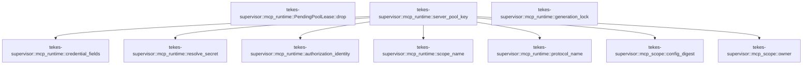

```mermaid
flowchart TD
  n0["mcp::client::McpPeerSnapshot::capture"]
  n1["mcp::projection::project_catalog_partial"]
  n2["mcp::projection::project_name"]
  n3["profile::launch::DynamicToolCatalog::resolve"]
  n4["tekes-supervisor::mcp_admission::ResourcePeer::new"]
  n5["tekes-supervisor::mcp_admission::admit"]
  n6["tekes-supervisor::mcp_runtime::McpRuntime::resolve_plugins"]
  n7["tekes-supervisor::mcp_runtime::McpRuntime::project_plugin_servers"]
  n8["tekes-supervisor::mcp_runtime::McpRuntime::scoped_servers"]
  n9["tekes-supervisor::mcp_runtime::McpRuntime::require_bound_credentials"]
  n10["tekes-supervisor::mcp_runtime::McpRuntime::probe_server"]
  n11["tekes-supervisor::mcp_runtime::McpRuntime::list_resource_catalog"]
  n12["tekes-supervisor::mcp_runtime::McpRuntime::server_visible"]
  n13["tekes-supervisor::mcp_runtime::McpRuntime::list_resource_catalog_in_scope"]
  n14["tekes-supervisor::mcp_runtime::McpRuntime::read_resource"]
  n15["tekes-supervisor::mcp_runtime::close_prepared_result"]
  n16["tekes-supervisor::mcp_runtime::collect_prepared_resources"]
  n17["tekes-supervisor::mcp_runtime::read_prepared_resource"]
  n18["tekes-supervisor::mcp_runtime::with_preparation_runtime"]
  n19["tekes-supervisor::mcp_runtime::json_to_ijson"]
  n20["tekes-supervisor::mcp_runtime::binding_fingerprint"]
  n21["tekes-supervisor::mcp_runtime::log_tool_refusals"]
  n22["tekes-supervisor::mcp_runtime::prepare_server"]
  n23["tekes-supervisor::mcp_runtime::credential_fields"]
  n24["tekes-supervisor::mcp_runtime::McpRouteContract::capture"]
  n25["tekes-supervisor::mcp_runtime::McpDynamicSupervisorAuthority::new"]
  n26["tekes-supervisor::mcp_runtime::server_pool_key"]
  n27["tekes-supervisor::mcp_runtime::generation_lock"]
  n28["tekes-supervisor::mcp_runtime::McpRuntime::secret_access"]
  n29["tekes-supervisor::mcp_runtime::McpRuntime::set_tool_refusal_state"]
  n30["tekes-supervisor::mcp_runtime::McpRuntime::get_server"]
  n31["tekes-supervisor::mcp_runtime::McpRuntime::mutate"]
  n32["tekes-supervisor::mcp_runtime::McpRuntime::bind_oauth"]
  n33["tekes-supervisor::mcp_runtime::McpRuntime::close_mutation_generations"]
  n34["tekes-supervisor::mcp_runtime::McpRuntime::reconcile_authority"]
  n35["tekes-supervisor::mcp_runtime::McpRuntime::prepare_workspace"]
  n36["tekes-supervisor::mcp_runtime::McpRuntime::prepare_for_config"]
  n37["tekes-supervisor::mcp_runtime::McpRuntime::prepare_scope"]
  n38["tekes-supervisor::mcp_runtime::McpRuntime::prepare_pooled_server"]
  n39["tekes-supervisor::mcp_runtime::McpRuntime::prepare_resource_server"]
  n40["tekes-supervisor::mcp_runtime::McpRuntime::bind_prepared_server"]
  n41["tekes-supervisor::mcp_scope::resolve"]
  n8 --> n6
  n8 --> n7
  n8 --> n41
  n9 --> n23
  n10 --> n6
  n10 --> n9
  n10 --> n18
  n10 --> n19
  n10 --> n22
  n10 --> n28
  n10 --> n30
  n11 --> n13
  n12 --> n8
  n13 --> n8
  n13 --> n9
  n13 --> n16
  n13 --> n18
  n13 --> n20
  n13 --> n39
  n14 --> n6
  n14 --> n9
  n14 --> n17
  n14 --> n18
  n14 --> n30
  n14 --> n39
  n31 --> n33
  n32 --> n33
  n34 --> n5
  n34 --> n28
  n35 --> n37
  n36 --> n37
  n37 --> n3
  n37 --> n8
  n37 --> n9
  n37 --> n18
  n37 --> n20
  n37 --> n21
  n37 --> n25
  n37 --> n28
  n37 --> n29
  n37 --> n38
  n37 --> n40
  n38 --> n0
  n38 --> n5
  n38 --> n22
  n38 --> n26
  n38 --> n27
  n38 --> n28
  n39 --> n4
  n39 --> n38
  n40 --> n1
  n40 --> n2
  n40 --> n24
```

```mermaid
flowchart TD
  n0["schema::ijson::IJsonValue::parse"]
  n1["tekes-supervisor::endpoint_host::ProductionRouteFailure::new"]
  n2["tekes-supervisor::mcp_runtime::close_prepared_result"]
  n3["tekes-supervisor::mcp_runtime::collect_prepared_resources"]
  n4["tekes-supervisor::mcp_runtime::read_prepared_resource"]
  n5["tekes-supervisor::mcp_runtime::resource_binding_digest"]
  n6["tekes-supervisor::mcp_runtime::resource_catalog_generation"]
  n7["tekes-supervisor::mcp_runtime::with_preparation_runtime"]
  n8["tekes-supervisor::mcp_runtime::McpManagementRoutes::new"]
  n9["tekes-supervisor::mcp_runtime::McpManagementRoutes::capabilities"]
  n10["tekes-supervisor::mcp_runtime::McpManagementRoutes::extension_method_class"]
  n11["tekes-supervisor::mcp_runtime::McpManagementRoutes::validate_extension_payload"]
  n12["tekes-supervisor::mcp_runtime::McpManagementRoutes::extension_failure_is_exact"]
  n13["tekes-supervisor::mcp_runtime::McpManagementRoutes::execute"]
  n14["tekes-supervisor::mcp_runtime::parse"]
  n15["tekes-supervisor::mcp_runtime::mutation_response"]
  n16["tekes-supervisor::mcp_runtime::map_registry_failure"]
  n17["tekes-supervisor::mcp_runtime::not_found"]
  n18["tekes-supervisor::mcp_runtime::internal_failure"]
  n19["tekes-supervisor::mcp_runtime::route_failure"]
  n20["tekes-supervisor::mcp_runtime::json_to_ijson"]
  n21["tekes-supervisor::mcp_runtime::binding_fingerprint"]
  n22["tekes-supervisor::mcp_runtime::tool_refusals_readiness"]
  n23["tekes-supervisor::mcp_scope::owner"]
  n3 --> n2
  n3 --> n5
  n3 --> n6
  n4 --> n2
  n4 --> n5
  n4 --> n6
  n11 --> n14
  n11 --> n19
  n13 --> n14
  n13 --> n15
  n13 --> n19
  n13 --> n20
  n13 --> n22
  n14 --> n19
  n15 --> n18
  n15 --> n20
  n16 --> n17
  n16 --> n19
  n17 --> n19
  n18 --> n19
  n19 --> n1
  n19 --> n20
  n20 --> n0
  n21 --> n23
```

# tekes-supervisor::mcp_runtime

[Package atlas](index.md) · [Source](../../src/mcp_runtime.rs)

## Declarations

Visibility is the declaration spelling; trait members and reexports require their enclosing interface. `cfg` is not evaluated.

| Symbol | Kind | Visibility | Test / cfg |
|---|---|---|---|
| [tekes-supervisor::mcp_runtime::McpWorkspaceBinding](../../src/mcp_runtime.rs#L43) | struct_item | `pub` |  |
| [tekes-supervisor::mcp_runtime::McpWorkspaceBinding::refused_allowed_tools](../../src/mcp_runtime.rs#L67) | function_item | `pub` |  |
| [tekes-supervisor::mcp_runtime::McpWorkspaceBinding::refused_allowed_tool_names](../../src/mcp_runtime.rs#L85) | function_item | `pub` |  |
| [tekes-supervisor::mcp_runtime::McpServerFailure](../../src/mcp_runtime.rs#L98) | struct_item | `pub` |  |
| [tekes-supervisor::mcp_runtime::McpRefusedTool](../../src/mcp_runtime.rs#L107) | struct_item | `pub` |  |
| [tekes-supervisor::mcp_runtime::MAX_REPORTED_TOOL_REFUSALS](../../src/mcp_runtime.rs#L115) | const_item | `pub` |  |
| [tekes-supervisor::mcp_runtime::McpResourceBinding](../../src/mcp_runtime.rs#L118) | struct_item | `pub` |  |
| [tekes-supervisor::mcp_runtime::McpRuntime](../../src/mcp_runtime.rs#L126) | struct_item | `pub` |  |
| [tekes-supervisor::mcp_runtime::ProductionPluginStore](../../src/mcp_runtime.rs#L144) | type_item | `pub` |  |
| [tekes-supervisor::mcp_runtime::ProductionMcpAuthorities](../../src/mcp_runtime.rs#L145) | type_item | `pub` |  |
| [tekes-supervisor::mcp_runtime::PluginMcpResolver](../../src/mcp_runtime.rs#L147) | trait_item | `pub` |  |
| [tekes-supervisor::mcp_runtime::PluginMcpResolver::resolve](../../src/mcp_runtime.rs#L148) | function_signature_item | `private` |  |
| [tekes-supervisor::mcp_runtime::PluginMcpResolver::components](../../src/mcp_runtime.rs#L153) | function_item | `private` |  |
| [tekes-supervisor::mcp_runtime::PluginStoreMcpResolver](../../src/mcp_runtime.rs#L158) | struct_item | `pub` |  |
| [tekes-supervisor::mcp_runtime::PluginStoreMcpResolver::new](../../src/mcp_runtime.rs#L164) | function_item | `pub` |  |
| [tekes-supervisor::mcp_runtime::PluginStoreMcpResolver::from_shared](../../src/mcp_runtime.rs#L171) | function_item | `pub` |  |
| [tekes-supervisor::mcp_runtime::PluginStoreMcpResolver::resolve](../../src/mcp_runtime.rs#L177) | function_item | `private` |  |
| [tekes-supervisor::mcp_runtime::PluginStoreMcpResolver::components](../../src/mcp_runtime.rs#L188) | function_item | `private` |  |
| [tekes-supervisor::mcp_runtime::DegradedWorkspaceServers](../../src/mcp_runtime.rs#L222) | type_item | `private` |  |
| [tekes-supervisor::mcp_runtime::CachedBinding](../../src/mcp_runtime.rs#L228) | struct_item | `private` |  |
| [tekes-supervisor::mcp_runtime::McpRuntime::open](../../src/mcp_runtime.rs#L243) | function_item | `pub` |  |
| [tekes-supervisor::mcp_runtime::McpRuntime::open_with_plugin_resolver](../../src/mcp_runtime.rs#L250) | function_item | `pub` |  |
| [tekes-supervisor::mcp_runtime::McpRuntime::open_with_authorities](../../src/mcp_runtime.rs#L258) | function_item | `pub` |  |
| [tekes-supervisor::mcp_runtime::McpRuntime::open_production_authorities](../../src/mcp_runtime.rs#L278) | function_item | `pub` |  |
| [tekes-supervisor::mcp_runtime::McpRuntime::open_production_authorities_with_mutation](../../src/mcp_runtime.rs#L293) | function_item | `pub` |  |
| [tekes-supervisor::mcp_runtime::McpRuntime::secret_access](../../src/mcp_runtime.rs#L343) | function_item | `private` |  |
| [tekes-supervisor::mcp_runtime::McpRuntime::preset_readiness](../../src/mcp_runtime.rs#L356) | function_item | `pub` |  |
| [tekes-supervisor::mcp_runtime::McpRuntime::preset_server_digest](../../src/mcp_runtime.rs#L431) | function_item | `pub` |  |
| [tekes-supervisor::mcp_runtime::McpRuntime::list_servers](../../src/mcp_runtime.rs#L447) | function_item | `pub` |  |
| [tekes-supervisor::mcp_runtime::McpRuntime::server_readiness](../../src/mcp_runtime.rs#L461) | function_item | `private` |  |
| [tekes-supervisor::mcp_runtime::McpRuntime::server_tool_refusals](../../src/mcp_runtime.rs#L469) | function_item | `private` |  |
| [tekes-supervisor::mcp_runtime::McpRuntime::set_tool_refusal_state](../../src/mcp_runtime.rs#L478) | function_item | `private` |  |
| [tekes-supervisor::mcp_runtime::McpRuntime::get_server](../../src/mcp_runtime.rs#L490) | function_item | `pub` |  |
| [tekes-supervisor::mcp_runtime::McpRuntime::mutate](../../src/mcp_runtime.rs#L507) | function_item | `pub` |  |
| [tekes-supervisor::mcp_runtime::McpRuntime::bind_oauth](../../src/mcp_runtime.rs#L524) | function_item | `pub` |  |
| [tekes-supervisor::mcp_runtime::McpRuntime::close_mutation_generations](../../src/mcp_runtime.rs#L550) | function_item | `private` |  |
| [tekes-supervisor::mcp_runtime::McpRuntime::reconcile_authority](../../src/mcp_runtime.rs#L594) | function_item | `pub` |  |
| [tekes-supervisor::mcp_runtime::McpRuntime::prepare_workspace](../../src/mcp_runtime.rs#L629) | function_item | `pub` |  |
| [tekes-supervisor::mcp_runtime::McpRuntime::prepare_for_config](../../src/mcp_runtime.rs#L632) | function_item | `pub` |  |
| [tekes-supervisor::mcp_runtime::McpRuntime::prepare_scope](../../src/mcp_runtime.rs#L638) | function_item | `private` |  |
| [tekes-supervisor::mcp_runtime::McpRuntime::prepare_pooled_server](../../src/mcp_runtime.rs#L874) | function_item | `private` |  |
| [tekes-supervisor::mcp_runtime::McpRuntime::prepare_resource_server](../../src/mcp_runtime.rs#L923) | function_item | `private` |  |
| [tekes-supervisor::mcp_runtime::McpRuntime::bind_prepared_server](../../src/mcp_runtime.rs#L941) | function_item | `private` |  |
| [tekes-supervisor::mcp_runtime::McpRuntime::resolve_plugins](../../src/mcp_runtime.rs#L1055) | function_item | `private` |  |
| [tekes-supervisor::mcp_runtime::McpRuntime::project_plugin_servers](../../src/mcp_runtime.rs#L1087) | function_item | `private` |  |
| [tekes-supervisor::mcp_runtime::McpRuntime::scoped_servers](../../src/mcp_runtime.rs#L1135) | function_item | `private` |  |
| [tekes-supervisor::mcp_runtime::McpRuntime::require_bound_credentials](../../src/mcp_runtime.rs#L1180) | function_item | `private` |  |
| [tekes-supervisor::mcp_runtime::McpRuntime::probe_server](../../src/mcp_runtime.rs#L1195) | function_item | `pub` |  |
| [tekes-supervisor::mcp_runtime::McpRuntime::list_resource_catalog](../../src/mcp_runtime.rs#L1225) | function_item | `pub` |  |
| [tekes-supervisor::mcp_runtime::McpRuntime::server_visible](../../src/mcp_runtime.rs#L1231) | function_item | `pub(crate)` |  |
| [tekes-supervisor::mcp_runtime::McpRuntime::list_resource_catalog_in_scope](../../src/mcp_runtime.rs#L1243) | function_item | `pub` |  |
| [tekes-supervisor::mcp_runtime::McpRuntime::read_resource](../../src/mcp_runtime.rs#L1312) | function_item | `pub` |  |
| [tekes-supervisor::mcp_runtime::close_prepared_result](../../src/mcp_runtime.rs#L1343) | function_item | `private` |  |
| [tekes-supervisor::mcp_runtime::collect_prepared_resources](../../src/mcp_runtime.rs#L1356) | function_item | `private` |  |
| [tekes-supervisor::mcp_runtime::read_prepared_resource](../../src/mcp_runtime.rs#L1386) | function_item | `private` |  |
| [tekes-supervisor::mcp_runtime::resource_binding_digest](../../src/mcp_runtime.rs#L1421) | function_item | `private` |  |
| [tekes-supervisor::mcp_runtime::resource_catalog_generation](../../src/mcp_runtime.rs#L1447) | function_item | `private` |  |
| [tekes-supervisor::mcp_runtime::with_preparation_runtime](../../src/mcp_runtime.rs#L1470) | function_item | `private` |  |
| [tekes-supervisor::mcp_runtime::MCP_MANAGEMENT_METHODS](../../src/mcp_runtime.rs#L1489) | const_item | `pub` |  |
| [tekes-supervisor::mcp_runtime::McpManagementRoutes](../../src/mcp_runtime.rs#L1499) | struct_item | `pub` |  |
| [tekes-supervisor::mcp_runtime::McpManagementRoutes::new](../../src/mcp_runtime.rs#L1505) | function_item | `pub` |  |
| [tekes-supervisor::mcp_runtime::McpListRequest](../../src/mcp_runtime.rs#L1512) | struct_item | `private` |  |
| [tekes-supervisor::mcp_runtime::McpReferenceRequest](../../src/mcp_runtime.rs#L1518) | struct_item | `private` |  |
| [tekes-supervisor::mcp_runtime::McpSaveRequest](../../src/mcp_runtime.rs#L1524) | struct_item | `private` |  |
| [tekes-supervisor::mcp_runtime::McpOauthStartRequest](../../src/mcp_runtime.rs#L1531) | struct_item | `private` |  |
| [tekes-supervisor::mcp_runtime::McpManagementRoutes::capabilities](../../src/mcp_runtime.rs#L1538) | function_item | `private` |  |
| [tekes-supervisor::mcp_runtime::McpManagementRoutes::extension_method_class](../../src/mcp_runtime.rs#L1545) | function_item | `private` |  |
| [tekes-supervisor::mcp_runtime::McpManagementRoutes::validate_extension_payload](../../src/mcp_runtime.rs#L1555) | function_item | `private` |  |
| [tekes-supervisor::mcp_runtime::McpManagementRoutes::extension_failure_is_exact](../../src/mcp_runtime.rs#L1575) | function_item | `private` |  |
| [tekes-supervisor::mcp_runtime::McpManagementRoutes::execute](../../src/mcp_runtime.rs#L1592) | function_item | `private` |  |
| [tekes-supervisor::mcp_runtime::parse](../../src/mcp_runtime.rs#L1698) | function_item | `private` |  |
| [tekes-supervisor::mcp_runtime::mutation_response](../../src/mcp_runtime.rs#L1708) | function_item | `private` |  |
| [tekes-supervisor::mcp_runtime::map_registry_failure](../../src/mcp_runtime.rs#L1727) | function_item | `private` |  |
| [tekes-supervisor::mcp_runtime::not_found](../../src/mcp_runtime.rs#L1755) | function_item | `private` |  |
| [tekes-supervisor::mcp_runtime::internal_failure](../../src/mcp_runtime.rs#L1758) | function_item | `private` |  |
| [tekes-supervisor::mcp_runtime::route_failure](../../src/mcp_runtime.rs#L1765) | function_item | `private` |  |
| [tekes-supervisor::mcp_runtime::json_to_ijson](../../src/mcp_runtime.rs#L1772) | function_item | `private` |  |
| [tekes-supervisor::mcp_runtime::binding_fingerprint](../../src/mcp_runtime.rs#L1777) | function_item | `private` |  |
| [tekes-supervisor::mcp_runtime::tool_refusals_readiness](../../src/mcp_runtime.rs#L1848) | function_item | `private` |  |
| [tekes-supervisor::mcp_runtime::refused_tool_json](../../src/mcp_runtime.rs#L1865) | function_item | `pub(crate)` |  |
| [tekes-supervisor::mcp_runtime::tool_refusal_json](../../src/mcp_runtime.rs#L1876) | function_item | `pub(crate)` |  |
| [tekes-supervisor::mcp_runtime::log_tool_refusals](../../src/mcp_runtime.rs#L1897) | function_item | `private` |  |
| [tekes-supervisor::mcp_runtime::BoundServer](../../src/mcp_runtime.rs#L1919) | struct_item | `private` |  |
| [tekes-supervisor::mcp_runtime::PreparedServer](../../src/mcp_runtime.rs#L1927) | struct_item | `private` |  |
| [tekes-supervisor::mcp_runtime::prepare_server](../../src/mcp_runtime.rs#L1936) | function_item | `private` |  |
| [tekes-supervisor::mcp_runtime::prepare_server_cancellable](../../src/mcp_runtime.rs#L1951) | function_item | `private` |  |
| [tekes-supervisor::mcp_runtime::http_request_authorization](../../src/mcp_runtime.rs#L2104) | function_item | `private` |  |
| [tekes-supervisor::mcp_runtime::credential_fields](../../src/mcp_runtime.rs#L2143) | function_item | `pub(crate)` |  |
| [tekes-supervisor::mcp_runtime::current_operating_system_version](../../src/mcp_runtime.rs#L2167) | function_item | `pub(crate)` |  |
| [tekes-supervisor::mcp_runtime::current_plugin_architecture](../../src/mcp_runtime.rs#L2182) | function_item | `private` |  |
| [tekes-supervisor::mcp_runtime::SecretMaterial](../../src/mcp_runtime.rs#L2190) | struct_item | `private` |  |
| [tekes-supervisor::mcp_runtime::SecretMaterial::resolve_map](../../src/mcp_runtime.rs#L2196) | function_item | `private` |  |
| [tekes-supervisor::mcp_runtime::SecretMaterial::zeroize](../../src/mcp_runtime.rs#L2219) | function_item | `private` |  |
| [tekes-supervisor::mcp_runtime::resolve_secret](../../src/mcp_runtime.rs#L2226) | function_item | `private` |  |
| [tekes-supervisor::mcp_runtime::authorization_identity](../../src/mcp_runtime.rs#L2246) | function_item | `private` |  |
| [tekes-supervisor::mcp_runtime::scope_name](../../src/mcp_runtime.rs#L2261) | function_item | `private` |  |
| [tekes-supervisor::mcp_runtime::protocol_name](../../src/mcp_runtime.rs#L2269) | function_item | `private` |  |
| [tekes-supervisor::mcp_runtime::SecretAccess](../../src/mcp_runtime.rs#L2280) | struct_item | `pub` |  |
| [tekes-supervisor::mcp_runtime::SecretAccess::read_only](../../src/mcp_runtime.rs#L2289) | function_item | `pub` |  |
| [tekes-supervisor::mcp_runtime::McpDynamicSupervisorAuthority](../../src/mcp_runtime.rs#L2300) | struct_item | `pub` |  |
| [tekes-supervisor::mcp_runtime::McpRoute](../../src/mcp_runtime.rs#L2310) | struct_item | `pub` |  |
| [tekes-supervisor::mcp_runtime::McpRouteContract](../../src/mcp_runtime.rs#L2320) | struct_item | `pub` |  |
| [tekes-supervisor::mcp_runtime::McpRouteContract::capture](../../src/mcp_runtime.rs#L2330) | function_item | `private` |  |
| [tekes-supervisor::mcp_runtime::route_contract_digest](../../src/mcp_runtime.rs#L2358) | function_item | `private` |  |
| [tekes-supervisor::mcp_runtime::RoutePeerError](../../src/mcp_runtime.rs#L2383) | enum_item | `private` |  |
| [tekes-supervisor::mcp_runtime::route_preparation_error](../../src/mcp_runtime.rs#L2388) | function_item | `private` |  |
| [tekes-supervisor::mcp_runtime::validate_reconnected_contract](../../src/mcp_runtime.rs#L2397) | function_item | `private` |  |
| [tekes-supervisor::mcp_runtime::McpDynamicSupervisorAuthority::new](../../src/mcp_runtime.rs#L2436) | function_item | `pub` |  |
| [tekes-supervisor::mcp_runtime::McpDynamicSupervisorAuthority::drop](../../src/mcp_runtime.rs#L2459) | function_item | `private` |  |
| [tekes-supervisor::mcp_runtime::McpDynamicSupervisorAuthority::prepare_route](../../src/mcp_runtime.rs#L2474) | function_item | `private` |  |
| [tekes-supervisor::mcp_runtime::McpDynamicSupervisorAuthority::call_route](../../src/mcp_runtime.rs#L2517) | function_item | `private` |  |
| [tekes-supervisor::mcp_runtime::REQUIRED_TASK_TTL_MS](../../src/mcp_runtime.rs#L2561) | const_item | `private` |  |
| [tekes-supervisor::mcp_runtime::continuation_identity](../../src/mcp_runtime.rs#L2564) | function_item | `private` |  |
| [tekes-supervisor::mcp_runtime::map_journal_error](../../src/mcp_runtime.rs#L2573) | function_item | `private` |  |
| [tekes-supervisor::mcp_runtime::terminal_tool_value](../../src/mcp_runtime.rs#L2580) | function_item | `private` |  |
| [tekes-supervisor::mcp_runtime::McpDynamicSupervisorAuthority::supports](../../src/mcp_runtime.rs#L2593) | function_item | `private` |  |
| [tekes-supervisor::mcp_runtime::McpDynamicSupervisorAuthority::execute](../../src/mcp_runtime.rs#L2597) | function_item | `private` |  |
| [tekes-supervisor::mcp_runtime::McpDynamicSupervisorAuthority::execute_outcome](../../src/mcp_runtime.rs#L2611) | function_item | `private` |  |
| [tekes-supervisor::mcp_runtime::McpDynamicSupervisorAuthority::continue_task](../../src/mcp_runtime.rs#L2664) | function_item | `private` |  |
| [tekes-supervisor::mcp_runtime::McpDynamicSupervisorAuthority::reconcile](../../src/mcp_runtime.rs#L2676) | function_item | `private` |  |
| [tekes-supervisor::mcp_runtime::McpDynamicSupervisorAuthority::cancel_inflight](../../src/mcp_runtime.rs#L2722) | function_item | `private` |  |
| [tekes-supervisor::mcp_runtime::McpDynamicSupervisorAuthority::current_cancellation](../../src/mcp_runtime.rs#L2735) | function_item | `private` |  |
| [tekes-supervisor::mcp_runtime::McpDynamicSupervisorAuthority::ensure_route_peer](../../src/mcp_runtime.rs#L2742) | function_item | `private` |  |
| [tekes-supervisor::mcp_runtime::McpDynamicSupervisorAuthority::validate_route_generation](../../src/mcp_runtime.rs#L2865) | function_item | `private` |  |
| [tekes-supervisor::mcp_runtime::map_mcp_error](../../src/mcp_runtime.rs#L2923) | function_item | `private` |  |
| [tekes-supervisor::mcp_runtime::parse_external_effect_resolution](../../src/mcp_runtime.rs#L2949) | function_item | `private` |  |
| [tekes-supervisor::mcp_runtime::McpRuntime::server_digest](../../src/mcp_runtime.rs#L3053) | function_item | `private` |  |
| [tekes-supervisor::mcp_runtime::McpRuntime::tool_name](../../src/mcp_runtime.rs#L3057) | function_item | `private` |  |
| [tekes-supervisor::mcp_runtime::PendingPoolLease](../../src/mcp_runtime.rs#L3062) | struct_item | `private` |  |
| [tekes-supervisor::mcp_runtime::PendingPoolLease::drop](../../src/mcp_runtime.rs#L3069) | function_item | `private` |  |
| [tekes-supervisor::mcp_runtime::server_pool_key](../../src/mcp_runtime.rs#L3080) | function_item | `pub(crate)` |  |
| [tekes-supervisor::mcp_runtime::generation_lock](../../src/mcp_runtime.rs#L3114) | function_item | `private` |  |
| [tekes-supervisor::mcp_runtime::generation_lock::LOCKS](../../src/mcp_runtime.rs#L3115) | static_item | `private` |  |
| [tekes-supervisor::mcp_runtime::tests::reconcile_accepts_standard_mcp_text_result_envelope](../../src/mcp_runtime.rs#L3136) | function_item | `private` | test; #[cfg(test)] |
| [tekes-supervisor::mcp_runtime::tests::oauth_binding_exchanges_kernel_grants_and_injects_platform_tokens](../../src/mcp_runtime.rs#L3162) | function_item | `private` | test; #[cfg(test)] |
| [tekes-supervisor::mcp_runtime::tests::CancellationRotationPeer](../../src/mcp_runtime.rs#L3298) | struct_item | `private` | test; #[cfg(test)] |
| [tekes-supervisor::mcp_runtime::tests::CancellationRotationPeer::server_name](../../src/mcp_runtime.rs#L3309) | function_item | `private` | test; #[cfg(test)] |
| [tekes-supervisor::mcp_runtime::tests::CancellationRotationPeer::protocol_version](../../src/mcp_runtime.rs#L3313) | function_item | `private` | test; #[cfg(test)] |
| [tekes-supervisor::mcp_runtime::tests::CancellationRotationPeer::server_identity](../../src/mcp_runtime.rs#L3317) | function_item | `private` | test; #[cfg(test)] |
| [tekes-supervisor::mcp_runtime::tests::CancellationRotationPeer::capabilities](../../src/mcp_runtime.rs#L3321) | function_item | `private` | test; #[cfg(test)] |
| [tekes-supervisor::mcp_runtime::tests::CancellationRotationPeer::capabilities::CAPABILITIES](../../src/mcp_runtime.rs#L3322) | static_item | `private` | test; #[cfg(test)] |
| [tekes-supervisor::mcp_runtime::tests::CancellationRotationPeer::catalog_generation](../../src/mcp_runtime.rs#L3337) | function_item | `private` | test; #[cfg(test)] |
| [tekes-supervisor::mcp_runtime::tests::CancellationRotationPeer::list_tools](../../src/mcp_runtime.rs#L3341) | function_item | `private` | test; #[cfg(test)] |
| [tekes-supervisor::mcp_runtime::tests::CancellationRotationPeer::list_prompts](../../src/mcp_runtime.rs#L3345) | function_item | `private` | test; #[cfg(test)] |
| [tekes-supervisor::mcp_runtime::tests::CancellationRotationPeer::list_resources](../../src/mcp_runtime.rs#L3349) | function_item | `private` | test; #[cfg(test)] |
| [tekes-supervisor::mcp_runtime::tests::CancellationRotationPeer::call_tool](../../src/mcp_runtime.rs#L3353) | function_item | `private` | test; #[cfg(test)] |
| [tekes-supervisor::mcp_runtime::tests::CancellationRotationPeer::call_tool_with_context](../../src/mcp_runtime.rs#L3390) | function_item | `private` | test; #[cfg(test)] |
| [tekes-supervisor::mcp_runtime::tests::CancellationRotationPeer::get_prompt](../../src/mcp_runtime.rs#L3417) | function_item | `private` | test; #[cfg(test)] |
| [tekes-supervisor::mcp_runtime::tests::CancellationRotationPeer::read_resource](../../src/mcp_runtime.rs#L3425) | function_item | `private` | test; #[cfg(test)] |
| [tekes-supervisor::mcp_runtime::tests::CancellationRotationPeer::task_operation](../../src/mcp_runtime.rs#L3429) | function_item | `private` | test; #[cfg(test)] |
| [tekes-supervisor::mcp_runtime::tests::CancellationRotationPeer::close](../../src/mcp_runtime.rs#L3437) | function_item | `private` | test; #[cfg(test)] |
| [tekes-supervisor::mcp_runtime::tests::ResourcePeer](../../src/mcp_runtime.rs#L3442) | struct_item | `private` | test; #[cfg(test)] |
| [tekes-supervisor::mcp_runtime::tests::ResourcePeer::server_name](../../src/mcp_runtime.rs#L3451) | function_item | `private` | test; #[cfg(test)] |
| [tekes-supervisor::mcp_runtime::tests::ResourcePeer::protocol_version](../../src/mcp_runtime.rs#L3455) | function_item | `private` | test; #[cfg(test)] |
| [tekes-supervisor::mcp_runtime::tests::ResourcePeer::server_identity](../../src/mcp_runtime.rs#L3459) | function_item | `private` | test; #[cfg(test)] |
| [tekes-supervisor::mcp_runtime::tests::ResourcePeer::capabilities](../../src/mcp_runtime.rs#L3463) | function_item | `private` | test; #[cfg(test)] |
| [tekes-supervisor::mcp_runtime::tests::ResourcePeer::list_tools](../../src/mcp_runtime.rs#L3467) | function_item | `private` | test; #[cfg(test)] |
| [tekes-supervisor::mcp_runtime::tests::ResourcePeer::list_prompts](../../src/mcp_runtime.rs#L3471) | function_item | `private` | test; #[cfg(test)] |
| [tekes-supervisor::mcp_runtime::tests::ResourcePeer::list_resources](../../src/mcp_runtime.rs#L3475) | function_item | `private` | test; #[cfg(test)] |
| [tekes-supervisor::mcp_runtime::tests::ResourcePeer::call_tool](../../src/mcp_runtime.rs#L3484) | function_item | `private` | test; #[cfg(test)] |
| [tekes-supervisor::mcp_runtime::tests::ResourcePeer::get_prompt](../../src/mcp_runtime.rs#L3493) | function_item | `private` | test; #[cfg(test)] |
| [tekes-supervisor::mcp_runtime::tests::ResourcePeer::read_resource](../../src/mcp_runtime.rs#L3501) | function_item | `private` | test; #[cfg(test)] |
| [tekes-supervisor::mcp_runtime::tests::ResourcePeer::task_operation](../../src/mcp_runtime.rs#L3509) | function_item | `private` | test; #[cfg(test)] |
| [tekes-supervisor::mcp_runtime::tests::ResourcePeer::close](../../src/mcp_runtime.rs#L3517) | function_item | `private` | test; #[cfg(test)] |
| [tekes-supervisor::mcp_runtime::tests::preparation_cancellation_reaps_real_stdio_during_handshake_and_catalog](../../src/mcp_runtime.rs#L3524) | function_item | `private` | test; #[cfg(test)] |
| [tekes-supervisor::mcp_runtime::tests::resource_test_server](../../src/mcp_runtime.rs#L3602) | function_item | `private` | test; #[cfg(test)] |
| [tekes-supervisor::mcp_runtime::tests::prepared_resource_peer](../../src/mcp_runtime.rs#L3624) | function_item | `private` | test; #[cfg(test)] |
| [tekes-supervisor::mcp_runtime::tests::cancellation_rotation_tool](../../src/mcp_runtime.rs#L3668) | function_item | `private` | test; #[cfg(test)] |
| [tekes-supervisor::mcp_runtime::tests::cancellation_route_contract](../../src/mcp_runtime.rs#L3704) | function_item | `private` | test; #[cfg(test)] |
| [tekes-supervisor::mcp_runtime::tests::refresh_test_contract_digest](../../src/mcp_runtime.rs#L3753) | function_item | `private` | test; #[cfg(test)] |
| [tekes-supervisor::mcp_runtime::tests::reconnected_route_contract_rejects_authority_and_reconcile_drift](../../src/mcp_runtime.rs#L3765) | function_item | `private` | test; #[cfg(test)] |
| [tekes-supervisor::mcp_runtime::tests::ReconnectDrift](../../src/mcp_runtime.rs#L3813) | enum_item | `private` | test; #[cfg(test)] |
| [tekes-supervisor::mcp_runtime::tests::preset_references_resolve_by_name_with_project_over_user](../../src/mcp_runtime.rs#L3821) | function_item | `private` | test; #[cfg(test)] |
| [tekes-supervisor::mcp_runtime::tests::live_https_loader_exposes_and_executes_cloudflare_documentation](../../src/mcp_runtime.rs#L3911) | function_item | `private` | test; #[cfg(test)] |
| [tekes-supervisor::mcp_runtime::tests::loader_exposes_and_executes_remote_greeting_through_dynamic_authority](../../src/mcp_runtime.rs#L3978) | function_item | `private` | test; #[cfg(test)] |
| [tekes-supervisor::mcp_runtime::tests::write_effect_server](../../src/mcp_runtime.rs#L4056) | function_item | `private` | test; #[cfg(test)] |
| [tekes-supervisor::mcp_runtime::tests::prepare_workspace_degrades_when_the_registry_file_is_unreadable](../../src/mcp_runtime.rs#L4143) | function_item | `private` | test; #[cfg(test)] |
| [tekes-supervisor::mcp_runtime::tests::write_stdio_catalog_server](../../src/mcp_runtime.rs#L4173) | function_item | `private` | test; #[cfg(test)] |
| [tekes-supervisor::mcp_runtime::tests::stdio_user_server](../../src/mcp_runtime.rs#L4185) | function_item | `private` | test; #[cfg(test)] |
| [tekes-supervisor::mcp_runtime::tests::preset_readiness_reports_missing_refused_and_failed_references](../../src/mcp_runtime.rs#L4212) | function_item | `private` | test; #[cfg(test)] |
| [tekes-supervisor::mcp_runtime::tests::prepare_workspace_refuses_only_the_tool_whose_schema_fails_projection](../../src/mcp_runtime.rs#L4277) | function_item | `private` | test; #[cfg(test)] |
| [tekes-supervisor::mcp_runtime::tests::a_refused_tool_sharing_a_healthy_tools_projected_name_is_not_unavailable](../../src/mcp_runtime.rs#L4398) | function_item | `private` | test; #[cfg(test)] |
| [tekes-supervisor::mcp_runtime::tests::refusal_reports_are_bounded](../../src/mcp_runtime.rs#L4437) | function_item | `private` | test; #[cfg(test)] |
| [tekes-supervisor::mcp_runtime::tests::loader_rejects_remote_tool_error_through_dynamic_authority](../../src/mcp_runtime.rs#L4460) | function_item | `private` | test; #[cfg(test)] |
| [tekes-supervisor::mcp_runtime::tests::peer_eviction_reconnect_drift_never_registers_or_queries_reconciliation](../../src/mcp_runtime.rs#L4537) | function_item | `private` | test; #[cfg(test)] |
| [tekes-supervisor::mcp_runtime::tests::reconnect_tolerates_a_still_refused_sibling_tool](../../src/mcp_runtime.rs#L4637) | function_item | `private` | test; #[cfg(test)] |
| [tekes-supervisor::mcp_runtime::tests::not_found_then_catalog_drift_blocks_retry_before_effect_dispatch](../../src/mcp_runtime.rs#L4721) | function_item | `private` | test; #[cfg(test)] |
| [tekes-supervisor::mcp_runtime::tests::cancellation_rotates_generation_before_reconcile_and_later_calls](../../src/mcp_runtime.rs#L4805) | function_item | `private` | test; #[cfg(test)] |
| [tekes-supervisor::mcp_runtime::tests::resource_peers_close_on_every_negative_exit](../../src/mcp_runtime.rs#L4979) | function_item | `private` | test; #[cfg(test)] |
| [tekes-supervisor::mcp_runtime::tests::production_plugin_architecture_uses_the_package_vocabulary](../../src/mcp_runtime.rs#L5028) | function_item | `private` | test; #[cfg(test)] |
| [tekes-supervisor::mcp_runtime::tests::production_http_authorization_is_resolved_per_send](../../src/mcp_runtime.rs#L5037) | function_item | `private` | test; #[cfg(test)] |
| [tekes-supervisor::mcp_runtime::tests::AsyncTaskPeer](../../src/mcp_runtime.rs#L5106) | struct_item | `private` | test; #[cfg(test)] |
| [tekes-supervisor::mcp_runtime::tests::AsyncTaskPeer::state](../../src/mcp_runtime.rs#L5119) | function_item | `private` | test; #[cfg(test)] |
| [tekes-supervisor::mcp_runtime::tests::AsyncTaskPeer::server_name](../../src/mcp_runtime.rs#L5136) | function_item | `private` | test; #[cfg(test)] |
| [tekes-supervisor::mcp_runtime::tests::AsyncTaskPeer::protocol_version](../../src/mcp_runtime.rs#L5139) | function_item | `private` | test; #[cfg(test)] |
| [tekes-supervisor::mcp_runtime::tests::AsyncTaskPeer::server_identity](../../src/mcp_runtime.rs#L5142) | function_item | `private` | test; #[cfg(test)] |
| [tekes-supervisor::mcp_runtime::tests::AsyncTaskPeer::capabilities](../../src/mcp_runtime.rs#L5145) | function_item | `private` | test; #[cfg(test)] |
| [tekes-supervisor::mcp_runtime::tests::AsyncTaskPeer::catalog_generation](../../src/mcp_runtime.rs#L5148) | function_item | `private` | test; #[cfg(test)] |
| [tekes-supervisor::mcp_runtime::tests::AsyncTaskPeer::list_tools](../../src/mcp_runtime.rs#L5151) | function_item | `private` | test; #[cfg(test)] |
| [tekes-supervisor::mcp_runtime::tests::AsyncTaskPeer::list_prompts](../../src/mcp_runtime.rs#L5154) | function_item | `private` | test; #[cfg(test)] |
| [tekes-supervisor::mcp_runtime::tests::AsyncTaskPeer::list_resources](../../src/mcp_runtime.rs#L5157) | function_item | `private` | test; #[cfg(test)] |
| [tekes-supervisor::mcp_runtime::tests::AsyncTaskPeer::call_tool](../../src/mcp_runtime.rs#L5160) | function_item | `private` | test; #[cfg(test)] |
| [tekes-supervisor::mcp_runtime::tests::AsyncTaskPeer::call_tool_augmented](../../src/mcp_runtime.rs#L5168) | function_item | `private` | test; #[cfg(test)] |
| [tekes-supervisor::mcp_runtime::tests::AsyncTaskPeer::get_prompt](../../src/mcp_runtime.rs#L5181) | function_item | `private` | test; #[cfg(test)] |
| [tekes-supervisor::mcp_runtime::tests::AsyncTaskPeer::read_resource](../../src/mcp_runtime.rs#L5188) | function_item | `private` | test; #[cfg(test)] |
| [tekes-supervisor::mcp_runtime::tests::AsyncTaskPeer::task_operation](../../src/mcp_runtime.rs#L5191) | function_item | `private` | test; #[cfg(test)] |
| [tekes-supervisor::mcp_runtime::tests::AsyncTaskPeer::close](../../src/mcp_runtime.rs#L5234) | function_item | `private` | test; #[cfg(test)] |
| [tekes-supervisor::mcp_runtime::tests::task_result_binds_continuation_and_steps_reach_one_terminal](../../src/mcp_runtime.rs#L5245) | function_item | `private` | test; #[cfg(test)] |
| [tekes-supervisor::mcp_runtime::tests::extension_task_result_binds_continuation_through_a_real_client](../../src/mcp_runtime.rs#L5482) | function_item | `private` | test; #[cfg(test)] |

## Imports / reexports

| Local name | Source path | Visibility |
|---|---|---|
| `BTreeMap` | `std::collections::BTreeMap` | `private` |
| `BTreeSet` | `std::collections::BTreeSet` | `private` |
| `Path` | `std::path::Path` | `private` |
| `PathBuf` | `std::path::PathBuf` | `private` |
| `Arc` | `std::sync::Arc` | `private` |
| `Mutex` | `std::sync::Mutex` | `private` |
| `Weak` | `std::sync::Weak` | `private` |
| `thread` | `std::thread` | `private` |
| `CredentialValue` | `mcp::CredentialValue` | `private` |
| `HttpRequestAuthorization` | `mcp::HttpRequestAuthorization` | `private` |
| `HttpTransport` | `mcp::HttpTransport` | `private` |
| `McpBroker` | `mcp::McpBroker` | `private` |
| `McpBrokerHandle` | `mcp::McpBrokerHandle` | `private` |
| `McpCancellationToken` | `mcp::McpCancellationToken` | `private` |
| `McpClient` | `mcp::McpClient` | `private` |
| `McpCredentialFieldOperation` | `mcp::McpCredentialFieldOperation` | `private` |
| `McpCredentialReferenceState` | `mcp::McpCredentialReferenceState` | `private` |
| `McpError` | `mcp::McpError` | `private` |
| `McpImplementation` | `mcp::McpImplementation` | `private` |
| `McpManagementMutation` | `mcp::McpManagementMutation` | `private` |
| `McpMutationReceipt` | `mcp::McpMutationReceipt` | `private` |
| `McpPeer` | `mcp::McpPeer` | `private` |
| `McpPoolKey` | `mcp::McpPoolKey` | `private` |
| `McpRegistryError` | `mcp::McpRegistryError` | `private` |
| `McpRegistryStore` | `mcp::McpRegistryStore` | `private` |
| `McpResource` | `mcp::McpResource` | `private` |
| `McpScope` | `mcp::McpScope` | `private` |
| `McpServerConfig` | `mcp::McpServerConfig` | `private` |
| `McpServerReference` | `mcp::McpServerReference` | `private` |
| `McpTool` | `mcp::McpTool` | `private` |
| `McpToolCallContext` | `mcp::McpToolCallContext` | `private` |
| `McpToolRefusal` | `mcp::McpToolRefusal` | `private` |
| `McpTransportConfig` | `mcp::McpTransportConfig` | `private` |
| `ProtocolMode` | `mcp::ProtocolMode` | `private` |
| `StdioTransport` | `mcp::StdioTransport` | `private` |
| `project_catalog_partial` | `mcp::project_catalog_partial` | `private` |
| `ComponentKind` | `plugins::ComponentKind` | `private` |
| `HostEnvironment` | `plugins::HostEnvironment` | `private` |
| `MacOsNativeHelperVerifier` | `plugins::MacOsNativeHelperVerifier` | `private` |
| `NativeHelperVerifier` | `plugins::NativeHelperVerifier` | `private` |
| `OperatingSystem` | `plugins::OperatingSystem` | `private` |
| `PluginComponentReference` | `plugins::PluginComponentReference` | `private` |
| `PluginStore` | `plugins::PluginStore` | `private` |
| `PluginVersion` | `plugins::PluginVersion` | `private` |
| `ResolvedPluginExecutable` | `plugins::ResolvedPluginExecutable` | `private` |
| `SignaturePolicy` | `plugins::SignaturePolicy` | `private` |
| `DynamicTool` | `profile::DynamicTool` | `private` |
| `DynamicToolCatalog` | `profile::DynamicToolCatalog` | `private` |
| `DynamicToolSourceKind` | `profile::DynamicToolSourceKind` | `private` |
| `SecretMutationAuthority` | `provider::SecretMutationAuthority` | `private` |
| `SecretRecord` | `provider::SecretRecord` | `private` |
| `SecretResolution` | `provider::SecretResolution` | `private` |
| `SecretStore` | `provider::SecretStore` | `private` |
| `IJsonValue` | `schema::IJsonValue` | `private` |
| `Deserialize` | `serde::Deserialize` | `private` |
| `DeserializeOwned` | `serde::de::DeserializeOwned` | `private` |
| `Value` | `serde_json::Value` | `private` |
| `json` | `serde_json::json` | `private` |
| `Digest` | `sha2::Digest` | `private` |
| `Sha256` | `sha2::Sha256` | `private` |
| `ToolControl` | `worker_control::ToolControl` | `private` |
| `Zeroize` | `zeroize::Zeroize` | `private` |
| `ContinuationBinding` | `crate::continuation_journal::ContinuationBinding` | `private` |
| `ContinuationJournal` | `crate::continuation_journal::ContinuationJournal` | `private` |
| `ContinuationJournalError` | `crate::continuation_journal::ContinuationJournalError` | `private` |
| `ProductionEndpointRoutes` | `crate::endpoint_host::ProductionEndpointRoutes` | `private` |
| `ProductionRouteFailure` | `crate::endpoint_host::ProductionRouteFailure` | `private` |
| `resolve_task` | `crate::mcp_continuation::resolve_task` | `private` |
| `task_authority` | `crate::mcp_continuation::task_authority` | `private` |
| `DynamicExecutionOutcome` | `crate::production_tool_control::DynamicExecutionOutcome` | `private` |
| `DynamicSupervisorAuthority` | `crate::production_tool_control::DynamicSupervisorAuthority` | `private` |
| `SupervisorOperationError` | `crate::production_tool_control::SupervisorOperationError` | `private` |
| `ExternalEffectResolution` | `crate::tool_control::ExternalEffectResolution` | `private` |
| `EndpointHostCall` | `endpoint::EndpointHostCall` | `private` |
| `ToolContinuationRequest` | `worker_control::continuation::ToolContinuationRequest` | `private` |
| `ToolContinuationResponse` | `worker_control::continuation::ToolContinuationResponse` | `private` |
| `*` | `super::*` | `private` |
| `McpCapabilities` | `mcp::McpCapabilities` | `private` |
| `McpImplementation` | `mcp::McpImplementation` | `private` |
| `MemorySecretStore` | `provider::MemorySecretStore` | `private` |
| `VecDeque` | `std::collections::VecDeque` | `private` |
| `fs` | `std::fs` | `private` |
| `PermissionsExt` | `std::os::unix::fs::PermissionsExt` | `private` |
| `Path` | `std::path::Path` | `private` |
| `AtomicUsize` | `std::sync::atomic::AtomicUsize` | `private` |
| `Ordering` | `std::sync::atomic::Ordering` | `private` |
| `ContinuationOperation` | `worker_control::continuation::ContinuationOperation` | `private` |
| `ToolContinuationOutcome` | `worker_control::continuation::ToolContinuationOutcome` | `private` |

## Module declarations

| Module | Visibility | Attributes |
|---|---|---|
| `tekes-supervisor::mcp_runtime::tests` | `private` | #[cfg(test)] |
| `tekes-supervisor::mcp_runtime::phase5_tests` | `private` | #[cfg(test)] #[path = "phase5_tests.rs"] |

## Function call graphs

Edges below are syntactically resolved calls only, including private functions. Graphs partition callers into groups of 20; they are not execution order. All unresolved sites are listed below and in the JSON inventory.

Functions 1–20: 18 direct edges

Functions 21–40: 53 direct edges

Functions 41–60: 24 direct edges

Functions 61–80: 20 direct edges

Functions 81–100: 27 direct edges

Functions 101–103: 7 direct edges

## Call sites

Includes test functions (marked in declarations). Receiver-type-required sites need type analysis/manual tracing. Calls in closures are attributed to their enclosing function; their occurrence here does not mean the closure executes immediately.

| Caller | Callee expression | Source lines | Target / classification |
|---|---|---|---|
| `refused_allowed_tools` | `self.tool_refusals             .iter()             .filter(&#124;refused&#124; {                 refused.refusal.name.as_ref().is_some_and(&#124;name&#124; {                     // The launch-name rule is applied here as well, so it holds                     // for any producer of a refusal, not only the projection.                     profile::is_dynamic_tool_name(name)                         && allowed_tools.contains(name)                         && !self.catalog.tools.iter().any(&#124;tool&#124; tool.name == *name)                 })             })             .cloned()             .collect` | [68](../../src/mcp_runtime.rs#L68) | receiver-type-required |
| `refused_allowed_tools` | `self.tool_refusals             .iter()             .filter(&#124;refused&#124; {                 refused.refusal.name.as_ref().is_some_and(&#124;name&#124; {                     // The launch-name rule is applied here as well, so it holds                     // for any producer of a refusal, not only the projection.                     profile::is_dynamic_tool_name(name)                         && allowed_tools.contains(name)                         && !self.catalog.tools.iter().any(&#124;tool&#124; tool.name == *name)                 })             })             .cloned` | [68](../../src/mcp_runtime.rs#L68) | receiver-type-required |
| `refused_allowed_tools` | `self.tool_refusals             .iter()             .filter` | [68](../../src/mcp_runtime.rs#L68) | receiver-type-required |
| `refused_allowed_tools` | `self.tool_refusals             .iter` | [68](../../src/mcp_runtime.rs#L68) | receiver-type-required |
| `refused_allowed_tools` | `refused.refusal.name.as_ref().is_some_and` | [71](../../src/mcp_runtime.rs#L71) | receiver-type-required |
| `refused_allowed_tools` | `refused.refusal.name.as_ref` | [71](../../src/mcp_runtime.rs#L71) | receiver-type-required |
| `refused_allowed_tools` | `profile::is_dynamic_tool_name` | [74](../../src/mcp_runtime.rs#L74) | [profile::launch::is_dynamic_tool_name](../../../profile/src/launch.rs#L818) |
| `refused_allowed_tools` | `allowed_tools.contains` | [75](../../src/mcp_runtime.rs#L75) | receiver-type-required |
| `refused_allowed_tools` | `self.catalog.tools.iter().any` | [76](../../src/mcp_runtime.rs#L76) | receiver-type-required |
| `refused_allowed_tools` | `self.catalog.tools.iter` | [76](../../src/mcp_runtime.rs#L76) | receiver-type-required |
| `refused_allowed_tool_names` | `self.refused_allowed_tools(allowed_tools)             .into_iter()             .filter_map(&#124;refused&#124; refused.refusal.name)             .collect` | [86](../../src/mcp_runtime.rs#L86) | receiver-type-required |
| `refused_allowed_tool_names` | `self.refused_allowed_tools(allowed_tools)             .into_iter()             .filter_map` | [86](../../src/mcp_runtime.rs#L86) | receiver-type-required |
| `refused_allowed_tool_names` | `self.refused_allowed_tools(allowed_tools)             .into_iter` | [86](../../src/mcp_runtime.rs#L86) | receiver-type-required |
| `refused_allowed_tool_names` | `self.refused_allowed_tools` | [86](../../src/mcp_runtime.rs#L86) | [tekes-supervisor::mcp_runtime::McpWorkspaceBinding::refused_allowed_tools](../../src/mcp_runtime.rs#L67) |
| `components` | `Ok` | [154](../../src/mcp_runtime.rs#L154) | external-constructor-callback-or-unresolved |
| `components` | `Vec::new` | [154](../../src/mcp_runtime.rs#L154) | external-constructor-callback-or-unresolved |
| `new` | `Arc::new` | [166](../../src/mcp_runtime.rs#L166) | external-constructor-callback-or-unresolved |
| `new` | `Mutex::new` | [166](../../src/mcp_runtime.rs#L166) | external-constructor-callback-or-unresolved |
| `resolve` | `self.store             .lock()             .unwrap_or_else(std::sync::PoisonError::into_inner)             .resolve_executable_component(reference)             .map_err` | [181](../../src/mcp_runtime.rs#L181) | receiver-type-required |
| `resolve` | `self.store             .lock()             .unwrap_or_else(std::sync::PoisonError::into_inner)             .resolve_executable_component` | [181](../../src/mcp_runtime.rs#L181) | receiver-type-required |
| `resolve` | `self.store             .lock()             .unwrap_or_else` | [181](../../src/mcp_runtime.rs#L181) | receiver-type-required |
| `resolve` | `self.store             .lock` | [181](../../src/mcp_runtime.rs#L181) | receiver-type-required |
| `resolve` | `error.to_string` | [185](../../src/mcp_runtime.rs#L185) | receiver-type-required |
| `components` | `self             .store             .lock()             .unwrap_or_else` | [189](../../src/mcp_runtime.rs#L189) | receiver-type-required |
| `components` | `self             .store             .lock` | [189](../../src/mcp_runtime.rs#L189) | receiver-type-required |
| `components` | `store.components().map_err` | [193](../../src/mcp_runtime.rs#L193) | receiver-type-required |
| `components` | `store.components` | [193](../../src/mcp_runtime.rs#L193) | receiver-type-required |
| `components` | `error.to_string` | [193](../../src/mcp_runtime.rs#L193), [207](../../src/mcp_runtime.rs#L207) | receiver-type-required |
| `components` | `components             .into_iter()             .filter(&#124;component&#124; component.component_type == ComponentKind::McpServer)             .map(&#124;component&#124; PluginComponentReference {                 plugin_id: component.owner_plugin_id,                 component_id: component.component_id,             })             .collect::<Vec<_>>` | [194](../../src/mcp_runtime.rs#L194) | receiver-type-required |
| `components` | `components             .into_iter()             .filter(&#124;component&#124; component.component_type == ComponentKind::McpServer)             .map` | [194](../../src/mcp_runtime.rs#L194) | receiver-type-required |
| `components` | `components             .into_iter()             .filter` | [194](../../src/mcp_runtime.rs#L194) | receiver-type-required |
| `components` | `components             .into_iter` | [194](../../src/mcp_runtime.rs#L194) | receiver-type-required |
| `components` | `references             .into_iter()             .map(&#124;reference&#124; {                 store                     .resolve_executable_component(&reference)                     .map_err(&#124;error&#124; error.to_string())?                     .ok_or_else(&#124;&#124; {                         format!(                             "plugin MCP component {}/{} lost runtime eligibility",                             reference.plugin_id, reference.component_id                         )                     })             })             .collect` | [202](../../src/mcp_runtime.rs#L202) | receiver-type-required |
| `components` | `references             .into_iter()             .map` | [202](../../src/mcp_runtime.rs#L202) | receiver-type-required |
| `components` | `references             .into_iter` | [202](../../src/mcp_runtime.rs#L202) | receiver-type-required |
| `components` | `store                     .resolve_executable_component(&reference)                     .map_err(&#124;error&#124; error.to_string())?                     .ok_or_else` | [205](../../src/mcp_runtime.rs#L205) | receiver-type-required |
| `components` | `store                     .resolve_executable_component(&reference)                     .map_err` | [205](../../src/mcp_runtime.rs#L205) | receiver-type-required |
| `components` | `store                     .resolve_executable_component` | [205](../../src/mcp_runtime.rs#L205) | receiver-type-required |
| `open` | `Self::open_with_plugin_resolver` | [247](../../src/mcp_runtime.rs#L247) | [tekes-supervisor::mcp_runtime::McpRuntime::open_with_plugin_resolver](../../src/mcp_runtime.rs#L250) |
| `open_with_plugin_resolver` | `Self::open_with_authorities` | [255](../../src/mcp_runtime.rs#L255) | [tekes-supervisor::mcp_runtime::McpRuntime::open_with_authorities](../../src/mcp_runtime.rs#L258) |
| `open_with_authorities` | `Ok` | [264](../../src/mcp_runtime.rs#L264) | external-constructor-callback-or-unresolved |
| `open_with_authorities` | `McpRegistryStore::new` | [265](../../src/mcp_runtime.rs#L265) | [mcp::management::McpRegistryStore::new](../../../mcp/src/management.rs#L391) |
| `open_with_authorities` | `McpBroker::start` | [269](../../src/mcp_runtime.rs#L269) | [mcp::broker::McpBroker::start](../../../mcp/src/broker.rs#L75) |
| `open_with_authorities` | `Mutex::new` | [270](../../src/mcp_runtime.rs#L270), [271](../../src/mcp_runtime.rs#L271), [272](../../src/mcp_runtime.rs#L272), [273](../../src/mcp_runtime.rs#L273) | external-constructor-callback-or-unresolved |
| `open_with_authorities` | `BTreeMap::new` | [271](../../src/mcp_runtime.rs#L271), [272](../../src/mcp_runtime.rs#L272), [273](../../src/mcp_runtime.rs#L273) | external-constructor-callback-or-unresolved |
| `open_with_authorities` | `uuid::Uuid::new_v4().to_string` | [274](../../src/mcp_runtime.rs#L274) | receiver-type-required |
| `open_with_authorities` | `uuid::Uuid::new_v4` | [274](../../src/mcp_runtime.rs#L274) | external-constructor-callback-or-unresolved |
| `open_production_authorities` | `Self::open_production_authorities_with_mutation` | [284](../../src/mcp_runtime.rs#L284) | [tekes-supervisor::mcp_runtime::McpRuntime::open_production_authorities_with_mutation](../../src/mcp_runtime.rs#L293) |
| `open_production_authorities_with_mutation` | `build.parse::<PluginVersion>` | [300](../../src/mcp_runtime.rs#L300) | receiver-type-required |
| `open_production_authorities_with_mutation` | `Self::open_with_authorities(config_root, secret_store, secret_mutation, None)                 .map` | [304](../../src/mcp_runtime.rs#L304) | receiver-type-required |
| `open_production_authorities_with_mutation` | `Self::open_with_authorities` | [304](../../src/mcp_runtime.rs#L304), [332](../../src/mcp_runtime.rs#L332) | [tekes-supervisor::mcp_runtime::McpRuntime::open_with_authorities](../../src/mcp_runtime.rs#L258) |
| `open_production_authorities_with_mutation` | `PluginStore::open(             plugin_root,             HostEnvironment {                 host_version,                 operating_system,                 operating_system_version: current_operating_system_version(),                 architecture: current_plugin_architecture(),             },             SignaturePolicy {                 allow_unsigned_local: true,                 trusted_publishers: BTreeMap::new(),             },             MacOsNativeHelperVerifier,         )         .map_err` | [314](../../src/mcp_runtime.rs#L314) | receiver-type-required |
| `open_production_authorities_with_mutation` | `PluginStore::open` | [314](../../src/mcp_runtime.rs#L314) | external-constructor-callback-or-unresolved |
| `open_production_authorities_with_mutation` | `current_operating_system_version` | [319](../../src/mcp_runtime.rs#L319) | [tekes-supervisor::mcp_runtime::current_operating_system_version](../../src/mcp_runtime.rs#L2167) |
| `open_production_authorities_with_mutation` | `current_plugin_architecture` | [320](../../src/mcp_runtime.rs#L320) | [tekes-supervisor::mcp_runtime::current_plugin_architecture](../../src/mcp_runtime.rs#L2182) |
| `open_production_authorities_with_mutation` | `BTreeMap::new` | [324](../../src/mcp_runtime.rs#L324) | external-constructor-callback-or-unresolved |
| `open_production_authorities_with_mutation` | `McpError::Conflict` | [329](../../src/mcp_runtime.rs#L329) | external-constructor-callback-or-unresolved |
| `open_production_authorities_with_mutation` | `Arc::new` | [331](../../src/mcp_runtime.rs#L331), [336](../../src/mcp_runtime.rs#L336) | external-constructor-callback-or-unresolved |
| `open_production_authorities_with_mutation` | `Mutex::new` | [331](../../src/mcp_runtime.rs#L331) | external-constructor-callback-or-unresolved |
| `open_production_authorities_with_mutation` | `Self::open_with_authorities(             config_root,             secret_store,             secret_mutation,             Some(Arc::new(PluginStoreMcpResolver::from_shared(Arc::clone(                 &store,             )))),         )         .map` | [332](../../src/mcp_runtime.rs#L332) | receiver-type-required |
| `open_production_authorities_with_mutation` | `Some` | [336](../../src/mcp_runtime.rs#L336), [340](../../src/mcp_runtime.rs#L340) | external-constructor-callback-or-unresolved |
| `open_production_authorities_with_mutation` | `PluginStoreMcpResolver::from_shared` | [336](../../src/mcp_runtime.rs#L336) | [tekes-supervisor::mcp_runtime::PluginStoreMcpResolver::from_shared](../../src/mcp_runtime.rs#L171) |
| `open_production_authorities_with_mutation` | `Arc::clone` | [336](../../src/mcp_runtime.rs#L336) | external-constructor-callback-or-unresolved |
| `secret_access` | `Arc::clone` | [345](../../src/mcp_runtime.rs#L345) | external-constructor-callback-or-unresolved |
| `secret_access` | `self.secret_mutation.clone` | [346](../../src/mcp_runtime.rs#L346) | receiver-type-required |
| `secret_access` | `Some` | [347](../../src/mcp_runtime.rs#L347) | external-constructor-callback-or-unresolved |
| `secret_access` | `self.registry.clone` | [347](../../src/mcp_runtime.rs#L347) | receiver-type-required |
| `secret_access` | `self.plugin_resolver.clone` | [348](../../src/mcp_runtime.rs#L348) | receiver-type-required |
| `preset_readiness` | `self.prepare_workspace` | [361](../../src/mcp_runtime.rs#L361) | [tekes-supervisor::mcp_runtime::McpRuntime::prepare_workspace](../../src/mcp_runtime.rs#L629) |
| `preset_readiness` | `serde_json::Value::Array` | [364](../../src/mcp_runtime.rs#L364), [379](../../src/mcp_runtime.rs#L379), [420](../../src/mcp_runtime.rs#L420) | external-constructor-callback-or-unresolved |
| `preset_readiness` | `preset                         .mcp                         .iter()                         .map(&#124;reference&#124; serde_json::json!({"server":reference.server,"status":"unavailable"}))                         .collect` | [365](../../src/mcp_runtime.rs#L365) | receiver-type-required |
| `preset_readiness` | `preset                         .mcp                         .iter()                         .map` | [365](../../src/mcp_runtime.rs#L365) | receiver-type-required |
| `preset_readiness` | `preset                         .mcp                         .iter` | [365](../../src/mcp_runtime.rs#L365) | receiver-type-required |
| `preset_readiness` | `binding             .catalog             .tools             .iter()             .map(&#124;tool&#124; tool.name.as_str())             .collect::<std::collections::BTreeSet<_>>` | [373](../../src/mcp_runtime.rs#L373) | receiver-type-required |
| `preset_readiness` | `binding             .catalog             .tools             .iter()             .map` | [373](../../src/mcp_runtime.rs#L373) | receiver-type-required |
| `preset_readiness` | `binding             .catalog             .tools             .iter` | [373](../../src/mcp_runtime.rs#L373) | receiver-type-required |
| `preset_readiness` | `tool.name.as_str` | [377](../../src/mcp_runtime.rs#L377) | receiver-type-required |
| `preset_readiness` | `preset                 .mcp                 .iter()                 .map(&#124;reference&#124; {                     if let Some(failure) = binding                         .failures                         .iter()                         .find(&#124;failure&#124; failure.server.name == reference.server)                     {                         return serde_json::json!({"server":reference.server,"status":"failed","code":failure.code});                     }                     let refused = binding                         .tool_refusals                         .iter()                         .filter(&#124;refused&#124; {                             refused.server.name == reference.server                                 && reference.tools.contains(&refused.refusal.tool)                         })                         .map(&#124;refused&#124; serde_json::json!({"tool":refused.refusal.tool,"code":refused.refusal.code}))                         .collect::<Vec<_>>();                     let missing = reference                         .tools                         .iter()                         .filter(&#124;tool&#124; {                             !mcp::project_name(&reference.server, tool)                                 .is_ok_and(&#124;name&#124; catalog.contains(name.as_str()))                                 && !binding.tool_refusals.iter().any(&#124;refused&#124; {                                     refused.server.name == reference.server                                         && &refused.refusal.tool == *tool                                 })                         })                         .collect::<Vec<_>>();                     let mut entry = serde_json::json!({                         "server": reference.server,                         "status": if missing.is_empty() && refused.is_empty() { "ready" } else { "incomplete" },                     });                     if !missing.is_empty() {                         entry["missingTools"] = serde_json::json!(missing);                     }                     if !refused.is_empty() {                         entry["refusedTools"] = serde_json::Value::Array(refused);                     }                     entry                 })                 .collect` | [380](../../src/mcp_runtime.rs#L380) | receiver-type-required |
| `preset_readiness` | `preset                 .mcp                 .iter()                 .map` | [380](../../src/mcp_runtime.rs#L380) | receiver-type-required |
| `preset_readiness` | `preset                 .mcp                 .iter` | [380](../../src/mcp_runtime.rs#L380) | receiver-type-required |
| `preset_readiness` | `binding                         .failures                         .iter()                         .find` | [384](../../src/mcp_runtime.rs#L384) | receiver-type-required |
| `preset_readiness` | `binding                         .failures                         .iter` | [384](../../src/mcp_runtime.rs#L384) | receiver-type-required |
| `preset_readiness` | `binding                         .tool_refusals                         .iter()                         .filter(&#124;refused&#124; {                             refused.server.name == reference.server                                 && reference.tools.contains(&refused.refusal.tool)                         })                         .map(&#124;refused&#124; serde_json::json!({"tool":refused.refusal.tool,"code":refused.refusal.code}))                         .collect::<Vec<_>>` | [391](../../src/mcp_runtime.rs#L391) | receiver-type-required |
| `preset_readiness` | `binding                         .tool_refusals                         .iter()                         .filter(&#124;refused&#124; {                             refused.server.name == reference.server                                 && reference.tools.contains(&refused.refusal.tool)                         })                         .map` | [391](../../src/mcp_runtime.rs#L391) | receiver-type-required |
| `preset_readiness` | `binding                         .tool_refusals                         .iter()                         .filter` | [391](../../src/mcp_runtime.rs#L391) | receiver-type-required |
| `preset_readiness` | `binding                         .tool_refusals                         .iter` | [391](../../src/mcp_runtime.rs#L391) | receiver-type-required |
| `preset_readiness` | `reference.tools.contains` | [396](../../src/mcp_runtime.rs#L396) | receiver-type-required |
| `preset_readiness` | `reference                         .tools                         .iter()                         .filter(&#124;tool&#124; {                             !mcp::project_name(&reference.server, tool)                                 .is_ok_and(&#124;name&#124; catalog.contains(name.as_str()))                                 && !binding.tool_refusals.iter().any(&#124;refused&#124; {                                     refused.server.name == reference.server                                         && &refused.refusal.tool == *tool                                 })                         })                         .collect::<Vec<_>>` | [400](../../src/mcp_runtime.rs#L400) | receiver-type-required |
| `preset_readiness` | `reference                         .tools                         .iter()                         .filter` | [400](../../src/mcp_runtime.rs#L400) | receiver-type-required |
| `preset_readiness` | `reference                         .tools                         .iter` | [400](../../src/mcp_runtime.rs#L400) | receiver-type-required |
| `preset_readiness` | `mcp::project_name(&reference.server, tool)                                 .is_ok_and` | [404](../../src/mcp_runtime.rs#L404) | receiver-type-required |
| `preset_readiness` | `mcp::project_name` | [404](../../src/mcp_runtime.rs#L404) | [mcp::projection::project_name](../../../mcp/src/projection.rs#L14) |
| `preset_readiness` | `catalog.contains` | [405](../../src/mcp_runtime.rs#L405) | receiver-type-required |
| `preset_readiness` | `name.as_str` | [405](../../src/mcp_runtime.rs#L405) | receiver-type-required |
| `preset_readiness` | `binding.tool_refusals.iter().any` | [406](../../src/mcp_runtime.rs#L406) | receiver-type-required |
| `preset_readiness` | `binding.tool_refusals.iter` | [406](../../src/mcp_runtime.rs#L406) | receiver-type-required |
| `preset_readiness` | `missing.is_empty` | [416](../../src/mcp_runtime.rs#L416) | receiver-type-required |
| `preset_readiness` | `refused.is_empty` | [419](../../src/mcp_runtime.rs#L419) | receiver-type-required |
| `preset_server_digest` | `self.scoped_servers(workspace_id, None).ok` | [432](../../src/mcp_runtime.rs#L432) | receiver-type-required |
| `preset_server_digest` | `self.scoped_servers` | [432](../../src/mcp_runtime.rs#L432) | [tekes-supervisor::mcp_runtime::McpRuntime::scoped_servers](../../src/mcp_runtime.rs#L1135) |
| `preset_server_digest` | `failure.is_some` | [433](../../src/mcp_runtime.rs#L433) | receiver-type-required |
| `preset_server_digest` | `servers             .iter()             .find` | [436](../../src/mcp_runtime.rs#L436) | receiver-type-required |
| `preset_server_digest` | `servers             .iter` | [436](../../src/mcp_runtime.rs#L436) | receiver-type-required |
| `preset_server_digest` | `crate::mcp_scope::owner(config, Some(&self.registry)).ok` | [439](../../src/mcp_runtime.rs#L439) | receiver-type-required |
| `preset_server_digest` | `crate::mcp_scope::owner` | [439](../../src/mcp_runtime.rs#L439) | [tekes-supervisor::mcp_scope::owner](../../src/mcp_scope.rs#L59) |
| `preset_server_digest` | `Some` | [439](../../src/mcp_runtime.rs#L439), [441](../../src/mcp_runtime.rs#L441) | external-constructor-callback-or-unresolved |
| `preset_server_digest` | `crate::mcp_scope::config_digest(config).ok` | [440](../../src/mcp_runtime.rs#L440) | receiver-type-required |
| `preset_server_digest` | `crate::mcp_scope::config_digest` | [440](../../src/mcp_runtime.rs#L440) | [tekes-supervisor::mcp_scope::config_digest](../../src/mcp_scope.rs#L27) |
| `list_servers` | `self.registry.list` | [451](../../src/mcp_runtime.rs#L451) | receiver-type-required |
| `list_servers` | `servers.retain` | [452](../../src/mcp_runtime.rs#L452) | receiver-type-required |
| `list_servers` | `self             .project_plugin_servers(workspace_id)             .map_err` | [453](../../src/mcp_runtime.rs#L453) | receiver-type-required |
| `list_servers` | `self             .project_plugin_servers` | [453](../../src/mcp_runtime.rs#L453) | [tekes-supervisor::mcp_runtime::McpRuntime::project_plugin_servers](../../src/mcp_runtime.rs#L1087) |
| `list_servers` | `McpRegistryError::Invalid` | [455](../../src/mcp_runtime.rs#L455) | external-constructor-callback-or-unresolved |
| `list_servers` | `error.to_string` | [455](../../src/mcp_runtime.rs#L455) | receiver-type-required |
| `list_servers` | `servers.extend` | [456](../../src/mcp_runtime.rs#L456) | receiver-type-required |
| `list_servers` | `projected.into_iter().map` | [456](../../src/mcp_runtime.rs#L456) | receiver-type-required |
| `list_servers` | `projected.into_iter` | [456](../../src/mcp_runtime.rs#L456) | receiver-type-required |
| `list_servers` | `servers.sort_by` | [457](../../src/mcp_runtime.rs#L457) | receiver-type-required |
| `list_servers` | `left.reference.cmp` | [457](../../src/mcp_runtime.rs#L457) | receiver-type-required |
| `list_servers` | `Ok` | [458](../../src/mcp_runtime.rs#L458) | external-constructor-callback-or-unresolved |
| `server_readiness` | `self.failure_states             .lock()             .unwrap_or_else(std::sync::PoisonError::into_inner)             .get(reference)             .copied` | [462](../../src/mcp_runtime.rs#L462) | receiver-type-required |
| `server_readiness` | `self.failure_states             .lock()             .unwrap_or_else(std::sync::PoisonError::into_inner)             .get` | [462](../../src/mcp_runtime.rs#L462) | receiver-type-required |
| `server_readiness` | `self.failure_states             .lock()             .unwrap_or_else` | [462](../../src/mcp_runtime.rs#L462) | receiver-type-required |
| `server_readiness` | `self.failure_states             .lock` | [462](../../src/mcp_runtime.rs#L462) | receiver-type-required |
| `server_tool_refusals` | `self.tool_refusal_states             .lock()             .unwrap_or_else(std::sync::PoisonError::into_inner)             .get(reference)             .cloned()             .unwrap_or_default` | [470](../../src/mcp_runtime.rs#L470) | receiver-type-required |
| `server_tool_refusals` | `self.tool_refusal_states             .lock()             .unwrap_or_else(std::sync::PoisonError::into_inner)             .get(reference)             .cloned` | [470](../../src/mcp_runtime.rs#L470) | receiver-type-required |
| `server_tool_refusals` | `self.tool_refusal_states             .lock()             .unwrap_or_else(std::sync::PoisonError::into_inner)             .get` | [470](../../src/mcp_runtime.rs#L470) | receiver-type-required |
| `server_tool_refusals` | `self.tool_refusal_states             .lock()             .unwrap_or_else` | [470](../../src/mcp_runtime.rs#L470) | receiver-type-required |
| `server_tool_refusals` | `self.tool_refusal_states             .lock` | [470](../../src/mcp_runtime.rs#L470) | receiver-type-required |
| `set_tool_refusal_state` | `self             .tool_refusal_states             .lock()             .unwrap_or_else` | [479](../../src/mcp_runtime.rs#L479) | receiver-type-required |
| `set_tool_refusal_state` | `self             .tool_refusal_states             .lock` | [479](../../src/mcp_runtime.rs#L479) | receiver-type-required |
| `set_tool_refusal_state` | `refused.is_empty` | [483](../../src/mcp_runtime.rs#L483) | receiver-type-required |
| `set_tool_refusal_state` | `states.remove` | [484](../../src/mcp_runtime.rs#L484) | receiver-type-required |
| `set_tool_refusal_state` | `states.insert` | [486](../../src/mcp_runtime.rs#L486) | receiver-type-required |
| `set_tool_refusal_state` | `reference.clone` | [486](../../src/mcp_runtime.rs#L486) | receiver-type-required |
| `set_tool_refusal_state` | `refused.to_vec` | [486](../../src/mcp_runtime.rs#L486) | receiver-type-required |
| `get_server` | `self.registry.get` | [495](../../src/mcp_runtime.rs#L495) | receiver-type-required |
| `get_server` | `self.project_plugin_servers(&reference.workspace_id)             .map_err(&#124;error&#124; McpRegistryError::Invalid(error.to_string()))             .map` | [497](../../src/mcp_runtime.rs#L497) | receiver-type-required |
| `get_server` | `self.project_plugin_servers(&reference.workspace_id)             .map_err` | [497](../../src/mcp_runtime.rs#L497) | receiver-type-required |
| `get_server` | `self.project_plugin_servers` | [497](../../src/mcp_runtime.rs#L497) | [tekes-supervisor::mcp_runtime::McpRuntime::project_plugin_servers](../../src/mcp_runtime.rs#L1087) |
| `get_server` | `McpRegistryError::Invalid` | [498](../../src/mcp_runtime.rs#L498) | external-constructor-callback-or-unresolved |
| `get_server` | `error.to_string` | [498](../../src/mcp_runtime.rs#L498) | receiver-type-required |
| `get_server` | `servers                     .into_iter()                     .map(&#124;(server, _)&#124; server)                     .find` | [500](../../src/mcp_runtime.rs#L500) | receiver-type-required |
| `get_server` | `servers                     .into_iter()                     .map` | [500](../../src/mcp_runtime.rs#L500) | receiver-type-required |
| `get_server` | `servers                     .into_iter` | [500](../../src/mcp_runtime.rs#L500) | receiver-type-required |
| `mutate` | `Err` | [513](../../src/mcp_runtime.rs#L513) | external-constructor-callback-or-unresolved |
| `mutate` | `McpRegistryError::Invalid` | [513](../../src/mcp_runtime.rs#L513) | external-constructor-callback-or-unresolved |
| `mutate` | `"OAuth bind requires the trusted completion authority".to_owned` | [514](../../src/mcp_runtime.rs#L514) | receiver-type-required |
| `mutate` | `self.registry.mutate_idempotent` | [517](../../src/mcp_runtime.rs#L517) | receiver-type-required |
| `mutate` | `self.close_mutation_generations` | [518](../../src/mcp_runtime.rs#L518) | [tekes-supervisor::mcp_runtime::McpRuntime::close_mutation_generations](../../src/mcp_runtime.rs#L550) |
| `mutate` | `Ok` | [519](../../src/mcp_runtime.rs#L519) | external-constructor-callback-or-unresolved |
| `bind_oauth` | `reference.clone` | [531](../../src/mcp_runtime.rs#L531) | receiver-type-required |
| `bind_oauth` | `credential_id.to_owned` | [532](../../src/mcp_runtime.rs#L532) | receiver-type-required |
| `bind_oauth` | `self.registry.committed_receipt` | [534](../../src/mcp_runtime.rs#L534) | receiver-type-required |
| `bind_oauth` | `Ok` | [535](../../src/mcp_runtime.rs#L535), [547](../../src/mcp_runtime.rs#L547) | external-constructor-callback-or-unresolved |
| `bind_oauth` | `Err` | [541](../../src/mcp_runtime.rs#L541) | external-constructor-callback-or-unresolved |
| `bind_oauth` | `McpRegistryError::Invalid` | [541](../../src/mcp_runtime.rs#L541) | external-constructor-callback-or-unresolved |
| `bind_oauth` | `"OAuth credential is not active in SecretStore".to_owned` | [542](../../src/mcp_runtime.rs#L542) | receiver-type-required |
| `bind_oauth` | `self.registry.mutate_idempotent` | [545](../../src/mcp_runtime.rs#L545) | receiver-type-required |
| `bind_oauth` | `self.close_mutation_generations` | [546](../../src/mcp_runtime.rs#L546) | [tekes-supervisor::mcp_runtime::McpRuntime::close_mutation_generations](../../src/mcp_runtime.rs#L550) |
| `close_mutation_generations` | `self                 .bindings                 .lock()                 .unwrap_or_else` | [559](../../src/mcp_runtime.rs#L559) | receiver-type-required |
| `close_mutation_generations` | `self                 .bindings                 .lock` | [559](../../src/mcp_runtime.rs#L559) | receiver-type-required |
| `close_mutation_generations` | `BTreeSet::new` | [563](../../src/mcp_runtime.rs#L563) | external-constructor-callback-or-unresolved |
| `close_mutation_generations` | `bindings.values_mut` | [564](../../src/mcp_runtime.rs#L564) | receiver-type-required |
| `close_mutation_generations` | `cached.routes.values().any` | [565](../../src/mcp_runtime.rs#L565) | receiver-type-required |
| `close_mutation_generations` | `cached.routes.values` | [565](../../src/mcp_runtime.rs#L565) | receiver-type-required |
| `close_mutation_generations` | `cached.fingerprint.clear` | [569](../../src/mcp_runtime.rs#L569) | receiver-type-required |
| `close_mutation_generations` | `keys.extend` | [570](../../src/mcp_runtime.rs#L570) | receiver-type-required |
| `close_mutation_generations` | `cached                             .routes                             .values()                             .filter(&#124;route&#124; {                                 route.server.reference.name == reference.name                                     && route.server.reference.scope == reference.scope                             })                             .map` | [571](../../src/mcp_runtime.rs#L571) | receiver-type-required |
| `close_mutation_generations` | `cached                             .routes                             .values()                             .filter` | [571](../../src/mcp_runtime.rs#L571) | receiver-type-required |
| `close_mutation_generations` | `cached                             .routes                             .values` | [571](../../src/mcp_runtime.rs#L571) | receiver-type-required |
| `close_mutation_generations` | `route.key.clone` | [578](../../src/mcp_runtime.rs#L578) | receiver-type-required |
| `close_mutation_generations` | `self.broker.handle().remove` | [585](../../src/mcp_runtime.rs#L585) | receiver-type-required |
| `close_mutation_generations` | `self.broker.handle` | [585](../../src/mcp_runtime.rs#L585) | receiver-type-required |
| `reconcile_authority` | `self             .bindings             .lock()             .unwrap_or_else(std::sync::PoisonError::into_inner)             .iter()             .map(&#124;(scope, binding)&#124; (scope.clone(), binding.routes.clone()))             .collect::<Vec<_>>` | [595](../../src/mcp_runtime.rs#L595) | receiver-type-required |
| `reconcile_authority` | `self             .bindings             .lock()             .unwrap_or_else(std::sync::PoisonError::into_inner)             .iter()             .map` | [595](../../src/mcp_runtime.rs#L595) | receiver-type-required |
| `reconcile_authority` | `self             .bindings             .lock()             .unwrap_or_else(std::sync::PoisonError::into_inner)             .iter` | [595](../../src/mcp_runtime.rs#L595) | receiver-type-required |
| `reconcile_authority` | `self             .bindings             .lock()             .unwrap_or_else` | [595](../../src/mcp_runtime.rs#L595), [617](../../src/mcp_runtime.rs#L617) | receiver-type-required |
| `reconcile_authority` | `self             .bindings             .lock` | [595](../../src/mcp_runtime.rs#L595), [617](../../src/mcp_runtime.rs#L617) | receiver-type-required |
| `reconcile_authority` | `scope.clone` | [600](../../src/mcp_runtime.rs#L600) | receiver-type-required |
| `reconcile_authority` | `binding.routes.clone` | [600](../../src/mcp_runtime.rs#L600) | receiver-type-required |
| `reconcile_authority` | `BTreeSet::new` | [602](../../src/mcp_runtime.rs#L602), [603](../../src/mcp_runtime.rs#L603) | external-constructor-callback-or-unresolved |
| `reconcile_authority` | `routes.values` | [605](../../src/mcp_runtime.rs#L605) | receiver-type-required |
| `reconcile_authority` | `crate::mcp_admission::admit(&route.server, &self.secret_access(), &route.key)                     .is_err` | [606](../../src/mcp_runtime.rs#L606) | receiver-type-required |
| `reconcile_authority` | `crate::mcp_admission::admit` | [606](../../src/mcp_runtime.rs#L606) | [tekes-supervisor::mcp_admission::admit](../../src/mcp_admission.rs#L9) |
| `reconcile_authority` | `self.secret_access` | [606](../../src/mcp_runtime.rs#L606) | [tekes-supervisor::mcp_runtime::McpRuntime::secret_access](../../src/mcp_runtime.rs#L343) |
| `reconcile_authority` | `stale_workspaces.insert` | [609](../../src/mcp_runtime.rs#L609) | receiver-type-required |
| `reconcile_authority` | `workspace.clone` | [609](../../src/mcp_runtime.rs#L609) | receiver-type-required |
| `reconcile_authority` | `stale_keys.insert` | [610](../../src/mcp_runtime.rs#L610) | receiver-type-required |
| `reconcile_authority` | `route.key.clone` | [610](../../src/mcp_runtime.rs#L610) | receiver-type-required |
| `reconcile_authority` | `self.broker.handle().remove` | [615](../../src/mcp_runtime.rs#L615) | receiver-type-required |
| `reconcile_authority` | `self.broker.handle` | [615](../../src/mcp_runtime.rs#L615) | receiver-type-required |
| `reconcile_authority` | `key.clone` | [615](../../src/mcp_runtime.rs#L615) | receiver-type-required |
| `reconcile_authority` | `cache.get_mut` | [622](../../src/mcp_runtime.rs#L622) | receiver-type-required |
| `reconcile_authority` | `binding.fingerprint.clear` | [623](../../src/mcp_runtime.rs#L623) | receiver-type-required |
| `reconcile_authority` | `Ok` | [626](../../src/mcp_runtime.rs#L626) | external-constructor-callback-or-unresolved |
| `reconcile_authority` | `stale_keys.len` | [626](../../src/mcp_runtime.rs#L626) | receiver-type-required |
| `prepare_workspace` | `self.prepare_scope` | [630](../../src/mcp_runtime.rs#L630) | [tekes-supervisor::mcp_runtime::McpRuntime::prepare_scope](../../src/mcp_runtime.rs#L638) |
| `prepare_for_config` | `self.prepare_scope` | [636](../../src/mcp_runtime.rs#L636) | [tekes-supervisor::mcp_runtime::McpRuntime::prepare_scope](../../src/mcp_runtime.rs#L638) |
| `prepare_for_config` | `Some` | [636](../../src/mcp_runtime.rs#L636) | external-constructor-callback-or-unresolved |
| `prepare_scope` | `self             .preparation             .lock()             .unwrap_or_else` | [651](../../src/mcp_runtime.rs#L651) | receiver-type-required |
| `prepare_scope` | `self             .preparation             .lock` | [651](../../src/mcp_runtime.rs#L651) | receiver-type-required |
| `prepare_scope` | `self.scoped_servers` | [656](../../src/mcp_runtime.rs#L656), [837](../../src/mcp_runtime.rs#L837) | [tekes-supervisor::mcp_runtime::McpRuntime::scoped_servers](../../src/mcp_runtime.rs#L1135) |
| `prepare_scope` | `binding_fingerprint` | [657](../../src/mcp_runtime.rs#L657), [838](../../src/mcp_runtime.rs#L838) | [tekes-supervisor::mcp_runtime::binding_fingerprint](../../src/mcp_runtime.rs#L1777) |
| `prepare_scope` | `self.secret_store.as_ref` | [660](../../src/mcp_runtime.rs#L660), [841](../../src/mcp_runtime.rs#L841) | receiver-type-required |
| `prepare_scope` | `Some` | [661](../../src/mcp_runtime.rs#L661), [675](../../src/mcp_runtime.rs#L675), [816](../../src/mcp_runtime.rs#L816), [842](../../src/mcp_runtime.rs#L842) | external-constructor-callback-or-unresolved |
| `prepare_scope` | `self             .bindings             .lock()             .unwrap_or_else(std::sync::PoisonError::into_inner)             .remove` | [663](../../src/mcp_runtime.rs#L663) | receiver-type-required |
| `prepare_scope` | `self             .bindings             .lock()             .unwrap_or_else` | [663](../../src/mcp_runtime.rs#L663) | receiver-type-required |
| `prepare_scope` | `self             .bindings             .lock` | [663](../../src/mcp_runtime.rs#L663) | receiver-type-required |
| `prepare_scope` | `binding.catalog_generations.iter().all` | [669](../../src/mcp_runtime.rs#L669) | receiver-type-required |
| `prepare_scope` | `binding.catalog_generations.iter` | [669](../../src/mcp_runtime.rs#L669) | receiver-type-required |
| `prepare_scope` | `self.broker                     .handle()                     .catalog_generation(key.clone())                     .ok()                     .flatten` | [670](../../src/mcp_runtime.rs#L670) | receiver-type-required |
| `prepare_scope` | `self.broker                     .handle()                     .catalog_generation(key.clone())                     .ok` | [670](../../src/mcp_runtime.rs#L670) | receiver-type-required |
| `prepare_scope` | `self.broker                     .handle()                     .catalog_generation` | [670](../../src/mcp_runtime.rs#L670) | receiver-type-required |
| `prepare_scope` | `self.broker                     .handle` | [670](../../src/mcp_runtime.rs#L670) | receiver-type-required |
| `prepare_scope` | `key.clone` | [672](../../src/mcp_runtime.rs#L672), [691](../../src/mcp_runtime.rs#L691), [692](../../src/mcp_runtime.rs#L692) | receiver-type-required |
| `prepare_scope` | `binding.failures.is_empty` | [677](../../src/mcp_runtime.rs#L677) | receiver-type-required |
| `prepare_scope` | `binding.registry_failure.is_none` | [678](../../src/mcp_runtime.rs#L678) | receiver-type-required |
| `prepare_scope` | `binding.authority.upgrade` | [686](../../src/mcp_runtime.rs#L686) | receiver-type-required |
| `prepare_scope` | `Vec::new` | [689](../../src/mcp_runtime.rs#L689), [736](../../src/mcp_runtime.rs#L736), [739](../../src/mcp_runtime.rs#L739), [740](../../src/mcp_runtime.rs#L740) | external-constructor-callback-or-unresolved |
| `prepare_scope` | `binding.catalog_generations.keys` | [690](../../src/mcp_runtime.rs#L690) | receiver-type-required |
| `prepare_scope` | `self.broker.handle().retain_snapshot` | [691](../../src/mcp_runtime.rs#L691) | receiver-type-required |
| `prepare_scope` | `self.broker.handle` | [691](../../src/mcp_runtime.rs#L691), [695](../../src/mcp_runtime.rs#L695), [706](../../src/mcp_runtime.rs#L706), [831](../../src/mcp_runtime.rs#L831) | receiver-type-required |
| `prepare_scope` | `retained.push` | [692](../../src/mcp_runtime.rs#L692) | receiver-type-required |
| `prepare_scope` | `self.broker.handle().release` | [695](../../src/mcp_runtime.rs#L695) | receiver-type-required |
| `prepare_scope` | `Err` | [697](../../src/mcp_runtime.rs#L697), [845](../../src/mcp_runtime.rs#L845) | external-constructor-callback-or-unresolved |
| `prepare_scope` | `outcome.err().unwrap_or_else` | [697](../../src/mcp_runtime.rs#L697) | receiver-type-required |
| `prepare_scope` | `outcome.err` | [697](../../src/mcp_runtime.rs#L697) | receiver-type-required |
| `prepare_scope` | `McpError::Transport` | [698](../../src/mcp_runtime.rs#L698) | external-constructor-callback-or-unresolved |
| `prepare_scope` | `"MCP generation disappeared during rebind".into` | [699](../../src/mcp_runtime.rs#L699) | receiver-type-required |
| `prepare_scope` | `Arc::new` | [705](../../src/mcp_runtime.rs#L705), [830](../../src/mcp_runtime.rs#L830) | external-constructor-callback-or-unresolved |
| `prepare_scope` | `McpDynamicSupervisorAuthority::new` | [705](../../src/mcp_runtime.rs#L705), [830](../../src/mcp_runtime.rs#L830) | [tekes-supervisor::mcp_runtime::McpDynamicSupervisorAuthority::new](../../src/mcp_runtime.rs#L2436) |
| `prepare_scope` | `binding.routes.clone` | [707](../../src/mcp_runtime.rs#L707) | receiver-type-required |
| `prepare_scope` | `self.secret_access` | [708](../../src/mcp_runtime.rs#L708), [833](../../src/mcp_runtime.rs#L833) | [tekes-supervisor::mcp_runtime::McpRuntime::secret_access](../../src/mcp_runtime.rs#L343) |
| `prepare_scope` | `self.registry.clone` | [709](../../src/mcp_runtime.rs#L709), [834](../../src/mcp_runtime.rs#L834) | receiver-type-required |
| `prepare_scope` | `self.plugin_resolver.clone` | [710](../../src/mcp_runtime.rs#L710), [835](../../src/mcp_runtime.rs#L835) | receiver-type-required |
| `prepare_scope` | `binding.catalog.clone` | [713](../../src/mcp_runtime.rs#L713) | receiver-type-required |
| `prepare_scope` | `binding.failures.clone` | [714](../../src/mcp_runtime.rs#L714) | receiver-type-required |
| `prepare_scope` | `binding.tool_refusals.clone` | [715](../../src/mcp_runtime.rs#L715) | receiver-type-required |
| `prepare_scope` | `Arc::downgrade` | [717](../../src/mcp_runtime.rs#L717), [857](../../src/mcp_runtime.rs#L857) | external-constructor-callback-or-unresolved |
| `prepare_scope` | `self.bindings                     .lock()                     .unwrap_or_else(std::sync::PoisonError::into_inner)                     .insert` | [718](../../src/mcp_runtime.rs#L718) | receiver-type-required |
| `prepare_scope` | `self.bindings                     .lock()                     .unwrap_or_else` | [718](../../src/mcp_runtime.rs#L718) | receiver-type-required |
| `prepare_scope` | `self.bindings                     .lock` | [718](../../src/mcp_runtime.rs#L718) | receiver-type-required |
| `prepare_scope` | `cache_key.clone` | [721](../../src/mcp_runtime.rs#L721) | receiver-type-required |
| `prepare_scope` | `Ok` | [722](../../src/mcp_runtime.rs#L722), [826](../../src/mcp_runtime.rs#L826), [865](../../src/mcp_runtime.rs#L865) | external-constructor-callback-or-unresolved |
| `prepare_scope` | `drop` | [732](../../src/mcp_runtime.rs#L732) | external-constructor-callback-or-unresolved |
| `prepare_scope` | `with_preparation_runtime` | [735](../../src/mcp_runtime.rs#L735) | [tekes-supervisor::mcp_runtime::with_preparation_runtime](../../src/mcp_runtime.rs#L1470) |
| `prepare_scope` | `BTreeMap::new` | [737](../../src/mcp_runtime.rs#L737), [738](../../src/mcp_runtime.rs#L738) | external-constructor-callback-or-unresolved |
| `prepare_scope` | `servers.iter().zip` | [741](../../src/mcp_runtime.rs#L741) | receiver-type-required |
| `prepare_scope` | `servers.iter` | [741](../../src/mcp_runtime.rs#L741) | receiver-type-required |
| `prepare_scope` | `self.require_bound_credentials` | [742](../../src/mcp_runtime.rs#L742) | [tekes-supervisor::mcp_runtime::McpRuntime::require_bound_credentials](../../src/mcp_runtime.rs#L1180) |
| `prepare_scope` | `failures.push` | [748](../../src/mcp_runtime.rs#L748), [769](../../src/mcp_runtime.rs#L769), [813](../../src/mcp_runtime.rs#L813) | receiver-type-required |
| `prepare_scope` | `server.reference.clone` | [749](../../src/mcp_runtime.rs#L749), [756](../../src/mcp_runtime.rs#L756), [770](../../src/mcp_runtime.rs#L770), [777](../../src/mcp_runtime.rs#L777), [801](../../src/mcp_runtime.rs#L801), [814](../../src/mcp_runtime.rs#L814), [821](../../src/mcp_runtime.rs#L821) | receiver-type-required |
| `prepare_scope` | `self.failure_states                             .lock()                             .unwrap_or_else(std::sync::PoisonError::into_inner)                             .insert` | [753](../../src/mcp_runtime.rs#L753) | receiver-type-required |
| `prepare_scope` | `self.failure_states                             .lock()                             .unwrap_or_else` | [753](../../src/mcp_runtime.rs#L753) | receiver-type-required |
| `prepare_scope` | `self.failure_states                             .lock` | [753](../../src/mcp_runtime.rs#L753) | receiver-type-required |
| `prepare_scope` | `self.set_tool_refusal_state` | [757](../../src/mcp_runtime.rs#L757), [778](../../src/mcp_runtime.rs#L778), [798](../../src/mcp_runtime.rs#L798), [822](../../src/mcp_runtime.rs#L822) | [tekes-supervisor::mcp_runtime::McpRuntime::set_tool_refusal_state](../../src/mcp_runtime.rs#L478) |
| `prepare_scope` | `self.prepare_pooled_server` | [761](../../src/mcp_runtime.rs#L761) | [tekes-supervisor::mcp_runtime::McpRuntime::prepare_pooled_server](../../src/mcp_runtime.rs#L874) |
| `prepare_scope` | `plugin.as_ref` | [761](../../src/mcp_runtime.rs#L761), [792](../../src/mcp_runtime.rs#L792) | receiver-type-required |
| `prepare_scope` | `self.failure_states                                     .lock()                                     .unwrap_or_else(std::sync::PoisonError::into_inner)                                     .insert` | [774](../../src/mcp_runtime.rs#L774) | receiver-type-required |
| `prepare_scope` | `self.failure_states                                     .lock()                                     .unwrap_or_else` | [774](../../src/mcp_runtime.rs#L774) | receiver-type-required |
| `prepare_scope` | `self.failure_states                                     .lock` | [774](../../src/mcp_runtime.rs#L774) | receiver-type-required |
| `prepare_scope` | `self.failure_states                         .lock()                         .unwrap_or_else(std::sync::PoisonError::into_inner)                         .remove` | [782](../../src/mcp_runtime.rs#L782) | receiver-type-required |
| `prepare_scope` | `self.failure_states                         .lock()                         .unwrap_or_else` | [782](../../src/mcp_runtime.rs#L782) | receiver-type-required |
| `prepare_scope` | `self.failure_states                         .lock` | [782](../../src/mcp_runtime.rs#L782) | receiver-type-required |
| `prepare_scope` | `self.bind_prepared_server` | [792](../../src/mcp_runtime.rs#L792) | [tekes-supervisor::mcp_runtime::McpRuntime::bind_prepared_server](../../src/mcp_runtime.rs#L941) |
| `prepare_scope` | `routes.extend` | [794](../../src/mcp_runtime.rs#L794) | receiver-type-required |
| `prepare_scope` | `catalog_generations.insert` | [795](../../src/mcp_runtime.rs#L795) | receiver-type-required |
| `prepare_scope` | `tools.extend` | [796](../../src/mcp_runtime.rs#L796) | receiver-type-required |
| `prepare_scope` | `log_tool_refusals` | [797](../../src/mcp_runtime.rs#L797) | [tekes-supervisor::mcp_runtime::log_tool_refusals](../../src/mcp_runtime.rs#L1897) |
| `prepare_scope` | `tool_refusals.extend` | [799](../../src/mcp_runtime.rs#L799) | receiver-type-required |
| `prepare_scope` | `bound.refused.into_iter().map` | [799](../../src/mcp_runtime.rs#L799) | receiver-type-required |
| `prepare_scope` | `bound.refused.into_iter` | [799](../../src/mcp_runtime.rs#L799) | receiver-type-required |
| `prepare_scope` | `error.to_string` | [807](../../src/mcp_runtime.rs#L807), [829](../../src/mcp_runtime.rs#L829) | receiver-type-required |
| `prepare_scope` | `self.failure_states                                 .lock()                                 .unwrap_or_else(std::sync::PoisonError::into_inner)                                 .insert` | [818](../../src/mcp_runtime.rs#L818) | receiver-type-required |
| `prepare_scope` | `self.failure_states                                 .lock()                                 .unwrap_or_else` | [818](../../src/mcp_runtime.rs#L818) | receiver-type-required |
| `prepare_scope` | `self.failure_states                                 .lock` | [818](../../src/mcp_runtime.rs#L818) | receiver-type-required |
| `prepare_scope` | `DynamicToolCatalog::resolve(tools)             .map_err` | [828](../../src/mcp_runtime.rs#L828) | receiver-type-required |
| `prepare_scope` | `DynamicToolCatalog::resolve` | [828](../../src/mcp_runtime.rs#L828) | [profile::launch::DynamicToolCatalog::resolve](../../../profile/src/launch.rs#L128) |
| `prepare_scope` | `McpError::Conflict` | [829](../../src/mcp_runtime.rs#L829), [845](../../src/mcp_runtime.rs#L845) | external-constructor-callback-or-unresolved |
| `prepare_scope` | `routes.clone` | [832](../../src/mcp_runtime.rs#L832) | receiver-type-required |
| `prepare_scope` | `"MCP authority changed while its generation was prepared".to_owned` | [846](../../src/mcp_runtime.rs#L846) | receiver-type-required |
| `prepare_scope` | `self.bindings             .lock()             .unwrap_or_else(std::sync::PoisonError::into_inner)             .insert` | [849](../../src/mcp_runtime.rs#L849) | receiver-type-required |
| `prepare_scope` | `self.bindings             .lock()             .unwrap_or_else` | [849](../../src/mcp_runtime.rs#L849) | receiver-type-required |
| `prepare_scope` | `self.bindings             .lock` | [849](../../src/mcp_runtime.rs#L849) | receiver-type-required |
| `prepare_scope` | `catalog.clone` | [856](../../src/mcp_runtime.rs#L856) | receiver-type-required |
| `prepare_scope` | `failures.clone` | [860](../../src/mcp_runtime.rs#L860) | receiver-type-required |
| `prepare_scope` | `tool_refusals.clone` | [861](../../src/mcp_runtime.rs#L861) | receiver-type-required |
| `prepare_scope` | `registry_failure.clone` | [862](../../src/mcp_runtime.rs#L862) | receiver-type-required |
| `prepare_pooled_server` | `self.secret_access` | [880](../../src/mcp_runtime.rs#L880) | [tekes-supervisor::mcp_runtime::McpRuntime::secret_access](../../src/mcp_runtime.rs#L343) |
| `prepare_pooled_server` | `server_pool_key` | [881](../../src/mcp_runtime.rs#L881) | [tekes-supervisor::mcp_runtime::server_pool_key](../../src/mcp_runtime.rs#L3080) |
| `prepare_pooled_server` | `generation_lock` | [882](../../src/mcp_runtime.rs#L882) | [tekes-supervisor::mcp_runtime::generation_lock](../../src/mcp_runtime.rs#L3114) |
| `prepare_pooled_server` | `creation             .lock()             .unwrap_or_else` | [883](../../src/mcp_runtime.rs#L883) | receiver-type-required |
| `prepare_pooled_server` | `creation             .lock` | [883](../../src/mcp_runtime.rs#L883) | receiver-type-required |
| `prepare_pooled_server` | `crate::mcp_admission::admit` | [886](../../src/mcp_runtime.rs#L886) | [tekes-supervisor::mcp_admission::admit](../../src/mcp_admission.rs#L9) |
| `prepare_pooled_server` | `self.broker.handle().retain_snapshot` | [887](../../src/mcp_runtime.rs#L887) | receiver-type-required |
| `prepare_pooled_server` | `self.broker.handle` | [887](../../src/mcp_runtime.rs#L887), [889](../../src/mcp_runtime.rs#L889), [912](../../src/mcp_runtime.rs#L912) | receiver-type-required |
| `prepare_pooled_server` | `key.clone` | [887](../../src/mcp_runtime.rs#L887), [890](../../src/mcp_runtime.rs#L890) | receiver-type-required |
| `prepare_pooled_server` | `Some` | [888](../../src/mcp_runtime.rs#L888), [911](../../src/mcp_runtime.rs#L911) | external-constructor-callback-or-unresolved |
| `prepare_pooled_server` | `runtime.block_on` | [894](../../src/mcp_runtime.rs#L894) | receiver-type-required |
| `prepare_pooled_server` | `peer.list_tools` | [894](../../src/mcp_runtime.rs#L894) | receiver-type-required |
| `prepare_pooled_server` | `Ok` | [895](../../src/mcp_runtime.rs#L895), [917](../../src/mcp_runtime.rs#L917) | external-constructor-callback-or-unresolved |
| `prepare_pooled_server` | `prepare_server` | [904](../../src/mcp_runtime.rs#L904) | [tekes-supervisor::mcp_runtime::prepare_server](../../src/mcp_runtime.rs#L1936) |
| `prepare_pooled_server` | `mcp::McpPeerSnapshot::capture` | [906](../../src/mcp_runtime.rs#L906) | [mcp::client::McpPeerSnapshot::capture](../../../mcp/src/client.rs#L1470) |
| `prepare_pooled_server` | `prepared.peer.as_ref` | [906](../../src/mcp_runtime.rs#L906) | receiver-type-required |
| `prepare_pooled_server` | `prepared.tools.clone` | [906](../../src/mcp_runtime.rs#L906) | receiver-type-required |
| `prepare_pooled_server` | `self.broker             .handle()             .register` | [907](../../src/mcp_runtime.rs#L907) | receiver-type-required |
| `prepare_pooled_server` | `self.broker             .handle` | [907](../../src/mcp_runtime.rs#L907) | receiver-type-required |
| `prepare_pooled_server` | `prepared.key.clone` | [909](../../src/mcp_runtime.rs#L909), [913](../../src/mcp_runtime.rs#L913) | receiver-type-required |
| `prepare_pooled_server` | `Box::new` | [910](../../src/mcp_runtime.rs#L910) | external-constructor-callback-or-unresolved |
| `prepare_resource_server` | `self.prepare_pooled_server` | [929](../../src/mcp_runtime.rs#L929) | [tekes-supervisor::mcp_runtime::McpRuntime::prepare_pooled_server](../../src/mcp_runtime.rs#L874) |
| `prepare_resource_server` | `prepared.pending_pool.as_mut` | [930](../../src/mcp_runtime.rs#L930) | receiver-type-required |
| `prepare_resource_server` | `Box::new` | [933](../../src/mcp_runtime.rs#L933) | external-constructor-callback-or-unresolved |
| `prepare_resource_server` | `crate::mcp_admission::ResourcePeer::new` | [933](../../src/mcp_runtime.rs#L933) | [tekes-supervisor::mcp_admission::ResourcePeer::new](../../src/mcp_admission.rs#L206) |
| `prepare_resource_server` | `self.broker.handle` | [935](../../src/mcp_runtime.rs#L935) | receiver-type-required |
| `prepare_resource_server` | `prepared.key.clone` | [936](../../src/mcp_runtime.rs#L936) | receiver-type-required |
| `prepare_resource_server` | `Ok` | [938](../../src/mcp_runtime.rs#L938) | external-constructor-callback-or-unresolved |
| `bind_prepared_server` | `project_catalog_partial(&server.reference.name, &prepared.tools, server.always_on)                 .map_err` | [949](../../src/mcp_runtime.rs#L949) | receiver-type-required |
| `bind_prepared_server` | `project_catalog_partial` | [949](../../src/mcp_runtime.rs#L949) | [mcp::projection::project_catalog_partial](../../../mcp/src/projection.rs#L115) |
| `bind_prepared_server` | `McpError::Conflict` | [950](../../src/mcp_runtime.rs#L950), [973](../../src/mcp_runtime.rs#L973), [983](../../src/mcp_runtime.rs#L983), [998](../../src/mcp_runtime.rs#L998), [1026](../../src/mcp_runtime.rs#L1026) | external-constructor-callback-or-unresolved |
| `bind_prepared_server` | `error.to_string` | [950](../../src/mcp_runtime.rs#L950) | receiver-type-required |
| `bind_prepared_server` | `projected             .tools             .iter()             .map(&#124;tool&#124; tool.name.as_str())             .collect::<BTreeSet<_>>` | [955](../../src/mcp_runtime.rs#L955) | receiver-type-required |
| `bind_prepared_server` | `projected             .tools             .iter()             .map` | [955](../../src/mcp_runtime.rs#L955) | receiver-type-required |
| `bind_prepared_server` | `projected             .tools             .iter` | [955](../../src/mcp_runtime.rs#L955) | receiver-type-required |
| `bind_prepared_server` | `tool.name.as_str` | [958](../../src/mcp_runtime.rs#L958) | receiver-type-required |
| `bind_prepared_server` | `prepared             .tools             .iter()             .filter_map(&#124;remote&#124; {                 mcp::project_name(&server.reference.name, &remote.name)                     .ok()                     .filter(&#124;name&#124; projected_names.contains(name.as_str()))                     .map(&#124;projected&#124; (projected, remote.name.clone()))             })             .collect::<BTreeMap<_, _>>` | [960](../../src/mcp_runtime.rs#L960) | receiver-type-required |
| `bind_prepared_server` | `prepared             .tools             .iter()             .filter_map` | [960](../../src/mcp_runtime.rs#L960) | receiver-type-required |
| `bind_prepared_server` | `prepared             .tools             .iter` | [960](../../src/mcp_runtime.rs#L960) | receiver-type-required |
| `bind_prepared_server` | `mcp::project_name(&server.reference.name, &remote.name)                     .ok()                     .filter(&#124;name&#124; projected_names.contains(name.as_str()))                     .map` | [964](../../src/mcp_runtime.rs#L964) | receiver-type-required |
| `bind_prepared_server` | `mcp::project_name(&server.reference.name, &remote.name)                     .ok()                     .filter` | [964](../../src/mcp_runtime.rs#L964) | receiver-type-required |
| `bind_prepared_server` | `mcp::project_name(&server.reference.name, &remote.name)                     .ok` | [964](../../src/mcp_runtime.rs#L964) | receiver-type-required |
| `bind_prepared_server` | `mcp::project_name` | [964](../../src/mcp_runtime.rs#L964) | [mcp::projection::project_name](../../../mcp/src/projection.rs#L14) |
| `bind_prepared_server` | `projected_names.contains` | [966](../../src/mcp_runtime.rs#L966) | receiver-type-required |
| `bind_prepared_server` | `name.as_str` | [966](../../src/mcp_runtime.rs#L966) | receiver-type-required |
| `bind_prepared_server` | `remote.name.clone` | [967](../../src/mcp_runtime.rs#L967) | receiver-type-required |
| `bind_prepared_server` | `BTreeMap::new` | [970](../../src/mcp_runtime.rs#L970) | external-constructor-callback-or-unresolved |
| `bind_prepared_server` | `remote_names.get(&dynamic.name).ok_or_else` | [972](../../src/mcp_runtime.rs#L972) | receiver-type-required |
| `bind_prepared_server` | `remote_names.get` | [972](../../src/mcp_runtime.rs#L972) | receiver-type-required |
| `bind_prepared_server` | `prepared                 .tools                 .iter()                 .find(&#124;tool&#124; tool.name == *remote_name)                 .ok_or_else` | [978](../../src/mcp_runtime.rs#L978) | receiver-type-required |
| `bind_prepared_server` | `prepared                 .tools                 .iter()                 .find` | [978](../../src/mcp_runtime.rs#L978) | receiver-type-required |
| `bind_prepared_server` | `prepared                 .tools                 .iter` | [978](../../src/mcp_runtime.rs#L978) | receiver-type-required |
| `bind_prepared_server` | `dynamic                 .external_effect                 .as_ref()                 .map(&#124;binding&#124; {                     prepared                         .tools                         .iter()                         .find(&#124;tool&#124; tool.name == binding.reconcile_tool)                         .cloned()                         .ok_or_else(&#124;&#124; {                             McpError::Conflict(format!(                                 "projected MCP tool {} lost reconciliation contract {}",                                 dynamic.name, binding.reconcile_tool                             ))                         })                 })                 .transpose` | [988](../../src/mcp_runtime.rs#L988) | receiver-type-required |
| `bind_prepared_server` | `dynamic                 .external_effect                 .as_ref()                 .map` | [988](../../src/mcp_runtime.rs#L988) | receiver-type-required |
| `bind_prepared_server` | `dynamic                 .external_effect                 .as_ref` | [988](../../src/mcp_runtime.rs#L988) | receiver-type-required |
| `bind_prepared_server` | `prepared                         .tools                         .iter()                         .find(&#124;tool&#124; tool.name == binding.reconcile_tool)                         .cloned()                         .ok_or_else` | [992](../../src/mcp_runtime.rs#L992) | receiver-type-required |
| `bind_prepared_server` | `prepared                         .tools                         .iter()                         .find(&#124;tool&#124; tool.name == binding.reconcile_tool)                         .cloned` | [992](../../src/mcp_runtime.rs#L992) | receiver-type-required |
| `bind_prepared_server` | `prepared                         .tools                         .iter()                         .find` | [992](../../src/mcp_runtime.rs#L992) | receiver-type-required |
| `bind_prepared_server` | `prepared                         .tools                         .iter` | [992](../../src/mcp_runtime.rs#L992) | receiver-type-required |
| `bind_prepared_server` | `McpRouteContract::capture` | [1005](../../src/mcp_runtime.rs#L1005) | [tekes-supervisor::mcp_runtime::McpRouteContract::capture](../../src/mcp_runtime.rs#L2330) |
| `bind_prepared_server` | `prepared.peer.as_ref` | [1006](../../src/mcp_runtime.rs#L1006) | receiver-type-required |
| `bind_prepared_server` | `effect_tool.clone` | [1007](../../src/mcp_runtime.rs#L1007) | receiver-type-required |
| `bind_prepared_server` | `existing_routes.contains_key` | [1010](../../src/mcp_runtime.rs#L1010) | receiver-type-required |
| `bind_prepared_server` | `routes                     .insert(                         dynamic.name.clone(),                         McpRoute {                             key: prepared.key.clone(),                             remote_name: remote_name.clone(),                             credential_floors: prepared.credential_floors.clone(),                             server: server.clone(),                             plugin_generation: plugin                                 .map(&#124;plugin&#124; plugin.plugin_generation.clone()),                             contract,                         },                     )                     .is_some` | [1011](../../src/mcp_runtime.rs#L1011) | receiver-type-required |
| `bind_prepared_server` | `routes                     .insert` | [1011](../../src/mcp_runtime.rs#L1011) | receiver-type-required |
| `bind_prepared_server` | `dynamic.name.clone` | [1013](../../src/mcp_runtime.rs#L1013) | receiver-type-required |
| `bind_prepared_server` | `prepared.key.clone` | [1015](../../src/mcp_runtime.rs#L1015), [1035](../../src/mcp_runtime.rs#L1035), [1040](../../src/mcp_runtime.rs#L1040) | receiver-type-required |
| `bind_prepared_server` | `remote_name.clone` | [1016](../../src/mcp_runtime.rs#L1016) | receiver-type-required |
| `bind_prepared_server` | `prepared.credential_floors.clone` | [1017](../../src/mcp_runtime.rs#L1017) | receiver-type-required |
| `bind_prepared_server` | `server.clone` | [1018](../../src/mcp_runtime.rs#L1018) | receiver-type-required |
| `bind_prepared_server` | `plugin                                 .map` | [1019](../../src/mcp_runtime.rs#L1019) | receiver-type-required |
| `bind_prepared_server` | `plugin.plugin_generation.clone` | [1020](../../src/mcp_runtime.rs#L1020) | receiver-type-required |
| `bind_prepared_server` | `Err` | [1026](../../src/mcp_runtime.rs#L1026) | external-constructor-callback-or-unresolved |
| `bind_prepared_server` | `prepared.pending_pool.is_none` | [1032](../../src/mcp_runtime.rs#L1032) | receiver-type-required |
| `bind_prepared_server` | `self.broker                 .handle()                 .register` | [1033](../../src/mcp_runtime.rs#L1033) | receiver-type-required |
| `bind_prepared_server` | `self.broker                 .handle` | [1033](../../src/mcp_runtime.rs#L1033) | receiver-type-required |
| `bind_prepared_server` | `self             .broker             .handle()             .catalog_generation(prepared.key.clone())?             .ok_or_else` | [1037](../../src/mcp_runtime.rs#L1037) | receiver-type-required |
| `bind_prepared_server` | `self             .broker             .handle()             .catalog_generation` | [1037](../../src/mcp_runtime.rs#L1037) | receiver-type-required |
| `bind_prepared_server` | `self             .broker             .handle` | [1037](../../src/mcp_runtime.rs#L1037) | receiver-type-required |
| `bind_prepared_server` | `McpError::Transport` | [1041](../../src/mcp_runtime.rs#L1041) | external-constructor-callback-or-unresolved |
| `bind_prepared_server` | `"MCP peer disappeared after register".to_owned` | [1041](../../src/mcp_runtime.rs#L1041) | receiver-type-required |
| `bind_prepared_server` | `prepared.pending_pool.as_mut` | [1042](../../src/mcp_runtime.rs#L1042) | receiver-type-required |
| `bind_prepared_server` | `drop` | [1045](../../src/mcp_runtime.rs#L1045) | external-constructor-callback-or-unresolved |
| `bind_prepared_server` | `Ok` | [1046](../../src/mcp_runtime.rs#L1046) | external-constructor-callback-or-unresolved |
| `resolve_plugins` | `servers             .iter()             .map(&#124;server&#124; {                 let Some(reference) = &server.plugin_component else {                     return Ok(None);                 };                 let resolver = self.plugin_resolver.as_ref().ok_or_else(&#124;&#124; {                     McpError::Conflict("plugin MCP resolver is unavailable".to_owned())                 })?;                 let resolved = resolver                     .resolve(reference)                     .map_err(McpError::Conflict)?                     .ok_or_else(&#124;&#124; {                         McpError::Conflict(format!(                             "plugin MCP component {}/{} is not enabled and fully granted",                             reference.plugin_id, reference.component_id                         ))                     })?;                 if resolved.component_type != ComponentKind::McpServer {                     return Err(McpError::Conflict(                         "plugin component is not an MCP server".to_owned(),                     ));                 }                 Ok(Some(resolved))             })             .collect` | [1059](../../src/mcp_runtime.rs#L1059) | receiver-type-required |
| `resolve_plugins` | `servers             .iter()             .map` | [1059](../../src/mcp_runtime.rs#L1059) | receiver-type-required |
| `resolve_plugins` | `servers             .iter` | [1059](../../src/mcp_runtime.rs#L1059) | receiver-type-required |
| `resolve_plugins` | `Ok` | [1063](../../src/mcp_runtime.rs#L1063), [1082](../../src/mcp_runtime.rs#L1082) | external-constructor-callback-or-unresolved |
| `resolve_plugins` | `self.plugin_resolver.as_ref().ok_or_else` | [1065](../../src/mcp_runtime.rs#L1065) | receiver-type-required |
| `resolve_plugins` | `self.plugin_resolver.as_ref` | [1065](../../src/mcp_runtime.rs#L1065) | receiver-type-required |
| `resolve_plugins` | `McpError::Conflict` | [1066](../../src/mcp_runtime.rs#L1066), [1072](../../src/mcp_runtime.rs#L1072), [1078](../../src/mcp_runtime.rs#L1078) | external-constructor-callback-or-unresolved |
| `resolve_plugins` | `"plugin MCP resolver is unavailable".to_owned` | [1066](../../src/mcp_runtime.rs#L1066) | receiver-type-required |
| `resolve_plugins` | `resolver                     .resolve(reference)                     .map_err(McpError::Conflict)?                     .ok_or_else` | [1068](../../src/mcp_runtime.rs#L1068) | receiver-type-required |
| `resolve_plugins` | `resolver                     .resolve(reference)                     .map_err` | [1068](../../src/mcp_runtime.rs#L1068) | receiver-type-required |
| `resolve_plugins` | `resolver                     .resolve` | [1068](../../src/mcp_runtime.rs#L1068) | receiver-type-required |
| `resolve_plugins` | `Err` | [1078](../../src/mcp_runtime.rs#L1078) | external-constructor-callback-or-unresolved |
| `resolve_plugins` | `"plugin component is not an MCP server".to_owned` | [1079](../../src/mcp_runtime.rs#L1079) | receiver-type-required |
| `resolve_plugins` | `Some` | [1082](../../src/mcp_runtime.rs#L1082) | external-constructor-callback-or-unresolved |
| `project_plugin_servers` | `Ok` | [1092](../../src/mcp_runtime.rs#L1092), [1130](../../src/mcp_runtime.rs#L1130) | external-constructor-callback-or-unresolved |
| `project_plugin_servers` | `Vec::new` | [1092](../../src/mcp_runtime.rs#L1092), [1119](../../src/mcp_runtime.rs#L1119) | external-constructor-callback-or-unresolved |
| `project_plugin_servers` | `resolver.components().map_err` | [1094](../../src/mcp_runtime.rs#L1094) | receiver-type-required |
| `project_plugin_servers` | `resolver.components` | [1094](../../src/mcp_runtime.rs#L1094) | receiver-type-required |
| `project_plugin_servers` | `projected.sort_by` | [1095](../../src/mcp_runtime.rs#L1095) | receiver-type-required |
| `project_plugin_servers` | `left.reference.cmp` | [1095](../../src/mcp_runtime.rs#L1095) | receiver-type-required |
| `project_plugin_servers` | `BTreeSet::new` | [1096](../../src/mcp_runtime.rs#L1096) | external-constructor-callback-or-unresolved |
| `project_plugin_servers` | `projected             .into_iter()             .map(&#124;resolved&#124; {                 if resolved.component_type != ComponentKind::McpServer {                     return Err(McpError::Conflict(                         "plugin projection returned a non-MCP component".to_owned(),                     ));                 }                 let name = resolved.reference.component_id.clone();                 if !names.insert(name.clone()) {                     return Err(McpError::Conflict(format!(                         "plugin MCP server name {name} is duplicated"                     )));                 }                 let server = McpServerConfig {                     folder_id: None,                     reference: McpServerReference {                         workspace_id: workspace.to_owned(),                         scope: McpScope::Plugin,                         name,                     },                     transport: McpTransportConfig::Stdio {                         command: Vec::new(),                         cwd: None,                         environment: BTreeMap::new(),                     },                     enabled: true,                     always_on: false,                     protocol_mode: ProtocolMode::Auto,                     owner: Some(resolved.reference.plugin_id.clone()),                     plugin_component: Some(resolved.reference.clone()),                     project_trusted: false,                 };                 Ok((server, resolved))             })             .collect` | [1097](../../src/mcp_runtime.rs#L1097) | receiver-type-required |
| `project_plugin_servers` | `projected             .into_iter()             .map` | [1097](../../src/mcp_runtime.rs#L1097) | receiver-type-required |
| `project_plugin_servers` | `projected             .into_iter` | [1097](../../src/mcp_runtime.rs#L1097) | receiver-type-required |
| `project_plugin_servers` | `Err` | [1101](../../src/mcp_runtime.rs#L1101), [1107](../../src/mcp_runtime.rs#L1107) | external-constructor-callback-or-unresolved |
| `project_plugin_servers` | `McpError::Conflict` | [1101](../../src/mcp_runtime.rs#L1101), [1107](../../src/mcp_runtime.rs#L1107) | external-constructor-callback-or-unresolved |
| `project_plugin_servers` | `"plugin projection returned a non-MCP component".to_owned` | [1102](../../src/mcp_runtime.rs#L1102) | receiver-type-required |
| `project_plugin_servers` | `resolved.reference.component_id.clone` | [1105](../../src/mcp_runtime.rs#L1105) | receiver-type-required |
| `project_plugin_servers` | `names.insert` | [1106](../../src/mcp_runtime.rs#L1106) | receiver-type-required |
| `project_plugin_servers` | `name.clone` | [1106](../../src/mcp_runtime.rs#L1106) | receiver-type-required |
| `project_plugin_servers` | `workspace.to_owned` | [1114](../../src/mcp_runtime.rs#L1114) | receiver-type-required |
| `project_plugin_servers` | `BTreeMap::new` | [1121](../../src/mcp_runtime.rs#L1121) | external-constructor-callback-or-unresolved |
| `project_plugin_servers` | `Some` | [1126](../../src/mcp_runtime.rs#L1126), [1127](../../src/mcp_runtime.rs#L1127) | external-constructor-callback-or-unresolved |
| `project_plugin_servers` | `resolved.reference.plugin_id.clone` | [1126](../../src/mcp_runtime.rs#L1126) | receiver-type-required |
| `project_plugin_servers` | `resolved.reference.clone` | [1127](../../src/mcp_runtime.rs#L1127) | receiver-type-required |
| `scoped_servers` | `self.registry.load` | [1140](../../src/mcp_runtime.rs#L1140) | receiver-type-required |
| `scoped_servers` | `registry                     .servers                     .retain` | [1145](../../src/mcp_runtime.rs#L1145) | receiver-type-required |
| `scoped_servers` | `crate::mcp_scope::resolve` | [1148](../../src/mcp_runtime.rs#L1148) | [tekes-supervisor::mcp_scope::resolve](../../src/mcp_scope.rs#L103) |
| `scoped_servers` | `Vec::new` | [1150](../../src/mcp_runtime.rs#L1150), [1153](../../src/mcp_runtime.rs#L1153) | external-constructor-callback-or-unresolved |
| `scoped_servers` | `Some` | [1150](../../src/mcp_runtime.rs#L1150), [1153](../../src/mcp_runtime.rs#L1153), [1173](../../src/mcp_runtime.rs#L1173) | external-constructor-callback-or-unresolved |
| `scoped_servers` | `error.to_string` | [1150](../../src/mcp_runtime.rs#L1150), [1153](../../src/mcp_runtime.rs#L1153) | receiver-type-required |
| `scoped_servers` | `self.resolve_plugins` | [1158](../../src/mcp_runtime.rs#L1158) | [tekes-supervisor::mcp_runtime::McpRuntime::resolve_plugins](../../src/mcp_runtime.rs#L1055) |
| `scoped_servers` | `configured             .into_iter()             .zip(configured_plugins)             .collect::<Vec<_>>` | [1159](../../src/mcp_runtime.rs#L1159) | receiver-type-required |
| `scoped_servers` | `configured             .into_iter()             .zip` | [1159](../../src/mcp_runtime.rs#L1159) | receiver-type-required |
| `scoped_servers` | `configured             .into_iter` | [1159](../../src/mcp_runtime.rs#L1159) | receiver-type-required |
| `scoped_servers` | `self.project_plugin_servers` | [1163](../../src/mcp_runtime.rs#L1163) | [tekes-supervisor::mcp_runtime::McpRuntime::project_plugin_servers](../../src/mcp_runtime.rs#L1087) |
| `scoped_servers` | `pairs                 .iter()                 .any` | [1164](../../src/mcp_runtime.rs#L1164) | receiver-type-required |
| `scoped_servers` | `pairs                 .iter` | [1164](../../src/mcp_runtime.rs#L1164) | receiver-type-required |
| `scoped_servers` | `Err` | [1168](../../src/mcp_runtime.rs#L1168) | external-constructor-callback-or-unresolved |
| `scoped_servers` | `McpError::Conflict` | [1168](../../src/mcp_runtime.rs#L1168) | external-constructor-callback-or-unresolved |
| `scoped_servers` | `pairs.push` | [1173](../../src/mcp_runtime.rs#L1173) | receiver-type-required |
| `scoped_servers` | `pairs.sort_by` | [1175](../../src/mcp_runtime.rs#L1175) | receiver-type-required |
| `scoped_servers` | `left.0.reference.name.cmp` | [1175](../../src/mcp_runtime.rs#L1175) | receiver-type-required |
| `scoped_servers` | `pairs.into_iter().unzip` | [1176](../../src/mcp_runtime.rs#L1176) | receiver-type-required |
| `scoped_servers` | `pairs.into_iter` | [1176](../../src/mcp_runtime.rs#L1176) | receiver-type-required |
| `scoped_servers` | `Ok` | [1177](../../src/mcp_runtime.rs#L1177) | external-constructor-callback-or-unresolved |
| `require_bound_credentials` | `credential_fields` | [1181](../../src/mcp_runtime.rs#L1181) | [tekes-supervisor::mcp_runtime::credential_fields](../../src/mcp_runtime.rs#L2143) |
| `require_bound_credentials` | `self                 .registry                 .credential_reference_state(&server.reference, &field, &credential_id)                 .map_err` | [1182](../../src/mcp_runtime.rs#L1182) | receiver-type-required |
| `require_bound_credentials` | `self                 .registry                 .credential_reference_state` | [1182](../../src/mcp_runtime.rs#L1182) | receiver-type-required |
| `require_bound_credentials` | `McpError::Conflict` | [1185](../../src/mcp_runtime.rs#L1185) | external-constructor-callback-or-unresolved |
| `require_bound_credentials` | `error.to_string` | [1185](../../src/mcp_runtime.rs#L1185) | receiver-type-required |
| `require_bound_credentials` | `Some` | [1186](../../src/mcp_runtime.rs#L1186) | external-constructor-callback-or-unresolved |
| `require_bound_credentials` | `Err` | [1187](../../src/mcp_runtime.rs#L1187) | external-constructor-callback-or-unresolved |
| `require_bound_credentials` | `McpError::Transport` | [1187](../../src/mcp_runtime.rs#L1187) | external-constructor-callback-or-unresolved |
| `require_bound_credentials` | `Ok` | [1192](../../src/mcp_runtime.rs#L1192) | external-constructor-callback-or-unresolved |
| `probe_server` | `self             .get_server(reference)             .map_err(&#124;error&#124; McpError::Conflict(error.to_string()))?             .ok_or_else` | [1196](../../src/mcp_runtime.rs#L1196) | receiver-type-required |
| `probe_server` | `self             .get_server(reference)             .map_err` | [1196](../../src/mcp_runtime.rs#L1196) | receiver-type-required |
| `probe_server` | `self             .get_server` | [1196](../../src/mcp_runtime.rs#L1196) | [tekes-supervisor::mcp_runtime::McpRuntime::get_server](../../src/mcp_runtime.rs#L490) |
| `probe_server` | `McpError::Conflict` | [1198](../../src/mcp_runtime.rs#L1198), [1199](../../src/mcp_runtime.rs#L1199) | external-constructor-callback-or-unresolved |
| `probe_server` | `error.to_string` | [1198](../../src/mcp_runtime.rs#L1198) | receiver-type-required |
| `probe_server` | `"MCP server was not found".to_owned` | [1199](../../src/mcp_runtime.rs#L1199) | receiver-type-required |
| `probe_server` | `self.require_bound_credentials` | [1200](../../src/mcp_runtime.rs#L1200) | [tekes-supervisor::mcp_runtime::McpRuntime::require_bound_credentials](../../src/mcp_runtime.rs#L1180) |
| `probe_server` | `self.resolve_plugins` | [1201](../../src/mcp_runtime.rs#L1201) | [tekes-supervisor::mcp_runtime::McpRuntime::resolve_plugins](../../src/mcp_runtime.rs#L1055) |
| `probe_server` | `std::slice::from_ref` | [1201](../../src/mcp_runtime.rs#L1201) | external-constructor-callback-or-unresolved |
| `probe_server` | `with_preparation_runtime` | [1202](../../src/mcp_runtime.rs#L1202) | [tekes-supervisor::mcp_runtime::with_preparation_runtime](../../src/mcp_runtime.rs#L1470) |
| `probe_server` | `prepare_server` | [1204](../../src/mcp_runtime.rs#L1204) | [tekes-supervisor::mcp_runtime::prepare_server](../../src/mcp_runtime.rs#L1936) |
| `probe_server` | `plugins[0].as_ref` | [1204](../../src/mcp_runtime.rs#L1204) | receiver-type-required |
| `probe_server` | `self.secret_access` | [1204](../../src/mcp_runtime.rs#L1204) | [tekes-supervisor::mcp_runtime::McpRuntime::secret_access](../../src/mcp_runtime.rs#L343) |
| `probe_server` | `prepared.peer.capabilities().clone` | [1205](../../src/mcp_runtime.rs#L1205) | receiver-type-required |
| `probe_server` | `prepared.peer.capabilities` | [1205](../../src/mcp_runtime.rs#L1205) | receiver-type-required |
| `probe_server` | `prepared.peer.server_name().to_owned` | [1206](../../src/mcp_runtime.rs#L1206) | receiver-type-required |
| `probe_server` | `prepared.peer.server_name` | [1206](../../src/mcp_runtime.rs#L1206) | receiver-type-required |
| `probe_server` | `prepared                 .tools                 .iter()                 .map(&#124;tool&#124; tool.name.clone())                 .collect::<Vec<_>>` | [1207](../../src/mcp_runtime.rs#L1207) | receiver-type-required |
| `probe_server` | `prepared                 .tools                 .iter()                 .map` | [1207](../../src/mcp_runtime.rs#L1207) | receiver-type-required |
| `probe_server` | `prepared                 .tools                 .iter` | [1207](../../src/mcp_runtime.rs#L1207) | receiver-type-required |
| `probe_server` | `tool.name.clone` | [1210](../../src/mcp_runtime.rs#L1210) | receiver-type-required |
| `probe_server` | `runtime.block_on` | [1212](../../src/mcp_runtime.rs#L1212) | receiver-type-required |
| `probe_server` | `prepared.peer.close` | [1212](../../src/mcp_runtime.rs#L1212) | receiver-type-required |
| `probe_server` | `json_to_ijson(&json!({                 "server":{"name":server_name},                 "capabilities":capabilities,                 "catalog":{"toolCount":tools.len(),"tools":tools}             }))             .map_err` | [1213](../../src/mcp_runtime.rs#L1213) | receiver-type-required |
| `probe_server` | `json_to_ijson` | [1213](../../src/mcp_runtime.rs#L1213) | [tekes-supervisor::mcp_runtime::json_to_ijson](../../src/mcp_runtime.rs#L1772) |
| `list_resource_catalog` | `self.list_resource_catalog_in_scope` | [1229](../../src/mcp_runtime.rs#L1229) | [tekes-supervisor::mcp_runtime::McpRuntime::list_resource_catalog_in_scope](../../src/mcp_runtime.rs#L1243) |
| `server_visible` | `self.scoped_servers` | [1237](../../src/mcp_runtime.rs#L1237) | [tekes-supervisor::mcp_runtime::McpRuntime::scoped_servers](../../src/mcp_runtime.rs#L1135) |
| `server_visible` | `Err` | [1239](../../src/mcp_runtime.rs#L1239) | external-constructor-callback-or-unresolved |
| `server_visible` | `McpError::Conflict` | [1239](../../src/mcp_runtime.rs#L1239) | external-constructor-callback-or-unresolved |
| `server_visible` | `Ok` | [1241](../../src/mcp_runtime.rs#L1241) | external-constructor-callback-or-unresolved |
| `server_visible` | `servers.iter().any` | [1241](../../src/mcp_runtime.rs#L1241) | receiver-type-required |
| `server_visible` | `servers.iter` | [1241](../../src/mcp_runtime.rs#L1241) | receiver-type-required |
| `list_resource_catalog_in_scope` | `self             .preparation             .lock()             .unwrap_or_else` | [1248](../../src/mcp_runtime.rs#L1248) | receiver-type-required |
| `list_resource_catalog_in_scope` | `self             .preparation             .lock` | [1248](../../src/mcp_runtime.rs#L1248) | receiver-type-required |
| `list_resource_catalog_in_scope` | `self.scoped_servers` | [1252](../../src/mcp_runtime.rs#L1252), [1277](../../src/mcp_runtime.rs#L1277) | [tekes-supervisor::mcp_runtime::McpRuntime::scoped_servers](../../src/mcp_runtime.rs#L1135) |
| `list_resource_catalog_in_scope` | `Err` | [1254](../../src/mcp_runtime.rs#L1254), [1279](../../src/mcp_runtime.rs#L1279), [1288](../../src/mcp_runtime.rs#L1288) | external-constructor-callback-or-unresolved |
| `list_resource_catalog_in_scope` | `McpError::Conflict` | [1254](../../src/mcp_runtime.rs#L1254), [1279](../../src/mcp_runtime.rs#L1279), [1288](../../src/mcp_runtime.rs#L1288) | external-constructor-callback-or-unresolved |
| `list_resource_catalog_in_scope` | `binding_fingerprint` | [1256](../../src/mcp_runtime.rs#L1256), [1281](../../src/mcp_runtime.rs#L1281) | [tekes-supervisor::mcp_runtime::binding_fingerprint](../../src/mcp_runtime.rs#L1777) |
| `list_resource_catalog_in_scope` | `self.secret_store.as_ref` | [1259](../../src/mcp_runtime.rs#L1259), [1284](../../src/mcp_runtime.rs#L1284) | receiver-type-required |
| `list_resource_catalog_in_scope` | `Some` | [1260](../../src/mcp_runtime.rs#L1260), [1285](../../src/mcp_runtime.rs#L1285) | external-constructor-callback-or-unresolved |
| `list_resource_catalog_in_scope` | `with_preparation_runtime` | [1262](../../src/mcp_runtime.rs#L1262) | [tekes-supervisor::mcp_runtime::with_preparation_runtime](../../src/mcp_runtime.rs#L1470) |
| `list_resource_catalog_in_scope` | `Vec::new` | [1263](../../src/mcp_runtime.rs#L1263) | external-constructor-callback-or-unresolved |
| `list_resource_catalog_in_scope` | `servers.iter().zip` | [1264](../../src/mcp_runtime.rs#L1264) | receiver-type-required |
| `list_resource_catalog_in_scope` | `servers.iter` | [1264](../../src/mcp_runtime.rs#L1264) | receiver-type-required |
| `list_resource_catalog_in_scope` | `self.require_bound_credentials` | [1265](../../src/mcp_runtime.rs#L1265) | [tekes-supervisor::mcp_runtime::McpRuntime::require_bound_credentials](../../src/mcp_runtime.rs#L1180) |
| `list_resource_catalog_in_scope` | `self.prepare_resource_server` | [1267](../../src/mcp_runtime.rs#L1267) | [tekes-supervisor::mcp_runtime::McpRuntime::prepare_resource_server](../../src/mcp_runtime.rs#L923) |
| `list_resource_catalog_in_scope` | `plugin.as_ref` | [1267](../../src/mcp_runtime.rs#L1267) | receiver-type-required |
| `list_resource_catalog_in_scope` | `items.extend` | [1268](../../src/mcp_runtime.rs#L1268) | receiver-type-required |
| `list_resource_catalog_in_scope` | `collect_prepared_resources` | [1268](../../src/mcp_runtime.rs#L1268) | [tekes-supervisor::mcp_runtime::collect_prepared_resources](../../src/mcp_runtime.rs#L1356) |
| `list_resource_catalog_in_scope` | `Ok` | [1275](../../src/mcp_runtime.rs#L1275), [1309](../../src/mcp_runtime.rs#L1309) | external-constructor-callback-or-unresolved |
| `list_resource_catalog_in_scope` | `"MCP resource generation changed during the read".to_owned` | [1289](../../src/mcp_runtime.rs#L1289) | receiver-type-required |
| `list_resource_catalog_in_scope` | `items.sort_by` | [1292](../../src/mcp_runtime.rs#L1292) | receiver-type-required |
| `list_resource_catalog_in_scope` | `left.server                 .cmp(&right.server)                 .then_with` | [1293](../../src/mcp_runtime.rs#L1293) | receiver-type-required |
| `list_resource_catalog_in_scope` | `left.server                 .cmp` | [1293](../../src/mcp_runtime.rs#L1293) | receiver-type-required |
| `list_resource_catalog_in_scope` | `left.resource.uri.cmp` | [1295](../../src/mcp_runtime.rs#L1295) | receiver-type-required |
| `read_resource` | `self             .preparation             .lock()             .unwrap_or_else` | [1318](../../src/mcp_runtime.rs#L1318) | receiver-type-required |
| `read_resource` | `self             .preparation             .lock` | [1318](../../src/mcp_runtime.rs#L1318) | receiver-type-required |
| `read_resource` | `self             .get_server(reference)             .map_err(&#124;error&#124; McpError::Conflict(error.to_string()))?             .ok_or_else` | [1322](../../src/mcp_runtime.rs#L1322) | receiver-type-required |
| `read_resource` | `self             .get_server(reference)             .map_err` | [1322](../../src/mcp_runtime.rs#L1322) | receiver-type-required |
| `read_resource` | `self             .get_server` | [1322](../../src/mcp_runtime.rs#L1322) | [tekes-supervisor::mcp_runtime::McpRuntime::get_server](../../src/mcp_runtime.rs#L490) |
| `read_resource` | `McpError::Conflict` | [1324](../../src/mcp_runtime.rs#L1324), [1325](../../src/mcp_runtime.rs#L1325) | external-constructor-callback-or-unresolved |
| `read_resource` | `error.to_string` | [1324](../../src/mcp_runtime.rs#L1324) | receiver-type-required |
| `read_resource` | `"MCP server was not found".to_owned` | [1325](../../src/mcp_runtime.rs#L1325) | receiver-type-required |
| `read_resource` | `self.require_bound_credentials` | [1326](../../src/mcp_runtime.rs#L1326) | [tekes-supervisor::mcp_runtime::McpRuntime::require_bound_credentials](../../src/mcp_runtime.rs#L1180) |
| `read_resource` | `self.resolve_plugins` | [1327](../../src/mcp_runtime.rs#L1327) | [tekes-supervisor::mcp_runtime::McpRuntime::resolve_plugins](../../src/mcp_runtime.rs#L1055) |
| `read_resource` | `std::slice::from_ref` | [1327](../../src/mcp_runtime.rs#L1327) | external-constructor-callback-or-unresolved |
| `read_resource` | `with_preparation_runtime` | [1328](../../src/mcp_runtime.rs#L1328) | [tekes-supervisor::mcp_runtime::with_preparation_runtime](../../src/mcp_runtime.rs#L1470) |
| `read_resource` | `self.prepare_resource_server` | [1330](../../src/mcp_runtime.rs#L1330) | [tekes-supervisor::mcp_runtime::McpRuntime::prepare_resource_server](../../src/mcp_runtime.rs#L923) |
| `read_resource` | `plugin[0].as_ref` | [1330](../../src/mcp_runtime.rs#L1330) | receiver-type-required |
| `read_resource` | `read_prepared_resource` | [1331](../../src/mcp_runtime.rs#L1331) | [tekes-supervisor::mcp_runtime::read_prepared_resource](../../src/mcp_runtime.rs#L1386) |
| `close_prepared_result` | `runtime.block_on` | [1348](../../src/mcp_runtime.rs#L1348) | receiver-type-required |
| `close_prepared_result` | `prepared.peer.close` | [1348](../../src/mcp_runtime.rs#L1348) | receiver-type-required |
| `close_prepared_result` | `Err` | [1350](../../src/mcp_runtime.rs#L1350), [1352](../../src/mcp_runtime.rs#L1352) | external-constructor-callback-or-unresolved |
| `close_prepared_result` | `Ok` | [1351](../../src/mcp_runtime.rs#L1351) | external-constructor-callback-or-unresolved |
| `collect_prepared_resources` | `(&#124;&#124; {         if !prepared.peer.capabilities().resources {             return Ok(Vec::new());         }         let resources = runtime.block_on(prepared.peer.list_resources())?;         let catalog_generation = resource_catalog_generation(             runtime_instance,             prepared.peer.catalog_generation(),             &resources,         )?;         let binding_digest =             resource_binding_digest(&server.reference, prepared, &catalog_generation)?;         Ok(resources             .into_iter()             .map(&#124;resource&#124; McpResourceBinding {                 server: server.reference.clone(),                 binding_digest: binding_digest.clone(),                 resource,             })             .collect())     })` | [1362](../../src/mcp_runtime.rs#L1362) | external-constructor-callback-or-unresolved |
| `collect_prepared_resources` | `prepared.peer.capabilities` | [1363](../../src/mcp_runtime.rs#L1363) | receiver-type-required |
| `collect_prepared_resources` | `Ok` | [1364](../../src/mcp_runtime.rs#L1364), [1374](../../src/mcp_runtime.rs#L1374) | external-constructor-callback-or-unresolved |
| `collect_prepared_resources` | `Vec::new` | [1364](../../src/mcp_runtime.rs#L1364) | external-constructor-callback-or-unresolved |
| `collect_prepared_resources` | `runtime.block_on` | [1366](../../src/mcp_runtime.rs#L1366) | receiver-type-required |
| `collect_prepared_resources` | `prepared.peer.list_resources` | [1366](../../src/mcp_runtime.rs#L1366) | receiver-type-required |
| `collect_prepared_resources` | `resource_catalog_generation` | [1367](../../src/mcp_runtime.rs#L1367) | [tekes-supervisor::mcp_runtime::resource_catalog_generation](../../src/mcp_runtime.rs#L1447) |
| `collect_prepared_resources` | `prepared.peer.catalog_generation` | [1369](../../src/mcp_runtime.rs#L1369) | receiver-type-required |
| `collect_prepared_resources` | `resource_binding_digest` | [1373](../../src/mcp_runtime.rs#L1373) | [tekes-supervisor::mcp_runtime::resource_binding_digest](../../src/mcp_runtime.rs#L1421) |
| `collect_prepared_resources` | `resources             .into_iter()             .map(&#124;resource&#124; McpResourceBinding {                 server: server.reference.clone(),                 binding_digest: binding_digest.clone(),                 resource,             })             .collect` | [1374](../../src/mcp_runtime.rs#L1374) | receiver-type-required |
| `collect_prepared_resources` | `resources             .into_iter()             .map` | [1374](../../src/mcp_runtime.rs#L1374) | receiver-type-required |
| `collect_prepared_resources` | `resources             .into_iter` | [1374](../../src/mcp_runtime.rs#L1374) | receiver-type-required |
| `collect_prepared_resources` | `server.reference.clone` | [1377](../../src/mcp_runtime.rs#L1377) | receiver-type-required |
| `collect_prepared_resources` | `binding_digest.clone` | [1378](../../src/mcp_runtime.rs#L1378) | receiver-type-required |
| `collect_prepared_resources` | `close_prepared_result` | [1383](../../src/mcp_runtime.rs#L1383) | [tekes-supervisor::mcp_runtime::close_prepared_result](../../src/mcp_runtime.rs#L1343) |
| `read_prepared_resource` | `(&#124;&#124; {         if !prepared.peer.capabilities().resources {             return Err(McpError::Conflict(                 "MCP server does not advertise resources".to_owned(),             ));         }         let resources = runtime.block_on(prepared.peer.list_resources())?;         let catalog_generation = resource_catalog_generation(             runtime_instance,             prepared.peer.catalog_generation(),             &resources,         )?;         if resource_binding_digest(reference, prepared, &catalog_generation)? != binding_digest {             return Err(McpError::Conflict(                 "MCP resource binding is stale".to_owned(),             ));         }         if !resources.iter().any(&#124;resource&#124; resource.uri == uri) {             return Err(McpError::Conflict(                 "MCP resource binding is stale".to_owned(),             ));         }         runtime.block_on(prepared.peer.read_resource(uri))     })` | [1394](../../src/mcp_runtime.rs#L1394) | external-constructor-callback-or-unresolved |
| `read_prepared_resource` | `prepared.peer.capabilities` | [1395](../../src/mcp_runtime.rs#L1395) | receiver-type-required |
| `read_prepared_resource` | `Err` | [1396](../../src/mcp_runtime.rs#L1396), [1407](../../src/mcp_runtime.rs#L1407), [1412](../../src/mcp_runtime.rs#L1412) | external-constructor-callback-or-unresolved |
| `read_prepared_resource` | `McpError::Conflict` | [1396](../../src/mcp_runtime.rs#L1396), [1407](../../src/mcp_runtime.rs#L1407), [1412](../../src/mcp_runtime.rs#L1412) | external-constructor-callback-or-unresolved |
| `read_prepared_resource` | `"MCP server does not advertise resources".to_owned` | [1397](../../src/mcp_runtime.rs#L1397) | receiver-type-required |
| `read_prepared_resource` | `runtime.block_on` | [1400](../../src/mcp_runtime.rs#L1400), [1416](../../src/mcp_runtime.rs#L1416) | receiver-type-required |
| `read_prepared_resource` | `prepared.peer.list_resources` | [1400](../../src/mcp_runtime.rs#L1400) | receiver-type-required |
| `read_prepared_resource` | `resource_catalog_generation` | [1401](../../src/mcp_runtime.rs#L1401) | [tekes-supervisor::mcp_runtime::resource_catalog_generation](../../src/mcp_runtime.rs#L1447) |
| `read_prepared_resource` | `prepared.peer.catalog_generation` | [1403](../../src/mcp_runtime.rs#L1403) | receiver-type-required |
| `read_prepared_resource` | `resource_binding_digest` | [1406](../../src/mcp_runtime.rs#L1406) | [tekes-supervisor::mcp_runtime::resource_binding_digest](../../src/mcp_runtime.rs#L1421) |
| `read_prepared_resource` | `"MCP resource binding is stale".to_owned` | [1408](../../src/mcp_runtime.rs#L1408), [1413](../../src/mcp_runtime.rs#L1413) | receiver-type-required |
| `read_prepared_resource` | `resources.iter().any` | [1411](../../src/mcp_runtime.rs#L1411) | receiver-type-required |
| `read_prepared_resource` | `resources.iter` | [1411](../../src/mcp_runtime.rs#L1411) | receiver-type-required |
| `read_prepared_resource` | `prepared.peer.read_resource` | [1416](../../src/mcp_runtime.rs#L1416) | receiver-type-required |
| `read_prepared_resource` | `close_prepared_result` | [1418](../../src/mcp_runtime.rs#L1418) | [tekes-supervisor::mcp_runtime::close_prepared_result](../../src/mcp_runtime.rs#L1343) |
| `resource_binding_digest` | `prepared         .peer         .server_identity()         .ok_or_else` | [1426](../../src/mcp_runtime.rs#L1426) | receiver-type-required |
| `resource_binding_digest` | `prepared         .peer         .server_identity` | [1426](../../src/mcp_runtime.rs#L1426) | receiver-type-required |
| `resource_binding_digest` | `McpError::Protocol` | [1429](../../src/mcp_runtime.rs#L1429) | external-constructor-callback-or-unresolved |
| `resource_binding_digest` | `"MCP handshake omitted server identity".to_owned` | [1429](../../src/mcp_runtime.rs#L1429) | receiver-type-required |
| `resource_binding_digest` | `Ok` | [1438](../../src/mcp_runtime.rs#L1438) | external-constructor-callback-or-unresolved |
| `resource_catalog_generation` | `Ok` | [1457](../../src/mcp_runtime.rs#L1457) | external-constructor-callback-or-unresolved |
| `with_preparation_runtime` | `thread::scope` | [1475](../../src/mcp_runtime.rs#L1475) | external-constructor-callback-or-unresolved |
| `with_preparation_runtime` | `scope             .spawn(move &#124;&#124; {                 let runtime = tokio::runtime::Builder::new_current_thread()                     .enable_all()                     .build()                     .map_err(&#124;error&#124; McpError::Transport(error.to_string()))?;                 operation(&runtime)             })             .join()             .map_err` | [1476](../../src/mcp_runtime.rs#L1476) | receiver-type-required |
| `with_preparation_runtime` | `scope             .spawn(move &#124;&#124; {                 let runtime = tokio::runtime::Builder::new_current_thread()                     .enable_all()                     .build()                     .map_err(&#124;error&#124; McpError::Transport(error.to_string()))?;                 operation(&runtime)             })             .join` | [1476](../../src/mcp_runtime.rs#L1476) | receiver-type-required |
| `with_preparation_runtime` | `scope             .spawn` | [1476](../../src/mcp_runtime.rs#L1476) | receiver-type-required |
| `with_preparation_runtime` | `tokio::runtime::Builder::new_current_thread()                     .enable_all()                     .build()                     .map_err` | [1478](../../src/mcp_runtime.rs#L1478) | receiver-type-required |
| `with_preparation_runtime` | `tokio::runtime::Builder::new_current_thread()                     .enable_all()                     .build` | [1478](../../src/mcp_runtime.rs#L1478) | receiver-type-required |
| `with_preparation_runtime` | `tokio::runtime::Builder::new_current_thread()                     .enable_all` | [1478](../../src/mcp_runtime.rs#L1478) | receiver-type-required |
| `with_preparation_runtime` | `tokio::runtime::Builder::new_current_thread` | [1478](../../src/mcp_runtime.rs#L1478) | external-constructor-callback-or-unresolved |
| `with_preparation_runtime` | `McpError::Transport` | [1481](../../src/mcp_runtime.rs#L1481), [1485](../../src/mcp_runtime.rs#L1485) | external-constructor-callback-or-unresolved |
| `with_preparation_runtime` | `error.to_string` | [1481](../../src/mcp_runtime.rs#L1481) | receiver-type-required |
| `with_preparation_runtime` | `operation` | [1482](../../src/mcp_runtime.rs#L1482) | external-constructor-callback-or-unresolved |
| `with_preparation_runtime` | `"MCP preparation runtime failed".to_owned` | [1485](../../src/mcp_runtime.rs#L1485) | receiver-type-required |
| `capabilities` | `MCP_MANAGEMENT_METHODS             .into_iter()             .map(str::to_owned)             .collect` | [1539](../../src/mcp_runtime.rs#L1539) | receiver-type-required |
| `capabilities` | `MCP_MANAGEMENT_METHODS             .into_iter()             .map` | [1539](../../src/mcp_runtime.rs#L1539) | receiver-type-required |
| `capabilities` | `MCP_MANAGEMENT_METHODS             .into_iter` | [1539](../../src/mcp_runtime.rs#L1539) | receiver-type-required |
| `extension_method_class` | `Some` | [1547](../../src/mcp_runtime.rs#L1547), [1549](../../src/mcp_runtime.rs#L1549) | external-constructor-callback-or-unresolved |
| `validate_extension_payload` | `parse::<McpListRequest>(payload).map` | [1561](../../src/mcp_runtime.rs#L1561) | receiver-type-required |
| `validate_extension_payload` | `parse::<McpListRequest>` | [1561](../../src/mcp_runtime.rs#L1561) | [tekes-supervisor::mcp_runtime::parse](../../src/mcp_runtime.rs#L1698) |
| `validate_extension_payload` | `parse::<McpReferenceRequest>(payload).map` | [1563](../../src/mcp_runtime.rs#L1563) | receiver-type-required |
| `validate_extension_payload` | `parse::<McpReferenceRequest>` | [1563](../../src/mcp_runtime.rs#L1563) | [tekes-supervisor::mcp_runtime::parse](../../src/mcp_runtime.rs#L1698) |
| `validate_extension_payload` | `parse::<McpSaveRequest>(payload).map` | [1565](../../src/mcp_runtime.rs#L1565) | receiver-type-required |
| `validate_extension_payload` | `parse::<McpSaveRequest>` | [1565](../../src/mcp_runtime.rs#L1565) | [tekes-supervisor::mcp_runtime::parse](../../src/mcp_runtime.rs#L1698) |
| `validate_extension_payload` | `parse::<McpOauthStartRequest>(payload).map` | [1566](../../src/mcp_runtime.rs#L1566) | receiver-type-required |
| `validate_extension_payload` | `parse::<McpOauthStartRequest>` | [1566](../../src/mcp_runtime.rs#L1566) | [tekes-supervisor::mcp_runtime::parse](../../src/mcp_runtime.rs#L1698) |
| `validate_extension_payload` | `Err` | [1567](../../src/mcp_runtime.rs#L1567) | external-constructor-callback-or-unresolved |
| `validate_extension_payload` | `route_failure` | [1567](../../src/mcp_runtime.rs#L1567) | [tekes-supervisor::mcp_runtime::route_failure](../../src/mcp_runtime.rs#L1765) |
| `execute` | `request.operation.as_str` | [1598](../../src/mcp_runtime.rs#L1598) | receiver-type-required |
| `execute` | `parse` | [1600](../../src/mcp_runtime.rs#L1600), [1618](../../src/mcp_runtime.rs#L1618), [1627](../../src/mcp_runtime.rs#L1627), [1640](../../src/mcp_runtime.rs#L1640), [1652](../../src/mcp_runtime.rs#L1652), [1664](../../src/mcp_runtime.rs#L1664), [1678](../../src/mcp_runtime.rs#L1678) | [tekes-supervisor::mcp_runtime::parse](../../src/mcp_runtime.rs#L1698) |
| `execute` | `self                     .runtime                     .list_servers(&input.workspace_id)                     .map_err` | [1601](../../src/mcp_runtime.rs#L1601) | receiver-type-required |
| `execute` | `self                     .runtime                     .list_servers` | [1601](../../src/mcp_runtime.rs#L1601) | receiver-type-required |
| `execute` | `servers.into_iter().map(&#124;server&#124; {                     let readiness = self.runtime.server_readiness(&server.reference).map_or_else(                         &#124;&#124; {                             let refused = self.runtime.server_tool_refusals(&server.reference);                             tool_refusals_readiness(&refused)                         },                         &#124;code&#124; json!({"state":"refresh-failed","code":code}),                     );                     json!({"editable":server.reference.scope != mcp::McpScope::Plugin,"readiness":readiness,"server":server})                 }).collect::<Vec<_>>` | [1605](../../src/mcp_runtime.rs#L1605) | receiver-type-required |
| `execute` | `servers.into_iter().map` | [1605](../../src/mcp_runtime.rs#L1605) | receiver-type-required |
| `execute` | `servers.into_iter` | [1605](../../src/mcp_runtime.rs#L1605) | receiver-type-required |
| `execute` | `self.runtime.server_readiness(&server.reference).map_or_else` | [1606](../../src/mcp_runtime.rs#L1606) | receiver-type-required |
| `execute` | `self.runtime.server_readiness` | [1606](../../src/mcp_runtime.rs#L1606) | receiver-type-required |
| `execute` | `self.runtime.server_tool_refusals` | [1608](../../src/mcp_runtime.rs#L1608) | receiver-type-required |
| `execute` | `tool_refusals_readiness` | [1609](../../src/mcp_runtime.rs#L1609) | [tekes-supervisor::mcp_runtime::tool_refusals_readiness](../../src/mcp_runtime.rs#L1848) |
| `execute` | `json_to_ijson(&json!({"servers":servers})).map_err` | [1615](../../src/mcp_runtime.rs#L1615) | receiver-type-required |
| `execute` | `json_to_ijson` | [1615](../../src/mcp_runtime.rs#L1615), [1624](../../src/mcp_runtime.rs#L1624) | [tekes-supervisor::mcp_runtime::json_to_ijson](../../src/mcp_runtime.rs#L1772) |
| `execute` | `self                     .runtime                     .get_server(&input.reference)                     .map_err(map_registry_failure)?                     .ok_or_else` | [1619](../../src/mcp_runtime.rs#L1619) | receiver-type-required |
| `execute` | `self                     .runtime                     .get_server(&input.reference)                     .map_err` | [1619](../../src/mcp_runtime.rs#L1619) | receiver-type-required |
| `execute` | `self                     .runtime                     .get_server` | [1619](../../src/mcp_runtime.rs#L1619) | receiver-type-required |
| `execute` | `json_to_ijson(&json!({"editable":server.reference.scope != mcp::McpScope::Plugin,"server":server})).map_err` | [1624](../../src/mcp_runtime.rs#L1624) | receiver-type-required |
| `execute` | `mutation_response` | [1628](../../src/mcp_runtime.rs#L1628), [1641](../../src/mcp_runtime.rs#L1641), [1665](../../src/mcp_runtime.rs#L1665), [1679](../../src/mcp_runtime.rs#L1679) | [tekes-supervisor::mcp_runtime::mutation_response](../../src/mcp_runtime.rs#L1708) |
| `execute` | `self.runtime.mutate` | [1630](../../src/mcp_runtime.rs#L1630), [1643](../../src/mcp_runtime.rs#L1643), [1667](../../src/mcp_runtime.rs#L1667), [1681](../../src/mcp_runtime.rs#L1681) | receiver-type-required |
| `execute` | `self.runtime                     .probe_server(&input.reference)                     .map_err` | [1653](../../src/mcp_runtime.rs#L1653) | receiver-type-required |
| `execute` | `self.runtime                     .probe_server` | [1653](../../src/mcp_runtime.rs#L1653) | receiver-type-required |
| `execute` | `route_failure` | [1656](../../src/mcp_runtime.rs#L1656), [1689](../../src/mcp_runtime.rs#L1689) | [tekes-supervisor::mcp_runtime::route_failure](../../src/mcp_runtime.rs#L1765) |
| `execute` | `Err` | [1689](../../src/mcp_runtime.rs#L1689) | external-constructor-callback-or-unresolved |
| `parse` | `serde_json::from_value(payload.clone()).map_err` | [1699](../../src/mcp_runtime.rs#L1699) | receiver-type-required |
| `parse` | `serde_json::from_value` | [1699](../../src/mcp_runtime.rs#L1699) | external-constructor-callback-or-unresolved |
| `parse` | `payload.clone` | [1699](../../src/mcp_runtime.rs#L1699) | receiver-type-required |
| `parse` | `route_failure` | [1700](../../src/mcp_runtime.rs#L1700) | [tekes-supervisor::mcp_runtime::route_failure](../../src/mcp_runtime.rs#L1765) |
| `mutation_response` | `result.map_err` | [1712](../../src/mcp_runtime.rs#L1712) | receiver-type-required |
| `mutation_response` | `request         .handoff         .mark_handed_off(endpoint::DurableHandoffProof {             delivery: "mcp-registry-barrier".to_owned(),             durable_identity: Some(endpoint::RpcDurableIdentity {                 kind: "mcp-rpc".to_owned(),                 id: request.rpc_id.clone(),                 seq: None,             }),         })         .map_err` | [1713](../../src/mcp_runtime.rs#L1713) | receiver-type-required |
| `mutation_response` | `request         .handoff         .mark_handed_off` | [1713](../../src/mcp_runtime.rs#L1713) | receiver-type-required |
| `mutation_response` | `"mcp-registry-barrier".to_owned` | [1716](../../src/mcp_runtime.rs#L1716) | receiver-type-required |
| `mutation_response` | `Some` | [1717](../../src/mcp_runtime.rs#L1717) | external-constructor-callback-or-unresolved |
| `mutation_response` | `"mcp-rpc".to_owned` | [1718](../../src/mcp_runtime.rs#L1718) | receiver-type-required |
| `mutation_response` | `request.rpc_id.clone` | [1719](../../src/mcp_runtime.rs#L1719) | receiver-type-required |
| `mutation_response` | `internal_failure` | [1723](../../src/mcp_runtime.rs#L1723) | [tekes-supervisor::mcp_runtime::internal_failure](../../src/mcp_runtime.rs#L1758) |
| `mutation_response` | `"MCP durable handoff proof failed".to_owned` | [1723](../../src/mcp_runtime.rs#L1723) | receiver-type-required |
| `mutation_response` | `json_to_ijson(&json!({"receipt":receipt})).map_err` | [1724](../../src/mcp_runtime.rs#L1724) | receiver-type-required |
| `mutation_response` | `json_to_ijson` | [1724](../../src/mcp_runtime.rs#L1724) | [tekes-supervisor::mcp_runtime::json_to_ijson](../../src/mcp_runtime.rs#L1772) |
| `map_registry_failure` | `route_failure` | [1729](../../src/mcp_runtime.rs#L1729), [1734](../../src/mcp_runtime.rs#L1734), [1739](../../src/mcp_runtime.rs#L1739), [1747](../../src/mcp_runtime.rs#L1747) | [tekes-supervisor::mcp_runtime::route_failure](../../src/mcp_runtime.rs#L1765) |
| `map_registry_failure` | `not_found` | [1744](../../src/mcp_runtime.rs#L1744) | [tekes-supervisor::mcp_runtime::not_found](../../src/mcp_runtime.rs#L1755) |
| `not_found` | `route_failure` | [1756](../../src/mcp_runtime.rs#L1756) | [tekes-supervisor::mcp_runtime::route_failure](../../src/mcp_runtime.rs#L1765) |
| `internal_failure` | `route_failure` | [1759](../../src/mcp_runtime.rs#L1759) | [tekes-supervisor::mcp_runtime::route_failure](../../src/mcp_runtime.rs#L1765) |
| `route_failure` | `ProductionRouteFailure::new` | [1766](../../src/mcp_runtime.rs#L1766) | [tekes-supervisor::endpoint_host::ProductionRouteFailure::new](../../src/endpoint_host.rs#L517) |
| `route_failure` | `json_to_ijson(&details).expect` | [1769](../../src/mcp_runtime.rs#L1769) | receiver-type-required |
| `route_failure` | `json_to_ijson` | [1769](../../src/mcp_runtime.rs#L1769) | [tekes-supervisor::mcp_runtime::json_to_ijson](../../src/mcp_runtime.rs#L1772) |
| `json_to_ijson` | `IJsonValue::parse(&serde_json::to_vec(value).map_err(&#124;error&#124; error.to_string())?)         .map_err` | [1773](../../src/mcp_runtime.rs#L1773) | receiver-type-required |
| `json_to_ijson` | `IJsonValue::parse` | [1773](../../src/mcp_runtime.rs#L1773) | [schema::ijson::IJsonValue::parse](../../../schema/src/ijson.rs#L16) |
| `json_to_ijson` | `serde_json::to_vec(value).map_err` | [1773](../../src/mcp_runtime.rs#L1773) | receiver-type-required |
| `json_to_ijson` | `serde_json::to_vec` | [1773](../../src/mcp_runtime.rs#L1773) | external-constructor-callback-or-unresolved |
| `json_to_ijson` | `error.to_string` | [1773](../../src/mcp_runtime.rs#L1773), [1774](../../src/mcp_runtime.rs#L1774) | receiver-type-required |
| `binding_fingerprint` | `serde_json_canonicalizer::to_vec(&servers)         .map_err` | [1783](../../src/mcp_runtime.rs#L1783) | receiver-type-required |
| `binding_fingerprint` | `serde_json_canonicalizer::to_vec` | [1783](../../src/mcp_runtime.rs#L1783) | external-constructor-callback-or-unresolved |
| `binding_fingerprint` | `McpError::Protocol` | [1784](../../src/mcp_runtime.rs#L1784), [1815](../../src/mcp_runtime.rs#L1815) | external-constructor-callback-or-unresolved |
| `binding_fingerprint` | `error.to_string` | [1784](../../src/mcp_runtime.rs#L1784), [1815](../../src/mcp_runtime.rs#L1815) | receiver-type-required |
| `binding_fingerprint` | `BTreeSet::new` | [1785](../../src/mcp_runtime.rs#L1785) | external-constructor-callback-or-unresolved |
| `binding_fingerprint` | `environment.values` | [1789](../../src/mcp_runtime.rs#L1789) | receiver-type-required |
| `binding_fingerprint` | `credential_ids.insert` | [1791](../../src/mcp_runtime.rs#L1791), [1798](../../src/mcp_runtime.rs#L1798), [1802](../../src/mcp_runtime.rs#L1802) | receiver-type-required |
| `binding_fingerprint` | `credential.as_str` | [1791](../../src/mcp_runtime.rs#L1791), [1798](../../src/mcp_runtime.rs#L1798), [1802](../../src/mcp_runtime.rs#L1802) | receiver-type-required |
| `binding_fingerprint` | `headers.values` | [1796](../../src/mcp_runtime.rs#L1796) | receiver-type-required |
| `binding_fingerprint` | `Sha256::new` | [1807](../../src/mcp_runtime.rs#L1807) | external-constructor-callback-or-unresolved |
| `binding_fingerprint` | `hasher.update` | [1808](../../src/mcp_runtime.rs#L1808), [1809](../../src/mcp_runtime.rs#L1809), [1813](../../src/mcp_runtime.rs#L1813), [1820](../../src/mcp_runtime.rs#L1820), [1821](../../src/mcp_runtime.rs#L1821), [1822](../../src/mcp_runtime.rs#L1822), [1823](../../src/mcp_runtime.rs#L1823), [1826](../../src/mcp_runtime.rs#L1826), [1827](../../src/mcp_runtime.rs#L1827), [1830](../../src/mcp_runtime.rs#L1830), [1831](../../src/mcp_runtime.rs#L1831), [1834](../../src/mcp_runtime.rs#L1834), [1835](../../src/mcp_runtime.rs#L1835), [1837](../../src/mcp_runtime.rs#L1837), [1838](../../src/mcp_runtime.rs#L1838), [1840](../../src/mcp_runtime.rs#L1840) | receiver-type-required |
| `binding_fingerprint` | `crate::mcp_scope::owner` | [1812](../../src/mcp_runtime.rs#L1812) | [tekes-supervisor::mcp_scope::owner](../../src/mcp_scope.rs#L59) |
| `binding_fingerprint` | `Some` | [1812](../../src/mcp_runtime.rs#L1812) | external-constructor-callback-or-unresolved |
| `binding_fingerprint` | `serde_json::to_vec(&(owner, folder))                     .map_err` | [1814](../../src/mcp_runtime.rs#L1814) | receiver-type-required |
| `binding_fingerprint` | `serde_json::to_vec` | [1814](../../src/mcp_runtime.rs#L1814) | external-constructor-callback-or-unresolved |
| `binding_fingerprint` | `plugins.iter().flatten` | [1819](../../src/mcp_runtime.rs#L1819) | receiver-type-required |
| `binding_fingerprint` | `plugins.iter` | [1819](../../src/mcp_runtime.rs#L1819) | receiver-type-required |
| `binding_fingerprint` | `plugin.plugin_generation.as_bytes` | [1820](../../src/mcp_runtime.rs#L1820) | receiver-type-required |
| `binding_fingerprint` | `plugin.executable_path.as_os_str().as_encoded_bytes` | [1822](../../src/mcp_runtime.rs#L1822) | receiver-type-required |
| `binding_fingerprint` | `plugin.executable_path.as_os_str` | [1822](../../src/mcp_runtime.rs#L1822) | receiver-type-required |
| `binding_fingerprint` | `credential.as_bytes` | [1826](../../src/mcp_runtime.rs#L1826) | receiver-type-required |
| `binding_fingerprint` | `secrets.resolve` | [1828](../../src/mcp_runtime.rs#L1828) | receiver-type-required |
| `binding_fingerprint` | `record.generation().to_be_bytes` | [1831](../../src/mcp_runtime.rs#L1831) | receiver-type-required |
| `binding_fingerprint` | `record.generation` | [1831](../../src/mcp_runtime.rs#L1831) | receiver-type-required |
| `binding_fingerprint` | `generation.to_be_bytes` | [1835](../../src/mcp_runtime.rs#L1835) | receiver-type-required |
| `binding_fingerprint` | `Ok` | [1842](../../src/mcp_runtime.rs#L1842) | external-constructor-callback-or-unresolved |
| `tool_refusals_readiness` | `refused.is_empty` | [1849](../../src/mcp_runtime.rs#L1849) | receiver-type-required |
| `refused_tool_json` | `tool_refusal_json` | [1866](../../src/mcp_runtime.rs#L1866) | [tekes-supervisor::mcp_runtime::tool_refusal_json](../../src/mcp_runtime.rs#L1876) |
| `refused_tool_json` | `value         .as_object_mut()         .expect("object literal")         .insert` | [1867](../../src/mcp_runtime.rs#L1867) | receiver-type-required |
| `refused_tool_json` | `value         .as_object_mut()         .expect` | [1867](../../src/mcp_runtime.rs#L1867) | receiver-type-required |
| `refused_tool_json` | `value         .as_object_mut` | [1867](../../src/mcp_runtime.rs#L1867) | receiver-type-required |
| `refused_tool_json` | `"server".to_owned` | [1870](../../src/mcp_runtime.rs#L1870) | receiver-type-required |
| `tool_refusal_json` | `value.as_object_mut().expect` | [1882](../../src/mcp_runtime.rs#L1882) | receiver-type-required |
| `tool_refusal_json` | `value.as_object_mut` | [1882](../../src/mcp_runtime.rs#L1882) | receiver-type-required |
| `tool_refusal_json` | `object.insert` | [1884](../../src/mcp_runtime.rs#L1884), [1887](../../src/mcp_runtime.rs#L1887), [1890](../../src/mcp_runtime.rs#L1890) | receiver-type-required |
| `tool_refusal_json` | `"name".to_owned` | [1884](../../src/mcp_runtime.rs#L1884) | receiver-type-required |
| `tool_refusal_json` | `"pointer".to_owned` | [1887](../../src/mcp_runtime.rs#L1887) | receiver-type-required |
| `tool_refusal_json` | `"keyword".to_owned` | [1890](../../src/mcp_runtime.rs#L1890) | receiver-type-required |
| `log_tool_refusals` | `refused.iter().take` | [1898](../../src/mcp_runtime.rs#L1898) | receiver-type-required |
| `log_tool_refusals` | `refused.iter` | [1898](../../src/mcp_runtime.rs#L1898) | receiver-type-required |
| `log_tool_refusals` | `refused.len` | [1909](../../src/mcp_runtime.rs#L1909) | receiver-type-required |
| `prepare_server` | `prepare_server_cancellable` | [1942](../../src/mcp_runtime.rs#L1942) | [tekes-supervisor::mcp_runtime::prepare_server_cancellable](../../src/mcp_runtime.rs#L1951) |
| `prepare_server` | `McpCancellationToken::default` | [1947](../../src/mcp_runtime.rs#L1947) | external-constructor-callback-or-unresolved |
| `prepare_server_cancellable` | `cancellation.is_cancelled` | [1958](../../src/mcp_runtime.rs#L1958) | receiver-type-required |
| `prepare_server_cancellable` | `Err` | [1959](../../src/mcp_runtime.rs#L1959), [2074](../../src/mcp_runtime.rs#L2074) | external-constructor-callback-or-unresolved |
| `prepare_server_cancellable` | `runtime.enter` | [1961](../../src/mcp_runtime.rs#L1961) | receiver-type-required |
| `prepare_server_cancellable` | `server_pool_key` | [1962](../../src/mcp_runtime.rs#L1962) | [tekes-supervisor::mcp_runtime::server_pool_key](../../src/mcp_runtime.rs#L3080) |
| `prepare_server_cancellable` | `crate::mcp_admission::admit` | [1963](../../src/mcp_runtime.rs#L1963), [2092](../../src/mcp_runtime.rs#L2092) | [tekes-supervisor::mcp_admission::admit](../../src/mcp_admission.rs#L9) |
| `prepare_server_cancellable` | `initial_key.config_digest.clone` | [1964](../../src/mcp_runtime.rs#L1964) | receiver-type-required |
| `prepare_server_cancellable` | `SecretMaterial::resolve_map` | [1973](../../src/mcp_runtime.rs#L1973), [1995](../../src/mcp_runtime.rs#L1995) | [tekes-supervisor::mcp_runtime::SecretMaterial::resolve_map](../../src/mcp_runtime.rs#L2196) |
| `prepare_server_cancellable` | `secrets.store.as_ref` | [1973](../../src/mcp_runtime.rs#L1973), [1995](../../src/mcp_runtime.rs#L1995), [2005](../../src/mcp_runtime.rs#L2005) | receiver-type-required |
| `prepare_server_cancellable` | `plugin.data_path.clone` | [1978](../../src/mcp_runtime.rs#L1978) | receiver-type-required |
| `prepare_server_cancellable` | `Some` | [1979](../../src/mcp_runtime.rs#L1979), [2015](../../src/mcp_runtime.rs#L2015) | external-constructor-callback-or-unresolved |
| `prepare_server_cancellable` | `cwd.as_ref().map` | [1981](../../src/mcp_runtime.rs#L1981) | receiver-type-required |
| `prepare_server_cancellable` | `cwd.as_ref` | [1981](../../src/mcp_runtime.rs#L1981) | receiver-type-required |
| `prepare_server_cancellable` | `StdioTransport::spawn` | [1983](../../src/mcp_runtime.rs#L1983) | [mcp::transport::StdioTransport::spawn](../../../mcp/src/transport.rs#L137) |
| `prepare_server_cancellable` | `material.zeroize` | [1984](../../src/mcp_runtime.rs#L1984), [1997](../../src/mcp_runtime.rs#L1997) | receiver-type-required |
| `prepare_server_cancellable` | `McpClient::new` | [1985](../../src/mcp_runtime.rs#L1985), [2046](../../src/mcp_runtime.rs#L2046) | [mcp::client::McpClient::new](../../../mcp/src/client.rs#L149) |
| `prepare_server_cancellable` | `config.reference.name.clone` | [1985](../../src/mcp_runtime.rs#L1985), [2046](../../src/mcp_runtime.rs#L2046), [2081](../../src/mcp_runtime.rs#L2081) | receiver-type-required |
| `prepare_server_cancellable` | `runtime                 .block_on` | [1986](../../src/mcp_runtime.rs#L1986), [2047](../../src/mcp_runtime.rs#L2047) | receiver-type-required |
| `prepare_server_cancellable` | `client.connect_cancellable` | [1987](../../src/mcp_runtime.rs#L1987), [2048](../../src/mcp_runtime.rs#L2048) | receiver-type-required |
| `prepare_server_cancellable` | `cancellation.clone` | [1987](../../src/mcp_runtime.rs#L1987), [2048](../../src/mcp_runtime.rs#L2048) | receiver-type-required |
| `prepare_server_cancellable` | `Box::new` | [1988](../../src/mcp_runtime.rs#L1988), [2061](../../src/mcp_runtime.rs#L2061), [2091](../../src/mcp_runtime.rs#L2091) | external-constructor-callback-or-unresolved |
| `prepare_server_cancellable` | `material.authority.clone` | [1996](../../src/mcp_runtime.rs#L1996) | receiver-type-required |
| `prepare_server_cancellable` | `resolve_secret` | [2005](../../src/mcp_runtime.rs#L2005) | [tekes-supervisor::mcp_runtime::resolve_secret](../../src/mcp_runtime.rs#L2226) |
| `prepare_server_cancellable` | `provider::OAuthGrant::decode_material(&transient).is_some` | [2006](../../src/mcp_runtime.rs#L2006) | receiver-type-required |
| `prepare_server_cancellable` | `provider::OAuthGrant::decode_material` | [2006](../../src/mcp_runtime.rs#L2006) | [provider::oauth::OAuthGrant::decode_material](../../../provider/src/oauth.rs#L97) |
| `prepare_server_cancellable` | `transient.zeroize` | [2007](../../src/mcp_runtime.rs#L2007) | receiver-type-required |
| `prepare_server_cancellable` | `secrets.mutation.clone().ok_or_else` | [2009](../../src/mcp_runtime.rs#L2009) | receiver-type-required |
| `prepare_server_cancellable` | `secrets.mutation.clone` | [2009](../../src/mcp_runtime.rs#L2009) | receiver-type-required |
| `prepare_server_cancellable` | `McpError::Transport` | [2010](../../src/mcp_runtime.rs#L2010), [2027](../../src/mcp_runtime.rs#L2027) | external-constructor-callback-or-unresolved |
| `prepare_server_cancellable` | `"OAuth refresh grant requires the Kernel secret mutation authority"                                 .to_owned` | [2011](../../src/mcp_runtime.rs#L2011) | receiver-type-required |
| `prepare_server_cancellable` | `Arc::new` | [2015](../../src/mcp_runtime.rs#L2015) | external-constructor-callback-or-unresolved |
| `prepare_server_cancellable` | `provider::OAuthTokenExchange::new` | [2015](../../src/mcp_runtime.rs#L2015) | [provider::oauth::OAuthTokenExchange::new](../../../provider/src/oauth.rs#L236) |
| `prepare_server_cancellable` | `credential.clone` | [2016](../../src/mcp_runtime.rs#L2016), [2021](../../src/mcp_runtime.rs#L2021) | receiver-type-required |
| `prepare_server_cancellable` | `Arc::clone` | [2017](../../src/mcp_runtime.rs#L2017), [2031](../../src/mcp_runtime.rs#L2031) | external-constructor-callback-or-unresolved |
| `prepare_server_cancellable` | `authority.push` | [2021](../../src/mcp_runtime.rs#L2021) | receiver-type-required |
| `prepare_server_cancellable` | `authority.sort` | [2023](../../src/mcp_runtime.rs#L2023) | receiver-type-required |
| `prepare_server_cancellable` | `authority.dedup` | [2024](../../src/mcp_runtime.rs#L2024) | receiver-type-required |
| `prepare_server_cancellable` | `url                 .parse()                 .map_err` | [2025](../../src/mcp_runtime.rs#L2025) | receiver-type-required |
| `prepare_server_cancellable` | `url                 .parse` | [2025](../../src/mcp_runtime.rs#L2025) | receiver-type-required |
| `prepare_server_cancellable` | `error.to_string` | [2027](../../src/mcp_runtime.rs#L2027) | receiver-type-required |
| `prepare_server_cancellable` | `headers.clone` | [2028](../../src/mcp_runtime.rs#L2028) | receiver-type-required |
| `prepare_server_cancellable` | `oauth.clone` | [2029](../../src/mcp_runtime.rs#L2029), [2030](../../src/mcp_runtime.rs#L2030) | receiver-type-required |
| `prepare_server_cancellable` | `exchange.clone` | [2032](../../src/mcp_runtime.rs#L2032) | receiver-type-required |
| `prepare_server_cancellable` | `HttpTransport::new_with_request_authorization_provider` | [2033](../../src/mcp_runtime.rs#L2033) | [mcp::transport::HttpTransport::new_with_request_authorization_provider](../../../mcp/src/transport.rs#L737) |
| `prepare_server_cancellable` | `BTreeMap::new` | [2035](../../src/mcp_runtime.rs#L2035) | external-constructor-callback-or-unresolved |
| `prepare_server_cancellable` | `http_request_authorization` | [2037](../../src/mcp_runtime.rs#L2037) | [tekes-supervisor::mcp_runtime::http_request_authorization](../../src/mcp_runtime.rs#L2104) |
| `prepare_server_cancellable` | `request_oauth.as_deref` | [2039](../../src/mcp_runtime.rs#L2039) | receiver-type-required |
| `prepare_server_cancellable` | `request_secrets.as_ref` | [2040](../../src/mcp_runtime.rs#L2040) | receiver-type-required |
| `prepare_server_cancellable` | `request_exchange.as_deref` | [2041](../../src/mcp_runtime.rs#L2041) | receiver-type-required |
| `prepare_server_cancellable` | `exchange.as_ref` | [2049](../../src/mcp_runtime.rs#L2049) | receiver-type-required |
| `prepare_server_cancellable` | `oauth_id.as_ref` | [2049](../../src/mcp_runtime.rs#L2049) | receiver-type-required |
| `prepare_server_cancellable` | `exchange.cached_generation` | [2053](../../src/mcp_runtime.rs#L2053) | receiver-type-required |
| `prepare_server_cancellable` | `runtime.block_on` | [2064](../../src/mcp_runtime.rs#L2064), [2073](../../src/mcp_runtime.rs#L2073) | receiver-type-required |
| `prepare_server_cancellable` | `peer.close` | [2073](../../src/mcp_runtime.rs#L2073) | receiver-type-required |
| `prepare_server_cancellable` | `authorization_identity` | [2077](../../src/mcp_runtime.rs#L2077) | external-constructor-callback-or-unresolved |
| `prepare_server_cancellable` | `initial_key.owner.clone` | [2079](../../src/mcp_runtime.rs#L2079) | receiver-type-required |
| `prepare_server_cancellable` | `scope_name(config.reference.scope).to_owned` | [2080](../../src/mcp_runtime.rs#L2080) | receiver-type-required |
| `prepare_server_cancellable` | `scope_name` | [2080](../../src/mcp_runtime.rs#L2080) | [tekes-supervisor::mcp_runtime::scope_name](../../src/mcp_runtime.rs#L2261) |
| `prepare_server_cancellable` | `protocol_name(config.protocol_mode).to_owned` | [2084](../../src/mcp_runtime.rs#L2084) | receiver-type-required |
| `prepare_server_cancellable` | `protocol_name` | [2084](../../src/mcp_runtime.rs#L2084) | [tekes-supervisor::mcp_runtime::protocol_name](../../src/mcp_runtime.rs#L2269) |
| `prepare_server_cancellable` | `plugin.map` | [2085](../../src/mcp_runtime.rs#L2085) | receiver-type-required |
| `prepare_server_cancellable` | `value.plugin_generation.clone` | [2085](../../src/mcp_runtime.rs#L2085) | receiver-type-required |
| `prepare_server_cancellable` | `config.clone` | [2088](../../src/mcp_runtime.rs#L2088) | receiver-type-required |
| `prepare_server_cancellable` | `secrets.clone` | [2089](../../src/mcp_runtime.rs#L2089) | receiver-type-required |
| `prepare_server_cancellable` | `key.clone` | [2090](../../src/mcp_runtime.rs#L2090) | receiver-type-required |
| `prepare_server_cancellable` | `crate::mcp_admission::AdmissionPeer::new` | [2091](../../src/mcp_runtime.rs#L2091) | [tekes-supervisor::mcp_admission::AdmissionPeer::new](../../src/mcp_admission.rs#L88) |
| `prepare_server_cancellable` | `Ok` | [2094](../../src/mcp_runtime.rs#L2094) | external-constructor-callback-or-unresolved |
| `http_request_authorization` | `SecretMaterial::resolve_map` | [2110](../../src/mcp_runtime.rs#L2110) | [tekes-supervisor::mcp_runtime::SecretMaterial::resolve_map](../../src/mcp_runtime.rs#L2196) |
| `http_request_authorization` | `material.authority.clone` | [2111](../../src/mcp_runtime.rs#L2111) | receiver-type-required |
| `http_request_authorization` | `exchange                     .bearer()                     .map_err` | [2120](../../src/mcp_runtime.rs#L2120) | receiver-type-required |
| `http_request_authorization` | `exchange                     .bearer` | [2120](../../src/mcp_runtime.rs#L2120) | receiver-type-required |
| `http_request_authorization` | `McpError::Transport` | [2122](../../src/mcp_runtime.rs#L2122) | external-constructor-callback-or-unresolved |
| `http_request_authorization` | `error.to_string` | [2122](../../src/mcp_runtime.rs#L2122) | receiver-type-required |
| `http_request_authorization` | `authority.push` | [2123](../../src/mcp_runtime.rs#L2123), [2129](../../src/mcp_runtime.rs#L2129) | receiver-type-required |
| `http_request_authorization` | `credential.to_owned` | [2123](../../src/mcp_runtime.rs#L2123), [2129](../../src/mcp_runtime.rs#L2129) | receiver-type-required |
| `http_request_authorization` | `Some` | [2124](../../src/mcp_runtime.rs#L2124), [2125](../../src/mcp_runtime.rs#L2125), [2130](../../src/mcp_runtime.rs#L2130) | external-constructor-callback-or-unresolved |
| `http_request_authorization` | `resolve_secret` | [2128](../../src/mcp_runtime.rs#L2128) | [tekes-supervisor::mcp_runtime::resolve_secret](../../src/mcp_runtime.rs#L2226) |
| `http_request_authorization` | `authority.sort` | [2134](../../src/mcp_runtime.rs#L2134) | receiver-type-required |
| `http_request_authorization` | `authority.dedup` | [2135](../../src/mcp_runtime.rs#L2135) | receiver-type-required |
| `http_request_authorization` | `Ok` | [2136](../../src/mcp_runtime.rs#L2136) | external-constructor-callback-or-unresolved |
| `http_request_authorization` | `oauth_identity.unwrap_or_else` | [2137](../../src/mcp_runtime.rs#L2137) | receiver-type-required |
| `http_request_authorization` | `authorization_identity` | [2137](../../src/mcp_runtime.rs#L2137) | [tekes-supervisor::mcp_runtime::authorization_identity](../../src/mcp_runtime.rs#L2246) |
| `http_request_authorization` | `std::mem::take` | [2138](../../src/mcp_runtime.rs#L2138) | external-constructor-callback-or-unresolved |
| `credential_fields` | `BTreeMap::new` | [2144](../../src/mcp_runtime.rs#L2144) | external-constructor-callback-or-unresolved |
| `credential_fields` | `fields.insert` | [2149](../../src/mcp_runtime.rs#L2149), [2156](../../src/mcp_runtime.rs#L2156), [2160](../../src/mcp_runtime.rs#L2160) | receiver-type-required |
| `credential_fields` | `credential.clone` | [2149](../../src/mcp_runtime.rs#L2149), [2156](../../src/mcp_runtime.rs#L2156), [2160](../../src/mcp_runtime.rs#L2160) | receiver-type-required |
| `credential_fields` | `"oauth".to_owned` | [2160](../../src/mcp_runtime.rs#L2160) | receiver-type-required |
| `current_operating_system_version` | `std::process::Command::new("/usr/bin/sw_vers")         .arg("-productVersion")         .output` | [2169](../../src/mcp_runtime.rs#L2169) | receiver-type-required |
| `current_operating_system_version` | `std::process::Command::new("/usr/bin/sw_vers")         .arg` | [2169](../../src/mcp_runtime.rs#L2169) | receiver-type-required |
| `current_operating_system_version` | `std::process::Command::new` | [2169](../../src/mcp_runtime.rs#L2169) | external-constructor-callback-or-unresolved |
| `current_operating_system_version` | `output.status.success` | [2172](../../src/mcp_runtime.rs#L2172) | receiver-type-required |
| `current_operating_system_version` | `String::from_utf8_lossy(&output.stdout).trim().to_owned` | [2174](../../src/mcp_runtime.rs#L2174) | receiver-type-required |
| `current_operating_system_version` | `String::from_utf8_lossy(&output.stdout).trim` | [2174](../../src/mcp_runtime.rs#L2174) | receiver-type-required |
| `current_operating_system_version` | `String::from_utf8_lossy` | [2174](../../src/mcp_runtime.rs#L2174) | external-constructor-callback-or-unresolved |
| `current_operating_system_version` | `value.is_empty` | [2175](../../src/mcp_runtime.rs#L2175) | receiver-type-required |
| `current_operating_system_version` | `"0".to_owned` | [2179](../../src/mcp_runtime.rs#L2179) | receiver-type-required |
| `current_plugin_architecture` | `"arm64".to_owned` | [2184](../../src/mcp_runtime.rs#L2184) | receiver-type-required |
| `current_plugin_architecture` | `std::env::consts::ARCH.to_owned` | [2186](../../src/mcp_runtime.rs#L2186) | receiver-type-required |
| `resolve_map` | `BTreeMap::new` | [2200](../../src/mcp_runtime.rs#L2200) | external-constructor-callback-or-unresolved |
| `resolve_map` | `Vec::new` | [2201](../../src/mcp_runtime.rs#L2201) | external-constructor-callback-or-unresolved |
| `resolve_map` | `values.insert` | [2205](../../src/mcp_runtime.rs#L2205), [2209](../../src/mcp_runtime.rs#L2209) | receiver-type-required |
| `resolve_map` | `name.clone` | [2205](../../src/mcp_runtime.rs#L2205), [2209](../../src/mcp_runtime.rs#L2209) | receiver-type-required |
| `resolve_map` | `literal.clone` | [2205](../../src/mcp_runtime.rs#L2205) | receiver-type-required |
| `resolve_map` | `resolve_secret` | [2208](../../src/mcp_runtime.rs#L2208) | [tekes-supervisor::mcp_runtime::resolve_secret](../../src/mcp_runtime.rs#L2226) |
| `resolve_map` | `authority.push` | [2210](../../src/mcp_runtime.rs#L2210) | receiver-type-required |
| `resolve_map` | `credential.clone` | [2210](../../src/mcp_runtime.rs#L2210) | receiver-type-required |
| `resolve_map` | `authority.sort` | [2214](../../src/mcp_runtime.rs#L2214) | receiver-type-required |
| `resolve_map` | `authority.dedup` | [2215](../../src/mcp_runtime.rs#L2215) | receiver-type-required |
| `resolve_map` | `Ok` | [2216](../../src/mcp_runtime.rs#L2216) | external-constructor-callback-or-unresolved |
| `zeroize` | `self.values.values_mut` | [2220](../../src/mcp_runtime.rs#L2220) | receiver-type-required |
| `zeroize` | `value.zeroize` | [2221](../../src/mcp_runtime.rs#L2221) | receiver-type-required |
| `resolve_secret` | `secrets         .resolve(credential)         .map_err` | [2227](../../src/mcp_runtime.rs#L2227) | receiver-type-required |
| `resolve_secret` | `secrets         .resolve` | [2227](../../src/mcp_runtime.rs#L2227) | receiver-type-required |
| `resolve_secret` | `McpError::Transport` | [2229](../../src/mcp_runtime.rs#L2229), [2240](../../src/mcp_runtime.rs#L2240) | external-constructor-callback-or-unresolved |
| `resolve_secret` | `"MCP credential store unavailable".to_owned` | [2229](../../src/mcp_runtime.rs#L2229) | receiver-type-required |
| `resolve_secret` | `Ok` | [2235](../../src/mcp_runtime.rs#L2235) | external-constructor-callback-or-unresolved |
| `resolve_secret` | `material.clone` | [2235](../../src/mcp_runtime.rs#L2235) | receiver-type-required |
| `resolve_secret` | `Err` | [2240](../../src/mcp_runtime.rs#L2240) | external-constructor-callback-or-unresolved |
| `authorization_identity` | `parts.is_empty` | [2247](../../src/mcp_runtime.rs#L2247) | receiver-type-required |
| `authorization_identity` | `"anonymous".to_owned` | [2248](../../src/mcp_runtime.rs#L2248) | receiver-type-required |
| `authorization_identity` | `Sha256::new` | [2250](../../src/mcp_runtime.rs#L2250) | external-constructor-callback-or-unresolved |
| `authorization_identity` | `hasher.update` | [2251](../../src/mcp_runtime.rs#L2251), [2253](../../src/mcp_runtime.rs#L2253), [2254](../../src/mcp_runtime.rs#L2254), [2255](../../src/mcp_runtime.rs#L2255), [2256](../../src/mcp_runtime.rs#L2256) | receiver-type-required |
| `authorization_identity` | `credential.as_bytes` | [2253](../../src/mcp_runtime.rs#L2253) | receiver-type-required |
| `authorization_identity` | `generation.to_be_bytes` | [2255](../../src/mcp_runtime.rs#L2255) | receiver-type-required |
| `capture` | `peer.protocol_version().to_owned` | [2335](../../src/mcp_runtime.rs#L2335) | receiver-type-required |
| `capture` | `peer.protocol_version` | [2335](../../src/mcp_runtime.rs#L2335) | receiver-type-required |
| `capture` | `peer.server_identity().cloned().ok_or_else` | [2336](../../src/mcp_runtime.rs#L2336) | receiver-type-required |
| `capture` | `peer.server_identity().cloned` | [2336](../../src/mcp_runtime.rs#L2336) | receiver-type-required |
| `capture` | `peer.server_identity` | [2336](../../src/mcp_runtime.rs#L2336) | receiver-type-required |
| `capture` | `McpError::Protocol` | [2337](../../src/mcp_runtime.rs#L2337) | external-constructor-callback-or-unresolved |
| `capture` | `"MCP handshake omitted server identity".to_owned` | [2337](../../src/mcp_runtime.rs#L2337) | receiver-type-required |
| `capture` | `peer.catalog_generation` | [2339](../../src/mcp_runtime.rs#L2339) | receiver-type-required |
| `capture` | `route_contract_digest` | [2340](../../src/mcp_runtime.rs#L2340) | [tekes-supervisor::mcp_runtime::route_contract_digest](../../src/mcp_runtime.rs#L2358) |
| `capture` | `reconcile_tool.as_ref` | [2345](../../src/mcp_runtime.rs#L2345) | receiver-type-required |
| `capture` | `Ok` | [2347](../../src/mcp_runtime.rs#L2347) | external-constructor-callback-or-unresolved |
| `route_contract_digest` | `Ok` | [2373](../../src/mcp_runtime.rs#L2373) | external-constructor-callback-or-unresolved |
| `route_preparation_error` | `RoutePeerError::Unavailable` | [2391](../../src/mcp_runtime.rs#L2391) | external-constructor-callback-or-unresolved |
| `route_preparation_error` | `RoutePeerError::ContractChanged` | [2393](../../src/mcp_runtime.rs#L2393) | external-constructor-callback-or-unresolved |
| `route_preparation_error` | `other.to_string` | [2393](../../src/mcp_runtime.rs#L2393) | receiver-type-required |
| `validate_reconnected_contract` | `Err` | [2402](../../src/mcp_runtime.rs#L2402), [2407](../../src/mcp_runtime.rs#L2407), [2412](../../src/mcp_runtime.rs#L2412), [2417](../../src/mcp_runtime.rs#L2417), [2422](../../src/mcp_runtime.rs#L2422), [2427](../../src/mcp_runtime.rs#L2427) | external-constructor-callback-or-unresolved |
| `validate_reconnected_contract` | `RoutePeerError::ContractChanged` | [2402](../../src/mcp_runtime.rs#L2402), [2407](../../src/mcp_runtime.rs#L2407), [2412](../../src/mcp_runtime.rs#L2412), [2417](../../src/mcp_runtime.rs#L2417), [2422](../../src/mcp_runtime.rs#L2422), [2427](../../src/mcp_runtime.rs#L2427) | external-constructor-callback-or-unresolved |
| `validate_reconnected_contract` | `"negotiated protocol version changed".to_owned` | [2403](../../src/mcp_runtime.rs#L2403) | receiver-type-required |
| `validate_reconnected_contract` | `"negotiated server identity changed".to_owned` | [2408](../../src/mcp_runtime.rs#L2408) | receiver-type-required |
| `validate_reconnected_contract` | `"catalog generation changed during reconnect".to_owned` | [2413](../../src/mcp_runtime.rs#L2413) | receiver-type-required |
| `validate_reconnected_contract` | `"effect tool canonical contract changed".to_owned` | [2418](../../src/mcp_runtime.rs#L2418) | receiver-type-required |
| `validate_reconnected_contract` | `"reconciliation tool canonical contract changed".to_owned` | [2423](../../src/mcp_runtime.rs#L2423) | receiver-type-required |
| `validate_reconnected_contract` | `"MCP route contract digest changed".to_owned` | [2428](../../src/mcp_runtime.rs#L2428) | receiver-type-required |
| `validate_reconnected_contract` | `Ok` | [2431](../../src/mcp_runtime.rs#L2431) | external-constructor-callback-or-unresolved |
| `new` | `Some` | [2447](../../src/mcp_runtime.rs#L2447) | external-constructor-callback-or-unresolved |
| `new` | `registry.clone` | [2447](../../src/mcp_runtime.rs#L2447) | receiver-type-required |
| `new` | `plugin_resolver.clone` | [2448](../../src/mcp_runtime.rs#L2448) | receiver-type-required |
| `new` | `Arc::new` | [2453](../../src/mcp_runtime.rs#L2453) | external-constructor-callback-or-unresolved |
| `new` | `Mutex::new` | [2453](../../src/mcp_runtime.rs#L2453) | external-constructor-callback-or-unresolved |
| `new` | `McpCancellationToken::default` | [2453](../../src/mcp_runtime.rs#L2453) | external-constructor-callback-or-unresolved |
| `drop` | `self             .routes             .values()             .map(&#124;route&#124; route.key.clone())             .collect::<std::collections::BTreeSet<_>>` | [2460](../../src/mcp_runtime.rs#L2460) | receiver-type-required |
| `drop` | `self             .routes             .values()             .map` | [2460](../../src/mcp_runtime.rs#L2460) | receiver-type-required |
| `drop` | `self             .routes             .values` | [2460](../../src/mcp_runtime.rs#L2460) | receiver-type-required |
| `drop` | `route.key.clone` | [2463](../../src/mcp_runtime.rs#L2463) | receiver-type-required |
| `drop` | `self.broker.release` | [2466](../../src/mcp_runtime.rs#L2466) | receiver-type-required |
| `prepare_route` | `self.routes.get(&tool.name).ok_or_else` | [2478](../../src/mcp_runtime.rs#L2478) | receiver-type-required |
| `prepare_route` | `self.routes.get` | [2478](../../src/mcp_runtime.rs#L2478) | receiver-type-required |
| `prepare_route` | `SupervisorOperationError::Unsupported` | [2479](../../src/mcp_runtime.rs#L2479) | external-constructor-callback-or-unresolved |
| `prepare_route` | `self.current_cancellation` | [2481](../../src/mcp_runtime.rs#L2481) | [tekes-supervisor::mcp_runtime::McpDynamicSupervisorAuthority::current_cancellation](../../src/mcp_runtime.rs#L2735) |
| `prepare_route` | `self.ensure_route_peer` | [2482](../../src/mcp_runtime.rs#L2482) | [tekes-supervisor::mcp_runtime::McpDynamicSupervisorAuthority::ensure_route_peer](../../src/mcp_runtime.rs#L2742) |
| `prepare_route` | `cancellation.clone` | [2482](../../src/mcp_runtime.rs#L2482) | receiver-type-required |
| `prepare_route` | `self.broker.remove` | [2483](../../src/mcp_runtime.rs#L2483), [2508](../../src/mcp_runtime.rs#L2508) | receiver-type-required |
| `prepare_route` | `route.key.clone` | [2483](../../src/mcp_runtime.rs#L2483), [2508](../../src/mcp_runtime.rs#L2508) | receiver-type-required |
| `prepare_route` | `Err` | [2484](../../src/mcp_runtime.rs#L2484), [2509](../../src/mcp_runtime.rs#L2509) | external-constructor-callback-or-unresolved |
| `prepare_route` | `SupervisorOperationError::Unavailable` | [2485](../../src/mcp_runtime.rs#L2485), [2500](../../src/mcp_runtime.rs#L2500), [2509](../../src/mcp_runtime.rs#L2509) | external-constructor-callback-or-unresolved |
| `prepare_route` | `tool.external_effect.is_some` | [2488](../../src/mcp_runtime.rs#L2488) | receiver-type-required |
| `prepare_route` | `SupervisorOperationError::EffectConflicted` | [2489](../../src/mcp_runtime.rs#L2489) | external-constructor-callback-or-unresolved |
| `prepare_route` | `SupervisorOperationError::Conflict` | [2493](../../src/mcp_runtime.rs#L2493) | external-constructor-callback-or-unresolved |
| `prepare_route` | `self.secrets.store.resolve(credential).map_err` | [2499](../../src/mcp_runtime.rs#L2499) | receiver-type-required |
| `prepare_route` | `self.secrets.store.resolve` | [2499](../../src/mcp_runtime.rs#L2499) | receiver-type-required |
| `prepare_route` | `"MCP credential store unavailable".to_owned` | [2500](../../src/mcp_runtime.rs#L2500) | receiver-type-required |
| `prepare_route` | `Ok` | [2514](../../src/mcp_runtime.rs#L2514) | external-constructor-callback-or-unresolved |
| `call_route` | `self.prepare_route` | [2522](../../src/mcp_runtime.rs#L2522) | [tekes-supervisor::mcp_runtime::McpDynamicSupervisorAuthority::prepare_route](../../src/mcp_runtime.rs#L2474) |
| `call_route` | `route.contract.effect_tool.requires_task` | [2525](../../src/mcp_runtime.rs#L2525) | receiver-type-required |
| `call_route` | `self.broker.call_tool_augmented` | [2526](../../src/mcp_runtime.rs#L2526) | receiver-type-required |
| `call_route` | `route.key.clone` | [2527](../../src/mcp_runtime.rs#L2527), [2538](../../src/mcp_runtime.rs#L2538), [2548](../../src/mcp_runtime.rs#L2548) | receiver-type-required |
| `call_route` | `route.remote_name.clone` | [2528](../../src/mcp_runtime.rs#L2528), [2539](../../src/mcp_runtime.rs#L2539), [2549](../../src/mcp_runtime.rs#L2549) | receiver-type-required |
| `call_route` | `request.arguments.clone` | [2529](../../src/mcp_runtime.rs#L2529), [2540](../../src/mcp_runtime.rs#L2540), [2550](../../src/mcp_runtime.rs#L2550) | receiver-type-required |
| `call_route` | `tool.external_effect.as_ref().map` | [2530](../../src/mcp_runtime.rs#L2530) | receiver-type-required |
| `call_route` | `tool.external_effect.as_ref` | [2530](../../src/mcp_runtime.rs#L2530) | receiver-type-required |
| `call_route` | `request.request_id.clone` | [2531](../../src/mcp_runtime.rs#L2531), [2542](../../src/mcp_runtime.rs#L2542) | receiver-type-required |
| `call_route` | `tool.external_effect.is_some` | [2536](../../src/mcp_runtime.rs#L2536) | receiver-type-required |
| `call_route` | `self.broker.call_tool_with_context` | [2537](../../src/mcp_runtime.rs#L2537) | receiver-type-required |
| `call_route` | `self.broker.call_tool` | [2547](../../src/mcp_runtime.rs#L2547) | receiver-type-required |
| `call_route` | `result.map_err` | [2554](../../src/mcp_runtime.rs#L2554) | receiver-type-required |
| `call_route` | `serde_json::to_value(&result)             .map_err` | [2555](../../src/mcp_runtime.rs#L2555) | receiver-type-required |
| `call_route` | `serde_json::to_value` | [2555](../../src/mcp_runtime.rs#L2555) | external-constructor-callback-or-unresolved |
| `call_route` | `SupervisorOperationError::Protocol` | [2556](../../src/mcp_runtime.rs#L2556) | external-constructor-callback-or-unresolved |
| `call_route` | `error.to_string` | [2556](../../src/mcp_runtime.rs#L2556) | receiver-type-required |
| `continuation_identity` | `Sha256::new` | [2565](../../src/mcp_runtime.rs#L2565) | external-constructor-callback-or-unresolved |
| `continuation_identity` | `digest.update` | [2566](../../src/mcp_runtime.rs#L2566), [2567](../../src/mcp_runtime.rs#L2567), [2568](../../src/mcp_runtime.rs#L2568), [2569](../../src/mcp_runtime.rs#L2569) | receiver-type-required |
| `continuation_identity` | `request_id.as_bytes` | [2567](../../src/mcp_runtime.rs#L2567) | receiver-type-required |
| `continuation_identity` | `task_id.as_bytes` | [2569](../../src/mcp_runtime.rs#L2569) | receiver-type-required |
| `map_journal_error` | `SupervisorOperationError::Conflict` | [2575](../../src/mcp_runtime.rs#L2575) | external-constructor-callback-or-unresolved |
| `map_journal_error` | `SupervisorOperationError::Unavailable` | [2576](../../src/mcp_runtime.rs#L2576) | external-constructor-callback-or-unresolved |
| `map_journal_error` | `other.to_string` | [2576](../../src/mcp_runtime.rs#L2576) | receiver-type-required |
| `terminal_tool_value` | `raw.get` | [2581](../../src/mcp_runtime.rs#L2581) | receiver-type-required |
| `terminal_tool_value` | `Err` | [2582](../../src/mcp_runtime.rs#L2582), [2586](../../src/mcp_runtime.rs#L2586) | external-constructor-callback-or-unresolved |
| `terminal_tool_value` | `SupervisorOperationError::ToolFailed` | [2582](../../src/mcp_runtime.rs#L2582) | external-constructor-callback-or-unresolved |
| `terminal_tool_value` | `raw.to_string` | [2582](../../src/mcp_runtime.rs#L2582) | receiver-type-required |
| `terminal_tool_value` | `json_to_ijson(&raw).map_err` | [2584](../../src/mcp_runtime.rs#L2584) | receiver-type-required |
| `terminal_tool_value` | `json_to_ijson` | [2584](../../src/mcp_runtime.rs#L2584) | [tekes-supervisor::mcp_runtime::json_to_ijson](../../src/mcp_runtime.rs#L1772) |
| `terminal_tool_value` | `SupervisorOperationError::Protocol` | [2586](../../src/mcp_runtime.rs#L2586) | external-constructor-callback-or-unresolved |
| `terminal_tool_value` | `"MCP tool result isError must be boolean".into` | [2587](../../src/mcp_runtime.rs#L2587) | receiver-type-required |
| `supports` | `self.routes.contains_key` | [2594](../../src/mcp_runtime.rs#L2594) | receiver-type-required |
| `execute` | `self.call_route` | [2602](../../src/mcp_runtime.rs#L2602) | receiver-type-required |
| `execute` | `terminal_tool_value` | [2603](../../src/mcp_runtime.rs#L2603) | [tekes-supervisor::mcp_runtime::terminal_tool_value](../../src/mcp_runtime.rs#L2580) |
| `execute_outcome` | `self.call_route` | [2617](../../src/mcp_runtime.rs#L2617) | receiver-type-required |
| `execute_outcome` | `raw.get("task").filter` | [2618](../../src/mcp_runtime.rs#L2618) | receiver-type-required |
| `execute_outcome` | `raw.get` | [2618](../../src/mcp_runtime.rs#L2618) | receiver-type-required |
| `execute_outcome` | `task.is_object` | [2618](../../src/mcp_runtime.rs#L2618) | receiver-type-required |
| `execute_outcome` | `terminal_tool_value(raw).map` | [2619](../../src/mcp_runtime.rs#L2619) | receiver-type-required |
| `execute_outcome` | `terminal_tool_value` | [2619](../../src/mcp_runtime.rs#L2619), [2633](../../src/mcp_runtime.rs#L2633) | [tekes-supervisor::mcp_runtime::terminal_tool_value](../../src/mcp_runtime.rs#L2580) |
| `execute_outcome` | `task["taskId"]             .as_str()             .filter(&#124;id&#124; !id.is_empty())             .ok_or_else` | [2621](../../src/mcp_runtime.rs#L2621) | receiver-type-required |
| `execute_outcome` | `task["taskId"]             .as_str()             .filter` | [2621](../../src/mcp_runtime.rs#L2621) | receiver-type-required |
| `execute_outcome` | `task["taskId"]             .as_str` | [2621](../../src/mcp_runtime.rs#L2621) | receiver-type-required |
| `execute_outcome` | `id.is_empty` | [2623](../../src/mcp_runtime.rs#L2623) | receiver-type-required |
| `execute_outcome` | `SupervisorOperationError::Protocol` | [2625](../../src/mcp_runtime.rs#L2625), [2629](../../src/mcp_runtime.rs#L2629) | external-constructor-callback-or-unresolved |
| `execute_outcome` | `"MCP task result lacks taskId".to_owned` | [2625](../../src/mcp_runtime.rs#L2625) | receiver-type-required |
| `execute_outcome` | `json_to_ijson(task).map_err` | [2627](../../src/mcp_runtime.rs#L2627) | receiver-type-required |
| `execute_outcome` | `json_to_ijson` | [2627](../../src/mcp_runtime.rs#L2627) | [tekes-supervisor::mcp_runtime::json_to_ijson](../../src/mcp_runtime.rs#L1772) |
| `execute_outcome` | `mcp::McpTask::validate_result(&task_value, task_id)             .map_err` | [2628](../../src/mcp_runtime.rs#L2628) | receiver-type-required |
| `execute_outcome` | `mcp::McpTask::validate_result` | [2628](../../src/mcp_runtime.rs#L2628) | [mcp::types::McpTask::validate_result](../../../mcp/src/types.rs#L564) |
| `execute_outcome` | `error.to_string` | [2629](../../src/mcp_runtime.rs#L2629) | receiver-type-required |
| `execute_outcome` | `validated.status.as_str` | [2630](../../src/mcp_runtime.rs#L2630) | receiver-type-required |
| `execute_outcome` | `terminal_tool_value(task["result"].clone())                     .map` | [2633](../../src/mcp_runtime.rs#L2633) | receiver-type-required |
| `execute_outcome` | `task["result"].clone` | [2633](../../src/mcp_runtime.rs#L2633) | receiver-type-required |
| `execute_outcome` | `Err` | [2637](../../src/mcp_runtime.rs#L2637) | external-constructor-callback-or-unresolved |
| `execute_outcome` | `SupervisorOperationError::ToolFailed` | [2637](../../src/mcp_runtime.rs#L2637) | external-constructor-callback-or-unresolved |
| `execute_outcome` | `self.routes.get(&tool.name).ok_or_else` | [2645](../../src/mcp_runtime.rs#L2645) | receiver-type-required |
| `execute_outcome` | `self.routes.get` | [2645](../../src/mcp_runtime.rs#L2645) | receiver-type-required |
| `execute_outcome` | `SupervisorOperationError::Unsupported` | [2646](../../src/mcp_runtime.rs#L2646) | external-constructor-callback-or-unresolved |
| `execute_outcome` | `continuation_identity` | [2648](../../src/mcp_runtime.rs#L2648) | [tekes-supervisor::mcp_runtime::continuation_identity](../../src/mcp_runtime.rs#L2564) |
| `execute_outcome` | `ContinuationJournal::open(continuation_root).map_err` | [2649](../../src/mcp_runtime.rs#L2649) | receiver-type-required |
| `execute_outcome` | `ContinuationJournal::open` | [2649](../../src/mcp_runtime.rs#L2649) | [tekes-supervisor::continuation_journal::ContinuationJournal::open](../../src/continuation_journal.rs#L49) |
| `execute_outcome` | `journal             .bind(&ContinuationBinding {                 original: request.clone(),                 continuation_id: continuation_id.clone(),                 authority: task_authority(&route.key).map_err(map_journal_error)?,                 initial_state: task_value.clone(),             })             .map_err` | [2650](../../src/mcp_runtime.rs#L2650) | receiver-type-required |
| `execute_outcome` | `journal             .bind` | [2650](../../src/mcp_runtime.rs#L2650) | receiver-type-required |
| `execute_outcome` | `request.clone` | [2652](../../src/mcp_runtime.rs#L2652) | receiver-type-required |
| `execute_outcome` | `continuation_id.clone` | [2653](../../src/mcp_runtime.rs#L2653) | receiver-type-required |
| `execute_outcome` | `task_authority(&route.key).map_err` | [2654](../../src/mcp_runtime.rs#L2654) | receiver-type-required |
| `execute_outcome` | `task_authority` | [2654](../../src/mcp_runtime.rs#L2654) | [tekes-supervisor::mcp_continuation::task_authority](../../src/mcp_continuation.rs#L21) |
| `execute_outcome` | `task_value.clone` | [2655](../../src/mcp_runtime.rs#L2655) | receiver-type-required |
| `execute_outcome` | `Ok` | [2658](../../src/mcp_runtime.rs#L2658) | external-constructor-callback-or-unresolved |
| `continue_task` | `self.prepare_route` | [2670](../../src/mcp_runtime.rs#L2670) | receiver-type-required |
| `continue_task` | `ContinuationJournal::open(continuation_root).map_err` | [2671](../../src/mcp_runtime.rs#L2671) | receiver-type-required |
| `continue_task` | `ContinuationJournal::open` | [2671](../../src/mcp_runtime.rs#L2671) | [tekes-supervisor::continuation_journal::ContinuationJournal::open](../../src/continuation_journal.rs#L49) |
| `continue_task` | `resolve_task(&journal, &self.broker, &route.key, request, cancellation)             .map_err` | [2672](../../src/mcp_runtime.rs#L2672) | receiver-type-required |
| `continue_task` | `resolve_task` | [2672](../../src/mcp_runtime.rs#L2672) | [tekes-supervisor::mcp_continuation::resolve_task](../../src/mcp_continuation.rs#L27) |
| `reconcile` | `self.routes.get` | [2682](../../src/mcp_runtime.rs#L2682) | receiver-type-required |
| `reconcile` | `self.current_cancellation` | [2687](../../src/mcp_runtime.rs#L2687) | receiver-type-required |
| `reconcile` | `self.ensure_route_peer` | [2688](../../src/mcp_runtime.rs#L2688) | receiver-type-required |
| `reconcile` | `cancellation.clone` | [2688](../../src/mcp_runtime.rs#L2688) | receiver-type-required |
| `reconcile` | `IJsonValue::parse` | [2698](../../src/mcp_runtime.rs#L2698) | [schema::ijson::IJsonValue::parse](../../../schema/src/ijson.rs#L16) |
| `reconcile` | `serde_json::to_vec(&json!({"idempotencyKey":request.request_id}))                 .expect` | [2699](../../src/mcp_runtime.rs#L2699) | receiver-type-required |
| `reconcile` | `serde_json::to_vec` | [2699](../../src/mcp_runtime.rs#L2699) | external-constructor-callback-or-unresolved |
| `reconcile` | `self.broker.call_tool` | [2709](../../src/mcp_runtime.rs#L2709) | receiver-type-required |
| `reconcile` | `route.key.clone` | [2710](../../src/mcp_runtime.rs#L2710) | receiver-type-required |
| `reconcile` | `binding.reconcile_tool.clone` | [2711](../../src/mcp_runtime.rs#L2711) | receiver-type-required |
| `reconcile` | `parse_external_effect_resolution` | [2715](../../src/mcp_runtime.rs#L2715) | [tekes-supervisor::mcp_runtime::parse_external_effect_resolution](../../src/mcp_runtime.rs#L2949) |
| `cancel_inflight` | `self                 .cancellation                 .lock()                 .unwrap_or_else` | [2724](../../src/mcp_runtime.rs#L2724) | receiver-type-required |
| `cancel_inflight` | `self                 .cancellation                 .lock` | [2724](../../src/mcp_runtime.rs#L2724) | receiver-type-required |
| `cancel_inflight` | `std::mem::take` | [2728](../../src/mcp_runtime.rs#L2728) | external-constructor-callback-or-unresolved |
| `cancel_inflight` | `cancelled.cancel` | [2730](../../src/mcp_runtime.rs#L2730) | receiver-type-required |
| `current_cancellation` | `self.cancellation             .lock()             .unwrap_or_else(std::sync::PoisonError::into_inner)             .clone` | [2736](../../src/mcp_runtime.rs#L2736) | receiver-type-required |
| `current_cancellation` | `self.cancellation             .lock()             .unwrap_or_else` | [2736](../../src/mcp_runtime.rs#L2736) | receiver-type-required |
| `current_cancellation` | `self.cancellation             .lock` | [2736](../../src/mcp_runtime.rs#L2736) | receiver-type-required |
| `ensure_route_peer` | `generation_lock` | [2748](../../src/mcp_runtime.rs#L2748) | [tekes-supervisor::mcp_runtime::generation_lock](../../src/mcp_runtime.rs#L3114) |
| `ensure_route_peer` | `creation             .lock()             .unwrap_or_else` | [2749](../../src/mcp_runtime.rs#L2749) | receiver-type-required |
| `ensure_route_peer` | `creation             .lock` | [2749](../../src/mcp_runtime.rs#L2749) | receiver-type-required |
| `ensure_route_peer` | `cancellation.is_cancelled` | [2752](../../src/mcp_runtime.rs#L2752) | receiver-type-required |
| `ensure_route_peer` | `Err` | [2753](../../src/mcp_runtime.rs#L2753), [2768](../../src/mcp_runtime.rs#L2768), [2801](../../src/mcp_runtime.rs#L2801), [2856](../../src/mcp_runtime.rs#L2856) | external-constructor-callback-or-unresolved |
| `ensure_route_peer` | `RoutePeerError::Unavailable` | [2753](../../src/mcp_runtime.rs#L2753), [2762](../../src/mcp_runtime.rs#L2762), [2777](../../src/mcp_runtime.rs#L2777), [2862](../../src/mcp_runtime.rs#L2862) | external-constructor-callback-or-unresolved |
| `ensure_route_peer` | `"MCP operation was cancelled".to_owned` | [2754](../../src/mcp_runtime.rs#L2754) | receiver-type-required |
| `ensure_route_peer` | `self.validate_route_generation(route)             .map_err` | [2757](../../src/mcp_runtime.rs#L2757) | receiver-type-required |
| `ensure_route_peer` | `self.validate_route_generation` | [2757](../../src/mcp_runtime.rs#L2757) | [tekes-supervisor::mcp_runtime::McpDynamicSupervisorAuthority::validate_route_generation](../../src/mcp_runtime.rs#L2865) |
| `ensure_route_peer` | `self             .broker             .catalog_generation(route.key.clone())             .map_err` | [2759](../../src/mcp_runtime.rs#L2759) | receiver-type-required |
| `ensure_route_peer` | `self             .broker             .catalog_generation` | [2759](../../src/mcp_runtime.rs#L2759) | receiver-type-required |
| `ensure_route_peer` | `route.key.clone` | [2761](../../src/mcp_runtime.rs#L2761), [2767](../../src/mcp_runtime.rs#L2767) | receiver-type-required |
| `ensure_route_peer` | `error.to_string` | [2762](../../src/mcp_runtime.rs#L2762), [2844](../../src/mcp_runtime.rs#L2844), [2862](../../src/mcp_runtime.rs#L2862) | receiver-type-required |
| `ensure_route_peer` | `Ok` | [2765](../../src/mcp_runtime.rs#L2765) | external-constructor-callback-or-unresolved |
| `ensure_route_peer` | `self.broker.remove` | [2767](../../src/mcp_runtime.rs#L2767) | receiver-type-required |
| `ensure_route_peer` | `RoutePeerError::ContractChanged` | [2768](../../src/mcp_runtime.rs#L2768), [2782](../../src/mcp_runtime.rs#L2782), [2801](../../src/mcp_runtime.rs#L2801), [2810](../../src/mcp_runtime.rs#L2810), [2826](../../src/mcp_runtime.rs#L2826), [2844](../../src/mcp_runtime.rs#L2844), [2851](../../src/mcp_runtime.rs#L2851), [2856](../../src/mcp_runtime.rs#L2856) | external-constructor-callback-or-unresolved |
| `ensure_route_peer` | `"MCP catalog generation changed".to_owned` | [2769](../../src/mcp_runtime.rs#L2769) | receiver-type-required |
| `ensure_route_peer` | `Some` | [2773](../../src/mcp_runtime.rs#L2773) | external-constructor-callback-or-unresolved |
| `ensure_route_peer` | `self.plugin_resolver                     .as_ref()                     .ok_or_else(&#124;&#124; {                         RoutePeerError::Unavailable("plugin MCP resolver is unavailable".to_owned())                     })?                     .resolve(reference)                     .map_err(RoutePeerError::Unavailable)?                     .ok_or_else` | [2774](../../src/mcp_runtime.rs#L2774) | receiver-type-required |
| `ensure_route_peer` | `self.plugin_resolver                     .as_ref()                     .ok_or_else(&#124;&#124; {                         RoutePeerError::Unavailable("plugin MCP resolver is unavailable".to_owned())                     })?                     .resolve(reference)                     .map_err` | [2774](../../src/mcp_runtime.rs#L2774) | receiver-type-required |
| `ensure_route_peer` | `self.plugin_resolver                     .as_ref()                     .ok_or_else(&#124;&#124; {                         RoutePeerError::Unavailable("plugin MCP resolver is unavailable".to_owned())                     })?                     .resolve` | [2774](../../src/mcp_runtime.rs#L2774) | receiver-type-required |
| `ensure_route_peer` | `self.plugin_resolver                     .as_ref()                     .ok_or_else` | [2774](../../src/mcp_runtime.rs#L2774) | receiver-type-required |
| `ensure_route_peer` | `self.plugin_resolver                     .as_ref` | [2774](../../src/mcp_runtime.rs#L2774) | receiver-type-required |
| `ensure_route_peer` | `"plugin MCP resolver is unavailable".to_owned` | [2777](../../src/mcp_runtime.rs#L2777) | receiver-type-required |
| `ensure_route_peer` | `"plugin MCP component is unavailable".to_owned` | [2783](../../src/mcp_runtime.rs#L2783) | receiver-type-required |
| `ensure_route_peer` | `with_preparation_runtime(&#124;runtime&#124; {             prepare_server_cancellable(                 &route.server,                 plugin.as_ref(),                 self.secrets.clone(),                 runtime,                 cancellation,             )         })         .map_err` | [2790](../../src/mcp_runtime.rs#L2790) | receiver-type-required |
| `ensure_route_peer` | `with_preparation_runtime` | [2790](../../src/mcp_runtime.rs#L2790) | [tekes-supervisor::mcp_runtime::with_preparation_runtime](../../src/mcp_runtime.rs#L1470) |
| `ensure_route_peer` | `prepare_server_cancellable` | [2791](../../src/mcp_runtime.rs#L2791) | [tekes-supervisor::mcp_runtime::prepare_server_cancellable](../../src/mcp_runtime.rs#L1951) |
| `ensure_route_peer` | `plugin.as_ref` | [2793](../../src/mcp_runtime.rs#L2793) | receiver-type-required |
| `ensure_route_peer` | `self.secrets.clone` | [2794](../../src/mcp_runtime.rs#L2794) | receiver-type-required |
| `ensure_route_peer` | `"reconnected MCP pool or credential identity changed".to_owned` | [2802](../../src/mcp_runtime.rs#L2802) | receiver-type-required |
| `ensure_route_peer` | `prepared             .tools             .iter()             .find(&#124;tool&#124; tool.name == route.remote_name)             .ok_or_else(&#124;&#124; {                 RoutePeerError::ContractChanged(                     "reconnected MCP catalog lost the effect tool".to_owned(),                 )             })?             .clone` | [2805](../../src/mcp_runtime.rs#L2805) | receiver-type-required |
| `ensure_route_peer` | `prepared             .tools             .iter()             .find(&#124;tool&#124; tool.name == route.remote_name)             .ok_or_else` | [2805](../../src/mcp_runtime.rs#L2805) | receiver-type-required |
| `ensure_route_peer` | `prepared             .tools             .iter()             .find` | [2805](../../src/mcp_runtime.rs#L2805) | receiver-type-required |
| `ensure_route_peer` | `prepared             .tools             .iter` | [2805](../../src/mcp_runtime.rs#L2805) | receiver-type-required |
| `ensure_route_peer` | `"reconnected MCP catalog lost the effect tool".to_owned` | [2811](../../src/mcp_runtime.rs#L2811) | receiver-type-required |
| `ensure_route_peer` | `route             .contract             .reconcile_tool             .as_ref()             .map(&#124;expected&#124; {                 prepared                     .tools                     .iter()                     .find(&#124;tool&#124; tool.name == expected.name)                     .cloned()                     .ok_or_else(&#124;&#124; {                         RoutePeerError::ContractChanged(                             "reconnected MCP catalog lost the reconciliation tool".to_owned(),                         )                     })             })             .transpose` | [2815](../../src/mcp_runtime.rs#L2815) | receiver-type-required |
| `ensure_route_peer` | `route             .contract             .reconcile_tool             .as_ref()             .map` | [2815](../../src/mcp_runtime.rs#L2815) | receiver-type-required |
| `ensure_route_peer` | `route             .contract             .reconcile_tool             .as_ref` | [2815](../../src/mcp_runtime.rs#L2815) | receiver-type-required |
| `ensure_route_peer` | `prepared                     .tools                     .iter()                     .find(&#124;tool&#124; tool.name == expected.name)                     .cloned()                     .ok_or_else` | [2820](../../src/mcp_runtime.rs#L2820) | receiver-type-required |
| `ensure_route_peer` | `prepared                     .tools                     .iter()                     .find(&#124;tool&#124; tool.name == expected.name)                     .cloned` | [2820](../../src/mcp_runtime.rs#L2820) | receiver-type-required |
| `ensure_route_peer` | `prepared                     .tools                     .iter()                     .find` | [2820](../../src/mcp_runtime.rs#L2820) | receiver-type-required |
| `ensure_route_peer` | `prepared                     .tools                     .iter` | [2820](../../src/mcp_runtime.rs#L2820) | receiver-type-required |
| `ensure_route_peer` | `"reconnected MCP catalog lost the reconciliation tool".to_owned` | [2827](../../src/mcp_runtime.rs#L2827) | receiver-type-required |
| `ensure_route_peer` | `McpRouteContract::capture(prepared.peer.as_ref(), effect_tool, reconcile_tool)                 .map_err` | [2833](../../src/mcp_runtime.rs#L2833) | receiver-type-required |
| `ensure_route_peer` | `McpRouteContract::capture` | [2833](../../src/mcp_runtime.rs#L2833) | [tekes-supervisor::mcp_runtime::McpRouteContract::capture](../../src/mcp_runtime.rs#L2330) |
| `ensure_route_peer` | `prepared.peer.as_ref` | [2833](../../src/mcp_runtime.rs#L2833) | receiver-type-required |
| `ensure_route_peer` | `validate_reconnected_contract` | [2835](../../src/mcp_runtime.rs#L2835) | [tekes-supervisor::mcp_runtime::validate_reconnected_contract](../../src/mcp_runtime.rs#L2397) |
| `ensure_route_peer` | `project_catalog_partial(             &route.server.reference.name,             &prepared.tools,             route.server.always_on,         )         .map_err` | [2839](../../src/mcp_runtime.rs#L2839) | receiver-type-required |
| `ensure_route_peer` | `project_catalog_partial` | [2839](../../src/mcp_runtime.rs#L2839) | [mcp::projection::project_catalog_partial](../../../mcp/src/projection.rs#L115) |
| `ensure_route_peer` | `projected             .tools             .iter()             .find(&#124;tool&#124; tool.name == expected_tool.name)             .ok_or_else` | [2846](../../src/mcp_runtime.rs#L2846) | receiver-type-required |
| `ensure_route_peer` | `projected             .tools             .iter()             .find` | [2846](../../src/mcp_runtime.rs#L2846) | receiver-type-required |
| `ensure_route_peer` | `projected             .tools             .iter` | [2846](../../src/mcp_runtime.rs#L2846) | receiver-type-required |
| `ensure_route_peer` | `"reconnected MCP catalog lost the effectful tool".to_owned` | [2852](../../src/mcp_runtime.rs#L2852) | receiver-type-required |
| `ensure_route_peer` | `"reconnected MCP catalog changed the projected effect contract".to_owned` | [2857](../../src/mcp_runtime.rs#L2857) | receiver-type-required |
| `ensure_route_peer` | `self.broker             .register(prepared.key, prepared.peer, route.server.always_on)             .map_err` | [2860](../../src/mcp_runtime.rs#L2860) | receiver-type-required |
| `ensure_route_peer` | `self.broker             .register` | [2860](../../src/mcp_runtime.rs#L2860) | receiver-type-required |
| `validate_route_generation` | `self                 .plugin_resolver                 .as_ref()                 .ok_or_else` | [2867](../../src/mcp_runtime.rs#L2867) | receiver-type-required |
| `validate_route_generation` | `self                 .plugin_resolver                 .as_ref` | [2867](../../src/mcp_runtime.rs#L2867) | receiver-type-required |
| `validate_route_generation` | `"plugin MCP resolver is unavailable".to_owned` | [2870](../../src/mcp_runtime.rs#L2870) | receiver-type-required |
| `validate_route_generation` | `resolver.resolve(reference)?.ok_or_else` | [2871](../../src/mcp_runtime.rs#L2871) | receiver-type-required |
| `validate_route_generation` | `resolver.resolve` | [2871](../../src/mcp_runtime.rs#L2871) | receiver-type-required |
| `validate_route_generation` | `"plugin component is disabled, uninstalled, or under-granted".to_owned` | [2872](../../src/mcp_runtime.rs#L2872) | receiver-type-required |
| `validate_route_generation` | `Some` | [2875](../../src/mcp_runtime.rs#L2875), [2899](../../src/mcp_runtime.rs#L2899) | external-constructor-callback-or-unresolved |
| `validate_route_generation` | `route.plugin_generation.as_ref` | [2875](../../src/mcp_runtime.rs#L2875) | receiver-type-required |
| `validate_route_generation` | `Err` | [2877](../../src/mcp_runtime.rs#L2877), [2886](../../src/mcp_runtime.rs#L2886), [2891](../../src/mcp_runtime.rs#L2891), [2900](../../src/mcp_runtime.rs#L2900), [2914](../../src/mcp_runtime.rs#L2914) | external-constructor-callback-or-unresolved |
| `validate_route_generation` | `"plugin package or grant generation changed".to_owned` | [2877](../../src/mcp_runtime.rs#L2877) | receiver-type-required |
| `validate_route_generation` | `self                 .registry                 .get(&route.server.reference)                 .map_err(&#124;error&#124; error.to_string())?                 .ok_or_else` | [2880](../../src/mcp_runtime.rs#L2880) | receiver-type-required |
| `validate_route_generation` | `self                 .registry                 .get(&route.server.reference)                 .map_err` | [2880](../../src/mcp_runtime.rs#L2880) | receiver-type-required |
| `validate_route_generation` | `self                 .registry                 .get` | [2880](../../src/mcp_runtime.rs#L2880) | receiver-type-required |
| `validate_route_generation` | `error.to_string` | [2883](../../src/mcp_runtime.rs#L2883), [2889](../../src/mcp_runtime.rs#L2889), [2898](../../src/mcp_runtime.rs#L2898) | receiver-type-required |
| `validate_route_generation` | `"server was removed".to_owned` | [2884](../../src/mcp_runtime.rs#L2884) | receiver-type-required |
| `validate_route_generation` | `"server configuration generation changed".to_owned` | [2886](../../src/mcp_runtime.rs#L2886) | receiver-type-required |
| `validate_route_generation` | `server_pool_key(&current, None, &self.secrets)                 .map_err` | [2888](../../src/mcp_runtime.rs#L2888) | receiver-type-required |
| `validate_route_generation` | `server_pool_key` | [2888](../../src/mcp_runtime.rs#L2888) | [tekes-supervisor::mcp_runtime::server_pool_key](../../src/mcp_runtime.rs#L3080) |
| `validate_route_generation` | `"MCP owner or trust generation changed".into` | [2891](../../src/mcp_runtime.rs#L2891) | receiver-type-required |
| `validate_route_generation` | `credential_fields` | [2894](../../src/mcp_runtime.rs#L2894) | [tekes-supervisor::mcp_runtime::credential_fields](../../src/mcp_runtime.rs#L2143) |
| `validate_route_generation` | `self                 .registry                 .credential_reference_state(&route.server.reference, &field, &credential_id)                 .map_err` | [2895](../../src/mcp_runtime.rs#L2895) | receiver-type-required |
| `validate_route_generation` | `self                 .registry                 .credential_reference_state` | [2895](../../src/mcp_runtime.rs#L2895) | receiver-type-required |
| `validate_route_generation` | `self                 .secrets                 .store                 .resolve(credential_id)                 .map_err` | [2904](../../src/mcp_runtime.rs#L2904) | receiver-type-required |
| `validate_route_generation` | `self                 .secrets                 .store                 .resolve` | [2904](../../src/mcp_runtime.rs#L2904) | receiver-type-required |
| `validate_route_generation` | `"credential store is unavailable".to_owned` | [2908](../../src/mcp_runtime.rs#L2908) | receiver-type-required |
| `validate_route_generation` | `Ok` | [2919](../../src/mcp_runtime.rs#L2919) | external-constructor-callback-or-unresolved |
| `map_mcp_error` | `SupervisorOperationError::Timeout` | [2925](../../src/mcp_runtime.rs#L2925) | external-constructor-callback-or-unresolved |
| `map_mcp_error` | `SupervisorOperationError::Unsupported` | [2926](../../src/mcp_runtime.rs#L2926), [2928](../../src/mcp_runtime.rs#L2928) | external-constructor-callback-or-unresolved |
| `map_mcp_error` | `SupervisorOperationError::Protocol` | [2931](../../src/mcp_runtime.rs#L2931) | external-constructor-callback-or-unresolved |
| `map_mcp_error` | `SupervisorOperationError::Unavailable` | [2934](../../src/mcp_runtime.rs#L2934), [2943](../../src/mcp_runtime.rs#L2943), [2945](../../src/mcp_runtime.rs#L2945) | external-constructor-callback-or-unresolved |
| `map_mcp_error` | `SupervisorOperationError::AmbiguousEffect` | [2937](../../src/mcp_runtime.rs#L2937) | external-constructor-callback-or-unresolved |
| `map_mcp_error` | `"MCP tool effect is unknown".to_owned` | [2937](../../src/mcp_runtime.rs#L2937) | receiver-type-required |
| `map_mcp_error` | `SupervisorOperationError::Limit` | [2940](../../src/mcp_runtime.rs#L2940) | external-constructor-callback-or-unresolved |
| `map_mcp_error` | `"MCP catalog bound exceeded".to_owned` | [2940](../../src/mcp_runtime.rs#L2940) | receiver-type-required |
| `map_mcp_error` | `"MCP call cancelled".to_owned` | [2943](../../src/mcp_runtime.rs#L2943) | receiver-type-required |
| `parse_external_effect_resolution` | `value         .canonical_bytes()         .map_err(&#124;error&#124; error.to_string())         .and_then` | [2953](../../src/mcp_runtime.rs#L2953) | receiver-type-required |
| `parse_external_effect_resolution` | `value         .canonical_bytes()         .map_err` | [2953](../../src/mcp_runtime.rs#L2953) | receiver-type-required |
| `parse_external_effect_resolution` | `value         .canonical_bytes` | [2953](../../src/mcp_runtime.rs#L2953) | receiver-type-required |
| `parse_external_effect_resolution` | `error.to_string` | [2955](../../src/mcp_runtime.rs#L2955), [2956](../../src/mcp_runtime.rs#L2956) | receiver-type-required |
| `parse_external_effect_resolution` | `serde_json::from_slice(&bytes).map_err` | [2956](../../src/mcp_runtime.rs#L2956) | receiver-type-required |
| `parse_external_effect_resolution` | `serde_json::from_slice` | [2956](../../src/mcp_runtime.rs#L2956) | external-constructor-callback-or-unresolved |
| `parse_external_effect_resolution` | `result.get("status").is_some` | [2968](../../src/mcp_runtime.rs#L2968) | receiver-type-required |
| `parse_external_effect_resolution` | `result.get` | [2968](../../src/mcp_runtime.rs#L2968), [2970](../../src/mcp_runtime.rs#L2970), [2974](../../src/mcp_runtime.rs#L2974) | receiver-type-required |
| `parse_external_effect_resolution` | `Some` | [2970](../../src/mcp_runtime.rs#L2970) | external-constructor-callback-or-unresolved |
| `parse_external_effect_resolution` | `Value::Bool` | [2970](../../src/mcp_runtime.rs#L2970) | external-constructor-callback-or-unresolved |
| `parse_external_effect_resolution` | `"MCP reconciliation tool returned an error".to_owned` | [2972](../../src/mcp_runtime.rs#L2972) | receiver-type-required |
| `parse_external_effect_resolution` | `structured.clone` | [2975](../../src/mcp_runtime.rs#L2975) | receiver-type-required |
| `parse_external_effect_resolution` | `result         .get("content")         .and_then(Value::as_array)         .and_then(&#124;items&#124; items.first())         .and_then(&#124;item&#124; item.get("text"))         .and_then` | [2976](../../src/mcp_runtime.rs#L2976) | receiver-type-required |
| `parse_external_effect_resolution` | `result         .get("content")         .and_then(Value::as_array)         .and_then(&#124;items&#124; items.first())         .and_then` | [2976](../../src/mcp_runtime.rs#L2976) | receiver-type-required |
| `parse_external_effect_resolution` | `result         .get("content")         .and_then(Value::as_array)         .and_then` | [2976](../../src/mcp_runtime.rs#L2976) | receiver-type-required |
| `parse_external_effect_resolution` | `result         .get("content")         .and_then` | [2976](../../src/mcp_runtime.rs#L2976) | receiver-type-required |
| `parse_external_effect_resolution` | `result         .get` | [2976](../../src/mcp_runtime.rs#L2976) | receiver-type-required |
| `parse_external_effect_resolution` | `items.first` | [2979](../../src/mcp_runtime.rs#L2979) | receiver-type-required |
| `parse_external_effect_resolution` | `item.get` | [2980](../../src/mcp_runtime.rs#L2980) | receiver-type-required |
| `parse_external_effect_resolution` | `serde_json::from_str::<Value>` | [2983](../../src/mcp_runtime.rs#L2983) | external-constructor-callback-or-unresolved |
| `parse_external_effect_resolution` | `"MCP reconciliation text is not JSON".to_owned` | [2987](../../src/mcp_runtime.rs#L2987) | receiver-type-required |
| `parse_external_effect_resolution` | `raw.get("status").and_then` | [2994](../../src/mcp_runtime.rs#L2994) | receiver-type-required |
| `parse_external_effect_resolution` | `raw.get` | [2994](../../src/mcp_runtime.rs#L2994), [3006](../../src/mcp_runtime.rs#L3006) | receiver-type-required |
| `parse_external_effect_resolution` | `"MCP reconciliation result has no closed status".to_owned` | [2996](../../src/mcp_runtime.rs#L2996) | receiver-type-required |
| `parse_external_effect_resolution` | `raw.as_object().is_none_or` | [3001](../../src/mcp_runtime.rs#L3001), [3032](../../src/mcp_runtime.rs#L3032) | receiver-type-required |
| `parse_external_effect_resolution` | `raw.as_object` | [3001](../../src/mcp_runtime.rs#L3001), [3024](../../src/mcp_runtime.rs#L3024), [3032](../../src/mcp_runtime.rs#L3032) | receiver-type-required |
| `parse_external_effect_resolution` | `object.len` | [3001](../../src/mcp_runtime.rs#L3001), [3024](../../src/mcp_runtime.rs#L3024), [3032](../../src/mcp_runtime.rs#L3032) | receiver-type-required |
| `parse_external_effect_resolution` | `"confirmed reconciliation result has unknown fields".to_owned` | [3003](../../src/mcp_runtime.rs#L3003) | receiver-type-required |
| `parse_external_effect_resolution` | `"confirmed reconciliation result has no value".to_owned` | [3008](../../src/mcp_runtime.rs#L3008) | receiver-type-required |
| `parse_external_effect_resolution` | `json_to_ijson` | [3011](../../src/mcp_runtime.rs#L3011) | [tekes-supervisor::mcp_runtime::json_to_ijson](../../src/mcp_runtime.rs#L1772) |
| `parse_external_effect_resolution` | `ExternalEffectResolution::Confirmed` | [3013](../../src/mcp_runtime.rs#L3013) | external-constructor-callback-or-unresolved |
| `parse_external_effect_resolution` | `worker_control::ToolControlResult::success` | [3013](../../src/mcp_runtime.rs#L3013) | [worker-control::durable::ToolControlResult::success](../../../worker-control/src/durable.rs#L360) |
| `parse_external_effect_resolution` | `request.request_id.clone` | [3014](../../src/mcp_runtime.rs#L3014) | receiver-type-required |
| `parse_external_effect_resolution` | `request.call_id.clone` | [3015](../../src/mcp_runtime.rs#L3015) | receiver-type-required |
| `parse_external_effect_resolution` | `raw.as_object().is_some_and` | [3024](../../src/mcp_runtime.rs#L3024) | receiver-type-required |
| `parse_external_effect_resolution` | `raw                 .get("reason")                 .and_then(Value::as_str)                 .filter` | [3028](../../src/mcp_runtime.rs#L3028) | receiver-type-required |
| `parse_external_effect_resolution` | `raw                 .get("reason")                 .and_then` | [3028](../../src/mcp_runtime.rs#L3028) | receiver-type-required |
| `parse_external_effect_resolution` | `raw                 .get` | [3028](../../src/mcp_runtime.rs#L3028) | receiver-type-required |
| `parse_external_effect_resolution` | `value.is_empty` | [3031](../../src/mcp_runtime.rs#L3031) | receiver-type-required |
| `parse_external_effect_resolution` | `reason.is_none` | [3032](../../src/mcp_runtime.rs#L3032) | receiver-type-required |
| `parse_external_effect_resolution` | `reason.expect("checked nonempty reason").to_owned` | [3039](../../src/mcp_runtime.rs#L3039) | receiver-type-required |
| `parse_external_effect_resolution` | `reason.expect` | [3039](../../src/mcp_runtime.rs#L3039) | receiver-type-required |
| `server_digest` | `self.preset_server_digest` | [3054](../../src/mcp_runtime.rs#L3054) | receiver-type-required |
| `tool_name` | `mcp::project_name(server, tool).ok` | [3058](../../src/mcp_runtime.rs#L3058) | receiver-type-required |
| `tool_name` | `mcp::project_name` | [3058](../../src/mcp_runtime.rs#L3058) | [mcp::projection::project_name](../../../mcp/src/projection.rs#L14) |
| `drop` | `self.broker.remove` | [3072](../../src/mcp_runtime.rs#L3072) | receiver-type-required |
| `drop` | `self.key.clone` | [3072](../../src/mcp_runtime.rs#L3072), [3074](../../src/mcp_runtime.rs#L3074) | receiver-type-required |
| `drop` | `self.broker.release` | [3074](../../src/mcp_runtime.rs#L3074) | receiver-type-required |
| `server_pool_key` | `crate::mcp_scope::owner` | [3085](../../src/mcp_runtime.rs#L3085) | [tekes-supervisor::mcp_scope::owner](../../src/mcp_scope.rs#L59) |
| `server_pool_key` | `secrets.registry.as_ref` | [3085](../../src/mcp_runtime.rs#L3085) | receiver-type-required |
| `server_pool_key` | `Vec::new` | [3086](../../src/mcp_runtime.rs#L3086) | external-constructor-callback-or-unresolved |
| `server_pool_key` | `credential_fields(config).into_values` | [3087](../../src/mcp_runtime.rs#L3087) | receiver-type-required |
| `server_pool_key` | `credential_fields` | [3087](../../src/mcp_runtime.rs#L3087) | [tekes-supervisor::mcp_runtime::credential_fields](../../src/mcp_runtime.rs#L2143) |
| `server_pool_key` | `resolve_secret` | [3088](../../src/mcp_runtime.rs#L3088) | [tekes-supervisor::mcp_runtime::resolve_secret](../../src/mcp_runtime.rs#L2226) |
| `server_pool_key` | `secrets.store.as_ref` | [3088](../../src/mcp_runtime.rs#L3088) | receiver-type-required |
| `server_pool_key` | `material.zeroize` | [3089](../../src/mcp_runtime.rs#L3089) | receiver-type-required |
| `server_pool_key` | `floors.push` | [3090](../../src/mcp_runtime.rs#L3090) | receiver-type-required |
| `server_pool_key` | `floors.sort` | [3092](../../src/mcp_runtime.rs#L3092) | receiver-type-required |
| `server_pool_key` | `floors.dedup` | [3093](../../src/mcp_runtime.rs#L3093) | receiver-type-required |
| `server_pool_key` | `crate::mcp_scope::config_digest` | [3094](../../src/mcp_runtime.rs#L3094) | [tekes-supervisor::mcp_scope::config_digest](../../src/mcp_scope.rs#L27) |
| `server_pool_key` | `scope_name(config.reference.scope).into` | [3104](../../src/mcp_runtime.rs#L3104) | receiver-type-required |
| `server_pool_key` | `scope_name` | [3104](../../src/mcp_runtime.rs#L3104) | [tekes-supervisor::mcp_runtime::scope_name](../../src/mcp_runtime.rs#L2261) |
| `server_pool_key` | `config.reference.name.clone` | [3105](../../src/mcp_runtime.rs#L3105) | receiver-type-required |
| `server_pool_key` | `authorization_identity` | [3107](../../src/mcp_runtime.rs#L3107) | [tekes-supervisor::mcp_runtime::authorization_identity](../../src/mcp_runtime.rs#L2246) |
| `server_pool_key` | `protocol_name(config.protocol_mode).into` | [3108](../../src/mcp_runtime.rs#L3108) | receiver-type-required |
| `server_pool_key` | `protocol_name` | [3108](../../src/mcp_runtime.rs#L3108) | [tekes-supervisor::mcp_runtime::protocol_name](../../src/mcp_runtime.rs#L2269) |
| `server_pool_key` | `plugin.map` | [3109](../../src/mcp_runtime.rs#L3109) | receiver-type-required |
| `server_pool_key` | `plugin.plugin_generation.clone` | [3109](../../src/mcp_runtime.rs#L3109) | receiver-type-required |
| `server_pool_key` | `Ok` | [3111](../../src/mcp_runtime.rs#L3111) | external-constructor-callback-or-unresolved |
| `generation_lock` | `LOCKS         .get_or_init(&#124;&#124; Mutex::new(BTreeMap::new()))         .lock()         .unwrap_or_else` | [3117](../../src/mcp_runtime.rs#L3117) | receiver-type-required |
| `generation_lock` | `LOCKS         .get_or_init(&#124;&#124; Mutex::new(BTreeMap::new()))         .lock` | [3117](../../src/mcp_runtime.rs#L3117) | receiver-type-required |
| `generation_lock` | `LOCKS         .get_or_init` | [3117](../../src/mcp_runtime.rs#L3117) | receiver-type-required |
| `generation_lock` | `Mutex::new` | [3118](../../src/mcp_runtime.rs#L3118), [3125](../../src/mcp_runtime.rs#L3125) | external-constructor-callback-or-unresolved |
| `generation_lock` | `BTreeMap::new` | [3118](../../src/mcp_runtime.rs#L3118) | external-constructor-callback-or-unresolved |
| `generation_lock` | `locks.retain` | [3121](../../src/mcp_runtime.rs#L3121) | receiver-type-required |
| `generation_lock` | `lock.strong_count` | [3121](../../src/mcp_runtime.rs#L3121) | receiver-type-required |
| `generation_lock` | `locks.get(key).and_then` | [3122](../../src/mcp_runtime.rs#L3122) | receiver-type-required |
| `generation_lock` | `locks.get` | [3122](../../src/mcp_runtime.rs#L3122) | receiver-type-required |
| `generation_lock` | `Arc::new` | [3125](../../src/mcp_runtime.rs#L3125) | external-constructor-callback-or-unresolved |
| `generation_lock` | `locks.insert` | [3126](../../src/mcp_runtime.rs#L3126) | receiver-type-required |
| `generation_lock` | `key.clone` | [3126](../../src/mcp_runtime.rs#L3126) | receiver-type-required |
| `generation_lock` | `Arc::downgrade` | [3126](../../src/mcp_runtime.rs#L3126) | external-constructor-callback-or-unresolved |
| `LOCKS` | `std::sync::OnceLock::new` | [3116](../../src/mcp_runtime.rs#L3116) | external-constructor-callback-or-unresolved |
| `reconcile_accepts_standard_mcp_text_result_envelope` | `ToolControl::new(             "018f0000-0000-7000-8000-000000000001",             "018f0000-0000-7000-8000-000000000002",             1,             "call-1",             "mcp__converter__create_run",             IJsonValue::parse_str("{}").unwrap(),         )         .unwrap` | [3137](../../src/mcp_runtime.rs#L3137) | receiver-type-required |
| `reconcile_accepts_standard_mcp_text_result_envelope` | `ToolControl::new` | [3137](../../src/mcp_runtime.rs#L3137) | external-constructor-callback-or-unresolved |
| `reconcile_accepts_standard_mcp_text_result_envelope` | `IJsonValue::parse_str("{}").unwrap` | [3143](../../src/mcp_runtime.rs#L3143) | receiver-type-required |
| `reconcile_accepts_standard_mcp_text_result_envelope` | `IJsonValue::parse_str` | [3143](../../src/mcp_runtime.rs#L3143), [3146](../../src/mcp_runtime.rs#L3146) | external-constructor-callback-or-unresolved |
| `reconcile_accepts_standard_mcp_text_result_envelope` | `IJsonValue::parse_str(             r#"{"content":[{"type":"text","text":"{\"status\":\"not_found\"}"}],"isError":false}"#,         )         .unwrap` | [3146](../../src/mcp_runtime.rs#L3146) | receiver-type-required |
| `oauth_binding_exchanges_kernel_grants_and_injects_platform_tokens` | `std::net::TcpListener::bind("127.0.0.1:0").unwrap` | [3164](../../src/mcp_runtime.rs#L3164) | receiver-type-required |
| `oauth_binding_exchanges_kernel_grants_and_injects_platform_tokens` | `std::net::TcpListener::bind` | [3164](../../src/mcp_runtime.rs#L3164) | external-constructor-callback-or-unresolved |
| `oauth_binding_exchanges_kernel_grants_and_injects_platform_tokens` | `std::thread::spawn` | [3166](../../src/mcp_runtime.rs#L3166) | external-constructor-callback-or-unresolved |
| `oauth_binding_exchanges_kernel_grants_and_injects_platform_tokens` | `listener.accept().unwrap` | [3174](../../src/mcp_runtime.rs#L3174) | receiver-type-required |
| `oauth_binding_exchanges_kernel_grants_and_injects_platform_tokens` | `listener.accept` | [3174](../../src/mcp_runtime.rs#L3174) | receiver-type-required |
| `oauth_binding_exchanges_kernel_grants_and_injects_platform_tokens` | `Vec::new` | [3176](../../src/mcp_runtime.rs#L3176) | external-constructor-callback-or-unresolved |
| `oauth_binding_exchanges_kernel_grants_and_injects_platform_tokens` | `stream.read(&mut bytes).unwrap` | [3178](../../src/mcp_runtime.rs#L3178) | receiver-type-required |
| `oauth_binding_exchanges_kernel_grants_and_injects_platform_tokens` | `stream.read` | [3178](../../src/mcp_runtime.rs#L3178) | receiver-type-required |
| `oauth_binding_exchanges_kernel_grants_and_injects_platform_tokens` | `request.extend_from_slice` | [3179](../../src/mcp_runtime.rs#L3179) | receiver-type-required |
| `oauth_binding_exchanges_kernel_grants_and_injects_platform_tokens` | `request.windows(4).position` | [3180](../../src/mcp_runtime.rs#L3180) | receiver-type-required |
| `oauth_binding_exchanges_kernel_grants_and_injects_platform_tokens` | `request.windows` | [3180](../../src/mcp_runtime.rs#L3180) | receiver-type-required |
| `oauth_binding_exchanges_kernel_grants_and_injects_platform_tokens` | `String::from_utf8_lossy(&request[..end + 4]).to_ascii_lowercase` | [3182](../../src/mcp_runtime.rs#L3182) | receiver-type-required |
| `oauth_binding_exchanges_kernel_grants_and_injects_platform_tokens` | `String::from_utf8_lossy` | [3182](../../src/mcp_runtime.rs#L3182) | external-constructor-callback-or-unresolved |
| `oauth_binding_exchanges_kernel_grants_and_injects_platform_tokens` | `headers                             .lines()                             .find_map(&#124;l&#124; l.strip_prefix("content-length: "))                             .and_then(&#124;v&#124; v.trim().parse::<usize>().ok())                             .unwrap_or` | [3183](../../src/mcp_runtime.rs#L3183) | receiver-type-required |
| `oauth_binding_exchanges_kernel_grants_and_injects_platform_tokens` | `headers                             .lines()                             .find_map(&#124;l&#124; l.strip_prefix("content-length: "))                             .and_then` | [3183](../../src/mcp_runtime.rs#L3183) | receiver-type-required |
| `oauth_binding_exchanges_kernel_grants_and_injects_platform_tokens` | `headers                             .lines()                             .find_map` | [3183](../../src/mcp_runtime.rs#L3183) | receiver-type-required |
| `oauth_binding_exchanges_kernel_grants_and_injects_platform_tokens` | `headers                             .lines` | [3183](../../src/mcp_runtime.rs#L3183) | receiver-type-required |
| `oauth_binding_exchanges_kernel_grants_and_injects_platform_tokens` | `l.strip_prefix` | [3185](../../src/mcp_runtime.rs#L3185) | receiver-type-required |
| `oauth_binding_exchanges_kernel_grants_and_injects_platform_tokens` | `v.trim().parse::<usize>().ok` | [3186](../../src/mcp_runtime.rs#L3186) | receiver-type-required |
| `oauth_binding_exchanges_kernel_grants_and_injects_platform_tokens` | `v.trim().parse::<usize>` | [3186](../../src/mcp_runtime.rs#L3186) | receiver-type-required |
| `oauth_binding_exchanges_kernel_grants_and_injects_platform_tokens` | `v.trim` | [3186](../../src/mcp_runtime.rs#L3186) | receiver-type-required |
| `oauth_binding_exchanges_kernel_grants_and_injects_platform_tokens` | `request.len` | [3188](../../src/mcp_runtime.rs#L3188) | receiver-type-required |
| `oauth_binding_exchanges_kernel_grants_and_injects_platform_tokens` | `write!(stream, "HTTP/1.1 {status} X\r\ncontent-type: application/json\r\ncontent-length: {}\r\nconnection: close\r\n\r\n{body}", body.len()).unwrap` | [3196](../../src/mcp_runtime.rs#L3196) | receiver-type-required |
| `oauth_binding_exchanges_kernel_grants_and_injects_platform_tokens` | `Arc::new` | [3199](../../src/mcp_runtime.rs#L3199) | external-constructor-callback-or-unresolved |
| `oauth_binding_exchanges_kernel_grants_and_injects_platform_tokens` | `MemorySecretStore::new` | [3199](../../src/mcp_runtime.rs#L3199) | [provider::secret_store::MemorySecretStore::new](../../../provider/src/secret_store.rs#L179) |
| `oauth_binding_exchanges_kernel_grants_and_injects_platform_tokens` | `provider::mint_oauth_grant(             store.as_ref(),             store.as_ref(),             "oauth-cf",             &provider::OAuthGrant::new(token_endpoint, "client-1", "refresh-1"),         )         .unwrap` | [3200](../../src/mcp_runtime.rs#L3200) | receiver-type-required |
| `oauth_binding_exchanges_kernel_grants_and_injects_platform_tokens` | `provider::mint_oauth_grant` | [3200](../../src/mcp_runtime.rs#L3200) | [provider::oauth::mint_oauth_grant](../../../provider/src/oauth.rs#L122) |
| `oauth_binding_exchanges_kernel_grants_and_injects_platform_tokens` | `store.as_ref` | [3201](../../src/mcp_runtime.rs#L3201), [3202](../../src/mcp_runtime.rs#L3202), [3225](../../src/mcp_runtime.rs#L3225), [3239](../../src/mcp_runtime.rs#L3239), [3247](../../src/mcp_runtime.rs#L3247), [3256](../../src/mcp_runtime.rs#L3256), [3272](../../src/mcp_runtime.rs#L3272), [3284](../../src/mcp_runtime.rs#L3284) | receiver-type-required |
| `oauth_binding_exchanges_kernel_grants_and_injects_platform_tokens` | `provider::OAuthGrant::new` | [3204](../../src/mcp_runtime.rs#L3204) | [provider::oauth::OAuthGrant::new](../../../provider/src/oauth.rs#L65) |
| `oauth_binding_exchanges_kernel_grants_and_injects_platform_tokens` | `store             .publish(                 "platform-token",                 SecretRecord::Active {                     generation: 4,                     material: "installed-access-token".to_owned(),                 },             )             .unwrap` | [3207](../../src/mcp_runtime.rs#L3207) | receiver-type-required |
| `oauth_binding_exchanges_kernel_grants_and_injects_platform_tokens` | `store             .publish` | [3207](../../src/mcp_runtime.rs#L3207) | receiver-type-required |
| `oauth_binding_exchanges_kernel_grants_and_injects_platform_tokens` | `"installed-access-token".to_owned` | [3212](../../src/mcp_runtime.rs#L3212) | receiver-type-required |
| `oauth_binding_exchanges_kernel_grants_and_injects_platform_tokens` | `BTreeMap::new` | [3216](../../src/mcp_runtime.rs#L3216) | external-constructor-callback-or-unresolved |
| `oauth_binding_exchanges_kernel_grants_and_injects_platform_tokens` | `headers.insert` | [3217](../../src/mcp_runtime.rs#L3217) | receiver-type-required |
| `oauth_binding_exchanges_kernel_grants_and_injects_platform_tokens` | `"x-tenant".to_owned` | [3218](../../src/mcp_runtime.rs#L3218) | receiver-type-required |
| `oauth_binding_exchanges_kernel_grants_and_injects_platform_tokens` | `"acme".to_owned` | [3220](../../src/mcp_runtime.rs#L3220) | receiver-type-required |
| `oauth_binding_exchanges_kernel_grants_and_injects_platform_tokens` | `provider::OAuthTokenExchange::new` | [3223](../../src/mcp_runtime.rs#L3223), [3252](../../src/mcp_runtime.rs#L3252), [3282](../../src/mcp_runtime.rs#L3282) | [provider::oauth::OAuthTokenExchange::new](../../../provider/src/oauth.rs#L236) |
| `oauth_binding_exchanges_kernel_grants_and_injects_platform_tokens` | `store.clone` | [3223](../../src/mcp_runtime.rs#L3223), [3252](../../src/mcp_runtime.rs#L3252), [3282](../../src/mcp_runtime.rs#L3282) | receiver-type-required |
| `oauth_binding_exchanges_kernel_grants_and_injects_platform_tokens` | `http_request_authorization(&headers, Some("oauth-cf"), store.as_ref(), Some(&exchange))                 .unwrap` | [3225](../../src/mcp_runtime.rs#L3225), [3239](../../src/mcp_runtime.rs#L3239) | receiver-type-required |
| `oauth_binding_exchanges_kernel_grants_and_injects_platform_tokens` | `http_request_authorization` | [3225](../../src/mcp_runtime.rs#L3225), [3239](../../src/mcp_runtime.rs#L3239), [3247](../../src/mcp_runtime.rs#L3247), [3253](../../src/mcp_runtime.rs#L3253), [3269](../../src/mcp_runtime.rs#L3269), [3284](../../src/mcp_runtime.rs#L3284) | external-constructor-callback-or-unresolved |
| `oauth_binding_exchanges_kernel_grants_and_injects_platform_tokens` | `Some` | [3225](../../src/mcp_runtime.rs#L3225), [3239](../../src/mcp_runtime.rs#L3239), [3247](../../src/mcp_runtime.rs#L3247), [3255](../../src/mcp_runtime.rs#L3255), [3257](../../src/mcp_runtime.rs#L3257), [3271](../../src/mcp_runtime.rs#L3271), [3273](../../src/mcp_runtime.rs#L3273), [3284](../../src/mcp_runtime.rs#L3284) | external-constructor-callback-or-unresolved |
| `oauth_binding_exchanges_kernel_grants_and_injects_platform_tokens` | `http_request_authorization(&headers, Some("platform-token"), store.as_ref(), None)                 .unwrap` | [3247](../../src/mcp_runtime.rs#L3247) | receiver-type-required |
| `oauth_binding_exchanges_kernel_grants_and_injects_platform_tokens` | `http_request_authorization(             &headers,             Some("oauth-cf"),             store.as_ref(),             Some(&restarted),         )         .map(&#124;_&#124; ())         .unwrap_err` | [3253](../../src/mcp_runtime.rs#L3253), [3269](../../src/mcp_runtime.rs#L3269) | receiver-type-required |
| `oauth_binding_exchanges_kernel_grants_and_injects_platform_tokens` | `http_request_authorization(             &headers,             Some("oauth-cf"),             store.as_ref(),             Some(&restarted),         )         .map` | [3253](../../src/mcp_runtime.rs#L3253), [3269](../../src/mcp_runtime.rs#L3269) | receiver-type-required |
| `oauth_binding_exchanges_kernel_grants_and_injects_platform_tokens` | `http_request_authorization(&headers, Some("oauth-cf"), store.as_ref(), Some(&later))                 .map(&#124;_&#124; ())                 .unwrap_err` | [3284](../../src/mcp_runtime.rs#L3284) | receiver-type-required |
| `oauth_binding_exchanges_kernel_grants_and_injects_platform_tokens` | `http_request_authorization(&headers, Some("oauth-cf"), store.as_ref(), Some(&later))                 .map` | [3284](../../src/mcp_runtime.rs#L3284) | receiver-type-required |
| `oauth_binding_exchanges_kernel_grants_and_injects_platform_tokens` | `server.join().unwrap` | [3288](../../src/mcp_runtime.rs#L3288) | receiver-type-required |
| `oauth_binding_exchanges_kernel_grants_and_injects_platform_tokens` | `server.join` | [3288](../../src/mcp_runtime.rs#L3288) | receiver-type-required |
| `server_identity` | `Some` | [3318](../../src/mcp_runtime.rs#L3318) | external-constructor-callback-or-unresolved |
| `CAPABILITIES` | `BTreeMap::new` | [3328](../../src/mcp_runtime.rs#L3328) | external-constructor-callback-or-unresolved |
| `catalog_generation` | `self.catalog_generation.load` | [3338](../../src/mcp_runtime.rs#L3338) | receiver-type-required |
| `list_tools` | `Box::pin` | [3342](../../src/mcp_runtime.rs#L3342) | external-constructor-callback-or-unresolved |
| `list_tools` | `Ok` | [3342](../../src/mcp_runtime.rs#L3342) | external-constructor-callback-or-unresolved |
| `list_tools` | `Vec::new` | [3342](../../src/mcp_runtime.rs#L3342) | external-constructor-callback-or-unresolved |
| `list_prompts` | `Box::pin` | [3346](../../src/mcp_runtime.rs#L3346) | external-constructor-callback-or-unresolved |
| `list_prompts` | `Ok` | [3346](../../src/mcp_runtime.rs#L3346) | external-constructor-callback-or-unresolved |
| `list_prompts` | `Vec::new` | [3346](../../src/mcp_runtime.rs#L3346) | external-constructor-callback-or-unresolved |
| `list_resources` | `Box::pin` | [3350](../../src/mcp_runtime.rs#L3350) | external-constructor-callback-or-unresolved |
| `list_resources` | `Ok` | [3350](../../src/mcp_runtime.rs#L3350) | external-constructor-callback-or-unresolved |
| `list_resources` | `Vec::new` | [3350](../../src/mcp_runtime.rs#L3350) | external-constructor-callback-or-unresolved |
| `call_tool` | `self.cancellation_states                 .lock()                 .unwrap_or_else(std::sync::PoisonError::into_inner)                 .push` | [3359](../../src/mcp_runtime.rs#L3359) | receiver-type-required |
| `call_tool` | `self.cancellation_states                 .lock()                 .unwrap_or_else` | [3359](../../src/mcp_runtime.rs#L3359) | receiver-type-required |
| `call_tool` | `self.cancellation_states                 .lock` | [3359](../../src/mcp_runtime.rs#L3359) | receiver-type-required |
| `call_tool` | `cancellation.is_cancelled` | [3362](../../src/mcp_runtime.rs#L3362) | receiver-type-required |
| `call_tool` | `serde_json::from_slice(                     &arguments.canonical_bytes().expect("reconcile arguments"),                 )                 .expect` | [3364](../../src/mcp_runtime.rs#L3364) | receiver-type-required |
| `call_tool` | `serde_json::from_slice` | [3364](../../src/mcp_runtime.rs#L3364) | external-constructor-callback-or-unresolved |
| `call_tool` | `arguments.canonical_bytes().expect` | [3365](../../src/mcp_runtime.rs#L3365) | receiver-type-required |
| `call_tool` | `arguments.canonical_bytes` | [3365](../../src/mcp_runtime.rs#L3365) | receiver-type-required |
| `call_tool` | `self.reconcile_keys                     .lock()                     .unwrap_or_else(std::sync::PoisonError::into_inner)                     .push` | [3368](../../src/mcp_runtime.rs#L3368) | receiver-type-required |
| `call_tool` | `self.reconcile_keys                     .lock()                     .unwrap_or_else` | [3368](../../src/mcp_runtime.rs#L3368) | receiver-type-required |
| `call_tool` | `self.reconcile_keys                     .lock` | [3368](../../src/mcp_runtime.rs#L3368) | receiver-type-required |
| `call_tool` | `raw["idempotencyKey"]                             .as_str()                             .expect("idempotency key")                             .to_owned` | [3372](../../src/mcp_runtime.rs#L3372) | receiver-type-required |
| `call_tool` | `raw["idempotencyKey"]                             .as_str()                             .expect` | [3372](../../src/mcp_runtime.rs#L3372) | receiver-type-required |
| `call_tool` | `raw["idempotencyKey"]                             .as_str` | [3372](../../src/mcp_runtime.rs#L3372) | receiver-type-required |
| `call_tool` | `self                     .reconcile_results                     .lock()                     .unwrap_or_else(std::sync::PoisonError::into_inner)                     .pop_front()                     .expect` | [3377](../../src/mcp_runtime.rs#L3377) | receiver-type-required |
| `call_tool` | `self                     .reconcile_results                     .lock()                     .unwrap_or_else(std::sync::PoisonError::into_inner)                     .pop_front` | [3377](../../src/mcp_runtime.rs#L3377) | receiver-type-required |
| `call_tool` | `self                     .reconcile_results                     .lock()                     .unwrap_or_else` | [3377](../../src/mcp_runtime.rs#L3377) | receiver-type-required |
| `call_tool` | `self                     .reconcile_results                     .lock` | [3377](../../src/mcp_runtime.rs#L3377) | receiver-type-required |
| `call_tool` | `Box::pin` | [3383](../../src/mcp_runtime.rs#L3383), [3385](../../src/mcp_runtime.rs#L3385) | external-constructor-callback-or-unresolved |
| `call_tool` | `json_to_ijson(&result).map_err` | [3383](../../src/mcp_runtime.rs#L3383) | receiver-type-required |
| `call_tool` | `json_to_ijson` | [3383](../../src/mcp_runtime.rs#L3383), [3386](../../src/mcp_runtime.rs#L3386) | external-constructor-callback-or-unresolved |
| `call_tool` | `json_to_ijson(&json!({"ordinary":"ok"})).map_err` | [3386](../../src/mcp_runtime.rs#L3386) | receiver-type-required |
| `call_tool_with_context` | `self.effect_keys                 .lock()                 .unwrap_or_else(std::sync::PoisonError::into_inner)                 .push` | [3397](../../src/mcp_runtime.rs#L3397) | receiver-type-required |
| `call_tool_with_context` | `self.effect_keys                 .lock()                 .unwrap_or_else` | [3397](../../src/mcp_runtime.rs#L3397) | receiver-type-required |
| `call_tool_with_context` | `self.effect_keys                 .lock` | [3397](../../src/mcp_runtime.rs#L3397) | receiver-type-required |
| `call_tool_with_context` | `self                 .dispatched                 .lock()                 .unwrap_or_else(std::sync::PoisonError::into_inner)                 .take` | [3401](../../src/mcp_runtime.rs#L3401) | receiver-type-required |
| `call_tool_with_context` | `self                 .dispatched                 .lock()                 .unwrap_or_else` | [3401](../../src/mcp_runtime.rs#L3401) | receiver-type-required |
| `call_tool_with_context` | `self                 .dispatched                 .lock` | [3401](../../src/mcp_runtime.rs#L3401) | receiver-type-required |
| `call_tool_with_context` | `dispatched.send` | [3407](../../src/mcp_runtime.rs#L3407) | receiver-type-required |
| `call_tool_with_context` | `Box::pin` | [3409](../../src/mcp_runtime.rs#L3409) | external-constructor-callback-or-unresolved |
| `call_tool_with_context` | `cancellation.is_cancelled` | [3410](../../src/mcp_runtime.rs#L3410) | receiver-type-required |
| `call_tool_with_context` | `tokio::task::yield_now` | [3411](../../src/mcp_runtime.rs#L3411) | external-constructor-callback-or-unresolved |
| `call_tool_with_context` | `Err` | [3413](../../src/mcp_runtime.rs#L3413) | external-constructor-callback-or-unresolved |
| `get_prompt` | `Box::pin` | [3422](../../src/mcp_runtime.rs#L3422) | external-constructor-callback-or-unresolved |
| `get_prompt` | `Err` | [3422](../../src/mcp_runtime.rs#L3422) | external-constructor-callback-or-unresolved |
| `get_prompt` | `McpError::Unsupported` | [3422](../../src/mcp_runtime.rs#L3422) | external-constructor-callback-or-unresolved |
| `get_prompt` | `"unused".to_owned` | [3422](../../src/mcp_runtime.rs#L3422) | receiver-type-required |
| `read_resource` | `Box::pin` | [3426](../../src/mcp_runtime.rs#L3426) | external-constructor-callback-or-unresolved |
| `read_resource` | `Err` | [3426](../../src/mcp_runtime.rs#L3426) | external-constructor-callback-or-unresolved |
| `read_resource` | `McpError::Unsupported` | [3426](../../src/mcp_runtime.rs#L3426) | external-constructor-callback-or-unresolved |
| `read_resource` | `"unused".to_owned` | [3426](../../src/mcp_runtime.rs#L3426) | receiver-type-required |
| `task_operation` | `Box::pin` | [3434](../../src/mcp_runtime.rs#L3434) | external-constructor-callback-or-unresolved |
| `task_operation` | `Err` | [3434](../../src/mcp_runtime.rs#L3434) | external-constructor-callback-or-unresolved |
| `task_operation` | `McpError::Unsupported` | [3434](../../src/mcp_runtime.rs#L3434) | external-constructor-callback-or-unresolved |
| `task_operation` | `"unused".to_owned` | [3434](../../src/mcp_runtime.rs#L3434) | receiver-type-required |
| `close` | `Box::pin` | [3438](../../src/mcp_runtime.rs#L3438) | external-constructor-callback-or-unresolved |
| `close` | `Ok` | [3438](../../src/mcp_runtime.rs#L3438) | external-constructor-callback-or-unresolved |
| `server_identity` | `Some` | [3460](../../src/mcp_runtime.rs#L3460) | external-constructor-callback-or-unresolved |
| `list_tools` | `Box::pin` | [3468](../../src/mcp_runtime.rs#L3468) | external-constructor-callback-or-unresolved |
| `list_tools` | `Ok` | [3468](../../src/mcp_runtime.rs#L3468) | external-constructor-callback-or-unresolved |
| `list_tools` | `Vec::new` | [3468](../../src/mcp_runtime.rs#L3468) | external-constructor-callback-or-unresolved |
| `list_prompts` | `Box::pin` | [3472](../../src/mcp_runtime.rs#L3472) | external-constructor-callback-or-unresolved |
| `list_prompts` | `Ok` | [3472](../../src/mcp_runtime.rs#L3472) | external-constructor-callback-or-unresolved |
| `list_prompts` | `Vec::new` | [3472](../../src/mcp_runtime.rs#L3472) | external-constructor-callback-or-unresolved |
| `list_resources` | `Err` | [3477](../../src/mcp_runtime.rs#L3477) | external-constructor-callback-or-unresolved |
| `list_resources` | `McpError::Transport` | [3477](../../src/mcp_runtime.rs#L3477) | external-constructor-callback-or-unresolved |
| `list_resources` | `"injected list failure".to_owned` | [3477](../../src/mcp_runtime.rs#L3477) | receiver-type-required |
| `list_resources` | `Ok` | [3479](../../src/mcp_runtime.rs#L3479) | external-constructor-callback-or-unresolved |
| `list_resources` | `self.resources.clone` | [3479](../../src/mcp_runtime.rs#L3479) | receiver-type-required |
| `list_resources` | `Box::pin` | [3481](../../src/mcp_runtime.rs#L3481) | external-constructor-callback-or-unresolved |
| `call_tool` | `Box::pin` | [3490](../../src/mcp_runtime.rs#L3490) | external-constructor-callback-or-unresolved |
| `call_tool` | `Err` | [3490](../../src/mcp_runtime.rs#L3490) | external-constructor-callback-or-unresolved |
| `call_tool` | `McpError::Unsupported` | [3490](../../src/mcp_runtime.rs#L3490) | external-constructor-callback-or-unresolved |
| `call_tool` | `"unused".to_owned` | [3490](../../src/mcp_runtime.rs#L3490) | receiver-type-required |
| `get_prompt` | `Box::pin` | [3498](../../src/mcp_runtime.rs#L3498) | external-constructor-callback-or-unresolved |
| `get_prompt` | `Err` | [3498](../../src/mcp_runtime.rs#L3498) | external-constructor-callback-or-unresolved |
| `get_prompt` | `McpError::Unsupported` | [3498](../../src/mcp_runtime.rs#L3498) | external-constructor-callback-or-unresolved |
| `get_prompt` | `"unused".to_owned` | [3498](../../src/mcp_runtime.rs#L3498) | receiver-type-required |
| `read_resource` | `uri.to_owned` | [3502](../../src/mcp_runtime.rs#L3502) | receiver-type-required |
| `read_resource` | `Box::pin` | [3503](../../src/mcp_runtime.rs#L3503) | external-constructor-callback-or-unresolved |
| `read_resource` | `json_to_ijson(&json!({"contents":[{"text":"ok","uri":uri}]}))                     .map_err` | [3504](../../src/mcp_runtime.rs#L3504) | receiver-type-required |
| `read_resource` | `json_to_ijson` | [3504](../../src/mcp_runtime.rs#L3504) | external-constructor-callback-or-unresolved |
| `task_operation` | `Box::pin` | [3514](../../src/mcp_runtime.rs#L3514) | external-constructor-callback-or-unresolved |
| `task_operation` | `Err` | [3514](../../src/mcp_runtime.rs#L3514) | external-constructor-callback-or-unresolved |
| `task_operation` | `McpError::Unsupported` | [3514](../../src/mcp_runtime.rs#L3514) | external-constructor-callback-or-unresolved |
| `task_operation` | `"unused".to_owned` | [3514](../../src/mcp_runtime.rs#L3514) | receiver-type-required |
| `close` | `self.closes.fetch_add` | [3518](../../src/mcp_runtime.rs#L3518) | receiver-type-required |
| `close` | `Box::pin` | [3519](../../src/mcp_runtime.rs#L3519) | external-constructor-callback-or-unresolved |
| `close` | `Ok` | [3519](../../src/mcp_runtime.rs#L3519) | external-constructor-callback-or-unresolved |
| `preparation_cancellation_reaps_real_stdio_during_handshake_and_catalog` | `tempfile::tempdir().unwrap` | [3527](../../src/mcp_runtime.rs#L3527) | receiver-type-required |
| `preparation_cancellation_reaps_real_stdio_during_handshake_and_catalog` | `tempfile::tempdir` | [3527](../../src/mcp_runtime.rs#L3527) | external-constructor-callback-or-unresolved |
| `preparation_cancellation_reaps_real_stdio_during_handshake_and_catalog` | `root.path().join` | [3528](../../src/mcp_runtime.rs#L3528), [3529](../../src/mcp_runtime.rs#L3529) | receiver-type-required |
| `preparation_cancellation_reaps_real_stdio_during_handshake_and_catalog` | `root.path` | [3528](../../src/mcp_runtime.rs#L3528), [3529](../../src/mcp_runtime.rs#L3529) | receiver-type-required |
| `preparation_cancellation_reaps_real_stdio_during_handshake_and_catalog` | `std::fs::write(&script, r#" import json, os, sys, time stage, marker, version = sys.argv[1:] for line in sys.stdin:     request = json.loads(line)     if stage == 'handshake' or request['method'] == 'tools/list':         with open(marker, 'w') as f: f.write(str(os.getpid()))         time.sleep(30)     elif request['method'] == 'initialize':         print(json.dumps({'jsonrpc':'2.0','id':request['id'],'result':{'protocolVersion':version,'capabilities':{'tools':{}},'serverInfo':{'name':'silent','version':'1'}}}), flush=True) "#).unwrap` | [3530](../../src/mcp_runtime.rs#L3530) | receiver-type-required |
| `preparation_cancellation_reaps_real_stdio_during_handshake_and_catalog` | `std::fs::write` | [3530](../../src/mcp_runtime.rs#L3530) | external-constructor-callback-or-unresolved |
| `preparation_cancellation_reaps_real_stdio_during_handshake_and_catalog` | `resource_test_server` | [3541](../../src/mcp_runtime.rs#L3541) | [tekes-supervisor::mcp_runtime::tests::resource_test_server](../../src/mcp_runtime.rs#L3602) |
| `preparation_cancellation_reaps_real_stdio_during_handshake_and_catalog` | `BTreeMap::new` | [3552](../../src/mcp_runtime.rs#L3552) | external-constructor-callback-or-unresolved |
| `preparation_cancellation_reaps_real_stdio_during_handshake_and_catalog` | `McpCancellationToken::default` | [3554](../../src/mcp_runtime.rs#L3554) | external-constructor-callback-or-unresolved |
| `preparation_cancellation_reaps_real_stdio_during_handshake_and_catalog` | `cancellation.clone` | [3555](../../src/mcp_runtime.rs#L3555) | receiver-type-required |
| `preparation_cancellation_reaps_real_stdio_during_handshake_and_catalog` | `marker.clone` | [3556](../../src/mcp_runtime.rs#L3556) | receiver-type-required |
| `preparation_cancellation_reaps_real_stdio_during_handshake_and_catalog` | `std::thread::spawn` | [3557](../../src/mcp_runtime.rs#L3557) | external-constructor-callback-or-unresolved |
| `preparation_cancellation_reaps_real_stdio_during_handshake_and_catalog` | `std::time::Instant::now` | [3558](../../src/mcp_runtime.rs#L3558), [3572](../../src/mcp_runtime.rs#L3572) | external-constructor-callback-or-unresolved |
| `preparation_cancellation_reaps_real_stdio_during_handshake_and_catalog` | `Duration::from_secs` | [3558](../../src/mcp_runtime.rs#L3558) | external-constructor-callback-or-unresolved |
| `preparation_cancellation_reaps_real_stdio_during_handshake_and_catalog` | `std::fs::read_to_string(&marker_copy)                     .ok()                     .and_then(&#124;value&#124; value.trim().parse::<i32>().ok())                     .is_none` | [3559](../../src/mcp_runtime.rs#L3559) | receiver-type-required |
| `preparation_cancellation_reaps_real_stdio_during_handshake_and_catalog` | `std::fs::read_to_string(&marker_copy)                     .ok()                     .and_then` | [3559](../../src/mcp_runtime.rs#L3559) | receiver-type-required |
| `preparation_cancellation_reaps_real_stdio_during_handshake_and_catalog` | `std::fs::read_to_string(&marker_copy)                     .ok` | [3559](../../src/mcp_runtime.rs#L3559) | receiver-type-required |
| `preparation_cancellation_reaps_real_stdio_during_handshake_and_catalog` | `std::fs::read_to_string` | [3559](../../src/mcp_runtime.rs#L3559), [3585](../../src/mcp_runtime.rs#L3585) | external-constructor-callback-or-unresolved |
| `preparation_cancellation_reaps_real_stdio_during_handshake_and_catalog` | `value.trim().parse::<i32>().ok` | [3561](../../src/mcp_runtime.rs#L3561) | receiver-type-required |
| `preparation_cancellation_reaps_real_stdio_during_handshake_and_catalog` | `value.trim().parse::<i32>` | [3561](../../src/mcp_runtime.rs#L3561) | receiver-type-required |
| `preparation_cancellation_reaps_real_stdio_during_handshake_and_catalog` | `value.trim` | [3561](../../src/mcp_runtime.rs#L3561) | receiver-type-required |
| `preparation_cancellation_reaps_real_stdio_during_handshake_and_catalog` | `std::thread::sleep` | [3568](../../src/mcp_runtime.rs#L3568) | external-constructor-callback-or-unresolved |
| `preparation_cancellation_reaps_real_stdio_during_handshake_and_catalog` | `Duration::from_millis` | [3568](../../src/mcp_runtime.rs#L3568) | external-constructor-callback-or-unresolved |
| `preparation_cancellation_reaps_real_stdio_during_handshake_and_catalog` | `trigger.cancel` | [3570](../../src/mcp_runtime.rs#L3570) | receiver-type-required |
| `preparation_cancellation_reaps_real_stdio_during_handshake_and_catalog` | `with_preparation_runtime` | [3573](../../src/mcp_runtime.rs#L3573) | external-constructor-callback-or-unresolved |
| `preparation_cancellation_reaps_real_stdio_during_handshake_and_catalog` | `prepare_server_cancellable` | [3574](../../src/mcp_runtime.rs#L3574) | external-constructor-callback-or-unresolved |
| `preparation_cancellation_reaps_real_stdio_during_handshake_and_catalog` | `SecretAccess::read_only` | [3577](../../src/mcp_runtime.rs#L3577) | external-constructor-callback-or-unresolved |
| `preparation_cancellation_reaps_real_stdio_during_handshake_and_catalog` | `Arc::new` | [3577](../../src/mcp_runtime.rs#L3577) | external-constructor-callback-or-unresolved |
| `preparation_cancellation_reaps_real_stdio_during_handshake_and_catalog` | `MemorySecretStore::new` | [3577](../../src/mcp_runtime.rs#L3577) | [provider::secret_store::MemorySecretStore::new](../../../provider/src/secret_store.rs#L179) |
| `preparation_cancellation_reaps_real_stdio_during_handshake_and_catalog` | `canceller.join().unwrap` | [3582](../../src/mcp_runtime.rs#L3582) | receiver-type-required |
| `preparation_cancellation_reaps_real_stdio_during_handshake_and_catalog` | `canceller.join` | [3582](../../src/mcp_runtime.rs#L3582) | receiver-type-required |
| `preparation_cancellation_reaps_real_stdio_during_handshake_and_catalog` | `std::fs::read_to_string(marker)                 .unwrap()                 .trim()                 .parse()                 .unwrap` | [3585](../../src/mcp_runtime.rs#L3585) | receiver-type-required |
| `preparation_cancellation_reaps_real_stdio_during_handshake_and_catalog` | `std::fs::read_to_string(marker)                 .unwrap()                 .trim()                 .parse` | [3585](../../src/mcp_runtime.rs#L3585) | receiver-type-required |
| `preparation_cancellation_reaps_real_stdio_during_handshake_and_catalog` | `std::fs::read_to_string(marker)                 .unwrap()                 .trim` | [3585](../../src/mcp_runtime.rs#L3585) | receiver-type-required |
| `preparation_cancellation_reaps_real_stdio_during_handshake_and_catalog` | `std::fs::read_to_string(marker)                 .unwrap` | [3585](../../src/mcp_runtime.rs#L3585) | receiver-type-required |
| `resource_test_server` | `"ws".to_owned` | [3606](../../src/mcp_runtime.rs#L3606) | receiver-type-required |
| `resource_test_server` | `"resources".to_owned` | [3608](../../src/mcp_runtime.rs#L3608) | receiver-type-required |
| `resource_test_server` | `BTreeMap::new` | [3613](../../src/mcp_runtime.rs#L3613) | external-constructor-callback-or-unresolved |
| `prepared_resource_peer` | `resource_test_server` | [3629](../../src/mcp_runtime.rs#L3629) | [tekes-supervisor::mcp_runtime::tests::resource_test_server](../../src/mcp_runtime.rs#L3602) |
| `prepared_resource_peer` | `"ws".to_owned` | [3634](../../src/mcp_runtime.rs#L3634) | receiver-type-required |
| `prepared_resource_peer` | `"user".to_owned` | [3635](../../src/mcp_runtime.rs#L3635) | receiver-type-required |
| `prepared_resource_peer` | `"resources".to_owned` | [3636](../../src/mcp_runtime.rs#L3636) | receiver-type-required |
| `prepared_resource_peer` | `"config".to_owned` | [3637](../../src/mcp_runtime.rs#L3637) | receiver-type-required |
| `prepared_resource_peer` | `"anonymous".to_owned` | [3638](../../src/mcp_runtime.rs#L3638) | receiver-type-required |
| `prepared_resource_peer` | `"modern".to_owned` | [3639](../../src/mcp_runtime.rs#L3639) | receiver-type-required |
| `prepared_resource_peer` | `Box::new` | [3642](../../src/mcp_runtime.rs#L3642) | external-constructor-callback-or-unresolved |
| `prepared_resource_peer` | `McpCapabilities::default` | [3645](../../src/mcp_runtime.rs#L3645) | external-constructor-callback-or-unresolved |
| `prepared_resource_peer` | `"1".to_owned` | [3649](../../src/mcp_runtime.rs#L3649) | receiver-type-required |
| `prepared_resource_peer` | `Vec::new` | [3663](../../src/mcp_runtime.rs#L3663), [3664](../../src/mcp_runtime.rs#L3664) | external-constructor-callback-or-unresolved |
| `cancellation_rotation_tool` | `DynamicTool::declared(             name,             profile::DynamicToolSource {                 kind: DynamicToolSourceKind::Mcp,                 id: "rotation".to_owned(),             },             if external {                 profile::DynamicToolEffect::ExternalProcess             } else {                 profile::DynamicToolEffect::ReadOnly             },             true,             Vec::new(),             json_to_ijson(&json!({                 "name":name,                 "description":"rotation test tool",                 "parameters":{                     "type":"object",                     "properties":{},                     "required":[],                     "additionalProperties":false                 }             }))             .expect("tool schema"),         )         .expect` | [3669](../../src/mcp_runtime.rs#L3669) | receiver-type-required |
| `cancellation_rotation_tool` | `DynamicTool::declared` | [3669](../../src/mcp_runtime.rs#L3669) | external-constructor-callback-or-unresolved |
| `cancellation_rotation_tool` | `"rotation".to_owned` | [3673](../../src/mcp_runtime.rs#L3673) | receiver-type-required |
| `cancellation_rotation_tool` | `Vec::new` | [3681](../../src/mcp_runtime.rs#L3681) | external-constructor-callback-or-unresolved |
| `cancellation_rotation_tool` | `json_to_ijson(&json!({                 "name":name,                 "description":"rotation test tool",                 "parameters":{                     "type":"object",                     "properties":{},                     "required":[],                     "additionalProperties":false                 }             }))             .expect` | [3682](../../src/mcp_runtime.rs#L3682) | receiver-type-required |
| `cancellation_rotation_tool` | `json_to_ijson` | [3682](../../src/mcp_runtime.rs#L3682) | external-constructor-callback-or-unresolved |
| `cancellation_rotation_tool` | `Some` | [3696](../../src/mcp_runtime.rs#L3696) | external-constructor-callback-or-unresolved |
| `cancellation_rotation_tool` | `"orders/get_by_idempotency_key".to_owned` | [3698](../../src/mcp_runtime.rs#L3698) | receiver-type-required |
| `cancellation_route_contract` | `"rotation".to_owned` | [3709](../../src/mcp_runtime.rs#L3709) | receiver-type-required |
| `cancellation_route_contract` | `"1".to_owned` | [3710](../../src/mcp_runtime.rs#L3710) | receiver-type-required |
| `cancellation_route_contract` | `name.to_owned` | [3717](../../src/mcp_runtime.rs#L3717) | receiver-type-required |
| `cancellation_route_contract` | `"rotation test tool".to_owned` | [3718](../../src/mcp_runtime.rs#L3718) | receiver-type-required |
| `cancellation_route_contract` | `json_to_ijson(&json!({                 "type":"object",                 "properties":{},                 "required":[],                 "additionalProperties":false             }))             .expect` | [3719](../../src/mcp_runtime.rs#L3719) | receiver-type-required |
| `cancellation_route_contract` | `json_to_ijson` | [3719](../../src/mcp_runtime.rs#L3719) | external-constructor-callback-or-unresolved |
| `cancellation_route_contract` | `tool` | [3733](../../src/mcp_runtime.rs#L3733), [3734](../../src/mcp_runtime.rs#L3734) | external-constructor-callback-or-unresolved |
| `cancellation_route_contract` | `reconcile_name.is_none` | [3733](../../src/mcp_runtime.rs#L3733) | receiver-type-required |
| `cancellation_route_contract` | `reconcile_name.map` | [3734](../../src/mcp_runtime.rs#L3734) | receiver-type-required |
| `cancellation_route_contract` | `route_contract_digest(             "2026-07-28",             &identity,             0,             &effect_tool,             reconcile_tool.as_ref(),         )         .expect` | [3735](../../src/mcp_runtime.rs#L3735) | receiver-type-required |
| `cancellation_route_contract` | `route_contract_digest` | [3735](../../src/mcp_runtime.rs#L3735) | external-constructor-callback-or-unresolved |
| `cancellation_route_contract` | `reconcile_tool.as_ref` | [3740](../../src/mcp_runtime.rs#L3740) | receiver-type-required |
| `cancellation_route_contract` | `"2026-07-28".to_owned` | [3744](../../src/mcp_runtime.rs#L3744) | receiver-type-required |
| `refresh_test_contract_digest` | `route_contract_digest(             &contract.protocol_version,             &contract.server_identity,             contract.catalog_generation,             &contract.effect_tool,             contract.reconcile_tool.as_ref(),         )         .expect` | [3754](../../src/mcp_runtime.rs#L3754) | receiver-type-required |
| `refresh_test_contract_digest` | `route_contract_digest` | [3754](../../src/mcp_runtime.rs#L3754) | external-constructor-callback-or-unresolved |
| `refresh_test_contract_digest` | `contract.reconcile_tool.as_ref` | [3759](../../src/mcp_runtime.rs#L3759) | receiver-type-required |
| `reconnected_route_contract_rejects_authority_and_reconcile_drift` | `cancellation_route_contract` | [3767](../../src/mcp_runtime.rs#L3767) | [tekes-supervisor::mcp_runtime::tests::cancellation_route_contract](../../src/mcp_runtime.rs#L3704) |
| `reconnected_route_contract_rejects_authority_and_reconcile_drift` | `Some` | [3767](../../src/mcp_runtime.rs#L3767) | external-constructor-callback-or-unresolved |
| `reconnected_route_contract_rejects_authority_and_reconcile_drift` | `expected.clone` | [3770](../../src/mcp_runtime.rs#L3770), [3774](../../src/mcp_runtime.rs#L3774), [3778](../../src/mcp_runtime.rs#L3778), [3795](../../src/mcp_runtime.rs#L3795) | receiver-type-required |
| `reconnected_route_contract_rejects_authority_and_reconcile_drift` | `"2".to_owned` | [3771](../../src/mcp_runtime.rs#L3771) | receiver-type-required |
| `reconnected_route_contract_rejects_authority_and_reconcile_drift` | `refresh_test_contract_digest` | [3772](../../src/mcp_runtime.rs#L3772), [3776](../../src/mcp_runtime.rs#L3776), [3793](../../src/mcp_runtime.rs#L3793), [3802](../../src/mcp_runtime.rs#L3802) | [tekes-supervisor::mcp_runtime::tests::refresh_test_contract_digest](../../src/mcp_runtime.rs#L3753) |
| `reconnected_route_contract_rejects_authority_and_reconcile_drift` | `"2027-01-01".to_owned` | [3775](../../src/mcp_runtime.rs#L3775) | receiver-type-required |
| `reconnected_route_contract_rejects_authority_and_reconcile_drift` | `schema             .reconcile_tool             .as_mut()             .expect` | [3779](../../src/mcp_runtime.rs#L3779) | receiver-type-required |
| `reconnected_route_contract_rejects_authority_and_reconcile_drift` | `schema             .reconcile_tool             .as_mut` | [3779](../../src/mcp_runtime.rs#L3779) | receiver-type-required |
| `reconnected_route_contract_rejects_authority_and_reconcile_drift` | `json_to_ijson(&json!({             "type":"object",             "properties":{                 "idempotencyKey":{"type":"string"},                 "region":{"type":"string"}             },             "required":["idempotencyKey"],             "additionalProperties":false         }))         .expect` | [3783](../../src/mcp_runtime.rs#L3783) | receiver-type-required |
| `reconnected_route_contract_rejects_authority_and_reconcile_drift` | `json_to_ijson` | [3783](../../src/mcp_runtime.rs#L3783) | external-constructor-callback-or-unresolved |
| `reconnected_route_contract_rejects_authority_and_reconcile_drift` | `annotations             .reconcile_tool             .as_mut()             .expect` | [3796](../../src/mcp_runtime.rs#L3796) | receiver-type-required |
| `reconnected_route_contract_rejects_authority_and_reconcile_drift` | `annotations             .reconcile_tool             .as_mut` | [3796](../../src/mcp_runtime.rs#L3796) | receiver-type-required |
| `preset_references_resolve_by_name_with_project_over_user` | `tempfile::tempdir().unwrap` | [3823](../../src/mcp_runtime.rs#L3823), [3829](../../src/mcp_runtime.rs#L3829) | receiver-type-required |
| `preset_references_resolve_by_name_with_project_over_user` | `tempfile::tempdir` | [3823](../../src/mcp_runtime.rs#L3823), [3829](../../src/mcp_runtime.rs#L3829) | external-constructor-callback-or-unresolved |
| `preset_references_resolve_by_name_with_project_over_user` | `McpRuntime::open(             root.path().join("config"),             Arc::new(MemorySecretStore::new()),         )         .unwrap` | [3824](../../src/mcp_runtime.rs#L3824) | receiver-type-required |
| `preset_references_resolve_by_name_with_project_over_user` | `McpRuntime::open` | [3824](../../src/mcp_runtime.rs#L3824) | external-constructor-callback-or-unresolved |
| `preset_references_resolve_by_name_with_project_over_user` | `root.path().join` | [3825](../../src/mcp_runtime.rs#L3825) | receiver-type-required |
| `preset_references_resolve_by_name_with_project_over_user` | `root.path` | [3825](../../src/mcp_runtime.rs#L3825), [3830](../../src/mcp_runtime.rs#L3830), [3891](../../src/mcp_runtime.rs#L3891) | receiver-type-required |
| `preset_references_resolve_by_name_with_project_over_user` | `Arc::new` | [3826](../../src/mcp_runtime.rs#L3826) | external-constructor-callback-or-unresolved |
| `preset_references_resolve_by_name_with_project_over_user` | `MemorySecretStore::new` | [3826](../../src/mcp_runtime.rs#L3826) | [provider::secret_store::MemorySecretStore::new](../../../provider/src/secret_store.rs#L179) |
| `preset_references_resolve_by_name_with_project_over_user` | `profile::ConfigRepository::open(root.path())             .unwrap()             .publish_workspace(                 0,                 &profile::WorkspaceConfig {                     format: 1,                     revision: 1,                     id: "ws".into(),                     name: "ws".into(),                     cwd: vec![folder.path().canonicalize().unwrap().display().to_string()],                     folders: vec![],                     policy: Some(profile::WorkspacePolicy::default()),                 },             )             .unwrap` | [3830](../../src/mcp_runtime.rs#L3830) | receiver-type-required |
| `preset_references_resolve_by_name_with_project_over_user` | `profile::ConfigRepository::open(root.path())             .unwrap()             .publish_workspace` | [3830](../../src/mcp_runtime.rs#L3830) | receiver-type-required |
| `preset_references_resolve_by_name_with_project_over_user` | `profile::ConfigRepository::open(root.path())             .unwrap` | [3830](../../src/mcp_runtime.rs#L3830) | receiver-type-required |
| `preset_references_resolve_by_name_with_project_over_user` | `profile::ConfigRepository::open` | [3830](../../src/mcp_runtime.rs#L3830) | [profile::config::ConfigRepository::open](../../../profile/src/config.rs#L814) |
| `preset_references_resolve_by_name_with_project_over_user` | `"ws".into` | [3837](../../src/mcp_runtime.rs#L3837), [3838](../../src/mcp_runtime.rs#L3838), [3848](../../src/mcp_runtime.rs#L3848) | receiver-type-required |
| `preset_references_resolve_by_name_with_project_over_user` | `Some` | [3841](../../src/mcp_runtime.rs#L3841) | external-constructor-callback-or-unresolved |
| `preset_references_resolve_by_name_with_project_over_user` | `profile::WorkspacePolicy::default` | [3841](../../src/mcp_runtime.rs#L3841) | external-constructor-callback-or-unresolved |
| `preset_references_resolve_by_name_with_project_over_user` | `"docs".into` | [3850](../../src/mcp_runtime.rs#L3850) | receiver-type-required |
| `preset_references_resolve_by_name_with_project_over_user` | `BTreeMap::new` | [3855](../../src/mcp_runtime.rs#L3855), [3871](../../src/mcp_runtime.rs#L3871), [3882](../../src/mcp_runtime.rs#L3882) | external-constructor-callback-or-unresolved |
| `preset_references_resolve_by_name_with_project_over_user` | `server` | [3865](../../src/mcp_runtime.rs#L3865), [3876](../../src/mcp_runtime.rs#L3876) | external-constructor-callback-or-unresolved |
| `preset_references_resolve_by_name_with_project_over_user` | `runtime             .mutate(                 "save-user",                 &McpManagementMutation::Save {                     server: user.clone(),                     credential_fields: BTreeMap::new(),                 },             )             .unwrap` | [3866](../../src/mcp_runtime.rs#L3866) | receiver-type-required |
| `preset_references_resolve_by_name_with_project_over_user` | `runtime             .mutate` | [3866](../../src/mcp_runtime.rs#L3866), [3877](../../src/mcp_runtime.rs#L3877) | receiver-type-required |
| `preset_references_resolve_by_name_with_project_over_user` | `user.clone` | [3870](../../src/mcp_runtime.rs#L3870) | receiver-type-required |
| `preset_references_resolve_by_name_with_project_over_user` | `runtime.server_digest("ws", "docs").unwrap` | [3875](../../src/mcp_runtime.rs#L3875) | receiver-type-required |
| `preset_references_resolve_by_name_with_project_over_user` | `runtime.server_digest` | [3875](../../src/mcp_runtime.rs#L3875) | receiver-type-required |
| `preset_references_resolve_by_name_with_project_over_user` | `runtime             .mutate(                 "save-project",                 &McpManagementMutation::Save {                     server: project.clone(),                     credential_fields: BTreeMap::new(),                 },             )             .unwrap` | [3877](../../src/mcp_runtime.rs#L3877) | receiver-type-required |
| `preset_references_resolve_by_name_with_project_over_user` | `project.clone` | [3881](../../src/mcp_runtime.rs#L3881) | receiver-type-required |
| `preset_references_resolve_by_name_with_project_over_user` | `profile::FolderAuthorityStore::new` | [3891](../../src/mcp_runtime.rs#L3891) | [profile::folder_authority::FolderAuthorityStore::new](../../../profile/src/folder_authority.rs#L86) |
| `preset_references_resolve_by_name_with_project_over_user` | `trust.request("r", 0, folder.path()).unwrap` | [3892](../../src/mcp_runtime.rs#L3892) | receiver-type-required |
| `preset_references_resolve_by_name_with_project_over_user` | `trust.request` | [3892](../../src/mcp_runtime.rs#L3892) | receiver-type-required |
| `preset_references_resolve_by_name_with_project_over_user` | `folder.path` | [3892](../../src/mcp_runtime.rs#L3892) | receiver-type-required |
| `preset_references_resolve_by_name_with_project_over_user` | `trust.grant_from_host("g", 1, "r").unwrap` | [3893](../../src/mcp_runtime.rs#L3893) | receiver-type-required |
| `preset_references_resolve_by_name_with_project_over_user` | `trust.grant_from_host` | [3893](../../src/mcp_runtime.rs#L3893) | receiver-type-required |
| `live_https_loader_exposes_and_executes_cloudflare_documentation` | `tempfile::tempdir().unwrap` | [3912](../../src/mcp_runtime.rs#L3912) | receiver-type-required |
| `live_https_loader_exposes_and_executes_cloudflare_documentation` | `tempfile::tempdir` | [3912](../../src/mcp_runtime.rs#L3912) | external-constructor-callback-or-unresolved |
| `live_https_loader_exposes_and_executes_cloudflare_documentation` | `McpRuntime::open(root.path(), Arc::new(MemorySecretStore::new())).unwrap` | [3913](../../src/mcp_runtime.rs#L3913) | receiver-type-required |
| `live_https_loader_exposes_and_executes_cloudflare_documentation` | `McpRuntime::open` | [3913](../../src/mcp_runtime.rs#L3913) | external-constructor-callback-or-unresolved |
| `live_https_loader_exposes_and_executes_cloudflare_documentation` | `root.path` | [3913](../../src/mcp_runtime.rs#L3913) | receiver-type-required |
| `live_https_loader_exposes_and_executes_cloudflare_documentation` | `Arc::new` | [3913](../../src/mcp_runtime.rs#L3913) | external-constructor-callback-or-unresolved |
| `live_https_loader_exposes_and_executes_cloudflare_documentation` | `MemorySecretStore::new` | [3913](../../src/mcp_runtime.rs#L3913) | [provider::secret_store::MemorySecretStore::new](../../../provider/src/secret_store.rs#L179) |
| `live_https_loader_exposes_and_executes_cloudflare_documentation` | `"ws".into` | [3917](../../src/mcp_runtime.rs#L3917) | receiver-type-required |
| `live_https_loader_exposes_and_executes_cloudflare_documentation` | `"cfdocs".into` | [3919](../../src/mcp_runtime.rs#L3919) | receiver-type-required |
| `live_https_loader_exposes_and_executes_cloudflare_documentation` | `"https://docs.mcp.cloudflare.com/mcp".into` | [3922](../../src/mcp_runtime.rs#L3922) | receiver-type-required |
| `live_https_loader_exposes_and_executes_cloudflare_documentation` | `BTreeMap::new` | [3923](../../src/mcp_runtime.rs#L3923), [3938](../../src/mcp_runtime.rs#L3938) | external-constructor-callback-or-unresolved |
| `live_https_loader_exposes_and_executes_cloudflare_documentation` | `runtime             .mutate(                 "save-cfdocs",                 &McpManagementMutation::Save {                     server,                     credential_fields: BTreeMap::new(),                 },             )             .unwrap` | [3933](../../src/mcp_runtime.rs#L3933) | receiver-type-required |
| `live_https_loader_exposes_and_executes_cloudflare_documentation` | `runtime             .mutate` | [3933](../../src/mcp_runtime.rs#L3933) | receiver-type-required |
| `live_https_loader_exposes_and_executes_cloudflare_documentation` | `runtime.prepare_workspace("ws").unwrap` | [3942](../../src/mcp_runtime.rs#L3942) | receiver-type-required |
| `live_https_loader_exposes_and_executes_cloudflare_documentation` | `runtime.prepare_workspace` | [3942](../../src/mcp_runtime.rs#L3942) | receiver-type-required |
| `live_https_loader_exposes_and_executes_cloudflare_documentation` | `binding             .catalog             .tools             .iter()             .find(&#124;tool&#124; tool.name == "mcp__cfdocs__search_cloudflare_documentation")             .expect` | [3944](../../src/mcp_runtime.rs#L3944) | receiver-type-required |
| `live_https_loader_exposes_and_executes_cloudflare_documentation` | `binding             .catalog             .tools             .iter()             .find` | [3944](../../src/mcp_runtime.rs#L3944) | receiver-type-required |
| `live_https_loader_exposes_and_executes_cloudflare_documentation` | `binding             .catalog             .tools             .iter` | [3944](../../src/mcp_runtime.rs#L3944) | receiver-type-required |
| `live_https_loader_exposes_and_executes_cloudflare_documentation` | `ToolControl::new(             "018f0000-0000-7000-8000-000000000001",             "018f0000-0000-7000-8000-000000000001",             1,             "call-cfdocs",             tool.name.clone(),             json_to_ijson(&json!({"query":"MCP server/discover"})).unwrap(),         )         .unwrap` | [3951](../../src/mcp_runtime.rs#L3951) | receiver-type-required |
| `live_https_loader_exposes_and_executes_cloudflare_documentation` | `ToolControl::new` | [3951](../../src/mcp_runtime.rs#L3951) | external-constructor-callback-or-unresolved |
| `live_https_loader_exposes_and_executes_cloudflare_documentation` | `tool.name.clone` | [3956](../../src/mcp_runtime.rs#L3956) | receiver-type-required |
| `live_https_loader_exposes_and_executes_cloudflare_documentation` | `json_to_ijson(&json!({"query":"MCP server/discover"})).unwrap` | [3957](../../src/mcp_runtime.rs#L3957) | receiver-type-required |
| `live_https_loader_exposes_and_executes_cloudflare_documentation` | `json_to_ijson` | [3957](../../src/mcp_runtime.rs#L3957) | external-constructor-callback-or-unresolved |
| `live_https_loader_exposes_and_executes_cloudflare_documentation` | `binding             .authority             .execute(tool, &request)             .expect` | [3960](../../src/mcp_runtime.rs#L3960) | receiver-type-required |
| `live_https_loader_exposes_and_executes_cloudflare_documentation` | `binding             .authority             .execute` | [3960](../../src/mcp_runtime.rs#L3960) | receiver-type-required |
| `live_https_loader_exposes_and_executes_cloudflare_documentation` | `serde_json::from_slice(&result.canonical_bytes().unwrap()).unwrap` | [3964](../../src/mcp_runtime.rs#L3964) | receiver-type-required |
| `live_https_loader_exposes_and_executes_cloudflare_documentation` | `serde_json::from_slice` | [3964](../../src/mcp_runtime.rs#L3964) | external-constructor-callback-or-unresolved |
| `live_https_loader_exposes_and_executes_cloudflare_documentation` | `result.canonical_bytes().unwrap` | [3964](../../src/mcp_runtime.rs#L3964) | receiver-type-required |
| `live_https_loader_exposes_and_executes_cloudflare_documentation` | `result.canonical_bytes` | [3964](../../src/mcp_runtime.rs#L3964) | receiver-type-required |
| `loader_exposes_and_executes_remote_greeting_through_dynamic_authority` | `tempfile::tempdir().unwrap` | [3979](../../src/mcp_runtime.rs#L3979) | receiver-type-required |
| `loader_exposes_and_executes_remote_greeting_through_dynamic_authority` | `tempfile::tempdir` | [3979](../../src/mcp_runtime.rs#L3979) | external-constructor-callback-or-unresolved |
| `loader_exposes_and_executes_remote_greeting_through_dynamic_authority` | `root.path().join` | [3980](../../src/mcp_runtime.rs#L3980), [3981](../../src/mcp_runtime.rs#L3981) | receiver-type-required |
| `loader_exposes_and_executes_remote_greeting_through_dynamic_authority` | `root.path` | [3980](../../src/mcp_runtime.rs#L3980), [3981](../../src/mcp_runtime.rs#L3981), [3994](../../src/mcp_runtime.rs#L3994) | receiver-type-required |
| `loader_exposes_and_executes_remote_greeting_through_dynamic_authority` | `fs::write(&script, r#"#!/bin/sh log=$1 while IFS= read -r line; do printf '%s\n' "$line" >> "$log" case "$line" in *'"method":"initialize"'*) printf '%s\n' '{"jsonrpc":"2.0","id":1,"result":{"protocolVersion":"__LEGACY_VERSION__","capabilities":{"tools":{}},"serverInfo":{"name":"greeting","version":"1"}}}' ;; *'"method":"tools/list"'*) printf '%s\n' '{"jsonrpc":"2.0","id":2,"result":{"tools":[{"name":"greet","description":"Greeting","annotations":{"readOnlyHint":true},"inputSchema":{"type":"object","properties":{"who":{"type":"string"}},"required":["who"],"additionalProperties":false}}]}}' ;; *'"method":"tools/call"'*) printf '%s\n' '{"jsonrpc":"2.0","id":3,"result":{"content":[{"type":"text","text":"hello, world"}],"isError":false}}' ;; esac done "#.replace("__LEGACY_VERSION__", mcp::LEGACY_PROTOCOL_VERSION)).unwrap` | [3982](../../src/mcp_runtime.rs#L3982) | receiver-type-required |
| `loader_exposes_and_executes_remote_greeting_through_dynamic_authority` | `fs::write` | [3982](../../src/mcp_runtime.rs#L3982) | external-constructor-callback-or-unresolved |
| `loader_exposes_and_executes_remote_greeting_through_dynamic_authority` | `r#"#!/bin/sh log=$1 while IFS= read -r line; do printf '%s\n' "$line" >> "$log" case "$line" in *'"method":"initialize"'*) printf '%s\n' '{"jsonrpc":"2.0","id":1,"result":{"protocolVersion":"__LEGACY_VERSION__","capabilities":{"tools":{}},"serverInfo":{"name":"greeting","version":"1"}}}' ;; *'"method":"tools/list"'*) printf '%s\n' '{"jsonrpc":"2.0","id":2,"result":{"tools":[{"name":"greet","description":"Greeting","annotations":{"readOnlyHint":true},"inputSchema":{"type":"object","properties":{"who":{"type":"string"}},"required":["who"],"additionalProperties":false}}]}}' ;; *'"method":"tools/call"'*) printf '%s\n' '{"jsonrpc":"2.0","id":3,"result":{"content":[{"type":"text","text":"hello, world"}],"isError":false}}' ;; esac done "#.replace` | [3982](../../src/mcp_runtime.rs#L3982) | receiver-type-required |
| `loader_exposes_and_executes_remote_greeting_through_dynamic_authority` | `fs::set_permissions(&script, fs::Permissions::from_mode(0o755)).unwrap` | [3993](../../src/mcp_runtime.rs#L3993) | receiver-type-required |
| `loader_exposes_and_executes_remote_greeting_through_dynamic_authority` | `fs::set_permissions` | [3993](../../src/mcp_runtime.rs#L3993) | external-constructor-callback-or-unresolved |
| `loader_exposes_and_executes_remote_greeting_through_dynamic_authority` | `fs::Permissions::from_mode` | [3993](../../src/mcp_runtime.rs#L3993) | external-constructor-callback-or-unresolved |
| `loader_exposes_and_executes_remote_greeting_through_dynamic_authority` | `McpRuntime::open(root.path(), Arc::new(MemorySecretStore::new())).unwrap` | [3994](../../src/mcp_runtime.rs#L3994) | receiver-type-required |
| `loader_exposes_and_executes_remote_greeting_through_dynamic_authority` | `McpRuntime::open` | [3994](../../src/mcp_runtime.rs#L3994) | external-constructor-callback-or-unresolved |
| `loader_exposes_and_executes_remote_greeting_through_dynamic_authority` | `Arc::new` | [3994](../../src/mcp_runtime.rs#L3994) | external-constructor-callback-or-unresolved |
| `loader_exposes_and_executes_remote_greeting_through_dynamic_authority` | `MemorySecretStore::new` | [3994](../../src/mcp_runtime.rs#L3994) | [provider::secret_store::MemorySecretStore::new](../../../provider/src/secret_store.rs#L179) |
| `loader_exposes_and_executes_remote_greeting_through_dynamic_authority` | `"ws".into` | [3998](../../src/mcp_runtime.rs#L3998) | receiver-type-required |
| `loader_exposes_and_executes_remote_greeting_through_dynamic_authority` | `"remote".into` | [4000](../../src/mcp_runtime.rs#L4000) | receiver-type-required |
| `loader_exposes_and_executes_remote_greeting_through_dynamic_authority` | `BTreeMap::new` | [4008](../../src/mcp_runtime.rs#L4008), [4022](../../src/mcp_runtime.rs#L4022) | external-constructor-callback-or-unresolved |
| `loader_exposes_and_executes_remote_greeting_through_dynamic_authority` | `runtime             .mutate(                 "save-greeting",                 &McpManagementMutation::Save {                     server,                     credential_fields: BTreeMap::new(),                 },             )             .unwrap` | [4017](../../src/mcp_runtime.rs#L4017) | receiver-type-required |
| `loader_exposes_and_executes_remote_greeting_through_dynamic_authority` | `runtime             .mutate` | [4017](../../src/mcp_runtime.rs#L4017) | receiver-type-required |
| `loader_exposes_and_executes_remote_greeting_through_dynamic_authority` | `runtime.prepare_workspace("ws").unwrap` | [4026](../../src/mcp_runtime.rs#L4026) | receiver-type-required |
| `loader_exposes_and_executes_remote_greeting_through_dynamic_authority` | `runtime.prepare_workspace` | [4026](../../src/mcp_runtime.rs#L4026) | receiver-type-required |
| `loader_exposes_and_executes_remote_greeting_through_dynamic_authority` | `ToolControl::new(             "018f0000-0000-7000-8000-000000000001",             "018f0000-0000-7000-8000-000000000001",             1,             "call-greeting",             tool.name.clone(),             json_to_ijson(&json!({"who":"world"})).unwrap(),         )         .unwrap` | [4032](../../src/mcp_runtime.rs#L4032) | receiver-type-required |
| `loader_exposes_and_executes_remote_greeting_through_dynamic_authority` | `ToolControl::new` | [4032](../../src/mcp_runtime.rs#L4032) | external-constructor-callback-or-unresolved |
| `loader_exposes_and_executes_remote_greeting_through_dynamic_authority` | `tool.name.clone` | [4037](../../src/mcp_runtime.rs#L4037) | receiver-type-required |
| `loader_exposes_and_executes_remote_greeting_through_dynamic_authority` | `json_to_ijson(&json!({"who":"world"})).unwrap` | [4038](../../src/mcp_runtime.rs#L4038) | receiver-type-required |
| `loader_exposes_and_executes_remote_greeting_through_dynamic_authority` | `json_to_ijson` | [4038](../../src/mcp_runtime.rs#L4038) | external-constructor-callback-or-unresolved |
| `loader_exposes_and_executes_remote_greeting_through_dynamic_authority` | `binding.authority.execute(tool, &request).unwrap` | [4041](../../src/mcp_runtime.rs#L4041) | receiver-type-required |
| `loader_exposes_and_executes_remote_greeting_through_dynamic_authority` | `binding.authority.execute` | [4041](../../src/mcp_runtime.rs#L4041) | receiver-type-required |
| `loader_exposes_and_executes_remote_greeting_through_dynamic_authority` | `serde_json::from_slice(&result.canonical_bytes().unwrap()).unwrap` | [4042](../../src/mcp_runtime.rs#L4042) | receiver-type-required |
| `loader_exposes_and_executes_remote_greeting_through_dynamic_authority` | `serde_json::from_slice` | [4042](../../src/mcp_runtime.rs#L4042) | external-constructor-callback-or-unresolved |
| `loader_exposes_and_executes_remote_greeting_through_dynamic_authority` | `result.canonical_bytes().unwrap` | [4042](../../src/mcp_runtime.rs#L4042) | receiver-type-required |
| `loader_exposes_and_executes_remote_greeting_through_dynamic_authority` | `result.canonical_bytes` | [4042](../../src/mcp_runtime.rs#L4042) | receiver-type-required |
| `loader_exposes_and_executes_remote_greeting_through_dynamic_authority` | `fs::read_to_string(log).unwrap` | [4045](../../src/mcp_runtime.rs#L4045) | receiver-type-required |
| `loader_exposes_and_executes_remote_greeting_through_dynamic_authority` | `fs::read_to_string` | [4045](../../src/mcp_runtime.rs#L4045) | external-constructor-callback-or-unresolved |
| `loader_exposes_and_executes_remote_greeting_through_dynamic_authority` | `requests             .lines()             .map(&#124;line&#124; serde_json::from_str(line).unwrap())             .filter(&#124;request: &Value&#124; request["method"] == "tools/call")             .collect` | [4046](../../src/mcp_runtime.rs#L4046) | receiver-type-required |
| `loader_exposes_and_executes_remote_greeting_through_dynamic_authority` | `requests             .lines()             .map(&#124;line&#124; serde_json::from_str(line).unwrap())             .filter` | [4046](../../src/mcp_runtime.rs#L4046) | receiver-type-required |
| `loader_exposes_and_executes_remote_greeting_through_dynamic_authority` | `requests             .lines()             .map` | [4046](../../src/mcp_runtime.rs#L4046) | receiver-type-required |
| `loader_exposes_and_executes_remote_greeting_through_dynamic_authority` | `requests             .lines` | [4046](../../src/mcp_runtime.rs#L4046) | receiver-type-required |
| `loader_exposes_and_executes_remote_greeting_through_dynamic_authority` | `serde_json::from_str(line).unwrap` | [4048](../../src/mcp_runtime.rs#L4048) | receiver-type-required |
| `loader_exposes_and_executes_remote_greeting_through_dynamic_authority` | `serde_json::from_str` | [4048](../../src/mcp_runtime.rs#L4048) | external-constructor-callback-or-unresolved |
| `write_effect_server` | `serde_json::to_string(&json!({             "jsonrpc":"2.0",             "id":1,             "result":{                 "protocolVersion":protocol_version,                 "capabilities":{"tools":{}},                 "serverInfo":{"name":"orders","version":identity_version}             }         }))         .expect` | [4081](../../src/mcp_runtime.rs#L4081) | receiver-type-required |
| `write_effect_server` | `serde_json::to_string` | [4081](../../src/mcp_runtime.rs#L4081), [4091](../../src/mcp_runtime.rs#L4091), [4124](../../src/mcp_runtime.rs#L4124) | external-constructor-callback-or-unresolved |
| `write_effect_server` | `serde_json::to_string(&json!({             "jsonrpc":"2.0",             "id":2,             "result":{"tools":[                 {                     "name":"orders/create",                     "description":effect_description,                     "inputSchema":{                         "type":"object",                         "properties":{"sku":{"type":"string"}},                         "required":["sku"],                         "additionalProperties":false                     },                     "annotations":{"readOnlyHint":false,"destructiveHint":true},                     "_meta":{"io.tekes/externalEffect":{                         "version":1,                         "reconcileTool":"orders/get_by_idempotency_key"                     }}                 },                 {                     "name":"orders/get_by_idempotency_key",                     "description":reconcile_description,                     "inputSchema":{                         "type":"object",                         "properties":{"idempotencyKey":{"type":"string"}},                         "required":["idempotencyKey"],                         "additionalProperties":false                     },                     "annotations":{"readOnlyHint":true,"destructiveHint":false}                 }             ]}         }))         .expect` | [4091](../../src/mcp_runtime.rs#L4091) | receiver-type-required |
| `write_effect_server` | `serde_json::to_string(&json!({             "jsonrpc":"2.0",             "id":3,             "result":{"status":"not_found"}         }))         .expect` | [4124](../../src/mcp_runtime.rs#L4124) | receiver-type-required |
| `write_effect_server` | `fs::write(path, script).expect` | [4138](../../src/mcp_runtime.rs#L4138) | receiver-type-required |
| `write_effect_server` | `fs::write` | [4138](../../src/mcp_runtime.rs#L4138) | external-constructor-callback-or-unresolved |
| `write_effect_server` | `fs::set_permissions(path, fs::Permissions::from_mode(0o755)).expect` | [4139](../../src/mcp_runtime.rs#L4139) | receiver-type-required |
| `write_effect_server` | `fs::set_permissions` | [4139](../../src/mcp_runtime.rs#L4139) | external-constructor-callback-or-unresolved |
| `write_effect_server` | `fs::Permissions::from_mode` | [4139](../../src/mcp_runtime.rs#L4139) | external-constructor-callback-or-unresolved |
| `prepare_workspace_degrades_when_the_registry_file_is_unreadable` | `tempfile::tempdir().unwrap` | [4144](../../src/mcp_runtime.rs#L4144) | receiver-type-required |
| `prepare_workspace_degrades_when_the_registry_file_is_unreadable` | `tempfile::tempdir` | [4144](../../src/mcp_runtime.rs#L4144) | external-constructor-callback-or-unresolved |
| `prepare_workspace_degrades_when_the_registry_file_is_unreadable` | `fs::write(             root.path().join("mcp-servers.json"),             b"{\"format\":1,\"servers\":[]} \n",         )         .unwrap` | [4145](../../src/mcp_runtime.rs#L4145) | receiver-type-required |
| `prepare_workspace_degrades_when_the_registry_file_is_unreadable` | `fs::write` | [4145](../../src/mcp_runtime.rs#L4145), [4164](../../src/mcp_runtime.rs#L4164) | external-constructor-callback-or-unresolved |
| `prepare_workspace_degrades_when_the_registry_file_is_unreadable` | `root.path().join` | [4146](../../src/mcp_runtime.rs#L4146), [4165](../../src/mcp_runtime.rs#L4165) | receiver-type-required |
| `prepare_workspace_degrades_when_the_registry_file_is_unreadable` | `root.path` | [4146](../../src/mcp_runtime.rs#L4146), [4150](../../src/mcp_runtime.rs#L4150), [4165](../../src/mcp_runtime.rs#L4165) | receiver-type-required |
| `prepare_workspace_degrades_when_the_registry_file_is_unreadable` | `McpRuntime::open(root.path(), Arc::new(MemorySecretStore::new())).unwrap` | [4150](../../src/mcp_runtime.rs#L4150) | receiver-type-required |
| `prepare_workspace_degrades_when_the_registry_file_is_unreadable` | `McpRuntime::open` | [4150](../../src/mcp_runtime.rs#L4150) | external-constructor-callback-or-unresolved |
| `prepare_workspace_degrades_when_the_registry_file_is_unreadable` | `Arc::new` | [4150](../../src/mcp_runtime.rs#L4150) | external-constructor-callback-or-unresolved |
| `prepare_workspace_degrades_when_the_registry_file_is_unreadable` | `MemorySecretStore::new` | [4150](../../src/mcp_runtime.rs#L4150) | [provider::secret_store::MemorySecretStore::new](../../../provider/src/secret_store.rs#L179) |
| `prepare_workspace_degrades_when_the_registry_file_is_unreadable` | `runtime             .prepare_workspace("ws")             .expect` | [4151](../../src/mcp_runtime.rs#L4151) | receiver-type-required |
| `prepare_workspace_degrades_when_the_registry_file_is_unreadable` | `runtime             .prepare_workspace` | [4151](../../src/mcp_runtime.rs#L4151) | receiver-type-required |
| `prepare_workspace_degrades_when_the_registry_file_is_unreadable` | `binding             .registry_failure             .expect` | [4156](../../src/mcp_runtime.rs#L4156) | receiver-type-required |
| `prepare_workspace_degrades_when_the_registry_file_is_unreadable` | `fs::write(             root.path().join("mcp-servers.json"),             b"{\"format\":1,\"servers\":[]}\n",         )         .unwrap` | [4164](../../src/mcp_runtime.rs#L4164) | receiver-type-required |
| `prepare_workspace_degrades_when_the_registry_file_is_unreadable` | `runtime.prepare_workspace("ws").expect` | [4169](../../src/mcp_runtime.rs#L4169) | receiver-type-required |
| `prepare_workspace_degrades_when_the_registry_file_is_unreadable` | `runtime.prepare_workspace` | [4169](../../src/mcp_runtime.rs#L4169) | receiver-type-required |
| `write_stdio_catalog_server` | `fs::write(             script,             format!(                 "#!/bin/sh\nwhile IFS= read -r line; do\ncase \"$line\" in\n*'\"method\":\"initialize\"'*) printf '%s\\n' '{{\"jsonrpc\":\"2.0\",\"id\":1,\"result\":{{\"protocolVersion\":\"{}\",\"capabilities\":{{\"tools\":{{}}}},\"serverInfo\":{{\"name\":\"catalog\",\"version\":\"1\"}}}}}}' ;;\n*'\"method\":\"tools/list\"'*) printf '%s\\n' '{{\"jsonrpc\":\"2.0\",\"id\":2,\"result\":{{\"tools\":{tools_json}}}}}' ;;\nesac\ndone\n",                 mcp::LEGACY_PROTOCOL_VERSION             ),         )         .unwrap` | [4174](../../src/mcp_runtime.rs#L4174) | receiver-type-required |
| `write_stdio_catalog_server` | `fs::write` | [4174](../../src/mcp_runtime.rs#L4174) | external-constructor-callback-or-unresolved |
| `write_stdio_catalog_server` | `fs::set_permissions(script, fs::Permissions::from_mode(0o755)).unwrap` | [4182](../../src/mcp_runtime.rs#L4182) | receiver-type-required |
| `write_stdio_catalog_server` | `fs::set_permissions` | [4182](../../src/mcp_runtime.rs#L4182) | external-constructor-callback-or-unresolved |
| `write_stdio_catalog_server` | `fs::Permissions::from_mode` | [4182](../../src/mcp_runtime.rs#L4182) | external-constructor-callback-or-unresolved |
| `stdio_user_server` | `"ws".into` | [4189](../../src/mcp_runtime.rs#L4189) | receiver-type-required |
| `stdio_user_server` | `name.into` | [4191](../../src/mcp_runtime.rs#L4191) | receiver-type-required |
| `stdio_user_server` | `BTreeMap::new` | [4196](../../src/mcp_runtime.rs#L4196) | external-constructor-callback-or-unresolved |
| `preset_readiness_reports_missing_refused_and_failed_references` | `tempfile::tempdir().unwrap` | [4213](../../src/mcp_runtime.rs#L4213) | receiver-type-required |
| `preset_readiness_reports_missing_refused_and_failed_references` | `tempfile::tempdir` | [4213](../../src/mcp_runtime.rs#L4213) | external-constructor-callback-or-unresolved |
| `preset_readiness_reports_missing_refused_and_failed_references` | `root.path().join` | [4214](../../src/mcp_runtime.rs#L4214), [4215](../../src/mcp_runtime.rs#L4215), [4228](../../src/mcp_runtime.rs#L4228) | receiver-type-required |
| `preset_readiness_reports_missing_refused_and_failed_references` | `root.path` | [4214](../../src/mcp_runtime.rs#L4214), [4215](../../src/mcp_runtime.rs#L4215), [4224](../../src/mcp_runtime.rs#L4224), [4228](../../src/mcp_runtime.rs#L4228) | receiver-type-required |
| `preset_readiness_reports_missing_refused_and_failed_references` | `write_stdio_catalog_server` | [4216](../../src/mcp_runtime.rs#L4216), [4220](../../src/mcp_runtime.rs#L4220) | [tekes-supervisor::mcp_runtime::tests::write_stdio_catalog_server](../../src/mcp_runtime.rs#L4173) |
| `preset_readiness_reports_missing_refused_and_failed_references` | `McpRuntime::open(root.path(), Arc::new(MemorySecretStore::new())).unwrap` | [4224](../../src/mcp_runtime.rs#L4224) | receiver-type-required |
| `preset_readiness_reports_missing_refused_and_failed_references` | `McpRuntime::open` | [4224](../../src/mcp_runtime.rs#L4224) | external-constructor-callback-or-unresolved |
| `preset_readiness_reports_missing_refused_and_failed_references` | `Arc::new` | [4224](../../src/mcp_runtime.rs#L4224) | external-constructor-callback-or-unresolved |
| `preset_readiness_reports_missing_refused_and_failed_references` | `MemorySecretStore::new` | [4224](../../src/mcp_runtime.rs#L4224) | [provider::secret_store::MemorySecretStore::new](../../../provider/src/secret_store.rs#L179) |
| `preset_readiness_reports_missing_refused_and_failed_references` | `good.clone` | [4226](../../src/mcp_runtime.rs#L4226) | receiver-type-required |
| `preset_readiness_reports_missing_refused_and_failed_references` | `bad.clone` | [4227](../../src/mcp_runtime.rs#L4227) | receiver-type-required |
| `preset_readiness_reports_missing_refused_and_failed_references` | `runtime                 .mutate(                     &format!("save-{name}"),                     &McpManagementMutation::Save {                         server: stdio_user_server(name, &script),                         credential_fields: BTreeMap::new(),                     },                 )                 .unwrap` | [4230](../../src/mcp_runtime.rs#L4230) | receiver-type-required |
| `preset_readiness_reports_missing_refused_and_failed_references` | `runtime                 .mutate` | [4230](../../src/mcp_runtime.rs#L4230) | receiver-type-required |
| `preset_readiness_reports_missing_refused_and_failed_references` | `stdio_user_server` | [4234](../../src/mcp_runtime.rs#L4234) | [tekes-supervisor::mcp_runtime::tests::stdio_user_server](../../src/mcp_runtime.rs#L4185) |
| `preset_readiness_reports_missing_refused_and_failed_references` | `BTreeMap::new` | [4235](../../src/mcp_runtime.rs#L4235) | external-constructor-callback-or-unresolved |
| `preset_readiness_reports_missing_refused_and_failed_references` | `server.to_owned` | [4241](../../src/mcp_runtime.rs#L4241) | receiver-type-required |
| `preset_readiness_reports_missing_refused_and_failed_references` | `"sha256:x".to_owned` | [4242](../../src/mcp_runtime.rs#L4242), [4258](../../src/mcp_runtime.rs#L4258) | receiver-type-required |
| `preset_readiness_reports_missing_refused_and_failed_references` | `tools.iter().map(&#124;tool&#124; (*tool).to_owned()).collect` | [4243](../../src/mcp_runtime.rs#L4243) | receiver-type-required |
| `preset_readiness_reports_missing_refused_and_failed_references` | `tools.iter().map` | [4243](../../src/mcp_runtime.rs#L4243) | receiver-type-required |
| `preset_readiness_reports_missing_refused_and_failed_references` | `tools.iter` | [4243](../../src/mcp_runtime.rs#L4243) | receiver-type-required |
| `preset_readiness_reports_missing_refused_and_failed_references` | `(*tool).to_owned` | [4243](../../src/mcp_runtime.rs#L4243) | receiver-type-required |
| `preset_readiness_reports_missing_refused_and_failed_references` | `Vec::new` | [4248](../../src/mcp_runtime.rs#L4248) | external-constructor-callback-or-unresolved |
| `preset_readiness_reports_missing_refused_and_failed_references` | `runtime.preset_readiness` | [4260](../../src/mcp_runtime.rs#L4260) | receiver-type-required |
| `prepare_workspace_refuses_only_the_tool_whose_schema_fails_projection` | `tempfile::tempdir().unwrap` | [4278](../../src/mcp_runtime.rs#L4278) | receiver-type-required |
| `prepare_workspace_refuses_only_the_tool_whose_schema_fails_projection` | `tempfile::tempdir` | [4278](../../src/mcp_runtime.rs#L4278) | external-constructor-callback-or-unresolved |
| `prepare_workspace_refuses_only_the_tool_whose_schema_fails_projection` | `root.path().join` | [4279](../../src/mcp_runtime.rs#L4279), [4280](../../src/mcp_runtime.rs#L4280), [4281](../../src/mcp_runtime.rs#L4281) | receiver-type-required |
| `prepare_workspace_refuses_only_the_tool_whose_schema_fails_projection` | `root.path` | [4279](../../src/mcp_runtime.rs#L4279), [4280](../../src/mcp_runtime.rs#L4280), [4281](../../src/mcp_runtime.rs#L4281), [4294](../../src/mcp_runtime.rs#L4294) | receiver-type-required |
| `prepare_workspace_refuses_only_the_tool_whose_schema_fails_projection` | `write_stdio_catalog_server` | [4282](../../src/mcp_runtime.rs#L4282), [4286](../../src/mcp_runtime.rs#L4286), [4290](../../src/mcp_runtime.rs#L4290) | [tekes-supervisor::mcp_runtime::tests::write_stdio_catalog_server](../../src/mcp_runtime.rs#L4173) |
| `prepare_workspace_refuses_only_the_tool_whose_schema_fails_projection` | `McpRuntime::open(root.path(), Arc::new(MemorySecretStore::new())).unwrap` | [4294](../../src/mcp_runtime.rs#L4294) | receiver-type-required |
| `prepare_workspace_refuses_only_the_tool_whose_schema_fails_projection` | `McpRuntime::open` | [4294](../../src/mcp_runtime.rs#L4294) | external-constructor-callback-or-unresolved |
| `prepare_workspace_refuses_only_the_tool_whose_schema_fails_projection` | `Arc::new` | [4294](../../src/mcp_runtime.rs#L4294) | external-constructor-callback-or-unresolved |
| `prepare_workspace_refuses_only_the_tool_whose_schema_fails_projection` | `MemorySecretStore::new` | [4294](../../src/mcp_runtime.rs#L4294) | [provider::secret_store::MemorySecretStore::new](../../../provider/src/secret_store.rs#L179) |
| `prepare_workspace_refuses_only_the_tool_whose_schema_fails_projection` | `runtime                 .mutate(                     &format!("save-{name}"),                     &McpManagementMutation::Save {                         server: stdio_user_server(name, script),                         credential_fields: BTreeMap::new(),                     },                 )                 .unwrap` | [4296](../../src/mcp_runtime.rs#L4296) | receiver-type-required |
| `prepare_workspace_refuses_only_the_tool_whose_schema_fails_projection` | `runtime                 .mutate` | [4296](../../src/mcp_runtime.rs#L4296) | receiver-type-required |
| `prepare_workspace_refuses_only_the_tool_whose_schema_fails_projection` | `stdio_user_server` | [4300](../../src/mcp_runtime.rs#L4300), [4360](../../src/mcp_runtime.rs#L4360), [4365](../../src/mcp_runtime.rs#L4365) | [tekes-supervisor::mcp_runtime::tests::stdio_user_server](../../src/mcp_runtime.rs#L4185) |
| `prepare_workspace_refuses_only_the_tool_whose_schema_fails_projection` | `BTreeMap::new` | [4301](../../src/mcp_runtime.rs#L4301) | external-constructor-callback-or-unresolved |
| `prepare_workspace_refuses_only_the_tool_whose_schema_fails_projection` | `runtime             .prepare_workspace("ws")             .expect` | [4306](../../src/mcp_runtime.rs#L4306) | receiver-type-required |
| `prepare_workspace_refuses_only_the_tool_whose_schema_fails_projection` | `runtime             .prepare_workspace` | [4306](../../src/mcp_runtime.rs#L4306) | receiver-type-required |
| `prepare_workspace_refuses_only_the_tool_whose_schema_fails_projection` | `binding             .tool_refusals             .iter()             .map(&#124;refused&#124; {                 (                     refused.server.name.as_str(),                     refused.refusal.tool.as_str(),                     refused.refusal.pointer.as_deref().unwrap_or(""),                     refused.refusal.keyword.as_deref().unwrap_or(""),                 )             })             .collect::<Vec<_>>` | [4324](../../src/mcp_runtime.rs#L4324) | receiver-type-required |
| `prepare_workspace_refuses_only_the_tool_whose_schema_fails_projection` | `binding             .tool_refusals             .iter()             .map` | [4324](../../src/mcp_runtime.rs#L4324) | receiver-type-required |
| `prepare_workspace_refuses_only_the_tool_whose_schema_fails_projection` | `binding             .tool_refusals             .iter` | [4324](../../src/mcp_runtime.rs#L4324) | receiver-type-required |
| `prepare_workspace_refuses_only_the_tool_whose_schema_fails_projection` | `refused.server.name.as_str` | [4329](../../src/mcp_runtime.rs#L4329) | receiver-type-required |
| `prepare_workspace_refuses_only_the_tool_whose_schema_fails_projection` | `refused.refusal.tool.as_str` | [4330](../../src/mcp_runtime.rs#L4330) | receiver-type-required |
| `prepare_workspace_refuses_only_the_tool_whose_schema_fails_projection` | `refused.refusal.pointer.as_deref().unwrap_or` | [4331](../../src/mcp_runtime.rs#L4331) | receiver-type-required |
| `prepare_workspace_refuses_only_the_tool_whose_schema_fails_projection` | `refused.refusal.pointer.as_deref` | [4331](../../src/mcp_runtime.rs#L4331) | receiver-type-required |
| `prepare_workspace_refuses_only_the_tool_whose_schema_fails_projection` | `refused.refusal.keyword.as_deref().unwrap_or` | [4332](../../src/mcp_runtime.rs#L4332) | receiver-type-required |
| `prepare_workspace_refuses_only_the_tool_whose_schema_fails_projection` | `refused.refusal.keyword.as_deref` | [4332](../../src/mcp_runtime.rs#L4332) | receiver-type-required |
| `prepare_workspace_refuses_only_the_tool_whose_schema_fails_projection` | `tool_refusals_readiness` | [4364](../../src/mcp_runtime.rs#L4364) | external-constructor-callback-or-unresolved |
| `prepare_workspace_refuses_only_the_tool_whose_schema_fails_projection` | `runtime.server_tool_refusals` | [4365](../../src/mcp_runtime.rs#L4365) | receiver-type-required |
| `prepare_workspace_refuses_only_the_tool_whose_schema_fails_projection` | `runtime.prepare_workspace("ws").expect` | [4389](../../src/mcp_runtime.rs#L4389) | receiver-type-required |
| `prepare_workspace_refuses_only_the_tool_whose_schema_fails_projection` | `runtime.prepare_workspace` | [4389](../../src/mcp_runtime.rs#L4389) | receiver-type-required |
| `a_refused_tool_sharing_a_healthy_tools_projected_name_is_not_unavailable` | `tempfile::tempdir().unwrap` | [4399](../../src/mcp_runtime.rs#L4399) | receiver-type-required |
| `a_refused_tool_sharing_a_healthy_tools_projected_name_is_not_unavailable` | `tempfile::tempdir` | [4399](../../src/mcp_runtime.rs#L4399) | external-constructor-callback-or-unresolved |
| `a_refused_tool_sharing_a_healthy_tools_projected_name_is_not_unavailable` | `root.path().join` | [4400](../../src/mcp_runtime.rs#L4400), [4401](../../src/mcp_runtime.rs#L4401) | receiver-type-required |
| `a_refused_tool_sharing_a_healthy_tools_projected_name_is_not_unavailable` | `root.path` | [4400](../../src/mcp_runtime.rs#L4400), [4401](../../src/mcp_runtime.rs#L4401), [4410](../../src/mcp_runtime.rs#L4410) | receiver-type-required |
| `a_refused_tool_sharing_a_healthy_tools_projected_name_is_not_unavailable` | `write_stdio_catalog_server` | [4402](../../src/mcp_runtime.rs#L4402), [4406](../../src/mcp_runtime.rs#L4406) | [tekes-supervisor::mcp_runtime::tests::write_stdio_catalog_server](../../src/mcp_runtime.rs#L4173) |
| `a_refused_tool_sharing_a_healthy_tools_projected_name_is_not_unavailable` | `McpRuntime::open(root.path(), Arc::new(MemorySecretStore::new())).unwrap` | [4410](../../src/mcp_runtime.rs#L4410) | receiver-type-required |
| `a_refused_tool_sharing_a_healthy_tools_projected_name_is_not_unavailable` | `McpRuntime::open` | [4410](../../src/mcp_runtime.rs#L4410) | external-constructor-callback-or-unresolved |
| `a_refused_tool_sharing_a_healthy_tools_projected_name_is_not_unavailable` | `Arc::new` | [4410](../../src/mcp_runtime.rs#L4410) | external-constructor-callback-or-unresolved |
| `a_refused_tool_sharing_a_healthy_tools_projected_name_is_not_unavailable` | `MemorySecretStore::new` | [4410](../../src/mcp_runtime.rs#L4410) | [provider::secret_store::MemorySecretStore::new](../../../provider/src/secret_store.rs#L179) |
| `a_refused_tool_sharing_a_healthy_tools_projected_name_is_not_unavailable` | `runtime                 .mutate(                     &format!("save-{name}"),                     &McpManagementMutation::Save {                         server: stdio_user_server(name, script),                         credential_fields: BTreeMap::new(),                     },                 )                 .unwrap` | [4412](../../src/mcp_runtime.rs#L4412) | receiver-type-required |
| `a_refused_tool_sharing_a_healthy_tools_projected_name_is_not_unavailable` | `runtime                 .mutate` | [4412](../../src/mcp_runtime.rs#L4412) | receiver-type-required |
| `a_refused_tool_sharing_a_healthy_tools_projected_name_is_not_unavailable` | `stdio_user_server` | [4416](../../src/mcp_runtime.rs#L4416) | [tekes-supervisor::mcp_runtime::tests::stdio_user_server](../../src/mcp_runtime.rs#L4185) |
| `a_refused_tool_sharing_a_healthy_tools_projected_name_is_not_unavailable` | `BTreeMap::new` | [4417](../../src/mcp_runtime.rs#L4417) | external-constructor-callback-or-unresolved |
| `a_refused_tool_sharing_a_healthy_tools_projected_name_is_not_unavailable` | `runtime.prepare_workspace("ws").unwrap` | [4422](../../src/mcp_runtime.rs#L4422) | receiver-type-required |
| `a_refused_tool_sharing_a_healthy_tools_projected_name_is_not_unavailable` | `runtime.prepare_workspace` | [4422](../../src/mcp_runtime.rs#L4422) | receiver-type-required |
| `refusal_reports_are_bounded` | `(0..MAX_REPORTED_TOOL_REFUSALS + 5)             .map(&#124;index&#124; McpToolRefusal {                 tool: format!("tool{index}"),                 name: Some(format!("mcp__probe__tool{index}")),                 code: "schema-refused",                 pointer: Some("/parameters".to_owned()),                 keyword: None,                 reason: "reason".to_owned(),             })             .collect::<Vec<_>>` | [4438](../../src/mcp_runtime.rs#L4438) | receiver-type-required |
| `refusal_reports_are_bounded` | `(0..MAX_REPORTED_TOOL_REFUSALS + 5)             .map` | [4438](../../src/mcp_runtime.rs#L4438) | receiver-type-required |
| `refusal_reports_are_bounded` | `Some` | [4441](../../src/mcp_runtime.rs#L4441), [4443](../../src/mcp_runtime.rs#L4443) | external-constructor-callback-or-unresolved |
| `refusal_reports_are_bounded` | `"/parameters".to_owned` | [4443](../../src/mcp_runtime.rs#L4443) | receiver-type-required |
| `refusal_reports_are_bounded` | `"reason".to_owned` | [4445](../../src/mcp_runtime.rs#L4445) | receiver-type-required |
| `refusal_reports_are_bounded` | `tool_refusals_readiness` | [4448](../../src/mcp_runtime.rs#L4448) | external-constructor-callback-or-unresolved |
| `loader_rejects_remote_tool_error_through_dynamic_authority` | `tempfile::tempdir().unwrap` | [4461](../../src/mcp_runtime.rs#L4461) | receiver-type-required |
| `loader_rejects_remote_tool_error_through_dynamic_authority` | `tempfile::tempdir` | [4461](../../src/mcp_runtime.rs#L4461) | external-constructor-callback-or-unresolved |
| `loader_rejects_remote_tool_error_through_dynamic_authority` | `root.path().join` | [4462](../../src/mcp_runtime.rs#L4462), [4463](../../src/mcp_runtime.rs#L4463) | receiver-type-required |
| `loader_rejects_remote_tool_error_through_dynamic_authority` | `root.path` | [4462](../../src/mcp_runtime.rs#L4462), [4463](../../src/mcp_runtime.rs#L4463), [4476](../../src/mcp_runtime.rs#L4476) | receiver-type-required |
| `loader_rejects_remote_tool_error_through_dynamic_authority` | `fs::write(&script, r#"#!/bin/sh log=$1 while IFS= read -r line; do printf '%s\n' "$line" >> "$log" case "$line" in *'"method":"initialize"'*) printf '%s\n' '{"jsonrpc":"2.0","id":1,"result":{"protocolVersion":"__LEGACY_VERSION__","capabilities":{"tools":{}},"serverInfo":{"name":"greeting","version":"1"}}}' ;; *'"method":"tools/list"'*) printf '%s\n' '{"jsonrpc":"2.0","id":2,"result":{"tools":[{"name":"greet","description":"Greeting","annotations":{"readOnlyHint":true},"inputSchema":{"type":"object","properties":{"who":{"type":"string"}},"required":["who"],"additionalProperties":false}}]}}' ;; *'"method":"tools/call"'*) printf '%s\n' '{"jsonrpc":"2.0","id":3,"result":{"content":[{"type":"text","text":"hello, world"}],"isError":true}}' ;; esac done "#.replace("__LEGACY_VERSION__", mcp::LEGACY_PROTOCOL_VERSION)).unwrap` | [4464](../../src/mcp_runtime.rs#L4464) | receiver-type-required |
| `loader_rejects_remote_tool_error_through_dynamic_authority` | `fs::write` | [4464](../../src/mcp_runtime.rs#L4464) | external-constructor-callback-or-unresolved |
| `loader_rejects_remote_tool_error_through_dynamic_authority` | `r#"#!/bin/sh log=$1 while IFS= read -r line; do printf '%s\n' "$line" >> "$log" case "$line" in *'"method":"initialize"'*) printf '%s\n' '{"jsonrpc":"2.0","id":1,"result":{"protocolVersion":"__LEGACY_VERSION__","capabilities":{"tools":{}},"serverInfo":{"name":"greeting","version":"1"}}}' ;; *'"method":"tools/list"'*) printf '%s\n' '{"jsonrpc":"2.0","id":2,"result":{"tools":[{"name":"greet","description":"Greeting","annotations":{"readOnlyHint":true},"inputSchema":{"type":"object","properties":{"who":{"type":"string"}},"required":["who"],"additionalProperties":false}}]}}' ;; *'"method":"tools/call"'*) printf '%s\n' '{"jsonrpc":"2.0","id":3,"result":{"content":[{"type":"text","text":"hello, world"}],"isError":true}}' ;; esac done "#.replace` | [4464](../../src/mcp_runtime.rs#L4464) | receiver-type-required |
| `loader_rejects_remote_tool_error_through_dynamic_authority` | `fs::set_permissions(&script, fs::Permissions::from_mode(0o755)).unwrap` | [4475](../../src/mcp_runtime.rs#L4475) | receiver-type-required |
| `loader_rejects_remote_tool_error_through_dynamic_authority` | `fs::set_permissions` | [4475](../../src/mcp_runtime.rs#L4475) | external-constructor-callback-or-unresolved |
| `loader_rejects_remote_tool_error_through_dynamic_authority` | `fs::Permissions::from_mode` | [4475](../../src/mcp_runtime.rs#L4475) | external-constructor-callback-or-unresolved |
| `loader_rejects_remote_tool_error_through_dynamic_authority` | `McpRuntime::open(root.path(), Arc::new(MemorySecretStore::new())).unwrap` | [4476](../../src/mcp_runtime.rs#L4476) | receiver-type-required |
| `loader_rejects_remote_tool_error_through_dynamic_authority` | `McpRuntime::open` | [4476](../../src/mcp_runtime.rs#L4476) | external-constructor-callback-or-unresolved |
| `loader_rejects_remote_tool_error_through_dynamic_authority` | `Arc::new` | [4476](../../src/mcp_runtime.rs#L4476) | external-constructor-callback-or-unresolved |
| `loader_rejects_remote_tool_error_through_dynamic_authority` | `MemorySecretStore::new` | [4476](../../src/mcp_runtime.rs#L4476) | [provider::secret_store::MemorySecretStore::new](../../../provider/src/secret_store.rs#L179) |
| `loader_rejects_remote_tool_error_through_dynamic_authority` | `"ws".into` | [4480](../../src/mcp_runtime.rs#L4480) | receiver-type-required |
| `loader_rejects_remote_tool_error_through_dynamic_authority` | `"remote".into` | [4482](../../src/mcp_runtime.rs#L4482) | receiver-type-required |
| `loader_rejects_remote_tool_error_through_dynamic_authority` | `BTreeMap::new` | [4490](../../src/mcp_runtime.rs#L4490), [4504](../../src/mcp_runtime.rs#L4504) | external-constructor-callback-or-unresolved |
| `loader_rejects_remote_tool_error_through_dynamic_authority` | `runtime             .mutate(                 "save-greeting",                 &McpManagementMutation::Save {                     server,                     credential_fields: BTreeMap::new(),                 },             )             .unwrap` | [4499](../../src/mcp_runtime.rs#L4499) | receiver-type-required |
| `loader_rejects_remote_tool_error_through_dynamic_authority` | `runtime             .mutate` | [4499](../../src/mcp_runtime.rs#L4499) | receiver-type-required |
| `loader_rejects_remote_tool_error_through_dynamic_authority` | `runtime.prepare_workspace("ws").unwrap` | [4508](../../src/mcp_runtime.rs#L4508) | receiver-type-required |
| `loader_rejects_remote_tool_error_through_dynamic_authority` | `runtime.prepare_workspace` | [4508](../../src/mcp_runtime.rs#L4508) | receiver-type-required |
| `loader_rejects_remote_tool_error_through_dynamic_authority` | `ToolControl::new(             "018f0000-0000-7000-8000-000000000001",             "018f0000-0000-7000-8000-000000000001",             1,             "call-greeting",             tool.name.clone(),             json_to_ijson(&json!({"who":"world"})).unwrap(),         )         .unwrap` | [4514](../../src/mcp_runtime.rs#L4514) | receiver-type-required |
| `loader_rejects_remote_tool_error_through_dynamic_authority` | `ToolControl::new` | [4514](../../src/mcp_runtime.rs#L4514) | external-constructor-callback-or-unresolved |
| `loader_rejects_remote_tool_error_through_dynamic_authority` | `tool.name.clone` | [4519](../../src/mcp_runtime.rs#L4519) | receiver-type-required |
| `loader_rejects_remote_tool_error_through_dynamic_authority` | `json_to_ijson(&json!({"who":"world"})).unwrap` | [4520](../../src/mcp_runtime.rs#L4520) | receiver-type-required |
| `loader_rejects_remote_tool_error_through_dynamic_authority` | `json_to_ijson` | [4520](../../src/mcp_runtime.rs#L4520) | external-constructor-callback-or-unresolved |
| `loader_rejects_remote_tool_error_through_dynamic_authority` | `fs::read_to_string(log).unwrap` | [4525](../../src/mcp_runtime.rs#L4525) | receiver-type-required |
| `loader_rejects_remote_tool_error_through_dynamic_authority` | `fs::read_to_string` | [4525](../../src/mcp_runtime.rs#L4525) | external-constructor-callback-or-unresolved |
| `loader_rejects_remote_tool_error_through_dynamic_authority` | `requests             .lines()             .map(&#124;line&#124; serde_json::from_str(line).unwrap())             .filter(&#124;request: &Value&#124; request["method"] == "tools/call")             .collect` | [4526](../../src/mcp_runtime.rs#L4526) | receiver-type-required |
| `loader_rejects_remote_tool_error_through_dynamic_authority` | `requests             .lines()             .map(&#124;line&#124; serde_json::from_str(line).unwrap())             .filter` | [4526](../../src/mcp_runtime.rs#L4526) | receiver-type-required |
| `loader_rejects_remote_tool_error_through_dynamic_authority` | `requests             .lines()             .map` | [4526](../../src/mcp_runtime.rs#L4526) | receiver-type-required |
| `loader_rejects_remote_tool_error_through_dynamic_authority` | `requests             .lines` | [4526](../../src/mcp_runtime.rs#L4526) | receiver-type-required |
| `loader_rejects_remote_tool_error_through_dynamic_authority` | `serde_json::from_str(line).unwrap` | [4528](../../src/mcp_runtime.rs#L4528) | receiver-type-required |
| `loader_rejects_remote_tool_error_through_dynamic_authority` | `serde_json::from_str` | [4528](../../src/mcp_runtime.rs#L4528) | external-constructor-callback-or-unresolved |
| `peer_eviction_reconnect_drift_never_registers_or_queries_reconciliation` | `tempfile::tempdir().expect` | [4544](../../src/mcp_runtime.rs#L4544) | receiver-type-required |
| `peer_eviction_reconnect_drift_never_registers_or_queries_reconciliation` | `tempfile::tempdir` | [4544](../../src/mcp_runtime.rs#L4544) | external-constructor-callback-or-unresolved |
| `peer_eviction_reconnect_drift_never_registers_or_queries_reconciliation` | `root.path().join` | [4545](../../src/mcp_runtime.rs#L4545), [4546](../../src/mcp_runtime.rs#L4546) | receiver-type-required |
| `peer_eviction_reconnect_drift_never_registers_or_queries_reconciliation` | `root.path` | [4545](../../src/mcp_runtime.rs#L4545), [4546](../../src/mcp_runtime.rs#L4546), [4549](../../src/mcp_runtime.rs#L4549) | receiver-type-required |
| `peer_eviction_reconnect_drift_never_registers_or_queries_reconciliation` | `write_effect_server` | [4547](../../src/mcp_runtime.rs#L4547), [4602](../../src/mcp_runtime.rs#L4602) | [tekes-supervisor::mcp_runtime::tests::write_effect_server](../../src/mcp_runtime.rs#L4056) |
| `peer_eviction_reconnect_drift_never_registers_or_queries_reconciliation` | `McpRuntime::open(root.path(), Arc::new(MemorySecretStore::new())).expect` | [4549](../../src/mcp_runtime.rs#L4549) | receiver-type-required |
| `peer_eviction_reconnect_drift_never_registers_or_queries_reconciliation` | `McpRuntime::open` | [4549](../../src/mcp_runtime.rs#L4549) | external-constructor-callback-or-unresolved |
| `peer_eviction_reconnect_drift_never_registers_or_queries_reconciliation` | `Arc::new` | [4549](../../src/mcp_runtime.rs#L4549) | external-constructor-callback-or-unresolved |
| `peer_eviction_reconnect_drift_never_registers_or_queries_reconciliation` | `MemorySecretStore::new` | [4549](../../src/mcp_runtime.rs#L4549) | [provider::secret_store::MemorySecretStore::new](../../../provider/src/secret_store.rs#L179) |
| `peer_eviction_reconnect_drift_never_registers_or_queries_reconciliation` | `"ws".to_owned` | [4553](../../src/mcp_runtime.rs#L4553) | receiver-type-required |
| `peer_eviction_reconnect_drift_never_registers_or_queries_reconciliation` | `"orders".to_owned` | [4555](../../src/mcp_runtime.rs#L4555) | receiver-type-required |
| `peer_eviction_reconnect_drift_never_registers_or_queries_reconciliation` | `BTreeMap::new` | [4563](../../src/mcp_runtime.rs#L4563), [4577](../../src/mcp_runtime.rs#L4577) | external-constructor-callback-or-unresolved |
| `peer_eviction_reconnect_drift_never_registers_or_queries_reconciliation` | `runtime                 .mutate(                     "save-orders",                     &McpManagementMutation::Save {                         server,                         credential_fields: BTreeMap::new(),                     },                 )                 .expect` | [4572](../../src/mcp_runtime.rs#L4572) | receiver-type-required |
| `peer_eviction_reconnect_drift_never_registers_or_queries_reconciliation` | `runtime                 .mutate` | [4572](../../src/mcp_runtime.rs#L4572) | receiver-type-required |
| `peer_eviction_reconnect_drift_never_registers_or_queries_reconciliation` | `runtime.prepare_workspace("ws").expect` | [4581](../../src/mcp_runtime.rs#L4581) | receiver-type-required |
| `peer_eviction_reconnect_drift_never_registers_or_queries_reconciliation` | `runtime.prepare_workspace` | [4581](../../src/mcp_runtime.rs#L4581) | receiver-type-required |
| `peer_eviction_reconnect_drift_never_registers_or_queries_reconciliation` | `binding                 .catalog                 .tools                 .iter()                 .find(&#124;tool&#124; tool.external_effect.is_some())                 .expect("effect tool")                 .clone` | [4582](../../src/mcp_runtime.rs#L4582) | receiver-type-required |
| `peer_eviction_reconnect_drift_never_registers_or_queries_reconciliation` | `binding                 .catalog                 .tools                 .iter()                 .find(&#124;tool&#124; tool.external_effect.is_some())                 .expect` | [4582](../../src/mcp_runtime.rs#L4582) | receiver-type-required |
| `peer_eviction_reconnect_drift_never_registers_or_queries_reconciliation` | `binding                 .catalog                 .tools                 .iter()                 .find` | [4582](../../src/mcp_runtime.rs#L4582) | receiver-type-required |
| `peer_eviction_reconnect_drift_never_registers_or_queries_reconciliation` | `binding                 .catalog                 .tools                 .iter` | [4582](../../src/mcp_runtime.rs#L4582) | receiver-type-required |
| `peer_eviction_reconnect_drift_never_registers_or_queries_reconciliation` | `tool.external_effect.is_some` | [4586](../../src/mcp_runtime.rs#L4586) | receiver-type-required |
| `peer_eviction_reconnect_drift_never_registers_or_queries_reconciliation` | `binding                 .authority                 .routes                 .get(&tool.name)                 .expect("effect route")                 .clone` | [4589](../../src/mcp_runtime.rs#L4589) | receiver-type-required |
| `peer_eviction_reconnect_drift_never_registers_or_queries_reconciliation` | `binding                 .authority                 .routes                 .get(&tool.name)                 .expect` | [4589](../../src/mcp_runtime.rs#L4589) | receiver-type-required |
| `peer_eviction_reconnect_drift_never_registers_or_queries_reconciliation` | `binding                 .authority                 .routes                 .get` | [4589](../../src/mcp_runtime.rs#L4589) | receiver-type-required |
| `peer_eviction_reconnect_drift_never_registers_or_queries_reconciliation` | `Some` | [4602](../../src/mcp_runtime.rs#L4602) | external-constructor-callback-or-unresolved |
| `peer_eviction_reconnect_drift_never_registers_or_queries_reconciliation` | `ToolControl::new(                 "018f0000-0000-7000-8000-000000000001",                 "018f0000-0000-7000-8000-000000000001",                 1,                 "call-orders",                 tool.name.clone(),                 json_to_ijson(&json!({"sku":"one"})).expect("arguments"),             )             .expect` | [4603](../../src/mcp_runtime.rs#L4603) | receiver-type-required |
| `peer_eviction_reconnect_drift_never_registers_or_queries_reconciliation` | `ToolControl::new` | [4603](../../src/mcp_runtime.rs#L4603) | external-constructor-callback-or-unresolved |
| `peer_eviction_reconnect_drift_never_registers_or_queries_reconciliation` | `tool.name.clone` | [4608](../../src/mcp_runtime.rs#L4608) | receiver-type-required |
| `peer_eviction_reconnect_drift_never_registers_or_queries_reconciliation` | `json_to_ijson(&json!({"sku":"one"})).expect` | [4609](../../src/mcp_runtime.rs#L4609) | receiver-type-required |
| `peer_eviction_reconnect_drift_never_registers_or_queries_reconciliation` | `json_to_ijson` | [4609](../../src/mcp_runtime.rs#L4609) | external-constructor-callback-or-unresolved |
| `peer_eviction_reconnect_drift_never_registers_or_queries_reconciliation` | `fs::read_to_string(&log).expect` | [4626](../../src/mcp_runtime.rs#L4626) | receiver-type-required |
| `peer_eviction_reconnect_drift_never_registers_or_queries_reconciliation` | `fs::read_to_string` | [4626](../../src/mcp_runtime.rs#L4626) | external-constructor-callback-or-unresolved |
| `reconnect_tolerates_a_still_refused_sibling_tool` | `tempfile::tempdir().expect` | [4638](../../src/mcp_runtime.rs#L4638) | receiver-type-required |
| `reconnect_tolerates_a_still_refused_sibling_tool` | `tempfile::tempdir` | [4638](../../src/mcp_runtime.rs#L4638) | external-constructor-callback-or-unresolved |
| `reconnect_tolerates_a_still_refused_sibling_tool` | `root.path().join` | [4639](../../src/mcp_runtime.rs#L4639), [4640](../../src/mcp_runtime.rs#L4640) | receiver-type-required |
| `reconnect_tolerates_a_still_refused_sibling_tool` | `root.path` | [4639](../../src/mcp_runtime.rs#L4639), [4640](../../src/mcp_runtime.rs#L4640), [4652](../../src/mcp_runtime.rs#L4652) | receiver-type-required |
| `reconnect_tolerates_a_still_refused_sibling_tool` | `write_effect_server` | [4641](../../src/mcp_runtime.rs#L4641) | [tekes-supervisor::mcp_runtime::tests::write_effect_server](../../src/mcp_runtime.rs#L4056) |
| `reconnect_tolerates_a_still_refused_sibling_tool` | `fs::read_to_string(&script).expect` | [4642](../../src/mcp_runtime.rs#L4642) | receiver-type-required |
| `reconnect_tolerates_a_still_refused_sibling_tool` | `fs::read_to_string` | [4642](../../src/mcp_runtime.rs#L4642) | external-constructor-callback-or-unresolved |
| `reconnect_tolerates_a_still_refused_sibling_tool` | `source.replacen` | [4644](../../src/mcp_runtime.rs#L4644) | receiver-type-required |
| `reconnect_tolerates_a_still_refused_sibling_tool` | `fs::write(&script, injected).expect` | [4650](../../src/mcp_runtime.rs#L4650) | receiver-type-required |
| `reconnect_tolerates_a_still_refused_sibling_tool` | `fs::write` | [4650](../../src/mcp_runtime.rs#L4650) | external-constructor-callback-or-unresolved |
| `reconnect_tolerates_a_still_refused_sibling_tool` | `McpRuntime::open(root.path(), Arc::new(MemorySecretStore::new())).expect` | [4652](../../src/mcp_runtime.rs#L4652) | receiver-type-required |
| `reconnect_tolerates_a_still_refused_sibling_tool` | `McpRuntime::open` | [4652](../../src/mcp_runtime.rs#L4652) | external-constructor-callback-or-unresolved |
| `reconnect_tolerates_a_still_refused_sibling_tool` | `Arc::new` | [4652](../../src/mcp_runtime.rs#L4652) | external-constructor-callback-or-unresolved |
| `reconnect_tolerates_a_still_refused_sibling_tool` | `MemorySecretStore::new` | [4652](../../src/mcp_runtime.rs#L4652) | [provider::secret_store::MemorySecretStore::new](../../../provider/src/secret_store.rs#L179) |
| `reconnect_tolerates_a_still_refused_sibling_tool` | `stdio_user_server` | [4653](../../src/mcp_runtime.rs#L4653) | [tekes-supervisor::mcp_runtime::tests::stdio_user_server](../../src/mcp_runtime.rs#L4185) |
| `reconnect_tolerates_a_still_refused_sibling_tool` | `BTreeMap::new` | [4660](../../src/mcp_runtime.rs#L4660), [4667](../../src/mcp_runtime.rs#L4667) | external-constructor-callback-or-unresolved |
| `reconnect_tolerates_a_still_refused_sibling_tool` | `runtime             .mutate(                 "save-orders",                 &McpManagementMutation::Save {                     server,                     credential_fields: BTreeMap::new(),                 },             )             .expect` | [4662](../../src/mcp_runtime.rs#L4662) | receiver-type-required |
| `reconnect_tolerates_a_still_refused_sibling_tool` | `runtime             .mutate` | [4662](../../src/mcp_runtime.rs#L4662) | receiver-type-required |
| `reconnect_tolerates_a_still_refused_sibling_tool` | `runtime.prepare_workspace("ws").expect` | [4671](../../src/mcp_runtime.rs#L4671) | receiver-type-required |
| `reconnect_tolerates_a_still_refused_sibling_tool` | `runtime.prepare_workspace` | [4671](../../src/mcp_runtime.rs#L4671) | receiver-type-required |
| `reconnect_tolerates_a_still_refused_sibling_tool` | `binding             .catalog             .tools             .iter()             .find(&#124;tool&#124; tool.external_effect.is_some())             .expect("effect tool")             .clone` | [4675](../../src/mcp_runtime.rs#L4675) | receiver-type-required |
| `reconnect_tolerates_a_still_refused_sibling_tool` | `binding             .catalog             .tools             .iter()             .find(&#124;tool&#124; tool.external_effect.is_some())             .expect` | [4675](../../src/mcp_runtime.rs#L4675) | receiver-type-required |
| `reconnect_tolerates_a_still_refused_sibling_tool` | `binding             .catalog             .tools             .iter()             .find` | [4675](../../src/mcp_runtime.rs#L4675) | receiver-type-required |
| `reconnect_tolerates_a_still_refused_sibling_tool` | `binding             .catalog             .tools             .iter` | [4675](../../src/mcp_runtime.rs#L4675) | receiver-type-required |
| `reconnect_tolerates_a_still_refused_sibling_tool` | `tool.external_effect.is_some` | [4679](../../src/mcp_runtime.rs#L4679) | receiver-type-required |
| `reconnect_tolerates_a_still_refused_sibling_tool` | `binding             .authority             .routes             .get(&tool.name)             .expect("effect route")             .clone` | [4682](../../src/mcp_runtime.rs#L4682) | receiver-type-required |
| `reconnect_tolerates_a_still_refused_sibling_tool` | `binding             .authority             .routes             .get(&tool.name)             .expect` | [4682](../../src/mcp_runtime.rs#L4682) | receiver-type-required |
| `reconnect_tolerates_a_still_refused_sibling_tool` | `binding             .authority             .routes             .get` | [4682](../../src/mcp_runtime.rs#L4682) | receiver-type-required |
| `reconnect_tolerates_a_still_refused_sibling_tool` | `ToolControl::new(             "018f0000-0000-7000-8000-000000000001",             "018f0000-0000-7000-8000-000000000001",             1,             "call-orders",             tool.name.clone(),             json_to_ijson(&json!({"sku":"one"})).expect("arguments"),         )         .expect` | [4695](../../src/mcp_runtime.rs#L4695) | receiver-type-required |
| `reconnect_tolerates_a_still_refused_sibling_tool` | `ToolControl::new` | [4695](../../src/mcp_runtime.rs#L4695) | external-constructor-callback-or-unresolved |
| `reconnect_tolerates_a_still_refused_sibling_tool` | `tool.name.clone` | [4700](../../src/mcp_runtime.rs#L4700) | receiver-type-required |
| `reconnect_tolerates_a_still_refused_sibling_tool` | `json_to_ijson(&json!({"sku":"one"})).expect` | [4701](../../src/mcp_runtime.rs#L4701) | receiver-type-required |
| `reconnect_tolerates_a_still_refused_sibling_tool` | `json_to_ijson` | [4701](../../src/mcp_runtime.rs#L4701) | external-constructor-callback-or-unresolved |
| `reconnect_tolerates_a_still_refused_sibling_tool` | `binding.authority.reconcile` | [4704](../../src/mcp_runtime.rs#L4704) | receiver-type-required |
| `not_found_then_catalog_drift_blocks_retry_before_effect_dispatch` | `tempfile::tempdir().expect` | [4722](../../src/mcp_runtime.rs#L4722) | receiver-type-required |
| `not_found_then_catalog_drift_blocks_retry_before_effect_dispatch` | `tempfile::tempdir` | [4722](../../src/mcp_runtime.rs#L4722) | external-constructor-callback-or-unresolved |
| `not_found_then_catalog_drift_blocks_retry_before_effect_dispatch` | `root.path().join` | [4723](../../src/mcp_runtime.rs#L4723), [4724](../../src/mcp_runtime.rs#L4724) | receiver-type-required |
| `not_found_then_catalog_drift_blocks_retry_before_effect_dispatch` | `root.path` | [4723](../../src/mcp_runtime.rs#L4723), [4724](../../src/mcp_runtime.rs#L4724), [4727](../../src/mcp_runtime.rs#L4727) | receiver-type-required |
| `not_found_then_catalog_drift_blocks_retry_before_effect_dispatch` | `write_effect_server` | [4725](../../src/mcp_runtime.rs#L4725) | [tekes-supervisor::mcp_runtime::tests::write_effect_server](../../src/mcp_runtime.rs#L4056) |
| `not_found_then_catalog_drift_blocks_retry_before_effect_dispatch` | `McpRuntime::open(root.path(), Arc::new(MemorySecretStore::new())).expect` | [4727](../../src/mcp_runtime.rs#L4727) | receiver-type-required |
| `not_found_then_catalog_drift_blocks_retry_before_effect_dispatch` | `McpRuntime::open` | [4727](../../src/mcp_runtime.rs#L4727) | external-constructor-callback-or-unresolved |
| `not_found_then_catalog_drift_blocks_retry_before_effect_dispatch` | `Arc::new` | [4727](../../src/mcp_runtime.rs#L4727) | external-constructor-callback-or-unresolved |
| `not_found_then_catalog_drift_blocks_retry_before_effect_dispatch` | `MemorySecretStore::new` | [4727](../../src/mcp_runtime.rs#L4727) | [provider::secret_store::MemorySecretStore::new](../../../provider/src/secret_store.rs#L179) |
| `not_found_then_catalog_drift_blocks_retry_before_effect_dispatch` | `"ws".to_owned` | [4731](../../src/mcp_runtime.rs#L4731) | receiver-type-required |
| `not_found_then_catalog_drift_blocks_retry_before_effect_dispatch` | `"orders".to_owned` | [4733](../../src/mcp_runtime.rs#L4733) | receiver-type-required |
| `not_found_then_catalog_drift_blocks_retry_before_effect_dispatch` | `BTreeMap::new` | [4741](../../src/mcp_runtime.rs#L4741), [4755](../../src/mcp_runtime.rs#L4755) | external-constructor-callback-or-unresolved |
| `not_found_then_catalog_drift_blocks_retry_before_effect_dispatch` | `runtime             .mutate(                 "save-orders",                 &McpManagementMutation::Save {                     server,                     credential_fields: BTreeMap::new(),                 },             )             .expect` | [4750](../../src/mcp_runtime.rs#L4750) | receiver-type-required |
| `not_found_then_catalog_drift_blocks_retry_before_effect_dispatch` | `runtime             .mutate` | [4750](../../src/mcp_runtime.rs#L4750) | receiver-type-required |
| `not_found_then_catalog_drift_blocks_retry_before_effect_dispatch` | `runtime.prepare_workspace("ws").expect` | [4759](../../src/mcp_runtime.rs#L4759) | receiver-type-required |
| `not_found_then_catalog_drift_blocks_retry_before_effect_dispatch` | `runtime.prepare_workspace` | [4759](../../src/mcp_runtime.rs#L4759) | receiver-type-required |
| `not_found_then_catalog_drift_blocks_retry_before_effect_dispatch` | `binding             .catalog             .tools             .iter()             .find(&#124;tool&#124; tool.external_effect.is_some())             .expect("effect tool")             .clone` | [4760](../../src/mcp_runtime.rs#L4760) | receiver-type-required |
| `not_found_then_catalog_drift_blocks_retry_before_effect_dispatch` | `binding             .catalog             .tools             .iter()             .find(&#124;tool&#124; tool.external_effect.is_some())             .expect` | [4760](../../src/mcp_runtime.rs#L4760) | receiver-type-required |
| `not_found_then_catalog_drift_blocks_retry_before_effect_dispatch` | `binding             .catalog             .tools             .iter()             .find` | [4760](../../src/mcp_runtime.rs#L4760) | receiver-type-required |
| `not_found_then_catalog_drift_blocks_retry_before_effect_dispatch` | `binding             .catalog             .tools             .iter` | [4760](../../src/mcp_runtime.rs#L4760) | receiver-type-required |
| `not_found_then_catalog_drift_blocks_retry_before_effect_dispatch` | `tool.external_effect.is_some` | [4764](../../src/mcp_runtime.rs#L4764) | receiver-type-required |
| `not_found_then_catalog_drift_blocks_retry_before_effect_dispatch` | `binding             .authority             .routes             .get(&tool.name)             .expect("effect route")             .clone` | [4767](../../src/mcp_runtime.rs#L4767) | receiver-type-required |
| `not_found_then_catalog_drift_blocks_retry_before_effect_dispatch` | `binding             .authority             .routes             .get(&tool.name)             .expect` | [4767](../../src/mcp_runtime.rs#L4767) | receiver-type-required |
| `not_found_then_catalog_drift_blocks_retry_before_effect_dispatch` | `binding             .authority             .routes             .get` | [4767](../../src/mcp_runtime.rs#L4767) | receiver-type-required |
| `not_found_then_catalog_drift_blocks_retry_before_effect_dispatch` | `ToolControl::new(             "018f0000-0000-7000-8000-000000000001",             "018f0000-0000-7000-8000-000000000001",             1,             "call-orders",             tool.name.clone(),             json_to_ijson(&json!({"sku":"one"})).expect("arguments"),         )         .expect` | [4773](../../src/mcp_runtime.rs#L4773) | receiver-type-required |
| `not_found_then_catalog_drift_blocks_retry_before_effect_dispatch` | `ToolControl::new` | [4773](../../src/mcp_runtime.rs#L4773) | external-constructor-callback-or-unresolved |
| `not_found_then_catalog_drift_blocks_retry_before_effect_dispatch` | `tool.name.clone` | [4778](../../src/mcp_runtime.rs#L4778) | receiver-type-required |
| `not_found_then_catalog_drift_blocks_retry_before_effect_dispatch` | `json_to_ijson(&json!({"sku":"one"})).expect` | [4779](../../src/mcp_runtime.rs#L4779) | receiver-type-required |
| `not_found_then_catalog_drift_blocks_retry_before_effect_dispatch` | `json_to_ijson` | [4779](../../src/mcp_runtime.rs#L4779) | external-constructor-callback-or-unresolved |
| `not_found_then_catalog_drift_blocks_retry_before_effect_dispatch` | `fs::read_to_string(log).expect` | [4799](../../src/mcp_runtime.rs#L4799) | receiver-type-required |
| `not_found_then_catalog_drift_blocks_retry_before_effect_dispatch` | `fs::read_to_string` | [4799](../../src/mcp_runtime.rs#L4799) | external-constructor-callback-or-unresolved |
| `cancellation_rotates_generation_before_reconcile_and_later_calls` | `tempfile::tempdir().expect` | [4806](../../src/mcp_runtime.rs#L4806) | receiver-type-required |
| `cancellation_rotates_generation_before_reconcile_and_later_calls` | `tempfile::tempdir` | [4806](../../src/mcp_runtime.rs#L4806) | external-constructor-callback-or-unresolved |
| `cancellation_rotates_generation_before_reconcile_and_later_calls` | `McpRegistryStore::new` | [4807](../../src/mcp_runtime.rs#L4807) | external-constructor-callback-or-unresolved |
| `cancellation_rotates_generation_before_reconcile_and_later_calls` | `root.path` | [4807](../../src/mcp_runtime.rs#L4807) | receiver-type-required |
| `cancellation_rotates_generation_before_reconcile_and_later_calls` | `resource_test_server` | [4808](../../src/mcp_runtime.rs#L4808) | [tekes-supervisor::mcp_runtime::tests::resource_test_server](../../src/mcp_runtime.rs#L3602) |
| `cancellation_rotates_generation_before_reconcile_and_later_calls` | `"rotation".to_owned` | [4809](../../src/mcp_runtime.rs#L4809), [4844](../../src/mcp_runtime.rs#L4844) | receiver-type-required |
| `cancellation_rotates_generation_before_reconcile_and_later_calls` | `registry             .mutate_idempotent(                 "save-rotation",                 &McpManagementMutation::Save {                     server: server.clone(),                     credential_fields: BTreeMap::new(),                 },             )             .expect` | [4810](../../src/mcp_runtime.rs#L4810) | receiver-type-required |
| `cancellation_rotates_generation_before_reconcile_and_later_calls` | `registry             .mutate_idempotent` | [4810](../../src/mcp_runtime.rs#L4810) | receiver-type-required |
| `cancellation_rotates_generation_before_reconcile_and_later_calls` | `server.clone` | [4814](../../src/mcp_runtime.rs#L4814), [4871](../../src/mcp_runtime.rs#L4871) | receiver-type-required |
| `cancellation_rotates_generation_before_reconcile_and_later_calls` | `BTreeMap::new` | [4815](../../src/mcp_runtime.rs#L4815) | external-constructor-callback-or-unresolved |
| `cancellation_rotates_generation_before_reconcile_and_later_calls` | `server_pool_key(             &server,             None,             &SecretAccess::read_only(Arc::new(MemorySecretStore::new())),         )         .unwrap` | [4820](../../src/mcp_runtime.rs#L4820) | receiver-type-required |
| `cancellation_rotates_generation_before_reconcile_and_later_calls` | `server_pool_key` | [4820](../../src/mcp_runtime.rs#L4820) | external-constructor-callback-or-unresolved |
| `cancellation_rotates_generation_before_reconcile_and_later_calls` | `SecretAccess::read_only` | [4823](../../src/mcp_runtime.rs#L4823), [4894](../../src/mcp_runtime.rs#L4894) | external-constructor-callback-or-unresolved |
| `cancellation_rotates_generation_before_reconcile_and_later_calls` | `Arc::new` | [4823](../../src/mcp_runtime.rs#L4823), [4828](../../src/mcp_runtime.rs#L4828), [4829](../../src/mcp_runtime.rs#L4829), [4830](../../src/mcp_runtime.rs#L4830), [4831](../../src/mcp_runtime.rs#L4831), [4832](../../src/mcp_runtime.rs#L4832), [4891](../../src/mcp_runtime.rs#L4891), [4894](../../src/mcp_runtime.rs#L4894) | external-constructor-callback-or-unresolved |
| `cancellation_rotates_generation_before_reconcile_and_later_calls` | `MemorySecretStore::new` | [4823](../../src/mcp_runtime.rs#L4823), [4894](../../src/mcp_runtime.rs#L4894) | [provider::secret_store::MemorySecretStore::new](../../../provider/src/secret_store.rs#L179) |
| `cancellation_rotates_generation_before_reconcile_and_later_calls` | `std::sync::mpsc::channel` | [4827](../../src/mcp_runtime.rs#L4827) | external-constructor-callback-or-unresolved |
| `cancellation_rotates_generation_before_reconcile_and_later_calls` | `Mutex::new` | [4828](../../src/mcp_runtime.rs#L4828), [4829](../../src/mcp_runtime.rs#L4829), [4830](../../src/mcp_runtime.rs#L4830), [4832](../../src/mcp_runtime.rs#L4832), [4851](../../src/mcp_runtime.rs#L4851) | external-constructor-callback-or-unresolved |
| `cancellation_rotates_generation_before_reconcile_and_later_calls` | `Vec::new` | [4828](../../src/mcp_runtime.rs#L4828), [4829](../../src/mcp_runtime.rs#L4829), [4830](../../src/mcp_runtime.rs#L4830), [4870](../../src/mcp_runtime.rs#L4870), [4884](../../src/mcp_runtime.rs#L4884) | external-constructor-callback-or-unresolved |
| `cancellation_rotates_generation_before_reconcile_and_later_calls` | `AtomicUsize::new` | [4831](../../src/mcp_runtime.rs#L4831) | external-constructor-callback-or-unresolved |
| `cancellation_rotates_generation_before_reconcile_and_later_calls` | `VecDeque::from` | [4832](../../src/mcp_runtime.rs#L4832) | external-constructor-callback-or-unresolved |
| `cancellation_rotates_generation_before_reconcile_and_later_calls` | `McpBroker::start().expect` | [4837](../../src/mcp_runtime.rs#L4837) | receiver-type-required |
| `cancellation_rotates_generation_before_reconcile_and_later_calls` | `McpBroker::start` | [4837](../../src/mcp_runtime.rs#L4837) | external-constructor-callback-or-unresolved |
| `cancellation_rotates_generation_before_reconcile_and_later_calls` | `broker.handle` | [4838](../../src/mcp_runtime.rs#L4838) | receiver-type-required |
| `cancellation_rotates_generation_before_reconcile_and_later_calls` | `handle             .register(                 key.clone(),                 Box::new(CancellationRotationPeer {                     identity: McpImplementation {                         name: "rotation".to_owned(),                         version: "1".to_owned(),                         title: None,                         icons: None,                         description: None,                         website_url: None,                     },                     dispatched: Mutex::new(Some(dispatched_tx)),                     effect_keys: Arc::clone(&effect_keys),                     reconcile_keys: Arc::clone(&reconcile_keys),                     cancellation_states: Arc::clone(&cancellation_states),                     reconcile_results,                     catalog_generation: Arc::clone(&catalog_generation),                 }),                 false,             )             .expect` | [4839](../../src/mcp_runtime.rs#L4839) | receiver-type-required |
| `cancellation_rotates_generation_before_reconcile_and_later_calls` | `handle             .register` | [4839](../../src/mcp_runtime.rs#L4839) | receiver-type-required |
| `cancellation_rotates_generation_before_reconcile_and_later_calls` | `key.clone` | [4841](../../src/mcp_runtime.rs#L4841), [4868](../../src/mcp_runtime.rs#L4868) | receiver-type-required |
| `cancellation_rotates_generation_before_reconcile_and_later_calls` | `Box::new` | [4842](../../src/mcp_runtime.rs#L4842) | external-constructor-callback-or-unresolved |
| `cancellation_rotates_generation_before_reconcile_and_later_calls` | `"1".to_owned` | [4845](../../src/mcp_runtime.rs#L4845) | receiver-type-required |
| `cancellation_rotates_generation_before_reconcile_and_later_calls` | `Some` | [4851](../../src/mcp_runtime.rs#L4851), [4875](../../src/mcp_runtime.rs#L4875) | external-constructor-callback-or-unresolved |
| `cancellation_rotates_generation_before_reconcile_and_later_calls` | `Arc::clone` | [4852](../../src/mcp_runtime.rs#L4852), [4853](../../src/mcp_runtime.rs#L4853), [4854](../../src/mcp_runtime.rs#L4854), [4856](../../src/mcp_runtime.rs#L4856), [4908](../../src/mcp_runtime.rs#L4908) | external-constructor-callback-or-unresolved |
| `cancellation_rotates_generation_before_reconcile_and_later_calls` | `cancellation_rotation_tool` | [4862](../../src/mcp_runtime.rs#L4862), [4863](../../src/mcp_runtime.rs#L4863) | [tekes-supervisor::mcp_runtime::tests::cancellation_rotation_tool](../../src/mcp_runtime.rs#L3668) |
| `cancellation_rotates_generation_before_reconcile_and_later_calls` | `BTreeMap::from` | [4864](../../src/mcp_runtime.rs#L4864) | external-constructor-callback-or-unresolved |
| `cancellation_rotates_generation_before_reconcile_and_later_calls` | `external.name.clone` | [4866](../../src/mcp_runtime.rs#L4866), [4903](../../src/mcp_runtime.rs#L4903) | receiver-type-required |
| `cancellation_rotates_generation_before_reconcile_and_later_calls` | `"orders/create".to_owned` | [4869](../../src/mcp_runtime.rs#L4869) | receiver-type-required |
| `cancellation_rotates_generation_before_reconcile_and_later_calls` | `cancellation_route_contract` | [4873](../../src/mcp_runtime.rs#L4873), [4887](../../src/mcp_runtime.rs#L4887) | [tekes-supervisor::mcp_runtime::tests::cancellation_route_contract](../../src/mcp_runtime.rs#L3704) |
| `cancellation_rotates_generation_before_reconcile_and_later_calls` | `ordinary.name.clone` | [4880](../../src/mcp_runtime.rs#L4880) | receiver-type-required |
| `cancellation_rotates_generation_before_reconcile_and_later_calls` | `"orders/status".to_owned` | [4883](../../src/mcp_runtime.rs#L4883) | receiver-type-required |
| `cancellation_rotates_generation_before_reconcile_and_later_calls` | `McpDynamicSupervisorAuthority::new` | [4891](../../src/mcp_runtime.rs#L4891) | external-constructor-callback-or-unresolved |
| `cancellation_rotates_generation_before_reconcile_and_later_calls` | `ToolControl::new(             "018f0000-0000-7000-8000-000000000001",             "018f0000-0000-7000-8000-000000000001",             1,             "call-rotation",             external.name.clone(),             json_to_ijson(&json!({})).expect("arguments"),         )         .expect` | [4898](../../src/mcp_runtime.rs#L4898) | receiver-type-required |
| `cancellation_rotates_generation_before_reconcile_and_later_calls` | `ToolControl::new` | [4898](../../src/mcp_runtime.rs#L4898) | external-constructor-callback-or-unresolved |
| `cancellation_rotates_generation_before_reconcile_and_later_calls` | `json_to_ijson(&json!({})).expect` | [4904](../../src/mcp_runtime.rs#L4904) | receiver-type-required |
| `cancellation_rotates_generation_before_reconcile_and_later_calls` | `json_to_ijson` | [4904](../../src/mcp_runtime.rs#L4904) | external-constructor-callback-or-unresolved |
| `cancellation_rotates_generation_before_reconcile_and_later_calls` | `external.clone` | [4909](../../src/mcp_runtime.rs#L4909) | receiver-type-required |
| `cancellation_rotates_generation_before_reconcile_and_later_calls` | `request.clone` | [4910](../../src/mcp_runtime.rs#L4910) | receiver-type-required |
| `cancellation_rotates_generation_before_reconcile_and_later_calls` | `std::thread::spawn` | [4912](../../src/mcp_runtime.rs#L4912) | external-constructor-callback-or-unresolved |
| `cancellation_rotates_generation_before_reconcile_and_later_calls` | `executing.execute` | [4912](../../src/mcp_runtime.rs#L4912) | receiver-type-required |
| `cancellation_rotates_generation_before_reconcile_and_later_calls` | `dispatched_rx             .recv_timeout(std::time::Duration::from_secs(2))             .expect` | [4913](../../src/mcp_runtime.rs#L4913) | receiver-type-required |
| `cancellation_rotates_generation_before_reconcile_and_later_calls` | `dispatched_rx             .recv_timeout` | [4913](../../src/mcp_runtime.rs#L4913) | receiver-type-required |
| `cancellation_rotates_generation_before_reconcile_and_later_calls` | `std::time::Duration::from_secs` | [4914](../../src/mcp_runtime.rs#L4914) | external-constructor-callback-or-unresolved |
| `cancellation_rotates_generation_before_reconcile_and_later_calls` | `authority.cancel_inflight` | [4916](../../src/mcp_runtime.rs#L4916) | receiver-type-required |
| `cancellation_rotates_generation_before_reconcile_and_later_calls` | `authority             .execute(&ordinary, &request)             .expect` | [4934](../../src/mcp_runtime.rs#L4934) | receiver-type-required |
| `cancellation_rotates_generation_before_reconcile_and_later_calls` | `authority             .execute` | [4934](../../src/mcp_runtime.rs#L4934) | receiver-type-required |
| `cancellation_rotates_generation_before_reconcile_and_later_calls` | `serde_json::from_slice(&ordinary_result.canonical_bytes().expect("ordinary bytes"))                 .expect` | [4938](../../src/mcp_runtime.rs#L4938) | receiver-type-required |
| `cancellation_rotates_generation_before_reconcile_and_later_calls` | `serde_json::from_slice` | [4938](../../src/mcp_runtime.rs#L4938) | external-constructor-callback-or-unresolved |
| `cancellation_rotates_generation_before_reconcile_and_later_calls` | `ordinary_result.canonical_bytes().expect` | [4938](../../src/mcp_runtime.rs#L4938) | receiver-type-required |
| `cancellation_rotates_generation_before_reconcile_and_later_calls` | `ordinary_result.canonical_bytes` | [4938](../../src/mcp_runtime.rs#L4938) | receiver-type-required |
| `cancellation_rotates_generation_before_reconcile_and_later_calls` | `catalog_generation.store` | [4942](../../src/mcp_runtime.rs#L4942) | receiver-type-required |
| `cancellation_rotates_generation_before_reconcile_and_later_calls` | `drop` | [4974](../../src/mcp_runtime.rs#L4974), [4975](../../src/mcp_runtime.rs#L4975) | external-constructor-callback-or-unresolved |
| `resource_peers_close_on_every_negative_exit` | `tokio::runtime::Builder::new_current_thread()             .enable_all()             .build()             .expect` | [4980](../../src/mcp_runtime.rs#L4980) | receiver-type-required |
| `resource_peers_close_on_every_negative_exit` | `tokio::runtime::Builder::new_current_thread()             .enable_all()             .build` | [4980](../../src/mcp_runtime.rs#L4980) | receiver-type-required |
| `resource_peers_close_on_every_negative_exit` | `tokio::runtime::Builder::new_current_thread()             .enable_all` | [4980](../../src/mcp_runtime.rs#L4980) | receiver-type-required |
| `resource_peers_close_on_every_negative_exit` | `tokio::runtime::Builder::new_current_thread` | [4980](../../src/mcp_runtime.rs#L4980) | external-constructor-callback-or-unresolved |
| `resource_peers_close_on_every_negative_exit` | `resource_test_server` | [4984](../../src/mcp_runtime.rs#L4984) | [tekes-supervisor::mcp_runtime::tests::resource_test_server](../../src/mcp_runtime.rs#L3602) |
| `resource_peers_close_on_every_negative_exit` | `Arc::new` | [4987](../../src/mcp_runtime.rs#L4987), [5000](../../src/mcp_runtime.rs#L5000) | external-constructor-callback-or-unresolved |
| `resource_peers_close_on_every_negative_exit` | `AtomicUsize::new` | [4987](../../src/mcp_runtime.rs#L4987), [5000](../../src/mcp_runtime.rs#L5000) | external-constructor-callback-or-unresolved |
| `resource_peers_close_on_every_negative_exit` | `prepared_resource_peer` | [4989](../../src/mcp_runtime.rs#L4989), [5001](../../src/mcp_runtime.rs#L5001) | [tekes-supervisor::mcp_runtime::tests::prepared_resource_peer](../../src/mcp_runtime.rs#L3624) |
| `resource_peers_close_on_every_negative_exit` | `Arc::clone` | [4989](../../src/mcp_runtime.rs#L4989), [5001](../../src/mcp_runtime.rs#L5001) | external-constructor-callback-or-unresolved |
| `resource_peers_close_on_every_negative_exit` | `collect_prepared_resources` | [4990](../../src/mcp_runtime.rs#L4990) | external-constructor-callback-or-unresolved |
| `resource_peers_close_on_every_negative_exit` | `resource_catalog_generation("instance", 0, &resources).expect` | [5008](../../src/mcp_runtime.rs#L5008) | receiver-type-required |
| `resource_peers_close_on_every_negative_exit` | `resource_catalog_generation` | [5008](../../src/mcp_runtime.rs#L5008) | external-constructor-callback-or-unresolved |
| `resource_peers_close_on_every_negative_exit` | `resource_binding_digest(&server.reference, &prepared, &catalog_generation)                 .expect` | [5009](../../src/mcp_runtime.rs#L5009) | receiver-type-required |
| `resource_peers_close_on_every_negative_exit` | `resource_binding_digest` | [5009](../../src/mcp_runtime.rs#L5009) | external-constructor-callback-or-unresolved |
| `production_http_authorization_is_resolved_per_send` | `MemorySecretStore::new` | [5038](../../src/mcp_runtime.rs#L5038) | [provider::secret_store::MemorySecretStore::new](../../../provider/src/secret_store.rs#L179) |
| `production_http_authorization_is_resolved_per_send` | `secrets             .publish(                 "header-ref",                 SecretRecord::Active {                     generation: 1,                     material: "header-one".to_owned(),                 },             )             .expect` | [5039](../../src/mcp_runtime.rs#L5039) | receiver-type-required |
| `production_http_authorization_is_resolved_per_send` | `secrets             .publish` | [5039](../../src/mcp_runtime.rs#L5039), [5048](../../src/mcp_runtime.rs#L5048), [5070](../../src/mcp_runtime.rs#L5070), [5079](../../src/mcp_runtime.rs#L5079), [5095](../../src/mcp_runtime.rs#L5095) | receiver-type-required |
| `production_http_authorization_is_resolved_per_send` | `"header-one".to_owned` | [5044](../../src/mcp_runtime.rs#L5044) | receiver-type-required |
| `production_http_authorization_is_resolved_per_send` | `secrets             .publish(                 "oauth-ref",                 SecretRecord::Active {                     generation: 1,                     material: "bearer-one".to_owned(),                 },             )             .expect` | [5048](../../src/mcp_runtime.rs#L5048) | receiver-type-required |
| `production_http_authorization_is_resolved_per_send` | `"bearer-one".to_owned` | [5053](../../src/mcp_runtime.rs#L5053) | receiver-type-required |
| `production_http_authorization_is_resolved_per_send` | `BTreeMap::from` | [5057](../../src/mcp_runtime.rs#L5057) | external-constructor-callback-or-unresolved |
| `production_http_authorization_is_resolved_per_send` | `"X-Private".to_owned` | [5058](../../src/mcp_runtime.rs#L5058) | receiver-type-required |
| `production_http_authorization_is_resolved_per_send` | `"header-ref".to_owned` | [5060](../../src/mcp_runtime.rs#L5060) | receiver-type-required |
| `production_http_authorization_is_resolved_per_send` | `http_request_authorization(&configured, Some("oauth-ref"), &secrets, None)             .expect` | [5063](../../src/mcp_runtime.rs#L5063), [5088](../../src/mcp_runtime.rs#L5088) | receiver-type-required |
| `production_http_authorization_is_resolved_per_send` | `http_request_authorization` | [5063](../../src/mcp_runtime.rs#L5063), [5088](../../src/mcp_runtime.rs#L5088) | external-constructor-callback-or-unresolved |
| `production_http_authorization_is_resolved_per_send` | `Some` | [5063](../../src/mcp_runtime.rs#L5063), [5088](../../src/mcp_runtime.rs#L5088) | external-constructor-callback-or-unresolved |
| `production_http_authorization_is_resolved_per_send` | `first.identity.clone` | [5065](../../src/mcp_runtime.rs#L5065) | receiver-type-required |
| `production_http_authorization_is_resolved_per_send` | `drop` | [5068](../../src/mcp_runtime.rs#L5068), [5093](../../src/mcp_runtime.rs#L5093) | external-constructor-callback-or-unresolved |
| `production_http_authorization_is_resolved_per_send` | `secrets             .publish(                 "header-ref",                 SecretRecord::Active {                     generation: 2,                     material: "header-two".to_owned(),                 },             )             .expect` | [5070](../../src/mcp_runtime.rs#L5070) | receiver-type-required |
| `production_http_authorization_is_resolved_per_send` | `"header-two".to_owned` | [5075](../../src/mcp_runtime.rs#L5075) | receiver-type-required |
| `production_http_authorization_is_resolved_per_send` | `secrets             .publish(                 "oauth-ref",                 SecretRecord::Active {                     generation: 2,                     material: "bearer-two".to_owned(),                 },             )             .expect` | [5079](../../src/mcp_runtime.rs#L5079) | receiver-type-required |
| `production_http_authorization_is_resolved_per_send` | `"bearer-two".to_owned` | [5084](../../src/mcp_runtime.rs#L5084) | receiver-type-required |
| `production_http_authorization_is_resolved_per_send` | `secrets             .publish("oauth-ref", SecretRecord::Revoked { generation: 3 })             .expect` | [5095](../../src/mcp_runtime.rs#L5095) | receiver-type-required |
| `server_identity` | `Some` | [5143](../../src/mcp_runtime.rs#L5143) | external-constructor-callback-or-unresolved |
| `list_tools` | `Box::pin` | [5152](../../src/mcp_runtime.rs#L5152) | external-constructor-callback-or-unresolved |
| `list_tools` | `Ok` | [5152](../../src/mcp_runtime.rs#L5152) | external-constructor-callback-or-unresolved |
| `list_tools` | `Vec::new` | [5152](../../src/mcp_runtime.rs#L5152) | external-constructor-callback-or-unresolved |
| `list_prompts` | `Box::pin` | [5155](../../src/mcp_runtime.rs#L5155) | external-constructor-callback-or-unresolved |
| `list_prompts` | `Ok` | [5155](../../src/mcp_runtime.rs#L5155) | external-constructor-callback-or-unresolved |
| `list_prompts` | `Vec::new` | [5155](../../src/mcp_runtime.rs#L5155) | external-constructor-callback-or-unresolved |
| `list_resources` | `Box::pin` | [5158](../../src/mcp_runtime.rs#L5158) | external-constructor-callback-or-unresolved |
| `list_resources` | `Ok` | [5158](../../src/mcp_runtime.rs#L5158) | external-constructor-callback-or-unresolved |
| `list_resources` | `Vec::new` | [5158](../../src/mcp_runtime.rs#L5158) | external-constructor-callback-or-unresolved |
| `call_tool_augmented` | `self.calls.fetch_add` | [5176](../../src/mcp_runtime.rs#L5176) | receiver-type-required |
| `call_tool_augmented` | `self.augmented_ttls.lock().unwrap().push` | [5177](../../src/mcp_runtime.rs#L5177) | receiver-type-required |
| `call_tool_augmented` | `self.augmented_ttls.lock().unwrap` | [5177](../../src/mcp_runtime.rs#L5177) | receiver-type-required |
| `call_tool_augmented` | `self.augmented_ttls.lock` | [5177](../../src/mcp_runtime.rs#L5177) | receiver-type-required |
| `call_tool_augmented` | `Box::pin` | [5179](../../src/mcp_runtime.rs#L5179) | external-constructor-callback-or-unresolved |
| `call_tool_augmented` | `json_to_ijson(&created).map_err` | [5179](../../src/mcp_runtime.rs#L5179) | receiver-type-required |
| `call_tool_augmented` | `json_to_ijson` | [5179](../../src/mcp_runtime.rs#L5179) | external-constructor-callback-or-unresolved |
| `get_prompt` | `Box::pin` | [5186](../../src/mcp_runtime.rs#L5186) | external-constructor-callback-or-unresolved |
| `get_prompt` | `Err` | [5186](../../src/mcp_runtime.rs#L5186) | external-constructor-callback-or-unresolved |
| `get_prompt` | `McpError::Unsupported` | [5186](../../src/mcp_runtime.rs#L5186) | external-constructor-callback-or-unresolved |
| `get_prompt` | `"unused".to_owned` | [5186](../../src/mcp_runtime.rs#L5186) | receiver-type-required |
| `read_resource` | `Box::pin` | [5189](../../src/mcp_runtime.rs#L5189) | external-constructor-callback-or-unresolved |
| `read_resource` | `Err` | [5189](../../src/mcp_runtime.rs#L5189) | external-constructor-callback-or-unresolved |
| `read_resource` | `McpError::Unsupported` | [5189](../../src/mcp_runtime.rs#L5189) | external-constructor-callback-or-unresolved |
| `read_resource` | `"unused".to_owned` | [5189](../../src/mcp_runtime.rs#L5189) | receiver-type-required |
| `task_operation` | `serde_json::from_slice(&params.canonical_bytes().expect("params"))                 .expect` | [5196](../../src/mcp_runtime.rs#L5196) | receiver-type-required |
| `task_operation` | `serde_json::from_slice` | [5196](../../src/mcp_runtime.rs#L5196) | external-constructor-callback-or-unresolved |
| `task_operation` | `params.canonical_bytes().expect` | [5196](../../src/mcp_runtime.rs#L5196) | receiver-type-required |
| `task_operation` | `params.canonical_bytes` | [5196](../../src/mcp_runtime.rs#L5196) | receiver-type-required |
| `task_operation` | `self.gets.fetch_add` | [5204](../../src/mcp_runtime.rs#L5204) | receiver-type-required |
| `task_operation` | `self.updates.lock().unwrap().is_empty` | [5205](../../src/mcp_runtime.rs#L5205) | receiver-type-required |
| `task_operation` | `self.updates.lock().unwrap` | [5205](../../src/mcp_runtime.rs#L5205) | receiver-type-required |
| `task_operation` | `self.updates.lock` | [5205](../../src/mcp_runtime.rs#L5205) | receiver-type-required |
| `task_operation` | `self.cancels.load` | [5206](../../src/mcp_runtime.rs#L5206) | receiver-type-required |
| `task_operation` | `self.state` | [5207](../../src/mcp_runtime.rs#L5207), [5210](../../src/mcp_runtime.rs#L5210), [5212](../../src/mcp_runtime.rs#L5212), [5214](../../src/mcp_runtime.rs#L5214), [5216](../../src/mcp_runtime.rs#L5216), [5224](../../src/mcp_runtime.rs#L5224), [5228](../../src/mcp_runtime.rs#L5228) | receiver-type-required |
| `task_operation` | `self.polls_after_update.fetch_add` | [5208](../../src/mcp_runtime.rs#L5208) | receiver-type-required |
| `task_operation` | `self.updates                         .lock()                         .unwrap()                         .push` | [5220](../../src/mcp_runtime.rs#L5220) | receiver-type-required |
| `task_operation` | `self.updates                         .lock()                         .unwrap` | [5220](../../src/mcp_runtime.rs#L5220) | receiver-type-required |
| `task_operation` | `self.updates                         .lock` | [5220](../../src/mcp_runtime.rs#L5220) | receiver-type-required |
| `task_operation` | `params["inputResponses"].clone` | [5223](../../src/mcp_runtime.rs#L5223) | receiver-type-required |
| `task_operation` | `self.cancels.fetch_add` | [5227](../../src/mcp_runtime.rs#L5227) | receiver-type-required |
| `task_operation` | `Box::pin` | [5232](../../src/mcp_runtime.rs#L5232) | external-constructor-callback-or-unresolved |
| `task_operation` | `json_to_ijson(&state).map_err` | [5232](../../src/mcp_runtime.rs#L5232) | receiver-type-required |
| `task_operation` | `json_to_ijson` | [5232](../../src/mcp_runtime.rs#L5232) | external-constructor-callback-or-unresolved |
| `close` | `Box::pin` | [5235](../../src/mcp_runtime.rs#L5235) | external-constructor-callback-or-unresolved |
| `close` | `Ok` | [5235](../../src/mcp_runtime.rs#L5235) | external-constructor-callback-or-unresolved |
| `task_result_binds_continuation_and_steps_reach_one_terminal` | `tempfile::tempdir().expect` | [5246](../../src/mcp_runtime.rs#L5246) | receiver-type-required |
| `task_result_binds_continuation_and_steps_reach_one_terminal` | `tempfile::tempdir` | [5246](../../src/mcp_runtime.rs#L5246) | external-constructor-callback-or-unresolved |
| `task_result_binds_continuation_and_steps_reach_one_terminal` | `McpRegistryStore::new` | [5247](../../src/mcp_runtime.rs#L5247) | external-constructor-callback-or-unresolved |
| `task_result_binds_continuation_and_steps_reach_one_terminal` | `root.path` | [5247](../../src/mcp_runtime.rs#L5247), [5339](../../src/mcp_runtime.rs#L5339) | receiver-type-required |
| `task_result_binds_continuation_and_steps_reach_one_terminal` | `resource_test_server` | [5248](../../src/mcp_runtime.rs#L5248) | [tekes-supervisor::mcp_runtime::tests::resource_test_server](../../src/mcp_runtime.rs#L3602) |
| `task_result_binds_continuation_and_steps_reach_one_terminal` | `"rotation".to_owned` | [5249](../../src/mcp_runtime.rs#L5249), [5278](../../src/mcp_runtime.rs#L5278) | receiver-type-required |
| `task_result_binds_continuation_and_steps_reach_one_terminal` | `registry             .mutate_idempotent(                 "save-async",                 &McpManagementMutation::Save {                     server: server.clone(),                     credential_fields: BTreeMap::new(),                 },             )             .expect` | [5250](../../src/mcp_runtime.rs#L5250) | receiver-type-required |
| `task_result_binds_continuation_and_steps_reach_one_terminal` | `registry             .mutate_idempotent` | [5250](../../src/mcp_runtime.rs#L5250) | receiver-type-required |
| `task_result_binds_continuation_and_steps_reach_one_terminal` | `server.clone` | [5254](../../src/mcp_runtime.rs#L5254) | receiver-type-required |
| `task_result_binds_continuation_and_steps_reach_one_terminal` | `BTreeMap::new` | [5255](../../src/mcp_runtime.rs#L5255), [5291](../../src/mcp_runtime.rs#L5291) | external-constructor-callback-or-unresolved |
| `task_result_binds_continuation_and_steps_reach_one_terminal` | `server_pool_key(             &server,             None,             &SecretAccess::read_only(Arc::new(MemorySecretStore::new())),         )         .unwrap` | [5259](../../src/mcp_runtime.rs#L5259) | receiver-type-required |
| `task_result_binds_continuation_and_steps_reach_one_terminal` | `server_pool_key` | [5259](../../src/mcp_runtime.rs#L5259) | external-constructor-callback-or-unresolved |
| `task_result_binds_continuation_and_steps_reach_one_terminal` | `SecretAccess::read_only` | [5262](../../src/mcp_runtime.rs#L5262), [5326](../../src/mcp_runtime.rs#L5326) | external-constructor-callback-or-unresolved |
| `task_result_binds_continuation_and_steps_reach_one_terminal` | `Arc::new` | [5262](../../src/mcp_runtime.rs#L5262), [5266](../../src/mcp_runtime.rs#L5266), [5267](../../src/mcp_runtime.rs#L5267), [5268](../../src/mcp_runtime.rs#L5268), [5269](../../src/mcp_runtime.rs#L5269), [5270](../../src/mcp_runtime.rs#L5270), [5301](../../src/mcp_runtime.rs#L5301), [5326](../../src/mcp_runtime.rs#L5326) | external-constructor-callback-or-unresolved |
| `task_result_binds_continuation_and_steps_reach_one_terminal` | `MemorySecretStore::new` | [5262](../../src/mcp_runtime.rs#L5262), [5326](../../src/mcp_runtime.rs#L5326) | [provider::secret_store::MemorySecretStore::new](../../../provider/src/secret_store.rs#L179) |
| `task_result_binds_continuation_and_steps_reach_one_terminal` | `AtomicUsize::new` | [5266](../../src/mcp_runtime.rs#L5266), [5267](../../src/mcp_runtime.rs#L5267), [5269](../../src/mcp_runtime.rs#L5269), [5301](../../src/mcp_runtime.rs#L5301) | external-constructor-callback-or-unresolved |
| `task_result_binds_continuation_and_steps_reach_one_terminal` | `Mutex::new` | [5268](../../src/mcp_runtime.rs#L5268), [5270](../../src/mcp_runtime.rs#L5270) | external-constructor-callback-or-unresolved |
| `task_result_binds_continuation_and_steps_reach_one_terminal` | `Vec::new` | [5268](../../src/mcp_runtime.rs#L5268), [5270](../../src/mcp_runtime.rs#L5270), [5317](../../src/mcp_runtime.rs#L5317) | external-constructor-callback-or-unresolved |
| `task_result_binds_continuation_and_steps_reach_one_terminal` | `McpBroker::start().expect` | [5271](../../src/mcp_runtime.rs#L5271) | receiver-type-required |
| `task_result_binds_continuation_and_steps_reach_one_terminal` | `McpBroker::start` | [5271](../../src/mcp_runtime.rs#L5271) | external-constructor-callback-or-unresolved |
| `task_result_binds_continuation_and_steps_reach_one_terminal` | `broker.handle` | [5272](../../src/mcp_runtime.rs#L5272) | receiver-type-required |
| `task_result_binds_continuation_and_steps_reach_one_terminal` | `handle             .register(                 key.clone(),                 Box::new(AsyncTaskPeer {                     identity: McpImplementation {                         name: "rotation".to_owned(),                         version: "1".to_owned(),                         title: None,                         icons: None,                         description: None,                         website_url: None,                     },                     capabilities: McpCapabilities {                         tools: true,                         prompts: false,                         resources: false,                         tasks: true,                         subscriptions: false,                         extensions: BTreeMap::new(),                         tools_list_changed: false,                         prompts_list_changed: false,                         resources_list_changed: false,                         resources_subscribe: false,                     },                     calls: Arc::clone(&calls),                     gets: Arc::clone(&gets),                     updates: Arc::clone(&updates),                     cancels: Arc::clone(&cancels),                     polls_after_update: Arc::new(AtomicUsize::new(0)),                     augmented_ttls: Arc::clone(&augmented_ttls),                 }),                 false,             )             .expect` | [5273](../../src/mcp_runtime.rs#L5273) | receiver-type-required |
| `task_result_binds_continuation_and_steps_reach_one_terminal` | `handle             .register` | [5273](../../src/mcp_runtime.rs#L5273) | receiver-type-required |
| `task_result_binds_continuation_and_steps_reach_one_terminal` | `key.clone` | [5275](../../src/mcp_runtime.rs#L5275), [5315](../../src/mcp_runtime.rs#L5315) | receiver-type-required |
| `task_result_binds_continuation_and_steps_reach_one_terminal` | `Box::new` | [5276](../../src/mcp_runtime.rs#L5276) | external-constructor-callback-or-unresolved |
| `task_result_binds_continuation_and_steps_reach_one_terminal` | `"1".to_owned` | [5279](../../src/mcp_runtime.rs#L5279) | receiver-type-required |
| `task_result_binds_continuation_and_steps_reach_one_terminal` | `Arc::clone` | [5297](../../src/mcp_runtime.rs#L5297), [5298](../../src/mcp_runtime.rs#L5298), [5299](../../src/mcp_runtime.rs#L5299), [5300](../../src/mcp_runtime.rs#L5300), [5302](../../src/mcp_runtime.rs#L5302) | external-constructor-callback-or-unresolved |
| `task_result_binds_continuation_and_steps_reach_one_terminal` | `cancellation_rotation_tool` | [5307](../../src/mcp_runtime.rs#L5307) | [tekes-supervisor::mcp_runtime::tests::cancellation_rotation_tool](../../src/mcp_runtime.rs#L3668) |
| `task_result_binds_continuation_and_steps_reach_one_terminal` | `cancellation_route_contract` | [5308](../../src/mcp_runtime.rs#L5308) | [tekes-supervisor::mcp_runtime::tests::cancellation_route_contract](../../src/mcp_runtime.rs#L3704) |
| `task_result_binds_continuation_and_steps_reach_one_terminal` | `Some` | [5309](../../src/mcp_runtime.rs#L5309) | external-constructor-callback-or-unresolved |
| `task_result_binds_continuation_and_steps_reach_one_terminal` | `BTreeMap::from` | [5312](../../src/mcp_runtime.rs#L5312) | external-constructor-callback-or-unresolved |
| `task_result_binds_continuation_and_steps_reach_one_terminal` | `tool.name.clone` | [5313](../../src/mcp_runtime.rs#L5313), [5335](../../src/mcp_runtime.rs#L5335) | receiver-type-required |
| `task_result_binds_continuation_and_steps_reach_one_terminal` | `"async/run".to_owned` | [5316](../../src/mcp_runtime.rs#L5316) | receiver-type-required |
| `task_result_binds_continuation_and_steps_reach_one_terminal` | `McpDynamicSupervisorAuthority::new` | [5323](../../src/mcp_runtime.rs#L5323) | external-constructor-callback-or-unresolved |
| `task_result_binds_continuation_and_steps_reach_one_terminal` | `ToolControl::new(             "018f0000-0000-7000-8000-000000000001",             "018f0000-0000-7000-8000-000000000001",             1,             "call-async",             tool.name.clone(),             json_to_ijson(&json!({})).expect("arguments"),         )         .expect` | [5330](../../src/mcp_runtime.rs#L5330) | receiver-type-required |
| `task_result_binds_continuation_and_steps_reach_one_terminal` | `ToolControl::new` | [5330](../../src/mcp_runtime.rs#L5330) | external-constructor-callback-or-unresolved |
| `task_result_binds_continuation_and_steps_reach_one_terminal` | `json_to_ijson(&json!({})).expect` | [5336](../../src/mcp_runtime.rs#L5336) | receiver-type-required |
| `task_result_binds_continuation_and_steps_reach_one_terminal` | `json_to_ijson` | [5336](../../src/mcp_runtime.rs#L5336), [5396](../../src/mcp_runtime.rs#L5396) | external-constructor-callback-or-unresolved |
| `task_result_binds_continuation_and_steps_reach_one_terminal` | `root.path().join` | [5339](../../src/mcp_runtime.rs#L5339) | receiver-type-required |
| `task_result_binds_continuation_and_steps_reach_one_terminal` | `authority             .execute_outcome(&tool, &request, &continuation_root)             .expect` | [5341](../../src/mcp_runtime.rs#L5341) | receiver-type-required |
| `task_result_binds_continuation_and_steps_reach_one_terminal` | `authority             .execute_outcome` | [5341](../../src/mcp_runtime.rs#L5341) | receiver-type-required |
| `task_result_binds_continuation_and_steps_reach_one_terminal` | `serde_json::from_slice(&state.canonical_bytes().unwrap()).unwrap` | [5357](../../src/mcp_runtime.rs#L5357), [5392](../../src/mcp_runtime.rs#L5392) | receiver-type-required |
| `task_result_binds_continuation_and_steps_reach_one_terminal` | `serde_json::from_slice` | [5357](../../src/mcp_runtime.rs#L5357), [5392](../../src/mcp_runtime.rs#L5392), [5427](../../src/mcp_runtime.rs#L5427) | external-constructor-callback-or-unresolved |
| `task_result_binds_continuation_and_steps_reach_one_terminal` | `state.canonical_bytes().unwrap` | [5357](../../src/mcp_runtime.rs#L5357), [5392](../../src/mcp_runtime.rs#L5392) | receiver-type-required |
| `task_result_binds_continuation_and_steps_reach_one_terminal` | `state.canonical_bytes` | [5357](../../src/mcp_runtime.rs#L5357), [5392](../../src/mcp_runtime.rs#L5392) | receiver-type-required |
| `task_result_binds_continuation_and_steps_reach_one_terminal` | `ToolContinuationRequest::new(request.clone(), continuation_id.clone(), n, action)                 .expect` | [5368](../../src/mcp_runtime.rs#L5368) | receiver-type-required |
| `task_result_binds_continuation_and_steps_reach_one_terminal` | `ToolContinuationRequest::new` | [5368](../../src/mcp_runtime.rs#L5368) | external-constructor-callback-or-unresolved |
| `task_result_binds_continuation_and_steps_reach_one_terminal` | `request.clone` | [5368](../../src/mcp_runtime.rs#L5368) | receiver-type-required |
| `task_result_binds_continuation_and_steps_reach_one_terminal` | `continuation_id.clone` | [5368](../../src/mcp_runtime.rs#L5368) | receiver-type-required |
| `task_result_binds_continuation_and_steps_reach_one_terminal` | `authority             .continue_task(                 &tool,                 &step(1, ContinuationOperation::Query),                 &continuation_root,             )             .expect` | [5371](../../src/mcp_runtime.rs#L5371) | receiver-type-required |
| `task_result_binds_continuation_and_steps_reach_one_terminal` | `authority             .continue_task` | [5371](../../src/mcp_runtime.rs#L5371), [5382](../../src/mcp_runtime.rs#L5382), [5403](../../src/mcp_runtime.rs#L5403), [5417](../../src/mcp_runtime.rs#L5417), [5431](../../src/mcp_runtime.rs#L5431) | receiver-type-required |
| `task_result_binds_continuation_and_steps_reach_one_terminal` | `step` | [5374](../../src/mcp_runtime.rs#L5374), [5385](../../src/mcp_runtime.rs#L5385), [5397](../../src/mcp_runtime.rs#L5397), [5420](../../src/mcp_runtime.rs#L5420), [5434](../../src/mcp_runtime.rs#L5434) | external-constructor-callback-or-unresolved |
| `task_result_binds_continuation_and_steps_reach_one_terminal` | `authority             .continue_task(                 &tool,                 &step(2, ContinuationOperation::Query),                 &continuation_root,             )             .expect` | [5382](../../src/mcp_runtime.rs#L5382) | receiver-type-required |
| `task_result_binds_continuation_and_steps_reach_one_terminal` | `json_to_ijson(&json!({"answer":"yes"})).unwrap` | [5396](../../src/mcp_runtime.rs#L5396) | receiver-type-required |
| `task_result_binds_continuation_and_steps_reach_one_terminal` | `authority             .continue_task(&tool, &update, &continuation_root)             .expect` | [5403](../../src/mcp_runtime.rs#L5403) | receiver-type-required |
| `task_result_binds_continuation_and_steps_reach_one_terminal` | `authority             .continue_task(                 &tool,                 &step(4, ContinuationOperation::Query),                 &continuation_root,             )             .expect` | [5417](../../src/mcp_runtime.rs#L5417), [5431](../../src/mcp_runtime.rs#L5431) | receiver-type-required |
| `task_result_binds_continuation_and_steps_reach_one_terminal` | `serde_json::from_slice(&value.canonical_bytes().unwrap()).unwrap` | [5427](../../src/mcp_runtime.rs#L5427) | receiver-type-required |
| `task_result_binds_continuation_and_steps_reach_one_terminal` | `value.canonical_bytes().unwrap` | [5427](../../src/mcp_runtime.rs#L5427) | receiver-type-required |
| `task_result_binds_continuation_and_steps_reach_one_terminal` | `value.canonical_bytes` | [5427](../../src/mcp_runtime.rs#L5427) | receiver-type-required |
| `task_result_binds_continuation_and_steps_reach_one_terminal` | `gets.load` | [5430](../../src/mcp_runtime.rs#L5430) | receiver-type-required |
| `task_result_binds_continuation_and_steps_reach_one_terminal` | `drop` | [5473](../../src/mcp_runtime.rs#L5473), [5474](../../src/mcp_runtime.rs#L5474) | external-constructor-callback-or-unresolved |
| `extension_task_result_binds_continuation_through_a_real_client` | `tempfile::tempdir().expect` | [5483](../../src/mcp_runtime.rs#L5483) | receiver-type-required |
| `extension_task_result_binds_continuation_through_a_real_client` | `tempfile::tempdir` | [5483](../../src/mcp_runtime.rs#L5483) | external-constructor-callback-or-unresolved |
| `extension_task_result_binds_continuation_through_a_real_client` | `root.path().join` | [5484](../../src/mcp_runtime.rs#L5484), [5582](../../src/mcp_runtime.rs#L5582) | receiver-type-required |
| `extension_task_result_binds_continuation_through_a_real_client` | `root.path` | [5484](../../src/mcp_runtime.rs#L5484), [5527](../../src/mcp_runtime.rs#L5527), [5582](../../src/mcp_runtime.rs#L5582) | receiver-type-required |
| `extension_task_result_binds_continuation_through_a_real_client` | `mcp::StdioTransport::spawn(             &[                 "/usr/bin/python3".into(),                 "-u".into(),                 "-c".into(),                 script.into(),                 log.to_string_lossy().into_owned(),             ],             None,             &BTreeMap::new(),         )         .expect` | [5508](../../src/mcp_runtime.rs#L5508) | receiver-type-required |
| `extension_task_result_binds_continuation_through_a_real_client` | `mcp::StdioTransport::spawn` | [5508](../../src/mcp_runtime.rs#L5508) | [mcp::transport::StdioTransport::spawn](../../../mcp/src/transport.rs#L137) |
| `extension_task_result_binds_continuation_through_a_real_client` | `"/usr/bin/python3".into` | [5510](../../src/mcp_runtime.rs#L5510) | receiver-type-required |
| `extension_task_result_binds_continuation_through_a_real_client` | `"-u".into` | [5511](../../src/mcp_runtime.rs#L5511) | receiver-type-required |
| `extension_task_result_binds_continuation_through_a_real_client` | `"-c".into` | [5512](../../src/mcp_runtime.rs#L5512) | receiver-type-required |
| `extension_task_result_binds_continuation_through_a_real_client` | `script.into` | [5513](../../src/mcp_runtime.rs#L5513) | receiver-type-required |
| `extension_task_result_binds_continuation_through_a_real_client` | `log.to_string_lossy().into_owned` | [5514](../../src/mcp_runtime.rs#L5514) | receiver-type-required |
| `extension_task_result_binds_continuation_through_a_real_client` | `log.to_string_lossy` | [5514](../../src/mcp_runtime.rs#L5514) | receiver-type-required |
| `extension_task_result_binds_continuation_through_a_real_client` | `BTreeMap::new` | [5517](../../src/mcp_runtime.rs#L5517), [5535](../../src/mcp_runtime.rs#L5535) | external-constructor-callback-or-unresolved |
| `extension_task_result_binds_continuation_through_a_real_client` | `mcp::McpClient::new` | [5520](../../src/mcp_runtime.rs#L5520) | [mcp::client::McpClient::new](../../../mcp/src/client.rs#L149) |
| `extension_task_result_binds_continuation_through_a_real_client` | `tokio::runtime::Builder::new_current_thread()             .enable_all()             .build()             .expect("runtime")             .block_on(client.connect(ProtocolMode::Legacy))             .expect` | [5521](../../src/mcp_runtime.rs#L5521) | receiver-type-required |
| `extension_task_result_binds_continuation_through_a_real_client` | `tokio::runtime::Builder::new_current_thread()             .enable_all()             .build()             .expect("runtime")             .block_on` | [5521](../../src/mcp_runtime.rs#L5521) | receiver-type-required |
| `extension_task_result_binds_continuation_through_a_real_client` | `tokio::runtime::Builder::new_current_thread()             .enable_all()             .build()             .expect` | [5521](../../src/mcp_runtime.rs#L5521) | receiver-type-required |
| `extension_task_result_binds_continuation_through_a_real_client` | `tokio::runtime::Builder::new_current_thread()             .enable_all()             .build` | [5521](../../src/mcp_runtime.rs#L5521) | receiver-type-required |
| `extension_task_result_binds_continuation_through_a_real_client` | `tokio::runtime::Builder::new_current_thread()             .enable_all` | [5521](../../src/mcp_runtime.rs#L5521) | receiver-type-required |
| `extension_task_result_binds_continuation_through_a_real_client` | `tokio::runtime::Builder::new_current_thread` | [5521](../../src/mcp_runtime.rs#L5521) | external-constructor-callback-or-unresolved |
| `extension_task_result_binds_continuation_through_a_real_client` | `client.connect` | [5525](../../src/mcp_runtime.rs#L5525) | receiver-type-required |
| `extension_task_result_binds_continuation_through_a_real_client` | `McpRegistryStore::new` | [5527](../../src/mcp_runtime.rs#L5527) | external-constructor-callback-or-unresolved |
| `extension_task_result_binds_continuation_through_a_real_client` | `resource_test_server` | [5528](../../src/mcp_runtime.rs#L5528) | [tekes-supervisor::mcp_runtime::tests::resource_test_server](../../src/mcp_runtime.rs#L3602) |
| `extension_task_result_binds_continuation_through_a_real_client` | `"rotation".to_owned` | [5529](../../src/mcp_runtime.rs#L5529) | receiver-type-required |
| `extension_task_result_binds_continuation_through_a_real_client` | `registry             .mutate_idempotent(                 "save-extension",                 &McpManagementMutation::Save {                     server: server.clone(),                     credential_fields: BTreeMap::new(),                 },             )             .expect` | [5530](../../src/mcp_runtime.rs#L5530) | receiver-type-required |
| `extension_task_result_binds_continuation_through_a_real_client` | `registry             .mutate_idempotent` | [5530](../../src/mcp_runtime.rs#L5530) | receiver-type-required |
| `extension_task_result_binds_continuation_through_a_real_client` | `server.clone` | [5534](../../src/mcp_runtime.rs#L5534) | receiver-type-required |
| `extension_task_result_binds_continuation_through_a_real_client` | `server_pool_key(             &server,             None,             &SecretAccess::read_only(Arc::new(MemorySecretStore::new())),         )         .unwrap` | [5539](../../src/mcp_runtime.rs#L5539) | receiver-type-required |
| `extension_task_result_binds_continuation_through_a_real_client` | `server_pool_key` | [5539](../../src/mcp_runtime.rs#L5539) | external-constructor-callback-or-unresolved |
| `extension_task_result_binds_continuation_through_a_real_client` | `SecretAccess::read_only` | [5542](../../src/mcp_runtime.rs#L5542), [5569](../../src/mcp_runtime.rs#L5569) | external-constructor-callback-or-unresolved |
| `extension_task_result_binds_continuation_through_a_real_client` | `Arc::new` | [5542](../../src/mcp_runtime.rs#L5542), [5569](../../src/mcp_runtime.rs#L5569) | external-constructor-callback-or-unresolved |
| `extension_task_result_binds_continuation_through_a_real_client` | `MemorySecretStore::new` | [5542](../../src/mcp_runtime.rs#L5542), [5569](../../src/mcp_runtime.rs#L5569) | [provider::secret_store::MemorySecretStore::new](../../../provider/src/secret_store.rs#L179) |
| `extension_task_result_binds_continuation_through_a_real_client` | `McpBroker::start().expect` | [5546](../../src/mcp_runtime.rs#L5546) | receiver-type-required |
| `extension_task_result_binds_continuation_through_a_real_client` | `McpBroker::start` | [5546](../../src/mcp_runtime.rs#L5546) | external-constructor-callback-or-unresolved |
| `extension_task_result_binds_continuation_through_a_real_client` | `broker.handle` | [5547](../../src/mcp_runtime.rs#L5547) | receiver-type-required |
| `extension_task_result_binds_continuation_through_a_real_client` | `handle             .register(key.clone(), Box::new(client), false)             .expect` | [5548](../../src/mcp_runtime.rs#L5548) | receiver-type-required |
| `extension_task_result_binds_continuation_through_a_real_client` | `handle             .register` | [5548](../../src/mcp_runtime.rs#L5548) | receiver-type-required |
| `extension_task_result_binds_continuation_through_a_real_client` | `key.clone` | [5549](../../src/mcp_runtime.rs#L5549), [5558](../../src/mcp_runtime.rs#L5558) | receiver-type-required |
| `extension_task_result_binds_continuation_through_a_real_client` | `Box::new` | [5549](../../src/mcp_runtime.rs#L5549) | external-constructor-callback-or-unresolved |
| `extension_task_result_binds_continuation_through_a_real_client` | `cancellation_rotation_tool` | [5551](../../src/mcp_runtime.rs#L5551) | [tekes-supervisor::mcp_runtime::tests::cancellation_rotation_tool](../../src/mcp_runtime.rs#L3668) |
| `extension_task_result_binds_continuation_through_a_real_client` | `cancellation_route_contract` | [5553](../../src/mcp_runtime.rs#L5553) | [tekes-supervisor::mcp_runtime::tests::cancellation_route_contract](../../src/mcp_runtime.rs#L3704) |
| `extension_task_result_binds_continuation_through_a_real_client` | `BTreeMap::from` | [5555](../../src/mcp_runtime.rs#L5555) | external-constructor-callback-or-unresolved |
| `extension_task_result_binds_continuation_through_a_real_client` | `tool.name.clone` | [5556](../../src/mcp_runtime.rs#L5556), [5578](../../src/mcp_runtime.rs#L5578) | receiver-type-required |
| `extension_task_result_binds_continuation_through_a_real_client` | `"ext/run".to_owned` | [5559](../../src/mcp_runtime.rs#L5559) | receiver-type-required |
| `extension_task_result_binds_continuation_through_a_real_client` | `Vec::new` | [5560](../../src/mcp_runtime.rs#L5560) | external-constructor-callback-or-unresolved |
| `extension_task_result_binds_continuation_through_a_real_client` | `McpDynamicSupervisorAuthority::new` | [5566](../../src/mcp_runtime.rs#L5566) | external-constructor-callback-or-unresolved |
| `extension_task_result_binds_continuation_through_a_real_client` | `ToolControl::new(             "018f0000-0000-7000-8000-000000000002",             "018f0000-0000-7000-8000-000000000002",             1,             "call-extension",             tool.name.clone(),             json_to_ijson(&json!({})).expect("arguments"),         )         .expect` | [5573](../../src/mcp_runtime.rs#L5573) | receiver-type-required |
| `extension_task_result_binds_continuation_through_a_real_client` | `ToolControl::new` | [5573](../../src/mcp_runtime.rs#L5573) | external-constructor-callback-or-unresolved |
| `extension_task_result_binds_continuation_through_a_real_client` | `json_to_ijson(&json!({})).expect` | [5579](../../src/mcp_runtime.rs#L5579) | receiver-type-required |
| `extension_task_result_binds_continuation_through_a_real_client` | `json_to_ijson` | [5579](../../src/mcp_runtime.rs#L5579) | external-constructor-callback-or-unresolved |
| `extension_task_result_binds_continuation_through_a_real_client` | `authority             .execute_outcome(&tool, &request, &continuation_root)             .expect` | [5586](../../src/mcp_runtime.rs#L5586) | receiver-type-required |
| `extension_task_result_binds_continuation_through_a_real_client` | `authority             .execute_outcome` | [5586](../../src/mcp_runtime.rs#L5586) | receiver-type-required |
| `extension_task_result_binds_continuation_through_a_real_client` | `serde_json::from_slice(&state.canonical_bytes().unwrap()).unwrap` | [5592](../../src/mcp_runtime.rs#L5592) | receiver-type-required |
| `extension_task_result_binds_continuation_through_a_real_client` | `serde_json::from_slice` | [5592](../../src/mcp_runtime.rs#L5592), [5621](../../src/mcp_runtime.rs#L5621) | external-constructor-callback-or-unresolved |
| `extension_task_result_binds_continuation_through_a_real_client` | `state.canonical_bytes().unwrap` | [5592](../../src/mcp_runtime.rs#L5592) | receiver-type-required |
| `extension_task_result_binds_continuation_through_a_real_client` | `state.canonical_bytes` | [5592](../../src/mcp_runtime.rs#L5592) | receiver-type-required |
| `extension_task_result_binds_continuation_through_a_real_client` | `ToolContinuationRequest::new(                 request.clone(),                 continuation_id.clone(),                 n,                 ContinuationOperation::Query,             )             .expect` | [5600](../../src/mcp_runtime.rs#L5600) | receiver-type-required |
| `extension_task_result_binds_continuation_through_a_real_client` | `ToolContinuationRequest::new` | [5600](../../src/mcp_runtime.rs#L5600) | external-constructor-callback-or-unresolved |
| `extension_task_result_binds_continuation_through_a_real_client` | `request.clone` | [5601](../../src/mcp_runtime.rs#L5601) | receiver-type-required |
| `extension_task_result_binds_continuation_through_a_real_client` | `continuation_id.clone` | [5602](../../src/mcp_runtime.rs#L5602) | receiver-type-required |
| `extension_task_result_binds_continuation_through_a_real_client` | `authority             .continue_task(&tool, &step(1), &continuation_root)             .expect` | [5608](../../src/mcp_runtime.rs#L5608) | receiver-type-required |
| `extension_task_result_binds_continuation_through_a_real_client` | `authority             .continue_task` | [5608](../../src/mcp_runtime.rs#L5608), [5615](../../src/mcp_runtime.rs#L5615) | receiver-type-required |
| `extension_task_result_binds_continuation_through_a_real_client` | `step` | [5609](../../src/mcp_runtime.rs#L5609), [5616](../../src/mcp_runtime.rs#L5616) | external-constructor-callback-or-unresolved |
| `extension_task_result_binds_continuation_through_a_real_client` | `authority             .continue_task(&tool, &step(2), &continuation_root)             .expect` | [5615](../../src/mcp_runtime.rs#L5615) | receiver-type-required |
| `extension_task_result_binds_continuation_through_a_real_client` | `serde_json::from_slice(&value.canonical_bytes().unwrap()).unwrap` | [5621](../../src/mcp_runtime.rs#L5621) | receiver-type-required |
| `extension_task_result_binds_continuation_through_a_real_client` | `value.canonical_bytes().unwrap` | [5621](../../src/mcp_runtime.rs#L5621) | receiver-type-required |
| `extension_task_result_binds_continuation_through_a_real_client` | `value.canonical_bytes` | [5621](../../src/mcp_runtime.rs#L5621) | receiver-type-required |
| `extension_task_result_binds_continuation_through_a_real_client` | `fs::read_to_string(&log).expect` | [5630](../../src/mcp_runtime.rs#L5630) | receiver-type-required |
| `extension_task_result_binds_continuation_through_a_real_client` | `fs::read_to_string` | [5630](../../src/mcp_runtime.rs#L5630) | external-constructor-callback-or-unresolved |
| `extension_task_result_binds_continuation_through_a_real_client` | `drop` | [5643](../../src/mcp_runtime.rs#L5643), [5644](../../src/mcp_runtime.rs#L5644) | external-constructor-callback-or-unresolved |
