```mermaid
flowchart TD
  n0["mcp::projection::project_catalog_partial"]
  n1["mcp::projection::project_name"]
  n2["profile::launch::DynamicToolCatalog::resolve"]
  n3["tekes-supervisor::mcp_runtime::McpRuntime::list_resource_catalog"]
  n4["tekes-supervisor::mcp_runtime::McpRuntime::read_resource"]
  n5["tekes-supervisor::mcp_runtime::close_prepared_result"]
  n6["tekes-supervisor::mcp_runtime::collect_prepared_resources"]
  n7["tekes-supervisor::mcp_runtime::read_prepared_resource"]
  n8["tekes-supervisor::mcp_runtime::resource_binding_digest"]
  n9["tekes-supervisor::mcp_runtime::resource_catalog_generation"]
  n10["tekes-supervisor::mcp_runtime::with_preparation_runtime"]
  n11["tekes-supervisor::mcp_runtime::McpManagementRoutes::new"]
  n12["tekes-supervisor::mcp_runtime::McpManagementRoutes::capabilities"]
  n13["tekes-supervisor::mcp_runtime::json_to_ijson"]
  n14["tekes-supervisor::mcp_runtime::binding_fingerprint"]
  n15["tekes-supervisor::mcp_runtime::log_tool_refusals"]
  n16["tekes-supervisor::mcp_runtime::prepare_server"]
  n17["tekes-supervisor::mcp_runtime::credential_fields"]
  n18["tekes-supervisor::mcp_runtime::McpRouteContract::capture"]
  n19["tekes-supervisor::mcp_runtime::McpDynamicSupervisorAuthority::new"]
  n20["tekes-supervisor::mcp_runtime::McpRuntime::secret_access"]
  n21["tekes-supervisor::mcp_runtime::McpRuntime::set_tool_refusal_state"]
  n22["tekes-supervisor::mcp_runtime::McpRuntime::get_server"]
  n23["tekes-supervisor::mcp_runtime::McpRuntime::close_mutation_generations"]
  n24["tekes-supervisor::mcp_runtime::McpRuntime::reconcile_authority"]
  n25["tekes-supervisor::mcp_runtime::McpRuntime::prepare_workspace"]
  n26["tekes-supervisor::mcp_runtime::McpRuntime::bind_prepared_server"]
  n27["tekes-supervisor::mcp_runtime::McpRuntime::resolve_plugins"]
  n28["tekes-supervisor::mcp_runtime::McpRuntime::project_plugin_servers"]
  n29["tekes-supervisor::mcp_runtime::McpRuntime::servers_with_plugins"]
  n30["tekes-supervisor::mcp_runtime::McpRuntime::servers_with_plugins_degraded"]
  n31["tekes-supervisor::mcp_runtime::McpRuntime::require_bound_credentials"]
  n32["tekes-supervisor::mcp_runtime::McpRuntime::probe_server"]
  n3 --> n6
  n3 --> n10
  n3 --> n14
  n3 --> n16
  n3 --> n20
  n3 --> n29
  n3 --> n31
  n4 --> n7
  n4 --> n10
  n4 --> n16
  n4 --> n20
  n4 --> n22
  n4 --> n27
  n4 --> n31
  n6 --> n5
  n6 --> n8
  n6 --> n9
  n7 --> n5
  n7 --> n8
  n7 --> n9
  n25 --> n2
  n25 --> n10
  n25 --> n14
  n25 --> n15
  n25 --> n16
  n25 --> n19
  n25 --> n20
  n25 --> n21
  n25 --> n26
  n25 --> n30
  n25 --> n31
  n26 --> n0
  n26 --> n1
  n26 --> n18
  n29 --> n30
  n30 --> n27
  n30 --> n28
  n31 --> n17
  n32 --> n10
  n32 --> n13
  n32 --> n16
  n32 --> n20
  n32 --> n22
  n32 --> n27
  n32 --> n31
```

```mermaid
flowchart TD
  n0["mcp::client::McpClient::new"]
  n1["mcp::transport::StdioTransport::spawn"]
  n2["mcp::transport::HttpTransport::new_with_request_authorization_provider"]
  n3["provider::oauth::OAuthTokenExchange::new"]
  n4["provider::oauth::OAuthGrant::decode_material"]
  n5["schema::ijson::IJsonValue::parse"]
  n6["tekes-supervisor::endpoint_host::ProductionRouteFailure::new"]
  n7["tekes-supervisor::mcp_runtime::McpManagementRoutes::extension_method_class"]
  n8["tekes-supervisor::mcp_runtime::McpManagementRoutes::validate_extension_payload"]
  n9["tekes-supervisor::mcp_runtime::McpManagementRoutes::extension_failure_is_exact"]
  n10["tekes-supervisor::mcp_runtime::McpManagementRoutes::execute"]
  n11["tekes-supervisor::mcp_runtime::parse"]
  n12["tekes-supervisor::mcp_runtime::mutation_response"]
  n13["tekes-supervisor::mcp_runtime::map_registry_failure"]
  n14["tekes-supervisor::mcp_runtime::not_found"]
  n15["tekes-supervisor::mcp_runtime::internal_failure"]
  n16["tekes-supervisor::mcp_runtime::route_failure"]
  n17["tekes-supervisor::mcp_runtime::json_to_ijson"]
  n18["tekes-supervisor::mcp_runtime::binding_fingerprint"]
  n19["tekes-supervisor::mcp_runtime::tool_refusals_readiness"]
  n20["tekes-supervisor::mcp_runtime::refused_tool_json"]
  n21["tekes-supervisor::mcp_runtime::tool_refusal_json"]
  n22["tekes-supervisor::mcp_runtime::log_tool_refusals"]
  n23["tekes-supervisor::mcp_runtime::prepare_server"]
  n24["tekes-supervisor::mcp_runtime::prepare_server_cancellable"]
  n25["tekes-supervisor::mcp_runtime::http_request_authorization"]
  n26["tekes-supervisor::mcp_runtime::credential_fields"]
  n27["tekes-supervisor::mcp_runtime::SecretMaterial::resolve_map"]
  n28["tekes-supervisor::mcp_runtime::resolve_secret"]
  n29["tekes-supervisor::mcp_runtime::authorization_identity"]
  n30["tekes-supervisor::mcp_runtime::scope_name"]
  n31["tekes-supervisor::mcp_runtime::protocol_name"]
  n8 --> n11
  n8 --> n16
  n10 --> n11
  n10 --> n12
  n10 --> n16
  n10 --> n17
  n10 --> n19
  n11 --> n16
  n12 --> n15
  n12 --> n17
  n13 --> n14
  n13 --> n16
  n14 --> n16
  n15 --> n16
  n16 --> n6
  n16 --> n17
  n17 --> n5
  n20 --> n21
  n23 --> n24
  n24 --> n0
  n24 --> n1
  n24 --> n2
  n24 --> n3
  n24 --> n4
  n24 --> n25
  n24 --> n27
  n24 --> n28
  n24 --> n30
  n24 --> n31
  n25 --> n27
  n25 --> n28
  n25 --> n29
```

# tekes-supervisor::mcp_runtime

[Package atlas](index.md) · [Source](../../src/mcp_runtime.rs)

## Declarations

Visibility is the declaration spelling; trait members and reexports require their enclosing interface. `cfg` is not evaluated.

| Symbol | Kind | Visibility | Test / cfg |
|---|---|---|---|
| [tekes-supervisor::mcp_runtime::McpWorkspaceBinding](../../src/mcp_runtime.rs#L43) | struct_item | `pub` |  |
| [tekes-supervisor::mcp_runtime::McpWorkspaceBinding::refused_allowed_tools](../../src/mcp_runtime.rs#L67) | function_item | `pub` |  |
| [tekes-supervisor::mcp_runtime::McpWorkspaceBinding::refused_allowed_tool_names](../../src/mcp_runtime.rs#L85) | function_item | `pub` |  |
| [tekes-supervisor::mcp_runtime::McpServerFailure](../../src/mcp_runtime.rs#L98) | struct_item | `pub` |  |
| [tekes-supervisor::mcp_runtime::McpRefusedTool](../../src/mcp_runtime.rs#L107) | struct_item | `pub` |  |
| [tekes-supervisor::mcp_runtime::MAX_REPORTED_TOOL_REFUSALS](../../src/mcp_runtime.rs#L115) | const_item | `pub` |  |
| [tekes-supervisor::mcp_runtime::McpResourceBinding](../../src/mcp_runtime.rs#L118) | struct_item | `pub` |  |
| [tekes-supervisor::mcp_runtime::McpRuntime](../../src/mcp_runtime.rs#L126) | struct_item | `pub` |  |
| [tekes-supervisor::mcp_runtime::ProductionPluginStore](../../src/mcp_runtime.rs#L144) | type_item | `pub` |  |
| [tekes-supervisor::mcp_runtime::ProductionMcpAuthorities](../../src/mcp_runtime.rs#L145) | type_item | `pub` |  |
| [tekes-supervisor::mcp_runtime::PluginMcpResolver](../../src/mcp_runtime.rs#L147) | trait_item | `pub` |  |
| [tekes-supervisor::mcp_runtime::PluginMcpResolver::resolve](../../src/mcp_runtime.rs#L148) | function_signature_item | `private` |  |
| [tekes-supervisor::mcp_runtime::PluginMcpResolver::components](../../src/mcp_runtime.rs#L153) | function_item | `private` |  |
| [tekes-supervisor::mcp_runtime::PluginStoreMcpResolver](../../src/mcp_runtime.rs#L158) | struct_item | `pub` |  |
| [tekes-supervisor::mcp_runtime::PluginStoreMcpResolver::new](../../src/mcp_runtime.rs#L164) | function_item | `pub` |  |
| [tekes-supervisor::mcp_runtime::PluginStoreMcpResolver::from_shared](../../src/mcp_runtime.rs#L171) | function_item | `pub` |  |
| [tekes-supervisor::mcp_runtime::PluginStoreMcpResolver::resolve](../../src/mcp_runtime.rs#L177) | function_item | `private` |  |
| [tekes-supervisor::mcp_runtime::PluginStoreMcpResolver::components](../../src/mcp_runtime.rs#L188) | function_item | `private` |  |
| [tekes-supervisor::mcp_runtime::DegradedWorkspaceServers](../../src/mcp_runtime.rs#L222) | type_item | `private` |  |
| [tekes-supervisor::mcp_runtime::CachedBinding](../../src/mcp_runtime.rs#L228) | struct_item | `private` |  |
| [tekes-supervisor::mcp_runtime::McpRuntime::open](../../src/mcp_runtime.rs#L243) | function_item | `pub` |  |
| [tekes-supervisor::mcp_runtime::McpRuntime::open_with_plugin_resolver](../../src/mcp_runtime.rs#L250) | function_item | `pub` |  |
| [tekes-supervisor::mcp_runtime::McpRuntime::open_with_authorities](../../src/mcp_runtime.rs#L258) | function_item | `pub` |  |
| [tekes-supervisor::mcp_runtime::McpRuntime::open_production_authorities](../../src/mcp_runtime.rs#L278) | function_item | `pub` |  |
| [tekes-supervisor::mcp_runtime::McpRuntime::open_production_authorities_with_mutation](../../src/mcp_runtime.rs#L293) | function_item | `pub` |  |
| [tekes-supervisor::mcp_runtime::McpRuntime::secret_access](../../src/mcp_runtime.rs#L343) | function_item | `private` |  |
| [tekes-supervisor::mcp_runtime::McpRuntime::list_servers](../../src/mcp_runtime.rs#L350) | function_item | `pub` |  |
| [tekes-supervisor::mcp_runtime::McpRuntime::server_readiness](../../src/mcp_runtime.rs#L364) | function_item | `private` |  |
| [tekes-supervisor::mcp_runtime::McpRuntime::server_tool_refusals](../../src/mcp_runtime.rs#L372) | function_item | `private` |  |
| [tekes-supervisor::mcp_runtime::McpRuntime::set_tool_refusal_state](../../src/mcp_runtime.rs#L381) | function_item | `private` |  |
| [tekes-supervisor::mcp_runtime::McpRuntime::get_server](../../src/mcp_runtime.rs#L393) | function_item | `pub` |  |
| [tekes-supervisor::mcp_runtime::McpRuntime::mutate](../../src/mcp_runtime.rs#L410) | function_item | `pub` |  |
| [tekes-supervisor::mcp_runtime::McpRuntime::bind_oauth](../../src/mcp_runtime.rs#L427) | function_item | `pub` |  |
| [tekes-supervisor::mcp_runtime::McpRuntime::close_mutation_generations](../../src/mcp_runtime.rs#L453) | function_item | `private` |  |
| [tekes-supervisor::mcp_runtime::McpRuntime::reconcile_authority](../../src/mcp_runtime.rs#L492) | function_item | `pub` |  |
| [tekes-supervisor::mcp_runtime::McpRuntime::prepare_workspace](../../src/mcp_runtime.rs#L530) | function_item | `pub` |  |
| [tekes-supervisor::mcp_runtime::McpRuntime::bind_prepared_server](../../src/mcp_runtime.rs#L735) | function_item | `private` |  |
| [tekes-supervisor::mcp_runtime::McpRuntime::resolve_plugins](../../src/mcp_runtime.rs#L843) | function_item | `private` |  |
| [tekes-supervisor::mcp_runtime::McpRuntime::project_plugin_servers](../../src/mcp_runtime.rs#L875) | function_item | `private` |  |
| [tekes-supervisor::mcp_runtime::McpRuntime::servers_with_plugins](../../src/mcp_runtime.rs#L922) | function_item | `private` |  |
| [tekes-supervisor::mcp_runtime::McpRuntime::servers_with_plugins_degraded](../../src/mcp_runtime.rs#L938) | function_item | `private` |  |
| [tekes-supervisor::mcp_runtime::McpRuntime::require_bound_credentials](../../src/mcp_runtime.rs#L982) | function_item | `private` |  |
| [tekes-supervisor::mcp_runtime::McpRuntime::probe_server](../../src/mcp_runtime.rs#L997) | function_item | `pub` |  |
| [tekes-supervisor::mcp_runtime::McpRuntime::list_resource_catalog](../../src/mcp_runtime.rs#L1027) | function_item | `pub` |  |
| [tekes-supervisor::mcp_runtime::McpRuntime::read_resource](../../src/mcp_runtime.rs#L1080) | function_item | `pub` |  |
| [tekes-supervisor::mcp_runtime::close_prepared_result](../../src/mcp_runtime.rs#L1111) | function_item | `private` |  |
| [tekes-supervisor::mcp_runtime::collect_prepared_resources](../../src/mcp_runtime.rs#L1124) | function_item | `private` |  |
| [tekes-supervisor::mcp_runtime::read_prepared_resource](../../src/mcp_runtime.rs#L1154) | function_item | `private` |  |
| [tekes-supervisor::mcp_runtime::resource_binding_digest](../../src/mcp_runtime.rs#L1189) | function_item | `private` |  |
| [tekes-supervisor::mcp_runtime::resource_catalog_generation](../../src/mcp_runtime.rs#L1215) | function_item | `private` |  |
| [tekes-supervisor::mcp_runtime::with_preparation_runtime](../../src/mcp_runtime.rs#L1238) | function_item | `private` |  |
| [tekes-supervisor::mcp_runtime::MCP_MANAGEMENT_METHODS](../../src/mcp_runtime.rs#L1257) | const_item | `pub` |  |
| [tekes-supervisor::mcp_runtime::McpManagementRoutes](../../src/mcp_runtime.rs#L1267) | struct_item | `pub` |  |
| [tekes-supervisor::mcp_runtime::McpManagementRoutes::new](../../src/mcp_runtime.rs#L1273) | function_item | `pub` |  |
| [tekes-supervisor::mcp_runtime::McpListRequest](../../src/mcp_runtime.rs#L1280) | struct_item | `private` |  |
| [tekes-supervisor::mcp_runtime::McpReferenceRequest](../../src/mcp_runtime.rs#L1286) | struct_item | `private` |  |
| [tekes-supervisor::mcp_runtime::McpSaveRequest](../../src/mcp_runtime.rs#L1292) | struct_item | `private` |  |
| [tekes-supervisor::mcp_runtime::McpOauthStartRequest](../../src/mcp_runtime.rs#L1299) | struct_item | `private` |  |
| [tekes-supervisor::mcp_runtime::McpManagementRoutes::capabilities](../../src/mcp_runtime.rs#L1306) | function_item | `private` |  |
| [tekes-supervisor::mcp_runtime::McpManagementRoutes::extension_method_class](../../src/mcp_runtime.rs#L1313) | function_item | `private` |  |
| [tekes-supervisor::mcp_runtime::McpManagementRoutes::validate_extension_payload](../../src/mcp_runtime.rs#L1323) | function_item | `private` |  |
| [tekes-supervisor::mcp_runtime::McpManagementRoutes::extension_failure_is_exact](../../src/mcp_runtime.rs#L1343) | function_item | `private` |  |
| [tekes-supervisor::mcp_runtime::McpManagementRoutes::execute](../../src/mcp_runtime.rs#L1360) | function_item | `private` |  |
| [tekes-supervisor::mcp_runtime::parse](../../src/mcp_runtime.rs#L1466) | function_item | `private` |  |
| [tekes-supervisor::mcp_runtime::mutation_response](../../src/mcp_runtime.rs#L1476) | function_item | `private` |  |
| [tekes-supervisor::mcp_runtime::map_registry_failure](../../src/mcp_runtime.rs#L1495) | function_item | `private` |  |
| [tekes-supervisor::mcp_runtime::not_found](../../src/mcp_runtime.rs#L1523) | function_item | `private` |  |
| [tekes-supervisor::mcp_runtime::internal_failure](../../src/mcp_runtime.rs#L1526) | function_item | `private` |  |
| [tekes-supervisor::mcp_runtime::route_failure](../../src/mcp_runtime.rs#L1533) | function_item | `private` |  |
| [tekes-supervisor::mcp_runtime::json_to_ijson](../../src/mcp_runtime.rs#L1540) | function_item | `private` |  |
| [tekes-supervisor::mcp_runtime::binding_fingerprint](../../src/mcp_runtime.rs#L1545) | function_item | `private` |  |
| [tekes-supervisor::mcp_runtime::tool_refusals_readiness](../../src/mcp_runtime.rs#L1606) | function_item | `private` |  |
| [tekes-supervisor::mcp_runtime::refused_tool_json](../../src/mcp_runtime.rs#L1623) | function_item | `pub(crate)` |  |
| [tekes-supervisor::mcp_runtime::tool_refusal_json](../../src/mcp_runtime.rs#L1634) | function_item | `pub(crate)` |  |
| [tekes-supervisor::mcp_runtime::log_tool_refusals](../../src/mcp_runtime.rs#L1655) | function_item | `private` |  |
| [tekes-supervisor::mcp_runtime::BoundServer](../../src/mcp_runtime.rs#L1677) | struct_item | `private` |  |
| [tekes-supervisor::mcp_runtime::PreparedServer](../../src/mcp_runtime.rs#L1685) | struct_item | `private` |  |
| [tekes-supervisor::mcp_runtime::prepare_server](../../src/mcp_runtime.rs#L1692) | function_item | `private` |  |
| [tekes-supervisor::mcp_runtime::prepare_server_cancellable](../../src/mcp_runtime.rs#L1707) | function_item | `private` |  |
| [tekes-supervisor::mcp_runtime::http_request_authorization](../../src/mcp_runtime.rs#L1851) | function_item | `private` |  |
| [tekes-supervisor::mcp_runtime::credential_fields](../../src/mcp_runtime.rs#L1890) | function_item | `private` |  |
| [tekes-supervisor::mcp_runtime::current_operating_system_version](../../src/mcp_runtime.rs#L1914) | function_item | `pub(crate)` |  |
| [tekes-supervisor::mcp_runtime::current_plugin_architecture](../../src/mcp_runtime.rs#L1929) | function_item | `private` |  |
| [tekes-supervisor::mcp_runtime::SecretMaterial](../../src/mcp_runtime.rs#L1937) | struct_item | `private` |  |
| [tekes-supervisor::mcp_runtime::SecretMaterial::resolve_map](../../src/mcp_runtime.rs#L1943) | function_item | `private` |  |
| [tekes-supervisor::mcp_runtime::SecretMaterial::zeroize](../../src/mcp_runtime.rs#L1966) | function_item | `private` |  |
| [tekes-supervisor::mcp_runtime::resolve_secret](../../src/mcp_runtime.rs#L1973) | function_item | `private` |  |
| [tekes-supervisor::mcp_runtime::authorization_identity](../../src/mcp_runtime.rs#L1993) | function_item | `private` |  |
| [tekes-supervisor::mcp_runtime::scope_name](../../src/mcp_runtime.rs#L2008) | function_item | `private` |  |
| [tekes-supervisor::mcp_runtime::protocol_name](../../src/mcp_runtime.rs#L2016) | function_item | `private` |  |
| [tekes-supervisor::mcp_runtime::SecretAccess](../../src/mcp_runtime.rs#L2027) | struct_item | `pub` |  |
| [tekes-supervisor::mcp_runtime::SecretAccess::read_only](../../src/mcp_runtime.rs#L2034) | function_item | `pub` |  |
| [tekes-supervisor::mcp_runtime::McpDynamicSupervisorAuthority](../../src/mcp_runtime.rs#L2043) | struct_item | `pub` |  |
| [tekes-supervisor::mcp_runtime::McpRoute](../../src/mcp_runtime.rs#L2053) | struct_item | `pub` |  |
| [tekes-supervisor::mcp_runtime::McpRouteContract](../../src/mcp_runtime.rs#L2063) | struct_item | `pub` |  |
| [tekes-supervisor::mcp_runtime::McpRouteContract::capture](../../src/mcp_runtime.rs#L2073) | function_item | `private` |  |
| [tekes-supervisor::mcp_runtime::route_contract_digest](../../src/mcp_runtime.rs#L2101) | function_item | `private` |  |
| [tekes-supervisor::mcp_runtime::RoutePeerError](../../src/mcp_runtime.rs#L2126) | enum_item | `private` |  |
| [tekes-supervisor::mcp_runtime::route_preparation_error](../../src/mcp_runtime.rs#L2131) | function_item | `private` |  |
| [tekes-supervisor::mcp_runtime::validate_reconnected_contract](../../src/mcp_runtime.rs#L2140) | function_item | `private` |  |
| [tekes-supervisor::mcp_runtime::McpDynamicSupervisorAuthority::new](../../src/mcp_runtime.rs#L2179) | function_item | `pub` |  |
| [tekes-supervisor::mcp_runtime::McpDynamicSupervisorAuthority::drop](../../src/mcp_runtime.rs#L2198) | function_item | `private` |  |
| [tekes-supervisor::mcp_runtime::McpDynamicSupervisorAuthority::prepare_route](../../src/mcp_runtime.rs#L2213) | function_item | `private` |  |
| [tekes-supervisor::mcp_runtime::McpDynamicSupervisorAuthority::call_route](../../src/mcp_runtime.rs#L2256) | function_item | `private` |  |
| [tekes-supervisor::mcp_runtime::REQUIRED_TASK_TTL_MS](../../src/mcp_runtime.rs#L2300) | const_item | `private` |  |
| [tekes-supervisor::mcp_runtime::continuation_identity](../../src/mcp_runtime.rs#L2303) | function_item | `private` |  |
| [tekes-supervisor::mcp_runtime::map_journal_error](../../src/mcp_runtime.rs#L2312) | function_item | `private` |  |
| [tekes-supervisor::mcp_runtime::terminal_tool_value](../../src/mcp_runtime.rs#L2319) | function_item | `private` |  |
| [tekes-supervisor::mcp_runtime::McpDynamicSupervisorAuthority::supports](../../src/mcp_runtime.rs#L2332) | function_item | `private` |  |
| [tekes-supervisor::mcp_runtime::McpDynamicSupervisorAuthority::execute](../../src/mcp_runtime.rs#L2336) | function_item | `private` |  |
| [tekes-supervisor::mcp_runtime::McpDynamicSupervisorAuthority::execute_outcome](../../src/mcp_runtime.rs#L2350) | function_item | `private` |  |
| [tekes-supervisor::mcp_runtime::McpDynamicSupervisorAuthority::continue_task](../../src/mcp_runtime.rs#L2403) | function_item | `private` |  |
| [tekes-supervisor::mcp_runtime::McpDynamicSupervisorAuthority::reconcile](../../src/mcp_runtime.rs#L2415) | function_item | `private` |  |
| [tekes-supervisor::mcp_runtime::McpDynamicSupervisorAuthority::cancel_inflight](../../src/mcp_runtime.rs#L2461) | function_item | `private` |  |
| [tekes-supervisor::mcp_runtime::McpDynamicSupervisorAuthority::current_cancellation](../../src/mcp_runtime.rs#L2474) | function_item | `private` |  |
| [tekes-supervisor::mcp_runtime::McpDynamicSupervisorAuthority::ensure_route_peer](../../src/mcp_runtime.rs#L2481) | function_item | `private` |  |
| [tekes-supervisor::mcp_runtime::McpDynamicSupervisorAuthority::validate_route_generation](../../src/mcp_runtime.rs#L2600) | function_item | `private` |  |
| [tekes-supervisor::mcp_runtime::map_mcp_error](../../src/mcp_runtime.rs#L2656) | function_item | `private` |  |
| [tekes-supervisor::mcp_runtime::parse_external_effect_resolution](../../src/mcp_runtime.rs#L2682) | function_item | `private` |  |
| [tekes-supervisor::mcp_runtime::tests::reconcile_accepts_standard_mcp_text_result_envelope](../../src/mcp_runtime.rs#L2791) | function_item | `private` | test; #[cfg(test)] |
| [tekes-supervisor::mcp_runtime::tests::oauth_binding_exchanges_kernel_grants_and_injects_platform_tokens](../../src/mcp_runtime.rs#L2817) | function_item | `private` | test; #[cfg(test)] |
| [tekes-supervisor::mcp_runtime::tests::CancellationRotationPeer](../../src/mcp_runtime.rs#L2953) | struct_item | `private` | test; #[cfg(test)] |
| [tekes-supervisor::mcp_runtime::tests::CancellationRotationPeer::server_name](../../src/mcp_runtime.rs#L2964) | function_item | `private` | test; #[cfg(test)] |
| [tekes-supervisor::mcp_runtime::tests::CancellationRotationPeer::protocol_version](../../src/mcp_runtime.rs#L2968) | function_item | `private` | test; #[cfg(test)] |
| [tekes-supervisor::mcp_runtime::tests::CancellationRotationPeer::server_identity](../../src/mcp_runtime.rs#L2972) | function_item | `private` | test; #[cfg(test)] |
| [tekes-supervisor::mcp_runtime::tests::CancellationRotationPeer::capabilities](../../src/mcp_runtime.rs#L2976) | function_item | `private` | test; #[cfg(test)] |
| [tekes-supervisor::mcp_runtime::tests::CancellationRotationPeer::capabilities::CAPABILITIES](../../src/mcp_runtime.rs#L2977) | static_item | `private` | test; #[cfg(test)] |
| [tekes-supervisor::mcp_runtime::tests::CancellationRotationPeer::catalog_generation](../../src/mcp_runtime.rs#L2992) | function_item | `private` | test; #[cfg(test)] |
| [tekes-supervisor::mcp_runtime::tests::CancellationRotationPeer::list_tools](../../src/mcp_runtime.rs#L2996) | function_item | `private` | test; #[cfg(test)] |
| [tekes-supervisor::mcp_runtime::tests::CancellationRotationPeer::list_prompts](../../src/mcp_runtime.rs#L3000) | function_item | `private` | test; #[cfg(test)] |
| [tekes-supervisor::mcp_runtime::tests::CancellationRotationPeer::list_resources](../../src/mcp_runtime.rs#L3004) | function_item | `private` | test; #[cfg(test)] |
| [tekes-supervisor::mcp_runtime::tests::CancellationRotationPeer::call_tool](../../src/mcp_runtime.rs#L3008) | function_item | `private` | test; #[cfg(test)] |
| [tekes-supervisor::mcp_runtime::tests::CancellationRotationPeer::call_tool_with_context](../../src/mcp_runtime.rs#L3045) | function_item | `private` | test; #[cfg(test)] |
| [tekes-supervisor::mcp_runtime::tests::CancellationRotationPeer::get_prompt](../../src/mcp_runtime.rs#L3072) | function_item | `private` | test; #[cfg(test)] |
| [tekes-supervisor::mcp_runtime::tests::CancellationRotationPeer::read_resource](../../src/mcp_runtime.rs#L3080) | function_item | `private` | test; #[cfg(test)] |
| [tekes-supervisor::mcp_runtime::tests::CancellationRotationPeer::task_operation](../../src/mcp_runtime.rs#L3084) | function_item | `private` | test; #[cfg(test)] |
| [tekes-supervisor::mcp_runtime::tests::CancellationRotationPeer::close](../../src/mcp_runtime.rs#L3092) | function_item | `private` | test; #[cfg(test)] |
| [tekes-supervisor::mcp_runtime::tests::ResourcePeer](../../src/mcp_runtime.rs#L3097) | struct_item | `private` | test; #[cfg(test)] |
| [tekes-supervisor::mcp_runtime::tests::ResourcePeer::server_name](../../src/mcp_runtime.rs#L3106) | function_item | `private` | test; #[cfg(test)] |
| [tekes-supervisor::mcp_runtime::tests::ResourcePeer::protocol_version](../../src/mcp_runtime.rs#L3110) | function_item | `private` | test; #[cfg(test)] |
| [tekes-supervisor::mcp_runtime::tests::ResourcePeer::server_identity](../../src/mcp_runtime.rs#L3114) | function_item | `private` | test; #[cfg(test)] |
| [tekes-supervisor::mcp_runtime::tests::ResourcePeer::capabilities](../../src/mcp_runtime.rs#L3118) | function_item | `private` | test; #[cfg(test)] |
| [tekes-supervisor::mcp_runtime::tests::ResourcePeer::list_tools](../../src/mcp_runtime.rs#L3122) | function_item | `private` | test; #[cfg(test)] |
| [tekes-supervisor::mcp_runtime::tests::ResourcePeer::list_prompts](../../src/mcp_runtime.rs#L3126) | function_item | `private` | test; #[cfg(test)] |
| [tekes-supervisor::mcp_runtime::tests::ResourcePeer::list_resources](../../src/mcp_runtime.rs#L3130) | function_item | `private` | test; #[cfg(test)] |
| [tekes-supervisor::mcp_runtime::tests::ResourcePeer::call_tool](../../src/mcp_runtime.rs#L3139) | function_item | `private` | test; #[cfg(test)] |
| [tekes-supervisor::mcp_runtime::tests::ResourcePeer::get_prompt](../../src/mcp_runtime.rs#L3148) | function_item | `private` | test; #[cfg(test)] |
| [tekes-supervisor::mcp_runtime::tests::ResourcePeer::read_resource](../../src/mcp_runtime.rs#L3156) | function_item | `private` | test; #[cfg(test)] |
| [tekes-supervisor::mcp_runtime::tests::ResourcePeer::task_operation](../../src/mcp_runtime.rs#L3164) | function_item | `private` | test; #[cfg(test)] |
| [tekes-supervisor::mcp_runtime::tests::ResourcePeer::close](../../src/mcp_runtime.rs#L3172) | function_item | `private` | test; #[cfg(test)] |
| [tekes-supervisor::mcp_runtime::tests::preparation_cancellation_reaps_real_stdio_during_handshake_and_catalog](../../src/mcp_runtime.rs#L3179) | function_item | `private` | test; #[cfg(test)] |
| [tekes-supervisor::mcp_runtime::tests::resource_test_server](../../src/mcp_runtime.rs#L3257) | function_item | `private` | test; #[cfg(test)] |
| [tekes-supervisor::mcp_runtime::tests::prepared_resource_peer](../../src/mcp_runtime.rs#L3278) | function_item | `private` | test; #[cfg(test)] |
| [tekes-supervisor::mcp_runtime::tests::cancellation_rotation_tool](../../src/mcp_runtime.rs#L3320) | function_item | `private` | test; #[cfg(test)] |
| [tekes-supervisor::mcp_runtime::tests::cancellation_route_contract](../../src/mcp_runtime.rs#L3356) | function_item | `private` | test; #[cfg(test)] |
| [tekes-supervisor::mcp_runtime::tests::refresh_test_contract_digest](../../src/mcp_runtime.rs#L3405) | function_item | `private` | test; #[cfg(test)] |
| [tekes-supervisor::mcp_runtime::tests::reconnected_route_contract_rejects_authority_and_reconcile_drift](../../src/mcp_runtime.rs#L3417) | function_item | `private` | test; #[cfg(test)] |
| [tekes-supervisor::mcp_runtime::tests::ReconnectDrift](../../src/mcp_runtime.rs#L3465) | enum_item | `private` | test; #[cfg(test)] |
| [tekes-supervisor::mcp_runtime::tests::live_https_loader_exposes_and_executes_cloudflare_documentation](../../src/mcp_runtime.rs#L3474) | function_item | `private` | test; #[cfg(test)] |
| [tekes-supervisor::mcp_runtime::tests::loader_exposes_and_executes_remote_greeting_through_dynamic_authority](../../src/mcp_runtime.rs#L3540) | function_item | `private` | test; #[cfg(test)] |
| [tekes-supervisor::mcp_runtime::tests::write_effect_server](../../src/mcp_runtime.rs#L3617) | function_item | `private` | test; #[cfg(test)] |
| [tekes-supervisor::mcp_runtime::tests::prepare_workspace_degrades_when_the_registry_file_is_unreadable](../../src/mcp_runtime.rs#L3704) | function_item | `private` | test; #[cfg(test)] |
| [tekes-supervisor::mcp_runtime::tests::write_stdio_catalog_server](../../src/mcp_runtime.rs#L3734) | function_item | `private` | test; #[cfg(test)] |
| [tekes-supervisor::mcp_runtime::tests::stdio_user_server](../../src/mcp_runtime.rs#L3746) | function_item | `private` | test; #[cfg(test)] |
| [tekes-supervisor::mcp_runtime::tests::prepare_workspace_refuses_only_the_tool_whose_schema_fails_projection](../../src/mcp_runtime.rs#L3772) | function_item | `private` | test; #[cfg(test)] |
| [tekes-supervisor::mcp_runtime::tests::a_refused_tool_sharing_a_healthy_tools_projected_name_is_not_unavailable](../../src/mcp_runtime.rs#L3893) | function_item | `private` | test; #[cfg(test)] |
| [tekes-supervisor::mcp_runtime::tests::refusal_reports_are_bounded](../../src/mcp_runtime.rs#L3932) | function_item | `private` | test; #[cfg(test)] |
| [tekes-supervisor::mcp_runtime::tests::loader_rejects_remote_tool_error_through_dynamic_authority](../../src/mcp_runtime.rs#L3955) | function_item | `private` | test; #[cfg(test)] |
| [tekes-supervisor::mcp_runtime::tests::peer_eviction_reconnect_drift_never_registers_or_queries_reconciliation](../../src/mcp_runtime.rs#L4031) | function_item | `private` | test; #[cfg(test)] |
| [tekes-supervisor::mcp_runtime::tests::reconnect_tolerates_a_still_refused_sibling_tool](../../src/mcp_runtime.rs#L4130) | function_item | `private` | test; #[cfg(test)] |
| [tekes-supervisor::mcp_runtime::tests::not_found_then_catalog_drift_blocks_retry_before_effect_dispatch](../../src/mcp_runtime.rs#L4214) | function_item | `private` | test; #[cfg(test)] |
| [tekes-supervisor::mcp_runtime::tests::cancellation_rotates_generation_before_reconcile_and_later_calls](../../src/mcp_runtime.rs#L4297) | function_item | `private` | test; #[cfg(test)] |
| [tekes-supervisor::mcp_runtime::tests::resource_peers_close_on_every_negative_exit](../../src/mcp_runtime.rs#L4473) | function_item | `private` | test; #[cfg(test)] |
| [tekes-supervisor::mcp_runtime::tests::production_plugin_architecture_uses_the_package_vocabulary](../../src/mcp_runtime.rs#L4522) | function_item | `private` | test; #[cfg(test)] |
| [tekes-supervisor::mcp_runtime::tests::production_http_authorization_is_resolved_per_send](../../src/mcp_runtime.rs#L4531) | function_item | `private` | test; #[cfg(test)] |
| [tekes-supervisor::mcp_runtime::tests::AsyncTaskPeer](../../src/mcp_runtime.rs#L4600) | struct_item | `private` | test; #[cfg(test)] |
| [tekes-supervisor::mcp_runtime::tests::AsyncTaskPeer::state](../../src/mcp_runtime.rs#L4613) | function_item | `private` | test; #[cfg(test)] |
| [tekes-supervisor::mcp_runtime::tests::AsyncTaskPeer::server_name](../../src/mcp_runtime.rs#L4630) | function_item | `private` | test; #[cfg(test)] |
| [tekes-supervisor::mcp_runtime::tests::AsyncTaskPeer::protocol_version](../../src/mcp_runtime.rs#L4633) | function_item | `private` | test; #[cfg(test)] |
| [tekes-supervisor::mcp_runtime::tests::AsyncTaskPeer::server_identity](../../src/mcp_runtime.rs#L4636) | function_item | `private` | test; #[cfg(test)] |
| [tekes-supervisor::mcp_runtime::tests::AsyncTaskPeer::capabilities](../../src/mcp_runtime.rs#L4639) | function_item | `private` | test; #[cfg(test)] |
| [tekes-supervisor::mcp_runtime::tests::AsyncTaskPeer::catalog_generation](../../src/mcp_runtime.rs#L4642) | function_item | `private` | test; #[cfg(test)] |
| [tekes-supervisor::mcp_runtime::tests::AsyncTaskPeer::list_tools](../../src/mcp_runtime.rs#L4645) | function_item | `private` | test; #[cfg(test)] |
| [tekes-supervisor::mcp_runtime::tests::AsyncTaskPeer::list_prompts](../../src/mcp_runtime.rs#L4648) | function_item | `private` | test; #[cfg(test)] |
| [tekes-supervisor::mcp_runtime::tests::AsyncTaskPeer::list_resources](../../src/mcp_runtime.rs#L4651) | function_item | `private` | test; #[cfg(test)] |
| [tekes-supervisor::mcp_runtime::tests::AsyncTaskPeer::call_tool](../../src/mcp_runtime.rs#L4654) | function_item | `private` | test; #[cfg(test)] |
| [tekes-supervisor::mcp_runtime::tests::AsyncTaskPeer::call_tool_augmented](../../src/mcp_runtime.rs#L4662) | function_item | `private` | test; #[cfg(test)] |
| [tekes-supervisor::mcp_runtime::tests::AsyncTaskPeer::get_prompt](../../src/mcp_runtime.rs#L4675) | function_item | `private` | test; #[cfg(test)] |
| [tekes-supervisor::mcp_runtime::tests::AsyncTaskPeer::read_resource](../../src/mcp_runtime.rs#L4682) | function_item | `private` | test; #[cfg(test)] |
| [tekes-supervisor::mcp_runtime::tests::AsyncTaskPeer::task_operation](../../src/mcp_runtime.rs#L4685) | function_item | `private` | test; #[cfg(test)] |
| [tekes-supervisor::mcp_runtime::tests::AsyncTaskPeer::close](../../src/mcp_runtime.rs#L4728) | function_item | `private` | test; #[cfg(test)] |
| [tekes-supervisor::mcp_runtime::tests::task_result_binds_continuation_and_steps_reach_one_terminal](../../src/mcp_runtime.rs#L4739) | function_item | `private` | test; #[cfg(test)] |
| [tekes-supervisor::mcp_runtime::tests::extension_task_result_binds_continuation_through_a_real_client](../../src/mcp_runtime.rs#L4978) | function_item | `private` | test; #[cfg(test)] |

## Imports / reexports

| Local name | Source path | Visibility |
|---|---|---|
| `BTreeMap` | `std::collections::BTreeMap` | `private` |
| `BTreeSet` | `std::collections::BTreeSet` | `private` |
| `Path` | `std::path::Path` | `private` |
| `PathBuf` | `std::path::PathBuf` | `private` |
| `Arc` | `std::sync::Arc` | `private` |
| `Mutex` | `std::sync::Mutex` | `private` |
| `Weak` | `std::sync::Weak` | `private` |
| `thread` | `std::thread` | `private` |
| `CredentialValue` | `mcp::CredentialValue` | `private` |
| `HttpRequestAuthorization` | `mcp::HttpRequestAuthorization` | `private` |
| `HttpTransport` | `mcp::HttpTransport` | `private` |
| `McpBroker` | `mcp::McpBroker` | `private` |
| `McpBrokerHandle` | `mcp::McpBrokerHandle` | `private` |
| `McpCancellationToken` | `mcp::McpCancellationToken` | `private` |
| `McpClient` | `mcp::McpClient` | `private` |
| `McpCredentialFieldOperation` | `mcp::McpCredentialFieldOperation` | `private` |
| `McpCredentialReferenceState` | `mcp::McpCredentialReferenceState` | `private` |
| `McpError` | `mcp::McpError` | `private` |
| `McpImplementation` | `mcp::McpImplementation` | `private` |
| `McpManagementMutation` | `mcp::McpManagementMutation` | `private` |
| `McpMutationReceipt` | `mcp::McpMutationReceipt` | `private` |
| `McpPeer` | `mcp::McpPeer` | `private` |
| `McpPoolKey` | `mcp::McpPoolKey` | `private` |
| `McpRegistryError` | `mcp::McpRegistryError` | `private` |
| `McpRegistryStore` | `mcp::McpRegistryStore` | `private` |
| `McpResource` | `mcp::McpResource` | `private` |
| `McpScope` | `mcp::McpScope` | `private` |
| `McpServerConfig` | `mcp::McpServerConfig` | `private` |
| `McpServerReference` | `mcp::McpServerReference` | `private` |
| `McpTool` | `mcp::McpTool` | `private` |
| `McpToolCallContext` | `mcp::McpToolCallContext` | `private` |
| `McpToolRefusal` | `mcp::McpToolRefusal` | `private` |
| `McpTransportConfig` | `mcp::McpTransportConfig` | `private` |
| `ProtocolMode` | `mcp::ProtocolMode` | `private` |
| `StdioTransport` | `mcp::StdioTransport` | `private` |
| `project_catalog_partial` | `mcp::project_catalog_partial` | `private` |
| `ComponentKind` | `plugins::ComponentKind` | `private` |
| `HostEnvironment` | `plugins::HostEnvironment` | `private` |
| `MacOsNativeHelperVerifier` | `plugins::MacOsNativeHelperVerifier` | `private` |
| `NativeHelperVerifier` | `plugins::NativeHelperVerifier` | `private` |
| `OperatingSystem` | `plugins::OperatingSystem` | `private` |
| `PluginComponentReference` | `plugins::PluginComponentReference` | `private` |
| `PluginStore` | `plugins::PluginStore` | `private` |
| `PluginVersion` | `plugins::PluginVersion` | `private` |
| `ResolvedPluginExecutable` | `plugins::ResolvedPluginExecutable` | `private` |
| `SignaturePolicy` | `plugins::SignaturePolicy` | `private` |
| `DynamicTool` | `profile::DynamicTool` | `private` |
| `DynamicToolCatalog` | `profile::DynamicToolCatalog` | `private` |
| `DynamicToolSourceKind` | `profile::DynamicToolSourceKind` | `private` |
| `SecretMutationAuthority` | `provider::SecretMutationAuthority` | `private` |
| `SecretRecord` | `provider::SecretRecord` | `private` |
| `SecretResolution` | `provider::SecretResolution` | `private` |
| `SecretStore` | `provider::SecretStore` | `private` |
| `IJsonValue` | `schema::IJsonValue` | `private` |
| `Deserialize` | `serde::Deserialize` | `private` |
| `DeserializeOwned` | `serde::de::DeserializeOwned` | `private` |
| `Value` | `serde_json::Value` | `private` |
| `json` | `serde_json::json` | `private` |
| `Digest` | `sha2::Digest` | `private` |
| `Sha256` | `sha2::Sha256` | `private` |
| `ToolControl` | `worker_control::ToolControl` | `private` |
| `Zeroize` | `zeroize::Zeroize` | `private` |
| `ContinuationBinding` | `crate::continuation_journal::ContinuationBinding` | `private` |
| `ContinuationJournal` | `crate::continuation_journal::ContinuationJournal` | `private` |
| `ContinuationJournalError` | `crate::continuation_journal::ContinuationJournalError` | `private` |
| `ProductionEndpointRoutes` | `crate::endpoint_host::ProductionEndpointRoutes` | `private` |
| `ProductionRouteFailure` | `crate::endpoint_host::ProductionRouteFailure` | `private` |
| `resolve_task` | `crate::mcp_continuation::resolve_task` | `private` |
| `task_authority` | `crate::mcp_continuation::task_authority` | `private` |
| `DynamicExecutionOutcome` | `crate::production_tool_control::DynamicExecutionOutcome` | `private` |
| `DynamicSupervisorAuthority` | `crate::production_tool_control::DynamicSupervisorAuthority` | `private` |
| `SupervisorOperationError` | `crate::production_tool_control::SupervisorOperationError` | `private` |
| `ExternalEffectResolution` | `crate::tool_control::ExternalEffectResolution` | `private` |
| `EndpointHostCall` | `endpoint::EndpointHostCall` | `private` |
| `ToolContinuationRequest` | `worker_control::continuation::ToolContinuationRequest` | `private` |
| `ToolContinuationResponse` | `worker_control::continuation::ToolContinuationResponse` | `private` |
| `*` | `super::*` | `private` |
| `McpCapabilities` | `mcp::McpCapabilities` | `private` |
| `McpImplementation` | `mcp::McpImplementation` | `private` |
| `MemorySecretStore` | `provider::MemorySecretStore` | `private` |
| `VecDeque` | `std::collections::VecDeque` | `private` |
| `fs` | `std::fs` | `private` |
| `PermissionsExt` | `std::os::unix::fs::PermissionsExt` | `private` |
| `Path` | `std::path::Path` | `private` |
| `AtomicUsize` | `std::sync::atomic::AtomicUsize` | `private` |
| `Ordering` | `std::sync::atomic::Ordering` | `private` |
| `ContinuationOperation` | `worker_control::continuation::ContinuationOperation` | `private` |
| `ToolContinuationOutcome` | `worker_control::continuation::ToolContinuationOutcome` | `private` |

## Module declarations

| Module | Visibility | Attributes |
|---|---|---|
| `tekes-supervisor::mcp_runtime::tests` | `private` | #[cfg(test)] |

## Function call graphs

Edges below are syntactically resolved calls only, including private functions. Graphs partition callers into groups of 20; they are not execution order. All unresolved sites are listed below and in the JSON inventory.

Functions 1–20: 15 direct edges

Functions 21–40: 45 direct edges

Functions 41–60: 32 direct edges

Functions 61–80: 6 direct edges

Functions 81–91: 20 direct edges

## Call sites

Includes test functions (marked in declarations). Receiver-type-required sites need type analysis/manual tracing. Calls in closures are attributed to their enclosing function; their occurrence here does not mean the closure executes immediately.

| Caller | Callee expression | Source lines | Target / classification |
|---|---|---|---|
| `refused_allowed_tools` | `self.tool_refusals             .iter()             .filter(&#124;refused&#124; {                 refused.refusal.name.as_ref().is_some_and(&#124;name&#124; {                     // The launch-name rule is applied here as well, so it holds                     // for any producer of a refusal, not only the projection.                     profile::is_dynamic_tool_name(name)                         && allowed_tools.contains(name)                         && !self.catalog.tools.iter().any(&#124;tool&#124; tool.name == *name)                 })             })             .cloned()             .collect` | [68](../../src/mcp_runtime.rs#L68) | receiver-type-required |
| `refused_allowed_tools` | `self.tool_refusals             .iter()             .filter(&#124;refused&#124; {                 refused.refusal.name.as_ref().is_some_and(&#124;name&#124; {                     // The launch-name rule is applied here as well, so it holds                     // for any producer of a refusal, not only the projection.                     profile::is_dynamic_tool_name(name)                         && allowed_tools.contains(name)                         && !self.catalog.tools.iter().any(&#124;tool&#124; tool.name == *name)                 })             })             .cloned` | [68](../../src/mcp_runtime.rs#L68) | receiver-type-required |
| `refused_allowed_tools` | `self.tool_refusals             .iter()             .filter` | [68](../../src/mcp_runtime.rs#L68) | receiver-type-required |
| `refused_allowed_tools` | `self.tool_refusals             .iter` | [68](../../src/mcp_runtime.rs#L68) | receiver-type-required |
| `refused_allowed_tools` | `refused.refusal.name.as_ref().is_some_and` | [71](../../src/mcp_runtime.rs#L71) | receiver-type-required |
| `refused_allowed_tools` | `refused.refusal.name.as_ref` | [71](../../src/mcp_runtime.rs#L71) | receiver-type-required |
| `refused_allowed_tools` | `profile::is_dynamic_tool_name` | [74](../../src/mcp_runtime.rs#L74) | [profile::launch::is_dynamic_tool_name](../../../profile/src/launch.rs#L818) |
| `refused_allowed_tools` | `allowed_tools.contains` | [75](../../src/mcp_runtime.rs#L75) | receiver-type-required |
| `refused_allowed_tools` | `self.catalog.tools.iter().any` | [76](../../src/mcp_runtime.rs#L76) | receiver-type-required |
| `refused_allowed_tools` | `self.catalog.tools.iter` | [76](../../src/mcp_runtime.rs#L76) | receiver-type-required |
| `refused_allowed_tool_names` | `self.refused_allowed_tools(allowed_tools)             .into_iter()             .filter_map(&#124;refused&#124; refused.refusal.name)             .collect` | [86](../../src/mcp_runtime.rs#L86) | receiver-type-required |
| `refused_allowed_tool_names` | `self.refused_allowed_tools(allowed_tools)             .into_iter()             .filter_map` | [86](../../src/mcp_runtime.rs#L86) | receiver-type-required |
| `refused_allowed_tool_names` | `self.refused_allowed_tools(allowed_tools)             .into_iter` | [86](../../src/mcp_runtime.rs#L86) | receiver-type-required |
| `refused_allowed_tool_names` | `self.refused_allowed_tools` | [86](../../src/mcp_runtime.rs#L86) | [tekes-supervisor::mcp_runtime::McpWorkspaceBinding::refused_allowed_tools](../../src/mcp_runtime.rs#L67) |
| `components` | `Ok` | [154](../../src/mcp_runtime.rs#L154) | external-constructor-callback-or-unresolved |
| `components` | `Vec::new` | [154](../../src/mcp_runtime.rs#L154) | external-constructor-callback-or-unresolved |
| `new` | `Arc::new` | [166](../../src/mcp_runtime.rs#L166) | external-constructor-callback-or-unresolved |
| `new` | `Mutex::new` | [166](../../src/mcp_runtime.rs#L166) | external-constructor-callback-or-unresolved |
| `resolve` | `self.store             .lock()             .unwrap_or_else(std::sync::PoisonError::into_inner)             .resolve_executable_component(reference)             .map_err` | [181](../../src/mcp_runtime.rs#L181) | receiver-type-required |
| `resolve` | `self.store             .lock()             .unwrap_or_else(std::sync::PoisonError::into_inner)             .resolve_executable_component` | [181](../../src/mcp_runtime.rs#L181) | receiver-type-required |
| `resolve` | `self.store             .lock()             .unwrap_or_else` | [181](../../src/mcp_runtime.rs#L181) | receiver-type-required |
| `resolve` | `self.store             .lock` | [181](../../src/mcp_runtime.rs#L181) | receiver-type-required |
| `resolve` | `error.to_string` | [185](../../src/mcp_runtime.rs#L185) | receiver-type-required |
| `components` | `self             .store             .lock()             .unwrap_or_else` | [189](../../src/mcp_runtime.rs#L189) | receiver-type-required |
| `components` | `self             .store             .lock` | [189](../../src/mcp_runtime.rs#L189) | receiver-type-required |
| `components` | `store.components().map_err` | [193](../../src/mcp_runtime.rs#L193) | receiver-type-required |
| `components` | `store.components` | [193](../../src/mcp_runtime.rs#L193) | receiver-type-required |
| `components` | `error.to_string` | [193](../../src/mcp_runtime.rs#L193), [207](../../src/mcp_runtime.rs#L207) | receiver-type-required |
| `components` | `components             .into_iter()             .filter(&#124;component&#124; component.component_type == ComponentKind::McpServer)             .map(&#124;component&#124; PluginComponentReference {                 plugin_id: component.owner_plugin_id,                 component_id: component.component_id,             })             .collect::<Vec<_>>` | [194](../../src/mcp_runtime.rs#L194) | receiver-type-required |
| `components` | `components             .into_iter()             .filter(&#124;component&#124; component.component_type == ComponentKind::McpServer)             .map` | [194](../../src/mcp_runtime.rs#L194) | receiver-type-required |
| `components` | `components             .into_iter()             .filter` | [194](../../src/mcp_runtime.rs#L194) | receiver-type-required |
| `components` | `components             .into_iter` | [194](../../src/mcp_runtime.rs#L194) | receiver-type-required |
| `components` | `references             .into_iter()             .map(&#124;reference&#124; {                 store                     .resolve_executable_component(&reference)                     .map_err(&#124;error&#124; error.to_string())?                     .ok_or_else(&#124;&#124; {                         format!(                             "plugin MCP component {}/{} lost runtime eligibility",                             reference.plugin_id, reference.component_id                         )                     })             })             .collect` | [202](../../src/mcp_runtime.rs#L202) | receiver-type-required |
| `components` | `references             .into_iter()             .map` | [202](../../src/mcp_runtime.rs#L202) | receiver-type-required |
| `components` | `references             .into_iter` | [202](../../src/mcp_runtime.rs#L202) | receiver-type-required |
| `components` | `store                     .resolve_executable_component(&reference)                     .map_err(&#124;error&#124; error.to_string())?                     .ok_or_else` | [205](../../src/mcp_runtime.rs#L205) | receiver-type-required |
| `components` | `store                     .resolve_executable_component(&reference)                     .map_err` | [205](../../src/mcp_runtime.rs#L205) | receiver-type-required |
| `components` | `store                     .resolve_executable_component` | [205](../../src/mcp_runtime.rs#L205) | receiver-type-required |
| `open` | `Self::open_with_plugin_resolver` | [247](../../src/mcp_runtime.rs#L247) | [tekes-supervisor::mcp_runtime::McpRuntime::open_with_plugin_resolver](../../src/mcp_runtime.rs#L250) |
| `open_with_plugin_resolver` | `Self::open_with_authorities` | [255](../../src/mcp_runtime.rs#L255) | [tekes-supervisor::mcp_runtime::McpRuntime::open_with_authorities](../../src/mcp_runtime.rs#L258) |
| `open_with_authorities` | `Ok` | [264](../../src/mcp_runtime.rs#L264) | external-constructor-callback-or-unresolved |
| `open_with_authorities` | `McpRegistryStore::new` | [265](../../src/mcp_runtime.rs#L265) | [mcp::management::McpRegistryStore::new](../../../mcp/src/management.rs#L383) |
| `open_with_authorities` | `McpBroker::start` | [269](../../src/mcp_runtime.rs#L269) | [mcp::broker::McpBroker::start](../../../mcp/src/broker.rs#L62) |
| `open_with_authorities` | `Mutex::new` | [270](../../src/mcp_runtime.rs#L270), [271](../../src/mcp_runtime.rs#L271), [272](../../src/mcp_runtime.rs#L272), [273](../../src/mcp_runtime.rs#L273) | external-constructor-callback-or-unresolved |
| `open_with_authorities` | `BTreeMap::new` | [271](../../src/mcp_runtime.rs#L271), [272](../../src/mcp_runtime.rs#L272), [273](../../src/mcp_runtime.rs#L273) | external-constructor-callback-or-unresolved |
| `open_with_authorities` | `uuid::Uuid::new_v4().to_string` | [274](../../src/mcp_runtime.rs#L274) | receiver-type-required |
| `open_with_authorities` | `uuid::Uuid::new_v4` | [274](../../src/mcp_runtime.rs#L274) | external-constructor-callback-or-unresolved |
| `open_production_authorities` | `Self::open_production_authorities_with_mutation` | [284](../../src/mcp_runtime.rs#L284) | [tekes-supervisor::mcp_runtime::McpRuntime::open_production_authorities_with_mutation](../../src/mcp_runtime.rs#L293) |
| `open_production_authorities_with_mutation` | `build.parse::<PluginVersion>` | [300](../../src/mcp_runtime.rs#L300) | receiver-type-required |
| `open_production_authorities_with_mutation` | `Self::open_with_authorities(config_root, secret_store, secret_mutation, None)                 .map` | [304](../../src/mcp_runtime.rs#L304) | receiver-type-required |
| `open_production_authorities_with_mutation` | `Self::open_with_authorities` | [304](../../src/mcp_runtime.rs#L304), [332](../../src/mcp_runtime.rs#L332) | [tekes-supervisor::mcp_runtime::McpRuntime::open_with_authorities](../../src/mcp_runtime.rs#L258) |
| `open_production_authorities_with_mutation` | `PluginStore::open(             plugin_root,             HostEnvironment {                 host_version,                 operating_system,                 operating_system_version: current_operating_system_version(),                 architecture: current_plugin_architecture(),             },             SignaturePolicy {                 allow_unsigned_local: true,                 trusted_publishers: BTreeMap::new(),             },             MacOsNativeHelperVerifier,         )         .map_err` | [314](../../src/mcp_runtime.rs#L314) | receiver-type-required |
| `open_production_authorities_with_mutation` | `PluginStore::open` | [314](../../src/mcp_runtime.rs#L314) | external-constructor-callback-or-unresolved |
| `open_production_authorities_with_mutation` | `current_operating_system_version` | [319](../../src/mcp_runtime.rs#L319) | [tekes-supervisor::mcp_runtime::current_operating_system_version](../../src/mcp_runtime.rs#L1914) |
| `open_production_authorities_with_mutation` | `current_plugin_architecture` | [320](../../src/mcp_runtime.rs#L320) | [tekes-supervisor::mcp_runtime::current_plugin_architecture](../../src/mcp_runtime.rs#L1929) |
| `open_production_authorities_with_mutation` | `BTreeMap::new` | [324](../../src/mcp_runtime.rs#L324) | external-constructor-callback-or-unresolved |
| `open_production_authorities_with_mutation` | `McpError::Conflict` | [329](../../src/mcp_runtime.rs#L329) | external-constructor-callback-or-unresolved |
| `open_production_authorities_with_mutation` | `Arc::new` | [331](../../src/mcp_runtime.rs#L331), [336](../../src/mcp_runtime.rs#L336) | external-constructor-callback-or-unresolved |
| `open_production_authorities_with_mutation` | `Mutex::new` | [331](../../src/mcp_runtime.rs#L331) | external-constructor-callback-or-unresolved |
| `open_production_authorities_with_mutation` | `Self::open_with_authorities(             config_root,             secret_store,             secret_mutation,             Some(Arc::new(PluginStoreMcpResolver::from_shared(Arc::clone(                 &store,             )))),         )         .map` | [332](../../src/mcp_runtime.rs#L332) | receiver-type-required |
| `open_production_authorities_with_mutation` | `Some` | [336](../../src/mcp_runtime.rs#L336), [340](../../src/mcp_runtime.rs#L340) | external-constructor-callback-or-unresolved |
| `open_production_authorities_with_mutation` | `PluginStoreMcpResolver::from_shared` | [336](../../src/mcp_runtime.rs#L336) | [tekes-supervisor::mcp_runtime::PluginStoreMcpResolver::from_shared](../../src/mcp_runtime.rs#L171) |
| `open_production_authorities_with_mutation` | `Arc::clone` | [336](../../src/mcp_runtime.rs#L336) | external-constructor-callback-or-unresolved |
| `secret_access` | `Arc::clone` | [345](../../src/mcp_runtime.rs#L345) | external-constructor-callback-or-unresolved |
| `secret_access` | `self.secret_mutation.clone` | [346](../../src/mcp_runtime.rs#L346) | receiver-type-required |
| `list_servers` | `self.registry.list` | [354](../../src/mcp_runtime.rs#L354) | receiver-type-required |
| `list_servers` | `servers.retain` | [355](../../src/mcp_runtime.rs#L355) | receiver-type-required |
| `list_servers` | `self             .project_plugin_servers(workspace_id)             .map_err` | [356](../../src/mcp_runtime.rs#L356) | receiver-type-required |
| `list_servers` | `self             .project_plugin_servers` | [356](../../src/mcp_runtime.rs#L356) | [tekes-supervisor::mcp_runtime::McpRuntime::project_plugin_servers](../../src/mcp_runtime.rs#L875) |
| `list_servers` | `McpRegistryError::Invalid` | [358](../../src/mcp_runtime.rs#L358) | external-constructor-callback-or-unresolved |
| `list_servers` | `error.to_string` | [358](../../src/mcp_runtime.rs#L358) | receiver-type-required |
| `list_servers` | `servers.extend` | [359](../../src/mcp_runtime.rs#L359) | receiver-type-required |
| `list_servers` | `projected.into_iter().map` | [359](../../src/mcp_runtime.rs#L359) | receiver-type-required |
| `list_servers` | `projected.into_iter` | [359](../../src/mcp_runtime.rs#L359) | receiver-type-required |
| `list_servers` | `servers.sort_by` | [360](../../src/mcp_runtime.rs#L360) | receiver-type-required |
| `list_servers` | `left.reference.cmp` | [360](../../src/mcp_runtime.rs#L360) | receiver-type-required |
| `list_servers` | `Ok` | [361](../../src/mcp_runtime.rs#L361) | external-constructor-callback-or-unresolved |
| `server_readiness` | `self.failure_states             .lock()             .unwrap_or_else(std::sync::PoisonError::into_inner)             .get(reference)             .copied` | [365](../../src/mcp_runtime.rs#L365) | receiver-type-required |
| `server_readiness` | `self.failure_states             .lock()             .unwrap_or_else(std::sync::PoisonError::into_inner)             .get` | [365](../../src/mcp_runtime.rs#L365) | receiver-type-required |
| `server_readiness` | `self.failure_states             .lock()             .unwrap_or_else` | [365](../../src/mcp_runtime.rs#L365) | receiver-type-required |
| `server_readiness` | `self.failure_states             .lock` | [365](../../src/mcp_runtime.rs#L365) | receiver-type-required |
| `server_tool_refusals` | `self.tool_refusal_states             .lock()             .unwrap_or_else(std::sync::PoisonError::into_inner)             .get(reference)             .cloned()             .unwrap_or_default` | [373](../../src/mcp_runtime.rs#L373) | receiver-type-required |
| `server_tool_refusals` | `self.tool_refusal_states             .lock()             .unwrap_or_else(std::sync::PoisonError::into_inner)             .get(reference)             .cloned` | [373](../../src/mcp_runtime.rs#L373) | receiver-type-required |
| `server_tool_refusals` | `self.tool_refusal_states             .lock()             .unwrap_or_else(std::sync::PoisonError::into_inner)             .get` | [373](../../src/mcp_runtime.rs#L373) | receiver-type-required |
| `server_tool_refusals` | `self.tool_refusal_states             .lock()             .unwrap_or_else` | [373](../../src/mcp_runtime.rs#L373) | receiver-type-required |
| `server_tool_refusals` | `self.tool_refusal_states             .lock` | [373](../../src/mcp_runtime.rs#L373) | receiver-type-required |
| `set_tool_refusal_state` | `self             .tool_refusal_states             .lock()             .unwrap_or_else` | [382](../../src/mcp_runtime.rs#L382) | receiver-type-required |
| `set_tool_refusal_state` | `self             .tool_refusal_states             .lock` | [382](../../src/mcp_runtime.rs#L382) | receiver-type-required |
| `set_tool_refusal_state` | `refused.is_empty` | [386](../../src/mcp_runtime.rs#L386) | receiver-type-required |
| `set_tool_refusal_state` | `states.remove` | [387](../../src/mcp_runtime.rs#L387) | receiver-type-required |
| `set_tool_refusal_state` | `states.insert` | [389](../../src/mcp_runtime.rs#L389) | receiver-type-required |
| `set_tool_refusal_state` | `reference.clone` | [389](../../src/mcp_runtime.rs#L389) | receiver-type-required |
| `set_tool_refusal_state` | `refused.to_vec` | [389](../../src/mcp_runtime.rs#L389) | receiver-type-required |
| `get_server` | `self.registry.get` | [398](../../src/mcp_runtime.rs#L398) | receiver-type-required |
| `get_server` | `self.project_plugin_servers(&reference.workspace_id)             .map_err(&#124;error&#124; McpRegistryError::Invalid(error.to_string()))             .map` | [400](../../src/mcp_runtime.rs#L400) | receiver-type-required |
| `get_server` | `self.project_plugin_servers(&reference.workspace_id)             .map_err` | [400](../../src/mcp_runtime.rs#L400) | receiver-type-required |
| `get_server` | `self.project_plugin_servers` | [400](../../src/mcp_runtime.rs#L400) | [tekes-supervisor::mcp_runtime::McpRuntime::project_plugin_servers](../../src/mcp_runtime.rs#L875) |
| `get_server` | `McpRegistryError::Invalid` | [401](../../src/mcp_runtime.rs#L401) | external-constructor-callback-or-unresolved |
| `get_server` | `error.to_string` | [401](../../src/mcp_runtime.rs#L401) | receiver-type-required |
| `get_server` | `servers                     .into_iter()                     .map(&#124;(server, _)&#124; server)                     .find` | [403](../../src/mcp_runtime.rs#L403) | receiver-type-required |
| `get_server` | `servers                     .into_iter()                     .map` | [403](../../src/mcp_runtime.rs#L403) | receiver-type-required |
| `get_server` | `servers                     .into_iter` | [403](../../src/mcp_runtime.rs#L403) | receiver-type-required |
| `mutate` | `Err` | [416](../../src/mcp_runtime.rs#L416) | external-constructor-callback-or-unresolved |
| `mutate` | `McpRegistryError::Invalid` | [416](../../src/mcp_runtime.rs#L416) | external-constructor-callback-or-unresolved |
| `mutate` | `"OAuth bind requires the trusted completion authority".to_owned` | [417](../../src/mcp_runtime.rs#L417) | receiver-type-required |
| `mutate` | `self.registry.mutate_idempotent` | [420](../../src/mcp_runtime.rs#L420) | receiver-type-required |
| `mutate` | `self.close_mutation_generations` | [421](../../src/mcp_runtime.rs#L421) | [tekes-supervisor::mcp_runtime::McpRuntime::close_mutation_generations](../../src/mcp_runtime.rs#L453) |
| `mutate` | `Ok` | [422](../../src/mcp_runtime.rs#L422) | external-constructor-callback-or-unresolved |
| `bind_oauth` | `reference.clone` | [434](../../src/mcp_runtime.rs#L434) | receiver-type-required |
| `bind_oauth` | `credential_id.to_owned` | [435](../../src/mcp_runtime.rs#L435) | receiver-type-required |
| `bind_oauth` | `self.registry.committed_receipt` | [437](../../src/mcp_runtime.rs#L437) | receiver-type-required |
| `bind_oauth` | `Ok` | [438](../../src/mcp_runtime.rs#L438), [450](../../src/mcp_runtime.rs#L450) | external-constructor-callback-or-unresolved |
| `bind_oauth` | `Err` | [444](../../src/mcp_runtime.rs#L444) | external-constructor-callback-or-unresolved |
| `bind_oauth` | `McpRegistryError::Invalid` | [444](../../src/mcp_runtime.rs#L444) | external-constructor-callback-or-unresolved |
| `bind_oauth` | `"OAuth credential is not active in SecretStore".to_owned` | [445](../../src/mcp_runtime.rs#L445) | receiver-type-required |
| `bind_oauth` | `self.registry.mutate_idempotent` | [448](../../src/mcp_runtime.rs#L448) | receiver-type-required |
| `bind_oauth` | `self.close_mutation_generations` | [449](../../src/mcp_runtime.rs#L449) | [tekes-supervisor::mcp_runtime::McpRuntime::close_mutation_generations](../../src/mcp_runtime.rs#L453) |
| `close_mutation_generations` | `self                 .bindings                 .lock()                 .unwrap_or_else` | [462](../../src/mcp_runtime.rs#L462) | receiver-type-required |
| `close_mutation_generations` | `self                 .bindings                 .lock` | [462](../../src/mcp_runtime.rs#L462) | receiver-type-required |
| `close_mutation_generations` | `bindings.get_mut` | [466](../../src/mcp_runtime.rs#L466) | receiver-type-required |
| `close_mutation_generations` | `cached.fingerprint.clear` | [469](../../src/mcp_runtime.rs#L469) | receiver-type-required |
| `close_mutation_generations` | `cached                 .authority                 .upgrade()                 .map_or_else` | [470](../../src/mcp_runtime.rs#L470) | receiver-type-required |
| `close_mutation_generations` | `cached                 .authority                 .upgrade` | [470](../../src/mcp_runtime.rs#L470) | receiver-type-required |
| `close_mutation_generations` | `authority                         .routes                         .values()                         .filter(&#124;route&#124; route.server.reference == *reference)                         .map(&#124;route&#124; route.key.clone())                         .collect` | [474](../../src/mcp_runtime.rs#L474) | receiver-type-required |
| `close_mutation_generations` | `authority                         .routes                         .values()                         .filter(&#124;route&#124; route.server.reference == *reference)                         .map` | [474](../../src/mcp_runtime.rs#L474) | receiver-type-required |
| `close_mutation_generations` | `authority                         .routes                         .values()                         .filter` | [474](../../src/mcp_runtime.rs#L474) | receiver-type-required |
| `close_mutation_generations` | `authority                         .routes                         .values` | [474](../../src/mcp_runtime.rs#L474) | receiver-type-required |
| `close_mutation_generations` | `route.key.clone` | [478](../../src/mcp_runtime.rs#L478) | receiver-type-required |
| `close_mutation_generations` | `self.broker.handle().remove` | [483](../../src/mcp_runtime.rs#L483) | receiver-type-required |
| `close_mutation_generations` | `self.broker.handle` | [483](../../src/mcp_runtime.rs#L483) | receiver-type-required |
| `reconcile_authority` | `self             .bindings             .lock()             .unwrap_or_else(std::sync::PoisonError::into_inner)             .iter()             .filter_map(&#124;(workspace, binding)&#124; {                 binding                     .authority                     .upgrade()                     .map(&#124;authority&#124; (workspace.clone(), authority))             })             .collect::<Vec<_>>` | [493](../../src/mcp_runtime.rs#L493) | receiver-type-required |
| `reconcile_authority` | `self             .bindings             .lock()             .unwrap_or_else(std::sync::PoisonError::into_inner)             .iter()             .filter_map` | [493](../../src/mcp_runtime.rs#L493) | receiver-type-required |
| `reconcile_authority` | `self             .bindings             .lock()             .unwrap_or_else(std::sync::PoisonError::into_inner)             .iter` | [493](../../src/mcp_runtime.rs#L493) | receiver-type-required |
| `reconcile_authority` | `self             .bindings             .lock()             .unwrap_or_else` | [493](../../src/mcp_runtime.rs#L493), [518](../../src/mcp_runtime.rs#L518) | receiver-type-required |
| `reconcile_authority` | `self             .bindings             .lock` | [493](../../src/mcp_runtime.rs#L493), [518](../../src/mcp_runtime.rs#L518) | receiver-type-required |
| `reconcile_authority` | `binding                     .authority                     .upgrade()                     .map` | [499](../../src/mcp_runtime.rs#L499) | receiver-type-required |
| `reconcile_authority` | `binding                     .authority                     .upgrade` | [499](../../src/mcp_runtime.rs#L499) | receiver-type-required |
| `reconcile_authority` | `workspace.clone` | [502](../../src/mcp_runtime.rs#L502), [510](../../src/mcp_runtime.rs#L510) | receiver-type-required |
| `reconcile_authority` | `BTreeSet::new` | [505](../../src/mcp_runtime.rs#L505), [506](../../src/mcp_runtime.rs#L506) | external-constructor-callback-or-unresolved |
| `reconcile_authority` | `authority.routes.values` | [508](../../src/mcp_runtime.rs#L508) | receiver-type-required |
| `reconcile_authority` | `authority.validate_route_generation(route).is_err` | [509](../../src/mcp_runtime.rs#L509) | receiver-type-required |
| `reconcile_authority` | `authority.validate_route_generation` | [509](../../src/mcp_runtime.rs#L509) | receiver-type-required |
| `reconcile_authority` | `stale_workspaces.insert` | [510](../../src/mcp_runtime.rs#L510) | receiver-type-required |
| `reconcile_authority` | `stale_keys.insert` | [511](../../src/mcp_runtime.rs#L511) | receiver-type-required |
| `reconcile_authority` | `route.key.clone` | [511](../../src/mcp_runtime.rs#L511) | receiver-type-required |
| `reconcile_authority` | `self.broker.handle().remove` | [516](../../src/mcp_runtime.rs#L516) | receiver-type-required |
| `reconcile_authority` | `self.broker.handle` | [516](../../src/mcp_runtime.rs#L516) | receiver-type-required |
| `reconcile_authority` | `key.clone` | [516](../../src/mcp_runtime.rs#L516) | receiver-type-required |
| `reconcile_authority` | `cache.get_mut` | [523](../../src/mcp_runtime.rs#L523) | receiver-type-required |
| `reconcile_authority` | `binding.fingerprint.clear` | [524](../../src/mcp_runtime.rs#L524) | receiver-type-required |
| `reconcile_authority` | `Ok` | [527](../../src/mcp_runtime.rs#L527) | external-constructor-callback-or-unresolved |
| `reconcile_authority` | `stale_keys.len` | [527](../../src/mcp_runtime.rs#L527) | receiver-type-required |
| `prepare_workspace` | `self             .preparation             .lock()             .unwrap_or_else` | [531](../../src/mcp_runtime.rs#L531) | receiver-type-required |
| `prepare_workspace` | `self             .preparation             .lock` | [531](../../src/mcp_runtime.rs#L531) | receiver-type-required |
| `prepare_workspace` | `self.servers_with_plugins_degraded` | [536](../../src/mcp_runtime.rs#L536), [699](../../src/mcp_runtime.rs#L699) | [tekes-supervisor::mcp_runtime::McpRuntime::servers_with_plugins_degraded](../../src/mcp_runtime.rs#L938) |
| `prepare_workspace` | `binding_fingerprint` | [538](../../src/mcp_runtime.rs#L538), [701](../../src/mcp_runtime.rs#L701) | [tekes-supervisor::mcp_runtime::binding_fingerprint](../../src/mcp_runtime.rs#L1545) |
| `prepare_workspace` | `self.secret_store.as_ref` | [538](../../src/mcp_runtime.rs#L538), [701](../../src/mcp_runtime.rs#L701) | receiver-type-required |
| `prepare_workspace` | `self             .bindings             .lock()             .unwrap_or_else(std::sync::PoisonError::into_inner)             .remove` | [539](../../src/mcp_runtime.rs#L539) | receiver-type-required |
| `prepare_workspace` | `self             .bindings             .lock()             .unwrap_or_else` | [539](../../src/mcp_runtime.rs#L539) | receiver-type-required |
| `prepare_workspace` | `self             .bindings             .lock` | [539](../../src/mcp_runtime.rs#L539) | receiver-type-required |
| `prepare_workspace` | `binding.catalog_generations.iter().all` | [545](../../src/mcp_runtime.rs#L545) | receiver-type-required |
| `prepare_workspace` | `binding.catalog_generations.iter` | [545](../../src/mcp_runtime.rs#L545) | receiver-type-required |
| `prepare_workspace` | `self.broker                     .handle()                     .catalog_generation(key.clone())                     .ok()                     .flatten` | [546](../../src/mcp_runtime.rs#L546) | receiver-type-required |
| `prepare_workspace` | `self.broker                     .handle()                     .catalog_generation(key.clone())                     .ok` | [546](../../src/mcp_runtime.rs#L546) | receiver-type-required |
| `prepare_workspace` | `self.broker                     .handle()                     .catalog_generation` | [546](../../src/mcp_runtime.rs#L546) | receiver-type-required |
| `prepare_workspace` | `self.broker                     .handle` | [546](../../src/mcp_runtime.rs#L546) | receiver-type-required |
| `prepare_workspace` | `key.clone` | [548](../../src/mcp_runtime.rs#L548) | receiver-type-required |
| `prepare_workspace` | `Some` | [551](../../src/mcp_runtime.rs#L551), [678](../../src/mcp_runtime.rs#L678) | external-constructor-callback-or-unresolved |
| `prepare_workspace` | `binding.failures.is_empty` | [553](../../src/mcp_runtime.rs#L553) | receiver-type-required |
| `prepare_workspace` | `binding.registry_failure.is_none` | [554](../../src/mcp_runtime.rs#L554) | receiver-type-required |
| `prepare_workspace` | `binding.authority.upgrade().unwrap_or_else` | [562](../../src/mcp_runtime.rs#L562) | receiver-type-required |
| `prepare_workspace` | `binding.authority.upgrade` | [562](../../src/mcp_runtime.rs#L562) | receiver-type-required |
| `prepare_workspace` | `Arc::new` | [563](../../src/mcp_runtime.rs#L563), [692](../../src/mcp_runtime.rs#L692) | external-constructor-callback-or-unresolved |
| `prepare_workspace` | `McpDynamicSupervisorAuthority::new` | [563](../../src/mcp_runtime.rs#L563), [692](../../src/mcp_runtime.rs#L692) | [tekes-supervisor::mcp_runtime::McpDynamicSupervisorAuthority::new](../../src/mcp_runtime.rs#L2179) |
| `prepare_workspace` | `self.broker.handle` | [564](../../src/mcp_runtime.rs#L564), [589](../../src/mcp_runtime.rs#L589), [693](../../src/mcp_runtime.rs#L693) | receiver-type-required |
| `prepare_workspace` | `binding.routes.clone` | [565](../../src/mcp_runtime.rs#L565) | receiver-type-required |
| `prepare_workspace` | `self.secret_access` | [566](../../src/mcp_runtime.rs#L566), [621](../../src/mcp_runtime.rs#L621), [695](../../src/mcp_runtime.rs#L695) | [tekes-supervisor::mcp_runtime::McpRuntime::secret_access](../../src/mcp_runtime.rs#L343) |
| `prepare_workspace` | `self.registry.clone` | [567](../../src/mcp_runtime.rs#L567), [696](../../src/mcp_runtime.rs#L696) | receiver-type-required |
| `prepare_workspace` | `self.plugin_resolver.clone` | [568](../../src/mcp_runtime.rs#L568), [697](../../src/mcp_runtime.rs#L697) | receiver-type-required |
| `prepare_workspace` | `binding.catalog.clone` | [571](../../src/mcp_runtime.rs#L571) | receiver-type-required |
| `prepare_workspace` | `binding.failures.clone` | [572](../../src/mcp_runtime.rs#L572) | receiver-type-required |
| `prepare_workspace` | `binding.tool_refusals.clone` | [573](../../src/mcp_runtime.rs#L573) | receiver-type-required |
| `prepare_workspace` | `Arc::downgrade` | [575](../../src/mcp_runtime.rs#L575), [715](../../src/mcp_runtime.rs#L715) | external-constructor-callback-or-unresolved |
| `prepare_workspace` | `self.bindings                     .lock()                     .unwrap_or_else(std::sync::PoisonError::into_inner)                     .insert` | [576](../../src/mcp_runtime.rs#L576) | receiver-type-required |
| `prepare_workspace` | `self.bindings                     .lock()                     .unwrap_or_else` | [576](../../src/mcp_runtime.rs#L576) | receiver-type-required |
| `prepare_workspace` | `self.bindings                     .lock` | [576](../../src/mcp_runtime.rs#L576) | receiver-type-required |
| `prepare_workspace` | `workspace.to_owned` | [579](../../src/mcp_runtime.rs#L579), [711](../../src/mcp_runtime.rs#L711) | receiver-type-required |
| `prepare_workspace` | `Ok` | [580](../../src/mcp_runtime.rs#L580), [688](../../src/mcp_runtime.rs#L688), [723](../../src/mcp_runtime.rs#L723) | external-constructor-callback-or-unresolved |
| `prepare_workspace` | `binding.catalog_generations.into_keys` | [588](../../src/mcp_runtime.rs#L588) | receiver-type-required |
| `prepare_workspace` | `self.broker.handle().remove` | [589](../../src/mcp_runtime.rs#L589) | receiver-type-required |
| `prepare_workspace` | `with_preparation_runtime` | [593](../../src/mcp_runtime.rs#L593) | [tekes-supervisor::mcp_runtime::with_preparation_runtime](../../src/mcp_runtime.rs#L1238) |
| `prepare_workspace` | `Vec::new` | [594](../../src/mcp_runtime.rs#L594), [597](../../src/mcp_runtime.rs#L597), [598](../../src/mcp_runtime.rs#L598) | external-constructor-callback-or-unresolved |
| `prepare_workspace` | `BTreeMap::new` | [595](../../src/mcp_runtime.rs#L595), [596](../../src/mcp_runtime.rs#L596) | external-constructor-callback-or-unresolved |
| `prepare_workspace` | `servers.iter().zip` | [599](../../src/mcp_runtime.rs#L599) | receiver-type-required |
| `prepare_workspace` | `servers.iter` | [599](../../src/mcp_runtime.rs#L599) | receiver-type-required |
| `prepare_workspace` | `self.require_bound_credentials` | [600](../../src/mcp_runtime.rs#L600) | [tekes-supervisor::mcp_runtime::McpRuntime::require_bound_credentials](../../src/mcp_runtime.rs#L982) |
| `prepare_workspace` | `failures.push` | [606](../../src/mcp_runtime.rs#L606), [631](../../src/mcp_runtime.rs#L631), [675](../../src/mcp_runtime.rs#L675) | receiver-type-required |
| `prepare_workspace` | `server.reference.clone` | [607](../../src/mcp_runtime.rs#L607), [614](../../src/mcp_runtime.rs#L614), [632](../../src/mcp_runtime.rs#L632), [639](../../src/mcp_runtime.rs#L639), [663](../../src/mcp_runtime.rs#L663), [676](../../src/mcp_runtime.rs#L676), [683](../../src/mcp_runtime.rs#L683) | receiver-type-required |
| `prepare_workspace` | `self.failure_states                             .lock()                             .unwrap_or_else(std::sync::PoisonError::into_inner)                             .insert` | [611](../../src/mcp_runtime.rs#L611) | receiver-type-required |
| `prepare_workspace` | `self.failure_states                             .lock()                             .unwrap_or_else` | [611](../../src/mcp_runtime.rs#L611) | receiver-type-required |
| `prepare_workspace` | `self.failure_states                             .lock` | [611](../../src/mcp_runtime.rs#L611) | receiver-type-required |
| `prepare_workspace` | `self.set_tool_refusal_state` | [615](../../src/mcp_runtime.rs#L615), [640](../../src/mcp_runtime.rs#L640), [660](../../src/mcp_runtime.rs#L660), [684](../../src/mcp_runtime.rs#L684) | [tekes-supervisor::mcp_runtime::McpRuntime::set_tool_refusal_state](../../src/mcp_runtime.rs#L381) |
| `prepare_workspace` | `prepare_server` | [618](../../src/mcp_runtime.rs#L618) | [tekes-supervisor::mcp_runtime::prepare_server](../../src/mcp_runtime.rs#L1692) |
| `prepare_workspace` | `plugin.as_ref` | [620](../../src/mcp_runtime.rs#L620), [654](../../src/mcp_runtime.rs#L654) | receiver-type-required |
| `prepare_workspace` | `self.failure_states                                 .lock()                                 .unwrap_or_else(std::sync::PoisonError::into_inner)                                 .insert` | [636](../../src/mcp_runtime.rs#L636), [680](../../src/mcp_runtime.rs#L680) | receiver-type-required |
| `prepare_workspace` | `self.failure_states                                 .lock()                                 .unwrap_or_else` | [636](../../src/mcp_runtime.rs#L636), [680](../../src/mcp_runtime.rs#L680) | receiver-type-required |
| `prepare_workspace` | `self.failure_states                                 .lock` | [636](../../src/mcp_runtime.rs#L636), [680](../../src/mcp_runtime.rs#L680) | receiver-type-required |
| `prepare_workspace` | `self.failure_states                         .lock()                         .unwrap_or_else(std::sync::PoisonError::into_inner)                         .remove` | [644](../../src/mcp_runtime.rs#L644) | receiver-type-required |
| `prepare_workspace` | `self.failure_states                         .lock()                         .unwrap_or_else` | [644](../../src/mcp_runtime.rs#L644) | receiver-type-required |
| `prepare_workspace` | `self.failure_states                         .lock` | [644](../../src/mcp_runtime.rs#L644) | receiver-type-required |
| `prepare_workspace` | `self.bind_prepared_server` | [654](../../src/mcp_runtime.rs#L654) | [tekes-supervisor::mcp_runtime::McpRuntime::bind_prepared_server](../../src/mcp_runtime.rs#L735) |
| `prepare_workspace` | `routes.extend` | [656](../../src/mcp_runtime.rs#L656) | receiver-type-required |
| `prepare_workspace` | `catalog_generations.insert` | [657](../../src/mcp_runtime.rs#L657) | receiver-type-required |
| `prepare_workspace` | `tools.extend` | [658](../../src/mcp_runtime.rs#L658) | receiver-type-required |
| `prepare_workspace` | `log_tool_refusals` | [659](../../src/mcp_runtime.rs#L659) | [tekes-supervisor::mcp_runtime::log_tool_refusals](../../src/mcp_runtime.rs#L1655) |
| `prepare_workspace` | `tool_refusals.extend` | [661](../../src/mcp_runtime.rs#L661) | receiver-type-required |
| `prepare_workspace` | `bound.refused.into_iter().map` | [661](../../src/mcp_runtime.rs#L661) | receiver-type-required |
| `prepare_workspace` | `bound.refused.into_iter` | [661](../../src/mcp_runtime.rs#L661) | receiver-type-required |
| `prepare_workspace` | `error.to_string` | [669](../../src/mcp_runtime.rs#L669), [691](../../src/mcp_runtime.rs#L691) | receiver-type-required |
| `prepare_workspace` | `DynamicToolCatalog::resolve(tools)             .map_err` | [690](../../src/mcp_runtime.rs#L690) | receiver-type-required |
| `prepare_workspace` | `DynamicToolCatalog::resolve` | [690](../../src/mcp_runtime.rs#L690) | [profile::launch::DynamicToolCatalog::resolve](../../../profile/src/launch.rs#L128) |
| `prepare_workspace` | `McpError::Conflict` | [691](../../src/mcp_runtime.rs#L691), [703](../../src/mcp_runtime.rs#L703) | external-constructor-callback-or-unresolved |
| `prepare_workspace` | `routes.clone` | [694](../../src/mcp_runtime.rs#L694) | receiver-type-required |
| `prepare_workspace` | `Err` | [703](../../src/mcp_runtime.rs#L703) | external-constructor-callback-or-unresolved |
| `prepare_workspace` | `"MCP authority changed while its generation was prepared".to_owned` | [704](../../src/mcp_runtime.rs#L704) | receiver-type-required |
| `prepare_workspace` | `self.bindings             .lock()             .unwrap_or_else(std::sync::PoisonError::into_inner)             .insert` | [707](../../src/mcp_runtime.rs#L707) | receiver-type-required |
| `prepare_workspace` | `self.bindings             .lock()             .unwrap_or_else` | [707](../../src/mcp_runtime.rs#L707) | receiver-type-required |
| `prepare_workspace` | `self.bindings             .lock` | [707](../../src/mcp_runtime.rs#L707) | receiver-type-required |
| `prepare_workspace` | `catalog.clone` | [714](../../src/mcp_runtime.rs#L714) | receiver-type-required |
| `prepare_workspace` | `failures.clone` | [718](../../src/mcp_runtime.rs#L718) | receiver-type-required |
| `prepare_workspace` | `tool_refusals.clone` | [719](../../src/mcp_runtime.rs#L719) | receiver-type-required |
| `prepare_workspace` | `registry_failure.clone` | [720](../../src/mcp_runtime.rs#L720) | receiver-type-required |
| `bind_prepared_server` | `project_catalog_partial(&server.reference.name, &prepared.tools, server.always_on)                 .map_err` | [743](../../src/mcp_runtime.rs#L743) | receiver-type-required |
| `bind_prepared_server` | `project_catalog_partial` | [743](../../src/mcp_runtime.rs#L743) | [mcp::projection::project_catalog_partial](../../../mcp/src/projection.rs#L115) |
| `bind_prepared_server` | `McpError::Conflict` | [744](../../src/mcp_runtime.rs#L744), [767](../../src/mcp_runtime.rs#L767), [777](../../src/mcp_runtime.rs#L777), [792](../../src/mcp_runtime.rs#L792), [820](../../src/mcp_runtime.rs#L820) | external-constructor-callback-or-unresolved |
| `bind_prepared_server` | `error.to_string` | [744](../../src/mcp_runtime.rs#L744) | receiver-type-required |
| `bind_prepared_server` | `projected             .tools             .iter()             .map(&#124;tool&#124; tool.name.as_str())             .collect::<BTreeSet<_>>` | [749](../../src/mcp_runtime.rs#L749) | receiver-type-required |
| `bind_prepared_server` | `projected             .tools             .iter()             .map` | [749](../../src/mcp_runtime.rs#L749) | receiver-type-required |
| `bind_prepared_server` | `projected             .tools             .iter` | [749](../../src/mcp_runtime.rs#L749) | receiver-type-required |
| `bind_prepared_server` | `tool.name.as_str` | [752](../../src/mcp_runtime.rs#L752) | receiver-type-required |
| `bind_prepared_server` | `prepared             .tools             .iter()             .filter_map(&#124;remote&#124; {                 mcp::project_name(&server.reference.name, &remote.name)                     .ok()                     .filter(&#124;name&#124; projected_names.contains(name.as_str()))                     .map(&#124;projected&#124; (projected, remote.name.clone()))             })             .collect::<BTreeMap<_, _>>` | [754](../../src/mcp_runtime.rs#L754) | receiver-type-required |
| `bind_prepared_server` | `prepared             .tools             .iter()             .filter_map` | [754](../../src/mcp_runtime.rs#L754) | receiver-type-required |
| `bind_prepared_server` | `prepared             .tools             .iter` | [754](../../src/mcp_runtime.rs#L754) | receiver-type-required |
| `bind_prepared_server` | `mcp::project_name(&server.reference.name, &remote.name)                     .ok()                     .filter(&#124;name&#124; projected_names.contains(name.as_str()))                     .map` | [758](../../src/mcp_runtime.rs#L758) | receiver-type-required |
| `bind_prepared_server` | `mcp::project_name(&server.reference.name, &remote.name)                     .ok()                     .filter` | [758](../../src/mcp_runtime.rs#L758) | receiver-type-required |
| `bind_prepared_server` | `mcp::project_name(&server.reference.name, &remote.name)                     .ok` | [758](../../src/mcp_runtime.rs#L758) | receiver-type-required |
| `bind_prepared_server` | `mcp::project_name` | [758](../../src/mcp_runtime.rs#L758) | [mcp::projection::project_name](../../../mcp/src/projection.rs#L14) |
| `bind_prepared_server` | `projected_names.contains` | [760](../../src/mcp_runtime.rs#L760) | receiver-type-required |
| `bind_prepared_server` | `name.as_str` | [760](../../src/mcp_runtime.rs#L760) | receiver-type-required |
| `bind_prepared_server` | `remote.name.clone` | [761](../../src/mcp_runtime.rs#L761) | receiver-type-required |
| `bind_prepared_server` | `BTreeMap::new` | [764](../../src/mcp_runtime.rs#L764) | external-constructor-callback-or-unresolved |
| `bind_prepared_server` | `remote_names.get(&dynamic.name).ok_or_else` | [766](../../src/mcp_runtime.rs#L766) | receiver-type-required |
| `bind_prepared_server` | `remote_names.get` | [766](../../src/mcp_runtime.rs#L766) | receiver-type-required |
| `bind_prepared_server` | `prepared                 .tools                 .iter()                 .find(&#124;tool&#124; tool.name == *remote_name)                 .ok_or_else` | [772](../../src/mcp_runtime.rs#L772) | receiver-type-required |
| `bind_prepared_server` | `prepared                 .tools                 .iter()                 .find` | [772](../../src/mcp_runtime.rs#L772) | receiver-type-required |
| `bind_prepared_server` | `prepared                 .tools                 .iter` | [772](../../src/mcp_runtime.rs#L772) | receiver-type-required |
| `bind_prepared_server` | `dynamic                 .external_effect                 .as_ref()                 .map(&#124;binding&#124; {                     prepared                         .tools                         .iter()                         .find(&#124;tool&#124; tool.name == binding.reconcile_tool)                         .cloned()                         .ok_or_else(&#124;&#124; {                             McpError::Conflict(format!(                                 "projected MCP tool {} lost reconciliation contract {}",                                 dynamic.name, binding.reconcile_tool                             ))                         })                 })                 .transpose` | [782](../../src/mcp_runtime.rs#L782) | receiver-type-required |
| `bind_prepared_server` | `dynamic                 .external_effect                 .as_ref()                 .map` | [782](../../src/mcp_runtime.rs#L782) | receiver-type-required |
| `bind_prepared_server` | `dynamic                 .external_effect                 .as_ref` | [782](../../src/mcp_runtime.rs#L782) | receiver-type-required |
| `bind_prepared_server` | `prepared                         .tools                         .iter()                         .find(&#124;tool&#124; tool.name == binding.reconcile_tool)                         .cloned()                         .ok_or_else` | [786](../../src/mcp_runtime.rs#L786) | receiver-type-required |
| `bind_prepared_server` | `prepared                         .tools                         .iter()                         .find(&#124;tool&#124; tool.name == binding.reconcile_tool)                         .cloned` | [786](../../src/mcp_runtime.rs#L786) | receiver-type-required |
| `bind_prepared_server` | `prepared                         .tools                         .iter()                         .find` | [786](../../src/mcp_runtime.rs#L786) | receiver-type-required |
| `bind_prepared_server` | `prepared                         .tools                         .iter` | [786](../../src/mcp_runtime.rs#L786) | receiver-type-required |
| `bind_prepared_server` | `McpRouteContract::capture` | [799](../../src/mcp_runtime.rs#L799) | [tekes-supervisor::mcp_runtime::McpRouteContract::capture](../../src/mcp_runtime.rs#L2073) |
| `bind_prepared_server` | `prepared.peer.as_ref` | [800](../../src/mcp_runtime.rs#L800) | receiver-type-required |
| `bind_prepared_server` | `effect_tool.clone` | [801](../../src/mcp_runtime.rs#L801) | receiver-type-required |
| `bind_prepared_server` | `existing_routes.contains_key` | [804](../../src/mcp_runtime.rs#L804) | receiver-type-required |
| `bind_prepared_server` | `routes                     .insert(                         dynamic.name.clone(),                         McpRoute {                             key: prepared.key.clone(),                             remote_name: remote_name.clone(),                             credential_floors: prepared.credential_floors.clone(),                             server: server.clone(),                             plugin_generation: plugin                                 .map(&#124;plugin&#124; plugin.plugin_generation.clone()),                             contract,                         },                     )                     .is_some` | [805](../../src/mcp_runtime.rs#L805) | receiver-type-required |
| `bind_prepared_server` | `routes                     .insert` | [805](../../src/mcp_runtime.rs#L805) | receiver-type-required |
| `bind_prepared_server` | `dynamic.name.clone` | [807](../../src/mcp_runtime.rs#L807) | receiver-type-required |
| `bind_prepared_server` | `prepared.key.clone` | [809](../../src/mcp_runtime.rs#L809), [828](../../src/mcp_runtime.rs#L828), [832](../../src/mcp_runtime.rs#L832) | receiver-type-required |
| `bind_prepared_server` | `remote_name.clone` | [810](../../src/mcp_runtime.rs#L810) | receiver-type-required |
| `bind_prepared_server` | `prepared.credential_floors.clone` | [811](../../src/mcp_runtime.rs#L811) | receiver-type-required |
| `bind_prepared_server` | `server.clone` | [812](../../src/mcp_runtime.rs#L812) | receiver-type-required |
| `bind_prepared_server` | `plugin                                 .map` | [813](../../src/mcp_runtime.rs#L813) | receiver-type-required |
| `bind_prepared_server` | `plugin.plugin_generation.clone` | [814](../../src/mcp_runtime.rs#L814) | receiver-type-required |
| `bind_prepared_server` | `Err` | [820](../../src/mcp_runtime.rs#L820) | external-constructor-callback-or-unresolved |
| `bind_prepared_server` | `self.broker             .handle()             .register` | [826](../../src/mcp_runtime.rs#L826) | receiver-type-required |
| `bind_prepared_server` | `self.broker             .handle` | [826](../../src/mcp_runtime.rs#L826) | receiver-type-required |
| `bind_prepared_server` | `self             .broker             .handle()             .catalog_generation(prepared.key.clone())?             .ok_or_else` | [829](../../src/mcp_runtime.rs#L829) | receiver-type-required |
| `bind_prepared_server` | `self             .broker             .handle()             .catalog_generation` | [829](../../src/mcp_runtime.rs#L829) | receiver-type-required |
| `bind_prepared_server` | `self             .broker             .handle` | [829](../../src/mcp_runtime.rs#L829) | receiver-type-required |
| `bind_prepared_server` | `McpError::Transport` | [833](../../src/mcp_runtime.rs#L833) | external-constructor-callback-or-unresolved |
| `bind_prepared_server` | `"MCP peer disappeared after register".to_owned` | [833](../../src/mcp_runtime.rs#L833) | receiver-type-required |
| `bind_prepared_server` | `Ok` | [834](../../src/mcp_runtime.rs#L834) | external-constructor-callback-or-unresolved |
| `resolve_plugins` | `servers             .iter()             .map(&#124;server&#124; {                 let Some(reference) = &server.plugin_component else {                     return Ok(None);                 };                 let resolver = self.plugin_resolver.as_ref().ok_or_else(&#124;&#124; {                     McpError::Conflict("plugin MCP resolver is unavailable".to_owned())                 })?;                 let resolved = resolver                     .resolve(reference)                     .map_err(McpError::Conflict)?                     .ok_or_else(&#124;&#124; {                         McpError::Conflict(format!(                             "plugin MCP component {}/{} is not enabled and fully granted",                             reference.plugin_id, reference.component_id                         ))                     })?;                 if resolved.component_type != ComponentKind::McpServer {                     return Err(McpError::Conflict(                         "plugin component is not an MCP server".to_owned(),                     ));                 }                 Ok(Some(resolved))             })             .collect` | [847](../../src/mcp_runtime.rs#L847) | receiver-type-required |
| `resolve_plugins` | `servers             .iter()             .map` | [847](../../src/mcp_runtime.rs#L847) | receiver-type-required |
| `resolve_plugins` | `servers             .iter` | [847](../../src/mcp_runtime.rs#L847) | receiver-type-required |
| `resolve_plugins` | `Ok` | [851](../../src/mcp_runtime.rs#L851), [870](../../src/mcp_runtime.rs#L870) | external-constructor-callback-or-unresolved |
| `resolve_plugins` | `self.plugin_resolver.as_ref().ok_or_else` | [853](../../src/mcp_runtime.rs#L853) | receiver-type-required |
| `resolve_plugins` | `self.plugin_resolver.as_ref` | [853](../../src/mcp_runtime.rs#L853) | receiver-type-required |
| `resolve_plugins` | `McpError::Conflict` | [854](../../src/mcp_runtime.rs#L854), [860](../../src/mcp_runtime.rs#L860), [866](../../src/mcp_runtime.rs#L866) | external-constructor-callback-or-unresolved |
| `resolve_plugins` | `"plugin MCP resolver is unavailable".to_owned` | [854](../../src/mcp_runtime.rs#L854) | receiver-type-required |
| `resolve_plugins` | `resolver                     .resolve(reference)                     .map_err(McpError::Conflict)?                     .ok_or_else` | [856](../../src/mcp_runtime.rs#L856) | receiver-type-required |
| `resolve_plugins` | `resolver                     .resolve(reference)                     .map_err` | [856](../../src/mcp_runtime.rs#L856) | receiver-type-required |
| `resolve_plugins` | `resolver                     .resolve` | [856](../../src/mcp_runtime.rs#L856) | receiver-type-required |
| `resolve_plugins` | `Err` | [866](../../src/mcp_runtime.rs#L866) | external-constructor-callback-or-unresolved |
| `resolve_plugins` | `"plugin component is not an MCP server".to_owned` | [867](../../src/mcp_runtime.rs#L867) | receiver-type-required |
| `resolve_plugins` | `Some` | [870](../../src/mcp_runtime.rs#L870) | external-constructor-callback-or-unresolved |
| `project_plugin_servers` | `Ok` | [880](../../src/mcp_runtime.rs#L880), [917](../../src/mcp_runtime.rs#L917) | external-constructor-callback-or-unresolved |
| `project_plugin_servers` | `Vec::new` | [880](../../src/mcp_runtime.rs#L880), [906](../../src/mcp_runtime.rs#L906) | external-constructor-callback-or-unresolved |
| `project_plugin_servers` | `resolver.components().map_err` | [882](../../src/mcp_runtime.rs#L882) | receiver-type-required |
| `project_plugin_servers` | `resolver.components` | [882](../../src/mcp_runtime.rs#L882) | receiver-type-required |
| `project_plugin_servers` | `projected.sort_by` | [883](../../src/mcp_runtime.rs#L883) | receiver-type-required |
| `project_plugin_servers` | `left.reference.cmp` | [883](../../src/mcp_runtime.rs#L883) | receiver-type-required |
| `project_plugin_servers` | `BTreeSet::new` | [884](../../src/mcp_runtime.rs#L884) | external-constructor-callback-or-unresolved |
| `project_plugin_servers` | `projected             .into_iter()             .map(&#124;resolved&#124; {                 if resolved.component_type != ComponentKind::McpServer {                     return Err(McpError::Conflict(                         "plugin projection returned a non-MCP component".to_owned(),                     ));                 }                 let name = resolved.reference.component_id.clone();                 if !names.insert(name.clone()) {                     return Err(McpError::Conflict(format!(                         "plugin MCP server name {name} is duplicated"                     )));                 }                 let server = McpServerConfig {                     reference: McpServerReference {                         workspace_id: workspace.to_owned(),                         scope: McpScope::Plugin,                         name,                     },                     transport: McpTransportConfig::Stdio {                         command: Vec::new(),                         cwd: None,                         environment: BTreeMap::new(),                     },                     enabled: true,                     always_on: false,                     protocol_mode: ProtocolMode::Auto,                     owner: Some(resolved.reference.plugin_id.clone()),                     plugin_component: Some(resolved.reference.clone()),                     project_trusted: false,                 };                 Ok((server, resolved))             })             .collect` | [885](../../src/mcp_runtime.rs#L885) | receiver-type-required |
| `project_plugin_servers` | `projected             .into_iter()             .map` | [885](../../src/mcp_runtime.rs#L885) | receiver-type-required |
| `project_plugin_servers` | `projected             .into_iter` | [885](../../src/mcp_runtime.rs#L885) | receiver-type-required |
| `project_plugin_servers` | `Err` | [889](../../src/mcp_runtime.rs#L889), [895](../../src/mcp_runtime.rs#L895) | external-constructor-callback-or-unresolved |
| `project_plugin_servers` | `McpError::Conflict` | [889](../../src/mcp_runtime.rs#L889), [895](../../src/mcp_runtime.rs#L895) | external-constructor-callback-or-unresolved |
| `project_plugin_servers` | `"plugin projection returned a non-MCP component".to_owned` | [890](../../src/mcp_runtime.rs#L890) | receiver-type-required |
| `project_plugin_servers` | `resolved.reference.component_id.clone` | [893](../../src/mcp_runtime.rs#L893) | receiver-type-required |
| `project_plugin_servers` | `names.insert` | [894](../../src/mcp_runtime.rs#L894) | receiver-type-required |
| `project_plugin_servers` | `name.clone` | [894](../../src/mcp_runtime.rs#L894) | receiver-type-required |
| `project_plugin_servers` | `workspace.to_owned` | [901](../../src/mcp_runtime.rs#L901) | receiver-type-required |
| `project_plugin_servers` | `BTreeMap::new` | [908](../../src/mcp_runtime.rs#L908) | external-constructor-callback-or-unresolved |
| `project_plugin_servers` | `Some` | [913](../../src/mcp_runtime.rs#L913), [914](../../src/mcp_runtime.rs#L914) | external-constructor-callback-or-unresolved |
| `project_plugin_servers` | `resolved.reference.plugin_id.clone` | [913](../../src/mcp_runtime.rs#L913) | receiver-type-required |
| `project_plugin_servers` | `resolved.reference.clone` | [914](../../src/mcp_runtime.rs#L914) | receiver-type-required |
| `servers_with_plugins` | `self.servers_with_plugins_degraded` | [926](../../src/mcp_runtime.rs#L926) | [tekes-supervisor::mcp_runtime::McpRuntime::servers_with_plugins_degraded](../../src/mcp_runtime.rs#L938) |
| `servers_with_plugins` | `Err` | [928](../../src/mcp_runtime.rs#L928) | external-constructor-callback-or-unresolved |
| `servers_with_plugins` | `McpError::Conflict` | [928](../../src/mcp_runtime.rs#L928) | external-constructor-callback-or-unresolved |
| `servers_with_plugins` | `Ok` | [929](../../src/mcp_runtime.rs#L929) | external-constructor-callback-or-unresolved |
| `servers_with_plugins_degraded` | `self.registry.load` | [942](../../src/mcp_runtime.rs#L942) | receiver-type-required |
| `servers_with_plugins_degraded` | `registry                     .servers                     .retain` | [947](../../src/mcp_runtime.rs#L947) | receiver-type-required |
| `servers_with_plugins_degraded` | `registry.resolve` | [950](../../src/mcp_runtime.rs#L950) | receiver-type-required |
| `servers_with_plugins_degraded` | `resolved.into_iter().cloned().collect::<Vec<_>>` | [951](../../src/mcp_runtime.rs#L951) | receiver-type-required |
| `servers_with_plugins_degraded` | `resolved.into_iter().cloned` | [951](../../src/mcp_runtime.rs#L951) | receiver-type-required |
| `servers_with_plugins_degraded` | `resolved.into_iter` | [951](../../src/mcp_runtime.rs#L951) | receiver-type-required |
| `servers_with_plugins_degraded` | `Vec::new` | [952](../../src/mcp_runtime.rs#L952), [955](../../src/mcp_runtime.rs#L955) | external-constructor-callback-or-unresolved |
| `servers_with_plugins_degraded` | `Some` | [952](../../src/mcp_runtime.rs#L952), [955](../../src/mcp_runtime.rs#L955), [975](../../src/mcp_runtime.rs#L975) | external-constructor-callback-or-unresolved |
| `servers_with_plugins_degraded` | `error.to_string` | [952](../../src/mcp_runtime.rs#L952), [955](../../src/mcp_runtime.rs#L955) | receiver-type-required |
| `servers_with_plugins_degraded` | `self.resolve_plugins` | [960](../../src/mcp_runtime.rs#L960) | [tekes-supervisor::mcp_runtime::McpRuntime::resolve_plugins](../../src/mcp_runtime.rs#L843) |
| `servers_with_plugins_degraded` | `configured             .into_iter()             .zip(configured_plugins)             .collect::<Vec<_>>` | [961](../../src/mcp_runtime.rs#L961) | receiver-type-required |
| `servers_with_plugins_degraded` | `configured             .into_iter()             .zip` | [961](../../src/mcp_runtime.rs#L961) | receiver-type-required |
| `servers_with_plugins_degraded` | `configured             .into_iter` | [961](../../src/mcp_runtime.rs#L961) | receiver-type-required |
| `servers_with_plugins_degraded` | `self.project_plugin_servers` | [965](../../src/mcp_runtime.rs#L965) | [tekes-supervisor::mcp_runtime::McpRuntime::project_plugin_servers](../../src/mcp_runtime.rs#L875) |
| `servers_with_plugins_degraded` | `pairs                 .iter()                 .any` | [966](../../src/mcp_runtime.rs#L966) | receiver-type-required |
| `servers_with_plugins_degraded` | `pairs                 .iter` | [966](../../src/mcp_runtime.rs#L966) | receiver-type-required |
| `servers_with_plugins_degraded` | `Err` | [970](../../src/mcp_runtime.rs#L970) | external-constructor-callback-or-unresolved |
| `servers_with_plugins_degraded` | `McpError::Conflict` | [970](../../src/mcp_runtime.rs#L970) | external-constructor-callback-or-unresolved |
| `servers_with_plugins_degraded` | `pairs.push` | [975](../../src/mcp_runtime.rs#L975) | receiver-type-required |
| `servers_with_plugins_degraded` | `pairs.sort_by` | [977](../../src/mcp_runtime.rs#L977) | receiver-type-required |
| `servers_with_plugins_degraded` | `left.0.reference.name.cmp` | [977](../../src/mcp_runtime.rs#L977) | receiver-type-required |
| `servers_with_plugins_degraded` | `pairs.into_iter().unzip` | [978](../../src/mcp_runtime.rs#L978) | receiver-type-required |
| `servers_with_plugins_degraded` | `pairs.into_iter` | [978](../../src/mcp_runtime.rs#L978) | receiver-type-required |
| `servers_with_plugins_degraded` | `Ok` | [979](../../src/mcp_runtime.rs#L979) | external-constructor-callback-or-unresolved |
| `require_bound_credentials` | `credential_fields` | [983](../../src/mcp_runtime.rs#L983) | [tekes-supervisor::mcp_runtime::credential_fields](../../src/mcp_runtime.rs#L1890) |
| `require_bound_credentials` | `self                 .registry                 .credential_reference_state(&server.reference, &field, &credential_id)                 .map_err` | [984](../../src/mcp_runtime.rs#L984) | receiver-type-required |
| `require_bound_credentials` | `self                 .registry                 .credential_reference_state` | [984](../../src/mcp_runtime.rs#L984) | receiver-type-required |
| `require_bound_credentials` | `McpError::Conflict` | [987](../../src/mcp_runtime.rs#L987) | external-constructor-callback-or-unresolved |
| `require_bound_credentials` | `error.to_string` | [987](../../src/mcp_runtime.rs#L987) | receiver-type-required |
| `require_bound_credentials` | `Some` | [988](../../src/mcp_runtime.rs#L988) | external-constructor-callback-or-unresolved |
| `require_bound_credentials` | `Err` | [989](../../src/mcp_runtime.rs#L989) | external-constructor-callback-or-unresolved |
| `require_bound_credentials` | `McpError::Transport` | [989](../../src/mcp_runtime.rs#L989) | external-constructor-callback-or-unresolved |
| `require_bound_credentials` | `Ok` | [994](../../src/mcp_runtime.rs#L994) | external-constructor-callback-or-unresolved |
| `probe_server` | `self             .get_server(reference)             .map_err(&#124;error&#124; McpError::Conflict(error.to_string()))?             .ok_or_else` | [998](../../src/mcp_runtime.rs#L998) | receiver-type-required |
| `probe_server` | `self             .get_server(reference)             .map_err` | [998](../../src/mcp_runtime.rs#L998) | receiver-type-required |
| `probe_server` | `self             .get_server` | [998](../../src/mcp_runtime.rs#L998) | [tekes-supervisor::mcp_runtime::McpRuntime::get_server](../../src/mcp_runtime.rs#L393) |
| `probe_server` | `McpError::Conflict` | [1000](../../src/mcp_runtime.rs#L1000), [1001](../../src/mcp_runtime.rs#L1001) | external-constructor-callback-or-unresolved |
| `probe_server` | `error.to_string` | [1000](../../src/mcp_runtime.rs#L1000) | receiver-type-required |
| `probe_server` | `"MCP server was not found".to_owned` | [1001](../../src/mcp_runtime.rs#L1001) | receiver-type-required |
| `probe_server` | `self.require_bound_credentials` | [1002](../../src/mcp_runtime.rs#L1002) | [tekes-supervisor::mcp_runtime::McpRuntime::require_bound_credentials](../../src/mcp_runtime.rs#L982) |
| `probe_server` | `self.resolve_plugins` | [1003](../../src/mcp_runtime.rs#L1003) | [tekes-supervisor::mcp_runtime::McpRuntime::resolve_plugins](../../src/mcp_runtime.rs#L843) |
| `probe_server` | `std::slice::from_ref` | [1003](../../src/mcp_runtime.rs#L1003) | external-constructor-callback-or-unresolved |
| `probe_server` | `with_preparation_runtime` | [1004](../../src/mcp_runtime.rs#L1004) | [tekes-supervisor::mcp_runtime::with_preparation_runtime](../../src/mcp_runtime.rs#L1238) |
| `probe_server` | `prepare_server` | [1006](../../src/mcp_runtime.rs#L1006) | [tekes-supervisor::mcp_runtime::prepare_server](../../src/mcp_runtime.rs#L1692) |
| `probe_server` | `plugins[0].as_ref` | [1006](../../src/mcp_runtime.rs#L1006) | receiver-type-required |
| `probe_server` | `self.secret_access` | [1006](../../src/mcp_runtime.rs#L1006) | [tekes-supervisor::mcp_runtime::McpRuntime::secret_access](../../src/mcp_runtime.rs#L343) |
| `probe_server` | `prepared.peer.capabilities().clone` | [1007](../../src/mcp_runtime.rs#L1007) | receiver-type-required |
| `probe_server` | `prepared.peer.capabilities` | [1007](../../src/mcp_runtime.rs#L1007) | receiver-type-required |
| `probe_server` | `prepared.peer.server_name().to_owned` | [1008](../../src/mcp_runtime.rs#L1008) | receiver-type-required |
| `probe_server` | `prepared.peer.server_name` | [1008](../../src/mcp_runtime.rs#L1008) | receiver-type-required |
| `probe_server` | `prepared                 .tools                 .iter()                 .map(&#124;tool&#124; tool.name.clone())                 .collect::<Vec<_>>` | [1009](../../src/mcp_runtime.rs#L1009) | receiver-type-required |
| `probe_server` | `prepared                 .tools                 .iter()                 .map` | [1009](../../src/mcp_runtime.rs#L1009) | receiver-type-required |
| `probe_server` | `prepared                 .tools                 .iter` | [1009](../../src/mcp_runtime.rs#L1009) | receiver-type-required |
| `probe_server` | `tool.name.clone` | [1012](../../src/mcp_runtime.rs#L1012) | receiver-type-required |
| `probe_server` | `runtime.block_on` | [1014](../../src/mcp_runtime.rs#L1014) | receiver-type-required |
| `probe_server` | `prepared.peer.close` | [1014](../../src/mcp_runtime.rs#L1014) | receiver-type-required |
| `probe_server` | `json_to_ijson(&json!({                 "server":{"name":server_name},                 "capabilities":capabilities,                 "catalog":{"toolCount":tools.len(),"tools":tools}             }))             .map_err` | [1015](../../src/mcp_runtime.rs#L1015) | receiver-type-required |
| `probe_server` | `json_to_ijson` | [1015](../../src/mcp_runtime.rs#L1015) | [tekes-supervisor::mcp_runtime::json_to_ijson](../../src/mcp_runtime.rs#L1540) |
| `list_resource_catalog` | `self             .preparation             .lock()             .unwrap_or_else` | [1031](../../src/mcp_runtime.rs#L1031) | receiver-type-required |
| `list_resource_catalog` | `self             .preparation             .lock` | [1031](../../src/mcp_runtime.rs#L1031) | receiver-type-required |
| `list_resource_catalog` | `self.servers_with_plugins` | [1035](../../src/mcp_runtime.rs#L1035), [1052](../../src/mcp_runtime.rs#L1052) | [tekes-supervisor::mcp_runtime::McpRuntime::servers_with_plugins](../../src/mcp_runtime.rs#L922) |
| `list_resource_catalog` | `binding_fingerprint` | [1036](../../src/mcp_runtime.rs#L1036), [1053](../../src/mcp_runtime.rs#L1053) | [tekes-supervisor::mcp_runtime::binding_fingerprint](../../src/mcp_runtime.rs#L1545) |
| `list_resource_catalog` | `self.secret_store.as_ref` | [1036](../../src/mcp_runtime.rs#L1036), [1053](../../src/mcp_runtime.rs#L1053) | receiver-type-required |
| `list_resource_catalog` | `with_preparation_runtime` | [1037](../../src/mcp_runtime.rs#L1037) | [tekes-supervisor::mcp_runtime::with_preparation_runtime](../../src/mcp_runtime.rs#L1238) |
| `list_resource_catalog` | `Vec::new` | [1038](../../src/mcp_runtime.rs#L1038) | external-constructor-callback-or-unresolved |
| `list_resource_catalog` | `servers.iter().zip` | [1039](../../src/mcp_runtime.rs#L1039) | receiver-type-required |
| `list_resource_catalog` | `servers.iter` | [1039](../../src/mcp_runtime.rs#L1039) | receiver-type-required |
| `list_resource_catalog` | `self.require_bound_credentials` | [1040](../../src/mcp_runtime.rs#L1040) | [tekes-supervisor::mcp_runtime::McpRuntime::require_bound_credentials](../../src/mcp_runtime.rs#L982) |
| `list_resource_catalog` | `prepare_server` | [1042](../../src/mcp_runtime.rs#L1042) | [tekes-supervisor::mcp_runtime::prepare_server](../../src/mcp_runtime.rs#L1692) |
| `list_resource_catalog` | `plugin.as_ref` | [1042](../../src/mcp_runtime.rs#L1042) | receiver-type-required |
| `list_resource_catalog` | `self.secret_access` | [1042](../../src/mcp_runtime.rs#L1042) | [tekes-supervisor::mcp_runtime::McpRuntime::secret_access](../../src/mcp_runtime.rs#L343) |
| `list_resource_catalog` | `items.extend` | [1043](../../src/mcp_runtime.rs#L1043) | receiver-type-required |
| `list_resource_catalog` | `collect_prepared_resources` | [1043](../../src/mcp_runtime.rs#L1043) | [tekes-supervisor::mcp_runtime::collect_prepared_resources](../../src/mcp_runtime.rs#L1124) |
| `list_resource_catalog` | `Ok` | [1050](../../src/mcp_runtime.rs#L1050), [1077](../../src/mcp_runtime.rs#L1077) | external-constructor-callback-or-unresolved |
| `list_resource_catalog` | `Err` | [1056](../../src/mcp_runtime.rs#L1056) | external-constructor-callback-or-unresolved |
| `list_resource_catalog` | `McpError::Conflict` | [1056](../../src/mcp_runtime.rs#L1056) | external-constructor-callback-or-unresolved |
| `list_resource_catalog` | `"MCP resource generation changed during the read".to_owned` | [1057](../../src/mcp_runtime.rs#L1057) | receiver-type-required |
| `list_resource_catalog` | `items.sort_by` | [1060](../../src/mcp_runtime.rs#L1060) | receiver-type-required |
| `list_resource_catalog` | `left.server                 .cmp(&right.server)                 .then_with` | [1061](../../src/mcp_runtime.rs#L1061) | receiver-type-required |
| `list_resource_catalog` | `left.server                 .cmp` | [1061](../../src/mcp_runtime.rs#L1061) | receiver-type-required |
| `list_resource_catalog` | `left.resource.uri.cmp` | [1063](../../src/mcp_runtime.rs#L1063) | receiver-type-required |
| `read_resource` | `self             .preparation             .lock()             .unwrap_or_else` | [1086](../../src/mcp_runtime.rs#L1086) | receiver-type-required |
| `read_resource` | `self             .preparation             .lock` | [1086](../../src/mcp_runtime.rs#L1086) | receiver-type-required |
| `read_resource` | `self             .get_server(reference)             .map_err(&#124;error&#124; McpError::Conflict(error.to_string()))?             .ok_or_else` | [1090](../../src/mcp_runtime.rs#L1090) | receiver-type-required |
| `read_resource` | `self             .get_server(reference)             .map_err` | [1090](../../src/mcp_runtime.rs#L1090) | receiver-type-required |
| `read_resource` | `self             .get_server` | [1090](../../src/mcp_runtime.rs#L1090) | [tekes-supervisor::mcp_runtime::McpRuntime::get_server](../../src/mcp_runtime.rs#L393) |
| `read_resource` | `McpError::Conflict` | [1092](../../src/mcp_runtime.rs#L1092), [1093](../../src/mcp_runtime.rs#L1093) | external-constructor-callback-or-unresolved |
| `read_resource` | `error.to_string` | [1092](../../src/mcp_runtime.rs#L1092) | receiver-type-required |
| `read_resource` | `"MCP server was not found".to_owned` | [1093](../../src/mcp_runtime.rs#L1093) | receiver-type-required |
| `read_resource` | `self.require_bound_credentials` | [1094](../../src/mcp_runtime.rs#L1094) | [tekes-supervisor::mcp_runtime::McpRuntime::require_bound_credentials](../../src/mcp_runtime.rs#L982) |
| `read_resource` | `self.resolve_plugins` | [1095](../../src/mcp_runtime.rs#L1095) | [tekes-supervisor::mcp_runtime::McpRuntime::resolve_plugins](../../src/mcp_runtime.rs#L843) |
| `read_resource` | `std::slice::from_ref` | [1095](../../src/mcp_runtime.rs#L1095) | external-constructor-callback-or-unresolved |
| `read_resource` | `with_preparation_runtime` | [1096](../../src/mcp_runtime.rs#L1096) | [tekes-supervisor::mcp_runtime::with_preparation_runtime](../../src/mcp_runtime.rs#L1238) |
| `read_resource` | `prepare_server` | [1098](../../src/mcp_runtime.rs#L1098) | [tekes-supervisor::mcp_runtime::prepare_server](../../src/mcp_runtime.rs#L1692) |
| `read_resource` | `plugin[0].as_ref` | [1098](../../src/mcp_runtime.rs#L1098) | receiver-type-required |
| `read_resource` | `self.secret_access` | [1098](../../src/mcp_runtime.rs#L1098) | [tekes-supervisor::mcp_runtime::McpRuntime::secret_access](../../src/mcp_runtime.rs#L343) |
| `read_resource` | `read_prepared_resource` | [1099](../../src/mcp_runtime.rs#L1099) | [tekes-supervisor::mcp_runtime::read_prepared_resource](../../src/mcp_runtime.rs#L1154) |
| `close_prepared_result` | `runtime.block_on` | [1116](../../src/mcp_runtime.rs#L1116) | receiver-type-required |
| `close_prepared_result` | `prepared.peer.close` | [1116](../../src/mcp_runtime.rs#L1116) | receiver-type-required |
| `close_prepared_result` | `Err` | [1118](../../src/mcp_runtime.rs#L1118), [1120](../../src/mcp_runtime.rs#L1120) | external-constructor-callback-or-unresolved |
| `close_prepared_result` | `Ok` | [1119](../../src/mcp_runtime.rs#L1119) | external-constructor-callback-or-unresolved |
| `collect_prepared_resources` | `(&#124;&#124; {         if !prepared.peer.capabilities().resources {             return Ok(Vec::new());         }         let resources = runtime.block_on(prepared.peer.list_resources())?;         let catalog_generation = resource_catalog_generation(             runtime_instance,             prepared.peer.catalog_generation(),             &resources,         )?;         let binding_digest =             resource_binding_digest(&server.reference, prepared, &catalog_generation)?;         Ok(resources             .into_iter()             .map(&#124;resource&#124; McpResourceBinding {                 server: server.reference.clone(),                 binding_digest: binding_digest.clone(),                 resource,             })             .collect())     })` | [1130](../../src/mcp_runtime.rs#L1130) | external-constructor-callback-or-unresolved |
| `collect_prepared_resources` | `prepared.peer.capabilities` | [1131](../../src/mcp_runtime.rs#L1131) | receiver-type-required |
| `collect_prepared_resources` | `Ok` | [1132](../../src/mcp_runtime.rs#L1132), [1142](../../src/mcp_runtime.rs#L1142) | external-constructor-callback-or-unresolved |
| `collect_prepared_resources` | `Vec::new` | [1132](../../src/mcp_runtime.rs#L1132) | external-constructor-callback-or-unresolved |
| `collect_prepared_resources` | `runtime.block_on` | [1134](../../src/mcp_runtime.rs#L1134) | receiver-type-required |
| `collect_prepared_resources` | `prepared.peer.list_resources` | [1134](../../src/mcp_runtime.rs#L1134) | receiver-type-required |
| `collect_prepared_resources` | `resource_catalog_generation` | [1135](../../src/mcp_runtime.rs#L1135) | [tekes-supervisor::mcp_runtime::resource_catalog_generation](../../src/mcp_runtime.rs#L1215) |
| `collect_prepared_resources` | `prepared.peer.catalog_generation` | [1137](../../src/mcp_runtime.rs#L1137) | receiver-type-required |
| `collect_prepared_resources` | `resource_binding_digest` | [1141](../../src/mcp_runtime.rs#L1141) | [tekes-supervisor::mcp_runtime::resource_binding_digest](../../src/mcp_runtime.rs#L1189) |
| `collect_prepared_resources` | `resources             .into_iter()             .map(&#124;resource&#124; McpResourceBinding {                 server: server.reference.clone(),                 binding_digest: binding_digest.clone(),                 resource,             })             .collect` | [1142](../../src/mcp_runtime.rs#L1142) | receiver-type-required |
| `collect_prepared_resources` | `resources             .into_iter()             .map` | [1142](../../src/mcp_runtime.rs#L1142) | receiver-type-required |
| `collect_prepared_resources` | `resources             .into_iter` | [1142](../../src/mcp_runtime.rs#L1142) | receiver-type-required |
| `collect_prepared_resources` | `server.reference.clone` | [1145](../../src/mcp_runtime.rs#L1145) | receiver-type-required |
| `collect_prepared_resources` | `binding_digest.clone` | [1146](../../src/mcp_runtime.rs#L1146) | receiver-type-required |
| `collect_prepared_resources` | `close_prepared_result` | [1151](../../src/mcp_runtime.rs#L1151) | [tekes-supervisor::mcp_runtime::close_prepared_result](../../src/mcp_runtime.rs#L1111) |
| `read_prepared_resource` | `(&#124;&#124; {         if !prepared.peer.capabilities().resources {             return Err(McpError::Conflict(                 "MCP server does not advertise resources".to_owned(),             ));         }         let resources = runtime.block_on(prepared.peer.list_resources())?;         let catalog_generation = resource_catalog_generation(             runtime_instance,             prepared.peer.catalog_generation(),             &resources,         )?;         if resource_binding_digest(reference, prepared, &catalog_generation)? != binding_digest {             return Err(McpError::Conflict(                 "MCP resource binding is stale".to_owned(),             ));         }         if !resources.iter().any(&#124;resource&#124; resource.uri == uri) {             return Err(McpError::Conflict(                 "MCP resource binding is stale".to_owned(),             ));         }         runtime.block_on(prepared.peer.read_resource(uri))     })` | [1162](../../src/mcp_runtime.rs#L1162) | external-constructor-callback-or-unresolved |
| `read_prepared_resource` | `prepared.peer.capabilities` | [1163](../../src/mcp_runtime.rs#L1163) | receiver-type-required |
| `read_prepared_resource` | `Err` | [1164](../../src/mcp_runtime.rs#L1164), [1175](../../src/mcp_runtime.rs#L1175), [1180](../../src/mcp_runtime.rs#L1180) | external-constructor-callback-or-unresolved |
| `read_prepared_resource` | `McpError::Conflict` | [1164](../../src/mcp_runtime.rs#L1164), [1175](../../src/mcp_runtime.rs#L1175), [1180](../../src/mcp_runtime.rs#L1180) | external-constructor-callback-or-unresolved |
| `read_prepared_resource` | `"MCP server does not advertise resources".to_owned` | [1165](../../src/mcp_runtime.rs#L1165) | receiver-type-required |
| `read_prepared_resource` | `runtime.block_on` | [1168](../../src/mcp_runtime.rs#L1168), [1184](../../src/mcp_runtime.rs#L1184) | receiver-type-required |
| `read_prepared_resource` | `prepared.peer.list_resources` | [1168](../../src/mcp_runtime.rs#L1168) | receiver-type-required |
| `read_prepared_resource` | `resource_catalog_generation` | [1169](../../src/mcp_runtime.rs#L1169) | [tekes-supervisor::mcp_runtime::resource_catalog_generation](../../src/mcp_runtime.rs#L1215) |
| `read_prepared_resource` | `prepared.peer.catalog_generation` | [1171](../../src/mcp_runtime.rs#L1171) | receiver-type-required |
| `read_prepared_resource` | `resource_binding_digest` | [1174](../../src/mcp_runtime.rs#L1174) | [tekes-supervisor::mcp_runtime::resource_binding_digest](../../src/mcp_runtime.rs#L1189) |
| `read_prepared_resource` | `"MCP resource binding is stale".to_owned` | [1176](../../src/mcp_runtime.rs#L1176), [1181](../../src/mcp_runtime.rs#L1181) | receiver-type-required |
| `read_prepared_resource` | `resources.iter().any` | [1179](../../src/mcp_runtime.rs#L1179) | receiver-type-required |
| `read_prepared_resource` | `resources.iter` | [1179](../../src/mcp_runtime.rs#L1179) | receiver-type-required |
| `read_prepared_resource` | `prepared.peer.read_resource` | [1184](../../src/mcp_runtime.rs#L1184) | receiver-type-required |
| `read_prepared_resource` | `close_prepared_result` | [1186](../../src/mcp_runtime.rs#L1186) | [tekes-supervisor::mcp_runtime::close_prepared_result](../../src/mcp_runtime.rs#L1111) |
| `resource_binding_digest` | `prepared         .peer         .server_identity()         .ok_or_else` | [1194](../../src/mcp_runtime.rs#L1194) | receiver-type-required |
| `resource_binding_digest` | `prepared         .peer         .server_identity` | [1194](../../src/mcp_runtime.rs#L1194) | receiver-type-required |
| `resource_binding_digest` | `McpError::Protocol` | [1197](../../src/mcp_runtime.rs#L1197) | external-constructor-callback-or-unresolved |
| `resource_binding_digest` | `"MCP handshake omitted server identity".to_owned` | [1197](../../src/mcp_runtime.rs#L1197) | receiver-type-required |
| `resource_binding_digest` | `Ok` | [1206](../../src/mcp_runtime.rs#L1206) | external-constructor-callback-or-unresolved |
| `resource_catalog_generation` | `Ok` | [1225](../../src/mcp_runtime.rs#L1225) | external-constructor-callback-or-unresolved |
| `with_preparation_runtime` | `thread::scope` | [1243](../../src/mcp_runtime.rs#L1243) | external-constructor-callback-or-unresolved |
| `with_preparation_runtime` | `scope             .spawn(move &#124;&#124; {                 let runtime = tokio::runtime::Builder::new_current_thread()                     .enable_all()                     .build()                     .map_err(&#124;error&#124; McpError::Transport(error.to_string()))?;                 operation(&runtime)             })             .join()             .map_err` | [1244](../../src/mcp_runtime.rs#L1244) | receiver-type-required |
| `with_preparation_runtime` | `scope             .spawn(move &#124;&#124; {                 let runtime = tokio::runtime::Builder::new_current_thread()                     .enable_all()                     .build()                     .map_err(&#124;error&#124; McpError::Transport(error.to_string()))?;                 operation(&runtime)             })             .join` | [1244](../../src/mcp_runtime.rs#L1244) | receiver-type-required |
| `with_preparation_runtime` | `scope             .spawn` | [1244](../../src/mcp_runtime.rs#L1244) | receiver-type-required |
| `with_preparation_runtime` | `tokio::runtime::Builder::new_current_thread()                     .enable_all()                     .build()                     .map_err` | [1246](../../src/mcp_runtime.rs#L1246) | receiver-type-required |
| `with_preparation_runtime` | `tokio::runtime::Builder::new_current_thread()                     .enable_all()                     .build` | [1246](../../src/mcp_runtime.rs#L1246) | receiver-type-required |
| `with_preparation_runtime` | `tokio::runtime::Builder::new_current_thread()                     .enable_all` | [1246](../../src/mcp_runtime.rs#L1246) | receiver-type-required |
| `with_preparation_runtime` | `tokio::runtime::Builder::new_current_thread` | [1246](../../src/mcp_runtime.rs#L1246) | external-constructor-callback-or-unresolved |
| `with_preparation_runtime` | `McpError::Transport` | [1249](../../src/mcp_runtime.rs#L1249), [1253](../../src/mcp_runtime.rs#L1253) | external-constructor-callback-or-unresolved |
| `with_preparation_runtime` | `error.to_string` | [1249](../../src/mcp_runtime.rs#L1249) | receiver-type-required |
| `with_preparation_runtime` | `operation` | [1250](../../src/mcp_runtime.rs#L1250) | external-constructor-callback-or-unresolved |
| `with_preparation_runtime` | `"MCP preparation runtime failed".to_owned` | [1253](../../src/mcp_runtime.rs#L1253) | receiver-type-required |
| `capabilities` | `MCP_MANAGEMENT_METHODS             .into_iter()             .map(str::to_owned)             .collect` | [1307](../../src/mcp_runtime.rs#L1307) | receiver-type-required |
| `capabilities` | `MCP_MANAGEMENT_METHODS             .into_iter()             .map` | [1307](../../src/mcp_runtime.rs#L1307) | receiver-type-required |
| `capabilities` | `MCP_MANAGEMENT_METHODS             .into_iter` | [1307](../../src/mcp_runtime.rs#L1307) | receiver-type-required |
| `extension_method_class` | `Some` | [1315](../../src/mcp_runtime.rs#L1315), [1317](../../src/mcp_runtime.rs#L1317) | external-constructor-callback-or-unresolved |
| `validate_extension_payload` | `parse::<McpListRequest>(payload).map` | [1329](../../src/mcp_runtime.rs#L1329) | receiver-type-required |
| `validate_extension_payload` | `parse::<McpListRequest>` | [1329](../../src/mcp_runtime.rs#L1329) | [tekes-supervisor::mcp_runtime::parse](../../src/mcp_runtime.rs#L1466) |
| `validate_extension_payload` | `parse::<McpReferenceRequest>(payload).map` | [1331](../../src/mcp_runtime.rs#L1331) | receiver-type-required |
| `validate_extension_payload` | `parse::<McpReferenceRequest>` | [1331](../../src/mcp_runtime.rs#L1331) | [tekes-supervisor::mcp_runtime::parse](../../src/mcp_runtime.rs#L1466) |
| `validate_extension_payload` | `parse::<McpSaveRequest>(payload).map` | [1333](../../src/mcp_runtime.rs#L1333) | receiver-type-required |
| `validate_extension_payload` | `parse::<McpSaveRequest>` | [1333](../../src/mcp_runtime.rs#L1333) | [tekes-supervisor::mcp_runtime::parse](../../src/mcp_runtime.rs#L1466) |
| `validate_extension_payload` | `parse::<McpOauthStartRequest>(payload).map` | [1334](../../src/mcp_runtime.rs#L1334) | receiver-type-required |
| `validate_extension_payload` | `parse::<McpOauthStartRequest>` | [1334](../../src/mcp_runtime.rs#L1334) | [tekes-supervisor::mcp_runtime::parse](../../src/mcp_runtime.rs#L1466) |
| `validate_extension_payload` | `Err` | [1335](../../src/mcp_runtime.rs#L1335) | external-constructor-callback-or-unresolved |
| `validate_extension_payload` | `route_failure` | [1335](../../src/mcp_runtime.rs#L1335) | [tekes-supervisor::mcp_runtime::route_failure](../../src/mcp_runtime.rs#L1533) |
| `execute` | `request.operation.as_str` | [1366](../../src/mcp_runtime.rs#L1366) | receiver-type-required |
| `execute` | `parse` | [1368](../../src/mcp_runtime.rs#L1368), [1386](../../src/mcp_runtime.rs#L1386), [1395](../../src/mcp_runtime.rs#L1395), [1408](../../src/mcp_runtime.rs#L1408), [1420](../../src/mcp_runtime.rs#L1420), [1432](../../src/mcp_runtime.rs#L1432), [1446](../../src/mcp_runtime.rs#L1446) | [tekes-supervisor::mcp_runtime::parse](../../src/mcp_runtime.rs#L1466) |
| `execute` | `self                     .runtime                     .list_servers(&input.workspace_id)                     .map_err` | [1369](../../src/mcp_runtime.rs#L1369) | receiver-type-required |
| `execute` | `self                     .runtime                     .list_servers` | [1369](../../src/mcp_runtime.rs#L1369) | receiver-type-required |
| `execute` | `servers.into_iter().map(&#124;server&#124; {                     let readiness = self.runtime.server_readiness(&server.reference).map_or_else(                         &#124;&#124; {                             let refused = self.runtime.server_tool_refusals(&server.reference);                             tool_refusals_readiness(&refused)                         },                         &#124;code&#124; json!({"state":"refresh-failed","code":code}),                     );                     json!({"editable":server.reference.scope != mcp::McpScope::Plugin,"readiness":readiness,"server":server})                 }).collect::<Vec<_>>` | [1373](../../src/mcp_runtime.rs#L1373) | receiver-type-required |
| `execute` | `servers.into_iter().map` | [1373](../../src/mcp_runtime.rs#L1373) | receiver-type-required |
| `execute` | `servers.into_iter` | [1373](../../src/mcp_runtime.rs#L1373) | receiver-type-required |
| `execute` | `self.runtime.server_readiness(&server.reference).map_or_else` | [1374](../../src/mcp_runtime.rs#L1374) | receiver-type-required |
| `execute` | `self.runtime.server_readiness` | [1374](../../src/mcp_runtime.rs#L1374) | receiver-type-required |
| `execute` | `self.runtime.server_tool_refusals` | [1376](../../src/mcp_runtime.rs#L1376) | receiver-type-required |
| `execute` | `tool_refusals_readiness` | [1377](../../src/mcp_runtime.rs#L1377) | [tekes-supervisor::mcp_runtime::tool_refusals_readiness](../../src/mcp_runtime.rs#L1606) |
| `execute` | `json_to_ijson(&json!({"servers":servers})).map_err` | [1383](../../src/mcp_runtime.rs#L1383) | receiver-type-required |
| `execute` | `json_to_ijson` | [1383](../../src/mcp_runtime.rs#L1383), [1392](../../src/mcp_runtime.rs#L1392) | [tekes-supervisor::mcp_runtime::json_to_ijson](../../src/mcp_runtime.rs#L1540) |
| `execute` | `self                     .runtime                     .get_server(&input.reference)                     .map_err(map_registry_failure)?                     .ok_or_else` | [1387](../../src/mcp_runtime.rs#L1387) | receiver-type-required |
| `execute` | `self                     .runtime                     .get_server(&input.reference)                     .map_err` | [1387](../../src/mcp_runtime.rs#L1387) | receiver-type-required |
| `execute` | `self                     .runtime                     .get_server` | [1387](../../src/mcp_runtime.rs#L1387) | receiver-type-required |
| `execute` | `json_to_ijson(&json!({"editable":server.reference.scope != mcp::McpScope::Plugin,"server":server})).map_err` | [1392](../../src/mcp_runtime.rs#L1392) | receiver-type-required |
| `execute` | `mutation_response` | [1396](../../src/mcp_runtime.rs#L1396), [1409](../../src/mcp_runtime.rs#L1409), [1433](../../src/mcp_runtime.rs#L1433), [1447](../../src/mcp_runtime.rs#L1447) | [tekes-supervisor::mcp_runtime::mutation_response](../../src/mcp_runtime.rs#L1476) |
| `execute` | `self.runtime.mutate` | [1398](../../src/mcp_runtime.rs#L1398), [1411](../../src/mcp_runtime.rs#L1411), [1435](../../src/mcp_runtime.rs#L1435), [1449](../../src/mcp_runtime.rs#L1449) | receiver-type-required |
| `execute` | `self.runtime                     .probe_server(&input.reference)                     .map_err` | [1421](../../src/mcp_runtime.rs#L1421) | receiver-type-required |
| `execute` | `self.runtime                     .probe_server` | [1421](../../src/mcp_runtime.rs#L1421) | receiver-type-required |
| `execute` | `route_failure` | [1424](../../src/mcp_runtime.rs#L1424), [1457](../../src/mcp_runtime.rs#L1457) | [tekes-supervisor::mcp_runtime::route_failure](../../src/mcp_runtime.rs#L1533) |
| `execute` | `Err` | [1457](../../src/mcp_runtime.rs#L1457) | external-constructor-callback-or-unresolved |
| `parse` | `serde_json::from_value(payload.clone()).map_err` | [1467](../../src/mcp_runtime.rs#L1467) | receiver-type-required |
| `parse` | `serde_json::from_value` | [1467](../../src/mcp_runtime.rs#L1467) | external-constructor-callback-or-unresolved |
| `parse` | `payload.clone` | [1467](../../src/mcp_runtime.rs#L1467) | receiver-type-required |
| `parse` | `route_failure` | [1468](../../src/mcp_runtime.rs#L1468) | [tekes-supervisor::mcp_runtime::route_failure](../../src/mcp_runtime.rs#L1533) |
| `mutation_response` | `result.map_err` | [1480](../../src/mcp_runtime.rs#L1480) | receiver-type-required |
| `mutation_response` | `request         .handoff         .mark_handed_off(endpoint::DurableHandoffProof {             delivery: "mcp-registry-barrier".to_owned(),             durable_identity: Some(endpoint::RpcDurableIdentity {                 kind: "mcp-rpc".to_owned(),                 id: request.rpc_id.clone(),                 seq: None,             }),         })         .map_err` | [1481](../../src/mcp_runtime.rs#L1481) | receiver-type-required |
| `mutation_response` | `request         .handoff         .mark_handed_off` | [1481](../../src/mcp_runtime.rs#L1481) | receiver-type-required |
| `mutation_response` | `"mcp-registry-barrier".to_owned` | [1484](../../src/mcp_runtime.rs#L1484) | receiver-type-required |
| `mutation_response` | `Some` | [1485](../../src/mcp_runtime.rs#L1485) | external-constructor-callback-or-unresolved |
| `mutation_response` | `"mcp-rpc".to_owned` | [1486](../../src/mcp_runtime.rs#L1486) | receiver-type-required |
| `mutation_response` | `request.rpc_id.clone` | [1487](../../src/mcp_runtime.rs#L1487) | receiver-type-required |
| `mutation_response` | `internal_failure` | [1491](../../src/mcp_runtime.rs#L1491) | [tekes-supervisor::mcp_runtime::internal_failure](../../src/mcp_runtime.rs#L1526) |
| `mutation_response` | `"MCP durable handoff proof failed".to_owned` | [1491](../../src/mcp_runtime.rs#L1491) | receiver-type-required |
| `mutation_response` | `json_to_ijson(&json!({"receipt":receipt})).map_err` | [1492](../../src/mcp_runtime.rs#L1492) | receiver-type-required |
| `mutation_response` | `json_to_ijson` | [1492](../../src/mcp_runtime.rs#L1492) | [tekes-supervisor::mcp_runtime::json_to_ijson](../../src/mcp_runtime.rs#L1540) |
| `map_registry_failure` | `route_failure` | [1497](../../src/mcp_runtime.rs#L1497), [1502](../../src/mcp_runtime.rs#L1502), [1507](../../src/mcp_runtime.rs#L1507), [1515](../../src/mcp_runtime.rs#L1515) | [tekes-supervisor::mcp_runtime::route_failure](../../src/mcp_runtime.rs#L1533) |
| `map_registry_failure` | `not_found` | [1512](../../src/mcp_runtime.rs#L1512) | [tekes-supervisor::mcp_runtime::not_found](../../src/mcp_runtime.rs#L1523) |
| `not_found` | `route_failure` | [1524](../../src/mcp_runtime.rs#L1524) | [tekes-supervisor::mcp_runtime::route_failure](../../src/mcp_runtime.rs#L1533) |
| `internal_failure` | `route_failure` | [1527](../../src/mcp_runtime.rs#L1527) | [tekes-supervisor::mcp_runtime::route_failure](../../src/mcp_runtime.rs#L1533) |
| `route_failure` | `ProductionRouteFailure::new` | [1534](../../src/mcp_runtime.rs#L1534) | [tekes-supervisor::endpoint_host::ProductionRouteFailure::new](../../src/endpoint_host.rs#L513) |
| `route_failure` | `json_to_ijson(&details).expect` | [1537](../../src/mcp_runtime.rs#L1537) | receiver-type-required |
| `route_failure` | `json_to_ijson` | [1537](../../src/mcp_runtime.rs#L1537) | [tekes-supervisor::mcp_runtime::json_to_ijson](../../src/mcp_runtime.rs#L1540) |
| `json_to_ijson` | `IJsonValue::parse(&serde_json::to_vec(value).map_err(&#124;error&#124; error.to_string())?)         .map_err` | [1541](../../src/mcp_runtime.rs#L1541) | receiver-type-required |
| `json_to_ijson` | `IJsonValue::parse` | [1541](../../src/mcp_runtime.rs#L1541) | [schema::ijson::IJsonValue::parse](../../../schema/src/ijson.rs#L16) |
| `json_to_ijson` | `serde_json::to_vec(value).map_err` | [1541](../../src/mcp_runtime.rs#L1541) | receiver-type-required |
| `json_to_ijson` | `serde_json::to_vec` | [1541](../../src/mcp_runtime.rs#L1541) | external-constructor-callback-or-unresolved |
| `json_to_ijson` | `error.to_string` | [1541](../../src/mcp_runtime.rs#L1541), [1542](../../src/mcp_runtime.rs#L1542) | receiver-type-required |
| `binding_fingerprint` | `serde_json_canonicalizer::to_vec(&servers)         .map_err` | [1550](../../src/mcp_runtime.rs#L1550) | receiver-type-required |
| `binding_fingerprint` | `serde_json_canonicalizer::to_vec` | [1550](../../src/mcp_runtime.rs#L1550) | external-constructor-callback-or-unresolved |
| `binding_fingerprint` | `McpError::Protocol` | [1551](../../src/mcp_runtime.rs#L1551) | external-constructor-callback-or-unresolved |
| `binding_fingerprint` | `error.to_string` | [1551](../../src/mcp_runtime.rs#L1551) | receiver-type-required |
| `binding_fingerprint` | `BTreeSet::new` | [1552](../../src/mcp_runtime.rs#L1552) | external-constructor-callback-or-unresolved |
| `binding_fingerprint` | `environment.values` | [1556](../../src/mcp_runtime.rs#L1556) | receiver-type-required |
| `binding_fingerprint` | `credential_ids.insert` | [1558](../../src/mcp_runtime.rs#L1558), [1565](../../src/mcp_runtime.rs#L1565), [1569](../../src/mcp_runtime.rs#L1569) | receiver-type-required |
| `binding_fingerprint` | `credential.as_str` | [1558](../../src/mcp_runtime.rs#L1558), [1565](../../src/mcp_runtime.rs#L1565), [1569](../../src/mcp_runtime.rs#L1569) | receiver-type-required |
| `binding_fingerprint` | `headers.values` | [1563](../../src/mcp_runtime.rs#L1563) | receiver-type-required |
| `binding_fingerprint` | `Sha256::new` | [1574](../../src/mcp_runtime.rs#L1574) | external-constructor-callback-or-unresolved |
| `binding_fingerprint` | `hasher.update` | [1575](../../src/mcp_runtime.rs#L1575), [1576](../../src/mcp_runtime.rs#L1576), [1578](../../src/mcp_runtime.rs#L1578), [1579](../../src/mcp_runtime.rs#L1579), [1580](../../src/mcp_runtime.rs#L1580), [1581](../../src/mcp_runtime.rs#L1581), [1584](../../src/mcp_runtime.rs#L1584), [1585](../../src/mcp_runtime.rs#L1585), [1588](../../src/mcp_runtime.rs#L1588), [1589](../../src/mcp_runtime.rs#L1589), [1592](../../src/mcp_runtime.rs#L1592), [1593](../../src/mcp_runtime.rs#L1593), [1595](../../src/mcp_runtime.rs#L1595), [1596](../../src/mcp_runtime.rs#L1596), [1598](../../src/mcp_runtime.rs#L1598) | receiver-type-required |
| `binding_fingerprint` | `plugins.iter().flatten` | [1577](../../src/mcp_runtime.rs#L1577) | receiver-type-required |
| `binding_fingerprint` | `plugins.iter` | [1577](../../src/mcp_runtime.rs#L1577) | receiver-type-required |
| `binding_fingerprint` | `plugin.plugin_generation.as_bytes` | [1578](../../src/mcp_runtime.rs#L1578) | receiver-type-required |
| `binding_fingerprint` | `plugin.executable_path.as_os_str().as_encoded_bytes` | [1580](../../src/mcp_runtime.rs#L1580) | receiver-type-required |
| `binding_fingerprint` | `plugin.executable_path.as_os_str` | [1580](../../src/mcp_runtime.rs#L1580) | receiver-type-required |
| `binding_fingerprint` | `credential.as_bytes` | [1584](../../src/mcp_runtime.rs#L1584) | receiver-type-required |
| `binding_fingerprint` | `secrets.resolve` | [1586](../../src/mcp_runtime.rs#L1586) | receiver-type-required |
| `binding_fingerprint` | `record.generation().to_be_bytes` | [1589](../../src/mcp_runtime.rs#L1589) | receiver-type-required |
| `binding_fingerprint` | `record.generation` | [1589](../../src/mcp_runtime.rs#L1589) | receiver-type-required |
| `binding_fingerprint` | `generation.to_be_bytes` | [1593](../../src/mcp_runtime.rs#L1593) | receiver-type-required |
| `binding_fingerprint` | `Ok` | [1600](../../src/mcp_runtime.rs#L1600) | external-constructor-callback-or-unresolved |
| `tool_refusals_readiness` | `refused.is_empty` | [1607](../../src/mcp_runtime.rs#L1607) | receiver-type-required |
| `refused_tool_json` | `tool_refusal_json` | [1624](../../src/mcp_runtime.rs#L1624) | [tekes-supervisor::mcp_runtime::tool_refusal_json](../../src/mcp_runtime.rs#L1634) |
| `refused_tool_json` | `value         .as_object_mut()         .expect("object literal")         .insert` | [1625](../../src/mcp_runtime.rs#L1625) | receiver-type-required |
| `refused_tool_json` | `value         .as_object_mut()         .expect` | [1625](../../src/mcp_runtime.rs#L1625) | receiver-type-required |
| `refused_tool_json` | `value         .as_object_mut` | [1625](../../src/mcp_runtime.rs#L1625) | receiver-type-required |
| `refused_tool_json` | `"server".to_owned` | [1628](../../src/mcp_runtime.rs#L1628) | receiver-type-required |
| `tool_refusal_json` | `value.as_object_mut().expect` | [1640](../../src/mcp_runtime.rs#L1640) | receiver-type-required |
| `tool_refusal_json` | `value.as_object_mut` | [1640](../../src/mcp_runtime.rs#L1640) | receiver-type-required |
| `tool_refusal_json` | `object.insert` | [1642](../../src/mcp_runtime.rs#L1642), [1645](../../src/mcp_runtime.rs#L1645), [1648](../../src/mcp_runtime.rs#L1648) | receiver-type-required |
| `tool_refusal_json` | `"name".to_owned` | [1642](../../src/mcp_runtime.rs#L1642) | receiver-type-required |
| `tool_refusal_json` | `"pointer".to_owned` | [1645](../../src/mcp_runtime.rs#L1645) | receiver-type-required |
| `tool_refusal_json` | `"keyword".to_owned` | [1648](../../src/mcp_runtime.rs#L1648) | receiver-type-required |
| `log_tool_refusals` | `refused.iter().take` | [1656](../../src/mcp_runtime.rs#L1656) | receiver-type-required |
| `log_tool_refusals` | `refused.iter` | [1656](../../src/mcp_runtime.rs#L1656) | receiver-type-required |
| `log_tool_refusals` | `refused.len` | [1667](../../src/mcp_runtime.rs#L1667) | receiver-type-required |
| `prepare_server` | `prepare_server_cancellable` | [1698](../../src/mcp_runtime.rs#L1698) | [tekes-supervisor::mcp_runtime::prepare_server_cancellable](../../src/mcp_runtime.rs#L1707) |
| `prepare_server` | `McpCancellationToken::default` | [1703](../../src/mcp_runtime.rs#L1703) | external-constructor-callback-or-unresolved |
| `prepare_server_cancellable` | `cancellation.is_cancelled` | [1714](../../src/mcp_runtime.rs#L1714) | receiver-type-required |
| `prepare_server_cancellable` | `Err` | [1715](../../src/mcp_runtime.rs#L1715), [1830](../../src/mcp_runtime.rs#L1830) | external-constructor-callback-or-unresolved |
| `prepare_server_cancellable` | `runtime.enter` | [1717](../../src/mcp_runtime.rs#L1717) | receiver-type-required |
| `prepare_server_cancellable` | `serde_json_canonicalizer::to_vec(config)         .map_err` | [1718](../../src/mcp_runtime.rs#L1718) | receiver-type-required |
| `prepare_server_cancellable` | `serde_json_canonicalizer::to_vec` | [1718](../../src/mcp_runtime.rs#L1718) | external-constructor-callback-or-unresolved |
| `prepare_server_cancellable` | `McpError::Protocol` | [1719](../../src/mcp_runtime.rs#L1719) | external-constructor-callback-or-unresolved |
| `prepare_server_cancellable` | `error.to_string` | [1719](../../src/mcp_runtime.rs#L1719), [1783](../../src/mcp_runtime.rs#L1783) | receiver-type-required |
| `prepare_server_cancellable` | `SecretMaterial::resolve_map` | [1729](../../src/mcp_runtime.rs#L1729), [1751](../../src/mcp_runtime.rs#L1751) | [tekes-supervisor::mcp_runtime::SecretMaterial::resolve_map](../../src/mcp_runtime.rs#L1943) |
| `prepare_server_cancellable` | `secrets.store.as_ref` | [1729](../../src/mcp_runtime.rs#L1729), [1751](../../src/mcp_runtime.rs#L1751), [1761](../../src/mcp_runtime.rs#L1761) | receiver-type-required |
| `prepare_server_cancellable` | `plugin.data_path.clone` | [1734](../../src/mcp_runtime.rs#L1734) | receiver-type-required |
| `prepare_server_cancellable` | `Some` | [1735](../../src/mcp_runtime.rs#L1735), [1771](../../src/mcp_runtime.rs#L1771) | external-constructor-callback-or-unresolved |
| `prepare_server_cancellable` | `cwd.as_ref().map` | [1737](../../src/mcp_runtime.rs#L1737) | receiver-type-required |
| `prepare_server_cancellable` | `cwd.as_ref` | [1737](../../src/mcp_runtime.rs#L1737) | receiver-type-required |
| `prepare_server_cancellable` | `StdioTransport::spawn` | [1739](../../src/mcp_runtime.rs#L1739) | [mcp::transport::StdioTransport::spawn](../../../mcp/src/transport.rs#L136) |
| `prepare_server_cancellable` | `material.zeroize` | [1740](../../src/mcp_runtime.rs#L1740), [1753](../../src/mcp_runtime.rs#L1753) | receiver-type-required |
| `prepare_server_cancellable` | `McpClient::new` | [1741](../../src/mcp_runtime.rs#L1741), [1802](../../src/mcp_runtime.rs#L1802) | [mcp::client::McpClient::new](../../../mcp/src/client.rs#L140) |
| `prepare_server_cancellable` | `config.reference.name.clone` | [1741](../../src/mcp_runtime.rs#L1741), [1802](../../src/mcp_runtime.rs#L1802), [1837](../../src/mcp_runtime.rs#L1837) | receiver-type-required |
| `prepare_server_cancellable` | `runtime                 .block_on` | [1742](../../src/mcp_runtime.rs#L1742), [1803](../../src/mcp_runtime.rs#L1803) | receiver-type-required |
| `prepare_server_cancellable` | `client.connect_cancellable` | [1743](../../src/mcp_runtime.rs#L1743), [1804](../../src/mcp_runtime.rs#L1804) | receiver-type-required |
| `prepare_server_cancellable` | `cancellation.clone` | [1743](../../src/mcp_runtime.rs#L1743), [1804](../../src/mcp_runtime.rs#L1804) | receiver-type-required |
| `prepare_server_cancellable` | `Box::new` | [1744](../../src/mcp_runtime.rs#L1744), [1817](../../src/mcp_runtime.rs#L1817) | external-constructor-callback-or-unresolved |
| `prepare_server_cancellable` | `material.authority.clone` | [1752](../../src/mcp_runtime.rs#L1752) | receiver-type-required |
| `prepare_server_cancellable` | `resolve_secret` | [1761](../../src/mcp_runtime.rs#L1761) | [tekes-supervisor::mcp_runtime::resolve_secret](../../src/mcp_runtime.rs#L1973) |
| `prepare_server_cancellable` | `provider::OAuthGrant::decode_material(&transient).is_some` | [1762](../../src/mcp_runtime.rs#L1762) | receiver-type-required |
| `prepare_server_cancellable` | `provider::OAuthGrant::decode_material` | [1762](../../src/mcp_runtime.rs#L1762) | [provider::oauth::OAuthGrant::decode_material](../../../provider/src/oauth.rs#L97) |
| `prepare_server_cancellable` | `transient.zeroize` | [1763](../../src/mcp_runtime.rs#L1763) | receiver-type-required |
| `prepare_server_cancellable` | `secrets.mutation.clone().ok_or_else` | [1765](../../src/mcp_runtime.rs#L1765) | receiver-type-required |
| `prepare_server_cancellable` | `secrets.mutation.clone` | [1765](../../src/mcp_runtime.rs#L1765) | receiver-type-required |
| `prepare_server_cancellable` | `McpError::Transport` | [1766](../../src/mcp_runtime.rs#L1766), [1783](../../src/mcp_runtime.rs#L1783) | external-constructor-callback-or-unresolved |
| `prepare_server_cancellable` | `"OAuth refresh grant requires the Kernel secret mutation authority"                                 .to_owned` | [1767](../../src/mcp_runtime.rs#L1767) | receiver-type-required |
| `prepare_server_cancellable` | `Arc::new` | [1771](../../src/mcp_runtime.rs#L1771) | external-constructor-callback-or-unresolved |
| `prepare_server_cancellable` | `provider::OAuthTokenExchange::new` | [1771](../../src/mcp_runtime.rs#L1771) | [provider::oauth::OAuthTokenExchange::new](../../../provider/src/oauth.rs#L236) |
| `prepare_server_cancellable` | `credential.clone` | [1772](../../src/mcp_runtime.rs#L1772), [1777](../../src/mcp_runtime.rs#L1777) | receiver-type-required |
| `prepare_server_cancellable` | `Arc::clone` | [1773](../../src/mcp_runtime.rs#L1773), [1787](../../src/mcp_runtime.rs#L1787) | external-constructor-callback-or-unresolved |
| `prepare_server_cancellable` | `authority.push` | [1777](../../src/mcp_runtime.rs#L1777) | receiver-type-required |
| `prepare_server_cancellable` | `authority.sort` | [1779](../../src/mcp_runtime.rs#L1779) | receiver-type-required |
| `prepare_server_cancellable` | `authority.dedup` | [1780](../../src/mcp_runtime.rs#L1780) | receiver-type-required |
| `prepare_server_cancellable` | `url                 .parse()                 .map_err` | [1781](../../src/mcp_runtime.rs#L1781) | receiver-type-required |
| `prepare_server_cancellable` | `url                 .parse` | [1781](../../src/mcp_runtime.rs#L1781) | receiver-type-required |
| `prepare_server_cancellable` | `headers.clone` | [1784](../../src/mcp_runtime.rs#L1784) | receiver-type-required |
| `prepare_server_cancellable` | `oauth.clone` | [1785](../../src/mcp_runtime.rs#L1785), [1786](../../src/mcp_runtime.rs#L1786) | receiver-type-required |
| `prepare_server_cancellable` | `exchange.clone` | [1788](../../src/mcp_runtime.rs#L1788) | receiver-type-required |
| `prepare_server_cancellable` | `HttpTransport::new_with_request_authorization_provider` | [1789](../../src/mcp_runtime.rs#L1789) | [mcp::transport::HttpTransport::new_with_request_authorization_provider](../../../mcp/src/transport.rs#L727) |
| `prepare_server_cancellable` | `BTreeMap::new` | [1791](../../src/mcp_runtime.rs#L1791) | external-constructor-callback-or-unresolved |
| `prepare_server_cancellable` | `http_request_authorization` | [1793](../../src/mcp_runtime.rs#L1793) | [tekes-supervisor::mcp_runtime::http_request_authorization](../../src/mcp_runtime.rs#L1851) |
| `prepare_server_cancellable` | `request_oauth.as_deref` | [1795](../../src/mcp_runtime.rs#L1795) | receiver-type-required |
| `prepare_server_cancellable` | `request_secrets.as_ref` | [1796](../../src/mcp_runtime.rs#L1796) | receiver-type-required |
| `prepare_server_cancellable` | `request_exchange.as_deref` | [1797](../../src/mcp_runtime.rs#L1797) | receiver-type-required |
| `prepare_server_cancellable` | `exchange.as_ref` | [1805](../../src/mcp_runtime.rs#L1805) | receiver-type-required |
| `prepare_server_cancellable` | `oauth_id.as_ref` | [1805](../../src/mcp_runtime.rs#L1805) | receiver-type-required |
| `prepare_server_cancellable` | `exchange.cached_generation` | [1809](../../src/mcp_runtime.rs#L1809) | receiver-type-required |
| `prepare_server_cancellable` | `runtime.block_on` | [1820](../../src/mcp_runtime.rs#L1820), [1829](../../src/mcp_runtime.rs#L1829) | receiver-type-required |
| `prepare_server_cancellable` | `peer.close` | [1829](../../src/mcp_runtime.rs#L1829) | receiver-type-required |
| `prepare_server_cancellable` | `authorization_identity` | [1833](../../src/mcp_runtime.rs#L1833) | external-constructor-callback-or-unresolved |
| `prepare_server_cancellable` | `config.reference.workspace_id.clone` | [1835](../../src/mcp_runtime.rs#L1835) | receiver-type-required |
| `prepare_server_cancellable` | `scope_name(config.reference.scope).to_owned` | [1836](../../src/mcp_runtime.rs#L1836) | receiver-type-required |
| `prepare_server_cancellable` | `scope_name` | [1836](../../src/mcp_runtime.rs#L1836) | [tekes-supervisor::mcp_runtime::scope_name](../../src/mcp_runtime.rs#L2008) |
| `prepare_server_cancellable` | `protocol_name(config.protocol_mode).to_owned` | [1840](../../src/mcp_runtime.rs#L1840) | receiver-type-required |
| `prepare_server_cancellable` | `protocol_name` | [1840](../../src/mcp_runtime.rs#L1840) | [tekes-supervisor::mcp_runtime::protocol_name](../../src/mcp_runtime.rs#L2016) |
| `prepare_server_cancellable` | `plugin.map` | [1841](../../src/mcp_runtime.rs#L1841) | receiver-type-required |
| `prepare_server_cancellable` | `value.plugin_generation.clone` | [1841](../../src/mcp_runtime.rs#L1841) | receiver-type-required |
| `prepare_server_cancellable` | `Ok` | [1843](../../src/mcp_runtime.rs#L1843) | external-constructor-callback-or-unresolved |
| `http_request_authorization` | `SecretMaterial::resolve_map` | [1857](../../src/mcp_runtime.rs#L1857) | [tekes-supervisor::mcp_runtime::SecretMaterial::resolve_map](../../src/mcp_runtime.rs#L1943) |
| `http_request_authorization` | `material.authority.clone` | [1858](../../src/mcp_runtime.rs#L1858) | receiver-type-required |
| `http_request_authorization` | `exchange                     .bearer()                     .map_err` | [1867](../../src/mcp_runtime.rs#L1867) | receiver-type-required |
| `http_request_authorization` | `exchange                     .bearer` | [1867](../../src/mcp_runtime.rs#L1867) | receiver-type-required |
| `http_request_authorization` | `McpError::Transport` | [1869](../../src/mcp_runtime.rs#L1869) | external-constructor-callback-or-unresolved |
| `http_request_authorization` | `error.to_string` | [1869](../../src/mcp_runtime.rs#L1869) | receiver-type-required |
| `http_request_authorization` | `authority.push` | [1870](../../src/mcp_runtime.rs#L1870), [1876](../../src/mcp_runtime.rs#L1876) | receiver-type-required |
| `http_request_authorization` | `credential.to_owned` | [1870](../../src/mcp_runtime.rs#L1870), [1876](../../src/mcp_runtime.rs#L1876) | receiver-type-required |
| `http_request_authorization` | `Some` | [1871](../../src/mcp_runtime.rs#L1871), [1872](../../src/mcp_runtime.rs#L1872), [1877](../../src/mcp_runtime.rs#L1877) | external-constructor-callback-or-unresolved |
| `http_request_authorization` | `resolve_secret` | [1875](../../src/mcp_runtime.rs#L1875) | [tekes-supervisor::mcp_runtime::resolve_secret](../../src/mcp_runtime.rs#L1973) |
| `http_request_authorization` | `authority.sort` | [1881](../../src/mcp_runtime.rs#L1881) | receiver-type-required |
| `http_request_authorization` | `authority.dedup` | [1882](../../src/mcp_runtime.rs#L1882) | receiver-type-required |
| `http_request_authorization` | `Ok` | [1883](../../src/mcp_runtime.rs#L1883) | external-constructor-callback-or-unresolved |
| `http_request_authorization` | `oauth_identity.unwrap_or_else` | [1884](../../src/mcp_runtime.rs#L1884) | receiver-type-required |
| `http_request_authorization` | `authorization_identity` | [1884](../../src/mcp_runtime.rs#L1884) | [tekes-supervisor::mcp_runtime::authorization_identity](../../src/mcp_runtime.rs#L1993) |
| `http_request_authorization` | `std::mem::take` | [1885](../../src/mcp_runtime.rs#L1885) | external-constructor-callback-or-unresolved |
| `credential_fields` | `BTreeMap::new` | [1891](../../src/mcp_runtime.rs#L1891) | external-constructor-callback-or-unresolved |
| `credential_fields` | `fields.insert` | [1896](../../src/mcp_runtime.rs#L1896), [1903](../../src/mcp_runtime.rs#L1903), [1907](../../src/mcp_runtime.rs#L1907) | receiver-type-required |
| `credential_fields` | `credential.clone` | [1896](../../src/mcp_runtime.rs#L1896), [1903](../../src/mcp_runtime.rs#L1903), [1907](../../src/mcp_runtime.rs#L1907) | receiver-type-required |
| `credential_fields` | `"oauth".to_owned` | [1907](../../src/mcp_runtime.rs#L1907) | receiver-type-required |
| `current_operating_system_version` | `std::process::Command::new("/usr/bin/sw_vers")         .arg("-productVersion")         .output` | [1916](../../src/mcp_runtime.rs#L1916) | receiver-type-required |
| `current_operating_system_version` | `std::process::Command::new("/usr/bin/sw_vers")         .arg` | [1916](../../src/mcp_runtime.rs#L1916) | receiver-type-required |
| `current_operating_system_version` | `std::process::Command::new` | [1916](../../src/mcp_runtime.rs#L1916) | external-constructor-callback-or-unresolved |
| `current_operating_system_version` | `output.status.success` | [1919](../../src/mcp_runtime.rs#L1919) | receiver-type-required |
| `current_operating_system_version` | `String::from_utf8_lossy(&output.stdout).trim().to_owned` | [1921](../../src/mcp_runtime.rs#L1921) | receiver-type-required |
| `current_operating_system_version` | `String::from_utf8_lossy(&output.stdout).trim` | [1921](../../src/mcp_runtime.rs#L1921) | receiver-type-required |
| `current_operating_system_version` | `String::from_utf8_lossy` | [1921](../../src/mcp_runtime.rs#L1921) | external-constructor-callback-or-unresolved |
| `current_operating_system_version` | `value.is_empty` | [1922](../../src/mcp_runtime.rs#L1922) | receiver-type-required |
| `current_operating_system_version` | `"0".to_owned` | [1926](../../src/mcp_runtime.rs#L1926) | receiver-type-required |
| `current_plugin_architecture` | `"arm64".to_owned` | [1931](../../src/mcp_runtime.rs#L1931) | receiver-type-required |
| `current_plugin_architecture` | `std::env::consts::ARCH.to_owned` | [1933](../../src/mcp_runtime.rs#L1933) | receiver-type-required |
| `resolve_map` | `BTreeMap::new` | [1947](../../src/mcp_runtime.rs#L1947) | external-constructor-callback-or-unresolved |
| `resolve_map` | `Vec::new` | [1948](../../src/mcp_runtime.rs#L1948) | external-constructor-callback-or-unresolved |
| `resolve_map` | `values.insert` | [1952](../../src/mcp_runtime.rs#L1952), [1956](../../src/mcp_runtime.rs#L1956) | receiver-type-required |
| `resolve_map` | `name.clone` | [1952](../../src/mcp_runtime.rs#L1952), [1956](../../src/mcp_runtime.rs#L1956) | receiver-type-required |
| `resolve_map` | `literal.clone` | [1952](../../src/mcp_runtime.rs#L1952) | receiver-type-required |
| `resolve_map` | `resolve_secret` | [1955](../../src/mcp_runtime.rs#L1955) | [tekes-supervisor::mcp_runtime::resolve_secret](../../src/mcp_runtime.rs#L1973) |
| `resolve_map` | `authority.push` | [1957](../../src/mcp_runtime.rs#L1957) | receiver-type-required |
| `resolve_map` | `credential.clone` | [1957](../../src/mcp_runtime.rs#L1957) | receiver-type-required |
| `resolve_map` | `authority.sort` | [1961](../../src/mcp_runtime.rs#L1961) | receiver-type-required |
| `resolve_map` | `authority.dedup` | [1962](../../src/mcp_runtime.rs#L1962) | receiver-type-required |
| `resolve_map` | `Ok` | [1963](../../src/mcp_runtime.rs#L1963) | external-constructor-callback-or-unresolved |
| `zeroize` | `self.values.values_mut` | [1967](../../src/mcp_runtime.rs#L1967) | receiver-type-required |
| `zeroize` | `value.zeroize` | [1968](../../src/mcp_runtime.rs#L1968) | receiver-type-required |
| `resolve_secret` | `secrets         .resolve(credential)         .map_err` | [1974](../../src/mcp_runtime.rs#L1974) | receiver-type-required |
| `resolve_secret` | `secrets         .resolve` | [1974](../../src/mcp_runtime.rs#L1974) | receiver-type-required |
| `resolve_secret` | `McpError::Transport` | [1976](../../src/mcp_runtime.rs#L1976), [1987](../../src/mcp_runtime.rs#L1987) | external-constructor-callback-or-unresolved |
| `resolve_secret` | `"MCP credential store unavailable".to_owned` | [1976](../../src/mcp_runtime.rs#L1976) | receiver-type-required |
| `resolve_secret` | `Ok` | [1982](../../src/mcp_runtime.rs#L1982) | external-constructor-callback-or-unresolved |
| `resolve_secret` | `material.clone` | [1982](../../src/mcp_runtime.rs#L1982) | receiver-type-required |
| `resolve_secret` | `Err` | [1987](../../src/mcp_runtime.rs#L1987) | external-constructor-callback-or-unresolved |
| `authorization_identity` | `parts.is_empty` | [1994](../../src/mcp_runtime.rs#L1994) | receiver-type-required |
| `authorization_identity` | `"anonymous".to_owned` | [1995](../../src/mcp_runtime.rs#L1995) | receiver-type-required |
| `authorization_identity` | `Sha256::new` | [1997](../../src/mcp_runtime.rs#L1997) | external-constructor-callback-or-unresolved |
| `authorization_identity` | `hasher.update` | [1998](../../src/mcp_runtime.rs#L1998), [2000](../../src/mcp_runtime.rs#L2000), [2001](../../src/mcp_runtime.rs#L2001), [2002](../../src/mcp_runtime.rs#L2002), [2003](../../src/mcp_runtime.rs#L2003) | receiver-type-required |
| `authorization_identity` | `credential.as_bytes` | [2000](../../src/mcp_runtime.rs#L2000) | receiver-type-required |
| `authorization_identity` | `generation.to_be_bytes` | [2002](../../src/mcp_runtime.rs#L2002) | receiver-type-required |
| `capture` | `peer.protocol_version().to_owned` | [2078](../../src/mcp_runtime.rs#L2078) | receiver-type-required |
| `capture` | `peer.protocol_version` | [2078](../../src/mcp_runtime.rs#L2078) | receiver-type-required |
| `capture` | `peer.server_identity().cloned().ok_or_else` | [2079](../../src/mcp_runtime.rs#L2079) | receiver-type-required |
| `capture` | `peer.server_identity().cloned` | [2079](../../src/mcp_runtime.rs#L2079) | receiver-type-required |
| `capture` | `peer.server_identity` | [2079](../../src/mcp_runtime.rs#L2079) | receiver-type-required |
| `capture` | `McpError::Protocol` | [2080](../../src/mcp_runtime.rs#L2080) | external-constructor-callback-or-unresolved |
| `capture` | `"MCP handshake omitted server identity".to_owned` | [2080](../../src/mcp_runtime.rs#L2080) | receiver-type-required |
| `capture` | `peer.catalog_generation` | [2082](../../src/mcp_runtime.rs#L2082) | receiver-type-required |
| `capture` | `route_contract_digest` | [2083](../../src/mcp_runtime.rs#L2083) | [tekes-supervisor::mcp_runtime::route_contract_digest](../../src/mcp_runtime.rs#L2101) |
| `capture` | `reconcile_tool.as_ref` | [2088](../../src/mcp_runtime.rs#L2088) | receiver-type-required |
| `capture` | `Ok` | [2090](../../src/mcp_runtime.rs#L2090) | external-constructor-callback-or-unresolved |
| `route_contract_digest` | `Ok` | [2116](../../src/mcp_runtime.rs#L2116) | external-constructor-callback-or-unresolved |
| `route_preparation_error` | `RoutePeerError::Unavailable` | [2134](../../src/mcp_runtime.rs#L2134) | external-constructor-callback-or-unresolved |
| `route_preparation_error` | `RoutePeerError::ContractChanged` | [2136](../../src/mcp_runtime.rs#L2136) | external-constructor-callback-or-unresolved |
| `route_preparation_error` | `other.to_string` | [2136](../../src/mcp_runtime.rs#L2136) | receiver-type-required |
| `validate_reconnected_contract` | `Err` | [2145](../../src/mcp_runtime.rs#L2145), [2150](../../src/mcp_runtime.rs#L2150), [2155](../../src/mcp_runtime.rs#L2155), [2160](../../src/mcp_runtime.rs#L2160), [2165](../../src/mcp_runtime.rs#L2165), [2170](../../src/mcp_runtime.rs#L2170) | external-constructor-callback-or-unresolved |
| `validate_reconnected_contract` | `RoutePeerError::ContractChanged` | [2145](../../src/mcp_runtime.rs#L2145), [2150](../../src/mcp_runtime.rs#L2150), [2155](../../src/mcp_runtime.rs#L2155), [2160](../../src/mcp_runtime.rs#L2160), [2165](../../src/mcp_runtime.rs#L2165), [2170](../../src/mcp_runtime.rs#L2170) | external-constructor-callback-or-unresolved |
| `validate_reconnected_contract` | `"negotiated protocol version changed".to_owned` | [2146](../../src/mcp_runtime.rs#L2146) | receiver-type-required |
| `validate_reconnected_contract` | `"negotiated server identity changed".to_owned` | [2151](../../src/mcp_runtime.rs#L2151) | receiver-type-required |
| `validate_reconnected_contract` | `"catalog generation changed during reconnect".to_owned` | [2156](../../src/mcp_runtime.rs#L2156) | receiver-type-required |
| `validate_reconnected_contract` | `"effect tool canonical contract changed".to_owned` | [2161](../../src/mcp_runtime.rs#L2161) | receiver-type-required |
| `validate_reconnected_contract` | `"reconciliation tool canonical contract changed".to_owned` | [2166](../../src/mcp_runtime.rs#L2166) | receiver-type-required |
| `validate_reconnected_contract` | `"MCP route contract digest changed".to_owned` | [2171](../../src/mcp_runtime.rs#L2171) | receiver-type-required |
| `validate_reconnected_contract` | `Ok` | [2174](../../src/mcp_runtime.rs#L2174) | external-constructor-callback-or-unresolved |
| `new` | `Arc::new` | [2192](../../src/mcp_runtime.rs#L2192) | external-constructor-callback-or-unresolved |
| `new` | `Mutex::new` | [2192](../../src/mcp_runtime.rs#L2192) | external-constructor-callback-or-unresolved |
| `new` | `McpCancellationToken::default` | [2192](../../src/mcp_runtime.rs#L2192) | external-constructor-callback-or-unresolved |
| `drop` | `self             .routes             .values()             .map(&#124;route&#124; route.key.clone())             .collect::<std::collections::BTreeSet<_>>` | [2199](../../src/mcp_runtime.rs#L2199) | receiver-type-required |
| `drop` | `self             .routes             .values()             .map` | [2199](../../src/mcp_runtime.rs#L2199) | receiver-type-required |
| `drop` | `self             .routes             .values` | [2199](../../src/mcp_runtime.rs#L2199) | receiver-type-required |
| `drop` | `route.key.clone` | [2202](../../src/mcp_runtime.rs#L2202) | receiver-type-required |
| `drop` | `self.broker.release` | [2205](../../src/mcp_runtime.rs#L2205) | receiver-type-required |
| `prepare_route` | `self.routes.get(&tool.name).ok_or_else` | [2217](../../src/mcp_runtime.rs#L2217) | receiver-type-required |
| `prepare_route` | `self.routes.get` | [2217](../../src/mcp_runtime.rs#L2217) | receiver-type-required |
| `prepare_route` | `SupervisorOperationError::Unsupported` | [2218](../../src/mcp_runtime.rs#L2218) | external-constructor-callback-or-unresolved |
| `prepare_route` | `self.current_cancellation` | [2220](../../src/mcp_runtime.rs#L2220) | [tekes-supervisor::mcp_runtime::McpDynamicSupervisorAuthority::current_cancellation](../../src/mcp_runtime.rs#L2474) |
| `prepare_route` | `self.ensure_route_peer` | [2221](../../src/mcp_runtime.rs#L2221) | [tekes-supervisor::mcp_runtime::McpDynamicSupervisorAuthority::ensure_route_peer](../../src/mcp_runtime.rs#L2481) |
| `prepare_route` | `cancellation.clone` | [2221](../../src/mcp_runtime.rs#L2221) | receiver-type-required |
| `prepare_route` | `self.broker.remove` | [2222](../../src/mcp_runtime.rs#L2222), [2247](../../src/mcp_runtime.rs#L2247) | receiver-type-required |
| `prepare_route` | `route.key.clone` | [2222](../../src/mcp_runtime.rs#L2222), [2247](../../src/mcp_runtime.rs#L2247) | receiver-type-required |
| `prepare_route` | `Err` | [2223](../../src/mcp_runtime.rs#L2223), [2248](../../src/mcp_runtime.rs#L2248) | external-constructor-callback-or-unresolved |
| `prepare_route` | `SupervisorOperationError::Unavailable` | [2224](../../src/mcp_runtime.rs#L2224), [2239](../../src/mcp_runtime.rs#L2239), [2248](../../src/mcp_runtime.rs#L2248) | external-constructor-callback-or-unresolved |
| `prepare_route` | `tool.external_effect.is_some` | [2227](../../src/mcp_runtime.rs#L2227) | receiver-type-required |
| `prepare_route` | `SupervisorOperationError::EffectConflicted` | [2228](../../src/mcp_runtime.rs#L2228) | external-constructor-callback-or-unresolved |
| `prepare_route` | `SupervisorOperationError::Conflict` | [2232](../../src/mcp_runtime.rs#L2232) | external-constructor-callback-or-unresolved |
| `prepare_route` | `self.secrets.store.resolve(credential).map_err` | [2238](../../src/mcp_runtime.rs#L2238) | receiver-type-required |
| `prepare_route` | `self.secrets.store.resolve` | [2238](../../src/mcp_runtime.rs#L2238) | receiver-type-required |
| `prepare_route` | `"MCP credential store unavailable".to_owned` | [2239](../../src/mcp_runtime.rs#L2239) | receiver-type-required |
| `prepare_route` | `Ok` | [2253](../../src/mcp_runtime.rs#L2253) | external-constructor-callback-or-unresolved |
| `call_route` | `self.prepare_route` | [2261](../../src/mcp_runtime.rs#L2261) | [tekes-supervisor::mcp_runtime::McpDynamicSupervisorAuthority::prepare_route](../../src/mcp_runtime.rs#L2213) |
| `call_route` | `route.contract.effect_tool.requires_task` | [2264](../../src/mcp_runtime.rs#L2264) | receiver-type-required |
| `call_route` | `self.broker.call_tool_augmented` | [2265](../../src/mcp_runtime.rs#L2265) | receiver-type-required |
| `call_route` | `route.key.clone` | [2266](../../src/mcp_runtime.rs#L2266), [2277](../../src/mcp_runtime.rs#L2277), [2287](../../src/mcp_runtime.rs#L2287) | receiver-type-required |
| `call_route` | `route.remote_name.clone` | [2267](../../src/mcp_runtime.rs#L2267), [2278](../../src/mcp_runtime.rs#L2278), [2288](../../src/mcp_runtime.rs#L2288) | receiver-type-required |
| `call_route` | `request.arguments.clone` | [2268](../../src/mcp_runtime.rs#L2268), [2279](../../src/mcp_runtime.rs#L2279), [2289](../../src/mcp_runtime.rs#L2289) | receiver-type-required |
| `call_route` | `tool.external_effect.as_ref().map` | [2269](../../src/mcp_runtime.rs#L2269) | receiver-type-required |
| `call_route` | `tool.external_effect.as_ref` | [2269](../../src/mcp_runtime.rs#L2269) | receiver-type-required |
| `call_route` | `request.request_id.clone` | [2270](../../src/mcp_runtime.rs#L2270), [2281](../../src/mcp_runtime.rs#L2281) | receiver-type-required |
| `call_route` | `tool.external_effect.is_some` | [2275](../../src/mcp_runtime.rs#L2275) | receiver-type-required |
| `call_route` | `self.broker.call_tool_with_context` | [2276](../../src/mcp_runtime.rs#L2276) | receiver-type-required |
| `call_route` | `self.broker.call_tool` | [2286](../../src/mcp_runtime.rs#L2286) | receiver-type-required |
| `call_route` | `result.map_err` | [2293](../../src/mcp_runtime.rs#L2293) | receiver-type-required |
| `call_route` | `serde_json::to_value(&result)             .map_err` | [2294](../../src/mcp_runtime.rs#L2294) | receiver-type-required |
| `call_route` | `serde_json::to_value` | [2294](../../src/mcp_runtime.rs#L2294) | external-constructor-callback-or-unresolved |
| `call_route` | `SupervisorOperationError::Protocol` | [2295](../../src/mcp_runtime.rs#L2295) | external-constructor-callback-or-unresolved |
| `call_route` | `error.to_string` | [2295](../../src/mcp_runtime.rs#L2295) | receiver-type-required |
| `continuation_identity` | `Sha256::new` | [2304](../../src/mcp_runtime.rs#L2304) | external-constructor-callback-or-unresolved |
| `continuation_identity` | `digest.update` | [2305](../../src/mcp_runtime.rs#L2305), [2306](../../src/mcp_runtime.rs#L2306), [2307](../../src/mcp_runtime.rs#L2307), [2308](../../src/mcp_runtime.rs#L2308) | receiver-type-required |
| `continuation_identity` | `request_id.as_bytes` | [2306](../../src/mcp_runtime.rs#L2306) | receiver-type-required |
| `continuation_identity` | `task_id.as_bytes` | [2308](../../src/mcp_runtime.rs#L2308) | receiver-type-required |
| `map_journal_error` | `SupervisorOperationError::Conflict` | [2314](../../src/mcp_runtime.rs#L2314) | external-constructor-callback-or-unresolved |
| `map_journal_error` | `SupervisorOperationError::Unavailable` | [2315](../../src/mcp_runtime.rs#L2315) | external-constructor-callback-or-unresolved |
| `map_journal_error` | `other.to_string` | [2315](../../src/mcp_runtime.rs#L2315) | receiver-type-required |
| `terminal_tool_value` | `raw.get` | [2320](../../src/mcp_runtime.rs#L2320) | receiver-type-required |
| `terminal_tool_value` | `Err` | [2321](../../src/mcp_runtime.rs#L2321), [2325](../../src/mcp_runtime.rs#L2325) | external-constructor-callback-or-unresolved |
| `terminal_tool_value` | `SupervisorOperationError::ToolFailed` | [2321](../../src/mcp_runtime.rs#L2321) | external-constructor-callback-or-unresolved |
| `terminal_tool_value` | `raw.to_string` | [2321](../../src/mcp_runtime.rs#L2321) | receiver-type-required |
| `terminal_tool_value` | `json_to_ijson(&raw).map_err` | [2323](../../src/mcp_runtime.rs#L2323) | receiver-type-required |
| `terminal_tool_value` | `json_to_ijson` | [2323](../../src/mcp_runtime.rs#L2323) | [tekes-supervisor::mcp_runtime::json_to_ijson](../../src/mcp_runtime.rs#L1540) |
| `terminal_tool_value` | `SupervisorOperationError::Protocol` | [2325](../../src/mcp_runtime.rs#L2325) | external-constructor-callback-or-unresolved |
| `terminal_tool_value` | `"MCP tool result isError must be boolean".into` | [2326](../../src/mcp_runtime.rs#L2326) | receiver-type-required |
| `supports` | `self.routes.contains_key` | [2333](../../src/mcp_runtime.rs#L2333) | receiver-type-required |
| `execute` | `self.call_route` | [2341](../../src/mcp_runtime.rs#L2341) | receiver-type-required |
| `execute` | `terminal_tool_value` | [2342](../../src/mcp_runtime.rs#L2342) | [tekes-supervisor::mcp_runtime::terminal_tool_value](../../src/mcp_runtime.rs#L2319) |
| `execute_outcome` | `self.call_route` | [2356](../../src/mcp_runtime.rs#L2356) | receiver-type-required |
| `execute_outcome` | `raw.get("task").filter` | [2357](../../src/mcp_runtime.rs#L2357) | receiver-type-required |
| `execute_outcome` | `raw.get` | [2357](../../src/mcp_runtime.rs#L2357) | receiver-type-required |
| `execute_outcome` | `task.is_object` | [2357](../../src/mcp_runtime.rs#L2357) | receiver-type-required |
| `execute_outcome` | `terminal_tool_value(raw).map` | [2358](../../src/mcp_runtime.rs#L2358) | receiver-type-required |
| `execute_outcome` | `terminal_tool_value` | [2358](../../src/mcp_runtime.rs#L2358), [2372](../../src/mcp_runtime.rs#L2372) | [tekes-supervisor::mcp_runtime::terminal_tool_value](../../src/mcp_runtime.rs#L2319) |
| `execute_outcome` | `task["taskId"]             .as_str()             .filter(&#124;id&#124; !id.is_empty())             .ok_or_else` | [2360](../../src/mcp_runtime.rs#L2360) | receiver-type-required |
| `execute_outcome` | `task["taskId"]             .as_str()             .filter` | [2360](../../src/mcp_runtime.rs#L2360) | receiver-type-required |
| `execute_outcome` | `task["taskId"]             .as_str` | [2360](../../src/mcp_runtime.rs#L2360) | receiver-type-required |
| `execute_outcome` | `id.is_empty` | [2362](../../src/mcp_runtime.rs#L2362) | receiver-type-required |
| `execute_outcome` | `SupervisorOperationError::Protocol` | [2364](../../src/mcp_runtime.rs#L2364), [2368](../../src/mcp_runtime.rs#L2368) | external-constructor-callback-or-unresolved |
| `execute_outcome` | `"MCP task result lacks taskId".to_owned` | [2364](../../src/mcp_runtime.rs#L2364) | receiver-type-required |
| `execute_outcome` | `json_to_ijson(task).map_err` | [2366](../../src/mcp_runtime.rs#L2366) | receiver-type-required |
| `execute_outcome` | `json_to_ijson` | [2366](../../src/mcp_runtime.rs#L2366) | [tekes-supervisor::mcp_runtime::json_to_ijson](../../src/mcp_runtime.rs#L1540) |
| `execute_outcome` | `mcp::McpTask::validate_result(&task_value, task_id)             .map_err` | [2367](../../src/mcp_runtime.rs#L2367) | receiver-type-required |
| `execute_outcome` | `mcp::McpTask::validate_result` | [2367](../../src/mcp_runtime.rs#L2367) | [mcp::types::McpTask::validate_result](../../../mcp/src/types.rs#L564) |
| `execute_outcome` | `error.to_string` | [2368](../../src/mcp_runtime.rs#L2368) | receiver-type-required |
| `execute_outcome` | `validated.status.as_str` | [2369](../../src/mcp_runtime.rs#L2369) | receiver-type-required |
| `execute_outcome` | `terminal_tool_value(task["result"].clone())                     .map` | [2372](../../src/mcp_runtime.rs#L2372) | receiver-type-required |
| `execute_outcome` | `task["result"].clone` | [2372](../../src/mcp_runtime.rs#L2372) | receiver-type-required |
| `execute_outcome` | `Err` | [2376](../../src/mcp_runtime.rs#L2376) | external-constructor-callback-or-unresolved |
| `execute_outcome` | `SupervisorOperationError::ToolFailed` | [2376](../../src/mcp_runtime.rs#L2376) | external-constructor-callback-or-unresolved |
| `execute_outcome` | `self.routes.get(&tool.name).ok_or_else` | [2384](../../src/mcp_runtime.rs#L2384) | receiver-type-required |
| `execute_outcome` | `self.routes.get` | [2384](../../src/mcp_runtime.rs#L2384) | receiver-type-required |
| `execute_outcome` | `SupervisorOperationError::Unsupported` | [2385](../../src/mcp_runtime.rs#L2385) | external-constructor-callback-or-unresolved |
| `execute_outcome` | `continuation_identity` | [2387](../../src/mcp_runtime.rs#L2387) | [tekes-supervisor::mcp_runtime::continuation_identity](../../src/mcp_runtime.rs#L2303) |
| `execute_outcome` | `ContinuationJournal::open(continuation_root).map_err` | [2388](../../src/mcp_runtime.rs#L2388) | receiver-type-required |
| `execute_outcome` | `ContinuationJournal::open` | [2388](../../src/mcp_runtime.rs#L2388) | [tekes-supervisor::continuation_journal::ContinuationJournal::open](../../src/continuation_journal.rs#L49) |
| `execute_outcome` | `journal             .bind(&ContinuationBinding {                 original: request.clone(),                 continuation_id: continuation_id.clone(),                 authority: task_authority(&route.key).map_err(map_journal_error)?,                 initial_state: task_value.clone(),             })             .map_err` | [2389](../../src/mcp_runtime.rs#L2389) | receiver-type-required |
| `execute_outcome` | `journal             .bind` | [2389](../../src/mcp_runtime.rs#L2389) | receiver-type-required |
| `execute_outcome` | `request.clone` | [2391](../../src/mcp_runtime.rs#L2391) | receiver-type-required |
| `execute_outcome` | `continuation_id.clone` | [2392](../../src/mcp_runtime.rs#L2392) | receiver-type-required |
| `execute_outcome` | `task_authority(&route.key).map_err` | [2393](../../src/mcp_runtime.rs#L2393) | receiver-type-required |
| `execute_outcome` | `task_authority` | [2393](../../src/mcp_runtime.rs#L2393) | [tekes-supervisor::mcp_continuation::task_authority](../../src/mcp_continuation.rs#L21) |
| `execute_outcome` | `task_value.clone` | [2394](../../src/mcp_runtime.rs#L2394) | receiver-type-required |
| `execute_outcome` | `Ok` | [2397](../../src/mcp_runtime.rs#L2397) | external-constructor-callback-or-unresolved |
| `continue_task` | `self.prepare_route` | [2409](../../src/mcp_runtime.rs#L2409) | receiver-type-required |
| `continue_task` | `ContinuationJournal::open(continuation_root).map_err` | [2410](../../src/mcp_runtime.rs#L2410) | receiver-type-required |
| `continue_task` | `ContinuationJournal::open` | [2410](../../src/mcp_runtime.rs#L2410) | [tekes-supervisor::continuation_journal::ContinuationJournal::open](../../src/continuation_journal.rs#L49) |
| `continue_task` | `resolve_task(&journal, &self.broker, &route.key, request, cancellation)             .map_err` | [2411](../../src/mcp_runtime.rs#L2411) | receiver-type-required |
| `continue_task` | `resolve_task` | [2411](../../src/mcp_runtime.rs#L2411) | [tekes-supervisor::mcp_continuation::resolve_task](../../src/mcp_continuation.rs#L27) |
| `reconcile` | `self.routes.get` | [2421](../../src/mcp_runtime.rs#L2421) | receiver-type-required |
| `reconcile` | `self.current_cancellation` | [2426](../../src/mcp_runtime.rs#L2426) | receiver-type-required |
| `reconcile` | `self.ensure_route_peer` | [2427](../../src/mcp_runtime.rs#L2427) | receiver-type-required |
| `reconcile` | `cancellation.clone` | [2427](../../src/mcp_runtime.rs#L2427) | receiver-type-required |
| `reconcile` | `IJsonValue::parse` | [2437](../../src/mcp_runtime.rs#L2437) | [schema::ijson::IJsonValue::parse](../../../schema/src/ijson.rs#L16) |
| `reconcile` | `serde_json::to_vec(&json!({"idempotencyKey":request.request_id}))                 .expect` | [2438](../../src/mcp_runtime.rs#L2438) | receiver-type-required |
| `reconcile` | `serde_json::to_vec` | [2438](../../src/mcp_runtime.rs#L2438) | external-constructor-callback-or-unresolved |
| `reconcile` | `self.broker.call_tool` | [2448](../../src/mcp_runtime.rs#L2448) | receiver-type-required |
| `reconcile` | `route.key.clone` | [2449](../../src/mcp_runtime.rs#L2449) | receiver-type-required |
| `reconcile` | `binding.reconcile_tool.clone` | [2450](../../src/mcp_runtime.rs#L2450) | receiver-type-required |
| `reconcile` | `parse_external_effect_resolution` | [2454](../../src/mcp_runtime.rs#L2454) | [tekes-supervisor::mcp_runtime::parse_external_effect_resolution](../../src/mcp_runtime.rs#L2682) |
| `cancel_inflight` | `self                 .cancellation                 .lock()                 .unwrap_or_else` | [2463](../../src/mcp_runtime.rs#L2463) | receiver-type-required |
| `cancel_inflight` | `self                 .cancellation                 .lock` | [2463](../../src/mcp_runtime.rs#L2463) | receiver-type-required |
| `cancel_inflight` | `std::mem::take` | [2467](../../src/mcp_runtime.rs#L2467) | external-constructor-callback-or-unresolved |
| `cancel_inflight` | `cancelled.cancel` | [2469](../../src/mcp_runtime.rs#L2469) | receiver-type-required |
| `current_cancellation` | `self.cancellation             .lock()             .unwrap_or_else(std::sync::PoisonError::into_inner)             .clone` | [2475](../../src/mcp_runtime.rs#L2475) | receiver-type-required |
| `current_cancellation` | `self.cancellation             .lock()             .unwrap_or_else` | [2475](../../src/mcp_runtime.rs#L2475) | receiver-type-required |
| `current_cancellation` | `self.cancellation             .lock` | [2475](../../src/mcp_runtime.rs#L2475) | receiver-type-required |
| `ensure_route_peer` | `cancellation.is_cancelled` | [2487](../../src/mcp_runtime.rs#L2487) | receiver-type-required |
| `ensure_route_peer` | `Err` | [2488](../../src/mcp_runtime.rs#L2488), [2503](../../src/mcp_runtime.rs#L2503), [2536](../../src/mcp_runtime.rs#L2536), [2591](../../src/mcp_runtime.rs#L2591) | external-constructor-callback-or-unresolved |
| `ensure_route_peer` | `RoutePeerError::Unavailable` | [2488](../../src/mcp_runtime.rs#L2488), [2497](../../src/mcp_runtime.rs#L2497), [2512](../../src/mcp_runtime.rs#L2512), [2597](../../src/mcp_runtime.rs#L2597) | external-constructor-callback-or-unresolved |
| `ensure_route_peer` | `"MCP operation was cancelled".to_owned` | [2489](../../src/mcp_runtime.rs#L2489) | receiver-type-required |
| `ensure_route_peer` | `self.validate_route_generation(route)             .map_err` | [2492](../../src/mcp_runtime.rs#L2492) | receiver-type-required |
| `ensure_route_peer` | `self.validate_route_generation` | [2492](../../src/mcp_runtime.rs#L2492) | [tekes-supervisor::mcp_runtime::McpDynamicSupervisorAuthority::validate_route_generation](../../src/mcp_runtime.rs#L2600) |
| `ensure_route_peer` | `self             .broker             .catalog_generation(route.key.clone())             .map_err` | [2494](../../src/mcp_runtime.rs#L2494) | receiver-type-required |
| `ensure_route_peer` | `self             .broker             .catalog_generation` | [2494](../../src/mcp_runtime.rs#L2494) | receiver-type-required |
| `ensure_route_peer` | `route.key.clone` | [2496](../../src/mcp_runtime.rs#L2496), [2502](../../src/mcp_runtime.rs#L2502) | receiver-type-required |
| `ensure_route_peer` | `error.to_string` | [2497](../../src/mcp_runtime.rs#L2497), [2579](../../src/mcp_runtime.rs#L2579), [2597](../../src/mcp_runtime.rs#L2597) | receiver-type-required |
| `ensure_route_peer` | `Ok` | [2500](../../src/mcp_runtime.rs#L2500) | external-constructor-callback-or-unresolved |
| `ensure_route_peer` | `self.broker.remove` | [2502](../../src/mcp_runtime.rs#L2502) | receiver-type-required |
| `ensure_route_peer` | `RoutePeerError::ContractChanged` | [2503](../../src/mcp_runtime.rs#L2503), [2517](../../src/mcp_runtime.rs#L2517), [2536](../../src/mcp_runtime.rs#L2536), [2545](../../src/mcp_runtime.rs#L2545), [2561](../../src/mcp_runtime.rs#L2561), [2579](../../src/mcp_runtime.rs#L2579), [2586](../../src/mcp_runtime.rs#L2586), [2591](../../src/mcp_runtime.rs#L2591) | external-constructor-callback-or-unresolved |
| `ensure_route_peer` | `"MCP catalog generation changed".to_owned` | [2504](../../src/mcp_runtime.rs#L2504) | receiver-type-required |
| `ensure_route_peer` | `Some` | [2508](../../src/mcp_runtime.rs#L2508) | external-constructor-callback-or-unresolved |
| `ensure_route_peer` | `self.plugin_resolver                     .as_ref()                     .ok_or_else(&#124;&#124; {                         RoutePeerError::Unavailable("plugin MCP resolver is unavailable".to_owned())                     })?                     .resolve(reference)                     .map_err(RoutePeerError::Unavailable)?                     .ok_or_else` | [2509](../../src/mcp_runtime.rs#L2509) | receiver-type-required |
| `ensure_route_peer` | `self.plugin_resolver                     .as_ref()                     .ok_or_else(&#124;&#124; {                         RoutePeerError::Unavailable("plugin MCP resolver is unavailable".to_owned())                     })?                     .resolve(reference)                     .map_err` | [2509](../../src/mcp_runtime.rs#L2509) | receiver-type-required |
| `ensure_route_peer` | `self.plugin_resolver                     .as_ref()                     .ok_or_else(&#124;&#124; {                         RoutePeerError::Unavailable("plugin MCP resolver is unavailable".to_owned())                     })?                     .resolve` | [2509](../../src/mcp_runtime.rs#L2509) | receiver-type-required |
| `ensure_route_peer` | `self.plugin_resolver                     .as_ref()                     .ok_or_else` | [2509](../../src/mcp_runtime.rs#L2509) | receiver-type-required |
| `ensure_route_peer` | `self.plugin_resolver                     .as_ref` | [2509](../../src/mcp_runtime.rs#L2509) | receiver-type-required |
| `ensure_route_peer` | `"plugin MCP resolver is unavailable".to_owned` | [2512](../../src/mcp_runtime.rs#L2512) | receiver-type-required |
| `ensure_route_peer` | `"plugin MCP component is unavailable".to_owned` | [2518](../../src/mcp_runtime.rs#L2518) | receiver-type-required |
| `ensure_route_peer` | `with_preparation_runtime(&#124;runtime&#124; {             prepare_server_cancellable(                 &route.server,                 plugin.as_ref(),                 self.secrets.clone(),                 runtime,                 cancellation,             )         })         .map_err` | [2525](../../src/mcp_runtime.rs#L2525) | receiver-type-required |
| `ensure_route_peer` | `with_preparation_runtime` | [2525](../../src/mcp_runtime.rs#L2525) | [tekes-supervisor::mcp_runtime::with_preparation_runtime](../../src/mcp_runtime.rs#L1238) |
| `ensure_route_peer` | `prepare_server_cancellable` | [2526](../../src/mcp_runtime.rs#L2526) | [tekes-supervisor::mcp_runtime::prepare_server_cancellable](../../src/mcp_runtime.rs#L1707) |
| `ensure_route_peer` | `plugin.as_ref` | [2528](../../src/mcp_runtime.rs#L2528) | receiver-type-required |
| `ensure_route_peer` | `self.secrets.clone` | [2529](../../src/mcp_runtime.rs#L2529) | receiver-type-required |
| `ensure_route_peer` | `"reconnected MCP pool or credential identity changed".to_owned` | [2537](../../src/mcp_runtime.rs#L2537) | receiver-type-required |
| `ensure_route_peer` | `prepared             .tools             .iter()             .find(&#124;tool&#124; tool.name == route.remote_name)             .ok_or_else(&#124;&#124; {                 RoutePeerError::ContractChanged(                     "reconnected MCP catalog lost the effect tool".to_owned(),                 )             })?             .clone` | [2540](../../src/mcp_runtime.rs#L2540) | receiver-type-required |
| `ensure_route_peer` | `prepared             .tools             .iter()             .find(&#124;tool&#124; tool.name == route.remote_name)             .ok_or_else` | [2540](../../src/mcp_runtime.rs#L2540) | receiver-type-required |
| `ensure_route_peer` | `prepared             .tools             .iter()             .find` | [2540](../../src/mcp_runtime.rs#L2540) | receiver-type-required |
| `ensure_route_peer` | `prepared             .tools             .iter` | [2540](../../src/mcp_runtime.rs#L2540) | receiver-type-required |
| `ensure_route_peer` | `"reconnected MCP catalog lost the effect tool".to_owned` | [2546](../../src/mcp_runtime.rs#L2546) | receiver-type-required |
| `ensure_route_peer` | `route             .contract             .reconcile_tool             .as_ref()             .map(&#124;expected&#124; {                 prepared                     .tools                     .iter()                     .find(&#124;tool&#124; tool.name == expected.name)                     .cloned()                     .ok_or_else(&#124;&#124; {                         RoutePeerError::ContractChanged(                             "reconnected MCP catalog lost the reconciliation tool".to_owned(),                         )                     })             })             .transpose` | [2550](../../src/mcp_runtime.rs#L2550) | receiver-type-required |
| `ensure_route_peer` | `route             .contract             .reconcile_tool             .as_ref()             .map` | [2550](../../src/mcp_runtime.rs#L2550) | receiver-type-required |
| `ensure_route_peer` | `route             .contract             .reconcile_tool             .as_ref` | [2550](../../src/mcp_runtime.rs#L2550) | receiver-type-required |
| `ensure_route_peer` | `prepared                     .tools                     .iter()                     .find(&#124;tool&#124; tool.name == expected.name)                     .cloned()                     .ok_or_else` | [2555](../../src/mcp_runtime.rs#L2555) | receiver-type-required |
| `ensure_route_peer` | `prepared                     .tools                     .iter()                     .find(&#124;tool&#124; tool.name == expected.name)                     .cloned` | [2555](../../src/mcp_runtime.rs#L2555) | receiver-type-required |
| `ensure_route_peer` | `prepared                     .tools                     .iter()                     .find` | [2555](../../src/mcp_runtime.rs#L2555) | receiver-type-required |
| `ensure_route_peer` | `prepared                     .tools                     .iter` | [2555](../../src/mcp_runtime.rs#L2555) | receiver-type-required |
| `ensure_route_peer` | `"reconnected MCP catalog lost the reconciliation tool".to_owned` | [2562](../../src/mcp_runtime.rs#L2562) | receiver-type-required |
| `ensure_route_peer` | `McpRouteContract::capture(prepared.peer.as_ref(), effect_tool, reconcile_tool)                 .map_err` | [2568](../../src/mcp_runtime.rs#L2568) | receiver-type-required |
| `ensure_route_peer` | `McpRouteContract::capture` | [2568](../../src/mcp_runtime.rs#L2568) | [tekes-supervisor::mcp_runtime::McpRouteContract::capture](../../src/mcp_runtime.rs#L2073) |
| `ensure_route_peer` | `prepared.peer.as_ref` | [2568](../../src/mcp_runtime.rs#L2568) | receiver-type-required |
| `ensure_route_peer` | `validate_reconnected_contract` | [2570](../../src/mcp_runtime.rs#L2570) | [tekes-supervisor::mcp_runtime::validate_reconnected_contract](../../src/mcp_runtime.rs#L2140) |
| `ensure_route_peer` | `project_catalog_partial(             &route.server.reference.name,             &prepared.tools,             route.server.always_on,         )         .map_err` | [2574](../../src/mcp_runtime.rs#L2574) | receiver-type-required |
| `ensure_route_peer` | `project_catalog_partial` | [2574](../../src/mcp_runtime.rs#L2574) | [mcp::projection::project_catalog_partial](../../../mcp/src/projection.rs#L115) |
| `ensure_route_peer` | `projected             .tools             .iter()             .find(&#124;tool&#124; tool.name == expected_tool.name)             .ok_or_else` | [2581](../../src/mcp_runtime.rs#L2581) | receiver-type-required |
| `ensure_route_peer` | `projected             .tools             .iter()             .find` | [2581](../../src/mcp_runtime.rs#L2581) | receiver-type-required |
| `ensure_route_peer` | `projected             .tools             .iter` | [2581](../../src/mcp_runtime.rs#L2581) | receiver-type-required |
| `ensure_route_peer` | `"reconnected MCP catalog lost the effectful tool".to_owned` | [2587](../../src/mcp_runtime.rs#L2587) | receiver-type-required |
| `ensure_route_peer` | `"reconnected MCP catalog changed the projected effect contract".to_owned` | [2592](../../src/mcp_runtime.rs#L2592) | receiver-type-required |
| `ensure_route_peer` | `self.broker             .register(prepared.key, prepared.peer, route.server.always_on)             .map_err` | [2595](../../src/mcp_runtime.rs#L2595) | receiver-type-required |
| `ensure_route_peer` | `self.broker             .register` | [2595](../../src/mcp_runtime.rs#L2595) | receiver-type-required |
| `validate_route_generation` | `self                 .plugin_resolver                 .as_ref()                 .ok_or_else` | [2602](../../src/mcp_runtime.rs#L2602) | receiver-type-required |
| `validate_route_generation` | `self                 .plugin_resolver                 .as_ref` | [2602](../../src/mcp_runtime.rs#L2602) | receiver-type-required |
| `validate_route_generation` | `"plugin MCP resolver is unavailable".to_owned` | [2605](../../src/mcp_runtime.rs#L2605) | receiver-type-required |
| `validate_route_generation` | `resolver.resolve(reference)?.ok_or_else` | [2606](../../src/mcp_runtime.rs#L2606) | receiver-type-required |
| `validate_route_generation` | `resolver.resolve` | [2606](../../src/mcp_runtime.rs#L2606) | receiver-type-required |
| `validate_route_generation` | `"plugin component is disabled, uninstalled, or under-granted".to_owned` | [2607](../../src/mcp_runtime.rs#L2607) | receiver-type-required |
| `validate_route_generation` | `Some` | [2610](../../src/mcp_runtime.rs#L2610), [2632](../../src/mcp_runtime.rs#L2632) | external-constructor-callback-or-unresolved |
| `validate_route_generation` | `route.plugin_generation.as_ref` | [2610](../../src/mcp_runtime.rs#L2610) | receiver-type-required |
| `validate_route_generation` | `Err` | [2612](../../src/mcp_runtime.rs#L2612), [2621](../../src/mcp_runtime.rs#L2621), [2624](../../src/mcp_runtime.rs#L2624), [2633](../../src/mcp_runtime.rs#L2633), [2647](../../src/mcp_runtime.rs#L2647) | external-constructor-callback-or-unresolved |
| `validate_route_generation` | `"plugin package or grant generation changed".to_owned` | [2612](../../src/mcp_runtime.rs#L2612) | receiver-type-required |
| `validate_route_generation` | `self                 .registry                 .get(&route.server.reference)                 .map_err(&#124;error&#124; error.to_string())?                 .ok_or_else` | [2615](../../src/mcp_runtime.rs#L2615) | receiver-type-required |
| `validate_route_generation` | `self                 .registry                 .get(&route.server.reference)                 .map_err` | [2615](../../src/mcp_runtime.rs#L2615) | receiver-type-required |
| `validate_route_generation` | `self                 .registry                 .get` | [2615](../../src/mcp_runtime.rs#L2615) | receiver-type-required |
| `validate_route_generation` | `error.to_string` | [2618](../../src/mcp_runtime.rs#L2618), [2631](../../src/mcp_runtime.rs#L2631) | receiver-type-required |
| `validate_route_generation` | `"server was removed".to_owned` | [2619](../../src/mcp_runtime.rs#L2619) | receiver-type-required |
| `validate_route_generation` | `"server configuration generation changed".to_owned` | [2621](../../src/mcp_runtime.rs#L2621) | receiver-type-required |
| `validate_route_generation` | `"project server trust was revoked".to_owned` | [2624](../../src/mcp_runtime.rs#L2624) | receiver-type-required |
| `validate_route_generation` | `credential_fields` | [2627](../../src/mcp_runtime.rs#L2627) | [tekes-supervisor::mcp_runtime::credential_fields](../../src/mcp_runtime.rs#L1890) |
| `validate_route_generation` | `self                 .registry                 .credential_reference_state(&route.server.reference, &field, &credential_id)                 .map_err` | [2628](../../src/mcp_runtime.rs#L2628) | receiver-type-required |
| `validate_route_generation` | `self                 .registry                 .credential_reference_state` | [2628](../../src/mcp_runtime.rs#L2628) | receiver-type-required |
| `validate_route_generation` | `self                 .secrets                 .store                 .resolve(credential_id)                 .map_err` | [2637](../../src/mcp_runtime.rs#L2637) | receiver-type-required |
| `validate_route_generation` | `self                 .secrets                 .store                 .resolve` | [2637](../../src/mcp_runtime.rs#L2637) | receiver-type-required |
| `validate_route_generation` | `"credential store is unavailable".to_owned` | [2641](../../src/mcp_runtime.rs#L2641) | receiver-type-required |
| `validate_route_generation` | `Ok` | [2652](../../src/mcp_runtime.rs#L2652) | external-constructor-callback-or-unresolved |
| `map_mcp_error` | `SupervisorOperationError::Timeout` | [2658](../../src/mcp_runtime.rs#L2658) | external-constructor-callback-or-unresolved |
| `map_mcp_error` | `SupervisorOperationError::Unsupported` | [2659](../../src/mcp_runtime.rs#L2659), [2661](../../src/mcp_runtime.rs#L2661) | external-constructor-callback-or-unresolved |
| `map_mcp_error` | `SupervisorOperationError::Protocol` | [2664](../../src/mcp_runtime.rs#L2664) | external-constructor-callback-or-unresolved |
| `map_mcp_error` | `SupervisorOperationError::Unavailable` | [2667](../../src/mcp_runtime.rs#L2667), [2676](../../src/mcp_runtime.rs#L2676), [2678](../../src/mcp_runtime.rs#L2678) | external-constructor-callback-or-unresolved |
| `map_mcp_error` | `SupervisorOperationError::AmbiguousEffect` | [2670](../../src/mcp_runtime.rs#L2670) | external-constructor-callback-or-unresolved |
| `map_mcp_error` | `"MCP tool effect is unknown".to_owned` | [2670](../../src/mcp_runtime.rs#L2670) | receiver-type-required |
| `map_mcp_error` | `SupervisorOperationError::Limit` | [2673](../../src/mcp_runtime.rs#L2673) | external-constructor-callback-or-unresolved |
| `map_mcp_error` | `"MCP catalog bound exceeded".to_owned` | [2673](../../src/mcp_runtime.rs#L2673) | receiver-type-required |
| `map_mcp_error` | `"MCP call cancelled".to_owned` | [2676](../../src/mcp_runtime.rs#L2676) | receiver-type-required |
| `parse_external_effect_resolution` | `value         .canonical_bytes()         .map_err(&#124;error&#124; error.to_string())         .and_then` | [2686](../../src/mcp_runtime.rs#L2686) | receiver-type-required |
| `parse_external_effect_resolution` | `value         .canonical_bytes()         .map_err` | [2686](../../src/mcp_runtime.rs#L2686) | receiver-type-required |
| `parse_external_effect_resolution` | `value         .canonical_bytes` | [2686](../../src/mcp_runtime.rs#L2686) | receiver-type-required |
| `parse_external_effect_resolution` | `error.to_string` | [2688](../../src/mcp_runtime.rs#L2688), [2689](../../src/mcp_runtime.rs#L2689) | receiver-type-required |
| `parse_external_effect_resolution` | `serde_json::from_slice(&bytes).map_err` | [2689](../../src/mcp_runtime.rs#L2689) | receiver-type-required |
| `parse_external_effect_resolution` | `serde_json::from_slice` | [2689](../../src/mcp_runtime.rs#L2689) | external-constructor-callback-or-unresolved |
| `parse_external_effect_resolution` | `result.get("status").is_some` | [2701](../../src/mcp_runtime.rs#L2701) | receiver-type-required |
| `parse_external_effect_resolution` | `result.get` | [2701](../../src/mcp_runtime.rs#L2701), [2703](../../src/mcp_runtime.rs#L2703), [2707](../../src/mcp_runtime.rs#L2707) | receiver-type-required |
| `parse_external_effect_resolution` | `Some` | [2703](../../src/mcp_runtime.rs#L2703) | external-constructor-callback-or-unresolved |
| `parse_external_effect_resolution` | `Value::Bool` | [2703](../../src/mcp_runtime.rs#L2703) | external-constructor-callback-or-unresolved |
| `parse_external_effect_resolution` | `"MCP reconciliation tool returned an error".to_owned` | [2705](../../src/mcp_runtime.rs#L2705) | receiver-type-required |
| `parse_external_effect_resolution` | `structured.clone` | [2708](../../src/mcp_runtime.rs#L2708) | receiver-type-required |
| `parse_external_effect_resolution` | `result         .get("content")         .and_then(Value::as_array)         .and_then(&#124;items&#124; items.first())         .and_then(&#124;item&#124; item.get("text"))         .and_then` | [2709](../../src/mcp_runtime.rs#L2709) | receiver-type-required |
| `parse_external_effect_resolution` | `result         .get("content")         .and_then(Value::as_array)         .and_then(&#124;items&#124; items.first())         .and_then` | [2709](../../src/mcp_runtime.rs#L2709) | receiver-type-required |
| `parse_external_effect_resolution` | `result         .get("content")         .and_then(Value::as_array)         .and_then` | [2709](../../src/mcp_runtime.rs#L2709) | receiver-type-required |
| `parse_external_effect_resolution` | `result         .get("content")         .and_then` | [2709](../../src/mcp_runtime.rs#L2709) | receiver-type-required |
| `parse_external_effect_resolution` | `result         .get` | [2709](../../src/mcp_runtime.rs#L2709) | receiver-type-required |
| `parse_external_effect_resolution` | `items.first` | [2712](../../src/mcp_runtime.rs#L2712) | receiver-type-required |
| `parse_external_effect_resolution` | `item.get` | [2713](../../src/mcp_runtime.rs#L2713) | receiver-type-required |
| `parse_external_effect_resolution` | `serde_json::from_str::<Value>` | [2716](../../src/mcp_runtime.rs#L2716) | external-constructor-callback-or-unresolved |
| `parse_external_effect_resolution` | `"MCP reconciliation text is not JSON".to_owned` | [2720](../../src/mcp_runtime.rs#L2720) | receiver-type-required |
| `parse_external_effect_resolution` | `raw.get("status").and_then` | [2727](../../src/mcp_runtime.rs#L2727) | receiver-type-required |
| `parse_external_effect_resolution` | `raw.get` | [2727](../../src/mcp_runtime.rs#L2727), [2739](../../src/mcp_runtime.rs#L2739) | receiver-type-required |
| `parse_external_effect_resolution` | `"MCP reconciliation result has no closed status".to_owned` | [2729](../../src/mcp_runtime.rs#L2729) | receiver-type-required |
| `parse_external_effect_resolution` | `raw.as_object().is_none_or` | [2734](../../src/mcp_runtime.rs#L2734), [2765](../../src/mcp_runtime.rs#L2765) | receiver-type-required |
| `parse_external_effect_resolution` | `raw.as_object` | [2734](../../src/mcp_runtime.rs#L2734), [2757](../../src/mcp_runtime.rs#L2757), [2765](../../src/mcp_runtime.rs#L2765) | receiver-type-required |
| `parse_external_effect_resolution` | `object.len` | [2734](../../src/mcp_runtime.rs#L2734), [2757](../../src/mcp_runtime.rs#L2757), [2765](../../src/mcp_runtime.rs#L2765) | receiver-type-required |
| `parse_external_effect_resolution` | `"confirmed reconciliation result has unknown fields".to_owned` | [2736](../../src/mcp_runtime.rs#L2736) | receiver-type-required |
| `parse_external_effect_resolution` | `"confirmed reconciliation result has no value".to_owned` | [2741](../../src/mcp_runtime.rs#L2741) | receiver-type-required |
| `parse_external_effect_resolution` | `json_to_ijson` | [2744](../../src/mcp_runtime.rs#L2744) | [tekes-supervisor::mcp_runtime::json_to_ijson](../../src/mcp_runtime.rs#L1540) |
| `parse_external_effect_resolution` | `ExternalEffectResolution::Confirmed` | [2746](../../src/mcp_runtime.rs#L2746) | external-constructor-callback-or-unresolved |
| `parse_external_effect_resolution` | `worker_control::ToolControlResult::success` | [2746](../../src/mcp_runtime.rs#L2746) | [worker-control::durable::ToolControlResult::success](../../../worker-control/src/durable.rs#L360) |
| `parse_external_effect_resolution` | `request.request_id.clone` | [2747](../../src/mcp_runtime.rs#L2747) | receiver-type-required |
| `parse_external_effect_resolution` | `request.call_id.clone` | [2748](../../src/mcp_runtime.rs#L2748) | receiver-type-required |
| `parse_external_effect_resolution` | `raw.as_object().is_some_and` | [2757](../../src/mcp_runtime.rs#L2757) | receiver-type-required |
| `parse_external_effect_resolution` | `raw                 .get("reason")                 .and_then(Value::as_str)                 .filter` | [2761](../../src/mcp_runtime.rs#L2761) | receiver-type-required |
| `parse_external_effect_resolution` | `raw                 .get("reason")                 .and_then` | [2761](../../src/mcp_runtime.rs#L2761) | receiver-type-required |
| `parse_external_effect_resolution` | `raw                 .get` | [2761](../../src/mcp_runtime.rs#L2761) | receiver-type-required |
| `parse_external_effect_resolution` | `value.is_empty` | [2764](../../src/mcp_runtime.rs#L2764) | receiver-type-required |
| `parse_external_effect_resolution` | `reason.is_none` | [2765](../../src/mcp_runtime.rs#L2765) | receiver-type-required |
| `parse_external_effect_resolution` | `reason.expect("checked nonempty reason").to_owned` | [2772](../../src/mcp_runtime.rs#L2772) | receiver-type-required |
| `parse_external_effect_resolution` | `reason.expect` | [2772](../../src/mcp_runtime.rs#L2772) | receiver-type-required |
| `reconcile_accepts_standard_mcp_text_result_envelope` | `ToolControl::new(             "018f0000-0000-7000-8000-000000000001",             "018f0000-0000-7000-8000-000000000002",             1,             "call-1",             "mcp__pdf2cad__create_run",             IJsonValue::parse_str("{}").unwrap(),         )         .unwrap` | [2792](../../src/mcp_runtime.rs#L2792) | receiver-type-required |
| `reconcile_accepts_standard_mcp_text_result_envelope` | `ToolControl::new` | [2792](../../src/mcp_runtime.rs#L2792) | external-constructor-callback-or-unresolved |
| `reconcile_accepts_standard_mcp_text_result_envelope` | `IJsonValue::parse_str("{}").unwrap` | [2798](../../src/mcp_runtime.rs#L2798) | receiver-type-required |
| `reconcile_accepts_standard_mcp_text_result_envelope` | `IJsonValue::parse_str` | [2798](../../src/mcp_runtime.rs#L2798), [2801](../../src/mcp_runtime.rs#L2801) | external-constructor-callback-or-unresolved |
| `reconcile_accepts_standard_mcp_text_result_envelope` | `IJsonValue::parse_str(             r#"{"content":[{"type":"text","text":"{\"status\":\"not_found\"}"}],"isError":false}"#,         )         .unwrap` | [2801](../../src/mcp_runtime.rs#L2801) | receiver-type-required |
| `oauth_binding_exchanges_kernel_grants_and_injects_platform_tokens` | `std::net::TcpListener::bind("127.0.0.1:0").unwrap` | [2819](../../src/mcp_runtime.rs#L2819) | receiver-type-required |
| `oauth_binding_exchanges_kernel_grants_and_injects_platform_tokens` | `std::net::TcpListener::bind` | [2819](../../src/mcp_runtime.rs#L2819) | external-constructor-callback-or-unresolved |
| `oauth_binding_exchanges_kernel_grants_and_injects_platform_tokens` | `std::thread::spawn` | [2821](../../src/mcp_runtime.rs#L2821) | external-constructor-callback-or-unresolved |
| `oauth_binding_exchanges_kernel_grants_and_injects_platform_tokens` | `listener.accept().unwrap` | [2829](../../src/mcp_runtime.rs#L2829) | receiver-type-required |
| `oauth_binding_exchanges_kernel_grants_and_injects_platform_tokens` | `listener.accept` | [2829](../../src/mcp_runtime.rs#L2829) | receiver-type-required |
| `oauth_binding_exchanges_kernel_grants_and_injects_platform_tokens` | `Vec::new` | [2831](../../src/mcp_runtime.rs#L2831) | external-constructor-callback-or-unresolved |
| `oauth_binding_exchanges_kernel_grants_and_injects_platform_tokens` | `stream.read(&mut bytes).unwrap` | [2833](../../src/mcp_runtime.rs#L2833) | receiver-type-required |
| `oauth_binding_exchanges_kernel_grants_and_injects_platform_tokens` | `stream.read` | [2833](../../src/mcp_runtime.rs#L2833) | receiver-type-required |
| `oauth_binding_exchanges_kernel_grants_and_injects_platform_tokens` | `request.extend_from_slice` | [2834](../../src/mcp_runtime.rs#L2834) | receiver-type-required |
| `oauth_binding_exchanges_kernel_grants_and_injects_platform_tokens` | `request.windows(4).position` | [2835](../../src/mcp_runtime.rs#L2835) | receiver-type-required |
| `oauth_binding_exchanges_kernel_grants_and_injects_platform_tokens` | `request.windows` | [2835](../../src/mcp_runtime.rs#L2835) | receiver-type-required |
| `oauth_binding_exchanges_kernel_grants_and_injects_platform_tokens` | `String::from_utf8_lossy(&request[..end + 4]).to_ascii_lowercase` | [2837](../../src/mcp_runtime.rs#L2837) | receiver-type-required |
| `oauth_binding_exchanges_kernel_grants_and_injects_platform_tokens` | `String::from_utf8_lossy` | [2837](../../src/mcp_runtime.rs#L2837) | external-constructor-callback-or-unresolved |
| `oauth_binding_exchanges_kernel_grants_and_injects_platform_tokens` | `headers                             .lines()                             .find_map(&#124;l&#124; l.strip_prefix("content-length: "))                             .and_then(&#124;v&#124; v.trim().parse::<usize>().ok())                             .unwrap_or` | [2838](../../src/mcp_runtime.rs#L2838) | receiver-type-required |
| `oauth_binding_exchanges_kernel_grants_and_injects_platform_tokens` | `headers                             .lines()                             .find_map(&#124;l&#124; l.strip_prefix("content-length: "))                             .and_then` | [2838](../../src/mcp_runtime.rs#L2838) | receiver-type-required |
| `oauth_binding_exchanges_kernel_grants_and_injects_platform_tokens` | `headers                             .lines()                             .find_map` | [2838](../../src/mcp_runtime.rs#L2838) | receiver-type-required |
| `oauth_binding_exchanges_kernel_grants_and_injects_platform_tokens` | `headers                             .lines` | [2838](../../src/mcp_runtime.rs#L2838) | receiver-type-required |
| `oauth_binding_exchanges_kernel_grants_and_injects_platform_tokens` | `l.strip_prefix` | [2840](../../src/mcp_runtime.rs#L2840) | receiver-type-required |
| `oauth_binding_exchanges_kernel_grants_and_injects_platform_tokens` | `v.trim().parse::<usize>().ok` | [2841](../../src/mcp_runtime.rs#L2841) | receiver-type-required |
| `oauth_binding_exchanges_kernel_grants_and_injects_platform_tokens` | `v.trim().parse::<usize>` | [2841](../../src/mcp_runtime.rs#L2841) | receiver-type-required |
| `oauth_binding_exchanges_kernel_grants_and_injects_platform_tokens` | `v.trim` | [2841](../../src/mcp_runtime.rs#L2841) | receiver-type-required |
| `oauth_binding_exchanges_kernel_grants_and_injects_platform_tokens` | `request.len` | [2843](../../src/mcp_runtime.rs#L2843) | receiver-type-required |
| `oauth_binding_exchanges_kernel_grants_and_injects_platform_tokens` | `write!(stream, "HTTP/1.1 {status} X\r\ncontent-type: application/json\r\ncontent-length: {}\r\nconnection: close\r\n\r\n{body}", body.len()).unwrap` | [2851](../../src/mcp_runtime.rs#L2851) | receiver-type-required |
| `oauth_binding_exchanges_kernel_grants_and_injects_platform_tokens` | `Arc::new` | [2854](../../src/mcp_runtime.rs#L2854) | external-constructor-callback-or-unresolved |
| `oauth_binding_exchanges_kernel_grants_and_injects_platform_tokens` | `MemorySecretStore::new` | [2854](../../src/mcp_runtime.rs#L2854) | [provider::secret_store::MemorySecretStore::new](../../../provider/src/secret_store.rs#L179) |
| `oauth_binding_exchanges_kernel_grants_and_injects_platform_tokens` | `provider::mint_oauth_grant(             store.as_ref(),             store.as_ref(),             "oauth-cf",             &provider::OAuthGrant::new(token_endpoint, "client-1", "refresh-1"),         )         .unwrap` | [2855](../../src/mcp_runtime.rs#L2855) | receiver-type-required |
| `oauth_binding_exchanges_kernel_grants_and_injects_platform_tokens` | `provider::mint_oauth_grant` | [2855](../../src/mcp_runtime.rs#L2855) | [provider::oauth::mint_oauth_grant](../../../provider/src/oauth.rs#L122) |
| `oauth_binding_exchanges_kernel_grants_and_injects_platform_tokens` | `store.as_ref` | [2856](../../src/mcp_runtime.rs#L2856), [2857](../../src/mcp_runtime.rs#L2857), [2880](../../src/mcp_runtime.rs#L2880), [2894](../../src/mcp_runtime.rs#L2894), [2902](../../src/mcp_runtime.rs#L2902), [2911](../../src/mcp_runtime.rs#L2911), [2927](../../src/mcp_runtime.rs#L2927), [2939](../../src/mcp_runtime.rs#L2939) | receiver-type-required |
| `oauth_binding_exchanges_kernel_grants_and_injects_platform_tokens` | `provider::OAuthGrant::new` | [2859](../../src/mcp_runtime.rs#L2859) | [provider::oauth::OAuthGrant::new](../../../provider/src/oauth.rs#L65) |
| `oauth_binding_exchanges_kernel_grants_and_injects_platform_tokens` | `store             .publish(                 "platform-token",                 SecretRecord::Active {                     generation: 4,                     material: "installed-access-token".to_owned(),                 },             )             .unwrap` | [2862](../../src/mcp_runtime.rs#L2862) | receiver-type-required |
| `oauth_binding_exchanges_kernel_grants_and_injects_platform_tokens` | `store             .publish` | [2862](../../src/mcp_runtime.rs#L2862) | receiver-type-required |
| `oauth_binding_exchanges_kernel_grants_and_injects_platform_tokens` | `"installed-access-token".to_owned` | [2867](../../src/mcp_runtime.rs#L2867) | receiver-type-required |
| `oauth_binding_exchanges_kernel_grants_and_injects_platform_tokens` | `BTreeMap::new` | [2871](../../src/mcp_runtime.rs#L2871) | external-constructor-callback-or-unresolved |
| `oauth_binding_exchanges_kernel_grants_and_injects_platform_tokens` | `headers.insert` | [2872](../../src/mcp_runtime.rs#L2872) | receiver-type-required |
| `oauth_binding_exchanges_kernel_grants_and_injects_platform_tokens` | `"x-tenant".to_owned` | [2873](../../src/mcp_runtime.rs#L2873) | receiver-type-required |
| `oauth_binding_exchanges_kernel_grants_and_injects_platform_tokens` | `"acme".to_owned` | [2875](../../src/mcp_runtime.rs#L2875) | receiver-type-required |
| `oauth_binding_exchanges_kernel_grants_and_injects_platform_tokens` | `provider::OAuthTokenExchange::new` | [2878](../../src/mcp_runtime.rs#L2878), [2907](../../src/mcp_runtime.rs#L2907), [2937](../../src/mcp_runtime.rs#L2937) | [provider::oauth::OAuthTokenExchange::new](../../../provider/src/oauth.rs#L236) |
| `oauth_binding_exchanges_kernel_grants_and_injects_platform_tokens` | `store.clone` | [2878](../../src/mcp_runtime.rs#L2878), [2907](../../src/mcp_runtime.rs#L2907), [2937](../../src/mcp_runtime.rs#L2937) | receiver-type-required |
| `oauth_binding_exchanges_kernel_grants_and_injects_platform_tokens` | `http_request_authorization(&headers, Some("oauth-cf"), store.as_ref(), Some(&exchange))                 .unwrap` | [2880](../../src/mcp_runtime.rs#L2880), [2894](../../src/mcp_runtime.rs#L2894) | receiver-type-required |
| `oauth_binding_exchanges_kernel_grants_and_injects_platform_tokens` | `http_request_authorization` | [2880](../../src/mcp_runtime.rs#L2880), [2894](../../src/mcp_runtime.rs#L2894), [2902](../../src/mcp_runtime.rs#L2902), [2908](../../src/mcp_runtime.rs#L2908), [2924](../../src/mcp_runtime.rs#L2924), [2939](../../src/mcp_runtime.rs#L2939) | external-constructor-callback-or-unresolved |
| `oauth_binding_exchanges_kernel_grants_and_injects_platform_tokens` | `Some` | [2880](../../src/mcp_runtime.rs#L2880), [2894](../../src/mcp_runtime.rs#L2894), [2902](../../src/mcp_runtime.rs#L2902), [2910](../../src/mcp_runtime.rs#L2910), [2912](../../src/mcp_runtime.rs#L2912), [2926](../../src/mcp_runtime.rs#L2926), [2928](../../src/mcp_runtime.rs#L2928), [2939](../../src/mcp_runtime.rs#L2939) | external-constructor-callback-or-unresolved |
| `oauth_binding_exchanges_kernel_grants_and_injects_platform_tokens` | `http_request_authorization(&headers, Some("platform-token"), store.as_ref(), None)                 .unwrap` | [2902](../../src/mcp_runtime.rs#L2902) | receiver-type-required |
| `oauth_binding_exchanges_kernel_grants_and_injects_platform_tokens` | `http_request_authorization(             &headers,             Some("oauth-cf"),             store.as_ref(),             Some(&restarted),         )         .map(&#124;_&#124; ())         .unwrap_err` | [2908](../../src/mcp_runtime.rs#L2908), [2924](../../src/mcp_runtime.rs#L2924) | receiver-type-required |
| `oauth_binding_exchanges_kernel_grants_and_injects_platform_tokens` | `http_request_authorization(             &headers,             Some("oauth-cf"),             store.as_ref(),             Some(&restarted),         )         .map` | [2908](../../src/mcp_runtime.rs#L2908), [2924](../../src/mcp_runtime.rs#L2924) | receiver-type-required |
| `oauth_binding_exchanges_kernel_grants_and_injects_platform_tokens` | `http_request_authorization(&headers, Some("oauth-cf"), store.as_ref(), Some(&later))                 .map(&#124;_&#124; ())                 .unwrap_err` | [2939](../../src/mcp_runtime.rs#L2939) | receiver-type-required |
| `oauth_binding_exchanges_kernel_grants_and_injects_platform_tokens` | `http_request_authorization(&headers, Some("oauth-cf"), store.as_ref(), Some(&later))                 .map` | [2939](../../src/mcp_runtime.rs#L2939) | receiver-type-required |
| `oauth_binding_exchanges_kernel_grants_and_injects_platform_tokens` | `server.join().unwrap` | [2943](../../src/mcp_runtime.rs#L2943) | receiver-type-required |
| `oauth_binding_exchanges_kernel_grants_and_injects_platform_tokens` | `server.join` | [2943](../../src/mcp_runtime.rs#L2943) | receiver-type-required |
| `server_identity` | `Some` | [2973](../../src/mcp_runtime.rs#L2973) | external-constructor-callback-or-unresolved |
| `CAPABILITIES` | `BTreeMap::new` | [2983](../../src/mcp_runtime.rs#L2983) | external-constructor-callback-or-unresolved |
| `catalog_generation` | `self.catalog_generation.load` | [2993](../../src/mcp_runtime.rs#L2993) | receiver-type-required |
| `list_tools` | `Box::pin` | [2997](../../src/mcp_runtime.rs#L2997) | external-constructor-callback-or-unresolved |
| `list_tools` | `Ok` | [2997](../../src/mcp_runtime.rs#L2997) | external-constructor-callback-or-unresolved |
| `list_tools` | `Vec::new` | [2997](../../src/mcp_runtime.rs#L2997) | external-constructor-callback-or-unresolved |
| `list_prompts` | `Box::pin` | [3001](../../src/mcp_runtime.rs#L3001) | external-constructor-callback-or-unresolved |
| `list_prompts` | `Ok` | [3001](../../src/mcp_runtime.rs#L3001) | external-constructor-callback-or-unresolved |
| `list_prompts` | `Vec::new` | [3001](../../src/mcp_runtime.rs#L3001) | external-constructor-callback-or-unresolved |
| `list_resources` | `Box::pin` | [3005](../../src/mcp_runtime.rs#L3005) | external-constructor-callback-or-unresolved |
| `list_resources` | `Ok` | [3005](../../src/mcp_runtime.rs#L3005) | external-constructor-callback-or-unresolved |
| `list_resources` | `Vec::new` | [3005](../../src/mcp_runtime.rs#L3005) | external-constructor-callback-or-unresolved |
| `call_tool` | `self.cancellation_states                 .lock()                 .unwrap_or_else(std::sync::PoisonError::into_inner)                 .push` | [3014](../../src/mcp_runtime.rs#L3014) | receiver-type-required |
| `call_tool` | `self.cancellation_states                 .lock()                 .unwrap_or_else` | [3014](../../src/mcp_runtime.rs#L3014) | receiver-type-required |
| `call_tool` | `self.cancellation_states                 .lock` | [3014](../../src/mcp_runtime.rs#L3014) | receiver-type-required |
| `call_tool` | `cancellation.is_cancelled` | [3017](../../src/mcp_runtime.rs#L3017) | receiver-type-required |
| `call_tool` | `serde_json::from_slice(                     &arguments.canonical_bytes().expect("reconcile arguments"),                 )                 .expect` | [3019](../../src/mcp_runtime.rs#L3019) | receiver-type-required |
| `call_tool` | `serde_json::from_slice` | [3019](../../src/mcp_runtime.rs#L3019) | external-constructor-callback-or-unresolved |
| `call_tool` | `arguments.canonical_bytes().expect` | [3020](../../src/mcp_runtime.rs#L3020) | receiver-type-required |
| `call_tool` | `arguments.canonical_bytes` | [3020](../../src/mcp_runtime.rs#L3020) | receiver-type-required |
| `call_tool` | `self.reconcile_keys                     .lock()                     .unwrap_or_else(std::sync::PoisonError::into_inner)                     .push` | [3023](../../src/mcp_runtime.rs#L3023) | receiver-type-required |
| `call_tool` | `self.reconcile_keys                     .lock()                     .unwrap_or_else` | [3023](../../src/mcp_runtime.rs#L3023) | receiver-type-required |
| `call_tool` | `self.reconcile_keys                     .lock` | [3023](../../src/mcp_runtime.rs#L3023) | receiver-type-required |
| `call_tool` | `raw["idempotencyKey"]                             .as_str()                             .expect("idempotency key")                             .to_owned` | [3027](../../src/mcp_runtime.rs#L3027) | receiver-type-required |
| `call_tool` | `raw["idempotencyKey"]                             .as_str()                             .expect` | [3027](../../src/mcp_runtime.rs#L3027) | receiver-type-required |
| `call_tool` | `raw["idempotencyKey"]                             .as_str` | [3027](../../src/mcp_runtime.rs#L3027) | receiver-type-required |
| `call_tool` | `self                     .reconcile_results                     .lock()                     .unwrap_or_else(std::sync::PoisonError::into_inner)                     .pop_front()                     .expect` | [3032](../../src/mcp_runtime.rs#L3032) | receiver-type-required |
| `call_tool` | `self                     .reconcile_results                     .lock()                     .unwrap_or_else(std::sync::PoisonError::into_inner)                     .pop_front` | [3032](../../src/mcp_runtime.rs#L3032) | receiver-type-required |
| `call_tool` | `self                     .reconcile_results                     .lock()                     .unwrap_or_else` | [3032](../../src/mcp_runtime.rs#L3032) | receiver-type-required |
| `call_tool` | `self                     .reconcile_results                     .lock` | [3032](../../src/mcp_runtime.rs#L3032) | receiver-type-required |
| `call_tool` | `Box::pin` | [3038](../../src/mcp_runtime.rs#L3038), [3040](../../src/mcp_runtime.rs#L3040) | external-constructor-callback-or-unresolved |
| `call_tool` | `json_to_ijson(&result).map_err` | [3038](../../src/mcp_runtime.rs#L3038) | receiver-type-required |
| `call_tool` | `json_to_ijson` | [3038](../../src/mcp_runtime.rs#L3038), [3041](../../src/mcp_runtime.rs#L3041) | external-constructor-callback-or-unresolved |
| `call_tool` | `json_to_ijson(&json!({"ordinary":"ok"})).map_err` | [3041](../../src/mcp_runtime.rs#L3041) | receiver-type-required |
| `call_tool_with_context` | `self.effect_keys                 .lock()                 .unwrap_or_else(std::sync::PoisonError::into_inner)                 .push` | [3052](../../src/mcp_runtime.rs#L3052) | receiver-type-required |
| `call_tool_with_context` | `self.effect_keys                 .lock()                 .unwrap_or_else` | [3052](../../src/mcp_runtime.rs#L3052) | receiver-type-required |
| `call_tool_with_context` | `self.effect_keys                 .lock` | [3052](../../src/mcp_runtime.rs#L3052) | receiver-type-required |
| `call_tool_with_context` | `self                 .dispatched                 .lock()                 .unwrap_or_else(std::sync::PoisonError::into_inner)                 .take` | [3056](../../src/mcp_runtime.rs#L3056) | receiver-type-required |
| `call_tool_with_context` | `self                 .dispatched                 .lock()                 .unwrap_or_else` | [3056](../../src/mcp_runtime.rs#L3056) | receiver-type-required |
| `call_tool_with_context` | `self                 .dispatched                 .lock` | [3056](../../src/mcp_runtime.rs#L3056) | receiver-type-required |
| `call_tool_with_context` | `dispatched.send` | [3062](../../src/mcp_runtime.rs#L3062) | receiver-type-required |
| `call_tool_with_context` | `Box::pin` | [3064](../../src/mcp_runtime.rs#L3064) | external-constructor-callback-or-unresolved |
| `call_tool_with_context` | `cancellation.is_cancelled` | [3065](../../src/mcp_runtime.rs#L3065) | receiver-type-required |
| `call_tool_with_context` | `tokio::task::yield_now` | [3066](../../src/mcp_runtime.rs#L3066) | external-constructor-callback-or-unresolved |
| `call_tool_with_context` | `Err` | [3068](../../src/mcp_runtime.rs#L3068) | external-constructor-callback-or-unresolved |
| `get_prompt` | `Box::pin` | [3077](../../src/mcp_runtime.rs#L3077) | external-constructor-callback-or-unresolved |
| `get_prompt` | `Err` | [3077](../../src/mcp_runtime.rs#L3077) | external-constructor-callback-or-unresolved |
| `get_prompt` | `McpError::Unsupported` | [3077](../../src/mcp_runtime.rs#L3077) | external-constructor-callback-or-unresolved |
| `get_prompt` | `"unused".to_owned` | [3077](../../src/mcp_runtime.rs#L3077) | receiver-type-required |
| `read_resource` | `Box::pin` | [3081](../../src/mcp_runtime.rs#L3081) | external-constructor-callback-or-unresolved |
| `read_resource` | `Err` | [3081](../../src/mcp_runtime.rs#L3081) | external-constructor-callback-or-unresolved |
| `read_resource` | `McpError::Unsupported` | [3081](../../src/mcp_runtime.rs#L3081) | external-constructor-callback-or-unresolved |
| `read_resource` | `"unused".to_owned` | [3081](../../src/mcp_runtime.rs#L3081) | receiver-type-required |
| `task_operation` | `Box::pin` | [3089](../../src/mcp_runtime.rs#L3089) | external-constructor-callback-or-unresolved |
| `task_operation` | `Err` | [3089](../../src/mcp_runtime.rs#L3089) | external-constructor-callback-or-unresolved |
| `task_operation` | `McpError::Unsupported` | [3089](../../src/mcp_runtime.rs#L3089) | external-constructor-callback-or-unresolved |
| `task_operation` | `"unused".to_owned` | [3089](../../src/mcp_runtime.rs#L3089) | receiver-type-required |
| `close` | `Box::pin` | [3093](../../src/mcp_runtime.rs#L3093) | external-constructor-callback-or-unresolved |
| `close` | `Ok` | [3093](../../src/mcp_runtime.rs#L3093) | external-constructor-callback-or-unresolved |
| `server_identity` | `Some` | [3115](../../src/mcp_runtime.rs#L3115) | external-constructor-callback-or-unresolved |
| `list_tools` | `Box::pin` | [3123](../../src/mcp_runtime.rs#L3123) | external-constructor-callback-or-unresolved |
| `list_tools` | `Ok` | [3123](../../src/mcp_runtime.rs#L3123) | external-constructor-callback-or-unresolved |
| `list_tools` | `Vec::new` | [3123](../../src/mcp_runtime.rs#L3123) | external-constructor-callback-or-unresolved |
| `list_prompts` | `Box::pin` | [3127](../../src/mcp_runtime.rs#L3127) | external-constructor-callback-or-unresolved |
| `list_prompts` | `Ok` | [3127](../../src/mcp_runtime.rs#L3127) | external-constructor-callback-or-unresolved |
| `list_prompts` | `Vec::new` | [3127](../../src/mcp_runtime.rs#L3127) | external-constructor-callback-or-unresolved |
| `list_resources` | `Err` | [3132](../../src/mcp_runtime.rs#L3132) | external-constructor-callback-or-unresolved |
| `list_resources` | `McpError::Transport` | [3132](../../src/mcp_runtime.rs#L3132) | external-constructor-callback-or-unresolved |
| `list_resources` | `"injected list failure".to_owned` | [3132](../../src/mcp_runtime.rs#L3132) | receiver-type-required |
| `list_resources` | `Ok` | [3134](../../src/mcp_runtime.rs#L3134) | external-constructor-callback-or-unresolved |
| `list_resources` | `self.resources.clone` | [3134](../../src/mcp_runtime.rs#L3134) | receiver-type-required |
| `list_resources` | `Box::pin` | [3136](../../src/mcp_runtime.rs#L3136) | external-constructor-callback-or-unresolved |
| `call_tool` | `Box::pin` | [3145](../../src/mcp_runtime.rs#L3145) | external-constructor-callback-or-unresolved |
| `call_tool` | `Err` | [3145](../../src/mcp_runtime.rs#L3145) | external-constructor-callback-or-unresolved |
| `call_tool` | `McpError::Unsupported` | [3145](../../src/mcp_runtime.rs#L3145) | external-constructor-callback-or-unresolved |
| `call_tool` | `"unused".to_owned` | [3145](../../src/mcp_runtime.rs#L3145) | receiver-type-required |
| `get_prompt` | `Box::pin` | [3153](../../src/mcp_runtime.rs#L3153) | external-constructor-callback-or-unresolved |
| `get_prompt` | `Err` | [3153](../../src/mcp_runtime.rs#L3153) | external-constructor-callback-or-unresolved |
| `get_prompt` | `McpError::Unsupported` | [3153](../../src/mcp_runtime.rs#L3153) | external-constructor-callback-or-unresolved |
| `get_prompt` | `"unused".to_owned` | [3153](../../src/mcp_runtime.rs#L3153) | receiver-type-required |
| `read_resource` | `uri.to_owned` | [3157](../../src/mcp_runtime.rs#L3157) | receiver-type-required |
| `read_resource` | `Box::pin` | [3158](../../src/mcp_runtime.rs#L3158) | external-constructor-callback-or-unresolved |
| `read_resource` | `json_to_ijson(&json!({"contents":[{"text":"ok","uri":uri}]}))                     .map_err` | [3159](../../src/mcp_runtime.rs#L3159) | receiver-type-required |
| `read_resource` | `json_to_ijson` | [3159](../../src/mcp_runtime.rs#L3159) | external-constructor-callback-or-unresolved |
| `task_operation` | `Box::pin` | [3169](../../src/mcp_runtime.rs#L3169) | external-constructor-callback-or-unresolved |
| `task_operation` | `Err` | [3169](../../src/mcp_runtime.rs#L3169) | external-constructor-callback-or-unresolved |
| `task_operation` | `McpError::Unsupported` | [3169](../../src/mcp_runtime.rs#L3169) | external-constructor-callback-or-unresolved |
| `task_operation` | `"unused".to_owned` | [3169](../../src/mcp_runtime.rs#L3169) | receiver-type-required |
| `close` | `self.closes.fetch_add` | [3173](../../src/mcp_runtime.rs#L3173) | receiver-type-required |
| `close` | `Box::pin` | [3174](../../src/mcp_runtime.rs#L3174) | external-constructor-callback-or-unresolved |
| `close` | `Ok` | [3174](../../src/mcp_runtime.rs#L3174) | external-constructor-callback-or-unresolved |
| `preparation_cancellation_reaps_real_stdio_during_handshake_and_catalog` | `tempfile::tempdir().unwrap` | [3182](../../src/mcp_runtime.rs#L3182) | receiver-type-required |
| `preparation_cancellation_reaps_real_stdio_during_handshake_and_catalog` | `tempfile::tempdir` | [3182](../../src/mcp_runtime.rs#L3182) | external-constructor-callback-or-unresolved |
| `preparation_cancellation_reaps_real_stdio_during_handshake_and_catalog` | `root.path().join` | [3183](../../src/mcp_runtime.rs#L3183), [3184](../../src/mcp_runtime.rs#L3184) | receiver-type-required |
| `preparation_cancellation_reaps_real_stdio_during_handshake_and_catalog` | `root.path` | [3183](../../src/mcp_runtime.rs#L3183), [3184](../../src/mcp_runtime.rs#L3184) | receiver-type-required |
| `preparation_cancellation_reaps_real_stdio_during_handshake_and_catalog` | `std::fs::write(&script, r#" import json, os, sys, time stage, marker, version = sys.argv[1:] for line in sys.stdin:     request = json.loads(line)     if stage == 'handshake' or request['method'] == 'tools/list':         with open(marker, 'w') as f: f.write(str(os.getpid()))         time.sleep(30)     elif request['method'] == 'initialize':         print(json.dumps({'jsonrpc':'2.0','id':request['id'],'result':{'protocolVersion':version,'capabilities':{'tools':{}},'serverInfo':{'name':'silent','version':'1'}}}), flush=True) "#).unwrap` | [3185](../../src/mcp_runtime.rs#L3185) | receiver-type-required |
| `preparation_cancellation_reaps_real_stdio_during_handshake_and_catalog` | `std::fs::write` | [3185](../../src/mcp_runtime.rs#L3185) | external-constructor-callback-or-unresolved |
| `preparation_cancellation_reaps_real_stdio_during_handshake_and_catalog` | `resource_test_server` | [3196](../../src/mcp_runtime.rs#L3196) | [tekes-supervisor::mcp_runtime::tests::resource_test_server](../../src/mcp_runtime.rs#L3257) |
| `preparation_cancellation_reaps_real_stdio_during_handshake_and_catalog` | `BTreeMap::new` | [3207](../../src/mcp_runtime.rs#L3207) | external-constructor-callback-or-unresolved |
| `preparation_cancellation_reaps_real_stdio_during_handshake_and_catalog` | `McpCancellationToken::default` | [3209](../../src/mcp_runtime.rs#L3209) | external-constructor-callback-or-unresolved |
| `preparation_cancellation_reaps_real_stdio_during_handshake_and_catalog` | `cancellation.clone` | [3210](../../src/mcp_runtime.rs#L3210) | receiver-type-required |
| `preparation_cancellation_reaps_real_stdio_during_handshake_and_catalog` | `marker.clone` | [3211](../../src/mcp_runtime.rs#L3211) | receiver-type-required |
| `preparation_cancellation_reaps_real_stdio_during_handshake_and_catalog` | `std::thread::spawn` | [3212](../../src/mcp_runtime.rs#L3212) | external-constructor-callback-or-unresolved |
| `preparation_cancellation_reaps_real_stdio_during_handshake_and_catalog` | `std::time::Instant::now` | [3213](../../src/mcp_runtime.rs#L3213), [3227](../../src/mcp_runtime.rs#L3227) | external-constructor-callback-or-unresolved |
| `preparation_cancellation_reaps_real_stdio_during_handshake_and_catalog` | `Duration::from_secs` | [3213](../../src/mcp_runtime.rs#L3213) | external-constructor-callback-or-unresolved |
| `preparation_cancellation_reaps_real_stdio_during_handshake_and_catalog` | `std::fs::read_to_string(&marker_copy)                     .ok()                     .and_then(&#124;value&#124; value.trim().parse::<i32>().ok())                     .is_none` | [3214](../../src/mcp_runtime.rs#L3214) | receiver-type-required |
| `preparation_cancellation_reaps_real_stdio_during_handshake_and_catalog` | `std::fs::read_to_string(&marker_copy)                     .ok()                     .and_then` | [3214](../../src/mcp_runtime.rs#L3214) | receiver-type-required |
| `preparation_cancellation_reaps_real_stdio_during_handshake_and_catalog` | `std::fs::read_to_string(&marker_copy)                     .ok` | [3214](../../src/mcp_runtime.rs#L3214) | receiver-type-required |
| `preparation_cancellation_reaps_real_stdio_during_handshake_and_catalog` | `std::fs::read_to_string` | [3214](../../src/mcp_runtime.rs#L3214), [3240](../../src/mcp_runtime.rs#L3240) | external-constructor-callback-or-unresolved |
| `preparation_cancellation_reaps_real_stdio_during_handshake_and_catalog` | `value.trim().parse::<i32>().ok` | [3216](../../src/mcp_runtime.rs#L3216) | receiver-type-required |
| `preparation_cancellation_reaps_real_stdio_during_handshake_and_catalog` | `value.trim().parse::<i32>` | [3216](../../src/mcp_runtime.rs#L3216) | receiver-type-required |
| `preparation_cancellation_reaps_real_stdio_during_handshake_and_catalog` | `value.trim` | [3216](../../src/mcp_runtime.rs#L3216) | receiver-type-required |
| `preparation_cancellation_reaps_real_stdio_during_handshake_and_catalog` | `std::thread::sleep` | [3223](../../src/mcp_runtime.rs#L3223) | external-constructor-callback-or-unresolved |
| `preparation_cancellation_reaps_real_stdio_during_handshake_and_catalog` | `Duration::from_millis` | [3223](../../src/mcp_runtime.rs#L3223) | external-constructor-callback-or-unresolved |
| `preparation_cancellation_reaps_real_stdio_during_handshake_and_catalog` | `trigger.cancel` | [3225](../../src/mcp_runtime.rs#L3225) | receiver-type-required |
| `preparation_cancellation_reaps_real_stdio_during_handshake_and_catalog` | `with_preparation_runtime` | [3228](../../src/mcp_runtime.rs#L3228) | external-constructor-callback-or-unresolved |
| `preparation_cancellation_reaps_real_stdio_during_handshake_and_catalog` | `prepare_server_cancellable` | [3229](../../src/mcp_runtime.rs#L3229) | external-constructor-callback-or-unresolved |
| `preparation_cancellation_reaps_real_stdio_during_handshake_and_catalog` | `SecretAccess::read_only` | [3232](../../src/mcp_runtime.rs#L3232) | external-constructor-callback-or-unresolved |
| `preparation_cancellation_reaps_real_stdio_during_handshake_and_catalog` | `Arc::new` | [3232](../../src/mcp_runtime.rs#L3232) | external-constructor-callback-or-unresolved |
| `preparation_cancellation_reaps_real_stdio_during_handshake_and_catalog` | `MemorySecretStore::new` | [3232](../../src/mcp_runtime.rs#L3232) | [provider::secret_store::MemorySecretStore::new](../../../provider/src/secret_store.rs#L179) |
| `preparation_cancellation_reaps_real_stdio_during_handshake_and_catalog` | `canceller.join().unwrap` | [3237](../../src/mcp_runtime.rs#L3237) | receiver-type-required |
| `preparation_cancellation_reaps_real_stdio_during_handshake_and_catalog` | `canceller.join` | [3237](../../src/mcp_runtime.rs#L3237) | receiver-type-required |
| `preparation_cancellation_reaps_real_stdio_during_handshake_and_catalog` | `std::fs::read_to_string(marker)                 .unwrap()                 .trim()                 .parse()                 .unwrap` | [3240](../../src/mcp_runtime.rs#L3240) | receiver-type-required |
| `preparation_cancellation_reaps_real_stdio_during_handshake_and_catalog` | `std::fs::read_to_string(marker)                 .unwrap()                 .trim()                 .parse` | [3240](../../src/mcp_runtime.rs#L3240) | receiver-type-required |
| `preparation_cancellation_reaps_real_stdio_during_handshake_and_catalog` | `std::fs::read_to_string(marker)                 .unwrap()                 .trim` | [3240](../../src/mcp_runtime.rs#L3240) | receiver-type-required |
| `preparation_cancellation_reaps_real_stdio_during_handshake_and_catalog` | `std::fs::read_to_string(marker)                 .unwrap` | [3240](../../src/mcp_runtime.rs#L3240) | receiver-type-required |
| `resource_test_server` | `"ws".to_owned` | [3260](../../src/mcp_runtime.rs#L3260) | receiver-type-required |
| `resource_test_server` | `"resources".to_owned` | [3262](../../src/mcp_runtime.rs#L3262) | receiver-type-required |
| `resource_test_server` | `BTreeMap::new` | [3267](../../src/mcp_runtime.rs#L3267) | external-constructor-callback-or-unresolved |
| `prepared_resource_peer` | `resource_test_server` | [3283](../../src/mcp_runtime.rs#L3283) | [tekes-supervisor::mcp_runtime::tests::resource_test_server](../../src/mcp_runtime.rs#L3257) |
| `prepared_resource_peer` | `"ws".to_owned` | [3286](../../src/mcp_runtime.rs#L3286) | receiver-type-required |
| `prepared_resource_peer` | `"user".to_owned` | [3287](../../src/mcp_runtime.rs#L3287) | receiver-type-required |
| `prepared_resource_peer` | `"resources".to_owned` | [3288](../../src/mcp_runtime.rs#L3288) | receiver-type-required |
| `prepared_resource_peer` | `"config".to_owned` | [3289](../../src/mcp_runtime.rs#L3289) | receiver-type-required |
| `prepared_resource_peer` | `"anonymous".to_owned` | [3290](../../src/mcp_runtime.rs#L3290) | receiver-type-required |
| `prepared_resource_peer` | `"modern".to_owned` | [3291](../../src/mcp_runtime.rs#L3291) | receiver-type-required |
| `prepared_resource_peer` | `Box::new` | [3294](../../src/mcp_runtime.rs#L3294) | external-constructor-callback-or-unresolved |
| `prepared_resource_peer` | `McpCapabilities::default` | [3297](../../src/mcp_runtime.rs#L3297) | external-constructor-callback-or-unresolved |
| `prepared_resource_peer` | `"1".to_owned` | [3301](../../src/mcp_runtime.rs#L3301) | receiver-type-required |
| `prepared_resource_peer` | `Vec::new` | [3315](../../src/mcp_runtime.rs#L3315), [3316](../../src/mcp_runtime.rs#L3316) | external-constructor-callback-or-unresolved |
| `cancellation_rotation_tool` | `DynamicTool::declared(             name,             profile::DynamicToolSource {                 kind: DynamicToolSourceKind::Mcp,                 id: "rotation".to_owned(),             },             if external {                 profile::DynamicToolEffect::ExternalProcess             } else {                 profile::DynamicToolEffect::ReadOnly             },             true,             Vec::new(),             json_to_ijson(&json!({                 "name":name,                 "description":"rotation test tool",                 "parameters":{                     "type":"object",                     "properties":{},                     "required":[],                     "additionalProperties":false                 }             }))             .expect("tool schema"),         )         .expect` | [3321](../../src/mcp_runtime.rs#L3321) | receiver-type-required |
| `cancellation_rotation_tool` | `DynamicTool::declared` | [3321](../../src/mcp_runtime.rs#L3321) | external-constructor-callback-or-unresolved |
| `cancellation_rotation_tool` | `"rotation".to_owned` | [3325](../../src/mcp_runtime.rs#L3325) | receiver-type-required |
| `cancellation_rotation_tool` | `Vec::new` | [3333](../../src/mcp_runtime.rs#L3333) | external-constructor-callback-or-unresolved |
| `cancellation_rotation_tool` | `json_to_ijson(&json!({                 "name":name,                 "description":"rotation test tool",                 "parameters":{                     "type":"object",                     "properties":{},                     "required":[],                     "additionalProperties":false                 }             }))             .expect` | [3334](../../src/mcp_runtime.rs#L3334) | receiver-type-required |
| `cancellation_rotation_tool` | `json_to_ijson` | [3334](../../src/mcp_runtime.rs#L3334) | external-constructor-callback-or-unresolved |
| `cancellation_rotation_tool` | `Some` | [3348](../../src/mcp_runtime.rs#L3348) | external-constructor-callback-or-unresolved |
| `cancellation_rotation_tool` | `"orders/get_by_idempotency_key".to_owned` | [3350](../../src/mcp_runtime.rs#L3350) | receiver-type-required |
| `cancellation_route_contract` | `"rotation".to_owned` | [3361](../../src/mcp_runtime.rs#L3361) | receiver-type-required |
| `cancellation_route_contract` | `"1".to_owned` | [3362](../../src/mcp_runtime.rs#L3362) | receiver-type-required |
| `cancellation_route_contract` | `name.to_owned` | [3369](../../src/mcp_runtime.rs#L3369) | receiver-type-required |
| `cancellation_route_contract` | `"rotation test tool".to_owned` | [3370](../../src/mcp_runtime.rs#L3370) | receiver-type-required |
| `cancellation_route_contract` | `json_to_ijson(&json!({                 "type":"object",                 "properties":{},                 "required":[],                 "additionalProperties":false             }))             .expect` | [3371](../../src/mcp_runtime.rs#L3371) | receiver-type-required |
| `cancellation_route_contract` | `json_to_ijson` | [3371](../../src/mcp_runtime.rs#L3371) | external-constructor-callback-or-unresolved |
| `cancellation_route_contract` | `tool` | [3385](../../src/mcp_runtime.rs#L3385), [3386](../../src/mcp_runtime.rs#L3386) | external-constructor-callback-or-unresolved |
| `cancellation_route_contract` | `reconcile_name.is_none` | [3385](../../src/mcp_runtime.rs#L3385) | receiver-type-required |
| `cancellation_route_contract` | `reconcile_name.map` | [3386](../../src/mcp_runtime.rs#L3386) | receiver-type-required |
| `cancellation_route_contract` | `route_contract_digest(             "2026-07-28",             &identity,             0,             &effect_tool,             reconcile_tool.as_ref(),         )         .expect` | [3387](../../src/mcp_runtime.rs#L3387) | receiver-type-required |
| `cancellation_route_contract` | `route_contract_digest` | [3387](../../src/mcp_runtime.rs#L3387) | external-constructor-callback-or-unresolved |
| `cancellation_route_contract` | `reconcile_tool.as_ref` | [3392](../../src/mcp_runtime.rs#L3392) | receiver-type-required |
| `cancellation_route_contract` | `"2026-07-28".to_owned` | [3396](../../src/mcp_runtime.rs#L3396) | receiver-type-required |
| `refresh_test_contract_digest` | `route_contract_digest(             &contract.protocol_version,             &contract.server_identity,             contract.catalog_generation,             &contract.effect_tool,             contract.reconcile_tool.as_ref(),         )         .expect` | [3406](../../src/mcp_runtime.rs#L3406) | receiver-type-required |
| `refresh_test_contract_digest` | `route_contract_digest` | [3406](../../src/mcp_runtime.rs#L3406) | external-constructor-callback-or-unresolved |
| `refresh_test_contract_digest` | `contract.reconcile_tool.as_ref` | [3411](../../src/mcp_runtime.rs#L3411) | receiver-type-required |
| `reconnected_route_contract_rejects_authority_and_reconcile_drift` | `cancellation_route_contract` | [3419](../../src/mcp_runtime.rs#L3419) | [tekes-supervisor::mcp_runtime::tests::cancellation_route_contract](../../src/mcp_runtime.rs#L3356) |
| `reconnected_route_contract_rejects_authority_and_reconcile_drift` | `Some` | [3419](../../src/mcp_runtime.rs#L3419) | external-constructor-callback-or-unresolved |
| `reconnected_route_contract_rejects_authority_and_reconcile_drift` | `expected.clone` | [3422](../../src/mcp_runtime.rs#L3422), [3426](../../src/mcp_runtime.rs#L3426), [3430](../../src/mcp_runtime.rs#L3430), [3447](../../src/mcp_runtime.rs#L3447) | receiver-type-required |
| `reconnected_route_contract_rejects_authority_and_reconcile_drift` | `"2".to_owned` | [3423](../../src/mcp_runtime.rs#L3423) | receiver-type-required |
| `reconnected_route_contract_rejects_authority_and_reconcile_drift` | `refresh_test_contract_digest` | [3424](../../src/mcp_runtime.rs#L3424), [3428](../../src/mcp_runtime.rs#L3428), [3445](../../src/mcp_runtime.rs#L3445), [3454](../../src/mcp_runtime.rs#L3454) | [tekes-supervisor::mcp_runtime::tests::refresh_test_contract_digest](../../src/mcp_runtime.rs#L3405) |
| `reconnected_route_contract_rejects_authority_and_reconcile_drift` | `"2027-01-01".to_owned` | [3427](../../src/mcp_runtime.rs#L3427) | receiver-type-required |
| `reconnected_route_contract_rejects_authority_and_reconcile_drift` | `schema             .reconcile_tool             .as_mut()             .expect` | [3431](../../src/mcp_runtime.rs#L3431) | receiver-type-required |
| `reconnected_route_contract_rejects_authority_and_reconcile_drift` | `schema             .reconcile_tool             .as_mut` | [3431](../../src/mcp_runtime.rs#L3431) | receiver-type-required |
| `reconnected_route_contract_rejects_authority_and_reconcile_drift` | `json_to_ijson(&json!({             "type":"object",             "properties":{                 "idempotencyKey":{"type":"string"},                 "region":{"type":"string"}             },             "required":["idempotencyKey"],             "additionalProperties":false         }))         .expect` | [3435](../../src/mcp_runtime.rs#L3435) | receiver-type-required |
| `reconnected_route_contract_rejects_authority_and_reconcile_drift` | `json_to_ijson` | [3435](../../src/mcp_runtime.rs#L3435) | external-constructor-callback-or-unresolved |
| `reconnected_route_contract_rejects_authority_and_reconcile_drift` | `annotations             .reconcile_tool             .as_mut()             .expect` | [3448](../../src/mcp_runtime.rs#L3448) | receiver-type-required |
| `reconnected_route_contract_rejects_authority_and_reconcile_drift` | `annotations             .reconcile_tool             .as_mut` | [3448](../../src/mcp_runtime.rs#L3448) | receiver-type-required |
| `live_https_loader_exposes_and_executes_cloudflare_documentation` | `tempfile::tempdir().unwrap` | [3475](../../src/mcp_runtime.rs#L3475) | receiver-type-required |
| `live_https_loader_exposes_and_executes_cloudflare_documentation` | `tempfile::tempdir` | [3475](../../src/mcp_runtime.rs#L3475) | external-constructor-callback-or-unresolved |
| `live_https_loader_exposes_and_executes_cloudflare_documentation` | `McpRuntime::open(root.path(), Arc::new(MemorySecretStore::new())).unwrap` | [3476](../../src/mcp_runtime.rs#L3476) | receiver-type-required |
| `live_https_loader_exposes_and_executes_cloudflare_documentation` | `McpRuntime::open` | [3476](../../src/mcp_runtime.rs#L3476) | external-constructor-callback-or-unresolved |
| `live_https_loader_exposes_and_executes_cloudflare_documentation` | `root.path` | [3476](../../src/mcp_runtime.rs#L3476) | receiver-type-required |
| `live_https_loader_exposes_and_executes_cloudflare_documentation` | `Arc::new` | [3476](../../src/mcp_runtime.rs#L3476) | external-constructor-callback-or-unresolved |
| `live_https_loader_exposes_and_executes_cloudflare_documentation` | `MemorySecretStore::new` | [3476](../../src/mcp_runtime.rs#L3476) | [provider::secret_store::MemorySecretStore::new](../../../provider/src/secret_store.rs#L179) |
| `live_https_loader_exposes_and_executes_cloudflare_documentation` | `"ws".into` | [3479](../../src/mcp_runtime.rs#L3479) | receiver-type-required |
| `live_https_loader_exposes_and_executes_cloudflare_documentation` | `"cfdocs".into` | [3481](../../src/mcp_runtime.rs#L3481) | receiver-type-required |
| `live_https_loader_exposes_and_executes_cloudflare_documentation` | `"https://docs.mcp.cloudflare.com/mcp".into` | [3484](../../src/mcp_runtime.rs#L3484) | receiver-type-required |
| `live_https_loader_exposes_and_executes_cloudflare_documentation` | `BTreeMap::new` | [3485](../../src/mcp_runtime.rs#L3485), [3500](../../src/mcp_runtime.rs#L3500) | external-constructor-callback-or-unresolved |
| `live_https_loader_exposes_and_executes_cloudflare_documentation` | `runtime             .mutate(                 "save-cfdocs",                 &McpManagementMutation::Save {                     server,                     credential_fields: BTreeMap::new(),                 },             )             .unwrap` | [3495](../../src/mcp_runtime.rs#L3495) | receiver-type-required |
| `live_https_loader_exposes_and_executes_cloudflare_documentation` | `runtime             .mutate` | [3495](../../src/mcp_runtime.rs#L3495) | receiver-type-required |
| `live_https_loader_exposes_and_executes_cloudflare_documentation` | `runtime.prepare_workspace("ws").unwrap` | [3504](../../src/mcp_runtime.rs#L3504) | receiver-type-required |
| `live_https_loader_exposes_and_executes_cloudflare_documentation` | `runtime.prepare_workspace` | [3504](../../src/mcp_runtime.rs#L3504) | receiver-type-required |
| `live_https_loader_exposes_and_executes_cloudflare_documentation` | `binding             .catalog             .tools             .iter()             .find(&#124;tool&#124; tool.name == "mcp__cfdocs__search_cloudflare_documentation")             .expect` | [3506](../../src/mcp_runtime.rs#L3506) | receiver-type-required |
| `live_https_loader_exposes_and_executes_cloudflare_documentation` | `binding             .catalog             .tools             .iter()             .find` | [3506](../../src/mcp_runtime.rs#L3506) | receiver-type-required |
| `live_https_loader_exposes_and_executes_cloudflare_documentation` | `binding             .catalog             .tools             .iter` | [3506](../../src/mcp_runtime.rs#L3506) | receiver-type-required |
| `live_https_loader_exposes_and_executes_cloudflare_documentation` | `ToolControl::new(             "018f0000-0000-7000-8000-000000000001",             "018f0000-0000-7000-8000-000000000001",             1,             "call-cfdocs",             tool.name.clone(),             json_to_ijson(&json!({"query":"MCP server/discover"})).unwrap(),         )         .unwrap` | [3513](../../src/mcp_runtime.rs#L3513) | receiver-type-required |
| `live_https_loader_exposes_and_executes_cloudflare_documentation` | `ToolControl::new` | [3513](../../src/mcp_runtime.rs#L3513) | external-constructor-callback-or-unresolved |
| `live_https_loader_exposes_and_executes_cloudflare_documentation` | `tool.name.clone` | [3518](../../src/mcp_runtime.rs#L3518) | receiver-type-required |
| `live_https_loader_exposes_and_executes_cloudflare_documentation` | `json_to_ijson(&json!({"query":"MCP server/discover"})).unwrap` | [3519](../../src/mcp_runtime.rs#L3519) | receiver-type-required |
| `live_https_loader_exposes_and_executes_cloudflare_documentation` | `json_to_ijson` | [3519](../../src/mcp_runtime.rs#L3519) | external-constructor-callback-or-unresolved |
| `live_https_loader_exposes_and_executes_cloudflare_documentation` | `binding             .authority             .execute(tool, &request)             .expect` | [3522](../../src/mcp_runtime.rs#L3522) | receiver-type-required |
| `live_https_loader_exposes_and_executes_cloudflare_documentation` | `binding             .authority             .execute` | [3522](../../src/mcp_runtime.rs#L3522) | receiver-type-required |
| `live_https_loader_exposes_and_executes_cloudflare_documentation` | `serde_json::from_slice(&result.canonical_bytes().unwrap()).unwrap` | [3526](../../src/mcp_runtime.rs#L3526) | receiver-type-required |
| `live_https_loader_exposes_and_executes_cloudflare_documentation` | `serde_json::from_slice` | [3526](../../src/mcp_runtime.rs#L3526) | external-constructor-callback-or-unresolved |
| `live_https_loader_exposes_and_executes_cloudflare_documentation` | `result.canonical_bytes().unwrap` | [3526](../../src/mcp_runtime.rs#L3526) | receiver-type-required |
| `live_https_loader_exposes_and_executes_cloudflare_documentation` | `result.canonical_bytes` | [3526](../../src/mcp_runtime.rs#L3526) | receiver-type-required |
| `loader_exposes_and_executes_remote_greeting_through_dynamic_authority` | `tempfile::tempdir().unwrap` | [3541](../../src/mcp_runtime.rs#L3541) | receiver-type-required |
| `loader_exposes_and_executes_remote_greeting_through_dynamic_authority` | `tempfile::tempdir` | [3541](../../src/mcp_runtime.rs#L3541) | external-constructor-callback-or-unresolved |
| `loader_exposes_and_executes_remote_greeting_through_dynamic_authority` | `root.path().join` | [3542](../../src/mcp_runtime.rs#L3542), [3543](../../src/mcp_runtime.rs#L3543) | receiver-type-required |
| `loader_exposes_and_executes_remote_greeting_through_dynamic_authority` | `root.path` | [3542](../../src/mcp_runtime.rs#L3542), [3543](../../src/mcp_runtime.rs#L3543), [3556](../../src/mcp_runtime.rs#L3556) | receiver-type-required |
| `loader_exposes_and_executes_remote_greeting_through_dynamic_authority` | `fs::write(&script, r#"#!/bin/sh log=$1 while IFS= read -r line; do printf '%s\n' "$line" >> "$log" case "$line" in *'"method":"initialize"'*) printf '%s\n' '{"jsonrpc":"2.0","id":1,"result":{"protocolVersion":"__LEGACY_VERSION__","capabilities":{"tools":{}},"serverInfo":{"name":"greeting","version":"1"}}}' ;; *'"method":"tools/list"'*) printf '%s\n' '{"jsonrpc":"2.0","id":2,"result":{"tools":[{"name":"greet","description":"Greeting","annotations":{"readOnlyHint":true},"inputSchema":{"type":"object","properties":{"who":{"type":"string"}},"required":["who"],"additionalProperties":false}}]}}' ;; *'"method":"tools/call"'*) printf '%s\n' '{"jsonrpc":"2.0","id":3,"result":{"content":[{"type":"text","text":"hello, world"}],"isError":false}}' ;; esac done "#.replace("__LEGACY_VERSION__", mcp::LEGACY_PROTOCOL_VERSION)).unwrap` | [3544](../../src/mcp_runtime.rs#L3544) | receiver-type-required |
| `loader_exposes_and_executes_remote_greeting_through_dynamic_authority` | `fs::write` | [3544](../../src/mcp_runtime.rs#L3544) | external-constructor-callback-or-unresolved |
| `loader_exposes_and_executes_remote_greeting_through_dynamic_authority` | `r#"#!/bin/sh log=$1 while IFS= read -r line; do printf '%s\n' "$line" >> "$log" case "$line" in *'"method":"initialize"'*) printf '%s\n' '{"jsonrpc":"2.0","id":1,"result":{"protocolVersion":"__LEGACY_VERSION__","capabilities":{"tools":{}},"serverInfo":{"name":"greeting","version":"1"}}}' ;; *'"method":"tools/list"'*) printf '%s\n' '{"jsonrpc":"2.0","id":2,"result":{"tools":[{"name":"greet","description":"Greeting","annotations":{"readOnlyHint":true},"inputSchema":{"type":"object","properties":{"who":{"type":"string"}},"required":["who"],"additionalProperties":false}}]}}' ;; *'"method":"tools/call"'*) printf '%s\n' '{"jsonrpc":"2.0","id":3,"result":{"content":[{"type":"text","text":"hello, world"}],"isError":false}}' ;; esac done "#.replace` | [3544](../../src/mcp_runtime.rs#L3544) | receiver-type-required |
| `loader_exposes_and_executes_remote_greeting_through_dynamic_authority` | `fs::set_permissions(&script, fs::Permissions::from_mode(0o755)).unwrap` | [3555](../../src/mcp_runtime.rs#L3555) | receiver-type-required |
| `loader_exposes_and_executes_remote_greeting_through_dynamic_authority` | `fs::set_permissions` | [3555](../../src/mcp_runtime.rs#L3555) | external-constructor-callback-or-unresolved |
| `loader_exposes_and_executes_remote_greeting_through_dynamic_authority` | `fs::Permissions::from_mode` | [3555](../../src/mcp_runtime.rs#L3555) | external-constructor-callback-or-unresolved |
| `loader_exposes_and_executes_remote_greeting_through_dynamic_authority` | `McpRuntime::open(root.path(), Arc::new(MemorySecretStore::new())).unwrap` | [3556](../../src/mcp_runtime.rs#L3556) | receiver-type-required |
| `loader_exposes_and_executes_remote_greeting_through_dynamic_authority` | `McpRuntime::open` | [3556](../../src/mcp_runtime.rs#L3556) | external-constructor-callback-or-unresolved |
| `loader_exposes_and_executes_remote_greeting_through_dynamic_authority` | `Arc::new` | [3556](../../src/mcp_runtime.rs#L3556) | external-constructor-callback-or-unresolved |
| `loader_exposes_and_executes_remote_greeting_through_dynamic_authority` | `MemorySecretStore::new` | [3556](../../src/mcp_runtime.rs#L3556) | [provider::secret_store::MemorySecretStore::new](../../../provider/src/secret_store.rs#L179) |
| `loader_exposes_and_executes_remote_greeting_through_dynamic_authority` | `"ws".into` | [3559](../../src/mcp_runtime.rs#L3559) | receiver-type-required |
| `loader_exposes_and_executes_remote_greeting_through_dynamic_authority` | `"remote".into` | [3561](../../src/mcp_runtime.rs#L3561) | receiver-type-required |
| `loader_exposes_and_executes_remote_greeting_through_dynamic_authority` | `BTreeMap::new` | [3569](../../src/mcp_runtime.rs#L3569), [3583](../../src/mcp_runtime.rs#L3583) | external-constructor-callback-or-unresolved |
| `loader_exposes_and_executes_remote_greeting_through_dynamic_authority` | `runtime             .mutate(                 "save-greeting",                 &McpManagementMutation::Save {                     server,                     credential_fields: BTreeMap::new(),                 },             )             .unwrap` | [3578](../../src/mcp_runtime.rs#L3578) | receiver-type-required |
| `loader_exposes_and_executes_remote_greeting_through_dynamic_authority` | `runtime             .mutate` | [3578](../../src/mcp_runtime.rs#L3578) | receiver-type-required |
| `loader_exposes_and_executes_remote_greeting_through_dynamic_authority` | `runtime.prepare_workspace("ws").unwrap` | [3587](../../src/mcp_runtime.rs#L3587) | receiver-type-required |
| `loader_exposes_and_executes_remote_greeting_through_dynamic_authority` | `runtime.prepare_workspace` | [3587](../../src/mcp_runtime.rs#L3587) | receiver-type-required |
| `loader_exposes_and_executes_remote_greeting_through_dynamic_authority` | `ToolControl::new(             "018f0000-0000-7000-8000-000000000001",             "018f0000-0000-7000-8000-000000000001",             1,             "call-greeting",             tool.name.clone(),             json_to_ijson(&json!({"who":"world"})).unwrap(),         )         .unwrap` | [3593](../../src/mcp_runtime.rs#L3593) | receiver-type-required |
| `loader_exposes_and_executes_remote_greeting_through_dynamic_authority` | `ToolControl::new` | [3593](../../src/mcp_runtime.rs#L3593) | external-constructor-callback-or-unresolved |
| `loader_exposes_and_executes_remote_greeting_through_dynamic_authority` | `tool.name.clone` | [3598](../../src/mcp_runtime.rs#L3598) | receiver-type-required |
| `loader_exposes_and_executes_remote_greeting_through_dynamic_authority` | `json_to_ijson(&json!({"who":"world"})).unwrap` | [3599](../../src/mcp_runtime.rs#L3599) | receiver-type-required |
| `loader_exposes_and_executes_remote_greeting_through_dynamic_authority` | `json_to_ijson` | [3599](../../src/mcp_runtime.rs#L3599) | external-constructor-callback-or-unresolved |
| `loader_exposes_and_executes_remote_greeting_through_dynamic_authority` | `binding.authority.execute(tool, &request).unwrap` | [3602](../../src/mcp_runtime.rs#L3602) | receiver-type-required |
| `loader_exposes_and_executes_remote_greeting_through_dynamic_authority` | `binding.authority.execute` | [3602](../../src/mcp_runtime.rs#L3602) | receiver-type-required |
| `loader_exposes_and_executes_remote_greeting_through_dynamic_authority` | `serde_json::from_slice(&result.canonical_bytes().unwrap()).unwrap` | [3603](../../src/mcp_runtime.rs#L3603) | receiver-type-required |
| `loader_exposes_and_executes_remote_greeting_through_dynamic_authority` | `serde_json::from_slice` | [3603](../../src/mcp_runtime.rs#L3603) | external-constructor-callback-or-unresolved |
| `loader_exposes_and_executes_remote_greeting_through_dynamic_authority` | `result.canonical_bytes().unwrap` | [3603](../../src/mcp_runtime.rs#L3603) | receiver-type-required |
| `loader_exposes_and_executes_remote_greeting_through_dynamic_authority` | `result.canonical_bytes` | [3603](../../src/mcp_runtime.rs#L3603) | receiver-type-required |
| `loader_exposes_and_executes_remote_greeting_through_dynamic_authority` | `fs::read_to_string(log).unwrap` | [3606](../../src/mcp_runtime.rs#L3606) | receiver-type-required |
| `loader_exposes_and_executes_remote_greeting_through_dynamic_authority` | `fs::read_to_string` | [3606](../../src/mcp_runtime.rs#L3606) | external-constructor-callback-or-unresolved |
| `loader_exposes_and_executes_remote_greeting_through_dynamic_authority` | `requests             .lines()             .map(&#124;line&#124; serde_json::from_str(line).unwrap())             .filter(&#124;request: &Value&#124; request["method"] == "tools/call")             .collect` | [3607](../../src/mcp_runtime.rs#L3607) | receiver-type-required |
| `loader_exposes_and_executes_remote_greeting_through_dynamic_authority` | `requests             .lines()             .map(&#124;line&#124; serde_json::from_str(line).unwrap())             .filter` | [3607](../../src/mcp_runtime.rs#L3607) | receiver-type-required |
| `loader_exposes_and_executes_remote_greeting_through_dynamic_authority` | `requests             .lines()             .map` | [3607](../../src/mcp_runtime.rs#L3607) | receiver-type-required |
| `loader_exposes_and_executes_remote_greeting_through_dynamic_authority` | `requests             .lines` | [3607](../../src/mcp_runtime.rs#L3607) | receiver-type-required |
| `loader_exposes_and_executes_remote_greeting_through_dynamic_authority` | `serde_json::from_str(line).unwrap` | [3609](../../src/mcp_runtime.rs#L3609) | receiver-type-required |
| `loader_exposes_and_executes_remote_greeting_through_dynamic_authority` | `serde_json::from_str` | [3609](../../src/mcp_runtime.rs#L3609) | external-constructor-callback-or-unresolved |
| `write_effect_server` | `serde_json::to_string(&json!({             "jsonrpc":"2.0",             "id":1,             "result":{                 "protocolVersion":protocol_version,                 "capabilities":{"tools":{}},                 "serverInfo":{"name":"orders","version":identity_version}             }         }))         .expect` | [3642](../../src/mcp_runtime.rs#L3642) | receiver-type-required |
| `write_effect_server` | `serde_json::to_string` | [3642](../../src/mcp_runtime.rs#L3642), [3652](../../src/mcp_runtime.rs#L3652), [3685](../../src/mcp_runtime.rs#L3685) | external-constructor-callback-or-unresolved |
| `write_effect_server` | `serde_json::to_string(&json!({             "jsonrpc":"2.0",             "id":2,             "result":{"tools":[                 {                     "name":"orders/create",                     "description":effect_description,                     "inputSchema":{                         "type":"object",                         "properties":{"sku":{"type":"string"}},                         "required":["sku"],                         "additionalProperties":false                     },                     "annotations":{"readOnlyHint":false,"destructiveHint":true},                     "_meta":{"io.tekes/externalEffect":{                         "version":1,                         "reconcileTool":"orders/get_by_idempotency_key"                     }}                 },                 {                     "name":"orders/get_by_idempotency_key",                     "description":reconcile_description,                     "inputSchema":{                         "type":"object",                         "properties":{"idempotencyKey":{"type":"string"}},                         "required":["idempotencyKey"],                         "additionalProperties":false                     },                     "annotations":{"readOnlyHint":true,"destructiveHint":false}                 }             ]}         }))         .expect` | [3652](../../src/mcp_runtime.rs#L3652) | receiver-type-required |
| `write_effect_server` | `serde_json::to_string(&json!({             "jsonrpc":"2.0",             "id":3,             "result":{"status":"not_found"}         }))         .expect` | [3685](../../src/mcp_runtime.rs#L3685) | receiver-type-required |
| `write_effect_server` | `fs::write(path, script).expect` | [3699](../../src/mcp_runtime.rs#L3699) | receiver-type-required |
| `write_effect_server` | `fs::write` | [3699](../../src/mcp_runtime.rs#L3699) | external-constructor-callback-or-unresolved |
| `write_effect_server` | `fs::set_permissions(path, fs::Permissions::from_mode(0o755)).expect` | [3700](../../src/mcp_runtime.rs#L3700) | receiver-type-required |
| `write_effect_server` | `fs::set_permissions` | [3700](../../src/mcp_runtime.rs#L3700) | external-constructor-callback-or-unresolved |
| `write_effect_server` | `fs::Permissions::from_mode` | [3700](../../src/mcp_runtime.rs#L3700) | external-constructor-callback-or-unresolved |
| `prepare_workspace_degrades_when_the_registry_file_is_unreadable` | `tempfile::tempdir().unwrap` | [3705](../../src/mcp_runtime.rs#L3705) | receiver-type-required |
| `prepare_workspace_degrades_when_the_registry_file_is_unreadable` | `tempfile::tempdir` | [3705](../../src/mcp_runtime.rs#L3705) | external-constructor-callback-or-unresolved |
| `prepare_workspace_degrades_when_the_registry_file_is_unreadable` | `fs::write(             root.path().join("mcp-servers.json"),             b"{\"format\":1,\"servers\":[]} \n",         )         .unwrap` | [3706](../../src/mcp_runtime.rs#L3706) | receiver-type-required |
| `prepare_workspace_degrades_when_the_registry_file_is_unreadable` | `fs::write` | [3706](../../src/mcp_runtime.rs#L3706), [3725](../../src/mcp_runtime.rs#L3725) | external-constructor-callback-or-unresolved |
| `prepare_workspace_degrades_when_the_registry_file_is_unreadable` | `root.path().join` | [3707](../../src/mcp_runtime.rs#L3707), [3726](../../src/mcp_runtime.rs#L3726) | receiver-type-required |
| `prepare_workspace_degrades_when_the_registry_file_is_unreadable` | `root.path` | [3707](../../src/mcp_runtime.rs#L3707), [3711](../../src/mcp_runtime.rs#L3711), [3726](../../src/mcp_runtime.rs#L3726) | receiver-type-required |
| `prepare_workspace_degrades_when_the_registry_file_is_unreadable` | `McpRuntime::open(root.path(), Arc::new(MemorySecretStore::new())).unwrap` | [3711](../../src/mcp_runtime.rs#L3711) | receiver-type-required |
| `prepare_workspace_degrades_when_the_registry_file_is_unreadable` | `McpRuntime::open` | [3711](../../src/mcp_runtime.rs#L3711) | external-constructor-callback-or-unresolved |
| `prepare_workspace_degrades_when_the_registry_file_is_unreadable` | `Arc::new` | [3711](../../src/mcp_runtime.rs#L3711) | external-constructor-callback-or-unresolved |
| `prepare_workspace_degrades_when_the_registry_file_is_unreadable` | `MemorySecretStore::new` | [3711](../../src/mcp_runtime.rs#L3711) | [provider::secret_store::MemorySecretStore::new](../../../provider/src/secret_store.rs#L179) |
| `prepare_workspace_degrades_when_the_registry_file_is_unreadable` | `runtime             .prepare_workspace("ws")             .expect` | [3712](../../src/mcp_runtime.rs#L3712) | receiver-type-required |
| `prepare_workspace_degrades_when_the_registry_file_is_unreadable` | `runtime             .prepare_workspace` | [3712](../../src/mcp_runtime.rs#L3712) | receiver-type-required |
| `prepare_workspace_degrades_when_the_registry_file_is_unreadable` | `binding             .registry_failure             .expect` | [3717](../../src/mcp_runtime.rs#L3717) | receiver-type-required |
| `prepare_workspace_degrades_when_the_registry_file_is_unreadable` | `fs::write(             root.path().join("mcp-servers.json"),             b"{\"format\":1,\"servers\":[]}\n",         )         .unwrap` | [3725](../../src/mcp_runtime.rs#L3725) | receiver-type-required |
| `prepare_workspace_degrades_when_the_registry_file_is_unreadable` | `runtime.prepare_workspace("ws").expect` | [3730](../../src/mcp_runtime.rs#L3730) | receiver-type-required |
| `prepare_workspace_degrades_when_the_registry_file_is_unreadable` | `runtime.prepare_workspace` | [3730](../../src/mcp_runtime.rs#L3730) | receiver-type-required |
| `write_stdio_catalog_server` | `fs::write(             script,             format!(                 "#!/bin/sh\nwhile IFS= read -r line; do\ncase \"$line\" in\n*'\"method\":\"initialize\"'*) printf '%s\\n' '{{\"jsonrpc\":\"2.0\",\"id\":1,\"result\":{{\"protocolVersion\":\"{}\",\"capabilities\":{{\"tools\":{{}}}},\"serverInfo\":{{\"name\":\"catalog\",\"version\":\"1\"}}}}}}' ;;\n*'\"method\":\"tools/list\"'*) printf '%s\\n' '{{\"jsonrpc\":\"2.0\",\"id\":2,\"result\":{{\"tools\":{tools_json}}}}}' ;;\nesac\ndone\n",                 mcp::LEGACY_PROTOCOL_VERSION             ),         )         .unwrap` | [3735](../../src/mcp_runtime.rs#L3735) | receiver-type-required |
| `write_stdio_catalog_server` | `fs::write` | [3735](../../src/mcp_runtime.rs#L3735) | external-constructor-callback-or-unresolved |
| `write_stdio_catalog_server` | `fs::set_permissions(script, fs::Permissions::from_mode(0o755)).unwrap` | [3743](../../src/mcp_runtime.rs#L3743) | receiver-type-required |
| `write_stdio_catalog_server` | `fs::set_permissions` | [3743](../../src/mcp_runtime.rs#L3743) | external-constructor-callback-or-unresolved |
| `write_stdio_catalog_server` | `fs::Permissions::from_mode` | [3743](../../src/mcp_runtime.rs#L3743) | external-constructor-callback-or-unresolved |
| `stdio_user_server` | `"ws".into` | [3749](../../src/mcp_runtime.rs#L3749) | receiver-type-required |
| `stdio_user_server` | `name.into` | [3751](../../src/mcp_runtime.rs#L3751) | receiver-type-required |
| `stdio_user_server` | `BTreeMap::new` | [3756](../../src/mcp_runtime.rs#L3756) | external-constructor-callback-or-unresolved |
| `prepare_workspace_refuses_only_the_tool_whose_schema_fails_projection` | `tempfile::tempdir().unwrap` | [3773](../../src/mcp_runtime.rs#L3773) | receiver-type-required |
| `prepare_workspace_refuses_only_the_tool_whose_schema_fails_projection` | `tempfile::tempdir` | [3773](../../src/mcp_runtime.rs#L3773) | external-constructor-callback-or-unresolved |
| `prepare_workspace_refuses_only_the_tool_whose_schema_fails_projection` | `root.path().join` | [3774](../../src/mcp_runtime.rs#L3774), [3775](../../src/mcp_runtime.rs#L3775), [3776](../../src/mcp_runtime.rs#L3776) | receiver-type-required |
| `prepare_workspace_refuses_only_the_tool_whose_schema_fails_projection` | `root.path` | [3774](../../src/mcp_runtime.rs#L3774), [3775](../../src/mcp_runtime.rs#L3775), [3776](../../src/mcp_runtime.rs#L3776), [3789](../../src/mcp_runtime.rs#L3789) | receiver-type-required |
| `prepare_workspace_refuses_only_the_tool_whose_schema_fails_projection` | `write_stdio_catalog_server` | [3777](../../src/mcp_runtime.rs#L3777), [3781](../../src/mcp_runtime.rs#L3781), [3785](../../src/mcp_runtime.rs#L3785) | [tekes-supervisor::mcp_runtime::tests::write_stdio_catalog_server](../../src/mcp_runtime.rs#L3734) |
| `prepare_workspace_refuses_only_the_tool_whose_schema_fails_projection` | `McpRuntime::open(root.path(), Arc::new(MemorySecretStore::new())).unwrap` | [3789](../../src/mcp_runtime.rs#L3789) | receiver-type-required |
| `prepare_workspace_refuses_only_the_tool_whose_schema_fails_projection` | `McpRuntime::open` | [3789](../../src/mcp_runtime.rs#L3789) | external-constructor-callback-or-unresolved |
| `prepare_workspace_refuses_only_the_tool_whose_schema_fails_projection` | `Arc::new` | [3789](../../src/mcp_runtime.rs#L3789) | external-constructor-callback-or-unresolved |
| `prepare_workspace_refuses_only_the_tool_whose_schema_fails_projection` | `MemorySecretStore::new` | [3789](../../src/mcp_runtime.rs#L3789) | [provider::secret_store::MemorySecretStore::new](../../../provider/src/secret_store.rs#L179) |
| `prepare_workspace_refuses_only_the_tool_whose_schema_fails_projection` | `runtime                 .mutate(                     &format!("save-{name}"),                     &McpManagementMutation::Save {                         server: stdio_user_server(name, script),                         credential_fields: BTreeMap::new(),                     },                 )                 .unwrap` | [3791](../../src/mcp_runtime.rs#L3791) | receiver-type-required |
| `prepare_workspace_refuses_only_the_tool_whose_schema_fails_projection` | `runtime                 .mutate` | [3791](../../src/mcp_runtime.rs#L3791) | receiver-type-required |
| `prepare_workspace_refuses_only_the_tool_whose_schema_fails_projection` | `stdio_user_server` | [3795](../../src/mcp_runtime.rs#L3795), [3855](../../src/mcp_runtime.rs#L3855), [3860](../../src/mcp_runtime.rs#L3860) | [tekes-supervisor::mcp_runtime::tests::stdio_user_server](../../src/mcp_runtime.rs#L3746) |
| `prepare_workspace_refuses_only_the_tool_whose_schema_fails_projection` | `BTreeMap::new` | [3796](../../src/mcp_runtime.rs#L3796) | external-constructor-callback-or-unresolved |
| `prepare_workspace_refuses_only_the_tool_whose_schema_fails_projection` | `runtime             .prepare_workspace("ws")             .expect` | [3801](../../src/mcp_runtime.rs#L3801) | receiver-type-required |
| `prepare_workspace_refuses_only_the_tool_whose_schema_fails_projection` | `runtime             .prepare_workspace` | [3801](../../src/mcp_runtime.rs#L3801) | receiver-type-required |
| `prepare_workspace_refuses_only_the_tool_whose_schema_fails_projection` | `binding             .tool_refusals             .iter()             .map(&#124;refused&#124; {                 (                     refused.server.name.as_str(),                     refused.refusal.tool.as_str(),                     refused.refusal.pointer.as_deref().unwrap_or(""),                     refused.refusal.keyword.as_deref().unwrap_or(""),                 )             })             .collect::<Vec<_>>` | [3819](../../src/mcp_runtime.rs#L3819) | receiver-type-required |
| `prepare_workspace_refuses_only_the_tool_whose_schema_fails_projection` | `binding             .tool_refusals             .iter()             .map` | [3819](../../src/mcp_runtime.rs#L3819) | receiver-type-required |
| `prepare_workspace_refuses_only_the_tool_whose_schema_fails_projection` | `binding             .tool_refusals             .iter` | [3819](../../src/mcp_runtime.rs#L3819) | receiver-type-required |
| `prepare_workspace_refuses_only_the_tool_whose_schema_fails_projection` | `refused.server.name.as_str` | [3824](../../src/mcp_runtime.rs#L3824) | receiver-type-required |
| `prepare_workspace_refuses_only_the_tool_whose_schema_fails_projection` | `refused.refusal.tool.as_str` | [3825](../../src/mcp_runtime.rs#L3825) | receiver-type-required |
| `prepare_workspace_refuses_only_the_tool_whose_schema_fails_projection` | `refused.refusal.pointer.as_deref().unwrap_or` | [3826](../../src/mcp_runtime.rs#L3826) | receiver-type-required |
| `prepare_workspace_refuses_only_the_tool_whose_schema_fails_projection` | `refused.refusal.pointer.as_deref` | [3826](../../src/mcp_runtime.rs#L3826) | receiver-type-required |
| `prepare_workspace_refuses_only_the_tool_whose_schema_fails_projection` | `refused.refusal.keyword.as_deref().unwrap_or` | [3827](../../src/mcp_runtime.rs#L3827) | receiver-type-required |
| `prepare_workspace_refuses_only_the_tool_whose_schema_fails_projection` | `refused.refusal.keyword.as_deref` | [3827](../../src/mcp_runtime.rs#L3827) | receiver-type-required |
| `prepare_workspace_refuses_only_the_tool_whose_schema_fails_projection` | `tool_refusals_readiness` | [3859](../../src/mcp_runtime.rs#L3859) | external-constructor-callback-or-unresolved |
| `prepare_workspace_refuses_only_the_tool_whose_schema_fails_projection` | `runtime.server_tool_refusals` | [3860](../../src/mcp_runtime.rs#L3860) | receiver-type-required |
| `prepare_workspace_refuses_only_the_tool_whose_schema_fails_projection` | `runtime.prepare_workspace("ws").expect` | [3884](../../src/mcp_runtime.rs#L3884) | receiver-type-required |
| `prepare_workspace_refuses_only_the_tool_whose_schema_fails_projection` | `runtime.prepare_workspace` | [3884](../../src/mcp_runtime.rs#L3884) | receiver-type-required |
| `a_refused_tool_sharing_a_healthy_tools_projected_name_is_not_unavailable` | `tempfile::tempdir().unwrap` | [3894](../../src/mcp_runtime.rs#L3894) | receiver-type-required |
| `a_refused_tool_sharing_a_healthy_tools_projected_name_is_not_unavailable` | `tempfile::tempdir` | [3894](../../src/mcp_runtime.rs#L3894) | external-constructor-callback-or-unresolved |
| `a_refused_tool_sharing_a_healthy_tools_projected_name_is_not_unavailable` | `root.path().join` | [3895](../../src/mcp_runtime.rs#L3895), [3896](../../src/mcp_runtime.rs#L3896) | receiver-type-required |
| `a_refused_tool_sharing_a_healthy_tools_projected_name_is_not_unavailable` | `root.path` | [3895](../../src/mcp_runtime.rs#L3895), [3896](../../src/mcp_runtime.rs#L3896), [3905](../../src/mcp_runtime.rs#L3905) | receiver-type-required |
| `a_refused_tool_sharing_a_healthy_tools_projected_name_is_not_unavailable` | `write_stdio_catalog_server` | [3897](../../src/mcp_runtime.rs#L3897), [3901](../../src/mcp_runtime.rs#L3901) | [tekes-supervisor::mcp_runtime::tests::write_stdio_catalog_server](../../src/mcp_runtime.rs#L3734) |
| `a_refused_tool_sharing_a_healthy_tools_projected_name_is_not_unavailable` | `McpRuntime::open(root.path(), Arc::new(MemorySecretStore::new())).unwrap` | [3905](../../src/mcp_runtime.rs#L3905) | receiver-type-required |
| `a_refused_tool_sharing_a_healthy_tools_projected_name_is_not_unavailable` | `McpRuntime::open` | [3905](../../src/mcp_runtime.rs#L3905) | external-constructor-callback-or-unresolved |
| `a_refused_tool_sharing_a_healthy_tools_projected_name_is_not_unavailable` | `Arc::new` | [3905](../../src/mcp_runtime.rs#L3905) | external-constructor-callback-or-unresolved |
| `a_refused_tool_sharing_a_healthy_tools_projected_name_is_not_unavailable` | `MemorySecretStore::new` | [3905](../../src/mcp_runtime.rs#L3905) | [provider::secret_store::MemorySecretStore::new](../../../provider/src/secret_store.rs#L179) |
| `a_refused_tool_sharing_a_healthy_tools_projected_name_is_not_unavailable` | `runtime                 .mutate(                     &format!("save-{name}"),                     &McpManagementMutation::Save {                         server: stdio_user_server(name, script),                         credential_fields: BTreeMap::new(),                     },                 )                 .unwrap` | [3907](../../src/mcp_runtime.rs#L3907) | receiver-type-required |
| `a_refused_tool_sharing_a_healthy_tools_projected_name_is_not_unavailable` | `runtime                 .mutate` | [3907](../../src/mcp_runtime.rs#L3907) | receiver-type-required |
| `a_refused_tool_sharing_a_healthy_tools_projected_name_is_not_unavailable` | `stdio_user_server` | [3911](../../src/mcp_runtime.rs#L3911) | [tekes-supervisor::mcp_runtime::tests::stdio_user_server](../../src/mcp_runtime.rs#L3746) |
| `a_refused_tool_sharing_a_healthy_tools_projected_name_is_not_unavailable` | `BTreeMap::new` | [3912](../../src/mcp_runtime.rs#L3912) | external-constructor-callback-or-unresolved |
| `a_refused_tool_sharing_a_healthy_tools_projected_name_is_not_unavailable` | `runtime.prepare_workspace("ws").unwrap` | [3917](../../src/mcp_runtime.rs#L3917) | receiver-type-required |
| `a_refused_tool_sharing_a_healthy_tools_projected_name_is_not_unavailable` | `runtime.prepare_workspace` | [3917](../../src/mcp_runtime.rs#L3917) | receiver-type-required |
| `refusal_reports_are_bounded` | `(0..MAX_REPORTED_TOOL_REFUSALS + 5)             .map(&#124;index&#124; McpToolRefusal {                 tool: format!("tool{index}"),                 name: Some(format!("mcp__probe__tool{index}")),                 code: "schema-refused",                 pointer: Some("/parameters".to_owned()),                 keyword: None,                 reason: "reason".to_owned(),             })             .collect::<Vec<_>>` | [3933](../../src/mcp_runtime.rs#L3933) | receiver-type-required |
| `refusal_reports_are_bounded` | `(0..MAX_REPORTED_TOOL_REFUSALS + 5)             .map` | [3933](../../src/mcp_runtime.rs#L3933) | receiver-type-required |
| `refusal_reports_are_bounded` | `Some` | [3936](../../src/mcp_runtime.rs#L3936), [3938](../../src/mcp_runtime.rs#L3938) | external-constructor-callback-or-unresolved |
| `refusal_reports_are_bounded` | `"/parameters".to_owned` | [3938](../../src/mcp_runtime.rs#L3938) | receiver-type-required |
| `refusal_reports_are_bounded` | `"reason".to_owned` | [3940](../../src/mcp_runtime.rs#L3940) | receiver-type-required |
| `refusal_reports_are_bounded` | `tool_refusals_readiness` | [3943](../../src/mcp_runtime.rs#L3943) | external-constructor-callback-or-unresolved |
| `loader_rejects_remote_tool_error_through_dynamic_authority` | `tempfile::tempdir().unwrap` | [3956](../../src/mcp_runtime.rs#L3956) | receiver-type-required |
| `loader_rejects_remote_tool_error_through_dynamic_authority` | `tempfile::tempdir` | [3956](../../src/mcp_runtime.rs#L3956) | external-constructor-callback-or-unresolved |
| `loader_rejects_remote_tool_error_through_dynamic_authority` | `root.path().join` | [3957](../../src/mcp_runtime.rs#L3957), [3958](../../src/mcp_runtime.rs#L3958) | receiver-type-required |
| `loader_rejects_remote_tool_error_through_dynamic_authority` | `root.path` | [3957](../../src/mcp_runtime.rs#L3957), [3958](../../src/mcp_runtime.rs#L3958), [3971](../../src/mcp_runtime.rs#L3971) | receiver-type-required |
| `loader_rejects_remote_tool_error_through_dynamic_authority` | `fs::write(&script, r#"#!/bin/sh log=$1 while IFS= read -r line; do printf '%s\n' "$line" >> "$log" case "$line" in *'"method":"initialize"'*) printf '%s\n' '{"jsonrpc":"2.0","id":1,"result":{"protocolVersion":"__LEGACY_VERSION__","capabilities":{"tools":{}},"serverInfo":{"name":"greeting","version":"1"}}}' ;; *'"method":"tools/list"'*) printf '%s\n' '{"jsonrpc":"2.0","id":2,"result":{"tools":[{"name":"greet","description":"Greeting","annotations":{"readOnlyHint":true},"inputSchema":{"type":"object","properties":{"who":{"type":"string"}},"required":["who"],"additionalProperties":false}}]}}' ;; *'"method":"tools/call"'*) printf '%s\n' '{"jsonrpc":"2.0","id":3,"result":{"content":[{"type":"text","text":"hello, world"}],"isError":true}}' ;; esac done "#.replace("__LEGACY_VERSION__", mcp::LEGACY_PROTOCOL_VERSION)).unwrap` | [3959](../../src/mcp_runtime.rs#L3959) | receiver-type-required |
| `loader_rejects_remote_tool_error_through_dynamic_authority` | `fs::write` | [3959](../../src/mcp_runtime.rs#L3959) | external-constructor-callback-or-unresolved |
| `loader_rejects_remote_tool_error_through_dynamic_authority` | `r#"#!/bin/sh log=$1 while IFS= read -r line; do printf '%s\n' "$line" >> "$log" case "$line" in *'"method":"initialize"'*) printf '%s\n' '{"jsonrpc":"2.0","id":1,"result":{"protocolVersion":"__LEGACY_VERSION__","capabilities":{"tools":{}},"serverInfo":{"name":"greeting","version":"1"}}}' ;; *'"method":"tools/list"'*) printf '%s\n' '{"jsonrpc":"2.0","id":2,"result":{"tools":[{"name":"greet","description":"Greeting","annotations":{"readOnlyHint":true},"inputSchema":{"type":"object","properties":{"who":{"type":"string"}},"required":["who"],"additionalProperties":false}}]}}' ;; *'"method":"tools/call"'*) printf '%s\n' '{"jsonrpc":"2.0","id":3,"result":{"content":[{"type":"text","text":"hello, world"}],"isError":true}}' ;; esac done "#.replace` | [3959](../../src/mcp_runtime.rs#L3959) | receiver-type-required |
| `loader_rejects_remote_tool_error_through_dynamic_authority` | `fs::set_permissions(&script, fs::Permissions::from_mode(0o755)).unwrap` | [3970](../../src/mcp_runtime.rs#L3970) | receiver-type-required |
| `loader_rejects_remote_tool_error_through_dynamic_authority` | `fs::set_permissions` | [3970](../../src/mcp_runtime.rs#L3970) | external-constructor-callback-or-unresolved |
| `loader_rejects_remote_tool_error_through_dynamic_authority` | `fs::Permissions::from_mode` | [3970](../../src/mcp_runtime.rs#L3970) | external-constructor-callback-or-unresolved |
| `loader_rejects_remote_tool_error_through_dynamic_authority` | `McpRuntime::open(root.path(), Arc::new(MemorySecretStore::new())).unwrap` | [3971](../../src/mcp_runtime.rs#L3971) | receiver-type-required |
| `loader_rejects_remote_tool_error_through_dynamic_authority` | `McpRuntime::open` | [3971](../../src/mcp_runtime.rs#L3971) | external-constructor-callback-or-unresolved |
| `loader_rejects_remote_tool_error_through_dynamic_authority` | `Arc::new` | [3971](../../src/mcp_runtime.rs#L3971) | external-constructor-callback-or-unresolved |
| `loader_rejects_remote_tool_error_through_dynamic_authority` | `MemorySecretStore::new` | [3971](../../src/mcp_runtime.rs#L3971) | [provider::secret_store::MemorySecretStore::new](../../../provider/src/secret_store.rs#L179) |
| `loader_rejects_remote_tool_error_through_dynamic_authority` | `"ws".into` | [3974](../../src/mcp_runtime.rs#L3974) | receiver-type-required |
| `loader_rejects_remote_tool_error_through_dynamic_authority` | `"remote".into` | [3976](../../src/mcp_runtime.rs#L3976) | receiver-type-required |
| `loader_rejects_remote_tool_error_through_dynamic_authority` | `BTreeMap::new` | [3984](../../src/mcp_runtime.rs#L3984), [3998](../../src/mcp_runtime.rs#L3998) | external-constructor-callback-or-unresolved |
| `loader_rejects_remote_tool_error_through_dynamic_authority` | `runtime             .mutate(                 "save-greeting",                 &McpManagementMutation::Save {                     server,                     credential_fields: BTreeMap::new(),                 },             )             .unwrap` | [3993](../../src/mcp_runtime.rs#L3993) | receiver-type-required |
| `loader_rejects_remote_tool_error_through_dynamic_authority` | `runtime             .mutate` | [3993](../../src/mcp_runtime.rs#L3993) | receiver-type-required |
| `loader_rejects_remote_tool_error_through_dynamic_authority` | `runtime.prepare_workspace("ws").unwrap` | [4002](../../src/mcp_runtime.rs#L4002) | receiver-type-required |
| `loader_rejects_remote_tool_error_through_dynamic_authority` | `runtime.prepare_workspace` | [4002](../../src/mcp_runtime.rs#L4002) | receiver-type-required |
| `loader_rejects_remote_tool_error_through_dynamic_authority` | `ToolControl::new(             "018f0000-0000-7000-8000-000000000001",             "018f0000-0000-7000-8000-000000000001",             1,             "call-greeting",             tool.name.clone(),             json_to_ijson(&json!({"who":"world"})).unwrap(),         )         .unwrap` | [4008](../../src/mcp_runtime.rs#L4008) | receiver-type-required |
| `loader_rejects_remote_tool_error_through_dynamic_authority` | `ToolControl::new` | [4008](../../src/mcp_runtime.rs#L4008) | external-constructor-callback-or-unresolved |
| `loader_rejects_remote_tool_error_through_dynamic_authority` | `tool.name.clone` | [4013](../../src/mcp_runtime.rs#L4013) | receiver-type-required |
| `loader_rejects_remote_tool_error_through_dynamic_authority` | `json_to_ijson(&json!({"who":"world"})).unwrap` | [4014](../../src/mcp_runtime.rs#L4014) | receiver-type-required |
| `loader_rejects_remote_tool_error_through_dynamic_authority` | `json_to_ijson` | [4014](../../src/mcp_runtime.rs#L4014) | external-constructor-callback-or-unresolved |
| `loader_rejects_remote_tool_error_through_dynamic_authority` | `fs::read_to_string(log).unwrap` | [4019](../../src/mcp_runtime.rs#L4019) | receiver-type-required |
| `loader_rejects_remote_tool_error_through_dynamic_authority` | `fs::read_to_string` | [4019](../../src/mcp_runtime.rs#L4019) | external-constructor-callback-or-unresolved |
| `loader_rejects_remote_tool_error_through_dynamic_authority` | `requests             .lines()             .map(&#124;line&#124; serde_json::from_str(line).unwrap())             .filter(&#124;request: &Value&#124; request["method"] == "tools/call")             .collect` | [4020](../../src/mcp_runtime.rs#L4020) | receiver-type-required |
| `loader_rejects_remote_tool_error_through_dynamic_authority` | `requests             .lines()             .map(&#124;line&#124; serde_json::from_str(line).unwrap())             .filter` | [4020](../../src/mcp_runtime.rs#L4020) | receiver-type-required |
| `loader_rejects_remote_tool_error_through_dynamic_authority` | `requests             .lines()             .map` | [4020](../../src/mcp_runtime.rs#L4020) | receiver-type-required |
| `loader_rejects_remote_tool_error_through_dynamic_authority` | `requests             .lines` | [4020](../../src/mcp_runtime.rs#L4020) | receiver-type-required |
| `loader_rejects_remote_tool_error_through_dynamic_authority` | `serde_json::from_str(line).unwrap` | [4022](../../src/mcp_runtime.rs#L4022) | receiver-type-required |
| `loader_rejects_remote_tool_error_through_dynamic_authority` | `serde_json::from_str` | [4022](../../src/mcp_runtime.rs#L4022) | external-constructor-callback-or-unresolved |
| `peer_eviction_reconnect_drift_never_registers_or_queries_reconciliation` | `tempfile::tempdir().expect` | [4038](../../src/mcp_runtime.rs#L4038) | receiver-type-required |
| `peer_eviction_reconnect_drift_never_registers_or_queries_reconciliation` | `tempfile::tempdir` | [4038](../../src/mcp_runtime.rs#L4038) | external-constructor-callback-or-unresolved |
| `peer_eviction_reconnect_drift_never_registers_or_queries_reconciliation` | `root.path().join` | [4039](../../src/mcp_runtime.rs#L4039), [4040](../../src/mcp_runtime.rs#L4040) | receiver-type-required |
| `peer_eviction_reconnect_drift_never_registers_or_queries_reconciliation` | `root.path` | [4039](../../src/mcp_runtime.rs#L4039), [4040](../../src/mcp_runtime.rs#L4040), [4043](../../src/mcp_runtime.rs#L4043) | receiver-type-required |
| `peer_eviction_reconnect_drift_never_registers_or_queries_reconciliation` | `write_effect_server` | [4041](../../src/mcp_runtime.rs#L4041), [4095](../../src/mcp_runtime.rs#L4095) | [tekes-supervisor::mcp_runtime::tests::write_effect_server](../../src/mcp_runtime.rs#L3617) |
| `peer_eviction_reconnect_drift_never_registers_or_queries_reconciliation` | `McpRuntime::open(root.path(), Arc::new(MemorySecretStore::new())).expect` | [4043](../../src/mcp_runtime.rs#L4043) | receiver-type-required |
| `peer_eviction_reconnect_drift_never_registers_or_queries_reconciliation` | `McpRuntime::open` | [4043](../../src/mcp_runtime.rs#L4043) | external-constructor-callback-or-unresolved |
| `peer_eviction_reconnect_drift_never_registers_or_queries_reconciliation` | `Arc::new` | [4043](../../src/mcp_runtime.rs#L4043) | external-constructor-callback-or-unresolved |
| `peer_eviction_reconnect_drift_never_registers_or_queries_reconciliation` | `MemorySecretStore::new` | [4043](../../src/mcp_runtime.rs#L4043) | [provider::secret_store::MemorySecretStore::new](../../../provider/src/secret_store.rs#L179) |
| `peer_eviction_reconnect_drift_never_registers_or_queries_reconciliation` | `"ws".to_owned` | [4046](../../src/mcp_runtime.rs#L4046) | receiver-type-required |
| `peer_eviction_reconnect_drift_never_registers_or_queries_reconciliation` | `"orders".to_owned` | [4048](../../src/mcp_runtime.rs#L4048) | receiver-type-required |
| `peer_eviction_reconnect_drift_never_registers_or_queries_reconciliation` | `BTreeMap::new` | [4056](../../src/mcp_runtime.rs#L4056), [4070](../../src/mcp_runtime.rs#L4070) | external-constructor-callback-or-unresolved |
| `peer_eviction_reconnect_drift_never_registers_or_queries_reconciliation` | `runtime                 .mutate(                     "save-orders",                     &McpManagementMutation::Save {                         server,                         credential_fields: BTreeMap::new(),                     },                 )                 .expect` | [4065](../../src/mcp_runtime.rs#L4065) | receiver-type-required |
| `peer_eviction_reconnect_drift_never_registers_or_queries_reconciliation` | `runtime                 .mutate` | [4065](../../src/mcp_runtime.rs#L4065) | receiver-type-required |
| `peer_eviction_reconnect_drift_never_registers_or_queries_reconciliation` | `runtime.prepare_workspace("ws").expect` | [4074](../../src/mcp_runtime.rs#L4074) | receiver-type-required |
| `peer_eviction_reconnect_drift_never_registers_or_queries_reconciliation` | `runtime.prepare_workspace` | [4074](../../src/mcp_runtime.rs#L4074) | receiver-type-required |
| `peer_eviction_reconnect_drift_never_registers_or_queries_reconciliation` | `binding                 .catalog                 .tools                 .iter()                 .find(&#124;tool&#124; tool.external_effect.is_some())                 .expect("effect tool")                 .clone` | [4075](../../src/mcp_runtime.rs#L4075) | receiver-type-required |
| `peer_eviction_reconnect_drift_never_registers_or_queries_reconciliation` | `binding                 .catalog                 .tools                 .iter()                 .find(&#124;tool&#124; tool.external_effect.is_some())                 .expect` | [4075](../../src/mcp_runtime.rs#L4075) | receiver-type-required |
| `peer_eviction_reconnect_drift_never_registers_or_queries_reconciliation` | `binding                 .catalog                 .tools                 .iter()                 .find` | [4075](../../src/mcp_runtime.rs#L4075) | receiver-type-required |
| `peer_eviction_reconnect_drift_never_registers_or_queries_reconciliation` | `binding                 .catalog                 .tools                 .iter` | [4075](../../src/mcp_runtime.rs#L4075) | receiver-type-required |
| `peer_eviction_reconnect_drift_never_registers_or_queries_reconciliation` | `tool.external_effect.is_some` | [4079](../../src/mcp_runtime.rs#L4079) | receiver-type-required |
| `peer_eviction_reconnect_drift_never_registers_or_queries_reconciliation` | `binding                 .authority                 .routes                 .get(&tool.name)                 .expect("effect route")                 .clone` | [4082](../../src/mcp_runtime.rs#L4082) | receiver-type-required |
| `peer_eviction_reconnect_drift_never_registers_or_queries_reconciliation` | `binding                 .authority                 .routes                 .get(&tool.name)                 .expect` | [4082](../../src/mcp_runtime.rs#L4082) | receiver-type-required |
| `peer_eviction_reconnect_drift_never_registers_or_queries_reconciliation` | `binding                 .authority                 .routes                 .get` | [4082](../../src/mcp_runtime.rs#L4082) | receiver-type-required |
| `peer_eviction_reconnect_drift_never_registers_or_queries_reconciliation` | `Some` | [4095](../../src/mcp_runtime.rs#L4095) | external-constructor-callback-or-unresolved |
| `peer_eviction_reconnect_drift_never_registers_or_queries_reconciliation` | `ToolControl::new(                 "018f0000-0000-7000-8000-000000000001",                 "018f0000-0000-7000-8000-000000000001",                 1,                 "call-orders",                 tool.name.clone(),                 json_to_ijson(&json!({"sku":"one"})).expect("arguments"),             )             .expect` | [4096](../../src/mcp_runtime.rs#L4096) | receiver-type-required |
| `peer_eviction_reconnect_drift_never_registers_or_queries_reconciliation` | `ToolControl::new` | [4096](../../src/mcp_runtime.rs#L4096) | external-constructor-callback-or-unresolved |
| `peer_eviction_reconnect_drift_never_registers_or_queries_reconciliation` | `tool.name.clone` | [4101](../../src/mcp_runtime.rs#L4101) | receiver-type-required |
| `peer_eviction_reconnect_drift_never_registers_or_queries_reconciliation` | `json_to_ijson(&json!({"sku":"one"})).expect` | [4102](../../src/mcp_runtime.rs#L4102) | receiver-type-required |
| `peer_eviction_reconnect_drift_never_registers_or_queries_reconciliation` | `json_to_ijson` | [4102](../../src/mcp_runtime.rs#L4102) | external-constructor-callback-or-unresolved |
| `peer_eviction_reconnect_drift_never_registers_or_queries_reconciliation` | `fs::read_to_string(&log).expect` | [4119](../../src/mcp_runtime.rs#L4119) | receiver-type-required |
| `peer_eviction_reconnect_drift_never_registers_or_queries_reconciliation` | `fs::read_to_string` | [4119](../../src/mcp_runtime.rs#L4119) | external-constructor-callback-or-unresolved |
| `reconnect_tolerates_a_still_refused_sibling_tool` | `tempfile::tempdir().expect` | [4131](../../src/mcp_runtime.rs#L4131) | receiver-type-required |
| `reconnect_tolerates_a_still_refused_sibling_tool` | `tempfile::tempdir` | [4131](../../src/mcp_runtime.rs#L4131) | external-constructor-callback-or-unresolved |
| `reconnect_tolerates_a_still_refused_sibling_tool` | `root.path().join` | [4132](../../src/mcp_runtime.rs#L4132), [4133](../../src/mcp_runtime.rs#L4133) | receiver-type-required |
| `reconnect_tolerates_a_still_refused_sibling_tool` | `root.path` | [4132](../../src/mcp_runtime.rs#L4132), [4133](../../src/mcp_runtime.rs#L4133), [4145](../../src/mcp_runtime.rs#L4145) | receiver-type-required |
| `reconnect_tolerates_a_still_refused_sibling_tool` | `write_effect_server` | [4134](../../src/mcp_runtime.rs#L4134) | [tekes-supervisor::mcp_runtime::tests::write_effect_server](../../src/mcp_runtime.rs#L3617) |
| `reconnect_tolerates_a_still_refused_sibling_tool` | `fs::read_to_string(&script).expect` | [4135](../../src/mcp_runtime.rs#L4135) | receiver-type-required |
| `reconnect_tolerates_a_still_refused_sibling_tool` | `fs::read_to_string` | [4135](../../src/mcp_runtime.rs#L4135) | external-constructor-callback-or-unresolved |
| `reconnect_tolerates_a_still_refused_sibling_tool` | `source.replacen` | [4137](../../src/mcp_runtime.rs#L4137) | receiver-type-required |
| `reconnect_tolerates_a_still_refused_sibling_tool` | `fs::write(&script, injected).expect` | [4143](../../src/mcp_runtime.rs#L4143) | receiver-type-required |
| `reconnect_tolerates_a_still_refused_sibling_tool` | `fs::write` | [4143](../../src/mcp_runtime.rs#L4143) | external-constructor-callback-or-unresolved |
| `reconnect_tolerates_a_still_refused_sibling_tool` | `McpRuntime::open(root.path(), Arc::new(MemorySecretStore::new())).expect` | [4145](../../src/mcp_runtime.rs#L4145) | receiver-type-required |
| `reconnect_tolerates_a_still_refused_sibling_tool` | `McpRuntime::open` | [4145](../../src/mcp_runtime.rs#L4145) | external-constructor-callback-or-unresolved |
| `reconnect_tolerates_a_still_refused_sibling_tool` | `Arc::new` | [4145](../../src/mcp_runtime.rs#L4145) | external-constructor-callback-or-unresolved |
| `reconnect_tolerates_a_still_refused_sibling_tool` | `MemorySecretStore::new` | [4145](../../src/mcp_runtime.rs#L4145) | [provider::secret_store::MemorySecretStore::new](../../../provider/src/secret_store.rs#L179) |
| `reconnect_tolerates_a_still_refused_sibling_tool` | `stdio_user_server` | [4146](../../src/mcp_runtime.rs#L4146) | [tekes-supervisor::mcp_runtime::tests::stdio_user_server](../../src/mcp_runtime.rs#L3746) |
| `reconnect_tolerates_a_still_refused_sibling_tool` | `BTreeMap::new` | [4153](../../src/mcp_runtime.rs#L4153), [4160](../../src/mcp_runtime.rs#L4160) | external-constructor-callback-or-unresolved |
| `reconnect_tolerates_a_still_refused_sibling_tool` | `runtime             .mutate(                 "save-orders",                 &McpManagementMutation::Save {                     server,                     credential_fields: BTreeMap::new(),                 },             )             .expect` | [4155](../../src/mcp_runtime.rs#L4155) | receiver-type-required |
| `reconnect_tolerates_a_still_refused_sibling_tool` | `runtime             .mutate` | [4155](../../src/mcp_runtime.rs#L4155) | receiver-type-required |
| `reconnect_tolerates_a_still_refused_sibling_tool` | `runtime.prepare_workspace("ws").expect` | [4164](../../src/mcp_runtime.rs#L4164) | receiver-type-required |
| `reconnect_tolerates_a_still_refused_sibling_tool` | `runtime.prepare_workspace` | [4164](../../src/mcp_runtime.rs#L4164) | receiver-type-required |
| `reconnect_tolerates_a_still_refused_sibling_tool` | `binding             .catalog             .tools             .iter()             .find(&#124;tool&#124; tool.external_effect.is_some())             .expect("effect tool")             .clone` | [4168](../../src/mcp_runtime.rs#L4168) | receiver-type-required |
| `reconnect_tolerates_a_still_refused_sibling_tool` | `binding             .catalog             .tools             .iter()             .find(&#124;tool&#124; tool.external_effect.is_some())             .expect` | [4168](../../src/mcp_runtime.rs#L4168) | receiver-type-required |
| `reconnect_tolerates_a_still_refused_sibling_tool` | `binding             .catalog             .tools             .iter()             .find` | [4168](../../src/mcp_runtime.rs#L4168) | receiver-type-required |
| `reconnect_tolerates_a_still_refused_sibling_tool` | `binding             .catalog             .tools             .iter` | [4168](../../src/mcp_runtime.rs#L4168) | receiver-type-required |
| `reconnect_tolerates_a_still_refused_sibling_tool` | `tool.external_effect.is_some` | [4172](../../src/mcp_runtime.rs#L4172) | receiver-type-required |
| `reconnect_tolerates_a_still_refused_sibling_tool` | `binding             .authority             .routes             .get(&tool.name)             .expect("effect route")             .clone` | [4175](../../src/mcp_runtime.rs#L4175) | receiver-type-required |
| `reconnect_tolerates_a_still_refused_sibling_tool` | `binding             .authority             .routes             .get(&tool.name)             .expect` | [4175](../../src/mcp_runtime.rs#L4175) | receiver-type-required |
| `reconnect_tolerates_a_still_refused_sibling_tool` | `binding             .authority             .routes             .get` | [4175](../../src/mcp_runtime.rs#L4175) | receiver-type-required |
| `reconnect_tolerates_a_still_refused_sibling_tool` | `ToolControl::new(             "018f0000-0000-7000-8000-000000000001",             "018f0000-0000-7000-8000-000000000001",             1,             "call-orders",             tool.name.clone(),             json_to_ijson(&json!({"sku":"one"})).expect("arguments"),         )         .expect` | [4188](../../src/mcp_runtime.rs#L4188) | receiver-type-required |
| `reconnect_tolerates_a_still_refused_sibling_tool` | `ToolControl::new` | [4188](../../src/mcp_runtime.rs#L4188) | external-constructor-callback-or-unresolved |
| `reconnect_tolerates_a_still_refused_sibling_tool` | `tool.name.clone` | [4193](../../src/mcp_runtime.rs#L4193) | receiver-type-required |
| `reconnect_tolerates_a_still_refused_sibling_tool` | `json_to_ijson(&json!({"sku":"one"})).expect` | [4194](../../src/mcp_runtime.rs#L4194) | receiver-type-required |
| `reconnect_tolerates_a_still_refused_sibling_tool` | `json_to_ijson` | [4194](../../src/mcp_runtime.rs#L4194) | external-constructor-callback-or-unresolved |
| `reconnect_tolerates_a_still_refused_sibling_tool` | `binding.authority.reconcile` | [4197](../../src/mcp_runtime.rs#L4197) | receiver-type-required |
| `not_found_then_catalog_drift_blocks_retry_before_effect_dispatch` | `tempfile::tempdir().expect` | [4215](../../src/mcp_runtime.rs#L4215) | receiver-type-required |
| `not_found_then_catalog_drift_blocks_retry_before_effect_dispatch` | `tempfile::tempdir` | [4215](../../src/mcp_runtime.rs#L4215) | external-constructor-callback-or-unresolved |
| `not_found_then_catalog_drift_blocks_retry_before_effect_dispatch` | `root.path().join` | [4216](../../src/mcp_runtime.rs#L4216), [4217](../../src/mcp_runtime.rs#L4217) | receiver-type-required |
| `not_found_then_catalog_drift_blocks_retry_before_effect_dispatch` | `root.path` | [4216](../../src/mcp_runtime.rs#L4216), [4217](../../src/mcp_runtime.rs#L4217), [4220](../../src/mcp_runtime.rs#L4220) | receiver-type-required |
| `not_found_then_catalog_drift_blocks_retry_before_effect_dispatch` | `write_effect_server` | [4218](../../src/mcp_runtime.rs#L4218) | [tekes-supervisor::mcp_runtime::tests::write_effect_server](../../src/mcp_runtime.rs#L3617) |
| `not_found_then_catalog_drift_blocks_retry_before_effect_dispatch` | `McpRuntime::open(root.path(), Arc::new(MemorySecretStore::new())).expect` | [4220](../../src/mcp_runtime.rs#L4220) | receiver-type-required |
| `not_found_then_catalog_drift_blocks_retry_before_effect_dispatch` | `McpRuntime::open` | [4220](../../src/mcp_runtime.rs#L4220) | external-constructor-callback-or-unresolved |
| `not_found_then_catalog_drift_blocks_retry_before_effect_dispatch` | `Arc::new` | [4220](../../src/mcp_runtime.rs#L4220) | external-constructor-callback-or-unresolved |
| `not_found_then_catalog_drift_blocks_retry_before_effect_dispatch` | `MemorySecretStore::new` | [4220](../../src/mcp_runtime.rs#L4220) | [provider::secret_store::MemorySecretStore::new](../../../provider/src/secret_store.rs#L179) |
| `not_found_then_catalog_drift_blocks_retry_before_effect_dispatch` | `"ws".to_owned` | [4223](../../src/mcp_runtime.rs#L4223) | receiver-type-required |
| `not_found_then_catalog_drift_blocks_retry_before_effect_dispatch` | `"orders".to_owned` | [4225](../../src/mcp_runtime.rs#L4225) | receiver-type-required |
| `not_found_then_catalog_drift_blocks_retry_before_effect_dispatch` | `BTreeMap::new` | [4233](../../src/mcp_runtime.rs#L4233), [4247](../../src/mcp_runtime.rs#L4247) | external-constructor-callback-or-unresolved |
| `not_found_then_catalog_drift_blocks_retry_before_effect_dispatch` | `runtime             .mutate(                 "save-orders",                 &McpManagementMutation::Save {                     server,                     credential_fields: BTreeMap::new(),                 },             )             .expect` | [4242](../../src/mcp_runtime.rs#L4242) | receiver-type-required |
| `not_found_then_catalog_drift_blocks_retry_before_effect_dispatch` | `runtime             .mutate` | [4242](../../src/mcp_runtime.rs#L4242) | receiver-type-required |
| `not_found_then_catalog_drift_blocks_retry_before_effect_dispatch` | `runtime.prepare_workspace("ws").expect` | [4251](../../src/mcp_runtime.rs#L4251) | receiver-type-required |
| `not_found_then_catalog_drift_blocks_retry_before_effect_dispatch` | `runtime.prepare_workspace` | [4251](../../src/mcp_runtime.rs#L4251) | receiver-type-required |
| `not_found_then_catalog_drift_blocks_retry_before_effect_dispatch` | `binding             .catalog             .tools             .iter()             .find(&#124;tool&#124; tool.external_effect.is_some())             .expect("effect tool")             .clone` | [4252](../../src/mcp_runtime.rs#L4252) | receiver-type-required |
| `not_found_then_catalog_drift_blocks_retry_before_effect_dispatch` | `binding             .catalog             .tools             .iter()             .find(&#124;tool&#124; tool.external_effect.is_some())             .expect` | [4252](../../src/mcp_runtime.rs#L4252) | receiver-type-required |
| `not_found_then_catalog_drift_blocks_retry_before_effect_dispatch` | `binding             .catalog             .tools             .iter()             .find` | [4252](../../src/mcp_runtime.rs#L4252) | receiver-type-required |
| `not_found_then_catalog_drift_blocks_retry_before_effect_dispatch` | `binding             .catalog             .tools             .iter` | [4252](../../src/mcp_runtime.rs#L4252) | receiver-type-required |
| `not_found_then_catalog_drift_blocks_retry_before_effect_dispatch` | `tool.external_effect.is_some` | [4256](../../src/mcp_runtime.rs#L4256) | receiver-type-required |
| `not_found_then_catalog_drift_blocks_retry_before_effect_dispatch` | `binding             .authority             .routes             .get(&tool.name)             .expect("effect route")             .clone` | [4259](../../src/mcp_runtime.rs#L4259) | receiver-type-required |
| `not_found_then_catalog_drift_blocks_retry_before_effect_dispatch` | `binding             .authority             .routes             .get(&tool.name)             .expect` | [4259](../../src/mcp_runtime.rs#L4259) | receiver-type-required |
| `not_found_then_catalog_drift_blocks_retry_before_effect_dispatch` | `binding             .authority             .routes             .get` | [4259](../../src/mcp_runtime.rs#L4259) | receiver-type-required |
| `not_found_then_catalog_drift_blocks_retry_before_effect_dispatch` | `ToolControl::new(             "018f0000-0000-7000-8000-000000000001",             "018f0000-0000-7000-8000-000000000001",             1,             "call-orders",             tool.name.clone(),             json_to_ijson(&json!({"sku":"one"})).expect("arguments"),         )         .expect` | [4265](../../src/mcp_runtime.rs#L4265) | receiver-type-required |
| `not_found_then_catalog_drift_blocks_retry_before_effect_dispatch` | `ToolControl::new` | [4265](../../src/mcp_runtime.rs#L4265) | external-constructor-callback-or-unresolved |
| `not_found_then_catalog_drift_blocks_retry_before_effect_dispatch` | `tool.name.clone` | [4270](../../src/mcp_runtime.rs#L4270) | receiver-type-required |
| `not_found_then_catalog_drift_blocks_retry_before_effect_dispatch` | `json_to_ijson(&json!({"sku":"one"})).expect` | [4271](../../src/mcp_runtime.rs#L4271) | receiver-type-required |
| `not_found_then_catalog_drift_blocks_retry_before_effect_dispatch` | `json_to_ijson` | [4271](../../src/mcp_runtime.rs#L4271) | external-constructor-callback-or-unresolved |
| `not_found_then_catalog_drift_blocks_retry_before_effect_dispatch` | `fs::read_to_string(log).expect` | [4291](../../src/mcp_runtime.rs#L4291) | receiver-type-required |
| `not_found_then_catalog_drift_blocks_retry_before_effect_dispatch` | `fs::read_to_string` | [4291](../../src/mcp_runtime.rs#L4291) | external-constructor-callback-or-unresolved |
| `cancellation_rotates_generation_before_reconcile_and_later_calls` | `tempfile::tempdir().expect` | [4298](../../src/mcp_runtime.rs#L4298) | receiver-type-required |
| `cancellation_rotates_generation_before_reconcile_and_later_calls` | `tempfile::tempdir` | [4298](../../src/mcp_runtime.rs#L4298) | external-constructor-callback-or-unresolved |
| `cancellation_rotates_generation_before_reconcile_and_later_calls` | `McpRegistryStore::new` | [4299](../../src/mcp_runtime.rs#L4299) | external-constructor-callback-or-unresolved |
| `cancellation_rotates_generation_before_reconcile_and_later_calls` | `root.path` | [4299](../../src/mcp_runtime.rs#L4299) | receiver-type-required |
| `cancellation_rotates_generation_before_reconcile_and_later_calls` | `resource_test_server` | [4300](../../src/mcp_runtime.rs#L4300) | [tekes-supervisor::mcp_runtime::tests::resource_test_server](../../src/mcp_runtime.rs#L3257) |
| `cancellation_rotates_generation_before_reconcile_and_later_calls` | `"rotation".to_owned` | [4301](../../src/mcp_runtime.rs#L4301), [4315](../../src/mcp_runtime.rs#L4315), [4338](../../src/mcp_runtime.rs#L4338) | receiver-type-required |
| `cancellation_rotates_generation_before_reconcile_and_later_calls` | `registry             .mutate_idempotent(                 "save-rotation",                 &McpManagementMutation::Save {                     server: server.clone(),                     credential_fields: BTreeMap::new(),                 },             )             .expect` | [4302](../../src/mcp_runtime.rs#L4302) | receiver-type-required |
| `cancellation_rotates_generation_before_reconcile_and_later_calls` | `registry             .mutate_idempotent` | [4302](../../src/mcp_runtime.rs#L4302) | receiver-type-required |
| `cancellation_rotates_generation_before_reconcile_and_later_calls` | `server.clone` | [4306](../../src/mcp_runtime.rs#L4306), [4365](../../src/mcp_runtime.rs#L4365) | receiver-type-required |
| `cancellation_rotates_generation_before_reconcile_and_later_calls` | `BTreeMap::new` | [4307](../../src/mcp_runtime.rs#L4307) | external-constructor-callback-or-unresolved |
| `cancellation_rotates_generation_before_reconcile_and_later_calls` | `"ws".to_owned` | [4313](../../src/mcp_runtime.rs#L4313) | receiver-type-required |
| `cancellation_rotates_generation_before_reconcile_and_later_calls` | `"user".to_owned` | [4314](../../src/mcp_runtime.rs#L4314) | receiver-type-required |
| `cancellation_rotates_generation_before_reconcile_and_later_calls` | `"rotation-config".to_owned` | [4316](../../src/mcp_runtime.rs#L4316) | receiver-type-required |
| `cancellation_rotates_generation_before_reconcile_and_later_calls` | `"anonymous".to_owned` | [4317](../../src/mcp_runtime.rs#L4317) | receiver-type-required |
| `cancellation_rotates_generation_before_reconcile_and_later_calls` | `"modern".to_owned` | [4318](../../src/mcp_runtime.rs#L4318) | receiver-type-required |
| `cancellation_rotates_generation_before_reconcile_and_later_calls` | `std::sync::mpsc::channel` | [4321](../../src/mcp_runtime.rs#L4321) | external-constructor-callback-or-unresolved |
| `cancellation_rotates_generation_before_reconcile_and_later_calls` | `Arc::new` | [4322](../../src/mcp_runtime.rs#L4322), [4323](../../src/mcp_runtime.rs#L4323), [4324](../../src/mcp_runtime.rs#L4324), [4325](../../src/mcp_runtime.rs#L4325), [4326](../../src/mcp_runtime.rs#L4326), [4385](../../src/mcp_runtime.rs#L4385), [4388](../../src/mcp_runtime.rs#L4388) | external-constructor-callback-or-unresolved |
| `cancellation_rotates_generation_before_reconcile_and_later_calls` | `Mutex::new` | [4322](../../src/mcp_runtime.rs#L4322), [4323](../../src/mcp_runtime.rs#L4323), [4324](../../src/mcp_runtime.rs#L4324), [4326](../../src/mcp_runtime.rs#L4326), [4345](../../src/mcp_runtime.rs#L4345) | external-constructor-callback-or-unresolved |
| `cancellation_rotates_generation_before_reconcile_and_later_calls` | `Vec::new` | [4322](../../src/mcp_runtime.rs#L4322), [4323](../../src/mcp_runtime.rs#L4323), [4324](../../src/mcp_runtime.rs#L4324), [4364](../../src/mcp_runtime.rs#L4364), [4378](../../src/mcp_runtime.rs#L4378) | external-constructor-callback-or-unresolved |
| `cancellation_rotates_generation_before_reconcile_and_later_calls` | `AtomicUsize::new` | [4325](../../src/mcp_runtime.rs#L4325) | external-constructor-callback-or-unresolved |
| `cancellation_rotates_generation_before_reconcile_and_later_calls` | `VecDeque::from` | [4326](../../src/mcp_runtime.rs#L4326) | external-constructor-callback-or-unresolved |
| `cancellation_rotates_generation_before_reconcile_and_later_calls` | `McpBroker::start().expect` | [4331](../../src/mcp_runtime.rs#L4331) | receiver-type-required |
| `cancellation_rotates_generation_before_reconcile_and_later_calls` | `McpBroker::start` | [4331](../../src/mcp_runtime.rs#L4331) | external-constructor-callback-or-unresolved |
| `cancellation_rotates_generation_before_reconcile_and_later_calls` | `broker.handle` | [4332](../../src/mcp_runtime.rs#L4332) | receiver-type-required |
| `cancellation_rotates_generation_before_reconcile_and_later_calls` | `handle             .register(                 key.clone(),                 Box::new(CancellationRotationPeer {                     identity: McpImplementation {                         name: "rotation".to_owned(),                         version: "1".to_owned(),                         title: None,                         icons: None,                         description: None,                         website_url: None,                     },                     dispatched: Mutex::new(Some(dispatched_tx)),                     effect_keys: Arc::clone(&effect_keys),                     reconcile_keys: Arc::clone(&reconcile_keys),                     cancellation_states: Arc::clone(&cancellation_states),                     reconcile_results,                     catalog_generation: Arc::clone(&catalog_generation),                 }),                 false,             )             .expect` | [4333](../../src/mcp_runtime.rs#L4333) | receiver-type-required |
| `cancellation_rotates_generation_before_reconcile_and_later_calls` | `handle             .register` | [4333](../../src/mcp_runtime.rs#L4333) | receiver-type-required |
| `cancellation_rotates_generation_before_reconcile_and_later_calls` | `key.clone` | [4335](../../src/mcp_runtime.rs#L4335), [4362](../../src/mcp_runtime.rs#L4362) | receiver-type-required |
| `cancellation_rotates_generation_before_reconcile_and_later_calls` | `Box::new` | [4336](../../src/mcp_runtime.rs#L4336) | external-constructor-callback-or-unresolved |
| `cancellation_rotates_generation_before_reconcile_and_later_calls` | `"1".to_owned` | [4339](../../src/mcp_runtime.rs#L4339) | receiver-type-required |
| `cancellation_rotates_generation_before_reconcile_and_later_calls` | `Some` | [4345](../../src/mcp_runtime.rs#L4345), [4369](../../src/mcp_runtime.rs#L4369) | external-constructor-callback-or-unresolved |
| `cancellation_rotates_generation_before_reconcile_and_later_calls` | `Arc::clone` | [4346](../../src/mcp_runtime.rs#L4346), [4347](../../src/mcp_runtime.rs#L4347), [4348](../../src/mcp_runtime.rs#L4348), [4350](../../src/mcp_runtime.rs#L4350), [4402](../../src/mcp_runtime.rs#L4402) | external-constructor-callback-or-unresolved |
| `cancellation_rotates_generation_before_reconcile_and_later_calls` | `cancellation_rotation_tool` | [4356](../../src/mcp_runtime.rs#L4356), [4357](../../src/mcp_runtime.rs#L4357) | [tekes-supervisor::mcp_runtime::tests::cancellation_rotation_tool](../../src/mcp_runtime.rs#L3320) |
| `cancellation_rotates_generation_before_reconcile_and_later_calls` | `BTreeMap::from` | [4358](../../src/mcp_runtime.rs#L4358) | external-constructor-callback-or-unresolved |
| `cancellation_rotates_generation_before_reconcile_and_later_calls` | `external.name.clone` | [4360](../../src/mcp_runtime.rs#L4360), [4397](../../src/mcp_runtime.rs#L4397) | receiver-type-required |
| `cancellation_rotates_generation_before_reconcile_and_later_calls` | `"orders/create".to_owned` | [4363](../../src/mcp_runtime.rs#L4363) | receiver-type-required |
| `cancellation_rotates_generation_before_reconcile_and_later_calls` | `cancellation_route_contract` | [4367](../../src/mcp_runtime.rs#L4367), [4381](../../src/mcp_runtime.rs#L4381) | [tekes-supervisor::mcp_runtime::tests::cancellation_route_contract](../../src/mcp_runtime.rs#L3356) |
| `cancellation_rotates_generation_before_reconcile_and_later_calls` | `ordinary.name.clone` | [4374](../../src/mcp_runtime.rs#L4374) | receiver-type-required |
| `cancellation_rotates_generation_before_reconcile_and_later_calls` | `"orders/status".to_owned` | [4377](../../src/mcp_runtime.rs#L4377) | receiver-type-required |
| `cancellation_rotates_generation_before_reconcile_and_later_calls` | `McpDynamicSupervisorAuthority::new` | [4385](../../src/mcp_runtime.rs#L4385) | external-constructor-callback-or-unresolved |
| `cancellation_rotates_generation_before_reconcile_and_later_calls` | `SecretAccess::read_only` | [4388](../../src/mcp_runtime.rs#L4388) | external-constructor-callback-or-unresolved |
| `cancellation_rotates_generation_before_reconcile_and_later_calls` | `MemorySecretStore::new` | [4388](../../src/mcp_runtime.rs#L4388) | [provider::secret_store::MemorySecretStore::new](../../../provider/src/secret_store.rs#L179) |
| `cancellation_rotates_generation_before_reconcile_and_later_calls` | `ToolControl::new(             "018f0000-0000-7000-8000-000000000001",             "018f0000-0000-7000-8000-000000000001",             1,             "call-rotation",             external.name.clone(),             json_to_ijson(&json!({})).expect("arguments"),         )         .expect` | [4392](../../src/mcp_runtime.rs#L4392) | receiver-type-required |
| `cancellation_rotates_generation_before_reconcile_and_later_calls` | `ToolControl::new` | [4392](../../src/mcp_runtime.rs#L4392) | external-constructor-callback-or-unresolved |
| `cancellation_rotates_generation_before_reconcile_and_later_calls` | `json_to_ijson(&json!({})).expect` | [4398](../../src/mcp_runtime.rs#L4398) | receiver-type-required |
| `cancellation_rotates_generation_before_reconcile_and_later_calls` | `json_to_ijson` | [4398](../../src/mcp_runtime.rs#L4398) | external-constructor-callback-or-unresolved |
| `cancellation_rotates_generation_before_reconcile_and_later_calls` | `external.clone` | [4403](../../src/mcp_runtime.rs#L4403) | receiver-type-required |
| `cancellation_rotates_generation_before_reconcile_and_later_calls` | `request.clone` | [4404](../../src/mcp_runtime.rs#L4404) | receiver-type-required |
| `cancellation_rotates_generation_before_reconcile_and_later_calls` | `std::thread::spawn` | [4406](../../src/mcp_runtime.rs#L4406) | external-constructor-callback-or-unresolved |
| `cancellation_rotates_generation_before_reconcile_and_later_calls` | `executing.execute` | [4406](../../src/mcp_runtime.rs#L4406) | receiver-type-required |
| `cancellation_rotates_generation_before_reconcile_and_later_calls` | `dispatched_rx             .recv_timeout(std::time::Duration::from_secs(2))             .expect` | [4407](../../src/mcp_runtime.rs#L4407) | receiver-type-required |
| `cancellation_rotates_generation_before_reconcile_and_later_calls` | `dispatched_rx             .recv_timeout` | [4407](../../src/mcp_runtime.rs#L4407) | receiver-type-required |
| `cancellation_rotates_generation_before_reconcile_and_later_calls` | `std::time::Duration::from_secs` | [4408](../../src/mcp_runtime.rs#L4408) | external-constructor-callback-or-unresolved |
| `cancellation_rotates_generation_before_reconcile_and_later_calls` | `authority.cancel_inflight` | [4410](../../src/mcp_runtime.rs#L4410) | receiver-type-required |
| `cancellation_rotates_generation_before_reconcile_and_later_calls` | `authority             .execute(&ordinary, &request)             .expect` | [4428](../../src/mcp_runtime.rs#L4428) | receiver-type-required |
| `cancellation_rotates_generation_before_reconcile_and_later_calls` | `authority             .execute` | [4428](../../src/mcp_runtime.rs#L4428) | receiver-type-required |
| `cancellation_rotates_generation_before_reconcile_and_later_calls` | `serde_json::from_slice(&ordinary_result.canonical_bytes().expect("ordinary bytes"))                 .expect` | [4432](../../src/mcp_runtime.rs#L4432) | receiver-type-required |
| `cancellation_rotates_generation_before_reconcile_and_later_calls` | `serde_json::from_slice` | [4432](../../src/mcp_runtime.rs#L4432) | external-constructor-callback-or-unresolved |
| `cancellation_rotates_generation_before_reconcile_and_later_calls` | `ordinary_result.canonical_bytes().expect` | [4432](../../src/mcp_runtime.rs#L4432) | receiver-type-required |
| `cancellation_rotates_generation_before_reconcile_and_later_calls` | `ordinary_result.canonical_bytes` | [4432](../../src/mcp_runtime.rs#L4432) | receiver-type-required |
| `cancellation_rotates_generation_before_reconcile_and_later_calls` | `catalog_generation.store` | [4436](../../src/mcp_runtime.rs#L4436) | receiver-type-required |
| `cancellation_rotates_generation_before_reconcile_and_later_calls` | `drop` | [4468](../../src/mcp_runtime.rs#L4468), [4469](../../src/mcp_runtime.rs#L4469) | external-constructor-callback-or-unresolved |
| `resource_peers_close_on_every_negative_exit` | `tokio::runtime::Builder::new_current_thread()             .enable_all()             .build()             .expect` | [4474](../../src/mcp_runtime.rs#L4474) | receiver-type-required |
| `resource_peers_close_on_every_negative_exit` | `tokio::runtime::Builder::new_current_thread()             .enable_all()             .build` | [4474](../../src/mcp_runtime.rs#L4474) | receiver-type-required |
| `resource_peers_close_on_every_negative_exit` | `tokio::runtime::Builder::new_current_thread()             .enable_all` | [4474](../../src/mcp_runtime.rs#L4474) | receiver-type-required |
| `resource_peers_close_on_every_negative_exit` | `tokio::runtime::Builder::new_current_thread` | [4474](../../src/mcp_runtime.rs#L4474) | external-constructor-callback-or-unresolved |
| `resource_peers_close_on_every_negative_exit` | `resource_test_server` | [4478](../../src/mcp_runtime.rs#L4478) | [tekes-supervisor::mcp_runtime::tests::resource_test_server](../../src/mcp_runtime.rs#L3257) |
| `resource_peers_close_on_every_negative_exit` | `Arc::new` | [4481](../../src/mcp_runtime.rs#L4481), [4494](../../src/mcp_runtime.rs#L4494) | external-constructor-callback-or-unresolved |
| `resource_peers_close_on_every_negative_exit` | `AtomicUsize::new` | [4481](../../src/mcp_runtime.rs#L4481), [4494](../../src/mcp_runtime.rs#L4494) | external-constructor-callback-or-unresolved |
| `resource_peers_close_on_every_negative_exit` | `prepared_resource_peer` | [4483](../../src/mcp_runtime.rs#L4483), [4495](../../src/mcp_runtime.rs#L4495) | [tekes-supervisor::mcp_runtime::tests::prepared_resource_peer](../../src/mcp_runtime.rs#L3278) |
| `resource_peers_close_on_every_negative_exit` | `Arc::clone` | [4483](../../src/mcp_runtime.rs#L4483), [4495](../../src/mcp_runtime.rs#L4495) | external-constructor-callback-or-unresolved |
| `resource_peers_close_on_every_negative_exit` | `collect_prepared_resources` | [4484](../../src/mcp_runtime.rs#L4484) | external-constructor-callback-or-unresolved |
| `resource_peers_close_on_every_negative_exit` | `resource_catalog_generation("instance", 0, &resources).expect` | [4502](../../src/mcp_runtime.rs#L4502) | receiver-type-required |
| `resource_peers_close_on_every_negative_exit` | `resource_catalog_generation` | [4502](../../src/mcp_runtime.rs#L4502) | external-constructor-callback-or-unresolved |
| `resource_peers_close_on_every_negative_exit` | `resource_binding_digest(&server.reference, &prepared, &catalog_generation)                 .expect` | [4503](../../src/mcp_runtime.rs#L4503) | receiver-type-required |
| `resource_peers_close_on_every_negative_exit` | `resource_binding_digest` | [4503](../../src/mcp_runtime.rs#L4503) | external-constructor-callback-or-unresolved |
| `production_http_authorization_is_resolved_per_send` | `MemorySecretStore::new` | [4532](../../src/mcp_runtime.rs#L4532) | [provider::secret_store::MemorySecretStore::new](../../../provider/src/secret_store.rs#L179) |
| `production_http_authorization_is_resolved_per_send` | `secrets             .publish(                 "header-ref",                 SecretRecord::Active {                     generation: 1,                     material: "header-one".to_owned(),                 },             )             .expect` | [4533](../../src/mcp_runtime.rs#L4533) | receiver-type-required |
| `production_http_authorization_is_resolved_per_send` | `secrets             .publish` | [4533](../../src/mcp_runtime.rs#L4533), [4542](../../src/mcp_runtime.rs#L4542), [4564](../../src/mcp_runtime.rs#L4564), [4573](../../src/mcp_runtime.rs#L4573), [4589](../../src/mcp_runtime.rs#L4589) | receiver-type-required |
| `production_http_authorization_is_resolved_per_send` | `"header-one".to_owned` | [4538](../../src/mcp_runtime.rs#L4538) | receiver-type-required |
| `production_http_authorization_is_resolved_per_send` | `secrets             .publish(                 "oauth-ref",                 SecretRecord::Active {                     generation: 1,                     material: "bearer-one".to_owned(),                 },             )             .expect` | [4542](../../src/mcp_runtime.rs#L4542) | receiver-type-required |
| `production_http_authorization_is_resolved_per_send` | `"bearer-one".to_owned` | [4547](../../src/mcp_runtime.rs#L4547) | receiver-type-required |
| `production_http_authorization_is_resolved_per_send` | `BTreeMap::from` | [4551](../../src/mcp_runtime.rs#L4551) | external-constructor-callback-or-unresolved |
| `production_http_authorization_is_resolved_per_send` | `"X-Private".to_owned` | [4552](../../src/mcp_runtime.rs#L4552) | receiver-type-required |
| `production_http_authorization_is_resolved_per_send` | `"header-ref".to_owned` | [4554](../../src/mcp_runtime.rs#L4554) | receiver-type-required |
| `production_http_authorization_is_resolved_per_send` | `http_request_authorization(&configured, Some("oauth-ref"), &secrets, None)             .expect` | [4557](../../src/mcp_runtime.rs#L4557), [4582](../../src/mcp_runtime.rs#L4582) | receiver-type-required |
| `production_http_authorization_is_resolved_per_send` | `http_request_authorization` | [4557](../../src/mcp_runtime.rs#L4557), [4582](../../src/mcp_runtime.rs#L4582) | external-constructor-callback-or-unresolved |
| `production_http_authorization_is_resolved_per_send` | `Some` | [4557](../../src/mcp_runtime.rs#L4557), [4582](../../src/mcp_runtime.rs#L4582) | external-constructor-callback-or-unresolved |
| `production_http_authorization_is_resolved_per_send` | `first.identity.clone` | [4559](../../src/mcp_runtime.rs#L4559) | receiver-type-required |
| `production_http_authorization_is_resolved_per_send` | `drop` | [4562](../../src/mcp_runtime.rs#L4562), [4587](../../src/mcp_runtime.rs#L4587) | external-constructor-callback-or-unresolved |
| `production_http_authorization_is_resolved_per_send` | `secrets             .publish(                 "header-ref",                 SecretRecord::Active {                     generation: 2,                     material: "header-two".to_owned(),                 },             )             .expect` | [4564](../../src/mcp_runtime.rs#L4564) | receiver-type-required |
| `production_http_authorization_is_resolved_per_send` | `"header-two".to_owned` | [4569](../../src/mcp_runtime.rs#L4569) | receiver-type-required |
| `production_http_authorization_is_resolved_per_send` | `secrets             .publish(                 "oauth-ref",                 SecretRecord::Active {                     generation: 2,                     material: "bearer-two".to_owned(),                 },             )             .expect` | [4573](../../src/mcp_runtime.rs#L4573) | receiver-type-required |
| `production_http_authorization_is_resolved_per_send` | `"bearer-two".to_owned` | [4578](../../src/mcp_runtime.rs#L4578) | receiver-type-required |
| `production_http_authorization_is_resolved_per_send` | `secrets             .publish("oauth-ref", SecretRecord::Revoked { generation: 3 })             .expect` | [4589](../../src/mcp_runtime.rs#L4589) | receiver-type-required |
| `server_identity` | `Some` | [4637](../../src/mcp_runtime.rs#L4637) | external-constructor-callback-or-unresolved |
| `list_tools` | `Box::pin` | [4646](../../src/mcp_runtime.rs#L4646) | external-constructor-callback-or-unresolved |
| `list_tools` | `Ok` | [4646](../../src/mcp_runtime.rs#L4646) | external-constructor-callback-or-unresolved |
| `list_tools` | `Vec::new` | [4646](../../src/mcp_runtime.rs#L4646) | external-constructor-callback-or-unresolved |
| `list_prompts` | `Box::pin` | [4649](../../src/mcp_runtime.rs#L4649) | external-constructor-callback-or-unresolved |
| `list_prompts` | `Ok` | [4649](../../src/mcp_runtime.rs#L4649) | external-constructor-callback-or-unresolved |
| `list_prompts` | `Vec::new` | [4649](../../src/mcp_runtime.rs#L4649) | external-constructor-callback-or-unresolved |
| `list_resources` | `Box::pin` | [4652](../../src/mcp_runtime.rs#L4652) | external-constructor-callback-or-unresolved |
| `list_resources` | `Ok` | [4652](../../src/mcp_runtime.rs#L4652) | external-constructor-callback-or-unresolved |
| `list_resources` | `Vec::new` | [4652](../../src/mcp_runtime.rs#L4652) | external-constructor-callback-or-unresolved |
| `call_tool_augmented` | `self.calls.fetch_add` | [4670](../../src/mcp_runtime.rs#L4670) | receiver-type-required |
| `call_tool_augmented` | `self.augmented_ttls.lock().unwrap().push` | [4671](../../src/mcp_runtime.rs#L4671) | receiver-type-required |
| `call_tool_augmented` | `self.augmented_ttls.lock().unwrap` | [4671](../../src/mcp_runtime.rs#L4671) | receiver-type-required |
| `call_tool_augmented` | `self.augmented_ttls.lock` | [4671](../../src/mcp_runtime.rs#L4671) | receiver-type-required |
| `call_tool_augmented` | `Box::pin` | [4673](../../src/mcp_runtime.rs#L4673) | external-constructor-callback-or-unresolved |
| `call_tool_augmented` | `json_to_ijson(&created).map_err` | [4673](../../src/mcp_runtime.rs#L4673) | receiver-type-required |
| `call_tool_augmented` | `json_to_ijson` | [4673](../../src/mcp_runtime.rs#L4673) | external-constructor-callback-or-unresolved |
| `get_prompt` | `Box::pin` | [4680](../../src/mcp_runtime.rs#L4680) | external-constructor-callback-or-unresolved |
| `get_prompt` | `Err` | [4680](../../src/mcp_runtime.rs#L4680) | external-constructor-callback-or-unresolved |
| `get_prompt` | `McpError::Unsupported` | [4680](../../src/mcp_runtime.rs#L4680) | external-constructor-callback-or-unresolved |
| `get_prompt` | `"unused".to_owned` | [4680](../../src/mcp_runtime.rs#L4680) | receiver-type-required |
| `read_resource` | `Box::pin` | [4683](../../src/mcp_runtime.rs#L4683) | external-constructor-callback-or-unresolved |
| `read_resource` | `Err` | [4683](../../src/mcp_runtime.rs#L4683) | external-constructor-callback-or-unresolved |
| `read_resource` | `McpError::Unsupported` | [4683](../../src/mcp_runtime.rs#L4683) | external-constructor-callback-or-unresolved |
| `read_resource` | `"unused".to_owned` | [4683](../../src/mcp_runtime.rs#L4683) | receiver-type-required |
| `task_operation` | `serde_json::from_slice(&params.canonical_bytes().expect("params"))                 .expect` | [4690](../../src/mcp_runtime.rs#L4690) | receiver-type-required |
| `task_operation` | `serde_json::from_slice` | [4690](../../src/mcp_runtime.rs#L4690) | external-constructor-callback-or-unresolved |
| `task_operation` | `params.canonical_bytes().expect` | [4690](../../src/mcp_runtime.rs#L4690) | receiver-type-required |
| `task_operation` | `params.canonical_bytes` | [4690](../../src/mcp_runtime.rs#L4690) | receiver-type-required |
| `task_operation` | `self.gets.fetch_add` | [4698](../../src/mcp_runtime.rs#L4698) | receiver-type-required |
| `task_operation` | `self.updates.lock().unwrap().is_empty` | [4699](../../src/mcp_runtime.rs#L4699) | receiver-type-required |
| `task_operation` | `self.updates.lock().unwrap` | [4699](../../src/mcp_runtime.rs#L4699) | receiver-type-required |
| `task_operation` | `self.updates.lock` | [4699](../../src/mcp_runtime.rs#L4699) | receiver-type-required |
| `task_operation` | `self.cancels.load` | [4700](../../src/mcp_runtime.rs#L4700) | receiver-type-required |
| `task_operation` | `self.state` | [4701](../../src/mcp_runtime.rs#L4701), [4704](../../src/mcp_runtime.rs#L4704), [4706](../../src/mcp_runtime.rs#L4706), [4708](../../src/mcp_runtime.rs#L4708), [4710](../../src/mcp_runtime.rs#L4710), [4718](../../src/mcp_runtime.rs#L4718), [4722](../../src/mcp_runtime.rs#L4722) | receiver-type-required |
| `task_operation` | `self.polls_after_update.fetch_add` | [4702](../../src/mcp_runtime.rs#L4702) | receiver-type-required |
| `task_operation` | `self.updates                         .lock()                         .unwrap()                         .push` | [4714](../../src/mcp_runtime.rs#L4714) | receiver-type-required |
| `task_operation` | `self.updates                         .lock()                         .unwrap` | [4714](../../src/mcp_runtime.rs#L4714) | receiver-type-required |
| `task_operation` | `self.updates                         .lock` | [4714](../../src/mcp_runtime.rs#L4714) | receiver-type-required |
| `task_operation` | `params["inputResponses"].clone` | [4717](../../src/mcp_runtime.rs#L4717) | receiver-type-required |
| `task_operation` | `self.cancels.fetch_add` | [4721](../../src/mcp_runtime.rs#L4721) | receiver-type-required |
| `task_operation` | `Box::pin` | [4726](../../src/mcp_runtime.rs#L4726) | external-constructor-callback-or-unresolved |
| `task_operation` | `json_to_ijson(&state).map_err` | [4726](../../src/mcp_runtime.rs#L4726) | receiver-type-required |
| `task_operation` | `json_to_ijson` | [4726](../../src/mcp_runtime.rs#L4726) | external-constructor-callback-or-unresolved |
| `close` | `Box::pin` | [4729](../../src/mcp_runtime.rs#L4729) | external-constructor-callback-or-unresolved |
| `close` | `Ok` | [4729](../../src/mcp_runtime.rs#L4729) | external-constructor-callback-or-unresolved |
| `task_result_binds_continuation_and_steps_reach_one_terminal` | `tempfile::tempdir().expect` | [4740](../../src/mcp_runtime.rs#L4740) | receiver-type-required |
| `task_result_binds_continuation_and_steps_reach_one_terminal` | `tempfile::tempdir` | [4740](../../src/mcp_runtime.rs#L4740) | external-constructor-callback-or-unresolved |
| `task_result_binds_continuation_and_steps_reach_one_terminal` | `McpRegistryStore::new` | [4741](../../src/mcp_runtime.rs#L4741) | external-constructor-callback-or-unresolved |
| `task_result_binds_continuation_and_steps_reach_one_terminal` | `root.path` | [4741](../../src/mcp_runtime.rs#L4741), [4835](../../src/mcp_runtime.rs#L4835) | receiver-type-required |
| `task_result_binds_continuation_and_steps_reach_one_terminal` | `resource_test_server` | [4742](../../src/mcp_runtime.rs#L4742) | [tekes-supervisor::mcp_runtime::tests::resource_test_server](../../src/mcp_runtime.rs#L3257) |
| `task_result_binds_continuation_and_steps_reach_one_terminal` | `"rotation".to_owned` | [4743](../../src/mcp_runtime.rs#L4743), [4756](../../src/mcp_runtime.rs#L4756), [4774](../../src/mcp_runtime.rs#L4774) | receiver-type-required |
| `task_result_binds_continuation_and_steps_reach_one_terminal` | `registry             .mutate_idempotent(                 "save-async",                 &McpManagementMutation::Save {                     server: server.clone(),                     credential_fields: BTreeMap::new(),                 },             )             .expect` | [4744](../../src/mcp_runtime.rs#L4744) | receiver-type-required |
| `task_result_binds_continuation_and_steps_reach_one_terminal` | `registry             .mutate_idempotent` | [4744](../../src/mcp_runtime.rs#L4744) | receiver-type-required |
| `task_result_binds_continuation_and_steps_reach_one_terminal` | `server.clone` | [4748](../../src/mcp_runtime.rs#L4748) | receiver-type-required |
| `task_result_binds_continuation_and_steps_reach_one_terminal` | `BTreeMap::new` | [4749](../../src/mcp_runtime.rs#L4749), [4787](../../src/mcp_runtime.rs#L4787) | external-constructor-callback-or-unresolved |
| `task_result_binds_continuation_and_steps_reach_one_terminal` | `"ws".to_owned` | [4754](../../src/mcp_runtime.rs#L4754) | receiver-type-required |
| `task_result_binds_continuation_and_steps_reach_one_terminal` | `"user".to_owned` | [4755](../../src/mcp_runtime.rs#L4755) | receiver-type-required |
| `task_result_binds_continuation_and_steps_reach_one_terminal` | `"rotation-config".to_owned` | [4757](../../src/mcp_runtime.rs#L4757) | receiver-type-required |
| `task_result_binds_continuation_and_steps_reach_one_terminal` | `"anonymous".to_owned` | [4758](../../src/mcp_runtime.rs#L4758) | receiver-type-required |
| `task_result_binds_continuation_and_steps_reach_one_terminal` | `"modern".to_owned` | [4759](../../src/mcp_runtime.rs#L4759) | receiver-type-required |
| `task_result_binds_continuation_and_steps_reach_one_terminal` | `Arc::new` | [4762](../../src/mcp_runtime.rs#L4762), [4763](../../src/mcp_runtime.rs#L4763), [4764](../../src/mcp_runtime.rs#L4764), [4765](../../src/mcp_runtime.rs#L4765), [4766](../../src/mcp_runtime.rs#L4766), [4797](../../src/mcp_runtime.rs#L4797), [4822](../../src/mcp_runtime.rs#L4822) | external-constructor-callback-or-unresolved |
| `task_result_binds_continuation_and_steps_reach_one_terminal` | `AtomicUsize::new` | [4762](../../src/mcp_runtime.rs#L4762), [4763](../../src/mcp_runtime.rs#L4763), [4765](../../src/mcp_runtime.rs#L4765), [4797](../../src/mcp_runtime.rs#L4797) | external-constructor-callback-or-unresolved |
| `task_result_binds_continuation_and_steps_reach_one_terminal` | `Mutex::new` | [4764](../../src/mcp_runtime.rs#L4764), [4766](../../src/mcp_runtime.rs#L4766) | external-constructor-callback-or-unresolved |
| `task_result_binds_continuation_and_steps_reach_one_terminal` | `Vec::new` | [4764](../../src/mcp_runtime.rs#L4764), [4766](../../src/mcp_runtime.rs#L4766), [4813](../../src/mcp_runtime.rs#L4813) | external-constructor-callback-or-unresolved |
| `task_result_binds_continuation_and_steps_reach_one_terminal` | `McpBroker::start().expect` | [4767](../../src/mcp_runtime.rs#L4767) | receiver-type-required |
| `task_result_binds_continuation_and_steps_reach_one_terminal` | `McpBroker::start` | [4767](../../src/mcp_runtime.rs#L4767) | external-constructor-callback-or-unresolved |
| `task_result_binds_continuation_and_steps_reach_one_terminal` | `broker.handle` | [4768](../../src/mcp_runtime.rs#L4768) | receiver-type-required |
| `task_result_binds_continuation_and_steps_reach_one_terminal` | `handle             .register(                 key.clone(),                 Box::new(AsyncTaskPeer {                     identity: McpImplementation {                         name: "rotation".to_owned(),                         version: "1".to_owned(),                         title: None,                         icons: None,                         description: None,                         website_url: None,                     },                     capabilities: McpCapabilities {                         tools: true,                         prompts: false,                         resources: false,                         tasks: true,                         subscriptions: false,                         extensions: BTreeMap::new(),                         tools_list_changed: false,                         prompts_list_changed: false,                         resources_list_changed: false,                         resources_subscribe: false,                     },                     calls: Arc::clone(&calls),                     gets: Arc::clone(&gets),                     updates: Arc::clone(&updates),                     cancels: Arc::clone(&cancels),                     polls_after_update: Arc::new(AtomicUsize::new(0)),                     augmented_ttls: Arc::clone(&augmented_ttls),                 }),                 false,             )             .expect` | [4769](../../src/mcp_runtime.rs#L4769) | receiver-type-required |
| `task_result_binds_continuation_and_steps_reach_one_terminal` | `handle             .register` | [4769](../../src/mcp_runtime.rs#L4769) | receiver-type-required |
| `task_result_binds_continuation_and_steps_reach_one_terminal` | `key.clone` | [4771](../../src/mcp_runtime.rs#L4771), [4811](../../src/mcp_runtime.rs#L4811) | receiver-type-required |
| `task_result_binds_continuation_and_steps_reach_one_terminal` | `Box::new` | [4772](../../src/mcp_runtime.rs#L4772) | external-constructor-callback-or-unresolved |
| `task_result_binds_continuation_and_steps_reach_one_terminal` | `"1".to_owned` | [4775](../../src/mcp_runtime.rs#L4775) | receiver-type-required |
| `task_result_binds_continuation_and_steps_reach_one_terminal` | `Arc::clone` | [4793](../../src/mcp_runtime.rs#L4793), [4794](../../src/mcp_runtime.rs#L4794), [4795](../../src/mcp_runtime.rs#L4795), [4796](../../src/mcp_runtime.rs#L4796), [4798](../../src/mcp_runtime.rs#L4798) | external-constructor-callback-or-unresolved |
| `task_result_binds_continuation_and_steps_reach_one_terminal` | `cancellation_rotation_tool` | [4803](../../src/mcp_runtime.rs#L4803) | [tekes-supervisor::mcp_runtime::tests::cancellation_rotation_tool](../../src/mcp_runtime.rs#L3320) |
| `task_result_binds_continuation_and_steps_reach_one_terminal` | `cancellation_route_contract` | [4804](../../src/mcp_runtime.rs#L4804) | [tekes-supervisor::mcp_runtime::tests::cancellation_route_contract](../../src/mcp_runtime.rs#L3356) |
| `task_result_binds_continuation_and_steps_reach_one_terminal` | `Some` | [4805](../../src/mcp_runtime.rs#L4805) | external-constructor-callback-or-unresolved |
| `task_result_binds_continuation_and_steps_reach_one_terminal` | `BTreeMap::from` | [4808](../../src/mcp_runtime.rs#L4808) | external-constructor-callback-or-unresolved |
| `task_result_binds_continuation_and_steps_reach_one_terminal` | `tool.name.clone` | [4809](../../src/mcp_runtime.rs#L4809), [4831](../../src/mcp_runtime.rs#L4831) | receiver-type-required |
| `task_result_binds_continuation_and_steps_reach_one_terminal` | `"async/run".to_owned` | [4812](../../src/mcp_runtime.rs#L4812) | receiver-type-required |
| `task_result_binds_continuation_and_steps_reach_one_terminal` | `McpDynamicSupervisorAuthority::new` | [4819](../../src/mcp_runtime.rs#L4819) | external-constructor-callback-or-unresolved |
| `task_result_binds_continuation_and_steps_reach_one_terminal` | `SecretAccess::read_only` | [4822](../../src/mcp_runtime.rs#L4822) | external-constructor-callback-or-unresolved |
| `task_result_binds_continuation_and_steps_reach_one_terminal` | `MemorySecretStore::new` | [4822](../../src/mcp_runtime.rs#L4822) | [provider::secret_store::MemorySecretStore::new](../../../provider/src/secret_store.rs#L179) |
| `task_result_binds_continuation_and_steps_reach_one_terminal` | `ToolControl::new(             "018f0000-0000-7000-8000-000000000001",             "018f0000-0000-7000-8000-000000000001",             1,             "call-async",             tool.name.clone(),             json_to_ijson(&json!({})).expect("arguments"),         )         .expect` | [4826](../../src/mcp_runtime.rs#L4826) | receiver-type-required |
| `task_result_binds_continuation_and_steps_reach_one_terminal` | `ToolControl::new` | [4826](../../src/mcp_runtime.rs#L4826) | external-constructor-callback-or-unresolved |
| `task_result_binds_continuation_and_steps_reach_one_terminal` | `json_to_ijson(&json!({})).expect` | [4832](../../src/mcp_runtime.rs#L4832) | receiver-type-required |
| `task_result_binds_continuation_and_steps_reach_one_terminal` | `json_to_ijson` | [4832](../../src/mcp_runtime.rs#L4832), [4892](../../src/mcp_runtime.rs#L4892) | external-constructor-callback-or-unresolved |
| `task_result_binds_continuation_and_steps_reach_one_terminal` | `root.path().join` | [4835](../../src/mcp_runtime.rs#L4835) | receiver-type-required |
| `task_result_binds_continuation_and_steps_reach_one_terminal` | `authority             .execute_outcome(&tool, &request, &continuation_root)             .expect` | [4837](../../src/mcp_runtime.rs#L4837) | receiver-type-required |
| `task_result_binds_continuation_and_steps_reach_one_terminal` | `authority             .execute_outcome` | [4837](../../src/mcp_runtime.rs#L4837) | receiver-type-required |
| `task_result_binds_continuation_and_steps_reach_one_terminal` | `serde_json::from_slice(&state.canonical_bytes().unwrap()).unwrap` | [4853](../../src/mcp_runtime.rs#L4853), [4888](../../src/mcp_runtime.rs#L4888) | receiver-type-required |
| `task_result_binds_continuation_and_steps_reach_one_terminal` | `serde_json::from_slice` | [4853](../../src/mcp_runtime.rs#L4853), [4888](../../src/mcp_runtime.rs#L4888), [4923](../../src/mcp_runtime.rs#L4923) | external-constructor-callback-or-unresolved |
| `task_result_binds_continuation_and_steps_reach_one_terminal` | `state.canonical_bytes().unwrap` | [4853](../../src/mcp_runtime.rs#L4853), [4888](../../src/mcp_runtime.rs#L4888) | receiver-type-required |
| `task_result_binds_continuation_and_steps_reach_one_terminal` | `state.canonical_bytes` | [4853](../../src/mcp_runtime.rs#L4853), [4888](../../src/mcp_runtime.rs#L4888) | receiver-type-required |
| `task_result_binds_continuation_and_steps_reach_one_terminal` | `ToolContinuationRequest::new(request.clone(), continuation_id.clone(), n, action)                 .expect` | [4864](../../src/mcp_runtime.rs#L4864) | receiver-type-required |
| `task_result_binds_continuation_and_steps_reach_one_terminal` | `ToolContinuationRequest::new` | [4864](../../src/mcp_runtime.rs#L4864) | external-constructor-callback-or-unresolved |
| `task_result_binds_continuation_and_steps_reach_one_terminal` | `request.clone` | [4864](../../src/mcp_runtime.rs#L4864) | receiver-type-required |
| `task_result_binds_continuation_and_steps_reach_one_terminal` | `continuation_id.clone` | [4864](../../src/mcp_runtime.rs#L4864) | receiver-type-required |
| `task_result_binds_continuation_and_steps_reach_one_terminal` | `authority             .continue_task(                 &tool,                 &step(1, ContinuationOperation::Query),                 &continuation_root,             )             .expect` | [4867](../../src/mcp_runtime.rs#L4867) | receiver-type-required |
| `task_result_binds_continuation_and_steps_reach_one_terminal` | `authority             .continue_task` | [4867](../../src/mcp_runtime.rs#L4867), [4878](../../src/mcp_runtime.rs#L4878), [4899](../../src/mcp_runtime.rs#L4899), [4913](../../src/mcp_runtime.rs#L4913), [4927](../../src/mcp_runtime.rs#L4927) | receiver-type-required |
| `task_result_binds_continuation_and_steps_reach_one_terminal` | `step` | [4870](../../src/mcp_runtime.rs#L4870), [4881](../../src/mcp_runtime.rs#L4881), [4893](../../src/mcp_runtime.rs#L4893), [4916](../../src/mcp_runtime.rs#L4916), [4930](../../src/mcp_runtime.rs#L4930) | external-constructor-callback-or-unresolved |
| `task_result_binds_continuation_and_steps_reach_one_terminal` | `authority             .continue_task(                 &tool,                 &step(2, ContinuationOperation::Query),                 &continuation_root,             )             .expect` | [4878](../../src/mcp_runtime.rs#L4878) | receiver-type-required |
| `task_result_binds_continuation_and_steps_reach_one_terminal` | `json_to_ijson(&json!({"answer":"yes"})).unwrap` | [4892](../../src/mcp_runtime.rs#L4892) | receiver-type-required |
| `task_result_binds_continuation_and_steps_reach_one_terminal` | `authority             .continue_task(&tool, &update, &continuation_root)             .expect` | [4899](../../src/mcp_runtime.rs#L4899) | receiver-type-required |
| `task_result_binds_continuation_and_steps_reach_one_terminal` | `authority             .continue_task(                 &tool,                 &step(4, ContinuationOperation::Query),                 &continuation_root,             )             .expect` | [4913](../../src/mcp_runtime.rs#L4913), [4927](../../src/mcp_runtime.rs#L4927) | receiver-type-required |
| `task_result_binds_continuation_and_steps_reach_one_terminal` | `serde_json::from_slice(&value.canonical_bytes().unwrap()).unwrap` | [4923](../../src/mcp_runtime.rs#L4923) | receiver-type-required |
| `task_result_binds_continuation_and_steps_reach_one_terminal` | `value.canonical_bytes().unwrap` | [4923](../../src/mcp_runtime.rs#L4923) | receiver-type-required |
| `task_result_binds_continuation_and_steps_reach_one_terminal` | `value.canonical_bytes` | [4923](../../src/mcp_runtime.rs#L4923) | receiver-type-required |
| `task_result_binds_continuation_and_steps_reach_one_terminal` | `gets.load` | [4926](../../src/mcp_runtime.rs#L4926) | receiver-type-required |
| `task_result_binds_continuation_and_steps_reach_one_terminal` | `drop` | [4969](../../src/mcp_runtime.rs#L4969), [4970](../../src/mcp_runtime.rs#L4970) | external-constructor-callback-or-unresolved |
| `extension_task_result_binds_continuation_through_a_real_client` | `tempfile::tempdir().expect` | [4979](../../src/mcp_runtime.rs#L4979) | receiver-type-required |
| `extension_task_result_binds_continuation_through_a_real_client` | `tempfile::tempdir` | [4979](../../src/mcp_runtime.rs#L4979) | external-constructor-callback-or-unresolved |
| `extension_task_result_binds_continuation_through_a_real_client` | `root.path().join` | [4980](../../src/mcp_runtime.rs#L4980), [5080](../../src/mcp_runtime.rs#L5080) | receiver-type-required |
| `extension_task_result_binds_continuation_through_a_real_client` | `root.path` | [4980](../../src/mcp_runtime.rs#L4980), [5023](../../src/mcp_runtime.rs#L5023), [5080](../../src/mcp_runtime.rs#L5080) | receiver-type-required |
| `extension_task_result_binds_continuation_through_a_real_client` | `mcp::StdioTransport::spawn(             &[                 "/usr/bin/python3".into(),                 "-u".into(),                 "-c".into(),                 script.into(),                 log.to_string_lossy().into_owned(),             ],             None,             &BTreeMap::new(),         )         .expect` | [5004](../../src/mcp_runtime.rs#L5004) | receiver-type-required |
| `extension_task_result_binds_continuation_through_a_real_client` | `mcp::StdioTransport::spawn` | [5004](../../src/mcp_runtime.rs#L5004) | [mcp::transport::StdioTransport::spawn](../../../mcp/src/transport.rs#L136) |
| `extension_task_result_binds_continuation_through_a_real_client` | `"/usr/bin/python3".into` | [5006](../../src/mcp_runtime.rs#L5006) | receiver-type-required |
| `extension_task_result_binds_continuation_through_a_real_client` | `"-u".into` | [5007](../../src/mcp_runtime.rs#L5007) | receiver-type-required |
| `extension_task_result_binds_continuation_through_a_real_client` | `"-c".into` | [5008](../../src/mcp_runtime.rs#L5008) | receiver-type-required |
| `extension_task_result_binds_continuation_through_a_real_client` | `script.into` | [5009](../../src/mcp_runtime.rs#L5009) | receiver-type-required |
| `extension_task_result_binds_continuation_through_a_real_client` | `log.to_string_lossy().into_owned` | [5010](../../src/mcp_runtime.rs#L5010) | receiver-type-required |
| `extension_task_result_binds_continuation_through_a_real_client` | `log.to_string_lossy` | [5010](../../src/mcp_runtime.rs#L5010) | receiver-type-required |
| `extension_task_result_binds_continuation_through_a_real_client` | `BTreeMap::new` | [5013](../../src/mcp_runtime.rs#L5013), [5031](../../src/mcp_runtime.rs#L5031) | external-constructor-callback-or-unresolved |
| `extension_task_result_binds_continuation_through_a_real_client` | `mcp::McpClient::new` | [5016](../../src/mcp_runtime.rs#L5016) | [mcp::client::McpClient::new](../../../mcp/src/client.rs#L140) |
| `extension_task_result_binds_continuation_through_a_real_client` | `tokio::runtime::Builder::new_current_thread()             .enable_all()             .build()             .expect("runtime")             .block_on(client.connect(ProtocolMode::Legacy))             .expect` | [5017](../../src/mcp_runtime.rs#L5017) | receiver-type-required |
| `extension_task_result_binds_continuation_through_a_real_client` | `tokio::runtime::Builder::new_current_thread()             .enable_all()             .build()             .expect("runtime")             .block_on` | [5017](../../src/mcp_runtime.rs#L5017) | receiver-type-required |
| `extension_task_result_binds_continuation_through_a_real_client` | `tokio::runtime::Builder::new_current_thread()             .enable_all()             .build()             .expect` | [5017](../../src/mcp_runtime.rs#L5017) | receiver-type-required |
| `extension_task_result_binds_continuation_through_a_real_client` | `tokio::runtime::Builder::new_current_thread()             .enable_all()             .build` | [5017](../../src/mcp_runtime.rs#L5017) | receiver-type-required |
| `extension_task_result_binds_continuation_through_a_real_client` | `tokio::runtime::Builder::new_current_thread()             .enable_all` | [5017](../../src/mcp_runtime.rs#L5017) | receiver-type-required |
| `extension_task_result_binds_continuation_through_a_real_client` | `tokio::runtime::Builder::new_current_thread` | [5017](../../src/mcp_runtime.rs#L5017) | external-constructor-callback-or-unresolved |
| `extension_task_result_binds_continuation_through_a_real_client` | `client.connect` | [5021](../../src/mcp_runtime.rs#L5021) | receiver-type-required |
| `extension_task_result_binds_continuation_through_a_real_client` | `McpRegistryStore::new` | [5023](../../src/mcp_runtime.rs#L5023) | external-constructor-callback-or-unresolved |
| `extension_task_result_binds_continuation_through_a_real_client` | `resource_test_server` | [5024](../../src/mcp_runtime.rs#L5024) | [tekes-supervisor::mcp_runtime::tests::resource_test_server](../../src/mcp_runtime.rs#L3257) |
| `extension_task_result_binds_continuation_through_a_real_client` | `"rotation".to_owned` | [5025](../../src/mcp_runtime.rs#L5025), [5038](../../src/mcp_runtime.rs#L5038) | receiver-type-required |
| `extension_task_result_binds_continuation_through_a_real_client` | `registry             .mutate_idempotent(                 "save-extension",                 &McpManagementMutation::Save {                     server: server.clone(),                     credential_fields: BTreeMap::new(),                 },             )             .expect` | [5026](../../src/mcp_runtime.rs#L5026) | receiver-type-required |
| `extension_task_result_binds_continuation_through_a_real_client` | `registry             .mutate_idempotent` | [5026](../../src/mcp_runtime.rs#L5026) | receiver-type-required |
| `extension_task_result_binds_continuation_through_a_real_client` | `server.clone` | [5030](../../src/mcp_runtime.rs#L5030) | receiver-type-required |
| `extension_task_result_binds_continuation_through_a_real_client` | `"ws".to_owned` | [5036](../../src/mcp_runtime.rs#L5036) | receiver-type-required |
| `extension_task_result_binds_continuation_through_a_real_client` | `"user".to_owned` | [5037](../../src/mcp_runtime.rs#L5037) | receiver-type-required |
| `extension_task_result_binds_continuation_through_a_real_client` | `"rotation-config".to_owned` | [5039](../../src/mcp_runtime.rs#L5039) | receiver-type-required |
| `extension_task_result_binds_continuation_through_a_real_client` | `"anonymous".to_owned` | [5040](../../src/mcp_runtime.rs#L5040) | receiver-type-required |
| `extension_task_result_binds_continuation_through_a_real_client` | `"legacy".to_owned` | [5041](../../src/mcp_runtime.rs#L5041) | receiver-type-required |
| `extension_task_result_binds_continuation_through_a_real_client` | `McpBroker::start().expect` | [5044](../../src/mcp_runtime.rs#L5044) | receiver-type-required |
| `extension_task_result_binds_continuation_through_a_real_client` | `McpBroker::start` | [5044](../../src/mcp_runtime.rs#L5044) | external-constructor-callback-or-unresolved |
| `extension_task_result_binds_continuation_through_a_real_client` | `broker.handle` | [5045](../../src/mcp_runtime.rs#L5045) | receiver-type-required |
| `extension_task_result_binds_continuation_through_a_real_client` | `handle             .register(key.clone(), Box::new(client), false)             .expect` | [5046](../../src/mcp_runtime.rs#L5046) | receiver-type-required |
| `extension_task_result_binds_continuation_through_a_real_client` | `handle             .register` | [5046](../../src/mcp_runtime.rs#L5046) | receiver-type-required |
| `extension_task_result_binds_continuation_through_a_real_client` | `key.clone` | [5047](../../src/mcp_runtime.rs#L5047), [5056](../../src/mcp_runtime.rs#L5056) | receiver-type-required |
| `extension_task_result_binds_continuation_through_a_real_client` | `Box::new` | [5047](../../src/mcp_runtime.rs#L5047) | external-constructor-callback-or-unresolved |
| `extension_task_result_binds_continuation_through_a_real_client` | `cancellation_rotation_tool` | [5049](../../src/mcp_runtime.rs#L5049) | [tekes-supervisor::mcp_runtime::tests::cancellation_rotation_tool](../../src/mcp_runtime.rs#L3320) |
| `extension_task_result_binds_continuation_through_a_real_client` | `cancellation_route_contract` | [5051](../../src/mcp_runtime.rs#L5051) | [tekes-supervisor::mcp_runtime::tests::cancellation_route_contract](../../src/mcp_runtime.rs#L3356) |
| `extension_task_result_binds_continuation_through_a_real_client` | `BTreeMap::from` | [5053](../../src/mcp_runtime.rs#L5053) | external-constructor-callback-or-unresolved |
| `extension_task_result_binds_continuation_through_a_real_client` | `tool.name.clone` | [5054](../../src/mcp_runtime.rs#L5054), [5076](../../src/mcp_runtime.rs#L5076) | receiver-type-required |
| `extension_task_result_binds_continuation_through_a_real_client` | `"ext/run".to_owned` | [5057](../../src/mcp_runtime.rs#L5057) | receiver-type-required |
| `extension_task_result_binds_continuation_through_a_real_client` | `Vec::new` | [5058](../../src/mcp_runtime.rs#L5058) | external-constructor-callback-or-unresolved |
| `extension_task_result_binds_continuation_through_a_real_client` | `McpDynamicSupervisorAuthority::new` | [5064](../../src/mcp_runtime.rs#L5064) | external-constructor-callback-or-unresolved |
| `extension_task_result_binds_continuation_through_a_real_client` | `SecretAccess::read_only` | [5067](../../src/mcp_runtime.rs#L5067) | external-constructor-callback-or-unresolved |
| `extension_task_result_binds_continuation_through_a_real_client` | `Arc::new` | [5067](../../src/mcp_runtime.rs#L5067) | external-constructor-callback-or-unresolved |
| `extension_task_result_binds_continuation_through_a_real_client` | `MemorySecretStore::new` | [5067](../../src/mcp_runtime.rs#L5067) | [provider::secret_store::MemorySecretStore::new](../../../provider/src/secret_store.rs#L179) |
| `extension_task_result_binds_continuation_through_a_real_client` | `ToolControl::new(             "018f0000-0000-7000-8000-000000000002",             "018f0000-0000-7000-8000-000000000002",             1,             "call-extension",             tool.name.clone(),             json_to_ijson(&json!({})).expect("arguments"),         )         .expect` | [5071](../../src/mcp_runtime.rs#L5071) | receiver-type-required |
| `extension_task_result_binds_continuation_through_a_real_client` | `ToolControl::new` | [5071](../../src/mcp_runtime.rs#L5071) | external-constructor-callback-or-unresolved |
| `extension_task_result_binds_continuation_through_a_real_client` | `json_to_ijson(&json!({})).expect` | [5077](../../src/mcp_runtime.rs#L5077) | receiver-type-required |
| `extension_task_result_binds_continuation_through_a_real_client` | `json_to_ijson` | [5077](../../src/mcp_runtime.rs#L5077) | external-constructor-callback-or-unresolved |
| `extension_task_result_binds_continuation_through_a_real_client` | `authority             .execute_outcome(&tool, &request, &continuation_root)             .expect` | [5084](../../src/mcp_runtime.rs#L5084) | receiver-type-required |
| `extension_task_result_binds_continuation_through_a_real_client` | `authority             .execute_outcome` | [5084](../../src/mcp_runtime.rs#L5084) | receiver-type-required |
| `extension_task_result_binds_continuation_through_a_real_client` | `serde_json::from_slice(&state.canonical_bytes().unwrap()).unwrap` | [5090](../../src/mcp_runtime.rs#L5090) | receiver-type-required |
| `extension_task_result_binds_continuation_through_a_real_client` | `serde_json::from_slice` | [5090](../../src/mcp_runtime.rs#L5090), [5119](../../src/mcp_runtime.rs#L5119) | external-constructor-callback-or-unresolved |
| `extension_task_result_binds_continuation_through_a_real_client` | `state.canonical_bytes().unwrap` | [5090](../../src/mcp_runtime.rs#L5090) | receiver-type-required |
| `extension_task_result_binds_continuation_through_a_real_client` | `state.canonical_bytes` | [5090](../../src/mcp_runtime.rs#L5090) | receiver-type-required |
| `extension_task_result_binds_continuation_through_a_real_client` | `ToolContinuationRequest::new(                 request.clone(),                 continuation_id.clone(),                 n,                 ContinuationOperation::Query,             )             .expect` | [5098](../../src/mcp_runtime.rs#L5098) | receiver-type-required |
| `extension_task_result_binds_continuation_through_a_real_client` | `ToolContinuationRequest::new` | [5098](../../src/mcp_runtime.rs#L5098) | external-constructor-callback-or-unresolved |
| `extension_task_result_binds_continuation_through_a_real_client` | `request.clone` | [5099](../../src/mcp_runtime.rs#L5099) | receiver-type-required |
| `extension_task_result_binds_continuation_through_a_real_client` | `continuation_id.clone` | [5100](../../src/mcp_runtime.rs#L5100) | receiver-type-required |
| `extension_task_result_binds_continuation_through_a_real_client` | `authority             .continue_task(&tool, &step(1), &continuation_root)             .expect` | [5106](../../src/mcp_runtime.rs#L5106) | receiver-type-required |
| `extension_task_result_binds_continuation_through_a_real_client` | `authority             .continue_task` | [5106](../../src/mcp_runtime.rs#L5106), [5113](../../src/mcp_runtime.rs#L5113) | receiver-type-required |
| `extension_task_result_binds_continuation_through_a_real_client` | `step` | [5107](../../src/mcp_runtime.rs#L5107), [5114](../../src/mcp_runtime.rs#L5114) | external-constructor-callback-or-unresolved |
| `extension_task_result_binds_continuation_through_a_real_client` | `authority             .continue_task(&tool, &step(2), &continuation_root)             .expect` | [5113](../../src/mcp_runtime.rs#L5113) | receiver-type-required |
| `extension_task_result_binds_continuation_through_a_real_client` | `serde_json::from_slice(&value.canonical_bytes().unwrap()).unwrap` | [5119](../../src/mcp_runtime.rs#L5119) | receiver-type-required |
| `extension_task_result_binds_continuation_through_a_real_client` | `value.canonical_bytes().unwrap` | [5119](../../src/mcp_runtime.rs#L5119) | receiver-type-required |
| `extension_task_result_binds_continuation_through_a_real_client` | `value.canonical_bytes` | [5119](../../src/mcp_runtime.rs#L5119) | receiver-type-required |
| `extension_task_result_binds_continuation_through_a_real_client` | `fs::read_to_string(&log).expect` | [5128](../../src/mcp_runtime.rs#L5128) | receiver-type-required |
| `extension_task_result_binds_continuation_through_a_real_client` | `fs::read_to_string` | [5128](../../src/mcp_runtime.rs#L5128) | external-constructor-callback-or-unresolved |
| `extension_task_result_binds_continuation_through_a_real_client` | `drop` | [5141](../../src/mcp_runtime.rs#L5141), [5142](../../src/mcp_runtime.rs#L5142) | external-constructor-callback-or-unresolved |
