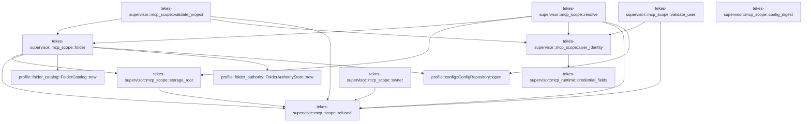

# tekes-supervisor::mcp_scope

[Package atlas](index.md) · [Source](../../src/mcp_scope.rs)

## Declarations

Visibility is the declaration spelling; trait members and reexports require their enclosing interface. `cfg` is not evaluated.

| Symbol | Kind | Visibility | Test / cfg |
|---|---|---|---|
| [tekes-supervisor::mcp_scope::refused](../../src/mcp_scope.rs#L10) | function_item | `private` |  |
| [tekes-supervisor::mcp_scope::storage_root](../../src/mcp_scope.rs#L13) | function_item | `pub` |  |
| [tekes-supervisor::mcp_scope::config_digest](../../src/mcp_scope.rs#L27) | function_item | `pub` |  |
| [tekes-supervisor::mcp_scope::folder](../../src/mcp_scope.rs#L34) | function_item | `pub` |  |
| [tekes-supervisor::mcp_scope::owner](../../src/mcp_scope.rs#L86) | function_item | `pub` |  |
| [tekes-supervisor::mcp_scope::user_identity](../../src/mcp_scope.rs#L115) | function_item | `private` |  |
| [tekes-supervisor::mcp_scope::resolve](../../src/mcp_scope.rs#L130) | function_item | `pub` |  |
| [tekes-supervisor::mcp_scope::validate_user](../../src/mcp_scope.rs#L203) | function_item | `pub` |  |
| [tekes-supervisor::mcp_scope::validate_project](../../src/mcp_scope.rs#L223) | function_item | `pub` |  |

## Imports / reexports

| Local name | Source path | Visibility |
|---|---|---|
| `McpError` | `mcp::McpError` | `private` |
| `McpRegistry` | `mcp::McpRegistry` | `private` |
| `McpRegistryStore` | `mcp::McpRegistryStore` | `private` |
| `McpScope` | `mcp::McpScope` | `private` |
| `McpServerConfig` | `mcp::McpServerConfig` | `private` |
| `McpTransportConfig` | `mcp::McpTransportConfig` | `private` |
| `FolderAuthorityStore` | `profile::FolderAuthorityStore` | `private` |
| `FolderTrust` | `profile::FolderTrust` | `private` |
| `Digest` | `sha2::Digest` | `private` |
| `Sha256` | `sha2::Sha256` | `private` |
| `BTreeMap` | `std::collections::BTreeMap` | `private` |
| `Path` | `std::path::Path` | `private` |
| `PathBuf` | `std::path::PathBuf` | `private` |

## Module declarations

| Module | Visibility | Attributes |
|---|---|---|

## Function call graphs

Edges below are syntactically resolved calls only, including private functions. Graphs partition callers into groups of 20; they are not execution order. All unresolved sites are listed below and in the JSON inventory.

Functions 1–9: 18 direct edges

## Call sites

Includes test functions (marked in declarations). Receiver-type-required sites need type analysis/manual tracing. Calls in closures are attributed to their enclosing function; their occurrence here does not mean the closure executes immediately.

| Caller | Callee expression | Source lines | Target / classification |
|---|---|---|---|
| `refused` | `McpError::Conflict` | [11](../../src/mcp_scope.rs#L11) | external-constructor-callback-or-unresolved |
| `refused` | `reason.to_string` | [11](../../src/mcp_scope.rs#L11) | receiver-type-required |
| `storage_root` | `registry         .root()         .file_name()         .is_none_or` | [15](../../src/mcp_scope.rs#L15) | receiver-type-required |
| `storage_root` | `registry         .root()         .file_name` | [15](../../src/mcp_scope.rs#L15) | receiver-type-required |
| `storage_root` | `registry         .root` | [15](../../src/mcp_scope.rs#L15), [22](../../src/mcp_scope.rs#L22) | receiver-type-required |
| `storage_root` | `Err` | [20](../../src/mcp_scope.rs#L20) | external-constructor-callback-or-unresolved |
| `storage_root` | `refused` | [20](../../src/mcp_scope.rs#L20), [25](../../src/mcp_scope.rs#L25) | [tekes-supervisor::mcp_scope::refused](../../src/mcp_scope.rs#L10) |
| `storage_root` | `registry         .root()         .parent()         .ok_or_else` | [22](../../src/mcp_scope.rs#L22) | receiver-type-required |
| `storage_root` | `registry         .root()         .parent` | [22](../../src/mcp_scope.rs#L22) | receiver-type-required |
| `config_digest` | `Ok` | [29](../../src/mcp_scope.rs#L29) | external-constructor-callback-or-unresolved |
| `folder` | `Ok` | [39](../../src/mcp_scope.rs#L39) | external-constructor-callback-or-unresolved |
| `folder` | `storage_root` | [41](../../src/mcp_scope.rs#L41) | [tekes-supervisor::mcp_scope::storage_root](../../src/mcp_scope.rs#L13) |
| `folder` | `FolderAuthorityStore::new` | [42](../../src/mcp_scope.rs#L42) | [profile::folder_authority::FolderAuthorityStore::new](../../../profile/src/folder_authority.rs#L86) |
| `folder` | `profile::FolderCatalog::new(root)             .folders()             .map_err(refused)?             .into_iter()             .find` | [44](../../src/mcp_scope.rs#L44) | receiver-type-required |
| `folder` | `profile::FolderCatalog::new(root)             .folders()             .map_err(refused)?             .into_iter` | [44](../../src/mcp_scope.rs#L44), [65](../../src/mcp_scope.rs#L65) | receiver-type-required |
| `folder` | `profile::FolderCatalog::new(root)             .folders()             .map_err` | [44](../../src/mcp_scope.rs#L44), [65](../../src/mcp_scope.rs#L65) | receiver-type-required |
| `folder` | `profile::FolderCatalog::new(root)             .folders` | [44](../../src/mcp_scope.rs#L44), [65](../../src/mcp_scope.rs#L65) | receiver-type-required |
| `folder` | `profile::FolderCatalog::new` | [44](../../src/mcp_scope.rs#L44), [65](../../src/mcp_scope.rs#L65) | [profile::folder_catalog::FolderCatalog::new](../../../profile/src/folder_catalog.rs#L68) |
| `folder` | `authority                 .status(Path::new(&folder.path))                 .map(Some)                 .map_err` | [50](../../src/mcp_scope.rs#L50) | receiver-type-required |
| `folder` | `authority                 .status(Path::new(&folder.path))                 .map` | [50](../../src/mcp_scope.rs#L50) | receiver-type-required |
| `folder` | `authority                 .status` | [50](../../src/mcp_scope.rs#L50) | receiver-type-required |
| `folder` | `Path::new` | [51](../../src/mcp_scope.rs#L51), [82](../../src/mcp_scope.rs#L82) | external-constructor-callback-or-unresolved |
| `folder` | `authority.record(id).map(Some).map_err` | [55](../../src/mcp_scope.rs#L55) | receiver-type-required |
| `folder` | `authority.record(id).map` | [55](../../src/mcp_scope.rs#L55) | receiver-type-required |
| `folder` | `authority.record` | [55](../../src/mcp_scope.rs#L55) | receiver-type-required |
| `folder` | `profile::ConfigRepository::open(root).map_err` | [57](../../src/mcp_scope.rs#L57) | receiver-type-required |
| `folder` | `profile::ConfigRepository::open` | [57](../../src/mcp_scope.rs#L57) | [profile::config::ConfigRepository::open](../../../profile/src/config.rs#L814) |
| `folder` | `repository.workspace` | [58](../../src/mcp_scope.rs#L58) | receiver-type-required |
| `folder` | `workspace             .folder_paths()             .into_iter()             .map(str::to_owned)             .collect::<Vec<_>>` | [60](../../src/mcp_scope.rs#L60) | receiver-type-required |
| `folder` | `workspace             .folder_paths()             .into_iter()             .map` | [60](../../src/mcp_scope.rs#L60) | receiver-type-required |
| `folder` | `workspace             .folder_paths()             .into_iter` | [60](../../src/mcp_scope.rs#L60) | receiver-type-required |
| `folder` | `workspace             .folder_paths` | [60](../../src/mcp_scope.rs#L60) | receiver-type-required |
| `folder` | `profile::FolderCatalog::new(root)             .folders()             .map_err(refused)?             .into_iter()             .filter(&#124;folder&#124; {                 folder                     .aliases                     .iter()                     .any(&#124;(workspace, _)&#124; workspace == &server.reference.workspace_id)             })             .map(&#124;folder&#124; folder.path)             .collect` | [65](../../src/mcp_scope.rs#L65) | receiver-type-required |
| `folder` | `profile::FolderCatalog::new(root)             .folders()             .map_err(refused)?             .into_iter()             .filter(&#124;folder&#124; {                 folder                     .aliases                     .iter()                     .any(&#124;(workspace, _)&#124; workspace == &server.reference.workspace_id)             })             .map` | [65](../../src/mcp_scope.rs#L65) | receiver-type-required |
| `folder` | `profile::FolderCatalog::new(root)             .folders()             .map_err(refused)?             .into_iter()             .filter` | [65](../../src/mcp_scope.rs#L65) | receiver-type-required |
| `folder` | `folder                     .aliases                     .iter()                     .any` | [70](../../src/mcp_scope.rs#L70) | receiver-type-required |
| `folder` | `folder                     .aliases                     .iter` | [70](../../src/mcp_scope.rs#L70) | receiver-type-required |
| `folder` | `paths.len` | [78](../../src/mcp_scope.rs#L78) | receiver-type-required |
| `folder` | `Err` | [79](../../src/mcp_scope.rs#L79) | external-constructor-callback-or-unresolved |
| `folder` | `refused` | [79](../../src/mcp_scope.rs#L79) | [tekes-supervisor::mcp_scope::refused](../../src/mcp_scope.rs#L10) |
| `folder` | `authority         .status(Path::new(&paths[0]))         .map(Some)         .map_err` | [81](../../src/mcp_scope.rs#L81) | receiver-type-required |
| `folder` | `authority         .status(Path::new(&paths[0]))         .map` | [81](../../src/mcp_scope.rs#L81) | receiver-type-required |
| `folder` | `authority         .status` | [81](../../src/mcp_scope.rs#L81) | receiver-type-required |
| `owner` | `Ok` | [91](../../src/mcp_scope.rs#L91), [92](../../src/mcp_scope.rs#L92), [111](../../src/mcp_scope.rs#L111) | external-constructor-callback-or-unresolved |
| `owner` | `"user".into` | [91](../../src/mcp_scope.rs#L91) | receiver-type-required |
| `owner` | `folder(                 server,                 registry.ok_or_else(&#124;&#124; refused("missing folder authority"))?,             )?             .ok_or_else` | [103](../../src/mcp_scope.rs#L103) | receiver-type-required |
| `owner` | `folder` | [103](../../src/mcp_scope.rs#L103) | external-constructor-callback-or-unresolved |
| `owner` | `registry.ok_or_else` | [105](../../src/mcp_scope.rs#L105) | receiver-type-required |
| `owner` | `refused` | [105](../../src/mcp_scope.rs#L105), [107](../../src/mcp_scope.rs#L107), [109](../../src/mcp_scope.rs#L109) | [tekes-supervisor::mcp_scope::refused](../../src/mcp_scope.rs#L10) |
| `owner` | `Err` | [109](../../src/mcp_scope.rs#L109) | external-constructor-callback-or-unresolved |
| `owner` | `Some` | [111](../../src/mcp_scope.rs#L111) | external-constructor-callback-or-unresolved |
| `user_identity` | `super::mcp_runtime::credential_fields(server)         .into_iter()         .map(&#124;(field, id)&#124; {             let state = store                 .credential_reference_state(&server.reference, &field, &id)                 .map_err(refused)?;             Ok(serde_json::json!({"field":field,"id":id,"state":state}))         })         .collect::<Result<Vec<_>, McpError>>` | [119](../../src/mcp_scope.rs#L119) | receiver-type-required |
| `user_identity` | `super::mcp_runtime::credential_fields(server)         .into_iter()         .map` | [119](../../src/mcp_scope.rs#L119) | receiver-type-required |
| `user_identity` | `super::mcp_runtime::credential_fields(server)         .into_iter` | [119](../../src/mcp_scope.rs#L119) | receiver-type-required |
| `user_identity` | `super::mcp_runtime::credential_fields` | [119](../../src/mcp_scope.rs#L119) | [tekes-supervisor::mcp_runtime::credential_fields](../../src/mcp_runtime.rs#L2143) |
| `user_identity` | `store                 .credential_reference_state(&server.reference, &field, &id)                 .map_err` | [122](../../src/mcp_scope.rs#L122) | receiver-type-required |
| `user_identity` | `store                 .credential_reference_state` | [122](../../src/mcp_scope.rs#L122) | receiver-type-required |
| `user_identity` | `Ok` | [125](../../src/mcp_scope.rs#L125), [128](../../src/mcp_scope.rs#L128) | external-constructor-callback-or-unresolved |
| `resolve` | `paths.iter().map(PathBuf::from).collect` | [137](../../src/mcp_scope.rs#L137) | receiver-type-required |
| `resolve` | `paths.iter().map` | [137](../../src/mcp_scope.rs#L137) | receiver-type-required |
| `resolve` | `paths.iter` | [137](../../src/mcp_scope.rs#L137), [170](../../src/mcp_scope.rs#L170) | receiver-type-required |
| `resolve` | `storage_root(store)             .ok()             .and_then(&#124;root&#124; profile::ConfigRepository::open(root).ok())             .and_then(&#124;repo&#124; repo.workspace(workspace).ok())             .map(&#124;ws&#124; ws.folder_paths().into_iter().map(PathBuf::from).collect())             .unwrap_or_default` | [138](../../src/mcp_scope.rs#L138) | receiver-type-required |
| `resolve` | `storage_root(store)             .ok()             .and_then(&#124;root&#124; profile::ConfigRepository::open(root).ok())             .and_then(&#124;repo&#124; repo.workspace(workspace).ok())             .map` | [138](../../src/mcp_scope.rs#L138) | receiver-type-required |
| `resolve` | `storage_root(store)             .ok()             .and_then(&#124;root&#124; profile::ConfigRepository::open(root).ok())             .and_then` | [138](../../src/mcp_scope.rs#L138) | receiver-type-required |
| `resolve` | `storage_root(store)             .ok()             .and_then` | [138](../../src/mcp_scope.rs#L138) | receiver-type-required |
| `resolve` | `storage_root(store)             .ok` | [138](../../src/mcp_scope.rs#L138) | receiver-type-required |
| `resolve` | `storage_root` | [138](../../src/mcp_scope.rs#L138) | [tekes-supervisor::mcp_scope::storage_root](../../src/mcp_scope.rs#L13) |
| `resolve` | `profile::ConfigRepository::open(root).ok` | [140](../../src/mcp_scope.rs#L140) | receiver-type-required |
| `resolve` | `profile::ConfigRepository::open` | [140](../../src/mcp_scope.rs#L140) | [profile::config::ConfigRepository::open](../../../profile/src/config.rs#L814) |
| `resolve` | `repo.workspace(workspace).ok` | [141](../../src/mcp_scope.rs#L141) | receiver-type-required |
| `resolve` | `repo.workspace` | [141](../../src/mcp_scope.rs#L141) | receiver-type-required |
| `resolve` | `ws.folder_paths().into_iter().map(PathBuf::from).collect` | [142](../../src/mcp_scope.rs#L142) | receiver-type-required |
| `resolve` | `ws.folder_paths().into_iter().map` | [142](../../src/mcp_scope.rs#L142) | receiver-type-required |
| `resolve` | `ws.folder_paths().into_iter` | [142](../../src/mcp_scope.rs#L142) | receiver-type-required |
| `resolve` | `ws.folder_paths` | [142](../../src/mcp_scope.rs#L142) | receiver-type-required |
| `resolve` | `BTreeMap::new` | [145](../../src/mcp_scope.rs#L145), [147](../../src/mcp_scope.rs#L147) | external-constructor-callback-or-unresolved |
| `resolve` | `registry.servers.iter().filter` | [148](../../src/mcp_scope.rs#L148) | receiver-type-required |
| `resolve` | `registry.servers.iter` | [148](../../src/mcp_scope.rs#L148) | receiver-type-required |
| `resolve` | `user_identity` | [151](../../src/mcp_scope.rs#L151), [178](../../src/mcp_scope.rs#L178) | [tekes-supervisor::mcp_scope::user_identity](../../src/mcp_scope.rs#L115) |
| `resolve` | `users.get` | [152](../../src/mcp_scope.rs#L152) | receiver-type-required |
| `resolve` | `Err` | [154](../../src/mcp_scope.rs#L154), [166](../../src/mcp_scope.rs#L166), [181](../../src/mcp_scope.rs#L181) | external-constructor-callback-or-unresolved |
| `resolve` | `refused` | [154](../../src/mcp_scope.rs#L154), [166](../../src/mcp_scope.rs#L166), [181](../../src/mcp_scope.rs#L181) | [tekes-supervisor::mcp_scope::refused](../../src/mcp_scope.rs#L10) |
| `resolve` | `users.insert` | [160](../../src/mcp_scope.rs#L160) | receiver-type-required |
| `resolve` | `server.reference.name.clone` | [160](../../src/mcp_scope.rs#L160), [184](../../src/mcp_scope.rs#L184) | receiver-type-required |
| `resolve` | `folder` | [164](../../src/mcp_scope.rs#L164) | [tekes-supervisor::mcp_scope::folder](../../src/mcp_scope.rs#L34) |
| `resolve` | `paths.iter().any` | [170](../../src/mcp_scope.rs#L170) | receiver-type-required |
| `resolve` | `path.canonicalize().ok().as_deref` | [171](../../src/mcp_scope.rs#L171) | receiver-type-required |
| `resolve` | `path.canonicalize().ok` | [171](../../src/mcp_scope.rs#L171) | receiver-type-required |
| `resolve` | `path.canonicalize` | [171](../../src/mcp_scope.rs#L171) | receiver-type-required |
| `resolve` | `Some` | [171](../../src/mcp_scope.rs#L171) | external-constructor-callback-or-unresolved |
| `resolve` | `Path::new` | [171](../../src/mcp_scope.rs#L171) | external-constructor-callback-or-unresolved |
| `resolve` | `projects.get` | [179](../../src/mcp_scope.rs#L179) | receiver-type-required |
| `resolve` | `projects.insert` | [184](../../src/mcp_scope.rs#L184) | receiver-type-required |
| `resolve` | `users         .into_iter()         .map(&#124;(name, (server, _))&#124; (name, server.clone()))         .collect::<BTreeMap<_, _>>` | [190](../../src/mcp_scope.rs#L190) | receiver-type-required |
| `resolve` | `users         .into_iter()         .map` | [190](../../src/mcp_scope.rs#L190) | receiver-type-required |
| `resolve` | `users         .into_iter` | [190](../../src/mcp_scope.rs#L190) | receiver-type-required |
| `resolve` | `server.clone` | [192](../../src/mcp_scope.rs#L192), [198](../../src/mcp_scope.rs#L198) | receiver-type-required |
| `resolve` | `resolved.extend` | [195](../../src/mcp_scope.rs#L195) | receiver-type-required |
| `resolve` | `projects             .into_iter()             .map` | [196](../../src/mcp_scope.rs#L196) | receiver-type-required |
| `resolve` | `projects             .into_iter` | [196](../../src/mcp_scope.rs#L196) | receiver-type-required |
| `resolve` | `Ok` | [200](../../src/mcp_scope.rs#L200) | external-constructor-callback-or-unresolved |
| `resolve` | `resolved.into_values().collect` | [200](../../src/mcp_scope.rs#L200) | receiver-type-required |
| `resolve` | `resolved.into_values` | [200](../../src/mcp_scope.rs#L200) | receiver-type-required |
| `validate_user` | `user_identity` | [204](../../src/mcp_scope.rs#L204), [216](../../src/mcp_scope.rs#L216) | [tekes-supervisor::mcp_scope::user_identity](../../src/mcp_scope.rs#L115) |
| `validate_user` | `store         .load()         .map_err(refused)?         .servers         .iter()         .filter` | [205](../../src/mcp_scope.rs#L205) | receiver-type-required |
| `validate_user` | `store         .load()         .map_err(refused)?         .servers         .iter` | [205](../../src/mcp_scope.rs#L205) | receiver-type-required |
| `validate_user` | `store         .load()         .map_err` | [205](../../src/mcp_scope.rs#L205) | receiver-type-required |
| `validate_user` | `store         .load` | [205](../../src/mcp_scope.rs#L205) | receiver-type-required |
| `validate_user` | `Err` | [217](../../src/mcp_scope.rs#L217) | external-constructor-callback-or-unresolved |
| `validate_user` | `refused` | [217](../../src/mcp_scope.rs#L217) | [tekes-supervisor::mcp_scope::refused](../../src/mcp_scope.rs#L10) |
| `validate_user` | `Ok` | [220](../../src/mcp_scope.rs#L220) | external-constructor-callback-or-unresolved |
| `validate_project` | `folder(server, store)?.ok_or_else` | [227](../../src/mcp_scope.rs#L227) | receiver-type-required |
| `validate_project` | `folder` | [227](../../src/mcp_scope.rs#L227), [240](../../src/mcp_scope.rs#L240) | [tekes-supervisor::mcp_scope::folder](../../src/mcp_scope.rs#L34) |
| `validate_project` | `refused` | [227](../../src/mcp_scope.rs#L227), [246](../../src/mcp_scope.rs#L246) | [tekes-supervisor::mcp_scope::refused](../../src/mcp_scope.rs#L10) |
| `validate_project` | `user_identity` | [228](../../src/mcp_scope.rs#L228), [244](../../src/mcp_scope.rs#L244) | [tekes-supervisor::mcp_scope::user_identity](../../src/mcp_scope.rs#L115) |
| `validate_project` | `store         .load()         .map_err(refused)?         .servers         .iter()         .filter` | [229](../../src/mcp_scope.rs#L229) | receiver-type-required |
| `validate_project` | `store         .load()         .map_err(refused)?         .servers         .iter` | [229](../../src/mcp_scope.rs#L229) | receiver-type-required |
| `validate_project` | `store         .load()         .map_err` | [229](../../src/mcp_scope.rs#L229) | receiver-type-required |
| `validate_project` | `store         .load` | [229](../../src/mcp_scope.rs#L229) | receiver-type-required |
| `validate_project` | `folder(other, store)             .ok()             .flatten()             .is_some_and` | [240](../../src/mcp_scope.rs#L240) | receiver-type-required |
| `validate_project` | `folder(other, store)             .ok()             .flatten` | [240](../../src/mcp_scope.rs#L240) | receiver-type-required |
| `validate_project` | `folder(other, store)             .ok` | [240](../../src/mcp_scope.rs#L240) | receiver-type-required |
| `validate_project` | `Err` | [246](../../src/mcp_scope.rs#L246) | external-constructor-callback-or-unresolved |
| `validate_project` | `Ok` | [249](../../src/mcp_scope.rs#L249) | external-constructor-callback-or-unresolved |
