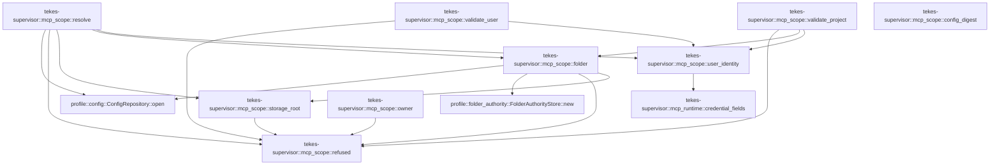

# tekes-supervisor::mcp_scope

[Package atlas](index.md) · [Source](../../src/mcp_scope.rs)

## Declarations

Visibility is the declaration spelling; trait members and reexports require their enclosing interface. `cfg` is not evaluated.

| Symbol | Kind | Visibility | Test / cfg |
|---|---|---|---|
| [tekes-supervisor::mcp_scope::refused](../../src/mcp_scope.rs#L10) | function_item | `private` |  |
| [tekes-supervisor::mcp_scope::storage_root](../../src/mcp_scope.rs#L13) | function_item | `pub` |  |
| [tekes-supervisor::mcp_scope::config_digest](../../src/mcp_scope.rs#L27) | function_item | `pub` |  |
| [tekes-supervisor::mcp_scope::folder](../../src/mcp_scope.rs#L34) | function_item | `pub` |  |
| [tekes-supervisor::mcp_scope::owner](../../src/mcp_scope.rs#L59) | function_item | `pub` |  |
| [tekes-supervisor::mcp_scope::user_identity](../../src/mcp_scope.rs#L88) | function_item | `private` |  |
| [tekes-supervisor::mcp_scope::resolve](../../src/mcp_scope.rs#L103) | function_item | `pub` |  |
| [tekes-supervisor::mcp_scope::validate_user](../../src/mcp_scope.rs#L176) | function_item | `pub` |  |
| [tekes-supervisor::mcp_scope::validate_project](../../src/mcp_scope.rs#L196) | function_item | `pub` |  |

## Imports / reexports

| Local name | Source path | Visibility |
|---|---|---|
| `McpError` | `mcp::McpError` | `private` |
| `McpRegistry` | `mcp::McpRegistry` | `private` |
| `McpRegistryStore` | `mcp::McpRegistryStore` | `private` |
| `McpScope` | `mcp::McpScope` | `private` |
| `McpServerConfig` | `mcp::McpServerConfig` | `private` |
| `McpTransportConfig` | `mcp::McpTransportConfig` | `private` |
| `FolderAuthorityStore` | `profile::FolderAuthorityStore` | `private` |
| `FolderTrust` | `profile::FolderTrust` | `private` |
| `Digest` | `sha2::Digest` | `private` |
| `Sha256` | `sha2::Sha256` | `private` |
| `BTreeMap` | `std::collections::BTreeMap` | `private` |
| `Path` | `std::path::Path` | `private` |
| `PathBuf` | `std::path::PathBuf` | `private` |

## Module declarations

| Module | Visibility | Attributes |
|---|---|---|

## Function call graphs

Edges below are syntactically resolved calls only, including private functions. Graphs partition callers into groups of 20; they are not execution order. All unresolved sites are listed below and in the JSON inventory.

Functions 1–9: 17 direct edges

## Call sites

Includes test functions (marked in declarations). Receiver-type-required sites need type analysis/manual tracing. Calls in closures are attributed to their enclosing function; their occurrence here does not mean the closure executes immediately.

| Caller | Callee expression | Source lines | Target / classification |
|---|---|---|---|
| `refused` | `McpError::Conflict` | [11](../../src/mcp_scope.rs#L11) | external-constructor-callback-or-unresolved |
| `refused` | `reason.to_string` | [11](../../src/mcp_scope.rs#L11) | receiver-type-required |
| `storage_root` | `registry         .root()         .file_name()         .is_none_or` | [15](../../src/mcp_scope.rs#L15) | receiver-type-required |
| `storage_root` | `registry         .root()         .file_name` | [15](../../src/mcp_scope.rs#L15) | receiver-type-required |
| `storage_root` | `registry         .root` | [15](../../src/mcp_scope.rs#L15), [22](../../src/mcp_scope.rs#L22) | receiver-type-required |
| `storage_root` | `Err` | [20](../../src/mcp_scope.rs#L20) | external-constructor-callback-or-unresolved |
| `storage_root` | `refused` | [20](../../src/mcp_scope.rs#L20), [25](../../src/mcp_scope.rs#L25) | [tekes-supervisor::mcp_scope::refused](../../src/mcp_scope.rs#L10) |
| `storage_root` | `registry         .root()         .parent()         .ok_or_else` | [22](../../src/mcp_scope.rs#L22) | receiver-type-required |
| `storage_root` | `registry         .root()         .parent` | [22](../../src/mcp_scope.rs#L22) | receiver-type-required |
| `config_digest` | `Ok` | [29](../../src/mcp_scope.rs#L29) | external-constructor-callback-or-unresolved |
| `folder` | `Ok` | [39](../../src/mcp_scope.rs#L39) | external-constructor-callback-or-unresolved |
| `folder` | `storage_root` | [41](../../src/mcp_scope.rs#L41) | [tekes-supervisor::mcp_scope::storage_root](../../src/mcp_scope.rs#L13) |
| `folder` | `FolderAuthorityStore::new` | [42](../../src/mcp_scope.rs#L42) | [profile::folder_authority::FolderAuthorityStore::new](../../../profile/src/folder_authority.rs#L86) |
| `folder` | `authority.record(id).map(Some).map_err` | [44](../../src/mcp_scope.rs#L44) | receiver-type-required |
| `folder` | `authority.record(id).map` | [44](../../src/mcp_scope.rs#L44) | receiver-type-required |
| `folder` | `authority.record` | [44](../../src/mcp_scope.rs#L44) | receiver-type-required |
| `folder` | `profile::ConfigRepository::open(root).map_err` | [46](../../src/mcp_scope.rs#L46) | receiver-type-required |
| `folder` | `profile::ConfigRepository::open` | [46](../../src/mcp_scope.rs#L46) | [profile::config::ConfigRepository::open](../../../profile/src/config.rs#L814) |
| `folder` | `repository         .workspace(&server.reference.workspace_id)         .map_err` | [47](../../src/mcp_scope.rs#L47) | receiver-type-required |
| `folder` | `repository         .workspace` | [47](../../src/mcp_scope.rs#L47) | receiver-type-required |
| `folder` | `workspace.folder_paths` | [50](../../src/mcp_scope.rs#L50) | receiver-type-required |
| `folder` | `paths.len` | [51](../../src/mcp_scope.rs#L51) | receiver-type-required |
| `folder` | `Err` | [52](../../src/mcp_scope.rs#L52) | external-constructor-callback-or-unresolved |
| `folder` | `refused` | [52](../../src/mcp_scope.rs#L52) | [tekes-supervisor::mcp_scope::refused](../../src/mcp_scope.rs#L10) |
| `folder` | `authority         .status(Path::new(&paths[0]))         .map(Some)         .map_err` | [54](../../src/mcp_scope.rs#L54) | receiver-type-required |
| `folder` | `authority         .status(Path::new(&paths[0]))         .map` | [54](../../src/mcp_scope.rs#L54) | receiver-type-required |
| `folder` | `authority         .status` | [54](../../src/mcp_scope.rs#L54) | receiver-type-required |
| `folder` | `Path::new` | [55](../../src/mcp_scope.rs#L55) | external-constructor-callback-or-unresolved |
| `owner` | `Ok` | [64](../../src/mcp_scope.rs#L64), [65](../../src/mcp_scope.rs#L65), [84](../../src/mcp_scope.rs#L84) | external-constructor-callback-or-unresolved |
| `owner` | `"user".into` | [64](../../src/mcp_scope.rs#L64) | receiver-type-required |
| `owner` | `folder(                 server,                 registry.ok_or_else(&#124;&#124; refused("missing folder authority"))?,             )?             .ok_or_else` | [76](../../src/mcp_scope.rs#L76) | receiver-type-required |
| `owner` | `folder` | [76](../../src/mcp_scope.rs#L76) | external-constructor-callback-or-unresolved |
| `owner` | `registry.ok_or_else` | [78](../../src/mcp_scope.rs#L78) | receiver-type-required |
| `owner` | `refused` | [78](../../src/mcp_scope.rs#L78), [80](../../src/mcp_scope.rs#L80), [82](../../src/mcp_scope.rs#L82) | [tekes-supervisor::mcp_scope::refused](../../src/mcp_scope.rs#L10) |
| `owner` | `Err` | [82](../../src/mcp_scope.rs#L82) | external-constructor-callback-or-unresolved |
| `owner` | `Some` | [84](../../src/mcp_scope.rs#L84) | external-constructor-callback-or-unresolved |
| `user_identity` | `super::mcp_runtime::credential_fields(server)         .into_iter()         .map(&#124;(field, id)&#124; {             let state = store                 .credential_reference_state(&server.reference, &field, &id)                 .map_err(refused)?;             Ok(serde_json::json!({"field":field,"id":id,"state":state}))         })         .collect::<Result<Vec<_>, McpError>>` | [92](../../src/mcp_scope.rs#L92) | receiver-type-required |
| `user_identity` | `super::mcp_runtime::credential_fields(server)         .into_iter()         .map` | [92](../../src/mcp_scope.rs#L92) | receiver-type-required |
| `user_identity` | `super::mcp_runtime::credential_fields(server)         .into_iter` | [92](../../src/mcp_scope.rs#L92) | receiver-type-required |
| `user_identity` | `super::mcp_runtime::credential_fields` | [92](../../src/mcp_scope.rs#L92) | [tekes-supervisor::mcp_runtime::credential_fields](../../src/mcp_runtime.rs#L2143) |
| `user_identity` | `store                 .credential_reference_state(&server.reference, &field, &id)                 .map_err` | [95](../../src/mcp_scope.rs#L95) | receiver-type-required |
| `user_identity` | `store                 .credential_reference_state` | [95](../../src/mcp_scope.rs#L95) | receiver-type-required |
| `user_identity` | `Ok` | [98](../../src/mcp_scope.rs#L98), [101](../../src/mcp_scope.rs#L101) | external-constructor-callback-or-unresolved |
| `resolve` | `paths.iter().map(PathBuf::from).collect` | [110](../../src/mcp_scope.rs#L110) | receiver-type-required |
| `resolve` | `paths.iter().map` | [110](../../src/mcp_scope.rs#L110) | receiver-type-required |
| `resolve` | `paths.iter` | [110](../../src/mcp_scope.rs#L110), [143](../../src/mcp_scope.rs#L143) | receiver-type-required |
| `resolve` | `storage_root(store)             .ok()             .and_then(&#124;root&#124; profile::ConfigRepository::open(root).ok())             .and_then(&#124;repo&#124; repo.workspace(workspace).ok())             .map(&#124;ws&#124; ws.folder_paths().into_iter().map(PathBuf::from).collect())             .unwrap_or_default` | [111](../../src/mcp_scope.rs#L111) | receiver-type-required |
| `resolve` | `storage_root(store)             .ok()             .and_then(&#124;root&#124; profile::ConfigRepository::open(root).ok())             .and_then(&#124;repo&#124; repo.workspace(workspace).ok())             .map` | [111](../../src/mcp_scope.rs#L111) | receiver-type-required |
| `resolve` | `storage_root(store)             .ok()             .and_then(&#124;root&#124; profile::ConfigRepository::open(root).ok())             .and_then` | [111](../../src/mcp_scope.rs#L111) | receiver-type-required |
| `resolve` | `storage_root(store)             .ok()             .and_then` | [111](../../src/mcp_scope.rs#L111) | receiver-type-required |
| `resolve` | `storage_root(store)             .ok` | [111](../../src/mcp_scope.rs#L111) | receiver-type-required |
| `resolve` | `storage_root` | [111](../../src/mcp_scope.rs#L111) | [tekes-supervisor::mcp_scope::storage_root](../../src/mcp_scope.rs#L13) |
| `resolve` | `profile::ConfigRepository::open(root).ok` | [113](../../src/mcp_scope.rs#L113) | receiver-type-required |
| `resolve` | `profile::ConfigRepository::open` | [113](../../src/mcp_scope.rs#L113) | [profile::config::ConfigRepository::open](../../../profile/src/config.rs#L814) |
| `resolve` | `repo.workspace(workspace).ok` | [114](../../src/mcp_scope.rs#L114) | receiver-type-required |
| `resolve` | `repo.workspace` | [114](../../src/mcp_scope.rs#L114) | receiver-type-required |
| `resolve` | `ws.folder_paths().into_iter().map(PathBuf::from).collect` | [115](../../src/mcp_scope.rs#L115) | receiver-type-required |
| `resolve` | `ws.folder_paths().into_iter().map` | [115](../../src/mcp_scope.rs#L115) | receiver-type-required |
| `resolve` | `ws.folder_paths().into_iter` | [115](../../src/mcp_scope.rs#L115) | receiver-type-required |
| `resolve` | `ws.folder_paths` | [115](../../src/mcp_scope.rs#L115) | receiver-type-required |
| `resolve` | `BTreeMap::new` | [118](../../src/mcp_scope.rs#L118), [120](../../src/mcp_scope.rs#L120) | external-constructor-callback-or-unresolved |
| `resolve` | `registry.servers.iter().filter` | [121](../../src/mcp_scope.rs#L121) | receiver-type-required |
| `resolve` | `registry.servers.iter` | [121](../../src/mcp_scope.rs#L121) | receiver-type-required |
| `resolve` | `user_identity` | [124](../../src/mcp_scope.rs#L124), [151](../../src/mcp_scope.rs#L151) | [tekes-supervisor::mcp_scope::user_identity](../../src/mcp_scope.rs#L88) |
| `resolve` | `users.get` | [125](../../src/mcp_scope.rs#L125) | receiver-type-required |
| `resolve` | `Err` | [127](../../src/mcp_scope.rs#L127), [139](../../src/mcp_scope.rs#L139), [154](../../src/mcp_scope.rs#L154) | external-constructor-callback-or-unresolved |
| `resolve` | `refused` | [127](../../src/mcp_scope.rs#L127), [139](../../src/mcp_scope.rs#L139), [154](../../src/mcp_scope.rs#L154) | [tekes-supervisor::mcp_scope::refused](../../src/mcp_scope.rs#L10) |
| `resolve` | `users.insert` | [133](../../src/mcp_scope.rs#L133) | receiver-type-required |
| `resolve` | `server.reference.name.clone` | [133](../../src/mcp_scope.rs#L133), [157](../../src/mcp_scope.rs#L157) | receiver-type-required |
| `resolve` | `folder` | [137](../../src/mcp_scope.rs#L137) | [tekes-supervisor::mcp_scope::folder](../../src/mcp_scope.rs#L34) |
| `resolve` | `paths.iter().any` | [143](../../src/mcp_scope.rs#L143) | receiver-type-required |
| `resolve` | `path.canonicalize().ok().as_deref` | [144](../../src/mcp_scope.rs#L144) | receiver-type-required |
| `resolve` | `path.canonicalize().ok` | [144](../../src/mcp_scope.rs#L144) | receiver-type-required |
| `resolve` | `path.canonicalize` | [144](../../src/mcp_scope.rs#L144) | receiver-type-required |
| `resolve` | `Some` | [144](../../src/mcp_scope.rs#L144) | external-constructor-callback-or-unresolved |
| `resolve` | `Path::new` | [144](../../src/mcp_scope.rs#L144) | external-constructor-callback-or-unresolved |
| `resolve` | `projects.get` | [152](../../src/mcp_scope.rs#L152) | receiver-type-required |
| `resolve` | `projects.insert` | [157](../../src/mcp_scope.rs#L157) | receiver-type-required |
| `resolve` | `users         .into_iter()         .map(&#124;(name, (server, _))&#124; (name, server.clone()))         .collect::<BTreeMap<_, _>>` | [163](../../src/mcp_scope.rs#L163) | receiver-type-required |
| `resolve` | `users         .into_iter()         .map` | [163](../../src/mcp_scope.rs#L163) | receiver-type-required |
| `resolve` | `users         .into_iter` | [163](../../src/mcp_scope.rs#L163) | receiver-type-required |
| `resolve` | `server.clone` | [165](../../src/mcp_scope.rs#L165), [171](../../src/mcp_scope.rs#L171) | receiver-type-required |
| `resolve` | `resolved.extend` | [168](../../src/mcp_scope.rs#L168) | receiver-type-required |
| `resolve` | `projects             .into_iter()             .map` | [169](../../src/mcp_scope.rs#L169) | receiver-type-required |
| `resolve` | `projects             .into_iter` | [169](../../src/mcp_scope.rs#L169) | receiver-type-required |
| `resolve` | `Ok` | [173](../../src/mcp_scope.rs#L173) | external-constructor-callback-or-unresolved |
| `resolve` | `resolved.into_values().collect` | [173](../../src/mcp_scope.rs#L173) | receiver-type-required |
| `resolve` | `resolved.into_values` | [173](../../src/mcp_scope.rs#L173) | receiver-type-required |
| `validate_user` | `user_identity` | [177](../../src/mcp_scope.rs#L177), [189](../../src/mcp_scope.rs#L189) | [tekes-supervisor::mcp_scope::user_identity](../../src/mcp_scope.rs#L88) |
| `validate_user` | `store         .load()         .map_err(refused)?         .servers         .iter()         .filter` | [178](../../src/mcp_scope.rs#L178) | receiver-type-required |
| `validate_user` | `store         .load()         .map_err(refused)?         .servers         .iter` | [178](../../src/mcp_scope.rs#L178) | receiver-type-required |
| `validate_user` | `store         .load()         .map_err` | [178](../../src/mcp_scope.rs#L178) | receiver-type-required |
| `validate_user` | `store         .load` | [178](../../src/mcp_scope.rs#L178) | receiver-type-required |
| `validate_user` | `Err` | [190](../../src/mcp_scope.rs#L190) | external-constructor-callback-or-unresolved |
| `validate_user` | `refused` | [190](../../src/mcp_scope.rs#L190) | [tekes-supervisor::mcp_scope::refused](../../src/mcp_scope.rs#L10) |
| `validate_user` | `Ok` | [193](../../src/mcp_scope.rs#L193) | external-constructor-callback-or-unresolved |
| `validate_project` | `folder(server, store)?.ok_or_else` | [200](../../src/mcp_scope.rs#L200) | receiver-type-required |
| `validate_project` | `folder` | [200](../../src/mcp_scope.rs#L200), [213](../../src/mcp_scope.rs#L213) | [tekes-supervisor::mcp_scope::folder](../../src/mcp_scope.rs#L34) |
| `validate_project` | `refused` | [200](../../src/mcp_scope.rs#L200), [219](../../src/mcp_scope.rs#L219) | [tekes-supervisor::mcp_scope::refused](../../src/mcp_scope.rs#L10) |
| `validate_project` | `user_identity` | [201](../../src/mcp_scope.rs#L201), [217](../../src/mcp_scope.rs#L217) | [tekes-supervisor::mcp_scope::user_identity](../../src/mcp_scope.rs#L88) |
| `validate_project` | `store         .load()         .map_err(refused)?         .servers         .iter()         .filter` | [202](../../src/mcp_scope.rs#L202) | receiver-type-required |
| `validate_project` | `store         .load()         .map_err(refused)?         .servers         .iter` | [202](../../src/mcp_scope.rs#L202) | receiver-type-required |
| `validate_project` | `store         .load()         .map_err` | [202](../../src/mcp_scope.rs#L202) | receiver-type-required |
| `validate_project` | `store         .load` | [202](../../src/mcp_scope.rs#L202) | receiver-type-required |
| `validate_project` | `folder(other, store)             .ok()             .flatten()             .is_some_and` | [213](../../src/mcp_scope.rs#L213) | receiver-type-required |
| `validate_project` | `folder(other, store)             .ok()             .flatten` | [213](../../src/mcp_scope.rs#L213) | receiver-type-required |
| `validate_project` | `folder(other, store)             .ok` | [213](../../src/mcp_scope.rs#L213) | receiver-type-required |
| `validate_project` | `Err` | [219](../../src/mcp_scope.rs#L219) | external-constructor-callback-or-unresolved |
| `validate_project` | `Ok` | [222](../../src/mcp_scope.rs#L222) | external-constructor-callback-or-unresolved |
