```mermaid
flowchart TD
  n0["provider::secret_store::resolve_config_credentials"]
  n1["store::folder::ThreadStore::open"]
  n2["store::folder_events::arm_admission"]
  n3["store::folder_events::is_admitted"]
  n4["tekes-supervisor::boot_trace::phase"]
  n5["tekes-supervisor::endpoint_host::recover_pending_management"]
  n6["tekes-supervisor::host_runtime::DaemonError::invalid_config"]
  n7["tekes-supervisor::host_runtime::DaemonError::corrupt"]
  n8["tekes-supervisor::host_runtime::DaemonError::required_broker"]
  n9["tekes-supervisor::process_host::ProductionProcessHost::post_ready_tasks"]
  n10["tekes-supervisor::process_host::ProductionProcessHost::cleanup_stale_ephemeral"]
  n11["tekes-supervisor::process_host::ProductionProcessHost::live_sessions_for_cleanup"]
  n12["tekes-supervisor::process_host::ProductionProcessHost::run_upgrade_pass"]
  n13["tekes-supervisor::process_host::ProductionProcessHost::is_stale_ephemeral"]
  n14["tekes-supervisor::process_host::ProductionProcessHost::on_folder_event"]
  n15["tekes-supervisor::process_host::ProductionProcessHost::attach_streams"]
  n16["tekes-supervisor::process_host::ProductionProcessHost::reconcile_child_line"]
  n17["tekes-supervisor::process_host::ProductionProcessHost::publish_session_status"]
  n18["tekes-supervisor::process_host::ProductionProcessHost::start_periodic_sweep"]
  n19["tekes-supervisor::process_host::ProductionProcessHost::recover_pending_management"]
  n20["tekes-supervisor::process_host::ProductionProcessHost::refresh_live_credentials"]
  n21["tekes-supervisor::process_host::ProductionProcessHost::config_mutation_succeeded"]
  n22["tekes-supervisor::process_host::ProductionProcessHost::refresh_worker_credentials"]
  n23["tekes-supervisor::process_host::ProductionProcessHost::boot_sweep"]
  n24["tekes-supervisor::process_host::ProductionProcessHost::arm_admission"]
  n25["tekes-supervisor::process_host::ProductionProcessHost::recover_client_sessions"]
  n26["tekes-supervisor::process_host::ProductionProcessHost::ensure_verified"]
  n27["tekes-supervisor::process_host::ProductionProcessHost::hydrate"]
  n28["tekes-supervisor::process_host::ProductionProcessHost::hydrate_with"]
  n29["tekes-supervisor::process_host::ProductionProcessHost::recently_failed"]
  n30["tekes-supervisor::process_host::ProductionProcessHost::hydrate_unrecorded"]
  n31["tekes-supervisor::process_host::ProductionProcessHost::sweep_once"]
  n32["tekes-supervisor::process_host::ProductionProcessHost::sweep_session"]
  n33["tekes-supervisor::process_host::web_search_scope_ready"]
  n34["tekes-supervisor::process_host::terminate_worker"]
  n35["tekes-supervisor::process_host::reconcile_credential_bindings"]
  n36["tekes-supervisor::process_host::retain_prior_for_unknown_credentials"]
  n9 --> n4
  n9 --> n10
  n9 --> n12
  n10 --> n1
  n10 --> n3
  n10 --> n11
  n12 --> n27
  n12 --> n29
  n13 --> n3
  n19 --> n5
  n20 --> n22
  n21 --> n20
  n22 --> n0
  n22 --> n8
  n22 --> n33
  n22 --> n34
  n22 --> n35
  n22 --> n36
  n23 --> n31
  n24 --> n2
  n25 --> n6
  n25 --> n26
  n25 --> n32
  n26 --> n6
  n26 --> n7
  n26 --> n27
  n27 --> n28
  n28 --> n30
```

```mermaid
flowchart TD
  n0["engine::lifecycle::ensure_action_at"]
  n1["engine::lifecycle::classify"]
  n2["profile::scope::SessionScope::for_ledger"]
  n3["session-controls::bound_goal_id"]
  n4["store::card::remove_stale_card_temps"]
  n5["store::folder_events::is_admitted"]
  n6["store::folder_events::admitted_ids"]
  n7["store::platform::NamedLock::shared"]
  n8["store::tail::scan_valid_prefix"]
  n9["store::tail::repair_thread_tails"]
  n10["tekes-supervisor::boot_trace::detail"]
  n11["tekes-supervisor::boot_trace::per_item_enabled"]
  n12["tekes-supervisor::dynamic_bindings::resolve_worker_launch_bindings"]
  n13["tekes-supervisor::host_runtime::system_timestamp"]
  n14["tekes-supervisor::host_runtime::DaemonError::protocol"]
  n15["tekes-supervisor::host_runtime::DaemonError::invalid_config"]
  n16["tekes-supervisor::host_runtime::DaemonError::corrupt"]
  n17["tekes-supervisor::host_runtime::DaemonError::required_broker"]
  n18["tekes-supervisor::launch_profiled_worker_with_secret_store_and_binding_resolver"]
  n19["tekes-supervisor::process_host::ProductionProcessHost::live_sessions_for_cleanup"]
  n20["tekes-supervisor::process_host::ProductionProcessHost::recently_failed"]
  n21["tekes-supervisor::process_host::ProductionProcessHost::hydrate_unrecorded"]
  n22["tekes-supervisor::process_host::ProductionProcessHost::repair_main_projection"]
  n23["tekes-supervisor::process_host::ProductionProcessHost::periodic_sweep_once"]
  n24["tekes-supervisor::process_host::ProductionProcessHost::is_draining"]
  n25["tekes-supervisor::process_host::ProductionProcessHost::sweep_ledger_scan"]
  n26["tekes-supervisor::process_host::ProductionProcessHost::sweep_once"]
  n27["tekes-supervisor::process_host::ProductionProcessHost::sweep_ids"]
  n28["tekes-supervisor::process_host::now_rfc3339"]
  n29["tekes-supervisor::process_host::ProductionProcessHost::is_deferred"]
  n30["tekes-supervisor::process_host::ProductionProcessHost::sweep_session"]
  n31["tekes-supervisor::process_host::ProductionProcessHost::propagate_durable_stops_before_sweep"]
  n32["tekes-supervisor::process_host::ProductionProcessHost::shutdown"]
  n33["tekes-supervisor::process_host::ProductionProcessHost::shutdown_with"]
  n34["tekes-supervisor::process_host::ProductionProcessHost::ensure_running"]
  n35["tekes-supervisor::process_host::ProductionProcessHost::live_worker"]
  n36["tekes-supervisor::process_host::ProductionProcessHost::spawn_worker_at"]
  n37["tekes-supervisor::process_host::ProductionProcessHost::spawn_worker_at_with_handshake_timeout"]
  n38["tekes-supervisor::process_host::ProductionProcessHost::workspace_service_binary"]
  n39["tekes-supervisor::process_host::ProductionProcessHost::worker_binary_digest"]
  n40["tekes-supervisor::process_host::ProductionProcessHost::refresh_limits"]
  n41["tekes-supervisor::process_host::ProductionProcessHost::freeze_tool_authority"]
  n42["tekes-supervisor::process_host::ProductionProcessHost::schedule_worker_at"]
  n43["tekes-supervisor::process_host::ProductionProcessHost::wait_for_worker"]
  n44["tekes-supervisor::process_host::ProductionProcessHost::publish_appended"]
  n45["tekes-supervisor::process_host::ProductionProcessHost::publish_appended_with"]
  n46["tekes-supervisor::process_host::ProductionProcessHost::cascade_stop_from"]
  n47["tekes-supervisor::process_host::ProductionProcessHost::reset_restart_backoff"]
  n48["tekes-supervisor::process_host::ProductionProcessHost::restart_is_due"]
  n49["tekes-supervisor::process_host::ProductionProcessHost::note_restart_failure"]
  n50["tekes-supervisor::process_host::ProductionProcessHost::record_session_notice"]
  n51["tekes-supervisor::process_host::genesis_preset_skills"]
  n52["tekes-supervisor::process_host::missing_preset_skill_notice"]
  n53["tekes-supervisor::process_host::validator_tool_launch_policy"]
  n54["tekes-supervisor::process_host::worker_reader"]
  n55["tekes-supervisor::process_host::capture_worker_stderr"]
  n56["tekes-supervisor::process_host::damage_under_lock"]
  n57["tekes-supervisor::process_host::child_ledger_damage"]
  n58["tekes-supervisor::process_host::workspace_quiescence_lock_path"]
  n59["tekes-supervisor::process_host::goal_continuation_due"]
  n60["tekes-supervisor::process_host::probe_line_lock"]
  n61["tekes-supervisor::process_host::startup_log"]
  n62["tekes-supervisor::process_host::read_worker_hello_with_progress"]
  n63["tekes-supervisor::process_host::SweepLedgerIdentity::of"]
  n64["tekes-supervisor::thread_card::fold_child_views"]
  n65["worker-control::durable::encode_queue_transaction"]
  n66["worker-control::negotiate"]
  n67["worker-control::encode_line"]
  n21 --> n4
  n21 --> n9
  n21 --> n16
  n21 --> n45
  n21 --> n56
  n21 --> n57
  n21 --> n64
  n22 --> n44
  n23 --> n26
  n25 --> n8
  n25 --> n14
  n25 --> n16
  n25 --> n63
  n26 --> n10
  n26 --> n11
  n26 --> n27
  n26 --> n30
  n27 --> n6
  n29 --> n5
  n30 --> n0
  n30 --> n1
  n30 --> n22
  n30 --> n25
  n30 --> n28
  n30 --> n29
  n30 --> n31
  n30 --> n40
  n30 --> n42
  n30 --> n48
  n30 --> n49
  n30 --> n59
  n30 --> n60
  n31 --> n25
  n31 --> n46
  n32 --> n33
  n33 --> n19
  n34 --> n40
  n34 --> n42
  n34 --> n43
  n34 --> n47
  n36 --> n37
  n37 --> n2
  n37 --> n3
  n37 --> n7
  n37 --> n12
  n37 --> n13
  n37 --> n14
  n37 --> n15
  n37 --> n17
  n37 --> n18
  n37 --> n39
  n37 --> n41
  n37 --> n50
  n37 --> n51
  n37 --> n52
  n37 --> n53
  n37 --> n54
  n37 --> n55
  n37 --> n58
  n37 --> n61
  n37 --> n62
  n37 --> n65
  n37 --> n66
  n37 --> n67
  n40 --> n15
```

```mermaid
flowchart TD
  n0["engine::context::plan_context_compaction"]
  n1["schema::event::Event::from_value"]
  n2["schema::ijson::IJsonValue::parse"]
  n3["store::tail::scan_valid_prefix"]
  n4["tekes-supervisor::host_runtime::DaemonError::protocol"]
  n5["tekes-supervisor::host_runtime::DaemonError::io"]
  n6["tekes-supervisor::host_runtime::DaemonError::required_broker"]
  n7["tekes-supervisor::process_host::ProductionProcessHost::publish_session_status"]
  n8["tekes-supervisor::process_host::production_sandbox_backend"]
  n9["tekes-supervisor::process_host::ProductionProcessHost::refresh_worker_credentials"]
  n10["tekes-supervisor::process_host::ProductionProcessHost::ensure_verified"]
  n11["tekes-supervisor::process_host::spill_compaction_summary"]
  n12["tekes-supervisor::process_host::ProductionProcessHost::live_worker"]
  n13["tekes-supervisor::process_host::ProductionProcessHost::spawn_worker_at"]
  n14["tekes-supervisor::process_host::deterministic_automatic_thread_title"]
  n15["tekes-supervisor::process_host::ProductionProcessHost::refresh_limits"]
  n16["tekes-supervisor::process_host::ProductionProcessHost::preflight_mandatory_authorities"]
  n17["tekes-supervisor::process_host::prompt_text"]
  n18["tekes-supervisor::process_host::ProductionProcessHost::is_mcp_only_app_sandbox_host"]
  n19["tekes-supervisor::process_host::ProductionProcessHost::freeze_tool_authority"]
  n20["tekes-supervisor::process_host::ProductionProcessHost::schedule_main"]
  n21["tekes-supervisor::process_host::ProductionProcessHost::schedule_line"]
  n22["tekes-supervisor::process_host::ProductionProcessHost::schedule_worker_at"]
  n23["tekes-supervisor::process_host::ProductionProcessHost::schedule_worker_at_with_startup"]
  n24["tekes-supervisor::process_host::automatic_title_origin"]
  n25["tekes-supervisor::process_host::ProductionProcessHost::spawn_reserved_worker"]
  n26["tekes-supervisor::process_host::ProductionProcessHost::schedule_child_from_parent"]
  n27["tekes-supervisor::process_host::ProductionProcessHost::wait_for_worker"]
  n28["tekes-supervisor::process_host::ProductionProcessHost::start_pending_workers"]
  n29["tekes-supervisor::process_host::ProductionProcessHost::has_worker_capacity"]
  n30["tekes-supervisor::process_host::ProductionProcessHost::request_provider_lease"]
  n31["tekes-supervisor::process_host::ProductionProcessHost::locked_prompt"]
  n32["tekes-supervisor::process_host::ProductionProcessHost::publish_queue_snapshot"]
  n33["tekes-supervisor::process_host::ProductionProcessHost::schedule_accepted_prompt"]
  n34["tekes-supervisor::process_host::ProductionProcessHost::locked_compact"]
  n35["tekes-supervisor::process_host::ProductionProcessHost::first_root_input"]
  n36["tekes-supervisor::process_host::ProductionProcessHost::seed_automatic_title"]
  n37["tekes-supervisor::process_host::ProductionProcessHost::try_seed_automatic_title"]
  n38["tekes-supervisor::process_host::ProductionProcessHost::spawn_automatic_title_refinement"]
  n39["tekes-supervisor::process_host::ProductionProcessHost::summary_for_manual_compaction"]
  n40["tekes-supervisor::process_host::ProductionProcessHost::publish_appended"]
  n41["tekes-supervisor::process_host::ProductionProcessHost::reset_restart_backoff"]
  n42["tekes-supervisor::process_host::ProductionProcessHost::record_spawn_failure"]
  n43["tekes-supervisor::process_host::frozen_tool_launch_policy"]
  n44["tekes-supervisor::process_host::child_dependency_admitted"]
  n45["tekes-supervisor::process_host::terminate_worker"]
  n46["tekes-supervisor::process_host::unresolved_parent_dependency"]
  n47["tekes-supervisor::process_host::line_schedule_target"]
  n48["tekes-supervisor::process_host::ledger_needs_worker"]
  n49["tekes-supervisor::process_host::internal"]
  n50["tools::runtime_backends::HelperJobLauncher::new"]
  n51["tools::runtime_backends::HelperJobLauncher::disabled"]
  n52["tools::sandbox::probe_backend"]
  n16 --> n6
  n16 --> n8
  n16 --> n18
  n16 --> n50
  n16 --> n51
  n16 --> n52
  n18 --> n5
  n18 --> n6
  n19 --> n6
  n19 --> n8
  n19 --> n18
  n19 --> n43
  n19 --> n50
  n19 --> n51
  n19 --> n52
  n20 --> n22
  n21 --> n22
  n21 --> n26
  n21 --> n46
  n21 --> n47
  n22 --> n23
  n23 --> n4
  n23 --> n6
  n23 --> n9
  n23 --> n10
  n23 --> n12
  n23 --> n15
  n23 --> n25
  n23 --> n29
  n25 --> n6
  n25 --> n7
  n25 --> n13
  n25 --> n45
  n26 --> n6
  n26 --> n9
  n26 --> n15
  n26 --> n25
  n26 --> n29
  n26 --> n44
  n27 --> n6
  n28 --> n23
  n28 --> n29
  n28 --> n48
  n31 --> n2
  n31 --> n17
  n31 --> n32
  n31 --> n33
  n31 --> n35
  n31 --> n36
  n31 --> n38
  n31 --> n41
  n33 --> n5
  n33 --> n42
  n34 --> n0
  n34 --> n1
  n34 --> n2
  n34 --> n11
  n34 --> n39
  n34 --> n40
  n34 --> n49
  n35 --> n3
  n36 --> n37
  n37 --> n14
  n37 --> n24
  n37 --> n40
```

```mermaid
flowchart TD
  n0["endpoint::journal::EndpointJournal::open"]
  n1["engine::compaction_summary::admit_summary_artifact"]
  n2["engine::compaction_summary::summary_request_bytes"]
  n3["engine::compaction_summary::CompactionSummary::from_outcome"]
  n4["engine::compaction_summary::freeze_source_bundle"]
  n5["engine::context::plan_context_compaction"]
  n6["engine::lifecycle::ensure_action_at"]
  n7["engine::lifecycle::classify"]
  n8["engine::permission_mode::read_permission_mode"]
  n9["provider::compaction_summary::prepare_summary_request"]
  n10["provider::compaction_summary::summary_completion_artifact"]
  n11["provider::http::HttpRuntime::new"]
  n12["schema::event::Event::from_value"]
  n13["schema::ijson::IJsonValue::parse"]
  n14["store::tail::LockedLedger::open"]
  n15["store::tail::scan_valid_prefix"]
  n16["store::tail::read_genesis"]
  n17["tekes-supervisor::host_runtime::DaemonError::protocol"]
  n18["tekes-supervisor::host_runtime::DaemonError::corrupt"]
  n19["tekes-supervisor::host_runtime::DaemonError::required_broker"]
  n20["tekes-supervisor::process_host::now_rfc3339"]
  n21["tekes-supervisor::process_host::session_event_time_now"]
  n22["tekes-supervisor::process_host::normalized_automatic_thread_title"]
  n23["tekes-supervisor::process_host::ProductionProcessHost::refresh_limits"]
  n24["tekes-supervisor::process_host::ProductionProcessHost::is_mcp_only_app_sandbox_host"]
  n25["tekes-supervisor::process_host::ProductionProcessHost::schedule_worker_at"]
  n26["tekes-supervisor::process_host::automatic_title_origin"]
  n27["tekes-supervisor::process_host::automatic_title_route"]
  n28["tekes-supervisor::process_host::ProductionProcessHost::schedule_child_from_parent"]
  n29["tekes-supervisor::process_host::session_model_route"]
  n30["tekes-supervisor::process_host::ProductionProcessHost::try_seed_automatic_title"]
  n31["tekes-supervisor::process_host::ProductionProcessHost::wait_and_seed_automatic_title"]
  n32["tekes-supervisor::process_host::ProductionProcessHost::spawn_automatic_title_refinement"]
  n33["tekes-supervisor::process_host::ProductionProcessHost::spawn_automatic_title_seed_and_refinement"]
  n34["tekes-supervisor::process_host::ProductionProcessHost::refine_automatic_title"]
  n35["tekes-supervisor::process_host::ProductionProcessHost::complete_automatic_text"]
  n36["tekes-supervisor::process_host::ProductionProcessHost::complete_automatic_terminal"]
  n37["tekes-supervisor::process_host::ProductionProcessHost::summary_for_manual_compaction"]
  n38["tekes-supervisor::process_host::ProductionProcessHost::generate_automatic_title"]
  n39["tekes-supervisor::process_host::ProductionProcessHost::current_tool_authority"]
  n40["tekes-supervisor::process_host::ProductionProcessHost::tool_authority_for_session"]
  n41["tekes-supervisor::process_host::ProductionProcessHost::handle_tool_control"]
  n42["tekes-supervisor::process_host::ProductionProcessHost::handle_tool_continuation"]
  n43["tekes-supervisor::process_host::ProductionProcessHost::validate_child_proof"]
  n44["tekes-supervisor::process_host::ProductionProcessHost::publish_appended"]
  n45["tekes-supervisor::process_host::ProductionProcessHost::publish_appended_with"]
  n46["tekes-supervisor::process_host::prepare_automatic_title_request"]
  n47["tekes-supervisor::process_host::ProductionProcessHost::publish_frame"]
  n48["tekes-supervisor::process_host::ProductionProcessHost::launch_child"]
  n49["tekes-supervisor::process_host::ProductionProcessHost::propagate_parent_stop"]
  n50["tekes-supervisor::process_host::ProductionProcessHost::cascade_stop_from"]
  n51["tekes-supervisor::process_host::ProductionProcessHost::reconcile_after_exit"]
  n52["tekes-supervisor::process_host::ProductionProcessHost::reset_restart_backoff"]
  n53["tekes-supervisor::process_host::ProductionProcessHost::restart_is_due"]
  n54["tekes-supervisor::process_host::ProductionProcessHost::note_restart_failure"]
  n55["tekes-supervisor::process_host::terminate_worker"]
  n56["tekes-supervisor::process_host::ledger_damage_from_scan"]
  n57["tekes-supervisor::process_host::damage_under_lock"]
  n58["tekes-supervisor::process_host::line_schedule_target"]
  n59["tekes-supervisor::process_host::goal_continuation_due"]
  n60["tekes-supervisor::process_host::probe_line_lock"]
  n61["tekes-supervisor::production_tool_control::JobBrokerSupervisorAuthority::new"]
  n62["tekes-supervisor::production_tool_control::ProductionToolControlHandler::new"]
  n63["tekes-supervisor::production_tool_control::ProductionToolControlPolicy::new"]
  n64["tekes-supervisor::thread_card::journal_input"]
  n65["tekes-supervisor::thread_card::prepare"]
  n66["tekes-supervisor::tool_control::ToolControlSession::new"]
  n67["tools::runtime_backends::HelperJobLauncher::for_execution_access"]
  n68["tools::schema_registry::fixed_schema"]
  n69["worker-control::continuation::decode_tool_continuation"]
  n70["worker-control::continuation::encode_tool_continuation_result"]
  n71["worker-control::encode_line"]
  n31 --> n30
  n34 --> n26
  n34 --> n38
  n34 --> n44
  n35 --> n36
  n36 --> n11
  n37 --> n1
  n37 --> n2
  n37 --> n3
  n37 --> n4
  n37 --> n5
  n37 --> n9
  n37 --> n10
  n37 --> n13
  n37 --> n15
  n37 --> n29
  n37 --> n36
  n37 --> n68
  n38 --> n22
  n38 --> n27
  n38 --> n35
  n38 --> n46
  n39 --> n40
  n40 --> n8
  n40 --> n19
  n40 --> n24
  n40 --> n67
  n41 --> n17
  n41 --> n19
  n41 --> n39
  n41 --> n61
  n41 --> n62
  n41 --> n63
  n41 --> n66
  n42 --> n17
  n42 --> n19
  n42 --> n39
  n42 --> n61
  n42 --> n62
  n42 --> n63
  n42 --> n69
  n42 --> n70
  n43 --> n16
  n43 --> n18
  n44 --> n45
  n45 --> n0
  n45 --> n15
  n45 --> n18
  n45 --> n56
  n45 --> n57
  n45 --> n64
  n45 --> n65
  n47 --> n0
  n47 --> n15
  n47 --> n18
  n47 --> n21
  n48 --> n6
  n48 --> n7
  n48 --> n15
  n48 --> n17
  n48 --> n18
  n48 --> n20
  n48 --> n28
  n48 --> n49
  n48 --> n60
  n49 --> n12
  n49 --> n13
  n49 --> n14
  n49 --> n15
  n49 --> n17
  n49 --> n18
  n49 --> n71
  n50 --> n15
  n50 --> n18
  n50 --> n28
  n50 --> n49
  n50 --> n50
  n50 --> n55
  n50 --> n58
  n51 --> n6
  n51 --> n7
  n51 --> n15
  n51 --> n18
  n51 --> n20
  n51 --> n23
  n51 --> n25
  n51 --> n44
  n51 --> n52
  n51 --> n53
  n51 --> n54
  n51 --> n59
  n51 --> n60
```

```mermaid
flowchart TD
  n0["profile::resources::ResourceCatalog::skill_package_names"]
  n1["provider::request::endpoint_origin"]
  n2["store::tail::scan_valid_prefix"]
  n3["store::tail::read_genesis"]
  n4["tekes-supervisor::host_runtime::system_timestamp"]
  n5["tekes-supervisor::host_runtime::DaemonError::protocol"]
  n6["tekes-supervisor::host_runtime::DaemonError::invalid_config"]
  n7["tekes-supervisor::host_runtime::DaemonError::corrupt"]
  n8["tekes-supervisor::host_runtime::DaemonError::required_broker"]
  n9["tekes-supervisor::process_host::ProductionProcessHost::publish_appended"]
  n10["tekes-supervisor::process_host::ProductionProcessHost::reset_restart_backoff"]
  n11["tekes-supervisor::process_host::ProductionProcessHost::restart_is_due"]
  n12["tekes-supervisor::process_host::ProductionProcessHost::note_restart_failure"]
  n13["tekes-supervisor::process_host::ProductionProcessHost::record_spawn_failure"]
  n14["tekes-supervisor::process_host::ProductionProcessHost::record_session_notice"]
  n15["tekes-supervisor::process_host::genesis_preset_skills"]
  n16["tekes-supervisor::process_host::missing_preset_skill_notice"]
  n17["tekes-supervisor::process_host::frozen_tool_launch_policy"]
  n18["tekes-supervisor::process_host::validator_tool_launch_policy"]
  n19["tekes-supervisor::process_host::private_validator_launch_policy"]
  n20["tekes-supervisor::process_host::web_search_scope_ready"]
  n21["tekes-supervisor::process_host::child_dependency_admitted"]
  n22["tekes-supervisor::process_host::WorkerHandle::write"]
  n23["tekes-supervisor::process_host::WorkerHandle::receipt"]
  n24["tekes-supervisor::process_host::WorkerHandle::queue_result"]
  n25["tekes-supervisor::process_host::worker_reader"]
  n26["tekes-supervisor::process_host::terminate_worker"]
  n27["tekes-supervisor::process_host::fail_worker"]
  n28["tekes-supervisor::process_host::capture_worker_stderr"]
  n29["tekes-supervisor::process_host::preserve_first_failure"]
  n30["tekes-supervisor::process_host::internal"]
  n31["tools::preset::ResolvedPreset::from_genesis"]
  n32["tools::runtime_backends::JobLaunchPolicy::new"]
  n33["tools::sandbox::exposed_protected_roots"]
  n34["worker-control::continuation::decode_tool_continuation"]
  n35["worker-control::durable::decode_tool_control"]
  n36["worker-control::decode_worker"]
  n37["worker-control::encode_line"]
  n13 --> n14
  n14 --> n4
  n14 --> n9
  n15 --> n3
  n15 --> n31
  n16 --> n0
  n17 --> n6
  n17 --> n8
  n17 --> n32
  n17 --> n33
  n18 --> n2
  n18 --> n5
  n18 --> n7
  n18 --> n8
  n18 --> n19
  n19 --> n8
  n19 --> n32
  n20 --> n1
  n23 --> n30
  n24 --> n30
  n25 --> n5
  n25 --> n26
  n25 --> n27
  n25 --> n34
  n25 --> n35
  n25 --> n36
  n25 --> n37
  n27 --> n29
```

```mermaid
flowchart TD
  n0["endpoint::service::genesis_cwd"]
  n1["endpoint::service::genesis_preset_summary"]
  n2["endpoint::service::permission_mode_of"]
  n3["endpoint::service::last_record_updated_ms"]
  n4["store::card::valid_line_name"]
  n5["store::tail::scan_valid_prefix"]
  n6["store::tail::read_genesis"]
  n7["tekes-supervisor::endpoint_host::ProductionRouteFailure::new"]
  n8["tekes-supervisor::process_host::ProductionProcessHost::is_stale_ephemeral"]
  n9["tekes-supervisor::process_host::prompt_text"]
  n10["tekes-supervisor::process_host::terminate_worker"]
  n11["tekes-supervisor::process_host::ProductionProcessHost::workspace_metadata_changed"]
  n12["tekes-supervisor::process_host::ProductionProcessHost::session_metadata_changed"]
  n13["tekes-supervisor::process_host::ProductionProcessHost::prompt"]
  n14["tekes-supervisor::process_host::ProductionProcessHost::compact"]
  n15["tekes-supervisor::process_host::ProductionProcessHost::cancel"]
  n16["tekes-supervisor::process_host::ProductionProcessHost::rename"]
  n17["tekes-supervisor::process_host::ProductionProcessHost::deliver_if_live"]
  n18["tekes-supervisor::process_host::ProductionProcessHost::ensure_after_locked_append"]
  n19["tekes-supervisor::process_host::cancel_stage_failure"]
  n20["tekes-supervisor::process_host::child_exited_within"]
  n21["tekes-supervisor::process_host::neutral_lifecycle"]
  n22["tekes-supervisor::process_host::ledger_damage"]
  n23["tekes-supervisor::process_host::ledger_damage_from_scan"]
  n24["tekes-supervisor::process_host::damage_under_lock"]
  n25["tekes-supervisor::process_host::child_ledger_damage"]
  n26["tekes-supervisor::process_host::is_single_line_ledger"]
  n27["tekes-supervisor::process_host::ProductionProcessHost::list_wait"]
  n28["tekes-supervisor::process_host::ProductionProcessHost::is_running"]
  n29["tekes-supervisor::process_host::ProductionProcessHost::catalog_item"]
  n30["tekes-supervisor::process_host::ProductionProcessHost::verify_within"]
  n31["tekes-supervisor::process_host::next_stop_generation"]
  n32["tekes-supervisor::process_host::internal"]
  n33["worker-control::encode_line"]
  n13 --> n9
  n13 --> n20
  n13 --> n33
  n14 --> n20
  n14 --> n33
  n15 --> n10
  n15 --> n19
  n15 --> n20
  n15 --> n31
  n15 --> n32
  n15 --> n33
  n16 --> n33
  n17 --> n20
  n17 --> n33
  n19 --> n7
  n22 --> n5
  n22 --> n23
  n24 --> n22
  n25 --> n4
  n25 --> n22
  n25 --> n24
  n29 --> n0
  n29 --> n1
  n29 --> n2
  n29 --> n3
  n29 --> n6
  n29 --> n8
  n29 --> n21
  n29 --> n26
  n29 --> n28
```

# tekes-supervisor::process_host

[Package atlas](index.md) · [Source](../../src/process_host.rs)

## Declarations

Visibility is the declaration spelling; trait members and reexports require their enclosing interface. `cfg` is not evaluated.

| Symbol | Kind | Visibility | Test / cfg |
|---|---|---|---|
| [tekes-supervisor::process_host::DELIVERY_TIMEOUT](../../src/process_host.rs#L58) | const_item | `private` |  |
| [tekes-supervisor::process_host::MCP_ONLY_APP_SANDBOX_MARKER](../../src/process_host.rs#L59) | const_item | `private` |  |
| [tekes-supervisor::process_host::WORKER_HANDSHAKE_TIMEOUT](../../src/process_host.rs#L63) | const_item | `private` |  |
| [tekes-supervisor::process_host::WORKER_STARTUP_SLOW_AFTER](../../src/process_host.rs#L68) | const_item | `private` |  |
| [tekes-supervisor::process_host::WORKER_HELLO_MAX_BYTES](../../src/process_host.rs#L69) | const_item | `private` |  |
| [tekes-supervisor::process_host::MANAGEMENT_RECOVERY_SECONDS](../../src/process_host.rs#L71) | const_item | `private` |  |
| [tekes-supervisor::process_host::PERIODIC_SWEEP_INTERVAL](../../src/process_host.rs#L72) | const_item | `private` |  |
| [tekes-supervisor::process_host::SweepLedgerIdentity](../../src/process_host.rs#L77) | struct_item | `private` |  |
| [tekes-supervisor::process_host::SweepLedgerIdentity::of](../../src/process_host.rs#L84) | function_item | `private` |  |
| [tekes-supervisor::process_host::SweepLedgerScan](../../src/process_host.rs#L97) | struct_item | `private` |  |
| [tekes-supervisor::process_host::AUTOMATIC_THREAD_TITLE_MODEL_HINT](../../src/process_host.rs#L111) | const_item | `private` |  |
| [tekes-supervisor::process_host::AUTOMATIC_THREAD_TITLE_MAX_CHARS](../../src/process_host.rs#L112) | const_item | `private` |  |
| [tekes-supervisor::process_host::AUTOMATIC_THREAD_TITLE_TIMEOUT](../../src/process_host.rs#L113) | const_item | `private` |  |
| [tekes-supervisor::process_host::AUTOMATIC_THREAD_TITLE_MAX_OUTPUT_TOKENS](../../src/process_host.rs#L117) | const_item | `private` |  |
| [tekes-supervisor::process_host::COMPACTION_SUMMARY_TIMEOUT](../../src/process_host.rs#L118) | const_item | `private` |  |
| [tekes-supervisor::process_host::AUTOMATIC_THREAD_TITLE_SYSTEM](../../src/process_host.rs#L119) | const_item | `private` |  |
| [tekes-supervisor::process_host::LineLockState](../../src/process_host.rs#L122) | enum_item | `private` |  |
| [tekes-supervisor::process_host::production_sandbox_backend](../../src/process_host.rs#L127) | function_item | `private` |  |
| [tekes-supervisor::process_host::seq_ranges](../../src/process_host.rs#L138) | function_item | `private` |  |
| [tekes-supervisor::process_host::spill_compaction_summary](../../src/process_host.rs#L157) | function_item | `private` |  |
| [tekes-supervisor::process_host::now_rfc3339](../../src/process_host.rs#L174) | function_item | `private` |  |
| [tekes-supervisor::process_host::session_event_time_now](../../src/process_host.rs#L178) | function_item | `private` |  |
| [tekes-supervisor::process_host::session_event_time](../../src/process_host.rs#L182) | function_item | `private` |  |
| [tekes-supervisor::process_host::compact_title_source](../../src/process_host.rs#L192) | function_item | `private` |  |
| [tekes-supervisor::process_host::bounded_title](../../src/process_host.rs#L196) | function_item | `private` |  |
| [tekes-supervisor::process_host::deterministic_automatic_thread_title](../../src/process_host.rs#L203) | function_item | `private` |  |
| [tekes-supervisor::process_host::normalized_automatic_thread_title](../../src/process_host.rs#L207) | function_item | `private` |  |
| [tekes-supervisor::process_host::prompt_text](../../src/process_host.rs#L232) | function_item | `private` |  |
| [tekes-supervisor::process_host::automatic_title_origin](../../src/process_host.rs#L243) | function_item | `private` |  |
| [tekes-supervisor::process_host::automatic_title_route](../../src/process_host.rs#L253) | function_item | `private` |  |
| [tekes-supervisor::process_host::session_model_route](../../src/process_host.rs#L292) | function_item | `private` |  |
| [tekes-supervisor::process_host::prepare_automatic_title_request](../../src/process_host.rs#L340) | function_item | `private` |  |
| [tekes-supervisor::process_host::prepare_automatic_text_request](../../src/process_host.rs#L357) | function_item | `private` |  |
| [tekes-supervisor::process_host::accepted_stream_event](../../src/process_host.rs#L408) | function_item | `private` | test; #[cfg(test)] |
| [tekes-supervisor::process_host::ProcessToolRuntime](../../src/process_host.rs#L423) | struct_item | `private` |  |
| [tekes-supervisor::process_host::ProductionProcessHost](../../src/process_host.rs#L427) | struct_item | `pub` |  |
| [tekes-supervisor::process_host::SessionProjectionCache](../../src/process_host.rs#L486) | struct_item | `private` |  |
| [tekes-supervisor::process_host::WorkerHandle](../../src/process_host.rs#L492) | struct_item | `private` |  |
| [tekes-supervisor::process_host::WorkerHandshakeGuard](../../src/process_host.rs#L515) | struct_item | `private` |  |
| [tekes-supervisor::process_host::WorkerHandshakeGuard::child_mut](../../src/process_host.rs#L522) | function_item | `private` |  |
| [tekes-supervisor::process_host::WorkerHandshakeGuard::take_child](../../src/process_host.rs#L526) | function_item | `private` |  |
| [tekes-supervisor::process_host::WorkerHandshakeGuard::take_credential_control](../../src/process_host.rs#L530) | function_item | `private` |  |
| [tekes-supervisor::process_host::WorkerHandshakeGuard::take_credential_broker](../../src/process_host.rs#L534) | function_item | `private` |  |
| [tekes-supervisor::process_host::WorkerHandshakeGuard::wait_for_exit](../../src/process_host.rs#L538) | function_item | `private` |  |
| [tekes-supervisor::process_host::WorkerHandshakeGuard::drop](../../src/process_host.rs#L551) | function_item | `private` |  |
| [tekes-supervisor::process_host::WorkerStartReservation](../../src/process_host.rs#L565) | struct_item | `private` |  |
| [tekes-supervisor::process_host::WorkerStartReservation::drop](../../src/process_host.rs#L570) | function_item | `private` |  |
| [tekes-supervisor::process_host::PendingWorker](../../src/process_host.rs#L581) | struct_item | `private` |  |
| [tekes-supervisor::process_host::WorkerProtocolQuarantine](../../src/process_host.rs#L588) | struct_item | `private` |  |
| [tekes-supervisor::process_host::RestartBackoff](../../src/process_host.rs#L595) | struct_item | `private` |  |
| [tekes-supervisor::process_host::ScheduledWorker](../../src/process_host.rs#L602) | struct_item | `private` |  |
| [tekes-supervisor::process_host::WorkerState](../../src/process_host.rs#L608) | struct_item | `private` |  |
| [tekes-supervisor::process_host::reconcile_credential_bindings](../../src/process_host.rs#L615) | function_item | `private` |  |
| [tekes-supervisor::process_host::credential_control](../../src/process_host.rs#L719) | function_item | `private` |  |
| [tekes-supervisor::process_host::active_material](../../src/process_host.rs#L730) | function_item | `private` |  |
| [tekes-supervisor::process_host::retain_prior_for_unknown_credentials](../../src/process_host.rs#L744) | function_item | `private` |  |
| [tekes-supervisor::process_host::ProductionProcessHost::open](../../src/process_host.rs#L787) | function_item | `pub` |  |
| [tekes-supervisor::process_host::ProductionProcessHost::open_with_secret_store](../../src/process_host.rs#L802) | function_item | `pub` |  |
| [tekes-supervisor::process_host::ProductionProcessHost::mcp_runtime](../../src/process_host.rs#L903) | function_item | `pub` |  |
| [tekes-supervisor::process_host::ProductionProcessHost::credential_is_ready](../../src/process_host.rs#L910) | function_item | `pub` |  |
| [tekes-supervisor::process_host::ProductionProcessHost::client_file_changes](../../src/process_host.rs#L922) | function_item | `pub(crate)` |  |
| [tekes-supervisor::process_host::ProductionProcessHost::client_file_page](../../src/process_host.rs#L954) | function_item | `pub(crate)` |  |
| [tekes-supervisor::process_host::ProductionProcessHost::session_scope](../../src/process_host.rs#L984) | function_item | `private` |  |
| [tekes-supervisor::process_host::ProductionProcessHost::user_agent_dir](../../src/process_host.rs#L992) | function_item | `pub` |  |
| [tekes-supervisor::process_host::ProductionProcessHost::client_session_roots](../../src/process_host.rs#L998) | function_item | `pub` |  |
| [tekes-supervisor::process_host::ProductionProcessHost::client_resource_catalog](../../src/process_host.rs#L1012) | function_item | `pub(crate)` |  |
| [tekes-supervisor::process_host::ProductionProcessHost::client_tool_catalog](../../src/process_host.rs#L1031) | function_item | `pub(crate)` |  |
| [tekes-supervisor::process_host::ProductionProcessHost::run_post_ready](../../src/process_host.rs#L1058) | function_item | `pub` |  |
| [tekes-supervisor::process_host::ProductionProcessHost::post_ready_tasks](../../src/process_host.rs#L1072) | function_item | `private` |  |
| [tekes-supervisor::process_host::ProductionProcessHost::cleanup_stale_ephemeral](../../src/process_host.rs#L1090) | function_item | `private` |  |
| [tekes-supervisor::process_host::ProductionProcessHost::live_sessions_for_cleanup](../../src/process_host.rs#L1115) | function_item | `private` |  |
| [tekes-supervisor::process_host::ProductionProcessHost::run_upgrade_pass](../../src/process_host.rs#L1128) | function_item | `private` |  |
| [tekes-supervisor::process_host::ProductionProcessHost::release_for_test](../../src/process_host.rs#L1171) | function_item | `pub(crate)` | test; #[cfg(test)] #[cfg_attr(not(target_os = "macos"), allow(dead_code))] |
| [tekes-supervisor::process_host::ProductionProcessHost::is_stale_ephemeral](../../src/process_host.rs#L1179) | function_item | `pub(crate)` |  |
| [tekes-supervisor::process_host::ProductionProcessHost::on_folder_event](../../src/process_host.rs#L1183) | function_item | `private` |  |
| [tekes-supervisor::process_host::ProductionProcessHost::attach_streams](../../src/process_host.rs#L1222) | function_item | `pub` |  |
| [tekes-supervisor::process_host::ProductionProcessHost::reconcile_child_line](../../src/process_host.rs#L1232) | function_item | `private` |  |
| [tekes-supervisor::process_host::ProductionProcessHost::publish_session_status](../../src/process_host.rs#L1251) | function_item | `private` |  |
| [tekes-supervisor::process_host::ProductionProcessHost::start_periodic_sweep](../../src/process_host.rs#L1268) | function_item | `pub` |  |
| [tekes-supervisor::process_host::ProductionProcessHost::recover_pending_management](../../src/process_host.rs#L1319) | function_item | `private` |  |
| [tekes-supervisor::process_host::ProductionProcessHost::refresh_live_credentials](../../src/process_host.rs#L1327) | function_item | `pub` |  |
| [tekes-supervisor::process_host::ProductionProcessHost::config_mutation_succeeded](../../src/process_host.rs#L1345) | function_item | `pub` |  |
| [tekes-supervisor::process_host::ProductionProcessHost::refresh_worker_credentials](../../src/process_host.rs#L1360) | function_item | `private` |  |
| [tekes-supervisor::process_host::ProductionProcessHost::boot_sweep](../../src/process_host.rs#L1399) | function_item | `pub` |  |
| [tekes-supervisor::process_host::ProductionProcessHost::arm_admission](../../src/process_host.rs#L1410) | function_item | `pub` |  |
| [tekes-supervisor::process_host::ProductionProcessHost::recover_client_sessions](../../src/process_host.rs#L1419) | function_item | `pub` |  |
| [tekes-supervisor::process_host::ProductionProcessHost::ensure_verified](../../src/process_host.rs#L1461) | function_item | `pub(crate)` |  |
| [tekes-supervisor::process_host::ProductionProcessHost::hydrate](../../src/process_host.rs#L1476) | function_item | `pub(crate)` |  |
| [tekes-supervisor::process_host::ProductionProcessHost::hydrate_with](../../src/process_host.rs#L1482) | function_item | `pub(crate)` |  |
| [tekes-supervisor::process_host::ProductionProcessHost::recently_failed](../../src/process_host.rs#L1502) | function_item | `private` |  |
| [tekes-supervisor::process_host::ProductionProcessHost::hydrate_unrecorded](../../src/process_host.rs#L1510) | function_item | `private` |  |
| [tekes-supervisor::process_host::ProductionProcessHost::repair_main_projection](../../src/process_host.rs#L1599) | function_item | `private` |  |
| [tekes-supervisor::process_host::ProductionProcessHost::periodic_sweep_once](../../src/process_host.rs#L1644) | function_item | `pub` |  |
| [tekes-supervisor::process_host::ProductionProcessHost::is_draining](../../src/process_host.rs#L1661) | function_item | `pub` |  |
| [tekes-supervisor::process_host::ProductionProcessHost::sweep_ledger_scan](../../src/process_host.rs#L1671) | function_item | `private` |  |
| [tekes-supervisor::process_host::ProductionProcessHost::sweep_once](../../src/process_host.rs#L1721) | function_item | `private` |  |
| [tekes-supervisor::process_host::ProductionProcessHost::sweep_ids](../../src/process_host.rs#L1741) | function_item | `private` |  |
| [tekes-supervisor::process_host::ProductionProcessHost::is_deferred](../../src/process_host.rs#L1770) | function_item | `private` |  |
| [tekes-supervisor::process_host::ProductionProcessHost::sweep_session](../../src/process_host.rs#L1782) | function_item | `private` |  |
| [tekes-supervisor::process_host::ProductionProcessHost::propagate_durable_stops_before_sweep](../../src/process_host.rs#L1865) | function_item | `private` |  |
| [tekes-supervisor::process_host::ProductionProcessHost::shutdown](../../src/process_host.rs#L1900) | function_item | `pub` |  |
| [tekes-supervisor::process_host::ProductionProcessHost::shutdown_with](../../src/process_host.rs#L1907) | function_item | `private` |  |
| [tekes-supervisor::process_host::ProductionProcessHost::ensure_running](../../src/process_host.rs#L1965) | function_item | `private` |  |
| [tekes-supervisor::process_host::ProductionProcessHost::live_worker](../../src/process_host.rs#L1979) | function_item | `private` |  |
| [tekes-supervisor::process_host::ProductionProcessHost::spawn_worker_at](../../src/process_host.rs#L1989) | function_item | `private` |  |
| [tekes-supervisor::process_host::ProductionProcessHost::spawn_worker_at_with_handshake_timeout](../../src/process_host.rs#L2005) | function_item | `private` |  |
| [tekes-supervisor::process_host::ProductionProcessHost::workspace_service_binary](../../src/process_host.rs#L2296) | function_item | `pub` |  |
| [tekes-supervisor::process_host::ProductionProcessHost::worker_binary_digest](../../src/process_host.rs#L2300) | function_item | `private` |  |
| [tekes-supervisor::process_host::ProductionProcessHost::refresh_limits](../../src/process_host.rs#L2305) | function_item | `private` |  |
| [tekes-supervisor::process_host::ProductionProcessHost::preflight_mandatory_authorities](../../src/process_host.rs#L2324) | function_item | `pub` |  |
| [tekes-supervisor::process_host::ProductionProcessHost::is_mcp_only_app_sandbox_host](../../src/process_host.rs#L2343) | function_item | `private` |  |
| [tekes-supervisor::process_host::ProductionProcessHost::freeze_tool_authority](../../src/process_host.rs#L2363) | function_item | `private` |  |
| [tekes-supervisor::process_host::ProductionProcessHost::schedule_main](../../src/process_host.rs#L2383) | function_item | `private` |  |
| [tekes-supervisor::process_host::ProductionProcessHost::schedule_line](../../src/process_host.rs#L2394) | function_item | `private` |  |
| [tekes-supervisor::process_host::ProductionProcessHost::schedule_worker_at](../../src/process_host.rs#L2410) | function_item | `private` |  |
| [tekes-supervisor::process_host::ProductionProcessHost::schedule_worker_at_with_startup](../../src/process_host.rs#L2421) | function_item | `private` |  |
| [tekes-supervisor::process_host::ProductionProcessHost::spawn_reserved_worker](../../src/process_host.rs#L2520) | function_item | `private` |  |
| [tekes-supervisor::process_host::ProductionProcessHost::schedule_child_from_parent](../../src/process_host.rs#L2552) | function_item | `private` |  |
| [tekes-supervisor::process_host::ProductionProcessHost::wait_for_worker](../../src/process_host.rs#L2608) | function_item | `private` |  |
| [tekes-supervisor::process_host::ProductionProcessHost::start_pending_workers](../../src/process_host.rs#L2636) | function_item | `private` |  |
| [tekes-supervisor::process_host::ProductionProcessHost::has_worker_capacity](../../src/process_host.rs#L2700) | function_item | `private` |  |
| [tekes-supervisor::process_host::ProductionProcessHost::request_provider_lease](../../src/process_host.rs#L2713) | function_item | `private` |  |
| [tekes-supervisor::process_host::ProductionProcessHost::locked_prompt](../../src/process_host.rs#L2752) | function_item | `private` |  |
| [tekes-supervisor::process_host::ProductionProcessHost::publish_queue_snapshot](../../src/process_host.rs#L2782) | function_item | `private` |  |
| [tekes-supervisor::process_host::ProductionProcessHost::schedule_accepted_prompt](../../src/process_host.rs#L2795) | function_item | `private` |  |
| [tekes-supervisor::process_host::ProductionProcessHost::locked_compact](../../src/process_host.rs#L2824) | function_item | `private` |  |
| [tekes-supervisor::process_host::ProductionProcessHost::first_root_input](../../src/process_host.rs#L2901) | function_item | `private` |  |
| [tekes-supervisor::process_host::ProductionProcessHost::seed_automatic_title](../../src/process_host.rs#L2933) | function_item | `private` |  |
| [tekes-supervisor::process_host::ProductionProcessHost::try_seed_automatic_title](../../src/process_host.rs#L2945) | function_item | `private` |  |
| [tekes-supervisor::process_host::ProductionProcessHost::wait_and_seed_automatic_title](../../src/process_host.rs#L2973) | function_item | `private` |  |
| [tekes-supervisor::process_host::ProductionProcessHost::spawn_automatic_title_refinement](../../src/process_host.rs#L2998) | function_item | `private` |  |
| [tekes-supervisor::process_host::ProductionProcessHost::spawn_automatic_title_seed_and_refinement](../../src/process_host.rs#L3012) | function_item | `private` |  |
| [tekes-supervisor::process_host::ProductionProcessHost::refine_automatic_title](../../src/process_host.rs#L3036) | function_item | `private` |  |
| [tekes-supervisor::process_host::ProductionProcessHost::complete_automatic_text](../../src/process_host.rs#L3073) | function_item | `private` |  |
| [tekes-supervisor::process_host::ProductionProcessHost::complete_automatic_terminal](../../src/process_host.rs#L3099) | function_item | `private` |  |
| [tekes-supervisor::process_host::ProductionProcessHost::summary_for_manual_compaction](../../src/process_host.rs#L3163) | function_item | `private` |  |
| [tekes-supervisor::process_host::ProductionProcessHost::generate_automatic_title](../../src/process_host.rs#L3234) | function_item | `private` |  |
| [tekes-supervisor::process_host::ProductionProcessHost::current_tool_authority](../../src/process_host.rs#L3261) | function_item | `private` |  |
| [tekes-supervisor::process_host::ProductionProcessHost::tool_authority_for_session](../../src/process_host.rs#L3273) | function_item | `private` |  |
| [tekes-supervisor::process_host::ProductionProcessHost::handle_tool_control](../../src/process_host.rs#L3300) | function_item | `private` |  |
| [tekes-supervisor::process_host::ProductionProcessHost::handle_tool_continuation](../../src/process_host.rs#L3336) | function_item | `private` |  |
| [tekes-supervisor::process_host::ProductionProcessHost::validate_child_proof](../../src/process_host.rs#L3375) | function_item | `private` |  |
| [tekes-supervisor::process_host::ProductionProcessHost::publish_appended](../../src/process_host.rs#L3392) | function_item | `private` |  |
| [tekes-supervisor::process_host::ProductionProcessHost::publish_appended_with](../../src/process_host.rs#L3398) | function_item | `private` |  |
| [tekes-supervisor::process_host::ProductionProcessHost::publish_frame](../../src/process_host.rs#L3618) | function_item | `private` |  |
| [tekes-supervisor::process_host::ProductionProcessHost::launch_child](../../src/process_host.rs#L3763) | function_item | `private` |  |
| [tekes-supervisor::process_host::ProductionProcessHost::propagate_parent_stop](../../src/process_host.rs#L3850) | function_item | `private` |  |
| [tekes-supervisor::process_host::ProductionProcessHost::cascade_stop_from](../../src/process_host.rs#L3943) | function_item | `private` |  |
| [tekes-supervisor::process_host::ProductionProcessHost::reconcile_after_exit](../../src/process_host.rs#L4029) | function_item | `private` |  |
| [tekes-supervisor::process_host::ProductionProcessHost::reset_restart_backoff](../../src/process_host.rs#L4092) | function_item | `private` |  |
| [tekes-supervisor::process_host::ProductionProcessHost::restart_is_due](../../src/process_host.rs#L4099) | function_item | `private` |  |
| [tekes-supervisor::process_host::ProductionProcessHost::note_restart_failure](../../src/process_host.rs#L4107) | function_item | `private` |  |
| [tekes-supervisor::process_host::ProductionProcessHost::record_spawn_failure](../../src/process_host.rs#L4148) | function_item | `private` |  |
| [tekes-supervisor::process_host::ProductionProcessHost::record_session_notice](../../src/process_host.rs#L4173) | function_item | `private` |  |
| [tekes-supervisor::process_host::genesis_preset_skills](../../src/process_host.rs#L4208) | function_item | `private` |  |
| [tekes-supervisor::process_host::missing_preset_skill_notice](../../src/process_host.rs#L4219) | function_item | `private` |  |
| [tekes-supervisor::process_host::frozen_tool_launch_policy](../../src/process_host.rs#L4240) | function_item | `private` |  |
| [tekes-supervisor::process_host::validator_tool_launch_policy](../../src/process_host.rs#L4270) | function_item | `private` |  |
| [tekes-supervisor::process_host::private_validator_launch_policy](../../src/process_host.rs#L4312) | function_item | `private` |  |
| [tekes-supervisor::process_host::web_search_scope_ready](../../src/process_host.rs#L4341) | function_item | `private` |  |
| [tekes-supervisor::process_host::child_dependency_admitted](../../src/process_host.rs#L4359) | function_item | `private` |  |
| [tekes-supervisor::process_host::WorkerHandle::write](../../src/process_host.rs#L4364) | function_item | `private` |  |
| [tekes-supervisor::process_host::WorkerHandle::receipt](../../src/process_host.rs#L4373) | function_item | `private` |  |
| [tekes-supervisor::process_host::WorkerHandle::queue_result](../../src/process_host.rs#L4398) | function_item | `private` |  |
| [tekes-supervisor::process_host::worker_reader](../../src/process_host.rs#L4427) | function_item | `private` |  |
| [tekes-supervisor::process_host::terminate_worker](../../src/process_host.rs#L4682) | function_item | `private` |  |
| [tekes-supervisor::process_host::fail_worker](../../src/process_host.rs#L4709) | function_item | `private` |  |
| [tekes-supervisor::process_host::capture_worker_stderr](../../src/process_host.rs#L4733) | function_item | `private` |  |
| [tekes-supervisor::process_host::capture_worker_stderr::MAX_STDERR_TAIL](../../src/process_host.rs#L4734) | const_item | `private` |  |
| [tekes-supervisor::process_host::preserve_first_failure](../../src/process_host.rs#L4752) | function_item | `private` |  |
| [tekes-supervisor::process_host::ProductionProcessHost::workspace_metadata_changed](../../src/process_host.rs#L4759) | function_item | `private` |  |
| [tekes-supervisor::process_host::ProductionProcessHost::session_metadata_changed](../../src/process_host.rs#L4774) | function_item | `private` |  |
| [tekes-supervisor::process_host::ProductionProcessHost::prompt](../../src/process_host.rs#L4778) | function_item | `private` |  |
| [tekes-supervisor::process_host::ProductionProcessHost::compact](../../src/process_host.rs#L4842) | function_item | `private` |  |
| [tekes-supervisor::process_host::ProductionProcessHost::cancel](../../src/process_host.rs#L4881) | function_item | `private` |  |
| [tekes-supervisor::process_host::ProductionProcessHost::rename](../../src/process_host.rs#L4965) | function_item | `private` |  |
| [tekes-supervisor::process_host::ProductionProcessHost::deliver_if_live](../../src/process_host.rs#L5002) | function_item | `private` |  |
| [tekes-supervisor::process_host::ProductionProcessHost::ensure_after_locked_append](../../src/process_host.rs#L5026) | function_item | `private` |  |
| [tekes-supervisor::process_host::cancel_stage_failure](../../src/process_host.rs#L5040) | function_item | `private` |  |
| [tekes-supervisor::process_host::child_exited_within](../../src/process_host.rs#L5059) | function_item | `private` |  |
| [tekes-supervisor::process_host::neutral_lifecycle](../../src/process_host.rs#L5081) | function_item | `private` |  |
| [tekes-supervisor::process_host::ledger_damage](../../src/process_host.rs#L5104) | function_item | `private` |  |
| [tekes-supervisor::process_host::ledger_damage_from_scan](../../src/process_host.rs#L5111) | function_item | `private` |  |
| [tekes-supervisor::process_host::DamageVerdict](../../src/process_host.rs#L5120) | enum_item | `private` |  |
| [tekes-supervisor::process_host::damage_under_lock](../../src/process_host.rs#L5136) | function_item | `private` |  |
| [tekes-supervisor::process_host::child_ledger_damage](../../src/process_host.rs#L5172) | function_item | `private` |  |
| [tekes-supervisor::process_host::is_single_line_ledger](../../src/process_host.rs#L5198) | function_item | `private` |  |
| [tekes-supervisor::process_host::HYDRATE_RETRY](../../src/process_host.rs#L5211) | const_item | `private` |  |
| [tekes-supervisor::process_host::DEFAULT_LIST_WAIT](../../src/process_host.rs#L5213) | const_item | `private` |  |
| [tekes-supervisor::process_host::ProductionProcessHost::list_wait](../../src/process_host.rs#L5216) | function_item | `private` |  |
| [tekes-supervisor::process_host::ProductionProcessHost::is_running](../../src/process_host.rs#L5231) | function_item | `private` |  |
| [tekes-supervisor::process_host::ProductionProcessHost::catalog_item](../../src/process_host.rs#L5241) | function_item | `private` |  |
| [tekes-supervisor::process_host::ProductionProcessHost::verify_within](../../src/process_host.rs#L5330) | function_item | `private` |  |
| [tekes-supervisor::process_host::ProductionProcessHost::build_inventory](../../src/process_host.rs#L5395) | function_item | `private` |  |
| [tekes-supervisor::process_host::ProductionProcessHost::inventory_items](../../src/process_host.rs#L5452) | function_item | `private` |  |
| [tekes-supervisor::process_host::ProductionProcessHost::ensure_verified](../../src/process_host.rs#L5462) | function_item | `private` |  |
| [tekes-supervisor::process_host::ProductionProcessHost::has_catalog](../../src/process_host.rs#L5477) | function_item | `private` |  |
| [tekes-supervisor::process_host::ProductionProcessHost::hold_catalog](../../src/process_host.rs#L5481) | function_item | `private` |  |
| [tekes-supervisor::process_host::ProductionProcessHost::inventory_item](../../src/process_host.rs#L5537) | function_item | `private` |  |
| [tekes-supervisor::process_host::ProductionProcessHost::live_sessions](../../src/process_host.rs#L5566) | function_item | `private` |  |
| [tekes-supervisor::process_host::ProductionProcessHost::reconcile_projection](../../src/process_host.rs#L5576) | function_item | `private` |  |
| [tekes-supervisor::process_host::ProductionProcessHost::execute](../../src/process_host.rs#L5586) | function_item | `private` |  |
| [tekes-supervisor::process_host::ProductionProcessHost::readiness](../../src/process_host.rs#L5647) | function_item | `private` |  |
| [tekes-supervisor::process_host::ProductionProcessHost::config_mutation_succeeded](../../src/process_host.rs#L5724) | function_item | `private` |  |
| [tekes-supervisor::process_host::ProcessToolRuntime::host](../../src/process_host.rs#L5748) | function_item | `private` |  |
| [tekes-supervisor::process_host::ProcessToolRuntime::ensure_running](../../src/process_host.rs#L5756) | function_item | `private` |  |
| [tekes-supervisor::process_host::ProcessToolRuntime::deliver_input](../../src/process_host.rs#L5767) | function_item | `private` |  |
| [tekes-supervisor::process_host::ProcessToolRuntime::archive_session](../../src/process_host.rs#L5803) | function_item | `private` |  |
| [tekes-supervisor::process_host::ProcessToolRuntime::interrupt](../../src/process_host.rs#L5829) | function_item | `private` |  |
| [tekes-supervisor::process_host::ProcessToolRuntime::ensure_child](../../src/process_host.rs#L5911) | function_item | `private` |  |
| [tekes-supervisor::process_host::ProcessToolRuntime::deliver_report](../../src/process_host.rs#L5925) | function_item | `private` |  |
| [tekes-supervisor::process_host::unresolved_parent_dependency](../../src/process_host.rs#L5947) | function_item | `private` |  |
| [tekes-supervisor::process_host::line_schedule_target](../../src/process_host.rs#L6025) | function_item | `private` |  |
| [tekes-supervisor::process_host::operation_unavailable](../../src/process_host.rs#L6061) | function_item | `private` |  |
| [tekes-supervisor::process_host::map_tool_archive_failure](../../src/process_host.rs#L6065) | function_item | `private` |  |
| [tekes-supervisor::process_host::archive_runtime_error_tests::archive_missing_or_inactive_target_is_not_a_retryable_outage](../../src/process_host.rs#L6090) | function_item | `private` | test; #[cfg(test)] |
| [tekes-supervisor::process_host::operation_value](../../src/process_host.rs#L6118) | function_item | `private` |  |
| [tekes-supervisor::process_host::workspace_quiescence_lock_path](../../src/process_host.rs#L6126) | function_item | `pub(crate)` |  |
| [tekes-supervisor::process_host::scoped_client_file_path](../../src/process_host.rs#L6131) | function_item | `private` |  |
| [tekes-supervisor::process_host::ledger_needs_worker](../../src/process_host.rs#L6174) | function_item | `private` |  |
| [tekes-supervisor::process_host::goal_continuation_due](../../src/process_host.rs#L6192) | function_item | `private` |  |
| [tekes-supervisor::process_host::probe_line_lock](../../src/process_host.rs#L6236) | function_item | `private` |  |
| [tekes-supervisor::process_host::worker_startup_phase](../../src/process_host.rs#L6272) | function_item | `private` |  |
| [tekes-supervisor::process_host::startup_log](../../src/process_host.rs#L6286) | function_item | `private` |  |
| [tekes-supervisor::process_host::read_worker_hello](../../src/process_host.rs#L6314) | function_item | `private` | test; #[cfg(test)] |
| [tekes-supervisor::process_host::read_worker_hello_with_progress](../../src/process_host.rs#L6321) | function_item | `private` |  |
| [tekes-supervisor::process_host::next_stop_generation](../../src/process_host.rs#L6413) | function_item | `private` |  |
| [tekes-supervisor::process_host::validate_worker_binary](../../src/process_host.rs#L6432) | function_item | `private` |  |
| [tekes-supervisor::process_host::failure](../../src/process_host.rs#L6444) | function_item | `private` |  |
| [tekes-supervisor::process_host::internal](../../src/process_host.rs#L6452) | function_item | `private` |  |
| [tekes-supervisor::process_host::DaemonError::from](../../src/process_host.rs#L6457) | function_item | `private` |  |
| [tekes-supervisor::process_host::tests::client_file_scope_uses_selected_directory_and_rejects_escape](../../src/process_host.rs#L6465) | function_item | `private` | test; #[cfg(test)] |
| [tekes-supervisor::process_host::tests::deepseek_title_provider](../../src/process_host.rs#L6509) | function_item | `private` | test; #[cfg(test)] |
| [tekes-supervisor::process_host::tests::serve_title_once](../../src/process_host.rs#L6532) | function_item | `private` | test; #[cfg(test)] |
| [tekes-supervisor::process_host::tests::serve_title_response](../../src/process_host.rs#L6547) | function_item | `private` | test; #[cfg(test)] |
| [tekes-supervisor::process_host::tests::automatic_title_text_normalization_matches_the_legacy_contract](../../src/process_host.rs#L6601) | function_item | `private` | test; #[cfg(test)] |
| [tekes-supervisor::process_host::tests::automatic_title_route_finds_flash_by_hint_and_falls_back_to_any_deepseek](../../src/process_host.rs#L6624) | function_item | `private` | test; #[cfg(test)] |
| [tekes-supervisor::process_host::tests::automatic_title_route_finds_flash_by_hint_and_falls_back_to_any_deepseek::providers_with](../../src/process_host.rs#L6625) | function_item | `private` | test; #[cfg(test)] |
| [tekes-supervisor::process_host::tests::automatic_title_request_uses_configured_deepseek_adapter_and_pins_flash](../../src/process_host.rs#L6668) | function_item | `private` | test; #[cfg(test)] |
| [tekes-supervisor::process_host::tests::automatic_title_uses_the_provider_runtime_and_normalizes_its_terminal](../../src/process_host.rs#L6704) | function_item | `private` | test; #[cfg(test)] |
| [tekes-supervisor::process_host::tests::automatic_title_rejects_cut_and_failed_responses](../../src/process_host.rs#L6749) | function_item | `private` | test; #[cfg(test)] |
| [tekes-supervisor::process_host::tests::automatic_title_request_fails_closed_without_a_reasoning_off_switch](../../src/process_host.rs#L6803) | function_item | `private` | test; #[cfg(test)] |
| [tekes-supervisor::process_host::tests::locked_manual_compact_covers_settled_history_and_is_keyed_by_origin](../../src/process_host.rs#L6836) | function_item | `private` | test; #[cfg(test)] |
| [tekes-supervisor::process_host::tests::full_access_job_authority_tracks_session_mode_and_preserves_private_boundaries](../../src/process_host.rs#L6935) | function_item | `private` | test; #[cfg(test)] |
| [tekes-supervisor::process_host::tests::worker_failure_preserves_first_root_cause](../../src/process_host.rs#L7014) | function_item | `private` | test; #[cfg(test)] |
| [tekes-supervisor::process_host::tests::restart_backoff_is_reason_scoped_bounded_and_user_resettable](../../src/process_host.rs#L7024) | function_item | `private` | test; #[cfg(test)] |
| [tekes-supervisor::process_host::tests::unavailable_credential_refresh_retains_last_authoritative_generation](../../src/process_host.rs#L7067) | function_item | `private` | test; #[cfg(test)] |
| [tekes-supervisor::process_host::tests::a_missing_preset_skill_is_one_warning](../../src/process_host.rs#L7105) | function_item | `private` | test; #[cfg(test)] |
| [tekes-supervisor::process_host::tests::durable_prompt_receipt_survives_spawn_failure_and_exact_retry_deduplicates](../../src/process_host.rs#L7135) | function_item | `private` | test; #[cfg(test)] #[cfg(target_os = "macos")] |
| [tekes-supervisor::process_host::tests::session_notices](../../src/process_host.rs#L7242) | function_item | `private` | test; #[cfg(test)] #[cfg(target_os = "macos")] |
| [tekes-supervisor::process_host::tests::late_provider_frame_does_not_reopen_sealed_output](../../src/process_host.rs#L7254) | function_item | `private` | test; #[cfg(test)] #[cfg(target_os = "macos")] |
| [tekes-supervisor::process_host::tests::late_provider_frame_does_not_reopen_sealed_output::SESSION](../../src/process_host.rs#L7255) | const_item | `private` | test; #[cfg(test)] #[cfg(target_os = "macos")] |
| [tekes-supervisor::process_host::tests::eager_tool_records_published_by_doorbell_do_not_drop_later_frames](../../src/process_host.rs#L7298) | function_item | `private` | test; #[cfg(test)] #[cfg(target_os = "macos")] |
| [tekes-supervisor::process_host::tests::eager_tool_records_published_by_doorbell_do_not_drop_later_frames::SESSION](../../src/process_host.rs#L7299) | const_item | `private` | test; #[cfg(test)] #[cfg(target_os = "macos")] |
| [tekes-supervisor::process_host::tests::late_stamped_frame_does_not_reopen_sealed_output](../../src/process_host.rs#L7383) | function_item | `private` | test; #[cfg(test)] #[cfg(target_os = "macos")] |
| [tekes-supervisor::process_host::tests::late_stamped_frame_does_not_reopen_sealed_output::SESSION](../../src/process_host.rs#L7384) | const_item | `private` | test; #[cfg(test)] #[cfg(target_os = "macos")] |
| [tekes-supervisor::process_host::tests::provider_frame_reaches_transient_sink_and_is_never_journaled](../../src/process_host.rs#L7421) | function_item | `private` | test; #[cfg(test)] |
| [tekes-supervisor::process_host::tests::provider_frame_reaches_transient_sink_and_is_never_journaled::SESSION](../../src/process_host.rs#L7422) | const_item | `private` | test; #[cfg(test)] |
| [tekes-supervisor::process_host::tests::block_on_ready](../../src/process_host.rs#L7508) | function_item | `private` | test; #[cfg(test)] |
| [tekes-supervisor::process_host::tests::appended_events_are_projected_before_any_endpoint_stream_is_attached](../../src/process_host.rs#L7520) | function_item | `private` | test; #[cfg(test)] #[cfg(target_os = "macos")] |
| [tekes-supervisor::process_host::tests::opening_a_thread_repairs_a_terminal_main_tail_missing_from_the_endpoint_journal](../../src/process_host.rs#L7569) | function_item | `private` | test; #[cfg(test)] #[cfg(target_os = "macos")] |
| [tekes-supervisor::process_host::tests::opening_a_thread_repairs_a_terminal_main_tail_missing_from_the_endpoint_journal::SESSION](../../src/process_host.rs#L7570) | const_item | `private` | test; #[cfg(test)] #[cfg(target_os = "macos")] |
| [tekes-supervisor::process_host::tests::attached_streams_report_inventory_running_from_the_line_lock_on_status_frames](../../src/process_host.rs#L7629) | function_item | `private` | test; #[cfg(test)] #[cfg(target_os = "macos")] |
| [tekes-supervisor::process_host::tests::periodic_sweep_repairs_a_stale_endpoint_journal_for_live_subscribers](../../src/process_host.rs#L7697) | function_item | `private` | test; #[cfg(test)] #[cfg(target_os = "macos")] |
| [tekes-supervisor::process_host::tests::periodic_sweep_repairs_a_stale_endpoint_journal_for_live_subscribers::SESSION](../../src/process_host.rs#L7698) | const_item | `private` | test; #[cfg(test)] #[cfg(target_os = "macos")] |
| [tekes-supervisor::process_host::tests::opening_a_mux_journal_reconciles_the_semantic_tail_first](../../src/process_host.rs#L7802) | function_item | `private` | test; #[cfg(test)] #[cfg(target_os = "macos")] |
| [tekes-supervisor::process_host::tests::opening_a_mux_journal_reconciles_the_semantic_tail_first::SESSION](../../src/process_host.rs#L7803) | const_item | `private` | test; #[cfg(test)] #[cfg(target_os = "macos")] |
| [tekes-supervisor::process_host::tests::wait_for_mux_frame](../../src/process_host.rs#L7855) | function_item | `private` | test; #[cfg(test)] #[cfg(target_os = "macos")] |
| [tekes-supervisor::process_host::tests::worker_exit_path_projects_the_settled_tail_and_refreshes_inventory](../../src/process_host.rs#L7887) | function_item | `private` | test; #[cfg(test)] #[cfg(target_os = "macos")] |
| [tekes-supervisor::process_host::tests::worker_exit_path_projects_the_settled_tail_and_refreshes_inventory::SESSION](../../src/process_host.rs#L7888) | const_item | `private` | test; #[cfg(test)] #[cfg(target_os = "macos")] |
| [tekes-supervisor::process_host::tests::sweep_retries_a_projection_that_failed_on_the_doorbell](../../src/process_host.rs#L8027) | function_item | `private` | test; #[cfg(test)] #[cfg(target_os = "macos")] |
| [tekes-supervisor::process_host::tests::sweep_retries_a_projection_that_failed_on_the_doorbell::SESSION](../../src/process_host.rs#L8028) | const_item | `private` | test; #[cfg(test)] #[cfg(target_os = "macos")] |
| [tekes-supervisor::process_host::tests::live_stream_time_is_integral_epoch_milliseconds](../../src/process_host.rs#L8092) | function_item | `private` | test; #[cfg(test)] |
| [tekes-supervisor::process_host::tests::terminal_attempt_pipe_tail_is_not_a_worker_failure](../../src/process_host.rs#L8099) | function_item | `private` | test; #[cfg(test)] |
| [tekes-supervisor::process_host::tests::report_wake_targets_the_exact_nested_parent_line](../../src/process_host.rs#L8115) | function_item | `private` | test; #[cfg(test)] |
| [tekes-supervisor::process_host::tests::report_wake_rejects_parent_line_aliases_and_path_escape](../../src/process_host.rs#L8125) | function_item | `private` | test; #[cfg(test)] |
| [tekes-supervisor::process_host::tests::child_dependency_overrides_only_its_live_parent_capacity_slot](../../src/process_host.rs#L8139) | function_item | `private` | test; #[cfg(test)] |
| [tekes-supervisor::process_host::tests::periodic_sweep_is_single_flight_and_stops_at_drain](../../src/process_host.rs#L8153) | function_item | `private` | test; #[cfg(test)] |
| [tekes-supervisor::process_host::tests::sweep_isolates_one_corrupt_session_and_still_recovers_the_next](../../src/process_host.rs#L8184) | function_item | `private` | test; #[cfg(test)] #[cfg(target_os = "macos")] |
| [tekes-supervisor::process_host::tests::builtin_recovery_waits_for_explicit_request_and_is_idempotent](../../src/process_host.rs#L8190) | function_item | `private` | test; #[cfg(test)] #[cfg(target_os = "macos")] |
| [tekes-supervisor::process_host::tests::check_sweep_recovery](../../src/process_host.rs#L8195) | function_item | `private` | test; #[cfg(test)] #[cfg(target_os = "macos")] |
| [tekes-supervisor::process_host::tests::sweep_scans_a_ledger_once_per_file_identity](../../src/process_host.rs#L8294) | function_item | `private` | test; #[cfg(test)] |
| [tekes-supervisor::process_host::tests::sweep_quarantines_busy_unknown_until_the_file_lock_is_free](../../src/process_host.rs#L8335) | function_item | `private` | test; #[cfg(test)] #[cfg(target_os = "macos")] |
| [tekes-supervisor::process_host::tests::ensure_existing_worker_refreshes_adjacent_secret_revocation](../../src/process_host.rs#L8402) | function_item | `private` | test; #[cfg(test)] #[cfg(target_os = "macos")] |
| [tekes-supervisor::process_host::tests::queue_recovery_is_preloaded_during_worker_negotiation](../../src/process_host.rs#L8490) | function_item | `private` | test; #[cfg(test)] #[cfg(target_os = "macos")] |
| [tekes-supervisor::process_host::tests::pending_queue_recovery_survives_an_ordinary_ensure_race](../../src/process_host.rs#L8576) | function_item | `private` | test; #[cfg(test)] #[cfg(target_os = "macos")] |
| [tekes-supervisor::process_host::tests::queue_transaction_retries_same_identity_after_confirmed_child_exit](../../src/process_host.rs#L8682) | function_item | `private` | test; #[cfg(test)] #[cfg(target_os = "macos")] |
| [tekes-supervisor::process_host::tests::queue_transaction_does_not_retry_a_live_worker_failure](../../src/process_host.rs#L8803) | function_item | `private` | test; #[cfg(test)] #[cfg(target_os = "macos")] |
| [tekes-supervisor::process_host::tests::capacity_release_starts_a_pending_queue_transaction_on_a_settled_tail](../../src/process_host.rs#L8891) | function_item | `private` | test; #[cfg(test)] #[cfg(target_os = "macos")] |
| [tekes-supervisor::process_host::tests::no_mutual_worker_protocol_is_quarantined_until_binary_bytes_change](../../src/process_host.rs#L9007) | function_item | `private` | test; #[cfg(test)] #[cfg(target_os = "macos")] |
| [tekes-supervisor::process_host::tests::shutdown_interrupts_pre_main_hello_wait](../../src/process_host.rs#L9079) | function_item | `private` | test; #[cfg(test)] |
| [tekes-supervisor::process_host::tests::cold_worker_keeps_same_pid_past_slow_threshold](../../src/process_host.rs#L9102) | function_item | `private` | test; #[cfg(test)] |
| [tekes-supervisor::process_host::tests::startup_stderr_drains_before_hello_and_logs_only_allowlisted_witnesses](../../src/process_host.rs#L9139) | function_item | `private` | test; #[cfg(test)] |
| [tekes-supervisor::process_host::tests::worker_hello_timeout_kills_waits_and_closes_the_broker](../../src/process_host.rs#L9170) | function_item | `private` | test; #[cfg(test)] #[cfg(target_os = "macos")] |
| [tekes-supervisor::process_host::tests::malformed_worker_hello_kills_waits_and_closes_the_broker](../../src/process_host.rs#L9180) | function_item | `private` | test; #[cfg(test)] #[cfg(target_os = "macos")] |
| [tekes-supervisor::process_host::tests::worker_early_eof_is_reaped_before_spawn_returns](../../src/process_host.rs#L9190) | function_item | `private` | test; #[cfg(test)] #[cfg(target_os = "macos")] |
| [tekes-supervisor::process_host::tests::worker_without_a_startup_witness_times_out_and_is_reaped](../../src/process_host.rs#L9202) | function_item | `private` | test; #[cfg(test)] #[cfg(target_os = "macos")] |
| [tekes-supervisor::process_host::tests::assert_handshake_failure_reaps_worker](../../src/process_host.rs#L9230) | function_item | `private` | test; #[cfg(test)] #[cfg(target_os = "macos")] |
| [tekes-supervisor::process_host::tests::stop_cascade_durably_gates_the_entire_unpaired_spawn_graph](../../src/process_host.rs#L9365) | function_item | `private` | test; #[cfg(test)] #[cfg(target_os = "macos")] |
| [tekes-supervisor::process_host::tests::live_root_stop_receipt_precedes_the_same_durable_cascade](../../src/process_host.rs#L9371) | function_item | `private` | test; #[cfg(test)] #[cfg(target_os = "macos")] |
| [tekes-supervisor::process_host::tests::sweep_propagates_a_durable_root_stop_before_descendant_triage](../../src/process_host.rs#L9377) | function_item | `private` | test; #[cfg(test)] #[cfg(target_os = "macos")] |
| [tekes-supervisor::process_host::tests::exercise_stop_cascade](../../src/process_host.rs#L9462) | function_item | `private` | test; #[cfg(test)] #[cfg(target_os = "macos")] |
| [tekes-supervisor::process_host::tests::max_one_worker_dependency_chain_progresses_without_admitting_unrelated_work](../../src/process_host.rs#L9589) | function_item | `private` | test; #[cfg(test)] #[cfg(target_os = "macos")] |
| [tekes-supervisor::process_host::tests::prompt_after_confirmed_worker_exit_reuses_locked_origin](../../src/process_host.rs#L9754) | function_item | `private` | test; #[cfg(test)] #[cfg(target_os = "macos")] |
| [tekes-supervisor::process_host::tests::write_test_execution_config](../../src/process_host.rs#L9826) | function_item | `private` | test; #[cfg(test)] |
| [tekes-supervisor::process_host::tests::write_canonical_test_json](../../src/process_host.rs#L9848) | function_item | `private` | test; #[cfg(test)] #[cfg_attr(not(target_os = "macos"), allow(dead_code))] |
| [tekes-supervisor::process_host::tests::real_worker_recovers_final_before_settlement_with_resume_never](../../src/process_host.rs#L9857) | function_item | `private` | test; #[cfg(test)] #[cfg(target_os = "macos")] |
| [tekes-supervisor::process_host::tests::HELD_TS](../../src/process_host.rs#L10106) | const_item | `private` | test; #[cfg(test)] |
| [tekes-supervisor::process_host::tests::held_ledger_lines](../../src/process_host.rs#L10109) | function_item | `private` | test; #[cfg(test)] |
| [tekes-supervisor::process_host::tests::held_response_line](../../src/process_host.rs#L10155) | function_item | `private` | test; #[cfg(test)] #[cfg(target_os = "macos")] |
| [tekes-supervisor::process_host::tests::held_host](../../src/process_host.rs#L10162) | function_item | `private` | test; #[cfg(test)] #[cfg_attr(not(target_os = "macos"), allow(dead_code))] |
| [tekes-supervisor::process_host::tests::publish_appended_writes_a_fresh_card_that_matches_the_inventory_scan](../../src/process_host.rs#L10196) | function_item | `private` | test; #[cfg(test)] #[cfg(target_os = "macos")] |
| [tekes-supervisor::process_host::tests::card_writer_coalesces_and_flushes_at_shutdown](../../src/process_host.rs#L10243) | function_item | `private` | test; #[cfg(test)] #[cfg(target_os = "macos")] |
| [tekes-supervisor::process_host::tests::publish_appended_fast_path_publishes_the_pending_hold_from_one_decode](../../src/process_host.rs#L10276) | function_item | `private` | test; #[cfg(test)] #[cfg(target_os = "macos")] |
| [tekes-supervisor::process_host::tests::publish_appended_with_a_grown_ledger_does_not_resurrect_a_resolved_hold](../../src/process_host.rs#L10295) | function_item | `private` | test; #[cfg(test)] #[cfg(target_os = "macos")] |
| [tekes-supervisor::process_host::tests::a_reused_session_id_does_not_inherit_the_old_actionable_high_water_mark](../../src/process_host.rs#L10329) | function_item | `private` | test; #[cfg(test)] #[cfg(target_os = "macos")] |
| [tekes-supervisor::process_host::tests::held_thread_on_disk](../../src/process_host.rs#L10373) | function_item | `private` | test; #[cfg(test)] #[cfg_attr(not(target_os = "macos"), allow(dead_code))] |
| [tekes-supervisor::process_host::tests::the_catalog_list_equals_the_scan_list_and_a_late_thread_is_a_placeholder](../../src/process_host.rs#L10390) | function_item | `private` | test; #[cfg(test)] #[cfg(target_os = "macos")] |
| [tekes-supervisor::process_host::tests::only_threads_this_process_published_or_unarchived_are_admitted](../../src/process_host.rs#L10512) | function_item | `private` | test; #[cfg(test)] #[cfg(target_os = "macos")] |
| [tekes-supervisor::process_host::tests::open_host](../../src/process_host.rs#L10541) | function_item | `private` | test; #[cfg(test)] #[cfg_attr(not(target_os = "macos"), allow(dead_code))] |
| [tekes-supervisor::process_host::tests::poll_until_ready](../../src/process_host.rs#L10564) | function_item | `private` | test; #[cfg(test)] #[cfg_attr(not(target_os = "macos"), allow(dead_code))] |
| [tekes-supervisor::process_host::tests::a_thread_published_after_the_catalog_loaded_is_listed_swept_and_blank](../../src/process_host.rs#L10583) | function_item | `private` | test; #[cfg(test)] #[cfg(target_os = "macos")] |
| [tekes-supervisor::process_host::tests::hydrations_run_in_parallel_and_never_hold_up_a_doorbell](../../src/process_host.rs#L10637) | function_item | `private` | test; #[cfg(test)] #[cfg(target_os = "macos")] |
| [tekes-supervisor::process_host::tests::a_complete_invalid_line_quarantines_and_is_not_rehydrated](../../src/process_host.rs#L10712) | function_item | `private` | test; #[cfg(test)] #[cfg(target_os = "macos")] |
| [tekes-supervisor::process_host::tests::damage_in_a_held_ledger_is_deferred_until_the_lock_is_free](../../src/process_host.rs#L10755) | function_item | `private` | test; #[cfg(test)] #[cfg(target_os = "macos")] |
| [tekes-supervisor::process_host::tests::a_placeholder_row_is_followed_by_the_real_row_as_an_upsert](../../src/process_host.rs#L10802) | function_item | `private` | test; #[cfg(test)] #[cfg(target_os = "macos")] |
| [tekes-supervisor::process_host::tests::a_client_unarchive_admits_the_thread_and_lists_it_again](../../src/process_host.rs#L10849) | function_item | `private` | test; #[cfg(test)] #[cfg(target_os = "macos")] |
| [tekes-supervisor::process_host::tests::shutdown_stops_workers_before_it_flushes_the_cards_of_live_threads](../../src/process_host.rs#L10881) | function_item | `private` | test; #[cfg(test)] #[cfg(target_os = "macos")] |
| [tekes-supervisor::process_host::tests::a_fold_between_card_writes_does_not_rebuild_the_card_view](../../src/process_host.rs#L10916) | function_item | `private` | test; #[cfg(test)] #[cfg(target_os = "macos")] |
| [tekes-supervisor::process_host::tests::a_complete_invalid_line_in_a_child_ledger_quarantines_the_thread](../../src/process_host.rs#L10979) | function_item | `private` | test; #[cfg(test)] #[cfg(target_os = "macos")] |
| [tekes-supervisor::process_host::tests::a_published_folder_enters_the_catalog_unread](../../src/process_host.rs#L11002) | function_item | `private` | test; #[cfg(test)] #[cfg(target_os = "macos")] |
| [tekes-supervisor::process_host::tests::the_management_recovery_tick_runs_on_an_idle_root_and_reads_no_thread](../../src/process_host.rs#L11029) | function_item | `private` | test; #[cfg(test)] #[cfg(target_os = "macos")] |
| [tekes-supervisor::process_host::tests::a_thread_that_fails_verification_is_not_retried_by_every_list](../../src/process_host.rs#L11051) | function_item | `private` | test; #[cfg(test)] #[cfg(target_os = "macos")] |
| [tekes-supervisor::process_host::tests::opening_a_thread_bypasses_the_list_backoff](../../src/process_host.rs#L11084) | function_item | `private` | test; #[cfg(test)] #[cfg(target_os = "macos")] |
| [tekes-supervisor::process_host::tests::the_list_verifies_the_newest_ledgers_first](../../src/process_host.rs#L11110) | function_item | `private` | test; #[cfg(test)] #[cfg(target_os = "macos")] |
| [tekes-supervisor::process_host::tests::the_ready_path_does_not_read_any_thread_or_archive_folder](../../src/process_host.rs#L11157) | function_item | `private` | test; #[cfg(test)] #[cfg(target_os = "macos")] |
| [tekes-supervisor::process_host::tests::the_ready_path_does_not_read_any_thread_or_archive_folder::Restore](../../src/process_host.rs#L11175) | struct_item | `private` | test; #[cfg(test)] #[cfg(target_os = "macos")] |
| [tekes-supervisor::process_host::tests::the_ready_path_does_not_read_any_thread_or_archive_folder::Restore::drop](../../src/process_host.rs#L11177) | function_item | `private` | test; #[cfg(test)] #[cfg(target_os = "macos")] |
| [tekes-supervisor::process_host::tests::a_stale_projection_cannot_overwrite_a_newer_published_actionable_set](../../src/process_host.rs#L11212) | function_item | `private` | test; #[cfg(test)] #[cfg(target_os = "macos")] |
| [tekes-supervisor::process_host::tests::publish_appended_with_a_torn_tail_keeps_the_previous_error_path](../../src/process_host.rs#L11244) | function_item | `private` | test; #[cfg(test)] #[cfg(target_os = "macos")] |
| [tekes-supervisor::process_host::tests::write_test_genesis](../../src/process_host.rs#L11259) | function_item | `private` | test; #[cfg(test)] |
| [tekes-supervisor::process_host::tests::write_test_genesis_with_identity](../../src/process_host.rs#L11264) | function_item | `private` | test; #[cfg(test)] |
| [tekes-supervisor::process_host::tests::append_test_input](../../src/process_host.rs#L11293) | function_item | `private` | test; #[cfg(test)] |
| [tekes-supervisor::process_host::tests::append_test_stop](../../src/process_host.rs#L11316) | function_item | `private` | test; #[cfg(test)] #[cfg(target_os = "macos")] |
| [tekes-supervisor::process_host::tests::write_test_spawn_line](../../src/process_host.rs#L11339) | function_item | `private` | test; #[cfg(test)] #[cfg(target_os = "macos")] |
| [tekes-supervisor::process_host::tests::write_test_child_genesis](../../src/process_host.rs#L11399) | function_item | `private` | test; #[cfg(test)] #[cfg(target_os = "macos")] |
| [tekes-supervisor::process_host::tests::write_test_events](../../src/process_host.rs#L11423) | function_item | `private` | test; #[cfg(test)] #[cfg(target_os = "macos")] |
| [tekes-supervisor::process_host::tests::CHILD_TS](../../src/process_host.rs#L11436) | const_item | `private` | test; #[cfg(test)] #[cfg_attr(not(target_os = "macos"), allow(dead_code))] |
| [tekes-supervisor::process_host::tests::write_thread_with_child](../../src/process_host.rs#L11441) | function_item | `private` | test; #[cfg(test)] #[cfg(target_os = "macos")] |
| [tekes-supervisor::process_host::tests::child_request_event](../../src/process_host.rs#L11482) | function_item | `private` | test; #[cfg(test)] #[cfg(target_os = "macos")] |
| [tekes-supervisor::process_host::tests::child_response_event](../../src/process_host.rs#L11487) | function_item | `private` | test; #[cfg(test)] #[cfg(target_os = "macos")] |
| [tekes-supervisor::process_host::tests::append_test_events](../../src/process_host.rs#L11493) | function_item | `private` | test; #[cfg(test)] #[cfg(target_os = "macos")] |
| [tekes-supervisor::process_host::tests::child_rpc_id](../../src/process_host.rs#L11506) | function_item | `private` | test; #[cfg(test)] #[cfg(target_os = "macos")] |
| [tekes-supervisor::process_host::tests::a_live_child_hold_is_in_the_baseline_of_a_verified_thread_until_it_is_answered](../../src/process_host.rs#L11521) | function_item | `private` | test; #[cfg(test)] #[cfg(target_os = "macos")] |
| [tekes-supervisor::process_host::tests::a_child_exit_announces_a_hold_no_doorbell_announced](../../src/process_host.rs#L11562) | function_item | `private` | test; #[cfg(test)] #[cfg(target_os = "macos")] |
| [tekes-supervisor::process_host::tests::a_doorbell_fold_clears_child_exactness_and_the_prefilter_finds_the_new_hold](../../src/process_host.rs#L11587) | function_item | `private` | test; #[cfg(test)] #[cfg(target_os = "macos")] |
| [tekes-supervisor::process_host::tests::actionables_recomputes_do_not_reread_unchanged_child_files](../../src/process_host.rs#L11639) | function_item | `private` | test; #[cfg(test)] #[cfg(target_os = "macos")] |
| [tekes-supervisor::process_host::tests::a_busy_stale_scratch_thread_is_removed_by_the_retry](../../src/process_host.rs#L11677) | function_item | `private` | test; #[cfg(test)] #[cfg(target_os = "macos")] |
| [tekes-supervisor::process_host::tests::hydration_removes_a_dead_processs_card_temporary](../../src/process_host.rs#L11704) | function_item | `private` | test; #[cfg(test)] #[cfg(target_os = "macos")] |
| [tekes-supervisor::process_host::tests::hold_line_lock](../../src/process_host.rs#L11722) | function_item | `private` | test; #[cfg(test)] |
| [tekes-supervisor::process_host::tests::damage_is_decided_under_the_line_lock](../../src/process_host.rs#L11736) | function_item | `private` | test; #[cfg(test)] |
| [tekes-supervisor::process_host::tests::ledger_damage_from_scan_matches_wrapper_for_ledger_shapes](../../src/process_host.rs#L11791) | function_item | `private` | test; #[cfg(test)] |
| [tekes-supervisor::process_host::tests::ledger_damage_from_scan_matches_wrapper_for_ledger_shapes::CHILD_ENV](../../src/process_host.rs#L11792) | const_item | `private` | test; #[cfg(test)] |
| [tekes-supervisor::process_host::tests::ledger_damage_from_scan_matches_wrapper_for_ledger_shapes::TEST_NAME](../../src/process_host.rs#L11793) | const_item | `private` | test; #[cfg(test)] |
| [tekes-supervisor::process_host::tests::provider_admission_waits_fairly_and_drain_denies_waiter](../../src/process_host.rs#L11872) | function_item | `private` | test; #[cfg(test)] |

## Imports / reexports

| Local name | Source path | Visibility |
|---|---|---|
| `BTreeMap` | `std::collections::BTreeMap` | `private` |
| `BTreeSet` | `std::collections::BTreeSet` | `private` |
| `HashMap` | `std::collections::HashMap` | `private` |
| `HashSet` | `std::collections::HashSet` | `private` |
| `VecDeque` | `std::collections::VecDeque` | `private` |
| `fs` | `std::fs` | `private` |
| `BufRead` | `std::io::BufRead` | `private` |
| `BufReader` | `std::io::BufReader` | `private` |
| `Read` | `std::io::Read` | `private` |
| `Write` | `std::io::Write` | `private` |
| `AsRawFd` | `std::os::fd::AsRawFd` | `private` |
| `MetadataExt` | `std::os::unix::fs::MetadataExt` | `private` |
| `OpenOptionsExt` | `std::os::unix::fs::OpenOptionsExt` | `private` |
| `Path` | `std::path::Path` | `private` |
| `PathBuf` | `std::path::PathBuf` | `private` |
| `Child` | `std::process::Child` | `private` |
| `ChildStdin` | `std::process::ChildStdin` | `private` |
| `AtomicBool` | `std::sync::atomic::AtomicBool` | `private` |
| `AtomicU64` | `std::sync::atomic::AtomicU64` | `private` |
| `Ordering` | `std::sync::atomic::Ordering` | `private` |
| `Arc` | `std::sync::Arc` | `private` |
| `Condvar` | `std::sync::Condvar` | `private` |
| `Mutex` | `std::sync::Mutex` | `private` |
| `TryLockError` | `std::sync::TryLockError` | `private` |
| `Weak` | `std::sync::Weak` | `private` |
| `Duration` | `std::time::Duration` | `private` |
| `Instant` | `std::time::Instant` | `private` |
| `UNIX_EPOCH` | `std::time::UNIX_EPOCH` | `private` |
| `Utc` | `chrono::Utc` | `private` |
| `AUTOMATIC_TITLE_REFINE_OPERATION` | `endpoint::AUTOMATIC_TITLE_REFINE_OPERATION` | `private` |
| `AUTOMATIC_TITLE_SEED_OPERATION` | `endpoint::AUTOMATIC_TITLE_SEED_OPERATION` | `private` |
| `AcceptedStreamFrame` | `endpoint::AcceptedStreamFrame` | `private` |
| `EndpointJournal` | `endpoint::EndpointJournal` | `private` |
| `MaterializedPrompt` | `endpoint::MaterializedPrompt` | `private` |
| `MutationReceipt` | `endpoint::MutationReceipt` | `private` |
| `NativeEndpoint` | `endpoint::NativeEndpoint` | `private` |
| `Projector` | `endpoint::Projector` | `private` |
| `SESSION_NOTICE_OPERATION` | `endpoint::SESSION_NOTICE_OPERATION` | `private` |
| `SessionInventoryItem` | `endpoint::SessionInventoryItem` | `private` |
| `SessionNotice` | `endpoint::SessionNotice` | `private` |
| `SessionNoticeSeverity` | `endpoint::SessionNoticeSeverity` | `private` |
| `AdmissionLease` | `engine::AdmissionLease` | `private` |
| `AdmissionPool` | `engine::AdmissionPool` | `private` |
| `EnsureAction` | `engine::EnsureAction` | `private` |
| `LockFacts` | `engine::LockFacts` | `private` |
| `classify` | `engine::classify` | `private` |
| `ensure_action_at` | `engine::ensure_action_at` | `private` |
| `ConfigRepository` | `profile::ConfigRepository` | `private` |
| `ConfigSnapshot` | `profile::ConfigSnapshot` | `private` |
| `DynamicToolCatalog` | `profile::DynamicToolCatalog` | `private` |
| `Block` | `schema::Block` | `private` |
| `Event` | `schema::Event` | `private` |
| `EventKind` | `schema::EventKind` | `private` |
| `IJsonValue` | `schema::IJsonValue` | `private` |
| `OriginTuple` | `schema::OriginTuple` | `private` |
| `Digest` | `sha2::Digest` | `private` |
| `Sha256` | `sha2::Sha256` | `private` |
| `AssetStore` | `store::AssetStore` | `private` |
| `LockedLedger` | `store::LockedLedger` | `private` |
| `ThreadStore` | `store::ThreadStore` | `private` |
| `scan_valid_prefix` | `store::scan_valid_prefix` | `private` |
| `ApprovalResponse` | `worker_control::ApprovalResponse` | `private` |
| `Frame` | `worker_control::Frame` | `private` |
| `FrameChannel` | `worker_control::FrameChannel` | `private` |
| `Input` | `worker_control::Input` | `private` |
| `LaunchChild` | `worker_control::LaunchChild` | `private` |
| `LaunchResult` | `worker_control::LaunchResult` | `private` |
| `Lease` | `worker_control::Lease` | `private` |
| `Meta` | `worker_control::Meta` | `private` |
| `Receipt` | `worker_control::Receipt` | `private` |
| `Reject` | `worker_control::Reject` | `private` |
| `Stop` | `worker_control::Stop` | `private` |
| `WorkerMessage` | `worker_control::WorkerMessage` | `private` |
| `decode_hello` | `worker_control::decode_hello` | `private` |
| `decode_worker` | `worker_control::decode_worker` | `private` |
| `encode_line` | `worker_control::encode_line` | `private` |
| `QueueTransaction` | `worker_control::QueueTransaction` | `private` |
| `QueueTransactionResult` | `worker_control::QueueTransactionResult` | `private` |
| `Selection` | `worker_control::Selection` | `private` |
| `WorkerStartup` | `worker_control::WorkerStartup` | `private` |
| `decode_tool_control` | `worker_control::decode_tool_control` | `private` |
| `encode_queue_transaction` | `worker_control::encode_queue_transaction` | `private` |
| `resolve_worker_launch_bindings` | `crate::dynamic_bindings::resolve_worker_launch_bindings` | `private` |
| `HoldCatalog` | `crate::endpoint_carrier::HoldCatalog` | `private` |
| `HoldRef` | `crate::endpoint_carrier::HoldRef` | `private` |
| `LiveRespondAuthority` | `crate::endpoint_carrier::LiveRespondAuthority` | `private` |
| `ProductionCarrierError` | `crate::endpoint_carrier::ProductionCarrierError` | `private` |
| `ProductionCarrierStreams` | `crate::endpoint_carrier::ProductionCarrierStreams` | `private` |
| `SessionGateError` | `crate::endpoint_carrier::SessionGateError` | `private` |
| `SupervisorSessionAuthority` | `crate::endpoint_carrier::SupervisorSessionAuthority` | `private` |
| `VerifiedHolds` | `crate::endpoint_carrier::VerifiedHolds` | `private` |
| `ProductionRouteFailure` | `crate::endpoint_host::ProductionRouteFailure` | `private` |
| `ProviderReadinessAuthority` | `crate::endpoint_host::ProviderReadinessAuthority` | `private` |
| `QueueTransactionAuthority` | `crate::endpoint_host::QueueTransactionAuthority` | `private` |
| `RuntimeModelReadiness` | `crate::endpoint_host::RuntimeModelReadiness` | `private` |
| `RuntimeProviderFailure` | `crate::endpoint_host::RuntimeProviderFailure` | `private` |
| `RuntimeProviderReadiness` | `crate::endpoint_host::RuntimeProviderReadiness` | `private` |
| `RuntimeProviderStatus` | `crate::endpoint_host::RuntimeProviderStatus` | `private` |
| `SessionDeliveryAuthority` | `crate::endpoint_host::SessionDeliveryAuthority` | `private` |
| `DaemonError` | `crate::host_runtime::DaemonError` | `private` |
| `McpRuntime` | `crate::mcp_runtime::McpRuntime` | `private` |
| `ChildLaunchProof` | `crate::production_tool_control::ChildLaunchProof` | `private` |
| `DeliveryRequest` | `crate::production_tool_control::DeliveryRequest` | `private` |
| `DynamicSupervisorAuthority` | `crate::production_tool_control::DynamicSupervisorAuthority` | `private` |
| `InterruptRequest` | `crate::production_tool_control::InterruptRequest` | `private` |
| `JobBrokerSupervisorAuthority` | `crate::production_tool_control::JobBrokerSupervisorAuthority` | `private` |
| `ParentReportProof` | `crate::production_tool_control::ParentReportProof` | `private` |
| `ProductionToolControlHandler` | `crate::production_tool_control::ProductionToolControlHandler` | `private` |
| `ProductionToolControlPolicy` | `crate::production_tool_control::ProductionToolControlPolicy` | `private` |
| `SupervisorOperationError` | `crate::production_tool_control::SupervisorOperationError` | `private` |
| `SupervisorRuntimeAuthority` | `crate::production_tool_control::SupervisorRuntimeAuthority` | `private` |
| `ToolControlSession` | `crate::tool_control::ToolControlSession` | `private` |
| `ProfiledWorkerLaunchSpec` | `crate::ProfiledWorkerLaunchSpec` | `private` |
| `launch_profiled_worker_with_secret_store_and_binding_resolver` | `crate::launch_profiled_worker_with_secret_store_and_binding_resolver` | `private` |
| `*` | `super::*` | `private` |
| `ProductionCarrierError` | `crate::endpoint_carrier::ProductionCarrierError` | `private` |
| `SessionOperationError` | `endpoint::SessionOperationError` | `private` |
| `Future` | `std::future::Future` | `private` |
| `_` | `std::io::Read` | `private` |
| `_` | `std::io::Write` | `private` |
| `TcpListener` | `std::net::TcpListener` | `private` |
| `PermissionsExt` | `std::os::unix::fs::PermissionsExt` | `private` |
| `mpsc` | `std::sync::mpsc` | `private` |
| `Context` | `std::task::Context` | `private` |
| `Poll` | `std::task::Poll` | `private` |
| `Waker` | `std::task::Waker` | `private` |
| `Value` | `serde_json::Value` | `private` |
| `json` | `serde_json::json` | `private` |
| `*` | `super::*` | `private` |

## Module declarations

| Module | Visibility | Attributes |
|---|---|---|
| `tekes-supervisor::process_host::archive_runtime_error_tests` | `private` | #[cfg(test)] |
| `tekes-supervisor::process_host::tests` | `private` | #[cfg(test)] |

## Function call graphs

Edges below are syntactically resolved calls only, including private functions. Graphs partition callers into groups of 20; they are not execution order. All unresolved sites are listed below and in the JSON inventory.

Functions 1–20: 12 direct edges

Functions 21–40: 39 direct edges

Functions 41–60: 28 direct edges

Functions 61–80: 65 direct edges

Functions 81–100: 65 direct edges

Functions 101–120: 92 direct edges

Functions 121–140: 28 direct edges

Functions 141–160: 30 direct edges

Functions 161–180: 29 direct edges

Functions 181–196: 26 direct edges

```mermaid
flowchart TD
  n0["engine::lifecycle::ensure_action_at"]
  n1["engine::lifecycle::classify"]
  n2["schema::ijson::IJsonValue::parse"]
  n3["schema::ijson::IJsonValue::parse_str"]
  n4["session-controls::read_goal"]
  n5["store::tail::scan_valid_prefix"]
  n6["tekes-supervisor::endpoint_host::ProductionRouteFailure::new"]
  n7["tekes-supervisor::host_runtime::DaemonError::protocol"]
  n8["tekes-supervisor::host_runtime::DaemonError::io"]
  n9["tekes-supervisor::host_runtime::DaemonError::invalid_install"]
  n10["tekes-supervisor::host_runtime::DaemonError::invalid_install_reason"]
  n11["tekes-supervisor::host_runtime::DaemonError::invalid_config"]
  n12["tekes-supervisor::host_runtime::DaemonError::corrupt"]
  n13["tekes-supervisor::process_host::now_rfc3339"]
  n14["tekes-supervisor::process_host::operation_unavailable"]
  n15["tekes-supervisor::process_host::map_tool_archive_failure"]
  n16["tekes-supervisor::process_host::operation_value"]
  n17["tekes-supervisor::process_host::workspace_quiescence_lock_path"]
  n18["tekes-supervisor::process_host::scoped_client_file_path"]
  n19["tekes-supervisor::process_host::ledger_needs_worker"]
  n20["tekes-supervisor::process_host::goal_continuation_due"]
  n21["tekes-supervisor::process_host::probe_line_lock"]
  n22["tekes-supervisor::process_host::worker_startup_phase"]
  n23["tekes-supervisor::process_host::startup_log"]
  n24["tekes-supervisor::process_host::read_worker_hello_with_progress"]
  n25["tekes-supervisor::process_host::next_stop_generation"]
  n26["tekes-supervisor::process_host::validate_worker_binary"]
  n27["tekes-supervisor::process_host::failure"]
  n28["tekes-supervisor::process_host::internal"]
  n29["tekes-supervisor::process_host::DaemonError::from"]
  n30["worker-control::decode_hello"]
  n16 --> n2
  n18 --> n11
  n19 --> n0
  n19 --> n1
  n19 --> n5
  n19 --> n12
  n19 --> n13
  n19 --> n20
  n19 --> n21
  n20 --> n4
  n20 --> n5
  n20 --> n11
  n20 --> n12
  n21 --> n8
  n21 --> n12
  n24 --> n7
  n24 --> n8
  n24 --> n30
  n25 --> n5
  n25 --> n28
  n26 --> n9
  n26 --> n10
  n27 --> n3
  n27 --> n6
  n28 --> n27
  n29 --> n7
```

## Call sites

Includes test functions (marked in declarations). Receiver-type-required sites need type analysis/manual tracing. Calls in closures are attributed to their enclosing function; their occurrence here does not mean the closure executes immediately.

| Caller | Callee expression | Source lines | Target / classification |
|---|---|---|---|
| `DELIVERY_TIMEOUT` | `Duration::from_secs` | [58](../../src/process_host.rs#L58) | external-constructor-callback-or-unresolved |
| `WORKER_HANDSHAKE_TIMEOUT` | `Duration::from_secs` | [64](../../src/process_host.rs#L64), [66](../../src/process_host.rs#L66) | external-constructor-callback-or-unresolved |
| `WORKER_STARTUP_SLOW_AFTER` | `Duration::from_secs` | [68](../../src/process_host.rs#L68) | external-constructor-callback-or-unresolved |
| `PERIODIC_SWEEP_INTERVAL` | `Duration::from_secs` | [72](../../src/process_host.rs#L72) | external-constructor-callback-or-unresolved |
| `of` | `fs::metadata(path).map_err` | [85](../../src/process_host.rs#L85) | receiver-type-required |
| `of` | `fs::metadata` | [85](../../src/process_host.rs#L85) | external-constructor-callback-or-unresolved |
| `of` | `Ok` | [86](../../src/process_host.rs#L86) | external-constructor-callback-or-unresolved |
| `of` | `metadata.ino` | [87](../../src/process_host.rs#L87) | receiver-type-required |
| `of` | `metadata.len` | [88](../../src/process_host.rs#L88) | receiver-type-required |
| `of` | `i128::from` | [89](../../src/process_host.rs#L89), [90](../../src/process_host.rs#L90) | external-constructor-callback-or-unresolved |
| `of` | `metadata.mtime` | [89](../../src/process_host.rs#L89) | receiver-type-required |
| `of` | `metadata.mtime_nsec` | [90](../../src/process_host.rs#L90) | receiver-type-required |
| `AUTOMATIC_THREAD_TITLE_TIMEOUT` | `Duration::from_secs` | [113](../../src/process_host.rs#L113) | external-constructor-callback-or-unresolved |
| `COMPACTION_SUMMARY_TIMEOUT` | `Duration::from_secs` | [118](../../src/process_host.rs#L118) | external-constructor-callback-or-unresolved |
| `seq_ranges` | `Vec::new` | [139](../../src/process_host.rs#L139) | external-constructor-callback-or-unresolved |
| `seq_ranges` | `ranges.last_mut().and_then` | [141](../../src/process_host.rs#L141) | receiver-type-required |
| `seq_ranges` | `ranges.last_mut` | [141](../../src/process_host.rs#L141) | receiver-type-required |
| `seq_ranges` | `range.get("to").and_then` | [143](../../src/process_host.rs#L143) | receiver-type-required |
| `seq_ranges` | `range.get` | [143](../../src/process_host.rs#L143) | receiver-type-required |
| `seq_ranges` | `Some` | [144](../../src/process_host.rs#L144) | external-constructor-callback-or-unresolved |
| `seq_ranges` | `seq.saturating_sub` | [144](../../src/process_host.rs#L144) | receiver-type-required |
| `seq_ranges` | `range.insert` | [146](../../src/process_host.rs#L146) | receiver-type-required |
| `seq_ranges` | `"to".to_owned` | [146](../../src/process_host.rs#L146) | receiver-type-required |
| `seq_ranges` | `serde_json::Value::from` | [146](../../src/process_host.rs#L146) | external-constructor-callback-or-unresolved |
| `seq_ranges` | `ranges.push` | [148](../../src/process_host.rs#L148) | receiver-type-required |
| `spill_compaction_summary` | `serde_json_canonicalizer::to_vec(&serde_json::Value::String(summary.to_owned()))         .map_err` | [161](../../src/process_host.rs#L161) | receiver-type-required |
| `spill_compaction_summary` | `serde_json_canonicalizer::to_vec` | [161](../../src/process_host.rs#L161) | external-constructor-callback-or-unresolved |
| `spill_compaction_summary` | `serde_json::Value::String` | [161](../../src/process_host.rs#L161), [164](../../src/process_host.rs#L164) | external-constructor-callback-or-unresolved |
| `spill_compaction_summary` | `summary.to_owned` | [161](../../src/process_host.rs#L161), [164](../../src/process_host.rs#L164) | receiver-type-required |
| `spill_compaction_summary` | `store::StoreError::Corruption` | [162](../../src/process_host.rs#L162), [169](../../src/process_host.rs#L169) | external-constructor-callback-or-unresolved |
| `spill_compaction_summary` | `error.to_string` | [162](../../src/process_host.rs#L162) | receiver-type-required |
| `spill_compaction_summary` | `encoded.len` | [163](../../src/process_host.rs#L163) | receiver-type-required |
| `spill_compaction_summary` | `Ok` | [164](../../src/process_host.rs#L164), [171](../../src/process_host.rs#L171) | external-constructor-callback-or-unresolved |
| `spill_compaction_summary` | `ledger         .path()         .parent()         .ok_or_else` | [166](../../src/process_host.rs#L166) | receiver-type-required |
| `spill_compaction_summary` | `ledger         .path()         .parent` | [166](../../src/process_host.rs#L166) | receiver-type-required |
| `spill_compaction_summary` | `ledger         .path` | [166](../../src/process_host.rs#L166) | receiver-type-required |
| `spill_compaction_summary` | `"ledger has no folder".to_owned` | [169](../../src/process_host.rs#L169) | receiver-type-required |
| `spill_compaction_summary` | `AssetStore::new(folder.join("assets"))?.publish` | [170](../../src/process_host.rs#L170) | receiver-type-required |
| `spill_compaction_summary` | `AssetStore::new` | [170](../../src/process_host.rs#L170) | [store::asset::AssetStore::new](../../../store/src/asset.rs#L27) |
| `spill_compaction_summary` | `folder.join` | [170](../../src/process_host.rs#L170) | receiver-type-required |
| `now_rfc3339` | `Utc::now().to_rfc3339_opts` | [175](../../src/process_host.rs#L175) | receiver-type-required |
| `now_rfc3339` | `Utc::now` | [175](../../src/process_host.rs#L175) | external-constructor-callback-or-unresolved |
| `session_event_time_now` | `session_event_time` | [179](../../src/process_host.rs#L179) | [tekes-supervisor::process_host::session_event_time](../../src/process_host.rs#L182) |
| `session_event_time_now` | `std::time::SystemTime::now` | [179](../../src/process_host.rs#L179) | external-constructor-callback-or-unresolved |
| `session_event_time` | `time         .duration_since(std::time::UNIX_EPOCH)         .map_err(&#124;error&#124; DaemonError::protocol(error.to_string()))?         .as_millis` | [183](../../src/process_host.rs#L183) | receiver-type-required |
| `session_event_time` | `time         .duration_since(std::time::UNIX_EPOCH)         .map_err` | [183](../../src/process_host.rs#L183) | receiver-type-required |
| `session_event_time` | `time         .duration_since` | [183](../../src/process_host.rs#L183) | receiver-type-required |
| `session_event_time` | `DaemonError::protocol` | [185](../../src/process_host.rs#L185), [188](../../src/process_host.rs#L188) | [tekes-supervisor::host_runtime::DaemonError::protocol](../../src/host_runtime.rs#L447) |
| `session_event_time` | `error.to_string` | [185](../../src/process_host.rs#L185) | receiver-type-required |
| `session_event_time` | `u64::try_from(millis)         .map_err` | [187](../../src/process_host.rs#L187) | receiver-type-required |
| `session_event_time` | `u64::try_from` | [187](../../src/process_host.rs#L187) | external-constructor-callback-or-unresolved |
| `session_event_time` | `Ok` | [189](../../src/process_host.rs#L189) | external-constructor-callback-or-unresolved |
| `compact_title_source` | `value.split_whitespace().collect::<Vec<_>>().join` | [193](../../src/process_host.rs#L193) | receiver-type-required |
| `compact_title_source` | `value.split_whitespace().collect::<Vec<_>>` | [193](../../src/process_host.rs#L193) | receiver-type-required |
| `compact_title_source` | `value.split_whitespace` | [193](../../src/process_host.rs#L193) | receiver-type-required |
| `bounded_title` | `value         .chars()         .take(AUTOMATIC_THREAD_TITLE_MAX_CHARS)         .collect` | [197](../../src/process_host.rs#L197) | receiver-type-required |
| `bounded_title` | `value         .chars()         .take` | [197](../../src/process_host.rs#L197) | receiver-type-required |
| `bounded_title` | `value         .chars` | [197](../../src/process_host.rs#L197) | receiver-type-required |
| `deterministic_automatic_thread_title` | `bounded_title` | [204](../../src/process_host.rs#L204) | [tekes-supervisor::process_host::bounded_title](../../src/process_host.rs#L196) |
| `deterministic_automatic_thread_title` | `compact_title_source` | [204](../../src/process_host.rs#L204) | [tekes-supervisor::process_host::compact_title_source](../../src/process_host.rs#L192) |
| `normalized_automatic_thread_title` | `compact_title_source` | [208](../../src/process_host.rs#L208) | [tekes-supervisor::process_host::compact_title_source](../../src/process_host.rs#L192) |
| `normalized_automatic_thread_title` | `value.trim().to_owned` | [210](../../src/process_host.rs#L210), [220](../../src/process_host.rs#L220) | receiver-type-required |
| `normalized_automatic_thread_title` | `value.trim` | [210](../../src/process_host.rs#L210), [220](../../src/process_host.rs#L220) | receiver-type-required |
| `normalized_automatic_thread_title` | `value.chars().next` | [211](../../src/process_host.rs#L211) | receiver-type-required |
| `normalized_automatic_thread_title` | `value.chars` | [211](../../src/process_host.rs#L211), [221](../../src/process_host.rs#L221) | receiver-type-required |
| `normalized_automatic_thread_title` | `"#'\"'“‘".contains` | [214](../../src/process_host.rs#L214) | receiver-type-required |
| `normalized_automatic_thread_title` | `value.drain` | [217](../../src/process_host.rs#L217) | receiver-type-required |
| `normalized_automatic_thread_title` | `first.len_utf8` | [217](../../src/process_host.rs#L217) | receiver-type-required |
| `normalized_automatic_thread_title` | `value.chars().next_back` | [221](../../src/process_host.rs#L221) | receiver-type-required |
| `normalized_automatic_thread_title` | `"'\"'”’。.!！?？:：;；".contains` | [224](../../src/process_host.rs#L224) | receiver-type-required |
| `normalized_automatic_thread_title` | `value.truncate` | [227](../../src/process_host.rs#L227) | receiver-type-required |
| `normalized_automatic_thread_title` | `value.len` | [227](../../src/process_host.rs#L227) | receiver-type-required |
| `normalized_automatic_thread_title` | `last.len_utf8` | [227](../../src/process_host.rs#L227) | receiver-type-required |
| `normalized_automatic_thread_title` | `bounded_title` | [229](../../src/process_host.rs#L229) | [tekes-supervisor::process_host::bounded_title](../../src/process_host.rs#L196) |
| `prompt_text` | `blocks         .iter()         .filter_map(&#124;block&#124; match block {             Block::Text { text } => Some(text.as_str()),             _ => None,         })         .collect::<Vec<_>>()         .join` | [233](../../src/process_host.rs#L233) | receiver-type-required |
| `prompt_text` | `blocks         .iter()         .filter_map(&#124;block&#124; match block {             Block::Text { text } => Some(text.as_str()),             _ => None,         })         .collect::<Vec<_>>` | [233](../../src/process_host.rs#L233) | receiver-type-required |
| `prompt_text` | `blocks         .iter()         .filter_map` | [233](../../src/process_host.rs#L233) | receiver-type-required |
| `prompt_text` | `blocks         .iter` | [233](../../src/process_host.rs#L233) | receiver-type-required |
| `prompt_text` | `Some` | [236](../../src/process_host.rs#L236) | external-constructor-callback-or-unresolved |
| `prompt_text` | `text.as_str` | [236](../../src/process_host.rs#L236) | receiver-type-required |
| `automatic_title_origin` | `"host".to_owned` | [245](../../src/process_host.rs#L245) | receiver-type-required |
| `automatic_title_origin` | `"tekes-supervisor".to_owned` | [246](../../src/process_host.rs#L246) | receiver-type-required |
| `automatic_title_origin` | `session_id.to_owned` | [247](../../src/process_host.rs#L247) | receiver-type-required |
| `automatic_title_origin` | `operation.to_owned` | [248](../../src/process_host.rs#L248) | receiver-type-required |
| `automatic_title_route` | `configured.models.iter().filter` | [267](../../src/process_host.rs#L267) | receiver-type-required |
| `automatic_title_route` | `configured.models.iter` | [267](../../src/process_host.rs#L267) | receiver-type-required |
| `automatic_title_route` | `provider::resolve_profile` | [268](../../src/process_host.rs#L268) | [provider::dialect::resolve_profile](../../../provider/src/dialect.rs#L692) |
| `automatic_title_route` | `configured.clone` | [277](../../src/process_host.rs#L277) | receiver-type-required |
| `automatic_title_route` | `model.clone` | [277](../../src/process_host.rs#L277) | receiver-type-required |
| `automatic_title_route` | `model.id.contains` | [278](../../src/process_host.rs#L278) | receiver-type-required |
| `automatic_title_route` | `model.profile.contains` | [279](../../src/process_host.rs#L279) | receiver-type-required |
| `automatic_title_route` | `Ok` | [281](../../src/process_host.rs#L281) | external-constructor-callback-or-unresolved |
| `automatic_title_route` | `fallback.get_or_insert` | [283](../../src/process_host.rs#L283) | receiver-type-required |
| `automatic_title_route` | `fallback.ok_or_else` | [286](../../src/process_host.rs#L286) | receiver-type-required |
| `automatic_title_route` | `"no enabled DeepSeek model is configured".to_owned` | [286](../../src/process_host.rs#L286) | receiver-type-required |
| `session_model_route` | `session.provider.clone` | [307](../../src/process_host.rs#L307) | receiver-type-required |
| `session_model_route` | `session.model.clone` | [307](../../src/process_host.rs#L307) | receiver-type-required |
| `session_model_route` | `provider_id.clone` | [308](../../src/process_host.rs#L308) | receiver-type-required |
| `session_model_route` | `model_id.clone` | [308](../../src/process_host.rs#L308) | receiver-type-required |
| `session_model_route` | `config                 .providers                 .providers                 .iter()                 .find(&#124;configured&#124; configured.models.iter().any(&#124;model&#124; model.enabled))                 .ok_or` | [310](../../src/process_host.rs#L310) | receiver-type-required |
| `session_model_route` | `config                 .providers                 .providers                 .iter()                 .find` | [310](../../src/process_host.rs#L310) | receiver-type-required |
| `session_model_route` | `config                 .providers                 .providers                 .iter` | [310](../../src/process_host.rs#L310) | receiver-type-required |
| `session_model_route` | `configured.models.iter().any` | [314](../../src/process_host.rs#L314) | receiver-type-required |
| `session_model_route` | `configured.models.iter` | [314](../../src/process_host.rs#L314) | receiver-type-required |
| `session_model_route` | `configured                 .models                 .iter()                 .find(&#124;model&#124; model.enabled)                 .expect` | [316](../../src/process_host.rs#L316) | receiver-type-required |
| `session_model_route` | `configured                 .models                 .iter()                 .find` | [316](../../src/process_host.rs#L316) | receiver-type-required |
| `session_model_route` | `configured                 .models                 .iter` | [316](../../src/process_host.rs#L316) | receiver-type-required |
| `session_model_route` | `configured.id.clone` | [321](../../src/process_host.rs#L321) | receiver-type-required |
| `session_model_route` | `model.id.clone` | [321](../../src/process_host.rs#L321) | receiver-type-required |
| `session_model_route` | `config         .providers         .providers         .iter()         .find(&#124;configured&#124; configured.id == provider_id)         .ok_or_else` | [324](../../src/process_host.rs#L324) | receiver-type-required |
| `session_model_route` | `config         .providers         .providers         .iter()         .find` | [324](../../src/process_host.rs#L324) | receiver-type-required |
| `session_model_route` | `config         .providers         .providers         .iter` | [324](../../src/process_host.rs#L324) | receiver-type-required |
| `session_model_route` | `configured         .models         .iter()         .find(&#124;model&#124; model.enabled && model.id == model_id)         .ok_or_else` | [330](../../src/process_host.rs#L330) | receiver-type-required |
| `session_model_route` | `configured         .models         .iter()         .find` | [330](../../src/process_host.rs#L330) | receiver-type-required |
| `session_model_route` | `configured         .models         .iter` | [330](../../src/process_host.rs#L330) | receiver-type-required |
| `session_model_route` | `provider::resolve_profile(configured, model)         .map_err` | [335](../../src/process_host.rs#L335) | receiver-type-required |
| `session_model_route` | `provider::resolve_profile` | [335](../../src/process_host.rs#L335) | [provider::dialect::resolve_profile](../../../provider/src/dialect.rs#L692) |
| `session_model_route` | `Ok` | [337](../../src/process_host.rs#L337) | external-constructor-callback-or-unresolved |
| `session_model_route` | `configured.clone` | [337](../../src/process_host.rs#L337) | receiver-type-required |
| `session_model_route` | `model.clone` | [337](../../src/process_host.rs#L337) | receiver-type-required |
| `prepare_automatic_title_request` | `prepare_automatic_text_request` | [346](../../src/process_host.rs#L346) | [tekes-supervisor::process_host::prepare_automatic_text_request](../../src/process_host.rs#L357) |
| `prepare_automatic_text_request` | `IJsonValue::parse(         &serde_json_canonicalizer::to_vec(&serde_json::json!({             "controls": {                 "title_max_output_tokens": AUTOMATIC_THREAD_TITLE_MAX_OUTPUT_TOKENS,                 "reasoning_disabled": true,             },             "serializer_revision": resolved.serializer_revision,             "system": system,             "target": resolved.target,         }))         .map_err(&#124;error&#124; format!("request profile: {error}"))?,     )     .map_err` | [372](../../src/process_host.rs#L372) | receiver-type-required |
| `prepare_automatic_text_request` | `IJsonValue::parse` | [372](../../src/process_host.rs#L372), [385](../../src/process_host.rs#L385), [393](../../src/process_host.rs#L393) | [schema::ijson::IJsonValue::parse](../../../schema/src/ijson.rs#L16) |
| `prepare_automatic_text_request` | `serde_json_canonicalizer::to_vec(&serde_json::json!({             "controls": {                 "title_max_output_tokens": AUTOMATIC_THREAD_TITLE_MAX_OUTPUT_TOKENS,                 "reasoning_disabled": true,             },             "serializer_revision": resolved.serializer_revision,             "system": system,             "target": resolved.target,         }))         .map_err` | [373](../../src/process_host.rs#L373) | receiver-type-required |
| `prepare_automatic_text_request` | `serde_json_canonicalizer::to_vec` | [373](../../src/process_host.rs#L373), [386](../../src/process_host.rs#L386) | external-constructor-callback-or-unresolved |
| `prepare_automatic_text_request` | `IJsonValue::parse(         &serde_json_canonicalizer::to_vec(&serde_json::json!({             "content": [{"text": source, "type": "text"}],             "role": "user",         }))         .map_err(&#124;error&#124; format!("request input: {error}"))?,     )     .map_err` | [385](../../src/process_host.rs#L385) | receiver-type-required |
| `prepare_automatic_text_request` | `serde_json_canonicalizer::to_vec(&serde_json::json!({             "content": [{"text": source, "type": "text"}],             "role": "user",         }))         .map_err` | [386](../../src/process_host.rs#L386) | receiver-type-required |
| `prepare_automatic_text_request` | `IJsonValue::parse(b"[]").map_err` | [393](../../src/process_host.rs#L393) | receiver-type-required |
| `prepare_automatic_text_request` | `provider::prepare(&provider::PrepareInput {         attempt_id,         target: resolved.target.clone(),         endpoint: configured.endpoint.clone(),         epoch_profile,         continuation_id: None,         rendered_items: vec![rendered],         tool_catalog: tools,         stream: false,     })     .map_err` | [394](../../src/process_host.rs#L394) | receiver-type-required |
| `prepare_automatic_text_request` | `provider::prepare` | [394](../../src/process_host.rs#L394) | [provider::request::prepare](../../../provider/src/request.rs#L132) |
| `prepare_automatic_text_request` | `resolved.target.clone` | [396](../../src/process_host.rs#L396) | receiver-type-required |
| `prepare_automatic_text_request` | `configured.endpoint.clone` | [397](../../src/process_host.rs#L397) | receiver-type-required |
| `accepted_stream_event` | `Ok` | [412](../../src/process_host.rs#L412), [417](../../src/process_host.rs#L417) | external-constructor-callback-or-unresolved |
| `accepted_stream_event` | `Some` | [412](../../src/process_host.rs#L412) | external-constructor-callback-or-unresolved |
| `accepted_stream_event` | `Err` | [418](../../src/process_host.rs#L418) | external-constructor-callback-or-unresolved |
| `accepted_stream_event` | `DaemonError::protocol` | [418](../../src/process_host.rs#L418) | [tekes-supervisor::host_runtime::DaemonError::protocol](../../src/host_runtime.rs#L447) |
| `accepted_stream_event` | `error.to_string` | [418](../../src/process_host.rs#L418) | receiver-type-required |
| `child_mut` | `self.child.as_mut().expect` | [523](../../src/process_host.rs#L523) | receiver-type-required |
| `child_mut` | `self.child.as_mut` | [523](../../src/process_host.rs#L523) | receiver-type-required |
| `take_child` | `self.child.take().expect` | [527](../../src/process_host.rs#L527) | receiver-type-required |
| `take_child` | `self.child.take` | [527](../../src/process_host.rs#L527) | receiver-type-required |
| `take_credential_control` | `self.credential_control.take` | [531](../../src/process_host.rs#L531) | receiver-type-required |
| `take_credential_broker` | `self.credential_broker.take` | [535](../../src/process_host.rs#L535) | receiver-type-required |
| `wait_for_exit` | `Instant::now` | [539](../../src/process_host.rs#L539), [540](../../src/process_host.rs#L540) | external-constructor-callback-or-unresolved |
| `wait_for_exit` | `self.child_mut().try_wait` | [541](../../src/process_host.rs#L541) | receiver-type-required |
| `wait_for_exit` | `self.child_mut` | [541](../../src/process_host.rs#L541) | [tekes-supervisor::process_host::WorkerHandshakeGuard::child_mut](../../src/process_host.rs#L522) |
| `wait_for_exit` | `std::thread::sleep` | [543](../../src/process_host.rs#L543) | external-constructor-callback-or-unresolved |
| `wait_for_exit` | `Duration::from_millis` | [543](../../src/process_host.rs#L543) | external-constructor-callback-or-unresolved |
| `drop` | `self.child.take` | [552](../../src/process_host.rs#L552) | receiver-type-required |
| `drop` | `child.kill` | [553](../../src/process_host.rs#L553) | receiver-type-required |
| `drop` | `child.wait` | [554](../../src/process_host.rs#L554) | receiver-type-required |
| `drop` | `drop` | [556](../../src/process_host.rs#L556) | external-constructor-callback-or-unresolved |
| `drop` | `self.credential_control.take` | [556](../../src/process_host.rs#L556) | receiver-type-required |
| `drop` | `self.credential_broker.take` | [557](../../src/process_host.rs#L557) | receiver-type-required |
| `drop` | `join.join` | [558](../../src/process_host.rs#L558) | receiver-type-required |
| `drop` | `self.host             .starting_workers             .lock()             .unwrap_or_else(std::sync::PoisonError::into_inner)             .remove` | [571](../../src/process_host.rs#L571) | receiver-type-required |
| `drop` | `self.host             .starting_workers             .lock()             .unwrap_or_else` | [571](../../src/process_host.rs#L571) | receiver-type-required |
| `drop` | `self.host             .starting_workers             .lock` | [571](../../src/process_host.rs#L571) | receiver-type-required |
| `drop` | `self.host.workers_changed.notify_all` | [576](../../src/process_host.rs#L576) | receiver-type-required |
| `reconcile_credential_bindings` | `previous         .availability         .keys()         .chain(current.availability.keys())         .cloned()         .collect::<BTreeSet<_>>` | [620](../../src/process_host.rs#L620) | receiver-type-required |
| `reconcile_credential_bindings` | `previous         .availability         .keys()         .chain(current.availability.keys())         .cloned` | [620](../../src/process_host.rs#L620) | receiver-type-required |
| `reconcile_credential_bindings` | `previous         .availability         .keys()         .chain` | [620](../../src/process_host.rs#L620) | receiver-type-required |
| `reconcile_credential_bindings` | `previous         .availability         .keys` | [620](../../src/process_host.rs#L620) | receiver-type-required |
| `reconcile_credential_bindings` | `current.availability.keys` | [623](../../src/process_host.rs#L623) | receiver-type-required |
| `reconcile_credential_bindings` | `previous.availability.get` | [627](../../src/process_host.rs#L627) | receiver-type-required |
| `reconcile_credential_bindings` | `current.availability.get` | [628](../../src/process_host.rs#L628) | receiver-type-required |
| `reconcile_credential_bindings` | `active_material` | [639](../../src/process_host.rs#L639), [640](../../src/process_host.rs#L640), [655](../../src/process_host.rs#L655), [697](../../src/process_host.rs#L697) | [tekes-supervisor::process_host::active_material](../../src/process_host.rs#L730) |
| `reconcile_credential_bindings` | `Err` | [642](../../src/process_host.rs#L642), [710](../../src/process_host.rs#L710) | external-constructor-callback-or-unresolved |
| `reconcile_credential_bindings` | `DaemonError::required_broker` | [642](../../src/process_host.rs#L642), [656](../../src/process_host.rs#L656), [664](../../src/process_host.rs#L664), [687](../../src/process_host.rs#L687), [698](../../src/process_host.rs#L698), [706](../../src/process_host.rs#L706), [710](../../src/process_host.rs#L710) | [tekes-supervisor::host_runtime::DaemonError::required_broker](../../src/host_runtime.rs#L497) |
| `reconcile_credential_bindings` | `active_material(current, &credential_id).ok_or_else` | [655](../../src/process_host.rs#L655), [697](../../src/process_host.rs#L697) | receiver-type-required |
| `reconcile_credential_bindings` | `credential_control(worker)?                     .rotate(                         credential_id.clone(),                         after_generation.to_string(),                         material.to_owned(),                     )                     .map_err` | [658](../../src/process_host.rs#L658), [700](../../src/process_host.rs#L700) | receiver-type-required |
| `reconcile_credential_bindings` | `credential_control(worker)?                     .rotate` | [658](../../src/process_host.rs#L658), [700](../../src/process_host.rs#L700) | receiver-type-required |
| `reconcile_credential_bindings` | `credential_control` | [658](../../src/process_host.rs#L658), [685](../../src/process_host.rs#L685), [700](../../src/process_host.rs#L700) | [tekes-supervisor::process_host::credential_control](../../src/process_host.rs#L719) |
| `reconcile_credential_bindings` | `credential_id.clone` | [660](../../src/process_host.rs#L660), [686](../../src/process_host.rs#L686), [702](../../src/process_host.rs#L702) | receiver-type-required |
| `reconcile_credential_bindings` | `after_generation.to_string` | [661](../../src/process_host.rs#L661), [686](../../src/process_host.rs#L686), [703](../../src/process_host.rs#L703) | receiver-type-required |
| `reconcile_credential_bindings` | `material.to_owned` | [662](../../src/process_host.rs#L662), [704](../../src/process_host.rs#L704) | receiver-type-required |
| `reconcile_credential_bindings` | `credential_control(worker)?                     .revoke(credential_id.clone(), after_generation.to_string())                     .map_err` | [685](../../src/process_host.rs#L685) | receiver-type-required |
| `reconcile_credential_bindings` | `credential_control(worker)?                     .revoke` | [685](../../src/process_host.rs#L685) | receiver-type-required |
| `reconcile_credential_bindings` | `Ok` | [716](../../src/process_host.rs#L716) | external-constructor-callback-or-unresolved |
| `credential_control` | `worker         .credential_control         .lock()         .unwrap_or_else(std::sync::PoisonError::into_inner)         .clone()         .ok_or_else` | [722](../../src/process_host.rs#L722) | receiver-type-required |
| `credential_control` | `worker         .credential_control         .lock()         .unwrap_or_else(std::sync::PoisonError::into_inner)         .clone` | [722](../../src/process_host.rs#L722) | receiver-type-required |
| `credential_control` | `worker         .credential_control         .lock()         .unwrap_or_else` | [722](../../src/process_host.rs#L722) | receiver-type-required |
| `credential_control` | `worker         .credential_control         .lock` | [722](../../src/process_host.rs#L722) | receiver-type-required |
| `credential_control` | `DaemonError::required_broker` | [727](../../src/process_host.rs#L727) | [tekes-supervisor::host_runtime::DaemonError::required_broker](../../src/host_runtime.rs#L497) |
| `active_material` | `bindings         .active         .iter()         .filter` | [734](../../src/process_host.rs#L734) | receiver-type-required |
| `active_material` | `bindings         .active         .iter` | [734](../../src/process_host.rs#L734) | receiver-type-required |
| `active_material` | `scopes.next()?.material.as_str` | [738](../../src/process_host.rs#L738) | receiver-type-required |
| `active_material` | `scopes.next` | [738](../../src/process_host.rs#L738) | receiver-type-required |
| `active_material` | `scopes         .all(&#124;scope&#124; scope.material == material)         .then_some` | [739](../../src/process_host.rs#L739) | receiver-type-required |
| `active_material` | `scopes         .all` | [739](../../src/process_host.rs#L739) | receiver-type-required |
| `retain_prior_for_unknown_credentials` | `current         .availability         .iter()         .filter_map(&#124;(credential_id, availability)&#124; {             matches!(availability, provider::CredentialAvailability::Unavailable)                 .then_some(credential_id.clone())         })         .collect::<BTreeSet<_>>` | [748](../../src/process_host.rs#L748) | receiver-type-required |
| `retain_prior_for_unknown_credentials` | `current         .availability         .iter()         .filter_map` | [748](../../src/process_host.rs#L748) | receiver-type-required |
| `retain_prior_for_unknown_credentials` | `current         .availability         .iter` | [748](../../src/process_host.rs#L748) | receiver-type-required |
| `retain_prior_for_unknown_credentials` | `matches!(availability, provider::CredentialAvailability::Unavailable)                 .then_some` | [752](../../src/process_host.rs#L752) | receiver-type-required |
| `retain_prior_for_unknown_credentials` | `credential_id.clone` | [753](../../src/process_host.rs#L753), [762](../../src/process_host.rs#L762) | receiver-type-required |
| `retain_prior_for_unknown_credentials` | `previous.availability.get` | [757](../../src/process_host.rs#L757) | receiver-type-required |
| `retain_prior_for_unknown_credentials` | `current             .availability             .insert` | [760](../../src/process_host.rs#L760) | receiver-type-required |
| `retain_prior_for_unknown_credentials` | `prior_availability.clone` | [762](../../src/process_host.rs#L762) | receiver-type-required |
| `retain_prior_for_unknown_credentials` | `current             .active             .retain` | [763](../../src/process_host.rs#L763) | receiver-type-required |
| `retain_prior_for_unknown_credentials` | `current             .revoked             .retain` | [766](../../src/process_host.rs#L766) | receiver-type-required |
| `retain_prior_for_unknown_credentials` | `current.active.extend` | [769](../../src/process_host.rs#L769) | receiver-type-required |
| `retain_prior_for_unknown_credentials` | `previous                 .active                 .iter()                 .filter(&#124;scope&#124; scope.credential_id == credential_id)                 .cloned` | [770](../../src/process_host.rs#L770) | receiver-type-required |
| `retain_prior_for_unknown_credentials` | `previous                 .active                 .iter()                 .filter` | [770](../../src/process_host.rs#L770) | receiver-type-required |
| `retain_prior_for_unknown_credentials` | `previous                 .active                 .iter` | [770](../../src/process_host.rs#L770) | receiver-type-required |
| `retain_prior_for_unknown_credentials` | `current.revoked.extend` | [776](../../src/process_host.rs#L776) | receiver-type-required |
| `retain_prior_for_unknown_credentials` | `previous                 .revoked                 .iter()                 .filter(&#124;scope&#124; scope.credential_id == credential_id)                 .cloned` | [777](../../src/process_host.rs#L777) | receiver-type-required |
| `retain_prior_for_unknown_credentials` | `previous                 .revoked                 .iter()                 .filter` | [777](../../src/process_host.rs#L777) | receiver-type-required |
| `retain_prior_for_unknown_credentials` | `previous                 .revoked                 .iter` | [777](../../src/process_host.rs#L777) | receiver-type-required |
| `open` | `Self::open_with_secret_store` | [793](../../src/process_host.rs#L793) | [tekes-supervisor::process_host::ProductionProcessHost::open_with_secret_store](../../src/process_host.rs#L802) |
| `open` | `Arc::new` | [798](../../src/process_host.rs#L798) | external-constructor-callback-or-unresolved |
| `open` | `provider::MemorySecretStore::new` | [798](../../src/process_host.rs#L798) | [provider::secret_store::MemorySecretStore::new](../../../provider/src/secret_store.rs#L179) |
| `open_with_secret_store` | `root.as_ref().to_path_buf` | [809](../../src/process_host.rs#L809) | receiver-type-required |
| `open_with_secret_store` | `root.as_ref` | [809](../../src/process_host.rs#L809) | receiver-type-required |
| `open_with_secret_store` | `worker_binary.into` | [810](../../src/process_host.rs#L810) | receiver-type-required |
| `open_with_secret_store` | `validate_worker_binary` | [811](../../src/process_host.rs#L811) | [tekes-supervisor::process_host::validate_worker_binary](../../src/process_host.rs#L6432) |
| `open_with_secret_store` | `ConfigRepository::open(&root)             .map_err` | [812](../../src/process_host.rs#L812) | receiver-type-required |
| `open_with_secret_store` | `ConfigRepository::open` | [812](../../src/process_host.rs#L812) | [profile::config::ConfigRepository::open](../../../profile/src/config.rs#L543) |
| `open_with_secret_store` | `DaemonError::invalid_config` | [813](../../src/process_host.rs#L813) | [tekes-supervisor::host_runtime::DaemonError::invalid_config](../../src/host_runtime.rs#L489) |
| `open_with_secret_store` | `error.to_string` | [813](../../src/process_host.rs#L813), [815](../../src/process_host.rs#L815), [819](../../src/process_host.rs#L819) | receiver-type-required |
| `open_with_secret_store` | `NativeEndpoint::open(&root).map_err` | [815](../../src/process_host.rs#L815) | receiver-type-required |
| `open_with_secret_store` | `NativeEndpoint::open` | [815](../../src/process_host.rs#L815) | [endpoint::service::NativeEndpoint::open](../../../endpoint/src/service.rs#L263) |
| `open_with_secret_store` | `DaemonError::corrupt` | [815](../../src/process_host.rs#L815) | [tekes-supervisor::host_runtime::DaemonError::corrupt](../../src/host_runtime.rs#L493) |
| `open_with_secret_store` | `build.into` | [816](../../src/process_host.rs#L816) | receiver-type-required |
| `open_with_secret_store` | `Arc::new` | [817](../../src/process_host.rs#L817), [836](../../src/process_host.rs#L836), [852](../../src/process_host.rs#L852), [877](../../src/process_host.rs#L877) | external-constructor-callback-or-unresolved |
| `open_with_secret_store` | `McpRuntime::new(Arc::clone(&secret_store))                 .map_err` | [818](../../src/process_host.rs#L818) | receiver-type-required |
| `open_with_secret_store` | `McpRuntime::new` | [818](../../src/process_host.rs#L818) | [tekes-supervisor::mcp_runtime::McpRuntime::new](../../src/mcp_runtime.rs#L86) |
| `open_with_secret_store` | `Arc::clone` | [818](../../src/process_host.rs#L818) | external-constructor-callback-or-unresolved |
| `open_with_secret_store` | `DaemonError::required_broker` | [819](../../src/process_host.rs#L819) | [tekes-supervisor::host_runtime::DaemonError::required_broker](../../src/host_runtime.rs#L497) |
| `open_with_secret_store` | `root.clone` | [821](../../src/process_host.rs#L821) | receiver-type-required |
| `open_with_secret_store` | `ThreadStore::open(&root_for_catalog).map_err` | [822](../../src/process_host.rs#L822) | receiver-type-required |
| `open_with_secret_store` | `ThreadStore::open` | [822](../../src/process_host.rs#L822) | [store::folder::ThreadStore::open](../../../store/src/folder.rs#L36) |
| `open_with_secret_store` | `Arc::new_cyclic` | [823](../../src/process_host.rs#L823) | external-constructor-callback-or-unresolved |
| `open_with_secret_store` | `crate::thread_card::CardWriter::spawn_from_env` | [824](../../src/process_host.rs#L824) | [tekes-supervisor::thread_card::CardWriter::spawn_from_env](../../src/thread_card.rs#L437) |
| `open_with_secret_store` | `user_agent_dir.into` | [830](../../src/process_host.rs#L830) | receiver-type-required |
| `open_with_secret_store` | `Mutex::new` | [833](../../src/process_host.rs#L833), [834](../../src/process_host.rs#L834), [835](../../src/process_host.rs#L835), [838](../../src/process_host.rs#L838), [839](../../src/process_host.rs#L839), [846](../../src/process_host.rs#L846), [848](../../src/process_host.rs#L848), [850](../../src/process_host.rs#L850), [852](../../src/process_host.rs#L852), [853](../../src/process_host.rs#L853), [859](../../src/process_host.rs#L859), [860](../../src/process_host.rs#L860), [861](../../src/process_host.rs#L861), [862](../../src/process_host.rs#L862), [863](../../src/process_host.rs#L863), [864](../../src/process_host.rs#L864), [865](../../src/process_host.rs#L865), [866](../../src/process_host.rs#L866), [868](../../src/process_host.rs#L868), [871](../../src/process_host.rs#L871) | external-constructor-callback-or-unresolved |
| `open_with_secret_store` | `HashMap::new` | [833](../../src/process_host.rs#L833), [838](../../src/process_host.rs#L838), [839](../../src/process_host.rs#L839), [860](../../src/process_host.rs#L860), [865](../../src/process_host.rs#L865), [868](../../src/process_host.rs#L868) | external-constructor-callback-or-unresolved |
| `open_with_secret_store` | `HashSet::new` | [834](../../src/process_host.rs#L834), [835](../../src/process_host.rs#L835), [861](../../src/process_host.rs#L861), [862](../../src/process_host.rs#L862) | external-constructor-callback-or-unresolved |
| `open_with_secret_store` | `crate::catalog::Catalog::new` | [836](../../src/process_host.rs#L836) | [tekes-supervisor::catalog::Catalog::new](../../src/catalog.rs#L105) |
| `open_with_secret_store` | `std::sync::atomic::AtomicUsize::new` | [840](../../src/process_host.rs#L840) | external-constructor-callback-or-unresolved |
| `open_with_secret_store` | `AtomicU64::new` | [842](../../src/process_host.rs#L842), [844](../../src/process_host.rs#L844), [855](../../src/process_host.rs#L855), [856](../../src/process_host.rs#L856), [857](../../src/process_host.rs#L857) | external-constructor-callback-or-unresolved |
| `open_with_secret_store` | `Vec::new` | [846](../../src/process_host.rs#L846) | external-constructor-callback-or-unresolved |
| `open_with_secret_store` | `crate::file_observation::SessionFileObservations::default` | [849](../../src/process_host.rs#L849) | external-constructor-callback-or-unresolved |
| `open_with_secret_store` | `BTreeMap::new` | [850](../../src/process_host.rs#L850) | external-constructor-callback-or-unresolved |
| `open_with_secret_store` | `Condvar::new` | [851](../../src/process_host.rs#L851), [854](../../src/process_host.rs#L854) | external-constructor-callback-or-unresolved |
| `open_with_secret_store` | `AdmissionPool::new` | [852](../../src/process_host.rs#L852) | [engine::admission::AdmissionPool::new](../../../engine/src/admission.rs#L24) |
| `open_with_secret_store` | `VecDeque::new` | [853](../../src/process_host.rs#L853) | external-constructor-callback-or-unresolved |
| `open_with_secret_store` | `weak.clone` | [858](../../src/process_host.rs#L858) | receiver-type-required |
| `open_with_secret_store` | `BTreeSet::new` | [863](../../src/process_host.rs#L863) | external-constructor-callback-or-unresolved |
| `open_with_secret_store` | `AtomicBool::new` | [867](../../src/process_host.rs#L867), [869](../../src/process_host.rs#L869) | external-constructor-callback-or-unresolved |
| `open_with_secret_store` | `Arc::downgrade` | [875](../../src/process_host.rs#L875), [886](../../src/process_host.rs#L886) | external-constructor-callback-or-unresolved |
| `open_with_secret_store` | `store::folder_events::canonical_root` | [876](../../src/process_host.rs#L876) | [store::folder_events::canonical_root](../../../store/src/folder_events.rs#L69) |
| `open_with_secret_store` | `store::folder_events::subscribe` | [877](../../src/process_host.rs#L877) | [store::folder_events::subscribe](../../../store/src/folder_events.rs#L135) |
| `open_with_secret_store` | `events_host.upgrade` | [878](../../src/process_host.rs#L878) | receiver-type-required |
| `open_with_secret_store` | `event.root` | [881](../../src/process_host.rs#L881) | receiver-type-required |
| `open_with_secret_store` | `host.on_folder_event` | [882](../../src/process_host.rs#L882) | receiver-type-required |
| `open_with_secret_store` | `std::thread::spawn` | [887](../../src/process_host.rs#L887) | external-constructor-callback-or-unresolved |
| `open_with_secret_store` | `refresh_host.upgrade` | [888](../../src/process_host.rs#L888) | receiver-type-required |
| `open_with_secret_store` | `host.draining.load` | [889](../../src/process_host.rs#L889), [893](../../src/process_host.rs#L893) | receiver-type-required |
| `open_with_secret_store` | `std::thread::sleep` | [892](../../src/process_host.rs#L892) | external-constructor-callback-or-unresolved |
| `open_with_secret_store` | `Duration::from_secs` | [892](../../src/process_host.rs#L892) | external-constructor-callback-or-unresolved |
| `open_with_secret_store` | `host.refresh_live_credentials` | [896](../../src/process_host.rs#L896) | receiver-type-required |
| `open_with_secret_store` | `Ok` | [899](../../src/process_host.rs#L899) | external-constructor-callback-or-unresolved |
| `mcp_runtime` | `Arc::clone` | [904](../../src/process_host.rs#L904) | external-constructor-callback-or-unresolved |
| `credential_is_ready` | `Ok` | [912](../../src/process_host.rs#L912), [914](../../src/process_host.rs#L914) | external-constructor-callback-or-unresolved |
| `client_file_changes` | `self.session_scope` | [929](../../src/process_host.rs#L929) | [tekes-supervisor::process_host::ProductionProcessHost::session_scope](../../src/process_host.rs#L984) |
| `client_file_changes` | `self.root.clone` | [930](../../src/process_host.rs#L930) | receiver-type-required |
| `client_file_changes` | `session_id.to_owned` | [931](../../src/process_host.rs#L931) | receiver-type-required |
| `client_file_changes` | `self.repository.clone` | [932](../../src/process_host.rs#L932) | receiver-type-required |
| `client_file_changes` | `profile::SessionScope::locate(&root, &session)                 .and_then(&#124;scope&#124; scope.config(&repository))                 .map(&#124;config&#124; config.execution)                 .map_err` | [934](../../src/process_host.rs#L934) | receiver-type-required |
| `client_file_changes` | `profile::SessionScope::locate(&root, &session)                 .and_then(&#124;scope&#124; scope.config(&repository))                 .map` | [934](../../src/process_host.rs#L934) | receiver-type-required |
| `client_file_changes` | `profile::SessionScope::locate(&root, &session)                 .and_then` | [934](../../src/process_host.rs#L934) | receiver-type-required |
| `client_file_changes` | `profile::SessionScope::locate` | [934](../../src/process_host.rs#L934) | [profile::scope::SessionScope::locate](../../../profile/src/scope.rs#L11) |
| `client_file_changes` | `scope.config` | [935](../../src/process_host.rs#L935) | receiver-type-required |
| `client_file_changes` | `error.to_string` | [937](../../src/process_host.rs#L937) | receiver-type-required |
| `client_file_changes` | `resolve().map_err` | [939](../../src/process_host.rs#L939) | receiver-type-required |
| `client_file_changes` | `resolve` | [939](../../src/process_host.rs#L939), [945](../../src/process_host.rs#L945) | external-constructor-callback-or-unresolved |
| `client_file_changes` | `self             .file_observations             .open(session_id)             .map_err` | [940](../../src/process_host.rs#L940) | receiver-type-required |
| `client_file_changes` | `self             .file_observations             .open` | [940](../../src/process_host.rs#L940) | receiver-type-required |
| `client_file_changes` | `Ok` | [944](../../src/process_host.rs#L944), [948](../../src/process_host.rs#L948) | external-constructor-callback-or-unresolved |
| `client_file_changes` | `subscription.with_authority_check` | [944](../../src/process_host.rs#L944) | receiver-type-required |
| `client_file_changes` | `Err` | [946](../../src/process_host.rs#L946) | external-constructor-callback-or-unresolved |
| `client_file_changes` | `"Session workspace authority changed".into` | [946](../../src/process_host.rs#L946) | receiver-type-required |
| `client_file_page` | `self.session_scope` | [962](../../src/process_host.rs#L962) | [tekes-supervisor::process_host::ProductionProcessHost::session_scope](../../src/process_host.rs#L984) |
| `client_file_page` | `scope             .config(&self.repository)             .map_err` | [963](../../src/process_host.rs#L963) | receiver-type-required |
| `client_file_page` | `scope             .config` | [963](../../src/process_host.rs#L963) | receiver-type-required |
| `client_file_page` | `DaemonError::invalid_config` | [965](../../src/process_host.rs#L965), [972](../../src/process_host.rs#L972), [978](../../src/process_host.rs#L978) | [tekes-supervisor::host_runtime::DaemonError::invalid_config](../../src/host_runtime.rs#L489) |
| `client_file_page` | `error.to_string` | [965](../../src/process_host.rs#L965) | receiver-type-required |
| `client_file_page` | `scoped_client_file_path` | [966](../../src/process_host.rs#L966) | [tekes-supervisor::process_host::scoped_client_file_path](../../src/process_host.rs#L6131) |
| `client_file_page` | `self.file_observations             .register(session_id, &root, &relative)             .map_err` | [967](../../src/process_host.rs#L967) | receiver-type-required |
| `client_file_page` | `self.file_observations             .register` | [967](../../src/process_host.rs#L967) | receiver-type-required |
| `client_file_page` | `usize::try_from(offset)                 .map_err` | [971](../../src/process_host.rs#L971) | receiver-type-required |
| `client_file_page` | `usize::try_from` | [971](../../src/process_host.rs#L971) | external-constructor-callback-or-unresolved |
| `client_file_page` | `workspace_service::file_text_page` | [973](../../src/process_host.rs#L973) | [workspace-service::file_text_page](../../../workspace-service/src/lib.rs#L128) |
| `client_file_page` | `workspace_service::file_byte_page` | [975](../../src/process_host.rs#L975) | [workspace-service::file_byte_page](../../../workspace-service/src/lib.rs#L199) |
| `client_file_page` | `result.map_err` | [977](../../src/process_host.rs#L977) | receiver-type-required |
| `session_scope` | `endpoint::validate_session_id(session_id)             .map_err` | [985](../../src/process_host.rs#L985) | receiver-type-required |
| `session_scope` | `endpoint::validate_session_id` | [985](../../src/process_host.rs#L985) | [endpoint::types::validate_session_id](../../../endpoint/src/types.rs#L130) |
| `session_scope` | `DaemonError::invalid_config` | [986](../../src/process_host.rs#L986), [988](../../src/process_host.rs#L988) | [tekes-supervisor::host_runtime::DaemonError::invalid_config](../../src/host_runtime.rs#L489) |
| `session_scope` | `profile::SessionScope::locate(&self.root, session_id)             .map_err` | [987](../../src/process_host.rs#L987) | receiver-type-required |
| `session_scope` | `profile::SessionScope::locate` | [987](../../src/process_host.rs#L987) | [profile::scope::SessionScope::locate](../../../profile/src/scope.rs#L11) |
| `client_session_roots` | `self             .session_scope(session_id)?             .config(&self.repository)             .map_err` | [999](../../src/process_host.rs#L999) | receiver-type-required |
| `client_session_roots` | `self             .session_scope(session_id)?             .config` | [999](../../src/process_host.rs#L999) | receiver-type-required |
| `client_session_roots` | `self             .session_scope` | [999](../../src/process_host.rs#L999) | [tekes-supervisor::process_host::ProductionProcessHost::session_scope](../../src/process_host.rs#L984) |
| `client_session_roots` | `DaemonError::invalid_config` | [1002](../../src/process_host.rs#L1002) | [tekes-supervisor::host_runtime::DaemonError::invalid_config](../../src/host_runtime.rs#L489) |
| `client_session_roots` | `e.to_string` | [1002](../../src/process_host.rs#L1002) | receiver-type-required |
| `client_session_roots` | `config             .execution             .cwd             .iter()             .map(&#124;root&#124; Path::new(root).canonicalize().map_err(DaemonError::io))             .collect` | [1003](../../src/process_host.rs#L1003) | receiver-type-required |
| `client_session_roots` | `config             .execution             .cwd             .iter()             .map` | [1003](../../src/process_host.rs#L1003) | receiver-type-required |
| `client_session_roots` | `config             .execution             .cwd             .iter` | [1003](../../src/process_host.rs#L1003) | receiver-type-required |
| `client_session_roots` | `Path::new(root).canonicalize().map_err` | [1007](../../src/process_host.rs#L1007) | receiver-type-required |
| `client_session_roots` | `Path::new(root).canonicalize` | [1007](../../src/process_host.rs#L1007) | receiver-type-required |
| `client_session_roots` | `Path::new` | [1007](../../src/process_host.rs#L1007) | external-constructor-callback-or-unresolved |
| `client_resource_catalog` | `self.session_scope` | [1016](../../src/process_host.rs#L1016) | [tekes-supervisor::process_host::ProductionProcessHost::session_scope](../../src/process_host.rs#L984) |
| `client_resource_catalog` | `scope             .config(&self.repository)             .map_err` | [1017](../../src/process_host.rs#L1017) | receiver-type-required |
| `client_resource_catalog` | `scope             .config` | [1017](../../src/process_host.rs#L1017) | receiver-type-required |
| `client_resource_catalog` | `DaemonError::invalid_config` | [1019](../../src/process_host.rs#L1019), [1023](../../src/process_host.rs#L1023), [1025](../../src/process_host.rs#L1025) | [tekes-supervisor::host_runtime::DaemonError::invalid_config](../../src/host_runtime.rs#L489) |
| `client_resource_catalog` | `error.to_string` | [1019](../../src/process_host.rs#L1019), [1023](../../src/process_host.rs#L1023), [1025](../../src/process_host.rs#L1025) | receiver-type-required |
| `client_resource_catalog` | `scope             .instructions(&self.repository, &self.user_agent_dir, &config)             .and_then(&#124;resolver&#124; resolver.capture())             .map_err` | [1020](../../src/process_host.rs#L1020) | receiver-type-required |
| `client_resource_catalog` | `scope             .instructions(&self.repository, &self.user_agent_dir, &config)             .and_then` | [1020](../../src/process_host.rs#L1020) | receiver-type-required |
| `client_resource_catalog` | `scope             .instructions` | [1020](../../src/process_host.rs#L1020) | receiver-type-required |
| `client_resource_catalog` | `resolver.capture` | [1022](../../src/process_host.rs#L1022) | receiver-type-required |
| `client_resource_catalog` | `profile::ResourceCatalog::from_snapshot(&snapshot)             .map_err` | [1024](../../src/process_host.rs#L1024) | receiver-type-required |
| `client_resource_catalog` | `profile::ResourceCatalog::from_snapshot` | [1024](../../src/process_host.rs#L1024) | [profile::resources::ResourceCatalog::from_snapshot](../../../profile/src/resources.rs#L99) |
| `client_tool_catalog` | `self.session_scope` | [1035](../../src/process_host.rs#L1035) | [tekes-supervisor::process_host::ProductionProcessHost::session_scope](../../src/process_host.rs#L984) |
| `client_tool_catalog` | `scope             .config(&self.repository)             .map_err` | [1036](../../src/process_host.rs#L1036) | receiver-type-required |
| `client_tool_catalog` | `scope             .config` | [1036](../../src/process_host.rs#L1036) | receiver-type-required |
| `client_tool_catalog` | `DaemonError::invalid_config` | [1038](../../src/process_host.rs#L1038), [1042](../../src/process_host.rs#L1042) | [tekes-supervisor::host_runtime::DaemonError::invalid_config](../../src/host_runtime.rs#L489) |
| `client_tool_catalog` | `e.to_string` | [1038](../../src/process_host.rs#L1038), [1042](../../src/process_host.rs#L1042), [1046](../../src/process_host.rs#L1046), [1050](../../src/process_host.rs#L1050) | receiver-type-required |
| `client_tool_catalog` | `scope             .instructions(&self.repository, &self.user_agent_dir, &config)             .and_then(&#124;r&#124; r.capture())             .map_err` | [1039](../../src/process_host.rs#L1039) | receiver-type-required |
| `client_tool_catalog` | `scope             .instructions(&self.repository, &self.user_agent_dir, &config)             .and_then` | [1039](../../src/process_host.rs#L1039) | receiver-type-required |
| `client_tool_catalog` | `scope             .instructions` | [1039](../../src/process_host.rs#L1039) | receiver-type-required |
| `client_tool_catalog` | `r.capture` | [1041](../../src/process_host.rs#L1041) | receiver-type-required |
| `client_tool_catalog` | `self             .mcp_runtime             .prepare_session(scope.session_id(), &scope.execution().mcp)             .map_err` | [1043](../../src/process_host.rs#L1043) | receiver-type-required |
| `client_tool_catalog` | `self             .mcp_runtime             .prepare_session` | [1043](../../src/process_host.rs#L1043) | receiver-type-required |
| `client_tool_catalog` | `scope.session_id` | [1045](../../src/process_host.rs#L1045) | receiver-type-required |
| `client_tool_catalog` | `scope.execution` | [1045](../../src/process_host.rs#L1045) | receiver-type-required |
| `client_tool_catalog` | `DaemonError::required_broker` | [1046](../../src/process_host.rs#L1046), [1050](../../src/process_host.rs#L1050) | [tekes-supervisor::host_runtime::DaemonError::required_broker](../../src/host_runtime.rs#L497) |
| `client_tool_catalog` | `mcp.unavailable_tools` | [1047](../../src/process_host.rs#L1047) | receiver-type-required |
| `client_tool_catalog` | `resolve_worker_launch_bindings(&config, &instruction, None, mcp.catalog.tools, unavailable)             .map(&#124;b&#124; b.dynamic_catalog)             .map_err` | [1048](../../src/process_host.rs#L1048) | receiver-type-required |
| `client_tool_catalog` | `resolve_worker_launch_bindings(&config, &instruction, None, mcp.catalog.tools, unavailable)             .map` | [1048](../../src/process_host.rs#L1048) | receiver-type-required |
| `client_tool_catalog` | `resolve_worker_launch_bindings` | [1048](../../src/process_host.rs#L1048) | [tekes-supervisor::dynamic_bindings::resolve_worker_launch_bindings](../../src/dynamic_bindings.rs#L14) |
| `run_post_ready` | `Arc::downgrade` | [1059](../../src/process_host.rs#L1059) | external-constructor-callback-or-unresolved |
| `run_post_ready` | `std::thread::Builder::new()             .name("post-ready".to_owned())             .spawn` | [1060](../../src/process_host.rs#L1060) | receiver-type-required |
| `run_post_ready` | `std::thread::Builder::new()             .name` | [1060](../../src/process_host.rs#L1060) | receiver-type-required |
| `run_post_ready` | `std::thread::Builder::new` | [1060](../../src/process_host.rs#L1060) | external-constructor-callback-or-unresolved |
| `run_post_ready` | `"post-ready".to_owned` | [1061](../../src/process_host.rs#L1061) | receiver-type-required |
| `run_post_ready` | `host.upgrade` | [1063](../../src/process_host.rs#L1063) | receiver-type-required |
| `run_post_ready` | `host.post_ready_tasks` | [1064](../../src/process_host.rs#L1064) | receiver-type-required |
| `post_ready_tasks` | `self.catalog.ensure_loaded` | [1073](../../src/process_host.rs#L1073) | receiver-type-required |
| `post_ready_tasks` | `crate::boot_trace::phase` | [1074](../../src/process_host.rs#L1074), [1082](../../src/process_host.rs#L1082) | [tekes-supervisor::boot_trace::phase](../../src/boot_trace.rs#L60) |
| `post_ready_tasks` | `self.draining.load` | [1075](../../src/process_host.rs#L1075), [1079](../../src/process_host.rs#L1079) | receiver-type-required |
| `post_ready_tasks` | `self.cleanup_stale_ephemeral` | [1078](../../src/process_host.rs#L1078) | [tekes-supervisor::process_host::ProductionProcessHost::cleanup_stale_ephemeral](../../src/process_host.rs#L1090) |
| `post_ready_tasks` | `self.run_upgrade_pass` | [1083](../../src/process_host.rs#L1083) | [tekes-supervisor::process_host::ProductionProcessHost::run_upgrade_pass](../../src/process_host.rs#L1128) |
| `cleanup_stale_ephemeral` | `store::ThreadStore::open` | [1091](../../src/process_host.rs#L1091) | [store::folder::ThreadStore::open](../../../store/src/folder.rs#L36) |
| `cleanup_stale_ephemeral` | `self.live_sessions_for_cleanup` | [1094](../../src/process_host.rs#L1094) | [tekes-supervisor::process_host::ProductionProcessHost::live_sessions_for_cleanup](../../src/process_host.rs#L1115) |
| `cleanup_stale_ephemeral` | `threads.cleanup_stale_ephemeral` | [1095](../../src/process_host.rs#L1095) | receiver-type-required |
| `cleanup_stale_ephemeral` | `store::folder_events::is_admitted` | [1096](../../src/process_host.rs#L1096) | [store::folder_events::is_admitted](../../../store/src/folder_events.rs#L148) |
| `cleanup_stale_ephemeral` | `live.contains` | [1096](../../src/process_host.rs#L1096) | receiver-type-required |
| `cleanup_stale_ephemeral` | `self.stale_ephemeral_busy                     .store` | [1100](../../src/process_host.rs#L1100) | receiver-type-required |
| `cleanup_stale_ephemeral` | `report.busy.len` | [1101](../../src/process_host.rs#L1101) | receiver-type-required |
| `cleanup_stale_ephemeral` | `report.removed.is_empty` | [1102](../../src/process_host.rs#L1102) | receiver-type-required |
| `cleanup_stale_ephemeral` | `report.busy.is_empty` | [1102](../../src/process_host.rs#L1102) | receiver-type-required |
| `live_sessions_for_cleanup` | `self.workers             .lock()             .unwrap_or_else(std::sync::PoisonError::into_inner)             .iter()             .filter(&#124;(_, worker)&#124; worker.alive.load(Ordering::Acquire))             .map(&#124;(key, _)&#124; key.split(':').next().unwrap_or(key).to_owned())             .collect` | [1116](../../src/process_host.rs#L1116) | receiver-type-required |
| `live_sessions_for_cleanup` | `self.workers             .lock()             .unwrap_or_else(std::sync::PoisonError::into_inner)             .iter()             .filter(&#124;(_, worker)&#124; worker.alive.load(Ordering::Acquire))             .map` | [1116](../../src/process_host.rs#L1116) | receiver-type-required |
| `live_sessions_for_cleanup` | `self.workers             .lock()             .unwrap_or_else(std::sync::PoisonError::into_inner)             .iter()             .filter` | [1116](../../src/process_host.rs#L1116) | receiver-type-required |
| `live_sessions_for_cleanup` | `self.workers             .lock()             .unwrap_or_else(std::sync::PoisonError::into_inner)             .iter` | [1116](../../src/process_host.rs#L1116) | receiver-type-required |
| `live_sessions_for_cleanup` | `self.workers             .lock()             .unwrap_or_else` | [1116](../../src/process_host.rs#L1116) | receiver-type-required |
| `live_sessions_for_cleanup` | `self.workers             .lock` | [1116](../../src/process_host.rs#L1116) | receiver-type-required |
| `live_sessions_for_cleanup` | `worker.alive.load` | [1120](../../src/process_host.rs#L1120) | receiver-type-required |
| `live_sessions_for_cleanup` | `key.split(':').next().unwrap_or(key).to_owned` | [1121](../../src/process_host.rs#L1121) | receiver-type-required |
| `live_sessions_for_cleanup` | `key.split(':').next().unwrap_or` | [1121](../../src/process_host.rs#L1121) | receiver-type-required |
| `live_sessions_for_cleanup` | `key.split(':').next` | [1121](../../src/process_host.rs#L1121) | receiver-type-required |
| `live_sessions_for_cleanup` | `key.split` | [1121](../../src/process_host.rs#L1121) | receiver-type-required |
| `run_upgrade_pass` | `self.catalog.unverified` | [1129](../../src/process_host.rs#L1129) | receiver-type-required |
| `run_upgrade_pass` | `work.is_empty` | [1130](../../src/process_host.rs#L1130) | receiver-type-required |
| `run_upgrade_pass` | `Instant::now` | [1133](../../src/process_host.rs#L1133), [1136](../../src/process_host.rs#L1136), [1144](../../src/process_host.rs#L1144), [1156](../../src/process_host.rs#L1156) | external-constructor-callback-or-unresolved |
| `run_upgrade_pass` | `work.len` | [1134](../../src/process_host.rs#L1134) | receiver-type-required |
| `run_upgrade_pass` | `self.draining.load` | [1138](../../src/process_host.rs#L1138) | receiver-type-required |
| `run_upgrade_pass` | `self.recently_failed` | [1141](../../src/process_host.rs#L1141) | [tekes-supervisor::process_host::ProductionProcessHost::recently_failed](../../src/process_host.rs#L1502) |
| `run_upgrade_pass` | `self.hydrate` | [1145](../../src/process_host.rs#L1145) | [tekes-supervisor::process_host::ProductionProcessHost::hydrate](../../src/process_host.rs#L1476) |
| `run_upgrade_pass` | `last_report.elapsed` | [1151](../../src/process_host.rs#L1151) | receiver-type-required |
| `run_upgrade_pass` | `Duration::from_millis` | [1151](../../src/process_host.rs#L1151), [1160](../../src/process_host.rs#L1160) | external-constructor-callback-or-unresolved |
| `run_upgrade_pass` | `std::thread::sleep` | [1160](../../src/process_host.rs#L1160) | external-constructor-callback-or-unresolved |
| `run_upgrade_pass` | `began.elapsed().min` | [1160](../../src/process_host.rs#L1160) | receiver-type-required |
| `run_upgrade_pass` | `began.elapsed` | [1160](../../src/process_host.rs#L1160) | receiver-type-required |
| `release_for_test` | `self.released             .lock()             .unwrap_or_else(std::sync::PoisonError::into_inner)             .insert` | [1172](../../src/process_host.rs#L1172) | receiver-type-required |
| `release_for_test` | `self.released             .lock()             .unwrap_or_else` | [1172](../../src/process_host.rs#L1172) | receiver-type-required |
| `release_for_test` | `self.released             .lock` | [1172](../../src/process_host.rs#L1172) | receiver-type-required |
| `release_for_test` | `session_id.to_owned` | [1175](../../src/process_host.rs#L1175) | receiver-type-required |
| `is_stale_ephemeral` | `store::folder_events::is_admitted` | [1180](../../src/process_host.rs#L1180) | [store::folder_events::is_admitted](../../../store/src/folder_events.rs#L148) |
| `on_folder_event` | `event.id` | [1185](../../src/process_host.rs#L1185) | receiver-type-required |
| `on_folder_event` | `self.catalog.forget` | [1186](../../src/process_host.rs#L1186) | receiver-type-required |
| `on_folder_event` | `self.catalog.note_present` | [1200](../../src/process_host.rs#L1200) | receiver-type-required |
| `on_folder_event` | `self.projection_cache             .lock()             .unwrap_or_else(std::sync::PoisonError::into_inner)             .remove` | [1202](../../src/process_host.rs#L1202) | receiver-type-required |
| `on_folder_event` | `self.projection_cache             .lock()             .unwrap_or_else` | [1202](../../src/process_host.rs#L1202) | receiver-type-required |
| `on_folder_event` | `self.projection_cache             .lock` | [1202](../../src/process_host.rs#L1202) | receiver-type-required |
| `on_folder_event` | `self             .streams             .lock()             .unwrap_or_else(std::sync::PoisonError::into_inner)             .clone` | [1206](../../src/process_host.rs#L1206) | receiver-type-required |
| `on_folder_event` | `self             .streams             .lock()             .unwrap_or_else` | [1206](../../src/process_host.rs#L1206) | receiver-type-required |
| `on_folder_event` | `self             .streams             .lock` | [1206](../../src/process_host.rs#L1206) | receiver-type-required |
| `on_folder_event` | `streams.forget_session` | [1212](../../src/process_host.rs#L1212) | receiver-type-required |
| `on_folder_event` | `self.released                 .lock()                 .unwrap_or_else(std::sync::PoisonError::into_inner)                 .remove` | [1215](../../src/process_host.rs#L1215) | receiver-type-required |
| `on_folder_event` | `self.released                 .lock()                 .unwrap_or_else` | [1215](../../src/process_host.rs#L1215) | receiver-type-required |
| `on_folder_event` | `self.released                 .lock` | [1215](../../src/process_host.rs#L1215) | receiver-type-required |
| `attach_streams` | `streams.attach_session_authority` | [1223](../../src/process_host.rs#L1223) | receiver-type-required |
| `attach_streams` | `self.self_weak.clone` | [1223](../../src/process_host.rs#L1223) | receiver-type-required |
| `attach_streams` | `self             .streams             .lock()             .unwrap_or_else` | [1224](../../src/process_host.rs#L1224) | receiver-type-required |
| `attach_streams` | `self             .streams             .lock` | [1224](../../src/process_host.rs#L1224) | receiver-type-required |
| `attach_streams` | `Some` | [1227](../../src/process_host.rs#L1227) | external-constructor-callback-or-unresolved |
| `reconcile_child_line` | `self             .streams             .lock()             .unwrap_or_else(std::sync::PoisonError::into_inner)             .clone` | [1233](../../src/process_host.rs#L1233) | receiver-type-required |
| `reconcile_child_line` | `self             .streams             .lock()             .unwrap_or_else` | [1233](../../src/process_host.rs#L1233) | receiver-type-required |
| `reconcile_child_line` | `self             .streams             .lock` | [1233](../../src/process_host.rs#L1233) | receiver-type-required |
| `reconcile_child_line` | `ledger.file_name().and_then` | [1239](../../src/process_host.rs#L1239) | receiver-type-required |
| `reconcile_child_line` | `ledger.file_name` | [1239](../../src/process_host.rs#L1239) | receiver-type-required |
| `reconcile_child_line` | `name.to_str` | [1239](../../src/process_host.rs#L1239) | receiver-type-required |
| `reconcile_child_line` | `streams.reconcile_actionables` | [1243](../../src/process_host.rs#L1243) | receiver-type-required |
| `reconcile_child_line` | `Some` | [1243](../../src/process_host.rs#L1243) | external-constructor-callback-or-unresolved |
| `publish_session_status` | `self             .streams             .lock()             .unwrap_or_else(std::sync::PoisonError::into_inner)             .clone` | [1252](../../src/process_host.rs#L1252) | receiver-type-required |
| `publish_session_status` | `self             .streams             .lock()             .unwrap_or_else` | [1252](../../src/process_host.rs#L1252) | receiver-type-required |
| `publish_session_status` | `self             .streams             .lock` | [1252](../../src/process_host.rs#L1252) | receiver-type-required |
| `publish_session_status` | `self.live_sessions().contains` | [1260](../../src/process_host.rs#L1260) | receiver-type-required |
| `publish_session_status` | `self.live_sessions` | [1260](../../src/process_host.rs#L1260) | receiver-type-required |
| `publish_session_status` | `streams.publish_session_status` | [1261](../../src/process_host.rs#L1261) | receiver-type-required |
| `start_periodic_sweep` | `self             .periodic_sweep_started             .compare_exchange(false, true, Ordering::AcqRel, Ordering::Acquire)             .is_err` | [1269](../../src/process_host.rs#L1269) | receiver-type-required |
| `start_periodic_sweep` | `self             .periodic_sweep_started             .compare_exchange` | [1269](../../src/process_host.rs#L1269) | receiver-type-required |
| `start_periodic_sweep` | `Arc::downgrade` | [1276](../../src/process_host.rs#L1276), [1293](../../src/process_host.rs#L1293) | external-constructor-callback-or-unresolved |
| `start_periodic_sweep` | `std::thread::spawn` | [1277](../../src/process_host.rs#L1277), [1294](../../src/process_host.rs#L1294) | external-constructor-callback-or-unresolved |
| `start_periodic_sweep` | `std::thread::sleep` | [1279](../../src/process_host.rs#L1279), [1298](../../src/process_host.rs#L1298) | external-constructor-callback-or-unresolved |
| `start_periodic_sweep` | `sweep_host.upgrade` | [1280](../../src/process_host.rs#L1280) | receiver-type-required |
| `start_periodic_sweep` | `host.draining.load` | [1283](../../src/process_host.rs#L1283), [1300](../../src/process_host.rs#L1300) | receiver-type-required |
| `start_periodic_sweep` | `host.periodic_sweep_once` | [1286](../../src/process_host.rs#L1286) | receiver-type-required |
| `start_periodic_sweep` | `endpoint::CompleteOperations::default` | [1295](../../src/process_host.rs#L1295) | external-constructor-callback-or-unresolved |
| `start_periodic_sweep` | `Duration::from_secs` | [1298](../../src/process_host.rs#L1298) | external-constructor-callback-or-unresolved |
| `start_periodic_sweep` | `recovery_host.upgrade` | [1299](../../src/process_host.rs#L1299), [1304](../../src/process_host.rs#L1304) | receiver-type-required |
| `start_periodic_sweep` | `host.recover_pending_management` | [1307](../../src/process_host.rs#L1307) | receiver-type-required |
| `start_periodic_sweep` | `host.stale_ephemeral_busy.load` | [1310](../../src/process_host.rs#L1310) | receiver-type-required |
| `start_periodic_sweep` | `host.cleanup_stale_ephemeral` | [1311](../../src/process_host.rs#L1311) | receiver-type-required |
| `recover_pending_management` | `crate::endpoint_host::recover_pending_management` | [1321](../../src/process_host.rs#L1321) | [tekes-supervisor::endpoint_host::recover_pending_management](../../src/endpoint_host.rs#L190) |
| `refresh_live_credentials` | `self             .workers             .lock()             .unwrap_or_else(std::sync::PoisonError::into_inner)             .values()             .filter(&#124;worker&#124; worker.alive.load(Ordering::Acquire))             .cloned()             .collect::<Vec<_>>` | [1328](../../src/process_host.rs#L1328) | receiver-type-required |
| `refresh_live_credentials` | `self             .workers             .lock()             .unwrap_or_else(std::sync::PoisonError::into_inner)             .values()             .filter(&#124;worker&#124; worker.alive.load(Ordering::Acquire))             .cloned` | [1328](../../src/process_host.rs#L1328) | receiver-type-required |
| `refresh_live_credentials` | `self             .workers             .lock()             .unwrap_or_else(std::sync::PoisonError::into_inner)             .values()             .filter` | [1328](../../src/process_host.rs#L1328) | receiver-type-required |
| `refresh_live_credentials` | `self             .workers             .lock()             .unwrap_or_else(std::sync::PoisonError::into_inner)             .values` | [1328](../../src/process_host.rs#L1328) | receiver-type-required |
| `refresh_live_credentials` | `self             .workers             .lock()             .unwrap_or_else` | [1328](../../src/process_host.rs#L1328) | receiver-type-required |
| `refresh_live_credentials` | `self             .workers             .lock` | [1328](../../src/process_host.rs#L1328) | receiver-type-required |
| `refresh_live_credentials` | `worker.alive.load` | [1333](../../src/process_host.rs#L1333) | receiver-type-required |
| `refresh_live_credentials` | `self.refresh_worker_credentials` | [1337](../../src/process_host.rs#L1337) | [tekes-supervisor::process_host::ProductionProcessHost::refresh_worker_credentials](../../src/process_host.rs#L1360) |
| `refresh_live_credentials` | `Ok` | [1339](../../src/process_host.rs#L1339) | external-constructor-callback-or-unresolved |
| `config_mutation_succeeded` | `self.refresh_live_credentials` | [1346](../../src/process_host.rs#L1346) | [tekes-supervisor::process_host::ProductionProcessHost::refresh_live_credentials](../../src/process_host.rs#L1327) |
| `config_mutation_succeeded` | `self             .streams             .lock()             .unwrap_or_else(std::sync::PoisonError::into_inner)             .clone` | [1347](../../src/process_host.rs#L1347) | receiver-type-required |
| `config_mutation_succeeded` | `self             .streams             .lock()             .unwrap_or_else` | [1347](../../src/process_host.rs#L1347) | receiver-type-required |
| `config_mutation_succeeded` | `self             .streams             .lock` | [1347](../../src/process_host.rs#L1347) | receiver-type-required |
| `config_mutation_succeeded` | `streams                 .refresh_all_context_projections()                 .map_err` | [1353](../../src/process_host.rs#L1353) | receiver-type-required |
| `config_mutation_succeeded` | `streams                 .refresh_all_context_projections` | [1353](../../src/process_host.rs#L1353) | receiver-type-required |
| `config_mutation_succeeded` | `Ok` | [1357](../../src/process_host.rs#L1357) | external-constructor-callback-or-unresolved |
| `refresh_worker_credentials` | `provider::resolve_config_credentials(             &worker.config_snapshot,             self.secret_store.as_ref(),         )         .map_err` | [1361](../../src/process_host.rs#L1361) | receiver-type-required |
| `refresh_worker_credentials` | `provider::resolve_config_credentials` | [1361](../../src/process_host.rs#L1361) | [provider::secret_store::resolve_config_credentials](../../../provider/src/secret_store.rs#L294) |
| `refresh_worker_credentials` | `self.secret_store.as_ref` | [1363](../../src/process_host.rs#L1363) | receiver-type-required |
| `refresh_worker_credentials` | `DaemonError::required_broker` | [1365](../../src/process_host.rs#L1365), [1373](../../src/process_host.rs#L1373) | [tekes-supervisor::host_runtime::DaemonError::required_broker](../../src/host_runtime.rs#L497) |
| `refresh_worker_credentials` | `worker             .credential_bindings             .lock()             .unwrap_or_else` | [1366](../../src/process_host.rs#L1366) | receiver-type-required |
| `refresh_worker_credentials` | `worker             .credential_bindings             .lock` | [1366](../../src/process_host.rs#L1366) | receiver-type-required |
| `refresh_worker_credentials` | `prior.as_ref` | [1370](../../src/process_host.rs#L1370) | receiver-type-required |
| `refresh_worker_credentials` | `current.availability.is_empty` | [1371](../../src/process_host.rs#L1371) | receiver-type-required |
| `refresh_worker_credentials` | `terminate_worker` | [1372](../../src/process_host.rs#L1372), [1382](../../src/process_host.rs#L1382), [1389](../../src/process_host.rs#L1389) | [tekes-supervisor::process_host::terminate_worker](../../src/process_host.rs#L4682) |
| `refresh_worker_credentials` | `Err` | [1373](../../src/process_host.rs#L1373), [1383](../../src/process_host.rs#L1383) | external-constructor-callback-or-unresolved |
| `refresh_worker_credentials` | `Some` | [1377](../../src/process_host.rs#L1377), [1388](../../src/process_host.rs#L1388), [1392](../../src/process_host.rs#L1392) | external-constructor-callback-or-unresolved |
| `refresh_worker_credentials` | `Ok` | [1378](../../src/process_host.rs#L1378), [1390](../../src/process_host.rs#L1390), [1393](../../src/process_host.rs#L1393) | external-constructor-callback-or-unresolved |
| `refresh_worker_credentials` | `retain_prior_for_unknown_credentials` | [1380](../../src/process_host.rs#L1380) | [tekes-supervisor::process_host::retain_prior_for_unknown_credentials](../../src/process_host.rs#L744) |
| `refresh_worker_credentials` | `reconcile_credential_bindings` | [1381](../../src/process_host.rs#L1381) | [tekes-supervisor::process_host::reconcile_credential_bindings](../../src/process_host.rs#L615) |
| `refresh_worker_credentials` | `web_search_scope_ready` | [1385](../../src/process_host.rs#L1385), [1386](../../src/process_host.rs#L1386) | [tekes-supervisor::process_host::web_search_scope_ready](../../src/process_host.rs#L4341) |
| `boot_sweep` | `self             .sweep_lock             .lock()             .unwrap_or_else` | [1400](../../src/process_host.rs#L1400) | receiver-type-required |
| `boot_sweep` | `self             .sweep_lock             .lock` | [1400](../../src/process_host.rs#L1400) | receiver-type-required |
| `boot_sweep` | `self.sweep_once` | [1404](../../src/process_host.rs#L1404) | [tekes-supervisor::process_host::ProductionProcessHost::sweep_once](../../src/process_host.rs#L1721) |
| `arm_admission` | `store::folder_events::arm_admission` | [1411](../../src/process_host.rs#L1411) | [store::folder_events::arm_admission](../../../store/src/folder_events.rs#L141) |
| `recover_client_sessions` | `session.is_empty` | [1421](../../src/process_host.rs#L1421) | receiver-type-required |
| `recover_client_sessions` | `session.contains` | [1422](../../src/process_host.rs#L1422) | receiver-type-required |
| `recover_client_sessions` | `self                     .root                     .join("threads")                     .join(session)                     .join("main.jsonl")                     .is_file` | [1425](../../src/process_host.rs#L1425) | receiver-type-required |
| `recover_client_sessions` | `self                     .root                     .join("threads")                     .join(session)                     .join` | [1425](../../src/process_host.rs#L1425) | receiver-type-required |
| `recover_client_sessions` | `self                     .root                     .join("threads")                     .join` | [1425](../../src/process_host.rs#L1425) | receiver-type-required |
| `recover_client_sessions` | `self                     .root                     .join` | [1425](../../src/process_host.rs#L1425) | receiver-type-required |
| `recover_client_sessions` | `Err` | [1432](../../src/process_host.rs#L1432) | external-constructor-callback-or-unresolved |
| `recover_client_sessions` | `DaemonError::invalid_config` | [1432](../../src/process_host.rs#L1432) | [tekes-supervisor::host_runtime::DaemonError::invalid_config](../../src/host_runtime.rs#L489) |
| `recover_client_sessions` | `self.ensure_verified` | [1436](../../src/process_host.rs#L1436) | [tekes-supervisor::process_host::ProductionProcessHost::ensure_verified](../../src/process_host.rs#L1461) |
| `recover_client_sessions` | `self.released                 .lock()                 .unwrap_or_else(std::sync::PoisonError::into_inner)                 .insert` | [1441](../../src/process_host.rs#L1441) | receiver-type-required |
| `recover_client_sessions` | `self.released                 .lock()                 .unwrap_or_else` | [1441](../../src/process_host.rs#L1441) | receiver-type-required |
| `recover_client_sessions` | `self.released                 .lock` | [1441](../../src/process_host.rs#L1441) | receiver-type-required |
| `recover_client_sessions` | `session.clone` | [1444](../../src/process_host.rs#L1444) | receiver-type-required |
| `recover_client_sessions` | `self                 .sweep_lock                 .lock()                 .unwrap_or_else` | [1445](../../src/process_host.rs#L1445) | receiver-type-required |
| `recover_client_sessions` | `self                 .sweep_lock                 .lock` | [1445](../../src/process_host.rs#L1445) | receiver-type-required |
| `recover_client_sessions` | `self.sweep_session` | [1449](../../src/process_host.rs#L1449) | [tekes-supervisor::process_host::ProductionProcessHost::sweep_session](../../src/process_host.rs#L1782) |
| `recover_client_sessions` | `Ok` | [1453](../../src/process_host.rs#L1453) | external-constructor-callback-or-unresolved |
| `ensure_verified` | `self.catalog.get` | [1462](../../src/process_host.rs#L1462) | receiver-type-required |
| `ensure_verified` | `Err` | [1463](../../src/process_host.rs#L1463), [1468](../../src/process_host.rs#L1468) | external-constructor-callback-or-unresolved |
| `ensure_verified` | `DaemonError::invalid_config` | [1463](../../src/process_host.rs#L1463) | [tekes-supervisor::host_runtime::DaemonError::invalid_config](../../src/host_runtime.rs#L489) |
| `ensure_verified` | `Ok` | [1466](../../src/process_host.rs#L1466) | external-constructor-callback-or-unresolved |
| `ensure_verified` | `DaemonError::corrupt` | [1468](../../src/process_host.rs#L1468) | [tekes-supervisor::host_runtime::DaemonError::corrupt](../../src/host_runtime.rs#L493) |
| `ensure_verified` | `self.hydrate` | [1472](../../src/process_host.rs#L1472) | [tekes-supervisor::process_host::ProductionProcessHost::hydrate](../../src/process_host.rs#L1476) |
| `hydrate` | `self.hydrate_with` | [1477](../../src/process_host.rs#L1477) | [tekes-supervisor::process_host::ProductionProcessHost::hydrate_with](../../src/process_host.rs#L1482) |
| `hydrate_with` | `self.hydrate_unrecorded` | [1487](../../src/process_host.rs#L1487) | [tekes-supervisor::process_host::ProductionProcessHost::hydrate_unrecorded](../../src/process_host.rs#L1510) |
| `hydrate_with` | `self             .hydrate_failures             .lock()             .unwrap_or_else` | [1488](../../src/process_host.rs#L1488) | receiver-type-required |
| `hydrate_with` | `self             .hydrate_failures             .lock` | [1488](../../src/process_host.rs#L1488) | receiver-type-required |
| `hydrate_with` | `outcome.is_ok` | [1492](../../src/process_host.rs#L1492) | receiver-type-required |
| `hydrate_with` | `failures.remove` | [1493](../../src/process_host.rs#L1493) | receiver-type-required |
| `hydrate_with` | `failures.insert` | [1495](../../src/process_host.rs#L1495) | receiver-type-required |
| `hydrate_with` | `session_id.to_owned` | [1495](../../src/process_host.rs#L1495) | receiver-type-required |
| `hydrate_with` | `Instant::now` | [1495](../../src/process_host.rs#L1495) | external-constructor-callback-or-unresolved |
| `recently_failed` | `self.hydrate_failures             .lock()             .unwrap_or_else(std::sync::PoisonError::into_inner)             .get(session_id)             .is_some_and` | [1503](../../src/process_host.rs#L1503) | receiver-type-required |
| `recently_failed` | `self.hydrate_failures             .lock()             .unwrap_or_else(std::sync::PoisonError::into_inner)             .get` | [1503](../../src/process_host.rs#L1503) | receiver-type-required |
| `recently_failed` | `self.hydrate_failures             .lock()             .unwrap_or_else` | [1503](../../src/process_host.rs#L1503) | receiver-type-required |
| `recently_failed` | `self.hydrate_failures             .lock` | [1503](../../src/process_host.rs#L1503) | receiver-type-required |
| `recently_failed` | `at.elapsed` | [1507](../../src/process_host.rs#L1507) | receiver-type-required |
| `hydrate_unrecorded` | `self                 .hydrating                 .lock()                 .unwrap_or_else` | [1516](../../src/process_host.rs#L1516) | receiver-type-required |
| `hydrate_unrecorded` | `self                 .hydrating                 .lock` | [1516](../../src/process_host.rs#L1516) | receiver-type-required |
| `hydrate_unrecorded` | `Arc::clone` | [1520](../../src/process_host.rs#L1520) | external-constructor-callback-or-unresolved |
| `hydrate_unrecorded` | `gates.entry(session_id.to_owned()).or_default` | [1520](../../src/process_host.rs#L1520) | receiver-type-required |
| `hydrate_unrecorded` | `gates.entry` | [1520](../../src/process_host.rs#L1520) | receiver-type-required |
| `hydrate_unrecorded` | `session_id.to_owned` | [1520](../../src/process_host.rs#L1520) | receiver-type-required |
| `hydrate_unrecorded` | `gate             .lock()             .unwrap_or_else` | [1522](../../src/process_host.rs#L1522) | receiver-type-required |
| `hydrate_unrecorded` | `gate             .lock` | [1522](../../src/process_host.rs#L1522) | receiver-type-required |
| `hydrate_unrecorded` | `self.catalog.get` | [1526](../../src/process_host.rs#L1526) | receiver-type-required |
| `hydrate_unrecorded` | `Ok` | [1528](../../src/process_host.rs#L1528), [1590](../../src/process_host.rs#L1590) | external-constructor-callback-or-unresolved |
| `hydrate_unrecorded` | `Err` | [1530](../../src/process_host.rs#L1530), [1557](../../src/process_host.rs#L1557), [1582](../../src/process_host.rs#L1582) | external-constructor-callback-or-unresolved |
| `hydrate_unrecorded` | `DaemonError::corrupt` | [1530](../../src/process_host.rs#L1530), [1557](../../src/process_host.rs#L1557), [1582](../../src/process_host.rs#L1582) | [tekes-supervisor::host_runtime::DaemonError::corrupt](../../src/host_runtime.rs#L493) |
| `hydrate_unrecorded` | `self.root.join("threads").join` | [1535](../../src/process_host.rs#L1535) | receiver-type-required |
| `hydrate_unrecorded` | `self.root.join` | [1535](../../src/process_host.rs#L1535) | receiver-type-required |
| `hydrate_unrecorded` | `store::repair_thread_tails(&folder).map_err` | [1536](../../src/process_host.rs#L1536) | receiver-type-required |
| `hydrate_unrecorded` | `store::repair_thread_tails` | [1536](../../src/process_host.rs#L1536) | [store::tail::repair_thread_tails](../../../store/src/tail.rs#L676) |
| `hydrate_unrecorded` | `report             .corrupt             .iter()             .find` | [1540](../../src/process_host.rs#L1540) | receiver-type-required |
| `hydrate_unrecorded` | `report             .corrupt             .iter` | [1540](../../src/process_host.rs#L1540) | receiver-type-required |
| `hydrate_unrecorded` | `damage_under_lock` | [1543](../../src/process_host.rs#L1543) | [tekes-supervisor::process_host::damage_under_lock](../../src/process_host.rs#L5136) |
| `hydrate_unrecorded` | `folder.join` | [1543](../../src/process_host.rs#L1543) | receiver-type-required |
| `hydrate_unrecorded` | `self.catalog.mark_corrupt` | [1556](../../src/process_host.rs#L1556), [1581](../../src/process_host.rs#L1581) | receiver-type-required |
| `hydrate_unrecorded` | `self.card_writer.governor().charge` | [1566](../../src/process_host.rs#L1566) | receiver-type-required |
| `hydrate_unrecorded` | `self.card_writer.governor` | [1566](../../src/process_host.rs#L1566) | receiver-type-required |
| `hydrate_unrecorded` | `store::card::remove_stale_card_temps` | [1570](../../src/process_host.rs#L1570) | [store::card::remove_stale_card_temps](../../../store/src/card.rs#L722) |
| `hydrate_unrecorded` | `self.card_writer.reset_window` | [1574](../../src/process_host.rs#L1574) | receiver-type-required |
| `hydrate_unrecorded` | `self.hydrate_runs.fetch_add` | [1576](../../src/process_host.rs#L1576) | receiver-type-required |
| `hydrate_unrecorded` | `self.publish_appended_with` | [1577](../../src/process_host.rs#L1577) | [tekes-supervisor::process_host::ProductionProcessHost::publish_appended_with](../../src/process_host.rs#L3398) |
| `hydrate_unrecorded` | `child_ledger_damage` | [1579](../../src/process_host.rs#L1579) | [tekes-supervisor::process_host::child_ledger_damage](../../src/process_host.rs#L5172) |
| `hydrate_unrecorded` | `self.catalog.set_children` | [1586](../../src/process_host.rs#L1586) | receiver-type-required |
| `hydrate_unrecorded` | `crate::thread_card::fold_child_views` | [1588](../../src/process_host.rs#L1588) | [tekes-supervisor::thread_card::fold_child_views](../../src/thread_card.rs#L190) |
| `repair_main_projection` | `self             .projection_cache             .lock()             .unwrap_or_else(std::sync::PoisonError::into_inner)             .get(session_id)             .map` | [1600](../../src/process_host.rs#L1600) | receiver-type-required |
| `repair_main_projection` | `self             .projection_cache             .lock()             .unwrap_or_else(std::sync::PoisonError::into_inner)             .get` | [1600](../../src/process_host.rs#L1600) | receiver-type-required |
| `repair_main_projection` | `self             .projection_cache             .lock()             .unwrap_or_else` | [1600](../../src/process_host.rs#L1600) | receiver-type-required |
| `repair_main_projection` | `self             .projection_cache             .lock` | [1600](../../src/process_host.rs#L1600) | receiver-type-required |
| `repair_main_projection` | `cache.projector.processed_through().unwrap_or` | [1605](../../src/process_host.rs#L1605) | receiver-type-required |
| `repair_main_projection` | `cache.projector.processed_through` | [1605](../../src/process_host.rs#L1605) | receiver-type-required |
| `repair_main_projection` | `cached_through.is_some_and` | [1606](../../src/process_host.rs#L1606) | receiver-type-required |
| `repair_main_projection` | `self                 .context_projection_retries                 .lock()                 .unwrap_or_else(std::sync::PoisonError::into_inner)                 .contains` | [1607](../../src/process_host.rs#L1607) | receiver-type-required |
| `repair_main_projection` | `self                 .context_projection_retries                 .lock()                 .unwrap_or_else` | [1607](../../src/process_host.rs#L1607) | receiver-type-required |
| `repair_main_projection` | `self                 .context_projection_retries                 .lock` | [1607](../../src/process_host.rs#L1607) | receiver-type-required |
| `repair_main_projection` | `self.publish_appended` | [1615](../../src/process_host.rs#L1615) | [tekes-supervisor::process_host::ProductionProcessHost::publish_appended](../../src/process_host.rs#L3392) |
| `repair_main_projection` | `self.projection_repair_failures                     .lock()                     .unwrap_or_else(std::sync::PoisonError::into_inner)                     .remove` | [1617](../../src/process_host.rs#L1617) | receiver-type-required |
| `repair_main_projection` | `self.projection_repair_failures                     .lock()                     .unwrap_or_else` | [1617](../../src/process_host.rs#L1617) | receiver-type-required |
| `repair_main_projection` | `self.projection_repair_failures                     .lock` | [1617](../../src/process_host.rs#L1617) | receiver-type-required |
| `repair_main_projection` | `self                     .projection_repair_failures                     .lock()                     .unwrap_or_else(std::sync::PoisonError::into_inner)                     .insert` | [1625](../../src/process_host.rs#L1625) | receiver-type-required |
| `repair_main_projection` | `self                     .projection_repair_failures                     .lock()                     .unwrap_or_else` | [1625](../../src/process_host.rs#L1625) | receiver-type-required |
| `repair_main_projection` | `self                     .projection_repair_failures                     .lock` | [1625](../../src/process_host.rs#L1625) | receiver-type-required |
| `repair_main_projection` | `session_id.to_owned` | [1629](../../src/process_host.rs#L1629) | receiver-type-required |
| `periodic_sweep_once` | `self.draining.load` | [1645](../../src/process_host.rs#L1645), [1653](../../src/process_host.rs#L1653) | receiver-type-required |
| `periodic_sweep_once` | `Ok` | [1646](../../src/process_host.rs#L1646), [1650](../../src/process_host.rs#L1650), [1654](../../src/process_host.rs#L1654), [1657](../../src/process_host.rs#L1657) | external-constructor-callback-or-unresolved |
| `periodic_sweep_once` | `self.sweep_lock.try_lock` | [1648](../../src/process_host.rs#L1648) | receiver-type-required |
| `periodic_sweep_once` | `poisoned.into_inner` | [1651](../../src/process_host.rs#L1651) | receiver-type-required |
| `periodic_sweep_once` | `self.sweep_once` | [1656](../../src/process_host.rs#L1656) | [tekes-supervisor::process_host::ProductionProcessHost::sweep_once](../../src/process_host.rs#L1721) |
| `is_draining` | `self.draining.load` | [1662](../../src/process_host.rs#L1662) | receiver-type-required |
| `sweep_ledger_scan` | `SweepLedgerIdentity::of` | [1672](../../src/process_host.rs#L1672) | [tekes-supervisor::process_host::SweepLedgerIdentity::of](../../src/process_host.rs#L84) |
| `sweep_ledger_scan` | `self             .sweep_scans             .lock()             .unwrap_or_else(std::sync::PoisonError::into_inner)             .get(path)             .filter` | [1673](../../src/process_host.rs#L1673) | receiver-type-required |
| `sweep_ledger_scan` | `self             .sweep_scans             .lock()             .unwrap_or_else(std::sync::PoisonError::into_inner)             .get` | [1673](../../src/process_host.rs#L1673) | receiver-type-required |
| `sweep_ledger_scan` | `self             .sweep_scans             .lock()             .unwrap_or_else` | [1673](../../src/process_host.rs#L1673) | receiver-type-required |
| `sweep_ledger_scan` | `self             .sweep_scans             .lock` | [1673](../../src/process_host.rs#L1673) | receiver-type-required |
| `sweep_ledger_scan` | `Ok` | [1680](../../src/process_host.rs#L1680), [1718](../../src/process_host.rs#L1718) | external-constructor-callback-or-unresolved |
| `sweep_ledger_scan` | `Arc::clone` | [1680](../../src/process_host.rs#L1680), [1717](../../src/process_host.rs#L1717) | external-constructor-callback-or-unresolved |
| `sweep_ledger_scan` | `fs::read(path).map_err` | [1682](../../src/process_host.rs#L1682) | receiver-type-required |
| `sweep_ledger_scan` | `fs::read` | [1682](../../src/process_host.rs#L1682) | external-constructor-callback-or-unresolved |
| `sweep_ledger_scan` | `scan_valid_prefix` | [1685](../../src/process_host.rs#L1685) | [store::tail::scan_valid_prefix](../../../store/src/tail.rs#L37) |
| `sweep_ledger_scan` | `self.sweep_scans                 .lock()                 .unwrap_or_else(std::sync::PoisonError::into_inner)                 .remove` | [1687](../../src/process_host.rs#L1687) | receiver-type-required |
| `sweep_ledger_scan` | `self.sweep_scans                 .lock()                 .unwrap_or_else` | [1687](../../src/process_host.rs#L1687) | receiver-type-required |
| `sweep_ledger_scan` | `self.sweep_scans                 .lock` | [1687](../../src/process_host.rs#L1687) | receiver-type-required |
| `sweep_ledger_scan` | `Err` | [1691](../../src/process_host.rs#L1691) | external-constructor-callback-or-unresolved |
| `sweep_ledger_scan` | `DaemonError::corrupt` | [1691](../../src/process_host.rs#L1691), [1696](../../src/process_host.rs#L1696), [1699](../../src/process_host.rs#L1699) | [tekes-supervisor::host_runtime::DaemonError::corrupt](../../src/host_runtime.rs#L493) |
| `sweep_ledger_scan` | `projection             .events             .first()             .ok_or_else` | [1693](../../src/process_host.rs#L1693) | receiver-type-required |
| `sweep_ledger_scan` | `projection             .events             .first` | [1693](../../src/process_host.rs#L1693) | receiver-type-required |
| `sweep_ledger_scan` | `genesis             .string_field("thread")             .ok_or_else(&#124;&#124; DaemonError::corrupt("line genesis has no thread"))?             .to_owned` | [1697](../../src/process_host.rs#L1697) | receiver-type-required |
| `sweep_ledger_scan` | `genesis             .string_field("thread")             .ok_or_else` | [1697](../../src/process_host.rs#L1697) | receiver-type-required |
| `sweep_ledger_scan` | `genesis             .string_field` | [1697](../../src/process_host.rs#L1697) | receiver-type-required |
| `sweep_ledger_scan` | `serde_json::to_value(genesis.raw())             .map_err(&#124;error&#124; DaemonError::protocol(error.to_string()))?             .get("parent")             .and_then(&#124;parent&#124; parent.get("file"))             .and_then(serde_json::Value::as_str)             .map` | [1701](../../src/process_host.rs#L1701) | receiver-type-required |
| `sweep_ledger_scan` | `serde_json::to_value(genesis.raw())             .map_err(&#124;error&#124; DaemonError::protocol(error.to_string()))?             .get("parent")             .and_then(&#124;parent&#124; parent.get("file"))             .and_then` | [1701](../../src/process_host.rs#L1701) | receiver-type-required |
| `sweep_ledger_scan` | `serde_json::to_value(genesis.raw())             .map_err(&#124;error&#124; DaemonError::protocol(error.to_string()))?             .get("parent")             .and_then` | [1701](../../src/process_host.rs#L1701) | receiver-type-required |
| `sweep_ledger_scan` | `serde_json::to_value(genesis.raw())             .map_err(&#124;error&#124; DaemonError::protocol(error.to_string()))?             .get` | [1701](../../src/process_host.rs#L1701) | receiver-type-required |
| `sweep_ledger_scan` | `serde_json::to_value(genesis.raw())             .map_err` | [1701](../../src/process_host.rs#L1701) | receiver-type-required |
| `sweep_ledger_scan` | `serde_json::to_value` | [1701](../../src/process_host.rs#L1701) | external-constructor-callback-or-unresolved |
| `sweep_ledger_scan` | `genesis.raw` | [1701](../../src/process_host.rs#L1701) | receiver-type-required |
| `sweep_ledger_scan` | `DaemonError::protocol` | [1702](../../src/process_host.rs#L1702) | [tekes-supervisor::host_runtime::DaemonError::protocol](../../src/host_runtime.rs#L447) |
| `sweep_ledger_scan` | `error.to_string` | [1702](../../src/process_host.rs#L1702) | receiver-type-required |
| `sweep_ledger_scan` | `parent.get` | [1704](../../src/process_host.rs#L1704) | receiver-type-required |
| `sweep_ledger_scan` | `Arc::new` | [1707](../../src/process_host.rs#L1707) | external-constructor-callback-or-unresolved |
| `sweep_ledger_scan` | `self.sweep_scans             .lock()             .unwrap_or_else(std::sync::PoisonError::into_inner)             .insert` | [1714](../../src/process_host.rs#L1714) | receiver-type-required |
| `sweep_ledger_scan` | `self.sweep_scans             .lock()             .unwrap_or_else` | [1714](../../src/process_host.rs#L1714) | receiver-type-required |
| `sweep_ledger_scan` | `self.sweep_scans             .lock` | [1714](../../src/process_host.rs#L1714) | receiver-type-required |
| `sweep_ledger_scan` | `path.to_path_buf` | [1717](../../src/process_host.rs#L1717) | receiver-type-required |
| `sweep_once` | `self.sweep_ids` | [1722](../../src/process_host.rs#L1722) | [tekes-supervisor::process_host::ProductionProcessHost::sweep_ids](../../src/process_host.rs#L1741) |
| `sweep_once` | `Instant::now` | [1723](../../src/process_host.rs#L1723) | external-constructor-callback-or-unresolved |
| `sweep_once` | `self.sweep_session` | [1724](../../src/process_host.rs#L1724) | [tekes-supervisor::process_host::ProductionProcessHost::sweep_session](../../src/process_host.rs#L1782) |
| `sweep_once` | `crate::boot_trace::per_item_enabled` | [1729](../../src/process_host.rs#L1729) | [tekes-supervisor::boot_trace::per_item_enabled](../../src/boot_trace.rs#L93) |
| `sweep_once` | `started.elapsed().as_millis` | [1729](../../src/process_host.rs#L1729) | receiver-type-required |
| `sweep_once` | `started.elapsed` | [1729](../../src/process_host.rs#L1729) | receiver-type-required |
| `sweep_once` | `crate::boot_trace::detail` | [1730](../../src/process_host.rs#L1730) | [tekes-supervisor::boot_trace::detail](../../src/boot_trace.rs#L65) |
| `sweep_once` | `Ok` | [1736](../../src/process_host.rs#L1736) | external-constructor-callback-or-unresolved |
| `sweep_ids` | `self.catalog.is_loaded` | [1742](../../src/process_host.rs#L1742) | receiver-type-required |
| `sweep_ids` | `self.catalog                 .entries_now()                 .into_iter()                 .map(&#124;(id, _)&#124; id)                 .collect::<Vec<_>>` | [1743](../../src/process_host.rs#L1743) | receiver-type-required |
| `sweep_ids` | `self.catalog                 .entries_now()                 .into_iter()                 .map` | [1743](../../src/process_host.rs#L1743) | receiver-type-required |
| `sweep_ids` | `self.catalog                 .entries_now()                 .into_iter` | [1743](../../src/process_host.rs#L1743) | receiver-type-required |
| `sweep_ids` | `self.catalog                 .entries_now` | [1743](../../src/process_host.rs#L1743) | receiver-type-required |
| `sweep_ids` | `Vec::new` | [1749](../../src/process_host.rs#L1749) | external-constructor-callback-or-unresolved |
| `sweep_ids` | `ids.extend` | [1753](../../src/process_host.rs#L1753), [1754](../../src/process_host.rs#L1754) | receiver-type-required |
| `sweep_ids` | `store::folder_events::admitted_ids` | [1753](../../src/process_host.rs#L1753) | [store::folder_events::admitted_ids](../../../store/src/folder_events.rs#L158) |
| `sweep_ids` | `self.released                 .lock()                 .unwrap_or_else(std::sync::PoisonError::into_inner)                 .iter()                 .cloned` | [1755](../../src/process_host.rs#L1755) | receiver-type-required |
| `sweep_ids` | `self.released                 .lock()                 .unwrap_or_else(std::sync::PoisonError::into_inner)                 .iter` | [1755](../../src/process_host.rs#L1755) | receiver-type-required |
| `sweep_ids` | `self.released                 .lock()                 .unwrap_or_else` | [1755](../../src/process_host.rs#L1755) | receiver-type-required |
| `sweep_ids` | `self.released                 .lock` | [1755](../../src/process_host.rs#L1755) | receiver-type-required |
| `sweep_ids` | `ids.sort` | [1761](../../src/process_host.rs#L1761) | receiver-type-required |
| `sweep_ids` | `ids.dedup` | [1762](../../src/process_host.rs#L1762) | receiver-type-required |
| `is_deferred` | `store::folder_events::is_admitted` | [1771](../../src/process_host.rs#L1771) | [store::folder_events::is_admitted](../../../store/src/folder_events.rs#L148) |
| `is_deferred` | `self                 .released                 .lock()                 .unwrap_or_else(std::sync::PoisonError::into_inner)                 .contains` | [1772](../../src/process_host.rs#L1772) | receiver-type-required |
| `is_deferred` | `self                 .released                 .lock()                 .unwrap_or_else` | [1772](../../src/process_host.rs#L1772) | receiver-type-required |
| `is_deferred` | `self                 .released                 .lock` | [1772](../../src/process_host.rs#L1772) | receiver-type-required |
| `sweep_session` | `self.catalog.get` | [1783](../../src/process_host.rs#L1783) | receiver-type-required |
| `sweep_session` | `Ok` | [1784](../../src/process_host.rs#L1784), [1787](../../src/process_host.rs#L1787), [1796](../../src/process_host.rs#L1796), [1819](../../src/process_host.rs#L1819), [1859](../../src/process_host.rs#L1859) | external-constructor-callback-or-unresolved |
| `sweep_session` | `self.is_deferred` | [1789](../../src/process_host.rs#L1789) | [tekes-supervisor::process_host::ProductionProcessHost::is_deferred](../../src/process_host.rs#L1770) |
| `sweep_session` | `entry                 .view                 .as_ref()                 .is_some_and` | [1791](../../src/process_host.rs#L1791) | receiver-type-required |
| `sweep_session` | `entry                 .view                 .as_ref` | [1791](../../src/process_host.rs#L1791) | receiver-type-required |
| `sweep_session` | `view.stop_active` | [1794](../../src/process_host.rs#L1794) | receiver-type-required |
| `sweep_session` | `self.root.join("threads").join` | [1798](../../src/process_host.rs#L1798) | receiver-type-required |
| `sweep_session` | `self.root.join` | [1798](../../src/process_host.rs#L1798) | receiver-type-required |
| `sweep_session` | `fs::read_dir(&session_dir)             .map_err(DaemonError::io)?             .collect::<Result<Vec<_>, _>>()             .map_err` | [1799](../../src/process_host.rs#L1799) | receiver-type-required |
| `sweep_session` | `fs::read_dir(&session_dir)             .map_err(DaemonError::io)?             .collect::<Result<Vec<_>, _>>` | [1799](../../src/process_host.rs#L1799) | receiver-type-required |
| `sweep_session` | `fs::read_dir(&session_dir)             .map_err` | [1799](../../src/process_host.rs#L1799) | receiver-type-required |
| `sweep_session` | `fs::read_dir` | [1799](../../src/process_host.rs#L1799) | external-constructor-callback-or-unresolved |
| `sweep_session` | `ledgers.retain` | [1803](../../src/process_host.rs#L1803) | receiver-type-required |
| `sweep_session` | `entry.file_type().is_ok_and` | [1804](../../src/process_host.rs#L1804) | receiver-type-required |
| `sweep_session` | `entry.file_type` | [1804](../../src/process_host.rs#L1804) | receiver-type-required |
| `sweep_session` | `kind.is_file` | [1804](../../src/process_host.rs#L1804) | receiver-type-required |
| `sweep_session` | `entry.path().extension().and_then` | [1805](../../src/process_host.rs#L1805) | receiver-type-required |
| `sweep_session` | `entry.path().extension` | [1805](../../src/process_host.rs#L1805) | receiver-type-required |
| `sweep_session` | `entry.path` | [1805](../../src/process_host.rs#L1805) | receiver-type-required |
| `sweep_session` | `value.to_str` | [1805](../../src/process_host.rs#L1805) | receiver-type-required |
| `sweep_session` | `Some` | [1805](../../src/process_host.rs#L1805), [1846](../../src/process_host.rs#L1846) | external-constructor-callback-or-unresolved |
| `sweep_session` | `entry                     .file_name()                     .to_str()                     .is_some_and` | [1806](../../src/process_host.rs#L1806) | receiver-type-required |
| `sweep_session` | `entry                     .file_name()                     .to_str` | [1806](../../src/process_host.rs#L1806) | receiver-type-required |
| `sweep_session` | `entry                     .file_name` | [1806](../../src/process_host.rs#L1806) | receiver-type-required |
| `sweep_session` | `ledgers.sort_by_key` | [1811](../../src/process_host.rs#L1811) | receiver-type-required |
| `sweep_session` | `entry.file_name` | [1813](../../src/process_host.rs#L1813), [1814](../../src/process_host.rs#L1814) | receiver-type-required |
| `sweep_session` | `std::ffi::OsStr::new` | [1813](../../src/process_host.rs#L1813), [1826](../../src/process_host.rs#L1826) | external-constructor-callback-or-unresolved |
| `sweep_session` | `self.propagate_durable_stops_before_sweep` | [1817](../../src/process_host.rs#L1817) | [tekes-supervisor::process_host::ProductionProcessHost::propagate_durable_stops_before_sweep](../../src/process_host.rs#L1865) |
| `sweep_session` | `ledger.path` | [1822](../../src/process_host.rs#L1822) | receiver-type-required |
| `sweep_session` | `self.sweep_ledger_scan` | [1823](../../src/process_host.rs#L1823) | [tekes-supervisor::process_host::ProductionProcessHost::sweep_ledger_scan](../../src/process_host.rs#L1671) |
| `sweep_session` | `ledger.file_name` | [1826](../../src/process_host.rs#L1826) | receiver-type-required |
| `sweep_session` | `session_id.to_owned` | [1827](../../src/process_host.rs#L1827) | receiver-type-required |
| `sweep_session` | `self                 .workers                 .lock()                 .unwrap_or_else(std::sync::PoisonError::into_inner)                 .get(&key)                 .is_some_and` | [1831](../../src/process_host.rs#L1831) | receiver-type-required |
| `sweep_session` | `self                 .workers                 .lock()                 .unwrap_or_else(std::sync::PoisonError::into_inner)                 .get` | [1831](../../src/process_host.rs#L1831) | receiver-type-required |
| `sweep_session` | `self                 .workers                 .lock()                 .unwrap_or_else` | [1831](../../src/process_host.rs#L1831) | receiver-type-required |
| `sweep_session` | `self                 .workers                 .lock` | [1831](../../src/process_host.rs#L1831) | receiver-type-required |
| `sweep_session` | `worker.alive.load` | [1836](../../src/process_host.rs#L1836) | receiver-type-required |
| `sweep_session` | `self.repair_main_projection` | [1838](../../src/process_host.rs#L1838) | [tekes-supervisor::process_host::ProductionProcessHost::repair_main_projection](../../src/process_host.rs#L1599) |
| `sweep_session` | `probe_line_lock` | [1840](../../src/process_host.rs#L1840) | [tekes-supervisor::process_host::probe_line_lock](../../src/process_host.rs#L6236) |
| `sweep_session` | `classify` | [1845](../../src/process_host.rs#L1845) | [engine::lifecycle::classify](../../../engine/src/lifecycle.rs#L84) |
| `sweep_session` | `ensure_action_at` | [1846](../../src/process_host.rs#L1846) | [engine::lifecycle::ensure_action_at](../../../engine/src/lifecycle.rs#L116) |
| `sweep_session` | `now_rfc3339` | [1846](../../src/process_host.rs#L1846) | [tekes-supervisor::process_host::now_rfc3339](../../src/process_host.rs#L174) |
| `sweep_session` | `goal_continuation_due` | [1847](../../src/process_host.rs#L1847) | [tekes-supervisor::process_host::goal_continuation_due](../../src/process_host.rs#L6192) |
| `sweep_session` | `self.restart_is_due` | [1851](../../src/process_host.rs#L1851) | [tekes-supervisor::process_host::ProductionProcessHost::restart_is_due](../../src/process_host.rs#L4099) |
| `sweep_session` | `self.refresh_limits` | [1854](../../src/process_host.rs#L1854) | [tekes-supervisor::process_host::ProductionProcessHost::refresh_limits](../../src/process_host.rs#L2305) |
| `sweep_session` | `self.schedule_worker_at` | [1855](../../src/process_host.rs#L1855) | [tekes-supervisor::process_host::ProductionProcessHost::schedule_worker_at](../../src/process_host.rs#L2410) |
| `sweep_session` | `self.note_restart_failure` | [1856](../../src/process_host.rs#L1856) | [tekes-supervisor::process_host::ProductionProcessHost::note_restart_failure](../../src/process_host.rs#L4107) |
| `sweep_session` | `error.bootstrap_code().as_bytes` | [1856](../../src/process_host.rs#L1856) | receiver-type-required |
| `sweep_session` | `error.bootstrap_code` | [1856](../../src/process_host.rs#L1856) | receiver-type-required |
| `propagate_durable_stops_before_sweep` | `self.root.join("threads").join` | [1870](../../src/process_host.rs#L1870) | receiver-type-required |
| `propagate_durable_stops_before_sweep` | `self.root.join` | [1870](../../src/process_host.rs#L1870) | receiver-type-required |
| `propagate_durable_stops_before_sweep` | `Vec::new` | [1871](../../src/process_host.rs#L1871) | external-constructor-callback-or-unresolved |
| `propagate_durable_stops_before_sweep` | `HashSet::new` | [1872](../../src/process_host.rs#L1872), [1895](../../src/process_host.rs#L1895) | external-constructor-callback-or-unresolved |
| `propagate_durable_stops_before_sweep` | `ledger.path` | [1874](../../src/process_host.rs#L1874) | receiver-type-required |
| `propagate_durable_stops_before_sweep` | `self.sweep_ledger_scan` | [1875](../../src/process_host.rs#L1875) | [tekes-supervisor::process_host::ProductionProcessHost::sweep_ledger_scan](../../src/process_host.rs#L1671) |
| `propagate_durable_stops_before_sweep` | `scan.parent_file.as_deref().map` | [1879](../../src/process_host.rs#L1879) | receiver-type-required |
| `propagate_durable_stops_before_sweep` | `scan.parent_file.as_deref` | [1879](../../src/process_host.rs#L1879) | receiver-type-required |
| `propagate_durable_stops_before_sweep` | `folder.join` | [1879](../../src/process_host.rs#L1879) | receiver-type-required |
| `propagate_durable_stops_before_sweep` | `active_paths.insert` | [1880](../../src/process_host.rs#L1880) | receiver-type-required |
| `propagate_durable_stops_before_sweep` | `path.clone` | [1880](../../src/process_host.rs#L1880) | receiver-type-required |
| `propagate_durable_stops_before_sweep` | `active.push` | [1881](../../src/process_host.rs#L1881) | receiver-type-required |
| `propagate_durable_stops_before_sweep` | `scan.line.clone` | [1881](../../src/process_host.rs#L1881) | receiver-type-required |
| `propagate_durable_stops_before_sweep` | `parent                 .as_ref()                 .is_some_and` | [1884](../../src/process_host.rs#L1884) | receiver-type-required |
| `propagate_durable_stops_before_sweep` | `parent                 .as_ref` | [1884](../../src/process_host.rs#L1884) | receiver-type-required |
| `propagate_durable_stops_before_sweep` | `active_paths.contains` | [1886](../../src/process_host.rs#L1886) | receiver-type-required |
| `propagate_durable_stops_before_sweep` | `path.file_name` | [1890](../../src/process_host.rs#L1890) | receiver-type-required |
| `propagate_durable_stops_before_sweep` | `Some` | [1890](../../src/process_host.rs#L1890) | external-constructor-callback-or-unresolved |
| `propagate_durable_stops_before_sweep` | `std::ffi::OsStr::new` | [1890](../../src/process_host.rs#L1890) | external-constructor-callback-or-unresolved |
| `propagate_durable_stops_before_sweep` | `session_id.to_owned` | [1891](../../src/process_host.rs#L1891) | receiver-type-required |
| `propagate_durable_stops_before_sweep` | `self.cascade_stop_from` | [1895](../../src/process_host.rs#L1895) | [tekes-supervisor::process_host::ProductionProcessHost::cascade_stop_from](../../src/process_host.rs#L3943) |
| `propagate_durable_stops_before_sweep` | `Ok` | [1897](../../src/process_host.rs#L1897) | external-constructor-callback-or-unresolved |
| `shutdown` | `self.shutdown_with` | [1901](../../src/process_host.rs#L1901) | [tekes-supervisor::process_host::ProductionProcessHost::shutdown_with](../../src/process_host.rs#L1907) |
| `shutdown` | `HashSet::new` | [1901](../../src/process_host.rs#L1901) | external-constructor-callback-or-unresolved |
| `shutdown_with` | `self.draining.store` | [1908](../../src/process_host.rs#L1908) | receiver-type-required |
| `shutdown_with` | `self.pending_workers             .lock()             .unwrap_or_else(std::sync::PoisonError::into_inner)             .clear` | [1909](../../src/process_host.rs#L1909) | receiver-type-required |
| `shutdown_with` | `self.pending_workers             .lock()             .unwrap_or_else` | [1909](../../src/process_host.rs#L1909) | receiver-type-required |
| `shutdown_with` | `self.pending_workers             .lock` | [1909](../../src/process_host.rs#L1909) | receiver-type-required |
| `shutdown_with` | `self.admission_changed.notify_all` | [1913](../../src/process_host.rs#L1913) | receiver-type-required |
| `shutdown_with` | `self.workers_changed.notify_all` | [1914](../../src/process_host.rs#L1914) | receiver-type-required |
| `shutdown_with` | `self             .workers             .lock()             .unwrap_or_else` | [1917](../../src/process_host.rs#L1917), [1936](../../src/process_host.rs#L1936) | receiver-type-required |
| `shutdown_with` | `self             .workers             .lock` | [1917](../../src/process_host.rs#L1917), [1936](../../src/process_host.rs#L1936) | receiver-type-required |
| `shutdown_with` | `self             .starting_workers             .lock()             .unwrap_or_else(std::sync::PoisonError::into_inner)             .is_empty` | [1921](../../src/process_host.rs#L1921) | receiver-type-required |
| `shutdown_with` | `self             .starting_workers             .lock()             .unwrap_or_else` | [1921](../../src/process_host.rs#L1921) | receiver-type-required |
| `shutdown_with` | `self             .starting_workers             .lock` | [1921](../../src/process_host.rs#L1921) | receiver-type-required |
| `shutdown_with` | `self                 .workers_changed                 .wait_timeout(table, Duration::from_millis(100))                 .unwrap_or_else` | [1927](../../src/process_host.rs#L1927) | receiver-type-required |
| `shutdown_with` | `self                 .workers_changed                 .wait_timeout` | [1927](../../src/process_host.rs#L1927) | receiver-type-required |
| `shutdown_with` | `Duration::from_millis` | [1929](../../src/process_host.rs#L1929) | external-constructor-callback-or-unresolved |
| `shutdown_with` | `drop` | [1933](../../src/process_host.rs#L1933) | external-constructor-callback-or-unresolved |
| `shutdown_with` | `self.live_sessions_for_cleanup` | [1934](../../src/process_host.rs#L1934) | [tekes-supervisor::process_host::ProductionProcessHost::live_sessions_for_cleanup](../../src/process_host.rs#L1115) |
| `shutdown_with` | `live_before.extend` | [1935](../../src/process_host.rs#L1935) | receiver-type-required |
| `shutdown_with` | `also_live.iter().cloned` | [1935](../../src/process_host.rs#L1935) | receiver-type-required |
| `shutdown_with` | `also_live.iter` | [1935](../../src/process_host.rs#L1935) | receiver-type-required |
| `shutdown_with` | `self             .workers             .lock()             .unwrap_or_else(std::sync::PoisonError::into_inner)             .values()             .cloned()             .collect::<Vec<_>>` | [1936](../../src/process_host.rs#L1936) | receiver-type-required |
| `shutdown_with` | `self             .workers             .lock()             .unwrap_or_else(std::sync::PoisonError::into_inner)             .values()             .cloned` | [1936](../../src/process_host.rs#L1936) | receiver-type-required |
| `shutdown_with` | `self             .workers             .lock()             .unwrap_or_else(std::sync::PoisonError::into_inner)             .values` | [1936](../../src/process_host.rs#L1936) | receiver-type-required |
| `shutdown_with` | `worker                 .child                 .lock()                 .unwrap_or_else` | [1944](../../src/process_host.rs#L1944) | receiver-type-required |
| `shutdown_with` | `worker                 .child                 .lock` | [1944](../../src/process_host.rs#L1944) | receiver-type-required |
| `shutdown_with` | `child.kill` | [1948](../../src/process_host.rs#L1948) | receiver-type-required |
| `shutdown_with` | `child.wait` | [1949](../../src/process_host.rs#L1949) | receiver-type-required |
| `shutdown_with` | `worker.alive.store` | [1950](../../src/process_host.rs#L1950) | receiver-type-required |
| `shutdown_with` | `after_workers_stopped` | [1956](../../src/process_host.rs#L1956) | external-constructor-callback-or-unresolved |
| `shutdown_with` | `self.root.join("threads").join` | [1959](../../src/process_host.rs#L1959) | receiver-type-required |
| `shutdown_with` | `self.root.join` | [1959](../../src/process_host.rs#L1959) | receiver-type-required |
| `shutdown_with` | `self.card_writer.mark_dirty` | [1960](../../src/process_host.rs#L1960) | receiver-type-required |
| `shutdown_with` | `self.card_writer.shutdown` | [1962](../../src/process_host.rs#L1962) | receiver-type-required |
| `ensure_running` | `self.reset_restart_backoff` | [1966](../../src/process_host.rs#L1966) | [tekes-supervisor::process_host::ProductionProcessHost::reset_restart_backoff](../../src/process_host.rs#L4092) |
| `ensure_running` | `self             .root             .join("threads")             .join(session_id)             .join` | [1967](../../src/process_host.rs#L1967) | receiver-type-required |
| `ensure_running` | `self             .root             .join("threads")             .join` | [1967](../../src/process_host.rs#L1967) | receiver-type-required |
| `ensure_running` | `self             .root             .join` | [1967](../../src/process_host.rs#L1967) | receiver-type-required |
| `ensure_running` | `self.refresh_limits` | [1972](../../src/process_host.rs#L1972) | [tekes-supervisor::process_host::ProductionProcessHost::refresh_limits](../../src/process_host.rs#L2305) |
| `ensure_running` | `self.schedule_worker_at` | [1973](../../src/process_host.rs#L1973) | [tekes-supervisor::process_host::ProductionProcessHost::schedule_worker_at](../../src/process_host.rs#L2410) |
| `ensure_running` | `Ok` | [1974](../../src/process_host.rs#L1974) | external-constructor-callback-or-unresolved |
| `ensure_running` | `self.wait_for_worker` | [1976](../../src/process_host.rs#L1976) | [tekes-supervisor::process_host::ProductionProcessHost::wait_for_worker](../../src/process_host.rs#L2608) |
| `live_worker` | `self             .workers             .lock()             .unwrap_or_else(std::sync::PoisonError::into_inner)             .get(session_id)             .cloned` | [1980](../../src/process_host.rs#L1980) | receiver-type-required |
| `live_worker` | `self             .workers             .lock()             .unwrap_or_else(std::sync::PoisonError::into_inner)             .get` | [1980](../../src/process_host.rs#L1980) | receiver-type-required |
| `live_worker` | `self             .workers             .lock()             .unwrap_or_else` | [1980](../../src/process_host.rs#L1980) | receiver-type-required |
| `live_worker` | `self             .workers             .lock` | [1980](../../src/process_host.rs#L1980) | receiver-type-required |
| `live_worker` | `worker.alive.load(Ordering::Acquire).then_some` | [1986](../../src/process_host.rs#L1986) | receiver-type-required |
| `live_worker` | `worker.alive.load` | [1986](../../src/process_host.rs#L1986) | receiver-type-required |
| `spawn_worker_at` | `self.spawn_worker_at_with_handshake_timeout` | [1996](../../src/process_host.rs#L1996) | [tekes-supervisor::process_host::ProductionProcessHost::spawn_worker_at_with_handshake_timeout](../../src/process_host.rs#L2005) |
| `spawn_worker_at_with_handshake_timeout` | `self.worker_binary_digest` | [2013](../../src/process_host.rs#L2013) | [tekes-supervisor::process_host::ProductionProcessHost::worker_binary_digest](../../src/process_host.rs#L2300) |
| `spawn_worker_at_with_handshake_timeout` | `self             .protocol_quarantine             .lock()             .unwrap_or_else(std::sync::PoisonError::into_inner)             .iter()             .any` | [2014](../../src/process_host.rs#L2014) | receiver-type-required |
| `spawn_worker_at_with_handshake_timeout` | `self             .protocol_quarantine             .lock()             .unwrap_or_else(std::sync::PoisonError::into_inner)             .iter` | [2014](../../src/process_host.rs#L2014) | receiver-type-required |
| `spawn_worker_at_with_handshake_timeout` | `self             .protocol_quarantine             .lock()             .unwrap_or_else` | [2014](../../src/process_host.rs#L2014) | receiver-type-required |
| `spawn_worker_at_with_handshake_timeout` | `self             .protocol_quarantine             .lock` | [2014](../../src/process_host.rs#L2014) | receiver-type-required |
| `spawn_worker_at_with_handshake_timeout` | `Err` | [2021](../../src/process_host.rs#L2021), [2212](../../src/process_host.rs#L2212), [2214](../../src/process_host.rs#L2214) | external-constructor-callback-or-unresolved |
| `spawn_worker_at_with_handshake_timeout` | `DaemonError::protocol` | [2021](../../src/process_host.rs#L2021), [2129](../../src/process_host.rs#L2129), [2134](../../src/process_host.rs#L2134), [2139](../../src/process_host.rs#L2139), [2212](../../src/process_host.rs#L2212), [2214](../../src/process_host.rs#L2214), [2229](../../src/process_host.rs#L2229), [2255](../../src/process_host.rs#L2255) | [tekes-supervisor::host_runtime::DaemonError::protocol](../../src/host_runtime.rs#L447) |
| `spawn_worker_at_with_handshake_timeout` | `store::NamedLock::shared(workspace_quiescence_lock_path(             &self.root,             &format!("session:{session_id}"),         ))         .map_err` | [2025](../../src/process_host.rs#L2025) | receiver-type-required |
| `spawn_worker_at_with_handshake_timeout` | `store::NamedLock::shared` | [2025](../../src/process_host.rs#L2025) | [store::platform::NamedLock::shared](../../../store/src/platform.rs#L99) |
| `spawn_worker_at_with_handshake_timeout` | `workspace_quiescence_lock_path` | [2025](../../src/process_host.rs#L2025) | [tekes-supervisor::process_host::workspace_quiescence_lock_path](../../src/process_host.rs#L6126) |
| `spawn_worker_at_with_handshake_timeout` | `profile::SessionScope::for_ledger(&ledger)             .map_err` | [2030](../../src/process_host.rs#L2030) | receiver-type-required |
| `spawn_worker_at_with_handshake_timeout` | `profile::SessionScope::for_ledger` | [2030](../../src/process_host.rs#L2030) | [profile::scope::SessionScope::for_ledger](../../../profile/src/scope.rs#L25) |
| `spawn_worker_at_with_handshake_timeout` | `DaemonError::invalid_config` | [2031](../../src/process_host.rs#L2031), [2040](../../src/process_host.rs#L2040) | [tekes-supervisor::host_runtime::DaemonError::invalid_config](../../src/host_runtime.rs#L489) |
| `spawn_worker_at_with_handshake_timeout` | `error.to_string` | [2031](../../src/process_host.rs#L2031), [2040](../../src/process_host.rs#L2040), [2063](../../src/process_host.rs#L2063), [2078](../../src/process_host.rs#L2078), [2088](../../src/process_host.rs#L2088), [2214](../../src/process_host.rs#L2214), [2229](../../src/process_host.rs#L2229) | receiver-type-required |
| `spawn_worker_at_with_handshake_timeout` | `Arc::new` | [2032](../../src/process_host.rs#L2032), [2044](../../src/process_host.rs#L2044), [2142](../../src/process_host.rs#L2142), [2245](../../src/process_host.rs#L2245) | external-constructor-callback-or-unresolved |
| `spawn_worker_at_with_handshake_timeout` | `Mutex::new` | [2032](../../src/process_host.rs#L2032), [2044](../../src/process_host.rs#L2044), [2142](../../src/process_host.rs#L2142), [2247](../../src/process_host.rs#L2247), [2248](../../src/process_host.rs#L2248), [2249](../../src/process_host.rs#L2249), [2260](../../src/process_host.rs#L2260), [2261](../../src/process_host.rs#L2261), [2262](../../src/process_host.rs#L2262) | external-constructor-callback-or-unresolved |
| `spawn_worker_at_with_handshake_timeout` | `Arc::clone` | [2035](../../src/process_host.rs#L2035), [2045](../../src/process_host.rs#L2045), [2143](../../src/process_host.rs#L2143), [2268](../../src/process_host.rs#L2268) | external-constructor-callback-or-unresolved |
| `spawn_worker_at_with_handshake_timeout` | `session_controls::bound_goal_id(&self.root, session_id)             .map_err` | [2039](../../src/process_host.rs#L2039) | receiver-type-required |
| `spawn_worker_at_with_handshake_timeout` | `session_controls::bound_goal_id` | [2039](../../src/process_host.rs#L2039) | [session-controls::bound_goal_id](../../../session-controls/src/lib.rs#L352) |
| `spawn_worker_at_with_handshake_timeout` | `self.next_run.fetch_add` | [2041](../../src/process_host.rs#L2041) | receiver-type-required |
| `spawn_worker_at_with_handshake_timeout` | `crate::host_runtime::system_timestamp().map_err` | [2042](../../src/process_host.rs#L2042) | receiver-type-required |
| `spawn_worker_at_with_handshake_timeout` | `crate::host_runtime::system_timestamp` | [2042](../../src/process_host.rs#L2042) | [tekes-supervisor::host_runtime::system_timestamp](../../src/host_runtime.rs#L406) |
| `spawn_worker_at_with_handshake_timeout` | `Vec::<SessionNotice>::new` | [2044](../../src/process_host.rs#L2044) | external-constructor-callback-or-unresolved |
| `spawn_worker_at_with_handshake_timeout` | `genesis_preset_skills` | [2046](../../src/process_host.rs#L2046) | [tekes-supervisor::process_host::genesis_preset_skills](../../src/process_host.rs#L4208) |
| `spawn_worker_at_with_handshake_timeout` | `detached_scope.execution().clone` | [2047](../../src/process_host.rs#L2047) | receiver-type-required |
| `spawn_worker_at_with_handshake_timeout` | `detached_scope.execution` | [2047](../../src/process_host.rs#L2047) | receiver-type-required |
| `spawn_worker_at_with_handshake_timeout` | `launch_profiled_worker_with_secret_store_and_binding_resolver(             &self.repository,             &ProfiledWorkerLaunchSpec {                 binary: self.worker_binary.clone(),                 ledger: ledger.clone(),                 timestamp,                 run_id: run_id.clone(),                 binary_attribution: self.build.clone(),                  user_agent_dir: self.user_agent_dir.clone(),             },             self.secret_store.as_ref(),             move &#124;config, instruction&#124; {                 let mcp = mcp_runtime                     .prepare_session(&config.execution.session_id, &execution.mcp)                     .map_err(&#124;error&#124; error.to_string())?;                 *launch_notices_capture                     .lock()                     .unwrap_or_else(std::sync::PoisonError::into_inner) =                     missing_preset_skill_notice(preset_skills.as_deref(), instruction)                         .into_iter()                         .collect();                 let unavailable = mcp.unavailable_tools(&config.execution.policy.allowed_tools);                 let bindings = resolve_worker_launch_bindings(                     config,                     instruction,                     goal_id.clone(),                     mcp.catalog.tools,                     unavailable,                 )                 .map_err(&#124;error&#124; error.to_string())?;                 *mcp_routes_capture                     .lock()                     .unwrap_or_else(std::sync::PoisonError::into_inner) = Some((                     bindings.dynamic_catalog.clone(),                     mcp.authority as Arc<dyn DynamicSupervisorAuthority>,                 ));                 Ok(bindings)             },         )         .map_err` | [2048](../../src/process_host.rs#L2048) | receiver-type-required |
| `spawn_worker_at_with_handshake_timeout` | `launch_profiled_worker_with_secret_store_and_binding_resolver` | [2048](../../src/process_host.rs#L2048) | [tekes-supervisor::launch_profiled_worker_with_secret_store_and_binding_resolver](../../src/lib.rs#L198) |
| `spawn_worker_at_with_handshake_timeout` | `self.worker_binary.clone` | [2051](../../src/process_host.rs#L2051) | receiver-type-required |
| `spawn_worker_at_with_handshake_timeout` | `ledger.clone` | [2052](../../src/process_host.rs#L2052), [2272](../../src/process_host.rs#L2272) | receiver-type-required |
| `spawn_worker_at_with_handshake_timeout` | `run_id.clone` | [2054](../../src/process_host.rs#L2054) | receiver-type-required |
| `spawn_worker_at_with_handshake_timeout` | `self.build.clone` | [2055](../../src/process_host.rs#L2055) | receiver-type-required |
| `spawn_worker_at_with_handshake_timeout` | `self.user_agent_dir.clone` | [2057](../../src/process_host.rs#L2057) | receiver-type-required |
| `spawn_worker_at_with_handshake_timeout` | `self.secret_store.as_ref` | [2059](../../src/process_host.rs#L2059) | receiver-type-required |
| `spawn_worker_at_with_handshake_timeout` | `mcp_runtime                     .prepare_session(&config.execution.session_id, &execution.mcp)                     .map_err` | [2061](../../src/process_host.rs#L2061) | receiver-type-required |
| `spawn_worker_at_with_handshake_timeout` | `mcp_runtime                     .prepare_session` | [2061](../../src/process_host.rs#L2061) | receiver-type-required |
| `spawn_worker_at_with_handshake_timeout` | `launch_notices_capture                     .lock()                     .unwrap_or_else` | [2064](../../src/process_host.rs#L2064) | receiver-type-required |
| `spawn_worker_at_with_handshake_timeout` | `launch_notices_capture                     .lock` | [2064](../../src/process_host.rs#L2064) | receiver-type-required |
| `spawn_worker_at_with_handshake_timeout` | `missing_preset_skill_notice(preset_skills.as_deref(), instruction)                         .into_iter()                         .collect` | [2067](../../src/process_host.rs#L2067) | receiver-type-required |
| `spawn_worker_at_with_handshake_timeout` | `missing_preset_skill_notice(preset_skills.as_deref(), instruction)                         .into_iter` | [2067](../../src/process_host.rs#L2067) | receiver-type-required |
| `spawn_worker_at_with_handshake_timeout` | `missing_preset_skill_notice` | [2067](../../src/process_host.rs#L2067) | [tekes-supervisor::process_host::missing_preset_skill_notice](../../src/process_host.rs#L4219) |
| `spawn_worker_at_with_handshake_timeout` | `preset_skills.as_deref` | [2067](../../src/process_host.rs#L2067) | receiver-type-required |
| `spawn_worker_at_with_handshake_timeout` | `mcp.unavailable_tools` | [2070](../../src/process_host.rs#L2070) | receiver-type-required |
| `spawn_worker_at_with_handshake_timeout` | `resolve_worker_launch_bindings(                     config,                     instruction,                     goal_id.clone(),                     mcp.catalog.tools,                     unavailable,                 )                 .map_err` | [2071](../../src/process_host.rs#L2071) | receiver-type-required |
| `spawn_worker_at_with_handshake_timeout` | `resolve_worker_launch_bindings` | [2071](../../src/process_host.rs#L2071) | [tekes-supervisor::dynamic_bindings::resolve_worker_launch_bindings](../../src/dynamic_bindings.rs#L14) |
| `spawn_worker_at_with_handshake_timeout` | `goal_id.clone` | [2074](../../src/process_host.rs#L2074) | receiver-type-required |
| `spawn_worker_at_with_handshake_timeout` | `mcp_routes_capture                     .lock()                     .unwrap_or_else` | [2079](../../src/process_host.rs#L2079) | receiver-type-required |
| `spawn_worker_at_with_handshake_timeout` | `mcp_routes_capture                     .lock` | [2079](../../src/process_host.rs#L2079) | receiver-type-required |
| `spawn_worker_at_with_handshake_timeout` | `Some` | [2081](../../src/process_host.rs#L2081), [2100](../../src/process_host.rs#L2100), [2160](../../src/process_host.rs#L2160), [2174](../../src/process_host.rs#L2174), [2185](../../src/process_host.rs#L2185), [2243](../../src/process_host.rs#L2243), [2290](../../src/process_host.rs#L2290) | external-constructor-callback-or-unresolved |
| `spawn_worker_at_with_handshake_timeout` | `bindings.dynamic_catalog.clone` | [2082](../../src/process_host.rs#L2082) | receiver-type-required |
| `spawn_worker_at_with_handshake_timeout` | `Ok` | [2085](../../src/process_host.rs#L2085), [2293](../../src/process_host.rs#L2293) | external-constructor-callback-or-unresolved |
| `spawn_worker_at_with_handshake_timeout` | `DaemonError::required_broker` | [2088](../../src/process_host.rs#L2088) | [tekes-supervisor::host_runtime::DaemonError::required_broker](../../src/host_runtime.rs#L497) |
| `spawn_worker_at_with_handshake_timeout` | `std::mem::take` | [2089](../../src/process_host.rs#L2089) | external-constructor-callback-or-unresolved |
| `spawn_worker_at_with_handshake_timeout` | `launch_notices                 .lock()                 .unwrap_or_else` | [2090](../../src/process_host.rs#L2090) | receiver-type-required |
| `spawn_worker_at_with_handshake_timeout` | `launch_notices                 .lock` | [2090](../../src/process_host.rs#L2090) | receiver-type-required |
| `spawn_worker_at_with_handshake_timeout` | `self.record_session_notice` | [2095](../../src/process_host.rs#L2095) | [tekes-supervisor::process_host::ProductionProcessHost::record_session_notice](../../src/process_host.rs#L4173) |
| `spawn_worker_at_with_handshake_timeout` | `Instant::now` | [2097](../../src/process_host.rs#L2097) | external-constructor-callback-or-unresolved |
| `spawn_worker_at_with_handshake_timeout` | `launch.credential_control.take` | [2101](../../src/process_host.rs#L2101) | receiver-type-required |
| `spawn_worker_at_with_handshake_timeout` | `launch.credential_broker.take` | [2102](../../src/process_host.rs#L2102) | receiver-type-required |
| `spawn_worker_at_with_handshake_timeout` | `startup_log` | [2104](../../src/process_host.rs#L2104), [2153](../../src/process_host.rs#L2153), [2167](../../src/process_host.rs#L2167), [2178](../../src/process_host.rs#L2178), [2283](../../src/process_host.rs#L2283) | [tekes-supervisor::process_host::startup_log](../../src/process_host.rs#L6286) |
| `spawn_worker_at_with_handshake_timeout` | `guard.child_mut().id` | [2107](../../src/process_host.rs#L2107), [2146](../../src/process_host.rs#L2146) | receiver-type-required |
| `spawn_worker_at_with_handshake_timeout` | `guard.child_mut` | [2107](../../src/process_host.rs#L2107), [2146](../../src/process_host.rs#L2146), [2166](../../src/process_host.rs#L2166) | receiver-type-required |
| `spawn_worker_at_with_handshake_timeout` | `self.freeze_tool_authority` | [2115](../../src/process_host.rs#L2115) | [tekes-supervisor::process_host::ProductionProcessHost::freeze_tool_authority](../../src/process_host.rs#L2363) |
| `spawn_worker_at_with_handshake_timeout` | `validator_tool_launch_policy` | [2117](../../src/process_host.rs#L2117) | [tekes-supervisor::process_host::validator_tool_launch_policy](../../src/process_host.rs#L4270) |
| `spawn_worker_at_with_handshake_timeout` | `guard             .child_mut()             .stdin             .take()             .ok_or_else` | [2125](../../src/process_host.rs#L2125) | receiver-type-required |
| `spawn_worker_at_with_handshake_timeout` | `guard             .child_mut()             .stdin             .take` | [2125](../../src/process_host.rs#L2125) | receiver-type-required |
| `spawn_worker_at_with_handshake_timeout` | `guard             .child_mut` | [2125](../../src/process_host.rs#L2125), [2130](../../src/process_host.rs#L2130), [2135](../../src/process_host.rs#L2135) | receiver-type-required |
| `spawn_worker_at_with_handshake_timeout` | `guard             .child_mut()             .stdout             .take()             .ok_or_else` | [2130](../../src/process_host.rs#L2130) | receiver-type-required |
| `spawn_worker_at_with_handshake_timeout` | `guard             .child_mut()             .stdout             .take` | [2130](../../src/process_host.rs#L2130) | receiver-type-required |
| `spawn_worker_at_with_handshake_timeout` | `guard             .child_mut()             .stderr             .take()             .ok_or_else` | [2135](../../src/process_host.rs#L2135) | receiver-type-required |
| `spawn_worker_at_with_handshake_timeout` | `guard             .child_mut()             .stderr             .take` | [2135](../../src/process_host.rs#L2135) | receiver-type-required |
| `spawn_worker_at_with_handshake_timeout` | `Vec::new` | [2142](../../src/process_host.rs#L2142) | external-constructor-callback-or-unresolved |
| `spawn_worker_at_with_handshake_timeout` | `std::thread::spawn` | [2144](../../src/process_host.rs#L2144), [2273](../../src/process_host.rs#L2273) | external-constructor-callback-or-unresolved |
| `spawn_worker_at_with_handshake_timeout` | `capture_worker_stderr` | [2144](../../src/process_host.rs#L2144) | [tekes-supervisor::process_host::capture_worker_stderr](../../src/process_host.rs#L4733) |
| `spawn_worker_at_with_handshake_timeout` | `BufReader::new` | [2144](../../src/process_host.rs#L2144), [2145](../../src/process_host.rs#L2145) | external-constructor-callback-or-unresolved |
| `spawn_worker_at_with_handshake_timeout` | `read_worker_hello_with_progress(             &mut reader,             handshake_deadline,             handshake_started + WORKER_STARTUP_SLOW_AFTER.min(handshake_timeout),             &#124;&#124; self.draining.load(Ordering::Acquire),             &#124;&#124; {                 startup_log(                     session_id,                     &run_id,                     pid,                     "waiting_for_hello",                     handshake_started,                     handshake_timeout,                     Some(&stderr_tail),                     None,                 )             },         )         .inspect_err` | [2147](../../src/process_host.rs#L2147) | receiver-type-required |
| `spawn_worker_at_with_handshake_timeout` | `read_worker_hello_with_progress` | [2147](../../src/process_host.rs#L2147) | [tekes-supervisor::process_host::read_worker_hello_with_progress](../../src/process_host.rs#L6321) |
| `spawn_worker_at_with_handshake_timeout` | `WORKER_STARTUP_SLOW_AFTER.min` | [2150](../../src/process_host.rs#L2150) | receiver-type-required |
| `spawn_worker_at_with_handshake_timeout` | `self.draining.load` | [2151](../../src/process_host.rs#L2151) | receiver-type-required |
| `spawn_worker_at_with_handshake_timeout` | `guard.child_mut().try_wait().ok().flatten` | [2166](../../src/process_host.rs#L2166) | receiver-type-required |
| `spawn_worker_at_with_handshake_timeout` | `guard.child_mut().try_wait().ok` | [2166](../../src/process_host.rs#L2166) | receiver-type-required |
| `spawn_worker_at_with_handshake_timeout` | `guard.child_mut().try_wait` | [2166](../../src/process_host.rs#L2166) | receiver-type-required |
| `spawn_worker_at_with_handshake_timeout` | `worker_control::negotiate` | [2188](../../src/process_host.rs#L2188) | [worker-control::negotiate](../../../worker-control/src/lib.rs#L276) |
| `spawn_worker_at_with_handshake_timeout` | `self.protocol_quarantine                     .lock()                     .unwrap_or_else(std::sync::PoisonError::into_inner)                     .insert` | [2195](../../src/process_host.rs#L2195) | receiver-type-required |
| `spawn_worker_at_with_handshake_timeout` | `self.protocol_quarantine                     .lock()                     .unwrap_or_else` | [2195](../../src/process_host.rs#L2195) | receiver-type-required |
| `spawn_worker_at_with_handshake_timeout` | `self.protocol_quarantine                     .lock` | [2195](../../src/process_host.rs#L2195) | receiver-type-required |
| `spawn_worker_at_with_handshake_timeout` | `encode_line` | [2203](../../src/process_host.rs#L2203), [2217](../../src/process_host.rs#L2217) | [worker-control::encode_line](../../../worker-control/src/lib.rs#L359) |
| `spawn_worker_at_with_handshake_timeout` | `"no_mutual_version".to_owned` | [2206](../../src/process_host.rs#L2206) | receiver-type-required |
| `spawn_worker_at_with_handshake_timeout` | `stdin.write_all(&reject).map_err` | [2209](../../src/process_host.rs#L2209) | receiver-type-required |
| `spawn_worker_at_with_handshake_timeout` | `stdin.write_all` | [2209](../../src/process_host.rs#L2209) | receiver-type-required |
| `spawn_worker_at_with_handshake_timeout` | `stdin.flush().map_err` | [2210](../../src/process_host.rs#L2210), [2233](../../src/process_host.rs#L2233) | receiver-type-required |
| `spawn_worker_at_with_handshake_timeout` | `stdin.flush` | [2210](../../src/process_host.rs#L2210), [2233](../../src/process_host.rs#L2233) | receiver-type-required |
| `spawn_worker_at_with_handshake_timeout` | `guard.wait_for_exit` | [2211](../../src/process_host.rs#L2211) | receiver-type-required |
| `spawn_worker_at_with_handshake_timeout` | `Duration::from_secs` | [2211](../../src/process_host.rs#L2211) | external-constructor-callback-or-unresolved |
| `spawn_worker_at_with_handshake_timeout` | `stdin             .write_all(&encode_line(                 "selected",                 &Selection {                     version: selected,                     startup: startup.map(&#124;_&#124; WorkerStartup::QueueTransaction),                 },             )?)             .map_err` | [2216](../../src/process_host.rs#L2216) | receiver-type-required |
| `spawn_worker_at_with_handshake_timeout` | `stdin             .write_all` | [2216](../../src/process_host.rs#L2216) | receiver-type-required |
| `spawn_worker_at_with_handshake_timeout` | `startup.map` | [2221](../../src/process_host.rs#L2221) | receiver-type-required |
| `spawn_worker_at_with_handshake_timeout` | `stdin                 .write_all(                     &encode_queue_transaction(transaction)                         .map_err(&#124;error&#124; DaemonError::protocol(error.to_string()))?,                 )                 .map_err` | [2226](../../src/process_host.rs#L2226) | receiver-type-required |
| `spawn_worker_at_with_handshake_timeout` | `stdin                 .write_all` | [2226](../../src/process_host.rs#L2226) | receiver-type-required |
| `spawn_worker_at_with_handshake_timeout` | `encode_queue_transaction(transaction)                         .map_err` | [2228](../../src/process_host.rs#L2228) | receiver-type-required |
| `spawn_worker_at_with_handshake_timeout` | `encode_queue_transaction` | [2228](../../src/process_host.rs#L2228) | [worker-control::durable::encode_queue_transaction](../../../worker-control/src/durable.rs#L499) |
| `spawn_worker_at_with_handshake_timeout` | `guard.take_child` | [2234](../../src/process_host.rs#L2234) | receiver-type-required |
| `spawn_worker_at_with_handshake_timeout` | `guard.take_credential_control` | [2235](../../src/process_host.rs#L2235) | receiver-type-required |
| `spawn_worker_at_with_handshake_timeout` | `guard.take_credential_broker` | [2236](../../src/process_host.rs#L2236) | receiver-type-required |
| `spawn_worker_at_with_handshake_timeout` | `mcp_routes             .lock()             .unwrap_or_else(std::sync::PoisonError::into_inner)             .take()             .map_or_else` | [2237](../../src/process_host.rs#L2237) | receiver-type-required |
| `spawn_worker_at_with_handshake_timeout` | `mcp_routes             .lock()             .unwrap_or_else(std::sync::PoisonError::into_inner)             .take` | [2237](../../src/process_host.rs#L2237) | receiver-type-required |
| `spawn_worker_at_with_handshake_timeout` | `mcp_routes             .lock()             .unwrap_or_else` | [2237](../../src/process_host.rs#L2237) | receiver-type-required |
| `spawn_worker_at_with_handshake_timeout` | `mcp_routes             .lock` | [2237](../../src/process_host.rs#L2237) | receiver-type-required |
| `spawn_worker_at_with_handshake_timeout` | `DynamicToolCatalog::default` | [2242](../../src/process_host.rs#L2242) | external-constructor-callback-or-unresolved |
| `spawn_worker_at_with_handshake_timeout` | `WorkerState::default` | [2249](../../src/process_host.rs#L2249) | external-constructor-callback-or-unresolved |
| `spawn_worker_at_with_handshake_timeout` | `Condvar::new` | [2251](../../src/process_host.rs#L2251) | external-constructor-callback-or-unresolved |
| `spawn_worker_at_with_handshake_timeout` | `AtomicBool::new` | [2252](../../src/process_host.rs#L2252) | external-constructor-callback-or-unresolved |
| `spawn_worker_at_with_handshake_timeout` | `ledger                 .parent()                 .ok_or_else(&#124;&#124; DaemonError::protocol("worker ledger has no folder"))?                 .to_path_buf` | [2253](../../src/process_host.rs#L2253) | receiver-type-required |
| `spawn_worker_at_with_handshake_timeout` | `ledger                 .parent()                 .ok_or_else` | [2253](../../src/process_host.rs#L2253) | receiver-type-required |
| `spawn_worker_at_with_handshake_timeout` | `ledger                 .parent` | [2253](../../src/process_host.rs#L2253) | receiver-type-required |
| `spawn_worker_at_with_handshake_timeout` | `launch.credential_bindings.take` | [2262](../../src/process_host.rs#L2262) | receiver-type-required |
| `spawn_worker_at_with_handshake_timeout` | `tools::CancellationToken::default` | [2266](../../src/process_host.rs#L2266) | external-constructor-callback-or-unresolved |
| `spawn_worker_at_with_handshake_timeout` | `self.self_weak.clone` | [2269](../../src/process_host.rs#L2269) | receiver-type-required |
| `spawn_worker_at_with_handshake_timeout` | `session_id.to_owned` | [2270](../../src/process_host.rs#L2270) | receiver-type-required |
| `spawn_worker_at_with_handshake_timeout` | `process_key.to_owned` | [2271](../../src/process_host.rs#L2271) | receiver-type-required |
| `spawn_worker_at_with_handshake_timeout` | `worker_reader` | [2274](../../src/process_host.rs#L2274) | [tekes-supervisor::process_host::worker_reader](../../src/process_host.rs#L4427) |
| `workspace_service_binary` | `self.worker_binary.with_file_name` | [2297](../../src/process_host.rs#L2297) | receiver-type-required |
| `worker_binary_digest` | `fs::read(&self.worker_binary).map_err` | [2301](../../src/process_host.rs#L2301) | receiver-type-required |
| `worker_binary_digest` | `fs::read` | [2301](../../src/process_host.rs#L2301) | external-constructor-callback-or-unresolved |
| `worker_binary_digest` | `Ok` | [2302](../../src/process_host.rs#L2302) | external-constructor-callback-or-unresolved |
| `worker_binary_digest` | `Sha256::digest(bytes).into` | [2302](../../src/process_host.rs#L2302) | receiver-type-required |
| `worker_binary_digest` | `Sha256::digest` | [2302](../../src/process_host.rs#L2302) | external-constructor-callback-or-unresolved |
| `refresh_limits` | `self             .repository             .settings()             .map_err` | [2306](../../src/process_host.rs#L2306) | receiver-type-required |
| `refresh_limits` | `self             .repository             .settings` | [2306](../../src/process_host.rs#L2306) | receiver-type-required |
| `refresh_limits` | `DaemonError::invalid_config` | [2309](../../src/process_host.rs#L2309) | [tekes-supervisor::host_runtime::DaemonError::invalid_config](../../src/host_runtime.rs#L489) |
| `refresh_limits` | `error.to_string` | [2309](../../src/process_host.rs#L2309) | receiver-type-required |
| `refresh_limits` | `settings.limits.as_ref` | [2310](../../src/process_host.rs#L2310) | receiver-type-required |
| `refresh_limits` | `self.max_workers.store` | [2311](../../src/process_host.rs#L2311) | receiver-type-required |
| `refresh_limits` | `limits.and_then(&#124;limits&#124; limits.max_workers).unwrap_or` | [2312](../../src/process_host.rs#L2312) | receiver-type-required |
| `refresh_limits` | `limits.and_then` | [2312](../../src/process_host.rs#L2312) | receiver-type-required |
| `refresh_limits` | `self.max_provider_leases.store` | [2315](../../src/process_host.rs#L2315) | receiver-type-required |
| `refresh_limits` | `limits                 .and_then(&#124;limits&#124; limits.max_provider_leases)                 .unwrap_or` | [2316](../../src/process_host.rs#L2316) | receiver-type-required |
| `refresh_limits` | `limits                 .and_then` | [2316](../../src/process_host.rs#L2316) | receiver-type-required |
| `refresh_limits` | `Ok` | [2321](../../src/process_host.rs#L2321) | external-constructor-callback-or-unresolved |
| `preflight_mandatory_authorities` | `self.root.join("jobs").is_dir` | [2325](../../src/process_host.rs#L2325) | receiver-type-required |
| `preflight_mandatory_authorities` | `self.root.join` | [2325](../../src/process_host.rs#L2325) | receiver-type-required |
| `preflight_mandatory_authorities` | `Err` | [2326](../../src/process_host.rs#L2326) | external-constructor-callback-or-unresolved |
| `preflight_mandatory_authorities` | `DaemonError::required_broker` | [2326](../../src/process_host.rs#L2326), [2332](../../src/process_host.rs#L2332), [2338](../../src/process_host.rs#L2338) | [tekes-supervisor::host_runtime::DaemonError::required_broker](../../src/host_runtime.rs#L497) |
| `preflight_mandatory_authorities` | `self.is_mcp_only_app_sandbox_host` | [2330](../../src/process_host.rs#L2330) | [tekes-supervisor::process_host::ProductionProcessHost::is_mcp_only_app_sandbox_host](../../src/process_host.rs#L2343) |
| `preflight_mandatory_authorities` | `tools::HelperJobLauncher::disabled(self.worker_binary.with_file_name("tekes-helper"))                 .map_err` | [2331](../../src/process_host.rs#L2331) | receiver-type-required |
| `preflight_mandatory_authorities` | `tools::HelperJobLauncher::disabled` | [2331](../../src/process_host.rs#L2331) | [tools::runtime_backends::HelperJobLauncher::disabled](../../../tools/src/runtime_backends.rs#L555) |
| `preflight_mandatory_authorities` | `self.worker_binary.with_file_name` | [2331](../../src/process_host.rs#L2331), [2335](../../src/process_host.rs#L2335) | receiver-type-required |
| `preflight_mandatory_authorities` | `error.to_string` | [2332](../../src/process_host.rs#L2332), [2338](../../src/process_host.rs#L2338) | receiver-type-required |
| `preflight_mandatory_authorities` | `tools::HelperJobLauncher::new(                 self.worker_binary.with_file_name("tekes-helper"),                 tools::probe_backend(production_sandbox_backend()),             )             .map_err` | [2334](../../src/process_host.rs#L2334) | receiver-type-required |
| `preflight_mandatory_authorities` | `tools::HelperJobLauncher::new` | [2334](../../src/process_host.rs#L2334) | [tools::runtime_backends::HelperJobLauncher::new](../../../tools/src/runtime_backends.rs#L511) |
| `preflight_mandatory_authorities` | `tools::probe_backend` | [2336](../../src/process_host.rs#L2336) | [tools::sandbox::probe_backend](../../../tools/src/sandbox.rs#L534) |
| `preflight_mandatory_authorities` | `production_sandbox_backend` | [2336](../../src/process_host.rs#L2336) | [tekes-supervisor::process_host::production_sandbox_backend](../../src/process_host.rs#L127) |
| `preflight_mandatory_authorities` | `Ok` | [2340](../../src/process_host.rs#L2340) | external-constructor-callback-or-unresolved |
| `is_mcp_only_app_sandbox_host` | `self.root.join` | [2344](../../src/process_host.rs#L2344) | receiver-type-required |
| `is_mcp_only_app_sandbox_host` | `libc::geteuid` | [2346](../../src/process_host.rs#L2346) | external-constructor-callback-or-unresolved |
| `is_mcp_only_app_sandbox_host` | `fs::symlink_metadata` | [2347](../../src/process_host.rs#L2347) | external-constructor-callback-or-unresolved |
| `is_mcp_only_app_sandbox_host` | `metadata.file_type().is_file` | [2349](../../src/process_host.rs#L2349) | receiver-type-required |
| `is_mcp_only_app_sandbox_host` | `metadata.file_type` | [2349](../../src/process_host.rs#L2349) | receiver-type-required |
| `is_mcp_only_app_sandbox_host` | `metadata.uid` | [2350](../../src/process_host.rs#L2350) | receiver-type-required |
| `is_mcp_only_app_sandbox_host` | `metadata.mode` | [2351](../../src/process_host.rs#L2351) | receiver-type-required |
| `is_mcp_only_app_sandbox_host` | `Ok` | [2353](../../src/process_host.rs#L2353), [2358](../../src/process_host.rs#L2358) | external-constructor-callback-or-unresolved |
| `is_mcp_only_app_sandbox_host` | `Err` | [2355](../../src/process_host.rs#L2355), [2359](../../src/process_host.rs#L2359) | external-constructor-callback-or-unresolved |
| `is_mcp_only_app_sandbox_host` | `DaemonError::required_broker` | [2355](../../src/process_host.rs#L2355) | [tekes-supervisor::host_runtime::DaemonError::required_broker](../../src/host_runtime.rs#L497) |
| `is_mcp_only_app_sandbox_host` | `error.kind` | [2358](../../src/process_host.rs#L2358) | receiver-type-required |
| `is_mcp_only_app_sandbox_host` | `DaemonError::io` | [2359](../../src/process_host.rs#L2359) | [tekes-supervisor::host_runtime::DaemonError::io](../../src/host_runtime.rs#L451) |
| `freeze_tool_authority` | `frozen_tool_launch_policy` | [2368](../../src/process_host.rs#L2368) | [tekes-supervisor::process_host::frozen_tool_launch_policy](../../src/process_host.rs#L4240) |
| `freeze_tool_authority` | `self.worker_binary.with_file_name` | [2369](../../src/process_host.rs#L2369) | receiver-type-required |
| `freeze_tool_authority` | `if self.is_mcp_only_app_sandbox_host()? {             tools::HelperJobLauncher::disabled(executable)         } else {             tools::HelperJobLauncher::new(                 executable,                 tools::probe_backend(production_sandbox_backend()),             )         }         .map_err` | [2370](../../src/process_host.rs#L2370) | receiver-type-required |
| `freeze_tool_authority` | `self.is_mcp_only_app_sandbox_host` | [2370](../../src/process_host.rs#L2370) | [tekes-supervisor::process_host::ProductionProcessHost::is_mcp_only_app_sandbox_host](../../src/process_host.rs#L2343) |
| `freeze_tool_authority` | `tools::HelperJobLauncher::disabled` | [2371](../../src/process_host.rs#L2371) | [tools::runtime_backends::HelperJobLauncher::disabled](../../../tools/src/runtime_backends.rs#L555) |
| `freeze_tool_authority` | `tools::HelperJobLauncher::new` | [2373](../../src/process_host.rs#L2373) | [tools::runtime_backends::HelperJobLauncher::new](../../../tools/src/runtime_backends.rs#L511) |
| `freeze_tool_authority` | `tools::probe_backend` | [2375](../../src/process_host.rs#L2375) | [tools::sandbox::probe_backend](../../../tools/src/sandbox.rs#L534) |
| `freeze_tool_authority` | `production_sandbox_backend` | [2375](../../src/process_host.rs#L2375) | [tekes-supervisor::process_host::production_sandbox_backend](../../src/process_host.rs#L127) |
| `freeze_tool_authority` | `DaemonError::required_broker` | [2378](../../src/process_host.rs#L2378) | [tekes-supervisor::host_runtime::DaemonError::required_broker](../../src/host_runtime.rs#L497) |
| `freeze_tool_authority` | `error.to_string` | [2378](../../src/process_host.rs#L2378) | receiver-type-required |
| `freeze_tool_authority` | `Arc::new` | [2379](../../src/process_host.rs#L2379) | external-constructor-callback-or-unresolved |
| `freeze_tool_authority` | `Ok` | [2380](../../src/process_host.rs#L2380) | external-constructor-callback-or-unresolved |
| `schedule_main` | `self.schedule_worker_at` | [2384](../../src/process_host.rs#L2384) | [tekes-supervisor::process_host::ProductionProcessHost::schedule_worker_at](../../src/process_host.rs#L2410) |
| `schedule_main` | `self.root                 .join("threads")                 .join(session_id)                 .join` | [2387](../../src/process_host.rs#L2387) | receiver-type-required |
| `schedule_main` | `self.root                 .join("threads")                 .join` | [2387](../../src/process_host.rs#L2387) | receiver-type-required |
| `schedule_main` | `self.root                 .join` | [2387](../../src/process_host.rs#L2387) | receiver-type-required |
| `schedule_line` | `line_schedule_target` | [2401](../../src/process_host.rs#L2401) | [tekes-supervisor::process_host::line_schedule_target](../../src/process_host.rs#L6025) |
| `schedule_line` | `unresolved_parent_dependency` | [2403](../../src/process_host.rs#L2403) | [tekes-supervisor::process_host::unresolved_parent_dependency](../../src/process_host.rs#L5947) |
| `schedule_line` | `self.schedule_child_from_parent` | [2405](../../src/process_host.rs#L2405) | [tekes-supervisor::process_host::ProductionProcessHost::schedule_child_from_parent](../../src/process_host.rs#L2552) |
| `schedule_line` | `self.schedule_worker_at` | [2407](../../src/process_host.rs#L2407) | [tekes-supervisor::process_host::ProductionProcessHost::schedule_worker_at](../../src/process_host.rs#L2410) |
| `schedule_worker_at` | `Ok` | [2416](../../src/process_host.rs#L2416) | external-constructor-callback-or-unresolved |
| `schedule_worker_at` | `self             .schedule_worker_at_with_startup` | [2416](../../src/process_host.rs#L2416) | [tekes-supervisor::process_host::ProductionProcessHost::schedule_worker_at_with_startup](../../src/process_host.rs#L2421) |
| `schedule_worker_at_with_startup` | `self.live_worker(process_key).is_none` | [2430](../../src/process_host.rs#L2430) | receiver-type-required |
| `schedule_worker_at_with_startup` | `self.live_worker` | [2430](../../src/process_host.rs#L2430) | [tekes-supervisor::process_host::ProductionProcessHost::live_worker](../../src/process_host.rs#L1979) |
| `schedule_worker_at_with_startup` | `ProductionProcessHost::ensure_verified` | [2431](../../src/process_host.rs#L2431) | [tekes-supervisor::process_host::ProductionProcessHost::ensure_verified](../../src/process_host.rs#L1461) |
| `schedule_worker_at_with_startup` | `self.refresh_limits` | [2433](../../src/process_host.rs#L2433) | [tekes-supervisor::process_host::ProductionProcessHost::refresh_limits](../../src/process_host.rs#L2305) |
| `schedule_worker_at_with_startup` | `self             .workers             .lock()             .unwrap_or_else` | [2434](../../src/process_host.rs#L2434) | receiver-type-required |
| `schedule_worker_at_with_startup` | `self             .workers             .lock` | [2434](../../src/process_host.rs#L2434) | receiver-type-required |
| `schedule_worker_at_with_startup` | `workers             .get(process_key)             .filter(&#124;worker&#124; worker.alive.load(Ordering::Acquire))             .cloned` | [2438](../../src/process_host.rs#L2438) | receiver-type-required |
| `schedule_worker_at_with_startup` | `workers             .get(process_key)             .filter` | [2438](../../src/process_host.rs#L2438) | receiver-type-required |
| `schedule_worker_at_with_startup` | `workers             .get` | [2438](../../src/process_host.rs#L2438) | receiver-type-required |
| `schedule_worker_at_with_startup` | `worker.alive.load` | [2440](../../src/process_host.rs#L2440) | receiver-type-required |
| `schedule_worker_at_with_startup` | `drop` | [2443](../../src/process_host.rs#L2443), [2511](../../src/process_host.rs#L2511) | external-constructor-callback-or-unresolved |
| `schedule_worker_at_with_startup` | `self.refresh_worker_credentials` | [2444](../../src/process_host.rs#L2444) | [tekes-supervisor::process_host::ProductionProcessHost::refresh_worker_credentials](../../src/process_host.rs#L1360) |
| `schedule_worker_at_with_startup` | `Ok` | [2445](../../src/process_host.rs#L2445), [2459](../../src/process_host.rs#L2459), [2487](../../src/process_host.rs#L2487), [2514](../../src/process_host.rs#L2514) | external-constructor-callback-or-unresolved |
| `schedule_worker_at_with_startup` | `Some` | [2446](../../src/process_host.rs#L2446), [2484](../../src/process_host.rs#L2484), [2504](../../src/process_host.rs#L2504), [2515](../../src/process_host.rs#L2515) | external-constructor-callback-or-unresolved |
| `schedule_worker_at_with_startup` | `self.draining.load` | [2450](../../src/process_host.rs#L2450) | receiver-type-required |
| `schedule_worker_at_with_startup` | `Err` | [2451](../../src/process_host.rs#L2451), [2479](../../src/process_host.rs#L2479), [2500](../../src/process_host.rs#L2500) | external-constructor-callback-or-unresolved |
| `schedule_worker_at_with_startup` | `DaemonError::required_broker` | [2451](../../src/process_host.rs#L2451) | [tekes-supervisor::host_runtime::DaemonError::required_broker](../../src/host_runtime.rs#L497) |
| `schedule_worker_at_with_startup` | `self             .starting_workers             .lock()             .unwrap_or_else(std::sync::PoisonError::into_inner)             .contains` | [2453](../../src/process_host.rs#L2453) | receiver-type-required |
| `schedule_worker_at_with_startup` | `self             .starting_workers             .lock()             .unwrap_or_else` | [2453](../../src/process_host.rs#L2453) | receiver-type-required |
| `schedule_worker_at_with_startup` | `self             .starting_workers             .lock` | [2453](../../src/process_host.rs#L2453) | receiver-type-required |
| `schedule_worker_at_with_startup` | `self.has_worker_capacity` | [2464](../../src/process_host.rs#L2464) | [tekes-supervisor::process_host::ProductionProcessHost::has_worker_capacity](../../src/process_host.rs#L2700) |
| `schedule_worker_at_with_startup` | `self                 .pending_workers                 .lock()                 .unwrap_or_else` | [2465](../../src/process_host.rs#L2465) | receiver-type-required |
| `schedule_worker_at_with_startup` | `self                 .pending_workers                 .lock` | [2465](../../src/process_host.rs#L2465) | receiver-type-required |
| `schedule_worker_at_with_startup` | `pending                 .entry(process_key.to_owned())                 .or_insert_with` | [2469](../../src/process_host.rs#L2469) | receiver-type-required |
| `schedule_worker_at_with_startup` | `pending                 .entry` | [2469](../../src/process_host.rs#L2469) | receiver-type-required |
| `schedule_worker_at_with_startup` | `process_key.to_owned` | [2470](../../src/process_host.rs#L2470), [2510](../../src/process_host.rs#L2510) | receiver-type-required |
| `schedule_worker_at_with_startup` | `session_id.to_owned` | [2472](../../src/process_host.rs#L2472) | receiver-type-required |
| `schedule_worker_at_with_startup` | `pending.startup.as_ref` | [2477](../../src/process_host.rs#L2477) | receiver-type-required |
| `schedule_worker_at_with_startup` | `DaemonError::protocol` | [2479](../../src/process_host.rs#L2479), [2500](../../src/process_host.rs#L2500) | [tekes-supervisor::host_runtime::DaemonError::protocol](../../src/host_runtime.rs#L447) |
| `schedule_worker_at_with_startup` | `startup.clone` | [2484](../../src/process_host.rs#L2484) | receiver-type-required |
| `schedule_worker_at_with_startup` | `startup.is_some` | [2489](../../src/process_host.rs#L2489) | receiver-type-required |
| `schedule_worker_at_with_startup` | `self             .pending_workers             .lock()             .unwrap_or_else(std::sync::PoisonError::into_inner)             .get(process_key)             .and_then` | [2492](../../src/process_host.rs#L2492) | receiver-type-required |
| `schedule_worker_at_with_startup` | `self             .pending_workers             .lock()             .unwrap_or_else(std::sync::PoisonError::into_inner)             .get` | [2492](../../src/process_host.rs#L2492) | receiver-type-required |
| `schedule_worker_at_with_startup` | `self             .pending_workers             .lock()             .unwrap_or_else` | [2492](../../src/process_host.rs#L2492) | receiver-type-required |
| `schedule_worker_at_with_startup` | `self             .pending_workers             .lock` | [2492](../../src/process_host.rs#L2492) | receiver-type-required |
| `schedule_worker_at_with_startup` | `pending.startup.clone` | [2497](../../src/process_host.rs#L2497) | receiver-type-required |
| `schedule_worker_at_with_startup` | `pending_startup.as_ref` | [2498](../../src/process_host.rs#L2498) | receiver-type-required |
| `schedule_worker_at_with_startup` | `self.starting_workers             .lock()             .unwrap_or_else(std::sync::PoisonError::into_inner)             .insert` | [2507](../../src/process_host.rs#L2507) | receiver-type-required |
| `schedule_worker_at_with_startup` | `self.starting_workers             .lock()             .unwrap_or_else` | [2507](../../src/process_host.rs#L2507) | receiver-type-required |
| `schedule_worker_at_with_startup` | `self.starting_workers             .lock` | [2507](../../src/process_host.rs#L2507) | receiver-type-required |
| `schedule_worker_at_with_startup` | `self.spawn_reserved_worker` | [2513](../../src/process_host.rs#L2513) | [tekes-supervisor::process_host::ProductionProcessHost::spawn_reserved_worker](../../src/process_host.rs#L2520) |
| `schedule_worker_at_with_startup` | `effective_startup.is_some` | [2516](../../src/process_host.rs#L2516) | receiver-type-required |
| `spawn_reserved_worker` | `self.spawn_worker_at` | [2528](../../src/process_host.rs#L2528) | [tekes-supervisor::process_host::ProductionProcessHost::spawn_worker_at](../../src/process_host.rs#L1989) |
| `spawn_reserved_worker` | `self             .workers             .lock()             .unwrap_or_else` | [2529](../../src/process_host.rs#L2529) | receiver-type-required |
| `spawn_reserved_worker` | `self             .workers             .lock` | [2529](../../src/process_host.rs#L2529) | receiver-type-required |
| `spawn_reserved_worker` | `self.draining.load` | [2533](../../src/process_host.rs#L2533) | receiver-type-required |
| `spawn_reserved_worker` | `drop` | [2534](../../src/process_host.rs#L2534), [2545](../../src/process_host.rs#L2545), [2546](../../src/process_host.rs#L2546) | external-constructor-callback-or-unresolved |
| `spawn_reserved_worker` | `terminate_worker` | [2535](../../src/process_host.rs#L2535) | [tekes-supervisor::process_host::terminate_worker](../../src/process_host.rs#L4682) |
| `spawn_reserved_worker` | `Err` | [2536](../../src/process_host.rs#L2536) | external-constructor-callback-or-unresolved |
| `spawn_reserved_worker` | `DaemonError::required_broker` | [2536](../../src/process_host.rs#L2536) | [tekes-supervisor::host_runtime::DaemonError::required_broker](../../src/host_runtime.rs#L497) |
| `spawn_reserved_worker` | `workers.insert` | [2538](../../src/process_host.rs#L2538) | receiver-type-required |
| `spawn_reserved_worker` | `key.to_owned` | [2538](../../src/process_host.rs#L2538) | receiver-type-required |
| `spawn_reserved_worker` | `Arc::clone` | [2538](../../src/process_host.rs#L2538) | external-constructor-callback-or-unresolved |
| `spawn_reserved_worker` | `self.pending_workers             .lock()             .unwrap_or_else(std::sync::PoisonError::into_inner)             .remove` | [2539](../../src/process_host.rs#L2539) | receiver-type-required |
| `spawn_reserved_worker` | `self.pending_workers             .lock()             .unwrap_or_else` | [2539](../../src/process_host.rs#L2539) | receiver-type-required |
| `spawn_reserved_worker` | `self.pending_workers             .lock` | [2539](../../src/process_host.rs#L2539) | receiver-type-required |
| `spawn_reserved_worker` | `self.workers_changed.notify_all` | [2547](../../src/process_host.rs#L2547) | receiver-type-required |
| `spawn_reserved_worker` | `self.publish_session_status` | [2548](../../src/process_host.rs#L2548) | [tekes-supervisor::process_host::ProductionProcessHost::publish_session_status](../../src/process_host.rs#L1251) |
| `spawn_reserved_worker` | `Ok` | [2549](../../src/process_host.rs#L2549) | external-constructor-callback-or-unresolved |
| `schedule_child_from_parent` | `self.refresh_limits` | [2559](../../src/process_host.rs#L2559) | [tekes-supervisor::process_host::ProductionProcessHost::refresh_limits](../../src/process_host.rs#L2305) |
| `schedule_child_from_parent` | `self             .workers             .lock()             .unwrap_or_else` | [2560](../../src/process_host.rs#L2560) | receiver-type-required |
| `schedule_child_from_parent` | `self             .workers             .lock` | [2560](../../src/process_host.rs#L2560) | receiver-type-required |
| `schedule_child_from_parent` | `workers             .get(child_process_key)             .filter(&#124;worker&#124; worker.alive.load(Ordering::Acquire))             .cloned` | [2564](../../src/process_host.rs#L2564) | receiver-type-required |
| `schedule_child_from_parent` | `workers             .get(child_process_key)             .filter` | [2564](../../src/process_host.rs#L2564) | receiver-type-required |
| `schedule_child_from_parent` | `workers             .get` | [2564](../../src/process_host.rs#L2564), [2584](../../src/process_host.rs#L2584) | receiver-type-required |
| `schedule_child_from_parent` | `worker.alive.load` | [2566](../../src/process_host.rs#L2566), [2586](../../src/process_host.rs#L2586) | receiver-type-required |
| `schedule_child_from_parent` | `drop` | [2569](../../src/process_host.rs#L2569), [2603](../../src/process_host.rs#L2603) | external-constructor-callback-or-unresolved |
| `schedule_child_from_parent` | `self.refresh_worker_credentials` | [2570](../../src/process_host.rs#L2570) | [tekes-supervisor::process_host::ProductionProcessHost::refresh_worker_credentials](../../src/process_host.rs#L1360) |
| `schedule_child_from_parent` | `Ok` | [2571](../../src/process_host.rs#L2571), [2582](../../src/process_host.rs#L2582), [2597](../../src/process_host.rs#L2597) | external-constructor-callback-or-unresolved |
| `schedule_child_from_parent` | `Some` | [2571](../../src/process_host.rs#L2571) | external-constructor-callback-or-unresolved |
| `schedule_child_from_parent` | `self.draining.load` | [2573](../../src/process_host.rs#L2573) | receiver-type-required |
| `schedule_child_from_parent` | `Err` | [2574](../../src/process_host.rs#L2574) | external-constructor-callback-or-unresolved |
| `schedule_child_from_parent` | `DaemonError::required_broker` | [2574](../../src/process_host.rs#L2574) | [tekes-supervisor::host_runtime::DaemonError::required_broker](../../src/host_runtime.rs#L497) |
| `schedule_child_from_parent` | `self             .starting_workers             .lock()             .unwrap_or_else(std::sync::PoisonError::into_inner)             .contains` | [2576](../../src/process_host.rs#L2576) | receiver-type-required |
| `schedule_child_from_parent` | `self             .starting_workers             .lock()             .unwrap_or_else` | [2576](../../src/process_host.rs#L2576) | receiver-type-required |
| `schedule_child_from_parent` | `self             .starting_workers             .lock` | [2576](../../src/process_host.rs#L2576) | receiver-type-required |
| `schedule_child_from_parent` | `workers             .get(parent_process_key)             .is_some_and` | [2584](../../src/process_host.rs#L2584) | receiver-type-required |
| `schedule_child_from_parent` | `child_dependency_admitted` | [2587](../../src/process_host.rs#L2587) | [tekes-supervisor::process_host::child_dependency_admitted](../../src/process_host.rs#L4359) |
| `schedule_child_from_parent` | `self.has_worker_capacity` | [2587](../../src/process_host.rs#L2587) | [tekes-supervisor::process_host::ProductionProcessHost::has_worker_capacity](../../src/process_host.rs#L2700) |
| `schedule_child_from_parent` | `self.pending_workers                 .lock()                 .unwrap_or_else(std::sync::PoisonError::into_inner)                 .entry(child_process_key.to_owned())                 .or_insert_with` | [2588](../../src/process_host.rs#L2588) | receiver-type-required |
| `schedule_child_from_parent` | `self.pending_workers                 .lock()                 .unwrap_or_else(std::sync::PoisonError::into_inner)                 .entry` | [2588](../../src/process_host.rs#L2588) | receiver-type-required |
| `schedule_child_from_parent` | `self.pending_workers                 .lock()                 .unwrap_or_else` | [2588](../../src/process_host.rs#L2588) | receiver-type-required |
| `schedule_child_from_parent` | `self.pending_workers                 .lock` | [2588](../../src/process_host.rs#L2588) | receiver-type-required |
| `schedule_child_from_parent` | `child_process_key.to_owned` | [2591](../../src/process_host.rs#L2591), [2602](../../src/process_host.rs#L2602) | receiver-type-required |
| `schedule_child_from_parent` | `session_id.to_owned` | [2593](../../src/process_host.rs#L2593) | receiver-type-required |
| `schedule_child_from_parent` | `self.starting_workers             .lock()             .unwrap_or_else(std::sync::PoisonError::into_inner)             .insert` | [2599](../../src/process_host.rs#L2599) | receiver-type-required |
| `schedule_child_from_parent` | `self.starting_workers             .lock()             .unwrap_or_else` | [2599](../../src/process_host.rs#L2599) | receiver-type-required |
| `schedule_child_from_parent` | `self.starting_workers             .lock` | [2599](../../src/process_host.rs#L2599) | receiver-type-required |
| `schedule_child_from_parent` | `self.spawn_reserved_worker(child_process_key, session_id, ledger, None)             .map` | [2604](../../src/process_host.rs#L2604) | receiver-type-required |
| `schedule_child_from_parent` | `self.spawn_reserved_worker` | [2604](../../src/process_host.rs#L2604) | [tekes-supervisor::process_host::ProductionProcessHost::spawn_reserved_worker](../../src/process_host.rs#L2520) |
| `wait_for_worker` | `Instant::now` | [2609](../../src/process_host.rs#L2609), [2624](../../src/process_host.rs#L2624) | external-constructor-callback-or-unresolved |
| `wait_for_worker` | `self             .workers             .lock()             .unwrap_or_else` | [2610](../../src/process_host.rs#L2610) | receiver-type-required |
| `wait_for_worker` | `self             .workers             .lock` | [2610](../../src/process_host.rs#L2610) | receiver-type-required |
| `wait_for_worker` | `workers                 .get(process_key)                 .filter` | [2615](../../src/process_host.rs#L2615) | receiver-type-required |
| `wait_for_worker` | `workers                 .get` | [2615](../../src/process_host.rs#L2615) | receiver-type-required |
| `wait_for_worker` | `worker.alive.load` | [2617](../../src/process_host.rs#L2617) | receiver-type-required |
| `wait_for_worker` | `Ok` | [2619](../../src/process_host.rs#L2619) | external-constructor-callback-or-unresolved |
| `wait_for_worker` | `Arc::clone` | [2619](../../src/process_host.rs#L2619) | external-constructor-callback-or-unresolved |
| `wait_for_worker` | `self.draining.load` | [2621](../../src/process_host.rs#L2621) | receiver-type-required |
| `wait_for_worker` | `Err` | [2622](../../src/process_host.rs#L2622), [2626](../../src/process_host.rs#L2626) | external-constructor-callback-or-unresolved |
| `wait_for_worker` | `DaemonError::required_broker` | [2622](../../src/process_host.rs#L2622), [2626](../../src/process_host.rs#L2626) | [tekes-supervisor::host_runtime::DaemonError::required_broker](../../src/host_runtime.rs#L497) |
| `wait_for_worker` | `self                 .workers_changed                 .wait_timeout(workers, deadline - now)                 .unwrap_or_else` | [2628](../../src/process_host.rs#L2628) | receiver-type-required |
| `wait_for_worker` | `self                 .workers_changed                 .wait_timeout` | [2628](../../src/process_host.rs#L2628) | receiver-type-required |
| `start_pending_workers` | `self.draining.load` | [2638](../../src/process_host.rs#L2638) | receiver-type-required |
| `start_pending_workers` | `self                 .workers                 .lock()                 .unwrap_or_else` | [2641](../../src/process_host.rs#L2641) | receiver-type-required |
| `start_pending_workers` | `self                 .workers                 .lock` | [2641](../../src/process_host.rs#L2641) | receiver-type-required |
| `start_pending_workers` | `self.has_worker_capacity` | [2645](../../src/process_host.rs#L2645) | [tekes-supervisor::process_host::ProductionProcessHost::has_worker_capacity](../../src/process_host.rs#L2700) |
| `start_pending_workers` | `self                     .pending_workers                     .lock()                     .unwrap_or_else` | [2649](../../src/process_host.rs#L2649) | receiver-type-required |
| `start_pending_workers` | `self                     .pending_workers                     .lock` | [2649](../../src/process_host.rs#L2649) | receiver-type-required |
| `start_pending_workers` | `self                     .starting_workers                     .lock()                     .unwrap_or_else` | [2653](../../src/process_host.rs#L2653) | receiver-type-required |
| `start_pending_workers` | `self                     .starting_workers                     .lock` | [2653](../../src/process_host.rs#L2653) | receiver-type-required |
| `start_pending_workers` | `pending.keys().find(&#124;key&#124; !starting.contains(*key)).cloned` | [2657](../../src/process_host.rs#L2657) | receiver-type-required |
| `start_pending_workers` | `pending.keys().find` | [2657](../../src/process_host.rs#L2657) | receiver-type-required |
| `start_pending_workers` | `pending.keys` | [2657](../../src/process_host.rs#L2657) | receiver-type-required |
| `start_pending_workers` | `starting.contains` | [2657](../../src/process_host.rs#L2657) | receiver-type-required |
| `start_pending_workers` | `pending.get(&key).cloned().map` | [2660](../../src/process_host.rs#L2660) | receiver-type-required |
| `start_pending_workers` | `pending.get(&key).cloned` | [2660](../../src/process_host.rs#L2660) | receiver-type-required |
| `start_pending_workers` | `pending.get` | [2660](../../src/process_host.rs#L2660) | receiver-type-required |
| `start_pending_workers` | `drop` | [2665](../../src/process_host.rs#L2665) | external-constructor-callback-or-unresolved |
| `start_pending_workers` | `pending.startup.is_some` | [2666](../../src/process_host.rs#L2666) | receiver-type-required |
| `start_pending_workers` | `ledger_needs_worker` | [2669](../../src/process_host.rs#L2669) | [tekes-supervisor::process_host::ledger_needs_worker](../../src/process_host.rs#L6174) |
| `start_pending_workers` | `self.pending_workers                     .lock()                     .unwrap_or_else(std::sync::PoisonError::into_inner)                     .remove` | [2678](../../src/process_host.rs#L2678) | receiver-type-required |
| `start_pending_workers` | `self.pending_workers                     .lock()                     .unwrap_or_else` | [2678](../../src/process_host.rs#L2678) | receiver-type-required |
| `start_pending_workers` | `self.pending_workers                     .lock` | [2678](../../src/process_host.rs#L2678) | receiver-type-required |
| `start_pending_workers` | `self.schedule_worker_at_with_startup` | [2684](../../src/process_host.rs#L2684) | [tekes-supervisor::process_host::ProductionProcessHost::schedule_worker_at_with_startup](../../src/process_host.rs#L2421) |
| `start_pending_workers` | `pending.ledger.clone` | [2687](../../src/process_host.rs#L2687) | receiver-type-required |
| `start_pending_workers` | `pending.startup.as_ref` | [2688](../../src/process_host.rs#L2688) | receiver-type-required |
| `start_pending_workers` | `scheduled.worker.is_some` | [2690](../../src/process_host.rs#L2690) | receiver-type-required |
| `has_worker_capacity` | `workers             .values()             .filter(&#124;worker&#124; worker.alive.load(Ordering::Acquire))             .count` | [2701](../../src/process_host.rs#L2701) | receiver-type-required |
| `has_worker_capacity` | `workers             .values()             .filter` | [2701](../../src/process_host.rs#L2701) | receiver-type-required |
| `has_worker_capacity` | `workers             .values` | [2701](../../src/process_host.rs#L2701) | receiver-type-required |
| `has_worker_capacity` | `worker.alive.load` | [2703](../../src/process_host.rs#L2703) | receiver-type-required |
| `has_worker_capacity` | `self             .starting_workers             .lock()             .unwrap_or_else(std::sync::PoisonError::into_inner)             .len` | [2705](../../src/process_host.rs#L2705) | receiver-type-required |
| `has_worker_capacity` | `self             .starting_workers             .lock()             .unwrap_or_else` | [2705](../../src/process_host.rs#L2705) | receiver-type-required |
| `has_worker_capacity` | `self             .starting_workers             .lock` | [2705](../../src/process_host.rs#L2705) | receiver-type-required |
| `has_worker_capacity` | `self.max_workers.load` | [2710](../../src/process_host.rs#L2710) | receiver-type-required |
| `request_provider_lease` | `lease.attempt.clone` | [2714](../../src/process_host.rs#L2714) | receiver-type-required |
| `request_provider_lease` | `self             .admission_waiters             .lock()             .unwrap_or_else` | [2715](../../src/process_host.rs#L2715) | receiver-type-required |
| `request_provider_lease` | `self             .admission_waiters             .lock` | [2715](../../src/process_host.rs#L2715) | receiver-type-required |
| `request_provider_lease` | `waiters.contains` | [2719](../../src/process_host.rs#L2719) | receiver-type-required |
| `request_provider_lease` | `waiters.push_back` | [2720](../../src/process_host.rs#L2720) | receiver-type-required |
| `request_provider_lease` | `attempt.clone` | [2720](../../src/process_host.rs#L2720) | receiver-type-required |
| `request_provider_lease` | `self.draining.load` | [2723](../../src/process_host.rs#L2723) | receiver-type-required |
| `request_provider_lease` | `waiters.retain` | [2724](../../src/process_host.rs#L2724) | receiver-type-required |
| `request_provider_lease` | `self.admission_changed.notify_all` | [2725](../../src/process_host.rs#L2725), [2741](../../src/process_host.rs#L2741) | receiver-type-required |
| `request_provider_lease` | `waiters.front` | [2728](../../src/process_host.rs#L2728) | receiver-type-required |
| `request_provider_lease` | `Some` | [2728](../../src/process_host.rs#L2728) | external-constructor-callback-or-unresolved |
| `request_provider_lease` | `self                     .admission                     .lock()                     .unwrap_or_else` | [2730](../../src/process_host.rs#L2730) | receiver-type-required |
| `request_provider_lease` | `self                     .admission                     .lock` | [2730](../../src/process_host.rs#L2730) | receiver-type-required |
| `request_provider_lease` | `admission.is_held` | [2734](../../src/process_host.rs#L2734) | receiver-type-required |
| `request_provider_lease` | `admission.held_count` | [2735](../../src/process_host.rs#L2735) | receiver-type-required |
| `request_provider_lease` | `self.max_provider_leases.load` | [2736](../../src/process_host.rs#L2736) | receiver-type-required |
| `request_provider_lease` | `admission.request` | [2737](../../src/process_host.rs#L2737) | receiver-type-required |
| `request_provider_lease` | `lease.clone` | [2737](../../src/process_host.rs#L2737) | receiver-type-required |
| `request_provider_lease` | `waiters.pop_front` | [2739](../../src/process_host.rs#L2739) | receiver-type-required |
| `request_provider_lease` | `drop` | [2740](../../src/process_host.rs#L2740) | external-constructor-callback-or-unresolved |
| `request_provider_lease` | `self                 .admission_changed                 .wait(waiters)                 .unwrap_or_else` | [2745](../../src/process_host.rs#L2745) | receiver-type-required |
| `request_provider_lease` | `self                 .admission_changed                 .wait` | [2745](../../src/process_host.rs#L2745) | receiver-type-required |
| `locked_prompt` | `IJsonValue::parse(&serde_json::to_vec(&prompt.blocks).map_err(internal)?)             .map_err` | [2760](../../src/process_host.rs#L2760) | receiver-type-required |
| `locked_prompt` | `IJsonValue::parse` | [2760](../../src/process_host.rs#L2760) | [schema::ijson::IJsonValue::parse](../../../schema/src/ijson.rs#L16) |
| `locked_prompt` | `serde_json::to_vec(&prompt.blocks).map_err` | [2760](../../src/process_host.rs#L2760) | receiver-type-required |
| `locked_prompt` | `serde_json::to_vec` | [2760](../../src/process_host.rs#L2760) | external-constructor-callback-or-unresolved |
| `locked_prompt` | `self             .endpoint             .prompt_for_endpoint(session_id, timestamp, origin, content, steer)             .map_err` | [2762](../../src/process_host.rs#L2762) | receiver-type-required |
| `locked_prompt` | `self             .endpoint             .prompt_for_endpoint` | [2762](../../src/process_host.rs#L2762) | receiver-type-required |
| `locked_prompt` | `self             .first_root_input(session_id)             .unwrap_or_else` | [2766](../../src/process_host.rs#L2766) | receiver-type-required |
| `locked_prompt` | `self             .first_root_input` | [2766](../../src/process_host.rs#L2766) | [tekes-supervisor::process_host::ProductionProcessHost::first_root_input](../../src/process_host.rs#L2901) |
| `locked_prompt` | `prompt_text` | [2768](../../src/process_host.rs#L2768) | [tekes-supervisor::process_host::prompt_text](../../src/process_host.rs#L232) |
| `locked_prompt` | `self.seed_automatic_title` | [2769](../../src/process_host.rs#L2769) | [tekes-supervisor::process_host::ProductionProcessHost::seed_automatic_title](../../src/process_host.rs#L2933) |
| `locked_prompt` | `self.reset_restart_backoff` | [2770](../../src/process_host.rs#L2770) | [tekes-supervisor::process_host::ProductionProcessHost::reset_restart_backoff](../../src/process_host.rs#L4092) |
| `locked_prompt` | `self.publish_queue_snapshot` | [2773](../../src/process_host.rs#L2773) | [tekes-supervisor::process_host::ProductionProcessHost::publish_queue_snapshot](../../src/process_host.rs#L2782) |
| `locked_prompt` | `self.schedule_accepted_prompt` | [2774](../../src/process_host.rs#L2774) | [tekes-supervisor::process_host::ProductionProcessHost::schedule_accepted_prompt](../../src/process_host.rs#L2795) |
| `locked_prompt` | `self.spawn_automatic_title_refinement` | [2777](../../src/process_host.rs#L2777) | [tekes-supervisor::process_host::ProductionProcessHost::spawn_automatic_title_refinement](../../src/process_host.rs#L2998) |
| `locked_prompt` | `session_id.to_owned` | [2777](../../src/process_host.rs#L2777) | receiver-type-required |
| `locked_prompt` | `Ok` | [2779](../../src/process_host.rs#L2779) | external-constructor-callback-or-unresolved |
| `publish_queue_snapshot` | `self             .streams             .lock()             .unwrap_or_else(std::sync::PoisonError::into_inner)             .clone` | [2783](../../src/process_host.rs#L2783) | receiver-type-required |
| `publish_queue_snapshot` | `self             .streams             .lock()             .unwrap_or_else` | [2783](../../src/process_host.rs#L2783) | receiver-type-required |
| `publish_queue_snapshot` | `self             .streams             .lock` | [2783](../../src/process_host.rs#L2783) | receiver-type-required |
| `publish_queue_snapshot` | `streams.publish_queue_snapshot` | [2789](../../src/process_host.rs#L2789) | receiver-type-required |
| `schedule_accepted_prompt` | `self.self_weak.clone` | [2796](../../src/process_host.rs#L2796) | receiver-type-required |
| `schedule_accepted_prompt` | `session_id.to_owned` | [2797](../../src/process_host.rs#L2797) | receiver-type-required |
| `schedule_accepted_prompt` | `std::thread::Builder::new()             .name("worker-start".into())             .spawn` | [2800](../../src/process_host.rs#L2800) | receiver-type-required |
| `schedule_accepted_prompt` | `std::thread::Builder::new()             .name` | [2800](../../src/process_host.rs#L2800) | receiver-type-required |
| `schedule_accepted_prompt` | `std::thread::Builder::new` | [2800](../../src/process_host.rs#L2800) | external-constructor-callback-or-unresolved |
| `schedule_accepted_prompt` | `"worker-start".into` | [2801](../../src/process_host.rs#L2801) | receiver-type-required |
| `schedule_accepted_prompt` | `owner.upgrade` | [2803](../../src/process_host.rs#L2803) | receiver-type-required |
| `schedule_accepted_prompt` | `owner.draining.load` | [2806](../../src/process_host.rs#L2806) | receiver-type-required |
| `schedule_accepted_prompt` | `owner.schedule_main` | [2809](../../src/process_host.rs#L2809) | receiver-type-required |
| `schedule_accepted_prompt` | `owner.record_spawn_failure` | [2810](../../src/process_host.rs#L2810) | receiver-type-required |
| `schedule_accepted_prompt` | `self.record_spawn_failure` | [2814](../../src/process_host.rs#L2814) | [tekes-supervisor::process_host::ProductionProcessHost::record_spawn_failure](../../src/process_host.rs#L4148) |
| `schedule_accepted_prompt` | `DaemonError::io` | [2814](../../src/process_host.rs#L2814) | [tekes-supervisor::host_runtime::DaemonError::io](../../src/host_runtime.rs#L451) |
| `locked_compact` | `std::thread::scope` | [2835](../../src/process_host.rs#L2835) | external-constructor-callback-or-unresolved |
| `locked_compact` | `scope                 .spawn(&#124;&#124; self.summary_for_manual_compaction(session_id))                 .join()                 .unwrap_or_else` | [2836](../../src/process_host.rs#L2836) | receiver-type-required |
| `locked_compact` | `scope                 .spawn(&#124;&#124; self.summary_for_manual_compaction(session_id))                 .join` | [2836](../../src/process_host.rs#L2836) | receiver-type-required |
| `locked_compact` | `scope                 .spawn` | [2836](../../src/process_host.rs#L2836) | receiver-type-required |
| `locked_compact` | `self.summary_for_manual_compaction` | [2837](../../src/process_host.rs#L2837) | [tekes-supervisor::process_host::ProductionProcessHost::summary_for_manual_compaction](../../src/process_host.rs#L3163) |
| `locked_compact` | `Err` | [2839](../../src/process_host.rs#L2839) | external-constructor-callback-or-unresolved |
| `locked_compact` | `"summary request thread panicked".to_owned` | [2839](../../src/process_host.rs#L2839) | receiver-type-required |
| `locked_compact` | `self             .endpoint             .author_keyed_with_ledger(session_id, origin, &#124;ledger&#124; {                 let (turn, plan) = {                     let projection = ledger.projection().ok_or_else(&#124;&#124; {                         store::StoreError::Corruption("empty thread ledger".to_owned())                     })?;                     let turn = projection                         .latest_turn                         .unwrap_or(0)                         .saturating_add(u64::from(                             projection.terminal_tail &#124;&#124; projection.latest_turn.is_none(),                         ));                     let plan = engine::plan_context_compaction(&projection.events, turn).map_err(                         &#124;error&#124; store::StoreError::Corruption(format!("compaction plan: {error}")),                     )?;                     (turn, plan)                 };                 let _ = turn;                 let (summary_record, summary_text) = match summary.as_ref() {                     Some(model_summary) => {                         let (record, text) =                             model_summary.apply(&plan.covers, plan.summary.clone());                         (Some(record), text)                     }                     None => (None, plan.summary.clone()),                 };                 ledger.create_checkpoint(timestamp, "manual compaction boundary")?;                 let summary = spill_compaction_summary(ledger, &summary_text)?;                 let mut value = serde_json::json!({                     "v": 1, "seq": ledger.next_seq(), "kind": "compact", "ts": timestamp,                     "covers": seq_ranges(&plan.covers), "summary": summary,                     "origin_key": origin.key, "origin_tuple": origin,                 });                 if let Some(record) = summary_record {                     value["summary_request"] = record;                 }                 let bytes = serde_json::to_vec(&value)                     .map_err(&#124;error&#124; store::StoreError::Corruption(error.to_string()))?;                 let parsed = IJsonValue::parse(&bytes)                     .map_err(&#124;error&#124; store::StoreError::Corruption(error.to_string()))?;                 Ok(Some(schema::Event::from_value(parsed)?))             })             .map_err` | [2850](../../src/process_host.rs#L2850) | receiver-type-required |
| `locked_compact` | `self             .endpoint             .author_keyed_with_ledger` | [2850](../../src/process_host.rs#L2850) | receiver-type-required |
| `locked_compact` | `ledger.projection().ok_or_else` | [2854](../../src/process_host.rs#L2854) | receiver-type-required |
| `locked_compact` | `ledger.projection` | [2854](../../src/process_host.rs#L2854) | receiver-type-required |
| `locked_compact` | `store::StoreError::Corruption` | [2855](../../src/process_host.rs#L2855), [2864](../../src/process_host.rs#L2864), [2888](../../src/process_host.rs#L2888), [2890](../../src/process_host.rs#L2890) | external-constructor-callback-or-unresolved |
| `locked_compact` | `"empty thread ledger".to_owned` | [2855](../../src/process_host.rs#L2855) | receiver-type-required |
| `locked_compact` | `projection                         .latest_turn                         .unwrap_or(0)                         .saturating_add` | [2857](../../src/process_host.rs#L2857) | receiver-type-required |
| `locked_compact` | `projection                         .latest_turn                         .unwrap_or` | [2857](../../src/process_host.rs#L2857) | receiver-type-required |
| `locked_compact` | `u64::from` | [2860](../../src/process_host.rs#L2860) | external-constructor-callback-or-unresolved |
| `locked_compact` | `projection.latest_turn.is_none` | [2861](../../src/process_host.rs#L2861) | receiver-type-required |
| `locked_compact` | `engine::plan_context_compaction(&projection.events, turn).map_err` | [2863](../../src/process_host.rs#L2863) | receiver-type-required |
| `locked_compact` | `engine::plan_context_compaction` | [2863](../../src/process_host.rs#L2863) | [engine::context::plan_context_compaction](../../../engine/src/context.rs#L106) |
| `locked_compact` | `summary.as_ref` | [2869](../../src/process_host.rs#L2869) | receiver-type-required |
| `locked_compact` | `model_summary.apply` | [2872](../../src/process_host.rs#L2872) | receiver-type-required |
| `locked_compact` | `plan.summary.clone` | [2872](../../src/process_host.rs#L2872), [2875](../../src/process_host.rs#L2875) | receiver-type-required |
| `locked_compact` | `Some` | [2873](../../src/process_host.rs#L2873), [2891](../../src/process_host.rs#L2891) | external-constructor-callback-or-unresolved |
| `locked_compact` | `ledger.create_checkpoint` | [2877](../../src/process_host.rs#L2877) | receiver-type-required |
| `locked_compact` | `spill_compaction_summary` | [2878](../../src/process_host.rs#L2878) | [tekes-supervisor::process_host::spill_compaction_summary](../../src/process_host.rs#L157) |
| `locked_compact` | `serde_json::to_vec(&value)                     .map_err` | [2887](../../src/process_host.rs#L2887) | receiver-type-required |
| `locked_compact` | `serde_json::to_vec` | [2887](../../src/process_host.rs#L2887) | external-constructor-callback-or-unresolved |
| `locked_compact` | `error.to_string` | [2888](../../src/process_host.rs#L2888), [2890](../../src/process_host.rs#L2890) | receiver-type-required |
| `locked_compact` | `IJsonValue::parse(&bytes)                     .map_err` | [2889](../../src/process_host.rs#L2889) | receiver-type-required |
| `locked_compact` | `IJsonValue::parse` | [2889](../../src/process_host.rs#L2889) | [schema::ijson::IJsonValue::parse](../../../schema/src/ijson.rs#L16) |
| `locked_compact` | `Ok` | [2891](../../src/process_host.rs#L2891), [2898](../../src/process_host.rs#L2898) | external-constructor-callback-or-unresolved |
| `locked_compact` | `schema::Event::from_value` | [2891](../../src/process_host.rs#L2891) | [schema::event::Event::from_value](../../../schema/src/event.rs#L182) |
| `locked_compact` | `appended.ok_or_else` | [2894](../../src/process_host.rs#L2894) | receiver-type-required |
| `locked_compact` | `internal` | [2894](../../src/process_host.rs#L2894) | [tekes-supervisor::process_host::internal](../../src/process_host.rs#L6452) |
| `locked_compact` | `self.publish_appended(session_id).map_err` | [2896](../../src/process_host.rs#L2896) | receiver-type-required |
| `locked_compact` | `self.publish_appended` | [2896](../../src/process_host.rs#L2896) | [tekes-supervisor::process_host::ProductionProcessHost::publish_appended](../../src/process_host.rs#L3392) |
| `first_root_input` | `self.root.join("threads").join` | [2902](../../src/process_host.rs#L2902) | receiver-type-required |
| `first_root_input` | `self.root.join` | [2902](../../src/process_host.rs#L2902) | receiver-type-required |
| `first_root_input` | `fs::read(folder.join("main.jsonl")).ok` | [2903](../../src/process_host.rs#L2903) | receiver-type-required |
| `first_root_input` | `fs::read` | [2903](../../src/process_host.rs#L2903) | external-constructor-callback-or-unresolved |
| `first_root_input` | `folder.join` | [2903](../../src/process_host.rs#L2903) | receiver-type-required |
| `first_root_input` | `scan_valid_prefix` | [2904](../../src/process_host.rs#L2904) | [store::tail::scan_valid_prefix](../../../store/src/tail.rs#L37) |
| `first_root_input` | `projection             .events             .iter()             .find(&#124;event&#124; *event.kind() == EventKind::Input)             .and_then(&#124;event&#124; serde_json::to_value(event.raw()).ok())             .and_then(&#124;event&#124; {                 event                     .get("content")                     .and_then(serde_json::Value::as_array)                     .cloned()             })             .map(&#124;blocks&#124; {                 blocks                     .iter()                     .filter_map(&#124;block&#124; {                         (block.get("type").and_then(serde_json::Value::as_str) == Some("text"))                             .then(&#124;&#124; block.get("text").and_then(serde_json::Value::as_str))                             .flatten()                     })                     .collect::<Vec<_>>()                     .join("\n")             })             .filter` | [2905](../../src/process_host.rs#L2905) | receiver-type-required |
| `first_root_input` | `projection             .events             .iter()             .find(&#124;event&#124; *event.kind() == EventKind::Input)             .and_then(&#124;event&#124; serde_json::to_value(event.raw()).ok())             .and_then(&#124;event&#124; {                 event                     .get("content")                     .and_then(serde_json::Value::as_array)                     .cloned()             })             .map` | [2905](../../src/process_host.rs#L2905) | receiver-type-required |
| `first_root_input` | `projection             .events             .iter()             .find(&#124;event&#124; *event.kind() == EventKind::Input)             .and_then(&#124;event&#124; serde_json::to_value(event.raw()).ok())             .and_then` | [2905](../../src/process_host.rs#L2905) | receiver-type-required |
| `first_root_input` | `projection             .events             .iter()             .find(&#124;event&#124; *event.kind() == EventKind::Input)             .and_then` | [2905](../../src/process_host.rs#L2905) | receiver-type-required |
| `first_root_input` | `projection             .events             .iter()             .find` | [2905](../../src/process_host.rs#L2905) | receiver-type-required |
| `first_root_input` | `projection             .events             .iter` | [2905](../../src/process_host.rs#L2905) | receiver-type-required |
| `first_root_input` | `event.kind` | [2908](../../src/process_host.rs#L2908) | receiver-type-required |
| `first_root_input` | `serde_json::to_value(event.raw()).ok` | [2909](../../src/process_host.rs#L2909) | receiver-type-required |
| `first_root_input` | `serde_json::to_value` | [2909](../../src/process_host.rs#L2909) | external-constructor-callback-or-unresolved |
| `first_root_input` | `event.raw` | [2909](../../src/process_host.rs#L2909) | receiver-type-required |
| `first_root_input` | `event                     .get("content")                     .and_then(serde_json::Value::as_array)                     .cloned` | [2911](../../src/process_host.rs#L2911) | receiver-type-required |
| `first_root_input` | `event                     .get("content")                     .and_then` | [2911](../../src/process_host.rs#L2911) | receiver-type-required |
| `first_root_input` | `event                     .get` | [2911](../../src/process_host.rs#L2911) | receiver-type-required |
| `first_root_input` | `blocks                     .iter()                     .filter_map(&#124;block&#124; {                         (block.get("type").and_then(serde_json::Value::as_str) == Some("text"))                             .then(&#124;&#124; block.get("text").and_then(serde_json::Value::as_str))                             .flatten()                     })                     .collect::<Vec<_>>()                     .join` | [2917](../../src/process_host.rs#L2917) | receiver-type-required |
| `first_root_input` | `blocks                     .iter()                     .filter_map(&#124;block&#124; {                         (block.get("type").and_then(serde_json::Value::as_str) == Some("text"))                             .then(&#124;&#124; block.get("text").and_then(serde_json::Value::as_str))                             .flatten()                     })                     .collect::<Vec<_>>` | [2917](../../src/process_host.rs#L2917) | receiver-type-required |
| `first_root_input` | `blocks                     .iter()                     .filter_map` | [2917](../../src/process_host.rs#L2917) | receiver-type-required |
| `first_root_input` | `blocks                     .iter` | [2917](../../src/process_host.rs#L2917) | receiver-type-required |
| `first_root_input` | `(block.get("type").and_then(serde_json::Value::as_str) == Some("text"))                             .then(&#124;&#124; block.get("text").and_then(serde_json::Value::as_str))                             .flatten` | [2920](../../src/process_host.rs#L2920) | receiver-type-required |
| `first_root_input` | `(block.get("type").and_then(serde_json::Value::as_str) == Some("text"))                             .then` | [2920](../../src/process_host.rs#L2920) | receiver-type-required |
| `first_root_input` | `block.get("type").and_then` | [2920](../../src/process_host.rs#L2920) | receiver-type-required |
| `first_root_input` | `block.get` | [2920](../../src/process_host.rs#L2920), [2921](../../src/process_host.rs#L2921) | receiver-type-required |
| `first_root_input` | `Some` | [2920](../../src/process_host.rs#L2920) | external-constructor-callback-or-unresolved |
| `first_root_input` | `block.get("text").and_then` | [2921](../../src/process_host.rs#L2921) | receiver-type-required |
| `first_root_input` | `value.trim().is_empty` | [2927](../../src/process_host.rs#L2927) | receiver-type-required |
| `first_root_input` | `value.trim` | [2927](../../src/process_host.rs#L2927) | receiver-type-required |
| `seed_automatic_title` | `self.try_seed_automatic_title` | [2934](../../src/process_host.rs#L2934) | [tekes-supervisor::process_host::ProductionProcessHost::try_seed_automatic_title](../../src/process_host.rs#L2945) |
| `try_seed_automatic_title` | `deterministic_automatic_thread_title` | [2951](../../src/process_host.rs#L2951) | [tekes-supervisor::process_host::deterministic_automatic_thread_title](../../src/process_host.rs#L203) |
| `try_seed_automatic_title` | `fallback.is_empty` | [2952](../../src/process_host.rs#L2952) | receiver-type-required |
| `try_seed_automatic_title` | `Ok` | [2953](../../src/process_host.rs#L2953), [2966](../../src/process_host.rs#L2966), [2968](../../src/process_host.rs#L2968) | external-constructor-callback-or-unresolved |
| `try_seed_automatic_title` | `automatic_title_origin` | [2955](../../src/process_host.rs#L2955) | [tekes-supervisor::process_host::automatic_title_origin](../../src/process_host.rs#L243) |
| `try_seed_automatic_title` | `self             .endpoint             .seed_automatic_title_if_missing` | [2956](../../src/process_host.rs#L2956) | receiver-type-required |
| `try_seed_automatic_title` | `self.publish_appended` | [2961](../../src/process_host.rs#L2961) | [tekes-supervisor::process_host::ProductionProcessHost::publish_appended](../../src/process_host.rs#L3392) |
| `try_seed_automatic_title` | `Err` | [2969](../../src/process_host.rs#L2969) | external-constructor-callback-or-unresolved |
| `wait_and_seed_automatic_title` | `self.draining.load` | [2980](../../src/process_host.rs#L2980) | receiver-type-required |
| `wait_and_seed_automatic_title` | `self.try_seed_automatic_title` | [2983](../../src/process_host.rs#L2983) | [tekes-supervisor::process_host::ProductionProcessHost::try_seed_automatic_title](../../src/process_host.rs#L2945) |
| `wait_and_seed_automatic_title` | `std::thread::sleep` | [2986](../../src/process_host.rs#L2986) | external-constructor-callback-or-unresolved |
| `wait_and_seed_automatic_title` | `Duration::from_millis` | [2986](../../src/process_host.rs#L2986) | external-constructor-callback-or-unresolved |
| `spawn_automatic_title_refinement` | `self.self_weak.clone` | [2999](../../src/process_host.rs#L2999) | receiver-type-required |
| `spawn_automatic_title_refinement` | `std::thread::spawn` | [3000](../../src/process_host.rs#L3000) | external-constructor-callback-or-unresolved |
| `spawn_automatic_title_refinement` | `owner.upgrade` | [3001](../../src/process_host.rs#L3001) | receiver-type-required |
| `spawn_automatic_title_refinement` | `owner.refine_automatic_title` | [3004](../../src/process_host.rs#L3004) | receiver-type-required |
| `spawn_automatic_title_seed_and_refinement` | `self.self_weak.clone` | [3018](../../src/process_host.rs#L3018) | receiver-type-required |
| `spawn_automatic_title_seed_and_refinement` | `std::thread::spawn` | [3019](../../src/process_host.rs#L3019) | external-constructor-callback-or-unresolved |
| `spawn_automatic_title_seed_and_refinement` | `owner.upgrade` | [3020](../../src/process_host.rs#L3020) | receiver-type-required |
| `spawn_automatic_title_seed_and_refinement` | `owner                 .first_root_input(&session_id)                 .unwrap_or` | [3023](../../src/process_host.rs#L3023) | receiver-type-required |
| `spawn_automatic_title_seed_and_refinement` | `owner                 .first_root_input` | [3023](../../src/process_host.rs#L3023) | receiver-type-required |
| `spawn_automatic_title_seed_and_refinement` | `owner.wait_and_seed_automatic_title` | [3026](../../src/process_host.rs#L3026) | receiver-type-required |
| `spawn_automatic_title_seed_and_refinement` | `owner.refine_automatic_title` | [3027](../../src/process_host.rs#L3027) | receiver-type-required |
| `refine_automatic_title` | `self.draining.load` | [3037](../../src/process_host.rs#L3037), [3048](../../src/process_host.rs#L3048) | receiver-type-required |
| `refine_automatic_title` | `Ok` | [3038](../../src/process_host.rs#L3038), [3049](../../src/process_host.rs#L3049), [3069](../../src/process_host.rs#L3069) | external-constructor-callback-or-unresolved |
| `refine_automatic_title` | `self             .endpoint             .session_config_snapshot(session_id)             .map_err` | [3040](../../src/process_host.rs#L3040) | receiver-type-required |
| `refine_automatic_title` | `self             .endpoint             .session_config_snapshot` | [3040](../../src/process_host.rs#L3040) | receiver-type-required |
| `refine_automatic_title` | `self.generate_automatic_title` | [3044](../../src/process_host.rs#L3044) | [tekes-supervisor::process_host::ProductionProcessHost::generate_automatic_title](../../src/process_host.rs#L3234) |
| `refine_automatic_title` | `automatic_title_origin` | [3045](../../src/process_host.rs#L3045) | [tekes-supervisor::process_host::automatic_title_origin](../../src/process_host.rs#L243) |
| `refine_automatic_title` | `Utc::now().to_rfc3339_opts` | [3046](../../src/process_host.rs#L3046) | receiver-type-required |
| `refine_automatic_title` | `Utc::now` | [3046](../../src/process_host.rs#L3046) | external-constructor-callback-or-unresolved |
| `refine_automatic_title` | `self                 .endpoint                 .refine_automatic_title` | [3051](../../src/process_host.rs#L3051) | receiver-type-required |
| `refine_automatic_title` | `std::thread::sleep` | [3060](../../src/process_host.rs#L3060) | external-constructor-callback-or-unresolved |
| `refine_automatic_title` | `Duration::from_millis` | [3060](../../src/process_host.rs#L3060) | external-constructor-callback-or-unresolved |
| `refine_automatic_title` | `Err` | [3062](../../src/process_host.rs#L3062) | external-constructor-callback-or-unresolved |
| `refine_automatic_title` | `receipt.is_some_and` | [3065](../../src/process_host.rs#L3065) | receiver-type-required |
| `refine_automatic_title` | `self.publish_appended(session_id)                 .map_err` | [3066](../../src/process_host.rs#L3066) | receiver-type-required |
| `refine_automatic_title` | `self.publish_appended` | [3066](../../src/process_host.rs#L3066) | [tekes-supervisor::process_host::ProductionProcessHost::publish_appended](../../src/process_host.rs#L3392) |
| `complete_automatic_text` | `self.complete_automatic_terminal` | [3080](../../src/process_host.rs#L3080) | [tekes-supervisor::process_host::ProductionProcessHost::complete_automatic_terminal](../../src/process_host.rs#L3099) |
| `complete_automatic_text` | `terminal.tool_calls.is_empty` | [3082](../../src/process_host.rs#L3082) | receiver-type-required |
| `complete_automatic_text` | `Err` | [3084](../../src/process_host.rs#L3084) | external-constructor-callback-or-unresolved |
| `complete_automatic_text` | `terminal             .content             .iter()             .filter_map(&#124;block&#124; match block {                 provider::ContentBlock::Text(text) => Some(text.as_str()),                 provider::ContentBlock::Reasoning(_) => None,             })             .collect::<Vec<_>>()             .join` | [3086](../../src/process_host.rs#L3086) | receiver-type-required |
| `complete_automatic_text` | `terminal             .content             .iter()             .filter_map(&#124;block&#124; match block {                 provider::ContentBlock::Text(text) => Some(text.as_str()),                 provider::ContentBlock::Reasoning(_) => None,             })             .collect::<Vec<_>>` | [3086](../../src/process_host.rs#L3086) | receiver-type-required |
| `complete_automatic_text` | `terminal             .content             .iter()             .filter_map` | [3086](../../src/process_host.rs#L3086) | receiver-type-required |
| `complete_automatic_text` | `terminal             .content             .iter` | [3086](../../src/process_host.rs#L3086) | receiver-type-required |
| `complete_automatic_text` | `Some` | [3090](../../src/process_host.rs#L3090) | external-constructor-callback-or-unresolved |
| `complete_automatic_text` | `text.as_str` | [3090](../../src/process_host.rs#L3090) | receiver-type-required |
| `complete_automatic_text` | `Ok` | [3095](../../src/process_host.rs#L3095) | external-constructor-callback-or-unresolved |
| `complete_automatic_terminal` | `configured             .credential_key             .as_deref()             .map(&#124;key&#124; self.secret_store.resolve(key))             .transpose()             .map_err` | [3106](../../src/process_host.rs#L3106) | receiver-type-required |
| `complete_automatic_terminal` | `configured             .credential_key             .as_deref()             .map(&#124;key&#124; self.secret_store.resolve(key))             .transpose` | [3106](../../src/process_host.rs#L3106) | receiver-type-required |
| `complete_automatic_terminal` | `configured             .credential_key             .as_deref()             .map` | [3106](../../src/process_host.rs#L3106) | receiver-type-required |
| `complete_automatic_terminal` | `configured             .credential_key             .as_deref` | [3106](../../src/process_host.rs#L3106) | receiver-type-required |
| `complete_automatic_terminal` | `self.secret_store.resolve` | [3109](../../src/process_host.rs#L3109) | receiver-type-required |
| `complete_automatic_terminal` | `credential.as_ref` | [3112](../../src/process_host.rs#L3112) | receiver-type-required |
| `complete_automatic_terminal` | `material.as_str` | [3116](../../src/process_host.rs#L3116) | receiver-type-required |
| `complete_automatic_terminal` | `Err` | [3121](../../src/process_host.rs#L3121), [3124](../../src/process_host.rs#L3124), [3152](../../src/process_host.rs#L3152) | external-constructor-callback-or-unresolved |
| `complete_automatic_terminal` | `"credential is revoked".to_owned` | [3121](../../src/process_host.rs#L3121) | receiver-type-required |
| `complete_automatic_terminal` | `"credential is missing".to_owned` | [3124](../../src/process_host.rs#L3124) | receiver-type-required |
| `complete_automatic_terminal` | `provider::HttpRuntime::new().map_err` | [3128](../../src/process_host.rs#L3128) | receiver-type-required |
| `complete_automatic_terminal` | `provider::HttpRuntime::new` | [3128](../../src/process_host.rs#L3128) | [provider::http::HttpRuntime::new](../../../provider/src/http.rs#L62) |
| `complete_automatic_terminal` | `error.to_string` | [3128](../../src/process_host.rs#L3128), [3148](../../src/process_host.rs#L3148) | receiver-type-required |
| `complete_automatic_terminal` | `Arc::new` | [3129](../../src/process_host.rs#L3129) | external-constructor-callback-or-unresolved |
| `complete_automatic_terminal` | `AtomicBool::new` | [3129](../../src/process_host.rs#L3129) | external-constructor-callback-or-unresolved |
| `complete_automatic_terminal` | `self             .automatic_title_test_redirect             .lock()             .unwrap_or_else(std::sync::PoisonError::into_inner)             .clone` | [3131](../../src/process_host.rs#L3131) | receiver-type-required |
| `complete_automatic_terminal` | `self             .automatic_title_test_redirect             .lock()             .unwrap_or_else` | [3131](../../src/process_host.rs#L3131) | receiver-type-required |
| `complete_automatic_terminal` | `self             .automatic_title_test_redirect             .lock` | [3131](../../src/process_host.rs#L3131) | receiver-type-required |
| `complete_automatic_terminal` | `runtime             .send_dialect_with_frames_and_wall_transport(                 resolved.dialect,                 prepared,                 transport_endpoint.as_deref(),                 material,                 &cancelled,                 Some(timeout),                 &#124;_&#124; Ok(()),             )             .map_err` | [3138](../../src/process_host.rs#L3138) | receiver-type-required |
| `complete_automatic_terminal` | `runtime             .send_dialect_with_frames_and_wall_transport` | [3138](../../src/process_host.rs#L3138) | receiver-type-required |
| `complete_automatic_terminal` | `transport_endpoint.as_deref` | [3142](../../src/process_host.rs#L3142) | receiver-type-required |
| `complete_automatic_terminal` | `Some` | [3145](../../src/process_host.rs#L3145) | external-constructor-callback-or-unresolved |
| `complete_automatic_terminal` | `Ok` | [3146](../../src/process_host.rs#L3146), [3150](../../src/process_host.rs#L3150) | external-constructor-callback-or-unresolved |
| `summary_for_manual_compaction` | `self             .endpoint             .session_config_snapshot(session_id)             .map_err` | [3167](../../src/process_host.rs#L3167) | receiver-type-required |
| `summary_for_manual_compaction` | `self             .endpoint             .session_config_snapshot` | [3167](../../src/process_host.rs#L3167) | receiver-type-required |
| `summary_for_manual_compaction` | `self.root.join("threads").join` | [3171](../../src/process_host.rs#L3171) | receiver-type-required |
| `summary_for_manual_compaction` | `self.root.join` | [3171](../../src/process_host.rs#L3171) | receiver-type-required |
| `summary_for_manual_compaction` | `fs::read(folder.join("main.jsonl")).map_err` | [3172](../../src/process_host.rs#L3172) | receiver-type-required |
| `summary_for_manual_compaction` | `fs::read` | [3172](../../src/process_host.rs#L3172) | external-constructor-callback-or-unresolved |
| `summary_for_manual_compaction` | `folder.join` | [3172](../../src/process_host.rs#L3172) | receiver-type-required |
| `summary_for_manual_compaction` | `error.to_string` | [3172](../../src/process_host.rs#L3172), [3183](../../src/process_host.rs#L3183), [3198](../../src/process_host.rs#L3198), [3200](../../src/process_host.rs#L3200) | receiver-type-required |
| `summary_for_manual_compaction` | `scan_valid_prefix(&bytes, schema::READER_VERSION)             .projection             .ok_or` | [3173](../../src/process_host.rs#L3173) | receiver-type-required |
| `summary_for_manual_compaction` | `scan_valid_prefix` | [3173](../../src/process_host.rs#L3173) | [store::tail::scan_valid_prefix](../../../store/src/tail.rs#L37) |
| `summary_for_manual_compaction` | `projection             .latest_turn             .unwrap_or(0)             .saturating_add` | [3176](../../src/process_host.rs#L3176) | receiver-type-required |
| `summary_for_manual_compaction` | `projection             .latest_turn             .unwrap_or` | [3176](../../src/process_host.rs#L3176) | receiver-type-required |
| `summary_for_manual_compaction` | `u64::from` | [3179](../../src/process_host.rs#L3179) | external-constructor-callback-or-unresolved |
| `summary_for_manual_compaction` | `projection.latest_turn.is_none` | [3180](../../src/process_host.rs#L3180) | receiver-type-required |
| `summary_for_manual_compaction` | `engine::plan_context_compaction(&projection.events, turn)             .map_err` | [3182](../../src/process_host.rs#L3182) | receiver-type-required |
| `summary_for_manual_compaction` | `engine::plan_context_compaction` | [3182](../../src/process_host.rs#L3182) | [engine::context::plan_context_compaction](../../../engine/src/context.rs#L106) |
| `summary_for_manual_compaction` | `plan.covers.is_empty` | [3184](../../src/process_host.rs#L3184) | receiver-type-required |
| `summary_for_manual_compaction` | `Ok` | [3185](../../src/process_host.rs#L3185), [3218](../../src/process_host.rs#L3218), [3229](../../src/process_host.rs#L3229) | external-constructor-callback-or-unresolved |
| `summary_for_manual_compaction` | `session_model_route` | [3187](../../src/process_host.rs#L3187) | [tekes-supervisor::process_host::session_model_route](../../src/process_host.rs#L292) |
| `summary_for_manual_compaction` | `engine::freeze_source_bundle` | [3188](../../src/process_host.rs#L3188) | [engine::compaction_summary::freeze_source_bundle](../../../engine/src/compaction_summary.rs#L39) |
| `summary_for_manual_compaction` | `engine::summary_request_bytes` | [3191](../../src/process_host.rs#L3191) | [engine::compaction_summary::summary_request_bytes](../../../engine/src/compaction_summary.rs#L18) |
| `summary_for_manual_compaction` | `(&#124;&#124; -> Result<_, String> {             let schema =                 tools::fixed_schema("summary_artifact").ok_or("summary_artifact schema missing")?;             let catalog = IJsonValue::parse(                 &serde_json::to_vec(&serde_json::json!([schema.model_schema()]))                     .map_err(&#124;error&#124; error.to_string())?,             )             .map_err(&#124;error&#124; error.to_string())?;             let prepared = provider::prepare_summary_request(                 &configured.endpoint,                 &resolved,                 engine::SUMMARY_SYSTEM,                 &bundle.rendered,                 catalog,                 format!("compaction-summary-{}", uuid::Uuid::new_v4()),             )?;             self.complete_automatic_terminal(                 &configured,                 &resolved,                 &prepared,                 COMPACTION_SUMMARY_TIMEOUT,             )         })` | [3193](../../src/process_host.rs#L3193) | external-constructor-callback-or-unresolved |
| `summary_for_manual_compaction` | `tools::fixed_schema("summary_artifact").ok_or` | [3195](../../src/process_host.rs#L3195) | receiver-type-required |
| `summary_for_manual_compaction` | `tools::fixed_schema` | [3195](../../src/process_host.rs#L3195) | [tools::schema_registry::fixed_schema](../../../tools/src/schema_registry.rs#L1222) |
| `summary_for_manual_compaction` | `IJsonValue::parse(                 &serde_json::to_vec(&serde_json::json!([schema.model_schema()]))                     .map_err(&#124;error&#124; error.to_string())?,             )             .map_err` | [3196](../../src/process_host.rs#L3196) | receiver-type-required |
| `summary_for_manual_compaction` | `IJsonValue::parse` | [3196](../../src/process_host.rs#L3196) | [schema::ijson::IJsonValue::parse](../../../schema/src/ijson.rs#L16) |
| `summary_for_manual_compaction` | `serde_json::to_vec(&serde_json::json!([schema.model_schema()]))                     .map_err` | [3197](../../src/process_host.rs#L3197) | receiver-type-required |
| `summary_for_manual_compaction` | `serde_json::to_vec` | [3197](../../src/process_host.rs#L3197) | external-constructor-callback-or-unresolved |
| `summary_for_manual_compaction` | `provider::prepare_summary_request` | [3201](../../src/process_host.rs#L3201) | [provider::compaction_summary::prepare_summary_request](../../../provider/src/compaction_summary.rs#L14) |
| `summary_for_manual_compaction` | `self.complete_automatic_terminal` | [3209](../../src/process_host.rs#L3209) | [tekes-supervisor::process_host::ProductionProcessHost::complete_automatic_terminal](../../src/process_host.rs#L3099) |
| `summary_for_manual_compaction` | `provider::summary_completion_artifact` | [3218](../../src/process_host.rs#L3218) | [provider::compaction_summary::summary_completion_artifact](../../../provider/src/compaction_summary.rs#L62) |
| `summary_for_manual_compaction` | `provider::ProviderCompletion::Terminal` | [3219](../../src/process_host.rs#L3219) | external-constructor-callback-or-unresolved |
| `summary_for_manual_compaction` | `artifact                         .and_then` | [3222](../../src/process_host.rs#L3222) | receiver-type-required |
| `summary_for_manual_compaction` | `engine::admit_summary_artifact` | [3223](../../src/process_host.rs#L3223) | [engine::compaction_summary::admit_summary_artifact](../../../engine/src/compaction_summary.rs#L103) |
| `summary_for_manual_compaction` | `Err` | [3227](../../src/process_host.rs#L3227) | external-constructor-callback-or-unresolved |
| `summary_for_manual_compaction` | `Some` | [3229](../../src/process_host.rs#L3229) | external-constructor-callback-or-unresolved |
| `summary_for_manual_compaction` | `engine::CompactionSummary::from_outcome` | [3229](../../src/process_host.rs#L3229) | [engine::compaction_summary::CompactionSummary::from_outcome](../../../engine/src/compaction_summary.rs#L192) |
| `generate_automatic_title` | `automatic_title_route` | [3239](../../src/process_host.rs#L3239) | [tekes-supervisor::process_host::automatic_title_route](../../src/process_host.rs#L253) |
| `generate_automatic_title` | `prepare_automatic_title_request` | [3240](../../src/process_host.rs#L3240) | [tekes-supervisor::process_host::prepare_automatic_title_request](../../src/process_host.rs#L340) |
| `generate_automatic_title` | `self.complete_automatic_text` | [3246](../../src/process_host.rs#L3246) | [tekes-supervisor::process_host::ProductionProcessHost::complete_automatic_text](../../src/process_host.rs#L3073) |
| `generate_automatic_title` | `normalized_automatic_thread_title` | [3252](../../src/process_host.rs#L3252) | [tekes-supervisor::process_host::normalized_automatic_thread_title](../../src/process_host.rs#L207) |
| `generate_automatic_title` | `title.is_empty` | [3253](../../src/process_host.rs#L3253) | receiver-type-required |
| `generate_automatic_title` | `Err` | [3254](../../src/process_host.rs#L3254) | external-constructor-callback-or-unresolved |
| `generate_automatic_title` | `"provider returned an empty title".to_owned` | [3254](../../src/process_host.rs#L3254) | receiver-type-required |
| `generate_automatic_title` | `Ok` | [3256](../../src/process_host.rs#L3256) | external-constructor-callback-or-unresolved |
| `current_tool_authority` | `self.tool_authority_for_session` | [3265](../../src/process_host.rs#L3265) | [tekes-supervisor::process_host::ProductionProcessHost::tool_authority_for_session](../../src/process_host.rs#L3273) |
| `tool_authority_for_session` | `engine::read_permission_mode` | [3280](../../src/process_host.rs#L3280) | [engine::permission_mode::read_permission_mode](../../../engine/src/permission_mode.rs#L94) |
| `tool_authority_for_session` | `mode.mode.execution_access` | [3282](../../src/process_host.rs#L3282) | receiver-type-required |
| `tool_authority_for_session` | `self.is_mcp_only_app_sandbox_host` | [3283](../../src/process_host.rs#L3283) | [tekes-supervisor::process_host::ProductionProcessHost::is_mcp_only_app_sandbox_host](../../src/process_host.rs#L2343) |
| `tool_authority_for_session` | `Ok` | [3285](../../src/process_host.rs#L3285), [3297](../../src/process_host.rs#L3297) | external-constructor-callback-or-unresolved |
| `tool_authority_for_session` | `restricted_policy.clone` | [3285](../../src/process_host.rs#L3285), [3287](../../src/process_host.rs#L3287) | receiver-type-required |
| `tool_authority_for_session` | `Arc::clone` | [3285](../../src/process_host.rs#L3285) | external-constructor-callback-or-unresolved |
| `tool_authority_for_session` | `restricted_policy.clone().full_access` | [3287](../../src/process_host.rs#L3287) | receiver-type-required |
| `tool_authority_for_session` | `tools::HelperJobLauncher::for_execution_access(             self.worker_binary.with_file_name("tekes-helper"),             tools::ProbeStatus::Unavailable {                 class: tools::ProbeFailure::Rejected,                 detail: "full access uses host execution".to_owned(),             },             tools::ExecutionAccess::FullAccess,         )         .map_err` | [3288](../../src/process_host.rs#L3288) | receiver-type-required |
| `tool_authority_for_session` | `tools::HelperJobLauncher::for_execution_access` | [3288](../../src/process_host.rs#L3288) | [tools::runtime_backends::HelperJobLauncher::for_execution_access](../../../tools/src/runtime_backends.rs#L531) |
| `tool_authority_for_session` | `self.worker_binary.with_file_name` | [3289](../../src/process_host.rs#L3289) | receiver-type-required |
| `tool_authority_for_session` | `"full access uses host execution".to_owned` | [3292](../../src/process_host.rs#L3292) | receiver-type-required |
| `tool_authority_for_session` | `DaemonError::required_broker` | [3296](../../src/process_host.rs#L3296) | [tekes-supervisor::host_runtime::DaemonError::required_broker](../../src/host_runtime.rs#L497) |
| `tool_authority_for_session` | `error.to_string` | [3296](../../src/process_host.rs#L3296) | receiver-type-required |
| `tool_authority_for_session` | `Arc::new` | [3297](../../src/process_host.rs#L3297) | external-constructor-callback-or-unresolved |
| `handle_tool_control` | `self.current_tool_authority` | [3305](../../src/process_host.rs#L3305) | [tekes-supervisor::process_host::ProductionProcessHost::current_tool_authority](../../src/process_host.rs#L3261) |
| `handle_tool_control` | `JobBrokerSupervisorAuthority::new(             self.root.join("jobs"),             64 * 1024,             launch_policy,             launcher,             handle.tool_cancellation.clone(),         )         .map_err` | [3306](../../src/process_host.rs#L3306) | receiver-type-required |
| `handle_tool_control` | `JobBrokerSupervisorAuthority::new` | [3306](../../src/process_host.rs#L3306) | [tekes-supervisor::production_tool_control::JobBrokerSupervisorAuthority::new](../../src/production_tool_control.rs#L201) |
| `handle_tool_control` | `self.root.join` | [3307](../../src/process_host.rs#L3307) | receiver-type-required |
| `handle_tool_control` | `handle.tool_cancellation.clone` | [3311](../../src/process_host.rs#L3311) | receiver-type-required |
| `handle_tool_control` | `DaemonError::required_broker` | [3313](../../src/process_host.rs#L3313) | [tekes-supervisor::host_runtime::DaemonError::required_broker](../../src/host_runtime.rs#L497) |
| `handle_tool_control` | `error.to_string` | [3313](../../src/process_host.rs#L3313), [3330](../../src/process_host.rs#L3330) | receiver-type-required |
| `handle_tool_control` | `self.self_weak.clone` | [3315](../../src/process_host.rs#L3315) | receiver-type-required |
| `handle_tool_control` | `ProductionToolControlHandler::new` | [3317](../../src/process_host.rs#L3317) | [tekes-supervisor::production_tool_control::ProductionToolControlHandler::new](../../src/production_tool_control.rs#L286) |
| `handle_tool_control` | `self.root.clone` | [3317](../../src/process_host.rs#L3317), [3323](../../src/process_host.rs#L3323) | receiver-type-required |
| `handle_tool_control` | `handle.dynamic_authority.as_ref` | [3318](../../src/process_host.rs#L3318) | receiver-type-required |
| `handle_tool_control` | `handler.with_dynamic_routes` | [3320](../../src/process_host.rs#L3320) | receiver-type-required |
| `handle_tool_control` | `handle.dynamic_catalog.clone` | [3320](../../src/process_host.rs#L3320) | receiver-type-required |
| `handle_tool_control` | `Arc::clone` | [3320](../../src/process_host.rs#L3320) | external-constructor-callback-or-unresolved |
| `handle_tool_control` | `ToolControlSession::new` | [3322](../../src/process_host.rs#L3322) | [tekes-supervisor::tool_control::ToolControlSession::new](../../src/tool_control.rs#L125) |
| `handle_tool_control` | `ProductionToolControlPolicy::new` | [3326](../../src/process_host.rs#L3326) | [tekes-supervisor::production_tool_control::ProductionToolControlPolicy::new](../../src/production_tool_control.rs#L870) |
| `handle_tool_control` | `tools::SecretScanner::default` | [3326](../../src/process_host.rs#L3326) | external-constructor-callback-or-unresolved |
| `handle_tool_control` | `session             .handle_line(line)             .map_err` | [3328](../../src/process_host.rs#L3328) | receiver-type-required |
| `handle_tool_control` | `session             .handle_line` | [3328](../../src/process_host.rs#L3328) | receiver-type-required |
| `handle_tool_control` | `DaemonError::protocol` | [3330](../../src/process_host.rs#L3330) | [tekes-supervisor::host_runtime::DaemonError::protocol](../../src/host_runtime.rs#L447) |
| `handle_tool_continuation` | `worker_control::continuation::decode_tool_continuation(line)             .map_err` | [3341](../../src/process_host.rs#L3341) | receiver-type-required |
| `handle_tool_continuation` | `worker_control::continuation::decode_tool_continuation` | [3341](../../src/process_host.rs#L3341) | [worker-control::continuation::decode_tool_continuation](../../../worker-control/src/continuation.rs#L277) |
| `handle_tool_continuation` | `DaemonError::protocol` | [3342](../../src/process_host.rs#L3342), [3345](../../src/process_host.rs#L3345), [3347](../../src/process_host.rs#L3347), [3372](../../src/process_host.rs#L3372) | [tekes-supervisor::host_runtime::DaemonError::protocol](../../src/host_runtime.rs#L447) |
| `handle_tool_continuation` | `error.to_string` | [3342](../../src/process_host.rs#L3342), [3359](../../src/process_host.rs#L3359), [3372](../../src/process_host.rs#L3372) | receiver-type-required |
| `handle_tool_continuation` | `self.root.join("threads").join` | [3343](../../src/process_host.rs#L3343) | receiver-type-required |
| `handle_tool_continuation` | `self.root.join` | [3343](../../src/process_host.rs#L3343), [3353](../../src/process_host.rs#L3353) | receiver-type-required |
| `handle_tool_continuation` | `fs::symlink_metadata(&thread_folder)             .map_err` | [3344](../../src/process_host.rs#L3344) | receiver-type-required |
| `handle_tool_continuation` | `fs::symlink_metadata` | [3344](../../src/process_host.rs#L3344) | external-constructor-callback-or-unresolved |
| `handle_tool_continuation` | `metadata.is_dir` | [3346](../../src/process_host.rs#L3346) | receiver-type-required |
| `handle_tool_continuation` | `metadata.file_type().is_symlink` | [3346](../../src/process_host.rs#L3346) | receiver-type-required |
| `handle_tool_continuation` | `metadata.file_type` | [3346](../../src/process_host.rs#L3346) | receiver-type-required |
| `handle_tool_continuation` | `Err` | [3347](../../src/process_host.rs#L3347) | external-constructor-callback-or-unresolved |
| `handle_tool_continuation` | `self.current_tool_authority` | [3351](../../src/process_host.rs#L3351) | [tekes-supervisor::process_host::ProductionProcessHost::current_tool_authority](../../src/process_host.rs#L3261) |
| `handle_tool_continuation` | `JobBrokerSupervisorAuthority::new(             self.root.join("jobs"),             64 * 1024,             launch_policy,             launcher,             handle.tool_cancellation.clone(),         )         .map_err` | [3352](../../src/process_host.rs#L3352) | receiver-type-required |
| `handle_tool_continuation` | `JobBrokerSupervisorAuthority::new` | [3352](../../src/process_host.rs#L3352) | [tekes-supervisor::production_tool_control::JobBrokerSupervisorAuthority::new](../../src/production_tool_control.rs#L201) |
| `handle_tool_continuation` | `handle.tool_cancellation.clone` | [3357](../../src/process_host.rs#L3357) | receiver-type-required |
| `handle_tool_continuation` | `DaemonError::required_broker` | [3359](../../src/process_host.rs#L3359) | [tekes-supervisor::host_runtime::DaemonError::required_broker](../../src/host_runtime.rs#L497) |
| `handle_tool_continuation` | `self.self_weak.clone` | [3361](../../src/process_host.rs#L3361) | receiver-type-required |
| `handle_tool_continuation` | `ProductionToolControlHandler::new` | [3363](../../src/process_host.rs#L3363) | [tekes-supervisor::production_tool_control::ProductionToolControlHandler::new](../../src/production_tool_control.rs#L286) |
| `handle_tool_continuation` | `self.root.clone` | [3363](../../src/process_host.rs#L3363) | receiver-type-required |
| `handle_tool_continuation` | `handle.dynamic_authority.as_ref` | [3364](../../src/process_host.rs#L3364) | receiver-type-required |
| `handle_tool_continuation` | `handler.with_dynamic_routes` | [3366](../../src/process_host.rs#L3366) | receiver-type-required |
| `handle_tool_continuation` | `handle.dynamic_catalog.clone` | [3366](../../src/process_host.rs#L3366) | receiver-type-required |
| `handle_tool_continuation` | `Arc::clone` | [3366](../../src/process_host.rs#L3366) | external-constructor-callback-or-unresolved |
| `handle_tool_continuation` | `handler.continue_task` | [3368](../../src/process_host.rs#L3368) | receiver-type-required |
| `handle_tool_continuation` | `ProductionToolControlPolicy::new(tools::SecretScanner::default())             .apply_continuation` | [3369](../../src/process_host.rs#L3369) | receiver-type-required |
| `handle_tool_continuation` | `ProductionToolControlPolicy::new` | [3369](../../src/process_host.rs#L3369) | [tekes-supervisor::production_tool_control::ProductionToolControlPolicy::new](../../src/production_tool_control.rs#L870) |
| `handle_tool_continuation` | `tools::SecretScanner::default` | [3369](../../src/process_host.rs#L3369) | external-constructor-callback-or-unresolved |
| `handle_tool_continuation` | `worker_control::continuation::encode_tool_continuation_result(&response)             .map_err` | [3371](../../src/process_host.rs#L3371) | receiver-type-required |
| `handle_tool_continuation` | `worker_control::continuation::encode_tool_continuation_result` | [3371](../../src/process_host.rs#L3371) | [worker-control::continuation::encode_tool_continuation_result](../../../worker-control/src/continuation.rs#L287) |
| `validate_child_proof` | `self             .root             .join("threads")             .join(&proof.session)             .join` | [3376](../../src/process_host.rs#L3376) | receiver-type-required |
| `validate_child_proof` | `self             .root             .join("threads")             .join` | [3376](../../src/process_host.rs#L3376) | receiver-type-required |
| `validate_child_proof` | `self             .root             .join` | [3376](../../src/process_host.rs#L3376) | receiver-type-required |
| `validate_child_proof` | `store::read_genesis(&ledger)             .map_err(DaemonError::store)?             .ok_or_else` | [3381](../../src/process_host.rs#L3381) | receiver-type-required |
| `validate_child_proof` | `store::read_genesis(&ledger)             .map_err` | [3381](../../src/process_host.rs#L3381) | receiver-type-required |
| `validate_child_proof` | `store::read_genesis` | [3381](../../src/process_host.rs#L3381) | [store::tail::read_genesis](../../../store/src/tail.rs#L86) |
| `validate_child_proof` | `DaemonError::corrupt` | [3383](../../src/process_host.rs#L3383), [3385](../../src/process_host.rs#L3385) | [tekes-supervisor::host_runtime::DaemonError::corrupt](../../src/host_runtime.rs#L493) |
| `validate_child_proof` | `genesis.string_field` | [3384](../../src/process_host.rs#L3384) | receiver-type-required |
| `validate_child_proof` | `Some` | [3384](../../src/process_host.rs#L3384) | external-constructor-callback-or-unresolved |
| `validate_child_proof` | `proof.child_line.as_str` | [3384](../../src/process_host.rs#L3384) | receiver-type-required |
| `validate_child_proof` | `Err` | [3385](../../src/process_host.rs#L3385) | external-constructor-callback-or-unresolved |
| `validate_child_proof` | `Ok` | [3389](../../src/process_host.rs#L3389) | external-constructor-callback-or-unresolved |
| `publish_appended` | `self.publish_appended_with` | [3393](../../src/process_host.rs#L3393) | [tekes-supervisor::process_host::ProductionProcessHost::publish_appended_with](../../src/process_host.rs#L3398) |
| `publish_appended_with` | `self             .streams             .lock()             .unwrap_or_else(std::sync::PoisonError::into_inner)             .clone` | [3403](../../src/process_host.rs#L3403) | receiver-type-required |
| `publish_appended_with` | `self             .streams             .lock()             .unwrap_or_else` | [3403](../../src/process_host.rs#L3403) | receiver-type-required |
| `publish_appended_with` | `self             .streams             .lock` | [3403](../../src/process_host.rs#L3403) | receiver-type-required |
| `publish_appended_with` | `self.root.join("threads").join` | [3408](../../src/process_host.rs#L3408) | receiver-type-required |
| `publish_appended_with` | `self.root.join` | [3408](../../src/process_host.rs#L3408) | receiver-type-required |
| `publish_appended_with` | `folder.join` | [3409](../../src/process_host.rs#L3409) | receiver-type-required |
| `publish_appended_with` | `fs::read(&ledger_path).map_err` | [3413](../../src/process_host.rs#L3413), [3431](../../src/process_host.rs#L3431) | receiver-type-required |
| `publish_appended_with` | `fs::read` | [3413](../../src/process_host.rs#L3413), [3431](../../src/process_host.rs#L3431) | external-constructor-callback-or-unresolved |
| `publish_appended_with` | `scan_valid_prefix` | [3414](../../src/process_host.rs#L3414), [3432](../../src/process_host.rs#L3432) | [store::tail::scan_valid_prefix](../../../store/src/tail.rs#L37) |
| `publish_appended_with` | `ledger_damage_from_scan(&bytes, &scan).is_some` | [3421](../../src/process_host.rs#L3421) | receiver-type-required |
| `publish_appended_with` | `ledger_damage_from_scan` | [3421](../../src/process_host.rs#L3421) | [tekes-supervisor::process_host::ledger_damage_from_scan](../../src/process_host.rs#L5111) |
| `publish_appended_with` | `damage_under_lock` | [3422](../../src/process_host.rs#L3422) | [tekes-supervisor::process_host::damage_under_lock](../../src/process_host.rs#L5136) |
| `publish_appended_with` | `self.catalog.mark_corrupt` | [3426](../../src/process_host.rs#L3426) | receiver-type-required |
| `publish_appended_with` | `Err` | [3427](../../src/process_host.rs#L3427), [3504](../../src/process_host.rs#L3504), [3534](../../src/process_host.rs#L3534) | external-constructor-callback-or-unresolved |
| `publish_appended_with` | `DaemonError::corrupt` | [3427](../../src/process_host.rs#L3427), [3444](../../src/process_host.rs#L3444), [3478](../../src/process_host.rs#L3478), [3482](../../src/process_host.rs#L3482) | [tekes-supervisor::host_runtime::DaemonError::corrupt](../../src/host_runtime.rs#L493) |
| `publish_appended_with` | `bytes.len` | [3436](../../src/process_host.rs#L3436) | receiver-type-required |
| `publish_appended_with` | `usize::try_from(scan.valid_bytes).unwrap_or` | [3437](../../src/process_host.rs#L3437) | receiver-type-required |
| `publish_appended_with` | `usize::try_from` | [3437](../../src/process_host.rs#L3437) | external-constructor-callback-or-unresolved |
| `publish_appended_with` | `scan.needs_repair` | [3441](../../src/process_host.rs#L3441) | receiver-type-required |
| `publish_appended_with` | `scan             .projection             .ok_or_else` | [3442](../../src/process_host.rs#L3442) | receiver-type-required |
| `publish_appended_with` | `self.card_writer.is_due` | [3445](../../src/process_host.rs#L3445) | receiver-type-required |
| `publish_appended_with` | `self.catalog.refresh_light` | [3449](../../src/process_host.rs#L3449) | receiver-type-required |
| `publish_appended_with` | `self.card_builds.fetch_add` | [3452](../../src/process_host.rs#L3452) | receiver-type-required |
| `publish_appended_with` | `crate::thread_card::prepare` | [3455](../../src/process_host.rs#L3455) | [tekes-supervisor::thread_card::prepare](../../src/thread_card.rs#L155) |
| `publish_appended_with` | `folder.clone` | [3457](../../src/process_host.rs#L3457), [3567](../../src/process_host.rs#L3567), [3581](../../src/process_host.rs#L3581), [3589](../../src/process_host.rs#L3589) | receiver-type-required |
| `publish_appended_with` | `after_decode` | [3467](../../src/process_host.rs#L3467) | external-constructor-callback-or-unresolved |
| `publish_appended_with` | `self             .projection_lock             .lock()             .unwrap_or_else` | [3473](../../src/process_host.rs#L3473) | receiver-type-required |
| `publish_appended_with` | `self             .projection_lock             .lock` | [3473](../../src/process_host.rs#L3473) | receiver-type-required |
| `publish_appended_with` | `EndpointJournal::open(&folder)             .map_err` | [3477](../../src/process_host.rs#L3477) | receiver-type-required |
| `publish_appended_with` | `EndpointJournal::open` | [3477](../../src/process_host.rs#L3477) | [endpoint::journal::EndpointJournal::open](../../../endpoint/src/journal.rs#L165) |
| `publish_appended_with` | `error.to_string` | [3478](../../src/process_host.rs#L3478), [3482](../../src/process_host.rs#L3482) | receiver-type-required |
| `publish_appended_with` | `Projector::default` | [3479](../../src/process_host.rs#L3479) | external-constructor-callback-or-unresolved |
| `publish_appended_with` | `projector             .reconcile(&projection.events, &journal)             .map_err` | [3480](../../src/process_host.rs#L3480) | receiver-type-required |
| `publish_appended_with` | `projector             .reconcile` | [3480](../../src/process_host.rs#L3480) | receiver-type-required |
| `publish_appended_with` | `fs::metadata(&ledger_path).is_ok_and` | [3488](../../src/process_host.rs#L3488) | receiver-type-required |
| `publish_appended_with` | `fs::metadata` | [3488](../../src/process_host.rs#L3488) | external-constructor-callback-or-unresolved |
| `publish_appended_with` | `metadata.len` | [3488](../../src/process_host.rs#L3488) | receiver-type-required |
| `publish_appended_with` | `ledger_unchanged` | [3491](../../src/process_host.rs#L3491), [3515](../../src/process_host.rs#L3515), [3536](../../src/process_host.rs#L3536) | external-constructor-callback-or-unresolved |
| `publish_appended_with` | `streams.reconcile_actionables_main` | [3492](../../src/process_host.rs#L3492) | receiver-type-required |
| `publish_appended_with` | `streams.reconcile_actionables` | [3494](../../src/process_host.rs#L3494) | receiver-type-required |
| `publish_appended_with` | `DaemonError::from` | [3504](../../src/process_host.rs#L3504), [3534](../../src/process_host.rs#L3534) | external-constructor-callback-or-unresolved |
| `publish_appended_with` | `streams                     .publish_durable_session_event_from_journal(session_id, &journal, event, None)                     .map_err` | [3509](../../src/process_host.rs#L3509) | receiver-type-required |
| `publish_appended_with` | `streams                     .publish_durable_session_event_from_journal` | [3509](../../src/process_host.rs#L3509) | receiver-type-required |
| `publish_appended_with` | `streams.publish_queue_projection_for_delivery` | [3516](../../src/process_host.rs#L3516) | receiver-type-required |
| `publish_appended_with` | `streams.publish_queue_snapshot` | [3523](../../src/process_host.rs#L3523) | receiver-type-required |
| `publish_appended_with` | `streams.refresh_context_projection_shared` | [3537](../../src/process_host.rs#L3537) | receiver-type-required |
| `publish_appended_with` | `streams.refresh_context_projection` | [3539](../../src/process_host.rs#L3539) | receiver-type-required |
| `publish_appended_with` | `self.context_projection_retries                         .lock()                         .unwrap_or_else(std::sync::PoisonError::into_inner)                         .remove` | [3543](../../src/process_host.rs#L3543) | receiver-type-required |
| `publish_appended_with` | `self.context_projection_retries                         .lock()                         .unwrap_or_else` | [3543](../../src/process_host.rs#L3543), [3549](../../src/process_host.rs#L3549) | receiver-type-required |
| `publish_appended_with` | `self.context_projection_retries                         .lock` | [3543](../../src/process_host.rs#L3543), [3549](../../src/process_host.rs#L3549) | receiver-type-required |
| `publish_appended_with` | `self.context_projection_retries                         .lock()                         .unwrap_or_else(std::sync::PoisonError::into_inner)                         .insert` | [3549](../../src/process_host.rs#L3549) | receiver-type-required |
| `publish_appended_with` | `session_id.to_owned` | [3552](../../src/process_host.rs#L3552), [3601](../../src/process_host.rs#L3601), [3605](../../src/process_host.rs#L3605) | receiver-type-required |
| `publish_appended_with` | `self.card_writer.mark_dirty` | [3565](../../src/process_host.rs#L3565), [3579](../../src/process_host.rs#L3579) | receiver-type-required |
| `publish_appended_with` | `crate::thread_card::journal_input` | [3568](../../src/process_host.rs#L3568), [3571](../../src/process_host.rs#L3571) | [tekes-supervisor::thread_card::journal_input](../../src/thread_card.rs#L117) |
| `publish_appended_with` | `card.with_journal` | [3574](../../src/process_host.rs#L3574) | receiver-type-required |
| `publish_appended_with` | `self.catalog.set_fresh_main` | [3575](../../src/process_host.rs#L3575) | receiver-type-required |
| `publish_appended_with` | `card.view` | [3575](../../src/process_host.rs#L3575) | receiver-type-required |
| `publish_appended_with` | `self.card_writer.submit` | [3577](../../src/process_host.rs#L3577) | receiver-type-required |
| `publish_appended_with` | `self.card_writer                         .mark_dirty` | [3588](../../src/process_host.rs#L3588) | receiver-type-required |
| `publish_appended_with` | `self             .projection_cache             .lock()             .unwrap_or_else` | [3594](../../src/process_host.rs#L3594) | receiver-type-required |
| `publish_appended_with` | `self             .projection_cache             .lock` | [3594](../../src/process_host.rs#L3594) | receiver-type-required |
| `publish_appended_with` | `projection_cache.remove` | [3598](../../src/process_host.rs#L3598) | receiver-type-required |
| `publish_appended_with` | `projection_cache.insert` | [3601](../../src/process_host.rs#L3601), [3604](../../src/process_host.rs#L3604) | receiver-type-required |
| `publish_appended_with` | `previous.map(&#124;cache&#124; cache.next_frames).unwrap_or_default` | [3609](../../src/process_host.rs#L3609) | receiver-type-required |
| `publish_appended_with` | `previous.map` | [3609](../../src/process_host.rs#L3609) | receiver-type-required |
| `publish_appended_with` | `drop` | [3614](../../src/process_host.rs#L3614) | external-constructor-callback-or-unresolved |
| `publish_appended_with` | `Ok` | [3615](../../src/process_host.rs#L3615) | external-constructor-callback-or-unresolved |
| `publish_frame` | `self             .projection_lock             .lock()             .unwrap_or_else` | [3619](../../src/process_host.rs#L3619) | receiver-type-required |
| `publish_frame` | `self             .projection_lock             .lock` | [3619](../../src/process_host.rs#L3619) | receiver-type-required |
| `publish_frame` | `self             .streams             .lock()             .unwrap_or_else(std::sync::PoisonError::into_inner)             .clone` | [3623](../../src/process_host.rs#L3623) | receiver-type-required |
| `publish_frame` | `self             .streams             .lock()             .unwrap_or_else` | [3623](../../src/process_host.rs#L3623) | receiver-type-required |
| `publish_frame` | `self             .streams             .lock` | [3623](../../src/process_host.rs#L3623) | receiver-type-required |
| `publish_frame` | `self.root.join("threads").join` | [3628](../../src/process_host.rs#L3628) | receiver-type-required |
| `publish_frame` | `self.root.join` | [3628](../../src/process_host.rs#L3628) | receiver-type-required |
| `publish_frame` | `folder.join` | [3629](../../src/process_host.rs#L3629) | receiver-type-required |
| `publish_frame` | `fs::metadata(&ledger_path).map_err(DaemonError::io)?.len` | [3630](../../src/process_host.rs#L3630) | receiver-type-required |
| `publish_frame` | `fs::metadata(&ledger_path).map_err` | [3630](../../src/process_host.rs#L3630) | receiver-type-required |
| `publish_frame` | `fs::metadata` | [3630](../../src/process_host.rs#L3630) | external-constructor-callback-or-unresolved |
| `publish_frame` | `self             .projection_cache             .lock()             .unwrap_or_else` | [3631](../../src/process_host.rs#L3631) | receiver-type-required |
| `publish_frame` | `self             .projection_cache             .lock` | [3631](../../src/process_host.rs#L3631) | receiver-type-required |
| `publish_frame` | `projection_cache.get(session_id).is_some_and` | [3635](../../src/process_host.rs#L3635) | receiver-type-required |
| `publish_frame` | `projection_cache.get` | [3635](../../src/process_host.rs#L3635) | receiver-type-required |
| `publish_frame` | `cache.next_frames.contains_key` | [3637](../../src/process_host.rs#L3637) | receiver-type-required |
| `publish_frame` | `fs::read(&ledger_path).map_err` | [3640](../../src/process_host.rs#L3640) | receiver-type-required |
| `publish_frame` | `fs::read` | [3640](../../src/process_host.rs#L3640) | external-constructor-callback-or-unresolved |
| `publish_frame` | `scan_valid_prefix(&bytes, schema::READER_VERSION)                 .projection                 .ok_or_else` | [3641](../../src/process_host.rs#L3641) | receiver-type-required |
| `publish_frame` | `scan_valid_prefix` | [3641](../../src/process_host.rs#L3641) | [store::tail::scan_valid_prefix](../../../store/src/tail.rs#L37) |
| `publish_frame` | `DaemonError::corrupt` | [3643](../../src/process_host.rs#L3643), [3645](../../src/process_host.rs#L3645), [3651](../../src/process_host.rs#L3651), [3692](../../src/process_host.rs#L3692), [3747](../../src/process_host.rs#L3747) | [tekes-supervisor::host_runtime::DaemonError::corrupt](../../src/host_runtime.rs#L493) |
| `publish_frame` | `EndpointJournal::open(&folder)                 .map_err` | [3644](../../src/process_host.rs#L3644) | receiver-type-required |
| `publish_frame` | `EndpointJournal::open` | [3644](../../src/process_host.rs#L3644) | [endpoint::journal::EndpointJournal::open](../../../endpoint/src/journal.rs#L165) |
| `publish_frame` | `error.to_string` | [3645](../../src/process_host.rs#L3645), [3651](../../src/process_host.rs#L3651), [3692](../../src/process_host.rs#L3692), [3747](../../src/process_host.rs#L3747) | receiver-type-required |
| `publish_frame` | `journal                 .records()                 .map_err(&#124;error&#124; DaemonError::corrupt(error.to_string()))?                 .iter()                 .flat_map(&#124;record&#124; record.kernel_seqs.iter().copied())                 .max()                 .unwrap_or` | [3649](../../src/process_host.rs#L3649) | receiver-type-required |
| `publish_frame` | `journal                 .records()                 .map_err(&#124;error&#124; DaemonError::corrupt(error.to_string()))?                 .iter()                 .flat_map(&#124;record&#124; record.kernel_seqs.iter().copied())                 .max` | [3649](../../src/process_host.rs#L3649) | receiver-type-required |
| `publish_frame` | `journal                 .records()                 .map_err(&#124;error&#124; DaemonError::corrupt(error.to_string()))?                 .iter()                 .flat_map` | [3649](../../src/process_host.rs#L3649) | receiver-type-required |
| `publish_frame` | `journal                 .records()                 .map_err(&#124;error&#124; DaemonError::corrupt(error.to_string()))?                 .iter` | [3649](../../src/process_host.rs#L3649) | receiver-type-required |
| `publish_frame` | `journal                 .records()                 .map_err` | [3649](../../src/process_host.rs#L3649) | receiver-type-required |
| `publish_frame` | `journal                 .records` | [3649](../../src/process_host.rs#L3649) | receiver-type-required |
| `publish_frame` | `record.kernel_seqs.iter().copied` | [3653](../../src/process_host.rs#L3653) | receiver-type-required |
| `publish_frame` | `record.kernel_seqs.iter` | [3653](../../src/process_host.rs#L3653) | receiver-type-required |
| `publish_frame` | `ledger_seq.max` | [3664](../../src/process_host.rs#L3664) | receiver-type-required |
| `publish_frame` | `projection                     .events                     .partition_point` | [3665](../../src/process_host.rs#L3665) | receiver-type-required |
| `publish_frame` | `event.seq` | [3667](../../src/process_host.rs#L3667) | receiver-type-required |
| `publish_frame` | `projection                     .events                     .iter()                     .position(&#124;event&#124; {                         event.string_field("attempt") == Some(frame.attempt.as_str())                             && matches!(                                 event.kind(),                                 EventKind::ToolCall &#124; EventKind::Output &#124; EventKind::Error                             )                     })                     .unwrap_or` | [3669](../../src/process_host.rs#L3669) | receiver-type-required |
| `publish_frame` | `projection                     .events                     .iter()                     .position` | [3669](../../src/process_host.rs#L3669) | receiver-type-required |
| `publish_frame` | `projection                     .events                     .iter` | [3669](../../src/process_host.rs#L3669) | receiver-type-required |
| `publish_frame` | `event.string_field` | [3673](../../src/process_host.rs#L3673) | receiver-type-required |
| `publish_frame` | `Some` | [3673](../../src/process_host.rs#L3673) | external-constructor-callback-or-unresolved |
| `publish_frame` | `frame.attempt.as_str` | [3673](../../src/process_host.rs#L3673) | receiver-type-required |
| `publish_frame` | `projection.events.len` | [3679](../../src/process_host.rs#L3679) | receiver-type-required |
| `publish_frame` | `prefix.last().map_or` | [3681](../../src/process_host.rs#L3681) | receiver-type-required |
| `publish_frame` | `prefix.last` | [3681](../../src/process_host.rs#L3681) | receiver-type-required |
| `publish_frame` | `Ok` | [3685](../../src/process_host.rs#L3685), [3746](../../src/process_host.rs#L3746), [3760](../../src/process_host.rs#L3760) | external-constructor-callback-or-unresolved |
| `publish_frame` | `Projector::default` | [3689](../../src/process_host.rs#L3689) | external-constructor-callback-or-unresolved |
| `publish_frame` | `projector                 .reconcile(prefix, &journal)                 .map_err` | [3690](../../src/process_host.rs#L3690) | receiver-type-required |
| `publish_frame` | `projector                 .reconcile` | [3690](../../src/process_host.rs#L3690) | receiver-type-required |
| `publish_frame` | `streams                         .publish_durable_session_event_from_journal(                             session_id, &journal, event, None,                         )                         .map_err` | [3695](../../src/process_host.rs#L3695) | receiver-type-required |
| `publish_frame` | `streams                         .publish_durable_session_event_from_journal` | [3695](../../src/process_host.rs#L3695) | receiver-type-required |
| `publish_frame` | `projection_cache                 .remove(session_id)                 .map(&#124;previous&#124; previous.next_frames)                 .unwrap_or_default` | [3702](../../src/process_host.rs#L3702) | receiver-type-required |
| `publish_frame` | `projection_cache                 .remove(session_id)                 .map` | [3702](../../src/process_host.rs#L3702) | receiver-type-required |
| `publish_frame` | `projection_cache                 .remove` | [3702](../../src/process_host.rs#L3702) | receiver-type-required |
| `publish_frame` | `projection_cache.insert` | [3706](../../src/process_host.rs#L3706) | receiver-type-required |
| `publish_frame` | `session_id.to_owned` | [3707](../../src/process_host.rs#L3707), [3754](../../src/process_host.rs#L3754) | receiver-type-required |
| `publish_frame` | `projection_cache             .get_mut(session_id)             .expect` | [3715](../../src/process_host.rs#L3715) | receiver-type-required |
| `publish_frame` | `projection_cache             .get_mut` | [3715](../../src/process_host.rs#L3715) | receiver-type-required |
| `publish_frame` | `cache.next_frames.get(&frame.attempt).copied().unwrap_or` | [3720](../../src/process_host.rs#L3720) | receiver-type-required |
| `publish_frame` | `cache.next_frames.get(&frame.attempt).copied` | [3720](../../src/process_host.rs#L3720) | receiver-type-required |
| `publish_frame` | `cache.next_frames.get` | [3720](../../src/process_host.rs#L3720) | receiver-type-required |
| `publish_frame` | `cache             .next_frames             .insert` | [3721](../../src/process_host.rs#L3721) | receiver-type-required |
| `publish_frame` | `frame.attempt.clone` | [3723](../../src/process_host.rs#L3723) | receiver-type-required |
| `publish_frame` | `next_frame.saturating_add` | [3723](../../src/process_host.rs#L3723) | receiver-type-required |
| `publish_frame` | `session_event_time_now` | [3724](../../src/process_host.rs#L3724) | [tekes-supervisor::process_host::session_event_time_now](../../src/process_host.rs#L178) |
| `publish_frame` | `match frame.channel {                 FrameChannel::Text => "text",                 FrameChannel::Reasoning => "reasoning",                 FrameChannel::Tool => "tool",                 FrameChannel::Usage => "usage",             }             .to_owned` | [3729](../../src/process_host.rs#L3729) | receiver-type-required |
| `publish_frame` | `cache.projector.stream_event` | [3742](../../src/process_host.rs#L3742) | receiver-type-required |
| `publish_frame` | `Err` | [3747](../../src/process_host.rs#L3747) | external-constructor-callback-or-unresolved |
| `publish_frame` | `streams                 .publish_session_frame(                     session_id,                     endpoint::MuxFrame::Transient {                         session_id: session_id.to_owned(),                         event: transient.clone(),                     },                 )                 .map_err` | [3750](../../src/process_host.rs#L3750) | receiver-type-required |
| `publish_frame` | `streams                 .publish_session_frame` | [3750](../../src/process_host.rs#L3750) | receiver-type-required |
| `publish_frame` | `transient.clone` | [3755](../../src/process_host.rs#L3755) | receiver-type-required |
| `launch_child` | `self.root.join("threads").join` | [3770](../../src/process_host.rs#L3770) | receiver-type-required |
| `launch_child` | `self.root.join` | [3770](../../src/process_host.rs#L3770) | receiver-type-required |
| `launch_child` | `fs::read_dir(&folder)             .map_err(DaemonError::io)?             .collect::<Result<Vec<_>, _>>()             .map_err` | [3771](../../src/process_host.rs#L3771) | receiver-type-required |
| `launch_child` | `fs::read_dir(&folder)             .map_err(DaemonError::io)?             .collect::<Result<Vec<_>, _>>` | [3771](../../src/process_host.rs#L3771) | receiver-type-required |
| `launch_child` | `fs::read_dir(&folder)             .map_err` | [3771](../../src/process_host.rs#L3771) | receiver-type-required |
| `launch_child` | `fs::read_dir` | [3771](../../src/process_host.rs#L3771) | external-constructor-callback-or-unresolved |
| `launch_child` | `ledgers.sort_by_key` | [3775](../../src/process_host.rs#L3775) | receiver-type-required |
| `launch_child` | `ledger.path` | [3777](../../src/process_host.rs#L3777) | receiver-type-required |
| `launch_child` | `ledger.file_type().map_err(DaemonError::io)?.is_file` | [3778](../../src/process_host.rs#L3778) | receiver-type-required |
| `launch_child` | `ledger.file_type().map_err` | [3778](../../src/process_host.rs#L3778) | receiver-type-required |
| `launch_child` | `ledger.file_type` | [3778](../../src/process_host.rs#L3778) | receiver-type-required |
| `launch_child` | `path.extension().and_then` | [3779](../../src/process_host.rs#L3779) | receiver-type-required |
| `launch_child` | `path.extension` | [3779](../../src/process_host.rs#L3779) | receiver-type-required |
| `launch_child` | `value.to_str` | [3779](../../src/process_host.rs#L3779), [3782](../../src/process_host.rs#L3782) | receiver-type-required |
| `launch_child` | `Some` | [3779](../../src/process_host.rs#L3779), [3794](../../src/process_host.rs#L3794), [3803](../../src/process_host.rs#L3803), [3809](../../src/process_host.rs#L3809), [3830](../../src/process_host.rs#L3830), [3846](../../src/process_host.rs#L3846) | external-constructor-callback-or-unresolved |
| `launch_child` | `path                     .file_name()                     .and_then(&#124;value&#124; value.to_str())                     .is_some_and` | [3780](../../src/process_host.rs#L3780) | receiver-type-required |
| `launch_child` | `path                     .file_name()                     .and_then` | [3780](../../src/process_host.rs#L3780) | receiver-type-required |
| `launch_child` | `path                     .file_name` | [3780](../../src/process_host.rs#L3780) | receiver-type-required |
| `launch_child` | `fs::read(&path).map_err` | [3787](../../src/process_host.rs#L3787), [3814](../../src/process_host.rs#L3814) | receiver-type-required |
| `launch_child` | `fs::read` | [3787](../../src/process_host.rs#L3787), [3814](../../src/process_host.rs#L3814) | external-constructor-callback-or-unresolved |
| `launch_child` | `scan_valid_prefix(&bytes, schema::READER_VERSION)                 .projection                 .ok_or_else` | [3788](../../src/process_host.rs#L3788), [3815](../../src/process_host.rs#L3815) | receiver-type-required |
| `launch_child` | `scan_valid_prefix` | [3788](../../src/process_host.rs#L3788), [3815](../../src/process_host.rs#L3815) | [store::tail::scan_valid_prefix](../../../store/src/tail.rs#L37) |
| `launch_child` | `DaemonError::corrupt` | [3790](../../src/process_host.rs#L3790), [3817](../../src/process_host.rs#L3817) | [tekes-supervisor::host_runtime::DaemonError::corrupt](../../src/host_runtime.rs#L493) |
| `launch_child` | `projection.events.first` | [3791](../../src/process_host.rs#L3791) | receiver-type-required |
| `launch_child` | `genesis.string_field` | [3794](../../src/process_host.rs#L3794) | receiver-type-required |
| `launch_child` | `request.child.as_str` | [3794](../../src/process_host.rs#L3794) | receiver-type-required |
| `launch_child` | `serde_json::to_value(genesis.raw())                 .map_err` | [3797](../../src/process_host.rs#L3797) | receiver-type-required |
| `launch_child` | `serde_json::to_value` | [3797](../../src/process_host.rs#L3797) | external-constructor-callback-or-unresolved |
| `launch_child` | `genesis.raw` | [3797](../../src/process_host.rs#L3797) | receiver-type-required |
| `launch_child` | `DaemonError::protocol` | [3798](../../src/process_host.rs#L3798) | [tekes-supervisor::host_runtime::DaemonError::protocol](../../src/host_runtime.rs#L447) |
| `launch_child` | `error.to_string` | [3798](../../src/process_host.rs#L3798) | receiver-type-required |
| `launch_child` | `genesis_value                 .get("parent")                 .and_then(&#124;parent&#124; parent.get("spawn_id"))                 .and_then` | [3799](../../src/process_host.rs#L3799) | receiver-type-required |
| `launch_child` | `genesis_value                 .get("parent")                 .and_then` | [3799](../../src/process_host.rs#L3799) | receiver-type-required |
| `launch_child` | `genesis_value                 .get` | [3799](../../src/process_host.rs#L3799) | receiver-type-required |
| `launch_child` | `parent.get` | [3801](../../src/process_host.rs#L3801) | receiver-type-required |
| `launch_child` | `request.spawn_id.as_str` | [3803](../../src/process_host.rs#L3803) | receiver-type-required |
| `launch_child` | `Ok` | [3805](../../src/process_host.rs#L3805), [3835](../../src/process_host.rs#L3835), [3842](../../src/process_host.rs#L3842) | external-constructor-callback-or-unresolved |
| `launch_child` | `request.child.clone` | [3806](../../src/process_host.rs#L3806), [3836](../../src/process_host.rs#L3836), [3843](../../src/process_host.rs#L3843) | receiver-type-required |
| `launch_child` | `request.spawn_id.clone` | [3807](../../src/process_host.rs#L3807), [3837](../../src/process_host.rs#L3837), [3844](../../src/process_host.rs#L3844) | receiver-type-required |
| `launch_child` | `"spawn_mismatch".to_owned` | [3809](../../src/process_host.rs#L3809) | receiver-type-required |
| `launch_child` | `self.propagate_parent_stop` | [3813](../../src/process_host.rs#L3813) | [tekes-supervisor::process_host::ProductionProcessHost::propagate_parent_stop](../../src/process_host.rs#L3850) |
| `launch_child` | `self                 .workers                 .lock()                 .unwrap_or_else(std::sync::PoisonError::into_inner)                 .get(&key)                 .is_some_and` | [3819](../../src/process_host.rs#L3819) | receiver-type-required |
| `launch_child` | `self                 .workers                 .lock()                 .unwrap_or_else(std::sync::PoisonError::into_inner)                 .get` | [3819](../../src/process_host.rs#L3819) | receiver-type-required |
| `launch_child` | `self                 .workers                 .lock()                 .unwrap_or_else` | [3819](../../src/process_host.rs#L3819) | receiver-type-required |
| `launch_child` | `self                 .workers                 .lock` | [3819](../../src/process_host.rs#L3819) | receiver-type-required |
| `launch_child` | `worker.alive.load` | [3824](../../src/process_host.rs#L3824) | receiver-type-required |
| `launch_child` | `probe_line_lock` | [3825](../../src/process_host.rs#L3825) | [tekes-supervisor::process_host::probe_line_lock](../../src/process_host.rs#L6236) |
| `launch_child` | `ensure_action_at` | [3830](../../src/process_host.rs#L3830) | [engine::lifecycle::ensure_action_at](../../../engine/src/lifecycle.rs#L116) |
| `launch_child` | `classify` | [3830](../../src/process_host.rs#L3830) | [engine::lifecycle::classify](../../../engine/src/lifecycle.rs#L84) |
| `launch_child` | `now_rfc3339` | [3830](../../src/process_host.rs#L3830) | [tekes-supervisor::process_host::now_rfc3339](../../src/process_host.rs#L174) |
| `launch_child` | `self.schedule_child_from_parent` | [3833](../../src/process_host.rs#L3833) | [tekes-supervisor::process_host::ProductionProcessHost::schedule_child_from_parent](../../src/process_host.rs#L2552) |
| `launch_child` | `"missing".to_owned` | [3846](../../src/process_host.rs#L3846) | receiver-type-required |
| `propagate_parent_stop` | `fs::read(parent_ledger).map_err` | [3857](../../src/process_host.rs#L3857) | receiver-type-required |
| `propagate_parent_stop` | `fs::read` | [3857](../../src/process_host.rs#L3857), [3883](../../src/process_host.rs#L3883) | external-constructor-callback-or-unresolved |
| `propagate_parent_stop` | `scan_valid_prefix(&parent_bytes, schema::READER_VERSION)             .projection             .ok_or_else` | [3858](../../src/process_host.rs#L3858) | receiver-type-required |
| `propagate_parent_stop` | `scan_valid_prefix` | [3858](../../src/process_host.rs#L3858), [3884](../../src/process_host.rs#L3884) | [store::tail::scan_valid_prefix](../../../store/src/tail.rs#L37) |
| `propagate_parent_stop` | `DaemonError::corrupt` | [3860](../../src/process_host.rs#L3860), [3869](../../src/process_host.rs#L3869), [3872](../../src/process_host.rs#L3872), [3879](../../src/process_host.rs#L3879), [3886](../../src/process_host.rs#L3886) | [tekes-supervisor::host_runtime::DaemonError::corrupt](../../src/host_runtime.rs#L493) |
| `propagate_parent_stop` | `Ok` | [3862](../../src/process_host.rs#L3862), [3898](../../src/process_host.rs#L3898), [3920](../../src/process_host.rs#L3920) | external-constructor-callback-or-unresolved |
| `propagate_parent_stop` | `parent             .events             .iter()             .rev()             .find(&#124;event&#124; event.kind() == &schema::EventKind::StopRequested)             .ok_or_else` | [3864](../../src/process_host.rs#L3864) | receiver-type-required |
| `propagate_parent_stop` | `parent             .events             .iter()             .rev()             .find` | [3864](../../src/process_host.rs#L3864) | receiver-type-required |
| `propagate_parent_stop` | `parent             .events             .iter()             .rev` | [3864](../../src/process_host.rs#L3864) | receiver-type-required |
| `propagate_parent_stop` | `parent             .events             .iter` | [3864](../../src/process_host.rs#L3864) | receiver-type-required |
| `propagate_parent_stop` | `event.kind` | [3868](../../src/process_host.rs#L3868), [3891](../../src/process_host.rs#L3891) | receiver-type-required |
| `propagate_parent_stop` | `stop             .integer_field("generation")             .ok_or_else` | [3870](../../src/process_host.rs#L3870) | receiver-type-required |
| `propagate_parent_stop` | `stop             .integer_field` | [3870](../../src/process_host.rs#L3870) | receiver-type-required |
| `propagate_parent_stop` | `serde_json::to_value(stop.raw())             .map_err` | [3873](../../src/process_host.rs#L3873) | receiver-type-required |
| `propagate_parent_stop` | `serde_json::to_value` | [3873](../../src/process_host.rs#L3873) | external-constructor-callback-or-unresolved |
| `propagate_parent_stop` | `stop.raw` | [3873](../../src/process_host.rs#L3873) | receiver-type-required |
| `propagate_parent_stop` | `DaemonError::protocol` | [3874](../../src/process_host.rs#L3874), [3881](../../src/process_host.rs#L3881), [3919](../../src/process_host.rs#L3919), [3935](../../src/process_host.rs#L3935), [3937](../../src/process_host.rs#L3937), [3939](../../src/process_host.rs#L3939) | [tekes-supervisor::host_runtime::DaemonError::protocol](../../src/host_runtime.rs#L447) |
| `propagate_parent_stop` | `error.to_string` | [3874](../../src/process_host.rs#L3874), [3881](../../src/process_host.rs#L3881), [3935](../../src/process_host.rs#L3935), [3937](../../src/process_host.rs#L3937), [3939](../../src/process_host.rs#L3939) | receiver-type-required |
| `propagate_parent_stop` | `serde_json::from_value(             value                 .get("origin_tuple")                 .cloned()                 .ok_or_else(&#124;&#124; DaemonError::corrupt("parent stop has no origin tuple"))?,         )         .map_err` | [3875](../../src/process_host.rs#L3875) | receiver-type-required |
| `propagate_parent_stop` | `serde_json::from_value` | [3875](../../src/process_host.rs#L3875) | external-constructor-callback-or-unresolved |
| `propagate_parent_stop` | `value                 .get("origin_tuple")                 .cloned()                 .ok_or_else` | [3876](../../src/process_host.rs#L3876) | receiver-type-required |
| `propagate_parent_stop` | `value                 .get("origin_tuple")                 .cloned` | [3876](../../src/process_host.rs#L3876) | receiver-type-required |
| `propagate_parent_stop` | `value                 .get` | [3876](../../src/process_host.rs#L3876) | receiver-type-required |
| `propagate_parent_stop` | `fs::read(child_ledger).map_err` | [3883](../../src/process_host.rs#L3883) | receiver-type-required |
| `propagate_parent_stop` | `scan_valid_prefix(&child_bytes, schema::READER_VERSION)             .projection             .ok_or_else` | [3884](../../src/process_host.rs#L3884) | receiver-type-required |
| `propagate_parent_stop` | `child             .events             .iter()             .filter_map(&#124;event&#124; {                 (event.kind() == &schema::EventKind::StopRequested)                     .then(&#124;&#124; event.integer_field("generation"))                     .flatten()             })             .max()             .unwrap_or` | [3887](../../src/process_host.rs#L3887) | receiver-type-required |
| `propagate_parent_stop` | `child             .events             .iter()             .filter_map(&#124;event&#124; {                 (event.kind() == &schema::EventKind::StopRequested)                     .then(&#124;&#124; event.integer_field("generation"))                     .flatten()             })             .max` | [3887](../../src/process_host.rs#L3887) | receiver-type-required |
| `propagate_parent_stop` | `child             .events             .iter()             .filter_map` | [3887](../../src/process_host.rs#L3887) | receiver-type-required |
| `propagate_parent_stop` | `child             .events             .iter` | [3887](../../src/process_host.rs#L3887) | receiver-type-required |
| `propagate_parent_stop` | `(event.kind() == &schema::EventKind::StopRequested)                     .then(&#124;&#124; event.integer_field("generation"))                     .flatten` | [3891](../../src/process_host.rs#L3891) | receiver-type-required |
| `propagate_parent_stop` | `(event.kind() == &schema::EventKind::StopRequested)                     .then` | [3891](../../src/process_host.rs#L3891) | receiver-type-required |
| `propagate_parent_stop` | `event.integer_field` | [3892](../../src/process_host.rs#L3892) | receiver-type-required |
| `propagate_parent_stop` | `self             .workers             .lock()             .unwrap_or_else(std::sync::PoisonError::into_inner)             .get(child_key)             .filter(&#124;worker&#124; worker.alive.load(Ordering::Acquire))             .cloned` | [3900](../../src/process_host.rs#L3900) | receiver-type-required |
| `propagate_parent_stop` | `self             .workers             .lock()             .unwrap_or_else(std::sync::PoisonError::into_inner)             .get(child_key)             .filter` | [3900](../../src/process_host.rs#L3900) | receiver-type-required |
| `propagate_parent_stop` | `self             .workers             .lock()             .unwrap_or_else(std::sync::PoisonError::into_inner)             .get` | [3900](../../src/process_host.rs#L3900) | receiver-type-required |
| `propagate_parent_stop` | `self             .workers             .lock()             .unwrap_or_else` | [3900](../../src/process_host.rs#L3900) | receiver-type-required |
| `propagate_parent_stop` | `self             .workers             .lock` | [3900](../../src/process_host.rs#L3900) | receiver-type-required |
| `propagate_parent_stop` | `worker.alive.load` | [3905](../../src/process_host.rs#L3905) | receiver-type-required |
| `propagate_parent_stop` | `worker.write` | [3909](../../src/process_host.rs#L3909) | receiver-type-required |
| `propagate_parent_stop` | `encode_line` | [3909](../../src/process_host.rs#L3909) | [worker-control::encode_line](../../../worker-control/src/lib.rs#L359) |
| `propagate_parent_stop` | `delivery.clone` | [3912](../../src/process_host.rs#L3912) | receiver-type-required |
| `propagate_parent_stop` | `worker                 .receipt(&delivery)                 .map_err` | [3917](../../src/process_host.rs#L3917) | receiver-type-required |
| `propagate_parent_stop` | `worker                 .receipt` | [3917](../../src/process_host.rs#L3917) | receiver-type-required |
| `propagate_parent_stop` | `LockedLedger::open(child_ledger, schema::READER_VERSION).map_err` | [3923](../../src/process_host.rs#L3923) | receiver-type-required |
| `propagate_parent_stop` | `LockedLedger::open` | [3923](../../src/process_host.rs#L3923) | [store::tail::LockedLedger::open](../../../store/src/tail.rs#L186) |
| `propagate_parent_stop` | `schema::Event::from_value(             IJsonValue::parse(                 &serde_json::to_vec(&serde_json::json!({                     "v":1,                     "seq":ledger.next_seq(),                     "ts":crate::host_runtime::system_timestamp().map_err(DaemonError::protocol)?,                     "kind":"stop_requested",                     "generation":generation,                     "origin_key":origin.key,                     "origin_tuple":origin,                 }))                 .map_err(&#124;error&#124; DaemonError::protocol(error.to_string()))?,             )             .map_err(&#124;error&#124; DaemonError::protocol(error.to_string()))?,         )         .map_err` | [3924](../../src/process_host.rs#L3924) | receiver-type-required |
| `propagate_parent_stop` | `schema::Event::from_value` | [3924](../../src/process_host.rs#L3924) | [schema::event::Event::from_value](../../../schema/src/event.rs#L182) |
| `propagate_parent_stop` | `IJsonValue::parse(                 &serde_json::to_vec(&serde_json::json!({                     "v":1,                     "seq":ledger.next_seq(),                     "ts":crate::host_runtime::system_timestamp().map_err(DaemonError::protocol)?,                     "kind":"stop_requested",                     "generation":generation,                     "origin_key":origin.key,                     "origin_tuple":origin,                 }))                 .map_err(&#124;error&#124; DaemonError::protocol(error.to_string()))?,             )             .map_err` | [3925](../../src/process_host.rs#L3925) | receiver-type-required |
| `propagate_parent_stop` | `IJsonValue::parse` | [3925](../../src/process_host.rs#L3925) | [schema::ijson::IJsonValue::parse](../../../schema/src/ijson.rs#L16) |
| `propagate_parent_stop` | `serde_json::to_vec(&serde_json::json!({                     "v":1,                     "seq":ledger.next_seq(),                     "ts":crate::host_runtime::system_timestamp().map_err(DaemonError::protocol)?,                     "kind":"stop_requested",                     "generation":generation,                     "origin_key":origin.key,                     "origin_tuple":origin,                 }))                 .map_err` | [3926](../../src/process_host.rs#L3926) | receiver-type-required |
| `propagate_parent_stop` | `serde_json::to_vec` | [3926](../../src/process_host.rs#L3926) | external-constructor-callback-or-unresolved |
| `propagate_parent_stop` | `ledger.append(event, true).map_err` | [3940](../../src/process_host.rs#L3940) | receiver-type-required |
| `propagate_parent_stop` | `ledger.append` | [3940](../../src/process_host.rs#L3940) | receiver-type-required |
| `cascade_stop_from` | `parent_ledger.canonicalize().map_err` | [3950](../../src/process_host.rs#L3950) | receiver-type-required |
| `cascade_stop_from` | `parent_ledger.canonicalize` | [3950](../../src/process_host.rs#L3950) | receiver-type-required |
| `cascade_stop_from` | `visited.insert` | [3951](../../src/process_host.rs#L3951) | receiver-type-required |
| `cascade_stop_from` | `Err` | [3952](../../src/process_host.rs#L3952), [3985](../../src/process_host.rs#L3985), [3999](../../src/process_host.rs#L3999) | external-constructor-callback-or-unresolved |
| `cascade_stop_from` | `DaemonError::corrupt` | [3952](../../src/process_host.rs#L3952), [3956](../../src/process_host.rs#L3956), [3960](../../src/process_host.rs#L3960), [3985](../../src/process_host.rs#L3985), [3990](../../src/process_host.rs#L3990), [3995](../../src/process_host.rs#L3995), [3999](../../src/process_host.rs#L3999) | [tekes-supervisor::host_runtime::DaemonError::corrupt](../../src/host_runtime.rs#L493) |
| `cascade_stop_from` | `parent_ledger             .parent()             .ok_or_else` | [3954](../../src/process_host.rs#L3954) | receiver-type-required |
| `cascade_stop_from` | `parent_ledger             .parent` | [3954](../../src/process_host.rs#L3954) | receiver-type-required |
| `cascade_stop_from` | `fs::read(parent_ledger).map_err` | [3957](../../src/process_host.rs#L3957) | receiver-type-required |
| `cascade_stop_from` | `fs::read` | [3957](../../src/process_host.rs#L3957), [3987](../../src/process_host.rs#L3987) | external-constructor-callback-or-unresolved |
| `cascade_stop_from` | `scan_valid_prefix(&bytes, schema::READER_VERSION)             .projection             .ok_or_else` | [3958](../../src/process_host.rs#L3958) | receiver-type-required |
| `cascade_stop_from` | `scan_valid_prefix` | [3958](../../src/process_host.rs#L3958), [3988](../../src/process_host.rs#L3988) | [store::tail::scan_valid_prefix](../../../store/src/tail.rs#L37) |
| `cascade_stop_from` | `projection             .events             .iter()             .filter(&#124;event&#124; event.kind() == &EventKind::ChildResult)             .filter_map(&#124;event&#124; event.string_field("call"))             .collect::<HashSet<_>>` | [3961](../../src/process_host.rs#L3961) | receiver-type-required |
| `cascade_stop_from` | `projection             .events             .iter()             .filter(&#124;event&#124; event.kind() == &EventKind::ChildResult)             .filter_map` | [3961](../../src/process_host.rs#L3961) | receiver-type-required |
| `cascade_stop_from` | `projection             .events             .iter()             .filter` | [3961](../../src/process_host.rs#L3961), [3967](../../src/process_host.rs#L3967) | receiver-type-required |
| `cascade_stop_from` | `projection             .events             .iter` | [3961](../../src/process_host.rs#L3961), [3967](../../src/process_host.rs#L3967) | receiver-type-required |
| `cascade_stop_from` | `event.kind` | [3964](../../src/process_host.rs#L3964), [3970](../../src/process_host.rs#L3970) | receiver-type-required |
| `cascade_stop_from` | `event.string_field` | [3965](../../src/process_host.rs#L3965), [3972](../../src/process_host.rs#L3972), [3974](../../src/process_host.rs#L3974), [3994](../../src/process_host.rs#L3994) | receiver-type-required |
| `cascade_stop_from` | `projection             .events             .iter()             .filter(&#124;event&#124; event.kind() == &EventKind::Spawn)             .filter_map(&#124;event&#124; {                 let call = event.string_field("call")?;                 (!completed_calls.contains(call))                     .then(&#124;&#124; event.string_field("child").map(str::to_owned))                     .flatten()             })             .collect::<Vec<_>>` | [3967](../../src/process_host.rs#L3967) | receiver-type-required |
| `cascade_stop_from` | `projection             .events             .iter()             .filter(&#124;event&#124; event.kind() == &EventKind::Spawn)             .filter_map` | [3967](../../src/process_host.rs#L3967) | receiver-type-required |
| `cascade_stop_from` | `(!completed_calls.contains(call))                     .then(&#124;&#124; event.string_field("child").map(str::to_owned))                     .flatten` | [3973](../../src/process_host.rs#L3973) | receiver-type-required |
| `cascade_stop_from` | `(!completed_calls.contains(call))                     .then` | [3973](../../src/process_host.rs#L3973) | receiver-type-required |
| `cascade_stop_from` | `completed_calls.contains` | [3973](../../src/process_host.rs#L3973) | receiver-type-required |
| `cascade_stop_from` | `event.string_field("child").map` | [3974](../../src/process_host.rs#L3974) | receiver-type-required |
| `cascade_stop_from` | `children.sort_by` | [3978](../../src/process_host.rs#L3978) | receiver-type-required |
| `cascade_stop_from` | `left.as_bytes().cmp` | [3978](../../src/process_host.rs#L3978) | receiver-type-required |
| `cascade_stop_from` | `left.as_bytes` | [3978](../../src/process_host.rs#L3978) | receiver-type-required |
| `cascade_stop_from` | `right.as_bytes` | [3978](../../src/process_host.rs#L3978) | receiver-type-required |
| `cascade_stop_from` | `children.dedup` | [3979](../../src/process_host.rs#L3979) | receiver-type-required |
| `cascade_stop_from` | `folder.join` | [3981](../../src/process_host.rs#L3981) | receiver-type-required |
| `cascade_stop_from` | `child_ledger.parent` | [3982](../../src/process_host.rs#L3982) | receiver-type-required |
| `cascade_stop_from` | `Some` | [3982](../../src/process_host.rs#L3982), [3983](../../src/process_host.rs#L3983) | external-constructor-callback-or-unresolved |
| `cascade_stop_from` | `child_ledger.extension().and_then` | [3983](../../src/process_host.rs#L3983) | receiver-type-required |
| `cascade_stop_from` | `child_ledger.extension` | [3983](../../src/process_host.rs#L3983) | receiver-type-required |
| `cascade_stop_from` | `v.to_str` | [3983](../../src/process_host.rs#L3983) | receiver-type-required |
| `cascade_stop_from` | `fs::read(&child_ledger).map_err` | [3987](../../src/process_host.rs#L3987) | receiver-type-required |
| `cascade_stop_from` | `scan_valid_prefix(&child_bytes, schema::READER_VERSION)                 .projection                 .ok_or_else` | [3988](../../src/process_host.rs#L3988) | receiver-type-required |
| `cascade_stop_from` | `child_projection                 .events                 .first()                 .and_then(&#124;event&#124; event.string_field("thread"))                 .ok_or_else` | [3991](../../src/process_host.rs#L3991) | receiver-type-required |
| `cascade_stop_from` | `child_projection                 .events                 .first()                 .and_then` | [3991](../../src/process_host.rs#L3991) | receiver-type-required |
| `cascade_stop_from` | `child_projection                 .events                 .first` | [3991](../../src/process_host.rs#L3991) | receiver-type-required |
| `cascade_stop_from` | `line_schedule_target` | [3997](../../src/process_host.rs#L3997) | [tekes-supervisor::process_host::line_schedule_target](../../src/process_host.rs#L6025) |
| `cascade_stop_from` | `self.propagate_parent_stop` | [4003](../../src/process_host.rs#L4003) | [tekes-supervisor::process_host::ProductionProcessHost::propagate_parent_stop](../../src/process_host.rs#L3850) |
| `cascade_stop_from` | `self.cascade_stop_from` | [4004](../../src/process_host.rs#L4004) | [tekes-supervisor::process_host::ProductionProcessHost::cascade_stop_from](../../src/process_host.rs#L3943) |
| `cascade_stop_from` | `self                 .workers                 .lock()                 .unwrap_or_else(std::sync::PoisonError::into_inner)                 .get(&child_key)                 .cloned` | [4005](../../src/process_host.rs#L4005) | receiver-type-required |
| `cascade_stop_from` | `self                 .workers                 .lock()                 .unwrap_or_else(std::sync::PoisonError::into_inner)                 .get` | [4005](../../src/process_host.rs#L4005) | receiver-type-required |
| `cascade_stop_from` | `self                 .workers                 .lock()                 .unwrap_or_else` | [4005](../../src/process_host.rs#L4005) | receiver-type-required |
| `cascade_stop_from` | `self                 .workers                 .lock` | [4005](../../src/process_host.rs#L4005) | receiver-type-required |
| `cascade_stop_from` | `terminate_worker` | [4012](../../src/process_host.rs#L4012) | [tekes-supervisor::process_host::terminate_worker](../../src/process_host.rs#L4682) |
| `cascade_stop_from` | `self.schedule_child_from_parent` | [4014](../../src/process_host.rs#L4014) | [tekes-supervisor::process_host::ProductionProcessHost::schedule_child_from_parent](../../src/process_host.rs#L2552) |
| `cascade_stop_from` | `Ok` | [4022](../../src/process_host.rs#L4022) | external-constructor-callback-or-unresolved |
| `reconcile_after_exit` | `self.draining.load` | [4036](../../src/process_host.rs#L4036) | receiver-type-required |
| `reconcile_after_exit` | `(&#124;&#124; {             if process_key == session_id {                 self.publish_appended(session_id)?;             }             self.refresh_limits(ledger)?;             let bytes = fs::read(ledger).map_err(DaemonError::io)?;             let facts = scan_valid_prefix(&bytes, schema::READER_VERSION)                 .projection                 .ok_or_else(&#124;&#124; DaemonError::corrupt("worker ledger has no projection"))?                 .lifecycle;             let lock_facts = if probe_line_lock(ledger)? == LineLockState::Busy {                 LockFacts::OTHER             } else {                 LockFacts::FREE             };             let state = classify(&facts, lock_facts);             if ensure_action_at(state, &facts, Some(&now_rfc3339())) == EnsureAction::None                 && !(process_key == session_id && goal_continuation_due(ledger)?)             {                 self.reset_restart_backoff(process_key);                 return Ok(());             }             match failure {                 Some(failure) => {                     let Some(delay) = self.note_restart_failure(process_key, session_id, failure)                     else {                         return Ok(());                     };                     std::thread::sleep(delay);                     if !self.restart_is_due(process_key) {                         return Ok(());                     }                 }                 None => self.reset_restart_backoff(process_key),             }             match self.schedule_worker_at(process_key, session_id, ledger.to_owned()) {                 Ok(Some(_)) => {}                 Ok(None) => {}                 Err(error) => {                     self.note_restart_failure(                         process_key,                         session_id,                         error.bootstrap_code().as_bytes(),                     );                 }             }             Ok::<_, DaemonError>(())         })` | [4039](../../src/process_host.rs#L4039) | external-constructor-callback-or-unresolved |
| `reconcile_after_exit` | `self.publish_appended` | [4041](../../src/process_host.rs#L4041) | [tekes-supervisor::process_host::ProductionProcessHost::publish_appended](../../src/process_host.rs#L3392) |
| `reconcile_after_exit` | `self.refresh_limits` | [4043](../../src/process_host.rs#L4043) | [tekes-supervisor::process_host::ProductionProcessHost::refresh_limits](../../src/process_host.rs#L2305) |
| `reconcile_after_exit` | `fs::read(ledger).map_err` | [4044](../../src/process_host.rs#L4044) | receiver-type-required |
| `reconcile_after_exit` | `fs::read` | [4044](../../src/process_host.rs#L4044) | external-constructor-callback-or-unresolved |
| `reconcile_after_exit` | `scan_valid_prefix(&bytes, schema::READER_VERSION)                 .projection                 .ok_or_else` | [4045](../../src/process_host.rs#L4045) | receiver-type-required |
| `reconcile_after_exit` | `scan_valid_prefix` | [4045](../../src/process_host.rs#L4045) | [store::tail::scan_valid_prefix](../../../store/src/tail.rs#L37) |
| `reconcile_after_exit` | `DaemonError::corrupt` | [4047](../../src/process_host.rs#L4047) | [tekes-supervisor::host_runtime::DaemonError::corrupt](../../src/host_runtime.rs#L493) |
| `reconcile_after_exit` | `probe_line_lock` | [4049](../../src/process_host.rs#L4049) | [tekes-supervisor::process_host::probe_line_lock](../../src/process_host.rs#L6236) |
| `reconcile_after_exit` | `classify` | [4054](../../src/process_host.rs#L4054) | [engine::lifecycle::classify](../../../engine/src/lifecycle.rs#L84) |
| `reconcile_after_exit` | `ensure_action_at` | [4055](../../src/process_host.rs#L4055) | [engine::lifecycle::ensure_action_at](../../../engine/src/lifecycle.rs#L116) |
| `reconcile_after_exit` | `Some` | [4055](../../src/process_host.rs#L4055) | external-constructor-callback-or-unresolved |
| `reconcile_after_exit` | `now_rfc3339` | [4055](../../src/process_host.rs#L4055) | [tekes-supervisor::process_host::now_rfc3339](../../src/process_host.rs#L174) |
| `reconcile_after_exit` | `goal_continuation_due` | [4056](../../src/process_host.rs#L4056) | [tekes-supervisor::process_host::goal_continuation_due](../../src/process_host.rs#L6192) |
| `reconcile_after_exit` | `self.reset_restart_backoff` | [4058](../../src/process_host.rs#L4058), [4072](../../src/process_host.rs#L4072) | [tekes-supervisor::process_host::ProductionProcessHost::reset_restart_backoff](../../src/process_host.rs#L4092) |
| `reconcile_after_exit` | `Ok` | [4059](../../src/process_host.rs#L4059), [4065](../../src/process_host.rs#L4065), [4069](../../src/process_host.rs#L4069) | external-constructor-callback-or-unresolved |
| `reconcile_after_exit` | `self.note_restart_failure` | [4063](../../src/process_host.rs#L4063), [4078](../../src/process_host.rs#L4078) | [tekes-supervisor::process_host::ProductionProcessHost::note_restart_failure](../../src/process_host.rs#L4107) |
| `reconcile_after_exit` | `std::thread::sleep` | [4067](../../src/process_host.rs#L4067) | external-constructor-callback-or-unresolved |
| `reconcile_after_exit` | `self.restart_is_due` | [4068](../../src/process_host.rs#L4068) | [tekes-supervisor::process_host::ProductionProcessHost::restart_is_due](../../src/process_host.rs#L4099) |
| `reconcile_after_exit` | `self.schedule_worker_at` | [4074](../../src/process_host.rs#L4074) | [tekes-supervisor::process_host::ProductionProcessHost::schedule_worker_at](../../src/process_host.rs#L2410) |
| `reconcile_after_exit` | `ledger.to_owned` | [4074](../../src/process_host.rs#L4074) | receiver-type-required |
| `reconcile_after_exit` | `error.bootstrap_code().as_bytes` | [4081](../../src/process_host.rs#L4081) | receiver-type-required |
| `reconcile_after_exit` | `error.bootstrap_code` | [4081](../../src/process_host.rs#L4081) | receiver-type-required |
| `reconcile_after_exit` | `Ok::<_, DaemonError>` | [4085](../../src/process_host.rs#L4085) | external-constructor-callback-or-unresolved |
| `reset_restart_backoff` | `self.restart_failures             .lock()             .unwrap_or_else(std::sync::PoisonError::into_inner)             .remove` | [4093](../../src/process_host.rs#L4093) | receiver-type-required |
| `reset_restart_backoff` | `self.restart_failures             .lock()             .unwrap_or_else` | [4093](../../src/process_host.rs#L4093) | receiver-type-required |
| `reset_restart_backoff` | `self.restart_failures             .lock` | [4093](../../src/process_host.rs#L4093) | receiver-type-required |
| `restart_is_due` | `self.restart_failures             .lock()             .unwrap_or_else(std::sync::PoisonError::into_inner)             .get(process_key)             .is_none_or` | [4100](../../src/process_host.rs#L4100) | receiver-type-required |
| `restart_is_due` | `self.restart_failures             .lock()             .unwrap_or_else(std::sync::PoisonError::into_inner)             .get` | [4100](../../src/process_host.rs#L4100) | receiver-type-required |
| `restart_is_due` | `self.restart_failures             .lock()             .unwrap_or_else` | [4100](../../src/process_host.rs#L4100) | receiver-type-required |
| `restart_is_due` | `self.restart_failures             .lock` | [4100](../../src/process_host.rs#L4100) | receiver-type-required |
| `restart_is_due` | `Instant::now` | [4104](../../src/process_host.rs#L4104) | external-constructor-callback-or-unresolved |
| `note_restart_failure` | `Sha256::digest(reason).into` | [4113](../../src/process_host.rs#L4113) | receiver-type-required |
| `note_restart_failure` | `Sha256::digest` | [4113](../../src/process_host.rs#L4113) | external-constructor-callback-or-unresolved |
| `note_restart_failure` | `self             .restart_failures             .lock()             .unwrap_or_else` | [4114](../../src/process_host.rs#L4114) | receiver-type-required |
| `note_restart_failure` | `self             .restart_failures             .lock` | [4114](../../src/process_host.rs#L4114) | receiver-type-required |
| `note_restart_failure` | `Instant::now` | [4118](../../src/process_host.rs#L4118) | external-constructor-callback-or-unresolved |
| `note_restart_failure` | `failures             .entry(process_key.to_owned())             .or_insert` | [4119](../../src/process_host.rs#L4119) | receiver-type-required |
| `note_restart_failure` | `failures             .entry` | [4119](../../src/process_host.rs#L4119) | receiver-type-required |
| `note_restart_failure` | `process_key.to_owned` | [4120](../../src/process_host.rs#L4120) | receiver-type-required |
| `note_restart_failure` | `backoff.failures.saturating_add` | [4132](../../src/process_host.rs#L4132) | receiver-type-required |
| `note_restart_failure` | `(1_u64 << backoff.failures.saturating_sub(1).min(4)).min` | [4138](../../src/process_host.rs#L4138) | receiver-type-required |
| `note_restart_failure` | `backoff.failures.saturating_sub(1).min` | [4138](../../src/process_host.rs#L4138) | receiver-type-required |
| `note_restart_failure` | `backoff.failures.saturating_sub` | [4138](../../src/process_host.rs#L4138) | receiver-type-required |
| `note_restart_failure` | `Duration::from_secs` | [4139](../../src/process_host.rs#L4139) | external-constructor-callback-or-unresolved |
| `note_restart_failure` | `Some` | [4141](../../src/process_host.rs#L4141) | external-constructor-callback-or-unresolved |
| `record_spawn_failure` | `self.record_session_notice` | [4158](../../src/process_host.rs#L4158) | [tekes-supervisor::process_host::ProductionProcessHost::record_session_notice](../../src/process_host.rs#L4173) |
| `record_spawn_failure` | `"worker_launch".to_owned` | [4163](../../src/process_host.rs#L4163) | receiver-type-required |
| `record_spawn_failure` | `operation.to_owned` | [4164](../../src/process_host.rs#L4164) | receiver-type-required |
| `record_session_notice` | `crate::host_runtime::system_timestamp` | [4174](../../src/process_host.rs#L4174) | [tekes-supervisor::host_runtime::system_timestamp](../../src/host_runtime.rs#L406) |
| `record_session_notice` | `"host".to_owned` | [4182](../../src/process_host.rs#L4182) | receiver-type-required |
| `record_session_notice` | `"tekes-supervisor".to_owned` | [4183](../../src/process_host.rs#L4183) | receiver-type-required |
| `record_session_notice` | `session_id.to_owned` | [4184](../../src/process_host.rs#L4184) | receiver-type-required |
| `record_session_notice` | `SESSION_NOTICE_OPERATION.to_owned` | [4185](../../src/process_host.rs#L4185) | receiver-type-required |
| `record_session_notice` | `self             .endpoint             .record_session_notice` | [4188](../../src/process_host.rs#L4188) | receiver-type-required |
| `record_session_notice` | `self.publish_appended` | [4193](../../src/process_host.rs#L4193) | [tekes-supervisor::process_host::ProductionProcessHost::publish_appended](../../src/process_host.rs#L3392) |
| `genesis_preset_skills` | `store::read_genesis(ledger).ok` | [4209](../../src/process_host.rs#L4209) | receiver-type-required |
| `genesis_preset_skills` | `store::read_genesis` | [4209](../../src/process_host.rs#L4209) | [store::tail::read_genesis](../../../store/src/tail.rs#L86) |
| `genesis_preset_skills` | `serde_json::to_value(genesis.raw()).ok` | [4210](../../src/process_host.rs#L4210) | receiver-type-required |
| `genesis_preset_skills` | `serde_json::to_value` | [4210](../../src/process_host.rs#L4210) | external-constructor-callback-or-unresolved |
| `genesis_preset_skills` | `genesis.raw` | [4210](../../src/process_host.rs#L4210) | receiver-type-required |
| `genesis_preset_skills` | `tools::ResolvedPreset::from_genesis(raw.get("preset")?)         .ok` | [4211](../../src/process_host.rs#L4211) | receiver-type-required |
| `genesis_preset_skills` | `tools::ResolvedPreset::from_genesis` | [4211](../../src/process_host.rs#L4211) | [tools::preset::ResolvedPreset::from_genesis](../../../tools/src/preset.rs#L855) |
| `genesis_preset_skills` | `raw.get` | [4211](../../src/process_host.rs#L4211) | receiver-type-required |
| `missing_preset_skill_notice` | `profile::ResourceCatalog::skill_package_names` | [4223](../../src/process_host.rs#L4223) | [profile::resources::ResourceCatalog::skill_package_names](../../../profile/src/resources.rs#L114) |
| `missing_preset_skill_notice` | `selected?         .iter()         .filter(&#124;name&#124; !packages.contains(name.as_str()))         .map(String::as_str)         .collect::<Vec<_>>` | [4224](../../src/process_host.rs#L4224) | receiver-type-required |
| `missing_preset_skill_notice` | `selected?         .iter()         .filter(&#124;name&#124; !packages.contains(name.as_str()))         .map` | [4224](../../src/process_host.rs#L4224) | receiver-type-required |
| `missing_preset_skill_notice` | `selected?         .iter()         .filter` | [4224](../../src/process_host.rs#L4224) | receiver-type-required |
| `missing_preset_skill_notice` | `selected?         .iter` | [4224](../../src/process_host.rs#L4224) | receiver-type-required |
| `missing_preset_skill_notice` | `packages.contains` | [4226](../../src/process_host.rs#L4226) | receiver-type-required |
| `missing_preset_skill_notice` | `name.as_str` | [4226](../../src/process_host.rs#L4226) | receiver-type-required |
| `missing_preset_skill_notice` | `(!missing.is_empty()).then` | [4229](../../src/process_host.rs#L4229) | receiver-type-required |
| `missing_preset_skill_notice` | `missing.is_empty` | [4229](../../src/process_host.rs#L4229) | receiver-type-required |
| `missing_preset_skill_notice` | `"preset_skill".to_owned` | [4231](../../src/process_host.rs#L4231) | receiver-type-required |
| `missing_preset_skill_notice` | `"worker-launch".to_owned` | [4232](../../src/process_host.rs#L4232) | receiver-type-required |
| `frozen_tool_launch_policy` | `instruction.meet_workspace_policy` | [4245](../../src/process_host.rs#L4245) | receiver-type-required |
| `frozen_tool_launch_policy` | `config         .execution_cwd()         .map(str::to_owned)         .ok_or_else` | [4246](../../src/process_host.rs#L4246) | receiver-type-required |
| `frozen_tool_launch_policy` | `config         .execution_cwd()         .map` | [4246](../../src/process_host.rs#L4246) | receiver-type-required |
| `frozen_tool_launch_policy` | `config         .execution_cwd` | [4246](../../src/process_host.rs#L4246) | receiver-type-required |
| `frozen_tool_launch_policy` | `DaemonError::invalid_config` | [4249](../../src/process_host.rs#L4249) | [tekes-supervisor::host_runtime::DaemonError::invalid_config](../../src/host_runtime.rs#L489) |
| `frozen_tool_launch_policy` | `config.execution.cwd.clone` | [4252](../../src/process_host.rs#L4252) | receiver-type-required |
| `frozen_tool_launch_policy` | `Vec::new` | [4253](../../src/process_host.rs#L4253) | external-constructor-callback-or-unresolved |
| `frozen_tool_launch_policy` | `tools::exposed_protected_roots` | [4261](../../src/process_host.rs#L4261) | [tools::sandbox::exposed_protected_roots](../../../tools/src/sandbox.rs#L215) |
| `frozen_tool_launch_policy` | `config.protected_roots` | [4262](../../src/process_host.rs#L4262) | receiver-type-required |
| `frozen_tool_launch_policy` | `tools::JobLaunchPolicy::new(execution_cwd, sandbox, effective.writable_roots)         .map_err` | [4266](../../src/process_host.rs#L4266) | receiver-type-required |
| `frozen_tool_launch_policy` | `tools::JobLaunchPolicy::new` | [4266](../../src/process_host.rs#L4266) | [tools::runtime_backends::JobLaunchPolicy::new](../../../tools/src/runtime_backends.rs#L320) |
| `frozen_tool_launch_policy` | `DaemonError::required_broker` | [4267](../../src/process_host.rs#L4267) | [tekes-supervisor::host_runtime::DaemonError::required_broker](../../src/host_runtime.rs#L497) |
| `frozen_tool_launch_policy` | `error.to_string` | [4267](../../src/process_host.rs#L4267) | receiver-type-required |
| `validator_tool_launch_policy` | `fs::read(ledger).map_err` | [4275](../../src/process_host.rs#L4275) | receiver-type-required |
| `validator_tool_launch_policy` | `fs::read` | [4275](../../src/process_host.rs#L4275) | external-constructor-callback-or-unresolved |
| `validator_tool_launch_policy` | `scan_valid_prefix(&bytes, schema::READER_VERSION)         .projection         .ok_or_else` | [4276](../../src/process_host.rs#L4276) | receiver-type-required |
| `validator_tool_launch_policy` | `scan_valid_prefix` | [4276](../../src/process_host.rs#L4276) | [store::tail::scan_valid_prefix](../../../store/src/tail.rs#L37) |
| `validator_tool_launch_policy` | `DaemonError::corrupt` | [4278](../../src/process_host.rs#L4278) | [tekes-supervisor::host_runtime::DaemonError::corrupt](../../src/host_runtime.rs#L493) |
| `validator_tool_launch_policy` | `projection         .events         .first()         .is_some_and` | [4279](../../src/process_host.rs#L4279) | receiver-type-required |
| `validator_tool_launch_policy` | `projection         .events         .first` | [4279](../../src/process_host.rs#L4279) | receiver-type-required |
| `validator_tool_launch_policy` | `genesis.has_field` | [4282](../../src/process_host.rs#L4282) | receiver-type-required |
| `validator_tool_launch_policy` | `Ok` | [4284](../../src/process_host.rs#L4284) | external-constructor-callback-or-unresolved |
| `validator_tool_launch_policy` | `ledger         .parent()         .ok_or_else(&#124;&#124; DaemonError::protocol("validator ledger has no folder"))?         .canonicalize()         .map_err` | [4286](../../src/process_host.rs#L4286) | receiver-type-required |
| `validator_tool_launch_policy` | `ledger         .parent()         .ok_or_else(&#124;&#124; DaemonError::protocol("validator ledger has no folder"))?         .canonicalize` | [4286](../../src/process_host.rs#L4286) | receiver-type-required |
| `validator_tool_launch_policy` | `ledger         .parent()         .ok_or_else` | [4286](../../src/process_host.rs#L4286) | receiver-type-required |
| `validator_tool_launch_policy` | `ledger         .parent` | [4286](../../src/process_host.rs#L4286) | receiver-type-required |
| `validator_tool_launch_policy` | `DaemonError::protocol` | [4288](../../src/process_host.rs#L4288), [4294](../../src/process_host.rs#L4294) | [tekes-supervisor::host_runtime::DaemonError::protocol](../../src/host_runtime.rs#L447) |
| `validator_tool_launch_policy` | `ledger         .file_stem()         .and_then(&#124;value&#124; value.to_str())         .ok_or_else` | [4291](../../src/process_host.rs#L4291) | receiver-type-required |
| `validator_tool_launch_policy` | `ledger         .file_stem()         .and_then` | [4291](../../src/process_host.rs#L4291) | receiver-type-required |
| `validator_tool_launch_policy` | `ledger         .file_stem` | [4291](../../src/process_host.rs#L4291) | receiver-type-required |
| `validator_tool_launch_policy` | `value.to_str` | [4293](../../src/process_host.rs#L4293) | receiver-type-required |
| `validator_tool_launch_policy` | `folder.join("validator-workspaces").join` | [4295](../../src/process_host.rs#L4295) | receiver-type-required |
| `validator_tool_launch_policy` | `folder.join` | [4295](../../src/process_host.rs#L4295) | receiver-type-required |
| `validator_tool_launch_policy` | `private         .join("scratch")         .canonicalize()         .map_err` | [4296](../../src/process_host.rs#L4296) | receiver-type-required |
| `validator_tool_launch_policy` | `private         .join("scratch")         .canonicalize` | [4296](../../src/process_host.rs#L4296) | receiver-type-required |
| `validator_tool_launch_policy` | `private         .join` | [4296](../../src/process_host.rs#L4296), [4300](../../src/process_host.rs#L4300) | receiver-type-required |
| `validator_tool_launch_policy` | `private         .join("snapshot")         .canonicalize()         .map_err` | [4300](../../src/process_host.rs#L4300) | receiver-type-required |
| `validator_tool_launch_policy` | `private         .join("snapshot")         .canonicalize` | [4300](../../src/process_host.rs#L4300) | receiver-type-required |
| `validator_tool_launch_policy` | `private.join` | [4304](../../src/process_host.rs#L4304) | receiver-type-required |
| `validator_tool_launch_policy` | `Err` | [4305](../../src/process_host.rs#L4305) | external-constructor-callback-or-unresolved |
| `validator_tool_launch_policy` | `DaemonError::required_broker` | [4305](../../src/process_host.rs#L4305) | [tekes-supervisor::host_runtime::DaemonError::required_broker](../../src/host_runtime.rs#L497) |
| `validator_tool_launch_policy` | `private_validator_launch_policy(&scratch, &snapshot, config, instruction).map` | [4309](../../src/process_host.rs#L4309) | receiver-type-required |
| `validator_tool_launch_policy` | `private_validator_launch_policy` | [4309](../../src/process_host.rs#L4309) | [tekes-supervisor::process_host::private_validator_launch_policy](../../src/process_host.rs#L4312) |
| `private_validator_launch_policy` | `scratch.to_string_lossy().into_owned` | [4318](../../src/process_host.rs#L4318) | receiver-type-required |
| `private_validator_launch_policy` | `scratch.to_string_lossy` | [4318](../../src/process_host.rs#L4318) | receiver-type-required |
| `private_validator_launch_policy` | `read_roots.extend` | [4320](../../src/process_host.rs#L4320) | receiver-type-required |
| `private_validator_launch_policy` | `config.execution.cwd.iter().cloned` | [4320](../../src/process_host.rs#L4320) | receiver-type-required |
| `private_validator_launch_policy` | `config.execution.cwd.iter` | [4320](../../src/process_host.rs#L4320) | receiver-type-required |
| `private_validator_launch_policy` | `read_roots.sort` | [4321](../../src/process_host.rs#L4321) | receiver-type-required |
| `private_validator_launch_policy` | `read_roots.dedup` | [4322](../../src/process_host.rs#L4322) | receiver-type-required |
| `private_validator_launch_policy` | `instruction.meet_workspace_policy` | [4323](../../src/process_host.rs#L4323) | receiver-type-required |
| `private_validator_launch_policy` | `Vec::new` | [4327](../../src/process_host.rs#L4327), [4335](../../src/process_host.rs#L4335) | external-constructor-callback-or-unresolved |
| `private_validator_launch_policy` | `tools::JobLaunchPolicy::new(scratch.clone(), sandbox, vec![scratch])         .map_err` | [4337](../../src/process_host.rs#L4337) | receiver-type-required |
| `private_validator_launch_policy` | `tools::JobLaunchPolicy::new` | [4337](../../src/process_host.rs#L4337) | [tools::runtime_backends::JobLaunchPolicy::new](../../../tools/src/runtime_backends.rs#L320) |
| `private_validator_launch_policy` | `scratch.clone` | [4337](../../src/process_host.rs#L4337) | receiver-type-required |
| `private_validator_launch_policy` | `DaemonError::required_broker` | [4338](../../src/process_host.rs#L4338) | [tekes-supervisor::host_runtime::DaemonError::required_broker](../../src/host_runtime.rs#L497) |
| `private_validator_launch_policy` | `error.to_string` | [4338](../../src/process_host.rs#L4338) | receiver-type-required |
| `web_search_scope_ready` | `provider::endpoint_origin` | [4348](../../src/process_host.rs#L4348) | [provider::request::endpoint_origin](../../../provider/src/request.rs#L113) |
| `web_search_scope_ready` | `bindings.active.iter().any` | [4351](../../src/process_host.rs#L4351) | receiver-type-required |
| `web_search_scope_ready` | `bindings.active.iter` | [4351](../../src/process_host.rs#L4351) | receiver-type-required |
| `write` | `self             .stdin             .lock()             .unwrap_or_else` | [4365](../../src/process_host.rs#L4365) | receiver-type-required |
| `write` | `self             .stdin             .lock` | [4365](../../src/process_host.rs#L4365) | receiver-type-required |
| `write` | `stdin.write_all(bytes).map_err` | [4369](../../src/process_host.rs#L4369) | receiver-type-required |
| `write` | `stdin.write_all` | [4369](../../src/process_host.rs#L4369) | receiver-type-required |
| `write` | `stdin.flush().map_err` | [4370](../../src/process_host.rs#L4370) | receiver-type-required |
| `write` | `stdin.flush` | [4370](../../src/process_host.rs#L4370) | receiver-type-required |
| `receipt` | `Instant::now` | [4374](../../src/process_host.rs#L4374), [4386](../../src/process_host.rs#L4386) | external-constructor-callback-or-unresolved |
| `receipt` | `self             .state             .lock()             .unwrap_or_else` | [4375](../../src/process_host.rs#L4375) | receiver-type-required |
| `receipt` | `self             .state             .lock` | [4375](../../src/process_host.rs#L4375) | receiver-type-required |
| `receipt` | `state.receipts.remove` | [4380](../../src/process_host.rs#L4380) | receiver-type-required |
| `receipt` | `Ok` | [4381](../../src/process_host.rs#L4381) | external-constructor-callback-or-unresolved |
| `receipt` | `state.failure.as_ref` | [4383](../../src/process_host.rs#L4383) | receiver-type-required |
| `receipt` | `Err` | [4384](../../src/process_host.rs#L4384), [4388](../../src/process_host.rs#L4388) | external-constructor-callback-or-unresolved |
| `receipt` | `internal` | [4384](../../src/process_host.rs#L4384), [4388](../../src/process_host.rs#L4388) | [tekes-supervisor::process_host::internal](../../src/process_host.rs#L6452) |
| `receipt` | `self                 .changed                 .wait_timeout(state, deadline - now)                 .unwrap_or_else` | [4390](../../src/process_host.rs#L4390) | receiver-type-required |
| `receipt` | `self                 .changed                 .wait_timeout` | [4390](../../src/process_host.rs#L4390) | receiver-type-required |
| `queue_result` | `Instant::now` | [4402](../../src/process_host.rs#L4402), [4414](../../src/process_host.rs#L4414) | external-constructor-callback-or-unresolved |
| `queue_result` | `self             .state             .lock()             .unwrap_or_else` | [4403](../../src/process_host.rs#L4403) | receiver-type-required |
| `queue_result` | `self             .state             .lock` | [4403](../../src/process_host.rs#L4403) | receiver-type-required |
| `queue_result` | `state.queue_results.remove` | [4408](../../src/process_host.rs#L4408) | receiver-type-required |
| `queue_result` | `Ok` | [4409](../../src/process_host.rs#L4409) | external-constructor-callback-or-unresolved |
| `queue_result` | `state.failure.as_ref` | [4411](../../src/process_host.rs#L4411) | receiver-type-required |
| `queue_result` | `Err` | [4412](../../src/process_host.rs#L4412), [4416](../../src/process_host.rs#L4416) | external-constructor-callback-or-unresolved |
| `queue_result` | `internal` | [4412](../../src/process_host.rs#L4412), [4416](../../src/process_host.rs#L4416) | [tekes-supervisor::process_host::internal](../../src/process_host.rs#L6452) |
| `queue_result` | `self                 .changed                 .wait_timeout(state, deadline - now)                 .unwrap_or_else` | [4418](../../src/process_host.rs#L4418) | receiver-type-required |
| `queue_result` | `self                 .changed                 .wait_timeout` | [4418](../../src/process_host.rs#L4418) | receiver-type-required |
| `worker_reader` | `String::new` | [4435](../../src/process_host.rs#L4435) | external-constructor-callback-or-unresolved |
| `worker_reader` | `line.clear` | [4438](../../src/process_host.rs#L4438) | receiver-type-required |
| `worker_reader` | `reader.read_line` | [4439](../../src/process_host.rs#L4439) | receiver-type-required |
| `worker_reader` | `fail_worker` | [4443](../../src/process_host.rs#L4443), [4553](../../src/process_host.rs#L4553), [4578](../../src/process_host.rs#L4578), [4587](../../src/process_host.rs#L4587), [4594](../../src/process_host.rs#L4594) | [tekes-supervisor::process_host::fail_worker](../../src/process_host.rs#L4709) |
| `worker_reader` | `error.to_string` | [4443](../../src/process_host.rs#L4443), [4548](../../src/process_host.rs#L4548), [4553](../../src/process_host.rs#L4553), [4578](../../src/process_host.rs#L4578), [4587](../../src/process_host.rs#L4587) | receiver-type-required |
| `worker_reader` | `decode_worker` | [4448](../../src/process_host.rs#L4448) | [worker-control::decode_worker](../../../worker-control/src/lib.rs#L330) |
| `worker_reader` | `line.as_bytes` | [4448](../../src/process_host.rs#L4448), [4560](../../src/process_host.rs#L4560), [4562](../../src/process_host.rs#L4562), [4570](../../src/process_host.rs#L4570), [4572](../../src/process_host.rs#L4572) | receiver-type-required |
| `worker_reader` | `handle                     .state                     .lock()                     .unwrap_or_else(std::sync::PoisonError::into_inner)                     .receipts                     .insert` | [4450](../../src/process_host.rs#L4450) | receiver-type-required |
| `worker_reader` | `handle                     .state                     .lock()                     .unwrap_or_else` | [4450](../../src/process_host.rs#L4450), [4459](../../src/process_host.rs#L4459) | receiver-type-required |
| `worker_reader` | `handle                     .state                     .lock` | [4450](../../src/process_host.rs#L4450), [4459](../../src/process_host.rs#L4459) | receiver-type-required |
| `worker_reader` | `receipt.delivery.clone` | [4455](../../src/process_host.rs#L4455) | receiver-type-required |
| `worker_reader` | `handle.changed.notify_all` | [4456](../../src/process_host.rs#L4456), [4465](../../src/process_host.rs#L4465) | receiver-type-required |
| `worker_reader` | `handle                     .state                     .lock()                     .unwrap_or_else(std::sync::PoisonError::into_inner)                     .queue_results                     .insert` | [4459](../../src/process_host.rs#L4459) | receiver-type-required |
| `worker_reader` | `result.delivery.clone` | [4464](../../src/process_host.rs#L4464) | receiver-type-required |
| `worker_reader` | `owner.upgrade().is_some_and` | [4468](../../src/process_host.rs#L4468) | receiver-type-required |
| `worker_reader` | `owner.upgrade` | [4468](../../src/process_host.rs#L4468), [4494](../../src/process_host.rs#L4494), [4511](../../src/process_host.rs#L4511), [4516](../../src/process_host.rs#L4516), [4524](../../src/process_host.rs#L4524), [4625](../../src/process_host.rs#L4625) | receiver-type-required |
| `worker_reader` | `owner.request_provider_lease` | [4469](../../src/process_host.rs#L4469) | receiver-type-required |
| `worker_reader` | `request.attempt.clone` | [4470](../../src/process_host.rs#L4470), [4480](../../src/process_host.rs#L4480) | receiver-type-required |
| `worker_reader` | `handle                         .state                         .lock()                         .unwrap_or_else(std::sync::PoisonError::into_inner)                         .held_attempts                         .insert` | [4475](../../src/process_host.rs#L4475) | receiver-type-required |
| `worker_reader` | `handle                         .state                         .lock()                         .unwrap_or_else` | [4475](../../src/process_host.rs#L4475), [4495](../../src/process_host.rs#L4495), [4663](../../src/process_host.rs#L4663) | receiver-type-required |
| `worker_reader` | `handle                         .state                         .lock` | [4475](../../src/process_host.rs#L4475), [4495](../../src/process_host.rs#L4495), [4663](../../src/process_host.rs#L4663) | receiver-type-required |
| `worker_reader` | `handle.write` | [4482](../../src/process_host.rs#L4482), [4547](../../src/process_host.rs#L4547), [4575](../../src/process_host.rs#L4575) | receiver-type-required |
| `worker_reader` | `encode_line(                         "lease",                         &Lease {                             attempt: request.attempt,                             granted,                         },                     )                     .unwrap_or_default` | [4483](../../src/process_host.rs#L4483) | receiver-type-required |
| `worker_reader` | `encode_line` | [4483](../../src/process_host.rs#L4483), [4546](../../src/process_host.rs#L4546) | [worker-control::encode_line](../../../worker-control/src/lib.rs#L359) |
| `worker_reader` | `handle                         .state                         .lock()                         .unwrap_or_else(std::sync::PoisonError::into_inner)                         .held_attempts                         .remove` | [4495](../../src/process_host.rs#L4495) | receiver-type-required |
| `worker_reader` | `owner                         .admission                         .lock()                         .unwrap_or_else(std::sync::PoisonError::into_inner)                         .settle` | [4501](../../src/process_host.rs#L4501) | receiver-type-required |
| `worker_reader` | `owner                         .admission                         .lock()                         .unwrap_or_else` | [4501](../../src/process_host.rs#L4501) | receiver-type-required |
| `worker_reader` | `owner                         .admission                         .lock` | [4501](../../src/process_host.rs#L4501) | receiver-type-required |
| `worker_reader` | `owner.admission_changed.notify_all` | [4506](../../src/process_host.rs#L4506), [4638](../../src/process_host.rs#L4638) | receiver-type-required |
| `worker_reader` | `owner.reconcile_child_line` | [4513](../../src/process_host.rs#L4513), [4655](../../src/process_host.rs#L4655) | receiver-type-required |
| `worker_reader` | `owner.publish_appended` | [4517](../../src/process_host.rs#L4517) | receiver-type-required |
| `worker_reader` | `owner.publish_frame` | [4525](../../src/process_host.rs#L4525) | receiver-type-required |
| `worker_reader` | `owner                     .upgrade()                     .ok_or_else(&#124;&#124; DaemonError::protocol("process host was dropped"))                     .and_then` | [4531](../../src/process_host.rs#L4531) | receiver-type-required |
| `worker_reader` | `owner                     .upgrade()                     .ok_or_else` | [4531](../../src/process_host.rs#L4531) | receiver-type-required |
| `worker_reader` | `owner                     .upgrade` | [4531](../../src/process_host.rs#L4531) | receiver-type-required |
| `worker_reader` | `DaemonError::protocol` | [4533](../../src/process_host.rs#L4533), [4567](../../src/process_host.rs#L4567) | [tekes-supervisor::host_runtime::DaemonError::protocol](../../src/host_runtime.rs#L447) |
| `worker_reader` | `owner.launch_child` | [4535](../../src/process_host.rs#L4535) | receiver-type-required |
| `worker_reader` | `Some` | [4543](../../src/process_host.rs#L4543), [4662](../../src/process_host.rs#L4662) | external-constructor-callback-or-unresolved |
| `worker_reader` | `error.bootstrap_code().to_owned` | [4543](../../src/process_host.rs#L4543) | receiver-type-required |
| `worker_reader` | `error.bootstrap_code` | [4543](../../src/process_host.rs#L4543) | receiver-type-required |
| `worker_reader` | `encode_line("launch_result", &result).and_then` | [4546](../../src/process_host.rs#L4546) | receiver-type-required |
| `worker_reader` | `handle.write(&bytes).map_err` | [4547](../../src/process_host.rs#L4547) | receiver-type-required |
| `worker_reader` | `worker_control::ProtocolError::InvalidDurableControl` | [4548](../../src/process_host.rs#L4548) | external-constructor-callback-or-unresolved |
| `worker_reader` | `decode_tool_control(line.as_bytes()).is_ok` | [4560](../../src/process_host.rs#L4560) | receiver-type-required |
| `worker_reader` | `decode_tool_control` | [4560](../../src/process_host.rs#L4560) | [worker-control::durable::decode_tool_control](../../../worker-control/src/durable.rs#L474) |
| `worker_reader` | `worker_control::continuation::decode_tool_continuation(line.as_bytes())                         .is_ok` | [4562](../../src/process_host.rs#L4562) | receiver-type-required |
| `worker_reader` | `worker_control::continuation::decode_tool_continuation` | [4562](../../src/process_host.rs#L4562) | [worker-control::continuation::decode_tool_continuation](../../../worker-control/src/continuation.rs#L277) |
| `worker_reader` | `owner                         .upgrade()                         .ok_or_else(&#124;&#124; DaemonError::protocol("process host was dropped"))                         .and_then` | [4565](../../src/process_host.rs#L4565) | receiver-type-required |
| `worker_reader` | `owner                         .upgrade()                         .ok_or_else` | [4565](../../src/process_host.rs#L4565) | receiver-type-required |
| `worker_reader` | `owner                         .upgrade` | [4565](../../src/process_host.rs#L4565) | receiver-type-required |
| `worker_reader` | `owner.handle_tool_control` | [4570](../../src/process_host.rs#L4570) | receiver-type-required |
| `worker_reader` | `owner.handle_tool_continuation` | [4572](../../src/process_host.rs#L4572) | receiver-type-required |
| `worker_reader` | `result.and_then` | [4575](../../src/process_host.rs#L4575) | receiver-type-required |
| `worker_reader` | `handle.alive.store` | [4593](../../src/process_host.rs#L4593) | receiver-type-required |
| `worker_reader` | `"worker exited".to_owned` | [4594](../../src/process_host.rs#L4594) | receiver-type-required |
| `worker_reader` | `terminate_worker` | [4596](../../src/process_host.rs#L4596) | [tekes-supervisor::process_host::terminate_worker](../../src/process_host.rs#L4682) |
| `worker_reader` | `handle         .child         .lock()         .unwrap_or_else(std::sync::PoisonError::into_inner)         .wait` | [4598](../../src/process_host.rs#L4598) | receiver-type-required |
| `worker_reader` | `handle         .child         .lock()         .unwrap_or_else` | [4598](../../src/process_host.rs#L4598) | receiver-type-required |
| `worker_reader` | `handle         .child         .lock` | [4598](../../src/process_host.rs#L4598) | receiver-type-required |
| `worker_reader` | `exit_status             .as_ref()             .is_ok_and` | [4607](../../src/process_host.rs#L4607) | receiver-type-required |
| `worker_reader` | `exit_status             .as_ref` | [4607](../../src/process_host.rs#L4607) | receiver-type-required |
| `worker_reader` | `drop` | [4610](../../src/process_host.rs#L4610), [4649](../../src/process_host.rs#L4649) | external-constructor-callback-or-unresolved |
| `worker_reader` | `handle             .credential_control             .lock()             .unwrap_or_else(std::sync::PoisonError::into_inner)             .take` | [4611](../../src/process_host.rs#L4611) | receiver-type-required |
| `worker_reader` | `handle             .credential_control             .lock()             .unwrap_or_else` | [4611](../../src/process_host.rs#L4611) | receiver-type-required |
| `worker_reader` | `handle             .credential_control             .lock` | [4611](../../src/process_host.rs#L4611) | receiver-type-required |
| `worker_reader` | `handle         .credential_broker         .lock()         .unwrap_or_else(std::sync::PoisonError::into_inner)         .take` | [4617](../../src/process_host.rs#L4617) | receiver-type-required |
| `worker_reader` | `handle         .credential_broker         .lock()         .unwrap_or_else` | [4617](../../src/process_host.rs#L4617) | receiver-type-required |
| `worker_reader` | `handle         .credential_broker         .lock` | [4617](../../src/process_host.rs#L4617) | receiver-type-required |
| `worker_reader` | `join.join` | [4623](../../src/process_host.rs#L4623) | receiver-type-required |
| `worker_reader` | `std::mem::take` | [4626](../../src/process_host.rs#L4626) | external-constructor-callback-or-unresolved |
| `worker_reader` | `handle                 .state                 .lock()                 .unwrap_or_else` | [4627](../../src/process_host.rs#L4627) | receiver-type-required |
| `worker_reader` | `handle                 .state                 .lock` | [4627](../../src/process_host.rs#L4627) | receiver-type-required |
| `worker_reader` | `owner             .admission             .lock()             .unwrap_or_else(std::sync::PoisonError::into_inner)             .reap` | [4633](../../src/process_host.rs#L4633) | receiver-type-required |
| `worker_reader` | `owner             .admission             .lock()             .unwrap_or_else` | [4633](../../src/process_host.rs#L4633) | receiver-type-required |
| `worker_reader` | `owner             .admission             .lock` | [4633](../../src/process_host.rs#L4633) | receiver-type-required |
| `worker_reader` | `owner             .workers             .lock()             .unwrap_or_else` | [4639](../../src/process_host.rs#L4639) | receiver-type-required |
| `worker_reader` | `owner             .workers             .lock` | [4639](../../src/process_host.rs#L4639) | receiver-type-required |
| `worker_reader` | `workers             .get(&process_key)             .is_some_and` | [4643](../../src/process_host.rs#L4643) | receiver-type-required |
| `worker_reader` | `workers             .get` | [4643](../../src/process_host.rs#L4643) | receiver-type-required |
| `worker_reader` | `Arc::ptr_eq` | [4645](../../src/process_host.rs#L4645) | external-constructor-callback-or-unresolved |
| `worker_reader` | `workers.remove` | [4647](../../src/process_host.rs#L4647) | receiver-type-required |
| `worker_reader` | `owner.workers_changed.notify_all` | [4650](../../src/process_host.rs#L4650) | receiver-type-required |
| `worker_reader` | `owner.publish_session_status` | [4651](../../src/process_host.rs#L4651) | receiver-type-required |
| `worker_reader` | `owner.start_pending_workers` | [4657](../../src/process_host.rs#L4657) | receiver-type-required |
| `worker_reader` | `owner.draining.load` | [4658](../../src/process_host.rs#L4658) | receiver-type-required |
| `worker_reader` | `handle                         .state                         .lock()                         .unwrap_or_else(std::sync::PoisonError::into_inner)                         .failure                         .clone()                         .unwrap_or_else` | [4663](../../src/process_host.rs#L4663) | receiver-type-required |
| `worker_reader` | `handle                         .state                         .lock()                         .unwrap_or_else(std::sync::PoisonError::into_inner)                         .failure                         .clone` | [4663](../../src/process_host.rs#L4663) | receiver-type-required |
| `worker_reader` | `"worker-exit".to_owned` | [4669](../../src/process_host.rs#L4669) | receiver-type-required |
| `worker_reader` | `owner.reconcile_after_exit` | [4672](../../src/process_host.rs#L4672) | receiver-type-required |
| `worker_reader` | `failure.as_deref().map` | [4676](../../src/process_host.rs#L4676) | receiver-type-required |
| `worker_reader` | `failure.as_deref` | [4676](../../src/process_host.rs#L4676) | receiver-type-required |
| `terminate_worker` | `handle.tool_cancellation.cancel` | [4683](../../src/process_host.rs#L4683) | receiver-type-required |
| `terminate_worker` | `handle.dynamic_authority.as_ref` | [4684](../../src/process_host.rs#L4684) | receiver-type-required |
| `terminate_worker` | `authority.cancel_inflight` | [4685](../../src/process_host.rs#L4685) | receiver-type-required |
| `terminate_worker` | `handle         .child         .lock()         .unwrap_or_else` | [4687](../../src/process_host.rs#L4687) | receiver-type-required |
| `terminate_worker` | `handle         .child         .lock` | [4687](../../src/process_host.rs#L4687) | receiver-type-required |
| `terminate_worker` | `child.id` | [4691](../../src/process_host.rs#L4691) | receiver-type-required |
| `terminate_worker` | `libc::kill` | [4693](../../src/process_host.rs#L4693) | external-constructor-callback-or-unresolved |
| `terminate_worker` | `Instant::now` | [4694](../../src/process_host.rs#L4694), [4698](../../src/process_host.rs#L4698) | external-constructor-callback-or-unresolved |
| `terminate_worker` | `Duration::from_secs` | [4694](../../src/process_host.rs#L4694) | external-constructor-callback-or-unresolved |
| `terminate_worker` | `child.try_wait` | [4696](../../src/process_host.rs#L4696) | receiver-type-required |
| `terminate_worker` | `std::thread::sleep` | [4699](../../src/process_host.rs#L4699) | external-constructor-callback-or-unresolved |
| `terminate_worker` | `Duration::from_millis` | [4699](../../src/process_host.rs#L4699) | external-constructor-callback-or-unresolved |
| `terminate_worker` | `child.kill` | [4702](../../src/process_host.rs#L4702) | receiver-type-required |
| `fail_worker` | `handle.tool_cancellation.cancel` | [4710](../../src/process_host.rs#L4710) | receiver-type-required |
| `fail_worker` | `handle.dynamic_authority.as_ref` | [4711](../../src/process_host.rs#L4711) | receiver-type-required |
| `fail_worker` | `authority.cancel_inflight` | [4712](../../src/process_host.rs#L4712) | receiver-type-required |
| `fail_worker` | `handle.alive.store` | [4714](../../src/process_host.rs#L4714) | receiver-type-required |
| `fail_worker` | `handle         .state         .lock()         .unwrap_or_else` | [4715](../../src/process_host.rs#L4715) | receiver-type-required |
| `fail_worker` | `handle         .state         .lock` | [4715](../../src/process_host.rs#L4715) | receiver-type-required |
| `fail_worker` | `handle         .stderr_tail         .lock()         .unwrap_or_else` | [4719](../../src/process_host.rs#L4719) | receiver-type-required |
| `fail_worker` | `handle         .stderr_tail         .lock` | [4719](../../src/process_host.rs#L4719) | receiver-type-required |
| `fail_worker` | `stderr.is_empty` | [4723](../../src/process_host.rs#L4723) | receiver-type-required |
| `fail_worker` | `preserve_first_failure` | [4728](../../src/process_host.rs#L4728) | [tekes-supervisor::process_host::preserve_first_failure](../../src/process_host.rs#L4752) |
| `fail_worker` | `drop` | [4729](../../src/process_host.rs#L4729) | external-constructor-callback-or-unresolved |
| `fail_worker` | `handle.changed.notify_all` | [4730](../../src/process_host.rs#L4730) | receiver-type-required |
| `capture_worker_stderr` | `reader.read` | [4737](../../src/process_host.rs#L4737) | receiver-type-required |
| `capture_worker_stderr` | `tail             .lock()             .unwrap_or_else` | [4741](../../src/process_host.rs#L4741) | receiver-type-required |
| `capture_worker_stderr` | `tail             .lock` | [4741](../../src/process_host.rs#L4741) | receiver-type-required |
| `capture_worker_stderr` | `tail.extend_from_slice` | [4744](../../src/process_host.rs#L4744) | receiver-type-required |
| `capture_worker_stderr` | `tail.len` | [4745](../../src/process_host.rs#L4745), [4746](../../src/process_host.rs#L4746) | receiver-type-required |
| `capture_worker_stderr` | `tail.drain` | [4747](../../src/process_host.rs#L4747) | receiver-type-required |
| `preserve_first_failure` | `failure.is_none` | [4753](../../src/process_host.rs#L4753) | receiver-type-required |
| `preserve_first_failure` | `Some` | [4754](../../src/process_host.rs#L4754) | external-constructor-callback-or-unresolved |
| `workspace_metadata_changed` | `self             .streams             .lock()             .unwrap_or_else(std::sync::PoisonError::into_inner)             .clone` | [4760](../../src/process_host.rs#L4760) | receiver-type-required |
| `workspace_metadata_changed` | `self             .streams             .lock()             .unwrap_or_else` | [4760](../../src/process_host.rs#L4760) | receiver-type-required |
| `workspace_metadata_changed` | `self             .streams             .lock` | [4760](../../src/process_host.rs#L4760) | receiver-type-required |
| `workspace_metadata_changed` | `streams.publish_workspace_changed` | [4766](../../src/process_host.rs#L4766) | receiver-type-required |
| `session_metadata_changed` | `self.publish_session_status` | [4775](../../src/process_host.rs#L4775) | receiver-type-required |
| `prompt` | `self.reset_restart_backoff` | [4786](../../src/process_host.rs#L4786) | receiver-type-required |
| `prompt` | `self.live_worker` | [4787](../../src/process_host.rs#L4787) | receiver-type-required |
| `prompt` | `origin.key.clone` | [4788](../../src/process_host.rs#L4788) | receiver-type-required |
| `prompt` | `worker                 .write(                     &encode_line(                         "input",                         &Input {                             delivery: delivery.clone(),                             origin: origin.clone(),                             content: prompt.blocks.clone(),                             submission: Some(                                 self.endpoint                                     .submission_snapshot(session_id)                                     .map_err(internal)?,                             ),                             steer: Some(steer),                             assets: (!prompt.attachments.is_empty()).then(&#124;&#124; {                                 prompt                                     .attachments                                     .iter()                                     .map(&#124;attachment&#124; worker_control::AssetRef {                                         asset: attachment.attachment_id.clone(),                                         mime: attachment.media_type.as_str().to_owned(),                                     })                                     .collect()                             }),                         },                     )                     .map_err(internal)?,                 )                 .map_err(internal)                 .and_then` | [4789](../../src/process_host.rs#L4789) | receiver-type-required |
| `prompt` | `worker                 .write(                     &encode_line(                         "input",                         &Input {                             delivery: delivery.clone(),                             origin: origin.clone(),                             content: prompt.blocks.clone(),                             submission: Some(                                 self.endpoint                                     .submission_snapshot(session_id)                                     .map_err(internal)?,                             ),                             steer: Some(steer),                             assets: (!prompt.attachments.is_empty()).then(&#124;&#124; {                                 prompt                                     .attachments                                     .iter()                                     .map(&#124;attachment&#124; worker_control::AssetRef {                                         asset: attachment.attachment_id.clone(),                                         mime: attachment.media_type.as_str().to_owned(),                                     })                                     .collect()                             }),                         },                     )                     .map_err(internal)?,                 )                 .map_err` | [4789](../../src/process_host.rs#L4789) | receiver-type-required |
| `prompt` | `worker                 .write` | [4789](../../src/process_host.rs#L4789) | receiver-type-required |
| `prompt` | `encode_line(                         "input",                         &Input {                             delivery: delivery.clone(),                             origin: origin.clone(),                             content: prompt.blocks.clone(),                             submission: Some(                                 self.endpoint                                     .submission_snapshot(session_id)                                     .map_err(internal)?,                             ),                             steer: Some(steer),                             assets: (!prompt.attachments.is_empty()).then(&#124;&#124; {                                 prompt                                     .attachments                                     .iter()                                     .map(&#124;attachment&#124; worker_control::AssetRef {                                         asset: attachment.attachment_id.clone(),                                         mime: attachment.media_type.as_str().to_owned(),                                     })                                     .collect()                             }),                         },                     )                     .map_err` | [4791](../../src/process_host.rs#L4791) | receiver-type-required |
| `prompt` | `encode_line` | [4791](../../src/process_host.rs#L4791) | [worker-control::encode_line](../../../worker-control/src/lib.rs#L359) |
| `prompt` | `delivery.clone` | [4794](../../src/process_host.rs#L4794) | receiver-type-required |
| `prompt` | `origin.clone` | [4795](../../src/process_host.rs#L4795) | receiver-type-required |
| `prompt` | `prompt.blocks.clone` | [4796](../../src/process_host.rs#L4796) | receiver-type-required |
| `prompt` | `Some` | [4797](../../src/process_host.rs#L4797), [4802](../../src/process_host.rs#L4802) | external-constructor-callback-or-unresolved |
| `prompt` | `self.endpoint                                     .submission_snapshot(session_id)                                     .map_err` | [4798](../../src/process_host.rs#L4798) | receiver-type-required |
| `prompt` | `self.endpoint                                     .submission_snapshot` | [4798](../../src/process_host.rs#L4798) | receiver-type-required |
| `prompt` | `(!prompt.attachments.is_empty()).then` | [4803](../../src/process_host.rs#L4803) | receiver-type-required |
| `prompt` | `prompt.attachments.is_empty` | [4803](../../src/process_host.rs#L4803) | receiver-type-required |
| `prompt` | `prompt                                     .attachments                                     .iter()                                     .map(&#124;attachment&#124; worker_control::AssetRef {                                         asset: attachment.attachment_id.clone(),                                         mime: attachment.media_type.as_str().to_owned(),                                     })                                     .collect` | [4804](../../src/process_host.rs#L4804) | receiver-type-required |
| `prompt` | `prompt                                     .attachments                                     .iter()                                     .map` | [4804](../../src/process_host.rs#L4804) | receiver-type-required |
| `prompt` | `prompt                                     .attachments                                     .iter` | [4804](../../src/process_host.rs#L4804) | receiver-type-required |
| `prompt` | `attachment.attachment_id.clone` | [4808](../../src/process_host.rs#L4808) | receiver-type-required |
| `prompt` | `attachment.media_type.as_str().to_owned` | [4809](../../src/process_host.rs#L4809) | receiver-type-required |
| `prompt` | `attachment.media_type.as_str` | [4809](../../src/process_host.rs#L4809) | receiver-type-required |
| `prompt` | `worker.receipt` | [4818](../../src/process_host.rs#L4818) | receiver-type-required |
| `prompt` | `self.publish_queue_snapshot` | [4820](../../src/process_host.rs#L4820) | receiver-type-required |
| `prompt` | `self.spawn_automatic_title_seed_and_refinement` | [4821](../../src/process_host.rs#L4821) | receiver-type-required |
| `prompt` | `session_id.to_owned` | [4822](../../src/process_host.rs#L4822) | receiver-type-required |
| `prompt` | `timestamp.to_owned` | [4823](../../src/process_host.rs#L4823) | receiver-type-required |
| `prompt` | `prompt_text` | [4824](../../src/process_host.rs#L4824) | [tekes-supervisor::process_host::prompt_text](../../src/process_host.rs#L232) |
| `prompt` | `Ok` | [4826](../../src/process_host.rs#L4826) | external-constructor-callback-or-unresolved |
| `prompt` | `child_exited_within` | [4834](../../src/process_host.rs#L4834) | [tekes-supervisor::process_host::child_exited_within](../../src/process_host.rs#L5059) |
| `prompt` | `Duration::from_secs` | [4834](../../src/process_host.rs#L4834) | external-constructor-callback-or-unresolved |
| `prompt` | `Err` | [4835](../../src/process_host.rs#L4835) | external-constructor-callback-or-unresolved |
| `prompt` | `delivered.unwrap_err` | [4835](../../src/process_host.rs#L4835) | receiver-type-required |
| `prompt` | `worker.alive.store` | [4837](../../src/process_host.rs#L4837) | receiver-type-required |
| `prompt` | `self.locked_prompt` | [4839](../../src/process_host.rs#L4839) | receiver-type-required |
| `compact` | `self.reset_restart_backoff` | [4848](../../src/process_host.rs#L4848) | receiver-type-required |
| `compact` | `self.live_worker` | [4849](../../src/process_host.rs#L4849) | receiver-type-required |
| `compact` | `origin.key.clone` | [4850](../../src/process_host.rs#L4850) | receiver-type-required |
| `compact` | `worker                 .write(                     &encode_line(                         "compact",                         &worker_control::Compact {                             delivery: delivery.clone(),                             origin: origin.clone(),                         },                     )                     .map_err(internal)?,                 )                 .map_err(internal)                 .and_then` | [4851](../../src/process_host.rs#L4851) | receiver-type-required |
| `compact` | `worker                 .write(                     &encode_line(                         "compact",                         &worker_control::Compact {                             delivery: delivery.clone(),                             origin: origin.clone(),                         },                     )                     .map_err(internal)?,                 )                 .map_err` | [4851](../../src/process_host.rs#L4851) | receiver-type-required |
| `compact` | `worker                 .write` | [4851](../../src/process_host.rs#L4851) | receiver-type-required |
| `compact` | `encode_line(                         "compact",                         &worker_control::Compact {                             delivery: delivery.clone(),                             origin: origin.clone(),                         },                     )                     .map_err` | [4853](../../src/process_host.rs#L4853) | receiver-type-required |
| `compact` | `encode_line` | [4853](../../src/process_host.rs#L4853) | [worker-control::encode_line](../../../worker-control/src/lib.rs#L359) |
| `compact` | `delivery.clone` | [4856](../../src/process_host.rs#L4856) | receiver-type-required |
| `compact` | `origin.clone` | [4857](../../src/process_host.rs#L4857) | receiver-type-required |
| `compact` | `worker.receipt` | [4863](../../src/process_host.rs#L4863) | receiver-type-required |
| `compact` | `Ok` | [4865](../../src/process_host.rs#L4865) | external-constructor-callback-or-unresolved |
| `compact` | `child_exited_within` | [4873](../../src/process_host.rs#L4873) | [tekes-supervisor::process_host::child_exited_within](../../src/process_host.rs#L5059) |
| `compact` | `Duration::from_secs` | [4873](../../src/process_host.rs#L4873) | external-constructor-callback-or-unresolved |
| `compact` | `Err` | [4874](../../src/process_host.rs#L4874) | external-constructor-callback-or-unresolved |
| `compact` | `delivered.unwrap_err` | [4874](../../src/process_host.rs#L4874) | receiver-type-required |
| `compact` | `worker.alive.store` | [4876](../../src/process_host.rs#L4876) | receiver-type-required |
| `compact` | `self.locked_compact` | [4878](../../src/process_host.rs#L4878) | receiver-type-required |
| `cancel` | `self.reset_restart_backoff` | [4887](../../src/process_host.rs#L4887) | receiver-type-required |
| `cancel` | `Instant::now` | [4888](../../src/process_host.rs#L4888) | external-constructor-callback-or-unresolved |
| `cancel` | `self.live_worker` | [4889](../../src/process_host.rs#L4889) | receiver-type-required |
| `cancel` | `worker.tool_cancellation.cancel` | [4890](../../src/process_host.rs#L4890) | receiver-type-required |
| `cancel` | `worker.dynamic_authority.as_ref` | [4891](../../src/process_host.rs#L4891) | receiver-type-required |
| `cancel` | `authority.cancel_inflight` | [4892](../../src/process_host.rs#L4892) | receiver-type-required |
| `cancel` | `origin.key.clone` | [4894](../../src/process_host.rs#L4894) | receiver-type-required |
| `cancel` | `next_stop_generation` | [4895](../../src/process_host.rs#L4895) | [tekes-supervisor::process_host::next_stop_generation](../../src/process_host.rs#L6413) |
| `cancel` | `encode_line(                 "stop",                 &Stop {                     delivery: delivery.clone(),                     origin: origin.clone(),                     generation,                 },             )             .map_err` | [4896](../../src/process_host.rs#L4896) | receiver-type-required |
| `cancel` | `encode_line` | [4896](../../src/process_host.rs#L4896) | [worker-control::encode_line](../../../worker-control/src/lib.rs#L359) |
| `cancel` | `delivery.clone` | [4899](../../src/process_host.rs#L4899) | receiver-type-required |
| `cancel` | `origin.clone` | [4900](../../src/process_host.rs#L4900) | receiver-type-required |
| `cancel` | `worker                 .write(&stop)                 .map_err(&#124;error&#124; ("stop-write", internal(error)))                 .and_then` | [4905](../../src/process_host.rs#L4905) | receiver-type-required |
| `cancel` | `worker                 .write(&stop)                 .map_err` | [4905](../../src/process_host.rs#L4905) | receiver-type-required |
| `cancel` | `worker                 .write` | [4905](../../src/process_host.rs#L4905) | receiver-type-required |
| `cancel` | `internal` | [4907](../../src/process_host.rs#L4907), [4922](../../src/process_host.rs#L4922) | [tekes-supervisor::process_host::internal](../../src/process_host.rs#L6452) |
| `cancel` | `worker                         .receipt(&delivery)                         .map_err` | [4909](../../src/process_host.rs#L4909) | receiver-type-required |
| `cancel` | `worker                         .receipt` | [4909](../../src/process_host.rs#L4909) | receiver-type-required |
| `cancel` | `self                         .root                         .join("threads")                         .join(session_id)                         .join` | [4915](../../src/process_host.rs#L4915) | receiver-type-required |
| `cancel` | `self                         .root                         .join("threads")                         .join` | [4915](../../src/process_host.rs#L4915) | receiver-type-required |
| `cancel` | `self                         .root                         .join` | [4915](../../src/process_host.rs#L4915) | receiver-type-required |
| `cancel` | `self.cascade_stop_from(session_id, session_id, &ledger, &mut HashSet::new())                         .map_err` | [4920](../../src/process_host.rs#L4920) | receiver-type-required |
| `cancel` | `self.cascade_stop_from` | [4920](../../src/process_host.rs#L4920), [4957](../../src/process_host.rs#L4957) | receiver-type-required |
| `cancel` | `HashSet::new` | [4920](../../src/process_host.rs#L4920), [4957](../../src/process_host.rs#L4957) | external-constructor-callback-or-unresolved |
| `cancel` | `cancel_stage_failure` | [4922](../../src/process_host.rs#L4922), [4938](../../src/process_host.rs#L4938) | [tekes-supervisor::process_host::cancel_stage_failure](../../src/process_host.rs#L5040) |
| `cancel` | `terminate_worker` | [4924](../../src/process_host.rs#L4924) | [tekes-supervisor::process_host::terminate_worker](../../src/process_host.rs#L4682) |
| `cancel` | `Ok` | [4925](../../src/process_host.rs#L4925), [4962](../../src/process_host.rs#L4962) | external-constructor-callback-or-unresolved |
| `cancel` | `child_exited_within` | [4937](../../src/process_host.rs#L4937) | [tekes-supervisor::process_host::child_exited_within](../../src/process_host.rs#L5059) |
| `cancel` | `Duration::from_secs` | [4937](../../src/process_host.rs#L4937) | external-constructor-callback-or-unresolved |
| `cancel` | `Err` | [4938](../../src/process_host.rs#L4938) | external-constructor-callback-or-unresolved |
| `cancel` | `worker.alive.store` | [4940](../../src/process_host.rs#L4940) | receiver-type-required |
| `cancel` | `self             .endpoint             .cancel_for_endpoint(session_id, timestamp, origin)             .map_err` | [4948](../../src/process_host.rs#L4948) | receiver-type-required |
| `cancel` | `self             .endpoint             .cancel_for_endpoint` | [4948](../../src/process_host.rs#L4948) | receiver-type-required |
| `cancel` | `self             .root             .join("threads")             .join(session_id)             .join` | [4952](../../src/process_host.rs#L4952) | receiver-type-required |
| `cancel` | `self             .root             .join("threads")             .join` | [4952](../../src/process_host.rs#L4952) | receiver-type-required |
| `cancel` | `self             .root             .join` | [4952](../../src/process_host.rs#L4952) | receiver-type-required |
| `cancel` | `self.cascade_stop_from(session_id, session_id, &ledger, &mut HashSet::new())             .map_err` | [4957](../../src/process_host.rs#L4957) | receiver-type-required |
| `cancel` | `self.schedule_main` | [4959](../../src/process_host.rs#L4959) | receiver-type-required |
| `cancel` | `self.record_spawn_failure` | [4960](../../src/process_host.rs#L4960) | receiver-type-required |
| `rename` | `self.reset_restart_backoff` | [4972](../../src/process_host.rs#L4972) | receiver-type-required |
| `rename` | `self.live_worker` | [4973](../../src/process_host.rs#L4973) | receiver-type-required |
| `rename` | `origin.key.clone` | [4974](../../src/process_host.rs#L4974) | receiver-type-required |
| `rename` | `worker                 .write(                     &encode_line(                         "meta",                         &Meta {                             delivery: delivery.clone(),                             origin: origin.clone(),                             title: Some(title.to_owned()),                             labels: None,                         },                     )                     .map_err(internal)?,                 )                 .map_err` | [4975](../../src/process_host.rs#L4975) | receiver-type-required |
| `rename` | `worker                 .write` | [4975](../../src/process_host.rs#L4975) | receiver-type-required |
| `rename` | `encode_line(                         "meta",                         &Meta {                             delivery: delivery.clone(),                             origin: origin.clone(),                             title: Some(title.to_owned()),                             labels: None,                         },                     )                     .map_err` | [4977](../../src/process_host.rs#L4977) | receiver-type-required |
| `rename` | `encode_line` | [4977](../../src/process_host.rs#L4977) | [worker-control::encode_line](../../../worker-control/src/lib.rs#L359) |
| `rename` | `delivery.clone` | [4980](../../src/process_host.rs#L4980) | receiver-type-required |
| `rename` | `origin.clone` | [4981](../../src/process_host.rs#L4981) | receiver-type-required |
| `rename` | `Some` | [4982](../../src/process_host.rs#L4982) | external-constructor-callback-or-unresolved |
| `rename` | `title.to_owned` | [4982](../../src/process_host.rs#L4982) | receiver-type-required |
| `rename` | `worker.receipt` | [4989](../../src/process_host.rs#L4989) | receiver-type-required |
| `rename` | `Ok` | [4990](../../src/process_host.rs#L4990) | external-constructor-callback-or-unresolved |
| `rename` | `self.endpoint             .rename_session_for_endpoint(session_id, timestamp, origin, title)             .map_err` | [4995](../../src/process_host.rs#L4995) | receiver-type-required |
| `rename` | `self.endpoint             .rename_session_for_endpoint` | [4995](../../src/process_host.rs#L4995) | receiver-type-required |
| `deliver_if_live` | `self.live_worker` | [5007](../../src/process_host.rs#L5007) | receiver-type-required |
| `deliver_if_live` | `Ok` | [5008](../../src/process_host.rs#L5008), [5021](../../src/process_host.rs#L5021) | external-constructor-callback-or-unresolved |
| `deliver_if_live` | `encode_line("approval_response", response).map_err` | [5010](../../src/process_host.rs#L5010) | receiver-type-required |
| `deliver_if_live` | `encode_line` | [5010](../../src/process_host.rs#L5010) | [worker-control::encode_line](../../../worker-control/src/lib.rs#L359) |
| `deliver_if_live` | `worker             .write(&bytes)             .map_err(internal)             .and_then(&#124;()&#124; worker.receipt(&response.delivery))             .map` | [5011](../../src/process_host.rs#L5011) | receiver-type-required |
| `deliver_if_live` | `worker             .write(&bytes)             .map_err(internal)             .and_then` | [5011](../../src/process_host.rs#L5011) | receiver-type-required |
| `deliver_if_live` | `worker             .write(&bytes)             .map_err` | [5011](../../src/process_host.rs#L5011) | receiver-type-required |
| `deliver_if_live` | `worker             .write` | [5011](../../src/process_host.rs#L5011) | receiver-type-required |
| `deliver_if_live` | `worker.receipt` | [5014](../../src/process_host.rs#L5014) | receiver-type-required |
| `deliver_if_live` | `result.is_err` | [5016](../../src/process_host.rs#L5016) | receiver-type-required |
| `deliver_if_live` | `child_exited_within` | [5016](../../src/process_host.rs#L5016) | [tekes-supervisor::process_host::child_exited_within](../../src/process_host.rs#L5059) |
| `deliver_if_live` | `Duration::from_secs` | [5016](../../src/process_host.rs#L5016) | external-constructor-callback-or-unresolved |
| `ensure_after_locked_append` | `session_id.split_once` | [5027](../../src/process_host.rs#L5027) | receiver-type-required |
| `ensure_after_locked_append` | `self.schedule_line(session, child, &format!("{child}.jsonl"))                 .map(&#124;_&#124; ())                 .map_err` | [5028](../../src/process_host.rs#L5028) | receiver-type-required |
| `ensure_after_locked_append` | `self.schedule_line(session, child, &format!("{child}.jsonl"))                 .map` | [5028](../../src/process_host.rs#L5028) | receiver-type-required |
| `ensure_after_locked_append` | `self.schedule_line` | [5028](../../src/process_host.rs#L5028) | receiver-type-required |
| `ensure_after_locked_append` | `self.schedule_main(session_id).map(&#124;_&#124; ()).map_err` | [5032](../../src/process_host.rs#L5032) | receiver-type-required |
| `ensure_after_locked_append` | `self.schedule_main(session_id).map` | [5032](../../src/process_host.rs#L5032) | receiver-type-required |
| `ensure_after_locked_append` | `self.schedule_main` | [5032](../../src/process_host.rs#L5032) | receiver-type-required |
| `cancel_stage_failure` | `ProductionRouteFailure::new` | [5048](../../src/process_host.rs#L5048) | [tekes-supervisor::endpoint_host::ProductionRouteFailure::new](../../src/endpoint_host.rs#L499) |
| `child_exited_within` | `Instant::now` | [5060](../../src/process_host.rs#L5060), [5071](../../src/process_host.rs#L5071) | external-constructor-callback-or-unresolved |
| `child_exited_within` | `child.try_lock` | [5062](../../src/process_host.rs#L5062) | receiver-type-required |
| `child_exited_within` | `child.try_wait` | [5063](../../src/process_host.rs#L5063) | receiver-type-required |
| `child_exited_within` | `std::thread::sleep` | [5074](../../src/process_host.rs#L5074) | external-constructor-callback-or-unresolved |
| `child_exited_within` | `Duration::from_millis` | [5074](../../src/process_host.rs#L5074) | external-constructor-callback-or-unresolved |
| `neutral_lifecycle` | `Vec::new` | [5089](../../src/process_host.rs#L5089), [5090](../../src/process_host.rs#L5090), [5091](../../src/process_host.rs#L5091) | external-constructor-callback-or-unresolved |
| `ledger_damage` | `scan_valid_prefix` | [5105](../../src/process_host.rs#L5105) | [store::tail::scan_valid_prefix](../../../store/src/tail.rs#L37) |
| `ledger_damage` | `ledger_damage_from_scan` | [5106](../../src/process_host.rs#L5106) | [tekes-supervisor::process_host::ledger_damage_from_scan](../../src/process_host.rs#L5111) |
| `ledger_damage_from_scan` | `usize::try_from(scan.valid_bytes).unwrap_or` | [5112](../../src/process_host.rs#L5112) | receiver-type-required |
| `ledger_damage_from_scan` | `usize::try_from` | [5112](../../src/process_host.rs#L5112) | external-constructor-callback-or-unresolved |
| `ledger_damage_from_scan` | `(scan.projection.is_none()         &#124;&#124; (scan.needs_repair() && bytes.get(valid..).is_some_and(&#124;tail&#124; tail.contains(&b'\n'))))     .then` | [5113](../../src/process_host.rs#L5113) | receiver-type-required |
| `ledger_damage_from_scan` | `scan.projection.is_none` | [5113](../../src/process_host.rs#L5113) | receiver-type-required |
| `ledger_damage_from_scan` | `scan.needs_repair` | [5114](../../src/process_host.rs#L5114) | receiver-type-required |
| `ledger_damage_from_scan` | `bytes.get(valid..).is_some_and` | [5114](../../src/process_host.rs#L5114) | receiver-type-required |
| `ledger_damage_from_scan` | `bytes.get` | [5114](../../src/process_host.rs#L5114) | receiver-type-required |
| `ledger_damage_from_scan` | `tail.contains` | [5114](../../src/process_host.rs#L5114) | receiver-type-required |
| `ledger_damage_from_scan` | `scan.first_invalid_offset.unwrap_or` | [5115](../../src/process_host.rs#L5115) | receiver-type-required |
| `damage_under_lock` | `fs::OpenOptions::new()         .read(true)         .append(true)         .custom_flags(libc::O_CLOEXEC &#124; libc::O_NOFOLLOW)         .open` | [5137](../../src/process_host.rs#L5137) | receiver-type-required |
| `damage_under_lock` | `fs::OpenOptions::new()         .read(true)         .append(true)         .custom_flags` | [5137](../../src/process_host.rs#L5137) | receiver-type-required |
| `damage_under_lock` | `fs::OpenOptions::new()         .read(true)         .append` | [5137](../../src/process_host.rs#L5137) | receiver-type-required |
| `damage_under_lock` | `fs::OpenOptions::new()         .read` | [5137](../../src/process_host.rs#L5137) | receiver-type-required |
| `damage_under_lock` | `fs::OpenOptions::new` | [5137](../../src/process_host.rs#L5137) | external-constructor-callback-or-unresolved |
| `damage_under_lock` | `libc::flock` | [5147](../../src/process_host.rs#L5147) | external-constructor-callback-or-unresolved |
| `damage_under_lock` | `file.as_raw_fd` | [5147](../../src/process_host.rs#L5147) | receiver-type-required |
| `damage_under_lock` | `std::io::Error::last_os_error().kind` | [5150](../../src/process_host.rs#L5150) | receiver-type-required |
| `damage_under_lock` | `std::io::Error::last_os_error` | [5150](../../src/process_host.rs#L5150) | external-constructor-callback-or-unresolved |
| `damage_under_lock` | `file.metadata` | [5156](../../src/process_host.rs#L5156) | receiver-type-required |
| `damage_under_lock` | `fs::metadata` | [5156](../../src/process_host.rs#L5156) | external-constructor-callback-or-unresolved |
| `damage_under_lock` | `descriptor.dev` | [5159](../../src/process_host.rs#L5159) | receiver-type-required |
| `damage_under_lock` | `pathname.dev` | [5159](../../src/process_host.rs#L5159) | receiver-type-required |
| `damage_under_lock` | `descriptor.ino` | [5159](../../src/process_host.rs#L5159) | receiver-type-required |
| `damage_under_lock` | `pathname.ino` | [5159](../../src/process_host.rs#L5159) | receiver-type-required |
| `damage_under_lock` | `fs::read` | [5162](../../src/process_host.rs#L5162) | external-constructor-callback-or-unresolved |
| `damage_under_lock` | `ledger_damage(&bytes).map_or` | [5163](../../src/process_host.rs#L5163) | receiver-type-required |
| `damage_under_lock` | `ledger_damage` | [5163](../../src/process_host.rs#L5163) | [tekes-supervisor::process_host::ledger_damage](../../src/process_host.rs#L5104) |
| `child_ledger_damage` | `fs::read_dir(folder).ok` | [5173](../../src/process_host.rs#L5173) | receiver-type-required |
| `child_ledger_damage` | `fs::read_dir` | [5173](../../src/process_host.rs#L5173) | external-constructor-callback-or-unresolved |
| `child_ledger_damage` | `entries.flatten` | [5174](../../src/process_host.rs#L5174) | receiver-type-required |
| `child_ledger_damage` | `entry.file_name().to_string_lossy().into_owned` | [5175](../../src/process_host.rs#L5175) | receiver-type-required |
| `child_ledger_damage` | `entry.file_name().to_string_lossy` | [5175](../../src/process_host.rs#L5175) | receiver-type-required |
| `child_ledger_damage` | `entry.file_name` | [5175](../../src/process_host.rs#L5175) | receiver-type-required |
| `child_ledger_damage` | `store::card::valid_line_name` | [5177](../../src/process_host.rs#L5177) | [store::card::valid_line_name](../../../store/src/card.rs#L256) |
| `child_ledger_damage` | `entry.file_type().is_ok_and` | [5178](../../src/process_host.rs#L5178) | receiver-type-required |
| `child_ledger_damage` | `entry.file_type` | [5178](../../src/process_host.rs#L5178) | receiver-type-required |
| `child_ledger_damage` | `kind.is_file` | [5178](../../src/process_host.rs#L5178) | receiver-type-required |
| `child_ledger_damage` | `fs::read` | [5182](../../src/process_host.rs#L5182) | external-constructor-callback-or-unresolved |
| `child_ledger_damage` | `entry.path` | [5182](../../src/process_host.rs#L5182), [5189](../../src/process_host.rs#L5189) | receiver-type-required |
| `child_ledger_damage` | `bytes.is_empty` | [5185](../../src/process_host.rs#L5185) | receiver-type-required |
| `child_ledger_damage` | `ledger_damage(&bytes).is_some` | [5188](../../src/process_host.rs#L5188) | receiver-type-required |
| `child_ledger_damage` | `ledger_damage` | [5188](../../src/process_host.rs#L5188) | [tekes-supervisor::process_host::ledger_damage](../../src/process_host.rs#L5104) |
| `child_ledger_damage` | `damage_under_lock` | [5189](../../src/process_host.rs#L5189) | [tekes-supervisor::process_host::damage_under_lock](../../src/process_host.rs#L5136) |
| `child_ledger_damage` | `Some` | [5191](../../src/process_host.rs#L5191) | external-constructor-callback-or-unresolved |
| `is_single_line_ledger` | `fs::File::open` | [5199](../../src/process_host.rs#L5199) | external-constructor-callback-or-unresolved |
| `is_single_line_ledger` | `BufReader::new` | [5202](../../src/process_host.rs#L5202) | external-constructor-callback-or-unresolved |
| `is_single_line_ledger` | `Vec::new` | [5203](../../src/process_host.rs#L5203) | external-constructor-callback-or-unresolved |
| `is_single_line_ledger` | `reader.read_until(b'\n', &mut first).is_err` | [5204](../../src/process_host.rs#L5204) | receiver-type-required |
| `is_single_line_ledger` | `reader.read_until` | [5204](../../src/process_host.rs#L5204) | receiver-type-required |
| `is_single_line_ledger` | `first.last` | [5204](../../src/process_host.rs#L5204) | receiver-type-required |
| `is_single_line_ledger` | `Some` | [5204](../../src/process_host.rs#L5204) | external-constructor-callback-or-unresolved |
| `is_single_line_ledger` | `reader.fill_buf().is_ok_and` | [5207](../../src/process_host.rs#L5207) | receiver-type-required |
| `is_single_line_ledger` | `reader.fill_buf` | [5207](../../src/process_host.rs#L5207) | receiver-type-required |
| `HYDRATE_RETRY` | `Duration::from_secs` | [5211](../../src/process_host.rs#L5211) | external-constructor-callback-or-unresolved |
| `DEFAULT_LIST_WAIT` | `Duration::from_millis` | [5213](../../src/process_host.rs#L5213) | external-constructor-callback-or-unresolved |
| `list_wait` | `self             .list_wait_override             .lock()             .unwrap_or_else` | [5218](../../src/process_host.rs#L5218) | receiver-type-required |
| `list_wait` | `self             .list_wait_override             .lock` | [5218](../../src/process_host.rs#L5218) | receiver-type-required |
| `list_wait` | `std::env::var("TEKES_KERNEL_LIST_COLD_WAIT_MS")             .ok()             .and_then(&#124;value&#124; value.parse::<u64>().ok())             .map_or` | [5225](../../src/process_host.rs#L5225) | receiver-type-required |
| `list_wait` | `std::env::var("TEKES_KERNEL_LIST_COLD_WAIT_MS")             .ok()             .and_then` | [5225](../../src/process_host.rs#L5225) | receiver-type-required |
| `list_wait` | `std::env::var("TEKES_KERNEL_LIST_COLD_WAIT_MS")             .ok` | [5225](../../src/process_host.rs#L5225) | receiver-type-required |
| `list_wait` | `std::env::var` | [5225](../../src/process_host.rs#L5225) | external-constructor-callback-or-unresolved |
| `list_wait` | `value.parse::<u64>().ok` | [5227](../../src/process_host.rs#L5227) | receiver-type-required |
| `list_wait` | `value.parse::<u64>` | [5227](../../src/process_host.rs#L5227) | receiver-type-required |
| `is_running` | `live.contains` | [5232](../../src/process_host.rs#L5232) | receiver-type-required |
| `is_running` | `self                 .threads                 .session_has_live_line_holder(session_id)                 .unwrap_or` | [5233](../../src/process_host.rs#L5233) | receiver-type-required |
| `is_running` | `self                 .threads                 .session_has_live_line_holder` | [5233](../../src/process_host.rs#L5233) | receiver-type-required |
| `catalog_item` | `self.root.join("threads").join` | [5247](../../src/process_host.rs#L5247) | receiver-type-required |
| `catalog_item` | `self.root.join` | [5247](../../src/process_host.rs#L5247) | receiver-type-required |
| `catalog_item` | `self.is_running` | [5248](../../src/process_host.rs#L5248) | [tekes-supervisor::process_host::ProductionProcessHost::is_running](../../src/process_host.rs#L5231) |
| `catalog_item` | `entry             .view             .as_ref()             .filter` | [5249](../../src/process_host.rs#L5249) | receiver-type-required |
| `catalog_item` | `entry             .view             .as_ref` | [5249](../../src/process_host.rs#L5249) | receiver-type-required |
| `catalog_item` | `view.main` | [5254](../../src/process_host.rs#L5254) | receiver-type-required |
| `catalog_item` | `self.is_stale_ephemeral` | [5255](../../src/process_host.rs#L5255), [5290](../../src/process_host.rs#L5290) | [tekes-supervisor::process_host::ProductionProcessHost::is_stale_ephemeral](../../src/process_host.rs#L1179) |
| `catalog_item` | `Some` | [5258](../../src/process_host.rs#L5258), [5304](../../src/process_host.rs#L5304), [5319](../../src/process_host.rs#L5319), [5320](../../src/process_host.rs#L5320) | external-constructor-callback-or-unresolved |
| `catalog_item` | `session_id.to_owned` | [5259](../../src/process_host.rs#L5259), [5305](../../src/process_host.rs#L5305) | receiver-type-required |
| `catalog_item` | `view                     .summary                     .cwd                     .clone()                     .or_else(&#124;&#124; {                         store::read_genesis(folder.join("main.jsonl"))                             .ok()                             .flatten()                             .map(&#124;g&#124; endpoint::genesis_cwd(&folder, &g))                     })                     .unwrap_or_default` | [5261](../../src/process_host.rs#L5261) | receiver-type-required |
| `catalog_item` | `view                     .summary                     .cwd                     .clone()                     .or_else` | [5261](../../src/process_host.rs#L5261) | receiver-type-required |
| `catalog_item` | `view                     .summary                     .cwd                     .clone` | [5261](../../src/process_host.rs#L5261) | receiver-type-required |
| `catalog_item` | `store::read_genesis(folder.join("main.jsonl"))                             .ok()                             .flatten()                             .map` | [5266](../../src/process_host.rs#L5266) | receiver-type-required |
| `catalog_item` | `store::read_genesis(folder.join("main.jsonl"))                             .ok()                             .flatten` | [5266](../../src/process_host.rs#L5266) | receiver-type-required |
| `catalog_item` | `store::read_genesis(folder.join("main.jsonl"))                             .ok` | [5266](../../src/process_host.rs#L5266) | receiver-type-required |
| `catalog_item` | `store::read_genesis` | [5266](../../src/process_host.rs#L5266), [5288](../../src/process_host.rs#L5288) | [store::tail::read_genesis](../../../store/src/tail.rs#L86) |
| `catalog_item` | `folder.join` | [5266](../../src/process_host.rs#L5266), [5288](../../src/process_host.rs#L5288), [5294](../../src/process_host.rs#L5294), [5296](../../src/process_host.rs#L5296), [5312](../../src/process_host.rs#L5312) | receiver-type-required |
| `catalog_item` | `endpoint::genesis_cwd` | [5269](../../src/process_host.rs#L5269), [5307](../../src/process_host.rs#L5307) | [endpoint::service::genesis_cwd](../../../endpoint/src/service.rs#L101) |
| `catalog_item` | `view.summary.title.clone` | [5273](../../src/process_host.rs#L5273) | receiver-type-required |
| `catalog_item` | `main.facts.clone` | [5279](../../src/process_host.rs#L5279) | receiver-type-required |
| `catalog_item` | `endpoint::permission_mode_of` | [5280](../../src/process_host.rs#L5280), [5315](../../src/process_host.rs#L5315) | [endpoint::service::permission_mode_of](../../../endpoint/src/service.rs#L116) |
| `catalog_item` | `view.summary.identity_profile.clone` | [5281](../../src/process_host.rs#L5281) | receiver-type-required |
| `catalog_item` | `view.summary.preset.clone` | [5282](../../src/process_host.rs#L5282) | receiver-type-required |
| `catalog_item` | `store::read_genesis(folder.join("main.jsonl")).ok` | [5288](../../src/process_host.rs#L5288) | receiver-type-required |
| `catalog_item` | `genesis.is_ephemeral_genesis` | [5289](../../src/process_host.rs#L5289) | receiver-type-required |
| `catalog_item` | `endpoint::last_record_updated_ms(&folder.join("main.jsonl"))             .unwrap_or_else` | [5294](../../src/process_host.rs#L5294) | receiver-type-required |
| `catalog_item` | `endpoint::last_record_updated_ms` | [5294](../../src/process_host.rs#L5294) | [endpoint::service::last_record_updated_ms](../../../endpoint/src/service.rs#L187) |
| `catalog_item` | `fs::metadata(folder.join("main.jsonl"))                     .and_then(&#124;metadata&#124; metadata.modified())                     .ok()                     .and_then(&#124;time&#124; time.duration_since(UNIX_EPOCH).ok())                     .map_or` | [5296](../../src/process_host.rs#L5296) | receiver-type-required |
| `catalog_item` | `fs::metadata(folder.join("main.jsonl"))                     .and_then(&#124;metadata&#124; metadata.modified())                     .ok()                     .and_then` | [5296](../../src/process_host.rs#L5296) | receiver-type-required |
| `catalog_item` | `fs::metadata(folder.join("main.jsonl"))                     .and_then(&#124;metadata&#124; metadata.modified())                     .ok` | [5296](../../src/process_host.rs#L5296) | receiver-type-required |
| `catalog_item` | `fs::metadata(folder.join("main.jsonl"))                     .and_then` | [5296](../../src/process_host.rs#L5296) | receiver-type-required |
| `catalog_item` | `fs::metadata` | [5296](../../src/process_host.rs#L5296) | external-constructor-callback-or-unresolved |
| `catalog_item` | `metadata.modified` | [5297](../../src/process_host.rs#L5297) | receiver-type-required |
| `catalog_item` | `time.duration_since(UNIX_EPOCH).ok` | [5299](../../src/process_host.rs#L5299) | receiver-type-required |
| `catalog_item` | `time.duration_since` | [5299](../../src/process_host.rs#L5299) | receiver-type-required |
| `catalog_item` | `u64::try_from(duration.as_millis()).unwrap_or` | [5301](../../src/process_host.rs#L5301) | receiver-type-required |
| `catalog_item` | `u64::try_from` | [5301](../../src/process_host.rs#L5301) | external-constructor-callback-or-unresolved |
| `catalog_item` | `duration.as_millis` | [5301](../../src/process_host.rs#L5301) | receiver-type-required |
| `catalog_item` | `is_single_line_ledger` | [5312](../../src/process_host.rs#L5312) | [tekes-supervisor::process_host::is_single_line_ledger](../../src/process_host.rs#L5198) |
| `catalog_item` | `neutral_lifecycle` | [5314](../../src/process_host.rs#L5314) | [tekes-supervisor::process_host::neutral_lifecycle](../../src/process_host.rs#L5081) |
| `catalog_item` | `endpoint::genesis_preset_summary` | [5316](../../src/process_host.rs#L5316), [5318](../../src/process_host.rs#L5318) | [endpoint::service::genesis_preset_summary](../../../endpoint/src/service.rs#L110) |
| `catalog_item` | `genesis.string_field` | [5317](../../src/process_host.rs#L5317) | receiver-type-required |
| `catalog_item` | `endpoint::genesis_preset_summary(&genesis).is_some` | [5318](../../src/process_host.rs#L5318) | receiver-type-required |
| `catalog_item` | `"coding".to_owned` | [5319](../../src/process_host.rs#L5319) | receiver-type-required |
| `catalog_item` | `profile.to_owned` | [5320](../../src/process_host.rs#L5320) | receiver-type-required |
| `verify_within` | `ids.is_empty` | [5331](../../src/process_host.rs#L5331) | receiver-type-required |
| `verify_within` | `self.self_weak.upgrade` | [5334](../../src/process_host.rs#L5334) | receiver-type-required |
| `verify_within` | `ids.len` | [5337](../../src/process_host.rs#L5337) | receiver-type-required |
| `verify_within` | `Arc::new` | [5338](../../src/process_host.rs#L5338), [5339](../../src/process_host.rs#L5339) | external-constructor-callback-or-unresolved |
| `verify_within` | `Mutex::new` | [5338](../../src/process_host.rs#L5338), [5339](../../src/process_host.rs#L5339) | external-constructor-callback-or-unresolved |
| `verify_within` | `ids.into_iter().collect::<VecDeque<_>>` | [5338](../../src/process_host.rs#L5338) | receiver-type-required |
| `verify_within` | `ids.into_iter` | [5338](../../src/process_host.rs#L5338) | receiver-type-required |
| `verify_within` | `Condvar::new` | [5339](../../src/process_host.rs#L5339) | external-constructor-callback-or-unresolved |
| `verify_within` | `std::thread::available_parallelism()             .map_or(2, std::num::NonZeroUsize::get)             .min(8)             .min` | [5340](../../src/process_host.rs#L5340) | receiver-type-required |
| `verify_within` | `std::thread::available_parallelism()             .map_or(2, std::num::NonZeroUsize::get)             .min` | [5340](../../src/process_host.rs#L5340) | receiver-type-required |
| `verify_within` | `std::thread::available_parallelism()             .map_or` | [5340](../../src/process_host.rs#L5340) | receiver-type-required |
| `verify_within` | `std::thread::available_parallelism` | [5340](../../src/process_host.rs#L5340) | external-constructor-callback-or-unresolved |
| `verify_within` | `Arc::clone` | [5346](../../src/process_host.rs#L5346) | external-constructor-callback-or-unresolved |
| `verify_within` | `std::thread::spawn` | [5347](../../src/process_host.rs#L5347) | external-constructor-callback-or-unresolved |
| `verify_within` | `queue                             .lock()                             .unwrap_or_else` | [5350](../../src/process_host.rs#L5350) | receiver-type-required |
| `verify_within` | `queue                             .lock` | [5350](../../src/process_host.rs#L5350) | receiver-type-required |
| `verify_within` | `queue.pop_front` | [5353](../../src/process_host.rs#L5353) | receiver-type-required |
| `verify_within` | `host.verify_order                                 .lock()                                 .unwrap_or_else(std::sync::PoisonError::into_inner)                                 .push` | [5357](../../src/process_host.rs#L5357) | receiver-type-required |
| `verify_within` | `host.verify_order                                 .lock()                                 .unwrap_or_else` | [5357](../../src/process_host.rs#L5357) | receiver-type-required |
| `verify_within` | `host.verify_order                                 .lock` | [5357](../../src/process_host.rs#L5357) | receiver-type-required |
| `verify_within` | `id.clone` | [5360](../../src/process_host.rs#L5360) | receiver-type-required |
| `verify_within` | `host.hydrate` | [5367](../../src/process_host.rs#L5367) | receiver-type-required |
| `verify_within` | `host.publish_session_status` | [5370](../../src/process_host.rs#L5370) | receiver-type-required |
| `verify_within` | `count                         .lock()                         .unwrap_or_else` | [5372](../../src/process_host.rs#L5372) | receiver-type-required |
| `verify_within` | `count                         .lock` | [5372](../../src/process_host.rs#L5372) | receiver-type-required |
| `verify_within` | `changed.notify_all` | [5375](../../src/process_host.rs#L5375) | receiver-type-required |
| `verify_within` | `Instant::now` | [5380](../../src/process_host.rs#L5380), [5385](../../src/process_host.rs#L5385) | external-constructor-callback-or-unresolved |
| `verify_within` | `count             .lock()             .unwrap_or_else` | [5381](../../src/process_host.rs#L5381) | receiver-type-required |
| `verify_within` | `count             .lock` | [5381](../../src/process_host.rs#L5381) | receiver-type-required |
| `verify_within` | `deadline.checked_duration_since` | [5385](../../src/process_host.rs#L5385) | receiver-type-required |
| `verify_within` | `changed                 .wait_timeout(done, remaining)                 .unwrap_or_else` | [5388](../../src/process_host.rs#L5388) | receiver-type-required |
| `verify_within` | `changed                 .wait_timeout` | [5388](../../src/process_host.rs#L5388) | receiver-type-required |
| `build_inventory` | `self.live_sessions` | [5400](../../src/process_host.rs#L5400) | receiver-type-required |
| `build_inventory` | `self.catalog.ensure_loaded` | [5401](../../src/process_host.rs#L5401) | receiver-type-required |
| `build_inventory` | `store::folder_events::admitted_ids` | [5402](../../src/process_host.rs#L5402) | [store::folder_events::admitted_ids](../../../store/src/folder_events.rs#L158) |
| `build_inventory` | `self.catalog.get` | [5403](../../src/process_host.rs#L5403) | receiver-type-required |
| `build_inventory` | `self             .catalog             .unverified()             .into_iter()             .filter(&#124;id&#124; !self.recently_failed(id))             .collect::<Vec<_>>` | [5406](../../src/process_host.rs#L5406) | receiver-type-required |
| `build_inventory` | `self             .catalog             .unverified()             .into_iter()             .filter` | [5406](../../src/process_host.rs#L5406) | receiver-type-required |
| `build_inventory` | `self             .catalog             .unverified()             .into_iter` | [5406](../../src/process_host.rs#L5406) | receiver-type-required |
| `build_inventory` | `self             .catalog             .unverified` | [5406](../../src/process_host.rs#L5406) | receiver-type-required |
| `build_inventory` | `self.recently_failed` | [5410](../../src/process_host.rs#L5410) | [tekes-supervisor::process_host::ProductionProcessHost::recently_failed](../../src/process_host.rs#L1502) |
| `build_inventory` | `self.verify_within` | [5412](../../src/process_host.rs#L5412) | [tekes-supervisor::process_host::ProductionProcessHost::verify_within](../../src/process_host.rs#L5330) |
| `build_inventory` | `self             .catalog             .entries_now()             .into_iter()             .filter_map(&#124;(id, entry)&#124; self.catalog_item(&id, &entry, &live))             .collect::<Vec<_>>` | [5413](../../src/process_host.rs#L5413) | receiver-type-required |
| `build_inventory` | `self             .catalog             .entries_now()             .into_iter()             .filter_map` | [5413](../../src/process_host.rs#L5413) | receiver-type-required |
| `build_inventory` | `self             .catalog             .entries_now()             .into_iter` | [5413](../../src/process_host.rs#L5413) | receiver-type-required |
| `build_inventory` | `self             .catalog             .entries_now` | [5413](../../src/process_host.rs#L5413) | receiver-type-required |
| `build_inventory` | `self.catalog_item` | [5417](../../src/process_host.rs#L5417) | [tekes-supervisor::process_host::ProductionProcessHost::catalog_item](../../src/process_host.rs#L5241) |
| `build_inventory` | `fs::read_dir(self.root.join("archive")).map_err` | [5420](../../src/process_host.rs#L5420) | receiver-type-required |
| `build_inventory` | `fs::read_dir` | [5420](../../src/process_host.rs#L5420) | external-constructor-callback-or-unresolved |
| `build_inventory` | `self.root.join` | [5420](../../src/process_host.rs#L5420) | receiver-type-required |
| `build_inventory` | `entry.map_err` | [5421](../../src/process_host.rs#L5421) | receiver-type-required |
| `build_inventory` | `entry.file_name().to_string_lossy().into_owned` | [5422](../../src/process_host.rs#L5422) | receiver-type-required |
| `build_inventory` | `entry.file_name().to_string_lossy` | [5422](../../src/process_host.rs#L5422) | receiver-type-required |
| `build_inventory` | `entry.file_name` | [5422](../../src/process_host.rs#L5422) | receiver-type-required |
| `build_inventory` | `entry.file_type().map_err(DaemonError::io)?.is_dir` | [5423](../../src/process_host.rs#L5423) | receiver-type-required |
| `build_inventory` | `entry.file_type().map_err` | [5423](../../src/process_host.rs#L5423) | receiver-type-required |
| `build_inventory` | `entry.file_type` | [5423](../../src/process_host.rs#L5423) | receiver-type-required |
| `build_inventory` | `endpoint::validate_session_id(&id).is_ok` | [5424](../../src/process_host.rs#L5424) | receiver-type-required |
| `build_inventory` | `endpoint::validate_session_id` | [5424](../../src/process_host.rs#L5424) | [endpoint::types::validate_session_id](../../../endpoint/src/types.rs#L130) |
| `build_inventory` | `items.push` | [5426](../../src/process_host.rs#L5426) | receiver-type-required |
| `build_inventory` | `String::new` | [5429](../../src/process_host.rs#L5429), [5438](../../src/process_host.rs#L5438) | external-constructor-callback-or-unresolved |
| `build_inventory` | `neutral_lifecycle` | [5437](../../src/process_host.rs#L5437) | [tekes-supervisor::process_host::neutral_lifecycle](../../src/process_host.rs#L5081) |
| `build_inventory` | `items.sort_by` | [5446](../../src/process_host.rs#L5446) | receiver-type-required |
| `build_inventory` | `left.session_id.as_bytes().cmp` | [5446](../../src/process_host.rs#L5446) | receiver-type-required |
| `build_inventory` | `left.session_id.as_bytes` | [5446](../../src/process_host.rs#L5446) | receiver-type-required |
| `build_inventory` | `right.session_id.as_bytes` | [5446](../../src/process_host.rs#L5446) | receiver-type-required |
| `build_inventory` | `Ok` | [5447](../../src/process_host.rs#L5447) | external-constructor-callback-or-unresolved |
| `inventory_items` | `Some` | [5456](../../src/process_host.rs#L5456) | external-constructor-callback-or-unresolved |
| `inventory_items` | `self.build_inventory(include_archived, self.list_wait())                 .map_err` | [5457](../../src/process_host.rs#L5457) | receiver-type-required |
| `inventory_items` | `self.build_inventory` | [5457](../../src/process_host.rs#L5457) | receiver-type-required |
| `inventory_items` | `self.list_wait` | [5457](../../src/process_host.rs#L5457) | receiver-type-required |
| `inventory_items` | `error.to_string` | [5458](../../src/process_host.rs#L5458) | receiver-type-required |
| `ensure_verified` | `self.live_worker(session_id).is_some` | [5464](../../src/process_host.rs#L5464) | receiver-type-required |
| `ensure_verified` | `self.live_worker` | [5464](../../src/process_host.rs#L5464) | receiver-type-required |
| `ensure_verified` | `Ok` | [5465](../../src/process_host.rs#L5465) | external-constructor-callback-or-unresolved |
| `ensure_verified` | `ProductionProcessHost::ensure_verified(self, session_id).map_err` | [5467](../../src/process_host.rs#L5467) | receiver-type-required |
| `ensure_verified` | `ProductionProcessHost::ensure_verified` | [5467](../../src/process_host.rs#L5467) | [tekes-supervisor::process_host::ProductionProcessHost::ensure_verified](../../src/process_host.rs#L1461) |
| `ensure_verified` | `error.to_string` | [5468](../../src/process_host.rs#L5468) | receiver-type-required |
| `ensure_verified` | `message.contains` | [5469](../../src/process_host.rs#L5469) | receiver-type-required |
| `ensure_verified` | `SessionGateError::Quarantined` | [5470](../../src/process_host.rs#L5470) | external-constructor-callback-or-unresolved |
| `ensure_verified` | `SessionGateError::Failed` | [5472](../../src/process_host.rs#L5472) | external-constructor-callback-or-unresolved |
| `hold_catalog` | `self.catalog.ensure_loaded` | [5483](../../src/process_host.rs#L5483) | receiver-type-required |
| `hold_catalog` | `HoldCatalog::default` | [5484](../../src/process_host.rs#L5484) | external-constructor-callback-or-unresolved |
| `hold_catalog` | `self.catalog.entries_now` | [5485](../../src/process_host.rs#L5485) | receiver-type-required |
| `hold_catalog` | `entry                 .view                 .as_ref()                 .map(&#124;view&#124; {                     view.lines                         .iter()                         .flat_map(&#124;line&#124; {                             line.holds.iter().map(&#124;hold&#124; HoldRef {                                 line: (line.file != "main.jsonl").then(&#124;&#124; line.file.clone()),                                 hold_seq: hold.hold_seq,                                 kind: if hold.kind == "question" {                                     endpoint::RequestFrameType::Question                                 } else {                                     endpoint::RequestFrameType::Approval                                 },                                 resolved: hold.resolved.is_some(),                             })                         })                         .collect::<Vec<_>>()                 })                 .unwrap_or_default` | [5486](../../src/process_host.rs#L5486) | receiver-type-required |
| `hold_catalog` | `entry                 .view                 .as_ref()                 .map` | [5486](../../src/process_host.rs#L5486) | receiver-type-required |
| `hold_catalog` | `entry                 .view                 .as_ref` | [5486](../../src/process_host.rs#L5486) | receiver-type-required |
| `hold_catalog` | `view.lines                         .iter()                         .flat_map(&#124;line&#124; {                             line.holds.iter().map(&#124;hold&#124; HoldRef {                                 line: (line.file != "main.jsonl").then(&#124;&#124; line.file.clone()),                                 hold_seq: hold.hold_seq,                                 kind: if hold.kind == "question" {                                     endpoint::RequestFrameType::Question                                 } else {                                     endpoint::RequestFrameType::Approval                                 },                                 resolved: hold.resolved.is_some(),                             })                         })                         .collect::<Vec<_>>` | [5490](../../src/process_host.rs#L5490) | receiver-type-required |
| `hold_catalog` | `view.lines                         .iter()                         .flat_map` | [5490](../../src/process_host.rs#L5490) | receiver-type-required |
| `hold_catalog` | `view.lines                         .iter` | [5490](../../src/process_host.rs#L5490) | receiver-type-required |
| `hold_catalog` | `line.holds.iter().map` | [5493](../../src/process_host.rs#L5493) | receiver-type-required |
| `hold_catalog` | `line.holds.iter` | [5493](../../src/process_host.rs#L5493) | receiver-type-required |
| `hold_catalog` | `(line.file != "main.jsonl").then` | [5494](../../src/process_host.rs#L5494) | receiver-type-required |
| `hold_catalog` | `line.file.clone` | [5494](../../src/process_host.rs#L5494) | receiver-type-required |
| `hold_catalog` | `hold.resolved.is_some` | [5501](../../src/process_host.rs#L5501) | receiver-type-required |
| `hold_catalog` | `entry.view.as_ref().is_some_and` | [5509](../../src/process_host.rs#L5509) | receiver-type-required |
| `hold_catalog` | `entry.view.as_ref` | [5509](../../src/process_host.rs#L5509) | receiver-type-required |
| `hold_catalog` | `result.children_unverified.push` | [5510](../../src/process_host.rs#L5510) | receiver-type-required |
| `hold_catalog` | `session.clone` | [5510](../../src/process_host.rs#L5510), [5525](../../src/process_host.rs#L5525) | receiver-type-required |
| `hold_catalog` | `result.verified.push` | [5512](../../src/process_host.rs#L5512), [5518](../../src/process_host.rs#L5518), [5524](../../src/process_host.rs#L5524) | receiver-type-required |
| `hold_catalog` | `result.unverified.push` | [5529](../../src/process_host.rs#L5529), [5531](../../src/process_host.rs#L5531) | receiver-type-required |
| `hold_catalog` | `Some` | [5534](../../src/process_host.rs#L5534) | external-constructor-callback-or-unresolved |
| `inventory_item` | `self.live_sessions` | [5541](../../src/process_host.rs#L5541) | receiver-type-required |
| `inventory_item` | `self.catalog.get` | [5542](../../src/process_host.rs#L5542), [5559](../../src/process_host.rs#L5559) | receiver-type-required |
| `inventory_item` | `entry.as_ref().is_some_and` | [5547](../../src/process_host.rs#L5547) | receiver-type-required |
| `inventory_item` | `entry.as_ref` | [5547](../../src/process_host.rs#L5547) | receiver-type-required |
| `inventory_item` | `self.live_worker(session_id).is_none` | [5552](../../src/process_host.rs#L5552) | receiver-type-required |
| `inventory_item` | `self.live_worker` | [5552](../../src/process_host.rs#L5552) | receiver-type-required |
| `inventory_item` | `self.hydrate` | [5554](../../src/process_host.rs#L5554) | receiver-type-required |
| `inventory_item` | `Some` | [5561](../../src/process_host.rs#L5561) | external-constructor-callback-or-unresolved |
| `inventory_item` | `Ok` | [5561](../../src/process_host.rs#L5561) | external-constructor-callback-or-unresolved |
| `inventory_item` | `entry.and_then` | [5561](../../src/process_host.rs#L5561) | receiver-type-required |
| `inventory_item` | `self.catalog_item` | [5562](../../src/process_host.rs#L5562) | receiver-type-required |
| `live_sessions` | `self.workers             .lock()             .unwrap_or_else(std::sync::PoisonError::into_inner)             .iter()             .filter(&#124;(_, worker)&#124; worker.alive.load(Ordering::Acquire))             .map(&#124;(key, _)&#124; key.split(':').next().unwrap_or(key).to_owned())             .collect` | [5567](../../src/process_host.rs#L5567) | receiver-type-required |
| `live_sessions` | `self.workers             .lock()             .unwrap_or_else(std::sync::PoisonError::into_inner)             .iter()             .filter(&#124;(_, worker)&#124; worker.alive.load(Ordering::Acquire))             .map` | [5567](../../src/process_host.rs#L5567) | receiver-type-required |
| `live_sessions` | `self.workers             .lock()             .unwrap_or_else(std::sync::PoisonError::into_inner)             .iter()             .filter` | [5567](../../src/process_host.rs#L5567) | receiver-type-required |
| `live_sessions` | `self.workers             .lock()             .unwrap_or_else(std::sync::PoisonError::into_inner)             .iter` | [5567](../../src/process_host.rs#L5567) | receiver-type-required |
| `live_sessions` | `self.workers             .lock()             .unwrap_or_else` | [5567](../../src/process_host.rs#L5567) | receiver-type-required |
| `live_sessions` | `self.workers             .lock` | [5567](../../src/process_host.rs#L5567) | receiver-type-required |
| `live_sessions` | `worker.alive.load` | [5571](../../src/process_host.rs#L5571) | receiver-type-required |
| `live_sessions` | `key.split(':').next().unwrap_or(key).to_owned` | [5572](../../src/process_host.rs#L5572) | receiver-type-required |
| `live_sessions` | `key.split(':').next().unwrap_or` | [5572](../../src/process_host.rs#L5572) | receiver-type-required |
| `live_sessions` | `key.split(':').next` | [5572](../../src/process_host.rs#L5572) | receiver-type-required |
| `live_sessions` | `key.split` | [5572](../../src/process_host.rs#L5572) | receiver-type-required |
| `reconcile_projection` | `self.live_worker(session_id).is_some` | [5577](../../src/process_host.rs#L5577) | receiver-type-required |
| `reconcile_projection` | `self.live_worker` | [5577](../../src/process_host.rs#L5577) | receiver-type-required |
| `reconcile_projection` | `Ok` | [5578](../../src/process_host.rs#L5578) | external-constructor-callback-or-unresolved |
| `reconcile_projection` | `self.publish_appended(session_id)             .map_err` | [5580](../../src/process_host.rs#L5580) | receiver-type-required |
| `reconcile_projection` | `self.publish_appended` | [5580](../../src/process_host.rs#L5580) | receiver-type-required |
| `reconcile_projection` | `error.to_string` | [5581](../../src/process_host.rs#L5581) | receiver-type-required |
| `execute` | `self.reset_restart_backoff` | [5591](../../src/process_host.rs#L5591) | receiver-type-required |
| `execute` | `self             .root             .join("threads")             .join(session_id)             .join` | [5592](../../src/process_host.rs#L5592) | receiver-type-required |
| `execute` | `self             .root             .join("threads")             .join` | [5592](../../src/process_host.rs#L5592) | receiver-type-required |
| `execute` | `self             .root             .join` | [5592](../../src/process_host.rs#L5592) | receiver-type-required |
| `execute` | `encode_queue_transaction(transaction).map_err` | [5597](../../src/process_host.rs#L5597) | receiver-type-required |
| `execute` | `encode_queue_transaction` | [5597](../../src/process_host.rs#L5597) | [worker-control::durable::encode_queue_transaction](../../../worker-control/src/durable.rs#L499) |
| `execute` | `self             .schedule_worker_at_with_startup(                 session_id,                 session_id,                 ledger.clone(),                 Some(transaction),             )             .map_err` | [5598](../../src/process_host.rs#L5598) | receiver-type-required |
| `execute` | `self             .schedule_worker_at_with_startup` | [5598](../../src/process_host.rs#L5598) | receiver-type-required |
| `execute` | `ledger.clone` | [5602](../../src/process_host.rs#L5602) | receiver-type-required |
| `execute` | `Some` | [5603](../../src/process_host.rs#L5603), [5630](../../src/process_host.rs#L5630) | external-constructor-callback-or-unresolved |
| `execute` | `self.wait_for_worker(session_id).map_err` | [5608](../../src/process_host.rs#L5608), [5635](../../src/process_host.rs#L5635) | receiver-type-required |
| `execute` | `self.wait_for_worker` | [5608](../../src/process_host.rs#L5608), [5635](../../src/process_host.rs#L5635) | receiver-type-required |
| `execute` | `Ok` | [5611](../../src/process_host.rs#L5611), [5616](../../src/process_host.rs#L5616) | external-constructor-callback-or-unresolved |
| `execute` | `worker.write(&bytes).map_err` | [5613](../../src/process_host.rs#L5613) | receiver-type-required |
| `execute` | `worker.write` | [5613](../../src/process_host.rs#L5613) | receiver-type-required |
| `execute` | `delivered.and_then` | [5615](../../src/process_host.rs#L5615) | receiver-type-required |
| `execute` | `worker.queue_result` | [5615](../../src/process_host.rs#L5615) | receiver-type-required |
| `execute` | `child_exited_within` | [5621](../../src/process_host.rs#L5621) | [tekes-supervisor::process_host::child_exited_within](../../src/process_host.rs#L5059) |
| `execute` | `Duration::from_secs` | [5621](../../src/process_host.rs#L5621) | external-constructor-callback-or-unresolved |
| `execute` | `Err` | [5622](../../src/process_host.rs#L5622) | external-constructor-callback-or-unresolved |
| `execute` | `worker.alive.store` | [5624](../../src/process_host.rs#L5624) | receiver-type-required |
| `execute` | `self                     .schedule_worker_at_with_startup(                         session_id,                         session_id,                         ledger,                         Some(transaction),                     )                     .map_err` | [5625](../../src/process_host.rs#L5625) | receiver-type-required |
| `execute` | `self                     .schedule_worker_at_with_startup` | [5625](../../src/process_host.rs#L5625) | receiver-type-required |
| `execute` | `recovery_worker.write(&bytes).map_err` | [5638](../../src/process_host.rs#L5638) | receiver-type-required |
| `execute` | `recovery_worker.write` | [5638](../../src/process_host.rs#L5638) | receiver-type-required |
| `execute` | `recovery_worker.queue_result` | [5640](../../src/process_host.rs#L5640) | receiver-type-required |
| `readiness` | `provider::resolve_config_credentials(config, self.secret_store.as_ref())             .map_err` | [5652](../../src/process_host.rs#L5652) | receiver-type-required |
| `readiness` | `provider::resolve_config_credentials` | [5652](../../src/process_host.rs#L5652) | [provider::secret_store::resolve_config_credentials](../../../provider/src/secret_store.rs#L294) |
| `readiness` | `self.secret_store.as_ref` | [5652](../../src/process_host.rs#L5652) | receiver-type-required |
| `readiness` | `Ok` | [5654](../../src/process_host.rs#L5654) | external-constructor-callback-or-unresolved |
| `readiness` | `config             .providers             .providers             .iter()             .map(&#124;configured&#124; {                 let route_misconfigured = provider::validate_provider(configured).is_err();                 let resolved_models = configured                     .models                     .iter()                     .filter(&#124;model&#124; model.enabled)                     .filter_map(&#124;model&#124; {                         provider::resolve_profile(configured, model)                             .ok()                             .map(&#124;profile&#124; (model, profile))                     })                     .collect::<Vec<_>>();                 let status = if route_misconfigured                     &#124;&#124; provider::endpoint_origin(&configured.endpoint).is_err()                     &#124;&#124; resolved_models.is_empty()                 {                     RuntimeProviderStatus::Failed {                         failure: RuntimeProviderFailure::Misconfigured,                     }                 } else if let Some(credential_id) = &configured.credential_key {                     match credentials.availability.get(credential_id) {                         Some(provider::CredentialAvailability::Active { .. }) => {                             RuntimeProviderStatus::Ready                         }                         Some(provider::CredentialAvailability::Unavailable) => {                             RuntimeProviderStatus::Failed {                                 failure: RuntimeProviderFailure::Unavailable,                             }                         }                         Some(                             provider::CredentialAvailability::Revoked { .. }                             &#124; provider::CredentialAvailability::NotFound,                         )                         &#124; None => RuntimeProviderStatus::Failed {                             failure: RuntimeProviderFailure::InvalidCredential,                         },                     }                 } else {                     RuntimeProviderStatus::Ready                 };                 RuntimeProviderReadiness {                     provider: configured.id.clone(),                     models: if status == RuntimeProviderStatus::Ready {                         resolved_models                             .into_iter()                             .map(&#124;(model, profile)&#124; RuntimeModelReadiness {                                 id: model.id.clone(),                                 efforts: profile                                     .reasoning_efforts()                                     .iter()                                     .map(&#124;value&#124; (*value).to_owned())                                     .collect(),                                 default_effort: profile                                     .default_reasoning_effort()                                     .map(str::to_owned),                             })                             .collect()                     } else {                         Vec::new()                     },                     status,                 }             })             .collect` | [5654](../../src/process_host.rs#L5654) | receiver-type-required |
| `readiness` | `config             .providers             .providers             .iter()             .map` | [5654](../../src/process_host.rs#L5654) | receiver-type-required |
| `readiness` | `config             .providers             .providers             .iter` | [5654](../../src/process_host.rs#L5654) | receiver-type-required |
| `readiness` | `provider::validate_provider(configured).is_err` | [5659](../../src/process_host.rs#L5659) | receiver-type-required |
| `readiness` | `provider::validate_provider` | [5659](../../src/process_host.rs#L5659) | [provider::dialect::validate_provider](../../../provider/src/dialect.rs#L683) |
| `readiness` | `configured                     .models                     .iter()                     .filter(&#124;model&#124; model.enabled)                     .filter_map(&#124;model&#124; {                         provider::resolve_profile(configured, model)                             .ok()                             .map(&#124;profile&#124; (model, profile))                     })                     .collect::<Vec<_>>` | [5660](../../src/process_host.rs#L5660) | receiver-type-required |
| `readiness` | `configured                     .models                     .iter()                     .filter(&#124;model&#124; model.enabled)                     .filter_map` | [5660](../../src/process_host.rs#L5660) | receiver-type-required |
| `readiness` | `configured                     .models                     .iter()                     .filter` | [5660](../../src/process_host.rs#L5660) | receiver-type-required |
| `readiness` | `configured                     .models                     .iter` | [5660](../../src/process_host.rs#L5660) | receiver-type-required |
| `readiness` | `provider::resolve_profile(configured, model)                             .ok()                             .map` | [5665](../../src/process_host.rs#L5665) | receiver-type-required |
| `readiness` | `provider::resolve_profile(configured, model)                             .ok` | [5665](../../src/process_host.rs#L5665) | receiver-type-required |
| `readiness` | `provider::resolve_profile` | [5665](../../src/process_host.rs#L5665) | [provider::dialect::resolve_profile](../../../provider/src/dialect.rs#L692) |
| `readiness` | `provider::endpoint_origin(&configured.endpoint).is_err` | [5671](../../src/process_host.rs#L5671) | receiver-type-required |
| `readiness` | `provider::endpoint_origin` | [5671](../../src/process_host.rs#L5671) | [provider::request::endpoint_origin](../../../provider/src/request.rs#L113) |
| `readiness` | `resolved_models.is_empty` | [5672](../../src/process_host.rs#L5672) | receiver-type-required |
| `readiness` | `credentials.availability.get` | [5678](../../src/process_host.rs#L5678) | receiver-type-required |
| `readiness` | `configured.id.clone` | [5699](../../src/process_host.rs#L5699) | receiver-type-required |
| `readiness` | `resolved_models                             .into_iter()                             .map(&#124;(model, profile)&#124; RuntimeModelReadiness {                                 id: model.id.clone(),                                 efforts: profile                                     .reasoning_efforts()                                     .iter()                                     .map(&#124;value&#124; (*value).to_owned())                                     .collect(),                                 default_effort: profile                                     .default_reasoning_effort()                                     .map(str::to_owned),                             })                             .collect` | [5701](../../src/process_host.rs#L5701) | receiver-type-required |
| `readiness` | `resolved_models                             .into_iter()                             .map` | [5701](../../src/process_host.rs#L5701) | receiver-type-required |
| `readiness` | `resolved_models                             .into_iter` | [5701](../../src/process_host.rs#L5701) | receiver-type-required |
| `readiness` | `model.id.clone` | [5704](../../src/process_host.rs#L5704) | receiver-type-required |
| `readiness` | `profile                                     .reasoning_efforts()                                     .iter()                                     .map(&#124;value&#124; (*value).to_owned())                                     .collect` | [5705](../../src/process_host.rs#L5705) | receiver-type-required |
| `readiness` | `profile                                     .reasoning_efforts()                                     .iter()                                     .map` | [5705](../../src/process_host.rs#L5705) | receiver-type-required |
| `readiness` | `profile                                     .reasoning_efforts()                                     .iter` | [5705](../../src/process_host.rs#L5705) | receiver-type-required |
| `readiness` | `profile                                     .reasoning_efforts` | [5705](../../src/process_host.rs#L5705) | receiver-type-required |
| `readiness` | `(*value).to_owned` | [5708](../../src/process_host.rs#L5708) | receiver-type-required |
| `readiness` | `profile                                     .default_reasoning_effort()                                     .map` | [5710](../../src/process_host.rs#L5710) | receiver-type-required |
| `readiness` | `profile                                     .default_reasoning_effort` | [5710](../../src/process_host.rs#L5710) | receiver-type-required |
| `readiness` | `Vec::new` | [5716](../../src/process_host.rs#L5716) | external-constructor-callback-or-unresolved |
| `config_mutation_succeeded` | `self.refresh_live_credentials().map_err` | [5725](../../src/process_host.rs#L5725) | receiver-type-required |
| `config_mutation_succeeded` | `self.refresh_live_credentials` | [5725](../../src/process_host.rs#L5725) | receiver-type-required |
| `config_mutation_succeeded` | `self             .streams             .lock()             .unwrap_or_else(std::sync::PoisonError::into_inner)             .clone` | [5726](../../src/process_host.rs#L5726) | receiver-type-required |
| `config_mutation_succeeded` | `self             .streams             .lock()             .unwrap_or_else` | [5726](../../src/process_host.rs#L5726) | receiver-type-required |
| `config_mutation_succeeded` | `self             .streams             .lock` | [5726](../../src/process_host.rs#L5726) | receiver-type-required |
| `config_mutation_succeeded` | `session_id.is_empty` | [5732](../../src/process_host.rs#L5732) | receiver-type-required |
| `config_mutation_succeeded` | `streams.refresh_all_context_projections` | [5733](../../src/process_host.rs#L5733) | receiver-type-required |
| `config_mutation_succeeded` | `streams.refresh_context_projection` | [5735](../../src/process_host.rs#L5735) | receiver-type-required |
| `config_mutation_succeeded` | `Ok` | [5743](../../src/process_host.rs#L5743) | external-constructor-callback-or-unresolved |
| `host` | `self.host.upgrade().ok_or_else` | [5749](../../src/process_host.rs#L5749) | receiver-type-required |
| `host` | `self.host.upgrade` | [5749](../../src/process_host.rs#L5749) | receiver-type-required |
| `host` | `SupervisorOperationError::Unavailable` | [5750](../../src/process_host.rs#L5750) | external-constructor-callback-or-unresolved |
| `host` | `"production process host was dropped".into` | [5750](../../src/process_host.rs#L5750) | receiver-type-required |
| `ensure_running` | `self.host()?             .ensure_running(session)             .map_err` | [5761](../../src/process_host.rs#L5761) | receiver-type-required |
| `ensure_running` | `self.host()?             .ensure_running` | [5761](../../src/process_host.rs#L5761) | receiver-type-required |
| `ensure_running` | `self.host` | [5761](../../src/process_host.rs#L5761) | receiver-type-required |
| `ensure_running` | `operation_value` | [5764](../../src/process_host.rs#L5764) | [tekes-supervisor::process_host::operation_value](../../src/process_host.rs#L6118) |
| `deliver_input` | `self.host` | [5771](../../src/process_host.rs#L5771) | receiver-type-required |
| `deliver_input` | `crate::host_runtime::system_timestamp().map_err` | [5773](../../src/process_host.rs#L5773) | receiver-type-required |
| `deliver_input` | `crate::host_runtime::system_timestamp` | [5773](../../src/process_host.rs#L5773) | [tekes-supervisor::host_runtime::system_timestamp](../../src/host_runtime.rs#L406) |
| `deliver_input` | `"kernel-worker".into` | [5775](../../src/process_host.rs#L5775) | receiver-type-required |
| `deliver_input` | `"context".into` | [5776](../../src/process_host.rs#L5776) | receiver-type-required |
| `deliver_input` | `request.target_session.clone` | [5777](../../src/process_host.rs#L5777) | receiver-type-required |
| `deliver_input` | `"session.prompt".into` | [5778](../../src/process_host.rs#L5778) | receiver-type-required |
| `deliver_input` | `request.request_id.clone` | [5779](../../src/process_host.rs#L5779) | receiver-type-required |
| `deliver_input` | `host             .prompt(                 &request.target_session,                 &timestamp,                 &origin,                 &MaterializedPrompt {                     blocks: vec![Block::Text {                         text: request.message.clone(),                     }],                     attachments: Vec::new(),                     files: Vec::new(),                 },                 false,             )             .map_err` | [5781](../../src/process_host.rs#L5781) | receiver-type-required |
| `deliver_input` | `host             .prompt` | [5781](../../src/process_host.rs#L5781) | receiver-type-required |
| `deliver_input` | `Vec::new` | [5790](../../src/process_host.rs#L5790), [5791](../../src/process_host.rs#L5791) | external-constructor-callback-or-unresolved |
| `deliver_input` | `SupervisorOperationError::Unavailable` | [5795](../../src/process_host.rs#L5795) | external-constructor-callback-or-unresolved |
| `deliver_input` | `operation_value` | [5796](../../src/process_host.rs#L5796) | [tekes-supervisor::process_host::operation_value](../../src/process_host.rs#L6118) |
| `archive_session` | `endpoint::validate_session_id(session)             .map_err` | [5810](../../src/process_host.rs#L5810) | receiver-type-required |
| `archive_session` | `endpoint::validate_session_id` | [5810](../../src/process_host.rs#L5810) | [endpoint::types::validate_session_id](../../../endpoint/src/types.rs#L130) |
| `archive_session` | `SupervisorOperationError::Invalid` | [5811](../../src/process_host.rs#L5811) | external-constructor-callback-or-unresolved |
| `archive_session` | `error.to_string` | [5811](../../src/process_host.rs#L5811) | receiver-type-required |
| `archive_session` | `self.host` | [5812](../../src/process_host.rs#L5812) | receiver-type-required |
| `archive_session` | `host             .streams             .lock()             .unwrap_or_else(std::sync::PoisonError::into_inner)             .clone()             .ok_or_else` | [5813](../../src/process_host.rs#L5813) | receiver-type-required |
| `archive_session` | `host             .streams             .lock()             .unwrap_or_else(std::sync::PoisonError::into_inner)             .clone` | [5813](../../src/process_host.rs#L5813) | receiver-type-required |
| `archive_session` | `host             .streams             .lock()             .unwrap_or_else` | [5813](../../src/process_host.rs#L5813) | receiver-type-required |
| `archive_session` | `host             .streams             .lock` | [5813](../../src/process_host.rs#L5813) | receiver-type-required |
| `archive_session` | `SupervisorOperationError::Unavailable` | [5819](../../src/process_host.rs#L5819) | external-constructor-callback-or-unresolved |
| `archive_session` | `"session archive carrier is not attached".to_owned` | [5820](../../src/process_host.rs#L5820) | receiver-type-required |
| `archive_session` | `streams             .archive_session(request_id, request_sha256, session, started_at)             .map_err` | [5823](../../src/process_host.rs#L5823) | receiver-type-required |
| `archive_session` | `streams             .archive_session` | [5823](../../src/process_host.rs#L5823) | receiver-type-required |
| `archive_session` | `operation_value` | [5826](../../src/process_host.rs#L5826) | [tekes-supervisor::process_host::operation_value](../../src/process_host.rs#L6118) |
| `interrupt` | `self.host` | [5833](../../src/process_host.rs#L5833) | receiver-type-required |
| `interrupt` | `host             .session_scope(&request.target_session)             .map_err` | [5838](../../src/process_host.rs#L5838) | receiver-type-required |
| `interrupt` | `host             .session_scope` | [5838](../../src/process_host.rs#L5838) | receiver-type-required |
| `interrupt` | `scope.session_folder` | [5841](../../src/process_host.rs#L5841) | receiver-type-required |
| `interrupt` | `fs::symlink_metadata(folder)             .map_err` | [5842](../../src/process_host.rs#L5842) | receiver-type-required |
| `interrupt` | `fs::symlink_metadata` | [5842](../../src/process_host.rs#L5842) | external-constructor-callback-or-unresolved |
| `interrupt` | `operation_unavailable` | [5843](../../src/process_host.rs#L5843), [5854](../../src/process_host.rs#L5854) | [tekes-supervisor::process_host::operation_unavailable](../../src/process_host.rs#L6061) |
| `interrupt` | `DaemonError::io` | [5843](../../src/process_host.rs#L5843), [5854](../../src/process_host.rs#L5854) | [tekes-supervisor::host_runtime::DaemonError::io](../../src/host_runtime.rs#L451) |
| `interrupt` | `metadata.is_dir` | [5844](../../src/process_host.rs#L5844) | receiver-type-required |
| `interrupt` | `metadata.file_type().is_symlink` | [5845](../../src/process_host.rs#L5845) | receiver-type-required |
| `interrupt` | `metadata.file_type` | [5845](../../src/process_host.rs#L5845) | receiver-type-required |
| `interrupt` | `folder.file_name().and_then` | [5846](../../src/process_host.rs#L5846) | receiver-type-required |
| `interrupt` | `folder.file_name` | [5846](../../src/process_host.rs#L5846) | receiver-type-required |
| `interrupt` | `name.to_str` | [5846](../../src/process_host.rs#L5846) | receiver-type-required |
| `interrupt` | `Some` | [5847](../../src/process_host.rs#L5847), [5864](../../src/process_host.rs#L5864), [5883](../../src/process_host.rs#L5883) | external-constructor-callback-or-unresolved |
| `interrupt` | `request.target_session.as_str` | [5847](../../src/process_host.rs#L5847), [5864](../../src/process_host.rs#L5864) | receiver-type-required |
| `interrupt` | `Err` | [5849](../../src/process_host.rs#L5849), [5866](../../src/process_host.rs#L5866) | external-constructor-callback-or-unresolved |
| `interrupt` | `SupervisorOperationError::Corruption` | [5849](../../src/process_host.rs#L5849), [5858](../../src/process_host.rs#L5858), [5866](../../src/process_host.rs#L5866), [5881](../../src/process_host.rs#L5881) | external-constructor-callback-or-unresolved |
| `interrupt` | `"interrupt target folder identity mismatch".into` | [5850](../../src/process_host.rs#L5850) | receiver-type-required |
| `interrupt` | `fs::read(folder.join("main.jsonl"))             .map_err` | [5853](../../src/process_host.rs#L5853) | receiver-type-required |
| `interrupt` | `fs::read` | [5853](../../src/process_host.rs#L5853) | external-constructor-callback-or-unresolved |
| `interrupt` | `folder.join` | [5853](../../src/process_host.rs#L5853) | receiver-type-required |
| `interrupt` | `scan_valid_prefix(&bytes, schema::READER_VERSION)             .projection             .ok_or_else` | [5855](../../src/process_host.rs#L5855) | receiver-type-required |
| `interrupt` | `scan_valid_prefix` | [5855](../../src/process_host.rs#L5855) | [store::tail::scan_valid_prefix](../../../store/src/tail.rs#L37) |
| `interrupt` | `"interrupt target has no valid prefix".into` | [5858](../../src/process_host.rs#L5858) | receiver-type-required |
| `interrupt` | `projection             .events             .first()             .and_then` | [5860](../../src/process_host.rs#L5860) | receiver-type-required |
| `interrupt` | `projection             .events             .first` | [5860](../../src/process_host.rs#L5860) | receiver-type-required |
| `interrupt` | `event.string_field` | [5863](../../src/process_host.rs#L5863) | receiver-type-required |
| `interrupt` | `"interrupt target genesis identity mismatch".into` | [5867](../../src/process_host.rs#L5867) | receiver-type-required |
| `interrupt` | `"kernel-worker".into` | [5871](../../src/process_host.rs#L5871), [5895](../../src/process_host.rs#L5895) | receiver-type-required |
| `interrupt` | `"context".into` | [5872](../../src/process_host.rs#L5872), [5896](../../src/process_host.rs#L5896) | receiver-type-required |
| `interrupt` | `request.target_session.clone` | [5873](../../src/process_host.rs#L5873), [5897](../../src/process_host.rs#L5897) | receiver-type-required |
| `interrupt` | `"cancel".into` | [5874](../../src/process_host.rs#L5874) | receiver-type-required |
| `interrupt` | `request.request_id.clone` | [5875](../../src/process_host.rs#L5875), [5899](../../src/process_host.rs#L5899) | receiver-type-required |
| `interrupt` | `event.kind` | [5878](../../src/process_host.rs#L5878) | receiver-type-required |
| `interrupt` | `event                     .origin_tuple()                     .map_err(&#124;error&#124; SupervisorOperationError::Corruption(error.to_string()))?                     .as_ref` | [5879](../../src/process_host.rs#L5879) | receiver-type-required |
| `interrupt` | `event                     .origin_tuple()                     .map_err` | [5879](../../src/process_host.rs#L5879) | receiver-type-required |
| `interrupt` | `event                     .origin_tuple` | [5879](../../src/process_host.rs#L5879) | receiver-type-required |
| `interrupt` | `error.to_string` | [5881](../../src/process_host.rs#L5881) | receiver-type-required |
| `interrupt` | `operation_value` | [5885](../../src/process_host.rs#L5885), [5904](../../src/process_host.rs#L5904) | [tekes-supervisor::process_host::operation_value](../../src/process_host.rs#L6118) |
| `interrupt` | `crate::host_runtime::system_timestamp().map_err` | [5893](../../src/process_host.rs#L5893) | receiver-type-required |
| `interrupt` | `crate::host_runtime::system_timestamp` | [5893](../../src/process_host.rs#L5893) | [tekes-supervisor::host_runtime::system_timestamp](../../src/host_runtime.rs#L406) |
| `interrupt` | `"session.cancel".into` | [5898](../../src/process_host.rs#L5898) | receiver-type-required |
| `interrupt` | `host             .cancel(&request.target_session, &timestamp, &origin)             .map_err` | [5901](../../src/process_host.rs#L5901) | receiver-type-required |
| `interrupt` | `host             .cancel` | [5901](../../src/process_host.rs#L5901) | receiver-type-required |
| `interrupt` | `SupervisorOperationError::Unavailable` | [5903](../../src/process_host.rs#L5903) | external-constructor-callback-or-unresolved |
| `ensure_child` | `self.host()?             .validate_child_proof(proof)             .map_err` | [5915](../../src/process_host.rs#L5915) | receiver-type-required |
| `ensure_child` | `self.host()?             .validate_child_proof` | [5915](../../src/process_host.rs#L5915) | receiver-type-required |
| `ensure_child` | `self.host` | [5915](../../src/process_host.rs#L5915) | receiver-type-required |
| `ensure_child` | `operation_value` | [5918](../../src/process_host.rs#L5918) | [tekes-supervisor::process_host::operation_value](../../src/process_host.rs#L6118) |
| `deliver_report` | `self.host()?             .schedule_line(&proof.session, &proof.parent_line, &proof.parent_file)             .map_err` | [5933](../../src/process_host.rs#L5933) | receiver-type-required |
| `deliver_report` | `self.host()?             .schedule_line` | [5933](../../src/process_host.rs#L5933) | receiver-type-required |
| `deliver_report` | `self.host` | [5933](../../src/process_host.rs#L5933) | receiver-type-required |
| `deliver_report` | `operation_value` | [5936](../../src/process_host.rs#L5936) | [tekes-supervisor::process_host::operation_value](../../src/process_host.rs#L6118) |
| `unresolved_parent_dependency` | `scan_valid_prefix(             &fs::read(path).map_err(DaemonError::io)?,             schema::READER_VERSION,         )         .projection         .ok_or_else` | [5954](../../src/process_host.rs#L5954) | receiver-type-required |
| `unresolved_parent_dependency` | `scan_valid_prefix` | [5954](../../src/process_host.rs#L5954) | [store::tail::scan_valid_prefix](../../../store/src/tail.rs#L37) |
| `unresolved_parent_dependency` | `fs::read(path).map_err` | [5955](../../src/process_host.rs#L5955) | receiver-type-required |
| `unresolved_parent_dependency` | `fs::read` | [5955](../../src/process_host.rs#L5955) | external-constructor-callback-or-unresolved |
| `unresolved_parent_dependency` | `DaemonError::corrupt` | [5959](../../src/process_host.rs#L5959), [5965](../../src/process_host.rs#L5965), [5967](../../src/process_host.rs#L5967), [5970](../../src/process_host.rs#L5970), [5976](../../src/process_host.rs#L5976), [5981](../../src/process_host.rs#L5981), [5985](../../src/process_host.rs#L5985), [5994](../../src/process_host.rs#L5994), [5998](../../src/process_host.rs#L5998), [6001](../../src/process_host.rs#L6001), [6006](../../src/process_host.rs#L6006), [6010](../../src/process_host.rs#L6010) | [tekes-supervisor::host_runtime::DaemonError::corrupt](../../src/host_runtime.rs#L493) |
| `unresolved_parent_dependency` | `read` | [5961](../../src/process_host.rs#L5961), [5987](../../src/process_host.rs#L5987) | external-constructor-callback-or-unresolved |
| `unresolved_parent_dependency` | `child         .events         .first()         .ok_or_else` | [5962](../../src/process_host.rs#L5962) | receiver-type-required |
| `unresolved_parent_dependency` | `child         .events         .first` | [5962](../../src/process_host.rs#L5962) | receiver-type-required |
| `unresolved_parent_dependency` | `genesis.string_field` | [5966](../../src/process_host.rs#L5966) | receiver-type-required |
| `unresolved_parent_dependency` | `Some` | [5966](../../src/process_host.rs#L5966), [5992](../../src/process_host.rs#L5992), [6008](../../src/process_host.rs#L6008), [6016](../../src/process_host.rs#L6016), [6022](../../src/process_host.rs#L6022) | external-constructor-callback-or-unresolved |
| `unresolved_parent_dependency` | `Err` | [5967](../../src/process_host.rs#L5967), [5985](../../src/process_host.rs#L5985), [5994](../../src/process_host.rs#L5994), [6010](../../src/process_host.rs#L6010) | external-constructor-callback-or-unresolved |
| `unresolved_parent_dependency` | `serde_json::to_value(genesis.raw()).map_err` | [5970](../../src/process_host.rs#L5970) | receiver-type-required |
| `unresolved_parent_dependency` | `serde_json::to_value` | [5970](../../src/process_host.rs#L5970) | external-constructor-callback-or-unresolved |
| `unresolved_parent_dependency` | `genesis.raw` | [5970](../../src/process_host.rs#L5970) | receiver-type-required |
| `unresolved_parent_dependency` | `e.to_string` | [5970](../../src/process_host.rs#L5970) | receiver-type-required |
| `unresolved_parent_dependency` | `raw.get` | [5971](../../src/process_host.rs#L5971) | receiver-type-required |
| `unresolved_parent_dependency` | `Ok` | [5972](../../src/process_host.rs#L5972), [6020](../../src/process_host.rs#L6020), [6022](../../src/process_host.rs#L6022) | external-constructor-callback-or-unresolved |
| `unresolved_parent_dependency` | `parent["file"]         .as_str()         .ok_or_else` | [5974](../../src/process_host.rs#L5974) | receiver-type-required |
| `unresolved_parent_dependency` | `parent["file"]         .as_str` | [5974](../../src/process_host.rs#L5974) | receiver-type-required |
| `unresolved_parent_dependency` | `file.strip_suffix(".jsonl")             .ok_or_else` | [5980](../../src/process_host.rs#L5980) | receiver-type-required |
| `unresolved_parent_dependency` | `file.strip_suffix` | [5980](../../src/process_host.rs#L5980) | receiver-type-required |
| `unresolved_parent_dependency` | `line_schedule_target` | [5983](../../src/process_host.rs#L5983) | [tekes-supervisor::process_host::line_schedule_target](../../src/process_host.rs#L6025) |
| `unresolved_parent_dependency` | `projection         .events         .first()         .and_then` | [5988](../../src/process_host.rs#L5988) | receiver-type-required |
| `unresolved_parent_dependency` | `projection         .events         .first` | [5988](../../src/process_host.rs#L5988) | receiver-type-required |
| `unresolved_parent_dependency` | `e.string_field` | [5991](../../src/process_host.rs#L5991), [6016](../../src/process_host.rs#L6016) | receiver-type-required |
| `unresolved_parent_dependency` | `parent["seq"]         .as_u64()         .ok_or_else` | [5996](../../src/process_host.rs#L5996) | receiver-type-required |
| `unresolved_parent_dependency` | `parent["seq"]         .as_u64` | [5996](../../src/process_host.rs#L5996) | receiver-type-required |
| `unresolved_parent_dependency` | `parent["spawn_id"]         .as_str()         .ok_or_else` | [5999](../../src/process_host.rs#L5999) | receiver-type-required |
| `unresolved_parent_dependency` | `parent["spawn_id"]         .as_str` | [5999](../../src/process_host.rs#L5999) | receiver-type-required |
| `unresolved_parent_dependency` | `projection         .events         .iter()         .find(&#124;e&#124; e.seq() == seq && e.kind() == &EventKind::Spawn)         .ok_or_else` | [6002](../../src/process_host.rs#L6002) | receiver-type-required |
| `unresolved_parent_dependency` | `projection         .events         .iter()         .find` | [6002](../../src/process_host.rs#L6002) | receiver-type-required |
| `unresolved_parent_dependency` | `projection         .events         .iter` | [6002](../../src/process_host.rs#L6002) | receiver-type-required |
| `unresolved_parent_dependency` | `e.seq` | [6005](../../src/process_host.rs#L6005), [6014](../../src/process_host.rs#L6014) | receiver-type-required |
| `unresolved_parent_dependency` | `e.kind` | [6005](../../src/process_host.rs#L6005), [6015](../../src/process_host.rs#L6015), [6017](../../src/process_host.rs#L6017) | receiver-type-required |
| `unresolved_parent_dependency` | `spawn.string_field` | [6007](../../src/process_host.rs#L6007), [6008](../../src/process_host.rs#L6008) | receiver-type-required |
| `unresolved_parent_dependency` | `child_path.file_name().and_then` | [6007](../../src/process_host.rs#L6007) | receiver-type-required |
| `unresolved_parent_dependency` | `child_path.file_name` | [6007](../../src/process_host.rs#L6007) | receiver-type-required |
| `unresolved_parent_dependency` | `n.to_str` | [6007](../../src/process_host.rs#L6007) | receiver-type-required |
| `unresolved_parent_dependency` | `spawn.turn` | [6012](../../src/process_host.rs#L6012), [6017](../../src/process_host.rs#L6017) | receiver-type-required |
| `unresolved_parent_dependency` | `projection.events.iter().any` | [6013](../../src/process_host.rs#L6013) | receiver-type-required |
| `unresolved_parent_dependency` | `projection.events.iter` | [6013](../../src/process_host.rs#L6013) | receiver-type-required |
| `unresolved_parent_dependency` | `e.turn` | [6017](../../src/process_host.rs#L6017) | receiver-type-required |
| `line_schedule_target` | `Path::new` | [6031](../../src/process_host.rs#L6031) | external-constructor-callback-or-unresolved |
| `line_schedule_target` | `file_path.file_name().and_then` | [6032](../../src/process_host.rs#L6032) | receiver-type-required |
| `line_schedule_target` | `file_path.file_name` | [6032](../../src/process_host.rs#L6032) | receiver-type-required |
| `line_schedule_target` | `name.to_str` | [6032](../../src/process_host.rs#L6032) | receiver-type-required |
| `line_schedule_target` | `Some` | [6032](../../src/process_host.rs#L6032), [6036](../../src/process_host.rs#L6036) | external-constructor-callback-or-unresolved |
| `line_schedule_target` | `file_path             .extension()             .and_then` | [6033](../../src/process_host.rs#L6033) | receiver-type-required |
| `line_schedule_target` | `file_path             .extension` | [6033](../../src/process_host.rs#L6033) | receiver-type-required |
| `line_schedule_target` | `extension.to_str` | [6035](../../src/process_host.rs#L6035) | receiver-type-required |
| `line_schedule_target` | `Err` | [6038](../../src/process_host.rs#L6038), [6042](../../src/process_host.rs#L6042), [6049](../../src/process_host.rs#L6049) | external-constructor-callback-or-unresolved |
| `line_schedule_target` | `DaemonError::corrupt` | [6038](../../src/process_host.rs#L6038), [6042](../../src/process_host.rs#L6042), [6049](../../src/process_host.rs#L6049) | [tekes-supervisor::host_runtime::DaemonError::corrupt](../../src/host_runtime.rs#L493) |
| `line_schedule_target` | `session_id.to_owned` | [6046](../../src/process_host.rs#L6046) | receiver-type-required |
| `line_schedule_target` | `Ok` | [6055](../../src/process_host.rs#L6055) | external-constructor-callback-or-unresolved |
| `line_schedule_target` | `root.join("threads").join(session_id).join` | [6057](../../src/process_host.rs#L6057) | receiver-type-required |
| `line_schedule_target` | `root.join("threads").join` | [6057](../../src/process_host.rs#L6057) | receiver-type-required |
| `line_schedule_target` | `root.join` | [6057](../../src/process_host.rs#L6057) | receiver-type-required |
| `operation_unavailable` | `SupervisorOperationError::Unavailable` | [6062](../../src/process_host.rs#L6062) | external-constructor-callback-or-unresolved |
| `operation_unavailable` | `error.to_string` | [6062](../../src/process_host.rs#L6062) | receiver-type-required |
| `map_tool_archive_failure` | `SupervisorOperationError::NotFound` | [6073](../../src/process_host.rs#L6073) | external-constructor-callback-or-unresolved |
| `map_tool_archive_failure` | `"active thread not found".to_owned` | [6073](../../src/process_host.rs#L6073) | receiver-type-required |
| `map_tool_archive_failure` | `SupervisorOperationError::Conflict` | [6078](../../src/process_host.rs#L6078) | external-constructor-callback-or-unresolved |
| `map_tool_archive_failure` | `error.to_string` | [6078](../../src/process_host.rs#L6078) | receiver-type-required |
| `map_tool_archive_failure` | `SupervisorOperationError::Unavailable` | [6079](../../src/process_host.rs#L6079) | external-constructor-callback-or-unresolved |
| `map_tool_archive_failure` | `other.to_string` | [6079](../../src/process_host.rs#L6079) | receiver-type-required |
| `archive_missing_or_inactive_target_is_not_a_retryable_outage` | `SessionOperationError::SessionNotFound` | [6092](../../src/process_host.rs#L6092) | external-constructor-callback-or-unresolved |
| `archive_missing_or_inactive_target_is_not_a_retryable_outage` | `"missing".into` | [6092](../../src/process_host.rs#L6092) | receiver-type-required |
| `archive_missing_or_inactive_target_is_not_a_retryable_outage` | `SessionOperationError::SessionArchived` | [6093](../../src/process_host.rs#L6093) | external-constructor-callback-or-unresolved |
| `archive_missing_or_inactive_target_is_not_a_retryable_outage` | `"archived".into` | [6093](../../src/process_host.rs#L6093) | receiver-type-required |
| `operation_value` | `IJsonValue::parse(         &serde_json::to_vec(&value)             .map_err(&#124;error&#124; SupervisorOperationError::Protocol(error.to_string()))?,     )     .map_err` | [6119](../../src/process_host.rs#L6119) | receiver-type-required |
| `operation_value` | `IJsonValue::parse` | [6119](../../src/process_host.rs#L6119) | [schema::ijson::IJsonValue::parse](../../../schema/src/ijson.rs#L16) |
| `operation_value` | `serde_json::to_vec(&value)             .map_err` | [6120](../../src/process_host.rs#L6120) | receiver-type-required |
| `operation_value` | `serde_json::to_vec` | [6120](../../src/process_host.rs#L6120) | external-constructor-callback-or-unresolved |
| `operation_value` | `SupervisorOperationError::Protocol` | [6121](../../src/process_host.rs#L6121), [6123](../../src/process_host.rs#L6123) | external-constructor-callback-or-unresolved |
| `operation_value` | `error.to_string` | [6121](../../src/process_host.rs#L6121), [6123](../../src/process_host.rs#L6123) | receiver-type-required |
| `workspace_quiescence_lock_path` | `Sha256::digest` | [6127](../../src/process_host.rs#L6127) | external-constructor-callback-or-unresolved |
| `workspace_quiescence_lock_path` | `workspace_id.as_bytes` | [6127](../../src/process_host.rs#L6127) | receiver-type-required |
| `workspace_quiescence_lock_path` | `root.join` | [6128](../../src/process_host.rs#L6128) | receiver-type-required |
| `scoped_client_file_path` | `Path::new` | [6135](../../src/process_host.rs#L6135), [6147](../../src/process_host.rs#L6147), [6157](../../src/process_host.rs#L6157) | external-constructor-callback-or-unresolved |
| `scoped_client_file_path` | `path.is_empty` | [6136](../../src/process_host.rs#L6136) | receiver-type-required |
| `scoped_client_file_path` | `path.contains` | [6137](../../src/process_host.rs#L6137) | receiver-type-required |
| `scoped_client_file_path` | `requested             .components()             .any` | [6138](../../src/process_host.rs#L6138) | receiver-type-required |
| `scoped_client_file_path` | `requested             .components` | [6138](../../src/process_host.rs#L6138) | receiver-type-required |
| `scoped_client_file_path` | `Err` | [6142](../../src/process_host.rs#L6142) | external-constructor-callback-or-unresolved |
| `scoped_client_file_path` | `DaemonError::invalid_config` | [6142](../../src/process_host.rs#L6142), [6156](../../src/process_host.rs#L6156), [6164](../../src/process_host.rs#L6164), [6169](../../src/process_host.rs#L6169) | [tekes-supervisor::host_runtime::DaemonError::invalid_config](../../src/host_runtime.rs#L489) |
| `scoped_client_file_path` | `workspace         .cwd         .iter()         .map(&#124;root&#124; Path::new(root).canonicalize().map_err(DaemonError::io))         .collect::<Result<Vec<_>, _>>` | [6144](../../src/process_host.rs#L6144) | receiver-type-required |
| `scoped_client_file_path` | `workspace         .cwd         .iter()         .map` | [6144](../../src/process_host.rs#L6144) | receiver-type-required |
| `scoped_client_file_path` | `workspace         .cwd         .iter` | [6144](../../src/process_host.rs#L6144) | receiver-type-required |
| `scoped_client_file_path` | `Path::new(root).canonicalize().map_err` | [6147](../../src/process_host.rs#L6147) | receiver-type-required |
| `scoped_client_file_path` | `Path::new(root).canonicalize` | [6147](../../src/process_host.rs#L6147) | receiver-type-required |
| `scoped_client_file_path` | `if requested.is_absolute() {         requested.to_owned()     } else {         let selected = workspace             .cwd             .first()             .map(String::as_str)             .ok_or_else(&#124;&#124; DaemonError::invalid_config("session has no directory"))?;         Path::new(selected).join(requested)     }     .canonicalize()     .map_err` | [6149](../../src/process_host.rs#L6149) | receiver-type-required |
| `scoped_client_file_path` | `if requested.is_absolute() {         requested.to_owned()     } else {         let selected = workspace             .cwd             .first()             .map(String::as_str)             .ok_or_else(&#124;&#124; DaemonError::invalid_config("session has no directory"))?;         Path::new(selected).join(requested)     }     .canonicalize` | [6149](../../src/process_host.rs#L6149) | receiver-type-required |
| `scoped_client_file_path` | `requested.is_absolute` | [6149](../../src/process_host.rs#L6149) | receiver-type-required |
| `scoped_client_file_path` | `requested.to_owned` | [6150](../../src/process_host.rs#L6150) | receiver-type-required |
| `scoped_client_file_path` | `workspace             .cwd             .first()             .map(String::as_str)             .ok_or_else` | [6152](../../src/process_host.rs#L6152) | receiver-type-required |
| `scoped_client_file_path` | `workspace             .cwd             .first()             .map` | [6152](../../src/process_host.rs#L6152) | receiver-type-required |
| `scoped_client_file_path` | `workspace             .cwd             .first` | [6152](../../src/process_host.rs#L6152) | receiver-type-required |
| `scoped_client_file_path` | `Path::new(selected).join` | [6157](../../src/process_host.rs#L6157) | receiver-type-required |
| `scoped_client_file_path` | `roots         .into_iter()         .find(&#124;root&#124; target.starts_with(root))         .ok_or_else` | [6161](../../src/process_host.rs#L6161) | receiver-type-required |
| `scoped_client_file_path` | `roots         .into_iter()         .find` | [6161](../../src/process_host.rs#L6161) | receiver-type-required |
| `scoped_client_file_path` | `roots         .into_iter` | [6161](../../src/process_host.rs#L6161) | receiver-type-required |
| `scoped_client_file_path` | `target.starts_with` | [6163](../../src/process_host.rs#L6163) | receiver-type-required |
| `scoped_client_file_path` | `target         .strip_prefix(&root)         .unwrap()         .to_str()         .ok_or_else(&#124;&#124; DaemonError::invalid_config("file path is not UTF-8"))?         .to_owned` | [6165](../../src/process_host.rs#L6165) | receiver-type-required |
| `scoped_client_file_path` | `target         .strip_prefix(&root)         .unwrap()         .to_str()         .ok_or_else` | [6165](../../src/process_host.rs#L6165) | receiver-type-required |
| `scoped_client_file_path` | `target         .strip_prefix(&root)         .unwrap()         .to_str` | [6165](../../src/process_host.rs#L6165) | receiver-type-required |
| `scoped_client_file_path` | `target         .strip_prefix(&root)         .unwrap` | [6165](../../src/process_host.rs#L6165) | receiver-type-required |
| `scoped_client_file_path` | `target         .strip_prefix` | [6165](../../src/process_host.rs#L6165) | receiver-type-required |
| `scoped_client_file_path` | `Ok` | [6171](../../src/process_host.rs#L6171) | external-constructor-callback-or-unresolved |
| `ledger_needs_worker` | `fs::read(ledger).map_err` | [6175](../../src/process_host.rs#L6175) | receiver-type-required |
| `ledger_needs_worker` | `fs::read` | [6175](../../src/process_host.rs#L6175) | external-constructor-callback-or-unresolved |
| `ledger_needs_worker` | `scan_valid_prefix(&bytes, schema::READER_VERSION)         .projection         .ok_or_else` | [6176](../../src/process_host.rs#L6176) | receiver-type-required |
| `ledger_needs_worker` | `scan_valid_prefix` | [6176](../../src/process_host.rs#L6176) | [store::tail::scan_valid_prefix](../../../store/src/tail.rs#L37) |
| `ledger_needs_worker` | `DaemonError::corrupt` | [6178](../../src/process_host.rs#L6178) | [tekes-supervisor::host_runtime::DaemonError::corrupt](../../src/host_runtime.rs#L493) |
| `ledger_needs_worker` | `probe_line_lock` | [6180](../../src/process_host.rs#L6180) | [tekes-supervisor::process_host::probe_line_lock](../../src/process_host.rs#L6236) |
| `ledger_needs_worker` | `Ok` | [6185](../../src/process_host.rs#L6185) | external-constructor-callback-or-unresolved |
| `ledger_needs_worker` | `ensure_action_at` | [6186](../../src/process_host.rs#L6186) | [engine::lifecycle::ensure_action_at](../../../engine/src/lifecycle.rs#L116) |
| `ledger_needs_worker` | `classify` | [6186](../../src/process_host.rs#L6186) | [engine::lifecycle::classify](../../../engine/src/lifecycle.rs#L84) |
| `ledger_needs_worker` | `Some` | [6186](../../src/process_host.rs#L6186) | external-constructor-callback-or-unresolved |
| `ledger_needs_worker` | `now_rfc3339` | [6186](../../src/process_host.rs#L6186) | [tekes-supervisor::process_host::now_rfc3339](../../src/process_host.rs#L174) |
| `ledger_needs_worker` | `goal_continuation_due` | [6188](../../src/process_host.rs#L6188) | [tekes-supervisor::process_host::goal_continuation_due](../../src/process_host.rs#L6192) |
| `goal_continuation_due` | `ledger.file_name` | [6193](../../src/process_host.rs#L6193) | receiver-type-required |
| `goal_continuation_due` | `Some` | [6193](../../src/process_host.rs#L6193), [6232](../../src/process_host.rs#L6232) | external-constructor-callback-or-unresolved |
| `goal_continuation_due` | `std::ffi::OsStr::new` | [6193](../../src/process_host.rs#L6193) | external-constructor-callback-or-unresolved |
| `goal_continuation_due` | `Ok` | [6194](../../src/process_host.rs#L6194), [6210](../../src/process_host.rs#L6210), [6213](../../src/process_host.rs#L6213), [6221](../../src/process_host.rs#L6221), [6224](../../src/process_host.rs#L6224), [6226](../../src/process_host.rs#L6226) | external-constructor-callback-or-unresolved |
| `goal_continuation_due` | `ledger         .parent()         .ok_or_else` | [6196](../../src/process_host.rs#L6196) | receiver-type-required |
| `goal_continuation_due` | `ledger         .parent` | [6196](../../src/process_host.rs#L6196) | receiver-type-required |
| `goal_continuation_due` | `DaemonError::corrupt` | [6198](../../src/process_host.rs#L6198), [6202](../../src/process_host.rs#L6202), [6206](../../src/process_host.rs#L6206), [6218](../../src/process_host.rs#L6218) | [tekes-supervisor::host_runtime::DaemonError::corrupt](../../src/host_runtime.rs#L493) |
| `goal_continuation_due` | `folder         .file_name()         .and_then(&#124;name&#124; name.to_str())         .ok_or_else` | [6199](../../src/process_host.rs#L6199) | receiver-type-required |
| `goal_continuation_due` | `folder         .file_name()         .and_then` | [6199](../../src/process_host.rs#L6199) | receiver-type-required |
| `goal_continuation_due` | `folder         .file_name` | [6199](../../src/process_host.rs#L6199) | receiver-type-required |
| `goal_continuation_due` | `name.to_str` | [6201](../../src/process_host.rs#L6201) | receiver-type-required |
| `goal_continuation_due` | `folder         .parent()         .and_then(Path::parent)         .ok_or_else` | [6203](../../src/process_host.rs#L6203) | receiver-type-required |
| `goal_continuation_due` | `folder         .parent()         .and_then` | [6203](../../src/process_host.rs#L6203) | receiver-type-required |
| `goal_continuation_due` | `folder         .parent` | [6203](../../src/process_host.rs#L6203) | receiver-type-required |
| `goal_continuation_due` | `session_controls::read_goal(root, session)         .map_err` | [6207](../../src/process_host.rs#L6207) | receiver-type-required |
| `goal_continuation_due` | `session_controls::read_goal` | [6207](../../src/process_host.rs#L6207) | [session-controls::read_goal](../../../session-controls/src/lib.rs#L366) |
| `goal_continuation_due` | `DaemonError::invalid_config` | [6208](../../src/process_host.rs#L6208) | [tekes-supervisor::host_runtime::DaemonError::invalid_config](../../src/host_runtime.rs#L489) |
| `goal_continuation_due` | `error.to_string` | [6208](../../src/process_host.rs#L6208) | receiver-type-required |
| `goal_continuation_due` | `fs::read(ledger).map_err` | [6215](../../src/process_host.rs#L6215) | receiver-type-required |
| `goal_continuation_due` | `fs::read` | [6215](../../src/process_host.rs#L6215) | external-constructor-callback-or-unresolved |
| `goal_continuation_due` | `scan_valid_prefix(&bytes, schema::READER_VERSION)         .projection         .ok_or_else` | [6216](../../src/process_host.rs#L6216) | receiver-type-required |
| `goal_continuation_due` | `scan_valid_prefix` | [6216](../../src/process_host.rs#L6216) | [store::tail::scan_valid_prefix](../../../store/src/tail.rs#L37) |
| `goal_continuation_due` | `facts.turn_open_inputs.is_empty` | [6220](../../src/process_host.rs#L6220) | receiver-type-required |
| `goal_continuation_due` | `projection         .events         .iter()         .rev()         .find(&#124;event&#124; event.kind() == &schema::EventKind::Settle)         .is_some_and` | [6226](../../src/process_host.rs#L6226) | receiver-type-required |
| `goal_continuation_due` | `projection         .events         .iter()         .rev()         .find` | [6226](../../src/process_host.rs#L6226) | receiver-type-required |
| `goal_continuation_due` | `projection         .events         .iter()         .rev` | [6226](../../src/process_host.rs#L6226) | receiver-type-required |
| `goal_continuation_due` | `projection         .events         .iter` | [6226](../../src/process_host.rs#L6226) | receiver-type-required |
| `goal_continuation_due` | `event.kind` | [6230](../../src/process_host.rs#L6230) | receiver-type-required |
| `goal_continuation_due` | `event.turn` | [6232](../../src/process_host.rs#L6232) | receiver-type-required |
| `goal_continuation_due` | `event.string_field` | [6232](../../src/process_host.rs#L6232) | receiver-type-required |
| `probe_line_lock` | `fs::OpenOptions::new()         .read(true)         .append(true)         .custom_flags(libc::O_CLOEXEC &#124; libc::O_NOFOLLOW)         .open(path)         .map_err` | [6237](../../src/process_host.rs#L6237) | receiver-type-required |
| `probe_line_lock` | `fs::OpenOptions::new()         .read(true)         .append(true)         .custom_flags(libc::O_CLOEXEC &#124; libc::O_NOFOLLOW)         .open` | [6237](../../src/process_host.rs#L6237) | receiver-type-required |
| `probe_line_lock` | `fs::OpenOptions::new()         .read(true)         .append(true)         .custom_flags` | [6237](../../src/process_host.rs#L6237) | receiver-type-required |
| `probe_line_lock` | `fs::OpenOptions::new()         .read(true)         .append` | [6237](../../src/process_host.rs#L6237) | receiver-type-required |
| `probe_line_lock` | `fs::OpenOptions::new()         .read` | [6237](../../src/process_host.rs#L6237) | receiver-type-required |
| `probe_line_lock` | `fs::OpenOptions::new` | [6237](../../src/process_host.rs#L6237) | external-constructor-callback-or-unresolved |
| `probe_line_lock` | `libc::flock` | [6245](../../src/process_host.rs#L6245), [6254](../../src/process_host.rs#L6254) | external-constructor-callback-or-unresolved |
| `probe_line_lock` | `file.as_raw_fd` | [6245](../../src/process_host.rs#L6245), [6254](../../src/process_host.rs#L6254) | receiver-type-required |
| `probe_line_lock` | `file.metadata().map_err` | [6246](../../src/process_host.rs#L6246) | receiver-type-required |
| `probe_line_lock` | `file.metadata` | [6246](../../src/process_host.rs#L6246) | receiver-type-required |
| `probe_line_lock` | `fs::metadata(path).map_err` | [6247](../../src/process_host.rs#L6247) | receiver-type-required |
| `probe_line_lock` | `fs::metadata` | [6247](../../src/process_host.rs#L6247) | external-constructor-callback-or-unresolved |
| `probe_line_lock` | `descriptor.dev` | [6248](../../src/process_host.rs#L6248) | receiver-type-required |
| `probe_line_lock` | `pathname.dev` | [6248](../../src/process_host.rs#L6248) | receiver-type-required |
| `probe_line_lock` | `descriptor.ino` | [6248](../../src/process_host.rs#L6248) | receiver-type-required |
| `probe_line_lock` | `pathname.ino` | [6248](../../src/process_host.rs#L6248) | receiver-type-required |
| `probe_line_lock` | `Err` | [6249](../../src/process_host.rs#L6249), [6255](../../src/process_host.rs#L6255), [6265](../../src/process_host.rs#L6265) | external-constructor-callback-or-unresolved |
| `probe_line_lock` | `DaemonError::corrupt` | [6249](../../src/process_host.rs#L6249) | [tekes-supervisor::host_runtime::DaemonError::corrupt](../../src/host_runtime.rs#L493) |
| `probe_line_lock` | `DaemonError::io` | [6255](../../src/process_host.rs#L6255), [6265](../../src/process_host.rs#L6265) | [tekes-supervisor::host_runtime::DaemonError::io](../../src/host_runtime.rs#L451) |
| `probe_line_lock` | `std::io::Error::last_os_error` | [6255](../../src/process_host.rs#L6255), [6259](../../src/process_host.rs#L6259) | external-constructor-callback-or-unresolved |
| `probe_line_lock` | `Ok` | [6257](../../src/process_host.rs#L6257), [6262](../../src/process_host.rs#L6262) | external-constructor-callback-or-unresolved |
| `probe_line_lock` | `error.raw_os_error` | [6260](../../src/process_host.rs#L6260) | receiver-type-required |
| `probe_line_lock` | `error.kind` | [6264](../../src/process_host.rs#L6264) | receiver-type-required |
| `worker_startup_phase` | `String::from_utf8_lossy` | [6273](../../src/process_host.rs#L6273) | external-constructor-callback-or-unresolved |
| `worker_startup_phase` | `text.lines().any` | [6278](../../src/process_host.rs#L6278) | receiver-type-required |
| `worker_startup_phase` | `text.lines` | [6278](../../src/process_host.rs#L6278) | receiver-type-required |
| `startup_log` | `tail.map` | [6296](../../src/process_host.rs#L6296) | receiver-type-required |
| `startup_log` | `tail.lock()             .unwrap_or_else` | [6297](../../src/process_host.rs#L6297) | receiver-type-required |
| `startup_log` | `tail.lock` | [6297](../../src/process_host.rs#L6297) | receiver-type-required |
| `startup_log` | `tail.as_deref().map_or` | [6300](../../src/process_host.rs#L6300) | receiver-type-required |
| `startup_log` | `tail.as_deref` | [6300](../../src/process_host.rs#L6300) | receiver-type-required |
| `startup_log` | `value.as_slice` | [6300](../../src/process_host.rs#L6300) | receiver-type-required |
| `read_worker_hello` | `read_worker_hello_with_progress` | [6318](../../src/process_host.rs#L6318) | [tekes-supervisor::process_host::read_worker_hello_with_progress](../../src/process_host.rs#L6321) |
| `read_worker_hello_with_progress` | `Vec::new` | [6328](../../src/process_host.rs#L6328) | external-constructor-callback-or-unresolved |
| `read_worker_hello_with_progress` | `cancelled` | [6331](../../src/process_host.rs#L6331) | external-constructor-callback-or-unresolved |
| `read_worker_hello_with_progress` | `Err` | [6332](../../src/process_host.rs#L6332), [6372](../../src/process_host.rs#L6372), [6379](../../src/process_host.rs#L6379), [6382](../../src/process_host.rs#L6382), [6389](../../src/process_host.rs#L6389), [6394](../../src/process_host.rs#L6394), [6400](../../src/process_host.rs#L6400) | external-constructor-callback-or-unresolved |
| `read_worker_hello_with_progress` | `DaemonError::protocol` | [6332](../../src/process_host.rs#L6332), [6372](../../src/process_host.rs#L6372), [6382](../../src/process_host.rs#L6382), [6389](../../src/process_host.rs#L6389), [6394](../../src/process_host.rs#L6394), [6400](../../src/process_host.rs#L6400), [6408](../../src/process_host.rs#L6408) | [tekes-supervisor::host_runtime::DaemonError::protocol](../../src/host_runtime.rs#L447) |
| `read_worker_hello_with_progress` | `Instant::now` | [6334](../../src/process_host.rs#L6334), [6369](../../src/process_host.rs#L6369) | external-constructor-callback-or-unresolved |
| `read_worker_hello_with_progress` | `slow` | [6336](../../src/process_host.rs#L6336) | external-constructor-callback-or-unresolved |
| `read_worker_hello_with_progress` | `if slow_reported {             deadline         } else {             slow_at.min(deadline)         }         .min` | [6339](../../src/process_host.rs#L6339) | receiver-type-required |
| `read_worker_hello_with_progress` | `slow_at.min` | [6342](../../src/process_host.rs#L6342) | receiver-type-required |
| `read_worker_hello_with_progress` | `Duration::from_millis` | [6344](../../src/process_host.rs#L6344) | external-constructor-callback-or-unresolved |
| `read_worker_hello_with_progress` | `remaining                 .as_millis()                 .saturating_add(u128::from(                     !remaining.subsec_nanos().is_multiple_of(1_000_000),                 ))                 .clamp` | [6354](../../src/process_host.rs#L6354) | receiver-type-required |
| `read_worker_hello_with_progress` | `remaining                 .as_millis()                 .saturating_add` | [6354](../../src/process_host.rs#L6354) | receiver-type-required |
| `read_worker_hello_with_progress` | `remaining                 .as_millis` | [6354](../../src/process_host.rs#L6354) | receiver-type-required |
| `read_worker_hello_with_progress` | `u128::from` | [6356](../../src/process_host.rs#L6356) | external-constructor-callback-or-unresolved |
| `read_worker_hello_with_progress` | `remaining.subsec_nanos().is_multiple_of` | [6357](../../src/process_host.rs#L6357) | receiver-type-required |
| `read_worker_hello_with_progress` | `remaining.subsec_nanos` | [6357](../../src/process_host.rs#L6357) | receiver-type-required |
| `read_worker_hello_with_progress` | `reader.get_ref().as_raw_fd` | [6362](../../src/process_host.rs#L6362) | receiver-type-required |
| `read_worker_hello_with_progress` | `reader.get_ref` | [6362](../../src/process_host.rs#L6362) | receiver-type-required |
| `read_worker_hello_with_progress` | `libc::poll` | [6367](../../src/process_host.rs#L6367) | external-constructor-callback-or-unresolved |
| `read_worker_hello_with_progress` | `std::io::Error::last_os_error` | [6375](../../src/process_host.rs#L6375) | external-constructor-callback-or-unresolved |
| `read_worker_hello_with_progress` | `error.kind` | [6376](../../src/process_host.rs#L6376) | receiver-type-required |
| `read_worker_hello_with_progress` | `DaemonError::io` | [6379](../../src/process_host.rs#L6379) | [tekes-supervisor::host_runtime::DaemonError::io](../../src/host_runtime.rs#L451) |
| `read_worker_hello_with_progress` | `reader.fill_buf().map_err` | [6387](../../src/process_host.rs#L6387) | receiver-type-required |
| `read_worker_hello_with_progress` | `reader.fill_buf` | [6387](../../src/process_host.rs#L6387) | receiver-type-required |
| `read_worker_hello_with_progress` | `available.is_empty` | [6388](../../src/process_host.rs#L6388) | receiver-type-required |
| `read_worker_hello_with_progress` | `available.iter().position` | [6391](../../src/process_host.rs#L6391) | receiver-type-required |
| `read_worker_hello_with_progress` | `available.iter` | [6391](../../src/process_host.rs#L6391) | receiver-type-required |
| `read_worker_hello_with_progress` | `line.len().saturating_add` | [6393](../../src/process_host.rs#L6393), [6399](../../src/process_host.rs#L6399) | receiver-type-required |
| `read_worker_hello_with_progress` | `line.len` | [6393](../../src/process_host.rs#L6393), [6399](../../src/process_host.rs#L6399) | receiver-type-required |
| `read_worker_hello_with_progress` | `line.extend_from_slice` | [6396](../../src/process_host.rs#L6396), [6402](../../src/process_host.rs#L6402) | receiver-type-required |
| `read_worker_hello_with_progress` | `available.len` | [6399](../../src/process_host.rs#L6399), [6403](../../src/process_host.rs#L6403) | receiver-type-required |
| `read_worker_hello_with_progress` | `reader.consume` | [6406](../../src/process_host.rs#L6406) | receiver-type-required |
| `read_worker_hello_with_progress` | `decode_hello(&line).map_err` | [6408](../../src/process_host.rs#L6408) | receiver-type-required |
| `read_worker_hello_with_progress` | `decode_hello` | [6408](../../src/process_host.rs#L6408) | [worker-control::decode_hello](../../../worker-control/src/lib.rs#L292) |
| `read_worker_hello_with_progress` | `error.to_string` | [6408](../../src/process_host.rs#L6408) | receiver-type-required |
| `next_stop_generation` | `root.join("threads").join(session_id).join` | [6414](../../src/process_host.rs#L6414) | receiver-type-required |
| `next_stop_generation` | `root.join("threads").join` | [6414](../../src/process_host.rs#L6414) | receiver-type-required |
| `next_stop_generation` | `root.join` | [6414](../../src/process_host.rs#L6414) | receiver-type-required |
| `next_stop_generation` | `fs::read(&ledger).map_err` | [6415](../../src/process_host.rs#L6415) | receiver-type-required |
| `next_stop_generation` | `fs::read` | [6415](../../src/process_host.rs#L6415) | external-constructor-callback-or-unresolved |
| `next_stop_generation` | `scan_valid_prefix(&bytes, schema::READER_VERSION)         .projection         .ok_or_else` | [6416](../../src/process_host.rs#L6416) | receiver-type-required |
| `next_stop_generation` | `scan_valid_prefix` | [6416](../../src/process_host.rs#L6416) | [store::tail::scan_valid_prefix](../../../store/src/tail.rs#L37) |
| `next_stop_generation` | `internal` | [6418](../../src/process_host.rs#L6418) | [tekes-supervisor::process_host::internal](../../src/process_host.rs#L6452) |
| `next_stop_generation` | `Ok` | [6419](../../src/process_host.rs#L6419) | external-constructor-callback-or-unresolved |
| `next_stop_generation` | `projection         .events         .iter()         .filter_map(&#124;event&#124; {             (event.kind() == &schema::EventKind::StopRequested)                 .then(&#124;&#124; event.integer_field("generation"))                 .flatten()         })         .max()         .unwrap_or(0)         .saturating_add` | [6419](../../src/process_host.rs#L6419) | receiver-type-required |
| `next_stop_generation` | `projection         .events         .iter()         .filter_map(&#124;event&#124; {             (event.kind() == &schema::EventKind::StopRequested)                 .then(&#124;&#124; event.integer_field("generation"))                 .flatten()         })         .max()         .unwrap_or` | [6419](../../src/process_host.rs#L6419) | receiver-type-required |
| `next_stop_generation` | `projection         .events         .iter()         .filter_map(&#124;event&#124; {             (event.kind() == &schema::EventKind::StopRequested)                 .then(&#124;&#124; event.integer_field("generation"))                 .flatten()         })         .max` | [6419](../../src/process_host.rs#L6419) | receiver-type-required |
| `next_stop_generation` | `projection         .events         .iter()         .filter_map` | [6419](../../src/process_host.rs#L6419) | receiver-type-required |
| `next_stop_generation` | `projection         .events         .iter` | [6419](../../src/process_host.rs#L6419) | receiver-type-required |
| `next_stop_generation` | `(event.kind() == &schema::EventKind::StopRequested)                 .then(&#124;&#124; event.integer_field("generation"))                 .flatten` | [6423](../../src/process_host.rs#L6423) | receiver-type-required |
| `next_stop_generation` | `(event.kind() == &schema::EventKind::StopRequested)                 .then` | [6423](../../src/process_host.rs#L6423) | receiver-type-required |
| `next_stop_generation` | `event.kind` | [6423](../../src/process_host.rs#L6423) | receiver-type-required |
| `next_stop_generation` | `event.integer_field` | [6424](../../src/process_host.rs#L6424) | receiver-type-required |
| `validate_worker_binary` | `fs::symlink_metadata(path)         .map_err` | [6433](../../src/process_host.rs#L6433) | receiver-type-required |
| `validate_worker_binary` | `fs::symlink_metadata` | [6433](../../src/process_host.rs#L6433) | external-constructor-callback-or-unresolved |
| `validate_worker_binary` | `DaemonError::invalid_install` | [6434](../../src/process_host.rs#L6434) | [tekes-supervisor::host_runtime::DaemonError::invalid_install](../../src/host_runtime.rs#L481) |
| `validate_worker_binary` | `path.to_path_buf` | [6434](../../src/process_host.rs#L6434) | receiver-type-required |
| `validate_worker_binary` | `metadata.file_type().is_symlink` | [6435](../../src/process_host.rs#L6435) | receiver-type-required |
| `validate_worker_binary` | `metadata.file_type` | [6435](../../src/process_host.rs#L6435) | receiver-type-required |
| `validate_worker_binary` | `metadata.file_type().is_file` | [6435](../../src/process_host.rs#L6435) | receiver-type-required |
| `validate_worker_binary` | `Err` | [6436](../../src/process_host.rs#L6436) | external-constructor-callback-or-unresolved |
| `validate_worker_binary` | `DaemonError::invalid_install_reason` | [6436](../../src/process_host.rs#L6436) | [tekes-supervisor::host_runtime::DaemonError::invalid_install_reason](../../src/host_runtime.rs#L485) |
| `validate_worker_binary` | `Ok` | [6441](../../src/process_host.rs#L6441) | external-constructor-callback-or-unresolved |
| `failure` | `ProductionRouteFailure::new` | [6445](../../src/process_host.rs#L6445) | [tekes-supervisor::endpoint_host::ProductionRouteFailure::new](../../src/endpoint_host.rs#L499) |
| `failure` | `IJsonValue::parse_str("{}").expect` | [6448](../../src/process_host.rs#L6448) | receiver-type-required |
| `failure` | `IJsonValue::parse_str` | [6448](../../src/process_host.rs#L6448) | [schema::ijson::IJsonValue::parse_str](../../../schema/src/ijson.rs#L23) |
| `internal` | `failure` | [6453](../../src/process_host.rs#L6453) | [tekes-supervisor::process_host::failure](../../src/process_host.rs#L6444) |
| `internal` | `error.to_string` | [6453](../../src/process_host.rs#L6453) | receiver-type-required |
| `from` | `DaemonError::protocol` | [6458](../../src/process_host.rs#L6458) | [tekes-supervisor::host_runtime::DaemonError::protocol](../../src/host_runtime.rs#L447) |
| `from` | `error.to_string` | [6458](../../src/process_host.rs#L6458) | receiver-type-required |
| `client_file_scope_uses_selected_directory_and_rejects_escape` | `tempfile::tempdir().unwrap` | [6466](../../src/process_host.rs#L6466), [6467](../../src/process_host.rs#L6467), [6468](../../src/process_host.rs#L6468) | receiver-type-required |
| `client_file_scope_uses_selected_directory_and_rejects_escape` | `tempfile::tempdir` | [6466](../../src/process_host.rs#L6466), [6467](../../src/process_host.rs#L6467), [6468](../../src/process_host.rs#L6468) | external-constructor-callback-or-unresolved |
| `client_file_scope_uses_selected_directory_and_rejects_escape` | `first.path` | [6469](../../src/process_host.rs#L6469) | receiver-type-required |
| `client_file_scope_uses_selected_directory_and_rejects_escape` | `selected.path` | [6469](../../src/process_host.rs#L6469), [6492](../../src/process_host.rs#L6492) | receiver-type-required |
| `client_file_scope_uses_selected_directory_and_rejects_escape` | `outside.path` | [6469](../../src/process_host.rs#L6469), [6492](../../src/process_host.rs#L6492) | receiver-type-required |
| `client_file_scope_uses_selected_directory_and_rejects_escape` | `std::fs::write(directory.join("file"), "fixture").unwrap` | [6470](../../src/process_host.rs#L6470) | receiver-type-required |
| `client_file_scope_uses_selected_directory_and_rejects_escape` | `std::fs::write` | [6470](../../src/process_host.rs#L6470) | external-constructor-callback-or-unresolved |
| `client_file_scope_uses_selected_directory_and_rejects_escape` | `directory.join` | [6470](../../src/process_host.rs#L6470) | receiver-type-required |
| `client_file_scope_uses_selected_directory_and_rejects_escape` | `serde_json::from_value(serde_json::json!({             "session_id":"s",             "cwd":[selected.path(),first.path()],"policy":{}         }))         .unwrap` | [6472](../../src/process_host.rs#L6472) | receiver-type-required |
| `client_file_scope_uses_selected_directory_and_rejects_escape` | `serde_json::from_value` | [6472](../../src/process_host.rs#L6472) | external-constructor-callback-or-unresolved |
| `client_file_scope_uses_selected_directory_and_rejects_escape` | `super::scoped_client_file_path(&execution, "file").unwrap` | [6477](../../src/process_host.rs#L6477) | receiver-type-required |
| `client_file_scope_uses_selected_directory_and_rejects_escape` | `super::scoped_client_file_path` | [6477](../../src/process_host.rs#L6477) | [tekes-supervisor::process_host::scoped_client_file_path](../../src/process_host.rs#L6131) |
| `client_file_scope_uses_selected_directory_and_rejects_escape` | `std::os::unix::fs::symlink(outside.path().join("file"), selected.path().join("escape"))             .unwrap` | [6492](../../src/process_host.rs#L6492) | receiver-type-required |
| `client_file_scope_uses_selected_directory_and_rejects_escape` | `std::os::unix::fs::symlink` | [6492](../../src/process_host.rs#L6492) | external-constructor-callback-or-unresolved |
| `client_file_scope_uses_selected_directory_and_rejects_escape` | `outside.path().join` | [6492](../../src/process_host.rs#L6492) | receiver-type-required |
| `client_file_scope_uses_selected_directory_and_rejects_escape` | `selected.path().join` | [6492](../../src/process_host.rs#L6492) | receiver-type-required |
| `deepseek_title_provider` | `"deepseek-responses".to_owned` | [6511](../../src/process_host.rs#L6511) | receiver-type-required |
| `deepseek_title_provider` | `Some` | [6512](../../src/process_host.rs#L6512), [6520](../../src/process_host.rs#L6520) | external-constructor-callback-or-unresolved |
| `deepseek_title_provider` | `"DeepSeek".to_owned` | [6512](../../src/process_host.rs#L6512) | receiver-type-required |
| `deepseek_title_provider` | `"responses".to_owned` | [6513](../../src/process_host.rs#L6513) | receiver-type-required |
| `deepseek_title_provider` | `"deepseek_responses_v1".to_owned` | [6514](../../src/process_host.rs#L6514) | receiver-type-required |
| `deepseek_title_provider` | `"deepseek".to_owned` | [6515](../../src/process_host.rs#L6515) | receiver-type-required |
| `deepseek_title_provider` | `"direct".to_owned` | [6516](../../src/process_host.rs#L6516) | receiver-type-required |
| `deepseek_title_provider` | `"deepseek-direct-responses-v4-2026-07-31+function-json-schema-strict-v1".to_owned` | [6518](../../src/process_host.rs#L6518) | receiver-type-required |
| `deepseek_title_provider` | `"https://api.deepseek.com".to_owned` | [6519](../../src/process_host.rs#L6519) | receiver-type-required |
| `deepseek_title_provider` | `"deepseek-key".to_owned` | [6520](../../src/process_host.rs#L6520) | receiver-type-required |
| `serve_title_once` | `serve_title_response` | [6533](../../src/process_host.rs#L6533) | [tekes-supervisor::process_host::tests::serve_title_response](../../src/process_host.rs#L6547) |
| `serve_title_response` | `TcpListener::bind("127.0.0.1:0").expect` | [6551](../../src/process_host.rs#L6551) | receiver-type-required |
| `serve_title_response` | `TcpListener::bind` | [6551](../../src/process_host.rs#L6551) | external-constructor-callback-or-unresolved |
| `serve_title_response` | `listener.local_addr().expect` | [6552](../../src/process_host.rs#L6552) | receiver-type-required |
| `serve_title_response` | `listener.local_addr` | [6552](../../src/process_host.rs#L6552) | receiver-type-required |
| `serve_title_response` | `serde_json::to_vec(response).expect` | [6553](../../src/process_host.rs#L6553) | receiver-type-required |
| `serve_title_response` | `serde_json::to_vec` | [6553](../../src/process_host.rs#L6553) | external-constructor-callback-or-unresolved |
| `serve_title_response` | `std::thread::spawn` | [6554](../../src/process_host.rs#L6554) | external-constructor-callback-or-unresolved |
| `serve_title_response` | `listener.accept().expect` | [6555](../../src/process_host.rs#L6555) | receiver-type-required |
| `serve_title_response` | `listener.accept` | [6555](../../src/process_host.rs#L6555) | receiver-type-required |
| `serve_title_response` | `stream                 .set_read_timeout(Some(Duration::from_secs(2)))                 .expect` | [6556](../../src/process_host.rs#L6556) | receiver-type-required |
| `serve_title_response` | `stream                 .set_read_timeout` | [6556](../../src/process_host.rs#L6556) | receiver-type-required |
| `serve_title_response` | `Some` | [6557](../../src/process_host.rs#L6557), [6580](../../src/process_host.rs#L6580) | external-constructor-callback-or-unresolved |
| `serve_title_response` | `Duration::from_secs` | [6557](../../src/process_host.rs#L6557) | external-constructor-callback-or-unresolved |
| `serve_title_response` | `Vec::new` | [6559](../../src/process_host.rs#L6559) | external-constructor-callback-or-unresolved |
| `serve_title_response` | `stream.read(&mut chunk).expect` | [6563](../../src/process_host.rs#L6563) | receiver-type-required |
| `serve_title_response` | `stream.read` | [6563](../../src/process_host.rs#L6563) | receiver-type-required |
| `serve_title_response` | `request.extend_from_slice` | [6567](../../src/process_host.rs#L6567) | receiver-type-required |
| `serve_title_response` | `expected.is_none` | [6568](../../src/process_host.rs#L6568) | receiver-type-required |
| `serve_title_response` | `request.windows(4).position` | [6569](../../src/process_host.rs#L6569) | receiver-type-required |
| `serve_title_response` | `request.windows` | [6569](../../src/process_host.rs#L6569) | receiver-type-required |
| `serve_title_response` | `String::from_utf8_lossy` | [6571](../../src/process_host.rs#L6571) | external-constructor-callback-or-unresolved |
| `serve_title_response` | `headers                         .lines()                         .find_map(&#124;line&#124; {                             line.strip_prefix("content-length: ")                                 .or_else(&#124;&#124; line.strip_prefix("Content-Length: "))                         })                         .and_then(&#124;value&#124; value.parse::<usize>().ok())                         .unwrap_or` | [6572](../../src/process_host.rs#L6572) | receiver-type-required |
| `serve_title_response` | `headers                         .lines()                         .find_map(&#124;line&#124; {                             line.strip_prefix("content-length: ")                                 .or_else(&#124;&#124; line.strip_prefix("Content-Length: "))                         })                         .and_then` | [6572](../../src/process_host.rs#L6572) | receiver-type-required |
| `serve_title_response` | `headers                         .lines()                         .find_map` | [6572](../../src/process_host.rs#L6572) | receiver-type-required |
| `serve_title_response` | `headers                         .lines` | [6572](../../src/process_host.rs#L6572) | receiver-type-required |
| `serve_title_response` | `line.strip_prefix("content-length: ")                                 .or_else` | [6575](../../src/process_host.rs#L6575) | receiver-type-required |
| `serve_title_response` | `line.strip_prefix` | [6575](../../src/process_host.rs#L6575), [6576](../../src/process_host.rs#L6576) | receiver-type-required |
| `serve_title_response` | `value.parse::<usize>().ok` | [6578](../../src/process_host.rs#L6578) | receiver-type-required |
| `serve_title_response` | `value.parse::<usize>` | [6578](../../src/process_host.rs#L6578) | receiver-type-required |
| `serve_title_response` | `expected.is_some_and` | [6582](../../src/process_host.rs#L6582) | receiver-type-required |
| `serve_title_response` | `request.len` | [6582](../../src/process_host.rs#L6582) | receiver-type-required |
| `serve_title_response` | `stream                 .write_all(header.as_bytes())                 .expect` | [6590](../../src/process_host.rs#L6590) | receiver-type-required |
| `serve_title_response` | `stream                 .write_all` | [6590](../../src/process_host.rs#L6590) | receiver-type-required |
| `serve_title_response` | `header.as_bytes` | [6591](../../src/process_host.rs#L6591) | receiver-type-required |
| `serve_title_response` | `stream.write_all(&body).expect` | [6593](../../src/process_host.rs#L6593) | receiver-type-required |
| `serve_title_response` | `stream.write_all` | [6593](../../src/process_host.rs#L6593) | receiver-type-required |
| `serve_title_response` | `stream.flush().expect` | [6594](../../src/process_host.rs#L6594) | receiver-type-required |
| `serve_title_response` | `stream.flush` | [6594](../../src/process_host.rs#L6594) | receiver-type-required |
| `automatic_title_route_finds_flash_by_hint_and_falls_back_to_any_deepseek` | `providers_with` | [6646](../../src/process_host.rs#L6646), [6654](../../src/process_host.rs#L6654), [6659](../../src/process_host.rs#L6659) | external-constructor-callback-or-unresolved |
| `automatic_title_route_finds_flash_by_hint_and_falls_back_to_any_deepseek` | `automatic_title_route(&production).expect` | [6650](../../src/process_host.rs#L6650) | receiver-type-required |
| `automatic_title_route_finds_flash_by_hint_and_falls_back_to_any_deepseek` | `automatic_title_route` | [6650](../../src/process_host.rs#L6650), [6655](../../src/process_host.rs#L6655), [6663](../../src/process_host.rs#L6663) | external-constructor-callback-or-unresolved |
| `automatic_title_route_finds_flash_by_hint_and_falls_back_to_any_deepseek` | `automatic_title_route(&renamed).expect` | [6655](../../src/process_host.rs#L6655) | receiver-type-required |
| `automatic_title_route_finds_flash_by_hint_and_falls_back_to_any_deepseek` | `automatic_title_route(&pro_only).expect` | [6663](../../src/process_host.rs#L6663) | receiver-type-required |
| `providers_with` | `deepseek_title_provider` | [6626](../../src/process_host.rs#L6626) | external-constructor-callback-or-unresolved |
| `providers_with` | `models                 .into_iter()                 .map(&#124;(id, profile_id)&#124; profile::Model {                     id: id.to_owned(),                     profile: profile_id.to_owned(),                     enabled: true,                     context_window_tokens: 200_000,                     compact_trigger_tokens: 180_000,                 })                 .collect` | [6627](../../src/process_host.rs#L6627) | receiver-type-required |
| `providers_with` | `models                 .into_iter()                 .map` | [6627](../../src/process_host.rs#L6627) | receiver-type-required |
| `providers_with` | `models                 .into_iter` | [6627](../../src/process_host.rs#L6627) | receiver-type-required |
| `providers_with` | `id.to_owned` | [6630](../../src/process_host.rs#L6630) | receiver-type-required |
| `providers_with` | `profile_id.to_owned` | [6631](../../src/process_host.rs#L6631) | receiver-type-required |
| `automatic_title_request_uses_configured_deepseek_adapter_and_pins_flash` | `automatic_title_route(&providers).expect` | [6676](../../src/process_host.rs#L6676) | receiver-type-required |
| `automatic_title_request_uses_configured_deepseek_adapter_and_pins_flash` | `automatic_title_route` | [6676](../../src/process_host.rs#L6676) | external-constructor-callback-or-unresolved |
| `automatic_title_request_uses_configured_deepseek_adapter_and_pins_flash` | `prepare_automatic_title_request(             &configured,             &resolved,             "请修复登录问题",             "automatic-title-test".to_owned(),         )         .expect` | [6679](../../src/process_host.rs#L6679) | receiver-type-required |
| `automatic_title_request_uses_configured_deepseek_adapter_and_pins_flash` | `prepare_automatic_title_request` | [6679](../../src/process_host.rs#L6679) | external-constructor-callback-or-unresolved |
| `automatic_title_request_uses_configured_deepseek_adapter_and_pins_flash` | `"automatic-title-test".to_owned` | [6683](../../src/process_host.rs#L6683) | receiver-type-required |
| `automatic_title_request_uses_configured_deepseek_adapter_and_pins_flash` | `serde_json::from_slice(&prepared.body).expect` | [6687](../../src/process_host.rs#L6687) | receiver-type-required |
| `automatic_title_request_uses_configured_deepseek_adapter_and_pins_flash` | `serde_json::from_slice` | [6687](../../src/process_host.rs#L6687) | external-constructor-callback-or-unresolved |
| `automatic_title_uses_the_provider_runtime_and_normalizes_its_terminal` | `tempfile::tempdir().expect` | [6705](../../src/process_host.rs#L6705) | receiver-type-required |
| `automatic_title_uses_the_provider_runtime_and_normalizes_its_terminal` | `tempfile::tempdir` | [6705](../../src/process_host.rs#L6705) | external-constructor-callback-or-unresolved |
| `automatic_title_uses_the_provider_runtime_and_normalizes_its_terminal` | `Arc::new` | [6706](../../src/process_host.rs#L6706) | external-constructor-callback-or-unresolved |
| `automatic_title_uses_the_provider_runtime_and_normalizes_its_terminal` | `provider::MemorySecretStore::new` | [6706](../../src/process_host.rs#L6706) | [provider::secret_store::MemorySecretStore::new](../../../provider/src/secret_store.rs#L179) |
| `automatic_title_uses_the_provider_runtime_and_normalizes_its_terminal` | `secrets             .publish(                 "deepseek-key",                 provider::SecretRecord::Active {                     generation: 1,                     material: "fixture-title-secret".to_owned(),                 },             )             .expect` | [6707](../../src/process_host.rs#L6707) | receiver-type-required |
| `automatic_title_uses_the_provider_runtime_and_normalizes_its_terminal` | `secrets             .publish` | [6707](../../src/process_host.rs#L6707) | receiver-type-required |
| `automatic_title_uses_the_provider_runtime_and_normalizes_its_terminal` | `"fixture-title-secret".to_owned` | [6712](../../src/process_host.rs#L6712) | receiver-type-required |
| `automatic_title_uses_the_provider_runtime_and_normalizes_its_terminal` | `ProductionProcessHost::open_with_secret_store(             root.path(),             std::env::current_exe().expect("test executable"),             "test-build",             root.path().join("missing-agent-home"),             secrets,         )         .expect` | [6716](../../src/process_host.rs#L6716) | receiver-type-required |
| `automatic_title_uses_the_provider_runtime_and_normalizes_its_terminal` | `ProductionProcessHost::open_with_secret_store` | [6716](../../src/process_host.rs#L6716) | external-constructor-callback-or-unresolved |
| `automatic_title_uses_the_provider_runtime_and_normalizes_its_terminal` | `root.path` | [6717](../../src/process_host.rs#L6717), [6720](../../src/process_host.rs#L6720) | receiver-type-required |
| `automatic_title_uses_the_provider_runtime_and_normalizes_its_terminal` | `std::env::current_exe().expect` | [6718](../../src/process_host.rs#L6718) | receiver-type-required |
| `automatic_title_uses_the_provider_runtime_and_normalizes_its_terminal` | `std::env::current_exe` | [6718](../../src/process_host.rs#L6718) | external-constructor-callback-or-unresolved |
| `automatic_title_uses_the_provider_runtime_and_normalizes_its_terminal` | `root.path().join` | [6720](../../src/process_host.rs#L6720) | receiver-type-required |
| `automatic_title_uses_the_provider_runtime_and_normalizes_its_terminal` | `serve_title_once` | [6724](../../src/process_host.rs#L6724) | [tekes-supervisor::process_host::tests::serve_title_once](../../src/process_host.rs#L6532) |
| `automatic_title_uses_the_provider_runtime_and_normalizes_its_terminal` | `host             .automatic_title_test_redirect             .lock()             .unwrap_or_else` | [6725](../../src/process_host.rs#L6725) | receiver-type-required |
| `automatic_title_uses_the_provider_runtime_and_normalizes_its_terminal` | `host             .automatic_title_test_redirect             .lock` | [6725](../../src/process_host.rs#L6725) | receiver-type-required |
| `automatic_title_uses_the_provider_runtime_and_normalizes_its_terminal` | `Some` | [6728](../../src/process_host.rs#L6728) | external-constructor-callback-or-unresolved |
| `automatic_title_uses_the_provider_runtime_and_normalizes_its_terminal` | `String::from_utf8(request.join().expect("title server")).expect` | [6740](../../src/process_host.rs#L6740) | receiver-type-required |
| `automatic_title_uses_the_provider_runtime_and_normalizes_its_terminal` | `String::from_utf8` | [6740](../../src/process_host.rs#L6740) | external-constructor-callback-or-unresolved |
| `automatic_title_uses_the_provider_runtime_and_normalizes_its_terminal` | `request.join().expect` | [6740](../../src/process_host.rs#L6740) | receiver-type-required |
| `automatic_title_uses_the_provider_runtime_and_normalizes_its_terminal` | `request.join` | [6740](../../src/process_host.rs#L6740) | receiver-type-required |
| `automatic_title_uses_the_provider_runtime_and_normalizes_its_terminal` | `host.shutdown` | [6743](../../src/process_host.rs#L6743) | receiver-type-required |
| `automatic_title_rejects_cut_and_failed_responses` | `tempfile::tempdir().expect` | [6750](../../src/process_host.rs#L6750) | receiver-type-required |
| `automatic_title_rejects_cut_and_failed_responses` | `tempfile::tempdir` | [6750](../../src/process_host.rs#L6750) | external-constructor-callback-or-unresolved |
| `automatic_title_rejects_cut_and_failed_responses` | `Arc::new` | [6751](../../src/process_host.rs#L6751) | external-constructor-callback-or-unresolved |
| `automatic_title_rejects_cut_and_failed_responses` | `provider::MemorySecretStore::new` | [6751](../../src/process_host.rs#L6751) | [provider::secret_store::MemorySecretStore::new](../../../provider/src/secret_store.rs#L179) |
| `automatic_title_rejects_cut_and_failed_responses` | `secrets             .publish(                 "deepseek-key",                 provider::SecretRecord::Active {                     generation: 1,                     material: "fixture-title-secret".to_owned(),                 },             )             .expect` | [6752](../../src/process_host.rs#L6752) | receiver-type-required |
| `automatic_title_rejects_cut_and_failed_responses` | `secrets             .publish` | [6752](../../src/process_host.rs#L6752) | receiver-type-required |
| `automatic_title_rejects_cut_and_failed_responses` | `"fixture-title-secret".to_owned` | [6757](../../src/process_host.rs#L6757) | receiver-type-required |
| `automatic_title_rejects_cut_and_failed_responses` | `ProductionProcessHost::open_with_secret_store(             root.path(),             std::env::current_exe().expect("test executable"),             "test-build",             root.path().join("missing-agent-home"),             secrets,         )         .expect` | [6761](../../src/process_host.rs#L6761) | receiver-type-required |
| `automatic_title_rejects_cut_and_failed_responses` | `ProductionProcessHost::open_with_secret_store` | [6761](../../src/process_host.rs#L6761) | external-constructor-callback-or-unresolved |
| `automatic_title_rejects_cut_and_failed_responses` | `root.path` | [6762](../../src/process_host.rs#L6762), [6765](../../src/process_host.rs#L6765) | receiver-type-required |
| `automatic_title_rejects_cut_and_failed_responses` | `std::env::current_exe().expect` | [6763](../../src/process_host.rs#L6763) | receiver-type-required |
| `automatic_title_rejects_cut_and_failed_responses` | `std::env::current_exe` | [6763](../../src/process_host.rs#L6763) | external-constructor-callback-or-unresolved |
| `automatic_title_rejects_cut_and_failed_responses` | `root.path().join` | [6765](../../src/process_host.rs#L6765) | receiver-type-required |
| `automatic_title_rejects_cut_and_failed_responses` | `serve_title_response` | [6787](../../src/process_host.rs#L6787) | [tekes-supervisor::process_host::tests::serve_title_response](../../src/process_host.rs#L6547) |
| `automatic_title_rejects_cut_and_failed_responses` | `host                 .automatic_title_test_redirect                 .lock()                 .unwrap_or_else` | [6788](../../src/process_host.rs#L6788) | receiver-type-required |
| `automatic_title_rejects_cut_and_failed_responses` | `host                 .automatic_title_test_redirect                 .lock` | [6788](../../src/process_host.rs#L6788) | receiver-type-required |
| `automatic_title_rejects_cut_and_failed_responses` | `Some` | [6791](../../src/process_host.rs#L6791) | external-constructor-callback-or-unresolved |
| `automatic_title_rejects_cut_and_failed_responses` | `request.join().expect` | [6797](../../src/process_host.rs#L6797) | receiver-type-required |
| `automatic_title_rejects_cut_and_failed_responses` | `request.join` | [6797](../../src/process_host.rs#L6797) | receiver-type-required |
| `automatic_title_rejects_cut_and_failed_responses` | `host.shutdown` | [6799](../../src/process_host.rs#L6799) | receiver-type-required |
| `automatic_title_request_fails_closed_without_a_reasoning_off_switch` | `"openai".to_owned` | [6805](../../src/process_host.rs#L6805), [6809](../../src/process_host.rs#L6809) | receiver-type-required |
| `automatic_title_request_fails_closed_without_a_reasoning_off_switch` | `"responses".to_owned` | [6807](../../src/process_host.rs#L6807) | receiver-type-required |
| `automatic_title_request_fails_closed_without_a_reasoning_off_switch` | `"openai_responses_v1".to_owned` | [6808](../../src/process_host.rs#L6808) | receiver-type-required |
| `automatic_title_request_fails_closed_without_a_reasoning_off_switch` | `"direct".to_owned` | [6810](../../src/process_host.rs#L6810) | receiver-type-required |
| `automatic_title_request_fails_closed_without_a_reasoning_off_switch` | `"openai-2026-08-01".to_owned` | [6811](../../src/process_host.rs#L6811) | receiver-type-required |
| `automatic_title_request_fails_closed_without_a_reasoning_off_switch` | `"https://api.openai.com/v1".to_owned` | [6812](../../src/process_host.rs#L6812) | receiver-type-required |
| `automatic_title_request_fails_closed_without_a_reasoning_off_switch` | `provider::resolve_profile(&configured, &configured.models[0]).expect` | [6823](../../src/process_host.rs#L6823) | receiver-type-required |
| `automatic_title_request_fails_closed_without_a_reasoning_off_switch` | `provider::resolve_profile` | [6823](../../src/process_host.rs#L6823) | [provider::dialect::resolve_profile](../../../provider/src/dialect.rs#L692) |
| `locked_manual_compact_covers_settled_history_and_is_keyed_by_origin` | `tempfile::tempdir().expect` | [6837](../../src/process_host.rs#L6837) | receiver-type-required |
| `locked_manual_compact_covers_settled_history_and_is_keyed_by_origin` | `tempfile::tempdir` | [6837](../../src/process_host.rs#L6837) | external-constructor-callback-or-unresolved |
| `locked_manual_compact_covers_settled_history_and_is_keyed_by_origin` | `ProductionProcessHost::open(             root.path(),             std::env::current_exe().expect("test executable"),             "test-build",             root.path().join("missing-agent-home"),         )         .expect` | [6838](../../src/process_host.rs#L6838) | receiver-type-required |
| `locked_manual_compact_covers_settled_history_and_is_keyed_by_origin` | `ProductionProcessHost::open` | [6838](../../src/process_host.rs#L6838) | external-constructor-callback-or-unresolved |
| `locked_manual_compact_covers_settled_history_and_is_keyed_by_origin` | `root.path` | [6839](../../src/process_host.rs#L6839), [6842](../../src/process_host.rs#L6842), [6846](../../src/process_host.rs#L6846) | receiver-type-required |
| `locked_manual_compact_covers_settled_history_and_is_keyed_by_origin` | `std::env::current_exe().expect` | [6840](../../src/process_host.rs#L6840) | receiver-type-required |
| `locked_manual_compact_covers_settled_history_and_is_keyed_by_origin` | `std::env::current_exe` | [6840](../../src/process_host.rs#L6840) | external-constructor-callback-or-unresolved |
| `locked_manual_compact_covers_settled_history_and_is_keyed_by_origin` | `root.path().join` | [6842](../../src/process_host.rs#L6842), [6846](../../src/process_host.rs#L6846) | receiver-type-required |
| `locked_manual_compact_covers_settled_history_and_is_keyed_by_origin` | `root.path().join("threads").join` | [6846](../../src/process_host.rs#L6846) | receiver-type-required |
| `locked_manual_compact_covers_settled_history_and_is_keyed_by_origin` | `fs::create_dir_all(folder.join("assets")).expect` | [6847](../../src/process_host.rs#L6847) | receiver-type-required |
| `locked_manual_compact_covers_settled_history_and_is_keyed_by_origin` | `fs::create_dir_all` | [6847](../../src/process_host.rs#L6847) | external-constructor-callback-or-unresolved |
| `locked_manual_compact_covers_settled_history_and_is_keyed_by_origin` | `folder.join` | [6847](../../src/process_host.rs#L6847), [6848](../../src/process_host.rs#L6848), [6849](../../src/process_host.rs#L6849), [6855](../../src/process_host.rs#L6855), [6887](../../src/process_host.rs#L6887) | receiver-type-required |
| `locked_manual_compact_covers_settled_history_and_is_keyed_by_origin` | `write_test_genesis` | [6848](../../src/process_host.rs#L6848) | [tekes-supervisor::process_host::tests::write_test_genesis](../../src/process_host.rs#L11259) |
| `locked_manual_compact_covers_settled_history_and_is_keyed_by_origin` | `AssetStore::new(folder.join("assets"))             .expect("assets")             .publish(b"system")             .expect` | [6849](../../src/process_host.rs#L6849) | receiver-type-required |
| `locked_manual_compact_covers_settled_history_and_is_keyed_by_origin` | `AssetStore::new(folder.join("assets"))             .expect("assets")             .publish` | [6849](../../src/process_host.rs#L6849) | receiver-type-required |
| `locked_manual_compact_covers_settled_history_and_is_keyed_by_origin` | `AssetStore::new(folder.join("assets"))             .expect` | [6849](../../src/process_host.rs#L6849) | receiver-type-required |
| `locked_manual_compact_covers_settled_history_and_is_keyed_by_origin` | `AssetStore::new` | [6849](../../src/process_host.rs#L6849) | external-constructor-callback-or-unresolved |
| `locked_manual_compact_covers_settled_history_and_is_keyed_by_origin` | `store::LockedLedger::open(folder.join("main.jsonl"), schema::READER_VERSION)                     .expect` | [6855](../../src/process_host.rs#L6855) | receiver-type-required |
| `locked_manual_compact_covers_settled_history_and_is_keyed_by_origin` | `store::LockedLedger::open` | [6855](../../src/process_host.rs#L6855) | [store::tail::LockedLedger::open](../../../store/src/tail.rs#L186) |
| `locked_manual_compact_covers_settled_history_and_is_keyed_by_origin` | `schema::Event::decode(&serde_json::to_vec(&value).expect("event JSON"))                     .expect` | [6869](../../src/process_host.rs#L6869) | receiver-type-required |
| `locked_manual_compact_covers_settled_history_and_is_keyed_by_origin` | `schema::Event::decode` | [6869](../../src/process_host.rs#L6869) | [schema::event::Event::decode](../../../schema/src/event.rs#L166) |
| `locked_manual_compact_covers_settled_history_and_is_keyed_by_origin` | `serde_json::to_vec(&value).expect` | [6869](../../src/process_host.rs#L6869) | receiver-type-required |
| `locked_manual_compact_covers_settled_history_and_is_keyed_by_origin` | `serde_json::to_vec` | [6869](../../src/process_host.rs#L6869) | external-constructor-callback-or-unresolved |
| `locked_manual_compact_covers_settled_history_and_is_keyed_by_origin` | `ledger                     .append_contract(event, store::BarrierContext::default())                     .expect` | [6871](../../src/process_host.rs#L6871) | receiver-type-required |
| `locked_manual_compact_covers_settled_history_and_is_keyed_by_origin` | `ledger                     .append_contract` | [6871](../../src/process_host.rs#L6871) | receiver-type-required |
| `locked_manual_compact_covers_settled_history_and_is_keyed_by_origin` | `store::BarrierContext::default` | [6872](../../src/process_host.rs#L6872) | external-constructor-callback-or-unresolved |
| `locked_manual_compact_covers_settled_history_and_is_keyed_by_origin` | `"uid:501".to_owned` | [6877](../../src/process_host.rs#L6877) | receiver-type-required |
| `locked_manual_compact_covers_settled_history_and_is_keyed_by_origin` | `"tekes-client-resource".to_owned` | [6878](../../src/process_host.rs#L6878) | receiver-type-required |
| `locked_manual_compact_covers_settled_history_and_is_keyed_by_origin` | `session.to_owned` | [6879](../../src/process_host.rs#L6879) | receiver-type-required |
| `locked_manual_compact_covers_settled_history_and_is_keyed_by_origin` | `"commands/run".to_owned` | [6880](../../src/process_host.rs#L6880) | receiver-type-required |
| `locked_manual_compact_covers_settled_history_and_is_keyed_by_origin` | `"compact-1".to_owned` | [6881](../../src/process_host.rs#L6881) | receiver-type-required |
| `locked_manual_compact_covers_settled_history_and_is_keyed_by_origin` | `host             .locked_compact(session, "2026-09-05T00:00:03.000Z", &origin)             .expect` | [6883](../../src/process_host.rs#L6883) | receiver-type-required |
| `locked_manual_compact_covers_settled_history_and_is_keyed_by_origin` | `host             .locked_compact` | [6883](../../src/process_host.rs#L6883), [6912](../../src/process_host.rs#L6912) | receiver-type-required |
| `locked_manual_compact_covers_settled_history_and_is_keyed_by_origin` | `fs::read_to_string(folder.join("main.jsonl")).expect` | [6887](../../src/process_host.rs#L6887) | receiver-type-required |
| `locked_manual_compact_covers_settled_history_and_is_keyed_by_origin` | `fs::read_to_string` | [6887](../../src/process_host.rs#L6887) | external-constructor-callback-or-unresolved |
| `locked_manual_compact_covers_settled_history_and_is_keyed_by_origin` | `ledger             .lines()             .map(&#124;line&#124; serde_json::from_str(line).expect("event"))             .collect` | [6888](../../src/process_host.rs#L6888) | receiver-type-required |
| `locked_manual_compact_covers_settled_history_and_is_keyed_by_origin` | `ledger             .lines()             .map` | [6888](../../src/process_host.rs#L6888) | receiver-type-required |
| `locked_manual_compact_covers_settled_history_and_is_keyed_by_origin` | `ledger             .lines` | [6888](../../src/process_host.rs#L6888) | receiver-type-required |
| `locked_manual_compact_covers_settled_history_and_is_keyed_by_origin` | `serde_json::from_str(line).expect` | [6890](../../src/process_host.rs#L6890) | receiver-type-required |
| `locked_manual_compact_covers_settled_history_and_is_keyed_by_origin` | `serde_json::from_str` | [6890](../../src/process_host.rs#L6890) | external-constructor-callback-or-unresolved |
| `locked_manual_compact_covers_settled_history_and_is_keyed_by_origin` | `events             .iter()             .find(&#124;event&#124; event["kind"] == "compact")             .expect` | [6892](../../src/process_host.rs#L6892) | receiver-type-required |
| `locked_manual_compact_covers_settled_history_and_is_keyed_by_origin` | `events             .iter()             .find` | [6892](../../src/process_host.rs#L6892) | receiver-type-required |
| `locked_manual_compact_covers_settled_history_and_is_keyed_by_origin` | `events             .iter` | [6892](../../src/process_host.rs#L6892) | receiver-type-required |
| `locked_manual_compact_covers_settled_history_and_is_keyed_by_origin` | `host             .locked_compact(session, "2026-09-05T00:00:04.000Z", &origin)             .expect` | [6912](../../src/process_host.rs#L6912) | receiver-type-required |
| `locked_manual_compact_covers_settled_history_and_is_keyed_by_origin` | `schema::validate_ledger(ledger.as_bytes(), schema::READER_VERSION)             .expect` | [6923](../../src/process_host.rs#L6923) | receiver-type-required |
| `locked_manual_compact_covers_settled_history_and_is_keyed_by_origin` | `schema::validate_ledger` | [6923](../../src/process_host.rs#L6923) | [schema::fold::validate_ledger](../../../schema/src/fold.rs#L1092) |
| `locked_manual_compact_covers_settled_history_and_is_keyed_by_origin` | `ledger.as_bytes` | [6923](../../src/process_host.rs#L6923) | receiver-type-required |
| `locked_manual_compact_covers_settled_history_and_is_keyed_by_origin` | `host.shutdown` | [6931](../../src/process_host.rs#L6931) | receiver-type-required |
| `full_access_job_authority_tracks_session_mode_and_preserves_private_boundaries` | `tempfile::tempdir().unwrap` | [6937](../../src/process_host.rs#L6937), [6938](../../src/process_host.rs#L6938) | receiver-type-required |
| `full_access_job_authority_tracks_session_mode_and_preserves_private_boundaries` | `tempfile::tempdir` | [6937](../../src/process_host.rs#L6937), [6938](../../src/process_host.rs#L6938) | external-constructor-callback-or-unresolved |
| `full_access_job_authority_tracks_session_mode_and_preserves_private_boundaries` | `workspace             .path()             .canonicalize()             .unwrap()             .to_string_lossy()             .into_owned` | [6939](../../src/process_host.rs#L6939) | receiver-type-required |
| `full_access_job_authority_tracks_session_mode_and_preserves_private_boundaries` | `workspace             .path()             .canonicalize()             .unwrap()             .to_string_lossy` | [6939](../../src/process_host.rs#L6939) | receiver-type-required |
| `full_access_job_authority_tracks_session_mode_and_preserves_private_boundaries` | `workspace             .path()             .canonicalize()             .unwrap` | [6939](../../src/process_host.rs#L6939) | receiver-type-required |
| `full_access_job_authority_tracks_session_mode_and_preserves_private_boundaries` | `workspace             .path()             .canonicalize` | [6939](../../src/process_host.rs#L6939) | receiver-type-required |
| `full_access_job_authority_tracks_session_mode_and_preserves_private_boundaries` | `workspace             .path` | [6939](../../src/process_host.rs#L6939) | receiver-type-required |
| `full_access_job_authority_tracks_session_mode_and_preserves_private_boundaries` | `root.path().join` | [6945](../../src/process_host.rs#L6945), [6947](../../src/process_host.rs#L6947), [6954](../../src/process_host.rs#L6954), [6972](../../src/process_host.rs#L6972), [7002](../../src/process_host.rs#L7002) | receiver-type-required |
| `full_access_job_authority_tracks_session_mode_and_preserves_private_boundaries` | `root.path` | [6945](../../src/process_host.rs#L6945), [6947](../../src/process_host.rs#L6947), [6951](../../src/process_host.rs#L6951), [6954](../../src/process_host.rs#L6954), [6972](../../src/process_host.rs#L6972), [7002](../../src/process_host.rs#L7002) | receiver-type-required |
| `full_access_job_authority_tracks_session_mode_and_preserves_private_boundaries` | `fs::write(&helper, b"fixture").unwrap` | [6946](../../src/process_host.rs#L6946) | receiver-type-required |
| `full_access_job_authority_tracks_session_mode_and_preserves_private_boundaries` | `fs::write` | [6946](../../src/process_host.rs#L6946), [6948](../../src/process_host.rs#L6948), [6999](../../src/process_host.rs#L6999), [7003](../../src/process_host.rs#L7003) | external-constructor-callback-or-unresolved |
| `full_access_job_authority_tracks_session_mode_and_preserves_private_boundaries` | `fs::write(&worker, b"#!/bin/sh\nexit 0\n").unwrap` | [6948](../../src/process_host.rs#L6948) | receiver-type-required |
| `full_access_job_authority_tracks_session_mode_and_preserves_private_boundaries` | `fs::set_permissions(&worker, fs::Permissions::from_mode(0o700)).unwrap` | [6949](../../src/process_host.rs#L6949) | receiver-type-required |
| `full_access_job_authority_tracks_session_mode_and_preserves_private_boundaries` | `fs::set_permissions` | [6949](../../src/process_host.rs#L6949), [7004](../../src/process_host.rs#L7004) | external-constructor-callback-or-unresolved |
| `full_access_job_authority_tracks_session_mode_and_preserves_private_boundaries` | `fs::Permissions::from_mode` | [6949](../../src/process_host.rs#L6949), [7004](../../src/process_host.rs#L7004) | external-constructor-callback-or-unresolved |
| `full_access_job_authority_tracks_session_mode_and_preserves_private_boundaries` | `ProductionProcessHost::open(             root.path(),             worker,             "test-build",             root.path().join("missing-agent-home"),         )         .unwrap` | [6950](../../src/process_host.rs#L6950) | receiver-type-required |
| `full_access_job_authority_tracks_session_mode_and_preserves_private_boundaries` | `ProductionProcessHost::open` | [6950](../../src/process_host.rs#L6950) | external-constructor-callback-or-unresolved |
| `full_access_job_authority_tracks_session_mode_and_preserves_private_boundaries` | `tools::JobLaunchPolicy::new(             cwd.clone(),             tools::SandboxPolicy {                 format: 1,                 read_roots: vec![cwd.clone()],                 write_roots: Vec::new(),                 network: tools::NetworkPolicy::Deny,                 allow_process: true,                 scratch: None,                 protected_roots: Vec::new(),             },             vec![cwd],         )         .unwrap` | [6957](../../src/process_host.rs#L6957) | receiver-type-required |
| `full_access_job_authority_tracks_session_mode_and_preserves_private_boundaries` | `tools::JobLaunchPolicy::new` | [6957](../../src/process_host.rs#L6957) | [tools::runtime_backends::JobLaunchPolicy::new](../../../tools/src/runtime_backends.rs#L320) |
| `full_access_job_authority_tracks_session_mode_and_preserves_private_boundaries` | `cwd.clone` | [6958](../../src/process_host.rs#L6958) | receiver-type-required |
| `full_access_job_authority_tracks_session_mode_and_preserves_private_boundaries` | `Vec::new` | [6962](../../src/process_host.rs#L6962), [6966](../../src/process_host.rs#L6966) | external-constructor-callback-or-unresolved |
| `full_access_job_authority_tracks_session_mode_and_preserves_private_boundaries` | `Arc::new` | [6971](../../src/process_host.rs#L6971) | external-constructor-callback-or-unresolved |
| `full_access_job_authority_tracks_session_mode_and_preserves_private_boundaries` | `tools::HelperJobLauncher::disabled(helper).unwrap` | [6971](../../src/process_host.rs#L6971) | receiver-type-required |
| `full_access_job_authority_tracks_session_mode_and_preserves_private_boundaries` | `tools::HelperJobLauncher::disabled` | [6971](../../src/process_host.rs#L6971) | [tools::runtime_backends::HelperJobLauncher::disabled](../../../tools/src/runtime_backends.rs#L555) |
| `full_access_job_authority_tracks_session_mode_and_preserves_private_boundaries` | `fs::create_dir_all(&folder).unwrap` | [6973](../../src/process_host.rs#L6973) | receiver-type-required |
| `full_access_job_authority_tracks_session_mode_and_preserves_private_boundaries` | `fs::create_dir_all` | [6973](../../src/process_host.rs#L6973) | external-constructor-callback-or-unresolved |
| `full_access_job_authority_tracks_session_mode_and_preserves_private_boundaries` | `host.tool_authority_for_session(&folder, private, &restricted, &launcher)                 .unwrap` | [6975](../../src/process_host.rs#L6975) | receiver-type-required |
| `full_access_job_authority_tracks_session_mode_and_preserves_private_boundaries` | `host.tool_authority_for_session` | [6975](../../src/process_host.rs#L6975) | receiver-type-required |
| `full_access_job_authority_tracks_session_mode_and_preserves_private_boundaries` | `engine::write_permission_mode(&folder, engine::PermissionMode::DangerFullAccess).unwrap` | [6979](../../src/process_host.rs#L6979), [7001](../../src/process_host.rs#L7001) | receiver-type-required |
| `full_access_job_authority_tracks_session_mode_and_preserves_private_boundaries` | `engine::write_permission_mode` | [6979](../../src/process_host.rs#L6979), [6992](../../src/process_host.rs#L6992), [7001](../../src/process_host.rs#L7001) | [engine::permission_mode::write_permission_mode](../../../engine/src/permission_mode.rs#L126) |
| `full_access_job_authority_tracks_session_mode_and_preserves_private_boundaries` | `current` | [6980](../../src/process_host.rs#L6980), [6993](../../src/process_host.rs#L6993) | external-constructor-callback-or-unresolved |
| `full_access_job_authority_tracks_session_mode_and_preserves_private_boundaries` | `engine::write_permission_mode(&folder, engine::PermissionMode::WorkspaceWrite).unwrap` | [6992](../../src/process_host.rs#L6992) | receiver-type-required |
| `full_access_job_authority_tracks_session_mode_and_preserves_private_boundaries` | `fs::write(engine::permission_mode_path(&folder), b"{").unwrap` | [6999](../../src/process_host.rs#L6999) | receiver-type-required |
| `full_access_job_authority_tracks_session_mode_and_preserves_private_boundaries` | `engine::permission_mode_path` | [6999](../../src/process_host.rs#L6999) | [engine::permission_mode::permission_mode_path](../../../engine/src/permission_mode.rs#L88) |
| `full_access_job_authority_tracks_session_mode_and_preserves_private_boundaries` | `fs::write(&marker, b"").unwrap` | [7003](../../src/process_host.rs#L7003) | receiver-type-required |
| `full_access_job_authority_tracks_session_mode_and_preserves_private_boundaries` | `fs::set_permissions(marker, fs::Permissions::from_mode(0o600)).unwrap` | [7004](../../src/process_host.rs#L7004) | receiver-type-required |
| `full_access_job_authority_tracks_session_mode_and_preserves_private_boundaries` | `host.shutdown` | [7010](../../src/process_host.rs#L7010) | receiver-type-required |
| `worker_failure_preserves_first_root_cause` | `preserve_first_failure` | [7017](../../src/process_host.rs#L7017), [7018](../../src/process_host.rs#L7018) | external-constructor-callback-or-unresolved |
| `worker_failure_preserves_first_root_cause` | `"publish frame failed".to_owned` | [7017](../../src/process_host.rs#L7017) | receiver-type-required |
| `worker_failure_preserves_first_root_cause` | `"worker exited".to_owned` | [7018](../../src/process_host.rs#L7018) | receiver-type-required |
| `restart_backoff_is_reason_scoped_bounded_and_user_resettable` | `tempfile::tempdir().expect` | [7025](../../src/process_host.rs#L7025) | receiver-type-required |
| `restart_backoff_is_reason_scoped_bounded_and_user_resettable` | `tempfile::tempdir` | [7025](../../src/process_host.rs#L7025) | external-constructor-callback-or-unresolved |
| `restart_backoff_is_reason_scoped_bounded_and_user_resettable` | `ProductionProcessHost::open(             root.path(),             std::env::current_exe().expect("test executable"),             "test-build",             root.path().join("missing-agent-home"),         )         .expect` | [7026](../../src/process_host.rs#L7026) | receiver-type-required |
| `restart_backoff_is_reason_scoped_bounded_and_user_resettable` | `ProductionProcessHost::open` | [7026](../../src/process_host.rs#L7026) | external-constructor-callback-or-unresolved |
| `restart_backoff_is_reason_scoped_bounded_and_user_resettable` | `root.path` | [7027](../../src/process_host.rs#L7027), [7030](../../src/process_host.rs#L7030) | receiver-type-required |
| `restart_backoff_is_reason_scoped_bounded_and_user_resettable` | `std::env::current_exe().expect` | [7028](../../src/process_host.rs#L7028) | receiver-type-required |
| `restart_backoff_is_reason_scoped_bounded_and_user_resettable` | `std::env::current_exe` | [7028](../../src/process_host.rs#L7028) | external-constructor-callback-or-unresolved |
| `restart_backoff_is_reason_scoped_bounded_and_user_resettable` | `root.path().join` | [7030](../../src/process_host.rs#L7030) | receiver-type-required |
| `restart_backoff_is_reason_scoped_bounded_and_user_resettable` | `host.reset_restart_backoff` | [7061](../../src/process_host.rs#L7061) | receiver-type-required |
| `restart_backoff_is_reason_scoped_bounded_and_user_resettable` | `host.shutdown` | [7063](../../src/process_host.rs#L7063) | receiver-type-required |
| `unavailable_credential_refresh_retains_last_authoritative_generation` | `"provider-key".to_owned` | [7069](../../src/process_host.rs#L7069), [7080](../../src/process_host.rs#L7080), [7090](../../src/process_host.rs#L7090) | receiver-type-required |
| `unavailable_credential_refresh_retains_last_authoritative_generation` | `"responses".to_owned` | [7070](../../src/process_host.rs#L7070) | receiver-type-required |
| `unavailable_credential_refresh_retains_last_authoritative_generation` | `"https://api.example.test".to_owned` | [7071](../../src/process_host.rs#L7071) | receiver-type-required |
| `unavailable_credential_refresh_retains_last_authoritative_generation` | `"provider".to_owned` | [7072](../../src/process_host.rs#L7072) | receiver-type-required |
| `unavailable_credential_refresh_retains_last_authoritative_generation` | `"7".to_owned` | [7073](../../src/process_host.rs#L7073) | receiver-type-required |
| `unavailable_credential_refresh_retains_last_authoritative_generation` | `"fixture-secret-never-log".to_owned` | [7074](../../src/process_host.rs#L7074) | receiver-type-required |
| `unavailable_credential_refresh_retains_last_authoritative_generation` | `Vec::new` | [7078](../../src/process_host.rs#L7078), [7087](../../src/process_host.rs#L7087), [7088](../../src/process_host.rs#L7088) | external-constructor-callback-or-unresolved |
| `unavailable_credential_refresh_retains_last_authoritative_generation` | `[(                 "provider-key".to_owned(),                 provider::CredentialAvailability::Active { generation: 7 },             )]             .into_iter()             .collect` | [7079](../../src/process_host.rs#L7079) | receiver-type-required |
| `unavailable_credential_refresh_retains_last_authoritative_generation` | `[(                 "provider-key".to_owned(),                 provider::CredentialAvailability::Active { generation: 7 },             )]             .into_iter` | [7079](../../src/process_host.rs#L7079) | receiver-type-required |
| `unavailable_credential_refresh_retains_last_authoritative_generation` | `[(                 "provider-key".to_owned(),                 provider::CredentialAvailability::Unavailable,             )]             .into_iter()             .collect` | [7089](../../src/process_host.rs#L7089) | receiver-type-required |
| `unavailable_credential_refresh_retains_last_authoritative_generation` | `[(                 "provider-key".to_owned(),                 provider::CredentialAvailability::Unavailable,             )]             .into_iter` | [7089](../../src/process_host.rs#L7089) | receiver-type-required |
| `unavailable_credential_refresh_retains_last_authoritative_generation` | `retain_prior_for_unknown_credentials` | [7097](../../src/process_host.rs#L7097) | external-constructor-callback-or-unresolved |
| `a_missing_preset_skill_is_one_warning` | `profile::EffectiveInstructions::default` | [7116](../../src/process_host.rs#L7116) | external-constructor-callback-or-unresolved |
| `a_missing_preset_skill_is_one_warning` | `missing_preset_skill_notice(Some(&selected), &instruction).expect` | [7119](../../src/process_host.rs#L7119) | receiver-type-required |
| `a_missing_preset_skill_is_one_warning` | `missing_preset_skill_notice` | [7119](../../src/process_host.rs#L7119) | external-constructor-callback-or-unresolved |
| `a_missing_preset_skill_is_one_warning` | `Some` | [7119](../../src/process_host.rs#L7119) | external-constructor-callback-or-unresolved |
| `durable_prompt_receipt_survives_spawn_failure_and_exact_retry_deduplicates` | `tempfile::tempdir().expect` | [7136](../../src/process_host.rs#L7136) | receiver-type-required |
| `durable_prompt_receipt_survives_spawn_failure_and_exact_retry_deduplicates` | `tempfile::tempdir` | [7136](../../src/process_host.rs#L7136), [7137](../../src/process_host.rs#L7137) | external-constructor-callback-or-unresolved |
| `durable_prompt_receipt_survives_spawn_failure_and_exact_retry_deduplicates` | `tempfile::tempdir().unwrap` | [7137](../../src/process_host.rs#L7137) | receiver-type-required |
| `durable_prompt_receipt_survives_spawn_failure_and_exact_retry_deduplicates` | `project_root.path().to_path_buf` | [7138](../../src/process_host.rs#L7138) | receiver-type-required |
| `durable_prompt_receipt_survives_spawn_failure_and_exact_retry_deduplicates` | `project_root.path` | [7138](../../src/process_host.rs#L7138) | receiver-type-required |
| `durable_prompt_receipt_survives_spawn_failure_and_exact_retry_deduplicates` | `fs::create_dir_all(&workspace).expect` | [7139](../../src/process_host.rs#L7139) | receiver-type-required |
| `durable_prompt_receipt_survives_spawn_failure_and_exact_retry_deduplicates` | `fs::create_dir_all` | [7139](../../src/process_host.rs#L7139), [7148](../../src/process_host.rs#L7148) | external-constructor-callback-or-unresolved |
| `durable_prompt_receipt_survives_spawn_failure_and_exact_retry_deduplicates` | `write_test_execution_config` | [7140](../../src/process_host.rs#L7140) | [tekes-supervisor::process_host::tests::write_test_execution_config](../../src/process_host.rs#L9826) |
| `durable_prompt_receipt_survives_spawn_failure_and_exact_retry_deduplicates` | `root.path` | [7141](../../src/process_host.rs#L7141), [7147](../../src/process_host.rs#L7147), [7151](../../src/process_host.rs#L7151), [7154](../../src/process_host.rs#L7154), [7158](../../src/process_host.rs#L7158), [7161](../../src/process_host.rs#L7161) | receiver-type-required |
| `durable_prompt_receipt_survives_spawn_failure_and_exact_retry_deduplicates` | `root.path().join("threads").join` | [7147](../../src/process_host.rs#L7147) | receiver-type-required |
| `durable_prompt_receipt_survives_spawn_failure_and_exact_retry_deduplicates` | `root.path().join` | [7147](../../src/process_host.rs#L7147), [7151](../../src/process_host.rs#L7151), [7154](../../src/process_host.rs#L7154), [7161](../../src/process_host.rs#L7161) | receiver-type-required |
| `durable_prompt_receipt_survives_spawn_failure_and_exact_retry_deduplicates` | `fs::create_dir_all(folder.join("assets")).expect` | [7148](../../src/process_host.rs#L7148) | receiver-type-required |
| `durable_prompt_receipt_survives_spawn_failure_and_exact_retry_deduplicates` | `folder.join` | [7148](../../src/process_host.rs#L7148), [7149](../../src/process_host.rs#L7149) | receiver-type-required |
| `durable_prompt_receipt_survives_spawn_failure_and_exact_retry_deduplicates` | `write_test_genesis` | [7150](../../src/process_host.rs#L7150) | [tekes-supervisor::process_host::tests::write_test_genesis](../../src/process_host.rs#L11259) |
| `durable_prompt_receipt_survives_spawn_failure_and_exact_retry_deduplicates` | `fs::write(&worker, b"#!/bin/sh\n/bin/sleep 1\nexit 1\n").expect` | [7152](../../src/process_host.rs#L7152) | receiver-type-required |
| `durable_prompt_receipt_survives_spawn_failure_and_exact_retry_deduplicates` | `fs::write` | [7152](../../src/process_host.rs#L7152), [7155](../../src/process_host.rs#L7155) | external-constructor-callback-or-unresolved |
| `durable_prompt_receipt_survives_spawn_failure_and_exact_retry_deduplicates` | `fs::set_permissions(&worker, fs::Permissions::from_mode(0o700)).expect` | [7153](../../src/process_host.rs#L7153) | receiver-type-required |
| `durable_prompt_receipt_survives_spawn_failure_and_exact_retry_deduplicates` | `fs::set_permissions` | [7153](../../src/process_host.rs#L7153), [7156](../../src/process_host.rs#L7156) | external-constructor-callback-or-unresolved |
| `durable_prompt_receipt_survives_spawn_failure_and_exact_retry_deduplicates` | `fs::Permissions::from_mode` | [7153](../../src/process_host.rs#L7153), [7156](../../src/process_host.rs#L7156) | external-constructor-callback-or-unresolved |
| `durable_prompt_receipt_survives_spawn_failure_and_exact_retry_deduplicates` | `fs::write(&helper, b"#!/bin/sh\nexit 0\n").expect` | [7155](../../src/process_host.rs#L7155) | receiver-type-required |
| `durable_prompt_receipt_survives_spawn_failure_and_exact_retry_deduplicates` | `fs::set_permissions(&helper, fs::Permissions::from_mode(0o700)).expect` | [7156](../../src/process_host.rs#L7156) | receiver-type-required |
| `durable_prompt_receipt_survives_spawn_failure_and_exact_retry_deduplicates` | `ProductionProcessHost::open(             root.path(),             worker,             "test-build",             root.path().join("missing-agent-home"),         )         .expect` | [7157](../../src/process_host.rs#L7157) | receiver-type-required |
| `durable_prompt_receipt_survives_spawn_failure_and_exact_retry_deduplicates` | `ProductionProcessHost::open` | [7157](../../src/process_host.rs#L7157) | external-constructor-callback-or-unresolved |
| `durable_prompt_receipt_survives_spawn_failure_and_exact_retry_deduplicates` | `"test".to_owned` | [7165](../../src/process_host.rs#L7165), [7166](../../src/process_host.rs#L7166) | receiver-type-required |
| `durable_prompt_receipt_survives_spawn_failure_and_exact_retry_deduplicates` | `session.to_owned` | [7167](../../src/process_host.rs#L7167) | receiver-type-required |
| `durable_prompt_receipt_survives_spawn_failure_and_exact_retry_deduplicates` | `"session.prompt".to_owned` | [7168](../../src/process_host.rs#L7168) | receiver-type-required |
| `durable_prompt_receipt_survives_spawn_failure_and_exact_retry_deduplicates` | `"rpc-durable-spawn-failure".to_owned` | [7169](../../src/process_host.rs#L7169) | receiver-type-required |
| `durable_prompt_receipt_survives_spawn_failure_and_exact_retry_deduplicates` | `Vec::new` | [7175](../../src/process_host.rs#L7175), [7176](../../src/process_host.rs#L7176) | external-constructor-callback-or-unresolved |
| `durable_prompt_receipt_survives_spawn_failure_and_exact_retry_deduplicates` | `Instant::now` | [7179](../../src/process_host.rs#L7179), [7191](../../src/process_host.rs#L7191), [7196](../../src/process_host.rs#L7196), [7205](../../src/process_host.rs#L7205) | external-constructor-callback-or-unresolved |
| `durable_prompt_receipt_survives_spawn_failure_and_exact_retry_deduplicates` | `host             .locked_prompt(session, "2026-08-28T00:00:01.000Z", &origin, &prompt, false)             .expect` | [7180](../../src/process_host.rs#L7180), [7183](../../src/process_host.rs#L7183) | receiver-type-required |
| `durable_prompt_receipt_survives_spawn_failure_and_exact_retry_deduplicates` | `host             .locked_prompt` | [7180](../../src/process_host.rs#L7180), [7183](../../src/process_host.rs#L7183) | receiver-type-required |
| `durable_prompt_receipt_survives_spawn_failure_and_exact_retry_deduplicates` | `Duration::from_secs` | [7191](../../src/process_host.rs#L7191), [7205](../../src/process_host.rs#L7205) | external-constructor-callback-or-unresolved |
| `durable_prompt_receipt_survives_spawn_failure_and_exact_retry_deduplicates` | `host.starting_workers.lock().unwrap().is_empty` | [7192](../../src/process_host.rs#L7192) | receiver-type-required |
| `durable_prompt_receipt_survives_spawn_failure_and_exact_retry_deduplicates` | `host.starting_workers.lock().unwrap` | [7192](../../src/process_host.rs#L7192) | receiver-type-required |
| `durable_prompt_receipt_survives_spawn_failure_and_exact_retry_deduplicates` | `host.starting_workers.lock` | [7192](../../src/process_host.rs#L7192) | receiver-type-required |
| `durable_prompt_receipt_survives_spawn_failure_and_exact_retry_deduplicates` | `std::thread::sleep` | [7194](../../src/process_host.rs#L7194), [7215](../../src/process_host.rs#L7215) | external-constructor-callback-or-unresolved |
| `durable_prompt_receipt_survives_spawn_failure_and_exact_retry_deduplicates` | `Duration::from_millis` | [7194](../../src/process_host.rs#L7194), [7215](../../src/process_host.rs#L7215) | external-constructor-callback-or-unresolved |
| `durable_prompt_receipt_survives_spawn_failure_and_exact_retry_deduplicates` | `fs::read(&ledger).expect` | [7207](../../src/process_host.rs#L7207) | receiver-type-required |
| `durable_prompt_receipt_survives_spawn_failure_and_exact_retry_deduplicates` | `fs::read` | [7207](../../src/process_host.rs#L7207) | external-constructor-callback-or-unresolved |
| `durable_prompt_receipt_survives_spawn_failure_and_exact_retry_deduplicates` | `session_notices(&bytes).is_empty` | [7208](../../src/process_host.rs#L7208) | receiver-type-required |
| `durable_prompt_receipt_survives_spawn_failure_and_exact_retry_deduplicates` | `session_notices` | [7208](../../src/process_host.rs#L7208), [7226](../../src/process_host.rs#L7226) | [tekes-supervisor::process_host::tests::session_notices](../../src/process_host.rs#L7242) |
| `durable_prompt_receipt_survives_spawn_failure_and_exact_retry_deduplicates` | `host.shutdown` | [7238](../../src/process_host.rs#L7238) | receiver-type-required |
| `session_notices` | `ledger             .split(&#124;byte&#124; *byte == b'\n')             .filter(&#124;line&#124; !line.is_empty())             .filter_map(&#124;line&#124; serde_json::from_slice::<serde_json::Value>(line).ok())             .filter(&#124;event&#124; event["kind"] == "meta")             .filter_map(&#124;event&#124; event.get("notice").cloned())             .collect` | [7243](../../src/process_host.rs#L7243) | receiver-type-required |
| `session_notices` | `ledger             .split(&#124;byte&#124; *byte == b'\n')             .filter(&#124;line&#124; !line.is_empty())             .filter_map(&#124;line&#124; serde_json::from_slice::<serde_json::Value>(line).ok())             .filter(&#124;event&#124; event["kind"] == "meta")             .filter_map` | [7243](../../src/process_host.rs#L7243) | receiver-type-required |
| `session_notices` | `ledger             .split(&#124;byte&#124; *byte == b'\n')             .filter(&#124;line&#124; !line.is_empty())             .filter_map(&#124;line&#124; serde_json::from_slice::<serde_json::Value>(line).ok())             .filter` | [7243](../../src/process_host.rs#L7243) | receiver-type-required |
| `session_notices` | `ledger             .split(&#124;byte&#124; *byte == b'\n')             .filter(&#124;line&#124; !line.is_empty())             .filter_map` | [7243](../../src/process_host.rs#L7243) | receiver-type-required |
| `session_notices` | `ledger             .split(&#124;byte&#124; *byte == b'\n')             .filter` | [7243](../../src/process_host.rs#L7243) | receiver-type-required |
| `session_notices` | `ledger             .split` | [7243](../../src/process_host.rs#L7243) | receiver-type-required |
| `session_notices` | `line.is_empty` | [7245](../../src/process_host.rs#L7245) | receiver-type-required |
| `session_notices` | `serde_json::from_slice::<serde_json::Value>(line).ok` | [7246](../../src/process_host.rs#L7246) | receiver-type-required |
| `session_notices` | `serde_json::from_slice::<serde_json::Value>` | [7246](../../src/process_host.rs#L7246) | external-constructor-callback-or-unresolved |
| `session_notices` | `event.get("notice").cloned` | [7248](../../src/process_host.rs#L7248) | receiver-type-required |
| `session_notices` | `event.get` | [7248](../../src/process_host.rs#L7248) | receiver-type-required |
| `late_provider_frame_does_not_reopen_sealed_output` | `tempfile::tempdir().unwrap` | [7256](../../src/process_host.rs#L7256) | receiver-type-required |
| `late_provider_frame_does_not_reopen_sealed_output` | `tempfile::tempdir` | [7256](../../src/process_host.rs#L7256) | external-constructor-callback-or-unresolved |
| `late_provider_frame_does_not_reopen_sealed_output` | `root.path().join("threads").join` | [7257](../../src/process_host.rs#L7257) | receiver-type-required |
| `late_provider_frame_does_not_reopen_sealed_output` | `root.path().join` | [7257](../../src/process_host.rs#L7257), [7268](../../src/process_host.rs#L7268) | receiver-type-required |
| `late_provider_frame_does_not_reopen_sealed_output` | `root.path` | [7257](../../src/process_host.rs#L7257), [7265](../../src/process_host.rs#L7265), [7268](../../src/process_host.rs#L7268) | receiver-type-required |
| `late_provider_frame_does_not_reopen_sealed_output` | `fs::create_dir_all(folder.join("assets")).unwrap` | [7258](../../src/process_host.rs#L7258) | receiver-type-required |
| `late_provider_frame_does_not_reopen_sealed_output` | `fs::create_dir_all` | [7258](../../src/process_host.rs#L7258) | external-constructor-callback-or-unresolved |
| `late_provider_frame_does_not_reopen_sealed_output` | `folder.join` | [7258](../../src/process_host.rs#L7258), [7260](../../src/process_host.rs#L7260), [7272](../../src/process_host.rs#L7272) | receiver-type-required |
| `late_provider_frame_does_not_reopen_sealed_output` | `fs::write(             folder.join("main.jsonl"),             include_str!("../../../fixtures/endpoint/projection-source.jsonl"),         )         .unwrap` | [7259](../../src/process_host.rs#L7259) | receiver-type-required |
| `late_provider_frame_does_not_reopen_sealed_output` | `fs::write` | [7259](../../src/process_host.rs#L7259) | external-constructor-callback-or-unresolved |
| `late_provider_frame_does_not_reopen_sealed_output` | `ProductionProcessHost::open(             root.path(),             std::env::current_exe().unwrap(),             "test-build",             root.path().join("missing-agent-home"),         )         .unwrap` | [7264](../../src/process_host.rs#L7264) | receiver-type-required |
| `late_provider_frame_does_not_reopen_sealed_output` | `ProductionProcessHost::open` | [7264](../../src/process_host.rs#L7264) | external-constructor-callback-or-unresolved |
| `late_provider_frame_does_not_reopen_sealed_output` | `std::env::current_exe().unwrap` | [7266](../../src/process_host.rs#L7266) | receiver-type-required |
| `late_provider_frame_does_not_reopen_sealed_output` | `std::env::current_exe` | [7266](../../src/process_host.rs#L7266) | external-constructor-callback-or-unresolved |
| `late_provider_frame_does_not_reopen_sealed_output` | `host.publish_appended(SESSION).unwrap` | [7271](../../src/process_host.rs#L7271), [7287](../../src/process_host.rs#L7287) | receiver-type-required |
| `late_provider_frame_does_not_reopen_sealed_output` | `host.publish_appended` | [7271](../../src/process_host.rs#L7271), [7287](../../src/process_host.rs#L7287) | receiver-type-required |
| `late_provider_frame_does_not_reopen_sealed_output` | `fs::read(folder.join("endpoint.jsonl")).unwrap` | [7272](../../src/process_host.rs#L7272) | receiver-type-required |
| `late_provider_frame_does_not_reopen_sealed_output` | `fs::read` | [7272](../../src/process_host.rs#L7272) | external-constructor-callback-or-unresolved |
| `late_provider_frame_does_not_reopen_sealed_output` | `host.publish_frame(             SESSION,             Frame {                 arguments_complete: None,                 ledger_seq: None,                 attempt: "a1".into(),                 channel: FrameChannel::Text,                 block: 0,                 delta: "late text".into(),                 call_id: None,                 name: None,             },         )         .unwrap` | [7273](../../src/process_host.rs#L7273) | receiver-type-required |
| `late_provider_frame_does_not_reopen_sealed_output` | `host.publish_frame` | [7273](../../src/process_host.rs#L7273) | receiver-type-required |
| `late_provider_frame_does_not_reopen_sealed_output` | `"a1".into` | [7278](../../src/process_host.rs#L7278) | receiver-type-required |
| `late_provider_frame_does_not_reopen_sealed_output` | `"late text".into` | [7281](../../src/process_host.rs#L7281) | receiver-type-required |
| `eager_tool_records_published_by_doorbell_do_not_drop_later_frames` | `tempfile::tempdir().unwrap` | [7300](../../src/process_host.rs#L7300) | receiver-type-required |
| `eager_tool_records_published_by_doorbell_do_not_drop_later_frames` | `tempfile::tempdir` | [7300](../../src/process_host.rs#L7300) | external-constructor-callback-or-unresolved |
| `eager_tool_records_published_by_doorbell_do_not_drop_later_frames` | `root.path().join("threads").join` | [7301](../../src/process_host.rs#L7301) | receiver-type-required |
| `eager_tool_records_published_by_doorbell_do_not_drop_later_frames` | `root.path().join` | [7301](../../src/process_host.rs#L7301), [7314](../../src/process_host.rs#L7314) | receiver-type-required |
| `eager_tool_records_published_by_doorbell_do_not_drop_later_frames` | `root.path` | [7301](../../src/process_host.rs#L7301), [7311](../../src/process_host.rs#L7311), [7314](../../src/process_host.rs#L7314) | receiver-type-required |
| `eager_tool_records_published_by_doorbell_do_not_drop_later_frames` | `fs::create_dir_all(folder.join("assets")).unwrap` | [7302](../../src/process_host.rs#L7302) | receiver-type-required |
| `eager_tool_records_published_by_doorbell_do_not_drop_later_frames` | `fs::create_dir_all` | [7302](../../src/process_host.rs#L7302) | external-constructor-callback-or-unresolved |
| `eager_tool_records_published_by_doorbell_do_not_drop_later_frames` | `folder.join` | [7302](../../src/process_host.rs#L7302), [7309](../../src/process_host.rs#L7309) | receiver-type-required |
| `eager_tool_records_published_by_doorbell_do_not_drop_later_frames` | `source.lines().take(6).collect::<Vec<_>>().join` | [7304](../../src/process_host.rs#L7304) | receiver-type-required |
| `eager_tool_records_published_by_doorbell_do_not_drop_later_frames` | `source.lines().take(6).collect::<Vec<_>>` | [7304](../../src/process_host.rs#L7304) | receiver-type-required |
| `eager_tool_records_published_by_doorbell_do_not_drop_later_frames` | `source.lines().take` | [7304](../../src/process_host.rs#L7304) | receiver-type-required |
| `eager_tool_records_published_by_doorbell_do_not_drop_later_frames` | `source.lines` | [7304](../../src/process_host.rs#L7304) | receiver-type-required |
| `eager_tool_records_published_by_doorbell_do_not_drop_later_frames` | `ledger.push_str` | [7305](../../src/process_host.rs#L7305), [7307](../../src/process_host.rs#L7307) | receiver-type-required |
| `eager_tool_records_published_by_doorbell_do_not_drop_later_frames` | `ledger.push` | [7306](../../src/process_host.rs#L7306), [7308](../../src/process_host.rs#L7308) | receiver-type-required |
| `eager_tool_records_published_by_doorbell_do_not_drop_later_frames` | `fs::write(folder.join("main.jsonl"), ledger).unwrap` | [7309](../../src/process_host.rs#L7309) | receiver-type-required |
| `eager_tool_records_published_by_doorbell_do_not_drop_later_frames` | `fs::write` | [7309](../../src/process_host.rs#L7309) | external-constructor-callback-or-unresolved |
| `eager_tool_records_published_by_doorbell_do_not_drop_later_frames` | `ProductionProcessHost::open(             root.path(),             std::env::current_exe().unwrap(),             "test-build",             root.path().join("missing-agent-home"),         )         .unwrap` | [7310](../../src/process_host.rs#L7310) | receiver-type-required |
| `eager_tool_records_published_by_doorbell_do_not_drop_later_frames` | `ProductionProcessHost::open` | [7310](../../src/process_host.rs#L7310) | external-constructor-callback-or-unresolved |
| `eager_tool_records_published_by_doorbell_do_not_drop_later_frames` | `std::env::current_exe().unwrap` | [7312](../../src/process_host.rs#L7312) | receiver-type-required |
| `eager_tool_records_published_by_doorbell_do_not_drop_later_frames` | `std::env::current_exe` | [7312](../../src/process_host.rs#L7312) | external-constructor-callback-or-unresolved |
| `eager_tool_records_published_by_doorbell_do_not_drop_later_frames` | `host.publish_appended(SESSION).unwrap` | [7317](../../src/process_host.rs#L7317) | receiver-type-required |
| `eager_tool_records_published_by_doorbell_do_not_drop_later_frames` | `host.publish_appended` | [7317](../../src/process_host.rs#L7317) | receiver-type-required |
| `eager_tool_records_published_by_doorbell_do_not_drop_later_frames` | `EndpointJournal::open(&folder).unwrap` | [7318](../../src/process_host.rs#L7318) | receiver-type-required |
| `eager_tool_records_published_by_doorbell_do_not_drop_later_frames` | `EndpointJournal::open` | [7318](../../src/process_host.rs#L7318) | external-constructor-callback-or-unresolved |
| `eager_tool_records_published_by_doorbell_do_not_drop_later_frames` | `host.publish_frame(             SESSION,             Frame {                 arguments_complete: None,                 ledger_seq: Some(8),                 attempt: "a1".into(),                 channel: FrameChannel::Text,                 block: 0,                 delta: "after the tool".into(),                 call_id: None,                 name: None,             },         )         .unwrap` | [7328](../../src/process_host.rs#L7328) | receiver-type-required |
| `eager_tool_records_published_by_doorbell_do_not_drop_later_frames` | `host.publish_frame` | [7328](../../src/process_host.rs#L7328), [7354](../../src/process_host.rs#L7354) | receiver-type-required |
| `eager_tool_records_published_by_doorbell_do_not_drop_later_frames` | `Some` | [7332](../../src/process_host.rs#L7332), [7358](../../src/process_host.rs#L7358) | external-constructor-callback-or-unresolved |
| `eager_tool_records_published_by_doorbell_do_not_drop_later_frames` | `"a1".into` | [7333](../../src/process_host.rs#L7333), [7359](../../src/process_host.rs#L7359) | receiver-type-required |
| `eager_tool_records_published_by_doorbell_do_not_drop_later_frames` | `"after the tool".into` | [7336](../../src/process_host.rs#L7336) | receiver-type-required |
| `eager_tool_records_published_by_doorbell_do_not_drop_later_frames` | `host.publish_frame(             SESSION,             Frame {                 arguments_complete: None,                 ledger_seq: Some(6),                 attempt: "a1".into(),                 channel: FrameChannel::Text,                 block: 1,                 delta: "stale stamp".into(),                 call_id: None,                 name: None,             },         )         .unwrap` | [7354](../../src/process_host.rs#L7354) | receiver-type-required |
| `eager_tool_records_published_by_doorbell_do_not_drop_later_frames` | `"stale stamp".into` | [7362](../../src/process_host.rs#L7362) | receiver-type-required |
| `late_stamped_frame_does_not_reopen_sealed_output` | `tempfile::tempdir().unwrap` | [7385](../../src/process_host.rs#L7385) | receiver-type-required |
| `late_stamped_frame_does_not_reopen_sealed_output` | `tempfile::tempdir` | [7385](../../src/process_host.rs#L7385) | external-constructor-callback-or-unresolved |
| `late_stamped_frame_does_not_reopen_sealed_output` | `root.path().join("threads").join` | [7386](../../src/process_host.rs#L7386) | receiver-type-required |
| `late_stamped_frame_does_not_reopen_sealed_output` | `root.path().join` | [7386](../../src/process_host.rs#L7386), [7397](../../src/process_host.rs#L7397) | receiver-type-required |
| `late_stamped_frame_does_not_reopen_sealed_output` | `root.path` | [7386](../../src/process_host.rs#L7386), [7394](../../src/process_host.rs#L7394), [7397](../../src/process_host.rs#L7397) | receiver-type-required |
| `late_stamped_frame_does_not_reopen_sealed_output` | `fs::create_dir_all(folder.join("assets")).unwrap` | [7387](../../src/process_host.rs#L7387) | receiver-type-required |
| `late_stamped_frame_does_not_reopen_sealed_output` | `fs::create_dir_all` | [7387](../../src/process_host.rs#L7387) | external-constructor-callback-or-unresolved |
| `late_stamped_frame_does_not_reopen_sealed_output` | `folder.join` | [7387](../../src/process_host.rs#L7387), [7389](../../src/process_host.rs#L7389), [7401](../../src/process_host.rs#L7401) | receiver-type-required |
| `late_stamped_frame_does_not_reopen_sealed_output` | `fs::write(             folder.join("main.jsonl"),             include_str!("../../../fixtures/endpoint/projection-source.jsonl"),         )         .unwrap` | [7388](../../src/process_host.rs#L7388) | receiver-type-required |
| `late_stamped_frame_does_not_reopen_sealed_output` | `fs::write` | [7388](../../src/process_host.rs#L7388) | external-constructor-callback-or-unresolved |
| `late_stamped_frame_does_not_reopen_sealed_output` | `ProductionProcessHost::open(             root.path(),             std::env::current_exe().unwrap(),             "test-build",             root.path().join("missing-agent-home"),         )         .unwrap` | [7393](../../src/process_host.rs#L7393) | receiver-type-required |
| `late_stamped_frame_does_not_reopen_sealed_output` | `ProductionProcessHost::open` | [7393](../../src/process_host.rs#L7393) | external-constructor-callback-or-unresolved |
| `late_stamped_frame_does_not_reopen_sealed_output` | `std::env::current_exe().unwrap` | [7395](../../src/process_host.rs#L7395) | receiver-type-required |
| `late_stamped_frame_does_not_reopen_sealed_output` | `std::env::current_exe` | [7395](../../src/process_host.rs#L7395) | external-constructor-callback-or-unresolved |
| `late_stamped_frame_does_not_reopen_sealed_output` | `host.publish_appended(SESSION).unwrap` | [7400](../../src/process_host.rs#L7400), [7416](../../src/process_host.rs#L7416) | receiver-type-required |
| `late_stamped_frame_does_not_reopen_sealed_output` | `host.publish_appended` | [7400](../../src/process_host.rs#L7400), [7416](../../src/process_host.rs#L7416) | receiver-type-required |
| `late_stamped_frame_does_not_reopen_sealed_output` | `fs::read(folder.join("endpoint.jsonl")).unwrap` | [7401](../../src/process_host.rs#L7401) | receiver-type-required |
| `late_stamped_frame_does_not_reopen_sealed_output` | `fs::read` | [7401](../../src/process_host.rs#L7401) | external-constructor-callback-or-unresolved |
| `late_stamped_frame_does_not_reopen_sealed_output` | `host.publish_frame(             SESSION,             Frame {                 arguments_complete: None,                 ledger_seq: Some(6),                 attempt: "a1".into(),                 channel: FrameChannel::Text,                 block: 0,                 delta: "late text".into(),                 call_id: None,                 name: None,             },         )         .unwrap` | [7402](../../src/process_host.rs#L7402) | receiver-type-required |
| `late_stamped_frame_does_not_reopen_sealed_output` | `host.publish_frame` | [7402](../../src/process_host.rs#L7402) | receiver-type-required |
| `late_stamped_frame_does_not_reopen_sealed_output` | `Some` | [7406](../../src/process_host.rs#L7406) | external-constructor-callback-or-unresolved |
| `late_stamped_frame_does_not_reopen_sealed_output` | `"a1".into` | [7407](../../src/process_host.rs#L7407) | receiver-type-required |
| `late_stamped_frame_does_not_reopen_sealed_output` | `"late text".into` | [7410](../../src/process_host.rs#L7410) | receiver-type-required |
| `provider_frame_reaches_transient_sink_and_is_never_journaled` | `tempfile::tempdir().expect` | [7423](../../src/process_host.rs#L7423) | receiver-type-required |
| `provider_frame_reaches_transient_sink_and_is_never_journaled` | `tempfile::tempdir` | [7423](../../src/process_host.rs#L7423) | external-constructor-callback-or-unresolved |
| `provider_frame_reaches_transient_sink_and_is_never_journaled` | `root.path().join("threads").join` | [7424](../../src/process_host.rs#L7424) | receiver-type-required |
| `provider_frame_reaches_transient_sink_and_is_never_journaled` | `root.path().join` | [7424](../../src/process_host.rs#L7424), [7434](../../src/process_host.rs#L7434) | receiver-type-required |
| `provider_frame_reaches_transient_sink_and_is_never_journaled` | `root.path` | [7424](../../src/process_host.rs#L7424), [7431](../../src/process_host.rs#L7431), [7434](../../src/process_host.rs#L7434), [7440](../../src/process_host.rs#L7440) | receiver-type-required |
| `provider_frame_reaches_transient_sink_and_is_never_journaled` | `fs::create_dir_all(folder.join("assets")).expect` | [7425](../../src/process_host.rs#L7425) | receiver-type-required |
| `provider_frame_reaches_transient_sink_and_is_never_journaled` | `fs::create_dir_all` | [7425](../../src/process_host.rs#L7425) | external-constructor-callback-or-unresolved |
| `provider_frame_reaches_transient_sink_and_is_never_journaled` | `folder.join` | [7425](../../src/process_host.rs#L7425), [7428](../../src/process_host.rs#L7428), [7457](../../src/process_host.rs#L7457) | receiver-type-required |
| `provider_frame_reaches_transient_sink_and_is_never_journaled` | `source.lines().take(6).collect::<Vec<_>>().join` | [7427](../../src/process_host.rs#L7427) | receiver-type-required |
| `provider_frame_reaches_transient_sink_and_is_never_journaled` | `source.lines().take(6).collect::<Vec<_>>` | [7427](../../src/process_host.rs#L7427) | receiver-type-required |
| `provider_frame_reaches_transient_sink_and_is_never_journaled` | `source.lines().take` | [7427](../../src/process_host.rs#L7427) | receiver-type-required |
| `provider_frame_reaches_transient_sink_and_is_never_journaled` | `source.lines` | [7427](../../src/process_host.rs#L7427) | receiver-type-required |
| `provider_frame_reaches_transient_sink_and_is_never_journaled` | `fs::write(folder.join("main.jsonl"), active_attempt).expect` | [7428](../../src/process_host.rs#L7428) | receiver-type-required |
| `provider_frame_reaches_transient_sink_and_is_never_journaled` | `fs::write` | [7428](../../src/process_host.rs#L7428), [7457](../../src/process_host.rs#L7457) | external-constructor-callback-or-unresolved |
| `provider_frame_reaches_transient_sink_and_is_never_journaled` | `ProductionProcessHost::open(             root.path(),             std::env::current_exe().expect("test executable"),             "test-build",             root.path().join("missing-agent-home"),         )         .expect` | [7430](../../src/process_host.rs#L7430) | receiver-type-required |
| `provider_frame_reaches_transient_sink_and_is_never_journaled` | `ProductionProcessHost::open` | [7430](../../src/process_host.rs#L7430) | external-constructor-callback-or-unresolved |
| `provider_frame_reaches_transient_sink_and_is_never_journaled` | `std::env::current_exe().expect` | [7432](../../src/process_host.rs#L7432) | receiver-type-required |
| `provider_frame_reaches_transient_sink_and_is_never_journaled` | `std::env::current_exe` | [7432](../../src/process_host.rs#L7432) | external-constructor-callback-or-unresolved |
| `provider_frame_reaches_transient_sink_and_is_never_journaled` | `host.publish_appended(SESSION)             .expect` | [7437](../../src/process_host.rs#L7437) | receiver-type-required |
| `provider_frame_reaches_transient_sink_and_is_never_journaled` | `host.publish_appended` | [7437](../../src/process_host.rs#L7437), [7493](../../src/process_host.rs#L7493) | receiver-type-required |
| `provider_frame_reaches_transient_sink_and_is_never_journaled` | `ProductionCarrierStreams::new` | [7440](../../src/process_host.rs#L7440) | external-constructor-callback-or-unresolved |
| `provider_frame_reaches_transient_sink_and_is_never_journaled` | `block_on_ready(endpoint::CarrierStreamHandler::open_stream(             &streams,             endpoint::StreamChannel::Mux,         ))         .expect` | [7441](../../src/process_host.rs#L7441) | receiver-type-required |
| `provider_frame_reaches_transient_sink_and_is_never_journaled` | `block_on_ready` | [7441](../../src/process_host.rs#L7441), [7450](../../src/process_host.rs#L7450), [7474](../../src/process_host.rs#L7474) | [tekes-supervisor::process_host::tests::block_on_ready](../../src/process_host.rs#L7508) |
| `provider_frame_reaches_transient_sink_and_is_never_journaled` | `endpoint::CarrierStreamHandler::open_stream` | [7441](../../src/process_host.rs#L7441) | external-constructor-callback-or-unresolved |
| `provider_frame_reaches_transient_sink_and_is_never_journaled` | `host.attach_streams` | [7446](../../src/process_host.rs#L7446) | receiver-type-required |
| `provider_frame_reaches_transient_sink_and_is_never_journaled` | `streams.clone` | [7446](../../src/process_host.rs#L7446) | receiver-type-required |
| `provider_frame_reaches_transient_sink_and_is_never_journaled` | `streams.attach_session(SESSION).expect` | [7449](../../src/process_host.rs#L7449) | receiver-type-required |
| `provider_frame_reaches_transient_sink_and_is_never_journaled` | `streams.attach_session` | [7449](../../src/process_host.rs#L7449) | receiver-type-required |
| `provider_frame_reaches_transient_sink_and_is_never_journaled` | `block_on_ready(mux.recv())             .expect("baseline item")             .expect` | [7450](../../src/process_host.rs#L7450) | receiver-type-required |
| `provider_frame_reaches_transient_sink_and_is_never_journaled` | `block_on_ready(mux.recv())             .expect` | [7450](../../src/process_host.rs#L7450), [7474](../../src/process_host.rs#L7474) | receiver-type-required |
| `provider_frame_reaches_transient_sink_and_is_never_journaled` | `mux.recv` | [7450](../../src/process_host.rs#L7450), [7474](../../src/process_host.rs#L7474) | receiver-type-required |
| `provider_frame_reaches_transient_sink_and_is_never_journaled` | `fs::write(folder.join("main.jsonl"), source).unwrap` | [7457](../../src/process_host.rs#L7457) | receiver-type-required |
| `provider_frame_reaches_transient_sink_and_is_never_journaled` | `host.publish_frame(             SESSION,             Frame {                 arguments_complete: None,                 ledger_seq: None,                 attempt: "a1".to_owned(),                 channel: FrameChannel::Reasoning,                 block: 0,                 delta: "live reasoning".to_owned(),                 call_id: None,                 name: None,             },         )         .expect` | [7459](../../src/process_host.rs#L7459) | receiver-type-required |
| `provider_frame_reaches_transient_sink_and_is_never_journaled` | `host.publish_frame` | [7459](../../src/process_host.rs#L7459) | receiver-type-required |
| `provider_frame_reaches_transient_sink_and_is_never_journaled` | `"a1".to_owned` | [7464](../../src/process_host.rs#L7464) | receiver-type-required |
| `provider_frame_reaches_transient_sink_and_is_never_journaled` | `"live reasoning".to_owned` | [7467](../../src/process_host.rs#L7467) | receiver-type-required |
| `provider_frame_reaches_transient_sink_and_is_never_journaled` | `block_on_ready(mux.recv())             .expect("transient item")             .expect` | [7474](../../src/process_host.rs#L7474) | receiver-type-required |
| `provider_frame_reaches_transient_sink_and_is_never_journaled` | `serde_json::from_slice(             &transient                 .payload                 .canonical_bytes()                 .expect("transient payload"),         )         .expect` | [7478](../../src/process_host.rs#L7478) | receiver-type-required |
| `provider_frame_reaches_transient_sink_and_is_never_journaled` | `serde_json::from_slice` | [7478](../../src/process_host.rs#L7478) | external-constructor-callback-or-unresolved |
| `provider_frame_reaches_transient_sink_and_is_never_journaled` | `transient                 .payload                 .canonical_bytes()                 .expect` | [7479](../../src/process_host.rs#L7479) | receiver-type-required |
| `provider_frame_reaches_transient_sink_and_is_never_journaled` | `transient                 .payload                 .canonical_bytes` | [7479](../../src/process_host.rs#L7479) | receiver-type-required |
| `provider_frame_reaches_transient_sink_and_is_never_journaled` | `host.publish_appended(SESSION).unwrap` | [7493](../../src/process_host.rs#L7493) | receiver-type-required |
| `provider_frame_reaches_transient_sink_and_is_never_journaled` | `EndpointJournal::open(&folder).expect` | [7494](../../src/process_host.rs#L7494) | receiver-type-required |
| `provider_frame_reaches_transient_sink_and_is_never_journaled` | `EndpointJournal::open` | [7494](../../src/process_host.rs#L7494) | external-constructor-callback-or-unresolved |
| `provider_frame_reaches_transient_sink_and_is_never_journaled` | `journal.records().unwrap` | [7495](../../src/process_host.rs#L7495) | receiver-type-required |
| `provider_frame_reaches_transient_sink_and_is_never_journaled` | `journal.records` | [7495](../../src/process_host.rs#L7495) | receiver-type-required |
| `provider_frame_reaches_transient_sink_and_is_never_journaled` | `host.shutdown` | [7505](../../src/process_host.rs#L7505) | receiver-type-required |
| `block_on_ready` | `Waker::noop` | [7509](../../src/process_host.rs#L7509) | external-constructor-callback-or-unresolved |
| `block_on_ready` | `Context::from_waker` | [7510](../../src/process_host.rs#L7510) | external-constructor-callback-or-unresolved |
| `block_on_ready` | `future.as_mut().poll` | [7512](../../src/process_host.rs#L7512) | receiver-type-required |
| `block_on_ready` | `future.as_mut` | [7512](../../src/process_host.rs#L7512) | receiver-type-required |
| `appended_events_are_projected_before_any_endpoint_stream_is_attached` | `tempfile::tempdir().expect` | [7521](../../src/process_host.rs#L7521) | receiver-type-required |
| `appended_events_are_projected_before_any_endpoint_stream_is_attached` | `tempfile::tempdir` | [7521](../../src/process_host.rs#L7521) | external-constructor-callback-or-unresolved |
| `appended_events_are_projected_before_any_endpoint_stream_is_attached` | `root.path().join("threads").join` | [7523](../../src/process_host.rs#L7523) | receiver-type-required |
| `appended_events_are_projected_before_any_endpoint_stream_is_attached` | `root.path().join` | [7523](../../src/process_host.rs#L7523), [7553](../../src/process_host.rs#L7553) | receiver-type-required |
| `appended_events_are_projected_before_any_endpoint_stream_is_attached` | `root.path` | [7523](../../src/process_host.rs#L7523), [7550](../../src/process_host.rs#L7550), [7553](../../src/process_host.rs#L7553) | receiver-type-required |
| `appended_events_are_projected_before_any_endpoint_stream_is_attached` | `fs::create_dir_all(folder.join("assets")).expect` | [7524](../../src/process_host.rs#L7524) | receiver-type-required |
| `appended_events_are_projected_before_any_endpoint_stream_is_attached` | `fs::create_dir_all` | [7524](../../src/process_host.rs#L7524) | external-constructor-callback-or-unresolved |
| `appended_events_are_projected_before_any_endpoint_stream_is_attached` | `folder.join` | [7524](../../src/process_host.rs#L7524), [7525](../../src/process_host.rs#L7525), [7526](../../src/process_host.rs#L7526), [7544](../../src/process_host.rs#L7544) | receiver-type-required |
| `appended_events_are_projected_before_any_endpoint_stream_is_attached` | `write_test_genesis` | [7525](../../src/process_host.rs#L7525) | [tekes-supervisor::process_host::tests::write_test_genesis](../../src/process_host.rs#L11259) |
| `appended_events_are_projected_before_any_endpoint_stream_is_attached` | `append_test_input` | [7526](../../src/process_host.rs#L7526) | [tekes-supervisor::process_host::tests::append_test_input](../../src/process_host.rs#L11293) |
| `appended_events_are_projected_before_any_endpoint_stream_is_attached` | `schema::Event::decode(&serde_json::to_vec(&value).expect("event JSON"))                 .expect` | [7538](../../src/process_host.rs#L7538) | receiver-type-required |
| `appended_events_are_projected_before_any_endpoint_stream_is_attached` | `schema::Event::decode` | [7538](../../src/process_host.rs#L7538) | [schema::event::Event::decode](../../../schema/src/event.rs#L166) |
| `appended_events_are_projected_before_any_endpoint_stream_is_attached` | `serde_json::to_vec(&value).expect` | [7538](../../src/process_host.rs#L7538) | receiver-type-required |
| `appended_events_are_projected_before_any_endpoint_stream_is_attached` | `serde_json::to_vec` | [7538](../../src/process_host.rs#L7538) | external-constructor-callback-or-unresolved |
| `appended_events_are_projected_before_any_endpoint_stream_is_attached` | `event.canonical_bytes().expect` | [7540](../../src/process_host.rs#L7540) | receiver-type-required |
| `appended_events_are_projected_before_any_endpoint_stream_is_attached` | `event.canonical_bytes` | [7540](../../src/process_host.rs#L7540) | receiver-type-required |
| `appended_events_are_projected_before_any_endpoint_stream_is_attached` | `bytes.push` | [7541](../../src/process_host.rs#L7541) | receiver-type-required |
| `appended_events_are_projected_before_any_endpoint_stream_is_attached` | `fs::OpenOptions::new()                 .append(true)                 .open(folder.join("main.jsonl"))                 .expect("open ledger")                 .write_all(&bytes)                 .expect` | [7542](../../src/process_host.rs#L7542) | receiver-type-required |
| `appended_events_are_projected_before_any_endpoint_stream_is_attached` | `fs::OpenOptions::new()                 .append(true)                 .open(folder.join("main.jsonl"))                 .expect("open ledger")                 .write_all` | [7542](../../src/process_host.rs#L7542) | receiver-type-required |
| `appended_events_are_projected_before_any_endpoint_stream_is_attached` | `fs::OpenOptions::new()                 .append(true)                 .open(folder.join("main.jsonl"))                 .expect` | [7542](../../src/process_host.rs#L7542) | receiver-type-required |
| `appended_events_are_projected_before_any_endpoint_stream_is_attached` | `fs::OpenOptions::new()                 .append(true)                 .open` | [7542](../../src/process_host.rs#L7542) | receiver-type-required |
| `appended_events_are_projected_before_any_endpoint_stream_is_attached` | `fs::OpenOptions::new()                 .append` | [7542](../../src/process_host.rs#L7542) | receiver-type-required |
| `appended_events_are_projected_before_any_endpoint_stream_is_attached` | `fs::OpenOptions::new` | [7542](../../src/process_host.rs#L7542) | external-constructor-callback-or-unresolved |
| `appended_events_are_projected_before_any_endpoint_stream_is_attached` | `ProductionProcessHost::open(             root.path(),             std::env::current_exe().expect("test executable"),             "test-build",             root.path().join("missing-agent-home"),         )         .expect` | [7549](../../src/process_host.rs#L7549) | receiver-type-required |
| `appended_events_are_projected_before_any_endpoint_stream_is_attached` | `ProductionProcessHost::open` | [7549](../../src/process_host.rs#L7549) | external-constructor-callback-or-unresolved |
| `appended_events_are_projected_before_any_endpoint_stream_is_attached` | `std::env::current_exe().expect` | [7551](../../src/process_host.rs#L7551) | receiver-type-required |
| `appended_events_are_projected_before_any_endpoint_stream_is_attached` | `std::env::current_exe` | [7551](../../src/process_host.rs#L7551) | external-constructor-callback-or-unresolved |
| `appended_events_are_projected_before_any_endpoint_stream_is_attached` | `host.publish_appended(session)             .expect` | [7557](../../src/process_host.rs#L7557) | receiver-type-required |
| `appended_events_are_projected_before_any_endpoint_stream_is_attached` | `host.publish_appended` | [7557](../../src/process_host.rs#L7557) | receiver-type-required |
| `appended_events_are_projected_before_any_endpoint_stream_is_attached` | `EndpointJournal::open(&folder).expect` | [7560](../../src/process_host.rs#L7560) | receiver-type-required |
| `appended_events_are_projected_before_any_endpoint_stream_is_attached` | `EndpointJournal::open` | [7560](../../src/process_host.rs#L7560) | external-constructor-callback-or-unresolved |
| `opening_a_thread_repairs_a_terminal_main_tail_missing_from_the_endpoint_journal` | `tempfile::tempdir().expect` | [7571](../../src/process_host.rs#L7571) | receiver-type-required |
| `opening_a_thread_repairs_a_terminal_main_tail_missing_from_the_endpoint_journal` | `tempfile::tempdir` | [7571](../../src/process_host.rs#L7571) | external-constructor-callback-or-unresolved |
| `opening_a_thread_repairs_a_terminal_main_tail_missing_from_the_endpoint_journal` | `root.path().join("threads").join` | [7572](../../src/process_host.rs#L7572) | receiver-type-required |
| `opening_a_thread_repairs_a_terminal_main_tail_missing_from_the_endpoint_journal` | `root.path().join` | [7572](../../src/process_host.rs#L7572), [7582](../../src/process_host.rs#L7582) | receiver-type-required |
| `opening_a_thread_repairs_a_terminal_main_tail_missing_from_the_endpoint_journal` | `root.path` | [7572](../../src/process_host.rs#L7572), [7579](../../src/process_host.rs#L7579), [7582](../../src/process_host.rs#L7582) | receiver-type-required |
| `opening_a_thread_repairs_a_terminal_main_tail_missing_from_the_endpoint_journal` | `fs::create_dir_all(folder.join("assets")).expect` | [7573](../../src/process_host.rs#L7573) | receiver-type-required |
| `opening_a_thread_repairs_a_terminal_main_tail_missing_from_the_endpoint_journal` | `fs::create_dir_all` | [7573](../../src/process_host.rs#L7573) | external-constructor-callback-or-unresolved |
| `opening_a_thread_repairs_a_terminal_main_tail_missing_from_the_endpoint_journal` | `folder.join` | [7573](../../src/process_host.rs#L7573), [7576](../../src/process_host.rs#L7576), [7601](../../src/process_host.rs#L7601) | receiver-type-required |
| `opening_a_thread_repairs_a_terminal_main_tail_missing_from_the_endpoint_journal` | `source.lines().collect::<Vec<_>>` | [7575](../../src/process_host.rs#L7575) | receiver-type-required |
| `opening_a_thread_repairs_a_terminal_main_tail_missing_from_the_endpoint_journal` | `source.lines` | [7575](../../src/process_host.rs#L7575) | receiver-type-required |
| `opening_a_thread_repairs_a_terminal_main_tail_missing_from_the_endpoint_journal` | `fs::write(folder.join("main.jsonl"), lines[..6].join("\n") + "\n")             .expect` | [7576](../../src/process_host.rs#L7576) | receiver-type-required |
| `opening_a_thread_repairs_a_terminal_main_tail_missing_from_the_endpoint_journal` | `fs::write` | [7576](../../src/process_host.rs#L7576), [7601](../../src/process_host.rs#L7601) | external-constructor-callback-or-unresolved |
| `opening_a_thread_repairs_a_terminal_main_tail_missing_from_the_endpoint_journal` | `lines[..6].join` | [7576](../../src/process_host.rs#L7576) | receiver-type-required |
| `opening_a_thread_repairs_a_terminal_main_tail_missing_from_the_endpoint_journal` | `ProductionProcessHost::open(             root.path(),             std::env::current_exe().expect("test executable"),             "test-build",             root.path().join("missing-agent-home"),         )         .expect` | [7578](../../src/process_host.rs#L7578) | receiver-type-required |
| `opening_a_thread_repairs_a_terminal_main_tail_missing_from_the_endpoint_journal` | `ProductionProcessHost::open` | [7578](../../src/process_host.rs#L7578) | external-constructor-callback-or-unresolved |
| `opening_a_thread_repairs_a_terminal_main_tail_missing_from_the_endpoint_journal` | `std::env::current_exe().expect` | [7580](../../src/process_host.rs#L7580) | receiver-type-required |
| `opening_a_thread_repairs_a_terminal_main_tail_missing_from_the_endpoint_journal` | `std::env::current_exe` | [7580](../../src/process_host.rs#L7580) | external-constructor-callback-or-unresolved |
| `opening_a_thread_repairs_a_terminal_main_tail_missing_from_the_endpoint_journal` | `host.publish_appended(SESSION)             .expect` | [7585](../../src/process_host.rs#L7585) | receiver-type-required |
| `opening_a_thread_repairs_a_terminal_main_tail_missing_from_the_endpoint_journal` | `host.publish_appended` | [7585](../../src/process_host.rs#L7585) | receiver-type-required |
| `opening_a_thread_repairs_a_terminal_main_tail_missing_from_the_endpoint_journal` | `host.publish_frame(             SESSION,             Frame {                 arguments_complete: None,                 ledger_seq: None,                 attempt: "a1".to_owned(),                 channel: FrameChannel::Text,                 block: 0,                 delta: "done".to_owned(),                 call_id: None,                 name: None,             },         )         .expect` | [7587](../../src/process_host.rs#L7587) | receiver-type-required |
| `opening_a_thread_repairs_a_terminal_main_tail_missing_from_the_endpoint_journal` | `host.publish_frame` | [7587](../../src/process_host.rs#L7587) | receiver-type-required |
| `opening_a_thread_repairs_a_terminal_main_tail_missing_from_the_endpoint_journal` | `"a1".to_owned` | [7592](../../src/process_host.rs#L7592) | receiver-type-required |
| `opening_a_thread_repairs_a_terminal_main_tail_missing_from_the_endpoint_journal` | `"done".to_owned` | [7595](../../src/process_host.rs#L7595) | receiver-type-required |
| `opening_a_thread_repairs_a_terminal_main_tail_missing_from_the_endpoint_journal` | `fs::write(folder.join("main.jsonl"), source).expect` | [7601](../../src/process_host.rs#L7601) | receiver-type-required |
| `opening_a_thread_repairs_a_terminal_main_tail_missing_from_the_endpoint_journal` | `SupervisorSessionAuthority::reconcile_projection(&*host, SESSION)             .expect` | [7605](../../src/process_host.rs#L7605) | receiver-type-required |
| `opening_a_thread_repairs_a_terminal_main_tail_missing_from_the_endpoint_journal` | `SupervisorSessionAuthority::reconcile_projection` | [7605](../../src/process_host.rs#L7605) | external-constructor-callback-or-unresolved |
| `opening_a_thread_repairs_a_terminal_main_tail_missing_from_the_endpoint_journal` | `EndpointJournal::open(&folder).expect` | [7608](../../src/process_host.rs#L7608) | receiver-type-required |
| `opening_a_thread_repairs_a_terminal_main_tail_missing_from_the_endpoint_journal` | `EndpointJournal::open` | [7608](../../src/process_host.rs#L7608) | external-constructor-callback-or-unresolved |
| `opening_a_thread_repairs_a_terminal_main_tail_missing_from_the_endpoint_journal` | `endpoint             .records()             .expect("endpoint records")             .into_iter()             .map(&#124;record&#124; record.event.event_type)             .collect::<Vec<_>>` | [7609](../../src/process_host.rs#L7609) | receiver-type-required |
| `opening_a_thread_repairs_a_terminal_main_tail_missing_from_the_endpoint_journal` | `endpoint             .records()             .expect("endpoint records")             .into_iter()             .map` | [7609](../../src/process_host.rs#L7609) | receiver-type-required |
| `opening_a_thread_repairs_a_terminal_main_tail_missing_from_the_endpoint_journal` | `endpoint             .records()             .expect("endpoint records")             .into_iter` | [7609](../../src/process_host.rs#L7609) | receiver-type-required |
| `opening_a_thread_repairs_a_terminal_main_tail_missing_from_the_endpoint_journal` | `endpoint             .records()             .expect` | [7609](../../src/process_host.rs#L7609) | receiver-type-required |
| `opening_a_thread_repairs_a_terminal_main_tail_missing_from_the_endpoint_journal` | `endpoint             .records` | [7609](../../src/process_host.rs#L7609) | receiver-type-required |
| `opening_a_thread_repairs_a_terminal_main_tail_missing_from_the_endpoint_journal` | `host.shutdown` | [7624](../../src/process_host.rs#L7624) | receiver-type-required |
| `attached_streams_report_inventory_running_from_the_line_lock_on_status_frames` | `tempfile::tempdir().expect` | [7630](../../src/process_host.rs#L7630) | receiver-type-required |
| `attached_streams_report_inventory_running_from_the_line_lock_on_status_frames` | `tempfile::tempdir` | [7630](../../src/process_host.rs#L7630) | external-constructor-callback-or-unresolved |
| `attached_streams_report_inventory_running_from_the_line_lock_on_status_frames` | `root.path().join("threads").join` | [7632](../../src/process_host.rs#L7632) | receiver-type-required |
| `attached_streams_report_inventory_running_from_the_line_lock_on_status_frames` | `root.path().join` | [7632](../../src/process_host.rs#L7632), [7634](../../src/process_host.rs#L7634), [7648](../../src/process_host.rs#L7648) | receiver-type-required |
| `attached_streams_report_inventory_running_from_the_line_lock_on_status_frames` | `root.path` | [7632](../../src/process_host.rs#L7632), [7634](../../src/process_host.rs#L7634), [7636](../../src/process_host.rs#L7636), [7645](../../src/process_host.rs#L7645), [7648](../../src/process_host.rs#L7648), [7651](../../src/process_host.rs#L7651) | receiver-type-required |
| `attached_streams_report_inventory_running_from_the_line_lock_on_status_frames` | `fs::create_dir_all(folder.join("assets")).expect` | [7633](../../src/process_host.rs#L7633) | receiver-type-required |
| `attached_streams_report_inventory_running_from_the_line_lock_on_status_frames` | `fs::create_dir_all` | [7633](../../src/process_host.rs#L7633), [7634](../../src/process_host.rs#L7634) | external-constructor-callback-or-unresolved |
| `attached_streams_report_inventory_running_from_the_line_lock_on_status_frames` | `folder.join` | [7633](../../src/process_host.rs#L7633), [7643](../../src/process_host.rs#L7643), [7667](../../src/process_host.rs#L7667) | receiver-type-required |
| `attached_streams_report_inventory_running_from_the_line_lock_on_status_frames` | `fs::create_dir_all(root.path().join("workspaces/ws")).expect` | [7634](../../src/process_host.rs#L7634) | receiver-type-required |
| `attached_streams_report_inventory_running_from_the_line_lock_on_status_frames` | `write_test_execution_config` | [7635](../../src/process_host.rs#L7635) | [tekes-supervisor::process_host::tests::write_test_execution_config](../../src/process_host.rs#L9826) |
| `attached_streams_report_inventory_running_from_the_line_lock_on_status_frames` | `write_test_genesis` | [7643](../../src/process_host.rs#L7643) | [tekes-supervisor::process_host::tests::write_test_genesis](../../src/process_host.rs#L11259) |
| `attached_streams_report_inventory_running_from_the_line_lock_on_status_frames` | `ProductionProcessHost::open(             root.path(),             std::env::current_exe().expect("test executable"),             "test-build",             root.path().join("missing-agent-home"),         )         .expect` | [7644](../../src/process_host.rs#L7644) | receiver-type-required |
| `attached_streams_report_inventory_running_from_the_line_lock_on_status_frames` | `ProductionProcessHost::open` | [7644](../../src/process_host.rs#L7644) | external-constructor-callback-or-unresolved |
| `attached_streams_report_inventory_running_from_the_line_lock_on_status_frames` | `std::env::current_exe().expect` | [7646](../../src/process_host.rs#L7646) | receiver-type-required |
| `attached_streams_report_inventory_running_from_the_line_lock_on_status_frames` | `std::env::current_exe` | [7646](../../src/process_host.rs#L7646) | external-constructor-callback-or-unresolved |
| `attached_streams_report_inventory_running_from_the_line_lock_on_status_frames` | `ProductionCarrierStreams::new` | [7651](../../src/process_host.rs#L7651) | external-constructor-callback-or-unresolved |
| `attached_streams_report_inventory_running_from_the_line_lock_on_status_frames` | `host.attach_streams` | [7652](../../src/process_host.rs#L7652) | receiver-type-required |
| `attached_streams_report_inventory_running_from_the_line_lock_on_status_frames` | `streams.clone` | [7652](../../src/process_host.rs#L7652) | receiver-type-required |
| `attached_streams_report_inventory_running_from_the_line_lock_on_status_frames` | `streams             .open_mux(1, endpoint::SessionStreamTarget::SessionInventory)             .expect` | [7653](../../src/process_host.rs#L7653) | receiver-type-required |
| `attached_streams_report_inventory_running_from_the_line_lock_on_status_frames` | `streams             .open_mux` | [7653](../../src/process_host.rs#L7653) | receiver-type-required |
| `attached_streams_report_inventory_running_from_the_line_lock_on_status_frames` | `block_on_ready(inventory.recv())                 .expect("baseline item")                 .expect` | [7657](../../src/process_host.rs#L7657) | receiver-type-required |
| `attached_streams_report_inventory_running_from_the_line_lock_on_status_frames` | `block_on_ready(inventory.recv())                 .expect` | [7657](../../src/process_host.rs#L7657) | receiver-type-required |
| `attached_streams_report_inventory_running_from_the_line_lock_on_status_frames` | `block_on_ready` | [7657](../../src/process_host.rs#L7657), [7672](../../src/process_host.rs#L7672), [7685](../../src/process_host.rs#L7685) | [tekes-supervisor::process_host::tests::block_on_ready](../../src/process_host.rs#L7508) |
| `attached_streams_report_inventory_running_from_the_line_lock_on_status_frames` | `inventory.recv` | [7657](../../src/process_host.rs#L7657), [7672](../../src/process_host.rs#L7672), [7685](../../src/process_host.rs#L7685) | receiver-type-required |
| `attached_streams_report_inventory_running_from_the_line_lock_on_status_frames` | `LockedLedger::open(folder.join("main.jsonl"), schema::READER_VERSION)             .expect` | [7667](../../src/process_host.rs#L7667) | receiver-type-required |
| `attached_streams_report_inventory_running_from_the_line_lock_on_status_frames` | `LockedLedger::open` | [7667](../../src/process_host.rs#L7667) | external-constructor-callback-or-unresolved |
| `attached_streams_report_inventory_running_from_the_line_lock_on_status_frames` | `host.publish_session_status` | [7669](../../src/process_host.rs#L7669), [7682](../../src/process_host.rs#L7682) | receiver-type-required |
| `attached_streams_report_inventory_running_from_the_line_lock_on_status_frames` | `block_on_ready(inventory.recv())             .expect("running upsert item")             .expect` | [7672](../../src/process_host.rs#L7672) | receiver-type-required |
| `attached_streams_report_inventory_running_from_the_line_lock_on_status_frames` | `block_on_ready(inventory.recv())             .expect` | [7672](../../src/process_host.rs#L7672), [7685](../../src/process_host.rs#L7685) | receiver-type-required |
| `attached_streams_report_inventory_running_from_the_line_lock_on_status_frames` | `drop` | [7681](../../src/process_host.rs#L7681) | external-constructor-callback-or-unresolved |
| `attached_streams_report_inventory_running_from_the_line_lock_on_status_frames` | `block_on_ready(inventory.recv())             .expect("idle upsert item")             .expect` | [7685](../../src/process_host.rs#L7685) | receiver-type-required |
| `attached_streams_report_inventory_running_from_the_line_lock_on_status_frames` | `host.shutdown` | [7692](../../src/process_host.rs#L7692) | receiver-type-required |
| `periodic_sweep_repairs_a_stale_endpoint_journal_for_live_subscribers` | `tempfile::tempdir().expect` | [7699](../../src/process_host.rs#L7699) | receiver-type-required |
| `periodic_sweep_repairs_a_stale_endpoint_journal_for_live_subscribers` | `tempfile::tempdir` | [7699](../../src/process_host.rs#L7699) | external-constructor-callback-or-unresolved |
| `periodic_sweep_repairs_a_stale_endpoint_journal_for_live_subscribers` | `root.path().join("threads").join` | [7700](../../src/process_host.rs#L7700) | receiver-type-required |
| `periodic_sweep_repairs_a_stale_endpoint_journal_for_live_subscribers` | `root.path().join` | [7700](../../src/process_host.rs#L7700), [7711](../../src/process_host.rs#L7711) | receiver-type-required |
| `periodic_sweep_repairs_a_stale_endpoint_journal_for_live_subscribers` | `root.path` | [7700](../../src/process_host.rs#L7700), [7708](../../src/process_host.rs#L7708), [7711](../../src/process_host.rs#L7711), [7715](../../src/process_host.rs#L7715) | receiver-type-required |
| `periodic_sweep_repairs_a_stale_endpoint_journal_for_live_subscribers` | `fs::create_dir_all(folder.join("assets")).expect` | [7701](../../src/process_host.rs#L7701) | receiver-type-required |
| `periodic_sweep_repairs_a_stale_endpoint_journal_for_live_subscribers` | `fs::create_dir_all` | [7701](../../src/process_host.rs#L7701) | external-constructor-callback-or-unresolved |
| `periodic_sweep_repairs_a_stale_endpoint_journal_for_live_subscribers` | `folder.join` | [7701](../../src/process_host.rs#L7701), [7705](../../src/process_host.rs#L7705), [7760](../../src/process_host.rs#L7760) | receiver-type-required |
| `periodic_sweep_repairs_a_stale_endpoint_journal_for_live_subscribers` | `include_str!("../../../fixtures/endpoint/projection-source.jsonl")             .replace` | [7702](../../src/process_host.rs#L7702) | receiver-type-required |
| `periodic_sweep_repairs_a_stale_endpoint_journal_for_live_subscribers` | `source.lines().collect::<Vec<_>>` | [7704](../../src/process_host.rs#L7704) | receiver-type-required |
| `periodic_sweep_repairs_a_stale_endpoint_journal_for_live_subscribers` | `source.lines` | [7704](../../src/process_host.rs#L7704) | receiver-type-required |
| `periodic_sweep_repairs_a_stale_endpoint_journal_for_live_subscribers` | `fs::write(folder.join("main.jsonl"), lines[..6].join("\n") + "\n")             .expect` | [7705](../../src/process_host.rs#L7705) | receiver-type-required |
| `periodic_sweep_repairs_a_stale_endpoint_journal_for_live_subscribers` | `fs::write` | [7705](../../src/process_host.rs#L7705), [7760](../../src/process_host.rs#L7760) | external-constructor-callback-or-unresolved |
| `periodic_sweep_repairs_a_stale_endpoint_journal_for_live_subscribers` | `lines[..6].join` | [7705](../../src/process_host.rs#L7705) | receiver-type-required |
| `periodic_sweep_repairs_a_stale_endpoint_journal_for_live_subscribers` | `ProductionProcessHost::open(             root.path(),             std::env::current_exe().expect("test executable"),             "test-build",             root.path().join("missing-agent-home"),         )         .expect` | [7707](../../src/process_host.rs#L7707) | receiver-type-required |
| `periodic_sweep_repairs_a_stale_endpoint_journal_for_live_subscribers` | `ProductionProcessHost::open` | [7707](../../src/process_host.rs#L7707) | external-constructor-callback-or-unresolved |
| `periodic_sweep_repairs_a_stale_endpoint_journal_for_live_subscribers` | `std::env::current_exe().expect` | [7709](../../src/process_host.rs#L7709) | receiver-type-required |
| `periodic_sweep_repairs_a_stale_endpoint_journal_for_live_subscribers` | `std::env::current_exe` | [7709](../../src/process_host.rs#L7709) | external-constructor-callback-or-unresolved |
| `periodic_sweep_repairs_a_stale_endpoint_journal_for_live_subscribers` | `host.release_for_test` | [7714](../../src/process_host.rs#L7714) | receiver-type-required |
| `periodic_sweep_repairs_a_stale_endpoint_journal_for_live_subscribers` | `ProductionCarrierStreams::new` | [7715](../../src/process_host.rs#L7715) | external-constructor-callback-or-unresolved |
| `periodic_sweep_repairs_a_stale_endpoint_journal_for_live_subscribers` | `host.attach_streams` | [7716](../../src/process_host.rs#L7716) | receiver-type-required |
| `periodic_sweep_repairs_a_stale_endpoint_journal_for_live_subscribers` | `streams.clone` | [7716](../../src/process_host.rs#L7716) | receiver-type-required |
| `periodic_sweep_repairs_a_stale_endpoint_journal_for_live_subscribers` | `host.publish_appended(SESSION)             .expect` | [7717](../../src/process_host.rs#L7717) | receiver-type-required |
| `periodic_sweep_repairs_a_stale_endpoint_journal_for_live_subscribers` | `host.publish_appended` | [7717](../../src/process_host.rs#L7717) | receiver-type-required |
| `periodic_sweep_repairs_a_stale_endpoint_journal_for_live_subscribers` | `host.publish_frame(             SESSION,             Frame {                 arguments_complete: None,                 ledger_seq: None,                 attempt: "a1".to_owned(),                 channel: FrameChannel::Text,                 block: 0,                 delta: "done".to_owned(),                 call_id: None,                 name: None,             },         )         .expect` | [7719](../../src/process_host.rs#L7719) | receiver-type-required |
| `periodic_sweep_repairs_a_stale_endpoint_journal_for_live_subscribers` | `host.publish_frame` | [7719](../../src/process_host.rs#L7719) | receiver-type-required |
| `periodic_sweep_repairs_a_stale_endpoint_journal_for_live_subscribers` | `"a1".to_owned` | [7724](../../src/process_host.rs#L7724) | receiver-type-required |
| `periodic_sweep_repairs_a_stale_endpoint_journal_for_live_subscribers` | `"done".to_owned` | [7727](../../src/process_host.rs#L7727) | receiver-type-required |
| `periodic_sweep_repairs_a_stale_endpoint_journal_for_live_subscribers` | `streams             .open_mux(                 1,                 endpoint::SessionStreamTarget::SessionJournal {                     address: endpoint::SessionAddress {                         session_id: SESSION.to_owned(),                     },                     max_messages: 50,                 },             )             .expect` | [7733](../../src/process_host.rs#L7733) | receiver-type-required |
| `periodic_sweep_repairs_a_stale_endpoint_journal_for_live_subscribers` | `streams             .open_mux` | [7733](../../src/process_host.rs#L7733) | receiver-type-required |
| `periodic_sweep_repairs_a_stale_endpoint_journal_for_live_subscribers` | `SESSION.to_owned` | [7738](../../src/process_host.rs#L7738) | receiver-type-required |
| `periodic_sweep_repairs_a_stale_endpoint_journal_for_live_subscribers` | `block_on_ready(journal.recv())                 .expect("snapshot item")                 .expect` | [7745](../../src/process_host.rs#L7745) | receiver-type-required |
| `periodic_sweep_repairs_a_stale_endpoint_journal_for_live_subscribers` | `block_on_ready(journal.recv())                 .expect` | [7745](../../src/process_host.rs#L7745), [7767](../../src/process_host.rs#L7767) | receiver-type-required |
| `periodic_sweep_repairs_a_stale_endpoint_journal_for_live_subscribers` | `block_on_ready` | [7745](../../src/process_host.rs#L7745), [7767](../../src/process_host.rs#L7767) | [tekes-supervisor::process_host::tests::block_on_ready](../../src/process_host.rs#L7508) |
| `periodic_sweep_repairs_a_stale_endpoint_journal_for_live_subscribers` | `journal.recv` | [7745](../../src/process_host.rs#L7745), [7767](../../src/process_host.rs#L7767) | receiver-type-required |
| `periodic_sweep_repairs_a_stale_endpoint_journal_for_live_subscribers` | `fs::write(folder.join("main.jsonl"), source).expect` | [7760](../../src/process_host.rs#L7760) | receiver-type-required |
| `periodic_sweep_repairs_a_stale_endpoint_journal_for_live_subscribers` | `Vec::new` | [7764](../../src/process_host.rs#L7764), [7765](../../src/process_host.rs#L7765) | external-constructor-callback-or-unresolved |
| `periodic_sweep_repairs_a_stale_endpoint_journal_for_live_subscribers` | `delivered.len` | [7766](../../src/process_host.rs#L7766) | receiver-type-required |
| `periodic_sweep_repairs_a_stale_endpoint_journal_for_live_subscribers` | `block_on_ready(journal.recv())                 .expect("live repair item")                 .expect` | [7767](../../src/process_host.rs#L7767) | receiver-type-required |
| `periodic_sweep_repairs_a_stale_endpoint_journal_for_live_subscribers` | `replayed.push` | [7773](../../src/process_host.rs#L7773) | receiver-type-required |
| `periodic_sweep_repairs_a_stale_endpoint_journal_for_live_subscribers` | `delivered.push` | [7775](../../src/process_host.rs#L7775) | receiver-type-required |
| `periodic_sweep_repairs_a_stale_endpoint_journal_for_live_subscribers` | `EndpointJournal::open(&folder)             .expect("endpoint journal")             .records()             .expect` | [7787](../../src/process_host.rs#L7787) | receiver-type-required |
| `periodic_sweep_repairs_a_stale_endpoint_journal_for_live_subscribers` | `EndpointJournal::open(&folder)             .expect("endpoint journal")             .records` | [7787](../../src/process_host.rs#L7787) | receiver-type-required |
| `periodic_sweep_repairs_a_stale_endpoint_journal_for_live_subscribers` | `EndpointJournal::open(&folder)             .expect` | [7787](../../src/process_host.rs#L7787) | receiver-type-required |
| `periodic_sweep_repairs_a_stale_endpoint_journal_for_live_subscribers` | `EndpointJournal::open` | [7787](../../src/process_host.rs#L7787) | external-constructor-callback-or-unresolved |
| `periodic_sweep_repairs_a_stale_endpoint_journal_for_live_subscribers` | `host.shutdown` | [7797](../../src/process_host.rs#L7797) | receiver-type-required |
| `opening_a_mux_journal_reconciles_the_semantic_tail_first` | `tempfile::tempdir().expect` | [7804](../../src/process_host.rs#L7804) | receiver-type-required |
| `opening_a_mux_journal_reconciles_the_semantic_tail_first` | `tempfile::tempdir` | [7804](../../src/process_host.rs#L7804) | external-constructor-callback-or-unresolved |
| `opening_a_mux_journal_reconciles_the_semantic_tail_first` | `root.path().join("threads").join` | [7805](../../src/process_host.rs#L7805) | receiver-type-required |
| `opening_a_mux_journal_reconciles_the_semantic_tail_first` | `root.path().join` | [7805](../../src/process_host.rs#L7805), [7814](../../src/process_host.rs#L7814) | receiver-type-required |
| `opening_a_mux_journal_reconciles_the_semantic_tail_first` | `root.path` | [7805](../../src/process_host.rs#L7805), [7811](../../src/process_host.rs#L7811), [7814](../../src/process_host.rs#L7814), [7817](../../src/process_host.rs#L7817) | receiver-type-required |
| `opening_a_mux_journal_reconciles_the_semantic_tail_first` | `fs::create_dir_all(folder.join("assets")).expect` | [7806](../../src/process_host.rs#L7806) | receiver-type-required |
| `opening_a_mux_journal_reconciles_the_semantic_tail_first` | `fs::create_dir_all` | [7806](../../src/process_host.rs#L7806) | external-constructor-callback-or-unresolved |
| `opening_a_mux_journal_reconciles_the_semantic_tail_first` | `folder.join` | [7806](../../src/process_host.rs#L7806), [7809](../../src/process_host.rs#L7809) | receiver-type-required |
| `opening_a_mux_journal_reconciles_the_semantic_tail_first` | `include_str!("../../../fixtures/endpoint/projection-source.jsonl")             .replace` | [7807](../../src/process_host.rs#L7807) | receiver-type-required |
| `opening_a_mux_journal_reconciles_the_semantic_tail_first` | `fs::write(folder.join("main.jsonl"), source).expect` | [7809](../../src/process_host.rs#L7809) | receiver-type-required |
| `opening_a_mux_journal_reconciles_the_semantic_tail_first` | `fs::write` | [7809](../../src/process_host.rs#L7809) | external-constructor-callback-or-unresolved |
| `opening_a_mux_journal_reconciles_the_semantic_tail_first` | `ProductionProcessHost::open(             root.path(),             std::env::current_exe().expect("test executable"),             "test-build",             root.path().join("missing-agent-home"),         )         .expect` | [7810](../../src/process_host.rs#L7810) | receiver-type-required |
| `opening_a_mux_journal_reconciles_the_semantic_tail_first` | `ProductionProcessHost::open` | [7810](../../src/process_host.rs#L7810) | external-constructor-callback-or-unresolved |
| `opening_a_mux_journal_reconciles_the_semantic_tail_first` | `std::env::current_exe().expect` | [7812](../../src/process_host.rs#L7812) | receiver-type-required |
| `opening_a_mux_journal_reconciles_the_semantic_tail_first` | `std::env::current_exe` | [7812](../../src/process_host.rs#L7812) | external-constructor-callback-or-unresolved |
| `opening_a_mux_journal_reconciles_the_semantic_tail_first` | `ProductionCarrierStreams::new` | [7817](../../src/process_host.rs#L7817) | external-constructor-callback-or-unresolved |
| `opening_a_mux_journal_reconciles_the_semantic_tail_first` | `host.attach_streams` | [7818](../../src/process_host.rs#L7818) | receiver-type-required |
| `opening_a_mux_journal_reconciles_the_semantic_tail_first` | `streams.clone` | [7818](../../src/process_host.rs#L7818) | receiver-type-required |
| `opening_a_mux_journal_reconciles_the_semantic_tail_first` | `streams             .open_mux(                 1,                 endpoint::SessionStreamTarget::SessionJournal {                     address: endpoint::SessionAddress {                         session_id: SESSION.to_owned(),                     },                     max_messages: 50,                 },             )             .expect` | [7819](../../src/process_host.rs#L7819) | receiver-type-required |
| `opening_a_mux_journal_reconciles_the_semantic_tail_first` | `streams             .open_mux` | [7819](../../src/process_host.rs#L7819) | receiver-type-required |
| `opening_a_mux_journal_reconciles_the_semantic_tail_first` | `SESSION.to_owned` | [7824](../../src/process_host.rs#L7824) | receiver-type-required |
| `opening_a_mux_journal_reconciles_the_semantic_tail_first` | `block_on_ready(journal.recv())                 .expect("snapshot item")                 .expect` | [7831](../../src/process_host.rs#L7831) | receiver-type-required |
| `opening_a_mux_journal_reconciles_the_semantic_tail_first` | `block_on_ready(journal.recv())                 .expect` | [7831](../../src/process_host.rs#L7831) | receiver-type-required |
| `opening_a_mux_journal_reconciles_the_semantic_tail_first` | `block_on_ready` | [7831](../../src/process_host.rs#L7831) | [tekes-supervisor::process_host::tests::block_on_ready](../../src/process_host.rs#L7508) |
| `opening_a_mux_journal_reconciles_the_semantic_tail_first` | `journal.recv` | [7831](../../src/process_host.rs#L7831) | receiver-type-required |
| `opening_a_mux_journal_reconciles_the_semantic_tail_first` | `host.shutdown` | [7849](../../src/process_host.rs#L7849) | receiver-type-required |
| `wait_for_mux_frame` | `Instant::now` | [7859](../../src/process_host.rs#L7859), [7875](../../src/process_host.rs#L7875) | external-constructor-callback-or-unresolved |
| `wait_for_mux_frame` | `Waker::noop` | [7861](../../src/process_host.rs#L7861) | external-constructor-callback-or-unresolved |
| `wait_for_mux_frame` | `Context::from_waker` | [7862](../../src/process_host.rs#L7862) | external-constructor-callback-or-unresolved |
| `wait_for_mux_frame` | `future.as_mut().poll` | [7865](../../src/process_host.rs#L7865) | receiver-type-required |
| `wait_for_mux_frame` | `future.as_mut` | [7865](../../src/process_host.rs#L7865) | receiver-type-required |
| `wait_for_mux_frame` | `Some` | [7866](../../src/process_host.rs#L7866), [7868](../../src/process_host.rs#L7868) | external-constructor-callback-or-unresolved |
| `wait_for_mux_frame` | `std::thread::sleep` | [7878](../../src/process_host.rs#L7878) | external-constructor-callback-or-unresolved |
| `wait_for_mux_frame` | `Duration::from_millis` | [7878](../../src/process_host.rs#L7878) | external-constructor-callback-or-unresolved |
| `worker_exit_path_projects_the_settled_tail_and_refreshes_inventory` | `tempfile::tempdir().expect` | [7889](../../src/process_host.rs#L7889) | receiver-type-required |
| `worker_exit_path_projects_the_settled_tail_and_refreshes_inventory` | `tempfile::tempdir` | [7889](../../src/process_host.rs#L7889), [7890](../../src/process_host.rs#L7890) | external-constructor-callback-or-unresolved |
| `worker_exit_path_projects_the_settled_tail_and_refreshes_inventory` | `tempfile::tempdir().unwrap` | [7890](../../src/process_host.rs#L7890) | receiver-type-required |
| `worker_exit_path_projects_the_settled_tail_and_refreshes_inventory` | `project_root.path().to_path_buf` | [7891](../../src/process_host.rs#L7891) | receiver-type-required |
| `worker_exit_path_projects_the_settled_tail_and_refreshes_inventory` | `project_root.path` | [7891](../../src/process_host.rs#L7891) | receiver-type-required |
| `worker_exit_path_projects_the_settled_tail_and_refreshes_inventory` | `fs::create_dir_all(&workspace).expect` | [7892](../../src/process_host.rs#L7892) | receiver-type-required |
| `worker_exit_path_projects_the_settled_tail_and_refreshes_inventory` | `fs::create_dir_all` | [7892](../../src/process_host.rs#L7892), [7893](../../src/process_host.rs#L7893), [7894](../../src/process_host.rs#L7894), [7895](../../src/process_host.rs#L7895), [7930](../../src/process_host.rs#L7930) | external-constructor-callback-or-unresolved |
| `worker_exit_path_projects_the_settled_tail_and_refreshes_inventory` | `fs::create_dir_all(root.path().join("config")).expect` | [7893](../../src/process_host.rs#L7893) | receiver-type-required |
| `worker_exit_path_projects_the_settled_tail_and_refreshes_inventory` | `root.path().join` | [7893](../../src/process_host.rs#L7893), [7894](../../src/process_host.rs#L7894), [7895](../../src/process_host.rs#L7895), [7908](../../src/process_host.rs#L7908), [7916](../../src/process_host.rs#L7916), [7925](../../src/process_host.rs#L7925), [7929](../../src/process_host.rs#L7929), [7937](../../src/process_host.rs#L7937) | receiver-type-required |
| `worker_exit_path_projects_the_settled_tail_and_refreshes_inventory` | `root.path` | [7893](../../src/process_host.rs#L7893), [7894](../../src/process_host.rs#L7894), [7895](../../src/process_host.rs#L7895), [7897](../../src/process_host.rs#L7897), [7908](../../src/process_host.rs#L7908), [7911](../../src/process_host.rs#L7911), [7916](../../src/process_host.rs#L7916), [7925](../../src/process_host.rs#L7925), [7929](../../src/process_host.rs#L7929), [7937](../../src/process_host.rs#L7937), [7940](../../src/process_host.rs#L7940) | receiver-type-required |
| `worker_exit_path_projects_the_settled_tail_and_refreshes_inventory` | `fs::create_dir_all(root.path().join("workspaces/ws")).expect` | [7894](../../src/process_host.rs#L7894) | receiver-type-required |
| `worker_exit_path_projects_the_settled_tail_and_refreshes_inventory` | `fs::create_dir_all(root.path().join("threads")).expect` | [7895](../../src/process_host.rs#L7895) | receiver-type-required |
| `worker_exit_path_projects_the_settled_tail_and_refreshes_inventory` | `write_test_execution_config` | [7896](../../src/process_host.rs#L7896) | [tekes-supervisor::process_host::tests::write_test_execution_config](../../src/process_host.rs#L9826) |
| `worker_exit_path_projects_the_settled_tail_and_refreshes_inventory` | `fs::copy(fixture, &staged_fixture).unwrap` | [7909](../../src/process_host.rs#L7909) | receiver-type-required |
| `worker_exit_path_projects_the_settled_tail_and_refreshes_inventory` | `fs::copy` | [7909](../../src/process_host.rs#L7909) | external-constructor-callback-or-unresolved |
| `worker_exit_path_projects_the_settled_tail_and_refreshes_inventory` | `test_support::bind_execution_fixture` | [7910](../../src/process_host.rs#L7910) | [test-support::bind_execution_fixture](../../../test-support/src/lib.rs#L240) |
| `worker_exit_path_projects_the_settled_tail_and_refreshes_inventory` | `ConfigRepository::open(root.path()).unwrap` | [7911](../../src/process_host.rs#L7911) | receiver-type-required |
| `worker_exit_path_projects_the_settled_tail_and_refreshes_inventory` | `ConfigRepository::open` | [7911](../../src/process_host.rs#L7911) | external-constructor-callback-or-unresolved |
| `worker_exit_path_projects_the_settled_tail_and_refreshes_inventory` | `staged_fixture.to_str().unwrap` | [7914](../../src/process_host.rs#L7914) | receiver-type-required |
| `worker_exit_path_projects_the_settled_tail_and_refreshes_inventory` | `staged_fixture.to_str` | [7914](../../src/process_host.rs#L7914) | receiver-type-required |
| `worker_exit_path_projects_the_settled_tail_and_refreshes_inventory` | `fs::write(             &bin,             format!(                 "#!/bin/sh\nLEDGER=\"$1\"\nprintf '%s\\n' '{{\"hello\":{{\"max\":2,\"min\":2,\"proto\":\"tekes-worker\"}}}}'\nIFS= read -r selected\nsleep 0.5\ncp '{fixture}' \"$LEDGER\"\nexit 0\n"             ),         )         .expect` | [7917](../../src/process_host.rs#L7917) | receiver-type-required |
| `worker_exit_path_projects_the_settled_tail_and_refreshes_inventory` | `fs::write` | [7917](../../src/process_host.rs#L7917), [7926](../../src/process_host.rs#L7926), [7933](../../src/process_host.rs#L7933) | external-constructor-callback-or-unresolved |
| `worker_exit_path_projects_the_settled_tail_and_refreshes_inventory` | `fs::set_permissions(&bin, fs::Permissions::from_mode(0o700)).expect` | [7924](../../src/process_host.rs#L7924) | receiver-type-required |
| `worker_exit_path_projects_the_settled_tail_and_refreshes_inventory` | `fs::set_permissions` | [7924](../../src/process_host.rs#L7924), [7927](../../src/process_host.rs#L7927) | external-constructor-callback-or-unresolved |
| `worker_exit_path_projects_the_settled_tail_and_refreshes_inventory` | `fs::Permissions::from_mode` | [7924](../../src/process_host.rs#L7924), [7927](../../src/process_host.rs#L7927) | external-constructor-callback-or-unresolved |
| `worker_exit_path_projects_the_settled_tail_and_refreshes_inventory` | `fs::write(&helper, b"#!/bin/sh\nexit 0\n").expect` | [7926](../../src/process_host.rs#L7926) | receiver-type-required |
| `worker_exit_path_projects_the_settled_tail_and_refreshes_inventory` | `fs::set_permissions(&helper, fs::Permissions::from_mode(0o700)).expect` | [7927](../../src/process_host.rs#L7927) | receiver-type-required |
| `worker_exit_path_projects_the_settled_tail_and_refreshes_inventory` | `root.path().join("threads").join` | [7929](../../src/process_host.rs#L7929) | receiver-type-required |
| `worker_exit_path_projects_the_settled_tail_and_refreshes_inventory` | `fs::create_dir_all(folder.join("assets")).expect` | [7930](../../src/process_host.rs#L7930) | receiver-type-required |
| `worker_exit_path_projects_the_settled_tail_and_refreshes_inventory` | `folder.join` | [7930](../../src/process_host.rs#L7930), [7933](../../src/process_host.rs#L7933) | receiver-type-required |
| `worker_exit_path_projects_the_settled_tail_and_refreshes_inventory` | `fs::read_to_string(fixture).expect` | [7931](../../src/process_host.rs#L7931) | receiver-type-required |
| `worker_exit_path_projects_the_settled_tail_and_refreshes_inventory` | `fs::read_to_string` | [7931](../../src/process_host.rs#L7931) | external-constructor-callback-or-unresolved |
| `worker_exit_path_projects_the_settled_tail_and_refreshes_inventory` | `source.lines().collect::<Vec<_>>` | [7932](../../src/process_host.rs#L7932) | receiver-type-required |
| `worker_exit_path_projects_the_settled_tail_and_refreshes_inventory` | `source.lines` | [7932](../../src/process_host.rs#L7932) | receiver-type-required |
| `worker_exit_path_projects_the_settled_tail_and_refreshes_inventory` | `fs::write(folder.join("main.jsonl"), lines[..2].join("\n") + "\n")             .expect` | [7933](../../src/process_host.rs#L7933) | receiver-type-required |
| `worker_exit_path_projects_the_settled_tail_and_refreshes_inventory` | `lines[..2].join` | [7933](../../src/process_host.rs#L7933) | receiver-type-required |
| `worker_exit_path_projects_the_settled_tail_and_refreshes_inventory` | `ProductionProcessHost::open(root.path(), &bin, "test", root.path().join(".agent"))                 .expect` | [7937](../../src/process_host.rs#L7937) | receiver-type-required |
| `worker_exit_path_projects_the_settled_tail_and_refreshes_inventory` | `ProductionProcessHost::open` | [7937](../../src/process_host.rs#L7937) | external-constructor-callback-or-unresolved |
| `worker_exit_path_projects_the_settled_tail_and_refreshes_inventory` | `host.release_for_test` | [7939](../../src/process_host.rs#L7939) | receiver-type-required |
| `worker_exit_path_projects_the_settled_tail_and_refreshes_inventory` | `ProductionCarrierStreams::new` | [7940](../../src/process_host.rs#L7940) | external-constructor-callback-or-unresolved |
| `worker_exit_path_projects_the_settled_tail_and_refreshes_inventory` | `host.attach_streams` | [7941](../../src/process_host.rs#L7941) | receiver-type-required |
| `worker_exit_path_projects_the_settled_tail_and_refreshes_inventory` | `streams.clone` | [7941](../../src/process_host.rs#L7941) | receiver-type-required |
| `worker_exit_path_projects_the_settled_tail_and_refreshes_inventory` | `streams             .open_mux(1, endpoint::SessionStreamTarget::SessionInventory)             .expect` | [7942](../../src/process_host.rs#L7942) | receiver-type-required |
| `worker_exit_path_projects_the_settled_tail_and_refreshes_inventory` | `streams             .open_mux` | [7942](../../src/process_host.rs#L7942), [7953](../../src/process_host.rs#L7953) | receiver-type-required |
| `worker_exit_path_projects_the_settled_tail_and_refreshes_inventory` | `block_on_ready(inventory.recv())                 .expect("baseline item")                 .expect` | [7946](../../src/process_host.rs#L7946) | receiver-type-required |
| `worker_exit_path_projects_the_settled_tail_and_refreshes_inventory` | `block_on_ready(inventory.recv())                 .expect` | [7946](../../src/process_host.rs#L7946) | receiver-type-required |
| `worker_exit_path_projects_the_settled_tail_and_refreshes_inventory` | `block_on_ready` | [7946](../../src/process_host.rs#L7946) | [tekes-supervisor::process_host::tests::block_on_ready](../../src/process_host.rs#L7508) |
| `worker_exit_path_projects_the_settled_tail_and_refreshes_inventory` | `inventory.recv` | [7946](../../src/process_host.rs#L7946) | receiver-type-required |
| `worker_exit_path_projects_the_settled_tail_and_refreshes_inventory` | `streams             .open_mux(                 1,                 endpoint::SessionStreamTarget::SessionJournal {                     address: endpoint::SessionAddress {                         session_id: SESSION.to_owned(),                     },                     max_messages: 50,                 },             )             .expect` | [7953](../../src/process_host.rs#L7953) | receiver-type-required |
| `worker_exit_path_projects_the_settled_tail_and_refreshes_inventory` | `SESSION.to_owned` | [7958](../../src/process_host.rs#L7958) | receiver-type-required |
| `worker_exit_path_projects_the_settled_tail_and_refreshes_inventory` | `wait_for_mux_frame` | [7975](../../src/process_host.rs#L7975), [7988](../../src/process_host.rs#L7988), [8005](../../src/process_host.rs#L8005) | [tekes-supervisor::process_host::tests::wait_for_mux_frame](../../src/process_host.rs#L7855) |
| `worker_exit_path_projects_the_settled_tail_and_refreshes_inventory` | `Duration::from_secs` | [7975](../../src/process_host.rs#L7975), [7982](../../src/process_host.rs#L7982), [7988](../../src/process_host.rs#L7988), [7999](../../src/process_host.rs#L7999) | external-constructor-callback-or-unresolved |
| `worker_exit_path_projects_the_settled_tail_and_refreshes_inventory` | `Vec::new` | [7981](../../src/process_host.rs#L7981) | external-constructor-callback-or-unresolved |
| `worker_exit_path_projects_the_settled_tail_and_refreshes_inventory` | `Instant::now` | [7982](../../src/process_host.rs#L7982), [7999](../../src/process_host.rs#L7999), [8007](../../src/process_host.rs#L8007) | external-constructor-callback-or-unresolved |
| `worker_exit_path_projects_the_settled_tail_and_refreshes_inventory` | `delivered.contains` | [7983](../../src/process_host.rs#L7983) | receiver-type-required |
| `worker_exit_path_projects_the_settled_tail_and_refreshes_inventory` | `"turn/end".to_owned` | [7983](../../src/process_host.rs#L7983) | receiver-type-required |
| `worker_exit_path_projects_the_settled_tail_and_refreshes_inventory` | `delivered.push` | [7990](../../src/process_host.rs#L7990) | receiver-type-required |
| `worker_exit_path_projects_the_settled_tail_and_refreshes_inventory` | `deadline.saturating_duration_since` | [8007](../../src/process_host.rs#L8007) | receiver-type-required |
| `worker_exit_path_projects_the_settled_tail_and_refreshes_inventory` | `host.shutdown` | [8020](../../src/process_host.rs#L8020) | receiver-type-required |
| `sweep_retries_a_projection_that_failed_on_the_doorbell` | `tempfile::tempdir().expect` | [8029](../../src/process_host.rs#L8029) | receiver-type-required |
| `sweep_retries_a_projection_that_failed_on_the_doorbell` | `tempfile::tempdir` | [8029](../../src/process_host.rs#L8029) | external-constructor-callback-or-unresolved |
| `sweep_retries_a_projection_that_failed_on_the_doorbell` | `root.path().join("threads").join` | [8030](../../src/process_host.rs#L8030) | receiver-type-required |
| `sweep_retries_a_projection_that_failed_on_the_doorbell` | `root.path().join` | [8030](../../src/process_host.rs#L8030), [8040](../../src/process_host.rs#L8040) | receiver-type-required |
| `sweep_retries_a_projection_that_failed_on_the_doorbell` | `root.path` | [8030](../../src/process_host.rs#L8030), [8037](../../src/process_host.rs#L8037), [8040](../../src/process_host.rs#L8040) | receiver-type-required |
| `sweep_retries_a_projection_that_failed_on_the_doorbell` | `fs::create_dir_all(folder.join("assets")).expect` | [8031](../../src/process_host.rs#L8031) | receiver-type-required |
| `sweep_retries_a_projection_that_failed_on_the_doorbell` | `fs::create_dir_all` | [8031](../../src/process_host.rs#L8031) | external-constructor-callback-or-unresolved |
| `sweep_retries_a_projection_that_failed_on_the_doorbell` | `folder.join` | [8031](../../src/process_host.rs#L8031), [8034](../../src/process_host.rs#L8034), [8046](../../src/process_host.rs#L8046), [8048](../../src/process_host.rs#L8048) | receiver-type-required |
| `sweep_retries_a_projection_that_failed_on_the_doorbell` | `source.lines().collect::<Vec<_>>` | [8033](../../src/process_host.rs#L8033) | receiver-type-required |
| `sweep_retries_a_projection_that_failed_on_the_doorbell` | `source.lines` | [8033](../../src/process_host.rs#L8033) | receiver-type-required |
| `sweep_retries_a_projection_that_failed_on_the_doorbell` | `fs::write(folder.join("main.jsonl"), lines[..6].join("\n") + "\n")             .expect` | [8034](../../src/process_host.rs#L8034) | receiver-type-required |
| `sweep_retries_a_projection_that_failed_on_the_doorbell` | `fs::write` | [8034](../../src/process_host.rs#L8034), [8046](../../src/process_host.rs#L8046) | external-constructor-callback-or-unresolved |
| `sweep_retries_a_projection_that_failed_on_the_doorbell` | `lines[..6].join` | [8034](../../src/process_host.rs#L8034) | receiver-type-required |
| `sweep_retries_a_projection_that_failed_on_the_doorbell` | `ProductionProcessHost::open(             root.path(),             std::env::current_exe().expect("test executable"),             "test-build",             root.path().join("missing-agent-home"),         )         .expect` | [8036](../../src/process_host.rs#L8036) | receiver-type-required |
| `sweep_retries_a_projection_that_failed_on_the_doorbell` | `ProductionProcessHost::open` | [8036](../../src/process_host.rs#L8036) | external-constructor-callback-or-unresolved |
| `sweep_retries_a_projection_that_failed_on_the_doorbell` | `std::env::current_exe().expect` | [8038](../../src/process_host.rs#L8038) | receiver-type-required |
| `sweep_retries_a_projection_that_failed_on_the_doorbell` | `std::env::current_exe` | [8038](../../src/process_host.rs#L8038) | external-constructor-callback-or-unresolved |
| `sweep_retries_a_projection_that_failed_on_the_doorbell` | `host.release_for_test` | [8043](../../src/process_host.rs#L8043) | receiver-type-required |
| `sweep_retries_a_projection_that_failed_on_the_doorbell` | `host.publish_appended(SESSION)             .expect` | [8044](../../src/process_host.rs#L8044) | receiver-type-required |
| `sweep_retries_a_projection_that_failed_on_the_doorbell` | `host.publish_appended` | [8044](../../src/process_host.rs#L8044) | receiver-type-required |
| `sweep_retries_a_projection_that_failed_on_the_doorbell` | `fs::write(folder.join("main.jsonl"), source).expect` | [8046](../../src/process_host.rs#L8046) | receiver-type-required |
| `sweep_retries_a_projection_that_failed_on_the_doorbell` | `fs::set_permissions(&journal_path, fs::Permissions::from_mode(0o400))             .expect` | [8049](../../src/process_host.rs#L8049) | receiver-type-required |
| `sweep_retries_a_projection_that_failed_on_the_doorbell` | `fs::set_permissions` | [8049](../../src/process_host.rs#L8049), [8069](../../src/process_host.rs#L8069) | external-constructor-callback-or-unresolved |
| `sweep_retries_a_projection_that_failed_on_the_doorbell` | `fs::Permissions::from_mode` | [8049](../../src/process_host.rs#L8049), [8069](../../src/process_host.rs#L8069) | external-constructor-callback-or-unresolved |
| `sweep_retries_a_projection_that_failed_on_the_doorbell` | `fs::read_to_string(&journal_path).expect` | [8063](../../src/process_host.rs#L8063) | receiver-type-required |
| `sweep_retries_a_projection_that_failed_on_the_doorbell` | `fs::read_to_string` | [8063](../../src/process_host.rs#L8063) | external-constructor-callback-or-unresolved |
| `sweep_retries_a_projection_that_failed_on_the_doorbell` | `fs::set_permissions(&journal_path, fs::Permissions::from_mode(0o644))             .expect` | [8069](../../src/process_host.rs#L8069) | receiver-type-required |
| `sweep_retries_a_projection_that_failed_on_the_doorbell` | `EndpointJournal::open(&folder)             .expect("endpoint journal")             .records()             .expect` | [8072](../../src/process_host.rs#L8072) | receiver-type-required |
| `sweep_retries_a_projection_that_failed_on_the_doorbell` | `EndpointJournal::open(&folder)             .expect("endpoint journal")             .records` | [8072](../../src/process_host.rs#L8072) | receiver-type-required |
| `sweep_retries_a_projection_that_failed_on_the_doorbell` | `EndpointJournal::open(&folder)             .expect` | [8072](../../src/process_host.rs#L8072) | receiver-type-required |
| `sweep_retries_a_projection_that_failed_on_the_doorbell` | `EndpointJournal::open` | [8072](../../src/process_host.rs#L8072) | external-constructor-callback-or-unresolved |
| `sweep_retries_a_projection_that_failed_on_the_doorbell` | `host.shutdown` | [8088](../../src/process_host.rs#L8088) | receiver-type-required |
| `live_stream_time_is_integral_epoch_milliseconds` | `Duration::from_micros` | [8093](../../src/process_host.rs#L8093) | external-constructor-callback-or-unresolved |
| `terminal_attempt_pipe_tail_is_not_a_worker_failure` | `accepted_stream_event(Err(endpoint::ProjectionError::TerminalAttempt(             "attempt-1".to_owned(),         )))         .expect` | [8100](../../src/process_host.rs#L8100) | receiver-type-required |
| `terminal_attempt_pipe_tail_is_not_a_worker_failure` | `accepted_stream_event` | [8100](../../src/process_host.rs#L8100) | external-constructor-callback-or-unresolved |
| `terminal_attempt_pipe_tail_is_not_a_worker_failure` | `Err` | [8100](../../src/process_host.rs#L8100) | external-constructor-callback-or-unresolved |
| `terminal_attempt_pipe_tail_is_not_a_worker_failure` | `endpoint::ProjectionError::TerminalAttempt` | [8100](../../src/process_host.rs#L8100) | external-constructor-callback-or-unresolved |
| `terminal_attempt_pipe_tail_is_not_a_worker_failure` | `"attempt-1".to_owned` | [8101](../../src/process_host.rs#L8101) | receiver-type-required |
| `report_wake_targets_the_exact_nested_parent_line` | `Path::new` | [8116](../../src/process_host.rs#L8116) | external-constructor-callback-or-unresolved |
| `report_wake_targets_the_exact_nested_parent_line` | `line_schedule_target(root, "session-1", "parent-child", "parent-child.jsonl")                 .expect` | [8118](../../src/process_host.rs#L8118) | receiver-type-required |
| `report_wake_targets_the_exact_nested_parent_line` | `line_schedule_target` | [8118](../../src/process_host.rs#L8118) | external-constructor-callback-or-unresolved |
| `report_wake_rejects_parent_line_aliases_and_path_escape` | `Path::new` | [8126](../../src/process_host.rs#L8126) | external-constructor-callback-or-unresolved |
| `periodic_sweep_is_single_flight_and_stops_at_drain` | `tempfile::tempdir().expect` | [8154](../../src/process_host.rs#L8154) | receiver-type-required |
| `periodic_sweep_is_single_flight_and_stops_at_drain` | `tempfile::tempdir` | [8154](../../src/process_host.rs#L8154) | external-constructor-callback-or-unresolved |
| `periodic_sweep_is_single_flight_and_stops_at_drain` | `fs::create_dir_all(root.path().join("threads")).expect` | [8155](../../src/process_host.rs#L8155) | receiver-type-required |
| `periodic_sweep_is_single_flight_and_stops_at_drain` | `fs::create_dir_all` | [8155](../../src/process_host.rs#L8155) | external-constructor-callback-or-unresolved |
| `periodic_sweep_is_single_flight_and_stops_at_drain` | `root.path().join` | [8155](../../src/process_host.rs#L8155), [8160](../../src/process_host.rs#L8160) | receiver-type-required |
| `periodic_sweep_is_single_flight_and_stops_at_drain` | `root.path` | [8155](../../src/process_host.rs#L8155), [8157](../../src/process_host.rs#L8157), [8160](../../src/process_host.rs#L8160) | receiver-type-required |
| `periodic_sweep_is_single_flight_and_stops_at_drain` | `ProductionProcessHost::open(             root.path(),             std::env::current_exe().expect("test executable"),             "test-build",             root.path().join("missing-agent-home"),         )         .expect` | [8156](../../src/process_host.rs#L8156) | receiver-type-required |
| `periodic_sweep_is_single_flight_and_stops_at_drain` | `ProductionProcessHost::open` | [8156](../../src/process_host.rs#L8156) | external-constructor-callback-or-unresolved |
| `periodic_sweep_is_single_flight_and_stops_at_drain` | `std::env::current_exe().expect` | [8158](../../src/process_host.rs#L8158) | receiver-type-required |
| `periodic_sweep_is_single_flight_and_stops_at_drain` | `std::env::current_exe` | [8158](../../src/process_host.rs#L8158) | external-constructor-callback-or-unresolved |
| `periodic_sweep_is_single_flight_and_stops_at_drain` | `host             .sweep_lock             .lock()             .unwrap_or_else` | [8164](../../src/process_host.rs#L8164) | receiver-type-required |
| `periodic_sweep_is_single_flight_and_stops_at_drain` | `host             .sweep_lock             .lock` | [8164](../../src/process_host.rs#L8164) | receiver-type-required |
| `periodic_sweep_is_single_flight_and_stops_at_drain` | `drop` | [8172](../../src/process_host.rs#L8172) | external-constructor-callback-or-unresolved |
| `periodic_sweep_is_single_flight_and_stops_at_drain` | `host.shutdown` | [8175](../../src/process_host.rs#L8175) | receiver-type-required |
| `sweep_isolates_one_corrupt_session_and_still_recovers_the_next` | `check_sweep_recovery` | [8185](../../src/process_host.rs#L8185) | [tekes-supervisor::process_host::tests::check_sweep_recovery](../../src/process_host.rs#L8195) |
| `builtin_recovery_waits_for_explicit_request_and_is_idempotent` | `check_sweep_recovery` | [8191](../../src/process_host.rs#L8191) | [tekes-supervisor::process_host::tests::check_sweep_recovery](../../src/process_host.rs#L8195) |
| `check_sweep_recovery` | `tempfile::tempdir().expect` | [8196](../../src/process_host.rs#L8196) | receiver-type-required |
| `check_sweep_recovery` | `tempfile::tempdir` | [8196](../../src/process_host.rs#L8196), [8197](../../src/process_host.rs#L8197) | external-constructor-callback-or-unresolved |
| `check_sweep_recovery` | `tempfile::tempdir().unwrap` | [8197](../../src/process_host.rs#L8197) | receiver-type-required |
| `check_sweep_recovery` | `project_root.path().to_path_buf` | [8198](../../src/process_host.rs#L8198) | receiver-type-required |
| `check_sweep_recovery` | `project_root.path` | [8198](../../src/process_host.rs#L8198) | receiver-type-required |
| `check_sweep_recovery` | `fs::create_dir_all(&workspace).expect` | [8199](../../src/process_host.rs#L8199) | receiver-type-required |
| `check_sweep_recovery` | `fs::create_dir_all` | [8199](../../src/process_host.rs#L8199), [8200](../../src/process_host.rs#L8200), [8201](../../src/process_host.rs#L8201), [8202](../../src/process_host.rs#L8202), [8227](../../src/process_host.rs#L8227), [8231](../../src/process_host.rs#L8231) | external-constructor-callback-or-unresolved |
| `check_sweep_recovery` | `fs::create_dir_all(root.path().join("config")).expect` | [8200](../../src/process_host.rs#L8200) | receiver-type-required |
| `check_sweep_recovery` | `root.path().join` | [8200](../../src/process_host.rs#L8200), [8201](../../src/process_host.rs#L8201), [8202](../../src/process_host.rs#L8202), [8211](../../src/process_host.rs#L8211), [8218](../../src/process_host.rs#L8218), [8223](../../src/process_host.rs#L8223), [8226](../../src/process_host.rs#L8226), [8230](../../src/process_host.rs#L8230) | receiver-type-required |
| `check_sweep_recovery` | `root.path` | [8200](../../src/process_host.rs#L8200), [8201](../../src/process_host.rs#L8201), [8202](../../src/process_host.rs#L8202), [8204](../../src/process_host.rs#L8204), [8211](../../src/process_host.rs#L8211), [8218](../../src/process_host.rs#L8218), [8223](../../src/process_host.rs#L8223), [8226](../../src/process_host.rs#L8226), [8230](../../src/process_host.rs#L8230) | receiver-type-required |
| `check_sweep_recovery` | `fs::create_dir_all(root.path().join("workspaces/ws")).expect` | [8201](../../src/process_host.rs#L8201) | receiver-type-required |
| `check_sweep_recovery` | `fs::create_dir_all(root.path().join("threads")).expect` | [8202](../../src/process_host.rs#L8202) | receiver-type-required |
| `check_sweep_recovery` | `write_test_execution_config` | [8203](../../src/process_host.rs#L8203) | [tekes-supervisor::process_host::tests::write_test_execution_config](../../src/process_host.rs#L9826) |
| `check_sweep_recovery` | `fs::write(             &bin,             b"#!/bin/sh\nprintf '%s\\n' '{\"hello\":{\"max\":2,\"min\":2,\"proto\":\"tekes-worker\"}}'\nIFS= read -r selected\nwhile IFS= read -r line; do :; done\n",         )         .expect` | [8212](../../src/process_host.rs#L8212) | receiver-type-required |
| `check_sweep_recovery` | `fs::write` | [8212](../../src/process_host.rs#L8212), [8219](../../src/process_host.rs#L8219), [8228](../../src/process_host.rs#L8228) | external-constructor-callback-or-unresolved |
| `check_sweep_recovery` | `fs::set_permissions(&bin, fs::Permissions::from_mode(0o700)).expect` | [8217](../../src/process_host.rs#L8217) | receiver-type-required |
| `check_sweep_recovery` | `fs::set_permissions` | [8217](../../src/process_host.rs#L8217), [8220](../../src/process_host.rs#L8220) | external-constructor-callback-or-unresolved |
| `check_sweep_recovery` | `fs::Permissions::from_mode` | [8217](../../src/process_host.rs#L8217), [8220](../../src/process_host.rs#L8220) | external-constructor-callback-or-unresolved |
| `check_sweep_recovery` | `fs::write(&helper, b"#!/bin/sh\nexit 0\n").expect` | [8219](../../src/process_host.rs#L8219) | receiver-type-required |
| `check_sweep_recovery` | `fs::set_permissions(&helper, fs::Permissions::from_mode(0o700)).expect` | [8220](../../src/process_host.rs#L8220) | receiver-type-required |
| `check_sweep_recovery` | `ProductionProcessHost::open(root.path(), &bin, "test", root.path().join(".agent"))                 .expect` | [8223](../../src/process_host.rs#L8223) | receiver-type-required |
| `check_sweep_recovery` | `ProductionProcessHost::open` | [8223](../../src/process_host.rs#L8223) | external-constructor-callback-or-unresolved |
| `check_sweep_recovery` | `root.path().join("threads").join` | [8226](../../src/process_host.rs#L8226), [8230](../../src/process_host.rs#L8230) | receiver-type-required |
| `check_sweep_recovery` | `fs::create_dir_all(corrupt_folder.join("assets")).expect` | [8227](../../src/process_host.rs#L8227) | receiver-type-required |
| `check_sweep_recovery` | `corrupt_folder.join` | [8227](../../src/process_host.rs#L8227), [8228](../../src/process_host.rs#L8228) | receiver-type-required |
| `check_sweep_recovery` | `fs::write(corrupt_folder.join("main.jsonl"), b"corrupt\n").expect` | [8228](../../src/process_host.rs#L8228) | receiver-type-required |
| `check_sweep_recovery` | `fs::create_dir_all(folder.join("assets")).expect` | [8231](../../src/process_host.rs#L8231) | receiver-type-required |
| `check_sweep_recovery` | `folder.join` | [8231](../../src/process_host.rs#L8231), [8232](../../src/process_host.rs#L8232), [8233](../../src/process_host.rs#L8233) | receiver-type-required |
| `check_sweep_recovery` | `write_test_genesis` | [8232](../../src/process_host.rs#L8232) | [tekes-supervisor::process_host::tests::write_test_genesis](../../src/process_host.rs#L11259) |
| `check_sweep_recovery` | `append_test_input` | [8233](../../src/process_host.rs#L8233) | [tekes-supervisor::process_host::tests::append_test_input](../../src/process_host.rs#L11293) |
| `check_sweep_recovery` | `host.boot_sweep().expect` | [8237](../../src/process_host.rs#L8237) | receiver-type-required |
| `check_sweep_recovery` | `host.boot_sweep` | [8237](../../src/process_host.rs#L8237) | receiver-type-required |
| `check_sweep_recovery` | `host.recover_client_sessions(&[session.to_owned()])                 .expect` | [8243](../../src/process_host.rs#L8243), [8252](../../src/process_host.rs#L8252) | receiver-type-required |
| `check_sweep_recovery` | `host.recover_client_sessions` | [8243](../../src/process_host.rs#L8243), [8252](../../src/process_host.rs#L8252) | receiver-type-required |
| `check_sweep_recovery` | `session.to_owned` | [8243](../../src/process_host.rs#L8243), [8252](../../src/process_host.rs#L8252), [8271](../../src/process_host.rs#L8271) | receiver-type-required |
| `check_sweep_recovery` | `host                 .workers                 .lock()                 .unwrap()                 .get(session)                 .cloned()                 .expect` | [8245](../../src/process_host.rs#L8245), [8254](../../src/process_host.rs#L8254) | receiver-type-required |
| `check_sweep_recovery` | `host                 .workers                 .lock()                 .unwrap()                 .get(session)                 .cloned` | [8245](../../src/process_host.rs#L8245), [8254](../../src/process_host.rs#L8254) | receiver-type-required |
| `check_sweep_recovery` | `host                 .workers                 .lock()                 .unwrap()                 .get` | [8245](../../src/process_host.rs#L8245), [8254](../../src/process_host.rs#L8254) | receiver-type-required |
| `check_sweep_recovery` | `host                 .workers                 .lock()                 .unwrap` | [8245](../../src/process_host.rs#L8245), [8254](../../src/process_host.rs#L8254) | receiver-type-required |
| `check_sweep_recovery` | `host                 .workers                 .lock` | [8245](../../src/process_host.rs#L8245), [8254](../../src/process_host.rs#L8254), [8276](../../src/process_host.rs#L8276) | receiver-type-required |
| `check_sweep_recovery` | `host.released                 .lock()                 .unwrap()                 .extend` | [8268](../../src/process_host.rs#L8268) | receiver-type-required |
| `check_sweep_recovery` | `host.released                 .lock()                 .unwrap` | [8268](../../src/process_host.rs#L8268) | receiver-type-required |
| `check_sweep_recovery` | `host.released                 .lock` | [8268](../../src/process_host.rs#L8268) | receiver-type-required |
| `check_sweep_recovery` | `corrupt.to_owned` | [8271](../../src/process_host.rs#L8271) | receiver-type-required |
| `check_sweep_recovery` | `host                 .workers                 .lock()                 .unwrap_or_else(std::sync::PoisonError::into_inner)                 .get(session)                 .is_some_and` | [8276](../../src/process_host.rs#L8276) | receiver-type-required |
| `check_sweep_recovery` | `host                 .workers                 .lock()                 .unwrap_or_else(std::sync::PoisonError::into_inner)                 .get` | [8276](../../src/process_host.rs#L8276) | receiver-type-required |
| `check_sweep_recovery` | `host                 .workers                 .lock()                 .unwrap_or_else` | [8276](../../src/process_host.rs#L8276) | receiver-type-required |
| `check_sweep_recovery` | `worker.alive.load` | [8281](../../src/process_host.rs#L8281) | receiver-type-required |
| `check_sweep_recovery` | `host.shutdown` | [8283](../../src/process_host.rs#L8283), [8288](../../src/process_host.rs#L8288) | receiver-type-required |
| `check_sweep_recovery` | `std::thread::sleep` | [8286](../../src/process_host.rs#L8286) | external-constructor-callback-or-unresolved |
| `check_sweep_recovery` | `Duration::from_millis` | [8286](../../src/process_host.rs#L8286) | external-constructor-callback-or-unresolved |
| `sweep_scans_a_ledger_once_per_file_identity` | `tempfile::tempdir().expect` | [8295](../../src/process_host.rs#L8295) | receiver-type-required |
| `sweep_scans_a_ledger_once_per_file_identity` | `tempfile::tempdir` | [8295](../../src/process_host.rs#L8295) | external-constructor-callback-or-unresolved |
| `sweep_scans_a_ledger_once_per_file_identity` | `fs::create_dir_all(root.path().join("config")).expect` | [8296](../../src/process_host.rs#L8296) | receiver-type-required |
| `sweep_scans_a_ledger_once_per_file_identity` | `fs::create_dir_all` | [8296](../../src/process_host.rs#L8296), [8297](../../src/process_host.rs#L8297), [8306](../../src/process_host.rs#L8306) | external-constructor-callback-or-unresolved |
| `sweep_scans_a_ledger_once_per_file_identity` | `root.path().join` | [8296](../../src/process_host.rs#L8296), [8297](../../src/process_host.rs#L8297), [8298](../../src/process_host.rs#L8298), [8302](../../src/process_host.rs#L8302), [8305](../../src/process_host.rs#L8305) | receiver-type-required |
| `sweep_scans_a_ledger_once_per_file_identity` | `root.path` | [8296](../../src/process_host.rs#L8296), [8297](../../src/process_host.rs#L8297), [8298](../../src/process_host.rs#L8298), [8302](../../src/process_host.rs#L8302), [8305](../../src/process_host.rs#L8305) | receiver-type-required |
| `sweep_scans_a_ledger_once_per_file_identity` | `fs::create_dir_all(root.path().join("threads")).expect` | [8297](../../src/process_host.rs#L8297) | receiver-type-required |
| `sweep_scans_a_ledger_once_per_file_identity` | `fs::write(&bin, b"#!/bin/sh\nexit 0\n").expect` | [8299](../../src/process_host.rs#L8299) | receiver-type-required |
| `sweep_scans_a_ledger_once_per_file_identity` | `fs::write` | [8299](../../src/process_host.rs#L8299), [8324](../../src/process_host.rs#L8324) | external-constructor-callback-or-unresolved |
| `sweep_scans_a_ledger_once_per_file_identity` | `fs::set_permissions(&bin, fs::Permissions::from_mode(0o700)).expect` | [8300](../../src/process_host.rs#L8300) | receiver-type-required |
| `sweep_scans_a_ledger_once_per_file_identity` | `fs::set_permissions` | [8300](../../src/process_host.rs#L8300) | external-constructor-callback-or-unresolved |
| `sweep_scans_a_ledger_once_per_file_identity` | `fs::Permissions::from_mode` | [8300](../../src/process_host.rs#L8300) | external-constructor-callback-or-unresolved |
| `sweep_scans_a_ledger_once_per_file_identity` | `ProductionProcessHost::open(root.path(), &bin, "test", root.path().join(".agent"))                 .expect` | [8302](../../src/process_host.rs#L8302) | receiver-type-required |
| `sweep_scans_a_ledger_once_per_file_identity` | `ProductionProcessHost::open` | [8302](../../src/process_host.rs#L8302) | external-constructor-callback-or-unresolved |
| `sweep_scans_a_ledger_once_per_file_identity` | `root.path().join("threads").join` | [8305](../../src/process_host.rs#L8305) | receiver-type-required |
| `sweep_scans_a_ledger_once_per_file_identity` | `fs::create_dir_all(&folder).expect` | [8306](../../src/process_host.rs#L8306) | receiver-type-required |
| `sweep_scans_a_ledger_once_per_file_identity` | `folder.join` | [8307](../../src/process_host.rs#L8307) | receiver-type-required |
| `sweep_scans_a_ledger_once_per_file_identity` | `write_test_genesis` | [8308](../../src/process_host.rs#L8308) | [tekes-supervisor::process_host::tests::write_test_genesis](../../src/process_host.rs#L11259) |
| `sweep_scans_a_ledger_once_per_file_identity` | `host.sweep_ledger_scan(&ledger).expect` | [8310](../../src/process_host.rs#L8310), [8311](../../src/process_host.rs#L8311), [8317](../../src/process_host.rs#L8317) | receiver-type-required |
| `sweep_scans_a_ledger_once_per_file_identity` | `host.sweep_ledger_scan` | [8310](../../src/process_host.rs#L8310), [8311](../../src/process_host.rs#L8311), [8317](../../src/process_host.rs#L8317) | receiver-type-required |
| `sweep_scans_a_ledger_once_per_file_identity` | `append_test_input` | [8316](../../src/process_host.rs#L8316) | [tekes-supervisor::process_host::tests::append_test_input](../../src/process_host.rs#L11293) |
| `sweep_scans_a_ledger_once_per_file_identity` | `fs::write(&ledger, b"corrupt\n").expect` | [8324](../../src/process_host.rs#L8324) | receiver-type-required |
| `sweep_scans_a_ledger_once_per_file_identity` | `host.shutdown` | [8330](../../src/process_host.rs#L8330) | receiver-type-required |
| `sweep_quarantines_busy_unknown_until_the_file_lock_is_free` | `tempfile::tempdir().expect` | [8336](../../src/process_host.rs#L8336) | receiver-type-required |
| `sweep_quarantines_busy_unknown_until_the_file_lock_is_free` | `tempfile::tempdir` | [8336](../../src/process_host.rs#L8336), [8337](../../src/process_host.rs#L8337) | external-constructor-callback-or-unresolved |
| `sweep_quarantines_busy_unknown_until_the_file_lock_is_free` | `tempfile::tempdir().unwrap` | [8337](../../src/process_host.rs#L8337) | receiver-type-required |
| `sweep_quarantines_busy_unknown_until_the_file_lock_is_free` | `project_root.path().to_path_buf` | [8338](../../src/process_host.rs#L8338) | receiver-type-required |
| `sweep_quarantines_busy_unknown_until_the_file_lock_is_free` | `project_root.path` | [8338](../../src/process_host.rs#L8338) | receiver-type-required |
| `sweep_quarantines_busy_unknown_until_the_file_lock_is_free` | `fs::create_dir_all(&workspace).expect` | [8339](../../src/process_host.rs#L8339) | receiver-type-required |
| `sweep_quarantines_busy_unknown_until_the_file_lock_is_free` | `fs::create_dir_all` | [8339](../../src/process_host.rs#L8339), [8340](../../src/process_host.rs#L8340), [8341](../../src/process_host.rs#L8341), [8342](../../src/process_host.rs#L8342), [8364](../../src/process_host.rs#L8364) | external-constructor-callback-or-unresolved |
| `sweep_quarantines_busy_unknown_until_the_file_lock_is_free` | `fs::create_dir_all(root.path().join("config")).expect` | [8340](../../src/process_host.rs#L8340) | receiver-type-required |
| `sweep_quarantines_busy_unknown_until_the_file_lock_is_free` | `root.path().join` | [8340](../../src/process_host.rs#L8340), [8341](../../src/process_host.rs#L8341), [8342](../../src/process_host.rs#L8342), [8351](../../src/process_host.rs#L8351), [8358](../../src/process_host.rs#L8358), [8363](../../src/process_host.rs#L8363), [8374](../../src/process_host.rs#L8374) | receiver-type-required |
| `sweep_quarantines_busy_unknown_until_the_file_lock_is_free` | `root.path` | [8340](../../src/process_host.rs#L8340), [8341](../../src/process_host.rs#L8341), [8342](../../src/process_host.rs#L8342), [8344](../../src/process_host.rs#L8344), [8351](../../src/process_host.rs#L8351), [8358](../../src/process_host.rs#L8358), [8363](../../src/process_host.rs#L8363), [8371](../../src/process_host.rs#L8371), [8374](../../src/process_host.rs#L8374) | receiver-type-required |
| `sweep_quarantines_busy_unknown_until_the_file_lock_is_free` | `fs::create_dir_all(root.path().join("workspaces/ws")).expect` | [8341](../../src/process_host.rs#L8341) | receiver-type-required |
| `sweep_quarantines_busy_unknown_until_the_file_lock_is_free` | `fs::create_dir_all(root.path().join("threads")).expect` | [8342](../../src/process_host.rs#L8342) | receiver-type-required |
| `sweep_quarantines_busy_unknown_until_the_file_lock_is_free` | `write_test_execution_config` | [8343](../../src/process_host.rs#L8343) | [tekes-supervisor::process_host::tests::write_test_execution_config](../../src/process_host.rs#L9826) |
| `sweep_quarantines_busy_unknown_until_the_file_lock_is_free` | `fs::write(             &bin,             b"#!/bin/sh\nprintf '%s\n' '{\"hello\":{\"max\":2,\"min\":2,\"proto\":\"tekes-worker\"}}'\nIFS= read -r selected\nwhile IFS= read -r line; do :; done\n",         )         .expect` | [8352](../../src/process_host.rs#L8352) | receiver-type-required |
| `sweep_quarantines_busy_unknown_until_the_file_lock_is_free` | `fs::write` | [8352](../../src/process_host.rs#L8352), [8359](../../src/process_host.rs#L8359) | external-constructor-callback-or-unresolved |
| `sweep_quarantines_busy_unknown_until_the_file_lock_is_free` | `fs::set_permissions(&bin, fs::Permissions::from_mode(0o700)).expect` | [8357](../../src/process_host.rs#L8357) | receiver-type-required |
| `sweep_quarantines_busy_unknown_until_the_file_lock_is_free` | `fs::set_permissions` | [8357](../../src/process_host.rs#L8357), [8360](../../src/process_host.rs#L8360) | external-constructor-callback-or-unresolved |
| `sweep_quarantines_busy_unknown_until_the_file_lock_is_free` | `fs::Permissions::from_mode` | [8357](../../src/process_host.rs#L8357), [8360](../../src/process_host.rs#L8360) | external-constructor-callback-or-unresolved |
| `sweep_quarantines_busy_unknown_until_the_file_lock_is_free` | `fs::write(&helper, b"#!/bin/sh\nexit 0\n").expect` | [8359](../../src/process_host.rs#L8359) | receiver-type-required |
| `sweep_quarantines_busy_unknown_until_the_file_lock_is_free` | `fs::set_permissions(&helper, fs::Permissions::from_mode(0o700)).expect` | [8360](../../src/process_host.rs#L8360) | receiver-type-required |
| `sweep_quarantines_busy_unknown_until_the_file_lock_is_free` | `root.path().join("threads").join` | [8363](../../src/process_host.rs#L8363) | receiver-type-required |
| `sweep_quarantines_busy_unknown_until_the_file_lock_is_free` | `fs::create_dir_all(folder.join("assets")).expect` | [8364](../../src/process_host.rs#L8364) | receiver-type-required |
| `sweep_quarantines_busy_unknown_until_the_file_lock_is_free` | `folder.join` | [8364](../../src/process_host.rs#L8364), [8365](../../src/process_host.rs#L8365) | receiver-type-required |
| `sweep_quarantines_busy_unknown_until_the_file_lock_is_free` | `write_test_genesis` | [8366](../../src/process_host.rs#L8366) | [tekes-supervisor::process_host::tests::write_test_genesis](../../src/process_host.rs#L11259) |
| `sweep_quarantines_busy_unknown_until_the_file_lock_is_free` | `append_test_input` | [8367](../../src/process_host.rs#L8367) | [tekes-supervisor::process_host::tests::append_test_input](../../src/process_host.rs#L11293) |
| `sweep_quarantines_busy_unknown_until_the_file_lock_is_free` | `LockedLedger::open(&ledger, schema::READER_VERSION).expect` | [8369](../../src/process_host.rs#L8369) | receiver-type-required |
| `sweep_quarantines_busy_unknown_until_the_file_lock_is_free` | `LockedLedger::open` | [8369](../../src/process_host.rs#L8369) | external-constructor-callback-or-unresolved |
| `sweep_quarantines_busy_unknown_until_the_file_lock_is_free` | `ProductionProcessHost::open(             root.path(),             &bin,             "test",             root.path().join("missing-agent-home"),         )         .expect` | [8370](../../src/process_host.rs#L8370) | receiver-type-required |
| `sweep_quarantines_busy_unknown_until_the_file_lock_is_free` | `ProductionProcessHost::open` | [8370](../../src/process_host.rs#L8370) | external-constructor-callback-or-unresolved |
| `sweep_quarantines_busy_unknown_until_the_file_lock_is_free` | `host.release_for_test` | [8377](../../src/process_host.rs#L8377) | receiver-type-required |
| `sweep_quarantines_busy_unknown_until_the_file_lock_is_free` | `drop` | [8387](../../src/process_host.rs#L8387) | external-constructor-callback-or-unresolved |
| `sweep_quarantines_busy_unknown_until_the_file_lock_is_free` | `host.shutdown` | [8397](../../src/process_host.rs#L8397) | receiver-type-required |
| `ensure_existing_worker_refreshes_adjacent_secret_revocation` | `tempfile::tempdir().expect` | [8403](../../src/process_host.rs#L8403) | receiver-type-required |
| `ensure_existing_worker_refreshes_adjacent_secret_revocation` | `tempfile::tempdir` | [8403](../../src/process_host.rs#L8403), [8404](../../src/process_host.rs#L8404) | external-constructor-callback-or-unresolved |
| `ensure_existing_worker_refreshes_adjacent_secret_revocation` | `tempfile::tempdir().unwrap` | [8404](../../src/process_host.rs#L8404) | receiver-type-required |
| `ensure_existing_worker_refreshes_adjacent_secret_revocation` | `project_root.path().to_path_buf` | [8405](../../src/process_host.rs#L8405) | receiver-type-required |
| `ensure_existing_worker_refreshes_adjacent_secret_revocation` | `project_root.path` | [8405](../../src/process_host.rs#L8405) | receiver-type-required |
| `ensure_existing_worker_refreshes_adjacent_secret_revocation` | `fs::create_dir_all(&workspace).expect` | [8406](../../src/process_host.rs#L8406) | receiver-type-required |
| `ensure_existing_worker_refreshes_adjacent_secret_revocation` | `fs::create_dir_all` | [8406](../../src/process_host.rs#L8406), [8407](../../src/process_host.rs#L8407), [8408](../../src/process_host.rs#L8408), [8443](../../src/process_host.rs#L8443) | external-constructor-callback-or-unresolved |
| `ensure_existing_worker_refreshes_adjacent_secret_revocation` | `fs::create_dir_all(root.path().join("config")).expect` | [8407](../../src/process_host.rs#L8407) | receiver-type-required |
| `ensure_existing_worker_refreshes_adjacent_secret_revocation` | `root.path().join` | [8407](../../src/process_host.rs#L8407), [8408](../../src/process_host.rs#L8408), [8418](../../src/process_host.rs#L8418), [8430](../../src/process_host.rs#L8430), [8437](../../src/process_host.rs#L8437), [8442](../../src/process_host.rs#L8442), [8459](../../src/process_host.rs#L8459) | receiver-type-required |
| `ensure_existing_worker_refreshes_adjacent_secret_revocation` | `root.path` | [8407](../../src/process_host.rs#L8407), [8408](../../src/process_host.rs#L8408), [8410](../../src/process_host.rs#L8410), [8418](../../src/process_host.rs#L8418), [8430](../../src/process_host.rs#L8430), [8437](../../src/process_host.rs#L8437), [8442](../../src/process_host.rs#L8442), [8456](../../src/process_host.rs#L8456), [8459](../../src/process_host.rs#L8459) | receiver-type-required |
| `ensure_existing_worker_refreshes_adjacent_secret_revocation` | `fs::create_dir_all(root.path().join("workspaces/ws")).expect` | [8408](../../src/process_host.rs#L8408) | receiver-type-required |
| `ensure_existing_worker_refreshes_adjacent_secret_revocation` | `write_test_execution_config` | [8409](../../src/process_host.rs#L8409) | [tekes-supervisor::process_host::tests::write_test_execution_config](../../src/process_host.rs#L9826) |
| `ensure_existing_worker_refreshes_adjacent_secret_revocation` | `write_canonical_test_json` | [8417](../../src/process_host.rs#L8417) | [tekes-supervisor::process_host::tests::write_canonical_test_json](../../src/process_host.rs#L9848) |
| `ensure_existing_worker_refreshes_adjacent_secret_revocation` | `fs::write(             &bin,             b"#!/bin/sh\nprintf '%s\\n' '{\"hello\":{\"max\":2,\"min\":2,\"proto\":\"tekes-worker\"}}'\nIFS= read -r selected\nwhile IFS= read -r line; do :; done\n",         )         .expect` | [8431](../../src/process_host.rs#L8431) | receiver-type-required |
| `ensure_existing_worker_refreshes_adjacent_secret_revocation` | `fs::write` | [8431](../../src/process_host.rs#L8431), [8438](../../src/process_host.rs#L8438) | external-constructor-callback-or-unresolved |
| `ensure_existing_worker_refreshes_adjacent_secret_revocation` | `fs::set_permissions(&bin, fs::Permissions::from_mode(0o700)).expect` | [8436](../../src/process_host.rs#L8436) | receiver-type-required |
| `ensure_existing_worker_refreshes_adjacent_secret_revocation` | `fs::set_permissions` | [8436](../../src/process_host.rs#L8436), [8439](../../src/process_host.rs#L8439) | external-constructor-callback-or-unresolved |
| `ensure_existing_worker_refreshes_adjacent_secret_revocation` | `fs::Permissions::from_mode` | [8436](../../src/process_host.rs#L8436), [8439](../../src/process_host.rs#L8439) | external-constructor-callback-or-unresolved |
| `ensure_existing_worker_refreshes_adjacent_secret_revocation` | `fs::write(&helper, b"#!/bin/sh\nexit 0\n").expect` | [8438](../../src/process_host.rs#L8438) | receiver-type-required |
| `ensure_existing_worker_refreshes_adjacent_secret_revocation` | `fs::set_permissions(&helper, fs::Permissions::from_mode(0o700)).expect` | [8439](../../src/process_host.rs#L8439) | receiver-type-required |
| `ensure_existing_worker_refreshes_adjacent_secret_revocation` | `root.path().join("threads").join` | [8442](../../src/process_host.rs#L8442) | receiver-type-required |
| `ensure_existing_worker_refreshes_adjacent_secret_revocation` | `fs::create_dir_all(folder.join("assets")).expect` | [8443](../../src/process_host.rs#L8443) | receiver-type-required |
| `ensure_existing_worker_refreshes_adjacent_secret_revocation` | `folder.join` | [8443](../../src/process_host.rs#L8443), [8444](../../src/process_host.rs#L8444), [8464](../../src/process_host.rs#L8464), [8472](../../src/process_host.rs#L8472) | receiver-type-required |
| `ensure_existing_worker_refreshes_adjacent_secret_revocation` | `write_test_genesis` | [8444](../../src/process_host.rs#L8444) | [tekes-supervisor::process_host::tests::write_test_genesis](../../src/process_host.rs#L11259) |
| `ensure_existing_worker_refreshes_adjacent_secret_revocation` | `Arc::new` | [8445](../../src/process_host.rs#L8445) | external-constructor-callback-or-unresolved |
| `ensure_existing_worker_refreshes_adjacent_secret_revocation` | `provider::MemorySecretStore::new` | [8445](../../src/process_host.rs#L8445) | [provider::secret_store::MemorySecretStore::new](../../../provider/src/secret_store.rs#L179) |
| `ensure_existing_worker_refreshes_adjacent_secret_revocation` | `store             .publish(                 "shared",                 provider::SecretRecord::Active {                     generation: 1,                     material: "fixture-secret-never-log".to_owned(),                 },             )             .expect` | [8446](../../src/process_host.rs#L8446) | receiver-type-required |
| `ensure_existing_worker_refreshes_adjacent_secret_revocation` | `store             .publish` | [8446](../../src/process_host.rs#L8446), [8468](../../src/process_host.rs#L8468) | receiver-type-required |
| `ensure_existing_worker_refreshes_adjacent_secret_revocation` | `"fixture-secret-never-log".to_owned` | [8451](../../src/process_host.rs#L8451) | receiver-type-required |
| `ensure_existing_worker_refreshes_adjacent_secret_revocation` | `ProductionProcessHost::open_with_secret_store(             root.path(),             &bin,             "test",             root.path().join(".agent"),             Arc::clone(&store) as Arc<dyn provider::SecretStore>,         )         .expect` | [8455](../../src/process_host.rs#L8455) | receiver-type-required |
| `ensure_existing_worker_refreshes_adjacent_secret_revocation` | `ProductionProcessHost::open_with_secret_store` | [8455](../../src/process_host.rs#L8455) | external-constructor-callback-or-unresolved |
| `ensure_existing_worker_refreshes_adjacent_secret_revocation` | `Arc::clone` | [8460](../../src/process_host.rs#L8460) | external-constructor-callback-or-unresolved |
| `ensure_existing_worker_refreshes_adjacent_secret_revocation` | `host             .schedule_worker_at(session, session, folder.join("main.jsonl"))             .expect("first ensure")             .expect` | [8463](../../src/process_host.rs#L8463) | receiver-type-required |
| `ensure_existing_worker_refreshes_adjacent_secret_revocation` | `host             .schedule_worker_at(session, session, folder.join("main.jsonl"))             .expect` | [8463](../../src/process_host.rs#L8463), [8471](../../src/process_host.rs#L8471) | receiver-type-required |
| `ensure_existing_worker_refreshes_adjacent_secret_revocation` | `host             .schedule_worker_at` | [8463](../../src/process_host.rs#L8463), [8471](../../src/process_host.rs#L8471) | receiver-type-required |
| `ensure_existing_worker_refreshes_adjacent_secret_revocation` | `store             .publish("shared", provider::SecretRecord::Revoked { generation: 2 })             .expect` | [8468](../../src/process_host.rs#L8468) | receiver-type-required |
| `ensure_existing_worker_refreshes_adjacent_secret_revocation` | `host             .schedule_worker_at(session, session, folder.join("main.jsonl"))             .expect("second ensure")             .expect` | [8471](../../src/process_host.rs#L8471) | receiver-type-required |
| `ensure_existing_worker_refreshes_adjacent_secret_revocation` | `host.shutdown` | [8485](../../src/process_host.rs#L8485) | receiver-type-required |
| `queue_recovery_is_preloaded_during_worker_negotiation` | `tempfile::tempdir().expect` | [8491](../../src/process_host.rs#L8491) | receiver-type-required |
| `queue_recovery_is_preloaded_during_worker_negotiation` | `tempfile::tempdir` | [8491](../../src/process_host.rs#L8491), [8492](../../src/process_host.rs#L8492) | external-constructor-callback-or-unresolved |
| `queue_recovery_is_preloaded_during_worker_negotiation` | `tempfile::tempdir().unwrap` | [8492](../../src/process_host.rs#L8492) | receiver-type-required |
| `queue_recovery_is_preloaded_during_worker_negotiation` | `project_root.path().to_path_buf` | [8493](../../src/process_host.rs#L8493) | receiver-type-required |
| `queue_recovery_is_preloaded_during_worker_negotiation` | `project_root.path` | [8493](../../src/process_host.rs#L8493) | receiver-type-required |
| `queue_recovery_is_preloaded_during_worker_negotiation` | `fs::create_dir_all(&workspace).expect` | [8494](../../src/process_host.rs#L8494) | receiver-type-required |
| `queue_recovery_is_preloaded_during_worker_negotiation` | `fs::create_dir_all` | [8494](../../src/process_host.rs#L8494), [8495](../../src/process_host.rs#L8495), [8496](../../src/process_host.rs#L8496), [8535](../../src/process_host.rs#L8535) | external-constructor-callback-or-unresolved |
| `queue_recovery_is_preloaded_during_worker_negotiation` | `fs::create_dir_all(root.path().join("config")).expect` | [8495](../../src/process_host.rs#L8495) | receiver-type-required |
| `queue_recovery_is_preloaded_during_worker_negotiation` | `root.path().join` | [8495](../../src/process_host.rs#L8495), [8496](../../src/process_host.rs#L8496), [8505](../../src/process_host.rs#L8505), [8518](../../src/process_host.rs#L8518), [8529](../../src/process_host.rs#L8529), [8534](../../src/process_host.rs#L8534), [8554](../../src/process_host.rs#L8554) | receiver-type-required |
| `queue_recovery_is_preloaded_during_worker_negotiation` | `root.path` | [8495](../../src/process_host.rs#L8495), [8496](../../src/process_host.rs#L8496), [8498](../../src/process_host.rs#L8498), [8505](../../src/process_host.rs#L8505), [8518](../../src/process_host.rs#L8518), [8529](../../src/process_host.rs#L8529), [8534](../../src/process_host.rs#L8534), [8551](../../src/process_host.rs#L8551), [8554](../../src/process_host.rs#L8554) | receiver-type-required |
| `queue_recovery_is_preloaded_during_worker_negotiation` | `fs::create_dir_all(root.path().join("workspaces/ws")).expect` | [8496](../../src/process_host.rs#L8496) | receiver-type-required |
| `queue_recovery_is_preloaded_during_worker_negotiation` | `write_test_execution_config` | [8497](../../src/process_host.rs#L8497) | [tekes-supervisor::process_host::tests::write_test_execution_config](../../src/process_host.rs#L9826) |
| `queue_recovery_is_preloaded_during_worker_negotiation` | `"rpc-queue".to_owned` | [8507](../../src/process_host.rs#L8507), [8538](../../src/process_host.rs#L8538), [8539](../../src/process_host.rs#L8539) | receiver-type-required |
| `queue_recovery_is_preloaded_during_worker_negotiation` | `String::from_utf8(             worker_control::encode_queue_transaction_result(&result).expect("queue result line"),         )         .expect` | [8514](../../src/process_host.rs#L8514) | receiver-type-required |
| `queue_recovery_is_preloaded_during_worker_negotiation` | `String::from_utf8` | [8514](../../src/process_host.rs#L8514) | external-constructor-callback-or-unresolved |
| `queue_recovery_is_preloaded_during_worker_negotiation` | `worker_control::encode_queue_transaction_result(&result).expect` | [8515](../../src/process_host.rs#L8515) | receiver-type-required |
| `queue_recovery_is_preloaded_during_worker_negotiation` | `worker_control::encode_queue_transaction_result` | [8515](../../src/process_host.rs#L8515) | [worker-control::durable::encode_queue_transaction_result](../../../worker-control/src/durable.rs#L512) |
| `queue_recovery_is_preloaded_during_worker_negotiation` | `fs::write(             &bin,             format!(                 "#!/bin/sh\nprintf '%s\\n' '{{\"hello\":{{\"max\":2,\"min\":2,\"proto\":\"tekes-worker\"}}}}'\nIFS= read -r selected\nIFS= read -r startup\nprintf '%s\\n%s\\n' \"$selected\" \"$startup\" > '{}'\nprintf '%s\\n' '{}'\nwhile IFS= read -r line; do :; done\n",                 capture.display(),                 result_line.trim_end()             ),         )         .expect` | [8519](../../src/process_host.rs#L8519) | receiver-type-required |
| `queue_recovery_is_preloaded_during_worker_negotiation` | `fs::write` | [8519](../../src/process_host.rs#L8519), [8530](../../src/process_host.rs#L8530) | external-constructor-callback-or-unresolved |
| `queue_recovery_is_preloaded_during_worker_negotiation` | `fs::set_permissions(&bin, fs::Permissions::from_mode(0o700)).expect` | [8528](../../src/process_host.rs#L8528) | receiver-type-required |
| `queue_recovery_is_preloaded_during_worker_negotiation` | `fs::set_permissions` | [8528](../../src/process_host.rs#L8528), [8531](../../src/process_host.rs#L8531) | external-constructor-callback-or-unresolved |
| `queue_recovery_is_preloaded_during_worker_negotiation` | `fs::Permissions::from_mode` | [8528](../../src/process_host.rs#L8528), [8531](../../src/process_host.rs#L8531) | external-constructor-callback-or-unresolved |
| `queue_recovery_is_preloaded_during_worker_negotiation` | `fs::write(&helper, b"#!/bin/sh\nexit 0\n").expect` | [8530](../../src/process_host.rs#L8530) | receiver-type-required |
| `queue_recovery_is_preloaded_during_worker_negotiation` | `fs::set_permissions(&helper, fs::Permissions::from_mode(0o700)).expect` | [8531](../../src/process_host.rs#L8531) | receiver-type-required |
| `queue_recovery_is_preloaded_during_worker_negotiation` | `root.path().join("threads").join` | [8534](../../src/process_host.rs#L8534) | receiver-type-required |
| `queue_recovery_is_preloaded_during_worker_negotiation` | `fs::create_dir_all(folder.join("assets")).expect` | [8535](../../src/process_host.rs#L8535) | receiver-type-required |
| `queue_recovery_is_preloaded_during_worker_negotiation` | `folder.join` | [8535](../../src/process_host.rs#L8535), [8536](../../src/process_host.rs#L8536) | receiver-type-required |
| `queue_recovery_is_preloaded_during_worker_negotiation` | `write_test_genesis` | [8536](../../src/process_host.rs#L8536) | [tekes-supervisor::process_host::tests::write_test_genesis](../../src/process_host.rs#L11259) |
| `queue_recovery_is_preloaded_during_worker_negotiation` | `"client".to_owned` | [8542](../../src/process_host.rs#L8542) | receiver-type-required |
| `queue_recovery_is_preloaded_during_worker_negotiation` | `"principal".to_owned` | [8543](../../src/process_host.rs#L8543) | receiver-type-required |
| `queue_recovery_is_preloaded_during_worker_negotiation` | `"session.updateQueue".to_owned` | [8544](../../src/process_host.rs#L8544) | receiver-type-required |
| `queue_recovery_is_preloaded_during_worker_negotiation` | `session.to_owned` | [8545](../../src/process_host.rs#L8545) | receiver-type-required |
| `queue_recovery_is_preloaded_during_worker_negotiation` | `"rpc-queue/retract".to_owned` | [8546](../../src/process_host.rs#L8546) | receiver-type-required |
| `queue_recovery_is_preloaded_during_worker_negotiation` | `ProductionProcessHost::open(             root.path(),             &bin,             "test",             root.path().join("missing-agent-home"),         )         .expect` | [8550](../../src/process_host.rs#L8550) | receiver-type-required |
| `queue_recovery_is_preloaded_during_worker_negotiation` | `ProductionProcessHost::open` | [8550](../../src/process_host.rs#L8550) | external-constructor-callback-or-unresolved |
| `queue_recovery_is_preloaded_during_worker_negotiation` | `QueueTransactionAuthority::execute(&*host, session, &transaction)             .expect` | [8557](../../src/process_host.rs#L8557) | receiver-type-required |
| `queue_recovery_is_preloaded_during_worker_negotiation` | `QueueTransactionAuthority::execute` | [8557](../../src/process_host.rs#L8557) | external-constructor-callback-or-unresolved |
| `queue_recovery_is_preloaded_during_worker_negotiation` | `fs::read(&capture).expect` | [8560](../../src/process_host.rs#L8560) | receiver-type-required |
| `queue_recovery_is_preloaded_during_worker_negotiation` | `fs::read` | [8560](../../src/process_host.rs#L8560) | external-constructor-callback-or-unresolved |
| `queue_recovery_is_preloaded_during_worker_negotiation` | `lines.split_inclusive` | [8561](../../src/process_host.rs#L8561) | receiver-type-required |
| `queue_recovery_is_preloaded_during_worker_negotiation` | `worker_control::decode_selection(lines.next().expect("selection line"))             .expect` | [8562](../../src/process_host.rs#L8562) | receiver-type-required |
| `queue_recovery_is_preloaded_during_worker_negotiation` | `worker_control::decode_selection` | [8562](../../src/process_host.rs#L8562) | [worker-control::durable::decode_selection](../../../worker-control/src/durable.rs#L493) |
| `queue_recovery_is_preloaded_during_worker_negotiation` | `lines.next().expect` | [8562](../../src/process_host.rs#L8562) | receiver-type-required |
| `queue_recovery_is_preloaded_during_worker_negotiation` | `lines.next` | [8562](../../src/process_host.rs#L8562) | receiver-type-required |
| `queue_recovery_is_preloaded_during_worker_negotiation` | `host.shutdown` | [8571](../../src/process_host.rs#L8571) | receiver-type-required |
| `pending_queue_recovery_survives_an_ordinary_ensure_race` | `tempfile::tempdir().expect` | [8577](../../src/process_host.rs#L8577) | receiver-type-required |
| `pending_queue_recovery_survives_an_ordinary_ensure_race` | `tempfile::tempdir` | [8577](../../src/process_host.rs#L8577), [8578](../../src/process_host.rs#L8578) | external-constructor-callback-or-unresolved |
| `pending_queue_recovery_survives_an_ordinary_ensure_race` | `tempfile::tempdir().unwrap` | [8578](../../src/process_host.rs#L8578) | receiver-type-required |
| `pending_queue_recovery_survives_an_ordinary_ensure_race` | `project_root.path().to_path_buf` | [8579](../../src/process_host.rs#L8579) | receiver-type-required |
| `pending_queue_recovery_survives_an_ordinary_ensure_race` | `project_root.path` | [8579](../../src/process_host.rs#L8579) | receiver-type-required |
| `pending_queue_recovery_survives_an_ordinary_ensure_race` | `fs::create_dir_all(&workspace).expect` | [8580](../../src/process_host.rs#L8580) | receiver-type-required |
| `pending_queue_recovery_survives_an_ordinary_ensure_race` | `fs::create_dir_all` | [8580](../../src/process_host.rs#L8580), [8581](../../src/process_host.rs#L8581), [8582](../../src/process_host.rs#L8582), [8583](../../src/process_host.rs#L8583), [8622](../../src/process_host.rs#L8622) | external-constructor-callback-or-unresolved |
| `pending_queue_recovery_survives_an_ordinary_ensure_race` | `fs::create_dir_all(root.path().join("config")).expect` | [8581](../../src/process_host.rs#L8581) | receiver-type-required |
| `pending_queue_recovery_survives_an_ordinary_ensure_race` | `root.path().join` | [8581](../../src/process_host.rs#L8581), [8582](../../src/process_host.rs#L8582), [8583](../../src/process_host.rs#L8583), [8592](../../src/process_host.rs#L8592), [8605](../../src/process_host.rs#L8605), [8616](../../src/process_host.rs#L8616), [8621](../../src/process_host.rs#L8621), [8642](../../src/process_host.rs#L8642) | receiver-type-required |
| `pending_queue_recovery_survives_an_ordinary_ensure_race` | `root.path` | [8581](../../src/process_host.rs#L8581), [8582](../../src/process_host.rs#L8582), [8583](../../src/process_host.rs#L8583), [8585](../../src/process_host.rs#L8585), [8592](../../src/process_host.rs#L8592), [8605](../../src/process_host.rs#L8605), [8616](../../src/process_host.rs#L8616), [8621](../../src/process_host.rs#L8621), [8639](../../src/process_host.rs#L8639), [8642](../../src/process_host.rs#L8642) | receiver-type-required |
| `pending_queue_recovery_survives_an_ordinary_ensure_race` | `fs::create_dir_all(root.path().join("workspaces/ws")).expect` | [8582](../../src/process_host.rs#L8582) | receiver-type-required |
| `pending_queue_recovery_survives_an_ordinary_ensure_race` | `fs::create_dir_all(root.path().join("threads")).expect` | [8583](../../src/process_host.rs#L8583) | receiver-type-required |
| `pending_queue_recovery_survives_an_ordinary_ensure_race` | `write_test_execution_config` | [8584](../../src/process_host.rs#L8584) | [tekes-supervisor::process_host::tests::write_test_execution_config](../../src/process_host.rs#L9826) |
| `pending_queue_recovery_survives_an_ordinary_ensure_race` | `"rpc-pending".to_owned` | [8594](../../src/process_host.rs#L8594), [8626](../../src/process_host.rs#L8626), [8627](../../src/process_host.rs#L8627) | receiver-type-required |
| `pending_queue_recovery_survives_an_ordinary_ensure_race` | `String::from_utf8(             worker_control::encode_queue_transaction_result(&result).expect("queue result line"),         )         .expect` | [8601](../../src/process_host.rs#L8601) | receiver-type-required |
| `pending_queue_recovery_survives_an_ordinary_ensure_race` | `String::from_utf8` | [8601](../../src/process_host.rs#L8601) | external-constructor-callback-or-unresolved |
| `pending_queue_recovery_survives_an_ordinary_ensure_race` | `worker_control::encode_queue_transaction_result(&result).expect` | [8602](../../src/process_host.rs#L8602) | receiver-type-required |
| `pending_queue_recovery_survives_an_ordinary_ensure_race` | `worker_control::encode_queue_transaction_result` | [8602](../../src/process_host.rs#L8602) | [worker-control::durable::encode_queue_transaction_result](../../../worker-control/src/durable.rs#L512) |
| `pending_queue_recovery_survives_an_ordinary_ensure_race` | `fs::write(             &bin,             format!(                 "#!/bin/sh\nprintf '%s\\n' '{{\"hello\":{{\"max\":2,\"min\":2,\"proto\":\"tekes-worker\"}}}}'\nIFS= read -r selected\nIFS= read -r startup\nprintf '%s\\n%s\\n' \"$selected\" \"$startup\" > '{}'\nprintf '%s\\n' '{}'\nwhile IFS= read -r line; do :; done\n",                 capture.display(),                 result_line.trim_end()             ),         )         .expect` | [8606](../../src/process_host.rs#L8606) | receiver-type-required |
| `pending_queue_recovery_survives_an_ordinary_ensure_race` | `fs::write` | [8606](../../src/process_host.rs#L8606), [8617](../../src/process_host.rs#L8617) | external-constructor-callback-or-unresolved |
| `pending_queue_recovery_survives_an_ordinary_ensure_race` | `fs::set_permissions(&bin, fs::Permissions::from_mode(0o700)).expect` | [8615](../../src/process_host.rs#L8615) | receiver-type-required |
| `pending_queue_recovery_survives_an_ordinary_ensure_race` | `fs::set_permissions` | [8615](../../src/process_host.rs#L8615), [8618](../../src/process_host.rs#L8618) | external-constructor-callback-or-unresolved |
| `pending_queue_recovery_survives_an_ordinary_ensure_race` | `fs::Permissions::from_mode` | [8615](../../src/process_host.rs#L8615), [8618](../../src/process_host.rs#L8618) | external-constructor-callback-or-unresolved |
| `pending_queue_recovery_survives_an_ordinary_ensure_race` | `fs::write(&helper, b"#!/bin/sh\nexit 0\n").expect` | [8617](../../src/process_host.rs#L8617) | receiver-type-required |
| `pending_queue_recovery_survives_an_ordinary_ensure_race` | `fs::set_permissions(&helper, fs::Permissions::from_mode(0o700)).expect` | [8618](../../src/process_host.rs#L8618) | receiver-type-required |
| `pending_queue_recovery_survives_an_ordinary_ensure_race` | `root.path().join("threads").join` | [8621](../../src/process_host.rs#L8621) | receiver-type-required |
| `pending_queue_recovery_survives_an_ordinary_ensure_race` | `fs::create_dir_all(folder.join("assets")).expect` | [8622](../../src/process_host.rs#L8622) | receiver-type-required |
| `pending_queue_recovery_survives_an_ordinary_ensure_race` | `folder.join` | [8622](../../src/process_host.rs#L8622), [8623](../../src/process_host.rs#L8623) | receiver-type-required |
| `pending_queue_recovery_survives_an_ordinary_ensure_race` | `write_test_genesis` | [8624](../../src/process_host.rs#L8624) | [tekes-supervisor::process_host::tests::write_test_genesis](../../src/process_host.rs#L11259) |
| `pending_queue_recovery_survives_an_ordinary_ensure_race` | `"client".to_owned` | [8630](../../src/process_host.rs#L8630) | receiver-type-required |
| `pending_queue_recovery_survives_an_ordinary_ensure_race` | `"principal".to_owned` | [8631](../../src/process_host.rs#L8631) | receiver-type-required |
| `pending_queue_recovery_survives_an_ordinary_ensure_race` | `"session.updateQueue".to_owned` | [8632](../../src/process_host.rs#L8632) | receiver-type-required |
| `pending_queue_recovery_survives_an_ordinary_ensure_race` | `session.to_owned` | [8633](../../src/process_host.rs#L8633), [8649](../../src/process_host.rs#L8649), [8651](../../src/process_host.rs#L8651) | receiver-type-required |
| `pending_queue_recovery_survives_an_ordinary_ensure_race` | `"rpc-pending/retract".to_owned` | [8634](../../src/process_host.rs#L8634) | receiver-type-required |
| `pending_queue_recovery_survives_an_ordinary_ensure_race` | `ProductionProcessHost::open(             root.path(),             &bin,             "test",             root.path().join("missing-agent-home"),         )         .expect` | [8638](../../src/process_host.rs#L8638) | receiver-type-required |
| `pending_queue_recovery_survives_an_ordinary_ensure_race` | `ProductionProcessHost::open` | [8638](../../src/process_host.rs#L8638) | external-constructor-callback-or-unresolved |
| `pending_queue_recovery_survives_an_ordinary_ensure_race` | `host.pending_workers             .lock()             .unwrap_or_else(std::sync::PoisonError::into_inner)             .insert` | [8645](../../src/process_host.rs#L8645) | receiver-type-required |
| `pending_queue_recovery_survives_an_ordinary_ensure_race` | `host.pending_workers             .lock()             .unwrap_or_else` | [8645](../../src/process_host.rs#L8645) | receiver-type-required |
| `pending_queue_recovery_survives_an_ordinary_ensure_race` | `host.pending_workers             .lock` | [8645](../../src/process_host.rs#L8645) | receiver-type-required |
| `pending_queue_recovery_survives_an_ordinary_ensure_race` | `ledger.clone` | [8652](../../src/process_host.rs#L8652) | receiver-type-required |
| `pending_queue_recovery_survives_an_ordinary_ensure_race` | `Some` | [8653](../../src/process_host.rs#L8653) | external-constructor-callback-or-unresolved |
| `pending_queue_recovery_survives_an_ordinary_ensure_race` | `transaction.clone` | [8653](../../src/process_host.rs#L8653) | receiver-type-required |
| `pending_queue_recovery_survives_an_ordinary_ensure_race` | `host             .schedule_worker_at(session, session, ledger)             .expect("ordinary ensure")             .expect` | [8656](../../src/process_host.rs#L8656) | receiver-type-required |
| `pending_queue_recovery_survives_an_ordinary_ensure_race` | `host             .schedule_worker_at(session, session, ledger)             .expect` | [8656](../../src/process_host.rs#L8656) | receiver-type-required |
| `pending_queue_recovery_survives_an_ordinary_ensure_race` | `host             .schedule_worker_at` | [8656](../../src/process_host.rs#L8656) | receiver-type-required |
| `pending_queue_recovery_survives_an_ordinary_ensure_race` | `fs::read(&capture).expect` | [8666](../../src/process_host.rs#L8666) | receiver-type-required |
| `pending_queue_recovery_survives_an_ordinary_ensure_race` | `fs::read` | [8666](../../src/process_host.rs#L8666) | external-constructor-callback-or-unresolved |
| `pending_queue_recovery_survives_an_ordinary_ensure_race` | `lines.split_inclusive` | [8667](../../src/process_host.rs#L8667) | receiver-type-required |
| `pending_queue_recovery_survives_an_ordinary_ensure_race` | `worker_control::decode_selection(lines.next().expect("selection line"))             .expect` | [8668](../../src/process_host.rs#L8668) | receiver-type-required |
| `pending_queue_recovery_survives_an_ordinary_ensure_race` | `worker_control::decode_selection` | [8668](../../src/process_host.rs#L8668) | [worker-control::durable::decode_selection](../../../worker-control/src/durable.rs#L493) |
| `pending_queue_recovery_survives_an_ordinary_ensure_race` | `lines.next().expect` | [8668](../../src/process_host.rs#L8668) | receiver-type-required |
| `pending_queue_recovery_survives_an_ordinary_ensure_race` | `lines.next` | [8668](../../src/process_host.rs#L8668) | receiver-type-required |
| `pending_queue_recovery_survives_an_ordinary_ensure_race` | `host.shutdown` | [8677](../../src/process_host.rs#L8677) | receiver-type-required |
| `queue_transaction_retries_same_identity_after_confirmed_child_exit` | `tempfile::tempdir().expect` | [8683](../../src/process_host.rs#L8683) | receiver-type-required |
| `queue_transaction_retries_same_identity_after_confirmed_child_exit` | `tempfile::tempdir` | [8683](../../src/process_host.rs#L8683), [8684](../../src/process_host.rs#L8684) | external-constructor-callback-or-unresolved |
| `queue_transaction_retries_same_identity_after_confirmed_child_exit` | `tempfile::tempdir().unwrap` | [8684](../../src/process_host.rs#L8684) | receiver-type-required |
| `queue_transaction_retries_same_identity_after_confirmed_child_exit` | `project_root.path().to_path_buf` | [8685](../../src/process_host.rs#L8685) | receiver-type-required |
| `queue_transaction_retries_same_identity_after_confirmed_child_exit` | `project_root.path` | [8685](../../src/process_host.rs#L8685) | receiver-type-required |
| `queue_transaction_retries_same_identity_after_confirmed_child_exit` | `fs::create_dir_all(&workspace).expect` | [8686](../../src/process_host.rs#L8686) | receiver-type-required |
| `queue_transaction_retries_same_identity_after_confirmed_child_exit` | `fs::create_dir_all` | [8686](../../src/process_host.rs#L8686), [8687](../../src/process_host.rs#L8687), [8688](../../src/process_host.rs#L8688), [8727](../../src/process_host.rs#L8727) | external-constructor-callback-or-unresolved |
| `queue_transaction_retries_same_identity_after_confirmed_child_exit` | `fs::create_dir_all(root.path().join("config")).expect` | [8687](../../src/process_host.rs#L8687) | receiver-type-required |
| `queue_transaction_retries_same_identity_after_confirmed_child_exit` | `root.path().join` | [8687](../../src/process_host.rs#L8687), [8688](../../src/process_host.rs#L8688), [8697](../../src/process_host.rs#L8697), [8710](../../src/process_host.rs#L8710), [8721](../../src/process_host.rs#L8721), [8726](../../src/process_host.rs#L8726), [8747](../../src/process_host.rs#L8747) | receiver-type-required |
| `queue_transaction_retries_same_identity_after_confirmed_child_exit` | `root.path` | [8687](../../src/process_host.rs#L8687), [8688](../../src/process_host.rs#L8688), [8690](../../src/process_host.rs#L8690), [8697](../../src/process_host.rs#L8697), [8710](../../src/process_host.rs#L8710), [8721](../../src/process_host.rs#L8721), [8726](../../src/process_host.rs#L8726), [8744](../../src/process_host.rs#L8744), [8747](../../src/process_host.rs#L8747) | receiver-type-required |
| `queue_transaction_retries_same_identity_after_confirmed_child_exit` | `fs::create_dir_all(root.path().join("workspaces/ws")).expect` | [8688](../../src/process_host.rs#L8688) | receiver-type-required |
| `queue_transaction_retries_same_identity_after_confirmed_child_exit` | `write_test_execution_config` | [8689](../../src/process_host.rs#L8689) | [tekes-supervisor::process_host::tests::write_test_execution_config](../../src/process_host.rs#L9826) |
| `queue_transaction_retries_same_identity_after_confirmed_child_exit` | `"rpc-retirement".to_owned` | [8699](../../src/process_host.rs#L8699), [8731](../../src/process_host.rs#L8731), [8732](../../src/process_host.rs#L8732) | receiver-type-required |
| `queue_transaction_retries_same_identity_after_confirmed_child_exit` | `String::from_utf8(             worker_control::encode_queue_transaction_result(&result).expect("queue result line"),         )         .expect` | [8706](../../src/process_host.rs#L8706) | receiver-type-required |
| `queue_transaction_retries_same_identity_after_confirmed_child_exit` | `String::from_utf8` | [8706](../../src/process_host.rs#L8706) | external-constructor-callback-or-unresolved |
| `queue_transaction_retries_same_identity_after_confirmed_child_exit` | `worker_control::encode_queue_transaction_result(&result).expect` | [8707](../../src/process_host.rs#L8707) | receiver-type-required |
| `queue_transaction_retries_same_identity_after_confirmed_child_exit` | `worker_control::encode_queue_transaction_result` | [8707](../../src/process_host.rs#L8707) | [worker-control::durable::encode_queue_transaction_result](../../../worker-control/src/durable.rs#L512) |
| `queue_transaction_retries_same_identity_after_confirmed_child_exit` | `fs::write(             &bin,             format!(                 "#!/bin/sh\nprintf '%s\\n' '{{\"hello\":{{\"max\":2,\"min\":2,\"proto\":\"tekes-worker\"}}}}'\nIFS= read -r selected\ncase \"$selected\" in\n  *queue-transaction*) IFS= read -r startup; printf '%s\\n' \"$startup\" > '{}'; printf '%s\\n' '{}'; while IFS= read -r line; do :; done ;;\n  *) while IFS= read -r line; do :; done ;;\nesac\n",                 captured_startup.display(),                 result_line.trim_end()             ),         )         .expect` | [8711](../../src/process_host.rs#L8711) | receiver-type-required |
| `queue_transaction_retries_same_identity_after_confirmed_child_exit` | `fs::write` | [8711](../../src/process_host.rs#L8711), [8722](../../src/process_host.rs#L8722) | external-constructor-callback-or-unresolved |
| `queue_transaction_retries_same_identity_after_confirmed_child_exit` | `fs::set_permissions(&bin, fs::Permissions::from_mode(0o700)).expect` | [8720](../../src/process_host.rs#L8720) | receiver-type-required |
| `queue_transaction_retries_same_identity_after_confirmed_child_exit` | `fs::set_permissions` | [8720](../../src/process_host.rs#L8720), [8723](../../src/process_host.rs#L8723) | external-constructor-callback-or-unresolved |
| `queue_transaction_retries_same_identity_after_confirmed_child_exit` | `fs::Permissions::from_mode` | [8720](../../src/process_host.rs#L8720), [8723](../../src/process_host.rs#L8723) | external-constructor-callback-or-unresolved |
| `queue_transaction_retries_same_identity_after_confirmed_child_exit` | `fs::write(&helper, b"#!/bin/sh\nexit 0\n").expect` | [8722](../../src/process_host.rs#L8722) | receiver-type-required |
| `queue_transaction_retries_same_identity_after_confirmed_child_exit` | `fs::set_permissions(&helper, fs::Permissions::from_mode(0o700)).expect` | [8723](../../src/process_host.rs#L8723) | receiver-type-required |
| `queue_transaction_retries_same_identity_after_confirmed_child_exit` | `root.path().join("threads").join` | [8726](../../src/process_host.rs#L8726) | receiver-type-required |
| `queue_transaction_retries_same_identity_after_confirmed_child_exit` | `fs::create_dir_all(folder.join("assets")).expect` | [8727](../../src/process_host.rs#L8727) | receiver-type-required |
| `queue_transaction_retries_same_identity_after_confirmed_child_exit` | `folder.join` | [8727](../../src/process_host.rs#L8727), [8728](../../src/process_host.rs#L8728) | receiver-type-required |
| `queue_transaction_retries_same_identity_after_confirmed_child_exit` | `write_test_genesis` | [8729](../../src/process_host.rs#L8729) | [tekes-supervisor::process_host::tests::write_test_genesis](../../src/process_host.rs#L11259) |
| `queue_transaction_retries_same_identity_after_confirmed_child_exit` | `"client".to_owned` | [8735](../../src/process_host.rs#L8735) | receiver-type-required |
| `queue_transaction_retries_same_identity_after_confirmed_child_exit` | `"principal".to_owned` | [8736](../../src/process_host.rs#L8736) | receiver-type-required |
| `queue_transaction_retries_same_identity_after_confirmed_child_exit` | `"session.updateQueue".to_owned` | [8737](../../src/process_host.rs#L8737) | receiver-type-required |
| `queue_transaction_retries_same_identity_after_confirmed_child_exit` | `session.to_owned` | [8738](../../src/process_host.rs#L8738), [8780](../../src/process_host.rs#L8780) | receiver-type-required |
| `queue_transaction_retries_same_identity_after_confirmed_child_exit` | `"rpc-retirement/retract".to_owned` | [8739](../../src/process_host.rs#L8739) | receiver-type-required |
| `queue_transaction_retries_same_identity_after_confirmed_child_exit` | `ProductionProcessHost::open(             root.path(),             &bin,             "test",             root.path().join("missing-agent-home"),         )         .expect` | [8743](../../src/process_host.rs#L8743) | receiver-type-required |
| `queue_transaction_retries_same_identity_after_confirmed_child_exit` | `ProductionProcessHost::open` | [8743](../../src/process_host.rs#L8743) | external-constructor-callback-or-unresolved |
| `queue_transaction_retries_same_identity_after_confirmed_child_exit` | `host             .schedule_worker_at(session, session, ledger)             .expect("initial worker start")             .expect` | [8750](../../src/process_host.rs#L8750) | receiver-type-required |
| `queue_transaction_retries_same_identity_after_confirmed_child_exit` | `host             .schedule_worker_at(session, session, ledger)             .expect` | [8750](../../src/process_host.rs#L8750) | receiver-type-required |
| `queue_transaction_retries_same_identity_after_confirmed_child_exit` | `host             .schedule_worker_at` | [8750](../../src/process_host.rs#L8750) | receiver-type-required |
| `queue_transaction_retries_same_identity_after_confirmed_child_exit` | `stale                 .child                 .lock()                 .unwrap_or_else` | [8755](../../src/process_host.rs#L8755) | receiver-type-required |
| `queue_transaction_retries_same_identity_after_confirmed_child_exit` | `stale                 .child                 .lock` | [8755](../../src/process_host.rs#L8755) | receiver-type-required |
| `queue_transaction_retries_same_identity_after_confirmed_child_exit` | `child.kill().expect` | [8759](../../src/process_host.rs#L8759) | receiver-type-required |
| `queue_transaction_retries_same_identity_after_confirmed_child_exit` | `child.kill` | [8759](../../src/process_host.rs#L8759) | receiver-type-required |
| `queue_transaction_retries_same_identity_after_confirmed_child_exit` | `child.wait().expect` | [8760](../../src/process_host.rs#L8760) | receiver-type-required |
| `queue_transaction_retries_same_identity_after_confirmed_child_exit` | `child.wait` | [8760](../../src/process_host.rs#L8760) | receiver-type-required |
| `queue_transaction_retries_same_identity_after_confirmed_child_exit` | `host                 .workers                 .lock()                 .unwrap_or_else` | [8766](../../src/process_host.rs#L8766) | receiver-type-required |
| `queue_transaction_retries_same_identity_after_confirmed_child_exit` | `host                 .workers                 .lock` | [8766](../../src/process_host.rs#L8766) | receiver-type-required |
| `queue_transaction_retries_same_identity_after_confirmed_child_exit` | `workers.get(session).is_some_and` | [8770](../../src/process_host.rs#L8770) | receiver-type-required |
| `queue_transaction_retries_same_identity_after_confirmed_child_exit` | `workers.get` | [8770](../../src/process_host.rs#L8770) | receiver-type-required |
| `queue_transaction_retries_same_identity_after_confirmed_child_exit` | `Arc::ptr_eq` | [8770](../../src/process_host.rs#L8770) | external-constructor-callback-or-unresolved |
| `queue_transaction_retries_same_identity_after_confirmed_child_exit` | `host                     .workers_changed                     .wait_timeout(workers, Duration::from_secs(2))                     .unwrap_or_else` | [8771](../../src/process_host.rs#L8771) | receiver-type-required |
| `queue_transaction_retries_same_identity_after_confirmed_child_exit` | `host                     .workers_changed                     .wait_timeout` | [8771](../../src/process_host.rs#L8771) | receiver-type-required |
| `queue_transaction_retries_same_identity_after_confirmed_child_exit` | `Duration::from_secs` | [8773](../../src/process_host.rs#L8773) | external-constructor-callback-or-unresolved |
| `queue_transaction_retries_same_identity_after_confirmed_child_exit` | `stale.alive.store` | [8779](../../src/process_host.rs#L8779) | receiver-type-required |
| `queue_transaction_retries_same_identity_after_confirmed_child_exit` | `workers.insert` | [8780](../../src/process_host.rs#L8780) | receiver-type-required |
| `queue_transaction_retries_same_identity_after_confirmed_child_exit` | `stale.clone` | [8780](../../src/process_host.rs#L8780) | receiver-type-required |
| `queue_transaction_retries_same_identity_after_confirmed_child_exit` | `QueueTransactionAuthority::execute(&*host, session, &transaction)             .expect` | [8783](../../src/process_host.rs#L8783) | receiver-type-required |
| `queue_transaction_retries_same_identity_after_confirmed_child_exit` | `QueueTransactionAuthority::execute` | [8783](../../src/process_host.rs#L8783) | external-constructor-callback-or-unresolved |
| `queue_transaction_retries_same_identity_after_confirmed_child_exit` | `fs::read(&captured_startup).expect` | [8786](../../src/process_host.rs#L8786) | receiver-type-required |
| `queue_transaction_retries_same_identity_after_confirmed_child_exit` | `fs::read` | [8786](../../src/process_host.rs#L8786) | external-constructor-callback-or-unresolved |
| `queue_transaction_retries_same_identity_after_confirmed_child_exit` | `worker_control::decode_queue_transaction(&captured)             .expect` | [8787](../../src/process_host.rs#L8787) | receiver-type-required |
| `queue_transaction_retries_same_identity_after_confirmed_child_exit` | `worker_control::decode_queue_transaction` | [8787](../../src/process_host.rs#L8787) | [worker-control::durable::decode_queue_transaction](../../../worker-control/src/durable.rs#L506) |
| `queue_transaction_retries_same_identity_after_confirmed_child_exit` | `host             .workers             .lock()             .unwrap_or_else(std::sync::PoisonError::into_inner)             .get(session)             .cloned()             .expect` | [8790](../../src/process_host.rs#L8790) | receiver-type-required |
| `queue_transaction_retries_same_identity_after_confirmed_child_exit` | `host             .workers             .lock()             .unwrap_or_else(std::sync::PoisonError::into_inner)             .get(session)             .cloned` | [8790](../../src/process_host.rs#L8790) | receiver-type-required |
| `queue_transaction_retries_same_identity_after_confirmed_child_exit` | `host             .workers             .lock()             .unwrap_or_else(std::sync::PoisonError::into_inner)             .get` | [8790](../../src/process_host.rs#L8790) | receiver-type-required |
| `queue_transaction_retries_same_identity_after_confirmed_child_exit` | `host             .workers             .lock()             .unwrap_or_else` | [8790](../../src/process_host.rs#L8790) | receiver-type-required |
| `queue_transaction_retries_same_identity_after_confirmed_child_exit` | `host             .workers             .lock` | [8790](../../src/process_host.rs#L8790) | receiver-type-required |
| `queue_transaction_retries_same_identity_after_confirmed_child_exit` | `host.shutdown` | [8798](../../src/process_host.rs#L8798) | receiver-type-required |
| `queue_transaction_does_not_retry_a_live_worker_failure` | `tempfile::tempdir().expect` | [8804](../../src/process_host.rs#L8804) | receiver-type-required |
| `queue_transaction_does_not_retry_a_live_worker_failure` | `tempfile::tempdir` | [8804](../../src/process_host.rs#L8804), [8805](../../src/process_host.rs#L8805) | external-constructor-callback-or-unresolved |
| `queue_transaction_does_not_retry_a_live_worker_failure` | `tempfile::tempdir().unwrap` | [8805](../../src/process_host.rs#L8805) | receiver-type-required |
| `queue_transaction_does_not_retry_a_live_worker_failure` | `project_root.path().to_path_buf` | [8806](../../src/process_host.rs#L8806) | receiver-type-required |
| `queue_transaction_does_not_retry_a_live_worker_failure` | `project_root.path` | [8806](../../src/process_host.rs#L8806) | receiver-type-required |
| `queue_transaction_does_not_retry_a_live_worker_failure` | `fs::create_dir_all(&workspace).expect` | [8807](../../src/process_host.rs#L8807) | receiver-type-required |
| `queue_transaction_does_not_retry_a_live_worker_failure` | `fs::create_dir_all` | [8807](../../src/process_host.rs#L8807), [8808](../../src/process_host.rs#L8808), [8809](../../src/process_host.rs#L8809), [8831](../../src/process_host.rs#L8831) | external-constructor-callback-or-unresolved |
| `queue_transaction_does_not_retry_a_live_worker_failure` | `fs::create_dir_all(root.path().join("config")).expect` | [8808](../../src/process_host.rs#L8808) | receiver-type-required |
| `queue_transaction_does_not_retry_a_live_worker_failure` | `root.path().join` | [8808](../../src/process_host.rs#L8808), [8809](../../src/process_host.rs#L8809), [8818](../../src/process_host.rs#L8818), [8825](../../src/process_host.rs#L8825), [8830](../../src/process_host.rs#L8830), [8851](../../src/process_host.rs#L8851) | receiver-type-required |
| `queue_transaction_does_not_retry_a_live_worker_failure` | `root.path` | [8808](../../src/process_host.rs#L8808), [8809](../../src/process_host.rs#L8809), [8811](../../src/process_host.rs#L8811), [8818](../../src/process_host.rs#L8818), [8825](../../src/process_host.rs#L8825), [8830](../../src/process_host.rs#L8830), [8848](../../src/process_host.rs#L8848), [8851](../../src/process_host.rs#L8851) | receiver-type-required |
| `queue_transaction_does_not_retry_a_live_worker_failure` | `fs::create_dir_all(root.path().join("workspaces/ws")).expect` | [8809](../../src/process_host.rs#L8809) | receiver-type-required |
| `queue_transaction_does_not_retry_a_live_worker_failure` | `write_test_execution_config` | [8810](../../src/process_host.rs#L8810) | [tekes-supervisor::process_host::tests::write_test_execution_config](../../src/process_host.rs#L9826) |
| `queue_transaction_does_not_retry_a_live_worker_failure` | `fs::write(             &bin,             b"#!/bin/sh\nprintf '%s\\n' '{\"hello\":{\"max\":2,\"min\":2,\"proto\":\"tekes-worker\"}}'\nIFS= read -r selected\nwhile IFS= read -r line; do :; done\n",         )         .expect` | [8819](../../src/process_host.rs#L8819) | receiver-type-required |
| `queue_transaction_does_not_retry_a_live_worker_failure` | `fs::write` | [8819](../../src/process_host.rs#L8819), [8826](../../src/process_host.rs#L8826) | external-constructor-callback-or-unresolved |
| `queue_transaction_does_not_retry_a_live_worker_failure` | `fs::set_permissions(&bin, fs::Permissions::from_mode(0o700)).expect` | [8824](../../src/process_host.rs#L8824) | receiver-type-required |
| `queue_transaction_does_not_retry_a_live_worker_failure` | `fs::set_permissions` | [8824](../../src/process_host.rs#L8824), [8827](../../src/process_host.rs#L8827) | external-constructor-callback-or-unresolved |
| `queue_transaction_does_not_retry_a_live_worker_failure` | `fs::Permissions::from_mode` | [8824](../../src/process_host.rs#L8824), [8827](../../src/process_host.rs#L8827) | external-constructor-callback-or-unresolved |
| `queue_transaction_does_not_retry_a_live_worker_failure` | `fs::write(&helper, b"#!/bin/sh\nexit 0\n").expect` | [8826](../../src/process_host.rs#L8826) | receiver-type-required |
| `queue_transaction_does_not_retry_a_live_worker_failure` | `fs::set_permissions(&helper, fs::Permissions::from_mode(0o700)).expect` | [8827](../../src/process_host.rs#L8827) | receiver-type-required |
| `queue_transaction_does_not_retry_a_live_worker_failure` | `root.path().join("threads").join` | [8830](../../src/process_host.rs#L8830) | receiver-type-required |
| `queue_transaction_does_not_retry_a_live_worker_failure` | `fs::create_dir_all(folder.join("assets")).expect` | [8831](../../src/process_host.rs#L8831) | receiver-type-required |
| `queue_transaction_does_not_retry_a_live_worker_failure` | `folder.join` | [8831](../../src/process_host.rs#L8831), [8832](../../src/process_host.rs#L8832) | receiver-type-required |
| `queue_transaction_does_not_retry_a_live_worker_failure` | `write_test_genesis` | [8833](../../src/process_host.rs#L8833) | [tekes-supervisor::process_host::tests::write_test_genesis](../../src/process_host.rs#L11259) |
| `queue_transaction_does_not_retry_a_live_worker_failure` | `"rpc-live-failure".to_owned` | [8835](../../src/process_host.rs#L8835), [8836](../../src/process_host.rs#L8836) | receiver-type-required |
| `queue_transaction_does_not_retry_a_live_worker_failure` | `"client".to_owned` | [8839](../../src/process_host.rs#L8839) | receiver-type-required |
| `queue_transaction_does_not_retry_a_live_worker_failure` | `"principal".to_owned` | [8840](../../src/process_host.rs#L8840) | receiver-type-required |
| `queue_transaction_does_not_retry_a_live_worker_failure` | `"session.updateQueue".to_owned` | [8841](../../src/process_host.rs#L8841) | receiver-type-required |
| `queue_transaction_does_not_retry_a_live_worker_failure` | `session.to_owned` | [8842](../../src/process_host.rs#L8842) | receiver-type-required |
| `queue_transaction_does_not_retry_a_live_worker_failure` | `"rpc-live-failure/retract".to_owned` | [8843](../../src/process_host.rs#L8843) | receiver-type-required |
| `queue_transaction_does_not_retry_a_live_worker_failure` | `ProductionProcessHost::open(             root.path(),             &bin,             "test",             root.path().join("missing-agent-home"),         )         .expect` | [8847](../../src/process_host.rs#L8847) | receiver-type-required |
| `queue_transaction_does_not_retry_a_live_worker_failure` | `ProductionProcessHost::open` | [8847](../../src/process_host.rs#L8847) | external-constructor-callback-or-unresolved |
| `queue_transaction_does_not_retry_a_live_worker_failure` | `host             .schedule_worker_at(session, session, ledger)             .expect("initial worker start")             .expect` | [8854](../../src/process_host.rs#L8854) | receiver-type-required |
| `queue_transaction_does_not_retry_a_live_worker_failure` | `host             .schedule_worker_at(session, session, ledger)             .expect` | [8854](../../src/process_host.rs#L8854) | receiver-type-required |
| `queue_transaction_does_not_retry_a_live_worker_failure` | `host             .schedule_worker_at` | [8854](../../src/process_host.rs#L8854) | receiver-type-required |
| `queue_transaction_does_not_retry_a_live_worker_failure` | `worker             .state             .lock()             .unwrap_or_else` | [8858](../../src/process_host.rs#L8858) | receiver-type-required |
| `queue_transaction_does_not_retry_a_live_worker_failure` | `worker             .state             .lock` | [8858](../../src/process_host.rs#L8858) | receiver-type-required |
| `queue_transaction_does_not_retry_a_live_worker_failure` | `Some` | [8862](../../src/process_host.rs#L8862) | external-constructor-callback-or-unresolved |
| `queue_transaction_does_not_retry_a_live_worker_failure` | `"controlled live worker failure".to_owned` | [8862](../../src/process_host.rs#L8862) | receiver-type-required |
| `queue_transaction_does_not_retry_a_live_worker_failure` | `QueueTransactionAuthority::execute(&*host, session, &transaction)             .expect_err` | [8864](../../src/process_host.rs#L8864) | receiver-type-required |
| `queue_transaction_does_not_retry_a_live_worker_failure` | `QueueTransactionAuthority::execute` | [8864](../../src/process_host.rs#L8864) | external-constructor-callback-or-unresolved |
| `queue_transaction_does_not_retry_a_live_worker_failure` | `host             .workers             .lock()             .unwrap_or_else(std::sync::PoisonError::into_inner)             .get(session)             .cloned()             .expect` | [8867](../../src/process_host.rs#L8867) | receiver-type-required |
| `queue_transaction_does_not_retry_a_live_worker_failure` | `host             .workers             .lock()             .unwrap_or_else(std::sync::PoisonError::into_inner)             .get(session)             .cloned` | [8867](../../src/process_host.rs#L8867) | receiver-type-required |
| `queue_transaction_does_not_retry_a_live_worker_failure` | `host             .workers             .lock()             .unwrap_or_else(std::sync::PoisonError::into_inner)             .get` | [8867](../../src/process_host.rs#L8867) | receiver-type-required |
| `queue_transaction_does_not_retry_a_live_worker_failure` | `host             .workers             .lock()             .unwrap_or_else` | [8867](../../src/process_host.rs#L8867) | receiver-type-required |
| `queue_transaction_does_not_retry_a_live_worker_failure` | `host             .workers             .lock` | [8867](../../src/process_host.rs#L8867) | receiver-type-required |
| `queue_transaction_does_not_retry_a_live_worker_failure` | `host.shutdown` | [8886](../../src/process_host.rs#L8886) | receiver-type-required |
| `capacity_release_starts_a_pending_queue_transaction_on_a_settled_tail` | `tempfile::tempdir().expect` | [8892](../../src/process_host.rs#L8892) | receiver-type-required |
| `capacity_release_starts_a_pending_queue_transaction_on_a_settled_tail` | `tempfile::tempdir` | [8892](../../src/process_host.rs#L8892), [8893](../../src/process_host.rs#L8893) | external-constructor-callback-or-unresolved |
| `capacity_release_starts_a_pending_queue_transaction_on_a_settled_tail` | `tempfile::tempdir().unwrap` | [8893](../../src/process_host.rs#L8893) | receiver-type-required |
| `capacity_release_starts_a_pending_queue_transaction_on_a_settled_tail` | `project_root.path().to_path_buf` | [8894](../../src/process_host.rs#L8894) | receiver-type-required |
| `capacity_release_starts_a_pending_queue_transaction_on_a_settled_tail` | `project_root.path` | [8894](../../src/process_host.rs#L8894) | receiver-type-required |
| `capacity_release_starts_a_pending_queue_transaction_on_a_settled_tail` | `fs::create_dir_all(&workspace).expect` | [8895](../../src/process_host.rs#L8895) | receiver-type-required |
| `capacity_release_starts_a_pending_queue_transaction_on_a_settled_tail` | `fs::create_dir_all` | [8895](../../src/process_host.rs#L8895), [8896](../../src/process_host.rs#L8896), [8897](../../src/process_host.rs#L8897), [8898](../../src/process_host.rs#L8898), [8943](../../src/process_host.rs#L8943) | external-constructor-callback-or-unresolved |
| `capacity_release_starts_a_pending_queue_transaction_on_a_settled_tail` | `fs::create_dir_all(root.path().join("config")).expect` | [8896](../../src/process_host.rs#L8896) | receiver-type-required |
| `capacity_release_starts_a_pending_queue_transaction_on_a_settled_tail` | `root.path().join` | [8896](../../src/process_host.rs#L8896), [8897](../../src/process_host.rs#L8897), [8898](../../src/process_host.rs#L8898), [8908](../../src/process_host.rs#L8908), [8923](../../src/process_host.rs#L8923), [8935](../../src/process_host.rs#L8935), [8942](../../src/process_host.rs#L8942), [8963](../../src/process_host.rs#L8963), [8974](../../src/process_host.rs#L8974) | receiver-type-required |
| `capacity_release_starts_a_pending_queue_transaction_on_a_settled_tail` | `root.path` | [8896](../../src/process_host.rs#L8896), [8897](../../src/process_host.rs#L8897), [8898](../../src/process_host.rs#L8898), [8900](../../src/process_host.rs#L8900), [8908](../../src/process_host.rs#L8908), [8923](../../src/process_host.rs#L8923), [8935](../../src/process_host.rs#L8935), [8942](../../src/process_host.rs#L8942), [8960](../../src/process_host.rs#L8960), [8963](../../src/process_host.rs#L8963), [8974](../../src/process_host.rs#L8974) | receiver-type-required |
| `capacity_release_starts_a_pending_queue_transaction_on_a_settled_tail` | `fs::create_dir_all(root.path().join("workspaces/ws")).expect` | [8897](../../src/process_host.rs#L8897) | receiver-type-required |
| `capacity_release_starts_a_pending_queue_transaction_on_a_settled_tail` | `fs::create_dir_all(root.path().join("threads")).expect` | [8898](../../src/process_host.rs#L8898) | receiver-type-required |
| `capacity_release_starts_a_pending_queue_transaction_on_a_settled_tail` | `write_test_execution_config` | [8899](../../src/process_host.rs#L8899) | [tekes-supervisor::process_host::tests::write_test_execution_config](../../src/process_host.rs#L9826) |
| `capacity_release_starts_a_pending_queue_transaction_on_a_settled_tail` | `write_canonical_test_json` | [8907](../../src/process_host.rs#L8907) | [tekes-supervisor::process_host::tests::write_canonical_test_json](../../src/process_host.rs#L9848) |
| `capacity_release_starts_a_pending_queue_transaction_on_a_settled_tail` | `"rpc-capacity".to_owned` | [8912](../../src/process_host.rs#L8912), [8947](../../src/process_host.rs#L8947), [8948](../../src/process_host.rs#L8948) | receiver-type-required |
| `capacity_release_starts_a_pending_queue_transaction_on_a_settled_tail` | `String::from_utf8(             worker_control::encode_queue_transaction_result(&result).expect("queue result line"),         )         .expect` | [8919](../../src/process_host.rs#L8919) | receiver-type-required |
| `capacity_release_starts_a_pending_queue_transaction_on_a_settled_tail` | `String::from_utf8` | [8919](../../src/process_host.rs#L8919) | external-constructor-callback-or-unresolved |
| `capacity_release_starts_a_pending_queue_transaction_on_a_settled_tail` | `worker_control::encode_queue_transaction_result(&result).expect` | [8920](../../src/process_host.rs#L8920) | receiver-type-required |
| `capacity_release_starts_a_pending_queue_transaction_on_a_settled_tail` | `worker_control::encode_queue_transaction_result` | [8920](../../src/process_host.rs#L8920) | [worker-control::durable::encode_queue_transaction_result](../../../worker-control/src/durable.rs#L512) |
| `capacity_release_starts_a_pending_queue_transaction_on_a_settled_tail` | `fs::write(             &bin,             format!(                 "#!/bin/sh\nprintf '%s\\n' '{{\"hello\":{{\"max\":2,\"min\":2,\"proto\":\"tekes-worker\"}}}}'\nIFS= read -r selected\ncase \"$selected\" in\n  *queue-transaction*) IFS= read -r startup; printf '%s\\n' '{}'; while IFS= read -r line; do :; done ;;\n  *) while IFS= read -r line; do :; done ;;\nesac\n",                 result_line.trim_end()             ),         )         .expect` | [8926](../../src/process_host.rs#L8926) | receiver-type-required |
| `capacity_release_starts_a_pending_queue_transaction_on_a_settled_tail` | `fs::write` | [8926](../../src/process_host.rs#L8926), [8936](../../src/process_host.rs#L8936) | external-constructor-callback-or-unresolved |
| `capacity_release_starts_a_pending_queue_transaction_on_a_settled_tail` | `fs::set_permissions(&bin, fs::Permissions::from_mode(0o700)).expect` | [8934](../../src/process_host.rs#L8934) | receiver-type-required |
| `capacity_release_starts_a_pending_queue_transaction_on_a_settled_tail` | `fs::set_permissions` | [8934](../../src/process_host.rs#L8934), [8937](../../src/process_host.rs#L8937) | external-constructor-callback-or-unresolved |
| `capacity_release_starts_a_pending_queue_transaction_on_a_settled_tail` | `fs::Permissions::from_mode` | [8934](../../src/process_host.rs#L8934), [8937](../../src/process_host.rs#L8937) | external-constructor-callback-or-unresolved |
| `capacity_release_starts_a_pending_queue_transaction_on_a_settled_tail` | `fs::write(&helper, b"#!/bin/sh\nexit 0\n").expect` | [8936](../../src/process_host.rs#L8936) | receiver-type-required |
| `capacity_release_starts_a_pending_queue_transaction_on_a_settled_tail` | `fs::set_permissions(&helper, fs::Permissions::from_mode(0o700)).expect` | [8937](../../src/process_host.rs#L8937) | receiver-type-required |
| `capacity_release_starts_a_pending_queue_transaction_on_a_settled_tail` | `root.path().join("threads").join` | [8942](../../src/process_host.rs#L8942), [8974](../../src/process_host.rs#L8974) | receiver-type-required |
| `capacity_release_starts_a_pending_queue_transaction_on_a_settled_tail` | `fs::create_dir_all(folder.join("assets")).expect` | [8943](../../src/process_host.rs#L8943) | receiver-type-required |
| `capacity_release_starts_a_pending_queue_transaction_on_a_settled_tail` | `folder.join` | [8943](../../src/process_host.rs#L8943), [8944](../../src/process_host.rs#L8944) | receiver-type-required |
| `capacity_release_starts_a_pending_queue_transaction_on_a_settled_tail` | `write_test_genesis` | [8944](../../src/process_host.rs#L8944) | [tekes-supervisor::process_host::tests::write_test_genesis](../../src/process_host.rs#L11259) |
| `capacity_release_starts_a_pending_queue_transaction_on_a_settled_tail` | `"client".to_owned` | [8951](../../src/process_host.rs#L8951) | receiver-type-required |
| `capacity_release_starts_a_pending_queue_transaction_on_a_settled_tail` | `"principal".to_owned` | [8952](../../src/process_host.rs#L8952) | receiver-type-required |
| `capacity_release_starts_a_pending_queue_transaction_on_a_settled_tail` | `"session.updateQueue".to_owned` | [8953](../../src/process_host.rs#L8953) | receiver-type-required |
| `capacity_release_starts_a_pending_queue_transaction_on_a_settled_tail` | `target.to_owned` | [8954](../../src/process_host.rs#L8954) | receiver-type-required |
| `capacity_release_starts_a_pending_queue_transaction_on_a_settled_tail` | `"rpc-capacity/retract".to_owned` | [8955](../../src/process_host.rs#L8955) | receiver-type-required |
| `capacity_release_starts_a_pending_queue_transaction_on_a_settled_tail` | `ProductionProcessHost::open(             root.path(),             &bin,             "test",             root.path().join("missing-agent-home"),         )         .expect` | [8959](../../src/process_host.rs#L8959) | receiver-type-required |
| `capacity_release_starts_a_pending_queue_transaction_on_a_settled_tail` | `ProductionProcessHost::open` | [8959](../../src/process_host.rs#L8959) | external-constructor-callback-or-unresolved |
| `capacity_release_starts_a_pending_queue_transaction_on_a_settled_tail` | `host             .schedule_main(blocker)             .expect("blocker schedule")             .expect` | [8966](../../src/process_host.rs#L8966) | receiver-type-required |
| `capacity_release_starts_a_pending_queue_transaction_on_a_settled_tail` | `host             .schedule_main(blocker)             .expect` | [8966](../../src/process_host.rs#L8966) | receiver-type-required |
| `capacity_release_starts_a_pending_queue_transaction_on_a_settled_tail` | `host             .schedule_main` | [8966](../../src/process_host.rs#L8966) | receiver-type-required |
| `capacity_release_starts_a_pending_queue_transaction_on_a_settled_tail` | `host             .schedule_worker_at_with_startup(                 target,                 target,                 root.path().join("threads").join(target).join("main.jsonl"),                 Some(&transaction),             )             .expect` | [8970](../../src/process_host.rs#L8970) | receiver-type-required |
| `capacity_release_starts_a_pending_queue_transaction_on_a_settled_tail` | `host             .schedule_worker_at_with_startup` | [8970](../../src/process_host.rs#L8970) | receiver-type-required |
| `capacity_release_starts_a_pending_queue_transaction_on_a_settled_tail` | `root.path().join("threads").join(target).join` | [8974](../../src/process_host.rs#L8974) | receiver-type-required |
| `capacity_release_starts_a_pending_queue_transaction_on_a_settled_tail` | `Some` | [8975](../../src/process_host.rs#L8975) | external-constructor-callback-or-unresolved |
| `capacity_release_starts_a_pending_queue_transaction_on_a_settled_tail` | `blocker_worker             .child             .lock()             .unwrap_or_else(std::sync::PoisonError::into_inner)             .kill()             .expect` | [8981](../../src/process_host.rs#L8981) | receiver-type-required |
| `capacity_release_starts_a_pending_queue_transaction_on_a_settled_tail` | `blocker_worker             .child             .lock()             .unwrap_or_else(std::sync::PoisonError::into_inner)             .kill` | [8981](../../src/process_host.rs#L8981) | receiver-type-required |
| `capacity_release_starts_a_pending_queue_transaction_on_a_settled_tail` | `blocker_worker             .child             .lock()             .unwrap_or_else` | [8981](../../src/process_host.rs#L8981) | receiver-type-required |
| `capacity_release_starts_a_pending_queue_transaction_on_a_settled_tail` | `blocker_worker             .child             .lock` | [8981](../../src/process_host.rs#L8981) | receiver-type-required |
| `capacity_release_starts_a_pending_queue_transaction_on_a_settled_tail` | `host.wait_for_worker(target).expect` | [8987](../../src/process_host.rs#L8987) | receiver-type-required |
| `capacity_release_starts_a_pending_queue_transaction_on_a_settled_tail` | `host.wait_for_worker` | [8987](../../src/process_host.rs#L8987) | receiver-type-required |
| `capacity_release_starts_a_pending_queue_transaction_on_a_settled_tail` | `host.shutdown` | [9002](../../src/process_host.rs#L9002) | receiver-type-required |
| `no_mutual_worker_protocol_is_quarantined_until_binary_bytes_change` | `tempfile::tempdir().expect` | [9008](../../src/process_host.rs#L9008) | receiver-type-required |
| `no_mutual_worker_protocol_is_quarantined_until_binary_bytes_change` | `tempfile::tempdir` | [9008](../../src/process_host.rs#L9008), [9009](../../src/process_host.rs#L9009) | external-constructor-callback-or-unresolved |
| `no_mutual_worker_protocol_is_quarantined_until_binary_bytes_change` | `tempfile::tempdir().unwrap` | [9009](../../src/process_host.rs#L9009) | receiver-type-required |
| `no_mutual_worker_protocol_is_quarantined_until_binary_bytes_change` | `project_root.path().to_path_buf` | [9010](../../src/process_host.rs#L9010) | receiver-type-required |
| `no_mutual_worker_protocol_is_quarantined_until_binary_bytes_change` | `project_root.path` | [9010](../../src/process_host.rs#L9010) | receiver-type-required |
| `no_mutual_worker_protocol_is_quarantined_until_binary_bytes_change` | `fs::create_dir_all(&workspace).expect` | [9011](../../src/process_host.rs#L9011) | receiver-type-required |
| `no_mutual_worker_protocol_is_quarantined_until_binary_bytes_change` | `fs::create_dir_all` | [9011](../../src/process_host.rs#L9011), [9012](../../src/process_host.rs#L9012), [9013](../../src/process_host.rs#L9013), [9014](../../src/process_host.rs#L9014), [9041](../../src/process_host.rs#L9041) | external-constructor-callback-or-unresolved |
| `no_mutual_worker_protocol_is_quarantined_until_binary_bytes_change` | `fs::create_dir_all(root.path().join("config")).expect` | [9012](../../src/process_host.rs#L9012) | receiver-type-required |
| `no_mutual_worker_protocol_is_quarantined_until_binary_bytes_change` | `root.path().join` | [9012](../../src/process_host.rs#L9012), [9013](../../src/process_host.rs#L9013), [9014](../../src/process_host.rs#L9014), [9025](../../src/process_host.rs#L9025), [9036](../../src/process_host.rs#L9036), [9040](../../src/process_host.rs#L9040), [9048](../../src/process_host.rs#L9048) | receiver-type-required |
| `no_mutual_worker_protocol_is_quarantined_until_binary_bytes_change` | `root.path` | [9012](../../src/process_host.rs#L9012), [9013](../../src/process_host.rs#L9013), [9014](../../src/process_host.rs#L9014), [9016](../../src/process_host.rs#L9016), [9025](../../src/process_host.rs#L9025), [9036](../../src/process_host.rs#L9036), [9040](../../src/process_host.rs#L9040), [9045](../../src/process_host.rs#L9045), [9048](../../src/process_host.rs#L9048) | receiver-type-required |
| `no_mutual_worker_protocol_is_quarantined_until_binary_bytes_change` | `fs::create_dir_all(root.path().join("workspaces/ws")).expect` | [9013](../../src/process_host.rs#L9013) | receiver-type-required |
| `no_mutual_worker_protocol_is_quarantined_until_binary_bytes_change` | `fs::create_dir_all(root.path().join("threads")).expect` | [9014](../../src/process_host.rs#L9014) | receiver-type-required |
| `no_mutual_worker_protocol_is_quarantined_until_binary_bytes_change` | `write_test_execution_config` | [9015](../../src/process_host.rs#L9015) | [tekes-supervisor::process_host::tests::write_test_execution_config](../../src/process_host.rs#L9826) |
| `no_mutual_worker_protocol_is_quarantined_until_binary_bytes_change` | `workspace.join` | [9023](../../src/process_host.rs#L9023), [9024](../../src/process_host.rs#L9024) | receiver-type-required |
| `no_mutual_worker_protocol_is_quarantined_until_binary_bytes_change` | `fs::write(             &bin,             format!(                 "#!/bin/sh\nprintf x >> '{}'\nprintf '%s\\n' '{{\"hello\":{{\"max\":4,\"min\":3,\"proto\":\"tekes-worker\"}}}}'\nIFS= read -r line\nprintf '%s\\n' \"$line\" > '{}'\nexit 76\n",                 launches.display(),                 reject.display(),             ),         )         .expect` | [9026](../../src/process_host.rs#L9026) | receiver-type-required |
| `no_mutual_worker_protocol_is_quarantined_until_binary_bytes_change` | `fs::write` | [9026](../../src/process_host.rs#L9026), [9037](../../src/process_host.rs#L9037) | external-constructor-callback-or-unresolved |
| `no_mutual_worker_protocol_is_quarantined_until_binary_bytes_change` | `fs::set_permissions(&bin, fs::Permissions::from_mode(0o700)).expect` | [9035](../../src/process_host.rs#L9035) | receiver-type-required |
| `no_mutual_worker_protocol_is_quarantined_until_binary_bytes_change` | `fs::set_permissions` | [9035](../../src/process_host.rs#L9035), [9038](../../src/process_host.rs#L9038) | external-constructor-callback-or-unresolved |
| `no_mutual_worker_protocol_is_quarantined_until_binary_bytes_change` | `fs::Permissions::from_mode` | [9035](../../src/process_host.rs#L9035), [9038](../../src/process_host.rs#L9038) | external-constructor-callback-or-unresolved |
| `no_mutual_worker_protocol_is_quarantined_until_binary_bytes_change` | `fs::write(&helper, b"#!/bin/sh\nexit 0\n").expect` | [9037](../../src/process_host.rs#L9037) | receiver-type-required |
| `no_mutual_worker_protocol_is_quarantined_until_binary_bytes_change` | `fs::set_permissions(&helper, fs::Permissions::from_mode(0o700)).expect` | [9038](../../src/process_host.rs#L9038) | receiver-type-required |
| `no_mutual_worker_protocol_is_quarantined_until_binary_bytes_change` | `root.path().join("threads").join` | [9040](../../src/process_host.rs#L9040) | receiver-type-required |
| `no_mutual_worker_protocol_is_quarantined_until_binary_bytes_change` | `fs::create_dir_all(folder.join("assets")).expect` | [9041](../../src/process_host.rs#L9041) | receiver-type-required |
| `no_mutual_worker_protocol_is_quarantined_until_binary_bytes_change` | `folder.join` | [9041](../../src/process_host.rs#L9041), [9042](../../src/process_host.rs#L9042) | receiver-type-required |
| `no_mutual_worker_protocol_is_quarantined_until_binary_bytes_change` | `write_test_genesis` | [9043](../../src/process_host.rs#L9043) | [tekes-supervisor::process_host::tests::write_test_genesis](../../src/process_host.rs#L11259) |
| `no_mutual_worker_protocol_is_quarantined_until_binary_bytes_change` | `ProductionProcessHost::open(             root.path(),             &bin,             "test",             root.path().join("missing-agent-home"),         )         .expect` | [9044](../../src/process_host.rs#L9044) | receiver-type-required |
| `no_mutual_worker_protocol_is_quarantined_until_binary_bytes_change` | `ProductionProcessHost::open` | [9044](../../src/process_host.rs#L9044) | external-constructor-callback-or-unresolved |
| `no_mutual_worker_protocol_is_quarantined_until_binary_bytes_change` | `host.schedule_worker_at` | [9052](../../src/process_host.rs#L9052), [9057](../../src/process_host.rs#L9057) | receiver-type-required |
| `no_mutual_worker_protocol_is_quarantined_until_binary_bytes_change` | `ledger.clone` | [9052](../../src/process_host.rs#L9052) | receiver-type-required |
| `no_mutual_worker_protocol_is_quarantined_until_binary_bytes_change` | `host.shutdown` | [9075](../../src/process_host.rs#L9075) | receiver-type-required |
| `shutdown_interrupts_pre_main_hello_wait` | `std::process::Command::new("/bin/sleep")             .arg("30")             .stdout(std::process::Stdio::piped())             .spawn()             .unwrap` | [9080](../../src/process_host.rs#L9080) | receiver-type-required |
| `shutdown_interrupts_pre_main_hello_wait` | `std::process::Command::new("/bin/sleep")             .arg("30")             .stdout(std::process::Stdio::piped())             .spawn` | [9080](../../src/process_host.rs#L9080) | receiver-type-required |
| `shutdown_interrupts_pre_main_hello_wait` | `std::process::Command::new("/bin/sleep")             .arg("30")             .stdout` | [9080](../../src/process_host.rs#L9080) | receiver-type-required |
| `shutdown_interrupts_pre_main_hello_wait` | `std::process::Command::new("/bin/sleep")             .arg` | [9080](../../src/process_host.rs#L9080) | receiver-type-required |
| `shutdown_interrupts_pre_main_hello_wait` | `std::process::Command::new` | [9080](../../src/process_host.rs#L9080) | external-constructor-callback-or-unresolved |
| `shutdown_interrupts_pre_main_hello_wait` | `std::process::Stdio::piped` | [9082](../../src/process_host.rs#L9082) | external-constructor-callback-or-unresolved |
| `shutdown_interrupts_pre_main_hello_wait` | `BufReader::new` | [9085](../../src/process_host.rs#L9085) | external-constructor-callback-or-unresolved |
| `shutdown_interrupts_pre_main_hello_wait` | `child.stdout.take().unwrap` | [9085](../../src/process_host.rs#L9085) | receiver-type-required |
| `shutdown_interrupts_pre_main_hello_wait` | `child.stdout.take` | [9085](../../src/process_host.rs#L9085) | receiver-type-required |
| `shutdown_interrupts_pre_main_hello_wait` | `Instant::now` | [9086](../../src/process_host.rs#L9086) | external-constructor-callback-or-unresolved |
| `shutdown_interrupts_pre_main_hello_wait` | `read_worker_hello_with_progress(             &mut reader,             start + WORKER_HANDSHAKE_TIMEOUT,             start + WORKER_STARTUP_SLOW_AFTER,             &#124;&#124; start.elapsed() >= Duration::from_millis(20),             &#124;&#124; {},         )         .unwrap_err` | [9087](../../src/process_host.rs#L9087) | receiver-type-required |
| `shutdown_interrupts_pre_main_hello_wait` | `read_worker_hello_with_progress` | [9087](../../src/process_host.rs#L9087) | external-constructor-callback-or-unresolved |
| `shutdown_interrupts_pre_main_hello_wait` | `start.elapsed` | [9091](../../src/process_host.rs#L9091) | receiver-type-required |
| `shutdown_interrupts_pre_main_hello_wait` | `Duration::from_millis` | [9091](../../src/process_host.rs#L9091) | external-constructor-callback-or-unresolved |
| `shutdown_interrupts_pre_main_hello_wait` | `child.kill().unwrap` | [9095](../../src/process_host.rs#L9095) | receiver-type-required |
| `shutdown_interrupts_pre_main_hello_wait` | `child.kill` | [9095](../../src/process_host.rs#L9095) | receiver-type-required |
| `shutdown_interrupts_pre_main_hello_wait` | `child.wait().unwrap` | [9096](../../src/process_host.rs#L9096) | receiver-type-required |
| `shutdown_interrupts_pre_main_hello_wait` | `child.wait` | [9096](../../src/process_host.rs#L9096) | receiver-type-required |
| `cold_worker_keeps_same_pid_past_slow_threshold` | `String::from_utf8(encode_line("hello", &worker_control::Hello::default()).unwrap())                 .unwrap` | [9105](../../src/process_host.rs#L9105) | receiver-type-required |
| `cold_worker_keeps_same_pid_past_slow_threshold` | `String::from_utf8` | [9105](../../src/process_host.rs#L9105) | external-constructor-callback-or-unresolved |
| `cold_worker_keeps_same_pid_past_slow_threshold` | `encode_line("hello", &worker_control::Hello::default()).unwrap` | [9105](../../src/process_host.rs#L9105) | receiver-type-required |
| `cold_worker_keeps_same_pid_past_slow_threshold` | `encode_line` | [9105](../../src/process_host.rs#L9105) | external-constructor-callback-or-unresolved |
| `cold_worker_keeps_same_pid_past_slow_threshold` | `worker_control::Hello::default` | [9105](../../src/process_host.rs#L9105) | external-constructor-callback-or-unresolved |
| `cold_worker_keeps_same_pid_past_slow_threshold` | `std::process::Command::new("/bin/sh")             .args([                 "-c",                 "sleep 0.15; printf '%s' \"$1\"; read ignored",                 "probe",                 &hello,             ])             .stdin(Stdio::piped())             .stdout(Stdio::piped())             .stderr(Stdio::null())             .spawn()             .unwrap` | [9107](../../src/process_host.rs#L9107) | receiver-type-required |
| `cold_worker_keeps_same_pid_past_slow_threshold` | `std::process::Command::new("/bin/sh")             .args([                 "-c",                 "sleep 0.15; printf '%s' \"$1\"; read ignored",                 "probe",                 &hello,             ])             .stdin(Stdio::piped())             .stdout(Stdio::piped())             .stderr(Stdio::null())             .spawn` | [9107](../../src/process_host.rs#L9107) | receiver-type-required |
| `cold_worker_keeps_same_pid_past_slow_threshold` | `std::process::Command::new("/bin/sh")             .args([                 "-c",                 "sleep 0.15; printf '%s' \"$1\"; read ignored",                 "probe",                 &hello,             ])             .stdin(Stdio::piped())             .stdout(Stdio::piped())             .stderr` | [9107](../../src/process_host.rs#L9107) | receiver-type-required |
| `cold_worker_keeps_same_pid_past_slow_threshold` | `std::process::Command::new("/bin/sh")             .args([                 "-c",                 "sleep 0.15; printf '%s' \"$1\"; read ignored",                 "probe",                 &hello,             ])             .stdin(Stdio::piped())             .stdout` | [9107](../../src/process_host.rs#L9107) | receiver-type-required |
| `cold_worker_keeps_same_pid_past_slow_threshold` | `std::process::Command::new("/bin/sh")             .args([                 "-c",                 "sleep 0.15; printf '%s' \"$1\"; read ignored",                 "probe",                 &hello,             ])             .stdin` | [9107](../../src/process_host.rs#L9107) | receiver-type-required |
| `cold_worker_keeps_same_pid_past_slow_threshold` | `std::process::Command::new("/bin/sh")             .args` | [9107](../../src/process_host.rs#L9107) | receiver-type-required |
| `cold_worker_keeps_same_pid_past_slow_threshold` | `std::process::Command::new` | [9107](../../src/process_host.rs#L9107) | external-constructor-callback-or-unresolved |
| `cold_worker_keeps_same_pid_past_slow_threshold` | `Stdio::piped` | [9114](../../src/process_host.rs#L9114), [9115](../../src/process_host.rs#L9115) | external-constructor-callback-or-unresolved |
| `cold_worker_keeps_same_pid_past_slow_threshold` | `Stdio::null` | [9116](../../src/process_host.rs#L9116) | external-constructor-callback-or-unresolved |
| `cold_worker_keeps_same_pid_past_slow_threshold` | `child.id` | [9119](../../src/process_host.rs#L9119) | receiver-type-required |
| `cold_worker_keeps_same_pid_past_slow_threshold` | `BufReader::new` | [9120](../../src/process_host.rs#L9120) | external-constructor-callback-or-unresolved |
| `cold_worker_keeps_same_pid_past_slow_threshold` | `child.stdout.take().unwrap` | [9120](../../src/process_host.rs#L9120) | receiver-type-required |
| `cold_worker_keeps_same_pid_past_slow_threshold` | `child.stdout.take` | [9120](../../src/process_host.rs#L9120) | receiver-type-required |
| `cold_worker_keeps_same_pid_past_slow_threshold` | `Instant::now` | [9121](../../src/process_host.rs#L9121) | external-constructor-callback-or-unresolved |
| `cold_worker_keeps_same_pid_past_slow_threshold` | `read_worker_hello_with_progress` | [9123](../../src/process_host.rs#L9123) | external-constructor-callback-or-unresolved |
| `cold_worker_keeps_same_pid_past_slow_threshold` | `Duration::from_secs` | [9125](../../src/process_host.rs#L9125) | external-constructor-callback-or-unresolved |
| `cold_worker_keeps_same_pid_past_slow_threshold` | `Duration::from_millis` | [9126](../../src/process_host.rs#L9126) | external-constructor-callback-or-unresolved |
| `cold_worker_keeps_same_pid_past_slow_threshold` | `child.kill` | [9130](../../src/process_host.rs#L9130) | receiver-type-required |
| `cold_worker_keeps_same_pid_past_slow_threshold` | `child.wait` | [9131](../../src/process_host.rs#L9131) | receiver-type-required |
| `startup_stderr_drains_before_hello_and_logs_only_allowlisted_witnesses` | `String::from_utf8(encode_line("hello", &worker_control::Hello::default()).unwrap())                 .unwrap` | [9142](../../src/process_host.rs#L9142) | receiver-type-required |
| `startup_stderr_drains_before_hello_and_logs_only_allowlisted_witnesses` | `String::from_utf8` | [9142](../../src/process_host.rs#L9142) | external-constructor-callback-or-unresolved |
| `startup_stderr_drains_before_hello_and_logs_only_allowlisted_witnesses` | `encode_line("hello", &worker_control::Hello::default()).unwrap` | [9142](../../src/process_host.rs#L9142) | receiver-type-required |
| `startup_stderr_drains_before_hello_and_logs_only_allowlisted_witnesses` | `encode_line` | [9142](../../src/process_host.rs#L9142) | external-constructor-callback-or-unresolved |
| `startup_stderr_drains_before_hello_and_logs_only_allowlisted_witnesses` | `worker_control::Hello::default` | [9142](../../src/process_host.rs#L9142) | external-constructor-callback-or-unresolved |
| `startup_stderr_drains_before_hello_and_logs_only_allowlisted_witnesses` | `std::process::Command::new("/bin/sh")             .args(["-c", "i=0; while [ $i -lt 5000 ]; do echo PRIVATE_CREDENTIAL_SENTINEL >&2; i=$((i+1)); done; echo 'tekes-worker-startup: phase=main_entered' >&2; printf '%s' \"$1\"", "probe", &hello])             .stdin(Stdio::null()).stdout(Stdio::piped()).stderr(Stdio::piped())             .spawn().unwrap` | [9144](../../src/process_host.rs#L9144) | receiver-type-required |
| `startup_stderr_drains_before_hello_and_logs_only_allowlisted_witnesses` | `std::process::Command::new("/bin/sh")             .args(["-c", "i=0; while [ $i -lt 5000 ]; do echo PRIVATE_CREDENTIAL_SENTINEL >&2; i=$((i+1)); done; echo 'tekes-worker-startup: phase=main_entered' >&2; printf '%s' \"$1\"", "probe", &hello])             .stdin(Stdio::null()).stdout(Stdio::piped()).stderr(Stdio::piped())             .spawn` | [9144](../../src/process_host.rs#L9144) | receiver-type-required |
| `startup_stderr_drains_before_hello_and_logs_only_allowlisted_witnesses` | `std::process::Command::new("/bin/sh")             .args(["-c", "i=0; while [ $i -lt 5000 ]; do echo PRIVATE_CREDENTIAL_SENTINEL >&2; i=$((i+1)); done; echo 'tekes-worker-startup: phase=main_entered' >&2; printf '%s' \"$1\"", "probe", &hello])             .stdin(Stdio::null()).stdout(Stdio::piped()).stderr` | [9144](../../src/process_host.rs#L9144) | receiver-type-required |
| `startup_stderr_drains_before_hello_and_logs_only_allowlisted_witnesses` | `std::process::Command::new("/bin/sh")             .args(["-c", "i=0; while [ $i -lt 5000 ]; do echo PRIVATE_CREDENTIAL_SENTINEL >&2; i=$((i+1)); done; echo 'tekes-worker-startup: phase=main_entered' >&2; printf '%s' \"$1\"", "probe", &hello])             .stdin(Stdio::null()).stdout` | [9144](../../src/process_host.rs#L9144) | receiver-type-required |
| `startup_stderr_drains_before_hello_and_logs_only_allowlisted_witnesses` | `std::process::Command::new("/bin/sh")             .args(["-c", "i=0; while [ $i -lt 5000 ]; do echo PRIVATE_CREDENTIAL_SENTINEL >&2; i=$((i+1)); done; echo 'tekes-worker-startup: phase=main_entered' >&2; printf '%s' \"$1\"", "probe", &hello])             .stdin` | [9144](../../src/process_host.rs#L9144) | receiver-type-required |
| `startup_stderr_drains_before_hello_and_logs_only_allowlisted_witnesses` | `std::process::Command::new("/bin/sh")             .args` | [9144](../../src/process_host.rs#L9144) | receiver-type-required |
| `startup_stderr_drains_before_hello_and_logs_only_allowlisted_witnesses` | `std::process::Command::new` | [9144](../../src/process_host.rs#L9144) | external-constructor-callback-or-unresolved |
| `startup_stderr_drains_before_hello_and_logs_only_allowlisted_witnesses` | `Stdio::null` | [9146](../../src/process_host.rs#L9146) | external-constructor-callback-or-unresolved |
| `startup_stderr_drains_before_hello_and_logs_only_allowlisted_witnesses` | `Stdio::piped` | [9146](../../src/process_host.rs#L9146) | external-constructor-callback-or-unresolved |
| `startup_stderr_drains_before_hello_and_logs_only_allowlisted_witnesses` | `Arc::new` | [9148](../../src/process_host.rs#L9148) | external-constructor-callback-or-unresolved |
| `startup_stderr_drains_before_hello_and_logs_only_allowlisted_witnesses` | `Mutex::new` | [9148](../../src/process_host.rs#L9148) | external-constructor-callback-or-unresolved |
| `startup_stderr_drains_before_hello_and_logs_only_allowlisted_witnesses` | `Vec::new` | [9148](../../src/process_host.rs#L9148) | external-constructor-callback-or-unresolved |
| `startup_stderr_drains_before_hello_and_logs_only_allowlisted_witnesses` | `Arc::clone` | [9149](../../src/process_host.rs#L9149) | external-constructor-callback-or-unresolved |
| `startup_stderr_drains_before_hello_and_logs_only_allowlisted_witnesses` | `child.stderr.take().unwrap` | [9150](../../src/process_host.rs#L9150) | receiver-type-required |
| `startup_stderr_drains_before_hello_and_logs_only_allowlisted_witnesses` | `child.stderr.take` | [9150](../../src/process_host.rs#L9150) | receiver-type-required |
| `startup_stderr_drains_before_hello_and_logs_only_allowlisted_witnesses` | `std::thread::spawn` | [9152](../../src/process_host.rs#L9152) | external-constructor-callback-or-unresolved |
| `startup_stderr_drains_before_hello_and_logs_only_allowlisted_witnesses` | `capture_worker_stderr` | [9152](../../src/process_host.rs#L9152) | external-constructor-callback-or-unresolved |
| `startup_stderr_drains_before_hello_and_logs_only_allowlisted_witnesses` | `BufReader::new` | [9152](../../src/process_host.rs#L9152), [9153](../../src/process_host.rs#L9153) | external-constructor-callback-or-unresolved |
| `startup_stderr_drains_before_hello_and_logs_only_allowlisted_witnesses` | `child.stdout.take().unwrap` | [9153](../../src/process_host.rs#L9153) | receiver-type-required |
| `startup_stderr_drains_before_hello_and_logs_only_allowlisted_witnesses` | `child.stdout.take` | [9153](../../src/process_host.rs#L9153) | receiver-type-required |
| `startup_stderr_drains_before_hello_and_logs_only_allowlisted_witnesses` | `read_worker_hello` | [9154](../../src/process_host.rs#L9154) | external-constructor-callback-or-unresolved |
| `startup_stderr_drains_before_hello_and_logs_only_allowlisted_witnesses` | `Instant::now` | [9154](../../src/process_host.rs#L9154) | external-constructor-callback-or-unresolved |
| `startup_stderr_drains_before_hello_and_logs_only_allowlisted_witnesses` | `Duration::from_secs` | [9154](../../src/process_host.rs#L9154) | external-constructor-callback-or-unresolved |
| `startup_stderr_drains_before_hello_and_logs_only_allowlisted_witnesses` | `child.kill` | [9155](../../src/process_host.rs#L9155) | receiver-type-required |
| `startup_stderr_drains_before_hello_and_logs_only_allowlisted_witnesses` | `child.wait` | [9156](../../src/process_host.rs#L9156) | receiver-type-required |
| `startup_stderr_drains_before_hello_and_logs_only_allowlisted_witnesses` | `drain.join().unwrap` | [9157](../../src/process_host.rs#L9157) | receiver-type-required |
| `startup_stderr_drains_before_hello_and_logs_only_allowlisted_witnesses` | `drain.join` | [9157](../../src/process_host.rs#L9157) | receiver-type-required |
| `startup_stderr_drains_before_hello_and_logs_only_allowlisted_witnesses` | `tail.lock().unwrap` | [9159](../../src/process_host.rs#L9159) | receiver-type-required |
| `startup_stderr_drains_before_hello_and_logs_only_allowlisted_witnesses` | `tail.lock` | [9159](../../src/process_host.rs#L9159) | receiver-type-required |
| `worker_hello_timeout_kills_waits_and_closes_the_broker` | `assert_handshake_failure_reaps_worker` | [9171](../../src/process_host.rs#L9171) | [tekes-supervisor::process_host::tests::assert_handshake_failure_reaps_worker](../../src/process_host.rs#L9230) |
| `worker_hello_timeout_kills_waits_and_closes_the_broker` | `Duration::from_secs` | [9173](../../src/process_host.rs#L9173) | external-constructor-callback-or-unresolved |
| `malformed_worker_hello_kills_waits_and_closes_the_broker` | `assert_handshake_failure_reaps_worker` | [9181](../../src/process_host.rs#L9181) | [tekes-supervisor::process_host::tests::assert_handshake_failure_reaps_worker](../../src/process_host.rs#L9230) |
| `malformed_worker_hello_kills_waits_and_closes_the_broker` | `Duration::from_secs` | [9183](../../src/process_host.rs#L9183) | external-constructor-callback-or-unresolved |
| `worker_early_eof_is_reaped_before_spawn_returns` | `assert_handshake_failure_reaps_worker` | [9191](../../src/process_host.rs#L9191) | [tekes-supervisor::process_host::tests::assert_handshake_failure_reaps_worker](../../src/process_host.rs#L9230) |
| `worker_early_eof_is_reaped_before_spawn_returns` | `Duration::from_secs` | [9193](../../src/process_host.rs#L9193) | external-constructor-callback-or-unresolved |
| `worker_without_a_startup_witness_times_out_and_is_reaped` | `std::process::Command::new("/bin/sleep")             .arg("30")             .stdin(std::process::Stdio::null())             .stdout(std::process::Stdio::piped())             .stderr(std::process::Stdio::null())             .spawn()             .expect` | [9203](../../src/process_host.rs#L9203) | receiver-type-required |
| `worker_without_a_startup_witness_times_out_and_is_reaped` | `std::process::Command::new("/bin/sleep")             .arg("30")             .stdin(std::process::Stdio::null())             .stdout(std::process::Stdio::piped())             .stderr(std::process::Stdio::null())             .spawn` | [9203](../../src/process_host.rs#L9203) | receiver-type-required |
| `worker_without_a_startup_witness_times_out_and_is_reaped` | `std::process::Command::new("/bin/sleep")             .arg("30")             .stdin(std::process::Stdio::null())             .stdout(std::process::Stdio::piped())             .stderr` | [9203](../../src/process_host.rs#L9203) | receiver-type-required |
| `worker_without_a_startup_witness_times_out_and_is_reaped` | `std::process::Command::new("/bin/sleep")             .arg("30")             .stdin(std::process::Stdio::null())             .stdout` | [9203](../../src/process_host.rs#L9203) | receiver-type-required |
| `worker_without_a_startup_witness_times_out_and_is_reaped` | `std::process::Command::new("/bin/sleep")             .arg("30")             .stdin` | [9203](../../src/process_host.rs#L9203) | receiver-type-required |
| `worker_without_a_startup_witness_times_out_and_is_reaped` | `std::process::Command::new("/bin/sleep")             .arg` | [9203](../../src/process_host.rs#L9203) | receiver-type-required |
| `worker_without_a_startup_witness_times_out_and_is_reaped` | `std::process::Command::new` | [9203](../../src/process_host.rs#L9203) | external-constructor-callback-or-unresolved |
| `worker_without_a_startup_witness_times_out_and_is_reaped` | `std::process::Stdio::null` | [9205](../../src/process_host.rs#L9205), [9207](../../src/process_host.rs#L9207) | external-constructor-callback-or-unresolved |
| `worker_without_a_startup_witness_times_out_and_is_reaped` | `std::process::Stdio::piped` | [9206](../../src/process_host.rs#L9206) | external-constructor-callback-or-unresolved |
| `worker_without_a_startup_witness_times_out_and_is_reaped` | `child.id` | [9210](../../src/process_host.rs#L9210) | receiver-type-required |
| `worker_without_a_startup_witness_times_out_and_is_reaped` | `Some` | [9212](../../src/process_host.rs#L9212) | external-constructor-callback-or-unresolved |
| `worker_without_a_startup_witness_times_out_and_is_reaped` | `BufReader::new` | [9216](../../src/process_host.rs#L9216) | external-constructor-callback-or-unresolved |
| `worker_without_a_startup_witness_times_out_and_is_reaped` | `guard.child_mut().stdout.take().unwrap` | [9216](../../src/process_host.rs#L9216) | receiver-type-required |
| `worker_without_a_startup_witness_times_out_and_is_reaped` | `guard.child_mut().stdout.take` | [9216](../../src/process_host.rs#L9216) | receiver-type-required |
| `worker_without_a_startup_witness_times_out_and_is_reaped` | `guard.child_mut` | [9216](../../src/process_host.rs#L9216) | receiver-type-required |
| `worker_without_a_startup_witness_times_out_and_is_reaped` | `read_worker_hello(&mut reader, Instant::now() + Duration::from_millis(20))             .expect_err` | [9217](../../src/process_host.rs#L9217) | receiver-type-required |
| `worker_without_a_startup_witness_times_out_and_is_reaped` | `read_worker_hello` | [9217](../../src/process_host.rs#L9217) | external-constructor-callback-or-unresolved |
| `worker_without_a_startup_witness_times_out_and_is_reaped` | `Instant::now` | [9217](../../src/process_host.rs#L9217) | external-constructor-callback-or-unresolved |
| `worker_without_a_startup_witness_times_out_and_is_reaped` | `Duration::from_millis` | [9217](../../src/process_host.rs#L9217) | external-constructor-callback-or-unresolved |
| `worker_without_a_startup_witness_times_out_and_is_reaped` | `drop` | [9220](../../src/process_host.rs#L9220) | external-constructor-callback-or-unresolved |
| `assert_handshake_failure_reaps_worker` | `tempfile::tempdir().expect` | [9235](../../src/process_host.rs#L9235) | receiver-type-required |
| `assert_handshake_failure_reaps_worker` | `tempfile::tempdir` | [9235](../../src/process_host.rs#L9235), [9236](../../src/process_host.rs#L9236) | external-constructor-callback-or-unresolved |
| `assert_handshake_failure_reaps_worker` | `tempfile::tempdir().unwrap` | [9236](../../src/process_host.rs#L9236) | receiver-type-required |
| `assert_handshake_failure_reaps_worker` | `project_root.path().to_path_buf` | [9237](../../src/process_host.rs#L9237) | receiver-type-required |
| `assert_handshake_failure_reaps_worker` | `project_root.path` | [9237](../../src/process_host.rs#L9237) | receiver-type-required |
| `assert_handshake_failure_reaps_worker` | `fs::create_dir_all(&workspace).expect` | [9238](../../src/process_host.rs#L9238) | receiver-type-required |
| `assert_handshake_failure_reaps_worker` | `fs::create_dir_all` | [9238](../../src/process_host.rs#L9238), [9239](../../src/process_host.rs#L9239), [9240](../../src/process_host.rs#L9240), [9241](../../src/process_host.rs#L9241), [9316](../../src/process_host.rs#L9316) | external-constructor-callback-or-unresolved |
| `assert_handshake_failure_reaps_worker` | `fs::create_dir_all(root.path().join("config")).expect` | [9239](../../src/process_host.rs#L9239) | receiver-type-required |
| `assert_handshake_failure_reaps_worker` | `root.path().join` | [9239](../../src/process_host.rs#L9239), [9240](../../src/process_host.rs#L9240), [9241](../../src/process_host.rs#L9241), [9252](../../src/process_host.rs#L9252), [9265](../../src/process_host.rs#L9265), [9310](../../src/process_host.rs#L9310), [9315](../../src/process_host.rs#L9315), [9333](../../src/process_host.rs#L9333) | receiver-type-required |
| `assert_handshake_failure_reaps_worker` | `root.path` | [9239](../../src/process_host.rs#L9239), [9240](../../src/process_host.rs#L9240), [9241](../../src/process_host.rs#L9241), [9243](../../src/process_host.rs#L9243), [9252](../../src/process_host.rs#L9252), [9265](../../src/process_host.rs#L9265), [9310](../../src/process_host.rs#L9310), [9315](../../src/process_host.rs#L9315), [9330](../../src/process_host.rs#L9330), [9333](../../src/process_host.rs#L9333) | receiver-type-required |
| `assert_handshake_failure_reaps_worker` | `fs::create_dir_all(root.path().join("workspaces/ws")).expect` | [9240](../../src/process_host.rs#L9240) | receiver-type-required |
| `assert_handshake_failure_reaps_worker` | `fs::create_dir_all(root.path().join("threads")).expect` | [9241](../../src/process_host.rs#L9241) | receiver-type-required |
| `assert_handshake_failure_reaps_worker` | `write_test_execution_config` | [9242](../../src/process_host.rs#L9242) | [tekes-supervisor::process_host::tests::write_test_execution_config](../../src/process_host.rs#L9826) |
| `assert_handshake_failure_reaps_worker` | `write_canonical_test_json` | [9251](../../src/process_host.rs#L9251) | [tekes-supervisor::process_host::tests::write_canonical_test_json](../../src/process_host.rs#L9848) |
| `assert_handshake_failure_reaps_worker` | `workspace.join` | [9264](../../src/process_host.rs#L9264) | receiver-type-required |
| `assert_handshake_failure_reaps_worker` | `fs::write(             &bin,             format!(                 "#!/bin/sh\nif [ \"$1\" = --fixture-preflight ]; then exit 0; fi\nprintf '%s\\n' \"$$\" > '{}'\n{behavior}\n",                 pid_file.display()             ),         )         .expect` | [9266](../../src/process_host.rs#L9266) | receiver-type-required |
| `assert_handshake_failure_reaps_worker` | `fs::write` | [9266](../../src/process_host.rs#L9266), [9311](../../src/process_host.rs#L9311) | external-constructor-callback-or-unresolved |
| `assert_handshake_failure_reaps_worker` | `fs::set_permissions(&bin, fs::Permissions::from_mode(0o700)).expect` | [9274](../../src/process_host.rs#L9274) | receiver-type-required |
| `assert_handshake_failure_reaps_worker` | `fs::set_permissions` | [9274](../../src/process_host.rs#L9274), [9312](../../src/process_host.rs#L9312) | external-constructor-callback-or-unresolved |
| `assert_handshake_failure_reaps_worker` | `fs::Permissions::from_mode` | [9274](../../src/process_host.rs#L9274), [9312](../../src/process_host.rs#L9312) | external-constructor-callback-or-unresolved |
| `assert_handshake_failure_reaps_worker` | `std::process::Command::new(&bin)             .arg("--fixture-preflight")             .env_clear()             .stdin(std::process::Stdio::null())             .stdout(std::process::Stdio::null())             .stderr(std::process::Stdio::null())             .spawn()             .expect` | [9281](../../src/process_host.rs#L9281) | receiver-type-required |
| `assert_handshake_failure_reaps_worker` | `std::process::Command::new(&bin)             .arg("--fixture-preflight")             .env_clear()             .stdin(std::process::Stdio::null())             .stdout(std::process::Stdio::null())             .stderr(std::process::Stdio::null())             .spawn` | [9281](../../src/process_host.rs#L9281) | receiver-type-required |
| `assert_handshake_failure_reaps_worker` | `std::process::Command::new(&bin)             .arg("--fixture-preflight")             .env_clear()             .stdin(std::process::Stdio::null())             .stdout(std::process::Stdio::null())             .stderr` | [9281](../../src/process_host.rs#L9281) | receiver-type-required |
| `assert_handshake_failure_reaps_worker` | `std::process::Command::new(&bin)             .arg("--fixture-preflight")             .env_clear()             .stdin(std::process::Stdio::null())             .stdout` | [9281](../../src/process_host.rs#L9281) | receiver-type-required |
| `assert_handshake_failure_reaps_worker` | `std::process::Command::new(&bin)             .arg("--fixture-preflight")             .env_clear()             .stdin` | [9281](../../src/process_host.rs#L9281) | receiver-type-required |
| `assert_handshake_failure_reaps_worker` | `std::process::Command::new(&bin)             .arg("--fixture-preflight")             .env_clear` | [9281](../../src/process_host.rs#L9281) | receiver-type-required |
| `assert_handshake_failure_reaps_worker` | `std::process::Command::new(&bin)             .arg` | [9281](../../src/process_host.rs#L9281) | receiver-type-required |
| `assert_handshake_failure_reaps_worker` | `std::process::Command::new` | [9281](../../src/process_host.rs#L9281) | external-constructor-callback-or-unresolved |
| `assert_handshake_failure_reaps_worker` | `std::process::Stdio::null` | [9284](../../src/process_host.rs#L9284), [9285](../../src/process_host.rs#L9285), [9286](../../src/process_host.rs#L9286) | external-constructor-callback-or-unresolved |
| `assert_handshake_failure_reaps_worker` | `Instant::now` | [9289](../../src/process_host.rs#L9289), [9296](../../src/process_host.rs#L9296) | external-constructor-callback-or-unresolved |
| `assert_handshake_failure_reaps_worker` | `Duration::from_secs` | [9289](../../src/process_host.rs#L9289) | external-constructor-callback-or-unresolved |
| `assert_handshake_failure_reaps_worker` | `preflight.try_wait` | [9291](../../src/process_host.rs#L9291) | receiver-type-required |
| `assert_handshake_failure_reaps_worker` | `std::thread::sleep` | [9297](../../src/process_host.rs#L9297) | external-constructor-callback-or-unresolved |
| `assert_handshake_failure_reaps_worker` | `Duration::from_millis` | [9297](../../src/process_host.rs#L9297) | external-constructor-callback-or-unresolved |
| `assert_handshake_failure_reaps_worker` | `preflight.kill` | [9300](../../src/process_host.rs#L9300) | receiver-type-required |
| `assert_handshake_failure_reaps_worker` | `preflight.wait` | [9301](../../src/process_host.rs#L9301) | receiver-type-required |
| `assert_handshake_failure_reaps_worker` | `fs::write(&helper, b"#!/bin/sh\nexit 0\n").expect` | [9311](../../src/process_host.rs#L9311) | receiver-type-required |
| `assert_handshake_failure_reaps_worker` | `fs::set_permissions(&helper, fs::Permissions::from_mode(0o700)).expect` | [9312](../../src/process_host.rs#L9312) | receiver-type-required |
| `assert_handshake_failure_reaps_worker` | `root.path().join("threads").join` | [9315](../../src/process_host.rs#L9315) | receiver-type-required |
| `assert_handshake_failure_reaps_worker` | `fs::create_dir_all(folder.join("assets")).expect` | [9316](../../src/process_host.rs#L9316) | receiver-type-required |
| `assert_handshake_failure_reaps_worker` | `folder.join` | [9316](../../src/process_host.rs#L9316), [9317](../../src/process_host.rs#L9317) | receiver-type-required |
| `assert_handshake_failure_reaps_worker` | `write_test_genesis` | [9318](../../src/process_host.rs#L9318) | [tekes-supervisor::process_host::tests::write_test_genesis](../../src/process_host.rs#L11259) |
| `assert_handshake_failure_reaps_worker` | `Arc::new` | [9319](../../src/process_host.rs#L9319) | external-constructor-callback-or-unresolved |
| `assert_handshake_failure_reaps_worker` | `provider::MemorySecretStore::new` | [9319](../../src/process_host.rs#L9319) | [provider::secret_store::MemorySecretStore::new](../../../provider/src/secret_store.rs#L179) |
| `assert_handshake_failure_reaps_worker` | `store             .publish(                 "shared",                 provider::SecretRecord::Active {                     generation: 1,                     material: "fixture-secret-never-log".to_owned(),                 },             )             .expect` | [9320](../../src/process_host.rs#L9320) | receiver-type-required |
| `assert_handshake_failure_reaps_worker` | `store             .publish` | [9320](../../src/process_host.rs#L9320) | receiver-type-required |
| `assert_handshake_failure_reaps_worker` | `"fixture-secret-never-log".to_owned` | [9325](../../src/process_host.rs#L9325) | receiver-type-required |
| `assert_handshake_failure_reaps_worker` | `ProductionProcessHost::open_with_secret_store(             root.path(),             &bin,             "test",             root.path().join("missing-agent-home"),             store as Arc<dyn provider::SecretStore>,         )         .expect` | [9329](../../src/process_host.rs#L9329) | receiver-type-required |
| `assert_handshake_failure_reaps_worker` | `ProductionProcessHost::open_with_secret_store` | [9329](../../src/process_host.rs#L9329) | external-constructor-callback-or-unresolved |
| `assert_handshake_failure_reaps_worker` | `host             .spawn_worker_at_with_handshake_timeout` | [9337](../../src/process_host.rs#L9337) | receiver-type-required |
| `assert_handshake_failure_reaps_worker` | `fs::read_to_string(&pid_file)             .expect("worker pid witness")             .trim()             .parse::<libc::pid_t>()             .expect` | [9348](../../src/process_host.rs#L9348) | receiver-type-required |
| `assert_handshake_failure_reaps_worker` | `fs::read_to_string(&pid_file)             .expect("worker pid witness")             .trim()             .parse::<libc::pid_t>` | [9348](../../src/process_host.rs#L9348) | receiver-type-required |
| `assert_handshake_failure_reaps_worker` | `fs::read_to_string(&pid_file)             .expect("worker pid witness")             .trim` | [9348](../../src/process_host.rs#L9348) | receiver-type-required |
| `assert_handshake_failure_reaps_worker` | `fs::read_to_string(&pid_file)             .expect` | [9348](../../src/process_host.rs#L9348) | receiver-type-required |
| `assert_handshake_failure_reaps_worker` | `fs::read_to_string` | [9348](../../src/process_host.rs#L9348) | external-constructor-callback-or-unresolved |
| `assert_handshake_failure_reaps_worker` | `host.shutdown` | [9360](../../src/process_host.rs#L9360) | receiver-type-required |
| `stop_cascade_durably_gates_the_entire_unpaired_spawn_graph` | `exercise_stop_cascade` | [9366](../../src/process_host.rs#L9366) | [tekes-supervisor::process_host::tests::exercise_stop_cascade](../../src/process_host.rs#L9462) |
| `live_root_stop_receipt_precedes_the_same_durable_cascade` | `exercise_stop_cascade` | [9372](../../src/process_host.rs#L9372) | [tekes-supervisor::process_host::tests::exercise_stop_cascade](../../src/process_host.rs#L9462) |
| `sweep_propagates_a_durable_root_stop_before_descendant_triage` | `tempfile::tempdir().expect` | [9378](../../src/process_host.rs#L9378) | receiver-type-required |
| `sweep_propagates_a_durable_root_stop_before_descendant_triage` | `tempfile::tempdir` | [9378](../../src/process_host.rs#L9378), [9379](../../src/process_host.rs#L9379) | external-constructor-callback-or-unresolved |
| `sweep_propagates_a_durable_root_stop_before_descendant_triage` | `tempfile::tempdir().unwrap` | [9379](../../src/process_host.rs#L9379) | receiver-type-required |
| `sweep_propagates_a_durable_root_stop_before_descendant_triage` | `project_root.path().to_path_buf` | [9380](../../src/process_host.rs#L9380) | receiver-type-required |
| `sweep_propagates_a_durable_root_stop_before_descendant_triage` | `project_root.path` | [9380](../../src/process_host.rs#L9380) | receiver-type-required |
| `sweep_propagates_a_durable_root_stop_before_descendant_triage` | `fs::create_dir_all(&workspace).expect` | [9381](../../src/process_host.rs#L9381) | receiver-type-required |
| `sweep_propagates_a_durable_root_stop_before_descendant_triage` | `fs::create_dir_all` | [9381](../../src/process_host.rs#L9381), [9382](../../src/process_host.rs#L9382), [9383](../../src/process_host.rs#L9383), [9384](../../src/process_host.rs#L9384), [9412](../../src/process_host.rs#L9412) | external-constructor-callback-or-unresolved |
| `sweep_propagates_a_durable_root_stop_before_descendant_triage` | `fs::create_dir_all(root.path().join("config")).expect` | [9382](../../src/process_host.rs#L9382) | receiver-type-required |
| `sweep_propagates_a_durable_root_stop_before_descendant_triage` | `root.path().join` | [9382](../../src/process_host.rs#L9382), [9383](../../src/process_host.rs#L9383), [9384](../../src/process_host.rs#L9384), [9394](../../src/process_host.rs#L9394), [9397](../../src/process_host.rs#L9397), [9404](../../src/process_host.rs#L9404), [9411](../../src/process_host.rs#L9411), [9439](../../src/process_host.rs#L9439) | receiver-type-required |
| `sweep_propagates_a_durable_root_stop_before_descendant_triage` | `root.path` | [9382](../../src/process_host.rs#L9382), [9383](../../src/process_host.rs#L9383), [9384](../../src/process_host.rs#L9384), [9386](../../src/process_host.rs#L9386), [9394](../../src/process_host.rs#L9394), [9397](../../src/process_host.rs#L9397), [9404](../../src/process_host.rs#L9404), [9411](../../src/process_host.rs#L9411), [9436](../../src/process_host.rs#L9436), [9439](../../src/process_host.rs#L9439) | receiver-type-required |
| `sweep_propagates_a_durable_root_stop_before_descendant_triage` | `fs::create_dir_all(root.path().join("workspaces/ws")).expect` | [9383](../../src/process_host.rs#L9383) | receiver-type-required |
| `sweep_propagates_a_durable_root_stop_before_descendant_triage` | `fs::create_dir_all(root.path().join("threads")).expect` | [9384](../../src/process_host.rs#L9384) | receiver-type-required |
| `sweep_propagates_a_durable_root_stop_before_descendant_triage` | `write_test_execution_config` | [9385](../../src/process_host.rs#L9385) | [tekes-supervisor::process_host::tests::write_test_execution_config](../../src/process_host.rs#L9826) |
| `sweep_propagates_a_durable_root_stop_before_descendant_triage` | `write_canonical_test_json` | [9393](../../src/process_host.rs#L9393) | [tekes-supervisor::process_host::tests::write_canonical_test_json](../../src/process_host.rs#L9848) |
| `sweep_propagates_a_durable_root_stop_before_descendant_triage` | `fs::write(             &bin,             b"#!/bin/sh\nprintf '%s\n' '{\"hello\":{\"max\":2,\"min\":2,\"proto\":\"tekes-worker\"}}'\nIFS= read -r selected\nwhile IFS= read -r line; do :; done\n",         )         .expect` | [9398](../../src/process_host.rs#L9398) | receiver-type-required |
| `sweep_propagates_a_durable_root_stop_before_descendant_triage` | `fs::write` | [9398](../../src/process_host.rs#L9398), [9405](../../src/process_host.rs#L9405) | external-constructor-callback-or-unresolved |
| `sweep_propagates_a_durable_root_stop_before_descendant_triage` | `fs::set_permissions(&bin, fs::Permissions::from_mode(0o700)).expect` | [9403](../../src/process_host.rs#L9403) | receiver-type-required |
| `sweep_propagates_a_durable_root_stop_before_descendant_triage` | `fs::set_permissions` | [9403](../../src/process_host.rs#L9403), [9406](../../src/process_host.rs#L9406) | external-constructor-callback-or-unresolved |
| `sweep_propagates_a_durable_root_stop_before_descendant_triage` | `fs::Permissions::from_mode` | [9403](../../src/process_host.rs#L9403), [9406](../../src/process_host.rs#L9406) | external-constructor-callback-or-unresolved |
| `sweep_propagates_a_durable_root_stop_before_descendant_triage` | `fs::write(&helper, b"#!/bin/sh\nexit 0\n").expect` | [9405](../../src/process_host.rs#L9405) | receiver-type-required |
| `sweep_propagates_a_durable_root_stop_before_descendant_triage` | `fs::set_permissions(&helper, fs::Permissions::from_mode(0o700)).expect` | [9406](../../src/process_host.rs#L9406) | receiver-type-required |
| `sweep_propagates_a_durable_root_stop_before_descendant_triage` | `root.path().join("threads").join` | [9411](../../src/process_host.rs#L9411) | receiver-type-required |
| `sweep_propagates_a_durable_root_stop_before_descendant_triage` | `fs::create_dir_all(folder.join("assets")).expect` | [9412](../../src/process_host.rs#L9412) | receiver-type-required |
| `sweep_propagates_a_durable_root_stop_before_descendant_triage` | `folder.join` | [9412](../../src/process_host.rs#L9412), [9413](../../src/process_host.rs#L9413), [9414](../../src/process_host.rs#L9414), [9415](../../src/process_host.rs#L9415) | receiver-type-required |
| `sweep_propagates_a_durable_root_stop_before_descendant_triage` | `write_test_spawn_line` | [9416](../../src/process_host.rs#L9416), [9417](../../src/process_host.rs#L9417) | [tekes-supervisor::process_host::tests::write_test_spawn_line](../../src/process_host.rs#L11339) |
| `sweep_propagates_a_durable_root_stop_before_descendant_triage` | `Some` | [9422](../../src/process_host.rs#L9422) | external-constructor-callback-or-unresolved |
| `sweep_propagates_a_durable_root_stop_before_descendant_triage` | `write_test_child_genesis` | [9426](../../src/process_host.rs#L9426) | [tekes-supervisor::process_host::tests::write_test_child_genesis](../../src/process_host.rs#L11399) |
| `sweep_propagates_a_durable_root_stop_before_descendant_triage` | `append_test_stop` | [9433](../../src/process_host.rs#L9433) | [tekes-supervisor::process_host::tests::append_test_stop](../../src/process_host.rs#L11316) |
| `sweep_propagates_a_durable_root_stop_before_descendant_triage` | `ProductionProcessHost::open(             root.path(),             &bin,             "test",             root.path().join("missing-agent-home"),         )         .expect` | [9435](../../src/process_host.rs#L9435) | receiver-type-required |
| `sweep_propagates_a_durable_root_stop_before_descendant_triage` | `ProductionProcessHost::open` | [9435](../../src/process_host.rs#L9435) | external-constructor-callback-or-unresolved |
| `sweep_propagates_a_durable_root_stop_before_descendant_triage` | `host.release_for_test` | [9442](../../src/process_host.rs#L9442) | receiver-type-required |
| `sweep_propagates_a_durable_root_stop_before_descendant_triage` | `host.boot_sweep().expect` | [9443](../../src/process_host.rs#L9443) | receiver-type-required |
| `sweep_propagates_a_durable_root_stop_before_descendant_triage` | `host.boot_sweep` | [9443](../../src/process_host.rs#L9443) | receiver-type-required |
| `sweep_propagates_a_durable_root_stop_before_descendant_triage` | `fs::read(ledger).expect` | [9446](../../src/process_host.rs#L9446) | receiver-type-required |
| `sweep_propagates_a_durable_root_stop_before_descendant_triage` | `fs::read` | [9446](../../src/process_host.rs#L9446) | external-constructor-callback-or-unresolved |
| `sweep_propagates_a_durable_root_stop_before_descendant_triage` | `scan_valid_prefix(&bytes, schema::READER_VERSION)                 .projection                 .expect` | [9447](../../src/process_host.rs#L9447) | receiver-type-required |
| `sweep_propagates_a_durable_root_stop_before_descendant_triage` | `scan_valid_prefix` | [9447](../../src/process_host.rs#L9447) | external-constructor-callback-or-unresolved |
| `sweep_propagates_a_durable_root_stop_before_descendant_triage` | `host.shutdown` | [9458](../../src/process_host.rs#L9458) | receiver-type-required |
| `exercise_stop_cascade` | `tempfile::tempdir().expect` | [9463](../../src/process_host.rs#L9463) | receiver-type-required |
| `exercise_stop_cascade` | `tempfile::tempdir` | [9463](../../src/process_host.rs#L9463), [9464](../../src/process_host.rs#L9464) | external-constructor-callback-or-unresolved |
| `exercise_stop_cascade` | `tempfile::tempdir().unwrap` | [9464](../../src/process_host.rs#L9464) | receiver-type-required |
| `exercise_stop_cascade` | `project_root.path().to_path_buf` | [9465](../../src/process_host.rs#L9465) | receiver-type-required |
| `exercise_stop_cascade` | `project_root.path` | [9465](../../src/process_host.rs#L9465) | receiver-type-required |
| `exercise_stop_cascade` | `fs::create_dir_all(&workspace).expect` | [9466](../../src/process_host.rs#L9466) | receiver-type-required |
| `exercise_stop_cascade` | `fs::create_dir_all` | [9466](../../src/process_host.rs#L9466), [9467](../../src/process_host.rs#L9467), [9468](../../src/process_host.rs#L9468), [9469](../../src/process_host.rs#L9469), [9497](../../src/process_host.rs#L9497) | external-constructor-callback-or-unresolved |
| `exercise_stop_cascade` | `fs::create_dir_all(root.path().join("config")).expect` | [9467](../../src/process_host.rs#L9467) | receiver-type-required |
| `exercise_stop_cascade` | `root.path().join` | [9467](../../src/process_host.rs#L9467), [9468](../../src/process_host.rs#L9468), [9469](../../src/process_host.rs#L9469), [9479](../../src/process_host.rs#L9479), [9482](../../src/process_host.rs#L9482), [9489](../../src/process_host.rs#L9489), [9496](../../src/process_host.rs#L9496), [9523](../../src/process_host.rs#L9523) | receiver-type-required |
| `exercise_stop_cascade` | `root.path` | [9467](../../src/process_host.rs#L9467), [9468](../../src/process_host.rs#L9468), [9469](../../src/process_host.rs#L9469), [9471](../../src/process_host.rs#L9471), [9479](../../src/process_host.rs#L9479), [9482](../../src/process_host.rs#L9482), [9489](../../src/process_host.rs#L9489), [9496](../../src/process_host.rs#L9496), [9520](../../src/process_host.rs#L9520), [9523](../../src/process_host.rs#L9523) | receiver-type-required |
| `exercise_stop_cascade` | `fs::create_dir_all(root.path().join("workspaces/ws")).expect` | [9468](../../src/process_host.rs#L9468) | receiver-type-required |
| `exercise_stop_cascade` | `fs::create_dir_all(root.path().join("threads")).expect` | [9469](../../src/process_host.rs#L9469) | receiver-type-required |
| `exercise_stop_cascade` | `write_test_execution_config` | [9470](../../src/process_host.rs#L9470) | [tekes-supervisor::process_host::tests::write_test_execution_config](../../src/process_host.rs#L9826) |
| `exercise_stop_cascade` | `write_canonical_test_json` | [9478](../../src/process_host.rs#L9478) | [tekes-supervisor::process_host::tests::write_canonical_test_json](../../src/process_host.rs#L9848) |
| `exercise_stop_cascade` | `fs::write(             &bin,             b"#!/bin/sh\nprintf '%s\\n' '{\"hello\":{\"max\":2,\"min\":2,\"proto\":\"tekes-worker\"}}'\nIFS= read -r selected\nwhile IFS= read -r line; do\n  case \"$line\" in\n    *'\"stop\"'*)\n      printf '%s\\n' '{\"generation\":1,\"kind\":\"stop_requested\",\"origin_key\":\"root-stop\",\"origin_tuple\":{\"client\":\"test\",\"key\":\"root-stop\",\"op\":\"session.cancel\",\"principal\":\"test\",\"target\":\"018f0000-0000-7000-8000-000000000109\"},\"seq\":6,\"ts\":\"2026-08-28T00:00:05.000Z\",\"v\":1}' >> \"$1\"\n      sync\n      printf '%s\\n' '{\"receipt\":{\"deduplicated\":false,\"delivery\":\"root-stop\",\"seq\":6}}'\n      ;;\n  esac\ndone\n",         )         .expect` | [9483](../../src/process_host.rs#L9483) | receiver-type-required |
| `exercise_stop_cascade` | `fs::write` | [9483](../../src/process_host.rs#L9483), [9490](../../src/process_host.rs#L9490) | external-constructor-callback-or-unresolved |
| `exercise_stop_cascade` | `fs::set_permissions(&bin, fs::Permissions::from_mode(0o700)).expect` | [9488](../../src/process_host.rs#L9488) | receiver-type-required |
| `exercise_stop_cascade` | `fs::set_permissions` | [9488](../../src/process_host.rs#L9488), [9491](../../src/process_host.rs#L9491) | external-constructor-callback-or-unresolved |
| `exercise_stop_cascade` | `fs::Permissions::from_mode` | [9488](../../src/process_host.rs#L9488), [9491](../../src/process_host.rs#L9491) | external-constructor-callback-or-unresolved |
| `exercise_stop_cascade` | `fs::write(&helper, b"#!/bin/sh\nexit 0\n").expect` | [9490](../../src/process_host.rs#L9490) | receiver-type-required |
| `exercise_stop_cascade` | `fs::set_permissions(&helper, fs::Permissions::from_mode(0o700)).expect` | [9491](../../src/process_host.rs#L9491) | receiver-type-required |
| `exercise_stop_cascade` | `root.path().join("threads").join` | [9496](../../src/process_host.rs#L9496) | receiver-type-required |
| `exercise_stop_cascade` | `fs::create_dir_all(folder.join("assets")).expect` | [9497](../../src/process_host.rs#L9497) | receiver-type-required |
| `exercise_stop_cascade` | `folder.join` | [9497](../../src/process_host.rs#L9497), [9498](../../src/process_host.rs#L9498), [9499](../../src/process_host.rs#L9499), [9500](../../src/process_host.rs#L9500) | receiver-type-required |
| `exercise_stop_cascade` | `write_test_spawn_line` | [9501](../../src/process_host.rs#L9501), [9502](../../src/process_host.rs#L9502) | [tekes-supervisor::process_host::tests::write_test_spawn_line](../../src/process_host.rs#L11339) |
| `exercise_stop_cascade` | `Some` | [9507](../../src/process_host.rs#L9507), [9527](../../src/process_host.rs#L9527) | external-constructor-callback-or-unresolved |
| `exercise_stop_cascade` | `write_test_child_genesis` | [9511](../../src/process_host.rs#L9511) | [tekes-supervisor::process_host::tests::write_test_child_genesis](../../src/process_host.rs#L11399) |
| `exercise_stop_cascade` | `ProductionProcessHost::open(             root.path(),             &bin,             "test",             root.path().join("missing-agent-home"),         )         .expect` | [9519](../../src/process_host.rs#L9519) | receiver-type-required |
| `exercise_stop_cascade` | `ProductionProcessHost::open` | [9519](../../src/process_host.rs#L9519) | external-constructor-callback-or-unresolved |
| `exercise_stop_cascade` | `host.schedule_worker_at(session, session, main.clone())                     .expect("schedule root")                     .expect` | [9528](../../src/process_host.rs#L9528) | receiver-type-required |
| `exercise_stop_cascade` | `host.schedule_worker_at(session, session, main.clone())                     .expect` | [9528](../../src/process_host.rs#L9528) | receiver-type-required |
| `exercise_stop_cascade` | `host.schedule_worker_at` | [9528](../../src/process_host.rs#L9528) | receiver-type-required |
| `exercise_stop_cascade` | `main.clone` | [9528](../../src/process_host.rs#L9528) | receiver-type-required |
| `exercise_stop_cascade` | `host             .cancel(                 session,                 "2026-08-28T00:00:05.000Z",                 &OriginTuple {                     principal: "test".to_owned(),                     client: "test".to_owned(),                     target: session.to_owned(),                     op: "session.cancel".to_owned(),                     key: "root-stop".to_owned(),                 },             )             .expect` | [9535](../../src/process_host.rs#L9535) | receiver-type-required |
| `exercise_stop_cascade` | `host             .cancel` | [9535](../../src/process_host.rs#L9535) | receiver-type-required |
| `exercise_stop_cascade` | `"test".to_owned` | [9540](../../src/process_host.rs#L9540), [9541](../../src/process_host.rs#L9541) | receiver-type-required |
| `exercise_stop_cascade` | `session.to_owned` | [9542](../../src/process_host.rs#L9542) | receiver-type-required |
| `exercise_stop_cascade` | `"session.cancel".to_owned` | [9543](../../src/process_host.rs#L9543) | receiver-type-required |
| `exercise_stop_cascade` | `"root-stop".to_owned` | [9544](../../src/process_host.rs#L9544) | receiver-type-required |
| `exercise_stop_cascade` | `fs::read(ledger).expect` | [9551](../../src/process_host.rs#L9551) | receiver-type-required |
| `exercise_stop_cascade` | `fs::read` | [9551](../../src/process_host.rs#L9551) | external-constructor-callback-or-unresolved |
| `exercise_stop_cascade` | `scan_valid_prefix(&bytes, schema::READER_VERSION)                 .projection                 .expect` | [9552](../../src/process_host.rs#L9552) | receiver-type-required |
| `exercise_stop_cascade` | `scan_valid_prefix` | [9552](../../src/process_host.rs#L9552) | external-constructor-callback-or-unresolved |
| `exercise_stop_cascade` | `host                     .workers                     .lock()                     .unwrap_or_else(std::sync::PoisonError::into_inner)                     .get(session)                     .filter(&#124;worker&#124; worker.alive.load(Ordering::Acquire))                     .is_some_and` | [9568](../../src/process_host.rs#L9568) | receiver-type-required |
| `exercise_stop_cascade` | `host                     .workers                     .lock()                     .unwrap_or_else(std::sync::PoisonError::into_inner)                     .get(session)                     .filter` | [9568](../../src/process_host.rs#L9568) | receiver-type-required |
| `exercise_stop_cascade` | `host                     .workers                     .lock()                     .unwrap_or_else(std::sync::PoisonError::into_inner)                     .get` | [9568](../../src/process_host.rs#L9568) | receiver-type-required |
| `exercise_stop_cascade` | `host                     .workers                     .lock()                     .unwrap_or_else` | [9568](../../src/process_host.rs#L9568) | receiver-type-required |
| `exercise_stop_cascade` | `host                     .workers                     .lock` | [9568](../../src/process_host.rs#L9568) | receiver-type-required |
| `exercise_stop_cascade` | `worker.alive.load` | [9573](../../src/process_host.rs#L9573) | receiver-type-required |
| `exercise_stop_cascade` | `Arc::ptr_eq` | [9574](../../src/process_host.rs#L9574) | external-constructor-callback-or-unresolved |
| `exercise_stop_cascade` | `host.shutdown` | [9576](../../src/process_host.rs#L9576), [9581](../../src/process_host.rs#L9581), [9584](../../src/process_host.rs#L9584) | receiver-type-required |
| `exercise_stop_cascade` | `std::thread::sleep` | [9579](../../src/process_host.rs#L9579) | external-constructor-callback-or-unresolved |
| `exercise_stop_cascade` | `Duration::from_millis` | [9579](../../src/process_host.rs#L9579) | external-constructor-callback-or-unresolved |
| `max_one_worker_dependency_chain_progresses_without_admitting_unrelated_work` | `tempfile::tempdir().expect` | [9590](../../src/process_host.rs#L9590) | receiver-type-required |
| `max_one_worker_dependency_chain_progresses_without_admitting_unrelated_work` | `tempfile::tempdir` | [9590](../../src/process_host.rs#L9590), [9591](../../src/process_host.rs#L9591) | external-constructor-callback-or-unresolved |
| `max_one_worker_dependency_chain_progresses_without_admitting_unrelated_work` | `tempfile::tempdir().unwrap` | [9591](../../src/process_host.rs#L9591) | receiver-type-required |
| `max_one_worker_dependency_chain_progresses_without_admitting_unrelated_work` | `project_root.path().to_path_buf` | [9592](../../src/process_host.rs#L9592) | receiver-type-required |
| `max_one_worker_dependency_chain_progresses_without_admitting_unrelated_work` | `project_root.path` | [9592](../../src/process_host.rs#L9592) | receiver-type-required |
| `max_one_worker_dependency_chain_progresses_without_admitting_unrelated_work` | `fs::create_dir_all(&workspace).expect` | [9593](../../src/process_host.rs#L9593) | receiver-type-required |
| `max_one_worker_dependency_chain_progresses_without_admitting_unrelated_work` | `fs::create_dir_all` | [9593](../../src/process_host.rs#L9593), [9594](../../src/process_host.rs#L9594), [9595](../../src/process_host.rs#L9595), [9624](../../src/process_host.rs#L9624) | external-constructor-callback-or-unresolved |
| `max_one_worker_dependency_chain_progresses_without_admitting_unrelated_work` | `fs::create_dir_all(root.path().join("config")).expect` | [9594](../../src/process_host.rs#L9594) | receiver-type-required |
| `max_one_worker_dependency_chain_progresses_without_admitting_unrelated_work` | `root.path().join` | [9594](../../src/process_host.rs#L9594), [9595](../../src/process_host.rs#L9595), [9605](../../src/process_host.rs#L9605), [9608](../../src/process_host.rs#L9608), [9615](../../src/process_host.rs#L9615), [9623](../../src/process_host.rs#L9623), [9631](../../src/process_host.rs#L9631) | receiver-type-required |
| `max_one_worker_dependency_chain_progresses_without_admitting_unrelated_work` | `root.path` | [9594](../../src/process_host.rs#L9594), [9595](../../src/process_host.rs#L9595), [9597](../../src/process_host.rs#L9597), [9605](../../src/process_host.rs#L9605), [9608](../../src/process_host.rs#L9608), [9615](../../src/process_host.rs#L9615), [9623](../../src/process_host.rs#L9623), [9631](../../src/process_host.rs#L9631) | receiver-type-required |
| `max_one_worker_dependency_chain_progresses_without_admitting_unrelated_work` | `fs::create_dir_all(root.path().join("workspaces/ws")).expect` | [9595](../../src/process_host.rs#L9595) | receiver-type-required |
| `max_one_worker_dependency_chain_progresses_without_admitting_unrelated_work` | `write_test_execution_config` | [9596](../../src/process_host.rs#L9596) | [tekes-supervisor::process_host::tests::write_test_execution_config](../../src/process_host.rs#L9826) |
| `max_one_worker_dependency_chain_progresses_without_admitting_unrelated_work` | `write_canonical_test_json` | [9604](../../src/process_host.rs#L9604) | [tekes-supervisor::process_host::tests::write_canonical_test_json](../../src/process_host.rs#L9848) |
| `max_one_worker_dependency_chain_progresses_without_admitting_unrelated_work` | `fs::write(             &bin,             b"#!/bin/sh\nprintf '%s\\n' '{\"hello\":{\"max\":2,\"min\":2,\"proto\":\"tekes-worker\"}}'\nIFS= read -r selected\nwhile IFS= read -r line; do :; done\n",         )         .expect` | [9609](../../src/process_host.rs#L9609) | receiver-type-required |
| `max_one_worker_dependency_chain_progresses_without_admitting_unrelated_work` | `fs::write` | [9609](../../src/process_host.rs#L9609), [9616](../../src/process_host.rs#L9616), [9663](../../src/process_host.rs#L9663), [9671](../../src/process_host.rs#L9671), [9684](../../src/process_host.rs#L9684) | external-constructor-callback-or-unresolved |
| `max_one_worker_dependency_chain_progresses_without_admitting_unrelated_work` | `fs::set_permissions(&bin, fs::Permissions::from_mode(0o700)).expect` | [9614](../../src/process_host.rs#L9614) | receiver-type-required |
| `max_one_worker_dependency_chain_progresses_without_admitting_unrelated_work` | `fs::set_permissions` | [9614](../../src/process_host.rs#L9614), [9617](../../src/process_host.rs#L9617) | external-constructor-callback-or-unresolved |
| `max_one_worker_dependency_chain_progresses_without_admitting_unrelated_work` | `fs::Permissions::from_mode` | [9614](../../src/process_host.rs#L9614), [9617](../../src/process_host.rs#L9617) | external-constructor-callback-or-unresolved |
| `max_one_worker_dependency_chain_progresses_without_admitting_unrelated_work` | `fs::write(&helper, b"#!/bin/sh\nexit 0\n").expect` | [9616](../../src/process_host.rs#L9616) | receiver-type-required |
| `max_one_worker_dependency_chain_progresses_without_admitting_unrelated_work` | `fs::set_permissions(&helper, fs::Permissions::from_mode(0o700)).expect` | [9617](../../src/process_host.rs#L9617) | receiver-type-required |
| `max_one_worker_dependency_chain_progresses_without_admitting_unrelated_work` | `root.path().join("threads").join` | [9623](../../src/process_host.rs#L9623) | receiver-type-required |
| `max_one_worker_dependency_chain_progresses_without_admitting_unrelated_work` | `fs::create_dir_all(folder.join("assets")).expect` | [9624](../../src/process_host.rs#L9624) | receiver-type-required |
| `max_one_worker_dependency_chain_progresses_without_admitting_unrelated_work` | `folder.join` | [9624](../../src/process_host.rs#L9624), [9625](../../src/process_host.rs#L9625), [9626](../../src/process_host.rs#L9626), [9627](../../src/process_host.rs#L9627), [9628](../../src/process_host.rs#L9628), [9633](../../src/process_host.rs#L9633), [9651](../../src/process_host.rs#L9651), [9652](../../src/process_host.rs#L9652), [9691](../../src/process_host.rs#L9691) | receiver-type-required |
| `max_one_worker_dependency_chain_progresses_without_admitting_unrelated_work` | `write_test_genesis` | [9625](../../src/process_host.rs#L9625), [9626](../../src/process_host.rs#L9626), [9627](../../src/process_host.rs#L9627), [9628](../../src/process_host.rs#L9628) | [tekes-supervisor::process_host::tests::write_test_genesis](../../src/process_host.rs#L11259) |
| `max_one_worker_dependency_chain_progresses_without_admitting_unrelated_work` | `ProductionProcessHost::open(root.path(), &bin, "test", root.path().join(".agent"))                 .expect` | [9631](../../src/process_host.rs#L9631) | receiver-type-required |
| `max_one_worker_dependency_chain_progresses_without_admitting_unrelated_work` | `ProductionProcessHost::open` | [9631](../../src/process_host.rs#L9631) | external-constructor-callback-or-unresolved |
| `max_one_worker_dependency_chain_progresses_without_admitting_unrelated_work` | `host.schedule_worker_at(session, session, folder.join("main.jsonl"))             .expect("parent schedule")             .expect` | [9633](../../src/process_host.rs#L9633) | receiver-type-required |
| `max_one_worker_dependency_chain_progresses_without_admitting_unrelated_work` | `host.schedule_worker_at(session, session, folder.join("main.jsonl"))             .expect` | [9633](../../src/process_host.rs#L9633) | receiver-type-required |
| `max_one_worker_dependency_chain_progresses_without_admitting_unrelated_work` | `host.schedule_worker_at` | [9633](../../src/process_host.rs#L9633) | receiver-type-required |
| `max_one_worker_dependency_chain_progresses_without_admitting_unrelated_work` | `append_test_input` | [9653](../../src/process_host.rs#L9653) | [tekes-supervisor::process_host::tests::append_test_input](../../src/process_host.rs#L11293) |
| `max_one_worker_dependency_chain_progresses_without_admitting_unrelated_work` | `fs::read(&parent_path).unwrap` | [9654](../../src/process_host.rs#L9654) | receiver-type-required |
| `max_one_worker_dependency_chain_progresses_without_admitting_unrelated_work` | `fs::read` | [9654](../../src/process_host.rs#L9654), [9665](../../src/process_host.rs#L9665) | external-constructor-callback-or-unresolved |
| `max_one_worker_dependency_chain_progresses_without_admitting_unrelated_work` | `Event::decode(&serde_json::to_vec(&value).unwrap()).unwrap` | [9659](../../src/process_host.rs#L9659) | receiver-type-required |
| `max_one_worker_dependency_chain_progresses_without_admitting_unrelated_work` | `Event::decode` | [9659](../../src/process_host.rs#L9659), [9668](../../src/process_host.rs#L9668), [9681](../../src/process_host.rs#L9681) | external-constructor-callback-or-unresolved |
| `max_one_worker_dependency_chain_progresses_without_admitting_unrelated_work` | `serde_json::to_vec(&value).unwrap` | [9659](../../src/process_host.rs#L9659) | receiver-type-required |
| `max_one_worker_dependency_chain_progresses_without_admitting_unrelated_work` | `serde_json::to_vec` | [9659](../../src/process_host.rs#L9659), [9668](../../src/process_host.rs#L9668), [9681](../../src/process_host.rs#L9681) | external-constructor-callback-or-unresolved |
| `max_one_worker_dependency_chain_progresses_without_admitting_unrelated_work` | `parent_bytes.extend` | [9660](../../src/process_host.rs#L9660) | receiver-type-required |
| `max_one_worker_dependency_chain_progresses_without_admitting_unrelated_work` | `event.canonical_bytes().unwrap` | [9660](../../src/process_host.rs#L9660), [9669](../../src/process_host.rs#L9669), [9682](../../src/process_host.rs#L9682) | receiver-type-required |
| `max_one_worker_dependency_chain_progresses_without_admitting_unrelated_work` | `event.canonical_bytes` | [9660](../../src/process_host.rs#L9660), [9669](../../src/process_host.rs#L9669), [9682](../../src/process_host.rs#L9682) | receiver-type-required |
| `max_one_worker_dependency_chain_progresses_without_admitting_unrelated_work` | `parent_bytes.push` | [9661](../../src/process_host.rs#L9661) | receiver-type-required |
| `max_one_worker_dependency_chain_progresses_without_admitting_unrelated_work` | `fs::write(&parent_path, &parent_bytes).unwrap` | [9663](../../src/process_host.rs#L9663) | receiver-type-required |
| `max_one_worker_dependency_chain_progresses_without_admitting_unrelated_work` | `serde_json::from_slice(&fs::read(&child_path).unwrap()).unwrap` | [9665](../../src/process_host.rs#L9665) | receiver-type-required |
| `max_one_worker_dependency_chain_progresses_without_admitting_unrelated_work` | `serde_json::from_slice` | [9665](../../src/process_host.rs#L9665) | external-constructor-callback-or-unresolved |
| `max_one_worker_dependency_chain_progresses_without_admitting_unrelated_work` | `fs::read(&child_path).unwrap` | [9665](../../src/process_host.rs#L9665) | receiver-type-required |
| `max_one_worker_dependency_chain_progresses_without_admitting_unrelated_work` | `Event::decode(&serde_json::to_vec(&child_genesis).unwrap()).unwrap` | [9668](../../src/process_host.rs#L9668), [9681](../../src/process_host.rs#L9681) | receiver-type-required |
| `max_one_worker_dependency_chain_progresses_without_admitting_unrelated_work` | `serde_json::to_vec(&child_genesis).unwrap` | [9668](../../src/process_host.rs#L9668), [9681](../../src/process_host.rs#L9681) | receiver-type-required |
| `max_one_worker_dependency_chain_progresses_without_admitting_unrelated_work` | `bytes.push` | [9670](../../src/process_host.rs#L9670), [9683](../../src/process_host.rs#L9683) | receiver-type-required |
| `max_one_worker_dependency_chain_progresses_without_admitting_unrelated_work` | `fs::write(&child_path, bytes).unwrap` | [9671](../../src/process_host.rs#L9671), [9684](../../src/process_host.rs#L9684) | receiver-type-required |
| `max_one_worker_dependency_chain_progresses_without_admitting_unrelated_work` | `host.ensure_after_locked_append(&child_key)             .expect` | [9676](../../src/process_host.rs#L9676) | receiver-type-required |
| `max_one_worker_dependency_chain_progresses_without_admitting_unrelated_work` | `host.ensure_after_locked_append` | [9676](../../src/process_host.rs#L9676) | receiver-type-required |
| `max_one_worker_dependency_chain_progresses_without_admitting_unrelated_work` | `host.schedule_child_from_parent(             &child_key,             &grandchild_key,             session,             folder.join(format!("{grandchild}.jsonl")),         )         .expect("grandchild dependency schedule")         .expect` | [9687](../../src/process_host.rs#L9687) | receiver-type-required |
| `max_one_worker_dependency_chain_progresses_without_admitting_unrelated_work` | `host.schedule_child_from_parent(             &child_key,             &grandchild_key,             session,             folder.join(format!("{grandchild}.jsonl")),         )         .expect` | [9687](../../src/process_host.rs#L9687) | receiver-type-required |
| `max_one_worker_dependency_chain_progresses_without_admitting_unrelated_work` | `host.schedule_child_from_parent` | [9687](../../src/process_host.rs#L9687) | receiver-type-required |
| `max_one_worker_dependency_chain_progresses_without_admitting_unrelated_work` | `host             .workers             .lock()             .unwrap_or_else(std::sync::PoisonError::into_inner)             .get(&grandchild_key)             .cloned()             .expect` | [9722](../../src/process_host.rs#L9722) | receiver-type-required |
| `max_one_worker_dependency_chain_progresses_without_admitting_unrelated_work` | `host             .workers             .lock()             .unwrap_or_else(std::sync::PoisonError::into_inner)             .get(&grandchild_key)             .cloned` | [9722](../../src/process_host.rs#L9722) | receiver-type-required |
| `max_one_worker_dependency_chain_progresses_without_admitting_unrelated_work` | `host             .workers             .lock()             .unwrap_or_else(std::sync::PoisonError::into_inner)             .get` | [9722](../../src/process_host.rs#L9722) | receiver-type-required |
| `max_one_worker_dependency_chain_progresses_without_admitting_unrelated_work` | `host             .workers             .lock()             .unwrap_or_else` | [9722](../../src/process_host.rs#L9722) | receiver-type-required |
| `max_one_worker_dependency_chain_progresses_without_admitting_unrelated_work` | `host             .workers             .lock` | [9722](../../src/process_host.rs#L9722) | receiver-type-required |
| `max_one_worker_dependency_chain_progresses_without_admitting_unrelated_work` | `grandchild_worker             .child             .lock()             .unwrap_or_else(std::sync::PoisonError::into_inner)             .kill()             .expect` | [9729](../../src/process_host.rs#L9729) | receiver-type-required |
| `max_one_worker_dependency_chain_progresses_without_admitting_unrelated_work` | `grandchild_worker             .child             .lock()             .unwrap_or_else(std::sync::PoisonError::into_inner)             .kill` | [9729](../../src/process_host.rs#L9729) | receiver-type-required |
| `max_one_worker_dependency_chain_progresses_without_admitting_unrelated_work` | `grandchild_worker             .child             .lock()             .unwrap_or_else` | [9729](../../src/process_host.rs#L9729) | receiver-type-required |
| `max_one_worker_dependency_chain_progresses_without_admitting_unrelated_work` | `grandchild_worker             .child             .lock` | [9729](../../src/process_host.rs#L9729) | receiver-type-required |
| `max_one_worker_dependency_chain_progresses_without_admitting_unrelated_work` | `grandchild_worker.alive.load` | [9736](../../src/process_host.rs#L9736) | receiver-type-required |
| `max_one_worker_dependency_chain_progresses_without_admitting_unrelated_work` | `std::thread::sleep` | [9739](../../src/process_host.rs#L9739) | external-constructor-callback-or-unresolved |
| `max_one_worker_dependency_chain_progresses_without_admitting_unrelated_work` | `Duration::from_millis` | [9739](../../src/process_host.rs#L9739) | external-constructor-callback-or-unresolved |
| `max_one_worker_dependency_chain_progresses_without_admitting_unrelated_work` | `host.shutdown` | [9749](../../src/process_host.rs#L9749) | receiver-type-required |
| `prompt_after_confirmed_worker_exit_reuses_locked_origin` | `tempfile::tempdir().unwrap` | [9755](../../src/process_host.rs#L9755), [9756](../../src/process_host.rs#L9756) | receiver-type-required |
| `prompt_after_confirmed_worker_exit_reuses_locked_origin` | `tempfile::tempdir` | [9755](../../src/process_host.rs#L9755), [9756](../../src/process_host.rs#L9756) | external-constructor-callback-or-unresolved |
| `prompt_after_confirmed_worker_exit_reuses_locked_origin` | `project_root.path().to_path_buf` | [9757](../../src/process_host.rs#L9757) | receiver-type-required |
| `prompt_after_confirmed_worker_exit_reuses_locked_origin` | `project_root.path` | [9757](../../src/process_host.rs#L9757) | receiver-type-required |
| `prompt_after_confirmed_worker_exit_reuses_locked_origin` | `fs::create_dir_all(&workspace).unwrap` | [9758](../../src/process_host.rs#L9758) | receiver-type-required |
| `prompt_after_confirmed_worker_exit_reuses_locked_origin` | `fs::create_dir_all` | [9758](../../src/process_host.rs#L9758), [9772](../../src/process_host.rs#L9772) | external-constructor-callback-or-unresolved |
| `prompt_after_confirmed_worker_exit_reuses_locked_origin` | `write_test_execution_config` | [9759](../../src/process_host.rs#L9759) | [tekes-supervisor::process_host::tests::write_test_execution_config](../../src/process_host.rs#L9826) |
| `prompt_after_confirmed_worker_exit_reuses_locked_origin` | `root.path` | [9760](../../src/process_host.rs#L9760), [9764](../../src/process_host.rs#L9764), [9767](../../src/process_host.rs#L9767), [9771](../../src/process_host.rs#L9771), [9776](../../src/process_host.rs#L9776) | receiver-type-required |
| `prompt_after_confirmed_worker_exit_reuses_locked_origin` | `root.path().join` | [9764](../../src/process_host.rs#L9764), [9767](../../src/process_host.rs#L9767), [9771](../../src/process_host.rs#L9771), [9776](../../src/process_host.rs#L9776) | receiver-type-required |
| `prompt_after_confirmed_worker_exit_reuses_locked_origin` | `fs::write(&bin,b"#!/bin/sh\nprintf '%s\\n' '{\"hello\":{\"max\":2,\"min\":2,\"proto\":\"tekes-worker\"}}'\nIFS= read -r selected\nexit 0\n").unwrap` | [9765](../../src/process_host.rs#L9765) | receiver-type-required |
| `prompt_after_confirmed_worker_exit_reuses_locked_origin` | `fs::write` | [9765](../../src/process_host.rs#L9765), [9768](../../src/process_host.rs#L9768) | external-constructor-callback-or-unresolved |
| `prompt_after_confirmed_worker_exit_reuses_locked_origin` | `fs::set_permissions(&bin, fs::Permissions::from_mode(0o700)).unwrap` | [9766](../../src/process_host.rs#L9766) | receiver-type-required |
| `prompt_after_confirmed_worker_exit_reuses_locked_origin` | `fs::set_permissions` | [9766](../../src/process_host.rs#L9766), [9769](../../src/process_host.rs#L9769) | external-constructor-callback-or-unresolved |
| `prompt_after_confirmed_worker_exit_reuses_locked_origin` | `fs::Permissions::from_mode` | [9766](../../src/process_host.rs#L9766), [9769](../../src/process_host.rs#L9769) | external-constructor-callback-or-unresolved |
| `prompt_after_confirmed_worker_exit_reuses_locked_origin` | `fs::write(&helper, b"#!/bin/sh\nexit 0\n").unwrap` | [9768](../../src/process_host.rs#L9768) | receiver-type-required |
| `prompt_after_confirmed_worker_exit_reuses_locked_origin` | `fs::set_permissions(&helper, fs::Permissions::from_mode(0o700)).unwrap` | [9769](../../src/process_host.rs#L9769) | receiver-type-required |
| `prompt_after_confirmed_worker_exit_reuses_locked_origin` | `root.path().join("threads").join` | [9771](../../src/process_host.rs#L9771) | receiver-type-required |
| `prompt_after_confirmed_worker_exit_reuses_locked_origin` | `fs::create_dir_all(folder.join("assets")).unwrap` | [9772](../../src/process_host.rs#L9772) | receiver-type-required |
| `prompt_after_confirmed_worker_exit_reuses_locked_origin` | `folder.join` | [9772](../../src/process_host.rs#L9772), [9773](../../src/process_host.rs#L9773) | receiver-type-required |
| `prompt_after_confirmed_worker_exit_reuses_locked_origin` | `write_test_genesis` | [9774](../../src/process_host.rs#L9774) | [tekes-supervisor::process_host::tests::write_test_genesis](../../src/process_host.rs#L11259) |
| `prompt_after_confirmed_worker_exit_reuses_locked_origin` | `ProductionProcessHost::open(root.path(), &bin, "test", root.path().join(".agent"))                 .unwrap` | [9776](../../src/process_host.rs#L9776) | receiver-type-required |
| `prompt_after_confirmed_worker_exit_reuses_locked_origin` | `ProductionProcessHost::open` | [9776](../../src/process_host.rs#L9776) | external-constructor-callback-or-unresolved |
| `prompt_after_confirmed_worker_exit_reuses_locked_origin` | `host             .spawn_worker_at(session, session, path.clone(), None)             .unwrap` | [9778](../../src/process_host.rs#L9778) | receiver-type-required |
| `prompt_after_confirmed_worker_exit_reuses_locked_origin` | `host             .spawn_worker_at` | [9778](../../src/process_host.rs#L9778) | receiver-type-required |
| `prompt_after_confirmed_worker_exit_reuses_locked_origin` | `path.clone` | [9779](../../src/process_host.rs#L9779) | receiver-type-required |
| `prompt_after_confirmed_worker_exit_reuses_locked_origin` | `worker.alive.store` | [9784](../../src/process_host.rs#L9784) | receiver-type-required |
| `prompt_after_confirmed_worker_exit_reuses_locked_origin` | `host.workers.lock().unwrap().insert` | [9785](../../src/process_host.rs#L9785) | receiver-type-required |
| `prompt_after_confirmed_worker_exit_reuses_locked_origin` | `host.workers.lock().unwrap` | [9785](../../src/process_host.rs#L9785) | receiver-type-required |
| `prompt_after_confirmed_worker_exit_reuses_locked_origin` | `host.workers.lock` | [9785](../../src/process_host.rs#L9785) | receiver-type-required |
| `prompt_after_confirmed_worker_exit_reuses_locked_origin` | `session.into` | [9785](../../src/process_host.rs#L9785), [9789](../../src/process_host.rs#L9789) | receiver-type-required |
| `prompt_after_confirmed_worker_exit_reuses_locked_origin` | `"test".into` | [9787](../../src/process_host.rs#L9787), [9788](../../src/process_host.rs#L9788) | receiver-type-required |
| `prompt_after_confirmed_worker_exit_reuses_locked_origin` | `"session.prompt".into` | [9790](../../src/process_host.rs#L9790) | receiver-type-required |
| `prompt_after_confirmed_worker_exit_reuses_locked_origin` | `"exit-input".into` | [9791](../../src/process_host.rs#L9791) | receiver-type-required |
| `prompt_after_confirmed_worker_exit_reuses_locked_origin` | `Vec::new` | [9798](../../src/process_host.rs#L9798) | external-constructor-callback-or-unresolved |
| `prompt_after_confirmed_worker_exit_reuses_locked_origin` | `SessionDeliveryAuthority::prompt(             &*host,             session,             "2026-09-04T00:00:00.000Z",             &origin,             &prompt,             false,         )         .unwrap` | [9800](../../src/process_host.rs#L9800) | receiver-type-required |
| `prompt_after_confirmed_worker_exit_reuses_locked_origin` | `SessionDeliveryAuthority::prompt` | [9800](../../src/process_host.rs#L9800) | external-constructor-callback-or-unresolved |
| `prompt_after_confirmed_worker_exit_reuses_locked_origin` | `host.shutdown` | [9809](../../src/process_host.rs#L9809) | receiver-type-required |
| `prompt_after_confirmed_worker_exit_reuses_locked_origin` | `LockedLedger::open(&path, schema::READER_VERSION).unwrap` | [9810](../../src/process_host.rs#L9810) | receiver-type-required |
| `prompt_after_confirmed_worker_exit_reuses_locked_origin` | `LockedLedger::open` | [9810](../../src/process_host.rs#L9810) | external-constructor-callback-or-unresolved |
| `prompt_after_confirmed_worker_exit_reuses_locked_origin` | `ledger.projection().unwrap` | [9811](../../src/process_host.rs#L9811) | receiver-type-required |
| `prompt_after_confirmed_worker_exit_reuses_locked_origin` | `ledger.projection` | [9811](../../src/process_host.rs#L9811) | receiver-type-required |
| `write_test_execution_config` | `scenario["policy"].clone` | [9827](../../src/process_host.rs#L9827) | receiver-type-required |
| `write_test_execution_config` | `policy             .as_object_mut()             .unwrap()             .remove("provider")             .and_then` | [9828](../../src/process_host.rs#L9828) | receiver-type-required |
| `write_test_execution_config` | `policy             .as_object_mut()             .unwrap()             .remove` | [9828](../../src/process_host.rs#L9828), [9833](../../src/process_host.rs#L9833) | receiver-type-required |
| `write_test_execution_config` | `policy             .as_object_mut()             .unwrap` | [9828](../../src/process_host.rs#L9828), [9833](../../src/process_host.rs#L9833) | receiver-type-required |
| `write_test_execution_config` | `policy             .as_object_mut` | [9828](../../src/process_host.rs#L9828), [9833](../../src/process_host.rs#L9833) | receiver-type-required |
| `write_test_execution_config` | `v.as_str().map` | [9832](../../src/process_host.rs#L9832), [9837](../../src/process_host.rs#L9837) | receiver-type-required |
| `write_test_execution_config` | `v.as_str` | [9832](../../src/process_host.rs#L9832), [9837](../../src/process_host.rs#L9837) | receiver-type-required |
| `write_test_execution_config` | `policy             .as_object_mut()             .unwrap()             .remove("model")             .and_then` | [9833](../../src/process_host.rs#L9833) | receiver-type-required |
| `write_test_execution_config` | `test_support::freeze_execution_fixture(             &ConfigRepository::open(root).unwrap(),             serde_json::from_value(scenario["cwd"].clone()).unwrap(),             Some(serde_json::from_value(policy).unwrap()),             [provider, model],         )         .unwrap` | [9838](../../src/process_host.rs#L9838) | receiver-type-required |
| `write_test_execution_config` | `test_support::freeze_execution_fixture` | [9838](../../src/process_host.rs#L9838) | [test-support::freeze_execution_fixture](../../../test-support/src/lib.rs#L197) |
| `write_test_execution_config` | `ConfigRepository::open(root).unwrap` | [9839](../../src/process_host.rs#L9839) | receiver-type-required |
| `write_test_execution_config` | `ConfigRepository::open` | [9839](../../src/process_host.rs#L9839) | external-constructor-callback-or-unresolved |
| `write_test_execution_config` | `serde_json::from_value(scenario["cwd"].clone()).unwrap` | [9840](../../src/process_host.rs#L9840) | receiver-type-required |
| `write_test_execution_config` | `serde_json::from_value` | [9840](../../src/process_host.rs#L9840), [9841](../../src/process_host.rs#L9841) | external-constructor-callback-or-unresolved |
| `write_test_execution_config` | `scenario["cwd"].clone` | [9840](../../src/process_host.rs#L9840) | receiver-type-required |
| `write_test_execution_config` | `Some` | [9841](../../src/process_host.rs#L9841) | external-constructor-callback-or-unresolved |
| `write_test_execution_config` | `serde_json::from_value(policy).unwrap` | [9841](../../src/process_host.rs#L9841) | receiver-type-required |
| `write_canonical_test_json` | `serde_json_canonicalizer::to_vec(&value).expect` | [9849](../../src/process_host.rs#L9849) | receiver-type-required |
| `write_canonical_test_json` | `serde_json_canonicalizer::to_vec` | [9849](../../src/process_host.rs#L9849) | external-constructor-callback-or-unresolved |
| `write_canonical_test_json` | `bytes.push` | [9850](../../src/process_host.rs#L9850) | receiver-type-required |
| `write_canonical_test_json` | `fs::write(path, bytes).expect` | [9851](../../src/process_host.rs#L9851) | receiver-type-required |
| `write_canonical_test_json` | `fs::write` | [9851](../../src/process_host.rs#L9851) | external-constructor-callback-or-unresolved |
| `real_worker_recovers_final_before_settlement_with_resume_never` | `boundary.contains` | [9865](../../src/process_host.rs#L9865) | receiver-type-required |
| `real_worker_recovers_final_before_settlement_with_resume_never` | `PathBuf::from` | [9868](../../src/process_host.rs#L9868) | external-constructor-callback-or-unresolved |
| `real_worker_recovers_final_before_settlement_with_resume_never` | `std::env::var("TEKES_TEST_REAL_WORKER").expect` | [9868](../../src/process_host.rs#L9868) | receiver-type-required |
| `real_worker_recovers_final_before_settlement_with_resume_never` | `std::env::var` | [9868](../../src/process_host.rs#L9868) | external-constructor-callback-or-unresolved |
| `real_worker_recovers_final_before_settlement_with_resume_never` | `tempfile::tempdir().unwrap` | [9869](../../src/process_host.rs#L9869), [9870](../../src/process_host.rs#L9870) | receiver-type-required |
| `real_worker_recovers_final_before_settlement_with_resume_never` | `tempfile::tempdir` | [9869](../../src/process_host.rs#L9869), [9870](../../src/process_host.rs#L9870) | external-constructor-callback-or-unresolved |
| `real_worker_recovers_final_before_settlement_with_resume_never` | `project_root.path().to_path_buf` | [9871](../../src/process_host.rs#L9871) | receiver-type-required |
| `real_worker_recovers_final_before_settlement_with_resume_never` | `project_root.path` | [9871](../../src/process_host.rs#L9871) | receiver-type-required |
| `real_worker_recovers_final_before_settlement_with_resume_never` | `fs::create_dir_all(&workspace).unwrap` | [9872](../../src/process_host.rs#L9872) | receiver-type-required |
| `real_worker_recovers_final_before_settlement_with_resume_never` | `fs::create_dir_all` | [9872](../../src/process_host.rs#L9872), [9880](../../src/process_host.rs#L9880) | external-constructor-callback-or-unresolved |
| `real_worker_recovers_final_before_settlement_with_resume_never` | `write_test_execution_config` | [9873](../../src/process_host.rs#L9873) | [tekes-supervisor::process_host::tests::write_test_execution_config](../../src/process_host.rs#L9826) |
| `real_worker_recovers_final_before_settlement_with_resume_never` | `root.path` | [9874](../../src/process_host.rs#L9874), [9879](../../src/process_host.rs#L9879), [9956](../../src/process_host.rs#L9956), [9959](../../src/process_host.rs#L9959) | receiver-type-required |
| `real_worker_recovers_final_before_settlement_with_resume_never` | `root.path().join("threads").join` | [9879](../../src/process_host.rs#L9879) | receiver-type-required |
| `real_worker_recovers_final_before_settlement_with_resume_never` | `root.path().join` | [9879](../../src/process_host.rs#L9879), [9959](../../src/process_host.rs#L9959) | receiver-type-required |
| `real_worker_recovers_final_before_settlement_with_resume_never` | `fs::create_dir_all(folder.join("assets")).unwrap` | [9880](../../src/process_host.rs#L9880) | receiver-type-required |
| `real_worker_recovers_final_before_settlement_with_resume_never` | `folder.join` | [9880](../../src/process_host.rs#L9880), [9881](../../src/process_host.rs#L9881), [9884](../../src/process_host.rs#L9884), [10081](../../src/process_host.rs#L10081) | receiver-type-required |
| `real_worker_recovers_final_before_settlement_with_resume_never` | `write_test_genesis` | [9882](../../src/process_host.rs#L9882) | [tekes-supervisor::process_host::tests::write_test_genesis](../../src/process_host.rs#L11259) |
| `real_worker_recovers_final_before_settlement_with_resume_never` | `append_test_input` | [9883](../../src/process_host.rs#L9883) | [tekes-supervisor::process_host::tests::append_test_input](../../src/process_host.rs#L11293) |
| `real_worker_recovers_final_before_settlement_with_resume_never` | `AssetStore::new(folder.join("assets"))                 .unwrap()                 .publish(b"{}")                 .unwrap` | [9884](../../src/process_host.rs#L9884) | receiver-type-required |
| `real_worker_recovers_final_before_settlement_with_resume_never` | `AssetStore::new(folder.join("assets"))                 .unwrap()                 .publish` | [9884](../../src/process_host.rs#L9884) | receiver-type-required |
| `real_worker_recovers_final_before_settlement_with_resume_never` | `AssetStore::new(folder.join("assets"))                 .unwrap` | [9884](../../src/process_host.rs#L9884) | receiver-type-required |
| `real_worker_recovers_final_before_settlement_with_resume_never` | `AssetStore::new` | [9884](../../src/process_host.rs#L9884) | external-constructor-callback-or-unresolved |
| `real_worker_recovers_final_before_settlement_with_resume_never` | `fs::read(&path).unwrap` | [9888](../../src/process_host.rs#L9888), [9953](../../src/process_host.rs#L9953) | receiver-type-required |
| `real_worker_recovers_final_before_settlement_with_resume_never` | `fs::read` | [9888](../../src/process_host.rs#L9888), [9953](../../src/process_host.rs#L9953) | external-constructor-callback-or-unresolved |
| `real_worker_recovers_final_before_settlement_with_resume_never` | `records                 .iter()                 .position(&#124;record&#124; record["kind"] == "output")                 .unwrap` | [9896](../../src/process_host.rs#L9896) | receiver-type-required |
| `real_worker_recovers_final_before_settlement_with_resume_never` | `records                 .iter()                 .position` | [9896](../../src/process_host.rs#L9896) | receiver-type-required |
| `real_worker_recovers_final_before_settlement_with_resume_never` | `records                 .iter` | [9896](../../src/process_host.rs#L9896) | receiver-type-required |
| `real_worker_recovers_final_before_settlement_with_resume_never` | `records.into_iter().enumerate` | [9901](../../src/process_host.rs#L9901) | receiver-type-required |
| `real_worker_recovers_final_before_settlement_with_resume_never` | `records.into_iter` | [9901](../../src/process_host.rs#L9901) | receiver-type-required |
| `real_worker_recovers_final_before_settlement_with_resume_never` | `schema::Event::decode(&serde_json::to_vec(&raw).unwrap()).unwrap` | [9905](../../src/process_host.rs#L9905), [9948](../../src/process_host.rs#L9948) | receiver-type-required |
| `real_worker_recovers_final_before_settlement_with_resume_never` | `schema::Event::decode` | [9905](../../src/process_host.rs#L9905), [9948](../../src/process_host.rs#L9948) | [schema::event::Event::decode](../../../schema/src/event.rs#L166) |
| `real_worker_recovers_final_before_settlement_with_resume_never` | `serde_json::to_vec(&raw).unwrap` | [9905](../../src/process_host.rs#L9905), [9948](../../src/process_host.rs#L9948) | receiver-type-required |
| `real_worker_recovers_final_before_settlement_with_resume_never` | `serde_json::to_vec` | [9905](../../src/process_host.rs#L9905), [9948](../../src/process_host.rs#L9948) | external-constructor-callback-or-unresolved |
| `real_worker_recovers_final_before_settlement_with_resume_never` | `bytes.extend` | [9906](../../src/process_host.rs#L9906) | receiver-type-required |
| `real_worker_recovers_final_before_settlement_with_resume_never` | `event.canonical_bytes().unwrap` | [9906](../../src/process_host.rs#L9906) | receiver-type-required |
| `real_worker_recovers_final_before_settlement_with_resume_never` | `event.canonical_bytes` | [9906](../../src/process_host.rs#L9906) | receiver-type-required |
| `real_worker_recovers_final_before_settlement_with_resume_never` | `bytes.push` | [9907](../../src/process_host.rs#L9907) | receiver-type-required |
| `real_worker_recovers_final_before_settlement_with_resume_never` | `fs::write(&path, bytes).unwrap` | [9909](../../src/process_host.rs#L9909) | receiver-type-required |
| `real_worker_recovers_final_before_settlement_with_resume_never` | `fs::write` | [9909](../../src/process_host.rs#L9909), [9922](../../src/process_host.rs#L9922) | external-constructor-callback-or-unresolved |
| `real_worker_recovers_final_before_settlement_with_resume_never` | `store::LockedLedger::open(&path, schema::READER_VERSION).unwrap` | [9911](../../src/process_host.rs#L9911), [9942](../../src/process_host.rs#L9942) | receiver-type-required |
| `real_worker_recovers_final_before_settlement_with_resume_never` | `store::LockedLedger::open` | [9911](../../src/process_host.rs#L9911), [9942](../../src/process_host.rs#L9942) | [store::tail::LockedLedger::open](../../../store/src/tail.rs#L186) |
| `real_worker_recovers_final_before_settlement_with_resume_never` | `session.into` | [9913](../../src/process_host.rs#L9913), [9914](../../src/process_host.rs#L9914) | receiver-type-required |
| `real_worker_recovers_final_before_settlement_with_resume_never` | `Default::default` | [9917](../../src/process_host.rs#L9917) | external-constructor-callback-or-unresolved |
| `real_worker_recovers_final_before_settlement_with_resume_never` | `workspace.join` | [9921](../../src/process_host.rs#L9921) | receiver-type-required |
| `real_worker_recovers_final_before_settlement_with_resume_never` | `fs::write(&artifact, b"frozen draft").unwrap` | [9922](../../src/process_host.rs#L9922) | receiver-type-required |
| `real_worker_recovers_final_before_settlement_with_resume_never` | `binding.snapshot.insert` | [9923](../../src/process_host.rs#L9923) | receiver-type-required |
| `real_worker_recovers_final_before_settlement_with_resume_never` | `artifact.to_string_lossy().into_owned` | [9924](../../src/process_host.rs#L9924) | receiver-type-required |
| `real_worker_recovers_final_before_settlement_with_resume_never` | `artifact.to_string_lossy` | [9924](../../src/process_host.rs#L9924) | receiver-type-required |
| `real_worker_recovers_final_before_settlement_with_resume_never` | `engine::begin_validation(&mut ledger, "2026-08-28T00:00:03.000Z", &binding)                         .unwrap` | [9929](../../src/process_host.rs#L9929) | receiver-type-required |
| `real_worker_recovers_final_before_settlement_with_resume_never` | `engine::begin_validation` | [9929](../../src/process_host.rs#L9929) | [engine::validation_writer::begin_validation](../../../engine/src/validation_writer.rs#L25) |
| `real_worker_recovers_final_before_settlement_with_resume_never` | `engine::commit_validation_decision(                         &mut ledger,                         "2026-08-28T00:00:04.000Z",                         candidate,                         candidate,                     )                     .unwrap` | [9932](../../src/process_host.rs#L9932) | receiver-type-required |
| `real_worker_recovers_final_before_settlement_with_resume_never` | `engine::commit_validation_decision` | [9932](../../src/process_host.rs#L9932) | [engine::validation_writer::commit_validation_decision](../../../engine/src/validation_writer.rs#L92) |
| `real_worker_recovers_final_before_settlement_with_resume_never` | `ledger                     .append(                         schema::Event::decode(&serde_json::to_vec(&raw).unwrap()).unwrap(),                         true,                     )                     .unwrap` | [9946](../../src/process_host.rs#L9946) | receiver-type-required |
| `real_worker_recovers_final_before_settlement_with_resume_never` | `ledger                     .append` | [9946](../../src/process_host.rs#L9946) | receiver-type-required |
| `real_worker_recovers_final_before_settlement_with_resume_never` | `ProductionProcessHost::open(                 root.path(),                 worker,                 "test",                 root.path().join(".agent"),             )             .unwrap` | [9955](../../src/process_host.rs#L9955) | receiver-type-required |
| `real_worker_recovers_final_before_settlement_with_resume_never` | `ProductionProcessHost::open` | [9955](../../src/process_host.rs#L9955) | external-constructor-callback-or-unresolved |
| `real_worker_recovers_final_before_settlement_with_resume_never` | `std::panic::catch_unwind` | [9962](../../src/process_host.rs#L9962) | external-constructor-callback-or-unresolved |
| `real_worker_recovers_final_before_settlement_with_resume_never` | `std::panic::AssertUnwindSafe` | [9962](../../src/process_host.rs#L9962) | external-constructor-callback-or-unresolved |
| `real_worker_recovers_final_before_settlement_with_resume_never` | `host.schedule_main(session)                     .unwrap()                     .expect` | [9963](../../src/process_host.rs#L9963) | receiver-type-required |
| `real_worker_recovers_final_before_settlement_with_resume_never` | `host.schedule_main(session)                     .unwrap` | [9963](../../src/process_host.rs#L9963) | receiver-type-required |
| `real_worker_recovers_final_before_settlement_with_resume_never` | `host.schedule_main` | [9963](../../src/process_host.rs#L9963) | receiver-type-required |
| `real_worker_recovers_final_before_settlement_with_resume_never` | `Instant::now` | [9966](../../src/process_host.rs#L9966) | external-constructor-callback-or-unresolved |
| `real_worker_recovers_final_before_settlement_with_resume_never` | `Duration::from_secs` | [9966](../../src/process_host.rs#L9966) | external-constructor-callback-or-unresolved |
| `real_worker_recovers_final_before_settlement_with_resume_never` | `fs::read_to_string(&path).unwrap` | [9968](../../src/process_host.rs#L9968) | receiver-type-required |
| `real_worker_recovers_final_before_settlement_with_resume_never` | `fs::read_to_string` | [9968](../../src/process_host.rs#L9968), [10050](../../src/process_host.rs#L10050), [10081](../../src/process_host.rs#L10081) | external-constructor-callback-or-unresolved |
| `real_worker_recovers_final_before_settlement_with_resume_never` | `text                         .lines()                         .map(&#124;line&#124; serde_json::from_str::<Value>(line).unwrap())                         .collect::<Vec<_>>` | [9969](../../src/process_host.rs#L9969) | receiver-type-required |
| `real_worker_recovers_final_before_settlement_with_resume_never` | `text                         .lines()                         .map` | [9969](../../src/process_host.rs#L9969) | receiver-type-required |
| `real_worker_recovers_final_before_settlement_with_resume_never` | `text                         .lines` | [9969](../../src/process_host.rs#L9969) | receiver-type-required |
| `real_worker_recovers_final_before_settlement_with_resume_never` | `serde_json::from_str::<Value>(line).unwrap` | [9971](../../src/process_host.rs#L9971), [10053](../../src/process_host.rs#L10053), [10084](../../src/process_host.rs#L10084) | receiver-type-required |
| `real_worker_recovers_final_before_settlement_with_resume_never` | `serde_json::from_str::<Value>` | [9971](../../src/process_host.rs#L9971), [10053](../../src/process_host.rs#L10053), [10084](../../src/process_host.rs#L10084) | external-constructor-callback-or-unresolved |
| `real_worker_recovers_final_before_settlement_with_resume_never` | `events.iter().find` | [9973](../../src/process_host.rs#L9973) | receiver-type-required |
| `real_worker_recovers_final_before_settlement_with_resume_never` | `events.iter` | [9973](../../src/process_host.rs#L9973) | receiver-type-required |
| `real_worker_recovers_final_before_settlement_with_resume_never` | `events                                 .iter()                                 .find` | [9997](../../src/process_host.rs#L9997) | receiver-type-required |
| `real_worker_recovers_final_before_settlement_with_resume_never` | `events                                 .iter` | [9997](../../src/process_host.rs#L9997) | receiver-type-required |
| `real_worker_recovers_final_before_settlement_with_resume_never` | `events                                     .iter()                                     .find(&#124;e&#124; e["kind"] == "turn_open" && e["turn"] == 2)                                     .unwrap` | [10001](../../src/process_host.rs#L10001) | receiver-type-required |
| `real_worker_recovers_final_before_settlement_with_resume_never` | `events                                     .iter()                                     .find` | [10001](../../src/process_host.rs#L10001), [10010](../../src/process_host.rs#L10010) | receiver-type-required |
| `real_worker_recovers_final_before_settlement_with_resume_never` | `events                                     .iter` | [10001](../../src/process_host.rs#L10001), [10010](../../src/process_host.rs#L10010) | receiver-type-required |
| `real_worker_recovers_final_before_settlement_with_resume_never` | `events                                     .iter()                                     .find(&#124;event&#124; {                                         event["kind"] == "input"                                             && event["origin_key"] == "queued-second"                                     })                                     .unwrap` | [10010](../../src/process_host.rs#L10010) | receiver-type-required |
| `real_worker_recovers_final_before_settlement_with_resume_never` | `std::thread::sleep` | [10036](../../src/process_host.rs#L10036) | external-constructor-callback-or-unresolved |
| `real_worker_recovers_final_before_settlement_with_resume_never` | `Duration::from_millis` | [10036](../../src/process_host.rs#L10036) | external-constructor-callback-or-unresolved |
| `real_worker_recovers_final_before_settlement_with_resume_never` | `host.shutdown` | [10039](../../src/process_host.rs#L10039) | receiver-type-required |
| `real_worker_recovers_final_before_settlement_with_resume_never` | `std::panic::resume_unwind` | [10041](../../src/process_host.rs#L10041) | external-constructor-callback-or-unresolved |
| `real_worker_recovers_final_before_settlement_with_resume_never` | `fs::read_to_string(&path)                 .unwrap()                 .lines()                 .map(&#124;line&#124; serde_json::from_str::<Value>(line).unwrap())                 .collect::<Vec<_>>` | [10050](../../src/process_host.rs#L10050) | receiver-type-required |
| `real_worker_recovers_final_before_settlement_with_resume_never` | `fs::read_to_string(&path)                 .unwrap()                 .lines()                 .map` | [10050](../../src/process_host.rs#L10050) | receiver-type-required |
| `real_worker_recovers_final_before_settlement_with_resume_never` | `fs::read_to_string(&path)                 .unwrap()                 .lines` | [10050](../../src/process_host.rs#L10050) | receiver-type-required |
| `real_worker_recovers_final_before_settlement_with_resume_never` | `fs::read_to_string(&path)                 .unwrap` | [10050](../../src/process_host.rs#L10050) | receiver-type-required |
| `real_worker_recovers_final_before_settlement_with_resume_never` | `records                     .iter()                     .find(&#124;e&#124; e["kind"] == "spawn")                     .expect` | [10076](../../src/process_host.rs#L10076) | receiver-type-required |
| `real_worker_recovers_final_before_settlement_with_resume_never` | `records                     .iter()                     .find` | [10076](../../src/process_host.rs#L10076) | receiver-type-required |
| `real_worker_recovers_final_before_settlement_with_resume_never` | `records                     .iter` | [10076](../../src/process_host.rs#L10076) | receiver-type-required |
| `real_worker_recovers_final_before_settlement_with_resume_never` | `fs::read_to_string(folder.join(spawn["child"].as_str().unwrap())).unwrap` | [10081](../../src/process_host.rs#L10081) | receiver-type-required |
| `real_worker_recovers_final_before_settlement_with_resume_never` | `spawn["child"].as_str().unwrap` | [10081](../../src/process_host.rs#L10081) | receiver-type-required |
| `real_worker_recovers_final_before_settlement_with_resume_never` | `spawn["child"].as_str` | [10081](../../src/process_host.rs#L10081) | receiver-type-required |
| `real_worker_recovers_final_before_settlement_with_resume_never` | `child                     .lines()                     .map(&#124;line&#124; serde_json::from_str::<Value>(line).unwrap())                     .collect::<Vec<_>>` | [10082](../../src/process_host.rs#L10082) | receiver-type-required |
| `real_worker_recovers_final_before_settlement_with_resume_never` | `child                     .lines()                     .map` | [10082](../../src/process_host.rs#L10082) | receiver-type-required |
| `real_worker_recovers_final_before_settlement_with_resume_never` | `child                     .lines` | [10082](../../src/process_host.rs#L10082) | receiver-type-required |
| `held_ledger_lines` | `serde_json::from_str(&lines[0]).unwrap` | [10139](../../src/process_host.rs#L10139) | receiver-type-required |
| `held_ledger_lines` | `serde_json::from_str` | [10139](../../src/process_host.rs#L10139) | external-constructor-callback-or-unresolved |
| `held_ledger_lines` | `genesis.as_object_mut().unwrap().remove` | [10140](../../src/process_host.rs#L10140) | receiver-type-required |
| `held_ledger_lines` | `genesis.as_object_mut().unwrap` | [10140](../../src/process_host.rs#L10140) | receiver-type-required |
| `held_ledger_lines` | `genesis.as_object_mut` | [10140](../../src/process_host.rs#L10140) | receiver-type-required |
| `held_ledger_lines` | `serde_json::to_value(test_support::execution_fixture()).unwrap` | [10141](../../src/process_host.rs#L10141) | receiver-type-required |
| `held_ledger_lines` | `serde_json::to_value` | [10141](../../src/process_host.rs#L10141) | external-constructor-callback-or-unresolved |
| `held_ledger_lines` | `test_support::execution_fixture` | [10141](../../src/process_host.rs#L10141) | [test-support::execution_fixture](../../../test-support/src/lib.rs#L188) |
| `held_ledger_lines` | `genesis["execution"]["cwd"].clone` | [10142](../../src/process_host.rs#L10142) | receiver-type-required |
| `held_ledger_lines` | `String::from_utf8(             schema::Event::decode(&serde_json::to_vec(&genesis).unwrap())                 .unwrap()                 .canonical_bytes()                 .unwrap(),         )         .unwrap` | [10144](../../src/process_host.rs#L10144) | receiver-type-required |
| `held_ledger_lines` | `String::from_utf8` | [10144](../../src/process_host.rs#L10144) | external-constructor-callback-or-unresolved |
| `held_ledger_lines` | `schema::Event::decode(&serde_json::to_vec(&genesis).unwrap())                 .unwrap()                 .canonical_bytes()                 .unwrap` | [10145](../../src/process_host.rs#L10145) | receiver-type-required |
| `held_ledger_lines` | `schema::Event::decode(&serde_json::to_vec(&genesis).unwrap())                 .unwrap()                 .canonical_bytes` | [10145](../../src/process_host.rs#L10145) | receiver-type-required |
| `held_ledger_lines` | `schema::Event::decode(&serde_json::to_vec(&genesis).unwrap())                 .unwrap` | [10145](../../src/process_host.rs#L10145) | receiver-type-required |
| `held_ledger_lines` | `schema::Event::decode` | [10145](../../src/process_host.rs#L10145) | [schema::event::Event::decode](../../../schema/src/event.rs#L166) |
| `held_ledger_lines` | `serde_json::to_vec(&genesis).unwrap` | [10145](../../src/process_host.rs#L10145) | receiver-type-required |
| `held_ledger_lines` | `serde_json::to_vec` | [10145](../../src/process_host.rs#L10145) | external-constructor-callback-or-unresolved |
| `held_host` | `root.join("threads").join` | [10171](../../src/process_host.rs#L10171) | receiver-type-required |
| `held_host` | `root.join` | [10171](../../src/process_host.rs#L10171), [10183](../../src/process_host.rs#L10183) | receiver-type-required |
| `held_host` | `fs::create_dir_all(folder.join("assets")).expect` | [10172](../../src/process_host.rs#L10172) | receiver-type-required |
| `held_host` | `fs::create_dir_all` | [10172](../../src/process_host.rs#L10172) | external-constructor-callback-or-unresolved |
| `held_host` | `folder.join` | [10172](../../src/process_host.rs#L10172), [10173](../../src/process_host.rs#L10173) | receiver-type-required |
| `held_host` | `fs::write(             &ledger,             held_ledger_lines(session).join("\n") + "\n" + extra,         )         .expect` | [10174](../../src/process_host.rs#L10174) | receiver-type-required |
| `held_host` | `fs::write` | [10174](../../src/process_host.rs#L10174) | external-constructor-callback-or-unresolved |
| `held_host` | `held_ledger_lines(session).join` | [10176](../../src/process_host.rs#L10176) | receiver-type-required |
| `held_host` | `held_ledger_lines` | [10176](../../src/process_host.rs#L10176) | [tekes-supervisor::process_host::tests::held_ledger_lines](../../src/process_host.rs#L10109) |
| `held_host` | `ProductionProcessHost::open(             root,             std::env::current_exe().expect("test executable"),             "test-build",             root.join("missing-agent-home"),         )         .expect` | [10179](../../src/process_host.rs#L10179) | receiver-type-required |
| `held_host` | `ProductionProcessHost::open` | [10179](../../src/process_host.rs#L10179) | external-constructor-callback-or-unresolved |
| `held_host` | `std::env::current_exe().expect` | [10181](../../src/process_host.rs#L10181) | receiver-type-required |
| `held_host` | `std::env::current_exe` | [10181](../../src/process_host.rs#L10181) | external-constructor-callback-or-unresolved |
| `held_host` | `ProductionCarrierStreams::new` | [10186](../../src/process_host.rs#L10186) | external-constructor-callback-or-unresolved |
| `held_host` | `host.attach_streams` | [10187](../../src/process_host.rs#L10187) | receiver-type-required |
| `held_host` | `streams.clone` | [10187](../../src/process_host.rs#L10187) | receiver-type-required |
| `publish_appended_writes_a_fresh_card_that_matches_the_inventory_scan` | `tempfile::tempdir().expect` | [10197](../../src/process_host.rs#L10197) | receiver-type-required |
| `publish_appended_writes_a_fresh_card_that_matches_the_inventory_scan` | `tempfile::tempdir` | [10197](../../src/process_host.rs#L10197) | external-constructor-callback-or-unresolved |
| `publish_appended_writes_a_fresh_card_that_matches_the_inventory_scan` | `held_host` | [10199](../../src/process_host.rs#L10199) | [tekes-supervisor::process_host::tests::held_host](../../src/process_host.rs#L10162) |
| `publish_appended_writes_a_fresh_card_that_matches_the_inventory_scan` | `root.path` | [10199](../../src/process_host.rs#L10199), [10202](../../src/process_host.rs#L10202), [10211](../../src/process_host.rs#L10211) | receiver-type-required |
| `publish_appended_writes_a_fresh_card_that_matches_the_inventory_scan` | `host.publish_appended(session).expect` | [10200](../../src/process_host.rs#L10200) | receiver-type-required |
| `publish_appended_writes_a_fresh_card_that_matches_the_inventory_scan` | `host.publish_appended` | [10200](../../src/process_host.rs#L10200) | receiver-type-required |
| `publish_appended_writes_a_fresh_card_that_matches_the_inventory_scan` | `host.card_writer.shutdown` | [10201](../../src/process_host.rs#L10201) | receiver-type-required |
| `publish_appended_writes_a_fresh_card_that_matches_the_inventory_scan` | `root.path().join("threads").join` | [10202](../../src/process_host.rs#L10202) | receiver-type-required |
| `publish_appended_writes_a_fresh_card_that_matches_the_inventory_scan` | `root.path().join` | [10202](../../src/process_host.rs#L10202) | receiver-type-required |
| `publish_appended_writes_a_fresh_card_that_matches_the_inventory_scan` | `store::card::read_card(&folder).expect` | [10203](../../src/process_host.rs#L10203) | receiver-type-required |
| `publish_appended_writes_a_fresh_card_that_matches_the_inventory_scan` | `store::card::read_card` | [10203](../../src/process_host.rs#L10203) | [store::card::read_card](../../../store/src/card.rs#L176) |
| `publish_appended_writes_a_fresh_card_that_matches_the_inventory_scan` | `store::card::classify(&folder, &card).expect` | [10204](../../src/process_host.rs#L10204), [10236](../../src/process_host.rs#L10236) | receiver-type-required |
| `publish_appended_writes_a_fresh_card_that_matches_the_inventory_scan` | `store::card::classify` | [10204](../../src/process_host.rs#L10204), [10236](../../src/process_host.rs#L10236) | [store::card::classify](../../../store/src/card.rs#L395) |
| `publish_appended_writes_a_fresh_card_that_matches_the_inventory_scan` | `NativeEndpoint::open(root.path())             .expect("endpoint")             .list_sessions(&HashSet::new())             .expect("scan")             .into_iter()             .find(&#124;item&#124; item.session_id == session)             .expect` | [10211](../../src/process_host.rs#L10211) | receiver-type-required |
| `publish_appended_writes_a_fresh_card_that_matches_the_inventory_scan` | `NativeEndpoint::open(root.path())             .expect("endpoint")             .list_sessions(&HashSet::new())             .expect("scan")             .into_iter()             .find` | [10211](../../src/process_host.rs#L10211) | receiver-type-required |
| `publish_appended_writes_a_fresh_card_that_matches_the_inventory_scan` | `NativeEndpoint::open(root.path())             .expect("endpoint")             .list_sessions(&HashSet::new())             .expect("scan")             .into_iter` | [10211](../../src/process_host.rs#L10211) | receiver-type-required |
| `publish_appended_writes_a_fresh_card_that_matches_the_inventory_scan` | `NativeEndpoint::open(root.path())             .expect("endpoint")             .list_sessions(&HashSet::new())             .expect` | [10211](../../src/process_host.rs#L10211) | receiver-type-required |
| `publish_appended_writes_a_fresh_card_that_matches_the_inventory_scan` | `NativeEndpoint::open(root.path())             .expect("endpoint")             .list_sessions` | [10211](../../src/process_host.rs#L10211) | receiver-type-required |
| `publish_appended_writes_a_fresh_card_that_matches_the_inventory_scan` | `NativeEndpoint::open(root.path())             .expect` | [10211](../../src/process_host.rs#L10211) | receiver-type-required |
| `publish_appended_writes_a_fresh_card_that_matches_the_inventory_scan` | `NativeEndpoint::open` | [10211](../../src/process_host.rs#L10211) | external-constructor-callback-or-unresolved |
| `publish_appended_writes_a_fresh_card_that_matches_the_inventory_scan` | `HashSet::new` | [10213](../../src/process_host.rs#L10213) | external-constructor-callback-or-unresolved |
| `publish_appended_writes_a_fresh_card_that_matches_the_inventory_scan` | `fs::OpenOptions::new()                 .append(true)                 .open(&ledger)                 .expect` | [10229](../../src/process_host.rs#L10229) | receiver-type-required |
| `publish_appended_writes_a_fresh_card_that_matches_the_inventory_scan` | `fs::OpenOptions::new()                 .append(true)                 .open` | [10229](../../src/process_host.rs#L10229) | receiver-type-required |
| `publish_appended_writes_a_fresh_card_that_matches_the_inventory_scan` | `fs::OpenOptions::new()                 .append` | [10229](../../src/process_host.rs#L10229) | receiver-type-required |
| `publish_appended_writes_a_fresh_card_that_matches_the_inventory_scan` | `fs::OpenOptions::new` | [10229](../../src/process_host.rs#L10229) | external-constructor-callback-or-unresolved |
| `publish_appended_writes_a_fresh_card_that_matches_the_inventory_scan` | `file.write_all((held_response_line(session) + "\n").as_bytes())                 .expect` | [10233](../../src/process_host.rs#L10233) | receiver-type-required |
| `publish_appended_writes_a_fresh_card_that_matches_the_inventory_scan` | `file.write_all` | [10233](../../src/process_host.rs#L10233) | receiver-type-required |
| `publish_appended_writes_a_fresh_card_that_matches_the_inventory_scan` | `(held_response_line(session) + "\n").as_bytes` | [10233](../../src/process_host.rs#L10233) | receiver-type-required |
| `publish_appended_writes_a_fresh_card_that_matches_the_inventory_scan` | `held_response_line` | [10233](../../src/process_host.rs#L10233) | [tekes-supervisor::process_host::tests::held_response_line](../../src/process_host.rs#L10155) |
| `publish_appended_writes_a_fresh_card_that_matches_the_inventory_scan` | `host.shutdown` | [10238](../../src/process_host.rs#L10238) | receiver-type-required |
| `card_writer_coalesces_and_flushes_at_shutdown` | `tempfile::tempdir().expect` | [10244](../../src/process_host.rs#L10244) | receiver-type-required |
| `card_writer_coalesces_and_flushes_at_shutdown` | `tempfile::tempdir` | [10244](../../src/process_host.rs#L10244) | external-constructor-callback-or-unresolved |
| `card_writer_coalesces_and_flushes_at_shutdown` | `held_host` | [10246](../../src/process_host.rs#L10246) | [tekes-supervisor::process_host::tests::held_host](../../src/process_host.rs#L10162) |
| `card_writer_coalesces_and_flushes_at_shutdown` | `root.path` | [10246](../../src/process_host.rs#L10246), [10259](../../src/process_host.rs#L10259) | receiver-type-required |
| `card_writer_coalesces_and_flushes_at_shutdown` | `host.publish_appended(session).expect` | [10247](../../src/process_host.rs#L10247), [10257](../../src/process_host.rs#L10257) | receiver-type-required |
| `card_writer_coalesces_and_flushes_at_shutdown` | `host.publish_appended` | [10247](../../src/process_host.rs#L10247), [10257](../../src/process_host.rs#L10257) | receiver-type-required |
| `card_writer_coalesces_and_flushes_at_shutdown` | `fs::OpenOptions::new()                 .append(true)                 .open(&ledger)                 .expect` | [10250](../../src/process_host.rs#L10250) | receiver-type-required |
| `card_writer_coalesces_and_flushes_at_shutdown` | `fs::OpenOptions::new()                 .append(true)                 .open` | [10250](../../src/process_host.rs#L10250) | receiver-type-required |
| `card_writer_coalesces_and_flushes_at_shutdown` | `fs::OpenOptions::new()                 .append` | [10250](../../src/process_host.rs#L10250) | receiver-type-required |
| `card_writer_coalesces_and_flushes_at_shutdown` | `fs::OpenOptions::new` | [10250](../../src/process_host.rs#L10250) | external-constructor-callback-or-unresolved |
| `card_writer_coalesces_and_flushes_at_shutdown` | `file.write_all((held_response_line(session) + "\n").as_bytes())                 .expect` | [10254](../../src/process_host.rs#L10254) | receiver-type-required |
| `card_writer_coalesces_and_flushes_at_shutdown` | `file.write_all` | [10254](../../src/process_host.rs#L10254) | receiver-type-required |
| `card_writer_coalesces_and_flushes_at_shutdown` | `(held_response_line(session) + "\n").as_bytes` | [10254](../../src/process_host.rs#L10254) | receiver-type-required |
| `card_writer_coalesces_and_flushes_at_shutdown` | `held_response_line` | [10254](../../src/process_host.rs#L10254) | [tekes-supervisor::process_host::tests::held_response_line](../../src/process_host.rs#L10155) |
| `card_writer_coalesces_and_flushes_at_shutdown` | `host.shutdown` | [10258](../../src/process_host.rs#L10258) | receiver-type-required |
| `card_writer_coalesces_and_flushes_at_shutdown` | `root.path().join("threads").join` | [10259](../../src/process_host.rs#L10259) | receiver-type-required |
| `card_writer_coalesces_and_flushes_at_shutdown` | `root.path().join` | [10259](../../src/process_host.rs#L10259) | receiver-type-required |
| `card_writer_coalesces_and_flushes_at_shutdown` | `store::card::read_card(&folder).expect` | [10260](../../src/process_host.rs#L10260) | receiver-type-required |
| `card_writer_coalesces_and_flushes_at_shutdown` | `store::card::read_card` | [10260](../../src/process_host.rs#L10260) | [store::card::read_card](../../../store/src/card.rs#L176) |
| `publish_appended_fast_path_publishes_the_pending_hold_from_one_decode` | `tempfile::tempdir().expect` | [10277](../../src/process_host.rs#L10277) | receiver-type-required |
| `publish_appended_fast_path_publishes_the_pending_hold_from_one_decode` | `tempfile::tempdir` | [10277](../../src/process_host.rs#L10277) | external-constructor-callback-or-unresolved |
| `publish_appended_fast_path_publishes_the_pending_hold_from_one_decode` | `held_host` | [10279](../../src/process_host.rs#L10279) | [tekes-supervisor::process_host::tests::held_host](../../src/process_host.rs#L10162) |
| `publish_appended_fast_path_publishes_the_pending_hold_from_one_decode` | `root.path` | [10279](../../src/process_host.rs#L10279) | receiver-type-required |
| `publish_appended_fast_path_publishes_the_pending_hold_from_one_decode` | `host.publish_appended(session).expect` | [10280](../../src/process_host.rs#L10280) | receiver-type-required |
| `publish_appended_fast_path_publishes_the_pending_hold_from_one_decode` | `host.publish_appended` | [10280](../../src/process_host.rs#L10280) | receiver-type-required |
| `publish_appended_fast_path_publishes_the_pending_hold_from_one_decode` | `host.shutdown` | [10286](../../src/process_host.rs#L10286) | receiver-type-required |
| `publish_appended_with_a_grown_ledger_does_not_resurrect_a_resolved_hold` | `tempfile::tempdir().expect` | [10296](../../src/process_host.rs#L10296) | receiver-type-required |
| `publish_appended_with_a_grown_ledger_does_not_resurrect_a_resolved_hold` | `tempfile::tempdir` | [10296](../../src/process_host.rs#L10296) | external-constructor-callback-or-unresolved |
| `publish_appended_with_a_grown_ledger_does_not_resurrect_a_resolved_hold` | `held_host` | [10298](../../src/process_host.rs#L10298) | [tekes-supervisor::process_host::tests::held_host](../../src/process_host.rs#L10162) |
| `publish_appended_with_a_grown_ledger_does_not_resurrect_a_resolved_hold` | `root.path` | [10298](../../src/process_host.rs#L10298) | receiver-type-required |
| `publish_appended_with_a_grown_ledger_does_not_resurrect_a_resolved_hold` | `host.publish_appended(session).expect` | [10300](../../src/process_host.rs#L10300) | receiver-type-required |
| `publish_appended_with_a_grown_ledger_does_not_resurrect_a_resolved_hold` | `host.publish_appended` | [10300](../../src/process_host.rs#L10300) | receiver-type-required |
| `publish_appended_with_a_grown_ledger_does_not_resurrect_a_resolved_hold` | `fs::OpenOptions::new()                 .append(true)                 .open(&ledger)                 .expect` | [10303](../../src/process_host.rs#L10303) | receiver-type-required |
| `publish_appended_with_a_grown_ledger_does_not_resurrect_a_resolved_hold` | `fs::OpenOptions::new()                 .append(true)                 .open` | [10303](../../src/process_host.rs#L10303) | receiver-type-required |
| `publish_appended_with_a_grown_ledger_does_not_resurrect_a_resolved_hold` | `fs::OpenOptions::new()                 .append` | [10303](../../src/process_host.rs#L10303) | receiver-type-required |
| `publish_appended_with_a_grown_ledger_does_not_resurrect_a_resolved_hold` | `fs::OpenOptions::new` | [10303](../../src/process_host.rs#L10303) | external-constructor-callback-or-unresolved |
| `publish_appended_with_a_grown_ledger_does_not_resurrect_a_resolved_hold` | `file.write_all((held_response_line(session) + "\n").as_bytes())                 .expect` | [10307](../../src/process_host.rs#L10307) | receiver-type-required |
| `publish_appended_with_a_grown_ledger_does_not_resurrect_a_resolved_hold` | `file.write_all` | [10307](../../src/process_host.rs#L10307) | receiver-type-required |
| `publish_appended_with_a_grown_ledger_does_not_resurrect_a_resolved_hold` | `(held_response_line(session) + "\n").as_bytes` | [10307](../../src/process_host.rs#L10307) | receiver-type-required |
| `publish_appended_with_a_grown_ledger_does_not_resurrect_a_resolved_hold` | `held_response_line` | [10307](../../src/process_host.rs#L10307) | [tekes-supervisor::process_host::tests::held_response_line](../../src/process_host.rs#L10155) |
| `publish_appended_with_a_grown_ledger_does_not_resurrect_a_resolved_hold` | `drop` | [10309](../../src/process_host.rs#L10309) | external-constructor-callback-or-unresolved |
| `publish_appended_with_a_grown_ledger_does_not_resurrect_a_resolved_hold` | `streams                 .reconcile_actionables(session, None)                 .expect` | [10310](../../src/process_host.rs#L10310) | receiver-type-required |
| `publish_appended_with_a_grown_ledger_does_not_resurrect_a_resolved_hold` | `streams                 .reconcile_actionables` | [10310](../../src/process_host.rs#L10310) | receiver-type-required |
| `publish_appended_with_a_grown_ledger_does_not_resurrect_a_resolved_hold` | `host.publish_appended_with(session, Some(&respond))             .expect` | [10314](../../src/process_host.rs#L10314) | receiver-type-required |
| `publish_appended_with_a_grown_ledger_does_not_resurrect_a_resolved_hold` | `host.publish_appended_with` | [10314](../../src/process_host.rs#L10314) | receiver-type-required |
| `publish_appended_with_a_grown_ledger_does_not_resurrect_a_resolved_hold` | `Some` | [10314](../../src/process_host.rs#L10314) | external-constructor-callback-or-unresolved |
| `publish_appended_with_a_grown_ledger_does_not_resurrect_a_resolved_hold` | `host.shutdown` | [10320](../../src/process_host.rs#L10320) | receiver-type-required |
| `a_reused_session_id_does_not_inherit_the_old_actionable_high_water_mark` | `tempfile::tempdir().expect` | [10330](../../src/process_host.rs#L10330) | receiver-type-required |
| `a_reused_session_id_does_not_inherit_the_old_actionable_high_water_mark` | `tempfile::tempdir` | [10330](../../src/process_host.rs#L10330) | external-constructor-callback-or-unresolved |
| `a_reused_session_id_does_not_inherit_the_old_actionable_high_water_mark` | `held_host` | [10332](../../src/process_host.rs#L10332) | [tekes-supervisor::process_host::tests::held_host](../../src/process_host.rs#L10162) |
| `a_reused_session_id_does_not_inherit_the_old_actionable_high_water_mark` | `root.path` | [10332](../../src/process_host.rs#L10332), [10352](../../src/process_host.rs#L10352), [10356](../../src/process_host.rs#L10356) | receiver-type-required |
| `a_reused_session_id_does_not_inherit_the_old_actionable_high_water_mark` | `fs::read_to_string(&ledger).expect` | [10334](../../src/process_host.rs#L10334) | receiver-type-required |
| `a_reused_session_id_does_not_inherit_the_old_actionable_high_water_mark` | `fs::read_to_string` | [10334](../../src/process_host.rs#L10334) | external-constructor-callback-or-unresolved |
| `a_reused_session_id_does_not_inherit_the_old_actionable_high_water_mark` | `text.replacen` | [10336](../../src/process_host.rs#L10336) | receiver-type-required |
| `a_reused_session_id_does_not_inherit_the_old_actionable_high_water_mark` | `fs::write(&ledger, &ephemeral).expect` | [10338](../../src/process_host.rs#L10338) | receiver-type-required |
| `a_reused_session_id_does_not_inherit_the_old_actionable_high_water_mark` | `fs::write` | [10338](../../src/process_host.rs#L10338), [10358](../../src/process_host.rs#L10358) | external-constructor-callback-or-unresolved |
| `a_reused_session_id_does_not_inherit_the_old_actionable_high_water_mark` | `fs::OpenOptions::new()                 .append(true)                 .open(&ledger)                 .expect` | [10341](../../src/process_host.rs#L10341) | receiver-type-required |
| `a_reused_session_id_does_not_inherit_the_old_actionable_high_water_mark` | `fs::OpenOptions::new()                 .append(true)                 .open` | [10341](../../src/process_host.rs#L10341) | receiver-type-required |
| `a_reused_session_id_does_not_inherit_the_old_actionable_high_water_mark` | `fs::OpenOptions::new()                 .append` | [10341](../../src/process_host.rs#L10341) | receiver-type-required |
| `a_reused_session_id_does_not_inherit_the_old_actionable_high_water_mark` | `fs::OpenOptions::new` | [10341](../../src/process_host.rs#L10341) | external-constructor-callback-or-unresolved |
| `a_reused_session_id_does_not_inherit_the_old_actionable_high_water_mark` | `file.write_all((held_response_line(session) + "\n").as_bytes())                 .expect` | [10345](../../src/process_host.rs#L10345) | receiver-type-required |
| `a_reused_session_id_does_not_inherit_the_old_actionable_high_water_mark` | `file.write_all` | [10345](../../src/process_host.rs#L10345) | receiver-type-required |
| `a_reused_session_id_does_not_inherit_the_old_actionable_high_water_mark` | `(held_response_line(session) + "\n").as_bytes` | [10345](../../src/process_host.rs#L10345) | receiver-type-required |
| `a_reused_session_id_does_not_inherit_the_old_actionable_high_water_mark` | `held_response_line` | [10345](../../src/process_host.rs#L10345) | [tekes-supervisor::process_host::tests::held_response_line](../../src/process_host.rs#L10155) |
| `a_reused_session_id_does_not_inherit_the_old_actionable_high_water_mark` | `host.publish_appended(session).expect` | [10348](../../src/process_host.rs#L10348), [10363](../../src/process_host.rs#L10363) | receiver-type-required |
| `a_reused_session_id_does_not_inherit_the_old_actionable_high_water_mark` | `host.publish_appended` | [10348](../../src/process_host.rs#L10348), [10363](../../src/process_host.rs#L10363) | receiver-type-required |
| `a_reused_session_id_does_not_inherit_the_old_actionable_high_water_mark` | `store::ThreadStore::open(root.path())             .expect("store")             .discard_ephemeral(session)             .expect` | [10352](../../src/process_host.rs#L10352) | receiver-type-required |
| `a_reused_session_id_does_not_inherit_the_old_actionable_high_water_mark` | `store::ThreadStore::open(root.path())             .expect("store")             .discard_ephemeral` | [10352](../../src/process_host.rs#L10352) | receiver-type-required |
| `a_reused_session_id_does_not_inherit_the_old_actionable_high_water_mark` | `store::ThreadStore::open(root.path())             .expect` | [10352](../../src/process_host.rs#L10352) | receiver-type-required |
| `a_reused_session_id_does_not_inherit_the_old_actionable_high_water_mark` | `store::ThreadStore::open` | [10352](../../src/process_host.rs#L10352) | [store::folder::ThreadStore::open](../../../store/src/folder.rs#L36) |
| `a_reused_session_id_does_not_inherit_the_old_actionable_high_water_mark` | `root.path().join("threads").join` | [10356](../../src/process_host.rs#L10356) | receiver-type-required |
| `a_reused_session_id_does_not_inherit_the_old_actionable_high_water_mark` | `root.path().join` | [10356](../../src/process_host.rs#L10356) | receiver-type-required |
| `a_reused_session_id_does_not_inherit_the_old_actionable_high_water_mark` | `fs::create_dir_all(folder.join("assets")).expect` | [10357](../../src/process_host.rs#L10357) | receiver-type-required |
| `a_reused_session_id_does_not_inherit_the_old_actionable_high_water_mark` | `fs::create_dir_all` | [10357](../../src/process_host.rs#L10357) | external-constructor-callback-or-unresolved |
| `a_reused_session_id_does_not_inherit_the_old_actionable_high_water_mark` | `folder.join` | [10357](../../src/process_host.rs#L10357), [10359](../../src/process_host.rs#L10359) | receiver-type-required |
| `a_reused_session_id_does_not_inherit_the_old_actionable_high_water_mark` | `fs::write(             folder.join("main.jsonl"),             held_ledger_lines(session).join("\n") + "\n",         )         .expect` | [10358](../../src/process_host.rs#L10358) | receiver-type-required |
| `a_reused_session_id_does_not_inherit_the_old_actionable_high_water_mark` | `held_ledger_lines(session).join` | [10360](../../src/process_host.rs#L10360) | receiver-type-required |
| `a_reused_session_id_does_not_inherit_the_old_actionable_high_water_mark` | `held_ledger_lines` | [10360](../../src/process_host.rs#L10360) | [tekes-supervisor::process_host::tests::held_ledger_lines](../../src/process_host.rs#L10109) |
| `a_reused_session_id_does_not_inherit_the_old_actionable_high_water_mark` | `host.shutdown` | [10369](../../src/process_host.rs#L10369) | receiver-type-required |
| `held_thread_on_disk` | `root.join("threads").join` | [10374](../../src/process_host.rs#L10374) | receiver-type-required |
| `held_thread_on_disk` | `root.join` | [10374](../../src/process_host.rs#L10374) | receiver-type-required |
| `held_thread_on_disk` | `fs::create_dir_all(folder.join("assets")).expect` | [10375](../../src/process_host.rs#L10375) | receiver-type-required |
| `held_thread_on_disk` | `fs::create_dir_all` | [10375](../../src/process_host.rs#L10375) | external-constructor-callback-or-unresolved |
| `held_thread_on_disk` | `folder.join` | [10375](../../src/process_host.rs#L10375), [10377](../../src/process_host.rs#L10377) | receiver-type-required |
| `held_thread_on_disk` | `fs::write(             folder.join("main.jsonl"),             held_ledger_lines(session).join("\n") + "\n",         )         .expect` | [10376](../../src/process_host.rs#L10376) | receiver-type-required |
| `held_thread_on_disk` | `fs::write` | [10376](../../src/process_host.rs#L10376) | external-constructor-callback-or-unresolved |
| `held_thread_on_disk` | `held_ledger_lines(session).join` | [10378](../../src/process_host.rs#L10378) | receiver-type-required |
| `held_thread_on_disk` | `held_ledger_lines` | [10378](../../src/process_host.rs#L10378) | [tekes-supervisor::process_host::tests::held_ledger_lines](../../src/process_host.rs#L10109) |
| `the_catalog_list_equals_the_scan_list_and_a_late_thread_is_a_placeholder` | `tempfile::tempdir().expect` | [10391](../../src/process_host.rs#L10391) | receiver-type-required |
| `the_catalog_list_equals_the_scan_list_and_a_late_thread_is_a_placeholder` | `tempfile::tempdir` | [10391](../../src/process_host.rs#L10391) | external-constructor-callback-or-unresolved |
| `the_catalog_list_equals_the_scan_list_and_a_late_thread_is_a_placeholder` | `(0..14)             .map(&#124;n&#124; format!("018f0000-0000-7000-8000-0000000000b{n:x}"))             .collect::<Vec<_>>` | [10392](../../src/process_host.rs#L10392) | receiver-type-required |
| `the_catalog_list_equals_the_scan_list_and_a_late_thread_is_a_placeholder` | `(0..14)             .map` | [10392](../../src/process_host.rs#L10392) | receiver-type-required |
| `the_catalog_list_equals_the_scan_list_and_a_late_thread_is_a_placeholder` | `ids.iter().enumerate` | [10395](../../src/process_host.rs#L10395) | receiver-type-required |
| `the_catalog_list_equals_the_scan_list_and_a_late_thread_is_a_placeholder` | `ids.iter` | [10395](../../src/process_host.rs#L10395) | receiver-type-required |
| `the_catalog_list_equals_the_scan_list_and_a_late_thread_is_a_placeholder` | `held_thread_on_disk` | [10399](../../src/process_host.rs#L10399), [10416](../../src/process_host.rs#L10416), [10436](../../src/process_host.rs#L10436) | [tekes-supervisor::process_host::tests::held_thread_on_disk](../../src/process_host.rs#L10373) |
| `the_catalog_list_equals_the_scan_list_and_a_late_thread_is_a_placeholder` | `root.path` | [10399](../../src/process_host.rs#L10399), [10403](../../src/process_host.rs#L10403), [10409](../../src/process_host.rs#L10409), [10416](../../src/process_host.rs#L10416), [10426](../../src/process_host.rs#L10426), [10436](../../src/process_host.rs#L10436), [10437](../../src/process_host.rs#L10437), [10440](../../src/process_host.rs#L10440), [10443](../../src/process_host.rs#L10443), [10446](../../src/process_host.rs#L10446), [10457](../../src/process_host.rs#L10457) | receiver-type-required |
| `the_catalog_list_equals_the_scan_list_and_a_late_thread_is_a_placeholder` | `root.path().join("threads").join` | [10403](../../src/process_host.rs#L10403), [10409](../../src/process_host.rs#L10409), [10426](../../src/process_host.rs#L10426) | receiver-type-required |
| `the_catalog_list_equals_the_scan_list_and_a_late_thread_is_a_placeholder` | `root.path().join` | [10403](../../src/process_host.rs#L10403), [10409](../../src/process_host.rs#L10409), [10426](../../src/process_host.rs#L10426), [10437](../../src/process_host.rs#L10437), [10440](../../src/process_host.rs#L10440) | receiver-type-required |
| `the_catalog_list_equals_the_scan_list_and_a_late_thread_is_a_placeholder` | `fs::create_dir_all(folder.join("assets")).expect` | [10404](../../src/process_host.rs#L10404), [10410](../../src/process_host.rs#L10410), [10427](../../src/process_host.rs#L10427) | receiver-type-required |
| `the_catalog_list_equals_the_scan_list_and_a_late_thread_is_a_placeholder` | `fs::create_dir_all` | [10404](../../src/process_host.rs#L10404), [10410](../../src/process_host.rs#L10410), [10427](../../src/process_host.rs#L10427), [10437](../../src/process_host.rs#L10437) | external-constructor-callback-or-unresolved |
| `the_catalog_list_equals_the_scan_list_and_a_late_thread_is_a_placeholder` | `folder.join` | [10404](../../src/process_host.rs#L10404), [10405](../../src/process_host.rs#L10405), [10410](../../src/process_host.rs#L10410), [10411](../../src/process_host.rs#L10411), [10412](../../src/process_host.rs#L10412), [10417](../../src/process_host.rs#L10417), [10419](../../src/process_host.rs#L10419), [10427](../../src/process_host.rs#L10427), [10428](../../src/process_host.rs#L10428), [10429](../../src/process_host.rs#L10429), [10430](../../src/process_host.rs#L10430) | receiver-type-required |
| `the_catalog_list_equals_the_scan_list_and_a_late_thread_is_a_placeholder` | `write_test_genesis` | [10405](../../src/process_host.rs#L10405), [10411](../../src/process_host.rs#L10411), [10428](../../src/process_host.rs#L10428) | [tekes-supervisor::process_host::tests::write_test_genesis](../../src/process_host.rs#L11259) |
| `the_catalog_list_equals_the_scan_list_and_a_late_thread_is_a_placeholder` | `append_test_input` | [10412](../../src/process_host.rs#L10412), [10429](../../src/process_host.rs#L10429) | [tekes-supervisor::process_host::tests::append_test_input](../../src/process_host.rs#L11293) |
| `the_catalog_list_equals_the_scan_list_and_a_late_thread_is_a_placeholder` | `fs::read_to_string(folder.join("main.jsonl")).expect` | [10417](../../src/process_host.rs#L10417) | receiver-type-required |
| `the_catalog_list_equals_the_scan_list_and_a_late_thread_is_a_placeholder` | `fs::read_to_string` | [10417](../../src/process_host.rs#L10417) | external-constructor-callback-or-unresolved |
| `the_catalog_list_equals_the_scan_list_and_a_late_thread_is_a_placeholder` | `fs::write(                         folder.join("main.jsonl"),                         text.replacen(r#""execution":"#, r#""ephemeral":true,"execution":"#, 1),                     )                     .expect` | [10418](../../src/process_host.rs#L10418) | receiver-type-required |
| `the_catalog_list_equals_the_scan_list_and_a_late_thread_is_a_placeholder` | `fs::write` | [10418](../../src/process_host.rs#L10418) | external-constructor-callback-or-unresolved |
| `the_catalog_list_equals_the_scan_list_and_a_late_thread_is_a_placeholder` | `text.replacen` | [10420](../../src/process_host.rs#L10420) | receiver-type-required |
| `the_catalog_list_equals_the_scan_list_and_a_late_thread_is_a_placeholder` | `append_test_stop` | [10430](../../src/process_host.rs#L10430) | [tekes-supervisor::process_host::tests::append_test_stop](../../src/process_host.rs#L11316) |
| `the_catalog_list_equals_the_scan_list_and_a_late_thread_is_a_placeholder` | `fs::create_dir_all(root.path().join("archive")).expect` | [10437](../../src/process_host.rs#L10437) | receiver-type-required |
| `the_catalog_list_equals_the_scan_list_and_a_late_thread_is_a_placeholder` | `store::move_thread_folder(             &archived_folder,             &root.path().join("archive").join(archived),         )         .expect` | [10438](../../src/process_host.rs#L10438) | receiver-type-required |
| `the_catalog_list_equals_the_scan_list_and_a_late_thread_is_a_placeholder` | `store::move_thread_folder` | [10438](../../src/process_host.rs#L10438) | [store::folder::move_thread_folder](../../../store/src/folder.rs#L986) |
| `the_catalog_list_equals_the_scan_list_and_a_late_thread_is_a_placeholder` | `root.path().join("archive").join` | [10440](../../src/process_host.rs#L10440) | receiver-type-required |
| `the_catalog_list_equals_the_scan_list_and_a_late_thread_is_a_placeholder` | `open_host` | [10443](../../src/process_host.rs#L10443) | [tekes-supervisor::process_host::tests::open_host](../../src/process_host.rs#L10541) |
| `the_catalog_list_equals_the_scan_list_and_a_late_thread_is_a_placeholder` | `host.arm_admission` | [10445](../../src/process_host.rs#L10445) | receiver-type-required |
| `the_catalog_list_equals_the_scan_list_and_a_late_thread_is_a_placeholder` | `store::folder_events::arm_admission` | [10446](../../src/process_host.rs#L10446) | [store::folder_events::arm_admission](../../../store/src/folder_events.rs#L141) |
| `the_catalog_list_equals_the_scan_list_and_a_late_thread_is_a_placeholder` | `host             .build_inventory(false, Duration::ZERO)             .expect` | [10449](../../src/process_host.rs#L10449) | receiver-type-required |
| `the_catalog_list_equals_the_scan_list_and_a_late_thread_is_a_placeholder` | `host             .build_inventory` | [10449](../../src/process_host.rs#L10449), [10454](../../src/process_host.rs#L10454) | receiver-type-required |
| `the_catalog_list_equals_the_scan_list_and_a_late_thread_is_a_placeholder` | `host             .build_inventory(true, Duration::from_secs(120))             .expect` | [10454](../../src/process_host.rs#L10454) | receiver-type-required |
| `the_catalog_list_equals_the_scan_list_and_a_late_thread_is_a_placeholder` | `Duration::from_secs` | [10455](../../src/process_host.rs#L10455) | external-constructor-callback-or-unresolved |
| `the_catalog_list_equals_the_scan_list_and_a_late_thread_is_a_placeholder` | `NativeEndpoint::open(root.path())             .expect("endpoint")             .list_sessions(&HashSet::new())             .expect` | [10457](../../src/process_host.rs#L10457) | receiver-type-required |
| `the_catalog_list_equals_the_scan_list_and_a_late_thread_is_a_placeholder` | `NativeEndpoint::open(root.path())             .expect("endpoint")             .list_sessions` | [10457](../../src/process_host.rs#L10457) | receiver-type-required |
| `the_catalog_list_equals_the_scan_list_and_a_late_thread_is_a_placeholder` | `NativeEndpoint::open(root.path())             .expect` | [10457](../../src/process_host.rs#L10457) | receiver-type-required |
| `the_catalog_list_equals_the_scan_list_and_a_late_thread_is_a_placeholder` | `NativeEndpoint::open` | [10457](../../src/process_host.rs#L10457) | external-constructor-callback-or-unresolved |
| `the_catalog_list_equals_the_scan_list_and_a_late_thread_is_a_placeholder` | `HashSet::new` | [10459](../../src/process_host.rs#L10459) | external-constructor-callback-or-unresolved |
| `the_catalog_list_equals_the_scan_list_and_a_late_thread_is_a_placeholder` | `items                 .iter()                 .filter(&#124;item&#124; !item.archived)                 .cloned()                 .collect::<Vec<_>>` | [10462](../../src/process_host.rs#L10462) | receiver-type-required |
| `the_catalog_list_equals_the_scan_list_and_a_late_thread_is_a_placeholder` | `items                 .iter()                 .filter(&#124;item&#124; !item.archived)                 .cloned` | [10462](../../src/process_host.rs#L10462) | receiver-type-required |
| `the_catalog_list_equals_the_scan_list_and_a_late_thread_is_a_placeholder` | `items                 .iter()                 .filter` | [10462](../../src/process_host.rs#L10462) | receiver-type-required |
| `the_catalog_list_equals_the_scan_list_and_a_late_thread_is_a_placeholder` | `items                 .iter` | [10462](../../src/process_host.rs#L10462) | receiver-type-required |
| `the_catalog_list_equals_the_scan_list_and_a_late_thread_is_a_placeholder` | `active` | [10468](../../src/process_host.rs#L10468) | external-constructor-callback-or-unresolved |
| `the_catalog_list_equals_the_scan_list_and_a_late_thread_is_a_placeholder` | `right             .into_iter()             .filter(&#124;item&#124; !item.ephemeral)             .collect::<Vec<_>>` | [10471](../../src/process_host.rs#L10471) | receiver-type-required |
| `the_catalog_list_equals_the_scan_list_and_a_late_thread_is_a_placeholder` | `right             .into_iter()             .filter` | [10471](../../src/process_host.rs#L10471) | receiver-type-required |
| `the_catalog_list_equals_the_scan_list_and_a_late_thread_is_a_placeholder` | `right             .into_iter` | [10471](../../src/process_host.rs#L10471) | receiver-type-required |
| `the_catalog_list_equals_the_scan_list_and_a_late_thread_is_a_placeholder` | `rows.iter()                 .map(&#124;row&#124; row.session_id.clone())                 .collect::<Vec<_>>` | [10476](../../src/process_host.rs#L10476) | receiver-type-required |
| `the_catalog_list_equals_the_scan_list_and_a_late_thread_is_a_placeholder` | `rows.iter()                 .map` | [10476](../../src/process_host.rs#L10476) | receiver-type-required |
| `the_catalog_list_equals_the_scan_list_and_a_late_thread_is_a_placeholder` | `rows.iter` | [10476](../../src/process_host.rs#L10476) | receiver-type-required |
| `the_catalog_list_equals_the_scan_list_and_a_late_thread_is_a_placeholder` | `row.session_id.clone` | [10477](../../src/process_host.rs#L10477) | receiver-type-required |
| `the_catalog_list_equals_the_scan_list_and_a_late_thread_is_a_placeholder` | `left.iter().zip` | [10481](../../src/process_host.rs#L10481) | receiver-type-required |
| `the_catalog_list_equals_the_scan_list_and_a_late_thread_is_a_placeholder` | `left.iter` | [10481](../../src/process_host.rs#L10481) | receiver-type-required |
| `the_catalog_list_equals_the_scan_list_and_a_late_thread_is_a_placeholder` | `patient             .iter()             .filter(&#124;item&#124; item.archived)             .map(&#124;item&#124; item.session_id.as_str())             .collect::<Vec<_>>` | [10484](../../src/process_host.rs#L10484) | receiver-type-required |
| `the_catalog_list_equals_the_scan_list_and_a_late_thread_is_a_placeholder` | `patient             .iter()             .filter(&#124;item&#124; item.archived)             .map` | [10484](../../src/process_host.rs#L10484) | receiver-type-required |
| `the_catalog_list_equals_the_scan_list_and_a_late_thread_is_a_placeholder` | `patient             .iter()             .filter` | [10484](../../src/process_host.rs#L10484) | receiver-type-required |
| `the_catalog_list_equals_the_scan_list_and_a_late_thread_is_a_placeholder` | `patient             .iter` | [10484](../../src/process_host.rs#L10484) | receiver-type-required |
| `the_catalog_list_equals_the_scan_list_and_a_late_thread_is_a_placeholder` | `item.session_id.as_str` | [10487](../../src/process_host.rs#L10487) | receiver-type-required |
| `the_catalog_list_equals_the_scan_list_and_a_late_thread_is_a_placeholder` | `host             .inventory_item(&ids[1])             .expect("catalog backed")             .expect("ok")             .expect` | [10491](../../src/process_host.rs#L10491) | receiver-type-required |
| `the_catalog_list_equals_the_scan_list_and_a_late_thread_is_a_placeholder` | `host             .inventory_item(&ids[1])             .expect("catalog backed")             .expect` | [10491](../../src/process_host.rs#L10491) | receiver-type-required |
| `the_catalog_list_equals_the_scan_list_and_a_late_thread_is_a_placeholder` | `host             .inventory_item(&ids[1])             .expect` | [10491](../../src/process_host.rs#L10491) | receiver-type-required |
| `the_catalog_list_equals_the_scan_list_and_a_late_thread_is_a_placeholder` | `host             .inventory_item` | [10491](../../src/process_host.rs#L10491) | receiver-type-required |
| `the_catalog_list_equals_the_scan_list_and_a_late_thread_is_a_placeholder` | `host.shutdown` | [10504](../../src/process_host.rs#L10504) | receiver-type-required |
| `only_threads_this_process_published_or_unarchived_are_admitted` | `tempfile::tempdir().expect` | [10513](../../src/process_host.rs#L10513) | receiver-type-required |
| `only_threads_this_process_published_or_unarchived_are_admitted` | `tempfile::tempdir` | [10513](../../src/process_host.rs#L10513) | external-constructor-callback-or-unresolved |
| `only_threads_this_process_published_or_unarchived_are_admitted` | `held_thread_on_disk` | [10516](../../src/process_host.rs#L10516), [10517](../../src/process_host.rs#L10517) | [tekes-supervisor::process_host::tests::held_thread_on_disk](../../src/process_host.rs#L10373) |
| `only_threads_this_process_published_or_unarchived_are_admitted` | `root.path` | [10516](../../src/process_host.rs#L10516), [10517](../../src/process_host.rs#L10517), [10518](../../src/process_host.rs#L10518), [10519](../../src/process_host.rs#L10519), [10522](../../src/process_host.rs#L10522), [10525](../../src/process_host.rs#L10525), [10531](../../src/process_host.rs#L10531) | receiver-type-required |
| `only_threads_this_process_published_or_unarchived_are_admitted` | `fs::create_dir_all(root.path().join("archive")).expect` | [10518](../../src/process_host.rs#L10518) | receiver-type-required |
| `only_threads_this_process_published_or_unarchived_are_admitted` | `fs::create_dir_all` | [10518](../../src/process_host.rs#L10518) | external-constructor-callback-or-unresolved |
| `only_threads_this_process_published_or_unarchived_are_admitted` | `root.path().join` | [10518](../../src/process_host.rs#L10518), [10519](../../src/process_host.rs#L10519), [10525](../../src/process_host.rs#L10525), [10531](../../src/process_host.rs#L10531) | receiver-type-required |
| `only_threads_this_process_published_or_unarchived_are_admitted` | `root.path().join("archive").join` | [10519](../../src/process_host.rs#L10519) | receiver-type-required |
| `only_threads_this_process_published_or_unarchived_are_admitted` | `store::move_thread_folder(&archived_folder, &in_archive).expect` | [10520](../../src/process_host.rs#L10520) | receiver-type-required |
| `only_threads_this_process_published_or_unarchived_are_admitted` | `store::move_thread_folder` | [10520](../../src/process_host.rs#L10520), [10531](../../src/process_host.rs#L10531) | [store::folder::move_thread_folder](../../../store/src/folder.rs#L986) |
| `only_threads_this_process_published_or_unarchived_are_admitted` | `ProductionProcessHost::open(             root.path(),             std::env::current_exe().expect("test executable"),             "test-build",             root.path().join("missing-agent-home"),         )         .expect` | [10521](../../src/process_host.rs#L10521) | receiver-type-required |
| `only_threads_this_process_published_or_unarchived_are_admitted` | `ProductionProcessHost::open` | [10521](../../src/process_host.rs#L10521) | external-constructor-callback-or-unresolved |
| `only_threads_this_process_published_or_unarchived_are_admitted` | `std::env::current_exe().expect` | [10523](../../src/process_host.rs#L10523) | receiver-type-required |
| `only_threads_this_process_published_or_unarchived_are_admitted` | `std::env::current_exe` | [10523](../../src/process_host.rs#L10523) | external-constructor-callback-or-unresolved |
| `only_threads_this_process_published_or_unarchived_are_admitted` | `host.arm_admission` | [10528](../../src/process_host.rs#L10528) | receiver-type-required |
| `only_threads_this_process_published_or_unarchived_are_admitted` | `store::move_thread_folder(&in_archive, &root.path().join("threads").join(archived))             .expect` | [10531](../../src/process_host.rs#L10531) | receiver-type-required |
| `only_threads_this_process_published_or_unarchived_are_admitted` | `root.path().join("threads").join` | [10531](../../src/process_host.rs#L10531) | receiver-type-required |
| `only_threads_this_process_published_or_unarchived_are_admitted` | `host.release_for_test` | [10535](../../src/process_host.rs#L10535) | receiver-type-required |
| `only_threads_this_process_published_or_unarchived_are_admitted` | `host.shutdown` | [10537](../../src/process_host.rs#L10537) | receiver-type-required |
| `open_host` | `fs::create_dir_all(root.join("workspaces/ws")).expect` | [10542](../../src/process_host.rs#L10542) | receiver-type-required |
| `open_host` | `fs::create_dir_all` | [10542](../../src/process_host.rs#L10542) | external-constructor-callback-or-unresolved |
| `open_host` | `root.join` | [10542](../../src/process_host.rs#L10542), [10555](../../src/process_host.rs#L10555) | receiver-type-required |
| `open_host` | `write_test_execution_config` | [10543](../../src/process_host.rs#L10543) | [tekes-supervisor::process_host::tests::write_test_execution_config](../../src/process_host.rs#L9826) |
| `open_host` | `ProductionProcessHost::open(             root,             std::env::current_exe().expect("test executable"),             "test-build",             root.join("missing-agent-home"),         )         .expect` | [10551](../../src/process_host.rs#L10551) | receiver-type-required |
| `open_host` | `ProductionProcessHost::open` | [10551](../../src/process_host.rs#L10551) | external-constructor-callback-or-unresolved |
| `open_host` | `std::env::current_exe().expect` | [10553](../../src/process_host.rs#L10553) | receiver-type-required |
| `open_host` | `std::env::current_exe` | [10553](../../src/process_host.rs#L10553) | external-constructor-callback-or-unresolved |
| `open_host` | `ProductionCarrierStreams::new` | [10558](../../src/process_host.rs#L10558) | external-constructor-callback-or-unresolved |
| `open_host` | `host.attach_streams` | [10559](../../src/process_host.rs#L10559) | receiver-type-required |
| `open_host` | `streams.clone` | [10559](../../src/process_host.rs#L10559) | receiver-type-required |
| `poll_until_ready` | `Waker::noop` | [10565](../../src/process_host.rs#L10565) | external-constructor-callback-or-unresolved |
| `poll_until_ready` | `Context::from_waker` | [10566](../../src/process_host.rs#L10566) | external-constructor-callback-or-unresolved |
| `poll_until_ready` | `Instant::now` | [10568](../../src/process_host.rs#L10568) | external-constructor-callback-or-unresolved |
| `poll_until_ready` | `Duration::from_secs` | [10568](../../src/process_host.rs#L10568) | external-constructor-callback-or-unresolved |
| `poll_until_ready` | `future.as_mut().poll` | [10570](../../src/process_host.rs#L10570) | receiver-type-required |
| `poll_until_ready` | `future.as_mut` | [10570](../../src/process_host.rs#L10570) | receiver-type-required |
| `poll_until_ready` | `std::thread::sleep` | [10574](../../src/process_host.rs#L10574) | external-constructor-callback-or-unresolved |
| `poll_until_ready` | `Duration::from_millis` | [10574](../../src/process_host.rs#L10574) | external-constructor-callback-or-unresolved |
| `a_thread_published_after_the_catalog_loaded_is_listed_swept_and_blank` | `tempfile::tempdir().expect` | [10584](../../src/process_host.rs#L10584) | receiver-type-required |
| `a_thread_published_after_the_catalog_loaded_is_listed_swept_and_blank` | `tempfile::tempdir` | [10584](../../src/process_host.rs#L10584) | external-constructor-callback-or-unresolved |
| `a_thread_published_after_the_catalog_loaded_is_listed_swept_and_blank` | `held_thread_on_disk` | [10587](../../src/process_host.rs#L10587) | [tekes-supervisor::process_host::tests::held_thread_on_disk](../../src/process_host.rs#L10373) |
| `a_thread_published_after_the_catalog_loaded_is_listed_swept_and_blank` | `root.path` | [10587](../../src/process_host.rs#L10587), [10588](../../src/process_host.rs#L10588), [10594](../../src/process_host.rs#L10594) | receiver-type-required |
| `a_thread_published_after_the_catalog_loaded_is_listed_swept_and_blank` | `open_host` | [10588](../../src/process_host.rs#L10588) | [tekes-supervisor::process_host::tests::open_host](../../src/process_host.rs#L10541) |
| `a_thread_published_after_the_catalog_loaded_is_listed_swept_and_blank` | `host.arm_admission` | [10589](../../src/process_host.rs#L10589) | receiver-type-required |
| `a_thread_published_after_the_catalog_loaded_is_listed_swept_and_blank` | `host.catalog.ensure_loaded` | [10590](../../src/process_host.rs#L10590) | receiver-type-required |
| `a_thread_published_after_the_catalog_loaded_is_listed_swept_and_blank` | `schema::Event::decode_canonical(held_ledger_lines(fresh)[0].as_bytes())             .expect` | [10592](../../src/process_host.rs#L10592) | receiver-type-required |
| `a_thread_published_after_the_catalog_loaded_is_listed_swept_and_blank` | `schema::Event::decode_canonical` | [10592](../../src/process_host.rs#L10592) | [schema::event::Event::decode_canonical](../../../schema/src/event.rs#L171) |
| `a_thread_published_after_the_catalog_loaded_is_listed_swept_and_blank` | `held_ledger_lines(fresh)[0].as_bytes` | [10592](../../src/process_host.rs#L10592) | receiver-type-required |
| `a_thread_published_after_the_catalog_loaded_is_listed_swept_and_blank` | `held_ledger_lines` | [10592](../../src/process_host.rs#L10592) | [tekes-supervisor::process_host::tests::held_ledger_lines](../../src/process_host.rs#L10109) |
| `a_thread_published_after_the_catalog_loaded_is_listed_swept_and_blank` | `store::ThreadStore::open(root.path())             .expect("store")             .create_thread(fresh, genesis)             .expect` | [10594](../../src/process_host.rs#L10594) | receiver-type-required |
| `a_thread_published_after_the_catalog_loaded_is_listed_swept_and_blank` | `store::ThreadStore::open(root.path())             .expect("store")             .create_thread` | [10594](../../src/process_host.rs#L10594) | receiver-type-required |
| `a_thread_published_after_the_catalog_loaded_is_listed_swept_and_blank` | `store::ThreadStore::open(root.path())             .expect` | [10594](../../src/process_host.rs#L10594) | receiver-type-required |
| `a_thread_published_after_the_catalog_loaded_is_listed_swept_and_blank` | `store::ThreadStore::open` | [10594](../../src/process_host.rs#L10594) | [store::folder::ThreadStore::open](../../../store/src/folder.rs#L36) |
| `a_thread_published_after_the_catalog_loaded_is_listed_swept_and_blank` | `host             .build_inventory(false, Duration::from_secs(60))             .expect` | [10602](../../src/process_host.rs#L10602) | receiver-type-required |
| `a_thread_published_after_the_catalog_loaded_is_listed_swept_and_blank` | `host             .build_inventory` | [10602](../../src/process_host.rs#L10602) | receiver-type-required |
| `a_thread_published_after_the_catalog_loaded_is_listed_swept_and_blank` | `Duration::from_secs` | [10603](../../src/process_host.rs#L10603) | external-constructor-callback-or-unresolved |
| `a_thread_published_after_the_catalog_loaded_is_listed_swept_and_blank` | `list             .iter()             .find(&#124;item&#124; item.session_id == fresh)             .expect` | [10605](../../src/process_host.rs#L10605) | receiver-type-required |
| `a_thread_published_after_the_catalog_loaded_is_listed_swept_and_blank` | `list             .iter()             .find` | [10605](../../src/process_host.rs#L10605) | receiver-type-required |
| `a_thread_published_after_the_catalog_loaded_is_listed_swept_and_blank` | `list             .iter` | [10605](../../src/process_host.rs#L10605) | receiver-type-required |
| `a_thread_published_after_the_catalog_loaded_is_listed_swept_and_blank` | `host             .inventory_item(fresh)             .expect("catalog backed")             .expect("ok")             .expect` | [10611](../../src/process_host.rs#L10611) | receiver-type-required |
| `a_thread_published_after_the_catalog_loaded_is_listed_swept_and_blank` | `host             .inventory_item(fresh)             .expect("catalog backed")             .expect` | [10611](../../src/process_host.rs#L10611) | receiver-type-required |
| `a_thread_published_after_the_catalog_loaded_is_listed_swept_and_blank` | `host             .inventory_item(fresh)             .expect` | [10611](../../src/process_host.rs#L10611) | receiver-type-required |
| `a_thread_published_after_the_catalog_loaded_is_listed_swept_and_blank` | `host             .inventory_item` | [10611](../../src/process_host.rs#L10611) | receiver-type-required |
| `a_thread_published_after_the_catalog_loaded_is_listed_swept_and_blank` | `streams             .open_mux(7, endpoint::SessionStreamTarget::SessionInventory)             .expect` | [10618](../../src/process_host.rs#L10618) | receiver-type-required |
| `a_thread_published_after_the_catalog_loaded_is_listed_swept_and_blank` | `streams             .open_mux` | [10618](../../src/process_host.rs#L10618) | receiver-type-required |
| `a_thread_published_after_the_catalog_loaded_is_listed_swept_and_blank` | `poll_until_ready(inventory.recv())                 .expect("baseline item")                 .expect` | [10622](../../src/process_host.rs#L10622) | receiver-type-required |
| `a_thread_published_after_the_catalog_loaded_is_listed_swept_and_blank` | `poll_until_ready(inventory.recv())                 .expect` | [10622](../../src/process_host.rs#L10622) | receiver-type-required |
| `a_thread_published_after_the_catalog_loaded_is_listed_swept_and_blank` | `poll_until_ready` | [10622](../../src/process_host.rs#L10622) | [tekes-supervisor::process_host::tests::poll_until_ready](../../src/process_host.rs#L10564) |
| `a_thread_published_after_the_catalog_loaded_is_listed_swept_and_blank` | `inventory.recv` | [10622](../../src/process_host.rs#L10622) | receiver-type-required |
| `a_thread_published_after_the_catalog_loaded_is_listed_swept_and_blank` | `host.shutdown` | [10629](../../src/process_host.rs#L10629) | receiver-type-required |
| `hydrations_run_in_parallel_and_never_hold_up_a_doorbell` | `tempfile::tempdir().expect` | [10638](../../src/process_host.rs#L10638) | receiver-type-required |
| `hydrations_run_in_parallel_and_never_hold_up_a_doorbell` | `tempfile::tempdir` | [10638](../../src/process_host.rs#L10638) | external-constructor-callback-or-unresolved |
| `hydrations_run_in_parallel_and_never_hold_up_a_doorbell` | `(0..8)             .map(&#124;n&#124; format!("018f0000-0000-7000-8000-0000000000f{n}"))             .collect::<Vec<_>>` | [10639](../../src/process_host.rs#L10639) | receiver-type-required |
| `hydrations_run_in_parallel_and_never_hold_up_a_doorbell` | `(0..8)             .map` | [10639](../../src/process_host.rs#L10639) | receiver-type-required |
| `hydrations_run_in_parallel_and_never_hold_up_a_doorbell` | `held_thread_on_disk` | [10643](../../src/process_host.rs#L10643), [10676](../../src/process_host.rs#L10676), [10677](../../src/process_host.rs#L10677) | [tekes-supervisor::process_host::tests::held_thread_on_disk](../../src/process_host.rs#L10373) |
| `hydrations_run_in_parallel_and_never_hold_up_a_doorbell` | `root.path` | [10643](../../src/process_host.rs#L10643), [10645](../../src/process_host.rs#L10645), [10676](../../src/process_host.rs#L10676), [10677](../../src/process_host.rs#L10677) | receiver-type-required |
| `hydrations_run_in_parallel_and_never_hold_up_a_doorbell` | `open_host` | [10645](../../src/process_host.rs#L10645) | [tekes-supervisor::process_host::tests::open_host](../../src/process_host.rs#L10541) |
| `hydrations_run_in_parallel_and_never_hold_up_a_doorbell` | `std::sync::atomic::AtomicUsize::new` | [10646](../../src/process_host.rs#L10646) | external-constructor-callback-or-unresolved |
| `hydrations_run_in_parallel_and_never_hold_up_a_doorbell` | `std::thread::scope` | [10647](../../src/process_host.rs#L10647), [10680](../../src/process_host.rs#L10680) | external-constructor-callback-or-unresolved |
| `hydrations_run_in_parallel_and_never_hold_up_a_doorbell` | `scope.spawn` | [10650](../../src/process_host.rs#L10650), [10682](../../src/process_host.rs#L10682) | receiver-type-required |
| `hydrations_run_in_parallel_and_never_hold_up_a_doorbell` | `arrived.fetch_add` | [10652](../../src/process_host.rs#L10652) | receiver-type-required |
| `hydrations_run_in_parallel_and_never_hold_up_a_doorbell` | `Instant::now` | [10653](../../src/process_host.rs#L10653), [10685](../../src/process_host.rs#L10685), [10695](../../src/process_host.rs#L10695) | external-constructor-callback-or-unresolved |
| `hydrations_run_in_parallel_and_never_hold_up_a_doorbell` | `Duration::from_secs` | [10653](../../src/process_host.rs#L10653), [10685](../../src/process_host.rs#L10685), [10695](../../src/process_host.rs#L10695) | external-constructor-callback-or-unresolved |
| `hydrations_run_in_parallel_and_never_hold_up_a_doorbell` | `arrived.load` | [10654](../../src/process_host.rs#L10654) | receiver-type-required |
| `hydrations_run_in_parallel_and_never_hold_up_a_doorbell` | `std::thread::sleep` | [10660](../../src/process_host.rs#L10660), [10688](../../src/process_host.rs#L10688), [10698](../../src/process_host.rs#L10698) | external-constructor-callback-or-unresolved |
| `hydrations_run_in_parallel_and_never_hold_up_a_doorbell` | `Duration::from_millis` | [10660](../../src/process_host.rs#L10660), [10688](../../src/process_host.rs#L10688), [10698](../../src/process_host.rs#L10698) | external-constructor-callback-or-unresolved |
| `hydrations_run_in_parallel_and_never_hold_up_a_doorbell` | `host.hydrate_with(id, Some(&rendezvous)).expect` | [10663](../../src/process_host.rs#L10663) | receiver-type-required |
| `hydrations_run_in_parallel_and_never_hold_up_a_doorbell` | `host.hydrate_with` | [10663](../../src/process_host.rs#L10663) | receiver-type-required |
| `hydrations_run_in_parallel_and_never_hold_up_a_doorbell` | `Some` | [10663](../../src/process_host.rs#L10663), [10692](../../src/process_host.rs#L10692) | external-constructor-callback-or-unresolved |
| `hydrations_run_in_parallel_and_never_hold_up_a_doorbell` | `std::sync::atomic::AtomicBool::new` | [10678](../../src/process_host.rs#L10678), [10679](../../src/process_host.rs#L10679) | external-constructor-callback-or-unresolved |
| `hydrations_run_in_parallel_and_never_hold_up_a_doorbell` | `holding.store` | [10684](../../src/process_host.rs#L10684) | receiver-type-required |
| `hydrations_run_in_parallel_and_never_hold_up_a_doorbell` | `release.load` | [10686](../../src/process_host.rs#L10686) | receiver-type-required |
| `hydrations_run_in_parallel_and_never_hold_up_a_doorbell` | `host_ref                     .hydrate_with(cold, Some(&hold))                     .expect` | [10691](../../src/process_host.rs#L10691) | receiver-type-required |
| `hydrations_run_in_parallel_and_never_hold_up_a_doorbell` | `host_ref                     .hydrate_with` | [10691](../../src/process_host.rs#L10691) | receiver-type-required |
| `hydrations_run_in_parallel_and_never_hold_up_a_doorbell` | `holding.load` | [10696](../../src/process_host.rs#L10696) | receiver-type-required |
| `hydrations_run_in_parallel_and_never_hold_up_a_doorbell` | `host.publish_appended(live)                 .expect` | [10700](../../src/process_host.rs#L10700) | receiver-type-required |
| `hydrations_run_in_parallel_and_never_hold_up_a_doorbell` | `host.publish_appended` | [10700](../../src/process_host.rs#L10700) | receiver-type-required |
| `hydrations_run_in_parallel_and_never_hold_up_a_doorbell` | `release.store` | [10702](../../src/process_host.rs#L10702) | receiver-type-required |
| `hydrations_run_in_parallel_and_never_hold_up_a_doorbell` | `slow.join().expect` | [10703](../../src/process_host.rs#L10703) | receiver-type-required |
| `hydrations_run_in_parallel_and_never_hold_up_a_doorbell` | `slow.join` | [10703](../../src/process_host.rs#L10703) | receiver-type-required |
| `hydrations_run_in_parallel_and_never_hold_up_a_doorbell` | `host.shutdown` | [10705](../../src/process_host.rs#L10705) | receiver-type-required |
| `a_complete_invalid_line_quarantines_and_is_not_rehydrated` | `tempfile::tempdir().expect` | [10713](../../src/process_host.rs#L10713) | receiver-type-required |
| `a_complete_invalid_line_quarantines_and_is_not_rehydrated` | `tempfile::tempdir` | [10713](../../src/process_host.rs#L10713) | external-constructor-callback-or-unresolved |
| `a_complete_invalid_line_quarantines_and_is_not_rehydrated` | `held_thread_on_disk` | [10716](../../src/process_host.rs#L10716), [10717](../../src/process_host.rs#L10717) | [tekes-supervisor::process_host::tests::held_thread_on_disk](../../src/process_host.rs#L10373) |
| `a_complete_invalid_line_quarantines_and_is_not_rehydrated` | `root.path` | [10716](../../src/process_host.rs#L10716), [10717](../../src/process_host.rs#L10717), [10728](../../src/process_host.rs#L10728) | receiver-type-required |
| `a_complete_invalid_line_quarantines_and_is_not_rehydrated` | `fs::OpenOptions::new()                 .append(true)                 .open(folder.join("main.jsonl"))                 .expect` | [10719](../../src/process_host.rs#L10719) | receiver-type-required |
| `a_complete_invalid_line_quarantines_and_is_not_rehydrated` | `fs::OpenOptions::new()                 .append(true)                 .open` | [10719](../../src/process_host.rs#L10719) | receiver-type-required |
| `a_complete_invalid_line_quarantines_and_is_not_rehydrated` | `fs::OpenOptions::new()                 .append` | [10719](../../src/process_host.rs#L10719) | receiver-type-required |
| `a_complete_invalid_line_quarantines_and_is_not_rehydrated` | `fs::OpenOptions::new` | [10719](../../src/process_host.rs#L10719) | external-constructor-callback-or-unresolved |
| `a_complete_invalid_line_quarantines_and_is_not_rehydrated` | `folder.join` | [10721](../../src/process_host.rs#L10721) | receiver-type-required |
| `a_complete_invalid_line_quarantines_and_is_not_rehydrated` | `ledger                 .write_all(b"{\"not\":\"an event\"}\n")                 .expect` | [10724](../../src/process_host.rs#L10724) | receiver-type-required |
| `a_complete_invalid_line_quarantines_and_is_not_rehydrated` | `ledger                 .write_all` | [10724](../../src/process_host.rs#L10724) | receiver-type-required |
| `a_complete_invalid_line_quarantines_and_is_not_rehydrated` | `open_host` | [10728](../../src/process_host.rs#L10728) | [tekes-supervisor::process_host::tests::open_host](../../src/process_host.rs#L10541) |
| `a_complete_invalid_line_quarantines_and_is_not_rehydrated` | `host.hydrate(bad).expect_err` | [10729](../../src/process_host.rs#L10729) | receiver-type-required |
| `a_complete_invalid_line_quarantines_and_is_not_rehydrated` | `host.hydrate` | [10729](../../src/process_host.rs#L10729) | receiver-type-required |
| `a_complete_invalid_line_quarantines_and_is_not_rehydrated` | `host.hydrate_runs.load` | [10735](../../src/process_host.rs#L10735) | receiver-type-required |
| `a_complete_invalid_line_quarantines_and_is_not_rehydrated` | `host                 .build_inventory(false, Duration::from_secs(60))                 .expect` | [10737](../../src/process_host.rs#L10737) | receiver-type-required |
| `a_complete_invalid_line_quarantines_and_is_not_rehydrated` | `host                 .build_inventory` | [10737](../../src/process_host.rs#L10737) | receiver-type-required |
| `a_complete_invalid_line_quarantines_and_is_not_rehydrated` | `Duration::from_secs` | [10738](../../src/process_host.rs#L10738) | external-constructor-callback-or-unresolved |
| `a_complete_invalid_line_quarantines_and_is_not_rehydrated` | `host.ensure_verified(bad).expect_err` | [10745](../../src/process_host.rs#L10745) | receiver-type-required |
| `a_complete_invalid_line_quarantines_and_is_not_rehydrated` | `host.ensure_verified` | [10745](../../src/process_host.rs#L10745) | receiver-type-required |
| `a_complete_invalid_line_quarantines_and_is_not_rehydrated` | `host.shutdown` | [10747](../../src/process_host.rs#L10747) | receiver-type-required |
| `damage_in_a_held_ledger_is_deferred_until_the_lock_is_free` | `tempfile::tempdir().expect` | [10756](../../src/process_host.rs#L10756) | receiver-type-required |
| `damage_in_a_held_ledger_is_deferred_until_the_lock_is_free` | `tempfile::tempdir` | [10756](../../src/process_host.rs#L10756) | external-constructor-callback-or-unresolved |
| `damage_in_a_held_ledger_is_deferred_until_the_lock_is_free` | `held_thread_on_disk` | [10758](../../src/process_host.rs#L10758) | [tekes-supervisor::process_host::tests::held_thread_on_disk](../../src/process_host.rs#L10373) |
| `damage_in_a_held_ledger_is_deferred_until_the_lock_is_free` | `root.path` | [10758](../../src/process_host.rs#L10758), [10765](../../src/process_host.rs#L10765), [10786](../../src/process_host.rs#L10786) | receiver-type-required |
| `damage_in_a_held_ledger_is_deferred_until_the_lock_is_free` | `fs::OpenOptions::new()             .append(true)             .open(folder.join("main.jsonl"))             .expect("ledger")             .write_all(b"{\"not\":\"an event\"}\n")             .expect` | [10759](../../src/process_host.rs#L10759) | receiver-type-required |
| `damage_in_a_held_ledger_is_deferred_until_the_lock_is_free` | `fs::OpenOptions::new()             .append(true)             .open(folder.join("main.jsonl"))             .expect("ledger")             .write_all` | [10759](../../src/process_host.rs#L10759) | receiver-type-required |
| `damage_in_a_held_ledger_is_deferred_until_the_lock_is_free` | `fs::OpenOptions::new()             .append(true)             .open(folder.join("main.jsonl"))             .expect` | [10759](../../src/process_host.rs#L10759) | receiver-type-required |
| `damage_in_a_held_ledger_is_deferred_until_the_lock_is_free` | `fs::OpenOptions::new()             .append(true)             .open` | [10759](../../src/process_host.rs#L10759) | receiver-type-required |
| `damage_in_a_held_ledger_is_deferred_until_the_lock_is_free` | `fs::OpenOptions::new()             .append` | [10759](../../src/process_host.rs#L10759) | receiver-type-required |
| `damage_in_a_held_ledger_is_deferred_until_the_lock_is_free` | `fs::OpenOptions::new` | [10759](../../src/process_host.rs#L10759), [10766](../../src/process_host.rs#L10766) | external-constructor-callback-or-unresolved |
| `damage_in_a_held_ledger_is_deferred_until_the_lock_is_free` | `folder.join` | [10761](../../src/process_host.rs#L10761), [10769](../../src/process_host.rs#L10769) | receiver-type-required |
| `damage_in_a_held_ledger_is_deferred_until_the_lock_is_free` | `open_host` | [10765](../../src/process_host.rs#L10765), [10786](../../src/process_host.rs#L10786) | [tekes-supervisor::process_host::tests::open_host](../../src/process_host.rs#L10541) |
| `damage_in_a_held_ledger_is_deferred_until_the_lock_is_free` | `fs::OpenOptions::new()             .read(true)             .append(true)             .open(folder.join("main.jsonl"))             .expect` | [10766](../../src/process_host.rs#L10766) | receiver-type-required |
| `damage_in_a_held_ledger_is_deferred_until_the_lock_is_free` | `fs::OpenOptions::new()             .read(true)             .append(true)             .open` | [10766](../../src/process_host.rs#L10766) | receiver-type-required |
| `damage_in_a_held_ledger_is_deferred_until_the_lock_is_free` | `fs::OpenOptions::new()             .read(true)             .append` | [10766](../../src/process_host.rs#L10766) | receiver-type-required |
| `damage_in_a_held_ledger_is_deferred_until_the_lock_is_free` | `fs::OpenOptions::new()             .read` | [10766](../../src/process_host.rs#L10766) | receiver-type-required |
| `damage_in_a_held_ledger_is_deferred_until_the_lock_is_free` | `hold_line_lock` | [10771](../../src/process_host.rs#L10771) | [tekes-supervisor::process_host::tests::hold_line_lock](../../src/process_host.rs#L11722) |
| `damage_in_a_held_ledger_is_deferred_until_the_lock_is_free` | `host.hydrate` | [10772](../../src/process_host.rs#L10772), [10787](../../src/process_host.rs#L10787) | receiver-type-required |
| `damage_in_a_held_ledger_is_deferred_until_the_lock_is_free` | `drop` | [10780](../../src/process_host.rs#L10780) | external-constructor-callback-or-unresolved |
| `damage_in_a_held_ledger_is_deferred_until_the_lock_is_free` | `host.shutdown` | [10781](../../src/process_host.rs#L10781), [10788](../../src/process_host.rs#L10788) | receiver-type-required |
| `damage_in_a_held_ledger_is_deferred_until_the_lock_is_free` | `outcome.is_err_and` | [10789](../../src/process_host.rs#L10789) | receiver-type-required |
| `damage_in_a_held_ledger_is_deferred_until_the_lock_is_free` | `error.to_string().contains` | [10789](../../src/process_host.rs#L10789) | receiver-type-required |
| `damage_in_a_held_ledger_is_deferred_until_the_lock_is_free` | `error.to_string` | [10789](../../src/process_host.rs#L10789) | receiver-type-required |
| `damage_in_a_held_ledger_is_deferred_until_the_lock_is_free` | `std::thread::sleep` | [10793](../../src/process_host.rs#L10793) | external-constructor-callback-or-unresolved |
| `damage_in_a_held_ledger_is_deferred_until_the_lock_is_free` | `Duration::from_millis` | [10793](../../src/process_host.rs#L10793) | external-constructor-callback-or-unresolved |
| `a_placeholder_row_is_followed_by_the_real_row_as_an_upsert` | `tempfile::tempdir().expect` | [10803](../../src/process_host.rs#L10803) | receiver-type-required |
| `a_placeholder_row_is_followed_by_the_real_row_as_an_upsert` | `tempfile::tempdir` | [10803](../../src/process_host.rs#L10803) | external-constructor-callback-or-unresolved |
| `a_placeholder_row_is_followed_by_the_real_row_as_an_upsert` | `held_thread_on_disk` | [10805](../../src/process_host.rs#L10805) | [tekes-supervisor::process_host::tests::held_thread_on_disk](../../src/process_host.rs#L10373) |
| `a_placeholder_row_is_followed_by_the_real_row_as_an_upsert` | `root.path` | [10805](../../src/process_host.rs#L10805), [10806](../../src/process_host.rs#L10806) | receiver-type-required |
| `a_placeholder_row_is_followed_by_the_real_row_as_an_upsert` | `open_host` | [10806](../../src/process_host.rs#L10806) | [tekes-supervisor::process_host::tests::open_host](../../src/process_host.rs#L10541) |
| `a_placeholder_row_is_followed_by_the_real_row_as_an_upsert` | `host             .list_wait_override             .lock()             .unwrap_or_else` | [10807](../../src/process_host.rs#L10807) | receiver-type-required |
| `a_placeholder_row_is_followed_by_the_real_row_as_an_upsert` | `host             .list_wait_override             .lock` | [10807](../../src/process_host.rs#L10807) | receiver-type-required |
| `a_placeholder_row_is_followed_by_the_real_row_as_an_upsert` | `Some` | [10810](../../src/process_host.rs#L10810) | external-constructor-callback-or-unresolved |
| `a_placeholder_row_is_followed_by_the_real_row_as_an_upsert` | `streams             .open_mux(3, endpoint::SessionStreamTarget::SessionInventory)             .expect` | [10811](../../src/process_host.rs#L10811) | receiver-type-required |
| `a_placeholder_row_is_followed_by_the_real_row_as_an_upsert` | `streams             .open_mux` | [10811](../../src/process_host.rs#L10811) | receiver-type-required |
| `a_placeholder_row_is_followed_by_the_real_row_as_an_upsert` | `poll_until_ready(inventory.recv())                 .expect("baseline item")                 .expect` | [10815](../../src/process_host.rs#L10815) | receiver-type-required |
| `a_placeholder_row_is_followed_by_the_real_row_as_an_upsert` | `poll_until_ready(inventory.recv())                 .expect` | [10815](../../src/process_host.rs#L10815), [10830](../../src/process_host.rs#L10830) | receiver-type-required |
| `a_placeholder_row_is_followed_by_the_real_row_as_an_upsert` | `poll_until_ready` | [10815](../../src/process_host.rs#L10815), [10830](../../src/process_host.rs#L10830) | [tekes-supervisor::process_host::tests::poll_until_ready](../../src/process_host.rs#L10564) |
| `a_placeholder_row_is_followed_by_the_real_row_as_an_upsert` | `inventory.recv` | [10815](../../src/process_host.rs#L10815), [10830](../../src/process_host.rs#L10830) | receiver-type-required |
| `a_placeholder_row_is_followed_by_the_real_row_as_an_upsert` | `poll_until_ready(inventory.recv())                 .expect("upsert item")                 .expect` | [10830](../../src/process_host.rs#L10830) | receiver-type-required |
| `a_placeholder_row_is_followed_by_the_real_row_as_an_upsert` | `host.shutdown` | [10842](../../src/process_host.rs#L10842) | receiver-type-required |
| `a_client_unarchive_admits_the_thread_and_lists_it_again` | `tempfile::tempdir().expect` | [10850](../../src/process_host.rs#L10850) | receiver-type-required |
| `a_client_unarchive_admits_the_thread_and_lists_it_again` | `tempfile::tempdir` | [10850](../../src/process_host.rs#L10850) | external-constructor-callback-or-unresolved |
| `a_client_unarchive_admits_the_thread_and_lists_it_again` | `held_thread_on_disk` | [10852](../../src/process_host.rs#L10852) | [tekes-supervisor::process_host::tests::held_thread_on_disk](../../src/process_host.rs#L10373) |
| `a_client_unarchive_admits_the_thread_and_lists_it_again` | `root.path` | [10852](../../src/process_host.rs#L10852), [10853](../../src/process_host.rs#L10853), [10858](../../src/process_host.rs#L10858) | receiver-type-required |
| `a_client_unarchive_admits_the_thread_and_lists_it_again` | `open_host` | [10853](../../src/process_host.rs#L10853) | [tekes-supervisor::process_host::tests::open_host](../../src/process_host.rs#L10541) |
| `a_client_unarchive_admits_the_thread_and_lists_it_again` | `host.arm_admission` | [10854](../../src/process_host.rs#L10854) | receiver-type-required |
| `a_client_unarchive_admits_the_thread_and_lists_it_again` | `host.catalog.ensure_loaded` | [10855](../../src/process_host.rs#L10855) | receiver-type-required |
| `a_client_unarchive_admits_the_thread_and_lists_it_again` | `endpoint::SessionOperations::open_sessions(root.path()).expect` | [10858](../../src/process_host.rs#L10858) | receiver-type-required |
| `a_client_unarchive_admits_the_thread_and_lists_it_again` | `endpoint::SessionOperations::open_sessions` | [10858](../../src/process_host.rs#L10858) | [endpoint::session_operations::SessionOperations::open_sessions](../../../endpoint/src/session_operations.rs#L364) |
| `a_client_unarchive_admits_the_thread_and_lists_it_again` | `"a".repeat` | [10859](../../src/process_host.rs#L10859) | receiver-type-required |
| `a_client_unarchive_admits_the_thread_and_lists_it_again` | `management             .archive_session("rpc-archive-1", &sha, session, "2026-10-12T00:00:00.000Z")             .expect` | [10860](../../src/process_host.rs#L10860) | receiver-type-required |
| `a_client_unarchive_admits_the_thread_and_lists_it_again` | `management             .archive_session` | [10860](../../src/process_host.rs#L10860) | receiver-type-required |
| `a_client_unarchive_admits_the_thread_and_lists_it_again` | `management             .unarchive_session("rpc-unarchive-1", &sha, session, "2026-10-12T00:00:00.000Z")             .expect` | [10864](../../src/process_host.rs#L10864) | receiver-type-required |
| `a_client_unarchive_admits_the_thread_and_lists_it_again` | `management             .unarchive_session` | [10864](../../src/process_host.rs#L10864) | receiver-type-required |
| `a_client_unarchive_admits_the_thread_and_lists_it_again` | `host.shutdown` | [10874](../../src/process_host.rs#L10874) | receiver-type-required |
| `shutdown_stops_workers_before_it_flushes_the_cards_of_live_threads` | `tempfile::tempdir().expect` | [10882](../../src/process_host.rs#L10882) | receiver-type-required |
| `shutdown_stops_workers_before_it_flushes_the_cards_of_live_threads` | `tempfile::tempdir` | [10882](../../src/process_host.rs#L10882) | external-constructor-callback-or-unresolved |
| `shutdown_stops_workers_before_it_flushes_the_cards_of_live_threads` | `held_host` | [10884](../../src/process_host.rs#L10884) | [tekes-supervisor::process_host::tests::held_host](../../src/process_host.rs#L10162) |
| `shutdown_stops_workers_before_it_flushes_the_cards_of_live_threads` | `root.path` | [10884](../../src/process_host.rs#L10884), [10886](../../src/process_host.rs#L10886) | receiver-type-required |
| `shutdown_stops_workers_before_it_flushes_the_cards_of_live_threads` | `host.publish_appended(session).expect` | [10885](../../src/process_host.rs#L10885) | receiver-type-required |
| `shutdown_stops_workers_before_it_flushes_the_cards_of_live_threads` | `host.publish_appended` | [10885](../../src/process_host.rs#L10885) | receiver-type-required |
| `shutdown_stops_workers_before_it_flushes_the_cards_of_live_threads` | `root.path().join("threads").join` | [10886](../../src/process_host.rs#L10886) | receiver-type-required |
| `shutdown_stops_workers_before_it_flushes_the_cards_of_live_threads` | `root.path().join` | [10886](../../src/process_host.rs#L10886) | receiver-type-required |
| `shutdown_stops_workers_before_it_flushes_the_cards_of_live_threads` | `fs::OpenOptions::new()                 .append(true)                 .open(&ledger)                 .expect` | [10888](../../src/process_host.rs#L10888) | receiver-type-required |
| `shutdown_stops_workers_before_it_flushes_the_cards_of_live_threads` | `fs::OpenOptions::new()                 .append(true)                 .open` | [10888](../../src/process_host.rs#L10888) | receiver-type-required |
| `shutdown_stops_workers_before_it_flushes_the_cards_of_live_threads` | `fs::OpenOptions::new()                 .append` | [10888](../../src/process_host.rs#L10888) | receiver-type-required |
| `shutdown_stops_workers_before_it_flushes_the_cards_of_live_threads` | `fs::OpenOptions::new` | [10888](../../src/process_host.rs#L10888) | external-constructor-callback-or-unresolved |
| `shutdown_stops_workers_before_it_flushes_the_cards_of_live_threads` | `file.write_all((held_response_line(session) + "\n").as_bytes())                 .expect` | [10892](../../src/process_host.rs#L10892) | receiver-type-required |
| `shutdown_stops_workers_before_it_flushes_the_cards_of_live_threads` | `file.write_all` | [10892](../../src/process_host.rs#L10892) | receiver-type-required |
| `shutdown_stops_workers_before_it_flushes_the_cards_of_live_threads` | `(held_response_line(session) + "\n").as_bytes` | [10892](../../src/process_host.rs#L10892) | receiver-type-required |
| `shutdown_stops_workers_before_it_flushes_the_cards_of_live_threads` | `held_response_line` | [10892](../../src/process_host.rs#L10892) | [tekes-supervisor::process_host::tests::held_response_line](../../src/process_host.rs#L10155) |
| `shutdown_stops_workers_before_it_flushes_the_cards_of_live_threads` | `host.shutdown_with` | [10895](../../src/process_host.rs#L10895) | receiver-type-required |
| `shutdown_stops_workers_before_it_flushes_the_cards_of_live_threads` | `Some` | [10896](../../src/process_host.rs#L10896) | external-constructor-callback-or-unresolved |
| `shutdown_stops_workers_before_it_flushes_the_cards_of_live_threads` | `HashSet::from` | [10897](../../src/process_host.rs#L10897) | external-constructor-callback-or-unresolved |
| `shutdown_stops_workers_before_it_flushes_the_cards_of_live_threads` | `session.to_owned` | [10897](../../src/process_host.rs#L10897) | receiver-type-required |
| `shutdown_stops_workers_before_it_flushes_the_cards_of_live_threads` | `store::card::read_card(&folder).expect` | [10899](../../src/process_host.rs#L10899) | receiver-type-required |
| `shutdown_stops_workers_before_it_flushes_the_cards_of_live_threads` | `store::card::read_card` | [10899](../../src/process_host.rs#L10899) | [store::card::read_card](../../../store/src/card.rs#L176) |
| `a_fold_between_card_writes_does_not_rebuild_the_card_view` | `tempfile::tempdir().expect` | [10917](../../src/process_host.rs#L10917) | receiver-type-required |
| `a_fold_between_card_writes_does_not_rebuild_the_card_view` | `tempfile::tempdir` | [10917](../../src/process_host.rs#L10917) | external-constructor-callback-or-unresolved |
| `a_fold_between_card_writes_does_not_rebuild_the_card_view` | `root.path().join("threads").join` | [10919](../../src/process_host.rs#L10919) | receiver-type-required |
| `a_fold_between_card_writes_does_not_rebuild_the_card_view` | `root.path().join` | [10919](../../src/process_host.rs#L10919) | receiver-type-required |
| `a_fold_between_card_writes_does_not_rebuild_the_card_view` | `root.path` | [10919](../../src/process_host.rs#L10919), [10922](../../src/process_host.rs#L10922), [10942](../../src/process_host.rs#L10942) | receiver-type-required |
| `a_fold_between_card_writes_does_not_rebuild_the_card_view` | `fs::create_dir_all(folder.join("assets")).expect` | [10920](../../src/process_host.rs#L10920) | receiver-type-required |
| `a_fold_between_card_writes_does_not_rebuild_the_card_view` | `fs::create_dir_all` | [10920](../../src/process_host.rs#L10920) | external-constructor-callback-or-unresolved |
| `a_fold_between_card_writes_does_not_rebuild_the_card_view` | `folder.join` | [10920](../../src/process_host.rs#L10920), [10921](../../src/process_host.rs#L10921), [10927](../../src/process_host.rs#L10927), [10956](../../src/process_host.rs#L10956) | receiver-type-required |
| `a_fold_between_card_writes_does_not_rebuild_the_card_view` | `write_test_genesis` | [10921](../../src/process_host.rs#L10921) | [tekes-supervisor::process_host::tests::write_test_genesis](../../src/process_host.rs#L11259) |
| `a_fold_between_card_writes_does_not_rebuild_the_card_view` | `open_host` | [10922](../../src/process_host.rs#L10922) | [tekes-supervisor::process_host::tests::open_host](../../src/process_host.rs#L10541) |
| `a_fold_between_card_writes_does_not_rebuild_the_card_view` | `host.publish_appended(session).expect` | [10923](../../src/process_host.rs#L10923), [10928](../../src/process_host.rs#L10928), [10966](../../src/process_host.rs#L10966) | receiver-type-required |
| `a_fold_between_card_writes_does_not_rebuild_the_card_view` | `host.publish_appended` | [10923](../../src/process_host.rs#L10923), [10928](../../src/process_host.rs#L10928), [10966](../../src/process_host.rs#L10966) | receiver-type-required |
| `a_fold_between_card_writes_does_not_rebuild_the_card_view` | `append_test_input` | [10927](../../src/process_host.rs#L10927) | [tekes-supervisor::process_host::tests::append_test_input](../../src/process_host.rs#L11293) |
| `a_fold_between_card_writes_does_not_rebuild_the_card_view` | `host.catalog.get(session).expect` | [10934](../../src/process_host.rs#L10934), [10968](../../src/process_host.rs#L10968) | receiver-type-required |
| `a_fold_between_card_writes_does_not_rebuild_the_card_view` | `host.catalog.get` | [10934](../../src/process_host.rs#L10934), [10968](../../src/process_host.rs#L10968) | receiver-type-required |
| `a_fold_between_card_writes_does_not_rebuild_the_card_view` | `entry             .view             .as_ref()             .and_then(&#124;view&#124; view.main())             .expect` | [10935](../../src/process_host.rs#L10935) | receiver-type-required |
| `a_fold_between_card_writes_does_not_rebuild_the_card_view` | `entry             .view             .as_ref()             .and_then` | [10935](../../src/process_host.rs#L10935) | receiver-type-required |
| `a_fold_between_card_writes_does_not_rebuild_the_card_view` | `entry             .view             .as_ref` | [10935](../../src/process_host.rs#L10935) | receiver-type-required |
| `a_fold_between_card_writes_does_not_rebuild_the_card_view` | `view.main` | [10938](../../src/process_host.rs#L10938) | receiver-type-required |
| `a_fold_between_card_writes_does_not_rebuild_the_card_view` | `NativeEndpoint::open(root.path())             .expect("endpoint")             .list_sessions(&HashSet::new())             .expect("scan")             .into_iter()             .find(&#124;item&#124; item.session_id == session)             .expect` | [10942](../../src/process_host.rs#L10942) | receiver-type-required |
| `a_fold_between_card_writes_does_not_rebuild_the_card_view` | `NativeEndpoint::open(root.path())             .expect("endpoint")             .list_sessions(&HashSet::new())             .expect("scan")             .into_iter()             .find` | [10942](../../src/process_host.rs#L10942) | receiver-type-required |
| `a_fold_between_card_writes_does_not_rebuild_the_card_view` | `NativeEndpoint::open(root.path())             .expect("endpoint")             .list_sessions(&HashSet::new())             .expect("scan")             .into_iter` | [10942](../../src/process_host.rs#L10942) | receiver-type-required |
| `a_fold_between_card_writes_does_not_rebuild_the_card_view` | `NativeEndpoint::open(root.path())             .expect("endpoint")             .list_sessions(&HashSet::new())             .expect` | [10942](../../src/process_host.rs#L10942) | receiver-type-required |
| `a_fold_between_card_writes_does_not_rebuild_the_card_view` | `NativeEndpoint::open(root.path())             .expect("endpoint")             .list_sessions` | [10942](../../src/process_host.rs#L10942) | receiver-type-required |
| `a_fold_between_card_writes_does_not_rebuild_the_card_view` | `NativeEndpoint::open(root.path())             .expect` | [10942](../../src/process_host.rs#L10942) | receiver-type-required |
| `a_fold_between_card_writes_does_not_rebuild_the_card_view` | `NativeEndpoint::open` | [10942](../../src/process_host.rs#L10942) | external-constructor-callback-or-unresolved |
| `a_fold_between_card_writes_does_not_rebuild_the_card_view` | `HashSet::new` | [10944](../../src/process_host.rs#L10944), [10949](../../src/process_host.rs#L10949) | external-constructor-callback-or-unresolved |
| `a_fold_between_card_writes_does_not_rebuild_the_card_view` | `host.catalog_item(session, &entry, &live).expect` | [10950](../../src/process_host.rs#L10950) | receiver-type-required |
| `a_fold_between_card_writes_does_not_rebuild_the_card_view` | `host.catalog_item` | [10950](../../src/process_host.rs#L10950) | receiver-type-required |
| `a_fold_between_card_writes_does_not_rebuild_the_card_view` | `fs::OpenOptions::new()                 .append(true)                 .open(folder.join("main.jsonl"))                 .expect` | [10954](../../src/process_host.rs#L10954) | receiver-type-required |
| `a_fold_between_card_writes_does_not_rebuild_the_card_view` | `fs::OpenOptions::new()                 .append(true)                 .open` | [10954](../../src/process_host.rs#L10954) | receiver-type-required |
| `a_fold_between_card_writes_does_not_rebuild_the_card_view` | `fs::OpenOptions::new()                 .append` | [10954](../../src/process_host.rs#L10954) | receiver-type-required |
| `a_fold_between_card_writes_does_not_rebuild_the_card_view` | `fs::OpenOptions::new` | [10954](../../src/process_host.rs#L10954) | external-constructor-callback-or-unresolved |
| `a_fold_between_card_writes_does_not_rebuild_the_card_view` | `ledger                 .write_all(                     (r#"{"kind":"meta","seq":3,"title":"A title","ts":"2026-08-28T00:00:02.000Z","v":1}"#.to_owned()                         + "\n")                         .as_bytes(),                 )                 .expect` | [10958](../../src/process_host.rs#L10958) | receiver-type-required |
| `a_fold_between_card_writes_does_not_rebuild_the_card_view` | `ledger                 .write_all` | [10958](../../src/process_host.rs#L10958) | receiver-type-required |
| `a_fold_between_card_writes_does_not_rebuild_the_card_view` | `(r#"{"kind":"meta","seq":3,"title":"A title","ts":"2026-08-28T00:00:02.000Z","v":1}"#.to_owned()                         + "\n")                         .as_bytes` | [10960](../../src/process_host.rs#L10960) | receiver-type-required |
| `a_fold_between_card_writes_does_not_rebuild_the_card_view` | `r#"{"kind":"meta","seq":3,"title":"A title","ts":"2026-08-28T00:00:02.000Z","v":1}"#.to_owned` | [10960](../../src/process_host.rs#L10960) | receiver-type-required |
| `a_fold_between_card_writes_does_not_rebuild_the_card_view` | `host.shutdown` | [10973](../../src/process_host.rs#L10973) | receiver-type-required |
| `a_complete_invalid_line_in_a_child_ledger_quarantines_the_thread` | `tempfile::tempdir().expect` | [10980](../../src/process_host.rs#L10980) | receiver-type-required |
| `a_complete_invalid_line_in_a_child_ledger_quarantines_the_thread` | `tempfile::tempdir` | [10980](../../src/process_host.rs#L10980) | external-constructor-callback-or-unresolved |
| `a_complete_invalid_line_in_a_child_ledger_quarantines_the_thread` | `held_thread_on_disk` | [10982](../../src/process_host.rs#L10982) | [tekes-supervisor::process_host::tests::held_thread_on_disk](../../src/process_host.rs#L10373) |
| `a_complete_invalid_line_in_a_child_ledger_quarantines_the_thread` | `root.path` | [10982](../../src/process_host.rs#L10982), [10988](../../src/process_host.rs#L10988) | receiver-type-required |
| `a_complete_invalid_line_in_a_child_ledger_quarantines_the_thread` | `fs::write(             folder.join("018f0000-0000-7000-8000-0000000000c0.jsonl"),             b"{\"not\":\"a record\"}\n",         )         .expect` | [10983](../../src/process_host.rs#L10983) | receiver-type-required |
| `a_complete_invalid_line_in_a_child_ledger_quarantines_the_thread` | `fs::write` | [10983](../../src/process_host.rs#L10983) | external-constructor-callback-or-unresolved |
| `a_complete_invalid_line_in_a_child_ledger_quarantines_the_thread` | `folder.join` | [10984](../../src/process_host.rs#L10984) | receiver-type-required |
| `a_complete_invalid_line_in_a_child_ledger_quarantines_the_thread` | `open_host` | [10988](../../src/process_host.rs#L10988) | [tekes-supervisor::process_host::tests::open_host](../../src/process_host.rs#L10541) |
| `a_complete_invalid_line_in_a_child_ledger_quarantines_the_thread` | `host.hydrate(session).expect_err` | [10989](../../src/process_host.rs#L10989) | receiver-type-required |
| `a_complete_invalid_line_in_a_child_ledger_quarantines_the_thread` | `host.hydrate` | [10989](../../src/process_host.rs#L10989) | receiver-type-required |
| `a_complete_invalid_line_in_a_child_ledger_quarantines_the_thread` | `host.shutdown` | [10995](../../src/process_host.rs#L10995) | receiver-type-required |
| `a_published_folder_enters_the_catalog_unread` | `tempfile::tempdir().expect` | [11003](../../src/process_host.rs#L11003) | receiver-type-required |
| `a_published_folder_enters_the_catalog_unread` | `tempfile::tempdir` | [11003](../../src/process_host.rs#L11003) | external-constructor-callback-or-unresolved |
| `a_published_folder_enters_the_catalog_unread` | `open_host` | [11005](../../src/process_host.rs#L11005) | [tekes-supervisor::process_host::tests::open_host](../../src/process_host.rs#L10541) |
| `a_published_folder_enters_the_catalog_unread` | `root.path` | [11005](../../src/process_host.rs#L11005), [11009](../../src/process_host.rs#L11009) | receiver-type-required |
| `a_published_folder_enters_the_catalog_unread` | `host.arm_admission` | [11006](../../src/process_host.rs#L11006) | receiver-type-required |
| `a_published_folder_enters_the_catalog_unread` | `schema::Event::decode_canonical(held_ledger_lines(session)[0].as_bytes())             .expect` | [11007](../../src/process_host.rs#L11007) | receiver-type-required |
| `a_published_folder_enters_the_catalog_unread` | `schema::Event::decode_canonical` | [11007](../../src/process_host.rs#L11007) | [schema::event::Event::decode_canonical](../../../schema/src/event.rs#L171) |
| `a_published_folder_enters_the_catalog_unread` | `held_ledger_lines(session)[0].as_bytes` | [11007](../../src/process_host.rs#L11007) | receiver-type-required |
| `a_published_folder_enters_the_catalog_unread` | `held_ledger_lines` | [11007](../../src/process_host.rs#L11007) | [tekes-supervisor::process_host::tests::held_ledger_lines](../../src/process_host.rs#L10109) |
| `a_published_folder_enters_the_catalog_unread` | `store::ThreadStore::open(root.path())             .expect("store")             .create_thread(session, genesis)             .expect` | [11009](../../src/process_host.rs#L11009) | receiver-type-required |
| `a_published_folder_enters_the_catalog_unread` | `store::ThreadStore::open(root.path())             .expect("store")             .create_thread` | [11009](../../src/process_host.rs#L11009) | receiver-type-required |
| `a_published_folder_enters_the_catalog_unread` | `store::ThreadStore::open(root.path())             .expect` | [11009](../../src/process_host.rs#L11009) | receiver-type-required |
| `a_published_folder_enters_the_catalog_unread` | `store::ThreadStore::open` | [11009](../../src/process_host.rs#L11009) | [store::folder::ThreadStore::open](../../../store/src/folder.rs#L36) |
| `a_published_folder_enters_the_catalog_unread` | `host.catalog.entries_now` | [11013](../../src/process_host.rs#L11013) | receiver-type-required |
| `a_published_folder_enters_the_catalog_unread` | `listed             .iter()             .find(&#124;(id, _)&#124; id == session)             .expect` | [11014](../../src/process_host.rs#L11014) | receiver-type-required |
| `a_published_folder_enters_the_catalog_unread` | `listed             .iter()             .find` | [11014](../../src/process_host.rs#L11014) | receiver-type-required |
| `a_published_folder_enters_the_catalog_unread` | `listed             .iter` | [11014](../../src/process_host.rs#L11014) | receiver-type-required |
| `a_published_folder_enters_the_catalog_unread` | `host.catalog.get(session).expect` | [11020](../../src/process_host.rs#L11020) | receiver-type-required |
| `a_published_folder_enters_the_catalog_unread` | `host.catalog.get` | [11020](../../src/process_host.rs#L11020) | receiver-type-required |
| `a_published_folder_enters_the_catalog_unread` | `host.shutdown` | [11022](../../src/process_host.rs#L11022) | receiver-type-required |
| `the_management_recovery_tick_runs_on_an_idle_root_and_reads_no_thread` | `tempfile::tempdir().expect` | [11031](../../src/process_host.rs#L11031) | receiver-type-required |
| `the_management_recovery_tick_runs_on_an_idle_root_and_reads_no_thread` | `tempfile::tempdir` | [11031](../../src/process_host.rs#L11031) | external-constructor-callback-or-unresolved |
| `the_management_recovery_tick_runs_on_an_idle_root_and_reads_no_thread` | `held_thread_on_disk` | [11033](../../src/process_host.rs#L11033) | [tekes-supervisor::process_host::tests::held_thread_on_disk](../../src/process_host.rs#L10373) |
| `the_management_recovery_tick_runs_on_an_idle_root_and_reads_no_thread` | `root.path` | [11033](../../src/process_host.rs#L11033), [11034](../../src/process_host.rs#L11034), [11037](../../src/process_host.rs#L11037), [11041](../../src/process_host.rs#L11041) | receiver-type-required |
| `the_management_recovery_tick_runs_on_an_idle_root_and_reads_no_thread` | `open_host` | [11034](../../src/process_host.rs#L11034) | [tekes-supervisor::process_host::tests::open_host](../../src/process_host.rs#L10541) |
| `the_management_recovery_tick_runs_on_an_idle_root_and_reads_no_thread` | `endpoint::CompleteOperations::default` | [11036](../../src/process_host.rs#L11036) | external-constructor-callback-or-unresolved |
| `the_management_recovery_tick_runs_on_an_idle_root_and_reads_no_thread` | `crate::endpoint_host::recover_pending_management(root.path(), &*host, &mut validated)             .expect` | [11037](../../src/process_host.rs#L11037) | receiver-type-required |
| `the_management_recovery_tick_runs_on_an_idle_root_and_reads_no_thread` | `crate::endpoint_host::recover_pending_management` | [11037](../../src/process_host.rs#L11037), [11041](../../src/process_host.rs#L11041) | [tekes-supervisor::endpoint_host::recover_pending_management](../../src/endpoint_host.rs#L190) |
| `the_management_recovery_tick_runs_on_an_idle_root_and_reads_no_thread` | `fs::set_permissions(&folder, fs::Permissions::from_mode(0o000)).expect` | [11039](../../src/process_host.rs#L11039) | receiver-type-required |
| `the_management_recovery_tick_runs_on_an_idle_root_and_reads_no_thread` | `fs::set_permissions` | [11039](../../src/process_host.rs#L11039), [11042](../../src/process_host.rs#L11042) | external-constructor-callback-or-unresolved |
| `the_management_recovery_tick_runs_on_an_idle_root_and_reads_no_thread` | `fs::Permissions::from_mode` | [11039](../../src/process_host.rs#L11039), [11042](../../src/process_host.rs#L11042) | external-constructor-callback-or-unresolved |
| `the_management_recovery_tick_runs_on_an_idle_root_and_reads_no_thread` | `fs::set_permissions(&folder, fs::Permissions::from_mode(0o700)).expect` | [11042](../../src/process_host.rs#L11042) | receiver-type-required |
| `the_management_recovery_tick_runs_on_an_idle_root_and_reads_no_thread` | `outcome.expect` | [11043](../../src/process_host.rs#L11043) | receiver-type-required |
| `the_management_recovery_tick_runs_on_an_idle_root_and_reads_no_thread` | `host.shutdown` | [11044](../../src/process_host.rs#L11044) | receiver-type-required |
| `a_thread_that_fails_verification_is_not_retried_by_every_list` | `tempfile::tempdir().expect` | [11052](../../src/process_host.rs#L11052) | receiver-type-required |
| `a_thread_that_fails_verification_is_not_retried_by_every_list` | `tempfile::tempdir` | [11052](../../src/process_host.rs#L11052) | external-constructor-callback-or-unresolved |
| `a_thread_that_fails_verification_is_not_retried_by_every_list` | `held_thread_on_disk` | [11054](../../src/process_host.rs#L11054) | [tekes-supervisor::process_host::tests::held_thread_on_disk](../../src/process_host.rs#L10373) |
| `a_thread_that_fails_verification_is_not_retried_by_every_list` | `root.path` | [11054](../../src/process_host.rs#L11054), [11056](../../src/process_host.rs#L11056) | receiver-type-required |
| `a_thread_that_fails_verification_is_not_retried_by_every_list` | `fs::create_dir(folder.join("endpoint.jsonl")).expect` | [11055](../../src/process_host.rs#L11055) | receiver-type-required |
| `a_thread_that_fails_verification_is_not_retried_by_every_list` | `fs::create_dir` | [11055](../../src/process_host.rs#L11055) | external-constructor-callback-or-unresolved |
| `a_thread_that_fails_verification_is_not_retried_by_every_list` | `folder.join` | [11055](../../src/process_host.rs#L11055) | receiver-type-required |
| `a_thread_that_fails_verification_is_not_retried_by_every_list` | `open_host` | [11056](../../src/process_host.rs#L11056) | [tekes-supervisor::process_host::tests::open_host](../../src/process_host.rs#L10541) |
| `a_thread_that_fails_verification_is_not_retried_by_every_list` | `host             .build_inventory(false, Duration::from_secs(30))             .expect` | [11057](../../src/process_host.rs#L11057) | receiver-type-required |
| `a_thread_that_fails_verification_is_not_retried_by_every_list` | `host             .build_inventory` | [11057](../../src/process_host.rs#L11057) | receiver-type-required |
| `a_thread_that_fails_verification_is_not_retried_by_every_list` | `Duration::from_secs` | [11058](../../src/process_host.rs#L11058), [11069](../../src/process_host.rs#L11069) | external-constructor-callback-or-unresolved |
| `a_thread_that_fails_verification_is_not_retried_by_every_list` | `host.hydrate_runs.load` | [11061](../../src/process_host.rs#L11061) | receiver-type-required |
| `a_thread_that_fails_verification_is_not_retried_by_every_list` | `host.build_inventory(false, Duration::from_secs(30))                 .expect` | [11069](../../src/process_host.rs#L11069) | receiver-type-required |
| `a_thread_that_fails_verification_is_not_retried_by_every_list` | `host.build_inventory` | [11069](../../src/process_host.rs#L11069) | receiver-type-required |
| `a_thread_that_fails_verification_is_not_retried_by_every_list` | `host.shutdown` | [11077](../../src/process_host.rs#L11077) | receiver-type-required |
| `opening_a_thread_bypasses_the_list_backoff` | `tempfile::tempdir().expect` | [11085](../../src/process_host.rs#L11085) | receiver-type-required |
| `opening_a_thread_bypasses_the_list_backoff` | `tempfile::tempdir` | [11085](../../src/process_host.rs#L11085) | external-constructor-callback-or-unresolved |
| `opening_a_thread_bypasses_the_list_backoff` | `held_thread_on_disk` | [11087](../../src/process_host.rs#L11087) | [tekes-supervisor::process_host::tests::held_thread_on_disk](../../src/process_host.rs#L10373) |
| `opening_a_thread_bypasses_the_list_backoff` | `root.path` | [11087](../../src/process_host.rs#L11087), [11089](../../src/process_host.rs#L11089) | receiver-type-required |
| `opening_a_thread_bypasses_the_list_backoff` | `fs::create_dir(folder.join("endpoint.jsonl")).expect` | [11088](../../src/process_host.rs#L11088) | receiver-type-required |
| `opening_a_thread_bypasses_the_list_backoff` | `fs::create_dir` | [11088](../../src/process_host.rs#L11088) | external-constructor-callback-or-unresolved |
| `opening_a_thread_bypasses_the_list_backoff` | `folder.join` | [11088](../../src/process_host.rs#L11088), [11095](../../src/process_host.rs#L11095) | receiver-type-required |
| `opening_a_thread_bypasses_the_list_backoff` | `open_host` | [11089](../../src/process_host.rs#L11089) | [tekes-supervisor::process_host::tests::open_host](../../src/process_host.rs#L10541) |
| `opening_a_thread_bypasses_the_list_backoff` | `host.build_inventory(false, Duration::from_secs(30))             .expect` | [11090](../../src/process_host.rs#L11090), [11096](../../src/process_host.rs#L11096) | receiver-type-required |
| `opening_a_thread_bypasses_the_list_backoff` | `host.build_inventory` | [11090](../../src/process_host.rs#L11090), [11096](../../src/process_host.rs#L11096) | receiver-type-required |
| `opening_a_thread_bypasses_the_list_backoff` | `Duration::from_secs` | [11090](../../src/process_host.rs#L11090), [11096](../../src/process_host.rs#L11096) | external-constructor-callback-or-unresolved |
| `opening_a_thread_bypasses_the_list_backoff` | `host.hydrate_runs.load` | [11092](../../src/process_host.rs#L11092) | receiver-type-required |
| `opening_a_thread_bypasses_the_list_backoff` | `fs::remove_dir(folder.join("endpoint.jsonl")).expect` | [11095](../../src/process_host.rs#L11095) | receiver-type-required |
| `opening_a_thread_bypasses_the_list_backoff` | `fs::remove_dir` | [11095](../../src/process_host.rs#L11095) | external-constructor-callback-or-unresolved |
| `opening_a_thread_bypasses_the_list_backoff` | `host.ensure_verified(broken)             .expect` | [11099](../../src/process_host.rs#L11099) | receiver-type-required |
| `opening_a_thread_bypasses_the_list_backoff` | `host.ensure_verified` | [11099](../../src/process_host.rs#L11099) | receiver-type-required |
| `opening_a_thread_bypasses_the_list_backoff` | `host.shutdown` | [11103](../../src/process_host.rs#L11103) | receiver-type-required |
| `the_list_verifies_the_newest_ledgers_first` | `tempfile::tempdir().expect` | [11111](../../src/process_host.rs#L11111) | receiver-type-required |
| `the_list_verifies_the_newest_ledgers_first` | `tempfile::tempdir` | [11111](../../src/process_host.rs#L11111) | external-constructor-callback-or-unresolved |
| `the_list_verifies_the_newest_ledgers_first` | `std::time::SystemTime::now` | [11120](../../src/process_host.rs#L11120) | external-constructor-callback-or-unresolved |
| `the_list_verifies_the_newest_ledgers_first` | `Duration::from_secs` | [11120](../../src/process_host.rs#L11120), [11127](../../src/process_host.rs#L11127), [11138](../../src/process_host.rs#L11138) | external-constructor-callback-or-unresolved |
| `the_list_verifies_the_newest_ledgers_first` | `ids.iter().enumerate` | [11121](../../src/process_host.rs#L11121) | receiver-type-required |
| `the_list_verifies_the_newest_ledgers_first` | `ids.iter` | [11121](../../src/process_host.rs#L11121) | receiver-type-required |
| `the_list_verifies_the_newest_ledgers_first` | `held_thread_on_disk` | [11122](../../src/process_host.rs#L11122) | [tekes-supervisor::process_host::tests::held_thread_on_disk](../../src/process_host.rs#L10373) |
| `the_list_verifies_the_newest_ledgers_first` | `root.path` | [11122](../../src/process_host.rs#L11122), [11130](../../src/process_host.rs#L11130) | receiver-type-required |
| `the_list_verifies_the_newest_ledgers_first` | `fs::OpenOptions::new()                 .write(true)                 .open(folder.join("main.jsonl"))                 .expect` | [11123](../../src/process_host.rs#L11123) | receiver-type-required |
| `the_list_verifies_the_newest_ledgers_first` | `fs::OpenOptions::new()                 .write(true)                 .open` | [11123](../../src/process_host.rs#L11123) | receiver-type-required |
| `the_list_verifies_the_newest_ledgers_first` | `fs::OpenOptions::new()                 .write` | [11123](../../src/process_host.rs#L11123) | receiver-type-required |
| `the_list_verifies_the_newest_ledgers_first` | `fs::OpenOptions::new` | [11123](../../src/process_host.rs#L11123) | external-constructor-callback-or-unresolved |
| `the_list_verifies_the_newest_ledgers_first` | `folder.join` | [11125](../../src/process_host.rs#L11125) | receiver-type-required |
| `the_list_verifies_the_newest_ledgers_first` | `file.set_modified(base + Duration::from_secs(1_000 * (n as u64 + 1)))                 .expect` | [11127](../../src/process_host.rs#L11127) | receiver-type-required |
| `the_list_verifies_the_newest_ledgers_first` | `file.set_modified` | [11127](../../src/process_host.rs#L11127) | receiver-type-required |
| `the_list_verifies_the_newest_ledgers_first` | `open_host` | [11130](../../src/process_host.rs#L11130) | [tekes-supervisor::process_host::tests::open_host](../../src/process_host.rs#L10541) |
| `the_list_verifies_the_newest_ledgers_first` | `host.catalog.ensure_loaded` | [11131](../../src/process_host.rs#L11131) | receiver-type-required |
| `the_list_verifies_the_newest_ledgers_first` | `ids             .iter()             .rev()             .map(ToString::to_string)             .collect::<Vec<_>>` | [11132](../../src/process_host.rs#L11132) | receiver-type-required |
| `the_list_verifies_the_newest_ledgers_first` | `ids             .iter()             .rev()             .map` | [11132](../../src/process_host.rs#L11132) | receiver-type-required |
| `the_list_verifies_the_newest_ledgers_first` | `ids             .iter()             .rev` | [11132](../../src/process_host.rs#L11132) | receiver-type-required |
| `the_list_verifies_the_newest_ledgers_first` | `ids             .iter` | [11132](../../src/process_host.rs#L11132) | receiver-type-required |
| `the_list_verifies_the_newest_ledgers_first` | `host.build_inventory(false, Duration::from_secs(30))             .expect` | [11138](../../src/process_host.rs#L11138) | receiver-type-required |
| `the_list_verifies_the_newest_ledgers_first` | `host.build_inventory` | [11138](../../src/process_host.rs#L11138) | receiver-type-required |
| `the_list_verifies_the_newest_ledgers_first` | `host.shutdown` | [11148](../../src/process_host.rs#L11148) | receiver-type-required |
| `the_ready_path_does_not_read_any_thread_or_archive_folder` | `tempfile::tempdir().expect` | [11159](../../src/process_host.rs#L11159) | receiver-type-required |
| `the_ready_path_does_not_read_any_thread_or_archive_folder` | `tempfile::tempdir` | [11159](../../src/process_host.rs#L11159) | external-constructor-callback-or-unresolved |
| `the_ready_path_does_not_read_any_thread_or_archive_folder` | `fs::canonicalize(root_dir.path()).expect` | [11160](../../src/process_host.rs#L11160) | receiver-type-required |
| `the_ready_path_does_not_read_any_thread_or_archive_folder` | `fs::canonicalize` | [11160](../../src/process_host.rs#L11160) | external-constructor-callback-or-unresolved |
| `the_ready_path_does_not_read_any_thread_or_archive_folder` | `root_dir.path` | [11160](../../src/process_host.rs#L11160) | receiver-type-required |
| `the_ready_path_does_not_read_any_thread_or_archive_folder` | `Vec::new` | [11161](../../src/process_host.rs#L11161) | external-constructor-callback-or-unresolved |
| `the_ready_path_does_not_read_any_thread_or_archive_folder` | `["threads", "archive"].into_iter().enumerate` | [11162](../../src/process_host.rs#L11162) | receiver-type-required |
| `the_ready_path_does_not_read_any_thread_or_archive_folder` | `["threads", "archive"].into_iter` | [11162](../../src/process_host.rs#L11162) | receiver-type-required |
| `the_ready_path_does_not_read_any_thread_or_archive_folder` | `root_path.join(area).join` | [11165](../../src/process_host.rs#L11165) | receiver-type-required |
| `the_ready_path_does_not_read_any_thread_or_archive_folder` | `root_path.join` | [11165](../../src/process_host.rs#L11165), [11188](../../src/process_host.rs#L11188), [11191](../../src/process_host.rs#L11191), [11197](../../src/process_host.rs#L11197) | receiver-type-required |
| `the_ready_path_does_not_read_any_thread_or_archive_folder` | `fs::create_dir_all(folder.join("assets")).expect` | [11166](../../src/process_host.rs#L11166) | receiver-type-required |
| `the_ready_path_does_not_read_any_thread_or_archive_folder` | `fs::create_dir_all` | [11166](../../src/process_host.rs#L11166) | external-constructor-callback-or-unresolved |
| `the_ready_path_does_not_read_any_thread_or_archive_folder` | `folder.join` | [11166](../../src/process_host.rs#L11166), [11168](../../src/process_host.rs#L11168) | receiver-type-required |
| `the_ready_path_does_not_read_any_thread_or_archive_folder` | `fs::write(                     folder.join("main.jsonl"),                     held_ledger_lines(&id).join("\n") + "\n",                 )                 .expect` | [11167](../../src/process_host.rs#L11167) | receiver-type-required |
| `the_ready_path_does_not_read_any_thread_or_archive_folder` | `fs::write` | [11167](../../src/process_host.rs#L11167) | external-constructor-callback-or-unresolved |
| `the_ready_path_does_not_read_any_thread_or_archive_folder` | `held_ledger_lines(&id).join` | [11169](../../src/process_host.rs#L11169) | receiver-type-required |
| `the_ready_path_does_not_read_any_thread_or_archive_folder` | `held_ledger_lines` | [11169](../../src/process_host.rs#L11169) | [tekes-supervisor::process_host::tests::held_ledger_lines](../../src/process_host.rs#L10109) |
| `the_ready_path_does_not_read_any_thread_or_archive_folder` | `locked.push` | [11172](../../src/process_host.rs#L11172) | receiver-type-required |
| `the_ready_path_does_not_read_any_thread_or_archive_folder` | `Restore` | [11183](../../src/process_host.rs#L11183) | external-constructor-callback-or-unresolved |
| `the_ready_path_does_not_read_any_thread_or_archive_folder` | `locked.clone` | [11183](../../src/process_host.rs#L11183) | receiver-type-required |
| `the_ready_path_does_not_read_any_thread_or_archive_folder` | `fs::set_permissions(folder, fs::Permissions::from_mode(0o000)).expect` | [11185](../../src/process_host.rs#L11185) | receiver-type-required |
| `the_ready_path_does_not_read_any_thread_or_archive_folder` | `fs::set_permissions` | [11185](../../src/process_host.rs#L11185), [11188](../../src/process_host.rs#L11188) | external-constructor-callback-or-unresolved |
| `the_ready_path_does_not_read_any_thread_or_archive_folder` | `fs::Permissions::from_mode` | [11185](../../src/process_host.rs#L11185), [11188](../../src/process_host.rs#L11188) | external-constructor-callback-or-unresolved |
| `the_ready_path_does_not_read_any_thread_or_archive_folder` | `fs::set_permissions(root_path.join(area), fs::Permissions::from_mode(0o700))                 .expect` | [11188](../../src/process_host.rs#L11188) | receiver-type-required |
| `the_ready_path_does_not_read_any_thread_or_archive_folder` | `crate::host_runtime::prepare_storage(&root_path.join("threads"))             .expect` | [11191](../../src/process_host.rs#L11191) | receiver-type-required |
| `the_ready_path_does_not_read_any_thread_or_archive_folder` | `crate::host_runtime::prepare_storage` | [11191](../../src/process_host.rs#L11191) | [tekes-supervisor::host_runtime::prepare_storage](../../src/host_runtime.rs#L160) |
| `the_ready_path_does_not_read_any_thread_or_archive_folder` | `ProductionProcessHost::open(             &root_path,             std::env::current_exe().expect("test executable"),             "test-build",             root_path.join("missing-agent-home"),         )         .expect` | [11193](../../src/process_host.rs#L11193) | receiver-type-required |
| `the_ready_path_does_not_read_any_thread_or_archive_folder` | `ProductionProcessHost::open` | [11193](../../src/process_host.rs#L11193) | external-constructor-callback-or-unresolved |
| `the_ready_path_does_not_read_any_thread_or_archive_folder` | `std::env::current_exe().expect` | [11195](../../src/process_host.rs#L11195) | receiver-type-required |
| `the_ready_path_does_not_read_any_thread_or_archive_folder` | `std::env::current_exe` | [11195](../../src/process_host.rs#L11195) | external-constructor-callback-or-unresolved |
| `the_ready_path_does_not_read_any_thread_or_archive_folder` | `host.arm_admission` | [11200](../../src/process_host.rs#L11200) | receiver-type-required |
| `the_ready_path_does_not_read_any_thread_or_archive_folder` | `host.shutdown` | [11205](../../src/process_host.rs#L11205) | receiver-type-required |
| `drop` | `fs::set_permissions` | [11179](../../src/process_host.rs#L11179) | external-constructor-callback-or-unresolved |
| `drop` | `fs::Permissions::from_mode` | [11179](../../src/process_host.rs#L11179) | external-constructor-callback-or-unresolved |
| `a_stale_projection_cannot_overwrite_a_newer_published_actionable_set` | `tempfile::tempdir().expect` | [11213](../../src/process_host.rs#L11213) | receiver-type-required |
| `a_stale_projection_cannot_overwrite_a_newer_published_actionable_set` | `tempfile::tempdir` | [11213](../../src/process_host.rs#L11213) | external-constructor-callback-or-unresolved |
| `a_stale_projection_cannot_overwrite_a_newer_published_actionable_set` | `held_host` | [11215](../../src/process_host.rs#L11215) | [tekes-supervisor::process_host::tests::held_host](../../src/process_host.rs#L10162) |
| `a_stale_projection_cannot_overwrite_a_newer_published_actionable_set` | `root.path` | [11215](../../src/process_host.rs#L11215) | receiver-type-required |
| `a_stale_projection_cannot_overwrite_a_newer_published_actionable_set` | `scan_valid_prefix(&fs::read(&ledger).expect("ledger"), schema::READER_VERSION)             .projection             .expect` | [11216](../../src/process_host.rs#L11216) | receiver-type-required |
| `a_stale_projection_cannot_overwrite_a_newer_published_actionable_set` | `scan_valid_prefix` | [11216](../../src/process_host.rs#L11216) | external-constructor-callback-or-unresolved |
| `a_stale_projection_cannot_overwrite_a_newer_published_actionable_set` | `fs::read(&ledger).expect` | [11216](../../src/process_host.rs#L11216) | receiver-type-required |
| `a_stale_projection_cannot_overwrite_a_newer_published_actionable_set` | `fs::read` | [11216](../../src/process_host.rs#L11216) | external-constructor-callback-or-unresolved |
| `a_stale_projection_cannot_overwrite_a_newer_published_actionable_set` | `fs::OpenOptions::new()                 .append(true)                 .open(&ledger)                 .expect` | [11221](../../src/process_host.rs#L11221) | receiver-type-required |
| `a_stale_projection_cannot_overwrite_a_newer_published_actionable_set` | `fs::OpenOptions::new()                 .append(true)                 .open` | [11221](../../src/process_host.rs#L11221) | receiver-type-required |
| `a_stale_projection_cannot_overwrite_a_newer_published_actionable_set` | `fs::OpenOptions::new()                 .append` | [11221](../../src/process_host.rs#L11221) | receiver-type-required |
| `a_stale_projection_cannot_overwrite_a_newer_published_actionable_set` | `fs::OpenOptions::new` | [11221](../../src/process_host.rs#L11221) | external-constructor-callback-or-unresolved |
| `a_stale_projection_cannot_overwrite_a_newer_published_actionable_set` | `file.write_all((held_response_line(session) + "\n").as_bytes())                 .expect` | [11225](../../src/process_host.rs#L11225) | receiver-type-required |
| `a_stale_projection_cannot_overwrite_a_newer_published_actionable_set` | `file.write_all` | [11225](../../src/process_host.rs#L11225) | receiver-type-required |
| `a_stale_projection_cannot_overwrite_a_newer_published_actionable_set` | `(held_response_line(session) + "\n").as_bytes` | [11225](../../src/process_host.rs#L11225) | receiver-type-required |
| `a_stale_projection_cannot_overwrite_a_newer_published_actionable_set` | `held_response_line` | [11225](../../src/process_host.rs#L11225) | [tekes-supervisor::process_host::tests::held_response_line](../../src/process_host.rs#L10155) |
| `a_stale_projection_cannot_overwrite_a_newer_published_actionable_set` | `host.publish_appended(session)             .expect` | [11228](../../src/process_host.rs#L11228) | receiver-type-required |
| `a_stale_projection_cannot_overwrite_a_newer_published_actionable_set` | `host.publish_appended` | [11228](../../src/process_host.rs#L11228) | receiver-type-required |
| `a_stale_projection_cannot_overwrite_a_newer_published_actionable_set` | `streams             .reconcile_actionables_main(session, &stale)             .expect` | [11232](../../src/process_host.rs#L11232) | receiver-type-required |
| `a_stale_projection_cannot_overwrite_a_newer_published_actionable_set` | `streams             .reconcile_actionables_main` | [11232](../../src/process_host.rs#L11232) | receiver-type-required |
| `a_stale_projection_cannot_overwrite_a_newer_published_actionable_set` | `host.shutdown` | [11239](../../src/process_host.rs#L11239) | receiver-type-required |
| `publish_appended_with_a_torn_tail_keeps_the_previous_error_path` | `tempfile::tempdir().expect` | [11245](../../src/process_host.rs#L11245) | receiver-type-required |
| `publish_appended_with_a_torn_tail_keeps_the_previous_error_path` | `tempfile::tempdir` | [11245](../../src/process_host.rs#L11245) | external-constructor-callback-or-unresolved |
| `publish_appended_with_a_torn_tail_keeps_the_previous_error_path` | `held_host` | [11247](../../src/process_host.rs#L11247) | [tekes-supervisor::process_host::tests::held_host](../../src/process_host.rs#L10162) |
| `publish_appended_with_a_torn_tail_keeps_the_previous_error_path` | `root.path` | [11247](../../src/process_host.rs#L11247) | receiver-type-required |
| `publish_appended_with_a_torn_tail_keeps_the_previous_error_path` | `host             .publish_appended(session)             .expect_err` | [11248](../../src/process_host.rs#L11248) | receiver-type-required |
| `publish_appended_with_a_torn_tail_keeps_the_previous_error_path` | `host             .publish_appended` | [11248](../../src/process_host.rs#L11248) | receiver-type-required |
| `publish_appended_with_a_torn_tail_keeps_the_previous_error_path` | `host.shutdown` | [11256](../../src/process_host.rs#L11256) | receiver-type-required |
| `write_test_genesis` | `write_test_genesis_with_identity` | [11260](../../src/process_host.rs#L11260) | [tekes-supervisor::process_host::tests::write_test_genesis_with_identity](../../src/process_host.rs#L11264) |
| `write_test_genesis_with_identity` | `path.parent().unwrap().parent().unwrap().parent().unwrap` | [11273](../../src/process_host.rs#L11273) | receiver-type-required |
| `write_test_genesis_with_identity` | `path.parent().unwrap().parent().unwrap().parent` | [11273](../../src/process_host.rs#L11273) | receiver-type-required |
| `write_test_genesis_with_identity` | `path.parent().unwrap().parent().unwrap` | [11273](../../src/process_host.rs#L11273) | receiver-type-required |
| `write_test_genesis_with_identity` | `path.parent().unwrap().parent` | [11273](../../src/process_host.rs#L11273) | receiver-type-required |
| `write_test_genesis_with_identity` | `path.parent().unwrap` | [11273](../../src/process_host.rs#L11273) | receiver-type-required |
| `write_test_genesis_with_identity` | `path.parent` | [11273](../../src/process_host.rs#L11273) | receiver-type-required |
| `write_test_genesis_with_identity` | `fs::read` | [11274](../../src/process_host.rs#L11274), [11277](../../src/process_host.rs#L11277) | external-constructor-callback-or-unresolved |
| `write_test_genesis_with_identity` | `root.join` | [11274](../../src/process_host.rs#L11274), [11277](../../src/process_host.rs#L11277) | receiver-type-required |
| `write_test_genesis_with_identity` | `serde_json::from_slice::<Value>(&bytes).unwrap` | [11275](../../src/process_host.rs#L11275) | receiver-type-required |
| `write_test_genesis_with_identity` | `serde_json::from_slice::<Value>` | [11275](../../src/process_host.rs#L11275) | external-constructor-callback-or-unresolved |
| `write_test_genesis_with_identity` | `serde_json::from_slice(&bytes).unwrap` | [11278](../../src/process_host.rs#L11278) | receiver-type-required |
| `write_test_genesis_with_identity` | `serde_json::from_slice` | [11278](../../src/process_host.rs#L11278) | external-constructor-callback-or-unresolved |
| `write_test_genesis_with_identity` | `genesis["execution"]["cwd"].clone` | [11282](../../src/process_host.rs#L11282) | receiver-type-required |
| `write_test_genesis_with_identity` | `schema::Event::decode(&serde_json::to_vec(&genesis).expect("genesis JSON"))             .expect` | [11286](../../src/process_host.rs#L11286) | receiver-type-required |
| `write_test_genesis_with_identity` | `schema::Event::decode` | [11286](../../src/process_host.rs#L11286) | [schema::event::Event::decode](../../../schema/src/event.rs#L166) |
| `write_test_genesis_with_identity` | `serde_json::to_vec(&genesis).expect` | [11286](../../src/process_host.rs#L11286) | receiver-type-required |
| `write_test_genesis_with_identity` | `serde_json::to_vec` | [11286](../../src/process_host.rs#L11286) | external-constructor-callback-or-unresolved |
| `write_test_genesis_with_identity` | `event.canonical_bytes().expect` | [11288](../../src/process_host.rs#L11288) | receiver-type-required |
| `write_test_genesis_with_identity` | `event.canonical_bytes` | [11288](../../src/process_host.rs#L11288) | receiver-type-required |
| `write_test_genesis_with_identity` | `bytes.push` | [11289](../../src/process_host.rs#L11289) | receiver-type-required |
| `write_test_genesis_with_identity` | `fs::write(path, bytes).expect` | [11290](../../src/process_host.rs#L11290) | receiver-type-required |
| `write_test_genesis_with_identity` | `fs::write` | [11290](../../src/process_host.rs#L11290) | external-constructor-callback-or-unresolved |
| `append_test_input` | `schema::Event::decode(             &serde_json::to_vec(&json!({                 "v":1,"seq":2,"kind":"input","ts":"2026-08-28T00:00:01.000Z",                 "content":[{"type":"text","text":"recover"}],                 "origin_key":"periodic-input",                 "origin_tuple":{"principal":"test","client":"test","target":thread,                     "op":"submit","key":"periodic-input"}             }))             .expect("input JSON"),         )         .expect` | [11294](../../src/process_host.rs#L11294) | receiver-type-required |
| `append_test_input` | `schema::Event::decode` | [11294](../../src/process_host.rs#L11294) | [schema::event::Event::decode](../../../schema/src/event.rs#L166) |
| `append_test_input` | `serde_json::to_vec(&json!({                 "v":1,"seq":2,"kind":"input","ts":"2026-08-28T00:00:01.000Z",                 "content":[{"type":"text","text":"recover"}],                 "origin_key":"periodic-input",                 "origin_tuple":{"principal":"test","client":"test","target":thread,                     "op":"submit","key":"periodic-input"}             }))             .expect` | [11295](../../src/process_host.rs#L11295) | receiver-type-required |
| `append_test_input` | `serde_json::to_vec` | [11295](../../src/process_host.rs#L11295) | external-constructor-callback-or-unresolved |
| `append_test_input` | `event.canonical_bytes().expect` | [11305](../../src/process_host.rs#L11305) | receiver-type-required |
| `append_test_input` | `event.canonical_bytes` | [11305](../../src/process_host.rs#L11305) | receiver-type-required |
| `append_test_input` | `bytes.push` | [11306](../../src/process_host.rs#L11306) | receiver-type-required |
| `append_test_input` | `fs::OpenOptions::new()             .append(true)             .open(path)             .expect("open ledger")             .write_all(&bytes)             .expect` | [11307](../../src/process_host.rs#L11307) | receiver-type-required |
| `append_test_input` | `fs::OpenOptions::new()             .append(true)             .open(path)             .expect("open ledger")             .write_all` | [11307](../../src/process_host.rs#L11307) | receiver-type-required |
| `append_test_input` | `fs::OpenOptions::new()             .append(true)             .open(path)             .expect` | [11307](../../src/process_host.rs#L11307) | receiver-type-required |
| `append_test_input` | `fs::OpenOptions::new()             .append(true)             .open` | [11307](../../src/process_host.rs#L11307) | receiver-type-required |
| `append_test_input` | `fs::OpenOptions::new()             .append` | [11307](../../src/process_host.rs#L11307) | receiver-type-required |
| `append_test_input` | `fs::OpenOptions::new` | [11307](../../src/process_host.rs#L11307) | external-constructor-callback-or-unresolved |
| `append_test_stop` | `schema::Event::decode(             &serde_json::to_vec(&json!({                 "v":1,"seq":seq,"kind":"stop_requested",                 "ts":"2026-08-28T00:00:05.000Z","generation":generation,                 "origin_key":"root-stop",                 "origin_tuple":{"principal":"test","client":"test","target":thread,                     "op":"session.cancel","key":"root-stop"}             }))             .expect("stop JSON"),         )         .expect` | [11317](../../src/process_host.rs#L11317) | receiver-type-required |
| `append_test_stop` | `schema::Event::decode` | [11317](../../src/process_host.rs#L11317) | [schema::event::Event::decode](../../../schema/src/event.rs#L166) |
| `append_test_stop` | `serde_json::to_vec(&json!({                 "v":1,"seq":seq,"kind":"stop_requested",                 "ts":"2026-08-28T00:00:05.000Z","generation":generation,                 "origin_key":"root-stop",                 "origin_tuple":{"principal":"test","client":"test","target":thread,                     "op":"session.cancel","key":"root-stop"}             }))             .expect` | [11318](../../src/process_host.rs#L11318) | receiver-type-required |
| `append_test_stop` | `serde_json::to_vec` | [11318](../../src/process_host.rs#L11318) | external-constructor-callback-or-unresolved |
| `append_test_stop` | `event.canonical_bytes().expect` | [11328](../../src/process_host.rs#L11328) | receiver-type-required |
| `append_test_stop` | `event.canonical_bytes` | [11328](../../src/process_host.rs#L11328) | receiver-type-required |
| `append_test_stop` | `bytes.push` | [11329](../../src/process_host.rs#L11329) | receiver-type-required |
| `append_test_stop` | `fs::OpenOptions::new()             .append(true)             .open(path)             .expect("open ledger")             .write_all(&bytes)             .expect` | [11330](../../src/process_host.rs#L11330) | receiver-type-required |
| `append_test_stop` | `fs::OpenOptions::new()             .append(true)             .open(path)             .expect("open ledger")             .write_all` | [11330](../../src/process_host.rs#L11330) | receiver-type-required |
| `append_test_stop` | `fs::OpenOptions::new()             .append(true)             .open(path)             .expect` | [11330](../../src/process_host.rs#L11330) | receiver-type-required |
| `append_test_stop` | `fs::OpenOptions::new()             .append(true)             .open` | [11330](../../src/process_host.rs#L11330) | receiver-type-required |
| `append_test_stop` | `fs::OpenOptions::new()             .append` | [11330](../../src/process_host.rs#L11330) | receiver-type-required |
| `append_test_stop` | `fs::OpenOptions::new` | [11330](../../src/process_host.rs#L11330) | external-constructor-callback-or-unresolved |
| `write_test_spawn_line` | `parent.is_none` | [11366](../../src/process_host.rs#L11366) | receiver-type-required |
| `write_test_spawn_line` | `events.extend` | [11367](../../src/process_host.rs#L11367) | receiver-type-required |
| `write_test_spawn_line` | `events.push` | [11385](../../src/process_host.rs#L11385), [11390](../../src/process_host.rs#L11390) | receiver-type-required |
| `write_test_spawn_line` | `write_test_events` | [11395](../../src/process_host.rs#L11395) | [tekes-supervisor::process_host::tests::write_test_events](../../src/process_host.rs#L11423) |
| `write_test_child_genesis` | `write_test_events` | [11406](../../src/process_host.rs#L11406) | [tekes-supervisor::process_host::tests::write_test_events](../../src/process_host.rs#L11423) |
| `write_test_events` | `Vec::new` | [11424](../../src/process_host.rs#L11424) | external-constructor-callback-or-unresolved |
| `write_test_events` | `schema::Event::decode(&serde_json::to_vec(&value).expect("event JSON"))                 .expect` | [11426](../../src/process_host.rs#L11426) | receiver-type-required |
| `write_test_events` | `schema::Event::decode` | [11426](../../src/process_host.rs#L11426) | [schema::event::Event::decode](../../../schema/src/event.rs#L166) |
| `write_test_events` | `serde_json::to_vec(&value).expect` | [11426](../../src/process_host.rs#L11426) | receiver-type-required |
| `write_test_events` | `serde_json::to_vec` | [11426](../../src/process_host.rs#L11426) | external-constructor-callback-or-unresolved |
| `write_test_events` | `bytes.extend_from_slice` | [11428](../../src/process_host.rs#L11428) | receiver-type-required |
| `write_test_events` | `event.canonical_bytes().expect` | [11428](../../src/process_host.rs#L11428) | receiver-type-required |
| `write_test_events` | `event.canonical_bytes` | [11428](../../src/process_host.rs#L11428) | receiver-type-required |
| `write_test_events` | `bytes.push` | [11429](../../src/process_host.rs#L11429) | receiver-type-required |
| `write_test_events` | `schema::validate_ledger(&bytes, schema::READER_VERSION).expect` | [11431](../../src/process_host.rs#L11431) | receiver-type-required |
| `write_test_events` | `schema::validate_ledger` | [11431](../../src/process_host.rs#L11431) | [schema::fold::validate_ledger](../../../schema/src/fold.rs#L1092) |
| `write_test_events` | `fs::write(path, bytes).expect` | [11432](../../src/process_host.rs#L11432) | receiver-type-required |
| `write_test_events` | `fs::write` | [11432](../../src/process_host.rs#L11432) | external-constructor-callback-or-unresolved |
| `write_thread_with_child` | `root.join("threads").join` | [11442](../../src/process_host.rs#L11442) | receiver-type-required |
| `write_thread_with_child` | `root.join` | [11442](../../src/process_host.rs#L11442) | receiver-type-required |
| `write_thread_with_child` | `fs::create_dir_all(folder.join("assets")).expect` | [11443](../../src/process_host.rs#L11443) | receiver-type-required |
| `write_thread_with_child` | `fs::create_dir_all` | [11443](../../src/process_host.rs#L11443) | external-constructor-callback-or-unresolved |
| `write_thread_with_child` | `folder.join` | [11443](../../src/process_host.rs#L11443), [11445](../../src/process_host.rs#L11445), [11476](../../src/process_host.rs#L11476) | receiver-type-required |
| `write_thread_with_child` | `write_test_spawn_line` | [11444](../../src/process_host.rs#L11444) | [tekes-supervisor::process_host::tests::write_test_spawn_line](../../src/process_host.rs#L11339) |
| `write_thread_with_child` | `events.push` | [11474](../../src/process_host.rs#L11474) | receiver-type-required |
| `write_thread_with_child` | `child_request_event` | [11474](../../src/process_host.rs#L11474) | [tekes-supervisor::process_host::tests::child_request_event](../../src/process_host.rs#L11482) |
| `write_thread_with_child` | `write_test_events` | [11477](../../src/process_host.rs#L11477) | [tekes-supervisor::process_host::tests::write_test_events](../../src/process_host.rs#L11423) |
| `append_test_events` | `fs::read(path).expect` | [11494](../../src/process_host.rs#L11494) | receiver-type-required |
| `append_test_events` | `fs::read` | [11494](../../src/process_host.rs#L11494) | external-constructor-callback-or-unresolved |
| `append_test_events` | `schema::Event::decode(&serde_json::to_vec(&value).expect("event JSON"))                 .expect` | [11496](../../src/process_host.rs#L11496) | receiver-type-required |
| `append_test_events` | `schema::Event::decode` | [11496](../../src/process_host.rs#L11496) | [schema::event::Event::decode](../../../schema/src/event.rs#L166) |
| `append_test_events` | `serde_json::to_vec(&value).expect` | [11496](../../src/process_host.rs#L11496) | receiver-type-required |
| `append_test_events` | `serde_json::to_vec` | [11496](../../src/process_host.rs#L11496) | external-constructor-callback-or-unresolved |
| `append_test_events` | `bytes.extend_from_slice` | [11498](../../src/process_host.rs#L11498) | receiver-type-required |
| `append_test_events` | `event.canonical_bytes().expect` | [11498](../../src/process_host.rs#L11498) | receiver-type-required |
| `append_test_events` | `event.canonical_bytes` | [11498](../../src/process_host.rs#L11498) | receiver-type-required |
| `append_test_events` | `bytes.push` | [11499](../../src/process_host.rs#L11499) | receiver-type-required |
| `append_test_events` | `schema::validate_ledger(&bytes, schema::READER_VERSION).expect` | [11501](../../src/process_host.rs#L11501) | receiver-type-required |
| `append_test_events` | `schema::validate_ledger` | [11501](../../src/process_host.rs#L11501) | [schema::fold::validate_ledger](../../../schema/src/fold.rs#L1092) |
| `append_test_events` | `fs::write(path, bytes).expect` | [11502](../../src/process_host.rs#L11502) | receiver-type-required |
| `append_test_events` | `fs::write` | [11502](../../src/process_host.rs#L11502) | external-constructor-callback-or-unresolved |
| `child_rpc_id` | `endpoint::derive_line_request_rpc_id` | [11507](../../src/process_host.rs#L11507) | [endpoint::requests::derive_line_request_rpc_id](../../../endpoint/src/requests.rs#L128) |
| `child_rpc_id` | `Some` | [11509](../../src/process_host.rs#L11509) | external-constructor-callback-or-unresolved |
| `a_live_child_hold_is_in_the_baseline_of_a_verified_thread_until_it_is_answered` | `tempfile::tempdir().expect` | [11522](../../src/process_host.rs#L11522) | receiver-type-required |
| `a_live_child_hold_is_in_the_baseline_of_a_verified_thread_until_it_is_answered` | `tempfile::tempdir` | [11522](../../src/process_host.rs#L11522) | external-constructor-callback-or-unresolved |
| `a_live_child_hold_is_in_the_baseline_of_a_verified_thread_until_it_is_answered` | `write_thread_with_child` | [11525](../../src/process_host.rs#L11525) | [tekes-supervisor::process_host::tests::write_thread_with_child](../../src/process_host.rs#L11441) |
| `a_live_child_hold_is_in_the_baseline_of_a_verified_thread_until_it_is_answered` | `root.path` | [11525](../../src/process_host.rs#L11525), [11526](../../src/process_host.rs#L11526) | receiver-type-required |
| `a_live_child_hold_is_in_the_baseline_of_a_verified_thread_until_it_is_answered` | `open_host` | [11526](../../src/process_host.rs#L11526) | [tekes-supervisor::process_host::tests::open_host](../../src/process_host.rs#L10541) |
| `a_live_child_hold_is_in_the_baseline_of_a_verified_thread_until_it_is_answered` | `host.hydrate(session).expect` | [11527](../../src/process_host.rs#L11527) | receiver-type-required |
| `a_live_child_hold_is_in_the_baseline_of_a_verified_thread_until_it_is_answered` | `host.hydrate` | [11527](../../src/process_host.rs#L11527) | receiver-type-required |
| `a_live_child_hold_is_in_the_baseline_of_a_verified_thread_until_it_is_answered` | `host             .catalog             .get(session)             .and_then(&#124;entry&#124; entry.view)             .expect` | [11528](../../src/process_host.rs#L11528) | receiver-type-required |
| `a_live_child_hold_is_in_the_baseline_of_a_verified_thread_until_it_is_answered` | `host             .catalog             .get(session)             .and_then` | [11528](../../src/process_host.rs#L11528) | receiver-type-required |
| `a_live_child_hold_is_in_the_baseline_of_a_verified_thread_until_it_is_answered` | `host             .catalog             .get` | [11528](../../src/process_host.rs#L11528) | receiver-type-required |
| `a_live_child_hold_is_in_the_baseline_of_a_verified_thread_until_it_is_answered` | `append_test_events` | [11537](../../src/process_host.rs#L11537), [11547](../../src/process_host.rs#L11547) | [tekes-supervisor::process_host::tests::append_test_events](../../src/process_host.rs#L11493) |
| `a_live_child_hold_is_in_the_baseline_of_a_verified_thread_until_it_is_answered` | `streams             .reconcile_actionables(session, Some(&line))             .expect` | [11539](../../src/process_host.rs#L11539), [11548](../../src/process_host.rs#L11548) | receiver-type-required |
| `a_live_child_hold_is_in_the_baseline_of_a_verified_thread_until_it_is_answered` | `streams             .reconcile_actionables` | [11539](../../src/process_host.rs#L11539), [11548](../../src/process_host.rs#L11548) | receiver-type-required |
| `a_live_child_hold_is_in_the_baseline_of_a_verified_thread_until_it_is_answered` | `Some` | [11540](../../src/process_host.rs#L11540), [11549](../../src/process_host.rs#L11549) | external-constructor-callback-or-unresolved |
| `a_live_child_hold_is_in_the_baseline_of_a_verified_thread_until_it_is_answered` | `host.shutdown` | [11555](../../src/process_host.rs#L11555) | receiver-type-required |
| `a_child_exit_announces_a_hold_no_doorbell_announced` | `tempfile::tempdir().expect` | [11563](../../src/process_host.rs#L11563) | receiver-type-required |
| `a_child_exit_announces_a_hold_no_doorbell_announced` | `tempfile::tempdir` | [11563](../../src/process_host.rs#L11563) | external-constructor-callback-or-unresolved |
| `a_child_exit_announces_a_hold_no_doorbell_announced` | `write_thread_with_child` | [11566](../../src/process_host.rs#L11566) | [tekes-supervisor::process_host::tests::write_thread_with_child](../../src/process_host.rs#L11441) |
| `a_child_exit_announces_a_hold_no_doorbell_announced` | `root.path` | [11566](../../src/process_host.rs#L11566), [11567](../../src/process_host.rs#L11567) | receiver-type-required |
| `a_child_exit_announces_a_hold_no_doorbell_announced` | `open_host` | [11567](../../src/process_host.rs#L11567) | [tekes-supervisor::process_host::tests::open_host](../../src/process_host.rs#L10541) |
| `a_child_exit_announces_a_hold_no_doorbell_announced` | `host.hydrate(session).expect` | [11568](../../src/process_host.rs#L11568) | receiver-type-required |
| `a_child_exit_announces_a_hold_no_doorbell_announced` | `host.hydrate` | [11568](../../src/process_host.rs#L11568) | receiver-type-required |
| `a_child_exit_announces_a_hold_no_doorbell_announced` | `append_test_events` | [11569](../../src/process_host.rs#L11569) | [tekes-supervisor::process_host::tests::append_test_events](../../src/process_host.rs#L11493) |
| `a_child_exit_announces_a_hold_no_doorbell_announced` | `host.reconcile_child_line` | [11574](../../src/process_host.rs#L11574) | receiver-type-required |
| `a_child_exit_announces_a_hold_no_doorbell_announced` | `host.shutdown` | [11579](../../src/process_host.rs#L11579) | receiver-type-required |
| `a_doorbell_fold_clears_child_exactness_and_the_prefilter_finds_the_new_hold` | `tempfile::tempdir().expect` | [11588](../../src/process_host.rs#L11588) | receiver-type-required |
| `a_doorbell_fold_clears_child_exactness_and_the_prefilter_finds_the_new_hold` | `tempfile::tempdir` | [11588](../../src/process_host.rs#L11588) | external-constructor-callback-or-unresolved |
| `a_doorbell_fold_clears_child_exactness_and_the_prefilter_finds_the_new_hold` | `write_thread_with_child` | [11591](../../src/process_host.rs#L11591) | [tekes-supervisor::process_host::tests::write_thread_with_child](../../src/process_host.rs#L11441) |
| `a_doorbell_fold_clears_child_exactness_and_the_prefilter_finds_the_new_hold` | `root.path` | [11591](../../src/process_host.rs#L11591), [11592](../../src/process_host.rs#L11592) | receiver-type-required |
| `a_doorbell_fold_clears_child_exactness_and_the_prefilter_finds_the_new_hold` | `open_host` | [11592](../../src/process_host.rs#L11592) | [tekes-supervisor::process_host::tests::open_host](../../src/process_host.rs#L10541) |
| `a_doorbell_fold_clears_child_exactness_and_the_prefilter_finds_the_new_hold` | `host.hydrate(session).expect` | [11593](../../src/process_host.rs#L11593) | receiver-type-required |
| `a_doorbell_fold_clears_child_exactness_and_the_prefilter_finds_the_new_hold` | `host.hydrate` | [11593](../../src/process_host.rs#L11593) | receiver-type-required |
| `a_doorbell_fold_clears_child_exactness_and_the_prefilter_finds_the_new_hold` | `append_test_events` | [11609](../../src/process_host.rs#L11609) | [tekes-supervisor::process_host::tests::append_test_events](../../src/process_host.rs#L11493) |
| `a_doorbell_fold_clears_child_exactness_and_the_prefilter_finds_the_new_hold` | `host.publish_appended(session).expect` | [11610](../../src/process_host.rs#L11610) | receiver-type-required |
| `a_doorbell_fold_clears_child_exactness_and_the_prefilter_finds_the_new_hold` | `host.publish_appended` | [11610](../../src/process_host.rs#L11610) | receiver-type-required |
| `a_doorbell_fold_clears_child_exactness_and_the_prefilter_finds_the_new_hold` | `host.shutdown` | [11631](../../src/process_host.rs#L11631) | receiver-type-required |
| `actionables_recomputes_do_not_reread_unchanged_child_files` | `tempfile::tempdir().expect` | [11640](../../src/process_host.rs#L11640) | receiver-type-required |
| `actionables_recomputes_do_not_reread_unchanged_child_files` | `tempfile::tempdir` | [11640](../../src/process_host.rs#L11640) | external-constructor-callback-or-unresolved |
| `actionables_recomputes_do_not_reread_unchanged_child_files` | `write_thread_with_child` | [11643](../../src/process_host.rs#L11643) | [tekes-supervisor::process_host::tests::write_thread_with_child](../../src/process_host.rs#L11441) |
| `actionables_recomputes_do_not_reread_unchanged_child_files` | `root.path` | [11643](../../src/process_host.rs#L11643), [11644](../../src/process_host.rs#L11644) | receiver-type-required |
| `actionables_recomputes_do_not_reread_unchanged_child_files` | `open_host` | [11644](../../src/process_host.rs#L11644) | [tekes-supervisor::process_host::tests::open_host](../../src/process_host.rs#L10541) |
| `actionables_recomputes_do_not_reread_unchanged_child_files` | `host.hydrate(session).expect` | [11645](../../src/process_host.rs#L11645) | receiver-type-required |
| `actionables_recomputes_do_not_reread_unchanged_child_files` | `host.hydrate` | [11645](../../src/process_host.rs#L11645) | receiver-type-required |
| `actionables_recomputes_do_not_reread_unchanged_child_files` | `host.publish_appended(session).expect` | [11646](../../src/process_host.rs#L11646) | receiver-type-required |
| `actionables_recomputes_do_not_reread_unchanged_child_files` | `host.publish_appended` | [11646](../../src/process_host.rs#L11646) | receiver-type-required |
| `actionables_recomputes_do_not_reread_unchanged_child_files` | `append_test_events` | [11662](../../src/process_host.rs#L11662) | [tekes-supervisor::process_host::tests::append_test_events](../../src/process_host.rs#L11493) |
| `actionables_recomputes_do_not_reread_unchanged_child_files` | `host.shutdown` | [11669](../../src/process_host.rs#L11669) | receiver-type-required |
| `a_busy_stale_scratch_thread_is_removed_by_the_retry` | `tempfile::tempdir().expect` | [11678](../../src/process_host.rs#L11678) | receiver-type-required |
| `a_busy_stale_scratch_thread_is_removed_by_the_retry` | `tempfile::tempdir` | [11678](../../src/process_host.rs#L11678) | external-constructor-callback-or-unresolved |
| `a_busy_stale_scratch_thread_is_removed_by_the_retry` | `held_thread_on_disk` | [11680](../../src/process_host.rs#L11680) | [tekes-supervisor::process_host::tests::held_thread_on_disk](../../src/process_host.rs#L10373) |
| `a_busy_stale_scratch_thread_is_removed_by_the_retry` | `root.path` | [11680](../../src/process_host.rs#L11680), [11688](../../src/process_host.rs#L11688) | receiver-type-required |
| `a_busy_stale_scratch_thread_is_removed_by_the_retry` | `folder.join` | [11681](../../src/process_host.rs#L11681) | receiver-type-required |
| `a_busy_stale_scratch_thread_is_removed_by_the_retry` | `fs::read_to_string(&ledger).expect` | [11682](../../src/process_host.rs#L11682) | receiver-type-required |
| `a_busy_stale_scratch_thread_is_removed_by_the_retry` | `fs::read_to_string` | [11682](../../src/process_host.rs#L11682) | external-constructor-callback-or-unresolved |
| `a_busy_stale_scratch_thread_is_removed_by_the_retry` | `fs::write(             &ledger,             text.replacen(r#""execution":"#, r#""ephemeral":true,"execution":"#, 1),         )         .expect` | [11683](../../src/process_host.rs#L11683) | receiver-type-required |
| `a_busy_stale_scratch_thread_is_removed_by_the_retry` | `fs::write` | [11683](../../src/process_host.rs#L11683) | external-constructor-callback-or-unresolved |
| `a_busy_stale_scratch_thread_is_removed_by_the_retry` | `text.replacen` | [11685](../../src/process_host.rs#L11685) | receiver-type-required |
| `a_busy_stale_scratch_thread_is_removed_by_the_retry` | `open_host` | [11688](../../src/process_host.rs#L11688) | [tekes-supervisor::process_host::tests::open_host](../../src/process_host.rs#L10541) |
| `a_busy_stale_scratch_thread_is_removed_by_the_retry` | `store::LockedLedger::open(ledger.clone(), schema::READER_VERSION)             .expect` | [11689](../../src/process_host.rs#L11689) | receiver-type-required |
| `a_busy_stale_scratch_thread_is_removed_by_the_retry` | `store::LockedLedger::open` | [11689](../../src/process_host.rs#L11689) | [store::tail::LockedLedger::open](../../../store/src/tail.rs#L186) |
| `a_busy_stale_scratch_thread_is_removed_by_the_retry` | `ledger.clone` | [11689](../../src/process_host.rs#L11689) | receiver-type-required |
| `a_busy_stale_scratch_thread_is_removed_by_the_retry` | `host.cleanup_stale_ephemeral` | [11691](../../src/process_host.rs#L11691), [11695](../../src/process_host.rs#L11695) | receiver-type-required |
| `a_busy_stale_scratch_thread_is_removed_by_the_retry` | `drop` | [11694](../../src/process_host.rs#L11694) | external-constructor-callback-or-unresolved |
| `a_busy_stale_scratch_thread_is_removed_by_the_retry` | `host.shutdown` | [11698](../../src/process_host.rs#L11698) | receiver-type-required |
| `hydration_removes_a_dead_processs_card_temporary` | `tempfile::tempdir().expect` | [11705](../../src/process_host.rs#L11705) | receiver-type-required |
| `hydration_removes_a_dead_processs_card_temporary` | `tempfile::tempdir` | [11705](../../src/process_host.rs#L11705) | external-constructor-callback-or-unresolved |
| `hydration_removes_a_dead_processs_card_temporary` | `held_thread_on_disk` | [11707](../../src/process_host.rs#L11707) | [tekes-supervisor::process_host::tests::held_thread_on_disk](../../src/process_host.rs#L10373) |
| `hydration_removes_a_dead_processs_card_temporary` | `root.path` | [11707](../../src/process_host.rs#L11707), [11713](../../src/process_host.rs#L11713) | receiver-type-required |
| `hydration_removes_a_dead_processs_card_temporary` | `std::process::Command::new("true").spawn().expect` | [11708](../../src/process_host.rs#L11708) | receiver-type-required |
| `hydration_removes_a_dead_processs_card_temporary` | `std::process::Command::new("true").spawn` | [11708](../../src/process_host.rs#L11708) | receiver-type-required |
| `hydration_removes_a_dead_processs_card_temporary` | `std::process::Command::new` | [11708](../../src/process_host.rs#L11708) | external-constructor-callback-or-unresolved |
| `hydration_removes_a_dead_processs_card_temporary` | `gone.id` | [11709](../../src/process_host.rs#L11709) | receiver-type-required |
| `hydration_removes_a_dead_processs_card_temporary` | `gone.wait().expect` | [11710](../../src/process_host.rs#L11710) | receiver-type-required |
| `hydration_removes_a_dead_processs_card_temporary` | `gone.wait` | [11710](../../src/process_host.rs#L11710) | receiver-type-required |
| `hydration_removes_a_dead_processs_card_temporary` | `folder.join` | [11711](../../src/process_host.rs#L11711) | receiver-type-required |
| `hydration_removes_a_dead_processs_card_temporary` | `fs::write(&stale, b"half a card").expect` | [11712](../../src/process_host.rs#L11712) | receiver-type-required |
| `hydration_removes_a_dead_processs_card_temporary` | `fs::write` | [11712](../../src/process_host.rs#L11712) | external-constructor-callback-or-unresolved |
| `hydration_removes_a_dead_processs_card_temporary` | `open_host` | [11713](../../src/process_host.rs#L11713) | [tekes-supervisor::process_host::tests::open_host](../../src/process_host.rs#L10541) |
| `hydration_removes_a_dead_processs_card_temporary` | `host.hydrate(session).expect` | [11714](../../src/process_host.rs#L11714) | receiver-type-required |
| `hydration_removes_a_dead_processs_card_temporary` | `host.hydrate` | [11714](../../src/process_host.rs#L11714) | receiver-type-required |
| `hydration_removes_a_dead_processs_card_temporary` | `host.shutdown` | [11716](../../src/process_host.rs#L11716) | receiver-type-required |
| `hold_line_lock` | `libc::flock` | [11725](../../src/process_host.rs#L11725) | external-constructor-callback-or-unresolved |
| `hold_line_lock` | `holder.as_raw_fd` | [11725](../../src/process_host.rs#L11725) | receiver-type-required |
| `hold_line_lock` | `std::thread::sleep` | [11728](../../src/process_host.rs#L11728) | external-constructor-callback-or-unresolved |
| `hold_line_lock` | `Duration::from_millis` | [11728](../../src/process_host.rs#L11728) | external-constructor-callback-or-unresolved |
| `damage_is_decided_under_the_line_lock` | `damage_under_lock` | [11741](../../src/process_host.rs#L11741) | external-constructor-callback-or-unresolved |
| `damage_is_decided_under_the_line_lock` | `std::thread::sleep` | [11745](../../src/process_host.rs#L11745) | external-constructor-callback-or-unresolved |
| `damage_is_decided_under_the_line_lock` | `Duration::from_millis` | [11745](../../src/process_host.rs#L11745) | external-constructor-callback-or-unresolved |
| `damage_is_decided_under_the_line_lock` | `tempfile::tempdir().expect` | [11749](../../src/process_host.rs#L11749) | receiver-type-required |
| `damage_is_decided_under_the_line_lock` | `tempfile::tempdir` | [11749](../../src/process_host.rs#L11749) | external-constructor-callback-or-unresolved |
| `damage_is_decided_under_the_line_lock` | `dir.path().join` | [11750](../../src/process_host.rs#L11750) | receiver-type-required |
| `damage_is_decided_under_the_line_lock` | `dir.path` | [11750](../../src/process_host.rs#L11750) | receiver-type-required |
| `damage_is_decided_under_the_line_lock` | `fs::write(&path, &good).expect` | [11755](../../src/process_host.rs#L11755) | receiver-type-required |
| `damage_is_decided_under_the_line_lock` | `fs::write` | [11755](../../src/process_host.rs#L11755), [11763](../../src/process_host.rs#L11763) | external-constructor-callback-or-unresolved |
| `damage_is_decided_under_the_line_lock` | `fs::write(&path, &damaged).expect` | [11763](../../src/process_host.rs#L11763) | receiver-type-required |
| `damage_is_decided_under_the_line_lock` | `ledger_damage(damaged.as_bytes()).expect` | [11764](../../src/process_host.rs#L11764) | receiver-type-required |
| `damage_is_decided_under_the_line_lock` | `ledger_damage` | [11764](../../src/process_host.rs#L11764) | external-constructor-callback-or-unresolved |
| `damage_is_decided_under_the_line_lock` | `damaged.as_bytes` | [11764](../../src/process_host.rs#L11764) | receiver-type-required |
| `damage_is_decided_under_the_line_lock` | `fs::OpenOptions::new()             .read(true)             .append(true)             .open(&path)             .expect` | [11771](../../src/process_host.rs#L11771) | receiver-type-required |
| `damage_is_decided_under_the_line_lock` | `fs::OpenOptions::new()             .read(true)             .append(true)             .open` | [11771](../../src/process_host.rs#L11771) | receiver-type-required |
| `damage_is_decided_under_the_line_lock` | `fs::OpenOptions::new()             .read(true)             .append` | [11771](../../src/process_host.rs#L11771) | receiver-type-required |
| `damage_is_decided_under_the_line_lock` | `fs::OpenOptions::new()             .read` | [11771](../../src/process_host.rs#L11771) | receiver-type-required |
| `damage_is_decided_under_the_line_lock` | `fs::OpenOptions::new` | [11771](../../src/process_host.rs#L11771) | external-constructor-callback-or-unresolved |
| `damage_is_decided_under_the_line_lock` | `hold_line_lock` | [11776](../../src/process_host.rs#L11776) | [tekes-supervisor::process_host::tests::hold_line_lock](../../src/process_host.rs#L11722) |
| `damage_is_decided_under_the_line_lock` | `drop` | [11778](../../src/process_host.rs#L11778) | external-constructor-callback-or-unresolved |
| `ledger_damage_from_scan_matches_wrapper_for_ledger_shapes` | `std::env::var_os(CHILD_ENV).is_none` | [11796](../../src/process_host.rs#L11796) | receiver-type-required |
| `ledger_damage_from_scan_matches_wrapper_for_ledger_shapes` | `std::env::var_os` | [11796](../../src/process_host.rs#L11796) | external-constructor-callback-or-unresolved |
| `ledger_damage_from_scan_matches_wrapper_for_ledger_shapes` | `std::process::Command::new(std::env::current_exe().expect("test executable"))                     .args(["--exact", TEST_NAME, "--nocapture"])                     .env(CHILD_ENV, "1")                     .output()                     .expect` | [11798](../../src/process_host.rs#L11798) | receiver-type-required |
| `ledger_damage_from_scan_matches_wrapper_for_ledger_shapes` | `std::process::Command::new(std::env::current_exe().expect("test executable"))                     .args(["--exact", TEST_NAME, "--nocapture"])                     .env(CHILD_ENV, "1")                     .output` | [11798](../../src/process_host.rs#L11798) | receiver-type-required |
| `ledger_damage_from_scan_matches_wrapper_for_ledger_shapes` | `std::process::Command::new(std::env::current_exe().expect("test executable"))                     .args(["--exact", TEST_NAME, "--nocapture"])                     .env` | [11798](../../src/process_host.rs#L11798) | receiver-type-required |
| `ledger_damage_from_scan_matches_wrapper_for_ledger_shapes` | `std::process::Command::new(std::env::current_exe().expect("test executable"))                     .args` | [11798](../../src/process_host.rs#L11798) | receiver-type-required |
| `ledger_damage_from_scan_matches_wrapper_for_ledger_shapes` | `std::process::Command::new` | [11798](../../src/process_host.rs#L11798) | external-constructor-callback-or-unresolved |
| `ledger_damage_from_scan_matches_wrapper_for_ledger_shapes` | `std::env::current_exe().expect` | [11798](../../src/process_host.rs#L11798) | receiver-type-required |
| `ledger_damage_from_scan_matches_wrapper_for_ledger_shapes` | `std::env::current_exe` | [11798](../../src/process_host.rs#L11798) | external-constructor-callback-or-unresolved |
| `ledger_damage_from_scan_matches_wrapper_for_ledger_shapes` | `scan_valid_prefix` | [11823](../../src/process_host.rs#L11823), [11860](../../src/process_host.rs#L11860) | external-constructor-callback-or-unresolved |
| `ledger_damage_from_scan_matches_wrapper_for_ledger_shapes` | `valid.as_bytes` | [11823](../../src/process_host.rs#L11823) | receiver-type-required |
| `ledger_damage_from_scan_matches_wrapper_for_ledger_shapes` | `schema::metrics::snapshot` | [11824](../../src/process_host.rs#L11824), [11834](../../src/process_host.rs#L11834) | [schema::metrics::snapshot](../../../schema/src/metrics.rs#L41) |
| `ledger_damage_from_scan_matches_wrapper_for_ledger_shapes` | `valid.as_str` | [11849](../../src/process_host.rs#L11849) | receiver-type-required |
| `ledger_damage_from_scan_matches_wrapper_for_ledger_shapes` | `Some` | [11850](../../src/process_host.rs#L11850), [11854](../../src/process_host.rs#L11854) | external-constructor-callback-or-unresolved |
| `ledger_damage_from_scan_matches_wrapper_for_ledger_shapes` | `complete_invalid.as_str` | [11853](../../src/process_host.rs#L11853) | receiver-type-required |
| `ledger_damage_from_scan_matches_wrapper_for_ledger_shapes` | `valid.len` | [11854](../../src/process_host.rs#L11854) | receiver-type-required |
| `ledger_damage_from_scan_matches_wrapper_for_ledger_shapes` | `torn_tail.as_str` | [11856](../../src/process_host.rs#L11856) | receiver-type-required |
| `ledger_damage_from_scan_matches_wrapper_for_ledger_shapes` | `bytes.as_bytes` | [11860](../../src/process_host.rs#L11860), [11861](../../src/process_host.rs#L11861) | receiver-type-required |
| `ledger_damage_from_scan_matches_wrapper_for_ledger_shapes` | `ledger_damage_from_scan` | [11861](../../src/process_host.rs#L11861) | external-constructor-callback-or-unresolved |
| `provider_admission_waits_fairly_and_drain_denies_waiter` | `tempfile::tempdir().expect` | [11873](../../src/process_host.rs#L11873) | receiver-type-required |
| `provider_admission_waits_fairly_and_drain_denies_waiter` | `tempfile::tempdir` | [11873](../../src/process_host.rs#L11873) | external-constructor-callback-or-unresolved |
| `provider_admission_waits_fairly_and_drain_denies_waiter` | `ProductionProcessHost::open(             root.path(),             std::env::current_exe().expect("test executable"),             "test-build",             root.path().join("missing-agent-home"),         )         .expect` | [11874](../../src/process_host.rs#L11874) | receiver-type-required |
| `provider_admission_waits_fairly_and_drain_denies_waiter` | `ProductionProcessHost::open` | [11874](../../src/process_host.rs#L11874) | external-constructor-callback-or-unresolved |
| `provider_admission_waits_fairly_and_drain_denies_waiter` | `root.path` | [11875](../../src/process_host.rs#L11875), [11878](../../src/process_host.rs#L11878) | receiver-type-required |
| `provider_admission_waits_fairly_and_drain_denies_waiter` | `std::env::current_exe().expect` | [11876](../../src/process_host.rs#L11876) | receiver-type-required |
| `provider_admission_waits_fairly_and_drain_denies_waiter` | `std::env::current_exe` | [11876](../../src/process_host.rs#L11876) | external-constructor-callback-or-unresolved |
| `provider_admission_waits_fairly_and_drain_denies_waiter` | `root.path().join` | [11878](../../src/process_host.rs#L11878) | receiver-type-required |
| `provider_admission_waits_fairly_and_drain_denies_waiter` | `host.max_provider_leases.store` | [11881](../../src/process_host.rs#L11881) | receiver-type-required |
| `provider_admission_waits_fairly_and_drain_denies_waiter` | `mpsc::channel` | [11887](../../src/process_host.rs#L11887), [11912](../../src/process_host.rs#L11912) | external-constructor-callback-or-unresolved |
| `provider_admission_waits_fairly_and_drain_denies_waiter` | `Arc::clone` | [11888](../../src/process_host.rs#L11888), [11913](../../src/process_host.rs#L11913) | external-constructor-callback-or-unresolved |
| `provider_admission_waits_fairly_and_drain_denies_waiter` | `std::thread::spawn` | [11889](../../src/process_host.rs#L11889), [11914](../../src/process_host.rs#L11914) | external-constructor-callback-or-unresolved |
| `provider_admission_waits_fairly_and_drain_denies_waiter` | `sent.send(waiter.request_provider_lease(AdmissionLease {                 attempt: "attempt-b".to_owned(),                 class: "provider".to_owned(),             }))             .expect` | [11890](../../src/process_host.rs#L11890) | receiver-type-required |
| `provider_admission_waits_fairly_and_drain_denies_waiter` | `sent.send` | [11890](../../src/process_host.rs#L11890), [11915](../../src/process_host.rs#L11915) | receiver-type-required |
| `provider_admission_waits_fairly_and_drain_denies_waiter` | `waiter.request_provider_lease` | [11890](../../src/process_host.rs#L11890), [11915](../../src/process_host.rs#L11915) | receiver-type-required |
| `provider_admission_waits_fairly_and_drain_denies_waiter` | `"attempt-b".to_owned` | [11891](../../src/process_host.rs#L11891) | receiver-type-required |
| `provider_admission_waits_fairly_and_drain_denies_waiter` | `"provider".to_owned` | [11892](../../src/process_host.rs#L11892), [11917](../../src/process_host.rs#L11917) | receiver-type-required |
| `provider_admission_waits_fairly_and_drain_denies_waiter` | `host.admission             .lock()             .unwrap_or_else(std::sync::PoisonError::into_inner)             .settle` | [11900](../../src/process_host.rs#L11900) | receiver-type-required |
| `provider_admission_waits_fairly_and_drain_denies_waiter` | `host.admission             .lock()             .unwrap_or_else` | [11900](../../src/process_host.rs#L11900) | receiver-type-required |
| `provider_admission_waits_fairly_and_drain_denies_waiter` | `host.admission             .lock` | [11900](../../src/process_host.rs#L11900) | receiver-type-required |
| `provider_admission_waits_fairly_and_drain_denies_waiter` | `host.admission_changed.notify_all` | [11904](../../src/process_host.rs#L11904), [11923](../../src/process_host.rs#L11923) | receiver-type-required |
| `provider_admission_waits_fairly_and_drain_denies_waiter` | `join.join().expect` | [11910](../../src/process_host.rs#L11910), [11929](../../src/process_host.rs#L11929) | receiver-type-required |
| `provider_admission_waits_fairly_and_drain_denies_waiter` | `join.join` | [11910](../../src/process_host.rs#L11910), [11929](../../src/process_host.rs#L11929) | receiver-type-required |
| `provider_admission_waits_fairly_and_drain_denies_waiter` | `sent.send(waiter.request_provider_lease(AdmissionLease {                 attempt: "attempt-c".to_owned(),                 class: "provider".to_owned(),             }))             .expect` | [11915](../../src/process_host.rs#L11915) | receiver-type-required |
| `provider_admission_waits_fairly_and_drain_denies_waiter` | `"attempt-c".to_owned` | [11916](../../src/process_host.rs#L11916) | receiver-type-required |
| `provider_admission_waits_fairly_and_drain_denies_waiter` | `host.draining.store` | [11922](../../src/process_host.rs#L11922) | receiver-type-required |
